<div align="center">

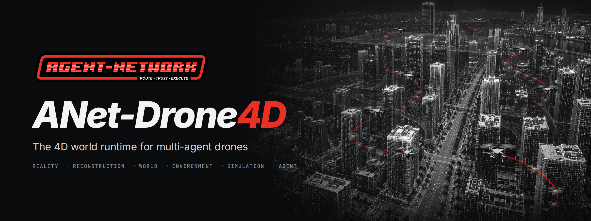

<h3>Reality in, swarms out.</h3>

Real-world 4D simulation for multi-agent drones: city-scale point-cloud digital twins, fleet simulation, swarm control, and target perception on a unified simulation clock, rendered live in any browser without a server GPU.

[](https://github.com/ANetResearch/ANet-Drone4D/releases/tag/v0.2.0)
[](https://github.com/ANetResearch/ANet-Drone4D/actions/workflows/ci.yml)
[](https://docs.agentnetwork.org.cn/drone4d/en/latest/)
[](https://drone4d.agentnetwork.org.cn)
[](LICENSE)

**[Live demo](https://drone4d.agentnetwork.org.cn)** · **[Documentation](https://docs.agentnetwork.org.cn/drone4d/en/latest/)** ·
[Quick start](https://docs.agentnetwork.org.cn/drone4d/en/latest/intro/quickstart.html) ·
[Open API](https://docs.agentnetwork.org.cn/drone4d/en/latest/api/rest.html) ·
[Releases](https://github.com/ANetResearch/ANet-Drone4D/releases) · [ANet](https://github.com/ANetResearch/ANet)

**English** · [简体中文](README.zh-CN.md)

</div>

<br/>

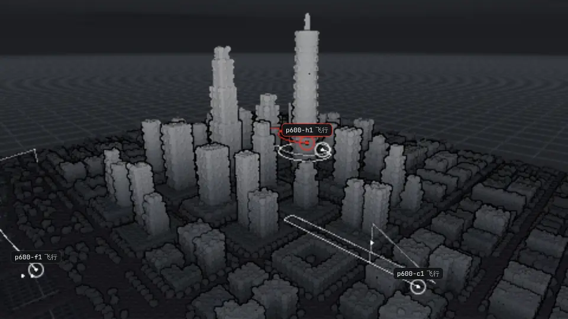

<sub>Scenario S0 in ANet Synthetic City, captured on a GPU-free machine and played back at twice real time.</sub>

## Highlights

- **Point-cloud digital twin.** Seven worlds—ANet Synthetic City and six UrbanScene3D cities—stream into the browser as octree point clouds, adapting density to viewpoint and frame budget.
- **Drone swarm simulation and swarm control.** FleetSim steps 1 to 1,000 vehicles on a shared 250 Hz clock. It runs a PX4-style flight model, mission generators, geofences, and fleet separation in a single loop.
- **Targets, perception and missions.** Six target classes use Johnson/TTPF detection across EO, NIR, LWIR, radar, and acoustic sensors. Nests and greedy task allocation drive 7x24 relay watch from stations outside each target's sensitivity range.
- **An interactive sandbox per visitor.** Each session runs an isolated simulation core, accessible via desktop browser, mobile devices, REST v1, or the Python SDK. Every city on the public demo also plays a recorded drone monitoring show.
- **Built for the next step.** The D3 Event Lab introduces Gazebo Sim lockstep physics, mesh cameras and LiDAR, FAST-LIVO2 reconstruction comparisons, and event-level benchmarks for multi-agent observation policies.

## Capabilities

| | Capability | Status |
|---|---|---|
| Digital Twin | City-scale point clouds, progressive loading, automatic density | Available |
| Drone Swarm | FleetSim, up to 1,000 vehicles on one clock | Available |
| PX4 | PX4-style position and attitude cascade (PX4-lite), validated against PX4 SIH flights | Available |
| Swarm Control | Formations, area coverage, geofences, separation, 14-state flight state machine | Available |
| Perception | Six target classes across EO, NIR, LWIR, radar, and acoustic sensors | Available |
| Agent Swarm | Capability discovery and task delegation over Mock ANet (disabled on public site) | Available |
| Gazebo | Gazebo Sim lockstep as the high-fidelity physics tier | In development |
| LiDAR and cameras | Mesh LiDAR (Livox MID-360 pattern) and photorealistic mesh cameras | In development |
| 4D Reconstruction | FAST-LIVO2 on simulated data, evaluated against mesh ground truth | In development |
| Rerun | Recordings exported for inspection in Rerun | In development |
| 3DGS | Gaussian-splatting appearance layer over mesh geometry | Research |
| PX4 SITL | Software-in-the-loop flight-controller validation with Gazebo | Research |

Statuses reflect the [v0.2.0 release](https://github.com/ANetResearch/ANet-Drone4D/releases/tag/v0.2.0) and the [D3 design baseline](docs/05-D3-设计增补与决策记录.md).

## Get started

Explore the **[live demo](https://drone4d.agentnetwork.org.cn)** with no registration required. It provides a read-only shared show and an isolated sandbox per visitor. To run the platform locally on Linux:

```sh
git clone https://github.com/ANetResearch/ANet-Drone4D.git && cd ANet-Drone4D
make setup        # Python and Node dependencies
make demo-world   # generate ANet Synthetic City
make run          # then open http://127.0.0.1:8000/world/synthcity
```

The [Quick start](https://docs.agentnetwork.org.cn/drone4d/en/latest/intro/quickstart.html) guide covers every step with real output, including how to drive a sandbox session from the Python SDK.

## Feature tour

> [!NOTE]
> The illustration that opens each feature is concept art, generated for this README and graded to the ANet Graphite palette. Images labeled **Screenshot** are direct captures from ANet Synthetic City, generated via `make demo-world`.

### Reality to world

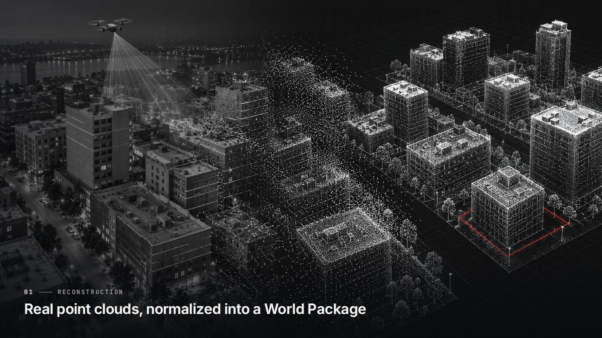

`worldpkg` normalizes raw point clouds—aligning units, up axis, leveling, north, origin, normals, ground model, height above ground, and classifications—into World Package v1. This format pairs a Potree 2.0 compatible octree using 12-byte ANET_Q16 point encoding with DSM and DTM rasters, semantics, and zones. Each of the six UrbanScene3D cities (roughly 5 million points per city) builds on a CPU in 27 to 35 s and passes `validate --deep` with zero errors. ANet Synthetic City generates from a fixed seed (1.2 km by 1.2 km, about 3.9 million points, zero third-party data) in about 25 s.

### Streaming city-scale point clouds

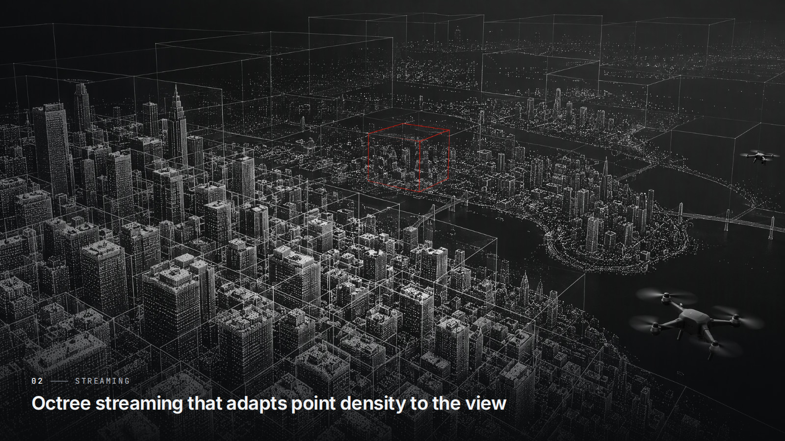

Initial octree levels load via a single range request per root, while remaining nodes stream in a Web Worker. The APH selector prioritizes octree nodes best-first within a two-level point budget. Concurrently, the CAS controller adjusts that budget and a seven-rung quality ladder based on measured frame times, matching point density to the viewport and device capability. The engine renders all points in a single draw call from a paged GPU point pool, with every render path verified against WebGL2 minimum specification limits.

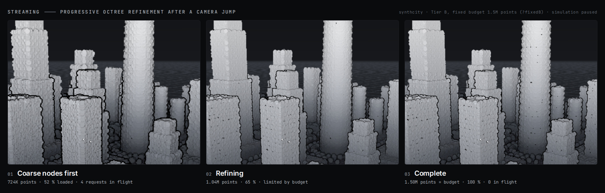

<sub>**Screenshot.** Upon jumping to a close view, resident coarse nodes render immediately (724 K points), refine within the point budget (1.04 M points), and complete at the budget cap (1.50 M points).</sub>

### Environment as a 4D field

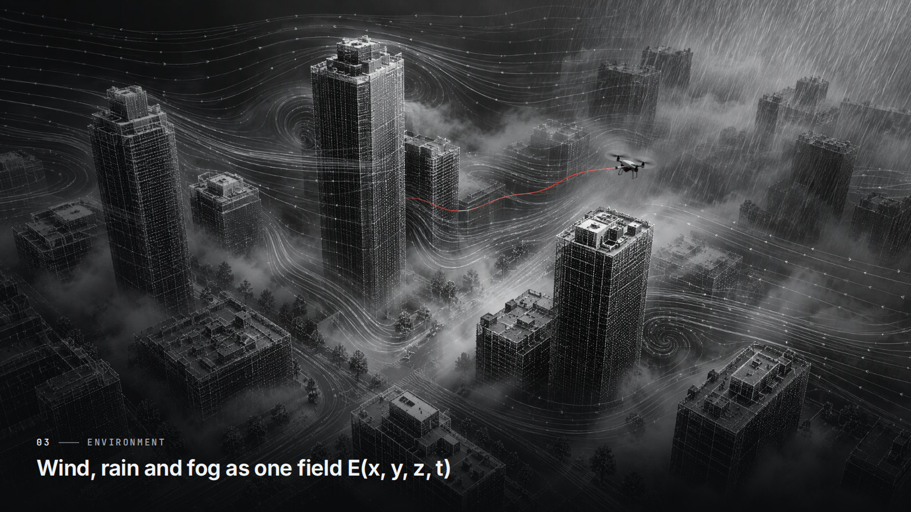

The environment service computes wind (combining a height profile with a turbulence box), visibility, and precipitation across 12 weather presets ranging from clear skies to sandstorms. The physics engine samples this field at 50 Hz, applying wind forces to each airframe via relative airspeed. The browser evaluates identical formulas to render rain, snow, dust, fog, clouds, and wind. A suite of 10,261 golden test cases keeps server physics and client rendering synchronized.

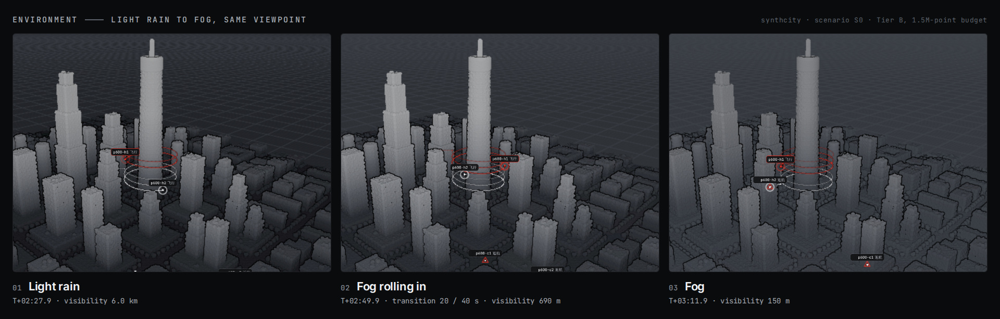

<sub>**Screenshot.** A single viewpoint as light rain transitions into fog: visibility drops from 6.0 km to 690 m halfway through the 40 s transition, settling at 150 m.</sub>

### Many drones, one clock

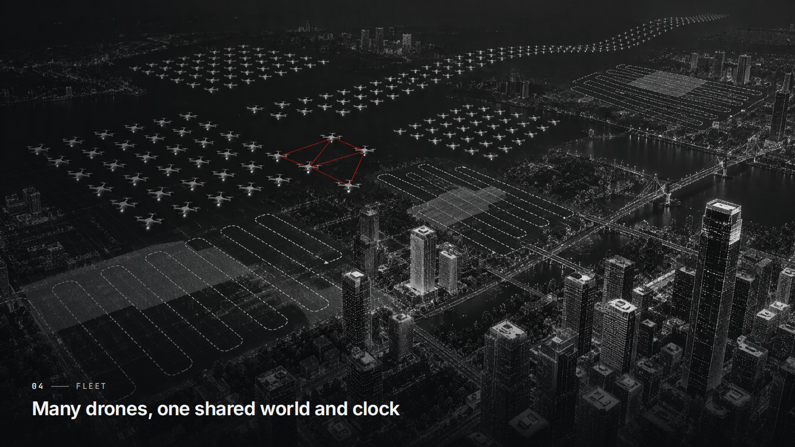

FleetSim advances all drones as a single structure of arrays on a shared 250 Hz clock. Its PX4-style position and attitude cascade is compiled with numba, verified against a numpy reference, and validated against PX4 SIH flight recordings. At 1,000 drones, FleetSim maintains real-time performance on roughly half a CPU core. Safety logic executes within the same loop: a 14-state flight state machine, geofences, energy-aware return to home, fleet separation, and link-loss policies. Eight mission generators provide trajectories ranging from helical facade scans to formations and area coverage.

<table>
<tr>
<td width="50%">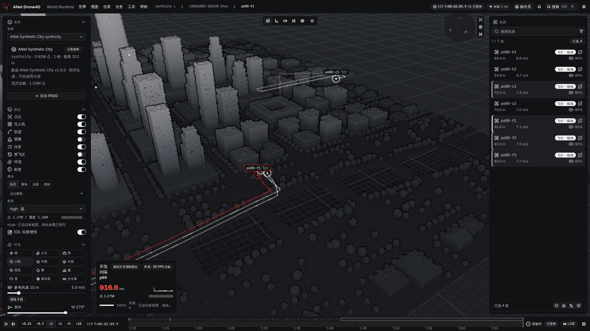</td>
<td width="50%">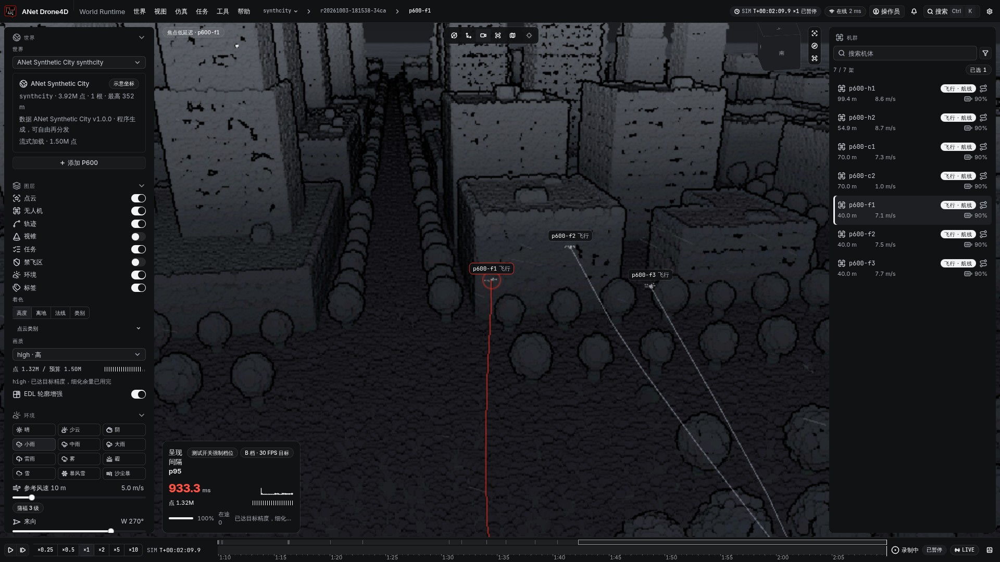</td>
</tr>
</table>

<sub>**Screenshots.** Left: a V formation turns at the east end of the river while a coverage drone flies lawnmower lanes across two city blocks. Right: third-person follow view behind the formation leader.</sub>

### Drones as physical agents

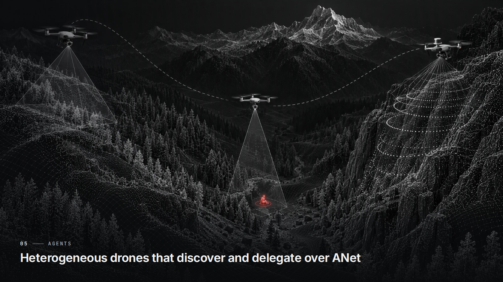

Each drone registers its capabilities on an agent network. In the S3 search-and-rescue scenario, an optical camera drone detects a candidate target, queries the network for thermal drones via capability discovery, gathers quotes priced by the simulator's internal estimator, and delegates confirmation to the optimal responder. The outcome is verified against a receipt and an acceptance predicate. V0.1 executes this workflow over an in-process Mock ANet; full ANet integration is scheduled for V1.0.

### Interactive sandbox, targets and relay watch

Every visitor receives an isolated sandbox backed by a dedicated simulation core. Each session supports up to 12 drones, 30 targets, and 4 nests, initialized from a world-specific scenario template and controlled via desktop browser, mobile device, or the open API. Targets span six classes parameterized by size, motion, thermal signature, radar cross-section, and periodic acoustic emission. The perception pipeline applies Johnson criteria and TTPF across EO, night, LWIR, LiDAR, radar, and acoustic sensors, computing received sound pressure, angular size, equivalent pixels, and detection probability for every drone-target pair. Nests, a greedy task allocator, and seven mission types—from point watch and GSD area scans to 7x24 relay watch outside a target's sensitivity range—execute on the shared simulation clock. Admission control, an explicit queue, and an automatic energy-saving mode keep the public host within capacity limits.

## Gallery

<table>
<tr>
<td width="50%">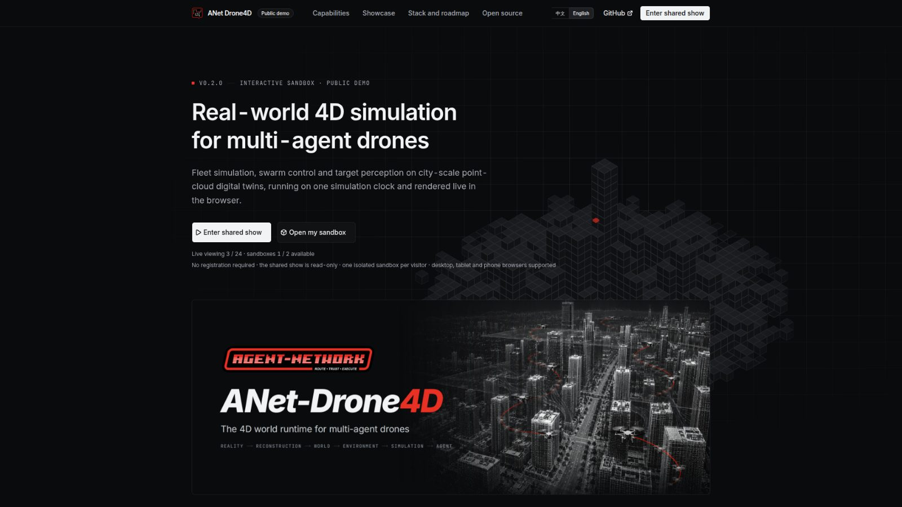</td>
<td width="50%">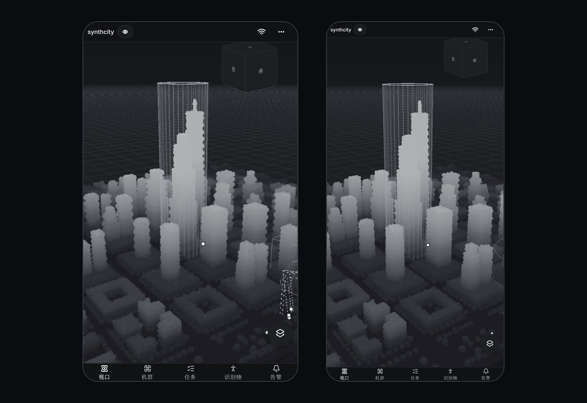</td>
</tr>
<tr>
<td><sub>Public demo landing page.</sub></td>
<td><sub>Phone layout with window switching.</sub></td>
</tr>
<tr>
<td>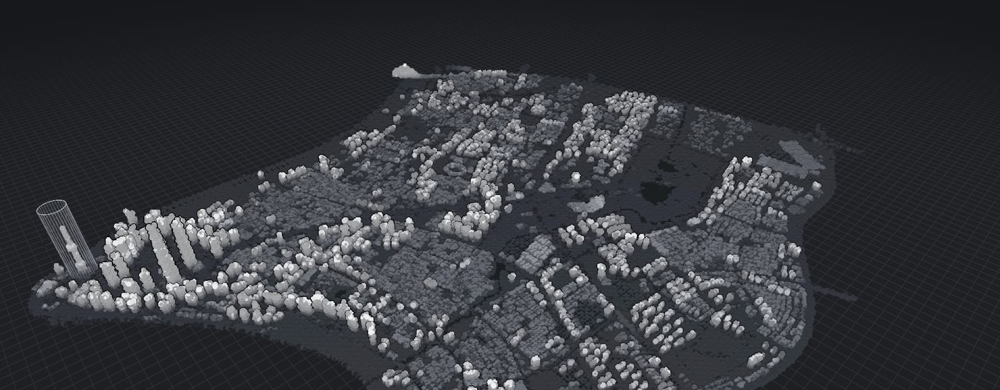</td>
<td>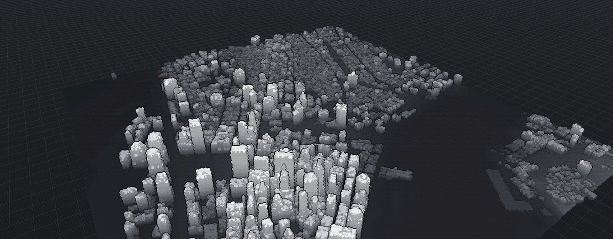</td>
</tr>
<tr>
<td>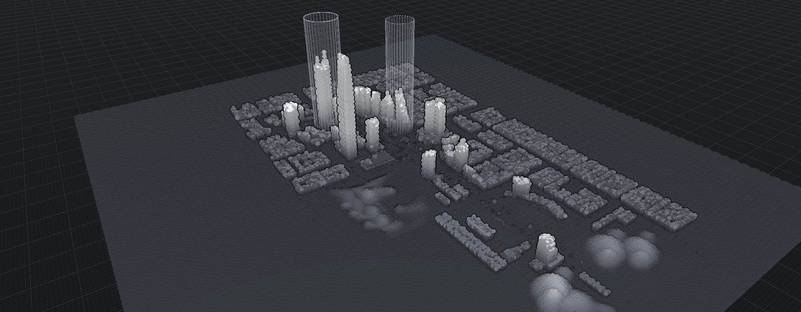</td>
<td>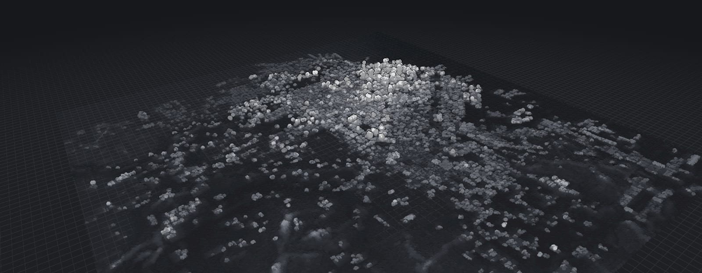</td>
</tr>
<tr>
<td>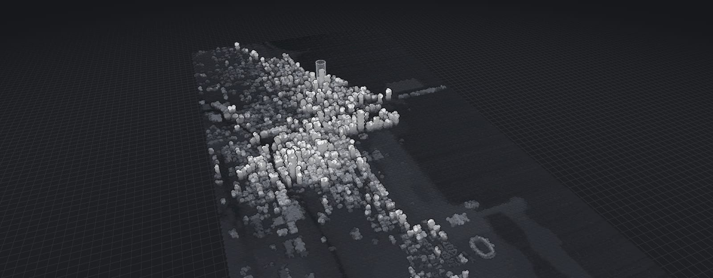</td>
<td>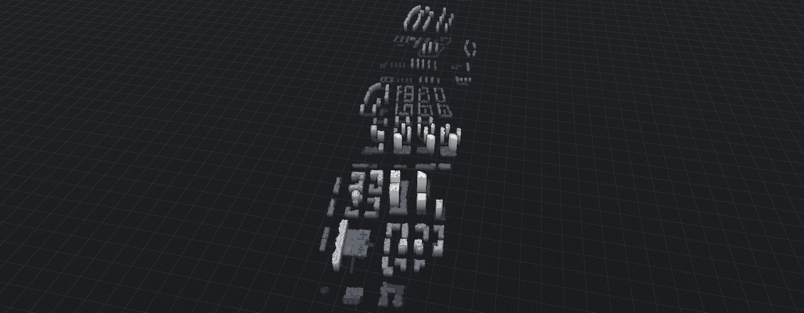</td>
</tr>
<tr>
<td colspan="2"><sub>Six UrbanScene3D cities on the public demo, rendered in the browser.</sub></td>
</tr>
</table>

<details>
<summary><b>How it works</b></summary>

<br/>

- **World.** Each world package bundles an octree point cloud, a terrain model, semantic layers, and derived caches within a unified metric East-North-Up frame.
- **Simulation.** `sim-core` steps the fleet, environment, targets, perception, and tasking on a single integer-nanosecond clock.
- **Realtime protocol.** `awr.rt.v1` combines a JSON control plane with a binary batch layer and credit-based backpressure, ensuring slow clients never stall the server.
- **Sandbox.** `sandbox-pool` isolates each session's simulation core under cgroup quotas, enforcing admission control, a visible queue, and an energy-saving mode that reclaims idle sessions.
- **Browser.** Built on React and an imperative three.js engine, the client scopes state per world so switching cities never carries entities across worlds.
- **Contracts first.** JSON Schemas generate both Python and TypeScript types, golden files keep implementations aligned, and a process supervisor enforces heartbeats, backoff, and circuit breaking.

Details: [Architecture](https://docs.agentnetwork.org.cn/drone4d/en/latest/topics/architecture.html) ·
[Worlds and data](https://docs.agentnetwork.org.cn/drone4d/en/latest/topics/worlds.html) ·
[Design documents](docs/).

</details>

<details>
<summary><b>Open API and Python SDK</b></summary>

<br/>

The sandbox exposes REST v1 at `/api/sandbox/v1` alongside the `awr.rt.v1` realtime protocol. The web interface and API share identical permissions, and all commands pass through the same admission and safety checks. Interactive OpenAPI documentation with copyable examples is available at [`/sandbox/api`](https://drone4d.agentnetwork.org.cn/sandbox/api). The single-file Python SDK ([`tools/sdk/awr_sandbox.py`](tools/sdk/awr_sandbox.py)) manages queuing, session renewal, resumption from energy-saving mode, and binary frame decoding:

```sh
pip install "httpx>=0.24" "websockets>=12" "msgpack>=1.0"
curl -O https://drone4d.agentnetwork.org.cn/sdk/awr_sandbox.py
```

```python
from awr_sandbox import Sandbox

sb = Sandbox("https://drone4d.agentnetwork.org.cn", timeout_s=30)
with sb.create("synthcity", "t5_area_guard") as s:   # queues when the public host is full
    print(s.state()["state"])
    for msg in s.stream(["sandbox/session"], seconds=3):
        print(msg.topic, msg.data)
```

Reference: [REST API](https://docs.agentnetwork.org.cn/drone4d/en/latest/api/rest.html) ·
[Python SDK](https://docs.agentnetwork.org.cn/drone4d/en/latest/api/sdk.html) ·
[examples](tools/sdk/examples/).

</details>

<details>
<summary><b>Vehicle catalogue</b></summary>

<br/>

The vehicle catalogue includes the P600 digital twin in its MID-360 configuration alongside four generic reference models: two quadrotors (AWR-Q1 and AWR-Q9), a long-endurance fixed-wing (AWR-F1), and a VTOL (AWR-V1). Fixed-wing flight models coordinated-turn kinematics and energy consumption with a wind-adjusted loiter radius, while the VTOL model enforces transition and hover limits. Supported payloads span daylight, near-infrared, thermal, radar, and acoustic sensors. All reference values represent simulation parameters rather than commercial hardware specifications.

</details>

<details>
<summary><b>Further capabilities</b></summary>

<br/>

- **Time as an axis.** Pause, single-step, and scale playback from x0.25 to x10; record and replay sessions via MCAP; re-simulate deterministically from input logs.
- **Missions and swarms.** Generate helix scans, orbits, expanding squares, corridors, terrain-following paths, lawnmower patterns, formations, and path-following routes; run safe transit over height maps, 2.5D A* planning, formation assignment, and pre-takeoff energy checks.
- **Geometry queries.** Evaluate altitude, height above ground, obstacle clearance, line of sight, raycasts, and path validity across safety, planning, and UI modules.
- **Field views.** Render acoustic, visual, thermal, and radar emissions as spherical point fields with iso-shells, alongside perception volumes indicating detection ranges.
- **Devices.** Includes a boot screen with version and loading progress, a tablet command layout, a streamlined phone interface with window switching, and full-screen PWA support.

</details>

<details>
<summary><b>Roadmap</b></summary>

<br/>

| Version | Scope | Status |
|---|---|---|
| V0.1 | Point-cloud digital twin, progressive loading, FleetSim with PX4-lite, realtime protocol, Mock ANet | Released |
| V0.2.0 | Interactive sandbox, targets and quantified perception, nests and relay watch, open API, phones and tablets, city monitoring shows | Released |
| V0.3 | D3 Event Lab: GLB worlds, event tapes, Gazebo Sim lockstep, mesh cameras and LiDAR, FAST-LIVO2, benchmark | In development |
| P3 and V1.0 | 3DGS appearance layer, PX4 SITL, real ANet with a self-hosted ANetHub | Planned |

Progress is tracked in [GitHub milestones](https://github.com/ANetResearch/ANet-Drone4D/milestones) and the pinned [roadmap issue](https://github.com/ANetResearch/ANet-Drone4D/issues/1). See [Roadmap](https://docs.agentnetwork.org.cn/drone4d/en/latest/project/roadmap.html) and the
[D3 design](docs/05-D3-设计增补与决策记录.md).

</details>

<details>
<summary><b>V0.2.0 acceptance</b></summary>

<br/>

V0.2.0 is evaluated against 55 acceptance criteria (D2-AC-01 to D2-AC-55). Round 2 results (2026-10-12 to 10-13):

| Items | Pass | Fail | Not measured |
|---|---|---|---|
| P0 (50) | 41 | 9 | 0 |
| P1 (5) | 3 | 0 | 2 |

A 24 h soak test completed with zero restarts and a memory growth rate of 0.48 MB/h. Remaining items are documented as known issues in the [release notes](https://github.com/ANetResearch/ANet-Drone4D/releases/tag/v0.2.0); see the full report in [docs/impl/D2-验收报告-第2轮.md](docs/impl/D2-验收报告-第2轮.md).

</details>

<details>
<summary><b>Design system and technology</b></summary>

<br/>

The server stack runs Python 3.12, numba, FastAPI, and zenoh; the browser client uses React 19, TypeScript, and three.js. The user interface combines shadcn/ui components, Transitions.dev motion tokens, morphicons icons, and the lieflat visual language for charts and tables, styled in the ANet Graphite palette of grey, black, white, and red. Documentation is built with Sphinx using the Read the Docs layout.

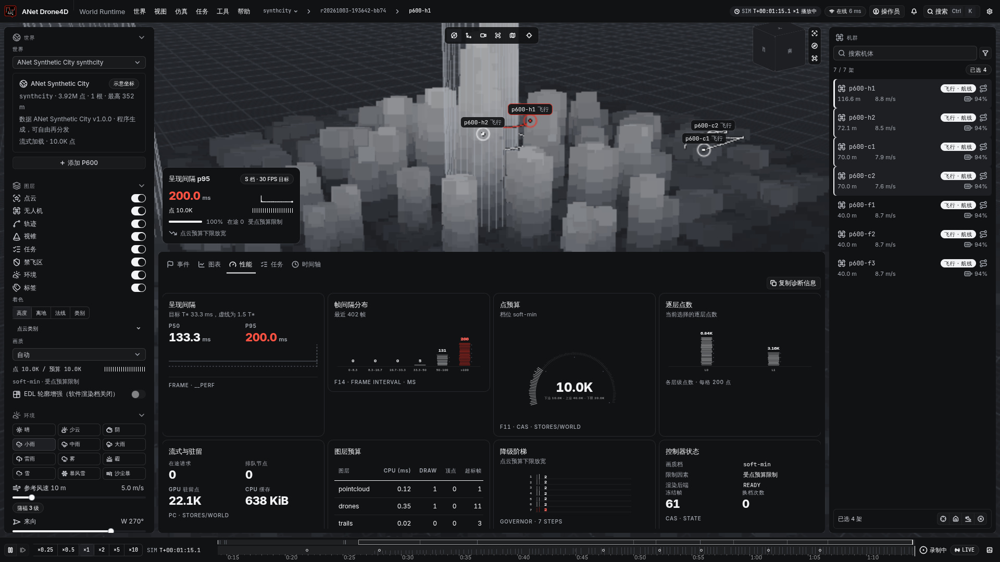

<sub>**Screenshot.** The performance panel rendered in the lieflat visual language on a machine without a GPU.</sub>

See [docs/15](docs/15-视觉设计规范与色卡.md) for the visual specification and [THIRD_PARTY_NOTICES.md](THIRD_PARTY_NOTICES.md) for third-party component licenses.

</details>

<details>
<summary><b>Relation to ANet</b></summary>

<br/>

ANet-Drone4D is part of the ANet ecosystem from Agent Network Research, alongside [ANet](https://github.com/ANetResearch/ANet), [ANetHub](https://github.com/ANetResearch/ANetHub), and [ANetCore](https://github.com/ANetResearch/ANetCore). Drones serve as the first class of physical agents: they publish capabilities, discover peers, delegate tasks, and verify outcomes against receipts. ANet operates as the collaboration plane rather than the flight control plane—delegated tasks translate into standard commands subject to the same admission and safety checks as manual operator inputs.

</details>

<details>
<summary><b>Data and citation</b></summary>

<br/>

The six city worlds are derived from UrbanScene3D and hosted on the public demo with authorization from the dataset rights holders (经数据集权利方授权使用). This repository does not distribute the raw dataset; see [NOTICE](NOTICE) for details. Please cite UrbanScene3D (ECCV 2022) when using these worlds:

```bibtex
@inproceedings{UrbanScene3D,
  title     = {Capturing, Reconstructing, and Simulating: the UrbanScene3D Dataset},
  author    = {Liqiang Lin and Yilin Liu and Yue Hu and Xingguang Yan and Ke Xie and Hui Huang},
  booktitle = {ECCV},
  year      = {2022}
}
```

To cite ANet-Drone4D, use GitHub's "Cite this repository" feature ([CITATION.cff](CITATION.cff)) or the following BibTeX entry:

```bibtex
@software{anet_drone4d_2026,
  title   = {ANet-Drone4D: A Real-World Grounded 4D World Runtime for Autonomous Multi-Agent Drones},
  author  = {{Agent Network Research}},
  year    = {2026},
  version = {0.2.0},
  url     = {https://github.com/ANetResearch/ANet-Drone4D}
}
```

</details>

## Acknowledgements

ANet-Drone4D builds on [three.js](https://threejs.org), [React Three Fiber](https://github.com/pmndrs/react-three-fiber),
[Potree](https://github.com/potree/potree), [zenoh](https://zenoh.io), [numba](https://numba.pydata.org),
[PX4](https://github.com/PX4/PX4-Autopilot), [Prometheus](https://github.com/amov-lab/Prometheus), and UrbanScene3D.

## Contributing

Issues and pull requests are welcome in English or Chinese; see [CONTRIBUTING.md](CONTRIBUTING.md) for guidelines. Changes to system contracts—including file formats, `awr.rt.v1`, the REST API, or reason codes—must begin with an issue, and `make ci` serves as the merge gate. Report security vulnerabilities to hi@anet0.com ([SECURITY.md](SECURITY.md)).

## License

Released under the **ANet Open Source License (ANet-Drone4D)**, a modified Apache License 2.0 that permits commercial use subject to two conditions: operating a multi-tenant hosted simulation or digital twin service for unrelated parties requires written authorization, and all ANet logos and copyright notices must be retained. See [LICENSE](LICENSE) for full terms.

<div align="center">
<br/>

<br/>
<sub>Agent Network Research</sub>
</div>
