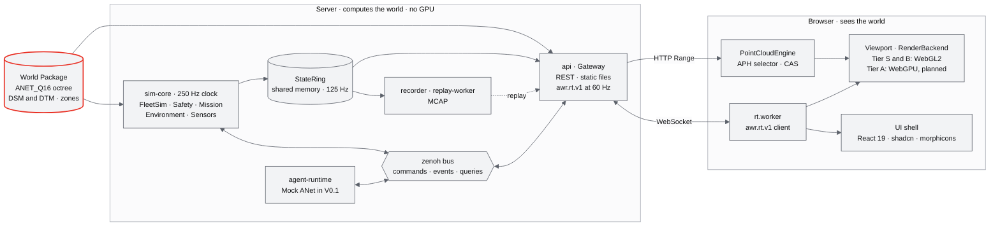

<div align="center">


<h3>Reality in, swarms out.</h3>

A real-world grounded 4D world runtime for autonomous multi-agent drones.<br/>
Stream a city-scale point cloud into any browser, fly a simulated fleet of up to 1,000 drones through wind and
weather on one server clock, and let the drones discover and delegate work to each other over <a href="https://github.com/ANetResearch/ANet">ANet</a>.<br/>
Each visitor can open an isolated sandbox with targets, nests and tasks, operated from the browser or through the open API.<br/>
The server requires no GPU.

[](LICENSE)
[](https://github.com/ANetResearch/ANet-Drone4D/actions/workflows/ci.yml)
[](https://drone4d.agentnetwork.org.cn)
[](#d2-acceptance)
[](pyproject.toml)
[](apps/web/package.json)
[](apps/web/package.json)
[](https://threejs.org)
[](#how-it-works)
[](#quick-start)
[](#documentation)
[](https://github.com/ANetResearch/ANet)

[Live demo](https://drone4d.agentnetwork.org.cn) · [Quick start](#quick-start) · [Features](#features) · [Open API](#open-api-and-python-sdk) · [Acceptance](#d2-acceptance) · [How it works](#how-it-works) · [Roadmap](#roadmap) · [Docs](#documentation) · [ANet](https://github.com/ANetResearch/ANet)

**English** · [简体中文](README.zh-CN.md)

</div>

<br/>


<sub>**Screenshot of the V0.1 (D1) build**, not concept art. The city is **ANet Synthetic City**, the synthetic demo city
that `make demo-world` generates in about 25 s (no real place, no third-party data), running scenario S0: two P600s
spiral around the 318 m ANet Tower (red trail) while two more cover city blocks. Captured on an 8-core machine with no
GPU (SwiftShader software rendering), with the point budget fixed at 1.5 M points by a test switch (the badge on the
HUD); the HUD shows that machine's frame interval, about 1 s.</sub>


<sub>**Animation, same build and city.** Ten seconds of scenario S0 with about 850 K points per frame, stepped frame by
frame on the same no-GPU machine (0.1 s of simulation per frame) and played back at twice real time.</sub>

---

## Try it online

**[drone4d.agentnetwork.org.cn](https://drone4d.agentnetwork.org.cn)** is the public instance of the current release,
V0.2-demo (build 0.2.0). No installation or sign-in is required. The landing page offers two entry points:
**Launch demo** opens the shared show at `/world/synthcity`, and **Open my sandbox** starts a private simulation.

- **Shared show.** A read-only session runs scenario S7 continuously: an area guard over ANet Synthetic City that
  hands detected targets to a 7×24 relay watch, on a simulation calendar that follows Beijing time. Visitors can
  switch cameras, follow and select drones, open the FPV and the day, night and thermal sensor views, and inspect
  targets, relay statistics, the vehicle catalogue and the GSD calculator. Viewing does not occupy a sandbox slot.
- **My sandbox.** Each visitor may open one isolated sandbox with its own simulation process: choose one of seven
  worlds and a scenario template (T1 to T6), then place drones, targets and nests, run tasks, take manual control
  and switch sensor views. A sandbox starts with 30 min and can be renewed up to 120 min; renewal is paused while
  other visitors are queued.
- **Capacity and queues.** Sandbox slots and live viewing seats are capped. When they are full, visitors join a queue
  with a position and an estimated wait; the landing page and the boot screen show the current capacity. After a
  period without interaction (5 min when viewing, 10 min in a sandbox) the page enters energy-saving mode: a viewer
  releases its seat, and a sandbox is saved to disk and resumed on the next interaction.
- **Seven worlds.** ANet Synthetic City and the six UrbanScene3D cities, which the project uses under authorization
  from the dataset's rights holders (see [Data and citation](#data-and-citation)).
- **Devices.** Desktop browsers get the full interface. Tablets get a landscape commander layout with touch gestures
  and virtual sticks, and phones a five-tab layout with quick commands.
- **Open API.** [`/sandbox/api`](https://drone4d.agentnetwork.org.cn/sandbox/api) documents every sandbox operation,
  and the [Python SDK](#open-api-and-python-sdk) drives the same API.
- **Where it renders.** The server is a 4-core machine without a GPU that runs physics, safety, missions, perception
  and the environment. The point cloud, weather and interface render in the visitor's browser, so image quality and
  frame rate depend on the device's GPU.
- **Not offered.** Heavy server-side features (GPU reconstruction, recording and replay, the agent runtime) are not
  available on the public instance.

The deployment kit is in [tools/deploy/emax/](tools/deploy/emax/) and the topology in
[docs/19 §3.7](docs/19-部署与运维说明书.md) (both Chinese).

## Why ANet-Drone4D

Drone simulators usually start from the vehicle and put a hand-made map around it. Digital twins usually show a place
but cannot fly anything in it. ANet-Drone4D starts from the place: a captured or reconstructed point cloud becomes a
versioned **World**, and an environment field, a fleet of drones and their agents all run on that World and on one
clock, while a browser watches it from anywhere. The whole chain is
**Reality → Reconstruction → World → Environment → Simulation → Agent**. "4D" is 3D space plus time: drones, weather
and the timeline share one simulation clock, so any moment can be paused, stepped, recorded and replayed.

- **The World is the core, not the drone.** Captures, reconstructions and simulations all meet in one versioned World
  Package: geometry for physics and queries, a point cloud for the eye, semantics and no-fly zones, anchored to the
  real place. The built-in simulator reads it today; PX4 SIH, Gazebo and Isaac backends will read the same World.
- **The browser sees the world; the server computes it.** Physics, safety, planning and the environment run on a
  headless Linux server with no GPU. The browser only streams and draws, so a laptop over an SSH tunnel is enough.
- **City-scale point clouds, streamed like video.** A five-million-point city opens with a few HTTP Range requests
  and fills in progressively. A closed-loop controller trades point density for frame time, so the same world runs on a
  software renderer and on a desktop GPU.
- **The environment is a 4D field.** Wind, turbulence, visibility, rain, snow, fog and dust form one field
  E(x, y, z, t). The same numbers push on the airframes, through relative airspeed, and paint the sky.
- **Drones are physical agents.** A drone publishes what it can do; other agents find it, ask it for a quote and
  delegate a task. ANet is the collaboration plane, never the control plane: every flight command still passes the
  simulator's admission and safety checks.

## Features

> [!NOTE]
> Where a feature opens with an illustration, it is concept art, made for this README with an image model and graded
> to the ANet Graphite palette. Images captioned **Screenshot** are real captures of the V0.1 (D1) build in ANet
> Synthetic City, the synthetic demo city (see [Quick start](#quick-start)).

### Reality → World


`worldpkg` normalizes a raw point cloud (units, up axis, levelling, north, origin, normals, ground model, height above
ground, classes) into **World Package v1**: a Potree 2.0-compatible octree with the 12-byte ANET_Q16 point encoding,
DSM and DTM rasters, semantics and zones. The six built-in cities (Shenzhen, Shanghai, New York, San Francisco,
Suzhou and Chicago, about 5 million points each) build on the CPU in 27 to 35 s per city and pass `validate --deep`
with zero errors. A seventh world, ANet Synthetic City, is generated from a fixed seed (1.2 km × 1.2 km, about 3.9
million points, no third-party data) and goes through the same pipeline in about 25 s; it is the city in every
screenshot on this page. The reconstruction interface (Engine Adapter v2, Recon IR, a job state machine) already runs
end to end with a mock engine and produces a World the browser loads; GPU engines arrive in V0.5.

### Streaming city-scale point clouds


The first-screen levels arrive in one Range request per octree root; the rest streams in a Web Worker. The **APH selector** picks
octree nodes best-first under a two-level point budget, and the **CAS controller** moves that budget and a 7-rung
quality ladder (soft-min to ultra) from measured frame time, so density follows the view and the device. Every point
is drawn in a single draw call from a paged GPU point pool, and the canvas never resizes when quality changes. The
product selector matches the research prototype frame by frame on three cities and five budgets.


<sub>**Screenshot.** After the camera jumps to a close view, the resident coarse nodes draw first (724 K points, 52%
loaded), then refine under the point budget (1.04 M points, 65%) until the view is complete (1.50 M points, the
budget). Figures from the HUD; Tier B with a fixed 1.5 M budget on software rendering.</sub>

### Environment as a 4D field


The EnvironmentService evaluates wind (a height profile plus a turbulence box), visibility and precipitation, with
12 weather presets from clear to sandstorm. Physics reads the field in Python at 50 Hz, and wind acts on each airframe
through its relative airspeed. The browser evaluates the same formulas in TypeScript, and wind also in TSL on the GPU,
to draw rain, snow, dust, fog, clouds and wind arrows. Golden tests hold both sides together (10,261 cases), and GPU
wind matches the CPU reference within 0.01·v_max + 0.02 m/s.


<sub>**Screenshot.** One viewpoint as scenario S0 turns light rain into fog: visibility 6.0 km, then 690 m halfway
through the 40 s transition, then 150 m.</sub>

### Many drones, one clock


**FleetSim** steps every drone as one structure of arrays on a shared 250 Hz clock: a PX4-style position and attitude
cascade (L1, at 125 Hz) compiled with numba, bit-identical to its numpy reference and checked against PX4 SIH flight
recordings. It runs 1 to 1,000 drones of two types, x500 and a P600 digital twin (its parameters are placeholders
until identification in V0.4); at 1,000 drones it keeps real time on about half a CPU core
([D1 acceptance](#d1-acceptance)). Safety runs inside the same loop: a 14-state flight state machine, geofences,
energy-aware return to home, fleet separation and a link-loss policy. Missions come from 8 generators, from a helical
facade scan to formations and area coverage.

<table>
<tr>
<td width="50%"></td>
<td width="50%"></td>
</tr>
</table>

<sub>**Screenshots.** Left: the V formation turns at the east end of the river (the leader's trail in red) while a
coverage drone flies lawnmower lanes over two blocks. Right: third-person follow of the formation leader, which gets
the low-latency focus channel (badge at the top left).</sub>

### Drones as physical agents


Each drone joins an agent network with its capabilities. In the S3 search-and-rescue scenario a camera drone spots a
possible target, finds thermal drones through capability discovery, collects quotes priced by the simulator's own
estimator, and delegates the confirmation to the best one; the result is checked against a receipt and an acceptance
predicate (TSIR, from ANetCore). V0.1 runs this on an in-process Mock ANet; S3 passes end to end with real processes
(sim-core, api and agent-runtime) and makes the same decisions at ×1 and ×10. Real ANet arrives in V1.0.

### Interactive sandbox (V0.2-demo)

Each sandbox is an isolated session with its own sim-core on the sandbox100 clock profile, supervised by
**sandbox-pool** and served by **sandbox-api**, while the D1 shared show runs unchanged beside it. A session holds up
to 12 drones, 30 targets and 4 nests, starts from a per-world scenario template (T1 point watch to T6 manual flight
with sensor views), and can export its configuration as a snapshot, restore it, or move to another world. Admission
follows a capacity model: the number of concurrent sandboxes is derived from measured session cost (hard cap 6),
further requests wait in a long-poll queue, and a requested simulation rate is granted only within the CPU budget.
Manual control takes over a drone from the keyboard or virtual sticks, and a soft fence slows the drone before it
enters a sensitivity range.

### Targets and quantified perception

Targets come in six classes (person, drone, machine, dog, vehicle and object) with size, motion, appearance,
reflectance, thermal signature, radar cross-section and a periodic sound source. Each target carries visual and
acoustic sensitivity ranges: by default a drone that enters a configured range and dwells there is discovered
(geometric mode), and a physical mode based on signal margins is available. Perception applies Johnson criteria and
TTPF to detection, recognition and identification across EO, night (near infrared with an 850 nm illuminator), LWIR,
MID-360, millimetre-wave radar and acoustic array sensors; a confirmed capture requires an imaging sensor to hold
P ≥ 0.9 at the required level for 1 s. For every target and drone pair, the perception readout reports received sound
pressure, threshold and margin, angular size, equivalent pixels, contrast, and per-modality and combined display
probabilities.

### Nests, tasking and 7×24 relay watch

Nests (box, launcher and VTOL pad) hold drones, batteries and charging channels, and support battery swap or charging.
Six task types (point watch, polyline patrol, multi-vehicle area patrol, GSD area scan, perimeter patrol and relay
watch) and the composite area guard are decomposed into work items and assigned by a greedy allocator across nests
and models under capability and energy constraints; an Allocator interface is reserved for model-, LLM- and
agent-based allocators. The GSD scan derives altitude and strip width from the required ground sample distance,
removes obstacle cells, fills gaps, and dispatches several vehicles whenever one sortie or one distant viewpoint
cannot cover the area. The relay watch keeps a target under continuous observation from stations outside its
sensitivity ranges: it consults a feasibility window table, dispatches relief ahead of time from a day and night
forecast, and accounts for battery and charger throughput; a dry run reports whether a configuration is sustainable
7×24 and which resource is the bottleneck.

### Open API and Python SDK

The sandbox exposes REST v1 under `/api/sandbox/v1` together with the `awr.rt.v1` realtime protocol. The web
interface and the API carry the same permissions, and every command passes the same admission and safety checks. The OpenAPI 3.1
document is served at `/api/sandbox/v1/openapi.json` and rendered, with copyable examples, at
[`/sandbox/api`](https://drone4d.agentnetwork.org.cn/sandbox/api). The single-file Python SDK
[`tools/sdk/awr_sandbox.py`](tools/sdk/awr_sandbox.py) (Python 3.9 to 3.13; httpx, websockets and msgpack) handles
queuing, proof of work, renewal, resumption after energy saving and binary frame decoding:

```sh
pip install "httpx>=0.24" "websockets>=12" "msgpack>=1.0"
curl -O https://drone4d.agentnetwork.org.cn/sdk/awr_sandbox.py
```

```python
from awr_sandbox import Sandbox

sb = Sandbox("https://drone4d.agentnetwork.org.cn")
with sb.create("synthcity", "t5_area_guard") as s:   # queues when full; solves the proof of work when required
    print(s.state()["state"])
    s.clock("speed", rate=5)                          # a capped request returns the granted rate
    for msg in s.stream(["sandbox/session"], seconds=3):
        print(msg.topic, msg.data)
```

The examples in [tools/sdk/examples/](tools/sdk/examples/) cover manual velocity control, sensors, targets and
capture, a GSD scan dry run and an external allocator; [tools/sdk/README.md](tools/sdk/README.md) (Chinese) lists
every call.

### Vehicle catalogue, fixed-wing and VTOL

The catalogue contains the P600 digital twin in its MID-360 configuration (profile v2) and four generic reference
models: two quadrotors (AWR-Q1 and AWR-Q9), a long-endurance fixed-wing (AWR-F1) and a VTOL (AWR-V1). Preset models
are read-only; a session may clone and edit them within validated ranges. Fixed-wing flight uses coordinated-turn
kinematics and an energy model, with the loiter radius adjusted for wind, and the VTOL model includes transition and
hover limits. All reference values are simulation parameters, not specifications of real products.

### Boot, capacity and devices (D2.1)

The boot screen shows the version line (`V<version>-<channel> · <commit> · <date>`) before any application script
runs, together with a five-segment progress bar and the current live viewing and sandbox capacity, including any
queue. Concurrency is counted in sandbox slots and live viewing seats, each with its own queue. An idle page enters
energy-saving mode, closes its realtime connection and renders the last state statically; an idle sandbox is
checkpointed to disk and releases its slot. Phone and tablet layouts, touch gestures, mobile quality tiers and PWA
full screen extend the sandbox to mobile devices. Field views (acoustic, visual, thermal and radar) draw the emission
field of each drone as a spherical point field with iso-shells, and perception volumes around a selected target show
where a drone would be heard or seen.

### Further capabilities

- **Time as an axis.** Pause, single-step and speeds from ×0.25 to ×10; recording and replay (MCAP) with replayed
  frames byte-identical to the recording; deterministic re-simulation from the input log.
- **Missions and swarms.** Helix scan, orbit, expanding square, corridor, terrain following, lawnmower, formation and
  follow-path generators; safe transit over the height map, 2.5D A*, CAPT formation assignment, area coverage and an
  energy pre-check before take-off.
- **Geometry queries on the World.** Height, AGL, clearance, line of sight, ray hit and path validation, used by
  safety, planning and the click-to-GoTo interaction alike.
- **Sensors.** Gimbals and camera frustums, GNSS and IMU noise models, a mock detector and thermal frames.
- **Scenarios.** S0 ANet Synthetic City showcase (no download needed), S1 Shenzhen facade inspection, S2 Shanghai
  formation, S3 New York search and rescue with agents, S4 Chicago lakeshore, S5 San Francisco terrain following, S6
  Suzhou corridor, a fleet ladder from 10 to 1,000 drones, and a soak run.
- **Remote by design.** The server binds to loopback and is reached through an SSH tunnel; viewer, operator and admin
  roles, with a single operator seat. LAN mode and a read-only public mode behind a reverse proxy, which serves the
  [live demo](#try-it-online), are opt-in.
- **Contracts first.** 75 JSON Schemas generate the Python and TypeScript types, and golden files keep both sides in
  step. A supervisor with heartbeats, backoff and circuit breaking runs every process.

## D2 acceptance

V0.2-demo (D2 and D2.1) is accepted against 55 items, D2-AC-01 to D2-AC-55 in
[docs/04](docs/04-D2-设计增补与决策记录.md) §13 and §15.14; 50 are P0 and 5 are P1. Round 1 (2026-10-11 to 10-12)
measured every item. After the D2-FX-R2 fixes, round 2 (2026-10-12 to 10-13, build 0.2.0) re-measured the 18 items
that had failed or were not measured, and the full regression suite covered the rest:

| Items | Pass | Fail | Not measured |
|---|---|---|---|
| P0 (50) | **41** | 9 | 0 |
| P1 (5) | **3** | 0 | 2 |
| **All (55)** | **44** | **9** | **2** |

Round 2 ran the 24 h soak (D2-AC-39) at its full duration: S7 relay watch with 24 viewers for 24.5 h, with no
unexpected restarts, no out-of-memory events, sim-core memory growth of 0.48 MB/h and the 04:00 day rollover on time.
After the fixes, first-frame time is 64% shorter than in D1, per-session simulation cost fell from 0.46 to 0.22 cores,
the fixed-wing wind and concurrent patrol defects are resolved, and task and relay state match field by field after
parking and resuming.

V0.2-demo is released with the remaining 9 items as known issues. They trace to three causes:

1. **Sandbox capacity on the public host.** With four fully loaded sessions the sandbox CPU group reaches its 1.36-core
   limit, per-session real-time factor drops to about 0.58 and new sessions take more than 6 s to become ready
   (D2-AC-02, 04, 07, 08, 55). The public deployment caps concurrent sandbox sessions at two; further visitors queue.
2. **Relay gaps in daytime.** Random-walk targets briefly leave the on-station observer's line of sight, producing
   short monitoring gaps in the 24 h batches (D2-AC-19, 20, 35).
3. **Software-rendered frame pacing.** Without a hardware GPU, the synthetic-city default view renders at a median of
   50 ms per frame (D2-AC-30).

D2-AC-27 (72 h and 7-day observation of the public site) and D2-AC-46 (measured power-saving on the public host) are
measured after this deployment.

> [!NOTE]
> **Test setup.** The same 8-core virtual machine without a GPU as D1, under the ADR-033 performance protocol; the
> public host's resources are simulated with cgroups (CPUQuota 250%, MemoryMax 2 GiB, 4 cores). Per-item results,
> evidence and diagnosis: [D2 acceptance report, round 2](docs/impl/D2-验收报告-第2轮.md) and
> [round 1](docs/impl/D2-验收报告-第1轮.md).

## D1 acceptance

V0.1 (D1) is accepted against 38 items, D1-AC-01 to D1-AC-35 in [docs/03 §8.4](docs/03-设计基线与决策记录.md) (03, 09
and 11 are each split into a and b). Each item is P0, which blocks the release, or P1, or has parts of both. The sixth
acceptance round (2026-10-03 to 10-04) measured 8 items again and carried the other 30 over from earlier rounds:

| Items | Pass | Fail |
|---|---|---|
| With a P0 part (25) | **24** | 1, in its P1 part only |
| P1 only (13) | **12** | 1 |
| **All (38)** | **36** | **2** |

Counted by their P0 parts, all 25 pass: the one item with a P0 part that fails, D1-AC-27, fails only in its P1 part.
So **the first of D1's exit criteria, every P0 item passing, is met**. The rest of the release gate in docs/03 §8.1 is
not met yet: two provisional thresholds still have to be frozen, and each failing P1 item must be fixed or covered by
a registered waiver (see [Open items](#open-items)). Passing items went from 13 in round 1 to 22, 24, 31, 35 and
now 36. The two P0 regressions that round 5 found, a 383 ms frame gap in New York and one long frame during RTL for
all 1,000 drones, are fixed by [ADR-081](docs/03-设计基线与决策记录.md), which delivers toasts after layout. The full
per-item table, evidence and diagnosis are in the [D1 acceptance report, round 6](docs/impl/D1-验收报告-第6轮.md)
(Chinese).

> [!NOTE]
> **How this was measured.** One 8-core x86-64 virtual machine (Xeon E5-2603 v4 at 1.7 GHz) with **no GPU**. Browser
> cases run in headless Chromium 151 on **SwiftShader**, that is software WebGL2: the Tier S path, a 1280 × 720 canvas
> at render scale 0.5 with a 30 fps target, so a p50 of 33.3 ms is on target. Every performance case follows the
> performance protocol of ADR-033: an exclusive lock, a 1-minute load of at most 4 before each run, pinned CPU
> partitions, and the median of 3 runs. The frame-time gates below are the Tier S gates for such a machine. The gates
> for real GPUs (integrated: p50 at the display refresh period, at most 5% dropped frames, TTFP ≤ 700 ms; discrete: at
> most 2% dropped frames, TTFP ≤ 500 ms) are design values from docs/03 §8.4: they have not been measured here and do
> not block D1.

| Area | Result (median of 3 runs) | Gate | Item |
|---|---|---|---|
| World build | Six cities pass `validate --deep` with 0 errors; 26.9 to 31.5 s per city, CPU only | 0 errors; ≤ 60 s per city | 01 |
| First screen | TTFP 1.4 to 4.4 ms on all six cities (last first-screen byte to the first complete frame, shader warm-up excluded); switching world 328 ms; cold start to interactive 3.49 to 3.80 s, point cloud only. The full scene with UI and S1 opens in 17.7 s (recorded, no gate) | TTFP ≤ 1.0 s; switch ≤ 1.5 s; cold start ≤ 4.0 s | 02 |
| Frame pacing, point cloud only | Shenzhen p50 33.3 / p95 50.0 / p99 66.7 ms, 1.57% of frames over 50 ms, none over 100 ms, worst 83.3 ms; New York, Shanghai and Suzhou alike, worst 83.3 ms in all four cities (New York: 383 ms in round 5) | ≤ 33.4 / 50 / 100 ms; ≤ 5%; ≤ 0.5%; worst ≤ 250 ms | 03a |
| Frame pacing, default scene (Shenzhen, S1, environment, HUD, drone list) | p50 33.3 / p95 50.0 / p99 66.7 ms; 2.56% over 50 ms, 0.060% over 100 ms; worst 116.7 ms; fixed layers 5.96 ms | ≤ 33.4 / 66.7 / 116.7 ms; ≤ 10%; ≤ 1%; worst ≤ 250 ms; layers ≤ 10 ms | 03b |
| Same, with 200 drones | p99 66.7 ms; 3.98% over 50 ms, 0.25% over 100 ms; worst 150 ms | as 03b | 09a |
| Density control (CAS) | In the target band 47.8 ms after the reveal; 0 rung changes in 60 s; 6.2 budget reversals per minute; no evaluation while the page is hidden | ≤ 2 s; ≤ 2; ≤ 15 per minute | 04 |
| Streaming | 0 failed nodes; node selection p95 ≤ 0.095 ms; CPU cache ≤ 2.52 MB; 0 long frames from our scripts; nothing downloaded twice | 0; ≤ 0.5 ms; ≤ 64 MB; 0; ≤ 1.3 | 06 |
| No compile at runtime | 0 new shader programs after the reveal; worst frame within 1 s of a first action (weather, select, follow, close-up, pick) 133 ms | 0; ≤ 150 ms | 25 |
| Weather change, clear to thunderstorm in 30 s | 0.126% of frames over 100 ms; 0 new programs | ≤ 0.5% | 19 |
| Latency | Focus drone, simulation time to pixel p95 62.0 ms; command to visible p95 142 ms | ≤ 150 ms; render delay (about 206 ms) + 150 ms | 26 |
| FleetSim, 1,000 drones | Real-time factor 1.000 on 0.529 of a core; step p99 2.69 ms, worst 2.99 ms; 0 catch-up saturation | ≥ 0.99; ≤ 0.6 core; p99 ≤ 3 ms, worst ≤ 12 ms | 07 |
| Gateway, 1,000 drones and 3 streaming browsers | Tick data age p99 10.6 ms; api 0.149 of a core (recorded) | ≤ 15 ms; ≤ 0.35 core | 08 |
| Commands and events | 50 commands/s for 60 s: 0 failures, admission round trip p99 5.90 ms; about 666 events/s, 0 out of order and no gap left open; with 1 message in 100 dropped, all 591 gaps refilled by replay within 69 ms | 0, ≤ 25 ms; 0; ≤ 1 s | 10 |
| Event storm, RTL for all 1,000 drones (P0 part) | 0 long frames from our scripts; control FIFO peak 12; 2 toasts; sim-core worst step 5.97 ms | 0; < 256; ≤ 3; ≤ 12 ms | 27 |
| Crash recovery | kill -9 api: the simulation keeps running and clients reconnect within 3 s; kill -9 sim-core: back to RUNNING within 3 s (2.1 s when profiled) and the scenario restarts; with checkpoints, a crashed sim-core shows the first frame of a new epoch within 1.5 s, and a hung main loop is detected within 2.5 s and recovered within 4 s | as stated | 11a, 11b |
| 30-minute soak, S1 and 200 drones | Retained JS heap +3.0%; RSS +0.5% (api) and +0.2% (sim-core); 0 unexpected reconnects; frame pacing afterwards within 03b | heap ≤ 20%; RSS ≤ 10%; 0 | 29 |
| Scenarios | S1 two-drone facade scan with 0 energy returns, at ×1 and ×10; S2, S4, S5 and S6 succeed; S3 confirms its target within 300 s of simulated time, with the same decisions at ×1 and ×10 | per-scenario predicates | 15, 16, 17 |

### Open items

Both open items are P1, so they leave the P0 criterion intact, but the release gate still needs each of them fixed or
covered by a registered waiver.

1. **D1-AC-27 (P1 part), link loss on 500 drones: sim-core worst step 16.5 ms against 12 ms** (21.95, 16.54 and
   8.13 ms in three runs; 7.81 ms and a pass in round 5). In the first run one of the 500 fault injections still timed
   out after a bus retry (503). Three extra runs under the same protocol gave 6.55, 34.68 and 7.98 ms with all 500
   accepted, so 3 of the 6 runs exceed 12 ms: on this machine the item sits at the edge of its margin. The diagnosis
   found a long tail on the fault request and reply path; plan-pool workers that briefly start on the simulation core
   are a suspect. The P0 part, RTL for all 1,000 drones, passes.
2. **D1-AC-28 (P1), sim-core under full concurrency: step p99 3.89 ms against 3 ms**, with 1,000 drones, the
   recorder, checkpoints and three SwiftShader browsers sharing the 8 cores (worst 4.92 ms, no catch-up saturation,
   tick data age p99 10.1 ms; carried over from round 5). [ADR-074](docs/03-设计基线与决策记录.md) records it as a known
   issue of this machine.

Neither item has a registered waiver yet, so both count as failures.

Of the 30 items carried over, 13 should be measured again because the toast fix or the public demo touched their code,
or because no recent round covered them: image quality (05), gateway (08), frame pacing with 1,000 drones (09b),
commands and events (10), process and checkpoint recovery (11a, 11b), scenario S1 (15), replay and seek (18), UI
overhead (23), canvas size (24), GC (30), interaction (32) and the walking skeleton (34). Two items pass with a
sub-item still open: reconstruction progress in the UI (22) and a check with a real `ssh -L` client (33). The
product's Tier A (WebGPU) backend is still to come; the WebGPU feature matrix passes on a regression page (14, P1).
Round 6 also smoke-tested the public demo build (landing page, read-only sandbox, writes refused); how the
[live demo](#try-it-online) performs on visitors' GPUs cannot be measured on this machine. The no-data part of the test
suite (lint, contracts, tsc, Vitest unit, pytest in two shards, the production build and the demo world) runs on
[GitHub Actions](.github/workflows/ci.yml) on every push and pull request; the full gate `make ci` runs locally with the
six cities and a browser.

## Quick start

**Requirements:** Linux x86-64 (Ubuntu 22.04 or 24.04), Python 3.12, Node 22.12 (`.nvmrc`), make and git, about 20 GB of
disk and 1 GiB free in `/dev/shm`. The server needs no GPU. Any desktop browser with WebGL2 can connect; a GPU on the
viewing machine unlocks the higher quality rungs.

**Run without downloading data.** `make demo-world` generates ANet Synthetic City, the synthetic demo city, from a fixed
seed; nothing is fetched:

```sh
git clone https://github.com/ANetResearch/ANet-Drone4D.git
cd ANet-Drone4D
make setup        # locked install: .venv (uv pip sync) and npm ci, then generated-file checks (3-8 min)
make demo-world   # generate ANet Synthetic City into worlds/synthcity (no download, about 25 s)
make run          # production build if needed, then the supervisor; prints READY and an SSH command
```

Open **http://localhost:8000/world/synthcity**. With no UrbanScene3D data on the machine, synthcity is the default
world and scenario S0 starts: seven P600s scan the 318 m ANet Tower in two bands, cover two city blocks and fly a V
formation along the river while the weather turns from clear to light rain to fog (about 5 minutes of simulated time).
Stop with Ctrl+C or `make stop`.

ANet Synthetic City is generated by `python/awr/world/ingest/synthetic.py`: about 3.9 million points over
1.2 km × 1.2 km, with roads, a river, a park and two 300 m class towers. It contains no third-party data, so the world,
screenshots and recordings may be shared freely. `make run` on its own also generates it when no data is present. On
a machine that already has the six cities, Shenzhen stays the default world; start the demo city there with
`AWR_WORLD=synthcity AWR_SCENARIO=s0-synthcity-showcase make run`.

**Add the six real cities (optional).** The built-in city worlds (Shenzhen, Shanghai, New York, San Francisco, Suzhou
and Chicago) are built on your machine from the UrbanScene3D dataset, which takes a download and your acceptance of
its terms:

```sh
make fetch-data   # UrbanScene3D sampled cities: 253 MB download, about 720 MB unpacked, sha256-checked
make worlds       # build the six city World Packages into worlds/ (never committed), about 1-2.5 min
make run          # Shenzhen becomes the default world, with scenario S1
```

Open **http://localhost:8000/world/shenzhen**. The demo profile loads Shenzhen and scenario S1: two P600s spiral down
the facade of the tallest tower in a 6 m/s wind from the south-east.

> [!IMPORTANT]
> **UrbanScene3D** is provided by its authors for **non-commercial use only**, and they forbid redistributing it, in
> original or altered form. This repository contains none of its points and no World Package, raster or recording
> built from it. `make fetch-data` downloads it from the authors' release on your behalf, so read and accept their
> terms first; see [Data and citation](#data-and-citation).

**From another machine.** The server listens on 127.0.0.1 only; forward the port and open the same URL locally:

```sh
ssh -N -L 8000:127.0.0.1:8000 -o ExitOnForwardFailure=yes -o Compression=no <user>@<server>
```

For a LAN demo, `AWR_BIND=0.0.0.0 AWR_ORIGINS=http://<server-ip>:8000 make run` opens the port to the network.

**Sandboxes on your own machine.** `AWR_PROFILE=sandbox make run` starts the stack with the sandbox control plane
(sandbox-pool and sandbox-api, defined as the `sandbox` profile in [configs/runtime.yaml](configs/runtime.yaml)). The
sandbox API then listens on `http://127.0.0.1:8002`, the default address of the SDK examples.

<details>
<summary><b>More commands</b></summary>

<br/>

| Command | What it does |
|---|---|
| `make dev` | Development start: Vite on :5173 with hot reload (profile dev) |
| `make demo` | Pre-flight checks, a presenter card, then `make run` with Shenzhen and S1 |
| `make status` | Processes, 1 Hz metrics, active alerts and capacity |
| `make logs P=sim-core` | Logs of one process (`F=1` follows) |
| `make stop` | Stop the current run |
| `make doctor` | Environment diagnosis (`DEEP=1` adds sha256 and deep world checks) |
| `make validate` | Deep-validate every World Package |
| `make fetch-data VERIFY=1` | Check local data against `configs/data.yaml` without downloading |
| `make demo-world` | Generate or refresh the demo city `synthcity` (no download, about 25 s) |
| `make vehicles-models` | Build the P600 glTF models (falls back to the procedural low-poly model without the Prometheus STL) |
| `make ci` | The merge gate: lint, contract checks, tsc, production build, pytest and Vitest |
| `make ci-nodata` | What GitHub Actions runs on every push and PR: the subset of `make ci` that needs no GPU, browser or downloaded data |
| `make perf CASE=<id>` | Performance cases under the exclusive performance lock ([docs/18](docs/18-性能与测试方案.md)) |

The full runbook, ports, environment variables and failure handling are in
[docs/19](docs/19-部署与运维说明书.md) (Chinese).

</details>

## How it works



1. **Open.** `/world/shenzhen` loads the world manifest and octree hierarchy; one Range request per octree root
   brings the first-screen levels, and a Web Worker unpacks ANET_Q16 points into the GPU point pool.
2. **Stream.** Every frame the APH selector chooses nodes under the point budget; CAS adjusts the budget and the
   quality rung from measured frame time.
3. **Simulate.** sim-core advances all drones in one numba kernel on a 4 ms tick (L1 on every second tick), runs
   safety, missions, environment and sensors as registered pipeline stages, and publishes state into the StateRing.
4. **Serve.** The Gateway reads the ring at 60 Hz, applies each client's interest set and credit, and sends binary
   Lite32 records for the whole swarm and Full64 records for the drones you focus on.
5. **Draw.** The browser interpolates everything on one render time and draws drones, trails, zones, frustums and
   weather over the point cloud.
6. **Act.** Clicking the ground runs a `ray_hit` query on the DSM. The GoTo command passes admission (lease,
   parameters, capabilities, geofence) and comes back as `accepted`, `running`, then `succeeded`.

V0.2-demo adds a sandbox layer next to this pipeline. **sandbox-pool** admits, queues, parks and reclaims sessions,
governs their simulation rates and runs a shared planning service; **sandbox-api** instantiates one Gateway per
session behind the same `awr.rt.v1` protocol. Each sandbox runs its own sim-core on the sandbox100 clock profile, the
shared show keeps its own CPU group, and in deployment nginx routes requests by path and serves the world files
statically.

### The chain, today and next

| Stage | What it means | Current | Next |
|---|---|---|---|
| **Reality** | Point clouds, images, LiDAR and GNSS from a real place | UrbanScene3D sampled city point clouds (6 cities, about 5 M points each), plus the generated ANet Synthetic City | Capture sessions with a Livox MID-360 and RTK (V0.5) |
| **Reconstruction** | Turn captures into metric 3D | Engine Adapter v2, Recon IR and the job state machine, end to end with a mock engine (CLI) | LingBot-Map, DA3-Streaming and MapAnything on a GPU worker (V0.5) |
| **World** | The core asset, versioned | World Package v1 with geometry queries; progressive Web streaming | COPC and 3D Tiles export (V0.5); 3DGS visual layer (V0.8) |
| **Environment** | One field E(x, y, z, t) | L0/L1 wind with turbulence, 12 presets, wind as force, Low visuals, streamlines; simulation calendar, sun position, illuminance and per-wavelength extinction (V0.2-demo) | L2 wind field library (V0.3); sensor degradation (V0.4) |
| **Simulation** | Many drones, one clock | FleetSim L1 for 1 to 1,000 drones (1,000 in real time on about half a core), safety, missions, recording and replay; per-session sandboxes, fixed-wing and VTOL kinematics, targets and perception (V0.2-demo) | PX4 SIH (V0.2), SITL lockstep (V0.4), HITL (V0.6) |
| **Agent** | Drones discover and delegate | In-process Mock ANet, contract net, scenario S3; greedy allocator behind an Allocator interface (V0.2-demo) | Real ANet: ANetHub plus a daemon per drone, CBBA (V1.0) |

## Design system

The Web sandbox follows **ANet Graphite**, a palette of technology grey, black and white with a single red: 13 cool
greys and 5 reds derived from the ANet logo red. On any screen, at most one element is red, and it is the one that
needs your attention. `make lint` enforces the rules: no emoji, no colour literals outside the token files, no
backdrop blur, no stray icon packs.

| Token | Value | Role (dark theme) |
|---|---|---|
| `--g950` |  | App background, viewport clear colour |
| `--g900` |  | Panels and HUD cards |
| `--g800` |  | Muted surfaces, hover |
| `--g600` |  | Tracks, ground grid (never data) |
| `--g400` |  | Secondary data, focus ring, unselected trails |
| `--g200` |  | Secondary text, airframe body |
| `--g50` |  | Text and primary data |
| `--r500` |  | The one brand red: logo and the single red mark |
| `--r600` |  | Solid red behind white text |
| `--r400` |  | Red text on dark backgrounds |

| Layer | Built with |
|---|---|
| Components | [shadcn/ui](https://github.com/shadcn-ui/ui), `base-mira` style on [Base UI](https://base-ui.com), installed offline and adapted by codemods |
| Motion | [Transitions.dev](https://transitions.dev) duration, easing and recipe tokens, with full, lite and reduced motion tiers |
| Icons | [lucide](https://lucide.dev) geometry, morphed between states with [morphicons](https://github.com/guillermolg00/morphicons) |
| Charts | The [lieflat](https://github.com/larashero3-dotcom/lieflat-charts) visual language (hairline marks, rung bars, tick gauges, log tables), reimplemented in React |
| Type | Inter and JetBrains Mono, self-hosted |


<sub>**Screenshot.** The Perf panel, built in the lieflat visual language, during scenario S0 with default settings on
the no-GPU machine: SwiftShader selects Tier S, and PerfGovernor has stepped all seven rungs down to a 10 K point
budget. Taken at 1920 × 1080 outside the performance protocol, so its frame times (p50 133 ms) are not acceptance
results; see [D1 acceptance](#d1-acceptance) for those.</sub>

The full specification, with contrast ratios and 3D scene colours, is [docs/15](docs/15-视觉设计规范与色卡.md)
(Chinese). Thanks to the authors of shadcn/ui, Base UI, Transitions.dev, lucide, morphicons and lieflat-charts; the
terms of each are in [THIRD_PARTY_NOTICES.md](THIRD_PARTY_NOTICES.md).

## Documentation

The design documents are written in Chinese, with technical terms in English. Start from the
[documentation map](docs/README.md), which gives a reading order for each role.

| | |
|---|---|
| **[03 Design baseline and decision record](docs/03-设计基线与决策记录.md)** | The D1 baseline: principles, architecture, path ownership, 85 ADRs, the version plan, D1 scope and acceptance (D1-AC-01 to D1-AC-35) |
| **[04 D2 design supplement and decision record](docs/04-D2-设计增补与决策记录.md)** · **[20 Vehicle and sensor catalogue](docs/20-机型与传感器目录.md)** | The D2 and D2.1 baseline: multi-tenant sandbox and capacity model, vehicle catalogue, targets, perception, tasking and relay watch, open API, ADR-088 to ADR-126, acceptance D2-AC-01 to D2-AC-55; airframe and sensor parameters |
| **[10 Architecture](docs/10-系统架构说明书.md)** · **[11 Technology selection](docs/11-技术选型说明书.md)** | Process topology, data flow, concurrency and capacity; every technology choice with locked versions |
| **[12 Business logic](docs/12-业务逻辑设计说明书.md)** · **[13 Product PRD](docs/13-产品设计PRD.md)** · **[14 UI interaction](docs/14-UI交互设计PRD.md)** | Flight states, command admission, leases, safety, scenarios and contract net; product scope; layout and interaction |
| **[15 Visual design and palette](docs/15-视觉设计规范与色卡.md)** · **[16 World data](docs/16-World数据规范.md)** · **[17 API and realtime protocol](docs/17-接口与实时协议规范.md)** | ANet Graphite tokens; World Package v1, ANET_Q16 and every file format; REST and `awr.rt.v1` byte layouts |
| **[18 Performance and testing](docs/18-性能与测试方案.md)** · **[19 Deployment and operations](docs/19-部署与运维说明书.md)** | Budgets, flight60, fleet ladder, performance protocol and lint rules; install, run, access and monitoring |
| **Module PRDs** | [M01 Reconstruction](docs/modules/M01-重建引擎PRD.md) · [M02 LiDAR fusion and georeferencing](docs/modules/M02-LiDAR融合与地理配准PRD.md) · [M03 World model and tiling](docs/modules/M03-World模型与Ingest切片PRD.md) · [M04 Geometry queries](docs/modules/M04-几何世界查询服务PRD.md) · [M05 Web point cloud engine](docs/modules/M05-Web点云引擎PRD.md) · [M06 Viewport and render backends](docs/modules/M06-Web视口与渲染后端PRD.md) · [M07 Environment](docs/modules/M07-环境引擎PRD.md) · [M08 Simulation core and vehicles](docs/modules/M08-仿真内核与飞行器适配PRD.md) · [M09 Safety and health](docs/modules/M09-安全与健康PRD.md) · [M10 Missions, planning and swarms](docs/modules/M10-任务规划与集群PRD.md) · [M11 Realtime gateway](docs/modules/M11-实时网关PRD.md) · [M12 Timeline, recording and replay](docs/modules/M12-时间轴录制与回放PRD.md) · [M13 Sensor simulation](docs/modules/M13-传感器仿真PRD.md) · [M14 Agent runtime and ANet](docs/modules/M14-智能体运行时与ANet-PRD.md) · [M15 UI shell and design system](docs/modules/M15-前端UI壳与设计体系组件PRD.md) · [M16 Demo data, scenarios and smoothness tests](docs/modules/M16-演示数据剧本与流畅性测试PRD.md) · [M17 Sandbox sessions and open API](docs/modules/M17-沙盒会话与开放接口PRD.md) · [M18 and M19 Targets and perception](docs/modules/M18-M19-识别物与感知对抗PRD.md) · [M20 Tasking, nests and relay watch](docs/modules/M20-任务编排机巢与接力监控PRD.md) |
| **[Research notes](docs/research/00-index.md)** | 46 notes behind the decisions: reconstruction, Web point clouds, flight stacks, swarms, weather, realtime transport, the design system and ANet |
| **[Implementation reports](docs/impl/)** | What each work package built and tested; start with the [D1 delivery summary](docs/impl/D1-交付总结.md) (scope, architecture, final acceptance status, known issues, how to run and test); the [D1 acceptance report, round 6](docs/impl/D1-验收报告-第6轮.md) and the [D2 acceptance report, round 2](docs/impl/D2-验收报告-第2轮.md) hold the measurements |
| **[Original design](docs/01-design.md)** | The founding design (read-only), from which the baseline was derived |

## Roadmap

One complete chain first, then every layer covered by a mock, then real backends swapped in one layer at a time
behind interfaces that do not change ([docs/03](docs/03-设计基线与决策记录.md) §8.1).
V0.2-demo is a demonstration and open-interface slice that runs alongside the V0.2 theme and leaves its exit criteria
unchanged (ADR-088 in [docs/04](docs/04-D2-设计增补与决策记录.md)).

| Version | Theme | Highlights | Status |
|---|---|---|---|
| **V0.1 (D1)** | A world runtime with every layer in place | Six cities and a generated demo city, point-cloud streaming, FleetSim for 1 to 1,000 drones, safety, missions, L0/L1 environment, recording and replay, Mock ANet | **Released.** P0 25/25; 36 of 38 items pass; 2 P1 known issues remain ([D1 acceptance](#d1-acceptance)) |
| **V0.2-demo (D2)** | Interactive sandbox and open API | Per-visitor sandboxes with a concurrency cap and queue, target management and quantified perception, nests with greedy allocation, 7×24 relay watch, open API with a Python SDK, vehicle catalogue with fixed-wing and VTOL, seven world base maps; D2.1: boot screen with version, progress and queue, energy-saving mode, phone and tablet layouts, field views for acoustic, visual, thermal and radar perception | **Released** (build 0.2.0). Round 1: 37 of 55 items pass; exit criteria not yet met ([D2 acceptance](#d2-acceptance)) |
| V0.2 | The real flight stack in the loop | PX4 SIH (up to 8 drones) through MAVSDK, Prometheus backend, virtual MID-360, ingest of any PLY or LAS cloud, a Python `awr.rt.v1` client | Planned |
| V0.3 | Environment physics and planning | L2 mass-consistent wind library, GPU wind sampling, High environment tier, B-spline and ESDF planning | Planned |
| V0.4 | Environment into sensors and dynamics | Camera and LiDAR degradation, L2 aerodynamic moments, PX4 SITL lockstep, rewind and what-if forks, P600 parameter identification | Planned |
| V0.5 | Real-world fusion | GPU reconstruction, capture sessions with RTK, relocalization, a real P600 over Prometheus, COPC and 3D Tiles export | Planned |
| V0.6 | Swarms at scale | Three-layer deconfliction (4D reservations, ORCA-3D), energy-aware coverage routing, OpenFOAM wind, HITL | Planned |
| V0.8 | Visual World and high-fidelity sensors | 3DGS LOD streaming next to point clouds, 3D Tiles terrain, Isaac sensor backends, dynamic objects | Planned |
| V1.0 | Physical multi-agent world | Real ANet (ANetHub plus a daemon per drone), CBBA under network cuts, LLM and MCP through the trusted guard, heterogeneous agents | Planned |

## Relation to ANet


ANet-Drone4D is part of the ANet family from Agent Network Research:
[ANet](https://github.com/ANetResearch/ANet), the A2A network for AI agents;
[ANetHub](https://github.com/ANetResearch/ANetHub), the hub; and
[ANetCore](https://github.com/ANetResearch/ANetCore), the protocol kernel and cryptography.

Here a drone is the first kind of **physical agent**. It publishes what it can do, other agents discover it, ask for
quotes and delegate tasks, and the outcome is checked against a receipt and an acceptance predicate. ANet is the
collaboration plane, not the control plane: a delegated task becomes an AGENT lease and ordinary commands, which pass
the same admission and safety checks as any operator's. V0.1 runs an in-process Mock ANet with these semantics
(agent-runtime); V1.0 moves to real ANet with a self-hosted ANetHub and one daemon per drone. The task allocation of
V0.2-demo sits behind an Allocator interface whose default is a greedy allocator; an ANet contract-net allocator is
planned for V1.0.

## Data and citation

**UrbanScene3D.** The six built-in worlds are built on your machine from the sampled virtual-city point clouds of
[UrbanScene3D](https://vcc.tech/UrbanScene3D) (Lin et al., ECCV 2022). Its authors make it available for
non-commercial use only, forbid redistributing it or any altered version, and ask every work that uses it to cite
it. This repository contains no UrbanScene3D points and no World Package, raster or recording built from it; `worlds/`,
`runs/` and `data/raw/` are never committed. A few small test fixtures keep only metadata of the built worlds (octree
node counts and bounding boxes, manifest fields and a test camera path), never point data. `make fetch-data` downloads
`UrbanScene3D-virtual_cities-sampled.7z` from the
[authors' release](https://github.com/Linxius/UrbanScene3D/releases/tag/v0.0.1) and checks every sha256 against
[configs/data.yaml](configs/data.yaml). The commercial permission in our LICENSE does not extend to the dataset. The
authors' terms are quoted in full in [THIRD_PARTY_NOTICES.md](THIRD_PARTY_NOTICES.md) §4.

**Used under authorization in our deployments (经数据集权利方授权使用).** The ANet-Drone4D project has obtained authorization from the rights
holders of UrbanScene3D to use World Packages built from it in the project's own deployments. From V0.2-demo the
[public demo](https://drone4d.agentnetwork.org.cn) offers all six cities next to the synthetic city, its deployment
bundle carries their World Packages, and screenshots in this README may show them. The authorization does not pass to
you through this repository or its license: the repository still holds no UrbanScene3D data, and when you download it
yourself the authors' terms above apply. Please keep citing the ECCV 2022 paper below.

```bibtex
@inproceedings{UrbanScene3D,
  title     = {Capturing, Reconstructing, and Simulating: the UrbanScene3D Dataset},
  author    = {Liqiang Lin and Yilin Liu and Yue Hu and Xingguang Yan and Ke Xie and Hui Huang},
  booktitle = {ECCV},
  year      = {2022}
}
```

**Citing ANet-Drone4D.** GitHub's "Cite this repository" reads [CITATION.cff](CITATION.cff); in BibTeX:

```bibtex
@software{anet_drone4d_2026,
  title   = {ANet-Drone4D: A Real-World Grounded 4D World Runtime for Autonomous Multi-Agent Drones},
  author  = {{Agent Network Research}},
  year    = {2026},
  version = {0.2.0},
  url     = {https://github.com/ANetResearch/ANet-Drone4D}
}
```

<details>
<summary><b>ANet research</b></summary>

<br/>

The agent side builds on the ANet research program on the value of connection in agent networks:
[ANet Patu-1](https://arxiv.org/abs/2607.15053) and the position paper
[Agent Network for Open Multi-Agent Collaboration with Shared Cognition](https://www.sciopen.com/article/10.26599/TST.2026.9010062).

```bibtex
@article{yuan2026patu1,
  title   = {ANet Patu-1: The Value of Connection in the Agent Network},
  author  = {Yuan, Mu and Song, Jinke and Zhou, Zhaomeng and Zhang, Lan},
  journal = {arXiv preprint arXiv:2607.15053},
  year    = {2026}
}

@article{zhang2026agentnetwork,
  title   = {Agent Network for Open Multi-Agent Collaboration with Shared Cognition},
  author  = {Zhang, Lan and Liu, Yunhao},
  journal = {Tsinghua Science and Technology},
  volume  = {31},
  number  = {6},
  pages   = {2611--2629},
  year    = {2026},
  doi     = {10.26599/TST.2026.9010062}
}
```

</details>

## Acknowledgements

ANet-Drone4D stands on open work: [three.js](https://threejs.org) and
[React Three Fiber](https://github.com/pmndrs/react-three-fiber) for the viewport,
[Potree](https://github.com/potree/potree) for the octree container layout, [zenoh](https://zenoh.io) for the bus,
[numba](https://numba.pydata.org) for the fleet kernels, [PX4](https://github.com/PX4/PX4-Autopilot) for the control
cascade and SIH reference flights, [Prometheus](https://github.com/amov-lab/Prometheus) for the P600 airframe, and
UrbanScene3D for the cities. Everything included or adapted is listed, with its license, in
[THIRD_PARTY_NOTICES.md](THIRD_PARTY_NOTICES.md).

## Contributing

Issues and pull requests are welcome in English or Chinese; start with [CONTRIBUTING.md](CONTRIBUTING.md). Anything
that changes a contract (file formats, `awr.rt.v1`, the REST API, reason codes) starts as an issue, behaviour is
specified in `docs/` before it is coded, and `make ci` is the merge gate. Performance reports from real GPUs are
especially welcome. Security reports go to hi@anet0.com ([SECURITY.md](SECURITY.md)).

## License

ANet-Drone4D is released under the **ANet Open Source License (ANet-Drone4D)**, a modified Apache License 2.0:

- **Commercial use.** The world runtime, the World Package tools and the Web sandbox may be embedded in your product
  or run on your own infrastructure.
- **Two added conditions.** Operating a *multi-tenant hosted simulation or digital twin service*, offered to unrelated
  organizations or individuals, needs written authorization (a service for one person or inside one organization, a
  free research or teaching service run by or for a university, a school or a public or non-profit research body,
  and letting others watch an instance you run are exempt); and the ANet logo and copyright notices in the Web
  sandbox and the `awr` CLI stay in place.
- **Data and third-party parts keep their own terms.** UrbanScene3D is non-commercial only and may not be
  redistributed (our own deployments use it under authorization of its rights holders, see
  [Data and citation](#data-and-citation)); included and adapted components are listed in
  [THIRD_PARTY_NOTICES.md](THIRD_PARTY_NOTICES.md).

See [LICENSE](LICENSE) and [NOTICE](NOTICE) for the full terms. Commercial licensing and questions: hi@anet0.com.

---

<div align="center">

**[Start with the documentation map →](docs/README.md)**

*The World is the core. Drones are its first agents.*

<br/>

Questions, ideas and flight logs are welcome in
[GitHub Issues](https://github.com/ANetResearch/ANet-Drone4D/issues).

</div>
