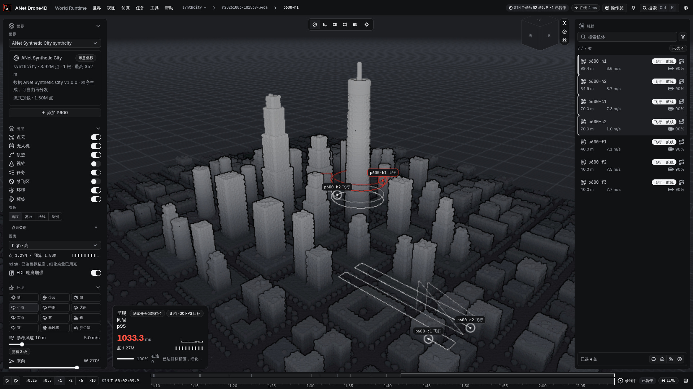
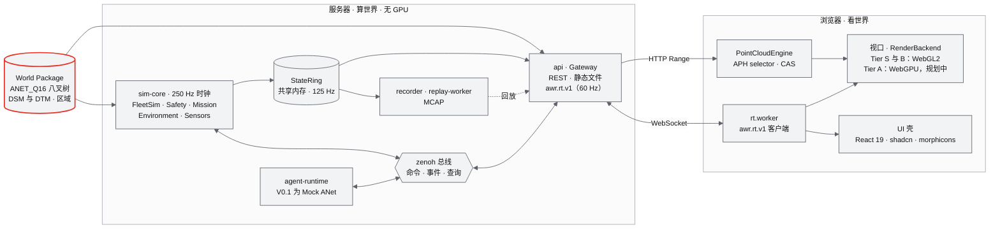

<div align="center">


<h3>从真实世界，到无人机集群。</h3>

面向自主多智能体无人机的真实世界 4D World Runtime。<br/>
将城市级点云流式传输至任意浏览器，使至多 1,000 架仿真机群在同一服务器时钟下穿越风雨，并通过 <a href="https://github.com/ANetResearch/ANet">ANet</a> 相互发现能力、委派任务。<br/>
每位访客均可开启独立沙盒，配置识别物、机巢与任务，并通过浏览器或开放接口操作。<br/>
服务器无需 GPU。

[](LICENSE)
[](https://github.com/ANetResearch/ANet-Drone4D/actions/workflows/ci.yml)
[](https://drone4d.agentnetwork.org.cn)
[](#d2-验收)
[](pyproject.toml)
[](apps/web/package.json)
[](apps/web/package.json)
[](https://threejs.org)
[](#工作原理)
[](#快速开始)
[](#文档)
[](https://github.com/ANetResearch/ANet)

[在线演示](https://drone4d.agentnetwork.org.cn) · [快速开始](#快速开始) · [核心特性](#核心特性) · [开放接口](#开放接口与-python-sdk) · [验收结果](#d2-验收) · [工作原理](#工作原理) · [版本路线](#版本路线) · [文档](#文档) · [ANet](https://github.com/ANetResearch/ANet)

[English](README.md) · **简体中文**

</div>

<br/>



<sub>**V0.1（D1）版本的真实截图**，不是概念图。城市是**合成演示城市 ANet Synthetic City**：由 `make demo-world` 约 25 s 程序生成，不对应任何真实地点，也不含任何第三方数据；运行的是剧本 S0：两架 P600 绕 318 m 的 ANet Tower 螺旋扫描（红色轨迹），另两架覆盖城市街区。截图来自一台没有 GPU 的 8 核机器（SwiftShader 软件渲染），点预算由测试开关锁定为 150 万点（HUD 上的徽标）；HUD 显示的是这台机器的帧间隔，约 1 s。</sub>


<sub>**动图，同一版本、同一城市。** 剧本 S0 中的 10 秒，每帧约 85 万点，在同一台无 GPU 机器上逐帧步进渲染（每帧 0.1 s 仿真时间），以两倍实时速度播放。</sub>

---

## 在线体验

**[drone4d.agentnetwork.org.cn](https://drone4d.agentnetwork.org.cn)** 是当前发布版本 V0.2-demo（构建 0.2.0）的公开实例，无需安装，也无需登录。落地页提供两个入口：**进入演示**打开 `/world/synthcity` 的共享展示，**开启我的沙盒**启动一个独立的仿真。

- **共享展示。** 只读会话，持续运行剧本 S7：在 ANet Synthetic City 上执行区域值守，发现识别物后转入 7×24 接力监控，仿真日历与北京时间同步。访客可以切换相机、跟随与选中无人机，打开 FPV 与日视、夜视、热像传感器视图，查看识别物、接力统计、机型目录与 GSD 计算器。观看不占用沙盒槽位。
- **我的沙盒。** 每位访客可开启一个隔离沙盒，拥有独立的仿真进程：选择七个世界之一与场景模板（T1 至 T6），然后放置无人机、识别物与机巢，下发任务，接管手动控制并切换传感器视图。沙盒初始时长 30 min，可续期至 120 min；有访客排队时暂停续期。
- **容量与排队。** 沙盒槽位与实时观看席位均设上限；满员时访客进入队列，并可看到排队位次与预计等待时间，落地页与启动屏显示当前容量。无交互一段时间后（观看 5 min，沙盒 10 min），页面进入节能模式：观看者释放席位，沙盒保存到磁盘，并在下一次交互时恢复。
- **七个世界。** ANet Synthetic City 与 UrbanScene3D 六城，后者经数据集权利方授权使用（见[数据与引用](#数据与引用)）。
- **设备。** 桌面浏览器提供完整界面；平板采用横屏指挥器布局，支持触控手势与虚拟摇杆；手机采用五标签布局与快捷指令。
- **开放接口。** [`/sandbox/api`](https://drone4d.agentnetwork.org.cn/sandbox/api) 列出全部沙盒操作，[Python SDK](#开放接口与-python-sdk) 调用同一套接口。
- **在哪里渲染。** 服务器是一台没有 GPU 的 4 核机器，负责物理、安全、任务、感知与环境；点云、天气与界面在访客浏览器中渲染，画质与帧率取决于设备 GPU。
- **不提供的功能。** 公开实例不提供 GPU 重建、录制与回放、智能体运行时等服务端重计算功能。

部署套件见 [tools/deploy/emax/](tools/deploy/emax/)，部署拓扑见 [docs/19 §3.7](docs/19-部署与运维说明书.md)。

## 为什么是 ANet-Drone4D

无人机仿真器通常从飞行器出发，再给它配一张手工搭建的地图；数字孪生通常能展示一个地方，却不能在里面飞任何东西。ANet-Drone4D 从地方出发：采集或重建得到的点云成为一个带版本的 **World**，环境场、无人机机群和它们的智能体都运行在这个 World 上、共用同一个时钟，浏览器则可以在任何地方观看。整条链路是 **Reality → Reconstruction → World → Environment → Simulation → Agent**。所谓"4D"，是三维空间加上时间：无人机、天气与时间轴共用一个仿真时钟，任何时刻都可以暂停、单步、录制和回放。

- **World 是核心，而不是 Drone。** 采集、重建与仿真都汇入同一个带版本的 World Package：供物理与查询使用的几何、供眼睛看的点云、语义与禁飞区，并锚定在真实地点上。目前由内置仿真器读取；PX4 SIH、Gazebo 与 Isaac 后端将来读取同一个 World。
- **浏览器看世界，服务器算世界。** 物理、安全、规划与环境都运行在没有 GPU 的无头 Linux 服务器上。浏览器只负责流式加载与绘制，因此一台笔记本经 SSH 隧道即可访问。
- **城市级点云，像视频一样流式加载。** 一座五百万点的城市只需几次 HTTP Range 请求即可打开，然后渐进补全。闭环控制器用点的疏密换帧时间，同一个世界既能在软件渲染器上运行，也能在桌面 GPU 上运行。
- **环境是一个 4D 场。** 风、湍流、能见度、雨、雪、雾与沙尘构成同一个场 E(x, y, z, t)。同一组数字既经相对空速作用于机体，也用来绘制天空。
- **无人机是 Physical Agent。** 每架无人机公布自己能做什么；其他智能体发现它、向它询价并委派任务。ANet 是协作平面，而不是控制平面：每一条飞行命令仍要通过仿真器的准入与安全检查。

## 核心特性

> [!NOTE]
> 特性开头如有插图，均为为 README 制作的概念图，由图像模型生成并按 ANet Graphite 色卡调色。图注标有**截图**的图片是 V0.1（D1）版本在合成演示城市 ANet Synthetic City 中的真实截图（见[快速开始](#快速开始)）。

### Reality → World


`worldpkg` 把原始点云规范化（单位、上方向、调平、北向、原点、法线、地面模型、离地高度、分类），写成 **World Package v1**：与 Potree 2.0 兼容的八叉树加 12 字节的 ANET_Q16 点编码、DSM 与 DTM 栅格、语义与区域。六座内置城市（深圳、上海、纽约、旧金山、苏州、芝加哥，各约 500 万点）在 CPU 上单城构建 27 到 35 s，`validate --deep` 零错误。第七个世界 ANet Synthetic City 由固定种子程序生成（1.2 km × 1.2 km、约 390 万点、不含第三方数据），走同一条流水线，约 25 s 构建完成；本页所有截图都来自这座城市。重建接口（Engine Adapter v2、Recon IR、任务状态机）已经用 Mock 引擎端到端跑通，产出的 World 可以直接在浏览器中加载；GPU 重建引擎在 V0.5 接入。

### 城市级点云流式加载


首屏层级按每个八叉树根一次 Range 请求取回，其余部分在 Web Worker 中流式加载。**APH 选择器**在两级点预算下按 best-first 挑选八叉树节点，**CAS 控制器**根据实测帧时间调节预算，并在 7 档画质阶梯（soft-min 到 ultra）之间换档，让点的疏密跟随视角与设备变化。所有点来自按页分配的 GPU 点池，一次 draw call 画完；画质变化时画布尺寸始终不变。产品选择器在三座城市、五档预算下与研究原型逐帧一致。


<sub>**截图。** 相机跳到近景后，先画已驻留的粗层节点（72.4 万点，已加载 52%），再在点预算内逐步细化（104 万点，65%），直到视图完整（150 万点，等于预算）。数字取自 HUD；Tier B、锁定 150 万点预算、软件渲染。</sub>

### 环境是一个 4D 场


EnvironmentService 计算风（高度廓线加湍流盒）、能见度与降水，提供从晴到沙尘暴共 12 个天气预设。物理以 50 Hz 在 Python 中读取这个场，风经相对空速作用于每架机体。浏览器用 TypeScript 计算同一套公式，风场还在 GPU 上用 TSL 计算，用来绘制雨、雪、沙尘、雾、云与风箭头。两端由 golden 测试约束（10,261 例），GPU 风场与 CPU 参考值的偏差在 0.01·v_max + 0.02 m/s 以内。


<sub>**截图。** 同一视角下剧本 S0 从小雨转为雾：能见度 6.0 km，40 s 过渡进行到一半时为 690 m，最后为 150 m。</sub>

### 多机同钟


**FleetSim** 把所有无人机放在一个 SoA（数组结构）里，在共享的 250 Hz 时钟上推进：PX4 风格的位置与姿态级联（L1，125 Hz）由 numba 编译，与 numpy 参考实现逐位一致，并与 PX4 SIH 飞行记录对照。它支持 1 到 1,000 架、两种机型：x500 与 P600 数字孪生（P600 参数在 V0.4 辨识之前为占位值）；1,000 架时用约半个 CPU 核保持实时（[D1 验收](#d1-验收)）。安全逻辑运行在同一个循环里：14 态 Flight FSM、地理围栏、能量感知返航、机间间距守护与链路丢失策略。任务来自 8 种生成器，从螺旋立面扫描到编队与区域覆盖。

<table>
<tr>
<td width="50%"></td>
<td width="50%"></td>
</tr>
</table>

<sub>**截图。** 左：V 形编队在河道东端掉头（长机轨迹为红色），一架覆盖机在两个街区上空按割草机航线飞行。右：Third 视角跟随编队长机，长机走低延迟焦点通道（左上角徽标）。</sub>

### 无人机即智能体


每架无人机带着自己的能力加入智能体网络。在 S3 搜救剧本中，一架相机无人机发现疑似目标，通过能力发现找到热成像无人机，收集由仿真器自身估价器给出的报价，把确认任务委派给最合适的一架；结果依据回执与验收谓词（TSIR，来自 ANetCore）核验。V0.1 在进程内 Mock ANet 上运行这一流程；S3 已在真实多进程（sim-core、api 与 agent-runtime）下端到端通过，×1 与 ×10 下决策一致。真 ANet 在 V1.0 接入。

### 交互式沙盒（V0.2-demo）

每个沙盒是一个隔离会话，拥有独立的 sim-core（sandbox100 时钟档），由 **sandbox-pool** 监管、**sandbox-api** 提供服务；D1 的共享展示在旁原样运行。单个会话至多容纳 12 架无人机、30 个识别物与 4 个机巢，从每个世界的场景模板起步（T1 定点巡航至 T6 手动飞行与传感器视图），并可将配置导出为快照、从快照恢复或切换到其他世界。准入遵循容量模型：并发沙盒数按实测会话成本计算（硬上限 6），超出部分在长轮询队列中等待，申请的仿真倍速只在 CPU 预算内授予。手动控制可通过键盘或虚拟摇杆接管单机，软围栏在无人机进入敏感范围之前对其限速。

### 识别物与感知量化

识别物分为人、无人机、机器、狗、车与物六类，具有尺寸、运动、外观、反射率、热特征、雷达截面与周期声源等属性。每个识别物带有视觉与声学敏感范围：缺省的几何判据下，无人机进入配置的敏感范围并驻留即被发现；另可选用基于信号余量的物理判据。感知以 Johnson 准则与 TTPF 统一检测、识别、确认三级，覆盖光电、夜视（近红外与 850 nm 照明器）、热像、MID-360、毫米波雷达与声阵列；成像传感器在所需等级下以 P ≥ 0.9 持续 1 s 即为明确捕获。对每一组识别物与无人机，感知读数给出到达声压、阈值与余量、角尺寸、等效像素、对比度，以及各模态与合成的显示用概率。

### 机巢、任务编排与 7×24 接力监控

机巢（机巢箱、发射回收站与垂起起降台）容纳无人机、电池与充电通道，支持换电或充电。六类任务（定点巡航、多点巡线、多机协同巡查、按 GSD 完整扫描、巡边与接力监控）与组合任务区域值守被分解为工作项，由贪心分配器在能力与能量约束下分配给各机巢与机型；Allocator 接口为模型、LLM 与智能体分配器预留。GSD 扫描按所需地面采样距离反推航高与条带宽度，剔除障碍格并补洞；单个架次或单一远距视点无法覆盖区域时自动派出多机。接力监控在敏感范围之外的站位上持续观测识别物：查询可行窗口表，依据昼夜预报提前派遣接替，并计入电池与充电通道的吞吐；dry-run 给出配置能否 7×24 持续运行及其瓶颈资源。

### 开放接口与 Python SDK

沙盒以 `/api/sandbox/v1` 提供 REST v1，并沿用 `awr.rt.v1` 实时协议。界面与接口同权，每条命令都经过相同的准入与安全检查。OpenAPI 3.1 文档位于 `/api/sandbox/v1/openapi.json`，并在 [`/sandbox/api`](https://drone4d.agentnetwork.org.cn/sandbox/api) 页面渲染，附可复制的示例。单文件 Python SDK [`tools/sdk/awr_sandbox.py`](tools/sdk/awr_sandbox.py)（Python 3.9 至 3.13；依赖 httpx、websockets 与 msgpack）处理排队、工作量证明、续期、节能后的恢复与二进制帧解码：

```sh
pip install "httpx>=0.24" "websockets>=12" "msgpack>=1.0"
curl -O https://drone4d.agentnetwork.org.cn/sdk/awr_sandbox.py
```

```python
from awr_sandbox import Sandbox

sb = Sandbox("https://drone4d.agentnetwork.org.cn")
with sb.create("synthcity", "t5_area_guard") as s:   # 满员时自动排队；需要时自动求解工作量证明
    print(s.state()["state"])
    s.clock("speed", rate=5)                          # 受限时返回授予值
    for msg in s.stream(["sandbox/session"], seconds=3):
        print(msg.topic, msg.data)
```

[tools/sdk/examples/](tools/sdk/examples/) 中的示例涵盖手动速度控制、传感器、识别物与捕获、GSD 扫描 dry-run 与外部分配器；全部调用见 [tools/sdk/README.md](tools/sdk/README.md)。

### 机型目录、固定翼与垂起

机型目录包含 MID-360 配置的 P600 数字孪生（profile v2）与四个通用模拟参考机型：两款四旋翼（AWR-Q1、AWR-Q9）、一款长航时固定翼（AWR-F1）与一款垂起固定翼（AWR-V1）。预置型号只读，可在会话内克隆并在校验范围内编辑。固定翼采用协调转弯运动学与能量模型，盘旋半径计入风；垂起机型包含过渡与悬停上限。所有参考值均为仿真参数，不代表任何真实产品的规格。

### 启动、容量与多端适配（D2.1）

启动屏在任何应用脚本执行之前显示版本行（`V<版本>-<通道> · <提交> · <日期>`），同时显示五段进度条，以及当前的实时观看、沙盒容量与排队情况。并发按沙盒槽位与实时观看席位分别计数，各有独立队列。无交互的页面进入节能模式，关闭实时连接并静态渲染最后状态；无交互的沙盒将 checkpoint 落盘并释放槽位。手机与平板布局、触控手势、移动画质档与 PWA 全屏将沙盒扩展到移动设备。场视图（声学、视觉、热与雷达）把每架无人机的辐射场绘制为带等值壳的球形散点场，选中识别物周围的感知体则显示无人机在何处会被听到或看到。

### 其他能力

- **时间是一根轴。** 暂停、单步，倍速 ×0.25 到 ×10；录制与回放（MCAP），回放帧与录制逐字节一致；可以依据输入日志确定性地重新仿真。
- **任务与集群。** 螺旋扫描、环绕、扩展方形、走廊、地形跟随、割草机式、编队与沿路径飞行等生成器；基于高度图的安全转场、2.5D A*、CAPT 编队分配、区域覆盖，以及起飞前的能量预检。
- **World 上的几何查询。** 高度、AGL、净空、视线、射线求交与路径校验，安全、规划和"点地面即 GoTo"交互都用它。
- **传感器。** 云台与相机视锥、GNSS 与 IMU 噪声模型、Mock 检测器与热成像帧。
- **剧本。** S0 ANet Synthetic City 全景展示（无需下载）、S1 深圳立面巡检、S2 上海编队、S3 纽约搜救（智能体协作）、S4 芝加哥湖岸、S5 旧金山地形跟随、S6 苏州走廊，以及 10 到 1,000 架的机群阶梯和 soak 长跑。
- **面向远程访问设计。** 服务器只监听回环地址，经 SSH 隧道访问；viewer、operator、admin 三种角色，只有一个操作席位。局域网模式与反向代理之后的只读公开模式（[在线演示](#在线体验)所用）需要显式开启。
- **契约优先。** 75 份 JSON Schema 生成 Python 与 TypeScript 类型，golden 文件让两端保持一致。所有进程由带心跳、退避与熔断的 supervisor 管理。

## D2 验收

V0.2-demo（D2 与 D2.1）按 55 项验收：[docs/04](docs/04-D2-设计增补与决策记录.md) §13 与 §15.14 中的 D2-AC-01 至 D2-AC-55，其中 P0 50 项、P1 5 项。第 1 轮（2026-10-11 至 10-12）测量全部 55 项；D2-FX-R2 修复后，第 2 轮（2026-10-12 至 10-13，构建 0.2.0）复测第 1 轮未通过与未测的 18 项，其余项以全量回归覆盖：

| 项目 | 通过 | 不通过 | 未测 |
|---|---|---|---|
| P0（50 项） | **41** | 9 | 0 |
| P1（5 项） | **3** | 0 | 2 |
| **合计（55 项）** | **44** | **9** | **2** |

第 2 轮按原口径完成 24 h 浸泡（D2-AC-39）：S7 接力与 24 个观看端连续运行 24.5 h，无非预期重启、无内存溢出，sim-core 内存增长 0.48 MB/h，04:00 日切按时触发。修复后的首帧时间较 D1 缩短 64%，单会话仿真成本由 0.46 核降至 0.22 核，固定翼风场与巡查巡边并行缺陷消除，驻留恢复后任务与接力状态逐字段一致。

V0.2-demo 以已知问题的形式发布，其余 9 项归结为三个根因：

1. **公开站沙盒容量。** 4 个满载会话时沙盒 CPU 组达到 1.36 核上限，单会话实时因子降至约 0.58，新建会话就绪时间超过 6 s（D2-AC-02、04、07、08、55）。公开站将并发沙盒会话上限设为 2，其余访客排队。
2. **白天接力间隙。** 随机游走目标短暂脱离在岗机视线，24 h 批处理出现若干短时监视间隙（D2-AC-19、20、35）。
3. **软件渲染帧节奏。** 无硬件 GPU 时合成城市默认视角帧时间中位数为 50 ms（D2-AC-30）。

D2-AC-27（公开站 72 h 与 7 天观测）与 D2-AC-46（节能节省的公开站实测）在本次部署后测量。

> [!NOTE]
> **测试口径。** 与 D1 相同的一台没有 GPU 的 8 核虚拟机，执行 ADR-033 的性能运行协议；公开站的资源以 cgroup 模拟（CPUQuota 250%、MemoryMax 2 GiB、4 个核）。逐项结果、证据与诊断见 [D2 验收报告（第 2 轮）](docs/impl/D2-验收报告-第2轮.md) 与 [第 1 轮](docs/impl/D2-验收报告-第1轮.md)。

## D1 验收

V0.1（D1）按 38 项验收：[docs/03 §8.4](docs/03-设计基线与决策记录.md) 中的 D1-AC-01 至 D1-AC-35（03、09、11 各分为 a、b）。每项为 P0（阻塞发布）或 P1，或同时含两者的子项。第 6 轮验收（2026-10-03 至 10-04）复测了 8 项，其余 30 项沿用此前各轮的结果：

| 项目 | 通过 | 不通过 |
|---|---|---|
| 含 P0 子项（25 项） | **24** | 1（只是其中的 P1 子项不通过） |
| 只含 P1（13 项） | **12** | 1 |
| **合计（38 项）** | **36** | **2** |

按 P0 子项计，25 项全部通过：唯一不通过的含 P0 项 D1-AC-27 只是 P1 子项不通过，因此 **D1 退出标准的第一项（P0 全部通过）已满足**。docs/03 §8.1 发布门禁的其余条件尚未全部满足：还有两个暂定阈值待冻结，每个未通过的 P1 项都要修复或登记豁免（见[未通过项](#未通过项)）。通过项从第 1 轮的 13 项依次增加到 22、24、31、35 项，本轮为 36 项。第 5 轮发现的两条 P0 回归（纽约一帧 383 ms 的间隔、对 1,000 架全机下发 RTL 时的 1 次长帧）已由 [ADR-081](docs/03-设计基线与决策记录.md)（Toast 布局后投递）修复。逐项结果、证据与诊断见 [D1 验收报告（第 6 轮）](docs/impl/D1-验收报告-第6轮.md)。

> [!NOTE]
> **测试口径。** 一台 8 核 x86-64 虚拟机（Xeon E5-2603 v4，1.7 GHz），**没有 GPU**。浏览器用例运行在 headless Chromium 151 + **SwiftShader** 上，即软件 WebGL2：Tier S 路径，1280 × 720 画布、0.5 渲染比例、目标 30 fps，所以 p50 33.3 ms 就是达标。所有性能用例执行 ADR-033 的性能运行协议：排他锁、每次运行前 1 分钟负载不超过 4、CPU 分区钉核、3 次取中位。下表的帧时间阈值是这类机器上的 Tier S 阈值。真 GPU 的阈值（集显：p50 等于显示刷新周期、掉帧不超过 5%、TTFP ≤ 700 ms；独显：掉帧不超过 2%、TTFP ≤ 500 ms）是 docs/03 §8.4 的设计值，本机没有测量，也不阻塞 D1。

| 方面 | 结果（3 次中位） | 阈值 | 编号 |
|---|---|---|---|
| World 构建 | 六城 `validate --deep` 零错误；单城 26.9 到 31.5 s，仅用 CPU | 零错误；单城 ≤ 60 s | 01 |
| 首屏 | 六城 TTFP 1.4 到 4.4 ms（最后一个首屏字节到达至首屏完整的那一帧，扣除 shader 预热等待）；切换世界 328 ms；冷启动到可交互 3.49 到 3.80 s（纯点云）。带 UI 与 S1 的整景冷启动 17.7 s（只记录，无阈值） | TTFP ≤ 1.0 s；切换 ≤ 1.5 s；冷启动 ≤ 4.0 s | 02 |
| 帧节奏（纯点云） | 深圳 p50 33.3 / p95 50.0 / p99 66.7 ms，> 50 ms 的帧 1.57%，> 100 ms 的帧为 0，最大 83.3 ms；纽约、上海、苏州相近，四城最大间隔都是 83.3 ms（纽约第 5 轮为 383 ms） | ≤ 33.4 / 50 / 100 ms；≤ 5%；≤ 0.5%；最大 ≤ 250 ms | 03a |
| 帧节奏（默认整景：深圳、S1、环境、HUD、机群列表） | p50 33.3 / p95 50.0 / p99 66.7 ms；> 50 ms 2.56%，> 100 ms 0.060%；最大 116.7 ms；固定层 5.96 ms | ≤ 33.4 / 66.7 / 116.7 ms；≤ 10%；≤ 1%；最大 ≤ 250 ms；固定层 ≤ 10 ms | 03b |
| 同上，200 架 | p99 66.7 ms；> 50 ms 3.98%，> 100 ms 0.25%；最大 150 ms | 同 03b | 09a |
| 疏密控制（CAS） | 揭开后 47.8 ms 进入目标带；60 s 内换档 0 次；预算反向 6.2 次/分钟；页面隐藏期间不评估 | ≤ 2 s；≤ 2；≤ 15 次/分钟 | 04 |
| 流式加载 | 失败节点 0；节点选择 p95 ≤ 0.095 ms；CPU 缓存 ≤ 2.52 MB；我方脚本长帧 0；没有重复下载 | 0；≤ 0.5 ms；≤ 64 MB；0；≤ 1.3 | 06 |
| 无运行期编译 | 揭开后 shader program 不增加；首次操作（切换天气、选中、跟随、近景、拾取）后 1 s 内最大帧间隔 133 ms | 0；≤ 150 ms | 25 |
| 天气切换（晴到雷雨，30 s 过渡） | > 100 ms 的帧 0.126%；program 不增加 | ≤ 0.5% | 19 |
| 时延 | 焦点机仿真时刻到像素 p95 62.0 ms；命令到可见 p95 142 ms | ≤ 150 ms；渲染延迟（约 206 ms）+ 150 ms | 26 |
| FleetSim，1,000 架 | 实时因子 1.000，占 0.529 个核；单步 p99 2.69 ms、最大 2.99 ms；追帧饱和 0 | ≥ 0.99；≤ 0.6 核；p99 ≤ 3 ms、最大 ≤ 12 ms | 07 |
| 网关，1,000 架加 3 个流式浏览器 | tick 数据年龄 p99 10.6 ms；api 0.149 个核（记录值） | ≤ 15 ms；≤ 0.35 核 | 08 |
| 命令与事件 | 50 条命令/s 持续 60 s：失败 0，准入往返 p99 5.90 ms；约 666 条事件/s，乱序 0、没有未补齐的缺口；每 100 条消息人为丢 1 条时，591 个缺口全部在 69 ms 内经 replay 补齐 | 0、≤ 25 ms；0；≤ 1 s | 10 |
| 事件风暴：对 1,000 架全机下发 RTL（P0 子项） | 我方脚本长帧 0；控制面 FIFO 峰值 12；Toast 2 条；sim-core 单步最大 5.97 ms | 0；< 256；≤ 3；≤ 12 ms | 27 |
| 崩溃恢复 | kill -9 api：仿真不中断，客户端 3 s 内重连；kill -9 sim-core：3 s 内回到 RUNNING（功能剖析中为 2.1 s），剧本重开；有 checkpoint 时，sim-core 崩溃后新 epoch 首帧 ≤ 1.5 s，主循环挂死 2.5 s 内检出、4 s 内恢复 | 见结果列 | 11a、11b |
| 30 分钟长稳（S1 加 200 架） | 保留 JS 堆 +3.0%；RSS api +0.5%、sim-core +0.2%；非预期重连 0；结束后帧节奏仍满足 03b | 堆 ≤ 20%；RSS ≤ 10%；0 | 29 |
| 剧本 | S1 双机立面扫描在 ×1 与 ×10 下能量返航都为 0 次；S2、S4、S5、S6 成功；S3 在 300 s 仿真时间内确认目标，×1 与 ×10 决策一致 | 各剧本的成功谓词 | 15、16、17 |

### 未通过项

两项都是 P1，不影响 P0 一项的结论，但发布门禁仍要求每一项修复或登记豁免。

1. **D1-AC-27（P1 子项）500 架链路丢失：sim-core 单步最大 16.5 ms，阈值 12 ms**（3 次为 21.95、16.54、8.13 ms；第 5 轮为 7.81 ms，通过）。第 1 次运行的 500 条故障注入中有 1 条在总线重试后仍超时（503）。同协议补充 3 次为 6.55、34.68、7.98 ms，500 条全部受理，即 6 次中有 3 次超过 12 ms：这一子项在本机处于余量边缘。诊断发现故障请求与回复路径有长尾；plan-pool 工作进程启动时短暂占用仿真核是嫌疑之一。P0 子项（对 1,000 架全机下发 RTL）通过。
2. **D1-AC-28（P1）全并发下的 sim-core：单步 p99 3.89 ms，阈值 3 ms**。条件是 1,000 架、recorder、checkpoint 与 3 个 SwiftShader 浏览器共用 8 个核（最大 4.92 ms，追帧饱和 0，tick 数据年龄 p99 10.1 ms；沿用第 5 轮）。[ADR-074](docs/03-设计基线与决策记录.md) 把它列为本机已知问题。

两项的豁免都尚未登记，所以都记为不通过。

沿用的 30 项中，有 13 项因 Toast 修复或公开演示改动了相关代码、或近几轮没有覆盖而应复测：画质（05）、网关（08）、1,000 架帧节奏（09b）、命令与事件（10）、进程与 checkpoint 恢复（11a、11b）、剧本 S1（15）、回放与 seek（18）、UI 开销（23）、画布尺寸（24）、GC（30）、交互（32）与 walking skeleton（34）。另有两项通过但仍有子项未完成：UI 中的重建进度（22）与真实 `ssh -L` 客户端的检查（33）。产品的 Tier A（WebGPU）后端尚未交付；WebGPU 功能矩阵已在回归页上通过（14，P1）。第 6 轮还对公开演示构建做了功能冒烟（落地页、只读沙盘、写入被拒）；[在线演示](#在线体验)在访客 GPU 上的表现无法在本机测量。测试套件中不需要数据的部分（lint、契约、tsc、Vitest unit、分两路的 pytest、生产构建与演示世界）在每次 push 与 PR 时由 [GitHub Actions](.github/workflows/ci.yml) 运行；完整门禁 `make ci` 在有六城数据与浏览器的本机上运行。

## 快速开始

**环境要求：** Linux x86-64（Ubuntu 22.04 或 24.04）、Python 3.12、Node 22.12（`.nvmrc`）、make 与 git，约 20 GB 磁盘，`/dev/shm` 至少 1 GiB 空闲。服务器不需要 GPU。任何支持 WebGL2 的桌面浏览器都能连接；观看端有 GPU 时可以用到更高的画质档。

**无需下载数据即可运行。** `make demo-world` 按固定种子生成合成演示城市 ANet Synthetic City，不下载任何数据：

```sh
git clone https://github.com/ANetResearch/ANet-Drone4D.git
cd ANet-Drone4D
make setup        # 锁定安装：.venv（uv pip sync）与 npm ci，再做生成物校验（3-8 min）
make demo-world   # 生成 ANet Synthetic City，写入 worlds/synthcity（无需下载，约 25 s）
make run          # 需要时先做生产构建，再启动 supervisor；打印 READY 与 SSH 转发命令
```

打开 **http://localhost:8000/world/synthcity**。本机没有 UrbanScene3D 数据时，synthcity 就是默认世界，并启动剧本 S0：七架 P600 分上下两段螺旋扫描 318 m 的 ANet Tower、两机覆盖两个街区、三机以 V 形编队沿河巡航，天气从晴转小雨再转雾（约 5 分钟仿真时间）。按 Ctrl+C 或执行 `make stop` 停止。

ANet Synthetic City 由 `python/awr/world/ingest/synthetic.py` 生成：1.2 km × 1.2 km、约 390 万点，含道路、河道、公园与两座 300 m 级塔楼。它不含任何第三方数据，世界包、截图与录屏都可以自由分享。没有数据时单独执行 `make run` 也会自动生成它。已有六城数据的机器上默认世界仍是深圳，要运行演示城市请用 `AWR_WORLD=synthcity AWR_SCENARIO=s0-synthcity-showcase make run`。

**加入六座真实城市（可选）。** 内置的六座城市世界（深圳、上海、纽约、旧金山、苏州、芝加哥）在本机由 UrbanScene3D 数据集构建，需要下载数据并接受其条款：

```sh
make fetch-data   # UrbanScene3D 六城采样点云：下载 253 MB，解压约 720 MB，逐个校验 sha256
make worlds       # 在本机把六城构建为 World Package，写入 worlds/（永不入库），约 1-2.5 min
make run          # 默认世界变为深圳，剧本为 S1
```

打开 **http://localhost:8000/world/shenzhen**。demo profile 加载深圳与 S1 剧本：两架 P600 在 6 m/s 的东南风中沿最高塔楼的立面螺旋下降。

> [!IMPORTANT]
> **UrbanScene3D** 的作者只允许**非商业使用**，并禁止再分发原始数据或其任何改动版本。本仓库既不包含该数据的点，也不包含由其生成的 World Package、栅格或录制。`make fetch-data` 代为从作者的发布页下载，请先阅读并接受其条款，见[数据与引用](#数据与引用)。

**从另一台机器访问。** 服务器只监听 127.0.0.1；转发端口后在本地打开同一个地址：

```sh
ssh -N -L 8000:127.0.0.1:8000 -o ExitOnForwardFailure=yes -o Compression=no <user>@<server>
```

局域网演示时，`AWR_BIND=0.0.0.0 AWR_ORIGINS=http://<server-ip>:8000 make run` 会把端口开放到网络。

**在本机运行沙盒。** `AWR_PROFILE=sandbox make run` 启动包含沙盒控制面的完整服务（sandbox-pool 与 sandbox-api，即 [configs/runtime.yaml](configs/runtime.yaml) 中的 `sandbox` profile）。沙盒接口随后监听 `http://127.0.0.1:8002`，即 SDK 示例的缺省地址。

<details>
<summary><b>更多命令</b></summary>

<br/>

| 命令 | 作用 |
|---|---|
| `make dev` | 开发启动：Vite 在 :5173，支持热更新（profile dev） |
| `make demo` | 演示前检查、打印演示提示卡，然后以深圳与 S1 执行 `make run` |
| `make status` | 进程、1 Hz 指标、活动告警与容量 |
| `make logs P=sim-core` | 查看某个进程的日志（`F=1` 持续跟随） |
| `make stop` | 停止当前运行 |
| `make doctor` | 环境诊断（`DEEP=1` 加做 sha256 与世界深度校验） |
| `make validate` | 深度校验全部 World Package |
| `make fetch-data VERIFY=1` | 只按 `configs/data.yaml` 校验本地数据，不下载 |
| `make demo-world` | 生成或刷新合成演示城市 `synthcity`（无需下载，约 25 s） |
| `make vehicles-models` | 构建 P600 的 glTF 模型（缺少 Prometheus STL 时退回程序生成的低模） |
| `make ci` | 合并门禁：lint、契约检查、tsc、生产构建、pytest 与 Vitest |
| `make ci-nodata` | GitHub Actions 在每次 push 与 PR 上运行的内容：`make ci` 中不需要 GPU、浏览器与下载数据的子集 |
| `make perf CASE=<id>` | 持排他性能锁运行性能用例（[docs/18](docs/18-性能与测试方案.md)） |

完整的运行手册、端口、环境变量与故障处理见 [docs/19](docs/19-部署与运维说明书.md)。

</details>

## 工作原理



1. **打开。** `/world/shenzhen` 加载世界清单与八叉树层级；每个八叉树根一次 Range 请求取回首屏层级，Web Worker 把 ANET_Q16 点解包进 GPU 点池。
2. **流式。** 每一帧由 APH 选择器在点预算内挑选节点；CAS 根据实测帧时间调整预算与画质档。
3. **仿真。** sim-core 以 4 ms 为一个 tick，用一个 numba 核推进全部无人机（L1 每两个 tick 执行一次），把安全、任务、环境与传感器作为已登记的 pipeline stage 运行，并把状态发布到 StateRing。
4. **服务。** Gateway 以 60 Hz 读取环，按每个客户端的兴趣集与 credit 发送二进制数据：整个机群用 Lite32 记录，焦点无人机用 Full64 记录。
5. **绘制。** 浏览器在唯一的渲染时刻上插值，在点云之上绘制无人机、轨迹、区域、视锥与天气。
6. **操作。** 点击地面会在 DSM 上执行一次 `ray_hit` 查询。GoTo 命令通过准入（租约、参数、能力、围栏），依次返回 `accepted`、`running`、`succeeded`。

V0.2-demo 在这条链路旁增加了沙盒层：**sandbox-pool** 负责会话的准入、排队、驻留与回收，治理各会话的仿真倍速，并运行共享规划服务；**sandbox-api** 按会话实例化 Gateway，对外沿用同一套 `awr.rt.v1` 协议。每个沙盒运行自己的 sim-core（sandbox100 时钟档），共享展示保留独立的 CPU 分组；部署时由 nginx 按路径分流，并直接服务世界静态文件。

### 链路的现在与下一步

| 环节 | 含义 | 当前 | 下一步 |
|---|---|---|---|
| **Reality** | 来自真实地点的点云、影像、LiDAR 与 GNSS | UrbanScene3D 六城采样点云（各约 500 万点），以及程序生成的 ANet Synthetic City | Livox MID-360 与 RTK 采集会话（V0.5） |
| **Reconstruction** | 把采集数据变成有尺度的三维 | Engine Adapter v2、Recon IR 与任务状态机，Mock 引擎端到端跑通（CLI） | GPU worker 上的 LingBot-Map、DA3-Streaming 与 MapAnything（V0.5） |
| **World** | 核心资产，带版本 | World Package v1 与几何查询；Web 渐进式流式加载 | COPC 与 3D Tiles 导出（V0.5）；3DGS 视觉层（V0.8） |
| **Environment** | 同一个场 E(x, y, z, t) | L0/L1 风与湍流、12 个预设、风作用为力、Low 档视觉、流线；仿真日历、太阳位置、照度与按波长的消光（V0.2-demo） | L2 风场库（V0.3）；传感器退化（V0.4） |
| **Simulation** | 多机同钟 | FleetSim L1 支持 1 到 1,000 架（1,000 架用约半个核保持实时），安全、任务、录制与回放；每会话独立的沙盒、固定翼与垂起运动学、识别物与感知（V0.2-demo） | PX4 SIH（V0.2）、SITL lockstep（V0.4）、HITL（V0.6） |
| **Agent** | 无人机发现彼此并委派任务 | 进程内 Mock ANet、合同网、S3 剧本；Allocator 接口之后的贪心分配器（V0.2-demo） | 真 ANet：ANetHub 加每机一个 daemon，CBBA（V1.0） |

## 设计体系

Web 沙盘采用 **ANet Graphite** 色卡：科技灰、黑、白，只有一种红，共 13 阶冷灰与 5 阶红（由 ANet logo 红派生）。任何一屏上至多只有一处红色，即需要关注的那一处。`make lint` 强制执行这些规则：禁止 emoji，token 文件之外禁止颜色字面量，禁止背景模糊，禁止混入其他图标包。

| Token | 色值 | 用途（暗色主题） |
|---|---|---|
| `--g950` |  | 应用背景、视口清屏色 |
| `--g900` |  | 面板与 HUD 卡片 |
| `--g800` |  | 次级表面、悬停 |
| `--g600` |  | 轨道、地面网格（不画数据） |
| `--g400` |  | 次要数据、焦点环、未选中轨迹 |
| `--g200` |  | 次要文字、机体主色 |
| `--g50` |  | 文字与主要数据 |
| `--r500` |  | 唯一的品牌红：logo 与那一处红色标记 |
| `--r600` |  | 承载白字的红色实底 |
| `--r400` |  | 暗底上的红色文字 |

| 层 | 采用 |
|---|---|
| 组件 | [shadcn/ui](https://github.com/shadcn-ui/ui) 的 `base-mira` 风格，基于 [Base UI](https://base-ui.com)，离线安装并经 codemod 改造 |
| 动效 | [Transitions.dev](https://transitions.dev) 的时长、缓动与配方 token，分 full、lite、reduced 三个动效档 |
| 图标 | [lucide](https://lucide.dev) 图形，由 [morphicons](https://github.com/guillermolg00/morphicons) 在状态之间形变切换 |
| 图表 | [lieflat](https://github.com/larashero3-dotcom/lieflat-charts) 视觉语言（细线标记、阶梯条、刻度仪表、日志式表格），用 React 重新实现 |
| 字体 | Inter 与 JetBrains Mono，本地托管 |


<sub>**截图。** 用 lieflat 视觉语言实现的性能面板，拍摄于无 GPU 机器以默认设置运行剧本 S0 时：SwiftShader 被判为 Tier S，PerfGovernor 已走完全部七步，点预算降到 1 万点。截图为 1920 × 1080，不在性能运行协议下拍摄，其中的帧时间（p50 133 ms）不是验收结果；验收结果见 [D1 验收](#d1-验收)。</sub>

完整规范（含对比度与 3D 场景配色）见 [docs/15](docs/15-视觉设计规范与色卡.md)。感谢 shadcn/ui、Base UI、Transitions.dev、lucide、morphicons 与 lieflat-charts 的作者；各自的条款见 [THIRD_PARTY_NOTICES.md](THIRD_PARTY_NOTICES.md)。

## 文档

设计文档以中文撰写，技术术语保留英文。建议从[文档地图](docs/README.md)开始，它按角色给出了阅读顺序。

| | |
|---|---|
| **[03 设计基线与决策记录](docs/03-设计基线与决策记录.md)** | D1 基线：原则、架构、路径所有权、85 条 ADR、版本路线、D1 范围与验收（D1-AC-01 至 D1-AC-35） |
| **[04 D2 设计增补与决策记录](docs/04-D2-设计增补与决策记录.md)** · **[20 机型与传感器目录](docs/20-机型与传感器目录.md)** | D2 与 D2.1 基线：多租户沙盒与容量模型、机型目录、识别物、感知、任务编排与接力监控、开放接口、ADR-088 至 ADR-126、验收 D2-AC-01 至 D2-AC-55；机体与传感器参数 |
| **[10 系统架构](docs/10-系统架构说明书.md)** · **[11 技术选型](docs/11-技术选型说明书.md)** | 进程拓扑、数据流、并发与容量；每项技术选型及锁定版本 |
| **[12 业务逻辑](docs/12-业务逻辑设计说明书.md)** · **[13 产品设计 PRD](docs/13-产品设计PRD.md)** · **[14 UI 交互](docs/14-UI交互设计PRD.md)** | 飞行状态、命令准入、租约、安全、剧本与合同网；产品范围；布局与交互 |
| **[15 视觉设计规范与色卡](docs/15-视觉设计规范与色卡.md)** · **[16 World 数据规范](docs/16-World数据规范.md)** · **[17 接口与实时协议](docs/17-接口与实时协议规范.md)** | ANet Graphite token；World Package v1、ANET_Q16 与全部文件格式；REST 与 `awr.rt.v1` 字节布局 |
| **[18 性能与测试方案](docs/18-性能与测试方案.md)** · **[19 部署与运维](docs/19-部署与运维说明书.md)** | 性能预算、flight60、机群阶梯、性能运行协议与 lint 规则；安装、运行、访问与监控 |
| **模块 PRD** | [M01 重建引擎](docs/modules/M01-重建引擎PRD.md) · [M02 LiDAR 融合与地理配准](docs/modules/M02-LiDAR融合与地理配准PRD.md) · [M03 World 模型与切片](docs/modules/M03-World模型与Ingest切片PRD.md) · [M04 几何世界查询](docs/modules/M04-几何世界查询服务PRD.md) · [M05 Web 点云引擎](docs/modules/M05-Web点云引擎PRD.md) · [M06 视口与渲染后端](docs/modules/M06-Web视口与渲染后端PRD.md) · [M07 环境引擎](docs/modules/M07-环境引擎PRD.md) · [M08 仿真内核与飞行器适配](docs/modules/M08-仿真内核与飞行器适配PRD.md) · [M09 安全与健康](docs/modules/M09-安全与健康PRD.md) · [M10 任务、规划与集群](docs/modules/M10-任务规划与集群PRD.md) · [M11 实时网关](docs/modules/M11-实时网关PRD.md) · [M12 时间轴、录制与回放](docs/modules/M12-时间轴录制与回放PRD.md) · [M13 传感器仿真](docs/modules/M13-传感器仿真PRD.md) · [M14 智能体运行时与 ANet](docs/modules/M14-智能体运行时与ANet-PRD.md) · [M15 UI 壳与设计体系](docs/modules/M15-前端UI壳与设计体系组件PRD.md) · [M16 演示数据、剧本与流畅性测试](docs/modules/M16-演示数据剧本与流畅性测试PRD.md) · [M17 沙盒会话与开放接口](docs/modules/M17-沙盒会话与开放接口PRD.md) · [M18 与 M19 识别物与感知](docs/modules/M18-M19-识别物与感知对抗PRD.md) · [M20 任务编排、机巢与接力监控](docs/modules/M20-任务编排机巢与接力监控PRD.md) |
| **[研究笔记](docs/research/00-index.md)** | 支撑各项决策的 46 篇笔记：重建、Web 点云、飞控栈、集群、天气、实时传输、设计体系与 ANet |
| **[实现报告](docs/impl/)** | 各工作包实现了什么、测了什么；从 [D1 交付总结](docs/impl/D1-交付总结.md)开始（实现范围、架构、验收最终情况、已知问题、运行与测试），实测数据见 [D1 验收报告（第 6 轮）](docs/impl/D1-验收报告-第6轮.md)与 [D2 验收报告（第 2 轮）](docs/impl/D2-验收报告-第2轮.md) |
| **[原始设计](docs/01-design.md)** | 项目的原始设计（只读），基线由它派生 |

## 版本路线

先打通一条完整链路，再用 Mock 覆盖所有层，然后在接口不变的前提下逐层换成真实后端（[docs/03](docs/03-设计基线与决策记录.md) §8.1）。V0.2-demo 是与 V0.2 主题并行的演示与开放接口切片，不改变 V0.2 原有的退出标准（[docs/04](docs/04-D2-设计增补与决策记录.md) ADR-088）。

| 版本 | 主题 | 主要内容 | 状态 |
|---|---|---|---|
| **V0.1（D1）** | 所有层就位的 World Runtime | 六城与合成演示城市、点云流式加载、FleetSim 1 到 1,000 架、安全、任务、L0/L1 环境、录制与回放、Mock ANet | **已发布。** P0 子项 25/25 通过，38 项中 36 项通过；剩余 2 个 P1 已知问题（[D1 验收](#d1-验收)） |
| **V0.2-demo（D2）** | 交互式沙盒与开放接口 | 每位访客一个沙盒（含并发上限与排队）、识别物管理与感知量化、机巢与贪心编排、7×24 接力监控、开放接口与 Python SDK、含固定翼与垂起的机型目录、七个世界底图；D2.1：显示版本、进度与排队的启动屏、节能模式、手机与平板布局、声学、视觉、热与雷达感知的场视图 | **已发布**（构建 0.2.0）。第 1 轮：55 项中 37 项通过，退出标准尚未满足（[D2 验收](#d2-验收)） |
| V0.2 | 真实飞控栈进入回路 | 经 MAVSDK 接入 PX4 SIH（至多 8 架）、Prometheus 后端、虚拟 MID-360、任意 PLY 或 LAS 点云 ingest、Python 版 `awr.rt.v1` 客户端 | 规划中 |
| V0.3 | 环境物理化与规划 | L2 质量守恒风场库、GPU 风场采样、环境 High 档、B-spline 与 ESDF 规划 | 规划中 |
| V0.4 | 环境作用于传感器与动力学 | 相机与 LiDAR 退化、L2 气动力矩、PX4 SITL lockstep、倒带与 what-if 分叉、P600 参数辨识 | 规划中 |
| V0.5 | 真实世界融合 | GPU 重建、带 RTK 的采集会话、重定位、经 Prometheus 接入真 P600、COPC 与 3D Tiles 导出 | 规划中 |
| V0.6 | 规模化集群 | 三层互避（4D 预约、ORCA-3D）、带电量约束的覆盖路由、OpenFOAM 风场、HITL | 规划中 |
| V0.8 | Visual World 与高保真传感器 | 3DGS LOD 流式加载与点云同帧、3D Tiles 地形、Isaac 传感器后端、动态物体 | 规划中 |
| V1.0 | Physical Multi-Agent World | 真 ANet（ANetHub 加每机一个 daemon）、断网下的 CBBA、经受信守卫接入 LLM 与 MCP、异构智能体 | 规划中 |

## 与 ANet 的关系


ANet-Drone4D 属于 Agent Network Research 的 ANet 项目家族：[ANet](https://github.com/ANetResearch/ANet)（面向 AI agent 的 A2A 网络）、[ANetHub](https://github.com/ANetResearch/ANetHub)（hub）与 [ANetCore](https://github.com/ANetResearch/ANetCore)（协议内核与密码学）。

在这里，无人机是第一种 **Physical Agent**。它公布自己能做什么，其他智能体发现它、询价并委派任务，结果依据回执与验收谓词核验。ANet 是协作平面，而不是控制平面：一次委派落到仿真器里是一份 AGENT 租约和一组普通命令，与任何操作员的命令一样要经过准入与安全检查。V0.1 在进程内 Mock ANet（agent-runtime）上实现同样的语义；V1.0 改用真 ANet：自建 ANetHub，每架无人机一个 daemon。V0.2-demo 的任务分配位于 Allocator 接口之后，缺省实现为贪心分配器；基于 ANet 合同网的分配器计划在 V1.0 接入。

## 数据与引用

**UrbanScene3D。** 六座内置世界由 [UrbanScene3D](https://vcc.tech/UrbanScene3D)（Lin 等，ECCV 2022）的虚拟城市采样点云在本机生成。其作者只允许非商业使用，禁止再分发数据或其任何改动版本，并要求所有使用它的工作引用原论文。本仓库不包含任何 UrbanScene3D 点数据，也不包含由其生成的 World Package、栅格或录制；`worlds/`、`runs/` 与 `data/raw/` 永不入库。少量测试夹具只保留已构建世界的元数据（八叉树节点计数与包围盒、清单字段、一条测试相机路径），不含任何点数据。`make fetch-data` 从[作者的发布页](https://github.com/Linxius/UrbanScene3D/releases/tag/v0.0.1) 下载 `UrbanScene3D-virtual_cities-sampled.7z`，并按 [configs/data.yaml](configs/data.yaml) 逐个校验 sha256。本项目 LICENSE 中的商用许可不延及该数据集。作者条款原文见 [THIRD_PARTY_NOTICES.md](THIRD_PARTY_NOTICES.md) 第 4 节。

**经数据集权利方授权使用。** ANet-Drone4D 项目已获得 UrbanScene3D 数据集权利方的授权，在本项目自己的部署中使用由六城构建的 World Package：V0.2-demo 起[公开演示站](https://drone4d.agentnetwork.org.cn)与合成城市一并开放六城，部署包附带六城的世界包，本 README 的截图也可以使用六城画面。该授权不经由本仓库或其许可证转授给使用者：仓库仍不包含任何 UrbanScene3D 数据，自行下载时仍须遵守上述作者条款。请继续引用下面的 ECCV 2022 论文。

```bibtex
@inproceedings{UrbanScene3D,
  title     = {Capturing, Reconstructing, and Simulating: the UrbanScene3D Dataset},
  author    = {Liqiang Lin and Yilin Liu and Yue Hu and Xingguang Yan and Ke Xie and Hui Huang},
  booktitle = {ECCV},
  year      = {2022}
}
```

**引用 ANet-Drone4D。** GitHub 的"Cite this repository"读取 [CITATION.cff](CITATION.cff)；BibTeX 如下：

```bibtex
@software{anet_drone4d_2026,
  title   = {ANet-Drone4D: A Real-World Grounded 4D World Runtime for Autonomous Multi-Agent Drones},
  author  = {{Agent Network Research}},
  year    = {2026},
  version = {0.2.0},
  url     = {https://github.com/ANetResearch/ANet-Drone4D}
}
```

<details>
<summary><b>ANet 研究</b></summary>

<br/>

智能体部分建立在 ANet 关于"智能体网络中连接的价值"的研究之上：[ANet Patu-1](https://arxiv.org/abs/2607.15053) 与立场论文 [Agent Network for Open Multi-Agent Collaboration with Shared Cognition](https://www.sciopen.com/article/10.26599/TST.2026.9010062)。

```bibtex
@article{yuan2026patu1,
  title   = {ANet Patu-1: The Value of Connection in the Agent Network},
  author  = {Yuan, Mu and Song, Jinke and Zhou, Zhaomeng and Zhang, Lan},
  journal = {arXiv preprint arXiv:2607.15053},
  year    = {2026}
}

@article{zhang2026agentnetwork,
  title   = {Agent Network for Open Multi-Agent Collaboration with Shared Cognition},
  author  = {Zhang, Lan and Liu, Yunhao},
  journal = {Tsinghua Science and Technology},
  volume  = {31},
  number  = {6},
  pages   = {2611--2629},
  year    = {2026},
  doi     = {10.26599/TST.2026.9010062}
}
```

</details>

## 致谢

ANet-Drone4D 建立在开放的工作之上：视口用 [three.js](https://threejs.org) 与 [React Three Fiber](https://github.com/pmndrs/react-three-fiber)，八叉树容器布局来自 [Potree](https://github.com/potree/potree)，总线用 [zenoh](https://zenoh.io)，机群内核用 [numba](https://numba.pydata.org)，控制级联与 SIH 参考飞行来自 [PX4](https://github.com/PX4/PX4-Autopilot)，P600 机体来自 [Prometheus](https://github.com/amov-lab/Prometheus)，城市来自 UrbanScene3D。所有被包含或改写的内容及其许可都列在 [THIRD_PARTY_NOTICES.md](THIRD_PARTY_NOTICES.md) 中。

## 参与贡献

欢迎以中文或英文提交 issue 与 PR，请先阅读 [CONTRIBUTING.md](CONTRIBUTING.md)。凡是改变契约的改动（文件格式、`awr.rt.v1`、REST API、原因码）先开 issue 讨论；行为先在 `docs/` 中规定再写代码；`make ci` 是合并门禁。特别欢迎来自真实 GPU 的性能报告。安全问题请发到 hi@anet0.com（[SECURITY.md](SECURITY.md)）。

## 许可证

ANet-Drone4D 以 **ANet 开源许可证（ANet-Drone4D）** 发布，它是改版的 Apache License 2.0：

- **允许商用。** World Runtime、World Package 工具与 Web 沙盘可嵌入您的产品，或在自有基础设施上运行。
- **两项附加条件。** 运营面向互不相关的组织或个人的*多租户托管仿真或数字孪生服务*需要书面授权（仅供个人或仅在一个组织内部使用的服务、由大学、学校、公共或非营利科研机构运营或为其运营的免费科研或教学服务、让他人观看自行运行的实例，均不需要授权）；Web 沙盘与 `awr` CLI 中的 ANet 标志和版权信息须保留。
- **数据与第三方部分适用各自条款。** UrbanScene3D 仅限非商业使用且不得再分发（本项目自己的部署经数据集权利方授权使用，见[数据与引用](#数据与引用)）；被包含和改写的组件列在 [THIRD_PARTY_NOTICES.md](THIRD_PARTY_NOTICES.md) 中。

完整条款见 [LICENSE](LICENSE) 与 [NOTICE](NOTICE)。商业授权与问题：hi@anet0.com。

---

<div align="center">

**[从文档地图开始 →](docs/README.md)**

*World 是核心，无人机是它的第一批智能体。*

<br/>

欢迎通过 [GitHub Issues](https://github.com/ANetResearch/ANet-Drone4D/issues) 提出问题与建议，或分享飞行记录。

</div>
