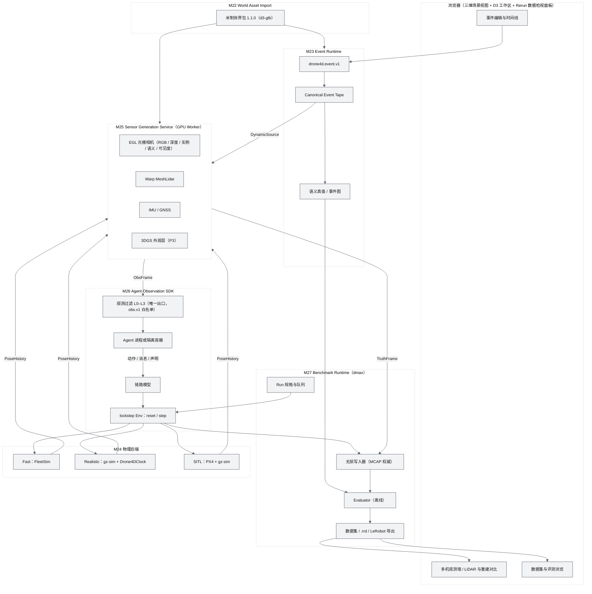
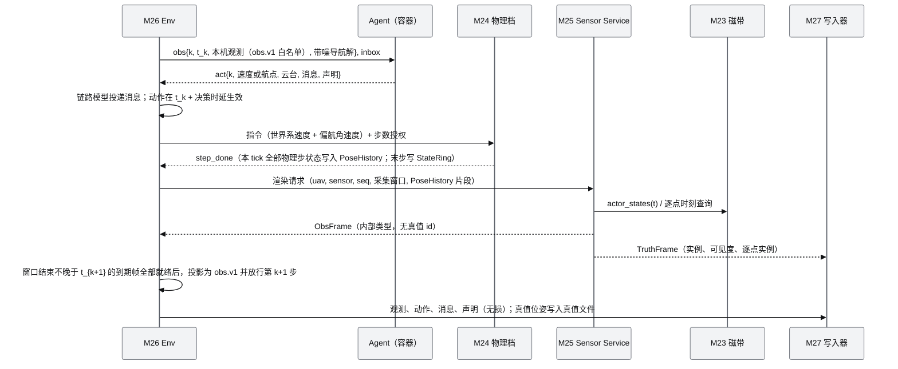
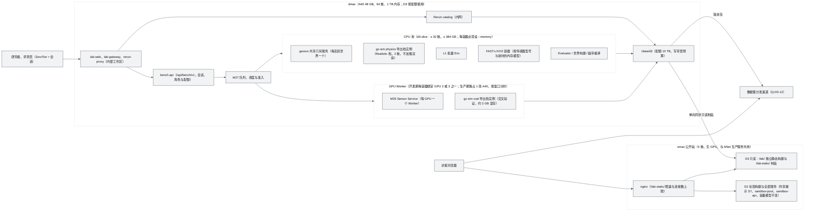
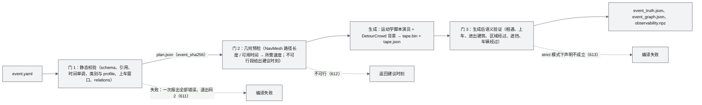
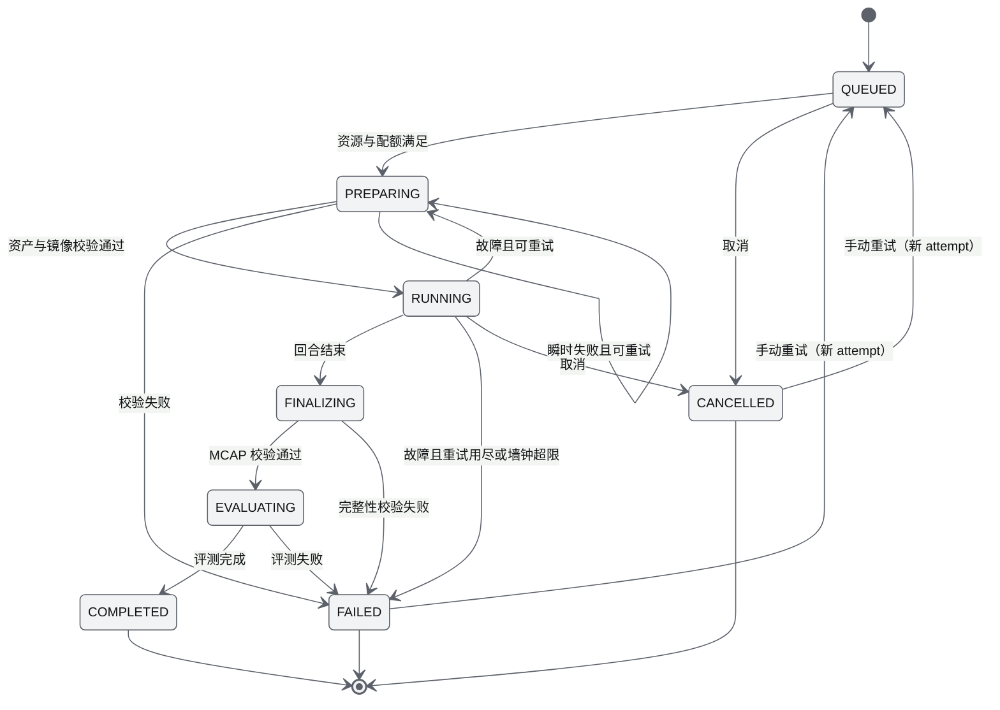
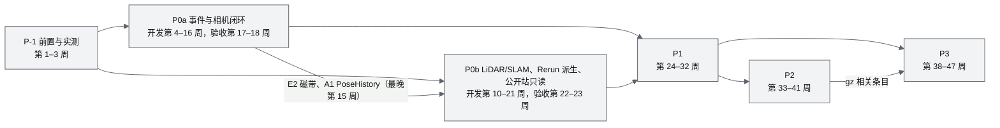

# 05 D3 设计增补与决策记录（D3 Design Supplement & Decision Record）

| 项 | 内容 |
|---|---|
| 文档编号 | AWR-05 |
| 标题 | D3 设计增补与决策记录 |
| 版本 | v1.2 |
| 日期 | 2026-10-12 |
| 状态 | 草案 v1.2（首轮交叉评审已处置，见 §17；M22–M27 PRD 与 14、17、20 号 D3 增补节的基线反馈已逐条裁决，见 §18） |
| 上游文档 | 用户 D3 需求原文、补充要求与 2026-10-12 决策 [inputs/D3-需求原文-2026-10-11.md](inputs/D3-需求原文-2026-10-11.md)；用户设计讨论 design-r1（`/data/projs/anet-drone-data/design-r1.md`，D3 设计阶段并入 `docs/inputs/`）；D3 研究总览 [research/d3/00-index.md](research/d3/00-index.md) 与 r1–r10 笔记；[AWR-03](03-设计基线与决策记录.md)（ADR-001 至 ADR-087）；[AWR-04](04-D2-设计增补与决策记录.md)（ADR-088 至 ADR-126）；[AWR-20](20-机型与传感器目录.md)；[16](16-World数据规范.md)、[17](17-接口与实时协议规范.md)、[19](19-部署与运维说明书.md)；M03、M04、M05、M06、M07、M08、M12、M13、M14、M17、M18-M19、M20 PRD；D2 实现与验收报告（`docs/impl/D2-*`） |
| 下游文档 | 新增模块 PRD：M22 World Asset Import、M23 Event Runtime、M24 Physics Backends、M25 Sensor Generation Service、M26 Agent Observation SDK、M27 Benchmark Runtime（文件名见 §1.3）；10–19 号说明书的 D3 增补节；AWR-20 的 D3 增补（长量程激光雷达型号）；M03、M04、M05、M06、M07、M08、M11、M12、M13、M14、M15、M16、M18-M19、M21 PRD 的 D3 增补节；D3 实现与验收报告（`docs/impl/D3-*`） |
| 适用版本范围 | V0.3（即本期交付 D3）至 V1.0 |
| 修订记录 | v1.0（2026-10-12）：首版。定位、四权威架构与部署分工；模块 M22–M27；R-D3-01 至 R-D3-40；ADR-127 至 ADR-159；D3-AC-01 至 D3-AC-45；工作包 WP-D3-00 至 WP-D3-23；Q-D3-01 至 Q-D3-10。v1.1（2026-10-12）：首轮交叉评审处置（51 条，含阻塞级 2 条，全部采纳）。P0 拆分为 P0a、P0b 两个出口并各设 2 周验收与加固缓冲；新增 ADR-160 至 ADR-166（PoseHistory 与 IMU 合成、观测白名单与种子保密、锁步背压、存储治理与数据分发、公开提交边界、相机独立包、工作区部署与角色）；新增 D3-AC-46 至 D3-AC-54；新增 WP-D3-24 至 WP-D3-29；扩展点增至 17 处；新增 Q-D3-11、Q-D3-12；工作量由 89.5 人周修订为 117.5 人周；追加 §17 评审处置记录。v1.2（2026-10-12）：M22–M27 PRD 与 14 §21、17 §18、20 §15 的基线反馈共 165 条逐条裁决（§18）；新增 ADR-167 至 ADR-173（世界包确定性构建与几何服务、事件真值版本与环境轨、时钟档与物理档导出档、Agent 动作守卫与定位档、传感器生成单一实现、实验规格与种子承诺、工作区会话与数据访问）；修订 ADR-130、131、138、145、149、157、160、161、163、164、166 的相关条款；新增 D3-AC-55；模块与相邻文档的冲突项按裁决统一（stage 区段、求交瓦片、导航解与云台读数的生成方、噪声参数单一真源、时钟档）；文档集文件名与状态按实际更新；工作量修订为 123.3 人周；新增 Q-D3-13 |

## 0. 摘要

1. **定位**：Drone4D D3 定义为 *A World-Grounded Event Simulation and Active Observation Benchmark for Collaborative Aerial Agents*（面向协同空中智能体的真实世界事件仿真与主动观测基准）。核心命题是"同一世界 + 同一事件 + 不同机队策略 → 不同观测"，研究问题是在部分可观测条件下，多个自主智能体如何协同决定在何处、何时、以何种方式观测动态世界（§2）。
2. **与 D1、D2 的关系**：D2 原样保留为公开交互沙盒；D3 是运行在 dmax 上的事件沙盘与数据集生成系统，只新增包，经 17 处扩展点与 D2 接合（第 1–16 处缺省行为不变，第 17 处为 D2 发布面文案复核，只改文案、不改功能），并以回归门守护；公开站在 V0.3 切换前保持 D2 标签构建，D3 只读视图以独立静态构建挂在 `/lab/`（§4.8，ADR-129）。
3. **架构**：世界、事件、物理、智能体四个权威互不越界；Sensor Generation Service 是位姿与磁带的纯函数，所有物理档共用；Benchmark Runtime 负责编排、录制、评测与数据集（§4，ADR-128）。
4. **世界与事件**：三份 Sketchfab GLB 是带烘焙光照的摄影测量三角网格，不是 3DGS，也不是米制。M22 强制完成米制尺度、真北与调平标定，派生网格 BVH、DSM、占据、NavMesh、锚点与"几何不完整"层；M23 以 `drone4d.event.v1` 编译出跨机逐字节一致的 Canonical Event Tape（ADR-130 至 ADR-136）。
5. **物理**：Fast 档（FleetSim）为主力，Realistic 档必须使用 gz-sim（Drone4DClock 进程内锁步，产品化为插件），SITL 档只做飞控验证、不进排行榜；三档经统一 DroneAdapter 接入，并以逐物理步的无损状态历史 PoseHistory 向传感器提供位姿与比力；Gazebo 只提供动力学与接触，不提供观测（ADR-137、ADR-138、ADR-160）。
6. **传感器**：快速照片级相机采用 EGL/OpenGL 网格光栅化，一遍 MRT 输出 RGB、深度、实例、语义；A40 上 720p 光栅化与读回 1.4–1.6 ms/帧，完整链路的端到端吞吐在 P-1 实测后冻结（暂定晴天档 ≥ 120 帧/s、雨与投影阴影最坏档 ≥ 80 帧/s，产能按最坏档计）；同一渲染核心以独立包 `drone4d-camera` 对外交付（P1）。3DGS 作为 P3 可切换外观层，只用于真实航拍重建资产，遮挡一律取网格深度。网格 LiDAR 采用 Warp GPU 逐射线求交、倒装 MID-360 花样与逐点时刻，IMU 由物理档比力合成，按用户决策提前到 P0，在 P0b 出口验收（ADR-139 至 ADR-143、ADR-160、ADR-165）。
7. **观测与评测**：M26 是 Agent 的唯一观测出口，Agent 只接收 `bench/obs.v1` 白名单观测，排名运行的种子对 Agent 保密（L0–L3 分级、lockstep 与决策时延、链路模型、隔离容器）；M27 以 MCAP 为唯一权威帧存储、`.rrd` 为派生检视格式，评测 Event Capture、Event Understanding、Active Observation（AO_real）与 Collaborative Efficiency，SLAM 轨道以 FAST-LIVO2 独立容器运行、以 RPE100 为主指标（ADR-143、ADR-145 至 ADR-150、ADR-161 至 ADR-163）。
8. **Rerun 与 RotorPy**：Rerun 作为数据检视与跨 Run 查询层，嵌入"数据检视"面板并与 M12 时间轴双向同步，修订 D1 PRD NG-09；RotorPy 定位为算法开发宿主与动力学参考，不作为运行时依赖，其适配器与相机独立包在 P1 交付（ADR-144、ADR-149、ADR-165）。
9. **部署**：公开站 emax 只承载只读视图（P0b–P2），P3 按 §5.6.7 的边界开放带配额的任务提交并在 dmax 排队；内部工作区部署在 dmax，按四类角色鉴权；dmax GPU Worker 承担渲染、LiDAR 与 Gazebo，CPU 池承担 FAST-LIVO2、评测与 L1 批量；开发期每个容器绑定 GPU 2 或 GPU 3 之一，数据集生产与性能验收期独占 1 张 A40 并按窗口分时；D3 在 dmax 上设 CPU、内存、存储与写带宽配额，完整数据集经分发渠道发布（ADR-151、ADR-163、ADR-164、ADR-166）。
10. **交付**：阶段 P-1、P0a（事件与相机闭环）、P0b（网格 LiDAR 与 FAST-LIVO2 重建对比、Rerun 派生、公开站只读）、P1、P2、P3，估算 123.3 人周（±40%，不含验收轮次），每个出口另设 2 周验收与加固缓冲，4 人编制约 47 周；验收 55 条（阻塞 45 条），覆盖 D2 发布面文案、720p 相机吞吐、LiDAR 并发、事件磁带逐字节确定性、观测隔离无泄漏、FAST-LIVO2 RPE 区间、Rerun 回放、公开站只读视图与公开提交边界（§10、§11）。

---

## 1. 本文的地位与使用规则

### 1.1 地位与裁决顺序

1. 本文是 D3 全部文档与实现的**唯一基线**。D3 范围内的冲突按以下顺序裁决（高者为准）：**用户 D3 需求原文、补充要求与 2026-10-12 决策（R-D3，§3）> 用户硬性要求 R1–R4（AWR-03 §2.4）> 本文（AWR-05）> AWR-04 > AWR-03 > D3 研究总览 00-index > r1–r10 笔记 > design-r1 > 01-design**。
2. 用户 2026-10-12 采纳的默认决策（FAST-LIVO2 只以独立容器使用、OSM 派生数据单独标注 ODbL、数据集署名）高于 AWR-03 R4a"科研用途，忽略 license"：凡对外发布的制品（公开站、GitHub 仓库、数据集、镜像）一律按 §14 执行许可与署名；仅限内部研究的镜像与中间产物仍适用 R4a（ADR-154）。
3. 本文不重述 AWR-03、AWR-04 已定义的内容；未在本文修改的条款（坐标、时间、单位、命名、契约演进、设计体系、写作规范、性能运行协议 ADR-033、多租户沙盒与容量模型等）原样适用于 D3。
4. 本文对 AWR-03、AWR-04 的修改一律以 ADR-127 起的追加 ADR 表达，并在 ADR 标题中写明"修订"或"扩展"的对象；AWR-03 §7.0 ADR 索引、附录 E 与 AWR-04 §12.0 增加索引行指向本文 §9，原 ADR 不删除。
5. 写作规范沿用 AWR-03 §10.2（中文、技术名词英文、需求编号、依据、mermaid、可测试验收、严禁 emoji 与状态字形）。D3 全部对外文案另受 §7.10 企业级文案规范约束（R-D3-21，ADR-153）；本文的表述同样遵循其原则（§7.10 中作为反例列出的词语除外）。
6. 本文凡引用实测数字，均以 00-index §1.2 的统一尺度为口径（town 8.374 m/单位、crop 20.935 m/单位、hill 2.49 m/单位）；标"需复测"的数字在 P-1 按正确尺度复测后由实现报告冻结。"dmax"指 A40 48 GB、容器 `--cpus 16`；"本机"指 8 核 Xeon E5-2603 v4、无 GPU。

### 1.2 编号、版本与术语

| 项 | 规则 |
|---|---|
| 用户需求 | `R-D3-xx`（§3）：R-D3-01 至 R-D3-20 来自需求原文与 design-r1 中用户本人撰写的段落，R-D3-21 至 R-D3-25 来自 2026-10-11 补充要求，R-D3-26 至 R-D3-40 来自 2026-10-12 决策 |
| 本期交付 | **D3 = V0.3**。V0.3 主题由"环境物理化 I 与规划"修订为"事件沙盘与主动观测基准"，原 V0.3 条目的去向见 ADR-127 |
| 阶段 | `P-1`、`P0a`、`P0b`、`P1`、`P2`、`P3`（沿用用户决策用语）。用户决策中的"P0"由 P0a 与 P0b 两个出口共同交付：P0a 为事件与相机闭环，P0b 为 LiDAR/SLAM、Rerun 派生与公开站只读（v1.1，§10）。每个出口对应一次 V0.3 小版本发布，版本号按 ADR-118 的单一来源生成 |
| 优先级 | 为避免与阶段名混淆，本文的优先级写作"阻塞"、"应交付"、"可延期"，分别对应 AWR-03 §10.2 的 P0、P1、P2 语义；M22–M27 PRD 的需求表仍用 P0/P1/P2，并另设"阶段"列 |
| 验收 | `D3-AC-xx`（§11）；模块 PRD 的 AC 用 `<前缀>-AC-###`，在"验收要点"列引用 D3-AC |
| ADR | 从 ADR-127 起连续编号（§9），本版为 ADR-127 至 ADR-173 |
| 新增模块 | M22–M27（§5）；需求前缀为模块号，例如 `M23-FR-001`；文件名以模块编号开头 |
| 工作包 | `WP-D3-xx`（§12） |
| 待决问题 | `Q-D3-xx`（§15） |
| 原因码 | 新增码段 600–699（§8.4，ADR-155），按模块划分子段 |
| 契约 | `packages/contracts` 由 1.2.0 升至 1.3.0，只增不改（ADR-155） |
| 随机流 | 新登记 19 `event_runtime`、20 `comm_link`、21 `obs_fast`，以事件时间索引或帧序号取键（ADR-136） |

**术语**

| 术语 | 定义 |
|---|---|
| 世界（World）、世界包 | M22 产出的米制 World Package（`schemaVersion 1.1.0`、`profile = d3-glb`），以 `contentVersion` 标识版本。研究笔记中"World Package v2 / world.json v2"的说法一律指 1.1.0 加 `d3-glb`，不存在 2.x 主版本（D2 读取端只接受 `1.*`） |
| 事件（Event） | 以 `drone4d.event.v1` 描述的一段固定世界过程（脚本演员、背景人群、环境关键帧、通信干扰区、语义注释） |
| 事件磁带（Canonical Event Tape） | 事件编译后生成的唯一真值时间线（`drone4d.tape.v1`），以 `content_sha256`（规范头原始字节与解压后规范帧数据）标识；语义真值另以 `truth_sha256` 标识（ADR-168） |
| 实验规格、运行（Run）与运行清单 | 实验规格是研究者提交的请求（`seeds[]` 或 `seed_count`），按种子展开为若干 Run；Run 是一条磁带 + 一个机队配置 + 一个策略 + 物理档与时钟档 + 观测档 + 噪声档 + 一个运行种子的一次执行；运行清单 `run_manifest.json` 记录执行结果，排名运行只含种子承诺 `seed_commit`。进入排行榜或 test 集评分的运行称为排名运行，其运行种子对 Agent 保密（ADR-161、ADR-172） |
| 实验（Experiment） | 同一事件上一组 Run 的集合，对应 Rerun catalog 的一个 dataset |
| 物理档 | Fast（FleetSim）、Realistic（gz-sim）、SITL（PX4 + gz-sim） |
| 观测档 | L0 Oracle、L1 检测级、L2 渲染级（另设 L2-depth 子档）、L3 SITL/HIL；T0 特征级只用于不排名的开发运行（§5.5.3）。L0 与 T0 经独立的特权 schema `bench/obs_privileged.v1` 交付，不进入 `bench/obs.v1` |
| 定位档 | `localization ∈ {estimated, oracle}`：`estimated`（缺省）为带噪导航解，`oracle` 为真值位姿，只用于不排名分组与私有地图的上限评测；`clean` 噪声档的运行视同 `oracle` 单列（ADR-170） |
| 噪声档 | clean、realistic、harsh；逐传感器数值以 AWR-20 §15.6.5 为单一真源，离散化方法见 M25 PRD，§5.4.6 为摘要（ADR-171） |
| 外观层 | 静态场景的着色来源：`mesh`（缺省）或 `3dgs`（P3）；几何、深度与标签恒取网格 |
| PoseHistory | 物理档逐物理步的无损状态历史（时刻、位置、姿态、速度、角速度、机体系比力），全部为机体原点量，是 M25 唯一的位姿来源（ADR-160）；杆臂项由 M25 按挂载外参计算 |
| 时钟档（`clock_profile`） | 四元组 `{name, main_hz, physics_hz, l1_hz}`，四元组（不是名称）进入运行哈希；D3 缺省 `{d1_250, 250, 250, 250}`，即 `FleetConfig.l1_every = 1`（ADR-169） |
| 事件沙盘 | 产品层对 D3 系统的称呼（对外文案用"事件沙盘"或"Event Lab"）。代码命名一律用 `lab`、`bench`、`event`，不得使用 `Sandbox`，以免与 D1 的沙盘视图 `ui/views/Sandbox.tsx` 和 D2 的沙盒会话 `sandboxSession` 混淆（AWR-04 §1.2）。用户可见称谓按 §7.10 统一：D1 视图称"三维场景视图"，D2 称"交互沙盒"，"沙盘"一词只用于 D3 |
| emax、dmax | emax 为公开站主机（4 核、无 GPU）；dmax 为实验与生产主机（A40 48 GB、64 核、1 TB 内存、`/data` 49 TB 可用） |
| 独占 GPU | 数据集批量生产与性能验收期间，D3 GPU Worker 独占的一张 A40，按验收、生产、训练窗口分时（R-D3-28，§4.7） |

### 1.3 D3 文档集与状态

| 文档 | 文件 | 定义的内容 | 状态 |
|---|---|---|---|
| 用户需求原文 | [inputs/D3-需求原文-2026-10-11.md](inputs/D3-需求原文-2026-10-11.md) | R-D3 的追溯源（含补充要求与 2026-10-12 决策） | 只读 |
| 用户设计讨论 | `inputs/D3-design-r1.md`（由 `/data/projs/anet-drone-data/design-r1.md` 原样并入） | 用户的设计讨论；R-D3-19、R-D3-20 的出处 | 只读（P-1 并入） |
| D3 研究 | [research/d3/00-index.md](research/d3/00-index.md)、r1–r10 | 实测数字、推荐架构、风险与默认值 | 只读 |
| AWR-05 | 本文 | D3 唯一基线：定位、架构、模块 M22–M27、ADR-127 至 ADR-173、阶段计划、D3-AC、工作包、风险、许可、评审处置记录（§17）与模块反馈裁决（§18） | 草案 v1.2 |
| AWR-M22 | [modules/M22-World资产导入PRD.md](modules/M22-World资产导入PRD.md) | GLB 导入、标定、派生资产、MeshWorldQuery 与共享几何服务、CLI | 草案 v1.0 |
| AWR-M23 | [modules/M23-事件运行时PRD.md](modules/M23-事件运行时PRD.md) | 事件 DSL、编译门、磁带、人群、语义验证、环境轨、模式 | 草案 v1.0 |
| AWR-M24 | [modules/M24-物理后端PRD.md](modules/M24-物理后端PRD.md) | Fast、Realistic、SITL 档；PhysicsTier 与 DroneAdapter；PoseHistory；gz-sim 插件；SDF 导出 | 草案 v1.0 |
| AWR-M25 | [modules/M25-传感器生成服务PRD.md](modules/M25-传感器生成服务PRD.md) | SensorBackend v2、PoseHistory 与 IMU 合成、相机、LiDAR、IMU、GNSS 与导航解、噪声离散化、3DGS、调度、`drone4d-camera` 独立包 | 草案 v1.0 |
| AWR-M26 | [modules/M26-智能体观测SDK-PRD.md](modules/M26-智能体观测SDK-PRD.md) | Env、观测分级与 `bench/obs.v1` 白名单、动作守卫、链路模型、私有地图、隔离与泄漏审计 | 草案 v1.0 |
| AWR-M27 | [modules/M27-基准运行时与数据集PRD.md](modules/M27-基准运行时与数据集PRD.md) | 实验与 Run 编排、录制与存储治理、数据集与分发、评测、SLAM 轨道、公开提交边界与排行榜、工作区服务进程 | 草案 v1.0 |
| D3 增补节（已写） | [14 §21](14-UI交互设计PRD.md)（事件沙盘工作区交互）、[17 §18](17-接口与实时协议规范.md)（bench-api、线协议、原因码 600–698 全表）、[20 §15](20-机型与传感器目录.md)（长量程型号、D3 相机与噪声参数单一真源） | 对应文档的 D3 增补 | 草案 |
| D3 增补节（待写） | 10–13、15、16、18、19 号说明书；M03、M04、M05、M06、M07、M08、M09、M11、M12、M13、M14、M15、M16、M18-M19、M21 PRD | 对既有模块的 D3 改动（§5.0 影响表） | 待写（P0a、P0b 内随工作包完成） |

---

## 2. 产品定位与系统边界

### 2.1 定位

**名称**：产品名 ANet Drone4D（首次出现后可简称 Drone4D）。基准全称 *Drone4D: A World-Grounded Event Simulation and Active Observation Benchmark for Collaborative Aerial Agents*，中文全称"面向协同空中智能体的真实世界事件仿真与主动观测基准"。仓库标识 `ANet-Drone4D` 只用于 URL 与包名，不用于正文（§7.10）。

**核心命题**：

```text
Same World + Same Event + Different Drone Policies  =>  Different Observations
W(t) = EventRuntime(W0, E, seed, t)                         事件真值与无人机无关（Exogenous 模式）
O_i(t) = Sensor(W(t), Pose_i(t), Config_i)                   每架机只得到本机传感器在实际位姿下的观测
```

**研究问题**：How can autonomous agents collaboratively decide where, when, and how to observe a dynamic world under partial observability?

**与现有公开数据的根本差异**：现有大量无人机数据是固定航线、固定视频，观测在采集时就已固定。D3 固定的是世界与事件，开放的是机队数量、机型与传感器、飞行策略、协同策略与通信条件；同一事件可以被不同策略反复观测，每次产生由决策引起的新观测，并在统一口径下自动评分（R-D3-01 至 R-D3-06）。原型已在 crop 世界上验证该命题：同一磁带上 6 种机队策略各 12 个种子，Event Capture 从 0.25 到 1.00 不等（00-index §0 第 1 条）。

**系统能力（按数据流）**：

| 能力 | 承担模块 | 对外表述（企业级文案，§7.10） |
|---|---|---|
| 将真实摄影测量 GLB 转换为米制、可查询、可导航的世界包 | M22 | 世界资产导入与米制标定 |
| 以声明式 DSL 编排固定事件，并以世界几何验证其语义 | M23 | 事件编排与语义验证 |
| 以三档物理后端推进机体，Realistic 档由 Gazebo Sim 提供刚体动力学 | M24 | 多保真度物理后端 |
| 按机体实际位姿生成相机、深度、分割、LiDAR、IMU 与 GNSS 观测 | M25 | 传感器生成服务 |
| 为每架机提供隔离的观测、受限的通信与统一的动作接口 | M26 | 智能体观测 SDK |
| 批量编排运行、无损录制、自动评测、导出数据集 | M27 | 基准运行时 |

### 2.2 与 D1、D2 的关系

| 交付 | 定位 | 运行位置 | 在 D3 中的状态 |
|---|---|---|---|
| D1（V0.1） | Mock 覆盖全层的 World Runtime：点云 Web 世界、FleetSim 机群、环境、录制回放 | 本机与 emax | 原样保留；D3 复用其内核、契约、设计体系与录制格式 |
| D2（V0.2-demo） | 公开交互沙盒：多租户会话、识别物与感知判据、任务编排与接力监控、开放接口 | emax 公开站 | **原样保留为公开交互沙盒**；D3 不改变其容量模型、公开 profile 与组合根 |
| D3（V0.3） | 事件沙盘与数据集生成系统：世界导入、事件运行时、多档物理、传感器生成、观测 SDK、基准运行时 | dmax（GPU Worker 与 CPU 池）；emax 只承载只读视图 | 本文 |

接合方式（ADR-129）：

1. **发布次序**：D2（含 D2.1）完成验收后打标签，发布到 GitHub `main` 与公开站 `https://drone4d.agentnetwork.org.cn/`（R-D3-18，另一工作流负责）。D3 自该标签拉 `d3-dev` 分支；D2 的后续修复只在 `d2` 维护分支进行，再合入 `d3-dev`，不反向合并。D2 发布前须通过发布面文案复核（D3-AC-46，P-1）。公开站发布线：V0.3 切换前，emax 主构建保持 D2 标签构建，D2 热修经 `d2` 分支打标签后部署；D3 只读视图自 P0b 起以 `d3-dev` 的独立静态构建挂在 `/lab/`；切换条件与回滚见 ADR-129。
2. **只新增包**：`awr.world.glb`、`awr.world.mesh`、`awr.sim.events`、`awr.phys`、`awr.sensorsvc`、`awr.agentsdk`、`awr.bench`；前端新增 `engine/actors`、`viewport/layers/worldMesh.tsx`、`ui/lab/**`。D2 包不得 import D3 包，以 import 方向测试固定。
3. **17 处扩展点**：对 D2 文件的改动只限 §12.3 列出的 17 处（约 29 个文件；P-1 实施第 1–12 处与第 17 处，P0b 实施第 15、16 处，P1 实施第 13、14 处）。第 1–16 处是加字段、加枚举、加分派、加开关的小改，缺省路径不变；第 17 处是 D2 发布面的文案复核，只改文案、不改功能。
4. **开关与组合根**：D3 插件只出现在 `D3_PLUGINS` 与 `runtime.yaml` 的 `d3` profile 中；`AWR_D3_ENABLED`（缺省 0）控制 D3 路由、`open_world_query` 的网格分派与 D3 topic 的生产者；公开站组合根不加载 D3 插件。
5. **回归门**：每个 D3 工作包合入前，D2 全部测试通过，并在"安装 D3 包、开关关闭"与"开关打开但不加载事件"两种条件下对拍批处理事件流、resim 帧摘要与 M18 确定性用例逐字节一致；公开演示构建的 K9 prod-bundle-scan、D2 公开站 e2e 与 Tier S 首屏指标通过（D3-AC-01）。

**D2 能力在 D3 中的复用度**（r7 §0）：按 Python 行数计，45% 原样复用（时钟与内核、命令与安全、规划与集群算法、环境、契约、运行时基础设施），39% 只需加接口（世界导入与查询、传感器、录制、沙盒、接口层、智能体），12.5% 与 D3 语义冲突、隔离后复用（M18 识别物反应、M19 真值关联感知、M20 特权编排），3% 与 D3 无关。

### 2.3 范围与不做

| 层 | P0（P0a / P0b） | P1 | P2 | P3 | 不在 D3 |
|---|---|---|---|---|---|
| 世界 | P0a：crop 世界包（米制标定、BVH、DSM/DTM、quality、occupancy、行人与车辆 NavMesh、OSM 锚点、彩色点云）与 town 世界包（LiDAR 探索）；共享几何服务 `geosvc` | hill 世界包；OSM 车道图；编辑器锚点修正；事件舞台裁剪网格（浏览器 Tier B/A） | 全世界 3D Tiles 网格瓦片；World Package → SDF 导出用于 Realistic 档 | 3DGS 外观层（真实航拍资产，网格与 3DGS 同源） | 室内结构重建；自动补全缺失立面 |
| 事件 | P0a：DSL、三道编译门、运动学磁带（脚本演员 ≤ 30 名经 M18 实体表）、DetourCrowd 背景人群（只存在于磁带，由 M25 直接读取）、语义验证、事件图、环境关键帧、通信干扰区 | 背景 `actor` 实体种类（容量 > 32）、事件编辑器、骨骼动画相位、车辆跟驰 | Interactive 模式与实现磁带 | 事件族生成（Scenic 式分布） | 交通法规级车辆仿真 |
| 物理 | P0a：Fast 档（FleetSim + MeshWorldQuery 净空、PoseHistory） | gz 导出与交叉验证、Jetty 评估、gz 锁步链路实测 | Realistic 档（gz-sim 锁步）、SITL 档 | — | 百架级 Realistic；L2 气动 |
| 传感器 | P0a：EGL 光栅相机（RGB、深度、实例、语义、可见度）、效果链；P0b：Warp 网格 LiDAR、IMU 合成与 GNSS、噪声档、Livox 兼容输出 | 长量程雷达型号；多回波（选项）；`drone4d-camera` 独立包；RotorPy 与 Gym 适配 | gz 原生传感器交叉验证 | 3DGS 着色（C3） | 热成像物理模型；雷达波 |
| 智能体 | P0a：L1/L2 Env、`bench/obs.v1` 白名单出口、动作映射、SDK、参考策略、决策时延模型、基础链路模型、Agent 隔离容器 | 链路模型完善（空间分块、带宽桶、可靠传输库）、在线私有地图与 Frontier、ANet 增量共享 | — | 服务端运行的提交容器 | LLM 策略本身 |
| 基准 | P0a：实验规格与 Run 规格、队列与准入、无损录制（单一权威存储）、EC、AO_real v0（参考相机 oracle）、AO_pos 与安全间距评测、数据集导出；P0b：`.rrd` 派生、`slam_eval`、L0 离线地图与 FAST-LIVO2 重建对比 | EU、AO_real v1（按机队相机的 oracle）、CE 指标；Rerun 数据检视面板；catalog 查询 | L1 与 L2 一致性标定；town 协同探索演示 | 隐藏 test 集、容器提交、排行榜、LeRobot 与 OpenLABEL 导出、公开配额提交、数据集分发、对标对照报告 | 在线竞赛运营 |
| 前端 | P0a：内部工作区部署与角色、世界、事件与运行列表、事件回放（脚本演员）、多机观测墙；P0b：LiDAR 与重建对比、数据集浏览、公开站只读静态构建；彩色点云世界 | 事件编辑器与时间线、机队与策略配置、Rerun 检视面板、事件舞台网格显示 | 全世界网格瓦片图层、Fast 与 Realistic 对照视图 | 排行榜、提交页 | 移动端编辑 |
| 部署 | P0a：dmax GPU Worker 与 CPU 池、配额与保留策略；P0b：公开站发布线与只读静态制品同步 | — | — | 公开站配额提交通道；数据集分发渠道 | 多机房部署 |

**非目标**：D3 不以"更真实的渲染"本身为目标；不在公开站运行任何 GPU 负载；不把 PX4 SITL 结果纳入排行榜；不声称"首创"（与 CarlaAir、UnrealZoo、ESARBench、AirCopBench 的系统对照报告在 P3 完成，WP-D3-29、D3-AC-53；r6 §13.6）。

### 2.4 资产与场景分工（R-D3-16、R-D3-30）

| 世界 | 来源与许可 | 米制尺度 | 范围 / 边长中位数 / 纹素 | D3 角色 |
|---|---|---|---|---|
| crop（oryahovo crop #1） | Sketchfab，CC-BY-4.0 | 20.935 m/单位（继承 town 局部坐标） | 2.5 × 1.7 km / 1.9 m / 19 cm | **城镇级事件主场景**：街道网完整、OSM 锚点丰富（151 个路口、70 栋建筑、30 个 POI），r6 原型已在其上完成 |
| town（An entire small town scanned by a drone） | Sketchfab，CC-BY-4.0 | 8.374 m/单位（±0.5%） | 4.6 × 2.8 km / 3.3 m / 28 cm | 大范围 LiDAR 探索、远景、FAST-LIVO2 回归环线；山地协同探索场景在 P1 出口前另行确定资产，之前以 town 代替（Q-D3-03） |
| hill | Sketchfab，CC-BY-4.0 | 2.49–2.53 m/单位 | 122 × 145 m / 13 cm / 2.5 cm | 街巷级近距离观测与 Re-ID |

依据：r2 §0、§2；00-index §3.3。三份 GLB 均为带烘焙光照的纹理三角网格，模型存在 1.1°–1.25° 的系统倾斜，town/crop 需绕 Z 转 168.04° 才对准真北。"3DGS + mesh 沙盘"在本文中的含义为：**网格既是几何真值，也是 P0–P2 的外观真值；3DGS 是 P3 起对真实航拍重建资产可切换的外观层**（R-D3-26，ADR-141）。

---

## 3. 需求追溯

"原文摘录"一列是用户原话（只截取，不改写）；"模块"列主责在前；"阶段"为首次交付的阶段。

### 3.1 需求原文逐句拆分

| 编号 | 原文摘录 | 需求解释 | 模块 | 阶段 | 优先级 | 验收 |
|---|---|---|---|---|---|---|
| R-D3-01 | "我们真实想要模拟的是事件，而非drone采集的图像" | 系统以事件为一等对象：事件有 DSL、编译、磁带、语义真值与事件图；图像是事件在某一观测者下的投影 | M23、M27 | P0a | 阻塞 | D3-AC-06、07 |
| R-D3-02 | "当前大量公开的数据都是固定飞行轨迹的无人机采集的视频数据，我们想做的是固定沙盘内，事件是固定的" | 世界与事件固定（Exogenous 模式、Canonical Event Tape），观测随策略变化；与固定航线数据集形成区隔 | M23、M22 | P0a | 阻塞 | D3-AC-07、08 |
| R-D3-03 | "比如ABC三个人，经由地图上的建筑、位置，从X走到Y走到Z" | 脚本演员以"锚点 + 到达时刻"表达路线，沿 NavMesh 合法移动；锚点来自 OSM 播种与编辑器确认；支持出入建筑、上下车 | M23、M22 | P0a | 阻塞 | D3-AC-03、06 |
| R-D3-04 | "其间有视觉的遮挡，风速变化、下雨等等" | 遮挡由网格几何与语义验证器计算（含未声明的遮挡事件）；风、阵风、雨、能见度以环境关键帧驱动物理与传感器；通信干扰区作为环境的一部分 | M23、M25、M07、M26 | P0a | 阻塞 | D3-AC-06、09、28 |
| R-D3-05 | "我们允许用户指派不同的无人机，数量不定，飞行策略不定，协同策略不定" | 机队配置（机型、数量、传感器、起点或机巢）、策略镜像或 SDK 端点、协同与通信参数全部是 Run 规格的可变项；P0 经 SDK 与 `/api/bench/v1/runs` 指派，配置界面在 P1 交付 | M27、M26、M21 | P0a（SDK/REST）、P1（界面） | 阻塞 | D3-AC-09、17、51 |
| R-D3-06 | "在这个沙盘内进行反复针对同一事件的采集" | 同一磁带上反复运行；Run 规格完整记录世界版本、磁带哈希、种子与档位；结果按事件组织为实验 | M27 | P0a | 阻塞 | D3-AC-07、17、18 |
| R-D3-07 | "我需要这个沙盘能允许模拟的无人机按照3dgs+mesh的沙盘结构，提供简易的真实的无人机的视角图像采集能力" | 世界包同时承载网格（几何与外观真值）与可选 3DGS 外观层；每架机按自身相机采集图像 | M22、M25 | P0a（网格）、P3（3DGS） | 阻塞 | D3-AC-09、41 |
| R-D3-08 | "即模拟无人机在虚拟沙盘内飞行的时候可以根据真实的物理引擎确定空间位置、视角" | 位姿由物理档（FleetSim 或 gz-sim）以逐物理步的 PoseHistory 给出，云台由挂载链计算；传感器只读位姿，不自行假设机位，不做位姿外推 | M24、M25 | P0a（Fast）、P2（Realistic） | 阻塞 | D3-AC-09、34 |
| R-D3-09 | "并根据真实的3dgs渲染截图，作为无人机当时真实的视角" | 每帧在服务端按曝光中点位姿渲染，作为 Agent 当时的真实观测原样存档；P0–P2 以网格光栅化为外观，P3 起对真实航拍资产以 3DGS 着色（R-D3-26） | M25 | P0a、P3 | 阻塞 | D3-AC-09、11、41 |
| R-D3-10 | "这样可以造出大量的数据集，完全取决于沙盘的精细程度" | 批量编排与数据集导出；世界包发布 `sensorHints`（纹素、边长、纹理受限距离），数据集声明分辨率边界 | M27、M22 | P0a、P3 | 阻塞 | D3-AC-18、42、50 |
| R-D3-11 | "每个无人机没有全局视野，只有自己飞行的视野" | M26 为唯一观测出口；观测分级、`bench/obs.v1` 白名单序列化、排名运行种子保密、泄漏红队测试（含噪声反演）、Agent 隔离容器、通信只经链路模型 | M26、M25、M27 | P0a | 阻塞 | D3-AC-16 |
| R-D3-12 | "我甚至希望模拟无人机能够模拟激光雷达在这个glb文件驱动的沙盘内进行场景重建和图像采集" | 网格 LiDAR（逐点时刻、动态实体、天气）、IMU/GNSS、Livox 兼容输出；每机私有重建（L0 已知位姿地图与 L1 FAST-LIVO2；P0b 的 L0 地图为离线生成，P1 起为在线私有地图）；按 R-D3-29 提前到 P0，在 P0b 出口验收 | M25、M26、M27 | P0b | 阻塞 | D3-AC-12 至 15 |
| R-D3-13 | "另外我希望你clone https://github.com/hku-mars/fast-livo2 到本地并进行深入研究" | 已由 r1 完成源码精读、真机与仿真闭环；设计上作为 SLAM 轨道的估计器与数据产品生成器，独立容器运行 | M27、M25 | P0b | 阻塞 | D3-AC-13、14 |
| R-D3-14 | "我在…design-r1.md进行了一次可参考的设计讨论，请你认真阅读，并结合我们drone4d的实际代码情况进行设计" | design-r1 逐条确认或修正（§3.4）；代码接合以 r7 审计为依据（17 处扩展点、复用度）；design-r1 的两个演示场景与对标要求分别由 P2 协同探索演示与 P3 对标对照报告承接 | 全部 | P-1 | 阻塞 | 文档评审；D3-AC-52、53 |
| R-D3-15 | "我授权你去ssh root@dmax.anet.chat进行实验，传输数据如果慢的话你就去modelscope上进行文件传输" | dmax 作为 D3 实验与生产主机；数据传输以 ZeroTier rsync 为主（实测 1.75–2.3 MB/s），大文件可经 ModelScope 或并行 Range 下载；容器命名与资源规则见 §4.6 | M27、运维 | P-1 | 阻塞 | D3-AC-22 |
| R-D3-16 | "我们在 /data/projs/anet-drone-data/ 还给你准备了两套glb文件格式的可作为默认drone4d沙盘的真实的3dgs数据" | 三份 GLB（town、crop、hill）作为默认沙盘；经核实为摄影测量网格而非 3DGS，按 §2.4 分工 | M22 | P0a | 阻塞 | D3-AC-02 |
| R-D3-17 | "请你充分理解我们的诉求，设计并进一步更新整套系统" | 本文与 M22–M27 PRD、既有文档的 D3 增补节；实现按 §10 分阶段 | 全部 | P-1 至 P3 | 阻塞 | 各阶段出口 |
| R-D3-18 | "我希望当前正在进行的版本不要受到影响，先将D2完整发布到github和https://drone4d.agentnetwork.org.cn/，再根据这套新的需求，进一步设计迭代系统" | D2 先发布打标签（发布前完成发布面文案复核）；D3 独立分支、只新增包、17 处扩展点、回归门；公开站在 V0.3 切换前保持 D2 标签构建，D3 只读视图为独立静态构建；公开站组合根不加载 D3 | 全部 | P-1 | 阻塞 | D3-AC-01、21、46 |
| R-D3-19 | design-r1（用户撰写段落）："这个glb文件我会自带两个…这种点云带有颜色、带有结构，我感觉作为沙盘的环境很好" | GLB 作为沙盘环境；浏览器 Tier S 以网格采样的彩色点云显示，Tier B/A 自 P1 起显示事件舞台裁剪网格、自 P2 起显示全世界网格瓦片 | M22、M05、M06 | P0a、P1、P2 | 阻塞 | D3-AC-02、39、54 |
| R-D3-20 | design-r1（用户撰写段落）："我还是建议使用Gazebo这种真实的来构建计算后端，前端展示可以保持使用浏览器" | Realistic 档以 gz-sim 为计算后端；前端统一为浏览器（三维场景视图 + D3 工作区） | M24、M15 | P1、P2 | 阻塞 | D3-AC-31、34 |

### 3.2 补充要求（2026-10-11）

| 编号 | 原文摘录 | 需求解释 | 模块 | 阶段 | 优先级 | 验收 |
|---|---|---|---|---|---|---|
| R-D3-21 | "这次drone4d的网站、网页应用、github readme repo，都要保持：UI 设计界面不要有口语化的东西，要做成企业级、工业级的产品，优雅的描述" | 网站、网页应用、README 与仓库元数据统一执行企业级文案规范（§7.10，中文与英文两套规则）；D2 发布面在 P-1 复核，作为 D2 发布的放行条件；文案 lint 纳入 `make lint` 与发布面检查（扩展 ADR-079） | M15、M00 | P-1（D2 发布面）、P0b（D3 页面） | 阻塞 | D3-AC-23、46 |
| R-D3-22 | "下一轮中请你调研：https://github.com/rerun-io/rerun 并尝试融入使用" | Rerun 作为派生的语义录制、跨 Run 查询与数据检视层；网页嵌入"数据检视"面板并与 M12 时间轴同步（§6.1） | M27、M15 | P0b（导出）、P1（面板） | 阻塞 | D3-AC-20、25 |
| R-D3-23 | "https://github.com/gazebosim/gz-sim 这个一定要clone并调研并使用" | gz-sim 作为 Realistic 物理档（锁步插件产品化、SDF 导出、交叉验证），见 §6.2 | M24 | P1（导出、交叉验证、Jetty 评估）、P2（锁步档） | 阻塞 | D3-AC-31、34、35、40 |
| R-D3-24 | "https://github.com/spencerfolk/rotorpy 这个你研究一下" | 已由 r10 完成；RotorPy 定位为算法开发宿主、动力学参考与特征级 T0 档，相机适配器同签名（§6.3）；适配器、Gym 包装、T0 档与动力学对拍由 WP-D3-24 交付 | M25、M24 | P1 | 应交付 | D3-AC-48 |
| R-D3-25 | "我们最终希望有一个 fast photorealistic (3dgs/glb based) camera sensor" | 快速照片级相机：统一 CameraModel/CameraFrame 契约；网格光栅化为 P0 产品路线，3DGS 为 P3 外观层；吞吐目标见 D3-AC-11；同一渲染核心以 `drone4d-camera` 包与镜像对外交付（§5.4.9） | M25 | P0a、P1、P3 | 阻塞 | D3-AC-09、11、41、49 |

### 3.3 用户决策（2026-10-12）

| 编号 | 决策（00-index §6 题号） | 需求解释 | 模块 | 阶段 | 优先级 | 验收 |
|---|---|---|---|---|---|---|
| R-D3-26 | 第 1 题：网格渲染为主（P0–P2 以 GLB 网格硬件光栅化作为无人机真实视角）；P3 另行获取真实航拍重建的 3DGS 资产，作为可切换的外观层 | ADR-140、ADR-141；不从网格训练 3DGS 用于产品观测 | M25、M22 | P0a、P3 | 阻塞 | D3-AC-11、41 |
| R-D3-27 | 第 9 题：P0–P1 只读（事件回放、多机观测浏览、数据集检视）；P3 开放带配额的任务提交，在 dmax 上排队执行 | 公开站 P0b–P2 只读，P3 按 §5.6.7 的边界开放配额提交；公开站不运行任何 D3 计算（ADR-151、ADR-164） | M27、M15、M11 | P0b、P3 | 阻塞 | D3-AC-21、44 |
| R-D3-28 | 第 10 题：开发与实验期共享 GPU 2、3；数据集批量生产与性能验收期独占 1 张 A40 | GPU 分配规则与独占卡分时窗口写入部署配置与验收环境（ADR-151，§4.7） | 运维、M25 | P-1 起 | 阻塞 | D3-AC-11、12、22 |
| R-D3-29 | 第 5 题：LiDAR 提前到 P0，P0 即交付多机网格 LiDAR 采集与 FAST-LIVO2 重建对比 | MeshLidar、IMU 合成与 GNSS、SLAM 合同、`slam_eval`、L0 离线地图与"LiDAR 与重建对比"视图进入 P0，在 P0b 出口验收（ADR-142、ADR-143） | M25、M27、M15 | P0b | 阻塞 | D3-AC-12 至 15 |
| R-D3-30 | 第 2、3 题（采纳默认）：crop 为事件主场景、town 用于大范围 LiDAR 探索、hill 用于近距离与 Re-ID；山地场景先用 town，P2 前确定资产 | §2.4；ADR-156；山地资产在 P1 出口前确定（P1 退出条件） | M22 | P0a、P1（hill） | 阻塞 | D3-AC-02、55 |
| R-D3-31 | 第 4 题（采纳默认）：Realistic 档共用 M25 传感器服务 | gz 只提供位姿与接触，原生传感器只作交叉验证与 ROS 生态出口（ADR-138、ADR-139） | M24、M25 | P2 | 阻塞 | D3-AC-35 |
| R-D3-32 | 第 6 题（采纳默认）：首个 Benchmark 观测档 L1 + L2，排行榜分开 | ADR-159 | M26、M27 | P0a、P3 | 阻塞 | D3-AC-18、43 |
| R-D3-33 | 第 7 题（采纳默认）：FAST-LIVO2 仅以独立容器使用，镜像只在内部使用，发布数据时注明生成工具 | ADR-143、ADR-154 | M27 | P0b | 阻塞 | D3-AC-24、45 |
| R-D3-34 | 第 8 题（采纳默认）：OSM 派生数据单独标注 ODbL | anchors、道路图等 ODbL 层单独标注许可与署名（ADR-154） | M22 | P0a | 阻塞 | D3-AC-24 |
| R-D3-35 | 第 11 题（采纳默认）：隐藏 test 集 + 容器提交 | ADR-147 | M27 | P3 | 阻塞 | D3-AC-43 |
| R-D3-36 | 第 12 题（采纳默认）：嵌入 Rerun 数据检视面板 | 修订 D1 PRD NG-09（ADR-149） | M15、M27 | P1 | 阻塞 | D3-AC-25 |
| R-D3-37 | 第 13 题（采纳默认）：Gazebo Harmonic，P2 前评估 Jetty | ADR-138；Jetty 评估在 P1 内完成，作为 P1 退出条件 | M24 | P1、P2 | 阻塞 | D3-AC-40 |
| R-D3-38 | 第 14 题（采纳默认）：P0 用 Khronos 样例动态资产，P1 起采购或制作 | ADR-156 | M25、M23 | P0a、P1 | 应交付 | D3-AC-09 |
| R-D3-39 | 第 15 题（采纳默认）：人力与工期视资源而定 | 按 4 人编制排期（P0a 第 4–18 周、P0b 第 10–23 周，每个出口含 2 周验收与加固缓冲），资源变化时按 §10.7 重排（Q-D3-05） | — | — | — | — |
| R-D3-40 | 第 16 题（采纳默认）：增加一个长量程雷达机型 | 机型目录新增 Avia 或 Mid-70 类长量程 LiDAR 型号及其载机 `awr_q9_lr`，供高空观察任务；同时增补倒装 MID-360 机型变体作为建图缺省挂载；D3 增量放在覆盖层 `vehicles/d3/`，D2 公开沙盒的机型目录不变（ADR-157） | M21、M25 | P1 | 应交付 | D3-AC-32 |

承接要求：设计体系（R2：shadcn、lieflat、transitions.dev、morphicons、ANet Graphite、禁 emoji）对 D3 全部新页面强制适用；D1 与 D2 的阻塞级验收不得回退（D3-AC-01）。

### 3.4 对 design-r1 的采纳与修正

design-r1 的建议经 r1–r10 实测后逐条处置，完整证据见 00-index §3。下表只列结论与本文落点。

| design-r1 建议 | 处置 | 本文落点 |
|---|---|---|
| 三种权威分离（World/Event、Flight/Physics、Agent） | 采纳，并把"观测"独立为纯函数服务、"评测"独立为离线权威 | §4.1、ADR-128 |
| GLB 派生多种表达 | 采纳；补充 quality、semantic、navgraph 三层，并强制米制标定 | §5.1、ADR-130 至 ADR-132 |
| 事件 DSL "锚点 + 时刻"、Canonical Event Tape、Exogenous / Interactive | 采纳；增加几何预检与自动排时、strict 语义验证；Interactive 放到 P2 | §5.2、ADR-133 至 ADR-135 |
| 复用 M18 TargetRuntime 推进事件实体 | 修正：脚本演员走运动学 NavMesh 时间线（磁带），M18 增加 `motion.mode = timeline` 与 `reaction_policy = exogenous`，判据只作度量 | ADR-134、ADR-135 |
| Realistic 档 = Gazebo 物理 + Gazebo 传感器 | 修正：Gazebo 只提供动力学与接触，传感器共用 M25 | ADR-137 至 ADR-139 |
| LiDAR 高保真版用 Gazebo GPU LiDAR | 修正：两档都用 Warp MeshLidar（逐点时刻）；gz 射线表分叉只作选项 | ADR-142 |
| Photorealistic 档 = 3DGS 相机 | 修正：网格光栅化为 P0–P2 产品路线；3DGS 只用于真实航拍资产，且一律以网格深度判遮挡 | ADR-140、ADR-141 |
| M19 Johnson/TTPF 用于快速感知 | 修正：只作 L1 观测（匿名化、按机私有）与理论 oracle；Event Capture 真值取渲染可见度 | ADR-145、ADR-150 |
| 沿用 D2 沙盒 REST/WS 接入 Agent | 修正：Benchmark 走 M26 lockstep Env 与 `/api/bench/v1`；沙盒 REST/WS 只用于交互与演示 | ADR-145、ADR-155 |
| Active Observation 看机位；Collaborative Efficiency 看收益与成本 | 修正：AO_real 以实际证据质量计；CE 同时报告冗余度、边际收益曲线与成本 | ADR-150 |
| 可复现即种子一样；不要求跨 GPU 逐像素一致 | 细化为三级确定性标准；新随机流不以主时钟 tick 取键 | ADR-136 |
| P1 才做 LiDAR | 按用户决策提前到 P0（P0b 出口验收） | ADR-142、R-D3-29 |
| 两个演示场景：小镇事件、山地协同探索 | 修正：crop 为事件主场景、hill 为近距离场景、town 为大范围探索；P2 交付 town 大范围 LiDAR/RGB 协同探索演示（WP-D3-28）；山地资产在 P1 出口前确定 | ADR-156、D3-AC-52 |
| 高保真运行需要独立 GPU Worker，不进公开沙盒 | 采纳 | ADR-151 |
| 与已有可交互多无人机 Benchmark 系统对照（design-r1 §十二） | 采纳；P3 完成对标对照报告，对外文案不作"首创"类表述 | WP-D3-29、D3-AC-53 |

---
## 4. 总体架构

### 4.1 四个权威与两项服务

D3 的第一条架构约束是权威分离：每一类状态只有一个写入者，其他组件只读（ADR-128）。

| 权威或服务 | 负责 | 实现 | 不负责 | 读写规则 |
|---|---|---|---|---|
| **世界权威（World）** | 静态几何与外观、坐标与尺度、语义、可行走区域、锚点、几何不完整区域 | M22 世界包（只读，按 `contentVersion` 寻址） | 不感知事件与机体 | 构建期写入，运行期只读 |
| **事件权威（Event）** | 演员状态（位置、朝向、速度、状态、容器）、环境时间线、通信干扰区、语义真值与事件图 | M23 磁带（Exogenous 模式只读，所有 Run 共用；Interactive 模式每 Run 产出实现磁带） | 不感知无人机（Exogenous）；不替 Agent 做任务判断 | 编译期写入，运行期只读 |
| **物理权威（Physics）** | 机体动力学、接触与碰撞、风对机体的作用、实际位姿与云台角 | M24 档位：FleetSim（Fast）或 gz-sim（Realistic、SITL） | 不决定事件发生了什么；不生成观测 | 运行期唯一写入机体状态（StateRing 与 PoseHistory） |
| **智能体权威（Agent）** | 基于本机观测与收到的消息做决策，产出动作、消息与事件声明 | M26 Env 中的 Agent 进程或隔离容器 | 不能读取磁带、真值（含本机真值位姿与外参）、排名运行的种子、全局地图、其他机未共享的观测 | 只经 M26 动作接口写入命令 |
| Sensor Generation Service | 只按本机传感器的实际位姿、内参与环境生成观测与对应真值 | M25：`O = Render(World, Tape(t), Pose(t), Rig, Env(t), seed)` | 不读 Agent 状态，不改变世界与事件 | 纯函数；ObsFrame（内部类型）交 M26，由 M26 投影为 `bench/obs.v1` 白名单后交 Agent；TruthFrame 交评测库 |
| Benchmark Runtime | Run 编排与队列、无损录制、离线评测、数据集与 `.rrd` 导出、提交与排行榜 | M27（含 Evaluator） | 运行期不向 Agent 暴露任何真值 | 运行后读取真值评分 |

### 4.2 架构总图



### 4.3 一个 lockstep tick 的时序

Benchmark 缺省以 lockstep 运行：仿真时钟只在全部 Agent 给出动作（或按超时规则沿用上一动作）后推进；慢决策用决策时延模型表达，仿真不等待真实墙钟（ADR-145）。



规则：

1. 传感器按曝光时刻（相机）或逐点时刻（LiDAR）直接查询磁带，不经 sim-core 实体表，因此不受 D2 stage 次序（识别物 stage 170 位于传感器 100–109 之后）影响。
2. 位姿来源为 PoseHistory（ADR-160）：物理档逐物理步的无损状态历史（时刻、位置、姿态、速度、角速度、机体系比力）。Fast 档由 D3 stage `pose_history` 在每个物理步直接写入 Env 的无损缓冲，不经有损的 StateRing；Realistic 档由 `step_done` 携带本 tick 内全部物理步的状态，caps 声明 `pose_history_hz`。任意时刻在相邻两步之间以线性插值与球面插值求位姿；云台按 `T_world_base · T_base_mount · R_gimbal` 计算（沿用 M13 约定）。
3. 物理步与 tick 的整数倍关系由 Run 规格的 `clock_profile` 四元组 `{name, main_hz, physics_hz, l1_hz}` 声明（§5.6.1，ADR-169）：SLAM 轨道、L2 IMU 输出与档间对照要求 `physics_hz ≥ 200`，缺省 `{d1_250, 250, 250, 250}`（`FleetConfig.l1_every = 1`，不改 D2 文件）；D1 原生的 `d1_250` 多旋翼 L1 为 125 Hz（`l1_every = 2`），只允许用于不含 IMU、LiDAR、bag 输出的 L1 吞吐运行；tick 周期必须是物理步长的整数倍；Realistic 档 tick 0.1 s = 25 × 4 ms 物理步（r9 §3.2）。
4. 观测可用时刻：第 k+1 步的观测只包含采集窗口结束时刻 ≤ t_{k+1} 的帧，不做位姿外推。相机触发网格为有理数网格，帧在首个 `t_b ≥ t_end,k` 的 tick 交付（§5.4.3 时间行，ADR-171）；帧周期整除 tick 周期时采集窗口恰好在 tick 边界结束；LiDAR 帧窗口为 [t_{k+1} − 100 ms, t_{k+1}]。
5. Benchmark 锁步下 M25 超限时阻塞仿真时钟（墙钟变慢、仿真不变），不降频、不转离线；`(uav, sensor, seq)` 集合只由 Run 规格决定（ADR-162）。降频与转离线只用于交互预览与实时演示。

### 4.4 数据产品与流向

```text
GLB + OSM 抽取 + DEM ──M22──> 世界包 worlds/<id>/（contentVersion）
                                    │ NavMesh / anchors / quality / raycast
event.yaml ─────────────M23──> plan.json ─> tape.bin + tape.json（content_sha256）─> event_truth.json、event_graph.json、observability.npz（truth_sha256）；brief.json（非真值简报）
                                    │
Run 规格（run_manifest.json）─M27──> 队列与准入 ─> Env + 物理档 + M25 ─> runs/<run_id>/raw.mcap（权威，无损；帧数据只存一份，即 Agent 实际收到的字节）
                                                                     ├─> truth/run_<id>.mcap（隐藏真值：实例、可见度、逐点实例、真值位姿、无损 PoseHistory；单独文件；test 划分存 /data/d3/hidden/）
                                                                     └─> frames.idx（(uav, sensor, seq) → (块记录偏移, 解压后块内偏移, 长度) 的索引，不另存帧数据）
运行后 ─M27──> evaluation.json ─> 按需派生（带保留期，ADR-163）：dataset 逐文件导出、.rrd（obs / truth / eval / agent 分层）、
                                  ROS bag（Livox 全点流）、PCD、LeRobot、OpenLABEL
发布 ─> emax（单向同步）：浏览器层世界、dev 划分事件的磁带与简报、观测层机队轨迹 tracks_obs.bin（带噪导航解与云台读数）、预渲染视角视频、指标与 public 档时间窗切片（单片 ≤ 64 MB）
     ─> 数据集分发渠道（Q-D3-12）：完整数据集版本包（sha256 清单、许可、引用）与世界外观包（P1，供 drone4d-camera 离线使用）；test 集真值不出 dmax
```

### 4.5 确定性与复现：三级标准

扩展 ADR-049，确定性分三级（ADR-136）：

| 级别 | 对象 | 标准 | 依据 |
|---|---|---|---|
| 一级：逐字节，跨机器 | 事件磁带、世界包内容文件（同一输入、同一工具版本） | sha256 相同；磁带规范头按 RFC 8785（JCS）规范化后原样存储，哈希对规范头原始字节与解压后的规范帧数据计算，与压缩实现无关，校验方不重新序列化；世界包内容文件只由确定性 CPU 核生成（float64、显式运算次序、禁止 FMA 合并），Embree 与 Warp 只用于运行期与校验，`--gpu` 构建不改变内容文件；贴地高度 `walkable_height` 以确定性 float64 重心坐标求值，Python 与 JS 两份实现以 golden 逐位对拍（ADR-167、ADR-168） | 磁带在两台不同 CPU 的机器上 `body_sha256` 相同（r6 §7.2）；NavMesh WASM 单线程 IEEE-754 |
| 一级 b：逐字节，同镜像同 CPU ISA | CPU 档 L1 运行的观测与动作流（Run 规格 `raycast = cpu`，不转交 GPU） | sha256 相同；跨机器只在同一 ISA 路径（同为 AVX2 或同为 AVX-512）时承诺 | Open3D/Embree 与 numpy 的一致性依赖同一 wheel 的同一实现，不作跨 ISA 合同（r6 §7.2） |
| 二级 a：逐字节，同镜像同 CPU ISA 同种子 | gz-sim 锁步位姿（`physics` 导出档，不加载渲染） | 位姿逐位相同（需记录并固定 `--seed`）；P1 由 WP-D3-18 实测确认 | gz 物理不依赖 GPU；r9 §3.3.2 位姿逐位一致 |
| 二级 b：逐字节，同镜像同型号 GPU | M25 GPU 档帧、gz 原生传感器帧（`xval` 导出档） | sha256 相同（需记录并固定 `--seed`） | gz 在 GPU 2 与 GPU 3 之间帧逐字节一致（r9 §3.3.2） |
| 三级：容差 | 跨 GPU 型号、驱动或镜像版本 | f32 原始深度 p90 ≤ 1 mm、像素偏移 ≤ 0.1 px、解码 RGB PSNR ≥ 40 dB、每演员实例 IoU ≥ 0.98、LiDAR 逐射线距离差 p99 ≤ 1 mm 且最大 ≤ 1 cm、命中判定不一致 ≤ 1e-4 | 跨后端平面深度差中位数 0.008–0.32 mm、偏移 ≤ 0.06 px（r3）；CPU 与 GPU 求交距离差 0.28 mm 为缩小尺度世界中同一批 float32 射线的结果，r4 管线核对为 p99 0.7 mm、最大 1 cm（正确尺度下需复测，WP-D3-03） |

PX4 SITL 的时钟从动于 Gazebo，结果不确定，不承诺任何一级；SLAM 结果（FAST-LIVO2 同一 bag 重复运行有 cm–dm 级差异）以"种子 × 重复运行"的分布报告。运行清单记录 GPU 型号、驱动版本、镜像摘要、CPU ISA、`clock_profile`、种子与全部版本号。深度容差只适用于 f32 原始深度；f16、u16 与对数编码为派生格式（§5.6.4），不参与确定性判定。

### 4.6 部署视图



| 位置 | 硬件 | 运行 | 不运行 |
|---|---|---|---|
| emax（`https://drone4d.agentnetwork.org.cn`） | 4 核、约 2.6–2.8 GB 可用内存、无 GPU | D2 全部功能（V0.3 切换前为 D2 标签构建，容量模型与组合根不变）；D3 只读静态构建与制品（`/lab/` 与 `/lab-static/`，自 P0b 起）：世界浏览器层（彩色点云）、事件磁带回放（前端磁带解码与插值）、多机观测浏览（预导出的观测层片段与预渲染视角视频）、LiDAR 与重建对比（预计算）、数据集检视（P0b 为指标表与 `public` 档时间窗切片下载；P1 起 Tier B/A 嵌入 Web Viewer）；单文件 > 64 MB 的制品不放 emax；P3 起增加配额提交入口（只转发到 dmax） | BVH、渲染、MeshLidar、Gazebo、FAST-LIVO2、评测、世界构建、完整数据集托管；公开组合根 `AWR_D3_ENABLED = 0` |
| dmax GPU Worker | A40 48 GB | M25 生产 Worker（常驻 2–3 个世界）、MeshLidar、gz-sim `xval` 导出档实例（交叉验证与 ROS 生态出口）、`render_offline`、3DGS 训练（P3）；独占卡分时规则见 §4.7 | 公网匿名流量 |
| dmax CPU 池 | D3 配额 ≤ 32 核、≤ 384 GB（cgroup `d3.slice`，Q-D3-11） | FAST-LIVO2（按 §5.6.2 内存模型约 16–20 GB/实例，并行约 8–12 个）、Evaluator（约 1 分钟/次）、L1 批量 Env、`geosvc`（每活跃世界一个，约 0.7 GB，由 bench-scheduler 管理，容器 `d3-geosvc`）、gz-sim `physics` 导出档实例（Realistic 档，`--cpus 2`、`--memory 2g`、启动 < 5 s，不加载渲染、不挂载 GPU）、世界构建（3–6 分钟/世界）、NavMesh 与磁带编译；内部工作区 `lab-web`、`lab-gateway`、`rerun-proxy` 与 bench-api | — |
| dmax 存储 | `/data/d3`，配额 10 TB（缺省，Q-D3-11），持续写带宽预算见 ADR-163 | 世界包、事件包、runs（L2 3 机 360 s 持久约 6.5–7.3 GB，L2-depth 另加 15–24 GB）、按需派生物（带保留期）、发布包；逐通道体积见 §5.6.4 | 与其他服务共用的 `/data` 其余空间 |

隔离与命名：每个容器设 `--memory`；GPU 容器只绑定一张卡（Ogre-Next 固定使用 0 号 EGL 设备，只能在容器层面绑定 GPU），CPU 池容器不挂载 GPU；开发期每个 GPU 容器只绑定一张卡（`--gpus '"device=2"'` 或 `'"device=3"'`），不得使用 `device=2,3`；gz 实例使用独立的 `GZ_PARTITION = <run_id>`、`GZ_IP = 127.0.0.1`；容器命名 `d3-<组件>`（如 `d3-sensorsvc`、`d3-geosvc`、`d3-gz`、`d3-livo`、`d3-bench`、`d3-labweb`）；Docker 使用 `--dns 223.5.5.5` 或 host 网络（00-index §2.9：Docker 默认 DNS 无效）。

### 4.7 GPU 与资源分配（R-D3-28）

| 时期 | GPU | 规则 |
|---|---|---|
| 开发与实验期 | GPU 2、3 共享（其余 GPU 属于其他服务，不得触碰） | 每个 D3 容器只绑定一张卡（GPU 2 或 GPU 3），与"每块 GPU 一个 Worker"及 Ogre/EGL 固定使用可见设备 0 的约束一致；性能数字只作参考，报告中注明同卡其他负载 |
| 独占期 | 独占 1 张 A40（卡号由运维确认，缺省 GPU 3；4 人排期下自第 15 周起申请，第 16 周做性能预演，Q-D3-01） | 按下表分时；开发容器不得绑定该卡；队列按混合负载上限准入 |

**独占卡分时窗口**

| 窗口 | 时段 | 允许负载 | 规则 |
|---|---|---|---|
| 验收窗口 | 每个阶段出口前 3–5 个工作日，提前 1 周预约 | 只运行被验收的基准 | 生产与训练暂停；按 ADR-033 运行协议（排他锁、负载前置条件、3 次取中位）；记录 `nvidia-smi` 同卡其他进程为 0 |
| 生产窗口 | 验收与训练窗口以外的时段 | M25 生产 Worker、MeshLidar、gz `xval` 导出档实例、`render_offline`、交互预览 | 混合负载上限见下 |
| 训练窗口（P3） | 生产低峰（每日约 8 h） | 3DGS 训练（全镇约数十 GPU 小时，按天切分） | 训练期间生产吞吐上限降至 50%，交互预览暂停 |

**混合负载容量模型**：以 P-1 实测的"720p 最坏档等效帧/s"为卡的容量单位 C。生产窗口内按 GPU 时间份额准入：交互预览 ≤ 10%，在线闭环 Run ≤ 60%，离线重渲染与 `render_offline` ≤ 30%；Benchmark 运行的观测墙实时预览由交付帧降采样生成（写入器旁路），不占 GPU 份额（ADR-173）；只有 gz `xval` 导出档实例按 2 GB 显存与 10% GPU 时间计，`physics` 导出档实例在 CPU 池运行、不计 GPU 份额（ADR-169）；显存上限为 M25 Worker ≤ 24 GB（3 个世界约 4.5 GB 加批缓冲）、gz `xval` 实例 ≤ 4 个、训练窗口内 3DGS ≤ 20 GB。调度器按 Run 规格估算的帧率、LiDAR 机数与 gz 实例数折算份额，超出时排队，不降低已准入运行的观测频率（ADR-162）。

**独占卡未到位**：P0a、P0b 出口的性能类验收（D3-AC-11、12）在共享卡上执行并记录同卡负载，按"条件通过"登记豁免；独占卡到位后 4 周内正式复测；P1 出口前必须正式通过。

依据：dmax 是共享机，GPU 争用下吞吐波动最高可达 3 倍（r9 §3.3.3：E1 由 0.95 降至 0.65–0.72，LiDAR 1800×128 由 0.61 降至 0.19），性能类退出标准在争用条件下无法验收（00-index §6 第 10 题）。CPU、内存与存储配额见 ADR-151 与 ADR-163。

### 4.8 与 D2 的接合：扩展点、开关与回归门

```text
D2（不变）                                   D3（新增包，只依赖 D2，D2 不 import D3）
awr.world.{ingest,package,geometry,...}  <-- awr.world.glb        GLB 适配器、标定、派生器（M22）
                                         <-- awr.world.mesh       MeshWorldQuery、NavMesh、锚点（M22）
awr.sim.{fleet,core,runtime,backends}    <-- awr.sim.events       EventRuntime 插件、磁带读写（M23）
awr.sim.targets（加 timeline/exogenous） <-- awr.sim.events
awr.sim.backends.base（协议）            <-- awr.phys             Fast 接触 stage、GzSimBackend、桥接（M24）
awr.sim.sensors（v1 不变）               <-- awr.sensorsvc        SensorBackend v2、相机、MeshLidar、调度（M25）
awr.agent、awr.tasking、awr.swarm        <-- awr.agentsdk         Env、观测过滤、链路模型、SDK（M26）
awr.recorder、awr.sandbox                <-- awr.bench            Run、队列、无损写入、数据集、评测、Rerun 导出（M27）
apps/web/src/{engine,viewport,ui}        <-- engine/actors、viewport/layers/worldMesh.tsx、ui/lab/**
packages/contracts（1.2.0）              --> 1.3.0：新目录 event/、bench/、sensor/v2/，其余只增可选字段
```

- **17 处扩展点**：逐文件清单、所有者与"缺省不变"的证明方法见 §12.3。明确不触及：`sim/runtime/batch.py`、`sim/runtime/main.py`、`sandbox/spawner.py` 的 `default_plugins()`、`recorder/app.py` 与 `writer.py`、`sim/sensors/lidar/scan_rt.py`、`sim/sensors/backends/base.py`、`sim/perception/**`、`sim/tasking/**`、`api/rt/gateway.py`（D3 实时网关为新进程 `lab-gateway`，复用其库而不改文件）、`tools/sdk/awr_sandbox.py`、`world/package/cli.py`、`configs/worldpkg.yaml`（D3 派生器登记在独立的 `configs/worldpkg.d3.yaml`，只由 D3 CLI 读取）。
- **开关**：`AWR_D3_ENABLED`（缺省 0）；公开 profile 恒为 0。
- **进程**：D3 新增进程 `bench-api`（`python -m awr.api.bench_main`）、`bench-scheduler`、`geosvc`（每活跃世界一个，由 bench-scheduler 管理）、`sensorsvc-worker`、`gz-instance`、`livo-job`、`rerun-relay`、`lab-web`、`lab-gateway`、`rerun-proxy`，只在 `runtime.yaml` 的 `d3` profile 中声明，部署在 dmax。
- **依赖**：D3 的第三方依赖（rerun-sdk、mcap-protobuf-support、rosbags、av、open3d、warp 等）以独立锁文件 `python/requirements-d3.lock` 安装到 D3 镜像与开发环境，`pyproject.toml` 与 D2 锁文件不变。
- **数据**：D3 世界包放在新世界 id 下（`oryahovo-crop1`、`smalltown-01`、`hill-01`），不改 D2 七个世界的包与派生缓存。
- **回归门**（每个 D3 工作包合入前，D3-AC-01）：
  1. D2 Python 测试全集（`pytest -m "not perf"`）、前端单测与契约测试通过；
  2. 零影响对拍：`AWR_D3_ENABLED = 0` 与"= 1 但不加载事件"两种条件下，`relay_batch.py --case b --hours 1 --determinism` 的 `events.jsonl`、`relay_stats.json` 与 D2 基线逐字节一致；`--resim` 帧摘要序列一致；`tests/targets/test_determinism.py` 轨迹哈希一致；
  3. D2 性能用例子集（flight60、fleet-ladder、targets/perception 预算用例）与基线差 ≤ 5%；
  4. `make lint-m06` 与 `m06.gpu-limits` 通过；
  5. import 方向测试通过；
  6. 公开演示构建：ADR-111 K9 prod-bundle-scan、D2 公开站 e2e 与 Tier S 首屏指标在 D2 标签构建与 `/lab/` 独立静态构建上通过（V0.3 切换后对 `d3-dev` 公开构建执行同一检查）。

---
## 5. 模块定义 M22–M27

### 5.0 模块总表与对既有模块的影响

| 编号 | 名称 | 职责（一句话） | 所属进程 / 主目录 | 依赖 | PRD |
|---|---|---|---|---|---|
| M22 | World Asset Import（世界资产导入） | 把 GLB 转换为米制 World Package（1.1.0，`d3-glb`）：标定、调平、派生 raycast、碰撞、DSM/DTM、quality、semantic、occupancy、NavMesh、navgraph、anchors、浏览器 LOD，并提供 MeshWorldQuery 与共享几何服务 | 构建作业（CPU 池，`--gpu` 可选）与共享几何服务进程 `geosvc` / `python/awr/world/glb/`、`python/awr/world/mesh/` | M00、M03、M04 | [M22](modules/M22-World资产导入PRD.md) |
| M23 | Event Runtime（事件运行时） | 编译 `drone4d.event.v1`（三道门），生成 Canonical Event Tape（运动学脚本演员 + DetourCrowd 背景），验证语义真值并产出事件图，运行期以磁带驱动 M18 与环境轨 | 编译作业（CPU 池）与 sim-core 插件 / `python/awr/sim/events/`、`tools/events/`（Node 生成器） | M00、M22、M18、M07、M08 | [M23](modules/M23-事件运行时PRD.md) |
| M24 | Physics Backends（物理后端档位） | 提供 Fast、Realistic、SITL 三档物理，经统一 PhysicsTier、DroneAdapter 与指令语义接入；产出 PoseHistory；产品化 gz-sim 锁步插件与 World Package → SDF 导出 | sim-core（Fast）与 gz 容器（Realistic、SITL）/ `python/awr/phys/`、`native/gz/`、`python/awr/world/export/gz.py` | M00、M08、M22、M23 | [M24](modules/M24-物理后端PRD.md) |
| M25 | Sensor Generation Service（传感器生成服务） | 按实际位姿与磁带同一时刻生成相机（RGB、深度、实例、语义、可见度）、LiDAR、IMU、GNSS 观测与对应真值；GPU Worker 服务化；3DGS 外观层（P3） | sensorsvc-worker（每 GPU 一个）/ `python/awr/sensorsvc/` | M00、M13、M22、M23、M24 | [M25](modules/M25-传感器生成服务PRD.md) |
| M26 | Agent Observation SDK（智能体观测 SDK） | 唯一观测出口：lockstep Env、L0–L3 观测分级与 `bench/obs.v1` 白名单出口、决策时延、动作映射、链路模型、私有地图、Agent 隔离容器与远程协议 | Env（bench 作业内）与 Agent 容器 / `python/awr/agentsdk/`、`tools/sdk/drone4d/` | M00、M08、M14、M19、M25 | [M26](modules/M26-智能体观测SDK-PRD.md) |
| M27 | Benchmark Runtime（基准运行时与数据集） | 实验规格与 Run 规格、队列与准入、无损录制与存储治理、Evaluator、数据集与 `.rrd` 派生、数据分发、SLAM 轨道、隐藏 test 集与容器提交、公开提交边界、排行榜、公开站只读制品同步、工作区服务进程 | bench-api、bench-scheduler、lab-gateway、rerun-proxy、rerun-relay / `python/awr/bench/`、`python/awr/api/bench_main.py` | M00、M12、M17、M22–M26 | [M27](modules/M27-基准运行时与数据集PRD.md) |

依赖方向沿用 AWR-03 §6.2：D3 模块只依赖 D2 模块与契约；M23、M24（Fast 档 stage）、M26 通过 M08 的 stage、查询与会话段注册表接入 sim-core，M08 不 import 它们；M25 不依赖 M26、M27；M27 只经 M26 的 Env 与 M25 的服务接口编排运行。

**对既有模块的影响**（由原所有者实现，经本文授权；逐文件变更见 §12.3）

| 模块 | D3 增补 |
|---|---|
| M00 | 契约 1.3.0（`event/`、`tape`、`bench/`、`sensor/v2/`、`frame.v1`、`render_req.v1`、`lidar_frame.v2`、`lidar_gt.v1`、`caps/gz.json`、`caps/px4_gz.json`、world schema 1.1.0 枚举、snapshot 可选段、topics 与 MCAP 通道、rng 流 19–21、原因码 600–699）；import 方向测试；文案 lint（ADR-153，中英文规则集）；部署套件 `tools/deploy/dmax/**`；emax 站点文件的 `/lab/` 与 `/lab-static/`（扩展点 16）；NOTICE 与 THIRD_PARTY_NOTICES 的 D3 署名 |
| M03 | `RawCloud.rgb` 可选、有 rgb 时写 `col.rgb = srgb`（扩展点 6）；GLB 构建复用 M03 的 staging、原子发布、`contentVersion` 与 validate（以库调用，不改 CLI） |
| M04 | `open_world_query` 在世界包有 `role = geometry`、`type = mesh`、`format = awr-trimesh@1` 的图层且开关打开时，以 `importlib` 字符串加载分派到 MeshWorldQuery（D2 包不 import D3 包）；拆出不分派的 `open_dsm_world_query` 供 MeshWorldQuery 继承（扩展点 7）；D2 七个世界走原路径 |
| M05 | GLB 表面采样的彩色点云经现有 ANET_Q16 管线与 `defaultColorMode = rgb` 显示，零改动 |
| M06 | 新图层 `actors`（P1）、`worldMesh`（P1 事件舞台裁剪子集，P2 全世界 3D Tiles）、服务端视角帧流面板；`LayerId` 增补（扩展点 14，P1）；新图层先过 `m06.gpu-limits`；P0 的 LiDAR 与重建对比使用 `ui/lab` 专用画布，不经图层注册表 |
| M07 | 磁带环境关键帧由 M23 stage `event_clock` 在关键帧时刻经 `submit_internal` 投递 `env/set`（不改代码）；`TapeReader.env_at` 以 M07 库函数对编译后的环境轨求值，作为 M25 与物理档的共同来源；Realistic 档 WindEffects 系数标定口径与 `field` 对照模式 |
| M08 | `budgets.py` 增 D3 区段 195–199（扩展点 1：195 M24 `mesh_contact`、198 M24 `pose_history`、199 M23 `event_clock`，196–197 保留；授权 `mesh_contact` 写入列明的 FleetState 字段）；`actor` 实体种类（扩展点 13，P1）；`SimBackend`、`DroneAdapter`、`ClockCaps` 协议被 GzSimBackend 原样实现；批处理组装方式被 M26 Env 复用 |
| M11 | topics 与 MCAP 通道增补（扩展点 10）；`runtime.yaml` 的 `d3` profile 与 `bench-api` 入口（扩展点 12）；公开 profile 不变 |
| M12 | 回放可选的"磁带演员源"（扩展点 11）；前端 Timeline store（`stores/timeline.ts`）作为 Rerun 面板的唯一时间权威 |
| M13 | `Raycast` 字面量加 `mesh`、`render`（扩展点 5）；SensorBackend v1 与 `scan_rt.py` 不变（保留给公开站预览）；MID-360 花样与 `cbrng` 被 M25 复用 |
| M09 | Bench 安全档（D3 增补节；以会话配置实现，如需改动 M09 文件，须先按 §12.3 登记扩展点）：在全部物理档关闭改变轨迹的 M09 自主动作（电量返航、围栏限幅、C2 链路失效保护），与演员相关的禁入与 `keepout_guard` 关闭；越界与电量低于储备在评测端计入安全指标；网格接触保持开启（ADR-170） |
| M14 | Mock ANet 与合同网只复用库层，经 `ANetOverLink` 适配器作为 M26 链路层之上的协同策略运行；Bench 不启动 agent-runtime 进程（其 `SimBridge` 读取全队 StateRing），代码不变（ADR-146） |
| M15 | D3 工作区（`ui/lab/**`）与部署形态、角色权限；Rerun 面板外壳；文案规范与 lint 落地；演示构建路由与导航入口（扩展点 15）；i18n 与 README 文案复核（扩展点 17） |
| M16 | D3 基准与回归 harness（`tools/bench/d3/**`）、回归门用例 |
| M17 | 进程管理（spawn、cgroup、接管）以库形式被 M27 调度器复用；`snapshot.schema.json` 可选段 `event`、`agents`（扩展点 9） |
| M18 | `motion.mode = timeline` 与 `reaction_policy ∈ {interactive, exogenous}`（扩展点 2、3、4）；缺省 `interactive`，D2 行为逐位不变 |
| M19 | 输出只作为开发运行的 L1 观测（经 M26 匿名化与按机私有化）与评测端理论 oracle；排名运行的 L1 只用 M26 网格视线模型（流 21），代码不变 |
| M20 | 只作为 L0 特权基线与"已知目标"任务的策略；`Allocator` 作为集中式协同策略插槽，代码不变 |
| M21 | 长量程 LiDAR 型号及其载机 `awr_q9_lr`、倒装 MID-360 机型变体 `p600_mid360_inv`（含 MID-360 内置 IMU 噪声字段，ADR-157），全部放在只由 D3 加载器读取的覆盖层 `vehicles/d3/`，D2 机型目录不变；D3 相机侧表与噪声档数值（AWR-20 §15.6）；机型目录被 Run 规格引用 |

### 5.1 M22 World Asset Import

#### 5.1.1 职责与边界

- 输入：GLB（含 Sketchfab 署名元数据）、OSM 离线抽取（Geofabrik，记录 sha256）、DEM（SRTM 30 m 等）、可选控制点。
- 输出：米制世界包 `worlds/<id>/`（`schemaVersion 1.1.0`、`profile = d3-glb`），全部派生资产在 world 帧（ENU、米）；原始 GLB 的相似变换只出现在 `coordinate.source.T_world_source`。
- 不负责：事件编排（M23）、运行期渲染（M25）、Gazebo 导出的 SDF 语义（M24 提供导出器，M22 提供输入资产）。

#### 5.1.2 必做标定（ADR-130）

| 步骤 | 方法 | 证据与字段 | 依据 |
|---|---|---|---|
| 米制尺度、真北与平移 | 有 OSM 时：道路网或建筑轮廓 FFT 相似变换搜索 + 倒角精配；无 OSM 时：控制点或已知尺寸（车长、车位、道路宽度）自检 | `coordinate.source.unitsToMeters`、`yawDeg`、`registration.method`、残差；`scaleStatus ∈ {landmark, assumed}` | r2 §2：town 8.374 m/单位（±0.5%），三条独立证据 |
| 调平 | 公里级：DEM 回归为主估计，墙面竖直度为独立复核，两法之差 ≤ 0.5°，超出时 qa 告警并要求控制点；小场景：墙面竖直度加控制点 | `source.leveledDeg`、两法估计值与差值；与方法无关的验收量：已知水平面（OSM 水体、广场）坡度、控制点 AGL 残差 | r2 §2.4：town 两法分别为 1.25° 与 0.88°，相差 0.37°（2.5 km 尺度上约 16 m 高差）；SRTM 拟合 RMSE 2.9 m |
| 轴向 | glTF Y-up → ENU：`(x, −z, y)·s`；检测镜像（det > 0） | `T_world_source` | r2 §2.1 |
| 分辨率体检 | 纹素、三角形边长、纹理受限距离 | `sensorHints{texelM, meshEdgeP50M, textureLimitedRangeM, multiLayerColumnFrac}` | r2 §0；town 720p、HFOV 60° 时临界斜距约 320 m |
| 太阳方位估计 | 烘焙阴影方向估计 | `sensorHints.bakedSunAzElDeg`，供动态实体按同一方向着色 | r2 §3、r3 §6 |

规则：米制判定由 M22 `metric_ok()` 统一实现：`scaleStatus ≠ relative`（`scaleStatus` 为 World Package 1.0 的必填枚举，七值 relative 至 survey）且标定证据完整；不满足时 M23 事件编译返回 600 `WORLD_UNCALIBRATED`，不得加载事件（D3-AC-02）。排名运行另要求 `scaleStatus ∉ {relative, assumed}`；当前三份 GLB 世界为 `landmark`（ADR-130）。

#### 5.1.3 构建阶段与产物

构建分 13 个阶段，每个阶段可单独重跑，产物写入 `worlds/.staging/<id>-<nonce>/`，沿用 M03 原子发布：

| # | 阶段 | 产物 | 格式 | 消费者 | dmax 耗时（crop） |
|---|---|---|---|---|---|
| 1 | normalize | 展平节点，烘焙 `T_world_source`（float64 计算，float32 落盘） | — | 后续阶段 | 秒级 |
| 2 | raycast | 焊接、去退化、拓扑体检后的世界帧米制网格（加载时建 BVH，不序列化）；按求交瓦片表切分（512 m 方形瓦片，以世界原点对齐，三角形按质心归属，局部原点为瓦片中心），附与 `appearance.glb` 三角形顺序对齐的逐面 UV、材质号、语义与质量位侧表（ADR-167） | `awr-trimesh@1` | MeshWorldQuery、M25、评测 | Open3D 建树 1.3 s，Warp LBVH 38 ms |
| 3 | grids | `dsm_2m`、`dtm_10m`、`dsm_2m_n`（与 D1 同格式同格距）、`dsm_0p5m`（新层，分块流式） | `f32-grid@1` | D2 WorldQuery、Grid25、规划、围栏（原样） | 2 m 8.7 s，0.5 m 34 s（town） |
| 4 | quality | 扫描覆盖多边形、洞、拉伸面、低纹素、多层柱、水面 | 位掩码栅格 + `geojson/awr-quality@1` | 全链路"不完整即未知" | — |
| 5 | semantic | 逐三角形粗语义（地面、路面、建筑立面、屋顶、植被、水体） | `cls.u8` | M25 语义图、NavMesh 代价、遮挡物分类 | — |
| 6 | collision | meshopt 减面至 10%，大世界分块（每块 ≤ 5 万面）+ STL | `awr-trimesh@1` + STL | Gazebo（M24） | 10.3 s，p95 误差 1.28 m（与原网格分辨率相当） |
| 7 | occupancy | 16³ 稀疏砖块四态体素（unknown、free、occupied、below-surface）+ ESDF | `awr-occ@1` | 评测真值、规划器、私有地图评测 | — |
| 8 | navmesh | 行人 Recast 烘焙 → 种子洪泛裁剪 → 语义区域代价 → OSM 道路先验；车辆 profile NavMesh（P0a，半径 1.2 m、坡度 20°、爬升 0.3 m）加锚点约束，P1 起改用 OSM 车道图 | `detour-navmesh@1`、`geojson/awr-navgraph@1` | M23 编译期、浏览器编辑器 | 行人 237 s（单线程 WASM，本机） |
| 9 | anchors | OSM 播种（路口、建筑出入口、POI）+ NavMesh 吸附；id 跨重建稳定 | `awr-anchors@1` | 事件 DSL 与世界之间的唯一接口 | 20 ms 级 |
| 10 | appearance | `appearance.glb`（world 帧米制，glTF Y-up 存储为 (E, U, −N)；服务端渲染，unlit）。浏览器网格制品（事件舞台裁剪子集，gltfpack，P1；3D Tiles，meshopt + KTX2，按瓦片图集重排，纹理 ≤ 4096，P2）放在非内容导出目录 `export/`，以 `export.json.source_content_version` 绑定，重新导出不改变 `contentVersion` | glTF、`3dtiles@1.1` | M25、`drone4d-camera`、M24 SDF 导出；浏览器 Tier B/A | gltfpack 后 74.2 MB |
| 11 | pointcloud | 网格采样彩色点云（`col.rgb = srgb`） | `potree2/anet-q16@1` | 浏览器 Tier S、D2 视口（M05 零改动） | — |
| 12 | package | `files[]`、`contentVersion`、`world.json 1.1.0`、`qa/report.json` | — | 全部 | — |
| 13 | validate | 结构 + 语义 + deep，新增 V-GLB 规则组 | — | 原子发布 | — |

单世界全流程（不含配准）dmax 约 3–6 分钟（00-index §2.1）。可选阶段 `gaussian`（P3）：`visual/mesh/gaussian/`，`spz@2` 或 `KHR_gaussian_splatting`，只用于真实航拍重建资产（ADR-141）。

V-GLB 规则组：`unitsToMeters` 与 `T_world_source` 行列式一致；`scaleStatus ∈ {landmark, assumed}` 时必须有证据；raycast 顶点全部在 `bounds` 内；`dsm_2m` 与 raycast 网格竖向射线复算的随机抽样差 < 1 cm；NavMesh 种子所在岛面积 > 0；anchors 的 `navSnap` 到 NavMesh 距离 < 3 m（否则 qa 告警）；quality 覆盖多边形与 `dsm_2m_n > 0` 的格一致；ODbL 派生层必须有署名字段。

#### 5.1.4 world.json 的加法式扩展

- 以 `schemaVersion = "1.1.0"` + `profile = "d3-glb"` 发布，只做加法：`layers[].type` 枚举增加 `navmesh`、`navgraph`、`anchors`、`quality`；格式注册表增加 `gltf-glb@2`、`awr-trimesh@1`、`awr-occ@1`、`detour-navmesh@1`、`geojson/awr-navgraph@1`、`awr-anchors@1`、`geojson/awr-quality@1`；layer 对象增加可选字段 `axes`、`note`（`stats` 在 1.0 中已存在）；顶层增加可选 `profile`、`sensorHints`（`scaleStatus` 在 1.0 中已是必填字段）；`dataset` 增加 `derivedFrom`。加法式修订同时涉及 `schemas/world/{world,coordinate,grid,qa-report}.schema.json`（`registration.method` 新取值、`kind = quality`、`glb` 段），均在扩展点 8 内。
- **D1 必需图层全部保留**（点云、源点云、DTM、DSM、类别表、zones、env），D2 的 sim-core、WorldQuery、M05 与沙盒准入不改代码即可加载 GLB 世界（D3-AC-02）。
- `T_world_layer` 仍只允许刚体变换；`zones.border` 改为扫描覆盖多边形内缩（小世界 5 m、城镇级 20 m）。
- `dataset.license`、`dataset.citation`、`dataset.derivedFrom[]`（含 OSM ODbL 与 SRTM，带 sha256）为必填（ADR-154）。

#### 5.1.5 "不完整即未知"（ADR-131）

摄影测量网格在包围盒中有 26–39% 位于扫描范围外，覆盖范围内仍有约 3% 的洞、147 个开放边界环与 1.7% 面积的拉伸面（crop，r2 §4.9）。约定全链路一致：

| 环节 | 规则 |
|---|---|
| occupancy | 未观测区标 `unknown`，不当 `free` |
| NavMesh | 不完整区域默认不可行走；编辑器可人工补 off-mesh 连接 |
| LiDAR | 射线打到无数据区或拉伸面时在真值侧车中打 `void` 标记；观测帧按传感器语义输出（无回波或有回波） |
| 相机 | 输出 `invalid_mask`（真值层），可见度统计排除该区域 |
| 评测 | Event Capture 与 AO 只在可观测区计分；事件发生在不完整区域时，在报告中单列，不计入分母 |
| 进入建筑 | 只做状态切换（演员 `INSIDE`，对全部传感器不可见），不建模室内 |

#### 5.1.6 MeshWorldQuery 与共享几何服务

```python
class MeshWorldQuery(DsmWorldQuery):            # python/awr/world/mesh/query.py
    """2.5D 方法继承且保持 D2 的 2 m 栅格语义（栅格由网格派生）；0.5 m 栅格只服务新增方法；3D 方法覆盖为网格精确求交。"""
    def los_batch(self, A: NDArray[f64, (N, 3)], B: NDArray[f64, (N, 3)],
                  step_m: float = 1.0, eps_m: float = 0.5) -> NDArray[bool_, (N,)]: ...   # 两端裁 eps，语义同 D2
    def ray_hit(self, origin: Vec3, direction: Vec3, max_range_m: float = 5000.0) -> RayHit | None: ...
    def free_distance(self, origins: NDArray, dirs: NDArray, max_m: float) -> NDArray[f32]: ...
    # D3 新增
    def raycast_batch(self, o: NDArray[f32, (N, 3)], d: NDArray[f32, (N, 3)], tmax: float
                      ) -> tuple[NDArray[f32], NDArray[u32], NDArray[u32]]: ...   # (t_m, prim_id, inst_id)
    def walkable_height(self, xy: NDArray[f64, (N, 2)], profile: Literal["person", "vehicle"] = "person") -> NDArray[f32]: ...
    def nav_path(self, a: Vec3, b: Vec3, profile: Literal["person", "vehicle"] = "person") -> NavPath: ...
    def semantic_of(self, prim_id: NDArray[u32]) -> NDArray[u8]: ...           # anet-classes@1 码（静态类 0–15）
    def closest_batch(self, p: NDArray[f64, (N, 3)], max_m: float) -> NDArray[f32]: ...   # 到网格的最近表面距离（v1.2 增补）
```

- 2.5D 方法（高度、走廊、贴地，104 处调用中的 93 处）沿用网格派生的 2 m 栅格（`dsm_2m` 等，与 D1 同格式同格距），派生数组 `dsm_eff`、`dsm_dil1`、`hm`、`inflated_1m` 的格宽与 D2 相同，`contact` 半径约束 `min(2.0, cell)` 的语义不变，M09、M10、M20 行为与 D2 一致；0.5 m 栅格只产出 `dsm_0p5m`，只服务细粒度高度查询，由共享几何服务以只读 memmap 提供（crop 约 68 MB、town 约 206 MB，不进入会话匿名内存）；精细地面高度由 `walkable_height`（NavMesh 定位加网格向下求交，确定性 float64 重心坐标求值，ADR-168）提供；新增 `closest_batch(points, max_m)`（到网格的最近表面距离，供 M24 `mesh_contact` 与净空真值）；3D 方法（`los_batch` 8 处、`free_distance` 2 处、`ray_hit` 1 处）改为网格精确求交（r7 §4.4）。
- CPU 实现用 Open3D `RaycastingScene`（Embree 4，dmax 16 核持续 18–33 M 射线/s）；大批量交给 M25 的 GPU（Warp），但 L1 CPU 档运行（一级 b 确定性）不转交 GPU。两者命中 100% 一致，深度差 < 1 cm 的占 99.9999%（r2，正确尺度）。MeshWorldQuery 与 MeshLidar 一律在瓦片局部原点下以 float32 相对坐标求交（世界坐标以 float64 保存），避免大坐标的舍入误差；瓦片表是 `awr-trimesh@1` 格式的一部分，由 M22 定义并写入 raycast 层元数据，M22 与 M25 共用同一组 float32 顶点（ADR-167）。
- **共享几何服务 `geosvc`**：每个活跃世界一个进程（容器 `d3-geosvc`，约 0.7 GB，由 bench-scheduler 管理，计入 `d3.slice` 内存核算）持有 BVH（约 300 MB 常驻）与 0.5 m 栅格，sim-core 与 Env 经本地 IPC（共享内存 + 批量请求）提交射线，会话侧只持有 IPC 句柄与只读 memmap，不在每个会话内建树；原因是 D2 沙盒每会话预算只有 140–155 MB（r2 E15）。内存验收以会话匿名页（或 PSS）增量计，文件页不计（D3-AC-05）。

#### 5.1.7 CLI 与作业

```text
python -m awr.world.glb inspect  <file.glb> [--json]
python -m awr.world.glb register <id> --glb <file> [--osm <file>] [--dem srtm30m|eudem25m|none] [--method roads|footprints|manual]
                                  [--control-points cp.json] [--frame-of <other-id>]
python -m awr.world.glb build    <id> --glb <file> --registration registration.json [--profile fast|full]
                                  [--steps <list>] [--gpu] [--jobs N] [--nav person,vehicle] [--osm <file>] [--voxel 0.25|1|2]
python -m awr.world.glb export-gazebo <id> [--collision-ratio 0.1] [--out dir]     # 调用 M24 导出器
python -m awr.world.glb anchors {list|add|rm|import|export} <id> ...
```

`world_build` 作业在 M27 队列中以 `GlbAdapter` 运行；公开部署（`allow_derive = false`）只消费预构建的世界包。

#### 5.1.8 路径所有权

`python/awr/world/glb/**`、`python/awr/world/mesh/**`、`configs/worldpkg.d3.yaml`、`configs/worlds.d3/**`（世界配方、配准记录与锚点覆写）、`data/raw/d3-glb/**`（清单入库、资产不入库）、`tools/worldglb/**`（Node NavMesh 烘焙脚本）、`tests/d3/world/**`、`tests/d3/quality/**`、`worlds/{oryahovo-crop1,smalltown-01,hill-01}/`（生成物，不入 git）、`packages/contracts/schemas/world/` 中 D3 新增的格式 schema（由 M22 起草、M00 合入）。锚点有两层：世界锚点覆写（`anchors.overrides.json`，管理员经 M22 CLI 或接口执行，产生新的世界版本）与事件局部覆盖层（M23，`extends: world`，不改变世界版本）；`event/anchors.schema.json` 以 `kind`（DSL 语义）加 `category`（来源语义）合并 r2 与 r6 两套写法，由 M22 与 M23 共同起草。

### 5.2 M23 Event Runtime

#### 5.2.1 DSL `drone4d.event.v1`

| 字段 | 含义 | 规则 |
|---|---|---|
| `schema`、`event_id`、`version` | 标识与版本 | `event_id` 小写短横线；修改任何影响磁带的字段必须加 `version` |
| `world{id, region, package_sha256}` | 世界包引用 | 必须引用满足 `metric_ok()` 的米制世界包（§5.1.2）；`package_sha256` 由编译器填写 |
| `anchors_ref` | 锚点来源：`world`（世界包 `anchors` 图层）或 `event:<file>`（事件局部覆盖层，`extends: world`，可增补、覆盖或 `remove`） | 锚点 `{id, kind, category, profile, xy 或 polygon, radius_m, building?, pair?}`；事件编辑器的拖放只写事件局部覆盖层，不改变世界版本；解析结果的 sha256 进入 plan 与规范头 |
| `seed`、`duration_s`、`tick_hz` | 种子、时长、磁带频率 | 磁带 10 Hz；种子只影响背景人群与外观抽样，不影响脚本演员 |
| `mode` | `exogenous` 或 `interactive` | 首个公开 Benchmark 只用 `exogenous`（ADR-135） |
| `time_origin_utc` | 事件起点的仿真日历 | 供 M07 太阳位置与照度 |
| `actors[]` | 脚本演员 | P0–P3 每个事件 ≤ 30 名（与 M18 会话实体上限一致，超出返回 618）；类别 `person`、`vehicle`、`dog`、`uav`、`machine`、`object`；`appearance`、`gait{speed_mps[lo,hi], accel_mps2}`、`route[]`；容器（`board` 的 `target`）只能是脚本演员 |
| `actors[].route[]` | 路点 | `{t, at, do?, dwell_s?, via?, target?, tol_s?}`；`t` 为**到达时刻**；速度不写，由编译器按 NavMesh 路径长度反算 |
| `route[].do` | 动作 | `spawn`、`pass`、`wait`、`enter_building`、`exit_building`、`board`、`alight`、`despawn`、`pickup`、`drop`；`board`/`alight` 需 `target` 为车辆且在其等待窗口内、距离 < 8 m |
| `background[]` | 背景人群与车流 | `{class, count, zone, speed_mps[lo,hi], pause_s[lo,hi], stream}` |
| `environment{interpolation, keyframes[]}` | 环境关键帧 | `interpolation ∈ {smooth（缺省）, step, linear}`；关键帧 `{t, wind_mps, wind_dir_deg, gust_sigma_mps, rain_mm_h, visibility_m, fog?, cloud?}`；有降雨而未写云量时，云量缺省补为 0.9（M07 的降雨受云量门控） |
| `comms.zones[]` | 通信干扰区 | `{id, polygon, t[from,to], extra_loss, extra_latency_ms?, bandwidth_scale?}`，由 M26 解释 |
| `annotations[]` | 声明式语义事件 | `{id, type, participants, window[from,to], params, salience?, label_zh?}`；编译后由验证器确认 |
| `relations[]` | 事件关系 | `{src, rel ∈ before/after/during/overlaps/causes/enables, dst}`；时序关系由验证器检查，因果只作标签 |
| `interactive{reactions, replan_on_block, max_deviation_m}` | Interactive 模式附加规则 | Exogenous 模式忽略 |
| `brief` | 任务简报（可选） | 公开锚点、目标外观描述、任务区；编译为非真值的 `brief.json`（`event/brief.v1.schema.json`），由 M27 任务契约 `bench/task.v1` 引用、M26 投影给 Agent；不得含演员 id、路线与时刻 |

完整 JSON Schema 起点为 r6 原型 `event.v1.schema.json`，P-1 由 M23 起草、M00 合入 `packages/contracts/event/event.v1.schema.json`。

#### 5.2.2 编译三道门（ADR-133）



- 门 2 依据：凭直觉填写的 8 段路线中 5 段不可行或不连通，所需速度最高 7.27 m/s，街道路径比直线长 1.3–2 倍（r6 §4.4）。编译器按步态中值（人 1.35 m/s、车 0.6 × 上限）给出建议时刻，编辑器一键采纳。
- 门 3 依据：作者 5 条声明中 4 条通过，并发现 1 条未声明的遮挡事件（r6 §6.2）。未声明但实际发生的显著事件以 `declared: false` 写入真值；可观测性 oracle 44.7 万条射线约 0.5 s。

#### 5.2.3 Canonical Event Tape（ADR-134）

| 部分 | 内容 |
|---|---|
| 规范头 | 以 RFC 8785（JCS）规范化的 JSON，原样存储；字段：`schema = drone4d.tape.v1`、`event_id`、`event_sha256`（只覆盖影响磁带的 DSL 输入子集）、`seed`、`mode`、`tick_hz`、`n_ticks`、记录布局、演员表（idx、id、class、scripted）、锚点解析 sha256、NavMesh sha256（人、车）、世界 `contentVersion`、编译后的环境轨、通信区。DSL 全文哈希 `dsl_sha256` 与语义真值版本 `truth_rev`、`truth_sha256` 写在 `tape.json` 与真值产物中，不进入规范头（ADR-168） |
| 帧数据 | 每帧每演员 22 B：`x_mm, y_mm, z_mm`（i32；z 为网格贴地高度，见"生成"）、`yaw_cdeg`（i16）、`vx_cmps, vy_cmps, vz_cmps`（i16，世界系速度，可表达倒退、侧移与坡道和楼梯的竖直分量）、`state`（u8：0 缺席、1 移动、2 等待、3 在车内、4 在建筑内、5 离场）、`container`（u8，所乘演员 idx，255 为无）；P1 起增加动画片段与相位侧车 |
| 存储 | 按演员分列 + 差分 + zstd，每 10 s 一个关键帧块，脚本演员与背景演员分为两个子块（sim-core 只解码脚本演员子块）；r6 原型（20 B 布局）43 名演员 360 s 约 0.27 MB（17.4 B/演员/s），1003 名约 7.5 MB；22 B 布局的存储密度在 P-1 复测（D3-AC-07 上限 25 B/演员/s） |
| 哈希 | `content_sha256 = sha256(规范头原始字节 ‖ 规范帧数据)`；`body_sha256 = sha256(规范帧数据)`；规范帧数据指解压后、tick 主序的 22 B 定点记录，与压缩级别和库版本无关；`file_sha256` 只作传输校验；校验方（Python `TapeReader`）对存储的原始字节求哈希，不重新序列化，避免 Node 生成器与 Python 在键序、数字格式（5 与 5.0、−0）上的差异误报 614；生成器、recast-navigation、Node 版本与耗时只写 `provenance`，不进哈希 |
| 生成 | 脚本演员沿 NavMesh 路径按时刻做运动学推进（到达误差 0）；背景人群用 DetourCrowd，并为每名脚本演员设代理障碍，背景主动避让；多人共用 zone 锚点时分配环形站位；生成器为 WASM（recast-navigation 0.43.1），位置毫米定点化；演员 z 一律由网格向下求交贴地（与 MeshWorldQuery `walkable_height` 同一算法：确定性 float64 重心坐标求值，二维三角形网格索引、显式运算次序、禁止 FMA 合并；Python 实现归 M22，生成器的 JS 实现以 golden 逐位对拍），不取 NavMesh 高度（Recast `ch 0.2`、`detailSampleMaxError 0.4` 时与网格表面可差约 0.4 m）；门 3 检查 \|z_tape − z_mesh\| ≤ 2 cm |
| 读取 | `TapeReader.actor_states(t_ns)`：复用 D2 `Track.build + hermite`，切线取帧内存储的速度向量（带速度时 1 Hz 误差 ≤ 4.47 cm、2 Hz ≤ 1.16 cm），每样点 0.4–3.6 µs；10 Hz 磁带为准。相邻两帧的可见性类别不同（`state` 在 {1 移动, 2 等待} 与 {0 缺席, 3 在车内, 4 在建筑内, 5 离场} 之间切换）或 `container` 不同时不跨帧插值，取阶跃（t < t_{k+1} 取第 k 帧，t ≥ t_{k+1} 取第 k+1 帧），spawn、上下车、进出建筑与 despawn 不产生滑移轨迹；移动与等待之间的切换照常插值，避免出发与到达时刻的位移跳变 |

依据：r6 §5.1，人群方式推进脚本演员在背景 200 人时 B 迟到 45 s，1000 人时 8 个计划到达只实现 3 个；运动学方式到达误差 0，且背景 0/40/200/1000 人时脚本演员列哈希不变。

版本规则：影响轨迹的 DSL 字段变化 → `event.version + 1`、新磁带；世界几何或 NavMesh 变化 → 磁带失效必须重生成，旧运行的评分不与新磁带混排；只改注释、关系、显示名 → 不改磁带，`event_truth.json` 重算；生成器升级 → 重新生成并比较 `content_sha256`，相同只更新出处。

#### 5.2.4 两种模式（ADR-135）

| 项 | Exogenous（首个公开 Benchmark 主模式） | Interactive（P2 扩展任务） |
|---|---|---|
| 事件推进 | 读磁带，不在线计算 | M23 运动源在线推进：脚本路线 + 按 M18 只读状态执行反应（M18 不新增运动代码）；背景人群以局部偏离模型相对编译期磁带偏移（sim-core 不调用 Node 生成器） |
| 无人机能否改变事件 | 不能 | 能（逃离、躲避、改走 via） |
| 事件真值 | 磁带 + 离线验证，所有运行共用 | 每次运行产出"实现磁带"，单独验证与评分 |
| 公平比较 | 同一磁带上直接比较不同策略 | 只比较同一初始条件下的结果分布（多个种子） |
| 复现 | 磁带哈希 + 运行种子 | 事件 DSL 哈希 + 种子 + 输入日志（M08 inputlog/resim） |
| 附加指标 | 被发现次数作为隐蔽观测度量（不影响运动） | 被发现次数、事件偏离度（逐演员平均位置偏差、事件集合差异） |

依据：D2 缺省反应下，一架机悬停在出发点附近就让 A 偏离 53.9 m、晚到 38.5 s，盘旋或跟踪时 A 到不了终点；关闭反应后 5 种策略的演员轨迹 sha256 相同，被发现事件照常计数（r7 E2）。另提供"混合"设置：脚本演员 Exogenous、背景人群 Interactive（P2）。

#### 5.2.5 运行期接入

```python
# python/awr/sim/events/plugin.py（M23，只出现在 D3_PLUGINS）
def install():
    R.register_session_loader("event", load_event, owner="M23", order=45)   # vehicles(40) 之后、targets(50) 之前
    R.register_stage("event_clock", every=1, order=199, owner="M23")         # 环境轨：在关键帧时刻经 submit_internal 投递 env/set
    R.register_query("event/status", query_status)
    R.register_slow_task("m23.publish", publish_event_status)                # 事件阶段、环境轨、通信区（1 Hz）
    R.register_batch_output("event_run", write_event_run)                    # 磁带哈希、演员与机队相遇统计

def load_event(items, api):
    tape = Tape.open(items["tape"])                                          # 校验 content_sha256 与世界 contentVersion
    m18.runtime().set_motion_source(TapeMotionSource(tape))                  # 扩展点 3 的新钩子
    for a in tape.scripted_actors():                                         # ≤ 30 名脚本演员进 M18 实体表
        api.submit("target/add", {"target": {"id": a.id, "class": a.cls, "pos": a.pos0,
                   "motion": {"mode": "timeline"}, "reaction_policy": tape.mode}})
    EVENT_CLOCK.arm(compile_env_track(tape.environment))                     # 环境轨按关键帧时刻排队；env/set 无定时字段，
                                                                             # 不在装配时一次性提交，由 event_clock 在 t_now < t_op ≤ t_now + dt 时投递
```

- M18 在 `timeline` 下位置、朝向、速度、状态取自运动源，跳过 `step_motion` 且不取随机数；`exogenous` 下反应覆盖不生效、不广播，判据与状态机照常运行，"被发现"作为隐蔽观测度量（r7 §8.2）。
- M19、M20、前端识别物图层、TargetLite32 与 REST 不感知磁带的存在；M25 直接从磁带取曝光时刻的演员状态。
- 背景人群在 P0 只存在于磁带（M25 渲染与 LiDAR 求交可见，并出现在预渲染视角视频中）；浏览器回放在 P0 只显示脚本演员（≤ 30 名）：内部回放由 replay-worker 读 MCAP 并经扩展点 11 从磁带补出演员，公开站回放为纯静态，由前端磁带解码器（zstd WASM + 按演员分列差分解码，`engine/actors/tape/`）读取 `tape.bin` 并驱动 `ui/lab` 内实例化的 `engine/targets` 已导出组件（`TargetsOverlay` 与目标模型），不改 M18 前端文件；P1 起背景人群以 `actor` 实体种类（容量 > 32）进入 sim-core 与前端实例化图层。

#### 5.2.6 真值产物

| 文件 | 内容 |
|---|---|
| `event_truth.json` | 语义事件（含 `declared: false` 的未声明事件）、声明验证结果、天空可见度；`truth_rev`、`truth_sha256`（`evaluation.json` 记录该哈希，排行榜只在同一真值哈希下比较） |
| `event_graph.json` | 实体 + 事件 + 关系 + 时间；可导出 ASAM OpenLABEL |
| `observability.npz` | 关键时刻在全部网格与高度档上的视点质量 oracle（参考相机，事件级）；用于相机无关的 AO_pos_LOS 与编辑器反馈；AO_real 的分母由 Evaluator 按每次 Run 的机队相机计算（§5.6.5） |
| `event.mcap`（事件级真值，位于数据集 `truth/`） | `/event/actors`（10 Hz）、`/event/semantic` |
| `brief.json` | 任务简报（非真值），dev 与 test 均公开 |

#### 5.2.7 接口与路径所有权

```python
def compile_event(event_yaml: Path, world: WorldRef, *, strict: bool = True) -> CompileResult   # plan、warnings、retime 建议
def generate_tape(plan: Plan, *, out: Path) -> TapeRef                                          # content_sha256、provenance
def validate_semantics(tape: TapeRef, world: WorldRef) -> TruthBundle                           # event_truth、event_graph、observability
class TapeReader:
    def actor_states(self, t_ns: int, ids: Sequence[int] | None = None) -> ActorStates          # SoA：pos_enu_m、yaw、vel、state、container
    def env_at(self, t_ns: int) -> EnvSample
    def comm_zones_at(self, t_ns: int) -> list[CommZone]
```

路径：`python/awr/sim/events/**`、`tools/events/**`（Node 磁带生成器与 NavMesh 查询，使用与 M22 相同的 recast-navigation 版本）、`packages/contracts/event/**`（起草）、`events/**`（示例事件 DSL，入 git）。

### 5.3 M24 Physics Backends

#### 5.3.1 三档物理（ADR-137）

| 档位 | 飞行权威 | 与网格的接触 | 时钟模式（`ClockCaps.mode`） | 可复现 | 规模 | 用途 | 阶段 |
|---|---|---|---|---|---|---|---|
| Fast | FleetSim（D2 SoA、PX4-lite；D1 实测 1000 架 @ 250 Hz 单核 3.5 ms） | MeshWorldQuery 净空与碰撞判定（新增 D3 stage，经共享几何服务批量查询） | lockstep / 倍速 | 一级（CPU 档逐字节） | 数十至数百架 | Benchmark 主体、策略搜索、批量数据集 | P0a |
| Realistic | gz-sim（Harmonic；P1 内评估 Jetty）：DART + bullet 网格碰撞、x500 旋翼模型、`Drone4DVelocityControl`、标定后的 WindEffects | 有（10 万–50 万面 STL） | lockstep（进程内 `Drone4DClock`）或 free_running | 二级 a（`physics` 导出档：同镜像、同 CPU ISA、同种子位姿逐位）；`xval` 导出档的原生传感器帧为二级 b | 物理约 25 架/进程；锁步 3 架 RTF 0.95（gz 原生 Ogre2 传感器下测得，D3 链路 P1 实测，§5.3.5） | 高可信复跑、撞楼与贴地、抗风，标定 Fast 档动力学误差 | P1 导出与交叉验证；P2 锁步档 |
| SITL | PX4 + gz（官方镜像） | 有 | slaved_realtime | 不保证 | 10 架 RTF 0.955 | 飞控交互与失效保护；不进排行榜 | P2 |

Realistic 与 SITL 只支持多旋翼；Fast 档的固定翼机体由 `fw_kin` 以 50 Hz 写入，不得输出 IMU（637）。gz 实例按导出档区分：`physics`（Realistic 档缺省，不加载渲染，CPU 池运行）、`xval`（加载原生传感器，用于交叉验证与 ROS 生态出口，GPU Worker 运行）、`sitl`（显式列出 PX4 所需系统）（ADR-169）。

共同规则：

1. 三档都把 PoseHistory 送进同一个 M25；在相同的 PoseHistory 采样分辨率（≥ 200 Hz）下，Fast 与 Realistic 的观测差异只来自动力学（R-D3-31；D3-AC-35 以同一轨迹的两档采样对拍验证）。为保持这一前提，Benchmark 组合在全部物理档关闭改变轨迹的 M09 自主动作，约束由 M26 动作守卫统一执行（§5.0 M09 行，ADR-170）；三档以同一函数从档位中立信号派生 `VehicleStatus`。
2. 指令语义统一为**世界系速度 + 偏航角速度**；航点、跟随、环绕等高层指令在 Drone4D 侧换算，与 FleetSim 共用航点时间参数化（`topp_lite_nb`）、PX4 位置环参数与 M21 限幅，位置反馈以 tick 频率进行（FleetSim 的 refgen 融合在 L1 核内，不能原样用于 gz），差异计入档间对照报告；只向 gz 下发速度。位置类指令解释在本机导航解坐标系中，由 M26 在每个控制步换算后交路径跟踪器（ADR-170）。
3. 风：Fast 档沿用 M07 相对空速风模型，由磁带环境关键帧驱动；gz 档缺省用 WindEffects，系数 k 取标定值（缺省 k = 1 会导致机体失控偏离，r5）；WindEffects 为全场均匀风与线性阻力，与 M07 冻结 von Kármán 场及 FleetSim `composite` 力律不同，因此另设 `field` 模式（逐机注入 M07 风、`composite` 力律）供档间对照运行使用，D3-AC-35 的对照运行使用 `field` 或 σ_turb = 0；雨与雾不交给物理后端，统一在 M25 实现（gz 粒子雨让 RTF 降一半而只影响 0.06% 的 LiDAR 射线）。
4. 事件真值永远来自磁带：gz 中的 actor 不参与碰撞、不受重力（20 kg 箱子被穿过只移动 0.010 m），只作为可被传感器看到的皮肤；车辆缺省不做碰撞（与 Fast 档一致），`vehicle_collision = true` 的带碰撞体运动学模型只用于不排名运行。无人机与演员之间不做物理碰撞，最小间距由评测端按磁带演员包围体计算并计入安全指标（§5.6.5）。

#### 5.3.2 统一 DroneAdapter 与 GzSimBackend

`GzSimBackend` 原样实现 D2 的 `SimBackend` 协议，`DroneAdapter.pose()` 读 StateRing，`VehicleStatus` 由三档共用的同一函数从档位中立信号派生（Fast 档的 `derive_state` 读 M09 FSM 块，gz 与 SITL 没有该块，不能共用原实现）：

| 方法 | 实现 |
|---|---|
| `attach(world, clock, bus, ring)` | 在指定 GPU 的工作容器中启动 gz 进程（独立 `GZ_PARTITION`），等待锁步服务与传感器就绪屏障；屏障后的第一个 tick 为回合零点；实例生命周期见 §5.3.5 |
| `spawn(spec)` / `despawn(id)` | 优先在导出时预置机位；运行时经 `/world/<w>/create`、`/remove` |
| `dispatch_batch(cmds)` | 高层指令经路径跟踪器转为世界系速度 + 偏航角速度，合并进单条控制消息 |
| `step(tick)` | 授予 `tick_period / dt` 步，等待 `step_done`；本 tick 全部物理步的 `(t_sim_ns, pos, q_xyzw, vel, omega, f_b)` 写入 PoseHistory，末步写 StateRing |
| `snapshot()` / `restore()` | 只记录运行清单与 tick；恢复采用"重启实例 + 重放"（`SerializedState` 覆盖不完整） |

契约 `packages/contracts/rt/caps/gz.json`：`backend = gz_sim`、`kinds = [uav, vehicle, human]`、`max_vehicles = 8`、`clock = {mode: lockstep, pausable, max_speed: 1.0, steppable}`、`cmd.velocity = native`、`hover = native`、`goto/follow_path/orbit/takeoff/land` 为 `emulated via velocity`、`trust_ceiling = 3`、`truth = true`、`physics_hz = 250`、`pose_history_hz = 250`（r9 §4.5；ADR-160）。`caps/px4_gz.json` 声明 `slaved_realtime`、`ranked = false`。`rt/caps.schema.json` 为 `additionalProperties: false`，其 `backend` 枚举增加 `gz_sim`、`px4_gz` 与可选属性 `physics_hz`、`pose_history_hz`、`ranked` 的加法式修订并入扩展点 4（契约 1.3.0，P-1）。

#### 5.3.3 gz-sim 插件产品化（ADR-138）

| 组件 | 类型 | 职责 | 原型 |
|---|---|---|---|
| `Drone4DClock` | 世界级 System（C++） | `PreUpdate` 入口在步数预算为 0 时阻塞（锁步门控）；按仿真时间纯函数回放磁带，写 actor 的 `TrajectoryPose`/`AnimationTime`、运动学车辆的 `WorldPoseCmd`、风实体的 `WorldLinearVelocitySeed`；`PostUpdate` 采集真值位姿并发布 `step_done` | r9 `Drone4DClock.cc`（磁带回放偏差 0.0 m） |
| `Drone4DControl` | 协议层 | "指令集 + 步数授权"合并为单条控制消息（自定义 protobuf，经同一 ZeroMQ 套接字有序投递），`step_done` 携带本 tick 内每个物理步的位置、姿态、速度、角速度与机体系比力（25 步 × 机数；caps 声明 `pose_history_hz`） | r9 §4.3 第 5 条（消除跨通道排序与 Python GIL 风险） |
| `Drone4DVelocityControl` | 模型级 System（上游 `MulticopterVelocityControl` 分叉，保留 Apache-2.0 头） | `<commandFrame>world\|heading\|body</commandFrame>`，每步把世界系指令换算为机体系；同步写入指令缓冲 | r9：定高误差由 −87 m 降至 +1.4 m 以内 |
| `PoseTap` | 宿主侧桥 | 把 `step_done` 镜像到 D2 StateRing，网关、UI、录制链路不改 | r5 §4.3 |
| `GzSensorBridge` | C++ 进程（可选） | 订阅 gz 原生传感器、按 tick 汇齐、写共享内存、生成 `drone4d.frame.v1`；只用于交叉验证与 ROS 生态出口 | r9 §4.4 |

运行要点（均为已复现的约束）：渲染初始化异步，客户端须等"传感器就绪屏障"；Sensors 系统跳过无订阅者的传感器，交叉验证模式启动即订阅全部声明的传感器；actor `<pose>` 必须为单位位姿、`loop = true` 并在末尾加驻留路点（`<loop>false</loop>` 加任意渲染传感器会导致首帧阻塞，gz-sim 8.15 缺陷）；每次运行独立 `GZ_PARTITION`，客户端以 `finally` 回收进程组；Python `gz.transport` 的 `request()` 持有 GIL，因此 gz 进程内组件一律为 C++，宿主侧不使用 `gz.transport` Python 绑定，以 pyzmq（阻塞调用释放 GIL）实现自定义控制协议；P1 实测开销超标时改为 C++ 扩展。

#### 5.3.4 World Package → SDF 导出

`python/awr/world/export/gz.py`（落实 ADR-048 的导出器路径，内容按本文修订）：

| 世界包资产 | SDF 映射 | 规范化 |
|---|---|---|
| `coordinate.json` | `<spherical_coordinates>`、静态模型位姿 | 世界系 ENU、米；导出对象为 world 帧米制 `appearance.glb`（尺度、真北偏航、调平与平移已烘焙，glTF Y-up 存储为 (E, U, −N)），SDF `<pose>` 只加 roll = +π/2，不再缩放；不导出原始 GLB |
| `appearance.glb` | 静态模型 `<visual><mesh>` | 解压 Draco/meshopt、纹理转 PNG/JPEG（gz 不支持 Draco、meshopt、KTX2），按需分块；记录内容哈希 |
| `mesh.collision`（STL） | 同一模型 `<collision>` | 10 万–50 万面；bullet 检测器；对照运行可选 `collision_source = raycast`（全分辨率网格，与 Fast 档 `mesh_contact` 同源），排名运行的缺省在 P1 实测后决定 |
| 事件实体 | 人：`<actor>`（蒙皮，补偿根节点 0.66 m 前向偏移）；车：带碰撞体的运动学模型 | 每个实体挂 `Label`，实例 id 与磁带演员 id 建立映射表 |
| 机队 | `<include>` 机型模板 + 挂载 | 机型模板来自 M21 目录 |
| 系统清单 | Physics（dartsim + bullet）、Sensors（ogre2，只在 `xval` 档）、Imu、NavSat、WindEffects、Label、Drone4DClock；`sitl` 档显式列出 PX4 所需系统（世界级 `<plugin>` 存在时 gz 不再加载 PX4 的 `server.config`），插件以同一 gz-sim 次版本构建并做加载自检 | 批处理省略 SceneBroadcaster 与 GUI；显式写 `<gravity>0 0 -9.80665</gravity>`（与 FleetSim 一致，SDF 缺省 9.8 会在比力与悬停推力上造成系统差） |

导出产物：`world.sdf`、`models/`、`tape.bin` 引用、`gz_manifest.json`（gz 版本、插件版本、资产哈希、种子、步长）。导出后自动验收：`gz sdf -k` 通过；探针渲染深度与 DSM 差值中位数 < 1 cm（r5 实测 0.6 mm）；视觉网格与碰撞 STL 的同点偏差 ≤ 1 cm；actor 与磁带偏差 < 0.6 m（D3-AC-31）。

#### 5.3.5 部署规格与路径所有权

| 项 | 规格 |
|---|---|
| 镜像 | Ubuntu 24.04 + Gazebo Harmonic + Drone4D 插件，约 3.5 GB；需补 `/usr/share/glvnd/egl_vendor.d/10_nvidia.json` |
| 单实例 | `physics` 导出档：`--cpus 2`、`--memory 2g`，不挂载 GPU，不加载视觉网格，启动 < 5 s；`xval` 导出档：`--cpus 4`、`--memory 6g`、单卡、显存约 2 GB，首帧 13–16 s；`sitl` 档按机数线性配给（M24 §8.2） |
| 实例生命周期 | gz 的 `--seed` 同时决定风噪声与传感器噪声且运行时不可修改（r9 §4），因此换种子即重启实例；同一种子的回合复用须先经 P1 验证 reset 后位姿逐位一致（D3-AC-40），未通过前一律每 Run 重启；启动开销（`physics` < 5 s；`xval` 首帧 13–16 s、RSS 2–3 GB）计入 `realistic_run` 的排队与产能估算 |
| GPU 绑定 | 只有 `xval` 档容器挂载 GPU，`--gpus device=N` 单卡（EGL 固定使用可见设备 0）；`physics` 与无相机的 `sitl` 档不挂载 GPU |
| 吞吐 | r9 实测：3 机 ×（720p RGB + 900×40 LiDAR）@ 10 Hz 锁步 RTF 0.95，为 gz 原生 Ogre2 传感器渲染下的结果（等帧 p50 78.8 ms）；纯物理 8.26；同卡双实例总吞吐 1.58 倍；r9 实测过的 Python 驱动方式只有进程内托管 0.81（争用条件）与进程外 gz.transport 0.37–0.46。D3 采用的 Env → ZeroMQ → `Drone4DClock` → `PoseTap` → M25 链路尚未实测，由 P1 的 WP-D3-18 实测并以结果替换本行依据（D3-AC-40） |

路径：`python/awr/phys/**`、`native/gz/**`（C++ 插件与桥，新顶层目录，扩展 ADR-050 布局，构建经 `mk/gz.mk`）、`python/awr/world/export/gz.py`、`packages/contracts/rt/caps/{gz,px4_gz}.json`（起草）、`tools/deploy/dmax/images/gz/**`。Fast 档的网格接触 stage `mesh_contact`（order 195，50 Hz，ESDF 门控 + `closest_batch`/射线求交）位于 `python/awr/phys/fast/contact.py`，`pose_history` stage（order 198，逐物理步）位于 `python/awr/phys/fast/capture.py`，均经 `D3_PLUGINS` 注册；`mesh_contact` 经扩展点 1 授权写入 M08 所有的 `p`、`v`、`ctrl_mode`、`crash_sub` 等 FleetState 字段，以产生与 D2 `COLLISION_WORLD` 一致的坠毁语义，坠毁比 M09 guard 晚一个物理步（4 ms）可见（ADR-169）。Run 规格的可选对象 `physics_opts`（导出档、风模式、力律、碰撞源、车辆碰撞、实例复用、步进超时、tick 周期）进入运行哈希。

### 5.4 M25 Sensor Generation Service

#### 5.4.1 定位与 SensorBackend v2（ADR-139）

M25 是全部物理档共用的观测生成服务，是位姿、磁带与世界的纯函数：`O = Render(World, Tape(t), PoseHistory(t), Rig, Env(t), run_seed, 触发网格)`。它不读 Agent 状态，不改变世界与事件。有状态的传感器过程（自动曝光、IMU 偏置随机游走、GNSS Gauss-Markov）按完整触发网格或采样网格顺序递推，与帧是否交付、何时交付无关（ADR-162）。SensorBackend v2 与 v1 并列，`V1Adapter` 让任何 v2 后端装到 D2 的 v1 调用点上。

```python
@dataclass(frozen=True)
class PoseSample:                                                         # 一个物理步的无损状态（ADR-160）
    t_ns: int; pos_enu_m: Vec3; q_ws_xyzw: Quat                           # 机体（FLU）在世界（ENU）中的位姿
    vel_enu_mps: Vec3; omega_b_rps: Vec3; f_b_mps2: Vec3                  # 世界系速度、机体系角速度、机体系比力；均为机体原点量，
                                                                          # 作用于 (t_{n−1}, t_n] 的步内常值（半隐式 Euler 下即步末速度）
@dataclass(frozen=True)
class PoseHistory: uav: str; hz: int; samples: Sequence[PoseSample]; gimbal: Sequence[GimbalSample]   # 逐物理步；lerp + slerp
class DynamicSource(Protocol):                                            # Exogenous：磁带；Interactive：M18 实体表快照
    def actor_states(self, t_ns: int) -> ActorStates: ...
    def env_at(self, t_ns: int) -> EnvSample: ...
@dataclass(frozen=True)
class SensorRequest:                                                      # 内部类型
    run_id: str; uav: str; sensor: str; seq: int                           # (uav, sensor, seq) 同时作为计数器随机数的键
    t_trigger_ns: int; exposure_ns: int; readout_ns: int                   # t_trigger_ns 为采集窗口结束时刻 t_end,k（触发网格格点，§5.4.3）；时间戳 = 中间行曝光中点
    poses: PoseHistory; outputs: frozenset[str]; quality: Literal["preview", "online", "offline"]
@dataclass
class ObsFrame:   request: SensorRequest; meta: FrameMeta; payload: CameraObsInt | LidarObsInt | ImuObsInt | GnssObsInt   # 内部类型，不进入 Agent 进程
@dataclass
class TruthFrame: request: SensorRequest; meta: FrameMeta; payload: CameraTruth | LidarTruth                 # 实例、可见度、逐点实例
class SensorBackendV2(Protocol):
    def caps(self) -> BackendCapsV2: ...                                   # raycast = gpu|cpu，render = raster-glb|gs|gz，输出集合
    def open(self, world: WorldRef, rigs: Mapping[str, RigSpec], dynamic: DynamicSource) -> None: ...
    def append_poses(self, uav: str, samples: PoseSampleBlock) -> None: ...  # 会话内增量推送 PoseHistory；跨进程时请求只以时间区间引用（v1.2）
    def submit(self, reqs: Sequence[SensorRequest]) -> SubmitResult: ...  # 非阻塞；超限返回 641 SENSOR_BACKPRESSURE
    def poll(self) -> Sequence[tuple[ObsFrame, TruthFrame | None]]: ...
```

ObsFrame、SensorRequest、PoseHistory 与 FrameMeta 只在 M25、M26、M27 之间流动；M26 以 `bench/obs.v1` 白名单 schema 逐字段投影后交给 Agent（§5.5.4，ADR-161）。Benchmark 锁步下 641 只让 Env 阻塞仿真时钟等待，不改变观测集合（ADR-162）。

后端：`RasterCameraBackend`（EGL/OpenGL）、`MeshLidarBackend`（Warp；无 GPU 时 Open3D CPU 回退）、`ImuGnssBackend`（IMU 合成、GNSS 与导航解，§5.4.6）、`GsCameraBackend`（P3）、`GzNativeSensorBackend`（交叉验证）。导航解误差、GNSS 误差与云台编码器读数只有 M25 一份实现（随机流 22），以纯函数库形式在 P0a 导出，M26 Env 在 L1 与 L2 运行中直接调用，不另行生成（ADR-171）。

#### 5.4.2 统一相机契约（R-D3-25）

坐标与时间约定沿用 D2 M13：世界 ENU、机体 FLU、光学帧 RDF、四元数 `[x, y, z, w]`、像素中心 0.5（COLMAP 约定）、整数纳秒、平面深度。导出到 vikit 与 ROS `CameraInfo` 时主点减 0.5（§5.4.6）。Agent 相机 `cam0` 取机型目录的 `eo` 槽位（P600 为 GX40，可变焦）；720p、4.8 mm 时 fx = fy = 1103.45、HFOV 60.23°（AWR-20 §15.6.1）；目录相机的曝光按事件起点照度取 1 ms（日间）或 33.3 ms（夜间）并在运行内恒定，`exposure_s = 0.008` 只作无目录相机（`from_hfov`）的缺省。

```python
@dataclass(frozen=True)
class CameraModel:
    width: int; height: int
    fx: float; fy: float; cx: float; cy: float                          # 像素中心 0.5 约定
    dist: tuple[float, float, float, float, float] = (0, 0, 0, 0, 0)    # OpenCV k1 k2 p1 p2 k3；描述交付图像的几何
    near_m: float = 0.3; far_m: float = 3000.0                          # 深度缓冲 reversed-Z + DEPTH32F（ADR-140）
    fps: str = "10"                                                     # 有理数帧率的十进制字符串（如 "10"、"12.5"、"15"）
    exposure_s: float = 0.008                                           # 时间戳 = 中间行曝光中点
    readout_s: float = 0.0                                              # 卷帘读出时长；0 = 全局快门（SLAM 相机必须为 0）
    blur_subframes: int = 1                                             # 曝光窗内运动模糊子帧数
    rs_bands: int = 1                                                   # 卷帘行带数，与运动模糊子帧分别参数化
    shadow: Literal["contact", "map"] = "contact"                       # 动态实体接地阴影：接触阴影近似或 2048² 阴影图
    isp: IspConfig = IspConfig()                                        # 自动曝光（ae = auto | fixed）、EV、色调、gamma、编码质量
    noise: NoiseConfig = NoiseConfig()                                  # Poisson-Gaussian；计数器式随机数

@dataclass
class CameraFrame:                                                      # M25 内部帧；Agent 侧为 bench/obs.v1 的 CameraObs
    uav_id: str; sensor_id: str; frame_index: int
    t_mid_ns: int; exposure_ns: int
    T_world_cam: NDArray[f64, (4, 4)]                                   # ENU ← RDF；真值外参，只进入 TruthFrame 与评测库
    K: NDArray[f64, (3, 3)]; dist: tuple
    rgb: bytes | NDArray[u8, (H, W, 3)]                                 # sRGB；交付与存档为同一字节（§5.4.3 编码行）
    depth: NDArray[f32, (H, W)] | None                                  # 观测深度：仅 L2-depth 子档，经传感器模型（量程与噪声），米；无回波为 0
    gt_depth: NDArray[f32, (H, W)] | None                               # 真值层：渲染平面深度（光轴 z），可选
    instance: NDArray[u16, (H, W)] | None                               # 真值层；0 = 静态场景
    semantic: NDArray[u8, (H, W)] | None                                # 真值层；d3-semantic@1 码（0–15 沿用 anet-classes@1，32–37 演员类别，255 天空或无几何）
    features: FeatureTrack | None                                       # 可选：特征点真值（RotorPy 语义，T0 档）；只用于不排名的开发运行
    meta: FrameMeta                                                     # world contentVersion、tape sha、backend、renderer_version、appearance、seed；内部字段
```

帧记录 `drone4d.frame.v1` 分为 `agent_view`、`ground_truth` 与 `internal` 三个分区：`agent_view` 只含 RGB、（L2-depth 子档的）传感器深度、标称挂载与带噪云台读数；`ground_truth` 含实例、`instance_unocc`、语义、`T_world_sensor`、`gimbal_true`、`objects[]{inst, actor, class, px_visible, px_unoccluded, h_px_unocc, h_px_visible, visible_ratio, bbox_xywh, bbox_unocc_xywh, occluder_sem_px, flags}`、`invalid_mask`、可选 `gt_depth` 与 `timing`（真值采样时刻），只写评测库；`internal` 含 tape sha、动态源标识、backend、渲染器版本与 `derived`，不下发（种子由 M27 写入评测库时填写）。`px_unoccluded` 为只渲染演员时的像素集合（演员间遮挡同时计入分子与分母），演员间遮挡另由 `occluder_sem_px` 中的演员类别码给出。`h_px_unocc` 为无遮挡实例掩膜包围盒的高度像素，是 L2 识别判据的量纲（§5.6.5）。字段全表以 M25 PRD §7.2.1 为准（ADR-171）。Agent 侧只接收 `bench/obs.v1` 白名单 schema（§5.5.4）。渲染请求 `drone4d.render_req.v1` 字段见 r3 §8.3，P-1 由 M25 起草入契约。

#### 5.4.3 快速照片级相机：网格光栅化（ADR-140）

| 项 | 规定 | 依据 |
|---|---|---|
| 渲染器 | OpenGL on EGL（P0 用 moderngl，MIT；吞吐不足时以原生 C++ 或 Vulkan 替换，接口不变） | r3：720p RGB + 深度 + 实例的光栅化与读回 1.37–1.59 ms（draw 0.34–0.38 ms），1080p 2.86–3.04 ms，不含效果链与编码；唯一实测的 720p 端到端链路为 r10 §3.5（畸变、雾、渐晕、自动曝光、噪声、ISP、nvJPEG 与 f16 深度回读）101–112 帧/s，不含实例、语义、可见度与深度编码 |
| 输出 | 一遍 MRT：RGB8、R32F 平面深度、R16UI 实例、R8UI 语义；动态实体与静态场景同一 z-buffer；深度缓冲为 reversed-Z + `DEPTH32F`（`glClipControl(GL_LOWER_LEFT, GL_ZERO_TO_ONE)`，清除值 0，比较 `GREATER`），near 0.3 m、far 3000 m 下远距离的遮挡次序由浮点精度保证，不依赖固定深度偏置 | 与 nvdiffrast 平面深度差中位数 0.008–0.32 mm、像素偏移 ≤ 0.06 px；常规 24 位非线性深度缓冲在 300 m 处分辨率约 2 cm、1 km 处约 20 cm，r3 的 1 cm 动态深度偏置在约 200 m 以外不足 |
| 材质 | 一律按 unlit（烘焙光照）；动态实体按 `bakedSunAzElDeg` 着色；接地阴影缺省为接触阴影近似（`shadow = contact`：沿太阳方向投影的贴地椭圆衰减贴花，估计约 0.2 ms/帧，P-1 实测），`shadow = map` 为 r3 的 2048² 投影阴影图（4.0–4.7 ms/帧），只用于离线高质量档或显式开启 | r2 §3；r3 exp6 |
| 动态实体 | P0 用 Khronos 样例（CesiumMan、CesiumMilkTruck、Fox，CC-BY）；P1 起采购或制作带骨骼动画的人物与车辆，磁带给出动画片段与相位，渲染端做 LBS | R-D3-38 |
| 时间 | 绝对触发网格：帧率以有理数 p/q 表示，采集窗口结束时刻 `t_end,k = t0 + ⌊k · 10⁹ · q / p⌋`（整数纳秒，不累积漂移），帧在首个 `t_b ≥ t_end,k` 的 tick 交付（帧周期整除 tick 周期时恰好落在 tick 边界；`round(1e9 / fps)` 累加在 15 Hz 第 3 帧晚 1 ns 而推迟一个 tick，已废止）；中间行曝光中点 `t_mid,k = t_end,k − (e + T_ro) / 2`（e 为曝光时长，T_ro 为卷帘读出时长），时间戳取 `t_mid,k`；第 i 行（0 ≤ i < H）的曝光中点 `t_row(i) = t_mid + (i − (H − 1)/2) · T_ro / H`；曝光窗内 `blur_subframes` 个子帧各自采样机体与演员位姿，卷帘时按 `rs_bands` 条行带分别取行带中心时刻的位姿，两者分别参数化；位姿一律取自已推进的 PoseHistory，不外推（§4.3 规则 4） | r10 §4.5（RotorPy 取步末瞬时位姿导致 30 Hz 实得 25 Hz） |
| 效果链 | 在无畸变域（含裕量的渲染视场）中依次施加：雾与雨（依赖深度；消光系数与 LiDAR 共用同一环境时间线）→ 曝光与运动模糊（线性域）；随后对全部输出施加同一畸变映射：RGB 双线性，深度、实例、语义与 `invalid_mask` 最近邻（平面深度对同一三维点不变）；再施加渐晕 → Poisson-Gaussian 噪声（键 `(run_seed, uav, sensor, frame_index)`）→ ISP（色调、gamma）→ 量化与编码。`CameraFrame.K` 与 `dist` 描述交付图像的几何 | 720p GPU：雾 0.3 ms、雨 1.7–2.4 ms、投影阴影图 4.0–4.7 ms、噪声 < 0.5 ms（r3） |
| 可见度真值 | 每帧每演员 `px_visible`、`px_unoccluded`、`visible_ratio`、bbox、遮挡物语义类别；植被遮挡单列 | r3 §5.3 |
| 编码 | Agent 收到的字节即存档的字节：RGB 缺省以 nvJPEG（质量 90）交付并原样写入 MCAP，`rgb_codec = raw` 时以原始数组交付并无损存档（zstd）；L2-depth 子档的深度以 f32 交付，权威存档为 f32 + 字节重排 + zstd（无损）；真值实例 u16 + zstd；f16、u16 与对数编码只用于预览、`.rrd` 与数据集派生（§5.6.4） | r10：720p JPEG 301–360 kB/帧；CPU 单线程编码 720p：JPEG 3.0 ms、深度 PNG16 23 ms，1080p 多机时 CPU 编码先成为瓶颈 |
| 研究对拍 | nvdiffrast 只用于研究镜像与回归对拍，不进入产品镜像（许可第 3.3 条限研究与评估） | r10 §5 |

吞吐目标（独占 A40，D3-AC-11）：P-1 以 moderngl 实测完整链路（全输出、可见度、深度编码与落盘）的 720p 端到端吞吐（WP-D3-03），据此以 ADR 冻结阈值。暂定阈值分两档：晴天档（畸变、雾、噪声、ISP、接触阴影）≥ 120 帧/s，最坏档（再加雨与 2048² 投影阴影图）≥ 80 帧/s（阻塞）；应交付目标分别为 ≥ 200 与 ≥ 120 帧/s。产能与排期一律按最坏档计：在线闭环约 8 机 × 10 Hz；离线数据集生产 300 s、10 架、15 Hz、720p 共 45,000 帧单卡约 9.4 分钟（不含排队与写带宽限速）。依据：r3 的 GL 预算（30 帧/s 全输出约 0.1 GPU，即约 3.3 ms/帧）加雨（1.7–2.4 ms）与投影阴影（4.0–4.7 ms）约 9–10 ms/帧；r10 §3.5 已测的部分链路为 101–112 帧/s。

#### 5.4.4 3DGS 外观层（P3，ADR-141）

- 只对真实航拍重建资产（P600 自采、采购或合作获得，Q-D3-04）启用；不从网格训练 3DGS 用于产品观测（从网格训练的 3DGS 上限即网格：同分布 34 dB，低空掉 6–7 dB，瓦片外为空）。
- 合成方案 C3：3DGS 只替换静态像素的颜色；深度、实例、语义、遮挡与可见度一律来自网格。依据：C3 与网格真值完全一致；以 3DGS 期望深度判遮挡（C2）会把 14.3% 本应被挡住的像素画出来，实例 IoU 只有 0.892（r3 §5.2）。
- 训练视角必须覆盖 Agent 的飞行包络；`scene_scale` 按瓦片尺度设置（gsplat 默认学习率在航拍场景 7k 步只有 22.7 dB）；相邻瓦片同时驻留，避免视野空洞。
- 运行：gsplat 批量渲染（4M 高斯 720p 320–480 fps；"3DGS 背景 + 网格前景 + ISP" 4M 时 184 fps），外观层由 Run 规格的 `appearance ∈ {mesh, 3dgs}` 切换，切换不改变几何、深度与标签（D3-AC-41）。
- 资产包要求（Q-D3-04）：同一批航拍影像同时产出摄影测量网格与 3DGS（共享相机位姿）；网格经 M22 构建世界包（标定、NavMesh、锚点、quality）；配准验收为覆盖区内网格平面深度与 3DGS 期望深度的残差中位数 ≤ 5 cm；新世界需重新编写示例事件（计入 WP-D3-22）；许可按 §14 登记。

#### 5.4.5 网格 LiDAR（P0b，ADR-142）

| 项 | 规定 | 依据 |
|---|---|---|
| 求交 | NVIDIA Warp `mesh_query_ray`（GPU 软件 BVH；建树 0.26 s；核函数 250–790 M 射线/s）；无 GPU 时 Open3D CPU（11–20 M 射线/s）；两者均在 M22 瓦片表（512 m）的局部原点下以同一组 float32 顶点求交 | r4 §3；CPU 与 GPU 距离差 ≤ 0.28 mm 为缩小尺度世界、同一批 float32 射线的结果（需复测，WP-D3-03） |
| 花样 | MID-360 非重复花样在 GPU 上生成，每帧 20,000 射线，10 Hz；复用 D2 花样定义与计数器随机数 | r7 E5 |
| 挂载 | 建图任务缺省使用倒装 MID-360 机型变体 `p600_mid360_inv`（M21 增补，外参与 FAST-LIVO2 `extrinsic_T/R` 一致）；M21 目录缺省的正装前倾 20° 挂载（`mount rpy_deg [0, 20, 0]`）在 15 m AGL 以上有效点率低于 3%，不得用于建图任务 | r1：倒装 30 m AGL 有效回波 28.6%；r4 §5.1：倒装视场 −52°~+7°，正下方 38° 盲锥 |
| 逐点时刻 | 缺省每帧 K = 11 个位姿节点（10 ms 间隔，由 PoseHistory 求得），逐点插值，开销 +1%；可选 `pose_nodes = native`（帧内全部物理步样本，250 Hz）；SLAM 运行的缺省由 P-1 以 RPE100 对比确定（D3-AC-47） | 8 m/s 时单一位姿 FAST-LIVO2 ATE 43 cm，逐点 4.0 cm（缩小尺度世界下的绝对值，需复测，WP-D3-03） |
| 动态实体 | ≤ 64 个近邻实体用实例化（局部系网格 + 包围球剔除），更多实体或骨骼动画用合并网格 refit | 64 实体 +11%，256 实体 refit 0.27 ms |
| 反射率 | 按语义类别查 905 nm 反射率表（`reflectance_model = sem_table_v1`），纹理亮度只作调制，演员类别采用分布化反射率（避免仅凭反射率分离演员，纳入红队用例）；调制前以 `bakedSunAzElDeg` 与网格几何估计烘焙阴影掩膜并补偿阴影区亮度；乘入射角余弦，Livox 口径（漫反射 0–150）；检测概率为逻辑斯蒂模型 | 摄影测量贴图烘焙了拍摄时刻的日照与硬阴影（r2），主动传感器回波不应受太阳阴影影响；置信度 C，待真机标定 |
| 天气 | 雨、雾、雪消光与近场假回波（tag bit[1:0] = 01）；与相机共用环境时间线 | 10 mm/h 雨量程降约 3%，V = 200 m 浓雾降约 30% |
| 帧时序 | 帧窗口 [t_k − 100 ms, t_k] 结束于 tick 边界，在该 tick 输出；`timebase = header.stamp = 帧首`；`offset_time(i) = ⌊i · 10⁸ / N⌋` ns（N 为该型号每帧槽位数，MID-360 N = 20,000 时即 `i·5000 ns`，Avia N = 24,000），`offset_time` 与槽位序号一一对应，为 `lidar_frame.v2` 必填字段 | r4 §6.1；AWR-20 §15.4.3 |
| 输出 | `awr.sensor.lidar_frame.v2`（去掉 22,000 点上限，`tag` 为 Livox 语义，不含"命中识别物"位）；隐藏真值 `awr.sensor.lidar_gt.v1`（逐点实例、`void` 标记）；Livox `CustomMsg`（ROS1/ROS2）、PCD、PLY；逐点时刻随点输出，下游显示与建图一律按逐点位姿处理（§5.5.6、§6.1.3） | r4 §6.2 |
| 公开站预览 | D2 的 2 m DSM 扫描器 `scan_rt.py` 保持不变，只用于公开站 2 Hz 预览，不得用于数据集（街道低空 41% 射线命中判定错误） | r4 §0 |
| 容量 | 单卡端到端（扫描 + GPU 压缩 + 回传有效点）每 0.1 s tick：1 / 100 / 200 / 400 / 800 架分别 1.96 / 11.3 / 21.3 / 44.3 / 191 ms，实时上限约 500–600 架 | r4 §4.4 |

#### 5.4.6 IMU 合成、GNSS、噪声档与 SLAM 导出合同（冻结）

**IMU 合成（ADR-160）**

- 来源：PoseHistory 中逐物理步的机体原点比力 `f_b = R_wbᵀ (a_w − g_w)`（`g_w = (0, 0, −9.80665)`）与角速度 `ω_b`；IMU 杆臂项 `ω̇ × r + ω × (ω × r)` 由 M25 按挂载外参计算（`ω̇` 取后向差分）。Fast 档的加速度取半隐式 Euler 的步内常值 `(v_{n+1} − v_n) / dt`，角速度取速率环输出；不对插值位姿求导，不要求轨迹 C2 连续。
- 重采样：先在物理频率上做一阶抗混叠低通（截止 80 Hz，状态按物理步递推），再线性插值到 200 Hz 绝对网格 `t_j = t0 + j · 5 ms`。SLAM 轨道与 L2 的 IMU 输出要求 `physics_hz ≥ 200`（Fast 档 `clock_profile = {d1_250, 250, 250, 250}`，gz 档 250 Hz，ADR-169）。
- 噪声：按噪声档参数表叠加白噪声、偏置随机游走、上电偏置与振动；随机数键为 `(run_seed, uav, sensor, sample_index)`，经随机流 22 `sensor_gen` 派生。harsh 档振动为三轴各 1.5 m/s² 正弦，频率取机型 `acoustic.bpf_hz`（P600 150 Hz、Q9 120 Hz），相位按种子，在抗混叠与重采样之后按输出采样时刻叠加（即含采样混叠），P-1 核对 r1 实现后冻结。
- 交付：L2 同时交付 MID-360 内置 IMU（`lidar0_imu`）与飞控 IMU（`imu0`），Agent 侧一律为 m/s²；g 只用于 `/livox/imu` 导出（AWR-20 §15.3）。
- 约定：`/livox/imu` 使用 MID-360 内置 IMU（ICM40609）参数，加速度单位 g、`orientation_covariance[0] = −1`；飞控 IMU（`vehicles/p600/sensors/imu.yaml`，单位 m/s²）只用于 Agent 的导航解，不进入 SLAM 合同。
- 初始化：预滚窗口放在事件零点之前 `[−t_pre, 0)`（缺省 2 s，合同下限 0.5 s）：地面起飞为静止窗口，`start: pose`（空中出生）为悬停保持窗口；预滚期间物理、PoseHistory 与 IMU 正常推进，磁带与环境取 t = 0 的状态，不调用 Agent、不交付观测；空中出生时 `rig.json` 开启 `gravity_align_en`。生成端断言 |ω| < 5 rad/s、|a| < 30 m/s²（轨迹二阶导不连续曾使估计在起飞瞬间跳到 47° 横滚，r1 §4）。
- 依据：r1 的 RPE100 基线与"5 s 纯惯导回代 3.7 mm"来自 `sim_livo_bag.py` 的 1 kHz 微分平坦样条，不是 FleetSim 或 gz 的输出；D3-AC-14 的区间在 P-1 以 Fast 档复测后冻结。

**GNSS**：缺省 `single` 档 Gauss-Markov（水平 σ 1.2 m、竖直 σ 2.0 m、τ 60 s，另加白噪声 0.2 m / 0.4 m），取自 M21 `vehicles/p600/sensors/gnss.yaml`；Bench 定位档覆盖 M21 缺省的 `fix_type: rtk_fixed`，`rtk_fixed`（水平 1 cm）为显式选项；fix 状态按配置档固定，不运行 D2 的 fix 状态机；随机数键为采样序号。导航解的位置误差取同一 GNSS 误差实现的 Gauss-Markov 分量（不含白噪声），因此导航解与原始 GNSS 同源相关。

**噪声档参数表**（摘要；数值以 AWR-20 §15.6.5 为单一真源，离散化方法见 M25 PRD §6.9–§6.10，数值在 P-1 以 Fast 档复测后以 ADR 冻结）

| 传感器 | clean | realistic | harsh | 来源 |
|---|---|---|---|---|
| IMU（`/livox/imu`，MID-360 内置） | 零噪声、零偏置 | 白噪声为 200 Hz 每样本标准差 acc 1e-3 g、gyro 7e-4 rad/s（等效密度 7.07e-5 g/√Hz、4.95e-5 rad/s/√Hz）；偏置随机游走 acc 1e-5 g/√s、gyro 1e-5 rad/s/√s；上电偏置 acc 0.196 m/s²、gyro 0.5°/s（按种子抽样） | realistic + 桨叶振动（三轴各 1.5 m/s²，频率取机型 `acoustic.bpf_hz`） | r4 §7（MID-360 内置 IMU 缺省值）；r1 §2 档位表；M21 `mid360.yaml` 补噪声字段 |
| 飞控 IMU（导航解） | 零噪声 | `vehicles/p600/sensors/imu.yaml` 全套 | realistic + 振动 | M21 |
| GNSS | 零噪声 | single：GM σ_h 1.2 m、σ_v 2.0 m、τ 60 s | single + 多路径跳变（σ 3 m，平均每 60 s 一次） | M21 `gnss.yaml` |
| LiDAR | 测距 σ 2–3 mm、无角噪声 | 测距 σ 3 cm（< 20 m）/ 2 cm、角度 σ 0.1°、虚警 1e-4 | realistic + 雨雾假回波（随环境时间线） | M21 `mid360.yaml`；r1 §2 |
| 相机 | 无噪声、恒定曝光 | 读出噪声 σ 2 DN、散粒噪声（系数见 AWR-20）、自动曝光误差 ±20% | σ 4 DN、±40% | r1 §2；AWR-20 §15.6.5 |
| 云台编码器（`cam0` 读数） | 0 | σ 0.05°（每帧白噪声） | σ 0.2° | AWR-20 §15.6.5 |
| 导航解（`nav`） | 零噪声（视同 `oracle` 定位，单列分组） | 位置：GNSS GM 分量 + 白噪声 0.05 / 0.10 m（水平 / 竖直）；横滚俯仰 GM σ 0.2°、τ 30 s；航向 GM σ 1.0°、τ 60 s | 位置白噪声 0.10 / 0.20 m；横滚俯仰 0.4°；航向 2.0° | AWR-20 §15.6.5；M25 §6.9.4 |
| 深度（L2-depth 子档） | 无噪声、量程 0.3–200 m | σ(d) = 0.005·d + 0.0005·d²（米）、量程 0.3–60 m，越界为 0 | σ 加倍、量程 0.3–40 m | 本文暂定，P1 标定 |
| 湍流（物理档） | 无 | 0.3 m 带限湍流 | 1.0 m 湍流 | r1 §2 |

**SLAM 导出合同**（r1 §4.3 + r4 §7.1；v1.1 增补相机几何与时间条款）

- SLAM 相机：`slam_cam` 为机体固连、全局快门（`readout_s = 0`）、固定内参的专用传感器，与 Agent 可控的 `cam0` 分开；未配置 `slam_cam` 的运行在 `slam_eval` 中锁定 `cam0` 的云台与变焦（锁定期间相应动作被拒绝，663）。
- 时间：M25 时间戳为曝光中点；`rig.json` 生成器写入 `exposure_time_init = 0`、`img_time_offset = 0`，避免 FAST-LIVO2 以 `img_stamp + img_time_offset + exposure_time_init` 计算成像时刻（LIVMapper.cpp:953）时重复平移。
- 内参：导出到 vikit 与 ROS `CameraInfo` 时执行 `cx − 0.5`、`cy − 0.5`（整数像素中心约定）。
- 模式：SLAM 轨道以 LIVO 模式（相机 + LiDAR + IMU）为主口径，LIO 模式（`img_en = 0`）单列为对照。
- 主指标 RPE100：沿真值轨迹按路程每 100 m 取一段，在段起点的机体系中比较估计与真值的相对平移，按段起点对齐航向以去除航向漂移，误差以占路程的百分比表示（r1 §4.4）。统计口径：单次运行的标量取段均值（与 r1 `eval_sim.py` 的 `rpe100_mean_pct` 及 D3-AC-14 阈值来源一致），跨"种子 × 重复运行"报告中位数与分布，段中位数另报作参考。
- SLAM 相机相位：`slam_cam` 的采集窗口按 §4.3 规则 4 结束于 tick 边界（位于 LiDAR 帧末尾），r1 基线使用帧首 + 50 ms 的相机时刻；P-1 对两种相位分别测量 RPE100（D3-AC-47），必要时为 `slam_cam` 开放 `trigger_phase_ns`（不影响 Agent 相机）。
- 挂载：建图任务使用倒装 MID-360 变体 `p600_mid360_inv`（§5.4.5），`rig.json` 的 `extrinsic_T/R` 由该变体生成。

| 话题 | 类型 | 频率 | 规则 |
|---|---|---|---|
| `/livox/lidar` | `livox_ros_driver/CustomMsg`（md5 与 livox_ros_driver 及 driver2 一致） | 10 Hz | 每帧槽位全部输出（MID-360 为 20,000 点），无回波点写 `(0, 0, 0)`、反射率 0、tag 0；`offset_time(i) = ⌊i · 10⁸ / N⌋` ns 单调 |
| `/livox/imu` | `sensor_msgs/Imu`（加速度 g） | 200 Hz | 与 LiDAR 同一时基；MID-360 内置 IMU 参数 |
| `/left_camera/image/compressed` | `sensor_msgs/CompressedImage`（JPEG） | 10 Hz | 由 `slam_cam` 生成；同一时基；相机时刻落在 LiDAR 覆盖内 |

附带 `rig.json`（自动生成 FAST-LIVO2 与 FAST-LIO 的 yaml）与真值层侧车 `gt_imu.tum`、`gt_cam.tum`、`gt_lidar_world.ply`、GT 深度（只写真值文件，按真值规则发布，ADR-161）。合同测试：md5、点数、时间单调、零点占位、IMU 单位与静止或悬停窗口、IMU 读数与同算法 float64 参考实现之差 ≤ 1e-6（m/s²、rad/s；参考实现与未滤波插值之差另行报告）、clean 档（零偏置、零噪声）5 s 纯惯导回代误差 < 5 cm、`exposure_time_init = 0`、`img_time_offset = 0`、内参减 0.5 换算、SLAM 相机全局快门且内外参恒定、噪声参数与参数表一致（D3-AC-13）。负向用例：删除无回波点的 bag 必须被合同测试拒绝（该错误会触发 FAST-LIVO2 `preprocess.cpp:183` 的级联时间修正，最大漂移由 0.46 m 变为 1.38 m，加湍流后 3 次全部发散）。

#### 5.4.7 服务化与调度（GPU Worker）

| 项 | 规定 |
|---|---|
| 进程 | 每块 GPU 一个 `sensorsvc-worker`，两个 CUDA 流（渲染与编码/读回重叠）；常驻 2–3 个世界（GL 路径单世界约 1.5 GB 显存） |
| 合批 | 键 `(world, dynamic_source_id, appearance, backend, 分辨率, 输出集合, t_ns)`（`dynamic_source_id` 为磁带 `content_sha256` 或实现磁带 id，不同事件或外观层的会话不得同批）；只有采样时刻（曝光中点、子帧或行带时刻）精确到纳秒相同的帧共享一次实体状态更新，不同时刻的帧不得共用实体状态（行人 1.35 m/s 时 10 ms 偏差即约 13.5 mm，违反 D3-AC-10）；不满批等待（≤ 20 ms）只适用于流式提交（`more = true`），锁步一次性提交立即成批 |
| 队列 | 三级：交互预览 > 在线闭环 > 离线重渲染；每个 Run 有在途上限。Benchmark 锁步模式：超限时 Env 阻塞仿真时钟等待（墙钟变慢、仿真不变），禁止降频与转离线，tick 内到期帧未全部就绪时不放行观测；交互预览与实时演示模式：`submit` 返回 641 后降低预览频率，负载回落后恢复（ADR-162）。Benchmark 运行的观测墙实时预览不经 M25 预览队列，由写入器旁路从交付帧降采样生成（2 Hz、480 × 270），M25 预览队列只服务交互预览模式（ADR-173） |
| 读回与编码 | 固定页内存异步拷贝（PBO / pinned），RGB 用 nvJPEG；L2-depth 深度为 f32 + 字节重排 + zstd（无损）；预览深度 f16 |
| 两种模式 | 在线闭环只渲染 Agent 需要的通道；离线重渲染用于数据集的高分辨率、补充标签与 Blender 金标准。**Agent 实际看到的帧原样存档（存档字节与交付字节相同），不得以重渲染替代** |
| 宿主适配 | FleetSim：实现 v2 `submit/poll`；Benchmark 中 Env 在放行下一步前等待全部到期帧，交互预览中非阻塞、下一步顶部锁存最新已就绪帧；gz-sim：Realistic 档由 `PoseTap` 推 PoseHistory（不使用 gz 渲染）；RotorPy：`BatchedPhotorealCamera` 与 `BatchedPinholeCamera` 同签名，可作为 `simulate_batch(camera=...)`；Gym：`VecEnv` 观测包装返回 `(B, H, W, 3)` 张量；后两者随 `drone4d-camera` 交付（§5.4.9） |
| 资源 | 开发期每个容器绑定 GPU 2 或 GPU 3 之一；生产期独占卡，按 §4.7 分时与准入；容器 `d3-sensorsvc`，CPU ≤ 16，必须设 `--memory` |

#### 5.4.8 路径所有权

`python/awr/sensorsvc/**`（`camera/`、`lidar/`、`imu/`、`gs/`、`sched/`、`adapters/{fleetsim,gz,rotorpy,gym}.py`、`contract/`）、`packages/contracts/sensor/v2/**`（起草）、`tools/sdk/drone4d-camera/**`（独立包的打包、示例与文档；D2 纯函数模块 `frames`、`cbrng` 在构建时拷贝到 `drone4d_camera/_vendor/` 并校验 sha256，仓库内单一来源）、`tools/bench/d3/{camera_throughput,lidar_concurrency,gs_throughput}.py`（M25 起草维护，M16 提供 harness 与回归门接入）、`tools/deploy/dmax/images/sensorsvc/**`、`assets/actors/**`（动态实体资产与许可清单）。

#### 5.4.9 照片级相机的对外交付形态（ADR-165）

| 项 | 规定 |
|---|---|
| 交付物 | Python 包 `drone4d-camera`（wheel，Linux x86_64）与容器镜像；渲染核心与 M25 `RasterCameraBackend` 同源构建，`CameraModel`、`CameraFrame` 与 `drone4d.frame.v1` 的类型由 `packages/contracts/sensor/v2` 生成 |
| 运行模式 | 离线模式：读取世界外观包（world 帧 `appearance.glb` 或事件舞台裁剪子集，按 CC-BY-4.0 附署名再分发；P1 起经数据集分发渠道发布，17 §18.8.6）与可选磁带，按调用方给出的位姿与时刻渲染；不依赖 dmax、bench-api 与 sim-core |
| 最低硬件 | NVIDIA GPU（EGL，驱动 ≥ 535）、显存 ≥ 8 GB、Linux x86_64；无 GPU 时只支持 CPU 软件光栅（llvmpipe）用于 CI，不作性能承诺 |
| API 与版本 | 语义化版本；1.x 内 `CameraModel`、`CameraFrame`、`render(poses, t_ns)` 与 RotorPy 适配签名保持兼容；废弃接口至少保留一个 minor 版本并在 release notes 中说明 |
| 示例与文档 | RotorPy `simulate_batch(camera=BatchedPhotorealCamera(...))`、Gymnasium 向量环境观测包装、离线位姿序列渲染；中英文文档，遵循 §7.10 |
| 一致性 | 同镜像同型号 GPU 与 M25 服务输出逐字节一致；跨 GPU 型号满足 §4.5 三级容差 |
| 交付与验收 | P1，WP-D3-24，D3-AC-49 |

### 5.5 M26 Agent Observation SDK

#### 5.5.1 接口

```python
class DroneAgent:                                   # 研究者实现
    def reset(self, config: AgentConfig) -> None:
        """本机 id、机型与传感器（M21 目录）、起点或机巢、任务简报、通信预算、观测档。"""
    def step(self, obs: Observation, inbox: list[Message]) -> Action:
        """obs：bench/obs.v1 白名单 {k, t_ns, nav(带噪导航解：位置、速度、姿态、电量), sensors{cam0: CameraObs | lidar0: LidarObs | imu0: ImuObs | gnss0: GnssObs | detections[]}, ground_hint}
        inbox：本步实际送达的消息；返回 Action（见 §5.5.4）。"""

env = drone4d.bench.make(world="oryahovo-crop1", event="abc-crossing-001@v1", fleet=fleet_cfg,
                         obs_level="L2", comm=CommCfg(...), mode="exogenous", physics="fast",
                         noise="realistic", seed=7)          # 对齐 PettingZoo Parallel API；排名运行的种子由 M27 生成并对 Agent 保密
obs, infos = env.reset()
while env.agents:
    actions = {aid: agents[aid].step(obs[aid], infos[aid]["inbox"]) for aid in env.agents}
    obs, rewards, terms, truncs, infos = env.step(actions)
run = env.close()                                    # run_manifest、raw.mcap；评分由 Evaluator 离线计算
```

Benchmark 中 `rewards` 恒为 0（由真值派生的奖励是泄漏通道），训练奖励只在特权运行中提供；L0 与 T0 观测经独立的 `bench/obs_privileged.v1` 交付，Agent 配置经 `bench/agent_config.v1`，远程线协议为 `drone4d.bench.wire.v1`（17 §18.9）。

Env 骨架沿用 D2 批处理的组装方式（`SimCore + LocalBus + LocalRing + BatchCtl`），主循环按 slice 推进，动作经 M26 动作守卫（ActionGuard）后作为命令注入 CommandEngine，生效 tick = `request_tick + max(1, ⌈τ / tick⌉)`，在途期间机体执行上一指令，与 D2-FX-R2 修复的"固定延迟生效、未到即阻塞"同一规则。不修改 `sim/runtime/batch.py`。

#### 5.5.2 lockstep 与决策时延（ADR-145）

| 设计点 | 规定 |
|---|---|
| 步长 | 控制 10 Hz（与磁带同频）；传感器按各自频率产出 |
| lockstep | Benchmark 缺省：Env 等待全部 Agent 的动作；每步墙钟预算（缺省 2 s；公开提交 0.25 s，使 3,600 步的运行在墙钟上限内完成）超时沿用上一动作并计数 `agent_timeouts` |
| 决策时延模型 | LLM 等慢决策：`decision.mode ∈ {fixed, per_step, measured}`，动作在仿真时刻 `t + τ` 生效，期间机体执行上一指令；仿真不等待墙钟，快慢策略在仿真时间上可比。排名运行只用声明值（`fixed` 缺省，或 `per_step` 逐次声明且不低于 `tau_min_ms`）；`measured`（墙钟实测）依赖墙钟、破坏逐字节确定性，只用于开发运行（ADR-170） |
| 实时模式 | 只用于交互演示（经 D2 沙盒 REST/WS），不参与评测 |
| 传感器背压 | Benchmark 锁步下 M25 背压只延长墙钟，不改变观测集合与仿真时间（ADR-162） |

#### 5.5.3 观测分级（与物理档正交）

| 档 | 内容 | 计算 | 用途 |
|---|---|---|---|
| L0 Oracle | 演员真值位姿、事件真值 | 无 | 只用于调试与评测端；Benchmark 中禁止（Env 拒绝，662） |
| L1 检测级 | 每个成像传感器的检测列表：类别、像素尺寸、带噪地面位置、可识别时的外观描述、斜距；无真值 id | 视锥 + 网格 LOS（身体 5 点、车辆盒）+ 像素阈值 + 雨雾透过率 + 键控抽样（随机流 21），排名运行只用此模型；M19 判据经匿名化与按机私有化的适配器只用于开发运行（M19 以 tick 取键且为 2 m DSM 视线） | 大规模策略搜索、协同算法比较（数十倍实时） |
| L2 渲染级 | RGB（`agent_view`）、LiDAR 点云、IMU（`lidar0_imu` 与 `imu0`，m/s²）、GNSS 与带噪导航解；不含深度 | M25 GPU Worker | VLM、视觉检测与 Re-ID、建图与 SLAM |
| L2-depth 子档 | L2 + 深度传感器（按噪声档参数表施加量程与噪声，不是渲染真值深度） | M25 GPU Worker | 需要深度输入的方法；排行榜单独分组 |
| L3 SITL/HIL | PX4 + gz | 少量机体 | 飞控与控制器验证；不进排行榜 |
| T0 特征级 | `CameraFrame.features`（由深度与位姿派生的特征点真值，RotorPy 语义） | M25 | 只用于不排名的开发运行（VO 前端解耦测试、CI）；排名运行中 Env 拒绝（662） |

每个任务声明允许的最低档，排行榜按档分开（L1、L2、L2-depth）；L1 与 L2 的识别量统一为高度像素，阈值在 P2 以 L2 实例分割标定（D3-AC-38）。首个 Benchmark 开放 L1 与 L2（R-D3-32），L2-depth 为可选分组。

#### 5.5.4 信息权限、观测白名单与动作（ADR-161）

| Agent 可以获取 | 默认不可获取 |
|---|---|
| 本机传感器观测（按档，`bench/obs.v1` 白名单字段）、本机带噪导航解（位置、速度、姿态）与电量 | 演员真值 id 与位置、实例图、逐点实例、可见度 |
| 传感器的标称挂载外参与带噪云台编码器读数 | 本机真值位姿与真值外参（`T_world_cam`、PoseHistory）、SensorRequest、FrameMeta |
| 实际送达的消息 | 其他机未共享的观测、其他 Agent 的内部状态 |
| 任务简报：公开锚点（如建筑门）、目标外观描述、任务区（M23 `brief.json` 经 M27 任务契约 `bench/task.v1` 投影） | 磁带（test 事件的磁带、DSL 与 plan 即真值）、未来轨迹、事件真值、oracle；运行期不经 M26 下发全局网格与 occupancy（静态世界包在 dev 与 test 中均公开，是允许内置于容器的公开先验） |
| `ground_hint`：公开地形高度（DSM 查询） | 排名运行的 run_seed、磁带与事件哈希、后端内部元数据、墙钟 |

物理固有、允许的信息：消息时延与投递成败（反映机间距离与遮挡）、接触与坠毁（反映静态几何）；Env 不下发 RSSI 与链路余量。保密对象限定为动态真值、本机真值位姿与外参、种子与 test 事件的磁带（ADR-170）。

出口规则：

1. Agent 侧只接收 `bench/obs.v1` 白名单 schema（字段全表以 M26 PRD §7.3 为准，含 CameraObs 的 `readout_ns` 与 `rgb.codec`、Detection 的 `t_mid_ns`、LidarObs 的逐点 `offset_time_ns`，以及观测级 `status`、`acks`、`comm`、`dropped`、`term` 与按传感器累积的帧列表）：`CameraObs{sensor_id, seq, t_mid_ns, exposure_ns, width, height, K, dist, mount_nominal, gimbal_reading, rgb, depth?}`、`LidarObs{sensor_id, seq, t_start_ns, mount_nominal, points[xyz, reflectivity, tag, offset_time]}`、`ImuObs`、`GnssObs`、`Detection{det_id, sensor_id, seq, class, bbox_xywh, h_px, slant_range_m, ground_xy_noisy, appearance?}`、`NavSolution`，一律 `additionalProperties: false`。序列化器由 schema 生成并逐字段构造，不再按字段名黑名单剥离；ObsFrame、SensorRequest、PoseHistory、FrameMeta、`CameraFrame.features` 与任何后端内部元数据不得进入 Agent 进程。
2. 外参只给标称挂载与带噪云台读数；位姿只给带噪导航解（误差模型由 M25 实现，§5.4.6）。位置类指令（航点、环绕、路径、返航与云台 look-at 目标）解释在本机导航解坐标系中，Env 在每个控制步以 `p_true_target = p_cmd − e(t_k)` 换算后交路径跟踪器，避免航点收敛后指令点等于本机真值位置（ADR-170）。
3. 排名运行的 run_seed 由 M27 以 CSPRNG 生成，不出现在 reset 配置、观测、错误消息与日志回显中；运行结束后只写入评测库，test 集永不公开。开发运行可由研究者自行指定种子。计数器式随机数的实现公开，种子保密是噪声不可反演的前提。
4. M19 输出去掉真值 id 与 `n_in_fov`，航迹按机私有；L1 检测带每帧随机生成的匿名 `det_id`，`det_id → actor` 映射只存评测库，不能跨帧关联到演员；LiDAR `tag` 不带"命中识别物"位；`TruthFrame` 不进入 Agent 进程。
5. M20 的已知目标位置与禁入体属于"任务简报"的一种，只在声明了"已知目标"的任务中下发。

动作：速度设定（与 D2 VelSetpoint16 一致）、航点、偏航速率、云台 look-at 或角度、变焦（`slam_cam` 不受控；`slam_eval` 运行中锁定 `cam0` 时拒绝，663）、传感器模式（M13/M19 `sensor/mode` 语义）、消息、事件声明（不含环境查询 `env/query` 与 M20 规划 `tasking/plan`） `report{type, participants[{track_id, appearance, evidence[≥ 1]{uav, sensor, frame_seq, bbox_xywh 或 point_xy 或 det_id}}], window, position, confidence}`；evidence 供评测端建立参与者对应（§5.6.5 EU）；一律经 M26 动作守卫（ActionGuard：按仿真时间确定性执行 schema 与有限值检查、按 M21 限幅档限幅并回执 `clamped`、云台与变焦范围检查、任务静态禁入区按导航解判定，复用 M14 `GuardPolicy` 的限幅与包络语义，不使用墙钟限流）与 CommandEngine。M14 TrustedGuard 面向 agent-runtime 的异步委派（墙钟限流、要求活动委派），不用于 Bench 路径（ADR-170）。

#### 5.5.5 通信链路模型（ADR-146）

```text
应用层：协同策略（共享目击、跟踪声明、分工、黑板、ANet 委派与回执）    ← Agent 实现（M14 ANet 为其中一类）
会话层：消息、广播、主题、可靠传输（重传、确认）                        ← SDK 提供可选库
链路层：距离、视距、干扰区、丢包、时延、带宽桶                          ← Env 唯一实现
```

| 项 | 缺省取值 |
|---|---|
| 路径损耗 | 2.4 GHz 自由空间 `20 lg d + 20 lg f_MHz − 27.55`；机间非视距（网格射线判定）+20 dB |
| 链路余量 | `M = 20 dBm − PL + 90 dBm` |
| 丢包 | `PER = 1 / (1 + exp((M − 10) / 2))`；干扰区内与 `extra_loss` 合成 `1 − (1 − PER)(1 − extra)` |
| 速率与时延 | `1 Mbps × clip(M / 30, 0.05, 1)`；时延 = 10 ms + 字节 × 8 / 速率 + U(0, 20) ms |
| 带宽 | 每机上行令牌桶 125 KB/s，超出丢弃并计数 |
| 随机数 | 流 20 `comm_link`，键 `(seed, src, dst, msg_seq)` |
| 复杂度控制 | 链路状态按 1 s 缓存（对称）；P1 加空间分块与传感射线批量化，先做原型并给出预期收益（D3-AC-28 阈值暂定）；全员广播投递次数约 370–410 × N²（r6 §10.4） |
| 记录 | 每次投递 `{t, src, dst, ok, lat_ms, los, bytes}` 写入 `/net/records`；RSSI 与链路余量不下发给 Agent |
| 与 C2 链路的关系 | Bench 中 Agent 视为机载，D2 机型的 C2 链路（如 P600 `gr01`、3,500 m）失效保护关闭；M26 链路只承载机间与 GCS 消息 |

#### 5.5.6 私有地图

- **L0 轨道（已知位姿建图）**：评测端离线使用真值位姿；在线私有地图以定位档区分：`localization = oracle`（真值位姿，只用于不排名分组与上限评测，D3-AC-27 在此档验收）与 `estimated`（带噪导航解，单独报告）。P0 实现（P0b，WP-D3-25）：`slam_eval` 中的 `eval_sim` 以真值逐点位姿离线积分，稀疏 8³ 块哈希 log-odds 占据，体素 0.25 m，深度上限 60 m，作业 `--memory 16g`，不做 TSDF 面重建（r1：首版 TSDF 0.15 m、80 m 深度在约 1 km 航线上内存占用达约 400 GB）；产出每机覆盖与两两 Jaccard（在 0.5 m 表面体素上计算）。P1 实现（WP-D3-15）：Agent 进程内的 SDK 库，稀疏 8³ 块 log-odds（可选 TSDF），只保留活动窗口，CPU 实现为缺省、GPU（Warp）为可选（公开提交容器无 GPU）；提供 `integrate`、`frontiers(min_cluster)`（聚类与可达性过滤）、`export_delta`、`merge`（log-odds 相加），Marching Cubes 按权重掩膜出面。两种实现一律按逐点位姿积分 LiDAR 点，不按帧位姿积分，以免重新引入运动畸变（r4：8 m/s 时中位 0.47 m）。依据：3 机各 60 s 单机覆盖 22–31%、合并 63%、两两 Jaccard 0–0.24；稠密存储 831 MB/机，稀疏块 32–43 MB（r4 §8）。
- **L1 轨道（SLAM 在环）**：FAST-LIVO2 容器每机一个实例，消费本机传感器流，产出估计轨迹与彩色地图；离线以 bag 为主（P0b），在线经 ROS 桥（P2 可选）。Agent 只看到"自己估计的"量。

#### 5.5.7 隔离与远程协议

- 进程内运行只用于开发。排名运行的策略为 `policy.kind ∈ {image, reference}`（`sdk` 端点与进程内模式只用于开发运行，排名请求返回 664），一律使用 `std` 资源档（2 核、8 GB、无 GPU），避免排行榜混入算力差异。正式评测时每个 Agent 放在独立的无网络容器中（`--network none`，只挂载本地 socket；挂载路径、主机名与环境变量不含运行标识，`/proc/self/mountinfo` 只见中性暂存路径），经本地 socket 或 `WS /api/bench/v1/runs/{rid}/agents/{aid}` 交换 `obs{k, t, ...}` 与 `act{k, ...}`，超时沿用上一动作。
- Agent 调试写入器在 Agent 容器内运行，只写 `agent.<uav>.rrd`（检测、信念地图、规划、收发消息），不能读取真值，因此不构成泄漏通道（r8 §10.8）。
- 泄漏红队测试按四类方法执行（M26 PRD §8.3）：结构化检索（按 schema 字段检索演员 id、磁带演员序号、真值坐标、本机真值位姿与外参、run_seed、磁带与事件哈希）；高熵字节检索（对非图像载荷做 4 与 8 字节窗口检索，图像载荷只检查 JPEG APPn 与 COM 段白名单，避免对图像做数值检索的偶然匹配）；种子与噪声反演（以收到的全部数值作为候选种子反演 GNSS 噪声、导航误差与 L1 演员位置，反演误差不得优于噪声模型标称值）；行为攻击（越权连接、在线限幅与告警探测）（D3-AC-16）。

#### 5.5.8 与 D2 组件的关系与路径所有权

| D2 组件 | 在 D3 中的角色 |
|---|---|
| 沙盒 REST/WS 与 `tools/sdk/awr_sandbox.py` | 交互、演示与调试 Agent；不用于评测（沙盒 token 可读全部真值） |
| 沙盒快照 `awr.sandbox.snapshot.v1` | 机队配置沿用；新增可选段 `event`、`agents`（扩展点 9） |
| M14 Agent Runtime 与 ANet | 协同策略的一类实现；委派、报价、黑板单元的字节与时延经链路模型（Mock ANet 的 0.9–1.1 s 叠加在链路时延之上） |
| M20 Allocator | 集中式协同策略插槽；只能使用简报与收到的消息 |
| M19 感知判据 | L1 观测的像素阈值、透过率、照度参数来源 |

路径：`python/awr/agentsdk/**`（`env/`、`filter/`、`action/`、`link/`、`maps/`、`container/`、`policies/` 参考策略）、`tools/sdk/drone4d/**`（对外 SDK 包 `drone4d.bench`，不改 `awr_sandbox.py`）、`tests/d3/{leak_redteam,env,l1,link,action,wire,container,maps,agentsdk_pkg}/**`、`tools/bench/d3/{fleet_scale,env_overhead}.py`；Agent 基础镜像 `tools/deploy/dmax/images/agent-base/**` 按子目录规则归 M00（M26 起草）。M14 ANet 经 `ANetOverLink` 适配器走链路层（WP-D3-15）。

### 5.6 M27 Benchmark Runtime

#### 5.6.1 Run 规格

三个对象分开定义（ADR-172）：实验规格（`POST /api/bench/v1/runs` 的请求体，含 `seeds[]` 或 `seed_count`）按种子展开为若干 Run 规格（契约 `bench/run_spec.v1.schema.json`，每个 Run 只含一个种子，配置键 `config_sha256` 不含种子）；运行结束写运行清单 `run_manifest.json`（契约 `bench/run_manifest.v1.schema.json`），排名运行的清单只含种子承诺 `seed_commit`（HMAC），种子明文只写入评测库 EvalStore。Run 规格主要字段（全表以 M27 PRD §7.2 与 17 §18.5.4 为准）：

| 字段 | 类型 | 说明 |
|---|---|---|
| `run_id`、`experiment_id` | string | `run-` / `exp-` + 10 位 base32 |
| `world` | `{id, contentVersion}` | 世界包版本 |
| `event` | `{id, version, tape_content_sha256}` | 磁带哈希 |
| `fleet[]` | `{uav_id, vehicle_ref, sensors[], start: anchor \| nest \| pose}` | 机型引用 M21 目录；`start.pose` 的航向写 `yaw_deg`；传感器覆盖项的 `fps` 为有理数十进制字符串 |
| `policy` | `{kind: sdk \| image \| reference, endpoint \| image_digest \| name, params, decision}` | 策略镜像摘要、SDK 端点或参考策略名（白名单由 M26 维护）；`decision` 为决策时延模式；排名运行只允许 `image` 与 `reference` |
| `physics` | `fast \| realistic \| sitl` | 物理档 |
| `physics_opts` | object（可选） | 导出档、风模式、力律、碰撞源、车辆碰撞、实例复用、步进超时、tick 周期；进入运行哈希（ADR-169） |
| `clock_profile` | `{name, main_hz, physics_hz, l1_hz}` | 时钟档四元组，可以名称提交、由服务端回填；四元组（不是名称）纳入 `versions` 与运行哈希；缺省 `{d1_250, 250, 250, 250}`；SLAM 轨道、L2 的 IMU 输出与档间对照要求 `physics_hz ≥ 200`，校验以 M24 能力声明的 `physics_hz` 为准，不以档名判断（ADR-169） |
| `obs_level` | `L1 \| L2 \| L2-depth \| L3` | L0 不得用于 Benchmark；T0 特征档只用于不排名的开发运行 |
| `appearance` | `mesh \| 3dgs` | 外观层（P3 起可选 `3dgs`） |
| `noise` | `clean \| realistic \| harsh` | 噪声档；`clean` 档运行视同 `oracle` 定位，单列分组 |
| `localization` | `estimated \| oracle` | 定位档（ADR-170）；排名运行为 `estimated` |
| `comm` | `CommCfg` | 链路参数 |
| `mode` | `exogenous \| interactive` | 事件模式 |
| `seeds[]` 或 `seed_count` | int[] 或 int（实验规格） | 二选一：`seeds[]` 只用于开发运行；排名运行只允许 `seed_count ≥ 10`，种子由 M27 以 CSPRNG 生成并对 Agent 保密，只写入评测库，清单只含 `seed_commit`（ADR-161、ADR-172） |
| `outputs` | set | `rgb`、`depth`（L2-depth）、`gt_depth`（真值深度，可选，体积大）、`seg`（在真值文件中保存实例与语义，不进入 Agent 观测）、`lidar`、`imu`、`gnss`、`bag`、`rrd`；`bag` 与 `rrd` 为按需派生 |
| `rgb_codec` | `jpeg \| raw` | Agent 收到的 RGB 编码，即存档编码（缺省 `jpeg`） |
| `raycast` | `cpu \| gpu` | L1 运行的视线求交后端；一级 b 确定性要求 `cpu` |
| `retention` | `transient \| standard \| pinned` | 保留类别（ADR-163） |
| `ranked` | bool | SITL 恒为 false；排名运行只引用 strict 编译且已发布的事件版本，否则 682 |
| `resources_class`、`privileged`、`restart_on_crash` | enum、bool、bool | Agent 资源档（排名运行只允许 `std`）、特权观测开关（L0、T0，只用于不排名运行）、Agent 崩溃后是否重启 |
| `versions` | object | contracts、renderer、gz、插件、镜像摘要、GPU 型号与驱动、CPU ISA、`clock_profile`、噪声档参数表版本、`reflectance_model`、Rerun 版本、git sha |

#### 5.6.2 作业类型与运行状态机

| 作业 | 资源 | 说明 |
|---|---|---|
| `world_build` | CPU 池（`--gpu` 可选） | M22 构建，3–6 分钟/世界 |
| `event_compile` | CPU 池 | M23 三道门与磁带生成 |
| `l1_run` | CPU 池 | 数十倍实时（单次 360 s 仿真 4.2–7.7 s） |
| `l2_run` | GPU Worker + CPU | 渲染与 LiDAR |
| `realistic_run` | gz 实例 + GPU Worker | P2；预估时长计入实例启动开销（首帧 13–16 s，换种子即重启） |
| `slam_eval` | CPU 池 | 生成 bag → 以 4 倍速运行 N 次 FAST-LIVO2 → `eval_sim`（含 P0 的 L0 离线地图与 Jaccard）。资源按内存模型 `mem_limit = 1.5 × (2 GB + 430 B × r_map × T)`：r_map 为按型号标定的地图点累积率（MID-360 倒装 30 m AGL 约 5 万点/s，Avia 约 8 万点/s，P-1 标定），T 为航时；MID-360 360 s 作业约 16 GB、2 核；HKisland03 与长量程型号 ≥ 20 GB、4 核；长航时作业关闭 `pcd_save_en` 或分段存图；OOM 与异常退出在作业层捕获并记录 684（r1 §2：内存随扫过的表面积线性增长，约 430 B/点） |
| `render_offline` | GPU Worker | 离线重渲染（高分辨率、补充标签） |
| `export` | CPU 池 | 按需派生数据集逐文件、`.rrd`、LeRobot、OpenLABEL、bag、PCD，带保留期（ADR-163） |

| 状态 | 事件 | 守卫 | 动作 | 目标状态 |
|---|---|---|---|---|
| QUEUED | 调度器选中 | 资源与配额满足 | 预留 GPU 与 CPU 份额 | PREPARING |
| QUEUED | 取消 | — | 释放票据 | CANCELLED |
| PREPARING | 资产就绪 | 世界包、磁带、镜像哈希校验通过 | 启动 Env、物理档、M25 会话、Agent 容器 | RUNNING |
| PREPARING | 校验失败 | — | 记录原因码（682 等） | FAILED |
| RUNNING | 回合结束 | — | 停止 Agent，冲刷写入器 | FINALIZING |
| RUNNING | 故障 | 可重试次数未用尽 | 重启实例并从回合起点重放 | PREPARING |
| RUNNING | 故障 | 已用尽 | 保留现场与日志 | FAILED |
| PREPARING | 瞬时失败（gz 就绪超时、Worker 未就绪） | 可重试次数未用尽 | 释放并重新预留资源 | PREPARING |
| RUNNING | 墙钟超限 | — | 终止进程组，记录 693 | FAILED |
| RUNNING | 取消 | — | 终止进程组 | CANCELLED |
| FINALIZING | MCAP 关闭并校验 | — | 写 `run_manifest.json` 摘要 | EVALUATING |
| FINALIZING | 完整性校验失败 | — | 保留录制，记录 687 | FAILED |
| EVALUATING | 评测完成 | — | 写 `evaluation.json`，触发导出 | COMPLETED |
| EVALUATING | 评测失败 | — | 保留录制 | FAILED |
| FAILED、CANCELLED | 手动重试 | 角色允许且未超配额 | 以同一 Run 规格创建新 attempt（`run_id` 不变、`attempt + 1`），原 attempt 记录不变 | QUEUED（新 attempt） |



调度：队列按优先级（交互预览 > 研究者提交 > 批量生产 > 公开配额提交）与租户公平轮转；进程管理以库形式复用 M17 的 spawn、cgroup 与接管；实验池与公开沙盒池分开部署，不共享容量模型。准入按 GPU 时间份额与显存（§4.7）、`d3.slice` 的 CPU 与内存配额、`/data/d3` 余量与写带宽预算（ADR-163）计算，不满足时排队。

#### 5.6.3 录制（ADR-148）

- **MCAP 为权威**：D3 使用独立的无损写入器（队列满时阻塞生产者并记录，不丢帧），D2 的 M12 写入器不改。新通道采用 Foxglove schema，便于 Rerun 与 Foxglove 双向读取；磁带与世界清单作为 MCAP 附件；隐藏真值另存 `truth/run_<id>.mcap`。帧数据只在 MCAP 中保存一份，存档字节与 Agent 收到的字节相同；不交付给 Agent 的传感器（如 `slam_cam`）同样写入 `raw.mcap` 观测层，标注 `agent_delivered = false`，不参与交付摘要核对；`frames.idx` 只是 `(uav, sensor, seq)` 到 `(块记录偏移, 解压后块内偏移, 长度)` 的索引（格式见 M27 PRD §7.5.3，ADR-163）。

| 通道 | 编码 | 频率 | 层 |
|---|---|---|---|
| `/uav/{id}/state` | `awr.DroneState64.v1` | 10–50 Hz | **真值**（真实位姿；写入真值文件，按真值规则发布，评测与内部回放用） |
| `/uav/{id}/obs/nav` | msgpack | 10 Hz | 观测（Agent 实际拿到的带噪导航解） |
| `/uav/{id}/obs/detections` | json | 传感器频率 | 观测（L1） |
| `/uav/{id}/camera/{name}/{image,depth}` | `foxglove.CompressedImage`（Agent 收到的 JPEG 原样）/ `foxglove.RawImage`（`rgb_codec = raw`；L2-depth 深度为 f32 + 字节重排 + zstd 块压缩） | 传感器频率 | 观测（L2） |
| `/uav/{id}/lidar/{name}` | `awr.sensor.lidar_frame.v2` 或 `foxglove.PointCloud` | 10 Hz | 观测（L2） |
| `/uav/{id}/imu/{name}`、`/uav/{id}/gnss/{name}` | msgpack | 200 Hz / 10 Hz | 观测（L2） |
| `/uav/{id}/action`、`/uav/{id}/report` | json | 10 Hz / 事件驱动 | 运行 |
| `/net/records` | json | 每次投递 | 运行 |
| `/env` | `awr.env.keyframe.v1` | 关键帧 + 1 Hz | 运行 |
| `/eval/hidden/*`（实例、可见度、逐点实例、检测 `det_id` 到演员的映射及 L1 真值侧车 `vis5` 与真值 `h_px`、真值位姿与外参） | 二进制 / json | 传感器频率 | **真值，单独文件，不随运行数据发布** |
| `/truth/phys/{uav}/pose_history` | `awr.phys.pose_history.v1`（每 tick 每机一块，约 44 KB/s/机） | 物理频率 | **真值**（无损 PoseHistory，供 `render_offline`、SLAM 真值侧车、档间对照与故障重放） |
| `/phys/clearance` | `{t_ns, uav, clear_m}` | 10 Hz | **真值**（到静态网格的净空，供安全指标） |
| `/phys/tick_stats` | json | 1 Hz | 运行（tick 耗时分解、`gz_rtf`、RSS、重试数） |

- **`.rrd` 为派生**：由 MCAP 经导出器派生（帧数据只在 MCAP 中），按 `obs.<uav>`、`truth`、`eval`、`agent.<uav>` 分层分文件（§6.1）。

#### 5.6.4 数据集目录、体积与导出（ADR-163）

```text
dataset/
└── <event_id>/                                  # 一个事件（固定世界 + 固定磁带）
    ├── world_manifest.json                      # 世界包 id、尺度与坐标系、网格与 NavMesh sha256、许可与署名（CC-BY-4.0、ODbL）
    ├── event/{event.yaml, plan.json, tape.bin, tape.json}
    ├── truth/                                   # dev 集可附带；test 集真值只存 /data/d3/hidden/（0700，经 HiddenStore 审计）
    │   ├── event_truth.json  event_graph.json  observability.npz  event.mcap
    │   └── run_<run_id>.mcap                    # 每次运行的隐藏真值（实例、可见度、逐点实例、真值位姿）
    └── runs/<run_id>/
        ├── run_manifest.json  raw.mcap  frames.idx  evaluation.json      # 持久；raw.mcap 为唯一帧存储
        └── derived/                                                      # 按需派生，带保留期
            ├── uav-01/{rgb/, depth_log16/, seg/, lidar/, bag/}
            ├── messages.jsonl  actions.jsonl  reports.jsonl
            └── rrd/{obs.uav-01.rrd, ..., agent.uav-01.rrd}               # truth.rrd、eval.rrd 存 /data/d3/evalstore/rrd/，只注册到评测 catalog
```

**单一权威存储与保留**：帧数据只在 `raw.mcap` 中保存一份，`frames.idx` 只是索引。保留分两级（ADR-163）：Run 级（`raw.mcap` 与真值文件）为 transient 14 天（失败运行与临时运行）、standard 180 天（未发布、未进入排行榜）、pinned 不清理（被发布包或排行榜引用）；派生物级（`derived/` 下的逐文件导出、bag 与 `.rrd`，由 `export` 或 `slam_eval` 作业按需派生）为 transient 7 天（如 `slam_eval` 的 bag）、standard 30 天、pinned 不清理。已清理的制品返回 697 `ARTIFACT_EXPIRED`。真值深度不在线存储，需要时由 `render_offline` 按同一位姿重建（二级确定性）。

**派生格式**：数据集深度缺省为 `depth_log16`（PNG16，`d = 0.3 · 10^(4 · v / 65534)` 米，相对量化步长约 1.4e-4，即 100 m 处约 1.4 cm、1 km 处约 14 cm；`v = 65535` 为无回波或越界哨兵），可选 f32；`.rrd` 深度为 u16 线性，`meter = floor(65535 / far_m)`（far 3000 m 时 `meter = 21`，步长约 4.8 cm），越界像素写 0（Rerun 无效值）并在元数据中计数；全部派生格式在元数据中标注量化方式。

**体积口径**（720p @ 10 Hz、MID-360 满点 20,000 点/帧；标"估"的数字在 P-1 实测后由实现报告冻结）

| 通道 | 存储位置与编码 | 每帧 | 每机·分钟 | 依据与条件 |
|---|---|---|---|---|
| RGB（Agent 所见） | `raw.mcap`，nvJPEG 质量 90 | 301–360 kB | 181–216 MB | r10：720p JPEG 实测 |
| LiDAR 有效点 | `raw.mcap`，`lidar_frame.v2` + zstd | 约 0.2 MB | 约 120 MB | r4 §6：每帧 0.6–1.0 万有效点，约 2 MB/s/机 |
| IMU、GNSS、导航解、动作、消息 | `raw.mcap` | — | < 5 MB | r6 |
| 实例、`objects[]`、`invalid_mask` | 真值文件，u16 + zstd | 估 20–40 kB | 估 12–24 MB | 静态像素为 0，压缩率高 |
| LiDAR 逐点真值 | 真值文件 | 约 60 kB（未压缩） | 约 36 MB | 每点 3 B × 2 万点 |
| 真值位姿 | 真值文件 | — | < 3 MB | 50 Hz |
| 深度（L2-depth 子档） | `raw.mcap`，f32 + 字节重排 + zstd | 估 1.4–2.2 MB（原始 3.69 MB） | 估 0.84–1.3 GB | 本文估算 |
| 全点 bag（派生） | `derived/bag/`，CustomMsg + JPEG | 约 0.71 MB | 约 430 MB | r4：全点 3.8 MB/s/机；JPEG 约 3.3 MB/s/机 |
| `.rrd`（派生） | `derived/rrd/` | — | 见 §6.1.5 各档 | r8 |

**每次运行**（3 机 × 360 s = 18 机·分钟）：持久数据约 6.5–7.3 GB（`raw.mcap` 约 5.5–6.2 GB，真值约 0.9–1.1 GB）；L2-depth 另加约 15–24 GB；派生物在保留期内另占 bag 约 7.7 GB、`.rrd` `dataset` 档约 10–13 GB、逐文件导出与 `raw.mcap` 同量级。L1 3 机 360 s 的 `raw.mcap` 为 439 KB（r6）。100 次 L2 运行持久约 0.65–0.73 TB；P3 批量（例如 3 个事件族 × 6 种策略 × 10 个种子 = 180 次 L2，其中 20% 为 L2-depth）持久约 1.7–2.2 TB。v1.0 引用的"5–7 GB/次"取自 r6 §11.3（1080p H.265、960×540 @ 5 Hz 深度），与 D3 配置不符，已废止。

**写带宽**：720p 相机以 150 帧/s 生产时 RGB 约 50 MB/s；L2-depth 深度约 210–330 MB/s；LiDAR 每机约 2 MB/s。D3 持续写带宽预算为 min(300 MB/s，P-1 实测 `/data` 持续写带宽 × 50%)，调度器按 Run 规格估算的写速率准入，超出时排队（D3-AC-22）。

导出：LeRobot（parquet + mp4 + 元数据）、ASAM OpenLABEL（事件与对象标注）、ROS bag（Livox 全点流，§5.4.6）、PCD、`.rrd`；对外发布经数据集分发渠道（§7.7、Q-D3-12）。

#### 5.6.5 评测（ADR-150）

记经验证的关键事件集合为 E，事件 e 的区间 `[a_e, b_e]`、参与者 `P_e`，机队 U；`ident(u, p, k)` 表示机 u 在帧 k 以识别级观察到参与者 p。L1 与 L2 使用同一量纲，即人体在像面上的线尺寸（高度像素）：L1 为投影高度 `h_px ≥ 16` 且可见比例（身体 5 点 LOS）≥ 0.5；L2 为 `TruthFrame.objects` 中无遮挡实例掩膜包围盒高度 `h_px_unocc ≥ 16` 且 `visible_ratio ≥ 0.5`。阈值 P0 按 r6 口径冻结（1.6 m 人体在 30 px 时质量记为 1），P2 由 D3-AC-38 以 L2 实例分割标定后经 ADR 修订。

| 指标 | 定义 | 报告 |
|---|---|---|
| Event Capture（EC） | `EC = \|{e ∈ E : ∃u, ∀p ∈ P_e, ∃k ∈ [a_e − 2 s, b_e + 2 s], ident(u, p, k)}\| / \|E\|`；多人区间事件另要求同一帧同时识别全部参与者；L1 的可见比例与 `h_px` 取 M26 写入的 L1 真值侧车（`vis5`、真值 `h_px`，随 `det_id → actor` 映射存评测库） | EC 与 EC 覆盖（事件区间内全部在场参与者被同一机识别的帧比例） |
| Event Understanding（EU） | Agent 的 `report` 与真值按（类型、时间差 ≤ 15 s、参与者对应）一对一匹配；参与者对应由 report 中每名参与者的证据建立：L2 以证据帧的 TruthFrame 实例图关联（证据框与该演员可见掩膜包围盒 IoU ≥ 0.3，或证据点落在膨胀 3 px 的掩膜内），L1 以证据中的匿名 `det_id` 经评测库映射关联；无有效证据的参与者不计对应 | precision、recall、F1 |
| Active Observation（AO_real） | 对每个关键时刻 τ：`q_real(τ) = max_u min_{p∈P} min(1, h_px/30)·vis`（τ ± 1 s，`h_px` 与 ident 同口径），`AO_real = mean_τ clip(q_real(τ) / q*(τ), 0, 1)`；oracle `q*(τ)` 由 Evaluator 按本 Run 机队的相机模型（内参、云台范围）与任务允许的高度包络计算（候选视点为 10 m 网格 × 包络内每 10 m 一档高度），遮挡计入静态网格与磁带中的动态实体；`evaluation.json` 记录 oracle 的相机与网格参数 | AO_real（不同相机配置不混排）；相机无关的 AO_pos_LOS（M23 参考相机 oracle）与 AO_pos 只作参考。P0a 交付 AO_real v0（oracle 取 M23 参考相机 `observability.npz`，r6 口径）与 AO_pos，P1 交付按本 Run 机队相机计算 oracle 的 v1 |
| Collaborative Efficiency（CE） | 协同收益 `G = EC(fleet) − max_u EC(u)`；冗余度 = 被识别时同时观察该目标的平均机数；成本 = 航程 km、通信 KB、丢包 | `G`、`G / (\|U\| − 1)`、`ΔEC/km`、`ΔEC/KB`、冗余度、EC 随 N 的边际收益曲线 |
| 安全与合规（附加） | 近地告警、禁入体侵入、被发现次数；无人机与演员最小间距（评测端按磁带演员包围体计算：人员为半径 0.4 m、高 1.8 m 的胶囊，车辆按类别包围盒）；任务规则缺省最小间距人员 5 m、车辆 3 m，违反计次；穿越演员包围体的运行在排名中判无效（`ranked_valid = false`） | 计数、最小间距分布 |
| SLAM 轨道 | RPE100（主指标，定义见 §5.4.6）、最大锚定漂移、Umeyama 对齐 ATE、地图 F@0.2（锚定与对齐两种）、颜色 MAE；几何指标统一用 `eval_sim`（到 GLB 网格的距离、可观测表面完整度） | 按"种子 × 重复运行"的分布 |

评测规则：每个配置至少 10 个运行种子，报告均值与标准差；评测器对转发目击去重并按秒分桶（朴素实现在 30 机时超过 25 分钟）；只在可观测区计分；L1 与 L2 排行榜分开。依据：覆盖扫描 AO_pos 0.92 而 AO_real 0；跟踪策略冗余度 1.4–1.6、协同收益 0–0.06；EU F1（0.53–0.65）明显低于 EC（0.88–1.00）（r6 §12.3）。

#### 5.6.6 划分、提交与排行榜（ADR-147）

- **dev**：磁带、真值、若干参考运行全部公开，用于方法开发。
- **test**：只公开世界包、事件简报与观测档，真值隐藏且不出 dmax；参赛者提交 Agent 容器，由 M27 在服务端无网络沙箱中运行并评分；事件族（Scenic 式分布生成的变体）中留出部分变体只在 test 中出现。
- 排行榜按观测档（L1、L2、L2-depth）与评测器主版本分组，SITL 运行不进入；排序主键为 EC 均值，平局依次比较 EU F1、AO_real；有效排名种子 < 10 的提交不上榜；只在同一 `truth_sha256` 下比较（ADR-172）；公开站 P3 起展示排行榜并接受带配额的提交（R-D3-27），边界见 §5.6.7。
- 公开范围：公开站与分发渠道只发布 dev 划分事件的磁带、DSL 与 plan（test 事件的磁带即真值）；`publish_static` 以划分登记表校验。

#### 5.6.7 公开提交边界（P3，ADR-164）

| 项 | 规定 |
|---|---|
| 允许提交 | Agent 容器镜像（OCI 镜像归档或签名推送到 dmax 私有仓库，≤ 4 GB）；评测对象限定为已发布的 dev 事件与隐藏 test 集；可选：只使用参考策略白名单的 Run 规格（dev 事件，L1） |
| 不允许 | 自定义事件 DSL 与世界；SDK 端点（公网 WS 不接入 dmax 锁步）；L0、SITL 与 Realistic 档；Agent 容器内的 GPU；`outputs` 中的真值项 |
| 观测档与物理档 | L1、L2、L2-depth；物理档只开放 Fast |
| 身份 | 需注册身份：采用外部 OIDC 身份提供方（缺省 GitHub OAuth；ANet 账户体系就绪时切换），由 bench-api 签发提交令牌；身份与配额实现计入 WP-D3-23（Q-D3-09） |
| 配额与速率 | 以"评测提交"计量：一次提交 = 测试套件 K 个事件 × 10 个排名种子；每身份每日 ≤ 5 次 L1、≤ 1 次 L2 评测提交，另设每身份每日 GPU 时间上限（缺省 2 GPU·h），同时排队 ≤ 2 个；提交接口 nginx 限速每 IP 10 次/分钟；超额返回 681 |
| 容器加固 | rootless 运行时加 gVisor（`runsc`）或 seccomp 缺省档；`--network none`、`--cap-drop ALL`、`no-new-privileges`、只读根文件系统、tmpfs ≤ 1 GB；`--cpus 2`、`--memory 8g`、`--pids-limit 256`；每步墙钟预算 0.25 s，单 Run 墙钟上限 = 仿真时长 × 3 + 10 min（超限 693）；镜像漏洞与体积扫描（Trivy）不通过即拒绝（692） |
| 结果可见性与保留 | 结果缺省只对提交者可见，提交者选择公开后进入排行榜；镜像在评分完成后 30 天删除，评分与运行清单保留；test 集只返回指标，不返回观测、真值与运行录制 |
| 接口 | `POST /api/bench/v1/public/submissions`（提交）、`GET /api/bench/v1/public/submissions/{ticket}`（状态与排队位置）、`DELETE /api/bench/v1/public/submissions/{ticket}`（撤回，排队中有效） |
| 验收 | D3-AC-44 |

#### 5.6.8 路径所有权

`python/awr/bench/**`（`spec/`、`sched/`、`recorder/`、`eval/`、`export/`、`rerun/`、`slam/`、`api/`，以及 `rt_main.py` 即 lab-gateway、`rerun_proxy/`）、`python/awr/api/bench_main.py`（新入口，归 M27；M11 只登记 `runtime.yaml`；bench 路由放在 `awr/bench/api/`，只由 bench-api 挂载，不进入 `api/rest/` 自动发现，避免出现在 show-api 与 sandbox-api 中）、`packages/contracts/bench/**`（起草）、`tools/bench/d3/{batch_matrix,eval_perf,writer_throughput,fio_d3}.py`（其余 `tools/bench/d3/**` 归 M16 或按 §12.2 分属）、`tools/deploy/dmax/images/{bench,livo}/**`（FAST-LIVO2 镜像 Dockerfile 只在构建时拉取上游，仓库内不含其源码）。

---
## 6. Rerun、gz-sim 与 RotorPy

### 6.1 Rerun 的融入方式（R-D3-22、R-D3-36，ADR-149）

#### 6.1.1 定位与分工

| 层 | 载体 | 职责 | 权威性 |
|---|---|---|---|
| 原始录制 | MCAP（D1/D2 的 awr 编码通道 + D3 的 Foxglove schema 通道） | 逐字节回放、重仿真、审计；保留 McapSource 的 seek 与 backfill 算法 | **权威**（ADR-040、ADR-148） |
| 语义录制 | `.rrd`（每次 Run 一个 segment，按 obs / truth / eval / agent 分层） | 评审、可视化、跨 Run 查询、按权限分发 | 派生，可由 MCAP 重建 |
| 数据集文件 | §5.6.4 目录（rgb / depth / lidar / json，LeRobot、OpenLABEL、bag） | 训练与外部工具 | 派生 |
| 实时指挥与事件编辑 | shadcn + 三维场景视图与 D3 工作区 | 机队总览、事件编排、实验控制 | 产品主界面 |
| 数据检视 | Rerun Web Viewer（嵌入"数据检视"面板）与原生 Viewer（研究者工作台） | 多机传感器帧、深度与分割、LiDAR、Agent 私有信念、真值对照 | 专业面板，不承载业务控件 |

Rerun 不承担两件事：不作为产品主界面（egui 体系、无中文界面、无业务控件）；不作为照片级相机（`GaussianSplats3D` 为实验性 CPU 排序显示，只用于核对外观层与网格是否对齐）。

#### 6.1.2 录制拓扑

```text
Benchmark Recorder（每个 Run 一个独立进程组）
  ├─ ① MCAP 写入器（权威、无损）
  ├─ ② RRD 分片写入器：每架机一个进程 → obs.<uav>.rrd；真值一个进程 → truth.rrd；Evaluator 离线写 eval.rrd
  └─ ③ Agent 调试写入器：每个 Agent 容器内一个 → agent.<uav>.rrd（只记录 Agent 自己已知的信息）
Run 结束：rerun rrd optimize → 注册到 catalog（评测 catalog：全部层；分发 catalog：obs + agent）
实时旁路（可选）：总线（zenoh，LOSSY 读者）→ rerun-relay（有界队列，满即丢弃最旧）→ serve_grpc（memory_limit）
```

规则：② ③ 写入器不在仿真主循环内，从 MCAP（经 `frames.idx` 定位）或总线读取，可离线追赶；离线导出（`--from-mcap`）的输出必须与在线写入逐实体一致；权威进程不直接调用 `serve_grpc`（慢客户端会阻塞发送端：实测写入端在 10.6 s 处被阻塞超过 5 s，r8 §9.8）。高频位姿与标量缓冲约 1 s 后以 `send_columns` 写入（SDK 时间 12.3 s → 3.9 s）。

#### 6.1.3 实体路径与时间轴规范

| 实体路径 | 内容 | 层 |
|---|---|---|
| `/world` | `ViewCoordinates.RIGHT_HAND_Z_UP`（静态）；`/` 上挂 `AnnotationContext`（d3-semantic@1，静态） | obs |
| `/world/basemap` | 降采样底图（静态；正式部署作为 catalog asset） | asset |
| `/fleet/<uav>` | `Transform3D`（world ← body FLU），Agent 实际收到的带噪导航解，50 Hz，列式写入 | obs |
| `/truth/fleet/<uav>` | `Transform3D` 真值位姿，50 Hz | truth |
| `/fleet/<uav>/telemetry/<name>` | `Scalars`（高度、速度、电量、链路质量） | obs |
| `/fleet/<uav>/cam<k>` | `Transform3D`（body ← 光学帧 RDF，随云台变化） | obs |
| `/fleet/<uav>/cam<k>/image` | `Pinhole`（静态；内参必须放在此子实体上，不得与 `Transform3D` 同实体） | obs |
| `/fleet/<uav>/cam<k>/image/{rgb,depth}` | `EncodedImage` 或 `VideoStream(H264)`；`DepthImage`（u16 线性，`meter = floor(65535 / far_m)`，越界写 0；或 f32 `meter = 1`）；深度只在 L2-depth 运行中属于 obs 层 | obs |
| `/fleet/<uav>/cam<k>/image/det` | `Boxes2D`（L1 检测，匿名 `det_id`，不含真值 id；v1.2 按 M27 §7.5.1 补登） | obs |
| `/fleet/<uav>/cam<k>/image/{instance,semantic}` | `SegmentationImage` | truth |
| `/fleet/<uav>/cam_fast/image/*` | RotorPy 式特征级快速相机（T0，只在不排名的开发运行中出现） | obs |
| `/fleet/<uav>/lidar<k>` | `Transform3D`（body ← sensor，静态）+ `Points3D`（传感器帧，附逐点时刻 `offset_time` 分量，挂在帧窗口结束时刻） | obs |
| `/truth/fleet/<uav>/lidar<k>` | `Points3D`（按真值逐点位姿去畸变后的世界系点） | truth |
| `/agents/<uav>/{det,belief,plan,msg}` | `Boxes2D`、`VoxelGridMap`、`LineStrips3D`、`TextLog` | agent |
| `/truth/actors/<actor>` | `Transform3D` 50 Hz + 静态形体（`Capsules3D` / `Boxes3D`，带 `class_ids`） | truth |
| `/truth/events/<event_id>` | `StateChange`（active / 复位）；`/truth/events` 上记 `TextLog` | truth |
| `/truth/env/<field>` | `Scalars`（风速、雨强、能见度、通信质量） | truth |
| `/eval/visibility/<uav>`、`/eval/metrics/<name>` | `Scalars`（各实体可见像素数、EC/EU/AO/CE 时间序列） | eval |

命名规则：`application_id = drone4d-d3-<world>-<event>`，不得含点号（点号会被规范化并追加哈希后缀）；路径各段只用 `[a-z0-9_-]`；路径过滤只支持末尾 `/**`，跨机选择同一模态时由机队清单展开显式列表。时间轴：`sim_time`（duration，事件起点起算，纳秒，权威）与 `tick`（sequence）；关闭 `log_time` 与 `log_tick`；传感器帧时间戳取曝光中点或扫描起点，与 `drone4d.frame.v1` 一致。上述规则以导出器 CI 中的实体路径校验器（`rerun rrd verify` 加自定义 lint）强制。

#### 6.1.4 catalog 组织

| Rerun 概念 | D3 映射 | 命名 |
|---|---|---|
| dataset | 一个事件（world + event + 版本） | `<world>.<event>`，评测与分发分属两个 catalog |
| segment | 一次 Run | `recording_id = run_id` |
| layer | `obs.<uav>`、`truth`、`eval`、`agent.<uav>` | **分发 catalog 只注册 `obs.*` 与 `agent.*`**：在只含观测层的 dataset 上查询真值返回 0 行（r8 §9.6） |
| asset | 世界底图（降采样点云或简化 GLB）、标定、事件区域 | 单个 ≤ 300 MiB，每个 dataset ≤ 12 个 |
| blueprint | 评测版面（真值 + 观测 + 信念）、Agent 版面（单机观测与信念） | 注册为 dataset 默认版面 |
| segment 属性 | `policy`、`n_uav`、`physics`、`clock_profile`、`obs_level`、`appearance`、`noise`、`seed`（排名运行只写入评测 catalog）、`world_content_version`、`tape_sha256`、`contracts_version`、`rerun_version`、`git_sha` | `send_property` 写入，可筛选与分组 |

catalog 服务部署在 dmax 内网，浏览器只经 `rerun-proxy` 以短期令牌访问（§7.11）：Web Viewer 加载 catalog 时不能附加 `Authorization` 头，令牌也不得放入 URL（17 §3.2），因此 `viewer_url` 设置路径限定的短期 Cookie `d3_rr`（Path=/rerun/，10 min，HttpOnly、SameSite=Strict），原生 Viewer 经本机代理注入鉴权头（17 §18.10，ADR-173）；元数据只在内存中，注册清单由数据集目录生成并在启动时自动重放。查询封装 `awr.bench.rerun.D3Catalog`：`runs(...)`、`poses(runs, hz)`、`frames(run, uav, cam, t)`、`visibility(actor, window)`、`viewer_url(run, t)`；网关只提供 `viewer_url` 与鉴权，不转发数据流。

#### 6.1.5 编码档位与版本

| 档位 | RGB | 深度 | LiDAR | 体积（机·分钟） | 用途 |
|---|---|---|---|---|---|
| `review` | JPEG q85 | u16 线性 + LZ4 | f32 | r8 实测 192 MB（640×480 @ 5 Hz）；720p @ 10 Hz 外推约 1.1 GB | 研发评审，每帧可独立随机访问 |
| `dataset`（内部缺省） | H.264 crf 23，GOP 2 s，无 B 帧 | PNG16（P1 起改 RVL） | f32 有效点 | r8 实测约 105 MB（640×480 @ 5 Hz，LiDAR 平均 4,758 回波/帧；满点约 215 MB）；720p @ 10 Hz 外推约 560 MB，满点 LiDAR 另加约 145 MB | 内部回放与检视 |
| `public`（公开切片） | 640×360 @ 5 Hz，H.264 crf 28 | 320×180 @ 2 Hz，u16 | 有效点抽稀至 ≤ 5,000 点/帧 @ 5 Hz | 估约 30 MB；3 机 10 s 切片约 15 MB | 公开站时间窗切片，单片 ≤ 64 MB |
| `archive-raw` | 原始 | f32 | f32 | r8 实测 607 MB（640×480 @ 5 Hz） | 仅短片段基准对照 |

实例与语义属于真值层，不进入 `public` 档与分发 catalog。公开切片不内嵌底图：底图以单独的 `basemap.rrd`（按事件舞台裁剪与降采样，≤ 24 MB）发布，与切片以同一 `recording_id` 合并加载；切片只携带相机与 LiDAR 的静态标定。外推值为估算，P0b 实测后由实现报告冻结。

版本：npm 包 `@rerun-io/web-viewer-react`、Python SDK 与 catalog 服务锁定同一版本（0.38.x）；`.rrd` 只保证读上一个 minor 版本，归档以 MCAP 为准，`.rrd` 视为可再生产物，升级流程固定为 `rerun rrd migrate` 加回归查询；镜像构建时执行 `rerun analytics disable`；运行时基线 Python ≥ 3.11（rerun-sdk 0.38 要求 numpy ≥ 2）。

#### 6.1.6 网页"数据检视"面板与 M12 时间轴同步（修订 NG-09）

| 项 | 规定 |
|---|---|
| 位置 | D3 工作区"运行回放 · 数据检视"页，`react-resizable-panels` 左右分栏：左侧三维场景视图（真值与机队总览），右侧 Rerun Web Viewer |
| 加载 | `React.lazy` 按需加载；Wasm 自托管（49 MB，gzip 后 16 MB），文件名带版本号，Brotli 或 gzip 与长期缓存；CSP `script-src` 含 `'wasm-unsafe-eval'` |
| 时间权威 | **工作区内由 lab 播放头统一时间**（14 §21.13）：内部工作区的 RT 会话中，lab 播放头委托 M12 Timeline store（`stores/timeline.ts`）作为唯一时间权威；公开只读构建没有 RT 连接，lab 播放头以 `engine/time` 驱动本地时钟；`stores/timeline.ts` 不修改。三维场景视图或时间轴拖动时调用 `set_current_time(recording_id, "sim_time", ns)`；Viewer 中的拖动或播放经 `time_update` 回写 lab 播放头；回写带防重入标记，避免两侧来回触发（ADR-173） |
| 选择联动 | `selection_change` 的实体路径映射到三维场景视图中的对象：`/fleet/<uav>` 对应机体，`/truth/actors/<id>` 对应真值实体；三维场景视图中的选择经 blueprint 或 URL 片段定位 |
| 数据来源 | 内部工作区经 `rerun-proxy` 以短期 Cookie `d3_rr` 使用 catalog URL 按需取 Chunk；公开站使用 `public` 档时间窗切片（§6.1.5，单片 ≤ 64 MB，只携带相机与 LiDAR 静态标定）与单独的 `basemap.rrd`（同一 `recording_id` 合并加载）；P0b 公开站只提供切片下载（供原生 Viewer 打开），Web Viewer 面板自 P1 起在 Tier B/A 提供；不允许以 HTTP 直链整体下载完整 Run（Web Viewer 每帧摄入预算 10 ms，Wasm 内存上限 2.5 GB） |
| 配置 | `hide_welcome_screen: true`、`check_for_updates_on_startup: false`、`memory_limit` ≤ 1.5 GB；以 `override_panel_state` 隐藏 Rerun 顶栏与选择面板；主题跟随宿主 |
| 文案 | 面板标题、空状态、加载与错误提示由宿主页面提供，统一使用规范中文（§7.10）；Rerun 内部界面保持英文，不在其中实现业务操作 |
| 设备档 | 只在 Tier B/A（硬件 GPU）启用；Tier S 显示说明并提供下载切片的入口（供原生 Viewer 打开） |

NG-09 修订（ADR-149）：AWR-13 NG-09"把 Foxglove、Lichtblick、Rerun 的查看器嵌入产品 UI"改为：主场景视图与指挥界面仍为 shadcn + three.js；Rerun Web Viewer 可作为"数据检视"专业面板嵌入 D3 工作区，前提是按需加载、版本锁定、由宿主提供外壳与中文文案，且不在其中实现业务操作；Foxglove 与 Lichtblick 仍不嵌入。数据检视不在手机与平板布局中提供（§7.9）。

### 6.2 gz-sim 的使用方式（R-D3-20、R-D3-23、R-D3-37，ADR-138）

| 维度 | 规定 |
|---|---|
| 角色 | Realistic 物理档：刚体动力学（DART + bullet 网格碰撞）、旋翼模型（MulticopterMotorModel）、WindEffects；SITL 档的仿真宿主。**不作为缺省传感器来源**：每次传感器更新约 11 ms（CPU 渲染线程为瓶颈，GPU 利用率 < 15%），gpu_lidar 不支持 MID-360 非重复花样与逐点时刻 |
| 版本 | 原型与 P2 生产用 Harmonic（gz-sim 8.x，LTS 至 2028）；在 P1 内（P2 开始前）完成 Jetty（gz-sim 10，新增批量射线与 CPU LiDAR）评估并以 ADR 记录迁移结论，作为 P1 退出条件（D3-AC-40）；main 分支（EnTT ECM、Python ECM 绑定）不用于生产 |
| 时钟 | Drone4D 持有 `t_sim_ns` 与 tick；gz 只在被授予步数时推进（进程内 `Drone4DClock` 门控；r9 在 gz 原生 Ogre2 传感器渲染下测得锁步 3 机 RTF 0.95，相对自由运行开销约 20%）；进程外 gz-transport 锁步只有 0.37–0.46 RTF，不采用；D3 采用的 Env → ZeroMQ → `Drone4DClock` → `PoseTap` → M25 链路由 P1 实测（D3-AC-40） |
| 事件 | 磁带在 `Drone4DClock` 的 `PreUpdate` 中按仿真时间纯函数回放；与 Fast 档使用同一份磁带；Interactive 模式由 M23 每 tick 计算增量后经同一控制消息下发 |
| 传感器 | 缺省共用 M25（R-D3-31）；`GzNativeSensorBackend` 作为交叉验证（同一位姿下与 M25 逐像素比对）与 ROS 2 生态出口（`ros_gz_bridge`，不进主链路） |
| 确定性 | `physics` 导出档：同镜像、同 CPU ISA、同种子位姿逐位一致；`xval` 导出档：同镜像、同型号 GPU 帧逐字节一致（均需 `--seed`）；有无渲染传感器不影响物理；`--seed` 不可在运行时修改，换种子即重启实例（§5.3.5） |
| 阶段 | P1：World Package → SDF 导出器与自动验收、gz 原生相机交叉验证用例（使 Realistic 档的资产链路提前一个阶段暴露问题）、Jetty 评估、锁步链路实测与实例生命周期验证；P2：C++ 锁步插件产品化（`step_done` 携带逐物理步状态）、`GzSimBackend`、Realistic 档运行、PX4 SITL 档 |
| 对外表述 | 档位名称：快速仿真（Fast）、高保真仿真（Realistic，Gazebo Sim）、飞控在环（SITL）；能力描述示例："高保真仿真档由 Gazebo Sim 提供刚体动力学与旋翼模型，在 Drone4D 权威时钟下逐步推进，同一实验条件下可逐位复现。"性能数值一律注明硬件、分辨率、传感器组合与测量条件 |
| 许可 | gz 系列 Apache-2.0、Ogre-Next MIT、Assimp BSD；分叉代码保留原版权头，纳入 THIRD_PARTY_NOTICES |

### 6.3 RotorPy 的定位（R-D3-24，ADR-144）

| 用途 | 方式 | 说明 |
|---|---|---|
| 动力学参考与回归基准 | 气动力矩与 Dryden 阵风的移植结论沿用 n03；以 RotorPy 单机 `Multirotor` 生成对拍轨迹，校验 FleetSim | 不作为 FleetSim 的运行时依赖：RotorPy 批量动力学每步 GPU 约 20–36 ms、CPU 约 16–20 ms，达不到 100 Hz 实时 |
| 视觉算法开发宿主 | 研究者可在 RotorPy 中直接使用 M25 照片级相机：`BatchedPhotorealCamera` 与 `BatchedPinholeCamera` 同签名，可作为 `simulate_batch(camera=...)`；Gym 向量环境只需加观测包装 | 降低算法团队接入门槛 |
| 特征级快速档（T0） | 保留"特征点投影"作为最快一档，特征点由 M25 的深度图与位姿派生（`CameraFrame.features`），不再依赖 AABB 世界 | 用于 VO 前端解耦测试、控制回归与 CI；只用于不排名的开发运行（ADR-161） |
| HIL 参考 | `PX4Multirotor` 的 MAVLink lockstep 实现作为 FleetSim HIL 桥的对照 | 见 n03 §3.6 |
| 不采用 | v3.0 相机不是渲染器（特征点针孔投影 + 方块溅射，像面无 z-buffer）；把小镇采样成 1M–16M 特征点后 PSNR 只有 6.8–18.5 dB，不能承担照片级观测 | 已知缺陷（共享世界无方块时全部不可见、帧率量化、全局 `np.random`）报告上游 |

许可：RotorPy MIT。适配层只依赖 `render(worlds, states)`、`measurement`、`frame_rate` 三个约定，以隔离上游接口变化。

交付：RotorPy 适配器、Gym 向量环境包装、T0 特征档与 FleetSim 对拍轨迹在 P1 由 WP-D3-24 交付（D3-AC-48）；面向外部研究者的照片级相机独立包见 §5.4.9（D3-AC-49）。

---

## 7. 前端：D3 工作区

### 7.1 信息架构与路由

D3 工作区是 D2 应用中的一个新工作区，对外称"事件沙盘（Event Lab）"，路由前缀 `/lab`（`/bench` 与 `/runs` 已被 D1 的 GPU 自检页与录制覆盖页占用）。部署形态与角色见 §7.11：内部工作区部署在 dmax，按角色鉴权；公开站以 `d3-dev` 的独立静态构建挂在 `/lab/`，只暴露只读页。

| 路由 | 页面 | 内容 | 阶段 | 公开站 |
|---|---|---|---|---|
| `/lab/login` | 工作区登录 | 以 bench token 换取会话（`POST /api/bench/v1/session`），读取当前会话与角色（`GET /api/bench/v1/session`） | P0a | 不提供（只在内部构建） |
| `/lab` | 工作区首页 | 世界、事件、实验与数据集的概览卡片；资源与队列状态（内部） | P0a | 只读（无队列状态） |
| `/lab/worlds`、`/lab/worlds/:wid` | 世界列表与详情 | 世界包版本、标定证据（尺度、真北、两法调平差值）、`sensorHints`、quality 覆盖、许可与署名 | P0a | 只读 |
| `/lab/events`、`/lab/events/:eid` | 事件列表、事件编辑与时间线 | 事件列表与编译状态；地图 + 锚点 + NavMesh 预览；演员泳道时间线、环境关键帧、通信区、注释；预检结果与建议时刻；新建事件 | P0a（列表、只读时间线与回放）；P1（编辑与新建） | 只读回放 |
| `/lab/experiments/new` | 机队与策略配置 | 机型与传感器、数量、起点或机巢、策略（参考策略、SDK 端点、镜像）、物理档、时钟档、观测档、噪声档、种子集合；Run 规格预览与资源估算 | P1（P0 经 SDK 与 `/api/bench/v1/runs` 指派） | 不提供（公开配额提交只在排行榜页的提交面板中，只提供 §5.6.7 允许的选项） |
| `/lab/runs` | 运行列表与状态 | 状态机（§5.6.2）、进度、资源、原因码与失败原因；取消、重试；按事件、策略与状态筛选 | P0a | 不提供 |
| `/lab/runs/:rid` | 多机观测墙 | 每机私有视角网格（RGB；L2-depth 运行可切换深度；LiDAR 鸟瞰）；与三维场景视图、时间轴同步；真值叠加开关（实例、分割与可见度；test 划分与排名运行仅评测员与管理员，dev 划分的不排名运行对研究者开放） | P0a | 只读（观测层，无真值叠加） |
| `/lab/runs/:rid/lidar` | LiDAR 与重建对比 | GLB 真值、L0 已知位姿地图、FAST-LIVO2 地图三方对比；到网格距离误差着色；RPE、ATE、漂移曲线；种子分布（Tier S 降级见 §7.5） | P0b | 只读（预计算） |
| `/lab/runs/:rid/inspect` | 运行回放 · 数据检视 | 三维场景视图 + Rerun Web Viewer，双向时间与选择联动 | P1 | 只读（Tier B/A，`public` 档切片） |
| `/lab/compare` | Fast 与 Realistic 对照 | 同一 Run 规格在两档下的轨迹差、观测差与指标差 | P2 | 只读 |
| `/lab/datasets` | 数据集与评测浏览 | 按事件组织的实验列表、Run 指标表（EC、EU、AO_real、CE、SLAM）、策略对比图；小体积切片下载与完整数据集的分发链接；许可声明 | P0b | 只读（dev 集） |
| `/lab/leaderboard` | 排行榜 | 按观测档分组；提交状态与排队位置 | P3 | 只读与配额提交 |

全部路由以 Playwright 验收；每个页面在路由表中标注最低角色（§7.11）。路由、线框、状态机与文案键的完整定义见 14 §21。

### 7.2 事件编辑与时间线

- 地图：三维场景视图中显示世界（Tier S 彩色点云；Tier B/A 自 P1 起为事件舞台裁剪网格，P2 起为全世界网格瓦片）、NavMesh 覆盖、锚点（按 kind 分组）、quality 不完整区域（灰度斜线纹理）。
- 编辑：拖放锚点、添加演员与路点、设置动作；浏览器加载与服务端同一份 Detour 二进制，实时调用几何预检（单段路径查询为毫秒级），不可行段以告警色标出并给出"建议时刻"，一键采纳（D3-AC-26）。
- 时间线：演员泳道（状态色带：移动、等待、在车内、在建筑内）、环境关键帧轨（风、雨、能见度）、通信干扰区轨、注释与关系轨；与 M12 Timeline 共用播放头。
- 编译：提交到 `/api/bench/v1/events`，显示三道门结果与语义验证差异（声明与实算对照，`declared: false` 的事件单列）。

### 7.3 机队与策略配置

- 机队表：机型（M21 目录，含长量程 LiDAR 型号）、数量、传感器挂载与参数（分辨率、帧率、视场、挂载角）、起点（锚点、机巢或坐标）。
- 策略：参考策略（悬停、分守、覆盖扫描、跟踪、共享跟踪）、SDK 端点或策略镜像摘要；协同参数（消息预算、广播或点对点）。
- 档位：物理档、观测档、外观层、噪声档；不兼容组合即时提示（例如 L0 不可用于 Benchmark、SITL 不计排名）。
- 资源估算：按 §5.4 与 §5.6 的成本模型给出预计 GPU 时长、存储、写带宽与队列位置。
- P0 阶段机队指派经 SDK 与 `/api/bench/v1/runs` 完成（R-D3-05），本页在 P1 交付。

### 7.4 多机观测墙（每机私有视角）

- 网格布局按机数自适应（1、2×2、3×3、4×4），每格显示该机实际收到的观测（`agent_view`），角标显示机号、高度、云台角、链路质量与丢包。
- 实时运行显示低分辨率预览流（经 `lab-gateway`，只在内部工作区；Benchmark 运行的预览由写入器旁路从交付帧降采样生成，2 Hz、480 × 270，与 Agent 实际收到的帧同源；交互预览模式才使用 M25 预览队列；界面标注"预览 · 2 Hz"）；回放使用预渲染视频与 `raw.mcap` 中的帧（经 `frames.idx` 定位）。
- 真值叠加（演员框、实例与分割、可见比例、遮挡物类别）以明确的"评测视图"标签区分：test 划分与排名运行只对评测员与管理员可见；dev 划分的不排名运行对研究者开放（dev 真值按 §5.6.6 本即公开）；公开站不提供真值叠加。
- 与三维场景视图联动：选中某一格即在视图中高亮该机视锥；时间轴拖动时全部格同步。

### 7.5 LiDAR 与重建对比

- 三方对比：GLB 真值、L0 已知位姿地图（P0b 为 `eval_sim` 离线生成，§5.5.6）、FAST-LIVO2 彩色地图（点云）；可单独开关。
- 渲染：对比视图使用 `ui/lab/lidar/` 内的专用画布，不经 M06 图层注册表（P0 不依赖扩展点 14），预算检查沿用 `m06.gpu-limits` 的阈值。Tier B/A：真值以裁剪后的局部碰撞网格（10% 减面，≤ 30 万面）半透明显示。Tier S：真值改用阶段 11 已产出的网格采样彩色点云，FAST-LIVO2 地图预先抽稀到 D2 点预算阶梯以内，误差着色在 dmax 预计算并随点下发（SwiftShader 每秒约 0.6–0.7 M 三角形，30 万面每帧仍需约 0.4–0.5 s）。
- 误差着色：地图点到网格距离（0–0.5 m 灰阶顺序色阶 g400 至 g50，超出截断；不以色相或红色表达误差大小，遵循一处红规则），图例与单位明示。
- 指标面板：RPE100、对齐 ATE、最大锚定漂移、F@0.2（锚定与对齐）、颜色 MAE；"种子 × 重复运行"分布以箱线图显示（lieflat 图表规范）。
- 多机：每机私有地图并列显示，两两覆盖 Jaccard 与合并覆盖率（P0b 显示离线 L0 结果；P1 起显示在线私有地图）。

### 7.6 Rerun 数据检视

见 §6.1.6。面板外壳、标题、空状态与错误提示由 M15 提供；Viewer 未加载时三维场景视图的帧率不受影响（D1-AC-03b 不回退）。

### 7.7 数据集与评测浏览

- 事件 → 实验 → Run 三级目录；Run 表列出 Run 规格要点与指标；支持按策略、机数、档位筛选与分组。
- 策略对比：同一事件下多策略的 EC、EU、AO_real、CE 与成本并列，冗余度与边际收益曲线。
- 下载：emax 只提供索引、元数据、指标与 ≤ 64 MB 的预览切片；完整数据集按层（event、dev runs 观测层、dev 真值；test 真值不发布）与格式（MCAP、LeRobot、OpenLABEL、bag、`.rrd`）经数据集分发渠道提供（Q-D3-12），每个版本带语义化版本号、sha256 清单、许可文件与引用信息（D3-AC-50）；每个下载页显示许可与署名（CC-BY-4.0 原作者、OSM ODbL、生成工具声明）。

### 7.8 图层与设备档

| 档 | 世界外观 | 演员 | 视角 |
|---|---|---|---|
| Tier S（SwiftShader，公开站回退档） | 网格采样彩色点云（ANET_Q16，M05/M06 零改动；RawCloud 增加 rgb 流） | P0：≤ 30 名脚本演员，内部回放复用 TargetLite32 与识别物图层，公开站由前端磁带解码器驱动 `engine/targets` 已导出组件；背景人群只在预渲染视频中可见；P1 起用实例化 `actors` 图层 | 预渲染视频与帧序列 |
| Tier B/A（硬件 GPU） | P1 起事件舞台裁剪网格（gltfpack 子集，内部工作区先行）；P2 起全世界 3D Tiles 网格瓦片（meshopt + KTX2，图集按瓦片重排，纹理 ≤ 4096）；新图层先过 `m06.gpu-limits` | 同上 | 同上；Rerun 面板可用 |

依据：SwiftShader 每秒约 0.6–0.7 M 三角形，3M 三角形每帧约 4 s，只能显示点云（r2 E08）。P0–P1 期间无人机视角为网格渲染、浏览器中的世界为点云，二者观感不一致，因此事件舞台的网格显示前移到 P1（D3-AC-39）。

### 7.9 公开站只读范围（R-D3-27）

| 阶段 | 公开站提供 | 公开站不提供 |
|---|---|---|
| P0b–P2 | 世界浏览（彩色点云；P2 起 Tier B/A 网格瓦片）、dev 划分事件的磁带回放（前端磁带解码与插值，只显示脚本演员；机队位置取观测层轨迹制品 `tracks_obs.bin`，即带噪导航解与云台读数）、多机观测浏览（预导出的观测层片段与预渲染视角视频）、LiDAR 与重建对比（预计算；Tier S 为点云降级）、数据集检视（P0b 为 dev 集指标表与 `public` 档切片下载，P1 起 Tier B/A 嵌入 Web Viewer）、完整数据集的分发链接 | 任何写操作、事件编译、Run 提交、Agent 连接、真值叠加、test 集任何内容、完整数据集托管 |
| P3 | 上述全部 + 排行榜 + 带配额的任务提交（边界见 §5.6.7；经身份与配额校验，请求转发到 dmax 排队执行，结果按可见性规则以只读制品发布） | 匿名提交；在 emax 上执行任何 D3 计算 |

实现约束：

1. 发布线（ADR-129）：V0.3 切换前，公开站主构建保持 D2 标签构建；D3 只读视图为 `d3-dev` 的独立静态构建（`VITE_AWR_LAB_ONLY = 1`、`base = /lab/`），nginx `alias` 到 `/srv/drone4d/lab/<version>/`；制品索引 `/lab-static/index.json` 为 `no-cache`，制品只经版本化前缀 `/lab-static/v/<version>/` 访问并 `immutable` 缓存（不以 `current` 目录别名整体缓存，否则新版本不可被发现），均由 dmax 单向同步；回滚为恢复上一版本的 `index.json` 与静态构建目录，目标 ≤ 10 min（17 §18.8.5）。只读构建在构建期以常量剔除写入口代码，K9 prod-bundle-scan 对 `/lab/` 构建另检查 `/api/bench/v1/runs`、`/events`、`/session` 字符串为 0。
2. 公开组合根 `AWR_D3_ENABLED = 0`；公开站上 `/api/bench/*` 返回 404，P3 起只开放 `/api/bench/v1/public/**`（经 nginx 转发到 dmax 的 bench-api，身份与配额在 dmax 侧执行）。
3. 磁盘：以 Q-D2-09 确认 emax 可用磁盘为前提（Q-D3-02）；D3 在 emax 的总占用（含最近 2 个版本，以 `rsync --link-dest` 去重）≤ 3 GB；单文件 > 64 MB 的制品不放 emax。
4. 带宽：`/lab-static/` 配置 `limit_rate_after 8m`、`limit_rate 2m`、每 IP `limit_conn 4`，D3 下载连接全站 ≤ 32；完整数据集只经分发渠道下载。
5. D2 容量模型与 N_max 不变；并发下载期间 D2 WS 推送时延不回退（D3-AC-21）。
6. 设备档：沿用 D2.1 的平板与手机布局（ADR-122）；只读页在手机上为单列布局并限制同屏视频路数，数据检视不在手机与平板提供（14 §21.14.3）。

### 7.10 企业级文案规范（R-D3-21，ADR-153）

适用范围：公开站网页、网页应用全部界面字符串（`apps/web` 的 `zh-CN.json` 与 `en.json`）、GitHub `README.md` 与 `README.zh-CN.md`、仓库 About 描述、topics、release notes 与 `CITATION.cff`、`docs/` 中对外引用的段落、数据集发布页、`drone4d-camera` 文档、OpenAPI 描述、错误与提示文案。D2 发布面在 P-1 按本规范复核，作为 D2 发布的放行条件（D3-AC-46）。

**原则**

1. 正式、克制、准确：陈述能力与条件，不作夸张、情绪化或营销化表达。
2. 以名词短语与陈述句为主；按钮使用动宾结构（"提交运行"、"导出数据集"），不使用口语化祈使语气。
3. 性能与精度数字必须注明条件（硬件、分辨率、传感器组合、测量方法），无条件的数字不得出现在对外文案中。
4. 不得声称"首创"、"唯一"、"最强"、"业界领先"等无法验证的比较；与外部工作的比较只在有系统对照实验时给出（D3-AC-53）。
5. 术语统一：中文界面使用本文 §1.2 术语表与下表的称谓；英文专有名词保持官方写法（Gazebo Sim、Rerun、FAST-LIVO2、RotorPy、Livox MID-360）。
6. 严禁 emoji 与状态字形；不以感叹号、波浪号表达语气；省略号只用于打开对话框的菜单项与截断显示；不使用网络流行语、语气词与营销化短语。禁用以短语模式匹配（例如"超快"、"超强"、"超酷"、"秒出"、"秒杀"、"巨好"、"黑科技"、"炫酷"、"搞定"、"神器"），"超时"、"超过"、"超出"、"超限"、"超配额"与"数字 + 秒"等正常用语列入白名单。
7. 空状态、加载与错误提示说明"发生了什么"与"可以做什么"，例如"当前事件尚无运行记录。可在机队与策略配置中创建实验。"；错误提示附原因码。
8. D3 新增界面字符串中文与英文同时交付（P0b 起），英文规则集对 D3 页面即时生效；D1、D2 既有界面的英文化仍按 AWR-14 §13.1 的版本安排。

**英文文案规则**（`README.md`、`en.json`、仓库元数据、release notes、`drone4d-camera` 文档）

1. 句式：以陈述句为主；标题、按钮与菜单使用 sentence case（"Export dataset"、"Submit run"），专有名词保持官方写法。
2. 禁用词与口号：awesome、amazing、blazing、lightning-fast、super、magic、revolutionary、game-changing、cutting-edge、world-class、best-in-class、first-ever、seamless、effortless、insanely 等；不使用口号式标语（如现行 README 的 "Reality in, swarms out."），以能力陈述代替。
3. 数字：注明条件（硬件、分辨率、传感器组合、测量方法），例如 "up to 1,000 drones" 必须附硬件与时钟档。
4. 定位一致：README 的能力表述与 D3 定位一致，分别说明交互沙盒（D2，服务器无需 GPU）与事件沙盘（D3，传感器生成需要服务器 GPU）的前提，不得以 "No GPU needed on the server" 概括全部产品。
5. 产品名：首次出现写 "ANet Drone4D"，此后可简称 "Drone4D"；仓库标识 `ANet-Drone4D` 只用于 URL 与包名，不用于正文。

**术语与表述对照（节选）**

| 场景 | 采用 | 不采用 |
|---|---|---|
| 产品名 | ANet Drone4D（首次出现）、Drone4D（简称）；基准全称见 §2.1 | 正文中的 ANet-Drone4D；无人机小游戏、仿真神器 |
| 交付称谓 | D1 视图称"三维场景视图"（Scene View）；D2 称"交互沙盒"（Interactive Sandbox）；D3 称"事件沙盘"（Event Lab）；"沙盘"一词只用于 D3 | 以"数字沙盘"或"沙盘"指代 D1 视图；"沙盘"与"沙盒"混用 |
| 物理档 | 快速仿真、高保真仿真（Gazebo Sim）、飞控在环（SITL） | 极速模式、真实模式 |
| 渲染 | 照片级渲染（基于 GLB 网格）；3DGS 外观层 | 以假乱真、电影级 |
| 观测 | 每机私有观测；观测档 L1 检测级、L2 渲染级 | 上帝视角、开天眼 |
| 运行状态 | 排队中、准备中、运行中、收尾中、评测中、已完成、失败、已取消 | 跑起来了、搞定、挂了 |
| 性能描述 | "单张 A40 上 720p 相机持续吞吐 ≥ 120 帧/s（RGB、深度、实例、语义，含效果链与编码，晴天档）" | "飞快"、"秒出图" |

**执行**：`tools/lint/copy-lint.mjs`（M00）含中文与英文两套规则集，扫描上述范围：短语禁用表与白名单、感叹号与语气符号、emoji 与禁用字形、未注明条件的数字模式、产品名写法；P-1 建立基线并作为 D2 发布的放行条件（D3-AC-46），基线中的例外逐条登记并在 P0b 出口前清零；之后并入 `make lint` 与发布面检查 REL（扩展 ADR-079）。M15 维护中英文字符串评审清单，每个发布前人工抽查（D3-AC-23）。

### 7.11 D3 工作区部署形态与角色（ADR-166）

| 项 | 规定 |
|---|---|
| 内部工作区 | dmax `d3` profile 部署 `lab-web`（`d3-dev` 的内部构建，含全部 `/lab` 页面）与 `lab-gateway`（D3 实时网关新进程，复用 `awr.api.rt` 网关库，不改 `api/rt/gateway.py`，只承载 §8.3 的 D3 topic）；经 dmax 上的鉴权反向代理访问，网络入口只开放 ZeroTier 内网 |
| 会话 | 研究者、评测员与管理员在 `/lab/login` 以 bench token（ADR-123 的密钥文件方式签发）登录，`POST /api/bench/v1/session` 换取 HttpOnly、`SameSite=Strict`、有效期 12 h 的会话 Cookie，Cookie 内含角色声明；`GET` 读取当前会话与角色，`DELETE` 注销。bench-api 的会话 Cookie 是对 17 §3.2"禁止使用 cookie"在 bench-api 范围内的修订，CSRF 防护为 `SameSite=Strict` + Origin 白名单 + 写操作必带 `X-D3-CSRF` 头；D1、D2 接口的规则不变（ADR-173）。WS 使用由会话派生的短期令牌（10 min）；Rerun 数据访问使用路径限定的短期 Cookie `d3_rr`（§6.1.4） |
| Rerun catalog | 只在 dmax 内网；浏览器经 `rerun-proxy` 校验短期令牌与角色后访问；评测 catalog 只对评测员与管理员开放；公开站不访问 catalog |
| 公开站 | 独立静态构建（§7.9），只有匿名访客角色，无会话 |

**角色与权限矩阵**

| 能力 | 访客（公开站） | 研究者 | 评测员 | 管理员 |
|---|---|---|---|---|
| 世界、事件与 dev 集运行的只读页 | 是 | 是 | 是 | 是 |
| 事件编辑与编译、Run 提交、取消与重试 | 否 | 是（本人及所属项目） | 是 | 是 |
| 实时预览流与 Agent 调试层 | 否 | 是（本人运行） | 是 | 是 |
| dev 划分不排名运行的评测视图（真值叠加） | 否 | 是 | 是 | 是 |
| test 划分与排名运行的真值叠加、评测 catalog、test 集结果 | 否 | 否 | 是 | 是 |
| 世界锚点覆写（产生新的世界版本） | 否 | 否 | 否 | 是 |
| 配额、队列优先级、部署与 catalog 管理 | 否 | 否 | 否 | 是 |
| 公开配额提交（P3） | 是（注册身份） | 是 | 是 | 是 |

每个 `/api/bench/v1` 接口在 OpenAPI 中以 `x-d3-role` 标注最低角色；越权请求返回 403 并写审计日志；Playwright 按角色覆盖全部 `/lab` 路由（D3-AC-51）。

---

## 8. 接口与契约增补

### 8.1 契约 1.3.0（只增不改，ADR-155）

| 目录或文件 | 内容 | 起草 | 阶段 |
|---|---|---|---|
| `event/event.v1.schema.json`、`event/anchors.schema.json` | 事件 DSL 与锚点 | M23、M22 | P0a |
| `event/tape.v1.schema.json` | 磁带规范头与记录布局 | M23 | P0a |
| `event/truth.v1.schema.json`、`event/graph.v1.schema.json`、`event/brief.v1.schema.json` | 语义真值与事件图（含 `truth_rev`、`truth_sha256`）；任务简报（非真值） | M23 | P0a |
| `bench/run_spec.v1.schema.json`、`bench/evaluation.v1.schema.json`、`bench/obs.v1.schema.json`、`bench/act.v1.schema.json` | Run 规格（含 `clock_profile`、`retention`）、评测结果、Agent 观测白名单（CameraObs、LidarObs、ImuObs、GnssObs、Detection、NavSolution，`additionalProperties: false`，序列化器由 schema 生成）与动作消息（report 含证据） | M27、M26 | P0a |
| `bench/run_manifest.v1.schema.json`、`bench/task.v1.schema.json` | 运行清单（排名运行只含 `seed_commit`）；任务（最低观测档、高度包络、安全间距、已知目标、计分事件类型，Agent 可见部分由 M26 投影） | M27 | P0a |
| `bench/agent_config.v1.schema.json`、`bench/obs_privileged.v1.schema.json`、`bench/wire.v1.schema.json` 与 `bench/golden/wire/*.hex` | Agent 配置（含简报投影）；L0 与 T0 特权观测；线协议 `drone4d.bench.wire.v1` 与黄金向量 | M26 | P0a |
| `bench/{frame_index.v1, frames.v1, tracks.v1, lab_static_index.v1}.schema.json` | 帧索引与区间帧、机队轨迹、公开站静态制品索引（17 §18.8） | M27 | P0a（静态索引 P0b） |
| `bench/session.v1.schema.json`、`bench/submission.v1.schema.json` | 工作区会话与公开提交 | M27 | P0a（会话）、P3（提交） |
| `sensor/v2/frame.v1.schema.json`、`sensor/v2/render_req.v1.schema.json`、`sensor/v2/pose_history.v1.schema.json` | 帧契约（`agent_view`、`ground_truth`、`internal` 三个分区，字段全表见 M25 §7.2.1）、渲染请求与 PoseHistory | M25、M24 | P0a |
| `sensor/v2/lidar_frame.v2.schema.json`、`sensor/v2/lidar_gt.v1.schema.json` | LiDAR 观测（`offset_time` 必填，与槽位序号一一对应）与隐藏真值 | M25 | P0b |
| `d3-semantic@1` 类别表 | 0–15 沿用 anet-classes@1，32–37 演员类别，255 天空或无几何；在 16 号文档登记 | M25 起草、M00 | P0a |
| `schemas/world/{world,coordinate,grid,qa-report}.schema.json` | 1.1.0：类型枚举与可选字段、`registration.method` 新取值、`kind = quality`、`glb` 段（扩展点 8） | M22 | P0a |
| `sandbox/snapshot.schema.json` | 可选段 `event`（M23 起草）、`agents`（M26 起草）（扩展点 9） | M23、M26 | P0a |
| `rt/topics.json`、`rec/mcap_channels.json` | D3 topic 与 MCAP 通道（扩展点 10） | M27、M11 | P0a |
| `rt/rng_streams.json` | 流 19–22（扩展点 4） | M23、M26、M25 | P0a |
| `rt/reasons.json` | 600–698 全表（17 §18.12）；WS 关闭码 4460、4462–4464 | 各模块 | P0a |
| `target/target.schema.json` | `motion.mode = timeline`、`reaction_policy`（扩展点 4） | M18 | P0a |
| `rt/caps.schema.json`（`backend` 加 `gz_sim`、`px4_gz`；可选 `physics_hz`、`pose_history_hz`、`ranked`，扩展点 4）、`rt/caps/gz.json`、`rt/caps/px4_gz.json` | 物理档能力声明 | M24 | P-1（schema）、P1（声明文件） |

契约生成物重新生成后，D2 前端只因类型增补而变，`make lint` 与类型检查必须通过。

### 8.2 REST `/api/bench/v1`（bench-api，部署在 dmax）

下表为主要端点的节选；完整端点表（BN-00 至 BN-97，含帧索引与区间帧、机队轨迹、派生物、作业、实验、发布版本、队列、机型目录、世界与锚点、事件草稿与制品、内部提交、排行榜与健康检查）、请求与响应 schema、角色与原因码以 17 §18.4 为准。

| 方法与路径 | 请求 | 响应 | 说明 |
|---|---|---|---|
| `POST /api/bench/v1/session`、`GET`、`DELETE` | `{token}`（POST） | `204` 设置会话 Cookie；`GET` 返回 `{principal, role, projects[]}`；`DELETE` 注销 | 工作区会话（§7.11） |
| `GET /api/bench/v1/worlds`、`/worlds/{wid}` | — | 世界包列表、标定证据、`sensorHints`、许可 | 浏览 |
| `GET /api/bench/v1/events` | 过滤参数 | 事件列表与编译状态 | 浏览 |
| `POST /api/bench/v1/events` | `{dsl, anchors_ref, strict}` | `202 {event_id, job_id}` | 异步编译（202 + 轮询，沿用 D2 风格） |
| `GET /api/bench/v1/events/{eid}` | — | `{status, gates[], warnings[], segments[], retime{}, tape{content_sha256}, truth_summary}` | 编译结果 |
| `POST /api/bench/v1/events/{eid}/preflight` | `{actor, route}` | `{segments[{len_m, avail_s, need_mps, feasible}], suggest_t[]}` | 编辑器实时预检 |
| `POST /api/bench/v1/runs` | 实验规格 | `202 {experiment_id, run_ids[], warnings[], agents?[]}`（种子展开） | 提交；`POST /runs/estimate` 返回资源估算 |
| `GET /api/bench/v1/runs` | 过滤参数（事件、策略、状态） | 运行列表 | 运行列表页 |
| `GET /api/bench/v1/runs/{rid}` | — | `{status, attempt, progress, resources, reason?, evaluation?}` | 状态 |
| `DELETE /api/bench/v1/runs/{rid}` | — | `204` | 取消 |
| `POST /api/bench/v1/runs/{rid}/retry` | — | `202 {run_id, attempt}` | 手动重试（新 attempt） |
| `WS /api/bench/v1/runs/{rid}/agents/{aid}` | lockstep：服务端 `obs{k, t, ...}`（`bench/obs.v1`），客户端 `act{k, ...}` | — | 远程 Agent；超时沿用上一动作 |
| `GET /api/bench/v1/datasets`、`/datasets/{event}` | — | 实验与 Run 列表、指标 | 浏览 |
| `GET /api/bench/v1/runs/{rid}/viewer_url` | 查询参数 `t_from`、`t_to` | `{url}`，并设置路径限定的短期 Cookie `d3_rr` | Rerun catalog 深链接（经 `rerun-proxy`） |
| `GET /api/bench/v1/worlds/{wid}/anchors`、`POST /api/bench/v1/worlds/{wid}/anchors/overrides` | —；覆写操作 | 锚点列表；`202 {job_id}`（触发 `world_build{steps: anchors}`，产生新的世界版本） | 世界锚点覆写只对管理员开放；事件编辑器的锚点拖放写事件局部覆盖层 |
| `POST /api/bench/v1/public/submissions` | `bench/submission.v1`（P3） | `202 {ticket, position}` | 公开站配额提交 |
| `GET /api/bench/v1/public/submissions/{ticket}` | — | `{status, position, result?}` | 状态与排队位置（P3） |
| `DELETE /api/bench/v1/public/submissions/{ticket}` | — | `204` | 撤回排队中的提交（P3） |

鉴权：研究者、评测员与管理员经工作区会话（§7.11；bench token 沿用 ADR-123 的服务器密钥文件比对方式签发）；公开配额提交经外部 OIDC 身份与配额（§5.6.7，Q-D3-09）。所有接口在 OpenAPI 快照中登记，并以 `x-d3-role` 标注最低角色。

### 8.3 实时 topic 增补（`awr.rt.v1`，只新增）

`actor/state`（演员状态块，P1 起 `actor` 实体种类，真值类）、`event/status`（环境轨、通信区，1 Hz；事件阶段字段 `phase` 属语义真值，只对评测员与管理员下发）、`uav/{id}/sensor/{name}/preview`（低分辨率预览帧 blob；Benchmark 运行由写入器旁路从交付帧降采样，交互预览模式取 M25 预览队列）、`uav/{id}/lidar/{name}/v2`（预览降采样）、`bench/run/{rid}/status`。全部由 `lab-gateway` 承载（不经 D2 网关进程），按 principal 的 topic 作用域：Agent principal 不得订阅任何 `actor/*`、`event/status` 与真值类 topic；公开 viewer 不得订阅 D3 实时 topic（公开站不运行 D3）。字段与作用域见 17 §18.11。

### 8.4 原因码段 600–699

| 子段 | 模块 | 已登记 |
|---|---|---|
| 600–609 | M22 | 600 `WORLD_UNCALIBRATED`、601 `WORLD_BUILD_FAILED`、602 `WORLD_LICENSE_MISSING`；v1.2 登记 603–605 |
| 610–629 | M23 | 611 `EVENT_COMPILE_FAILED`、612 `EVENT_INFEASIBLE`、613 `EVENT_SEMANTIC_MISMATCH`、614 `TAPE_HASH_MISMATCH`、615 `TAPE_WORLD_MISMATCH`；v1.2 登记 616–621 |
| 630–639 | M24 | 630 `PHYSICS_TIER_UNAVAILABLE`、631 `GZ_NOT_READY`、632 `GZ_STEP_TIMEOUT`、633 `SITL_NOT_RANKED`；v1.2 登记 634–639 |
| 640–659 | M25 | 641 `SENSOR_BACKPRESSURE`、642 `SENSOR_CONTRACT_VIOLATION`、643 `APPEARANCE_UNAVAILABLE`、644 `OBS_SCHEMA_VIOLATION`（码位保留在本子段，检出与发出方为 M26 的 `bench/obs.v1` 序列化器）；v1.2 登记 640、645–652 |
| 660–679 | M26 | 661 `AGENT_TIMEOUT`、662 `OBS_LEVEL_FORBIDDEN`、663 `ACTION_REJECTED`、664 `AGENT_ISOLATION_VIOLATION`；v1.2 登记 665–667 |
| 680–699 | M27 | 681 `RUN_QUOTA_EXCEEDED`、682 `RUN_SPEC_INVALID`、683 `RUN_RESOURCE_UNAVAILABLE`、684 `SLAM_JOB_FAILED`、685 `STORAGE_QUOTA_EXCEEDED`、686 `WRITE_BUDGET_EXCEEDED`、690 `PUBLIC_READ_ONLY`、691 `TEST_SPLIT_ACCESS_DENIED`、692 `SUBMISSION_REJECTED`；v1.2 登记 680、687–689、693–698 |

名称与语义先在 17 号文档登记再使用（AWR-03 §10.2 第 9 条）；v1.2 登记的码（含名称、HTTP 状态与补救要点）以 17 §18.12 全表为准，WS 关闭码 4460、4462–4464 见 17 §18.12.3。

### 8.5 随机流 19–21（ADR-136）

| 流号 | 名称 | 所有者 | 键 | 用途 |
|---|---|---|---|---|
| 19 | `event_runtime` | M23 | `(seed, 19, actor_no, goal_n, ch)` | 背景人群目标点、速度、停留、外观 |
| 20 | `comm_link` | M26 | `(seed, 20, src_no, dst_no, msg_seq, ch)` | 丢包、时延抖动 |
| 21 | `obs_fast` | M26 | `(seed, 21, uav_no, actor_no, frame_seq, ch)` | L1 检测抽样、量测噪声、外观噪声 |
| 22 | `sensor_gen` | M25 | `(run_seed, 22, uav_no, index, ch)`，`index` 为帧序号或采样序号，通道表见 M25 §6.17.2 | 相机、LiDAR、IMU、GNSS 噪声，导航解误差与云台编码器读数（v1.2 登记；M25 自有通道表，D2 `cbrng.CHANNELS` 不改） |

M25 的传感器噪声键为 `(run_seed, uav, sensor, frame_index)`（IMU、GNSS、导航解为 `sample_index`），经流 22 映射到 `cbrng.key` 的五级结构，复用 `cbrng.py` 的 SplitMix64 逐级派生；D2 已有的 18 个流保持原样。键里只用"谁、第几个、哪一帧"，不用调用次数，也不用主时钟 tick（r7 E2c：只换时钟档，random_walk 在 0.6 s 后分叉，120 s 内平均偏差 13.9 m）。计数器式随机数的实现公开，因此排名运行的 run_seed 对 Agent 保密（ADR-161）。

---
## 9. 架构决策记录（ADR-127 至 ADR-173）

### 9.0 索引

| ADR | 标题 | 修订或扩展 |
|---|---|---|
| 127 | D3 基线地位、V0.3 交付代号与原 V0.3 条目的去向 | 修订 AWR-03 §8.1 V0.3 行；扩展 ADR-042、ADR-088 |
| 128 | 四权威与两项服务：世界、事件、物理、智能体；Sensor Service 为纯函数，Benchmark Runtime 为离线评测权威 | 扩展 ADR-020、ADR-047 |
| 129 | 与 D2 的接合：D2 原样保留为公开交互沙盒，17 处扩展点，分支、开关、回归门与公开站发布线 | 扩展 ADR-050、ADR-110 |
| 130 | GLB 世界导入：米制尺度、真北与调平强制标定；World Package 1.1.0 `d3-glb` 加法式扩展 | 扩展 ADR-006、ADR-034 |
| 131 | 网格为几何真值；"不完整即未知"；MeshWorldQuery 分派与共享几何服务 | 扩展 M04 查询接口；修订 ADR-048 的"DSM 高度图网格"导出口径 |
| 132 | NavMesh、车辆路网与锚点：锚点是事件与世界之间的唯一接口 | 新增 |
| 133 | 事件 DSL `drone4d.event.v1` 与三道编译门（strict 语义验证） | 新增 |
| 134 | Canonical Event Tape：运动学脚本演员 + DetourCrowd 背景；格式、哈希与跨机逐字节；磁带作为 M18 运动源 | 扩展 ADR-047；修订 M18 运动语义（新取值） |
| 135 | Exogenous 与 Interactive 两种模式；M18 `reaction_policy` | 扩展 ADR-099 |
| 136 | 确定性三级标准；随机流 19–21 以事件时间或帧序号取键 | 扩展 ADR-049 |
| 137 | 物理三档与统一 DroneAdapter：Fast、Realistic（gz-sim）、SITL（只做飞控验证） | 修订 ADR-020 的版本排期；扩展 ADR-048 |
| 138 | gz-sim 的使用方式：Harmonic、P1 内评估 Jetty；Drone4DClock 等插件产品化；SDF 导出；原生传感器只作交叉验证 | 修订 ADR-048 的 gz 导出器内容与版本 |
| 139 | M25 Sensor Generation Service：所有档共用；SensorBackend v2 与 v1 并列；ObsFrame 与 TruthFrame 分离；GPU Worker 服务化 | 扩展 ADR-048；M13 SensorBackend v1 不变 |
| 140 | 快速照片级相机：EGL/OpenGL 网格光栅化为 P0–P2 产品路线；统一 CameraModel/CameraFrame 契约；nvdiffrast 只作研究对拍 | 新增 |
| 141 | 3DGS 外观层：P3 只对真实航拍重建资产启用，C3 合成，网格深度判遮挡 | 修订 AWR-03 §8.1 V0.6、V0.8 的 3DGS 条目在 D3 的落点 |
| 142 | 网格 LiDAR 提前到 P0：Warp 逐射线、MID-360 花样、逐点时刻、Livox 兼容输出；D2 DSM 扫描器只保留预览 | 修订 ADR-020 中 LiDAR 落点；扩展 M13 |
| 143 | SLAM 轨道：FAST-LIVO2 仅以独立容器使用；输入合同冻结；`slam_eval` 与 RPE100 主指标 | 新增 |
| 144 | RotorPy 的定位：算法开发宿主、动力学参考与特征级 T0 档 | 新增 |
| 145 | M26 唯一观测出口：L0–L3 分级、信息权限、泄漏红队、lockstep 与决策时延、隔离容器 | 新增；与 ADR-093 的沙盒 token 并存 |
| 146 | 通信链路模型只在 Env 实现一份；M14 ANet 作为链路层之上的协同策略 | 扩展 ADR-036 |
| 147 | M27 Run 规格、作业、队列与 dmax 池；数据集划分、隐藏 test 集与容器提交 | 新增 |
| 148 | 录制：MCAP 为权威（独立无损写入器、Foxglove schema 新通道、真值分文件），`.rrd` 派生 | 扩展 ADR-040 |
| 149 | Rerun 融入：实体路径规范、catalog 组织、版本锁定、实时旁路经中继、数据检视面板与 M12 时间轴同步 | 修订 AWR-13 NG-09 |
| 150 | 评价指标：EC、EU、AO_real、CE（含冗余度与边际收益）与 SLAM 轨道指标 | 新增 |
| 151 | 部署与资源：公开站只读视图（P0–P2）与 P3 配额提交；dmax GPU Worker 与 CPU 池；GPU 分配 | 扩展 ADR-085、ADR-091；不改 D2 容量模型 |
| 152 | D3 前端工作区 `/lab`、图层分档与服务端视角流 | 扩展 ADR-108、ADR-111 |
| 153 | 企业级文案规范与文案 lint | 扩展 ADR-030、ADR-079 |
| 154 | 资产许可与署名：CC-BY-4.0、ODbL、GPL-2.0 容器隔离、研究限定许可 | 在对外发布范围内修订 AWR-03 R4a 的适用；扩展 ADR-109 的署名做法 |
| 155 | 契约 1.3.0、原因码段 600–699 与 `/api/bench/v1` | 扩展 ADR-014、ADR-107 |
| 156 | 默认沙盘分工与动态实体资产 | 新增 |
| 157 | 机型目录增加长量程 LiDAR 型号与任务约束 | 扩展 ADR-095、ADR-115 |
| 158 | D3 路径所有权、模块 M22–M27 与工作包 | 扩展 ADR-050、ADR-110、ADR-126 |
| 159 | 首个 Benchmark：Exogenous 模式，观测档 L1 + L2，排行榜按档分开 | 新增 |
| 160 | PoseHistory 与 IMU 合成 | 扩展 ADR-139；修订 §5.4.6 v1.0 的 C2 口径 |
| 161 | Agent 观测白名单 `bench/obs.v1` 与排名运行种子保密 | 扩展 ADR-145、ADR-139 |
| 162 | Benchmark 锁步下的传感器背压与有状态传感器过程 | 扩展 ADR-139、ADR-136 |
| 163 | 数据体积、单一权威存储、保留与分发 | 扩展 ADR-148、ADR-151 |
| 164 | 公开提交边界与不可信容器加固 | 扩展 ADR-147、ADR-151 |
| 165 | 照片级相机对外交付形态 `drone4d-camera` | 扩展 ADR-140、ADR-144 |
| 166 | D3 工作区部署形态与角色权限 | 扩展 ADR-152、ADR-111 |
| 167 | 世界包确定性构建、求交瓦片表与共享几何服务 `geosvc` | 扩展 ADR-130、ADR-131、ADR-136 |
| 168 | 事件真值版本与哈希分层、环境轨调度、任务简报与锚点覆盖层 | 扩展 ADR-133、ADR-134、ADR-135 |
| 169 | 时钟档四元组、物理档导出档与 D3 stage 区段 | 修订 ADR-160 决策 (4)；扩展 ADR-137、ADR-138 |
| 170 | Agent 动作守卫、导航系指令、定位档与 Bench 安全档 | 修订 ADR-145 的动作条款；扩展 ADR-161 |
| 171 | 传感器生成的单一实现：有理数触发网格、随机流 22、导航解与云台读数的生成方、噪声参数单一真源 | 扩展 ADR-136、ADR-139、ADR-140、ADR-160 |
| 172 | 实验规格、运行清单与种子承诺；排行榜排序；公开提交计量 | 扩展 ADR-147、ADR-161、ADR-163、ADR-164 |
| 173 | 工作区会话与数据访问的承载方式、lab 播放头与预览来源 | 修订 ADR-149 的时间权威条款；修订 17 §3.2 在 bench-api 的适用；扩展 ADR-166 |

### ADR-127 D3 基线地位、V0.3 交付代号与原 V0.3 条目的去向（修订 AWR-03 §8.1 V0.3 行；扩展 ADR-042、ADR-088）
- **背景**：用户提出以事件为中心的新需求（R-D3），要求 D2 不受影响；AWR-03 §8.1 的 V0.3 主题是"环境物理化 I 与规划"，与 D3 的范围不同。
- **决策**：本文为 D3 唯一基线，裁决顺序见 §1.1；D3 = V0.3，主题修订为"事件沙盘与主动观测基准"；每个阶段出口发布一次 V0.3 小版本。原 V0.3 条目去向：L2 质量守恒风场库、环境 High 档、闪电、Tier A storage buffer 与 compute 光栅评估、R3F v10 评估顺延到 V0.4 前半，退出标准不变；"Planning 引入 B-spline 与 ESDF"、"碰撞代理 L1–L2（体素、SDF）"由 M22 的 occupancy 与 ESDF 资产先行提供数据基础，规划算法本身顺延 V0.4；原 V0.6 的"gz 导出器与 Gazebo 传感器"、"3DGS 离线训练"与原 V0.8 的"3D Tiles 网格"、"Dynamic Objects 与 Tracks 层"中与 D3 相关的部分提前到 D3（ADR-137、ADR-138、ADR-141、ADR-152），其余仍在原版本。
- **备选**：D3 记为"V0.3-bench"切片、不改 V0.3 主题（否决：用户明确以 D3 为下一交付，切片会使 V0.3 原主题与 D3 并行争夺同一资源，版本语义不清）。
- **后果**：AWR-03 §8.1 版本表与附录 E 增加索引行；10–19 号说明书增加 D3 增补节；`tools/lint/no-emoji.mjs` 的文档扫描范围增加 `docs/05-*.md`。
- **依据**：inputs/D3-需求原文；AWR-03 §8.1；00-index §4.10。

### ADR-128 四权威与两项服务（扩展 ADR-020、ADR-047）
- **背景**：design-r1 提出三种权威分离；实测表明 D2 的识别物反应会改写事件（一架机悬停使 A 偏离 53.9 m），M19 感知帧带真值 id，沙盒 REST 可读全部真值。
- **决策**：世界（M22）、事件（M23）、物理（M24）、智能体（M26 中的 Agent）四个权威，每类状态只有一个写入者；Sensor Generation Service（M25）是位姿、磁带与世界的纯函数；Benchmark Runtime（M27）的 Evaluator 是离线评测权威，运行期不向 Agent 暴露任何真值。权威表见 §4.1。
- **备选**：沿用 D2 sim-core 内的识别物与感知 stage 作为事件与观测来源（否决：stage 次序使传感器读到上一 tick 的识别物；反应改写事件；感知带真值关联）。
- **后果**：传感器直接查磁带，不依赖 sim-core 实体表；D2 的 M18、M19、M20 只作为 L1 观测来源、隐蔽度量与 L0 特权基线。
- **依据**：r7 E2、§3.2、§5（C1–C14）；r3 §8.1；design-r1 §三。

### ADR-129 与 D2 的接合（扩展 ADR-050、ADR-110）
- **背景**：用户要求 D2 不受影响并先行发布（R-D3-18）；r7 审计确认 D2 的登记表、派生器登记、图层枚举与后端协议足以让 D3 以插入方式接入。
- **决策**：D2 原样保留为公开交互沙盒。D3 在 `d3-dev` 分支只新增包；对 D2 文件的改动限于 §12.3 的 17 处扩展点（第 1–12 处由 WP-D3-00 在 P-1 先行实施；第 17 处为 D2 发布面文案复核，由 WP-D3-13 在 P-1 经 `d2` 分支合入；第 15、16 处由 WP-D3-27 在 P0b 实施；第 13、14 处在 P1），全部通过回归门；`AWR_D3_ENABLED` 缺省 0；D3 插件只在 `D3_PLUGINS` 与 `d3` profile；D2 包不得 import D3 包；D3 派生器登记在独立的 `configs/worldpkg.d3.yaml`；bench 路由不进入 `api/rest/` 自动发现。公开站发布线：V0.3 切换前，emax 主构建保持 D2 标签构建，D2 热修经 `d2` 分支打标签、部署 emax、再合入 `d3-dev`；D3 只读视图自 P0b 起为 `d3-dev` 的独立静态构建（`VITE_AWR_LAB_ONLY = 1`），挂在 `/lab/`，由 dmax 单向同步。切换到 `d3-dev` 主构建的条件：D2 公开站 e2e、ADR-111 K9 prod-bundle-scan、Tier S 首屏指标与 D2-AC-04 容量用例在 `d3-dev` 公开构建上全部通过且 D3-AC-01 全绿，切换只在阶段出口发布时进行。回滚：`install.sh` 以版本化目录切回上一个 D2 标签构建，目标 ≤ 10 min，每个出口前演练一次。
- **备选**：在 D2 内核中直接扩展识别物与感知（否决：缺省行为改变，回归面过大）；D3 另起仓库（否决：失去契约、设计体系与录制格式的复用，世界包与磁带需要双份维护）。
- **后果**：每个 D3 工作包合入前执行回归门（§4.8，D3-AC-01），公开演示构建（K9、D2 公开站 e2e、Tier S 首屏）纳入回归门；`/lab/` 只读构建在构建期以常量剔除写入口代码，K9 对其另检查 `/api/bench/v1/runs`、`/events`、`/session` 字符串为 0（v1.2）；D2 修复只在 `d2` 维护分支进行，定期合入 `d3-dev`。
- **依据**：r7 §7；AWR-04 ADR-110、ADR-111、ADR-126；v1.1 评审 RV-05。

### ADR-130 GLB 世界导入与强制标定（扩展 ADR-006、ADR-034）
- **背景**：三份 GLB 不是米制，节点矩阵中的缩放不可信（town 根节点 ×2.5 与 crop ×1 共用同一局部坐标）；模型倾斜 1.1°–1.25°；各研究单元曾因尺度不一致使米制数字偏差 2–8 倍。
- **决策**：M22 对每个世界强制完成尺度、真北与调平标定并留存证据（`coordinate.json` 与 `qa/report.json`）；满足 `metric_ok()`（`scaleStatus ≠ relative` 且标定证据完整，v1.2 修订：原写法"`∈ {landmark, assumed}`"会误拒 `gnss`、`lidar`、`rtk`、`survey`）才能加载事件，否则 600；排名运行另要求 `scaleStatus ∉ {relative, assumed}`；World Package 以 `1.1.0` + `profile = d3-glb` 加法式扩展，D1 必需图层全部保留，所有派生资产在 world 帧米制；OSM 抽取与 DEM 记录 sha256。
- **备选**：沿用 GLB 节点矩阵尺度（否决：实测错误）；用 r3 的 ×4 估计（否决：低估 2.09 倍）。
- **后果**：D2 运行时不改代码即可加载 GLB 世界的点云、DSM 与 DTM；尺度错误被阻断在事件编译之前。
- **依据**：r2 §0、§2、§5；00-index §1.2、§3.3。

### ADR-131 网格为几何真值、"不完整即未知"与 MeshWorldQuery（扩展 M04；修订 ADR-048 导出口径）
- **背景**：2 m DSM 视线与网格精确求交在 GLB 事件上不一致 13.3–13.6%，几乎全是误判遮挡；17.8% 的演员脚点低于 2 m DSM 0.5 m 以上；摄影测量网格存在扫描范围外区域、洞与拉伸面。
- **决策**：网格是几何真值；2.5D 方法保持 D2 的 2 m 栅格语义（栅格由网格派生），0.5 m 栅格只服务新增方法并由共享几何服务以只读 memmap 提供，3D 方法（视线、射线、净空）改为网格精确求交；`open_world_query` 只在世界包有 `role = geometry`、`type = mesh`、`format = awr-trimesh@1` 的图层且开关打开时，以 `importlib` 字符串加载分派到 MeshWorldQuery（D2 包不 import D3 包；拆出 `open_dsm_world_query`）；每个活跃世界由一个共享几何服务进程持有 BVH；全链路执行"不完整即未知"（§5.1.5）。ADR-048 中 gz 导出器的"DSM 高度图网格 + 建筑代理网格"口径在 D3 世界上改为"appearance.glb 视觉 + 减面网格碰撞"。
- **备选**：继续以 DSM 作真值（否决：误差见背景）；每个会话内建 BVH（否决：约 300 MB 常驻超过沙盒每会话 140–155 MB 预算）。
- **后果**：D2 的 104 处 WorldQuery 调用中 93 处行为与 D2 一致；数据集可见度真值只来自网格渲染或网格射线。
- **依据**：r7 E4、§8.3；r2 §4.2、§4.9、E15。

### ADR-132 NavMesh、车辆路网与锚点
- **背景**：Recast 会把树冠、屋顶、平静水面当作可走面；直接删除会把街道网打碎（最大岛 1.13 km² → 0.23 km²）；车辆 NavMesh 碎成 2221 块。
- **决策**：行人 NavMesh = Recast 烘焙 → 种子洪泛裁剪 → 语义区域代价 → OSM 道路先验 → 编辑器人工补 off-mesh 连接；车辆在 P0 允许"车辆 NavMesh + 锚点约束"，P1 改为配准后的 OSM 车道图加跟驰模型；锚点由 OSM 播种、NavMesh 吸附、编辑器确认，id 跨重建稳定，是事件 DSL 与世界之间的唯一接口。
- **备选**：全自动 NavMesh（否决：缺陷见背景）；手工绘制路网（否决：不可扩展）。
- **后果**：路径落在 OSM 道路走廊的比例从 37% 升到 74%，经过植被从 14% 降到 2%；锚点吸附中位距离 0.84 m。
- **依据**：r2 §4.6、§4.7；r6 §3；00-index §3.3 车辆运动裁决。

### ADR-133 事件 DSL 与三道编译门
- **背景**：凭直觉填写的路线多数不可行（8 段中 5 段不可行或不连通）；作者声明的语义事件 5 条中 1 条不成立，另有 1 条未声明的遮挡事件。
- **决策**：采用 `drone4d.event.v1`（"锚点 + 到达时刻"，速度不写）；编译分三道门：静态校验、几何预检（给出建议时刻）、生成后语义验证；strict 模式下声明不成立即编译失败（613），未声明但显著的事件以 `declared: false` 写入真值；编辑器实时调用预检。
- **备选**：直接采用 OpenSCENARIO（否决：面向道路交通的触发器状态机，不适合人在建筑与街道间按时刻移动；其触发器语法作为 Interactive 模式的扩展参考）。
- **后果**：事件真值不凭声明成立；作者在编辑阶段即获得可行性反馈。
- **依据**：r6 §4、§6。

### ADR-134 Canonical Event Tape（扩展 ADR-047）
- **背景**：以人群模拟推进脚本演员时，背景 1000 人下 8 个计划到达只实现 3 个；D2 `path` 航点无时刻、遇墙永久卡住、按 DSM 顶面取高。
- **决策**：脚本演员沿 NavMesh 按时刻做运动学推进，背景人群用 DetourCrowd 并主动避让脚本演员；磁带格式、哈希与版本规则见 §5.2.3；运行期磁带作为 M18 的运动源（`motion.mode = timeline`），播放器复用 D2 `Track.build + hermite`；传感器按曝光中点或逐点时刻直接查磁带。
- **备选**：运行期在线推进（否决：策略不同导致调用次数不同，事件不再相同）；复用 M18 `path`（否决：见背景）。
- **后果**：同一磁带被所有 Run 共用；脚本演员列与背景密度解耦；P1 起背景人群以 `actor` 实体种类进入 sim-core。
- **依据**：r6 §5、§7；r7 E2d、E3。

### ADR-135 Exogenous 与 Interactive 两种模式（扩展 ADR-099）
- **背景**：D2 识别物反应使演员偏离 53.9–570 m；关闭反应后 5 种策略的轨迹 sha256 相同且"被发现"照常计数。
- **决策**：M18 增加 `reaction_policy ∈ {interactive, exogenous}`（缺省 `interactive`，D2 行为逐位不变）；Exogenous 为首个公开 Benchmark 的主模式，反应不作用于运动且不广播，判据保留为隐蔽观测度量；Interactive 放到 P2，每次运行产出实现磁带，单独验证与评分，只比较同一初始条件下的结果分布，并报告事件偏离度。
- **备选**：只提供 Interactive（否决：策略之间不可公平比较）。
- **后果**：论文与对外表述不得声称 Interactive 两次运行的目标轨迹相同。
- **依据**：r7 E2a、E2b；r6 §8；design-r1 §5.2。

### ADR-136 确定性三级标准与随机流 19–21（扩展 ADR-049）
- **背景**：D2 有 16 处随机数以主时钟 tick 为键，换时钟档即分叉；GPU 渲染跨型号不保证逐位一致；FAST-LIVO2 同一 bag 重复运行有 cm–dm 级差异。
- **决策**：确定性分三级（§4.5；L1 运行为一级 b，只承诺同镜像同 CPU ISA 逐字节）；磁带规范头按 RFC 8785（JCS）规范化，哈希对存储的原始字节计算；Run 规格记录 `clock_profile` 并纳入运行哈希；新登记流 19 `event_runtime`、20 `comm_link`、21 `obs_fast`，以"谁、第几个、哪一帧"为键；M25 噪声键为 `(run_seed, uav, sensor, frame_index)`；磁带一次生成、多次播放，不在运行期抽样；运行清单记录 GPU 型号、驱动、镜像摘要与种子；SLAM 结果按"种子 × 重复运行"报告分布。
- **备选**：要求跨环境逐像素一致（否决：不可实现且无必要）。
- **后果**：策略不同（调用次数不同）时，同一机对同一目标在同一帧的随机数仍相同，策略之间的差异只反映策略本身。
- **依据**：r7 E2c；r9 §3.3.2；r6 §7.2；r1 §0。

### ADR-137 物理三档与统一 DroneAdapter（修订 ADR-020 的版本排期；扩展 ADR-048）
- **背景**：用户要求以 Gazebo 构建真实计算后端（R-D3-20）；实测 gz 物理每步 1.75–1.97 ms（10 架，与碰撞网格规模无关），单进程 250 Hz 实时上限约 25 架；PX4 SITL 时钟从动、结果不确定；ADR-020 把 gz 与 Isaac 定位为 V0.6 起的传感器后端。
- **决策**：Fast（FleetSim）、Realistic（gz-sim，P2）、SITL（PX4 + gz，P2，只做飞控验证、`ranked = false`）三档，均实现 D2 `SimBackend`/`DroneAdapter`；指令语义统一为世界系速度 + 偏航角速度，高层指令由 Drone4D 侧同一路径跟踪器换算；三档都把 PoseHistory（ADR-160）送进同一个 M25；Fast 档补齐网格净空与碰撞判定 stage 及 `pose_history` stage。
- **备选**：以 gz 全面替换 FleetSim（否决：规模与吞吐不足，批量策略搜索需要数十倍实时）；只保留 Fast（否决：违反 R-D3-20、R-D3-23）。
- **后果**：在相同 PoseHistory 采样分辨率下，Fast 与 Realistic 的观测差异只来自动力学，可做"同策略、两后端"对照（D3-AC-35）；Gazebo 进入 D3 而非 V0.6。
- **依据**：r5 §0；r9 §0、§4.1；00-index §4.4。

### ADR-138 gz-sim 的使用方式（修订 ADR-048 的 gz 导出器内容与版本）
- **背景**：gz-sim 进程外锁步只有 0.37–0.46 RTF；进程内 C++ `Drone4DClock` 锁步 3 机 RTF 0.95；上游 `MulticopterVelocityControl` 机动时掉高（−87 m）；gz 原生传感器每进程约 90 次更新/s。
- **决策**：采用 Harmonic，在 P1 内（P2 开始前）评估 Jetty 并实测 D3 锁步链路；产品化 `Drone4DClock`（锁步门控、磁带回放、真值采集）、`Drone4DControl`（单条控制消息协议）、`Drone4DVelocityControl`（`commandFrame = world`）、`PoseTap` 与可选 `GzSensorBridge`；gz 进程内组件一律 C++，宿主侧不使用 `gz.transport` Python 绑定（以 pyzmq 实现控制协议，v1.2 限定）；World Package → SDF 导出器（world 帧米制 `appearance.glb` 视觉、只加 roll = +π/2、不再缩放、减面碰撞、Label、`spherical_coordinates`）与自动验收在 P1 交付；gz 原生传感器只作交叉验证与 ROS 2 生态出口；GPU 在容器层绑定，每实例独立 `GZ_PARTITION`；`step_done` 携带本 tick 内全部物理步状态（ADR-160）；换种子即重启实例，同种子回合复用须先验证 reset 后逐位一致。
- **备选**：Python 进程内或进程外锁步（否决：GIL 缺陷导致应答丢失，吞吐不足）；gz 原生传感器作为 Realistic 档缺省（否决：吞吐与 MID-360 保真度不足，Fast 与 Realistic 差异不可归因，R-D3-31）。
- **后果**：新增顶层目录 `native/gz/`（C++ 插件），分叉代码保留 Apache-2.0 头并登记 THIRD_PARTY_NOTICES；SITL 档沿用官方 PX4 镜像（需补 EGL vendor 文件、GCS 心跳与平整起降垫）。
- **依据**：r9 §2–§4；r5 §2.6、§2.9；00-index §3.3；v1.1 评审 RV-09、RV-33、RV-48。

### ADR-139 M25 Sensor Generation Service（扩展 ADR-048；M13 v1 不变）
- **背景**：SensorBackend v1 只有静态世界、单一机体位姿、无逐传感器触发，从未有生产实现；Realistic 与 Fast 需要同一观测来源；观测与真值需要物理隔离。
- **决策**：M25 为全部物理档共用的纯函数服务；SensorBackend v2（PoseHistory、DynamicSource、逐传感器请求、内部 ObsFrame 与 TruthFrame 分离、BackendCapsV2）与 v1 并列，`V1Adapter` 适配 D2 调用点；每 GPU 一个 Worker，三级队列与背压（641；Benchmark 锁步下阻塞仿真时钟而不降频，ADR-162），在线闭环与离线重渲染两种模式，Agent 实际看到的帧原样存档；Agent 只接收 `bench/obs.v1` 白名单投影（ADR-161）。
- **备选**：每个物理档各自生成观测（否决：差异不可归因，维护多套）；在 sim-core 内渲染（否决：sim-core 预算已紧，D2 感知与识别物 stage 曾超预算 4–20 倍）。
- **后果**：sim-core 内 D3 插件只做磁带插值与状态发布（每 tick 微秒级）。
- **依据**：r7 §8.4、E5；r3 §8；r10 §4。

### ADR-140 快速照片级相机：网格光栅化（新增）
- **背景**：用户最终希望有 fast photorealistic（3DGS/GLB based）camera sensor（R-D3-25），并决定 P0–P2 以 GLB 网格硬件光栅化作为无人机真实视角（R-D3-26）；r3 实测 EGL/OpenGL MRT 720p 1.37–1.59 ms；nvdiffrast 许可限研究与评估；pyrender 深度为非线性缓冲、Open3D Filament 色彩管线不直通；Blender 只适合离线金标准。
- **决策**：产品渲染器为 OpenGL on EGL（P0 用 moderngl，必要时以原生 C++ 或 Vulkan 替换，接口不变）；统一 `CameraModel`/`CameraFrame`/`drone4d.frame.v1` 契约；绝对触发网格、曝光中点时间戳、子帧位姿插值；效果链顺序与噪声键见 §5.4.3（全部输出共用同一畸变映射，依赖深度的效果在无畸变域施加）；深度缓冲为 reversed-Z + DEPTH32F；触发网格使采集窗口在 tick 边界结束，卷帘行时刻与运动模糊子帧分别参数化；nvdiffrast 只在研究镜像中用于对拍；吞吐阈值分晴天档与最坏档，P-1 实测完整链路后冻结（D3-AC-11）。
- **备选**：nvdiffrast 作为产品（否决：许可）；Gazebo Ogre2 作为缺省相机（否决：约 11–13 ms/帧，CPU 渲染线程瓶颈）；three.js 无头 Chromium（否决：经 CDP 导出 240–460 ms/帧，只作前端一致性校验）。
- **后果**：产能与排期按最坏档计（在线闭环约 8 机 × 10 Hz）；1080p 多机时瓶颈转为编码，必须使用 nvJPEG 与轻量深度编码；渲染核心另以 `drone4d-camera` 独立包对外交付（ADR-165）。
- **依据**：r3 §3、§4、§8；r10 §3.5、§4.2–§4.8。

### ADR-141 3DGS 外观层（修订 AWR-03 §8.1 V0.6、V0.8 的 3DGS 条目在 D3 的落点）
- **背景**：从网格训练的 3DGS 上限就是网格（同分布 34 dB，低空掉 6–7 dB，瓦片外为空）；以 3DGS 期望深度判遮挡会产生 14.3% 假可见像素；用户决定 P3 另行获取真实航拍重建的 3DGS 资产（R-D3-26）。
- **决策**：3DGS 是 P3 起可切换的外观层，只对真实航拍重建资产启用；合成一律采用 C3（3DGS 只替换静态像素颜色，深度、实例、语义、遮挡、可见度来自网格）；训练视角覆盖飞行包络、`scene_scale` 按瓦片尺度、相邻瓦片同时驻留；Run 规格以 `appearance` 字段切换，切换不改变几何与标签。浏览器端的 3DGS LOD 流式加载仍在 V0.8。
- **备选**：P0 即以网格训练 3DGS（否决：不增加真实感，只增加成本）；以 3DGS 期望深度合成（否决：演员"穿墙"）。
- **后果**：P3 范围依赖资产获取（Q-D3-04）；资产包须由同一批影像同时产出网格与 3DGS（共享相机位姿），网格经 M22 构建世界包，覆盖区内网格深度与 3DGS 期望深度残差中位数 ≤ 5 cm；新世界需重新编写示例事件；资产到位前 P3 其余条目照常推进。
- **依据**：r3 §5、§7；r10 §3.6、§4.7；00-index §3.2 第 2 条。

### ADR-142 网格 LiDAR 提前到 P0（修订 ADR-020 中 LiDAR 落点；扩展 M13）
- **背景**：D2 的 2 m DSM 扫描器测距差中位约 1 m、街道低空 41% 射线命中判定错误，且每会话 1 机、≤ 2 Hz、整帧单一位姿；Warp 网格求交单卡实时约 500 架；用户决定 P0 交付多机网格 LiDAR 与 FAST-LIVO2 重建对比（R-D3-29）。
- **决策**：MeshLidar（Warp）为 Fast 与 Realistic 两档共用的 LiDAR 后端，规格见 §5.4.5；输出 `lidar_frame.v2`、`lidar_gt.v1` 与 Livox CustomMsg；无 GPU 时 Open3D CPU 回退；D2 `scan_rt.py` 不变，只用于公开站预览；gz 射线表分叉（约百行）只作为可选交叉验证。
- **备选**：保持 P1 交付（否决：用户决策）；gz gpu_lidar（否决：均匀网格，不支持非重复花样与逐点时刻）；OptiX（保留为千架级或每帧 20 万点稠密雷达的后续选项）。
- **后果**：P0 工作量增加（v1.1 口径：WP-D3-07 5.0 人周、WP-D3-25 3.0 人周与 WP-D3-26 中的对比视图），并新增"LiDAR 与重建对比"视图；为避免 LiDAR 支线阻塞事件闭环，在 P0b 出口验收；建图缺省挂载为倒装 MID-360 变体（ADR-157）。
- **依据**：r4 §0–§7；r7 C7、C8；00-index §6 第 5 题。

### ADR-143 SLAM 轨道与 FAST-LIVO2（新增）
- **背景**：FAST-LIVO2 为 GPL-2.0、只有 ROS1；模拟 MID-360 + IMU + 相机 bag 可不改代码运行，clean 档 RPE100 0.08%，与真机数据同一量级；输入合同有一处错误结果就差 3 倍乃至发散。
- **决策**：FAST-LIVO2 只以独立容器作业使用（不入库、不链接，镜像只在内部使用，Dockerfile 在构建时拉取上游 `main@0d2c034` 并打 Sophus 补丁）；作为 L1 SLAM 在环估计器与离线数据产品生成器，不进入仿真内核；SLAM 导出合同冻结（§5.4.6）并以合同测试守护；M27 `slam_eval` 作业以 4 倍速运行 N 次（资源按 §5.6.2 的内存模型：MID-360 360 s 约 16 GB、2 核，HKisland03 与长量程型号 ≥ 20 GB、4 核），以 LIVO 模式为主口径，报告 RPE100（主指标，定义见 §5.4.6）、最大锚定漂移、对齐 ATE、地图 F@0.2 与颜色 MAE 的分布；以 MARS-LVIG HKisland03 真机数据定期回归。
- **备选**：将其源码纳入仓库或链接（否决：GPL-2.0）；ROS2 社区移植版（暂不采用，须经本闭环回归后才可替换）。
- **后果**：数据集中由 FAST-LIVO2 产出的轨迹与地图注明生成工具与版本（ADR-154）。
- **依据**：r1 §0、§4、§6、§7；r4 §7。

### ADR-144 RotorPy 的定位（新增）
- **背景**：RotorPy v3.0 相机不是渲染器，PSNR 6.8–18.5 dB；批量动力学达不到 100 Hz 实时；MIT 许可、Gym 向量环境与 HIL 实现有参考价值。
- **决策**：RotorPy 作为算法开发宿主（M25 相机同签名适配）、动力学参考与回归基准、特征级 T0 快速档的语义来源；不作为运行时依赖；已知缺陷报告上游。
- **备选**：以 RotorPy 作为 Fast 档动力学（否决：吞吐不足）；以其相机作为观测（否决：画质不足）。
- **后果**：`awr.sensorsvc.adapters.rotorpy` 只依赖三个约定接口。
- **依据**：r10 §0、§3、§4.1、§4.9。

### ADR-145 M26 唯一观测出口（新增；与 ADR-093 沙盒 token 并存）
- **背景**：D2 存在多条真值泄漏通道（M19 帧真值 id、全队融合航迹、LiDAR tag bit0、沙盒 REST、WS 全局 topic、M20 快照、SimBridge 全量状态）。
- **决策**：Agent 的全部输入只经 M26 Env：观测分级 L0–L3（L0 禁用于 Benchmark）、信息权限表（§5.5.4）、出口按 `bench/obs.v1` 白名单序列化（ADR-161）、泄漏红队测试；Benchmark 缺省 lockstep，慢决策用决策时延模型；正式评测每个 Agent 在独立无网络容器中运行；动作经 M26 动作守卫（ActionGuard，仿真时间）与 CommandEngine（v1.2 修订：原写法"经 TrustedGuard"不可行，见 ADR-170）。沙盒 REST/WS 保留为交互与演示接口，不用于评测。
- **备选**：在沙盒 token 上加权限（否决：实时 pub/sub 与真值接口面过大，难以证明无泄漏）。
- **后果**：Agent 调试写入器只能记录 Agent 自己已知的信息；排行榜可信度由隔离与红队测试支撑。
- **依据**：r7 C3、C6、C7、C13、§9 第 3 条；r6 §9。

### ADR-146 通信链路模型与 M14 ANet（扩展 ADR-036）
- **背景**：通信应成为可实验变量；全员广播投递次数随机队规模平方增长；ANet 委派为秒级应用层协作。
- **决策**：链路层（距离、视距、干扰区、丢包、时延、带宽桶）只在 Env 中实现一份，参数见 §5.5.5；会话层为 SDK 可选库；M14 ANet 的委派与黑板作为链路层之上的协同策略运行，其应用层时延叠加在链路时延之上；链路状态 1 s 缓存，P1 加空间分块。
- **备选**：Agent 直接互联（否决：无法计入成本与干扰）；ns-3 在线联合仿真（保留为离线高保真选项，不进默认路径）。
- **后果**：ADR-036"ANet 是协作平面，不是控制平面"的定位不变；CE 指标计入通信成本与丢包。
- **依据**：r6 §10；ADR-036。

### ADR-147 M27 编排、数据集划分与容器提交（新增）
- **背景**：需要批量、可复现、可审计的运行与公平的公开评测。
- **决策**：Run 规格字段见 §5.6.1，作业类型与状态机见 §5.6.2；队列按优先级与租户公平轮转，进程管理复用 M17 库；数据集分 dev 与 test，test 只公开世界包、简报与观测档，真值不出 dmax，参赛者提交 Agent 容器在服务端无网络沙箱运行；事件族变体部分只在 test 出现。
- **备选**：公开全部真值（否决：排行榜可被过拟合）。
- **后果**：P3 前需完成容器沙箱与审计日志；公开配额提交复用同一提交通道，边界、身份与加固见 ADR-164。
- **依据**：r6 §11.4；00-index §6 第 11 题。

### ADR-148 录制：MCAP 权威与 `.rrd` 派生（扩展 ADR-040）
- **背景**：D2 录制器有损（满队列丢弃 Full64 与块消息）、18 个 D2 topic 不进 MCAP、公开档不录制；数据集不能丢帧。
- **决策**：D3 使用独立的无损写入器，D2 M12 写入器不改；新通道采用 Foxglove schema；磁带与世界清单作为 MCAP 附件；隐藏真值另存 `truth/run_<id>.mcap`；`.rrd` 由导出器从 MCAP 派生，离线导出与在线写入逐实体一致；帧数据只在 MCAP 中保存一份，存档字节即 Agent 收到的字节，L2-depth 深度为 f32 无损（ADR-163）；内部回放由 replay-worker 读 MCAP 并从磁带补出演员（扩展点 11），公开站回放由前端磁带解码器补出演员。
- **备选**：以 `.rrd` 为权威（否决：`.rrd` 只兼容上一个 minor 版本，同等内容比 MCAP 大 22%，且 D1/D2 已冻结 awr 编码与 seek 算法）。
- **后果**：MCAP 与 `.rrd` 互补；归档以 MCAP 为准。
- **依据**：r8 §0 第 7 条、§10.1；r7 C10。

### ADR-149 Rerun 融入（修订 AWR-13 NG-09）
- **背景**：用户要求调研并融入 Rerun（R-D3-22），并采纳"嵌入 Rerun 数据检视面板"（R-D3-36）；D1 PRD NG-09 不把 Rerun 嵌入产品 UI。
- **决策**：Rerun 作为语义录制、跨 Run 查询与数据检视层：实体路径与时间轴规范、catalog 组织、编码档位与版本锁定（0.38.x）见 §6.1；实时旁路只经 rerun-relay 有损转发；NG-09 修订为：主场景视图与指挥界面仍为 shadcn + three.js，Rerun Web Viewer 可作为"数据检视"专业面板嵌入 D3 工作区（按需加载、版本锁定、宿主提供外壳与中文文案、不实现业务操作），工作区内由 lab 播放头统一时间，RT 会话中 lab 播放头委托 M12 Timeline store，双向同步（v1.2 修订，ADR-173）；Foxglove 与 Lichtblick 仍不嵌入。
- **备选**：保持 NG-09 不嵌入（否决：用户决策）；以 Rerun 作为主场景视图（否决：egui 体系、无中文与业务控件，违反全量 shadcn）。
- **后果**：AWR-13 NG-09 行与 AWR-14 增加 D3 增补；CSP 增加 `'wasm-unsafe-eval'`。
- **依据**：r8 §0、§9.7、§10；00-index §3.3。

### ADR-150 评价指标（新增）
- **背景**：只看机位会严重高估（覆盖扫描 AO_pos 0.92 而 AO_real 0）；共享不总是更好；跟踪策略冗余高、协同收益低；EU 明显低于 EC。
- **决策**：指标定义见 §5.6.5：EC 以识别级（L2 由渲染可见度判定）完整看到事件为准；EU 只读 Agent 自己提交的声明；AO 以实际证据质量除以 oracle 最优质量（AO_real）；CE 同时报告协同收益、冗余度、边际收益曲线与 km、KB 成本；SLAM 轨道以 RPE100 为主指标；每配置 ≥ 10 种子；只在可观测区计分；L1 与 L2 的识别量统一为高度像素（L2 取无遮挡实例掩膜包围盒高度）；AO_real 的 oracle 按本 Run 机队相机与任务高度包络计算并截断到 [0, 1]，不同相机配置不混排；EU 的参与者对应以 report 证据关联；安全指标计入无人机与演员最小间距。
- **备选**：沿用 M19 Johnson/TTPF 理论可探测概率作为 Capture（否决：未经像素级可见性验证）。
- **后果**：Evaluator 需按机队规模设计复杂度（去重与时间分桶）。
- **依据**：r6 §12；r1 §4.4；v1.1 评审 RV-17、RV-18、RV-34。

### ADR-151 部署与资源（扩展 ADR-085、ADR-091；不改 D2 容量模型）
- **背景**：emax 为 4 核、无 GPU、与 ANet 生产服务共用；网格 BVH 约 300 MB 超过 D2 沙盒每会话预算；dmax 为共享机，GPU 争用下吞吐波动可达 3 倍；用户决定公开站 P0–P1 只读、P3 开放配额提交，开发期共享 GPU 2、3，生产与性能验收期独占 1 张 A40。
- **决策**：公开站只承载 D3 只读静态构建与制品（P0b–P2；发布线见 ADR-129，磁盘账与限速见 §7.9），P3 按 ADR-164 的边界开放带配额的任务提交（只转发到 dmax 排队执行）；dmax GPU Worker 承担 M25、MeshLidar、gz 实例与 3DGS 训练，CPU 池承担 FAST-LIVO2、评测、L1 批量、世界构建、磁带编译与内部工作区；开发期每个容器只绑定一张卡，独占卡按验收、生产、训练窗口分时并按混合负载上限准入（§4.7）；D3 在 dmax 上的配额为 CPU ≤ 32 核、内存 ≤ 384 GB（`d3.slice`）、`/data/d3` 10 TB 与写带宽预算（ADR-163，Q-D3-11）；dmax 制品单向同步到公开站，test 集真值不出 dmax；所有容器带 `--memory` 与 GPU 绑定。
- **备选**：在公开站运行 D3 CPU 档（否决：挤占 D2 容量与 ANet 生产服务）。
- **后果**：D2 的 N_max、cgroup 布局与降级阶梯不变；性能类验收必须在独占卡上执行，独占卡未到位时按 §4.7 条件通过并登记豁免。
- **依据**：00-index §0 第 10 条、§4.9、§6 第 9、10 题；r2 E15。

### ADR-152 D3 前端工作区（扩展 ADR-108、ADR-111）
- **背景**：D3 需要事件编辑、机队配置、多机私有视角、LiDAR 重建对比、数据检视与数据集浏览；`/bench`、`/runs` 已被占用；Tier S 无法渲染百万级三角形。
- **决策**：新增工作区 `/lab`（§7.1）；Tier S 以网格采样彩色点云显示世界，Tier B/A 自 P1 起显示事件舞台裁剪网格、自 P2 起显示全世界 3D Tiles 网格瓦片；P0 回放只显示脚本演员（内部复用 TargetLite32 与识别物图层，公开站由前端磁带解码器驱动 `engine/targets` 已导出组件），背景人群自 P1 起用新的实例化图层；LiDAR 与重建对比使用 `ui/lab` 专用画布，Tier S 以点云降级；无人机视角由服务端渲染帧流提供（实时预览低分辨率，回放用预渲染视频）；用户可见称谓按 §7.10 统一；部署形态与角色见 ADR-166；公开站只暴露只读页；新图层先过 `m06.gpu-limits`。
- **备选**：在浏览器端渲染无人机视角（否决：与服务端观测不一致，不能作为数据集真值；Tier S 不可行）。
- **后果**：M06 `LayerId` 增补（扩展点 14，P1）；`ui/lab/**` 归 M15。
- **依据**：r2 §4.8；r7 §3.12、F1–F5。

### ADR-153 企业级文案规范与文案 lint（扩展 ADR-030、ADR-079）
- **背景**：用户要求网站、网页应用与 README 不使用口语化表达，呈现企业级、工业级产品（R-D3-21）。
- **决策**：执行 §7.10 的原则与术语对照；新增 `tools/lint/copy-lint.mjs`，扫描界面字符串、README、网站页面与数据集发布页（禁用词、感叹号与语气符号、emoji 与禁用字形、未注明条件的性能数字），并入 `make lint` 与发布面检查；设计文档只受既有 emoji 扫描约束。
- **备选**：只靠人工评审（否决：不可持续）。
- **后果**：D2 现有字符串、README 与仓库元数据在 P-1 按同一规范复核，作为 D2 发布的放行条件（D3-AC-46，扩展点 17，不改变 D2 功能）；copy-lint 含中文与英文两套规则集，禁用以短语模式匹配并设白名单。
- **依据**：inputs/D3-需求原文（补充要求）；r9 §4.8。

### ADR-154 资产许可与署名（在对外发布范围内修订 AWR-03 R4a 的适用；扩展 ADR-109）
- **背景**：三份 GLB 为 CC-BY-4.0；OSM 派生数据为 ODbL；FAST-LIVO2 为 GPL-2.0；nvdiffrast 限研究与评估；用户采纳"FAST-LIVO2 仅以独立容器使用、OSM 单独标注 ODbL"。
- **决策**：对外发布的制品一律执行 §14 的许可与署名规则；GPL 组件只以独立容器使用并以仓库扫描守护；研究限定许可的组件不得进入产品镜像；仅限内部研究的中间产物仍适用 R4a。
- **备选**：沿用 R4a 忽略许可（否决：用户决策高于 R4a，且公开站与数据集对外发布）。
- **后果**：NOTICE、THIRD_PARTY_NOTICES、`world_manifest.json`、数据集页面增加署名；D3-AC-24、D3-AC-45。
- **依据**：00-index §6 第 7、8 题；r1 §7；r10 §5；r2 §5.4。

### ADR-155 契约 1.3.0、原因码段与 bench 接口（扩展 ADR-014、ADR-107）
- **背景**：D3 新增事件、磁带、Run、传感器 v2 等契约；需要独立的原因码段与实验接口。
- **决策**：契约 1.2.0 → 1.3.0 只增不改（§8.1）；原因码段 600–699 按模块划分（§8.4）；实验接口 `/api/bench/v1` 由独立进程 bench-api 提供，只部署在 dmax，路由不进入 `api/rest/` 自动发现；实时 topic 只新增并按 principal 作用域控制。
- **备选**：在沙盒 REST v1 上扩展（否决：沙盒 token 可读全部真值，且公开站部署）。
- **后果**：17 号文档登记新原因码与 topic；OpenAPI 快照增加 bench 文档。
- **依据**：r6 §14.3；r7 P1、P2、I1。

### ADR-156 默认沙盘分工与动态实体资产（新增）
- **背景**：crop 街道网完整、锚点丰富、几何比 town 更细；town 范围最大；hill 纹素 2.5 cm 但只有 122 × 145 m；现有资产中没有山谷级场景。
- **决策**：crop 为事件主场景，town 用于大范围 LiDAR 探索与 FAST-LIVO2 回归环线，hill 用于近距离与 Re-ID；山地协同探索场景在 P1 出口前确定资产，之前以 town 代替；动态实体 P0 使用 Khronos 样例（CC-BY），P1 起采购或制作带骨骼动画的人物与车辆资产库。
- **备选**：以 town 为事件主场景（否决：纹素 28 cm、边长 3.3 m，近距离事件不可辨）。
- **后果**：世界包 id：`oryahovo-crop1`、`smalltown-01`、`hill-01`。
- **依据**：r2 §0；00-index §3.3、§6 第 2、3、14 题。

### ADR-157 机型目录增加长量程 LiDAR 型号（扩展 ADR-095、ADR-115）
- **背景**：倒装 MID-360 在 30 m AGL 有效回波约 28.6%，45 m 只剩 3%，正下方有半角 38° 的盲锥；"高空看全局、低空做 LiDAR 建图"是物理约束。
- **决策**：AWR-20 与 M21 目录新增一个 Avia 或 Mid-70 类长量程 LiDAR 型号（参数取厂商规格并标注置信度），载机为参考机型变体 `awr_q9_lr`（v1.2：P600 挂 Avia 与 SLAM 相机后 4.118 kg，超过 MTOW 4.1 kg），以 HKisland03 真机数据（Avia @ 90 m）做回归参照；全部 D3 增量放在只由 D3 加载器读取的覆盖层 `vehicles/d3/`，D2 机型目录与公开沙盒不变；任务说明写入约束：建图类任务 AGL ≤ 30–40 m 且倒装；高空观察任务不依赖 MID-360 建图。M21 同时增补倒装 MID-360 机型变体 `p600_mid360_inv`（外参与 FAST-LIVO2 `extrinsic_T/R` 一致，含 MID-360 内置 IMU 噪声字段），D3-AC-14、15 使用该变体；长量程型号以绝对有效点数与有效点率验收（D3-AC-32；有效点率的分母为每帧槽位数，Avia 为 24,000，首回波），不以 MID-360 为分母。
- **备选**：只给相机（否决：用户采纳增加长量程型号）。
- **后果**：MeshLidar 的花样生成器增加该型号的扫描模式；SLAM 合同按型号生成 `rig.json`。
- **依据**：r1 §6 第 8 条；r4 §5.1；00-index §6 第 16 题。

### ADR-158 D3 路径所有权、模块与工作包（扩展 ADR-050、ADR-110、ADR-126）
- **背景**：并行开发需要明确的路径所有权；D3 新增 C++ 插件与部署镜像。
- **决策**：模块 M22–M27 的主目录见 §5.0；新增顶层目录 `native/`（C++ 源码，M24 所有，构建经 `mk/gz.mk`）；部署套件 `tools/deploy/dmax/**`（M00 与 M27 按子目录分属）；工作包与路径所有权见 §12；每个工作包独立 worktree 与分支 `d3/<wp>`，合并前通过 `make ci` 与回归门；跨所有权改动以变更请求交给所有者（§12.3）。
- **后果**：AWR-03 §4.1 目录树、§4.3 路径表与附录 E 增加 D3 增补段。
- **依据**：AWR-03 §4.5；AWR-04 §14.2、ADR-126。

### ADR-159 首个 Benchmark 的口径（新增）
- **背景**：需要在 GPU 预算、评测口径与可信度之间取得平衡；用户采纳"首个 Benchmark 观测档 L1 + L2"。
- **决策**：首个公开 Benchmark 只用 Exogenous 模式；开放 L1 与 L2 两个观测档（L2-depth 为可选分组），排行榜分开；任务声明允许的最低观测档与简报内容；SITL 与 L0 不进入排行榜；首发事件在 crop 世界上（3 名脚本演员 + 1 辆车 + ≥ 40 名背景行人，360 s，风雨与通信干扰区）。
- **备选**：只开 L1（否决：不能体现照片级观测与 LiDAR 价值）。
- **后果**：L1 阈值在 P2 用 L2 分割像素数标定（D3-AC-38）。
- **依据**：00-index §6 第 6 题；r6 §9.1、§12。

### ADR-160 PoseHistory 与 IMU 合成（扩展 ADR-139；修订 §5.4.6 v1.0 的 C2 口径）
- **背景**：v1.0 以 lerp + slerp 插值的"位姿窗口"作为传感器位姿来源，并要求轨迹 C2 连续。FleetSim L1 为 125 Hz 半隐式 Euler，理想速率环直接令 `S.omega = w`（M08 §6.5.3–6.5.4），加速度与角速度在物理步之间为分段常数，插值位姿只有 C0 连续，C2 断言必然失败，对插值位姿求导得到的比力为脉冲序列；Realistic 档 `step_done` 每 0.1 s 只返回一个位姿，LiDAR 逐点时刻（K = 11）、曝光子帧与 200 Hz IMU 均无法正确生成；Fast 档的 StateRing 只保留最新状态且消费者可丢样；r1 的 RPE100 基线来自 1 kHz 微分平坦样条，不是 FleetSim 的输出。
- **决策**：(1) PoseHistory 为物理档逐物理步的无损状态历史（时刻、位置、姿态、速度、角速度、机体系比力）；Fast 档由 D3 stage `pose_history`（M08 分配的 D3 区段内 order 198，ADR-169）在每个物理步写入 Env 的无损缓冲，不经 StateRing；样本全部为机体原点量，杆臂项由 M25 计算；Realistic 档 `step_done` 携带本 tick 内全部物理步状态，caps 声明 `pose_history_hz`。(2) IMU 由物理档比力与角速度合成：一阶抗混叠（80 Hz）加线性重采样到 200 Hz 绝对网格，噪声按噪声档参数表；不对插值位姿求导，不断言 C2。(3) 合同测试改为"IMU 读数与 PoseHistory 一致"与 clean 档（零偏置、零噪声）纯惯导回代。(4) SLAM 轨道与 L2 IMU 输出要求 `physics_hz ≥ 200`，Fast 档 `clock_profile = {d1_250, 250, 250, 250}`（`l1_every = 1`；v1.2 修订：原写法"`clock_profile = d1_250`"在 D1 口径下多旋翼 L1 为 125 Hz，不满足要求，ADR-169）。(5) 空中出生时在事件零点之前的预滚窗口 `[−2 s, 0)` 中悬停保持（不调用 Agent、不交付观测），并开启 `gravity_align_en`。(6) D3-AC-14 的 RPE100 区间在 P-1 以 Fast 档复测后冻结。
- **备选**：对物理状态历史拟合 SE(3) 三次样条后求导（否决：引入与物理档不一致的平滑，加速度阶跃处的振铃与拟合误差难以给出合同级上限）；把 FleetSim 提高到 1 kHz（否决：批量吞吐约降为四分之一，且不解决 gz 档）。
- **后果**：在相同 PoseHistory 采样分辨率下比较 Fast 与 Realistic（D3-AC-35）；M24 Fast 档增加 `pose_history` stage（不改 D2 文件）；`Drone4DControl` 的 `step_done` 体积约增加 25 倍（3 机每 tick 约 10 KB）。
- **依据**：v1.1 评审 RV-14、RV-15；M08 §6.5.3–6.5.4；r1 §2、§4；r9 §4.3。

### ADR-161 Agent 观测白名单与排名运行种子保密（扩展 ADR-145、ADR-139）
- **背景**：v1.0 的 ObsFrame 内嵌 `SensorRequest`（含真值位姿窗口），`CameraFrame.T_world_cam` 为真值外参，`FrameMeta` 含 seed 与 tape sha，`features` 为由深度与位姿派生的特征点真值；出口只按 `_truth`、`_vis`、`_ident` 字段名剥离。噪声为计数器式随机数且代码公开，Agent 一旦获得 seed，即可扣除 GNSS 噪声得到本机真值位姿，并在小整数范围内枚举 `actor_no` 还原 L1 演员的真值位置与身份。
- **决策**：(1) 契约层分离：ObsFrame、SensorRequest、PoseHistory、FrameMeta 为 M25、M26、M27 的内部类型；Agent 只接收 `bench/obs.v1` 白名单 schema（CameraObs、LidarObs、ImuObs、GnssObs、Detection、NavSolution，`additionalProperties: false`），由 schema 生成的序列化器逐字段构造，不再按字段名黑名单剥离。(2) 外参只给标称挂载与带噪云台读数，位姿只给带噪导航解。(3) 排名运行的 run_seed 由 M27 以 CSPRNG 生成，不出现在 reset 配置、观测、错误消息与日志回显中。(4) T0 特征档只用于不排名的开发运行。(5) L1 检测带每帧随机的匿名 `det_id`，映射只存评测库。(6) 红队测试增加本机真值位姿与外参、run_seed、磁带哈希的检索，以及以收到数值为候选种子的噪声反演用例（D3-AC-16）。(7) 位置类指令解释在导航解坐标系中，避免航点收敛泄漏本机真值位置；静态世界包是公开先验，保密对象限定为动态真值、本机真值位姿与外参、种子与 test 事件磁带（v1.2，ADR-170）。
- **备选**：保留黑名单剥离并补充字段名（否决：新增字段默认放行，无法证明无泄漏）；对种子做哈希后下发（否决：哈希值仍可作为计数器随机数的键）。
- **后果**：`drone4d.frame.v1` 增设 `internal` 分区，`T_world_sensor` 移入 `ground_truth`；开发运行仍可由研究者指定种子；新增原因码 644 `OBS_SCHEMA_VIOLATION`。
- **依据**：v1.1 评审 RV-13；r3 §8.3；r6 §9；r7 C3、C6。

### ADR-162 Benchmark 锁步下的传感器背压与有状态传感器过程（扩展 ADR-139、ADR-136）
- **背景**：v1.0 规定 M25 超限时返回 641，由 Env 降低相机频率或转入离线模式；同一 Run 规格在不同墙钟负载下，Agent 收到的帧序列与动作会不同，与 D3-AC-17 的逐字节确定性矛盾，策略间比较也混入负载噪声；自动曝光、IMU 偏置随机游走与 GNSS Gauss-Markov 的状态随帧递推，丢帧或改为离线重渲染会改变状态。
- **决策**：Benchmark 锁步模式下，M25 超限时 Env 阻塞仿真时钟（墙钟变慢，仿真不变），禁止降频与转离线；`(uav, sensor, seq)` 集合只由 Run 规格决定，tick 内到期帧未全部就绪时不放行观测。降频与转离线只用于交互预览与实时演示。有状态过程按完整触发网格或采样网格顺序递推，与交付无关；M25 的"纯函数"口径为（World、Tape、PoseHistory、Rig、Env、run_seed、触发网格）的函数。
- **备选**：在 Benchmark 中一律关闭自动曝光（保留为 `isp.ae = fixed` 选项，不作为缺省）。
- **后果**：负载高峰时运行墙钟变长，调度器据此估算排队；D3-AC-17 增加背压一致性用例，D3-AC-22 的"降频后恢复"只针对交互预览队列。
- **依据**：v1.1 评审 RV-16。

### ADR-163 数据体积、单一权威存储、保留与分发（扩展 ADR-148、ADR-151）
- **背景**：v1.0 的体积估算沿用 r6 §11.3（1080p H.265、960×540 @ 5 Hz 深度），与 D3 的 720p @ 10 Hz 全输出配置不符；同一份帧数据在 `raw.mcap`、帧库、dataset 逐文件、`.rrd` 与真值文件中保存多份；Rerun 体积未注明测量条件；未评估写带宽；完整数据集没有对外分发渠道，而 emax 磁盘与带宽有限。
- **决策**：(1) 帧数据只在 MCAP 中保存一份，`frames.idx` 只是索引；保留分两级（v1.2 明确）：Run 级（`raw.mcap` 与真值文件）transient 14 天（失败与临时运行）、standard 180 天（未发布、未进排行榜）、pinned 不清理；派生物级（dataset 逐文件导出、bag 与 `.rrd`，按需派生）transient 7 天、standard 30 天、pinned 不清理。不交付给 Agent 的传感器（`slam_cam`）写入 `raw.mcap` 观测层并标注 `agent_delivered = false`，不参与交付摘要核对；test 真值只存 `/data/d3/hidden/`，`truth.rrd` 与 `eval.rrd` 存 `/data/d3/evalstore/rrd/`。(2) Agent 收到的字节即存档的字节；L2 缺省不含深度，深度只在 L2-depth 子档交付并以 f32 无损存档；真值深度按需由 `render_offline` 重建。(3) 体积口径按 §5.6.4 的逐通道表（720p @ 10 Hz），每项注明条件，P-1 实测后冻结。(4) dmax：`/data/d3` 配额 10 TB、80% 告警；持续写带宽预算 min(300 MB/s，实测持续写带宽 × 50%)，调度器按 Run 规格估算写速率准入。(5) 公开切片使用 `public` 档（§6.1.5），单片 ≤ 64 MB，底图单独发布。(6) 完整数据集经分发渠道发布（Q-D3-12），带版本号、sha256 清单、许可与引用；emax 只承载索引、元数据、指标与小体积切片。
- **备选**：保留帧库作为第二份存储以便随机访问（否决：MCAP 分块索引已支持按帧随机读取，双份存储使体积翻倍）。
- **后果**：100 次 L2 运行持久约 0.65–0.73 TB，P3 批量约 2 TB 量级；派生物可随时重建；新增原因码 685、686。
- **依据**：v1.1 评审 RV-01、RV-08、RV-20、RV-40；r4 §6；r8 §9.3；r10 §3.5。

### ADR-164 公开提交边界与不可信容器加固（扩展 ADR-147、ADR-151）
- **背景**：用户决定 P3 开放带配额的任务提交并在 dmax 排队执行；v1.0 未界定"任务"的范围、身份体系与对共享主机上不可信容器的加固，提交接口也缺少状态查询与撤回。
- **决策**：边界、身份、配额、加固、可见性与接口见 §5.6.7：公开提交只接受 Agent 容器（以及只用参考策略白名单的 Run 规格），评测对象限于已发布的 dev 事件与隐藏 test 集，物理档只开放 Fast；不开放自定义事件、SDK 端点、L0、SITL 与 Realistic；身份采用外部 OIDC；配额以"评测提交"计量并设每日 GPU 时间上限，每步墙钟预算 0.25 s（v1.2，ADR-172）；容器以 rootless 加 gVisor 或 seccomp、无网络、资源与墙钟上限运行，镜像经漏洞与体积扫描。
- **备选**：开放 SDK 端点（否决：公网 WS 接入 dmax 锁步，暴露面与资源占用不可控）；开放自定义事件编译（否决：编译消耗 CPU，且事件内容需人工审核）。
- **后果**：WP-D3-23 增加身份、加固与接口工作量；D3-AC-44 增加负向用例；新增原因码 692。
- **依据**：v1.1 评审 RV-39；R-D3-27。

### ADR-165 照片级相机对外交付形态 `drone4d-camera`（扩展 ADR-140、ADR-144）
- **背景**：用户的目标"fast photorealistic (3dgs/glb based) camera sensor"在 RotorPy 相机的语境下提出，用于视觉算法开发与测试；v1.0 只把相机实现为 dmax 上的服务，外部研究者无法在本地获取与运行。
- **决策**：发布 Python 包与容器镜像 `drone4d-camera`，与 M25 同源构建、共用契约；离线模式读取公开世界包外观层（附 CC-BY 署名再分发）；最低硬件、语义化版本、RotorPy 与 Gym 示例见 §5.4.9；在 P1 交付（WP-D3-24，D3-AC-49）。
- **备选**：只提供服务端 API（否决：离开 dmax 即不可用）；以 nvdiffrast 实现（否决：许可限研究与评估）。
- **后果**：§14 增加外观层再分发的署名义务；M25 渲染核心需保持不依赖服务进程的可打包边界。
- **依据**：v1.1 评审 RV-42；r10 §0、§4；R-D3-25。

### ADR-166 D3 工作区部署形态与角色权限（扩展 ADR-152、ADR-111；v1.2 起会话 Cookie 条款修订 17 §3.2 在 bench-api 的适用，见 ADR-173）
- **背景**：v1.0 定义了只在内部使用的能力（事件编辑、机队配置、实时预览、真值叠加、catalog 检视），但没有承载可写内部工作区的主机、角色权限矩阵与网页鉴权方式；ADR-111 的角色切换依赖沙盒 sid token，不能直接沿用；§4.8 声明不改 D2 网关文件，而 D3 实时 topic 需要网关。
- **决策**：内部工作区在 dmax `d3` profile 中部署 `lab-web`、`lab-gateway`（D3 实时网关新进程，复用网关库，不改 `api/rt/gateway.py`）与 `rerun-proxy`，经鉴权反向代理与 ZeroTier 访问；bench token 换取会话 Cookie；访客、研究者、评测员、管理员四类角色与权限矩阵见 §7.11；公开站为独立静态构建，只有匿名访客角色。
- **备选**：内部工作区部署在 emax（否决：emax 不承载 D3 计算与写操作，且与 ANet 生产服务共用）。
- **后果**：新增进程 `lab-web`、`lab-gateway`、`rerun-proxy`；新增 D3-AC-51；`/api/bench/v1` 增加会话、列表与重试接口。
- **依据**：v1.1 评审 RV-38。

### ADR-167 世界包确定性构建、求交瓦片表与共享几何服务 `geosvc`（扩展 ADR-130、ADR-131、ADR-136）
- **背景**：世界包派生要求跨机器逐字节一致，而 Embree 与 numpy 的一致性只在同一 ISA 成立，r2 原型的 DSM 由 Embree 竖向射线生成；"瓦片局部原点下 float32 求交"未定义瓦片划分，M22 与 M25 若各自定义，CPU 与 GPU 命中一致性无法保证；共享几何服务未出现在进程清单与内存核算中；浏览器网格制品若作为内容文件，每次重新导出都会改变 `contentVersion` 并使该世界上全部磁带被判 615。
- **决策**：(1) 世界包内容文件只由确定性 CPU 核生成（float64、显式运算次序、禁止 FMA 合并），Embree 与 Warp 只用于运行期与校验，`--gpu` 构建不改变内容文件。(2) 求交瓦片表是 `awr-trimesh@1` 格式的一部分，由 M22 定义并写入 raycast 层元数据：512 m 方形瓦片、以世界原点对齐、三角形按质心归属（不复制）、局部原点为瓦片中心（Z 取瓦片顶点 Z 中位数取整到 1 m）、多瓦片命中取最小距离并按（瓦片序号、三角形号）决胜；M22 MeshWorldQuery 与 M25 MeshLidar、光栅相机共用同一组 float32 顶点。(3) 共享几何服务 `geosvc` 为 D3 进程，每活跃世界一个（约 0.7 GB），由 bench-scheduler 管理，计入 `d3.slice`。(4) 浏览器网格制品（事件舞台裁剪子集、3D Tiles）放在非内容导出目录 `export/`，以 `export.json.source_content_version` 绑定。(5) 0.5 m 栅格只产出 `dsm_0p5m`；MeshWorldQuery 增加 `closest_batch`。
- **备选**：由 M25 定义 1024 m 瓦片（否决：瓦片是网格格式的一部分，应由格式所有者定义；512 m 时局部半径约 362 m，float32 ULP ≤ 0.03 mm，更保守）；舞台子集作为内容文件（否决：见背景）。
- **后果**：D3-AC-02 的"两次构建 `contentVersion` 相同"可在不同 ISA 的机器上成立；M25 PRD 的瓦片缺省值改为引用 M22；`d3-geosvc` 进入部署清单。
- **依据**：M22 PRD §13 第 4–8、14、17 条；M25 PRD §14 第 7、8 条；r2 §2.5、E15。

### ADR-168 事件真值版本与哈希分层、环境轨调度、任务简报与锚点覆盖层（扩展 ADR-133、ADR-134、ADR-135）
- **背景**：磁带规范头含 `event_sha256`，若覆盖完整 DSL，则"只改注释、关系、显示名不改磁带"不成立；对 zstd 压缩字节求哈希会随压缩实现变化；贴地 z 要求与 `walkable_height` 同一实现，而 Open3D/Embree 只承诺同 ISA 一致；M07 `env/set` 没有定时字段、只有 smooth、step、exp 三种模式且降雨受云量门控，装配时一次性提交全部关键帧会使其在 t = 0 生效；任务简报没有生产者；拖放锚点会改变世界版本。
- **决策**：(1) 规范头 `event_sha256` 只覆盖影响磁带的 DSL 输入子集；`dsl_sha256`（全文）、`truth_rev`、`truth_sha256` 写在 `tape.json` 与真值产物中，`evaluation.json` 记录 `truth_sha256`，排行榜只在同一真值哈希下比较。(2) `content_sha256` 覆盖规范头原始字节与解压后、tick 主序的规范帧数据，`file_sha256` 只作传输校验。(3) `walkable_height` 以确定性 float64 重心坐标求值，Python 实现归 M22，生成器 JS 实现以 golden 逐位对拍。(4) 环境轨由 M23 stage `event_clock`（order 199）在关键帧时刻经 `submit_internal` 投递 `env/set`；DSL `environment.interpolation ∈ {smooth, step, linear}`；有降雨时云量缺省补为 0.9；`TapeReader.env_at` 以 M07 库函数求值，作为 M25 与物理档的共同来源。(5) DSL 增加可选 `brief`，编译为非真值的 `brief.json`。(6) `anchors_ref` 支持事件局部覆盖层（`extends: world`），编辑器拖放只写覆盖层；世界锚点覆写只由管理员执行并产生新的世界版本。(7) 脚本演员每事件 ≤ 30 名，背景演员不能作为容器；可见性类别或容器变化时取阶跃，移动与等待之间照常插值；车辆 profile NavMesh 在 P0a 交付。(8) Interactive 模式的反应在 M23 运动源中按 M18 只读状态执行，背景人群以局部偏离模型实现，M18 不新增运动代码。(9) 排名运行只引用 strict 编译且已发布的事件版本；公开发布只含 dev 划分事件的磁带。
- **备选**：为 sim-core 提供 Python DetourCrowd 绑定以在线推进背景人群（否决：增加一套与生成器不同源的实现，确定性无法对拍；保留为 P2 之后的选项）。
- **后果**：新增原因码 616–621；契约增加 `event/brief.v1.schema.json`；D3-AC-07 的哈希口径改为规范帧数据；M23 stage 次序改为 199。
- **依据**：M23 PRD §14 第 1–16 条；M22 PRD §13 第 18 条；r6 §5–§7；M07 §6.3。

### ADR-169 时钟档四元组、物理档导出档与 D3 stage 区段（修订 ADR-160 决策 (4)；扩展 ADR-137、ADR-138）
- **背景**：基线以 `clock_profile = d1_250` 满足"物理频率 ≥ 200 Hz"，但 D1 的 `d1_250` 多旋翼 L1 物理为 125 Hz（`l1_every = 2`），同一名称对应两种物理频率；gz 实例无渲染传感器时不加载视觉网格、常驻约 0.2 GB、0.7–0.9 s 即可锁步，基线却按 GPU 负载计；195–199 区段未划分；Fast 网格接触 stage 必须写 M08 所有的 FleetState 字段；Run 规格缺少影响结果的物理档选项；`caps.schema.json` 不能表达 gz 档能力。
- **决策**：(1) `clock_profile` 为四元组 `{name, main_hz, physics_hz, l1_hz}`，四元组进入运行哈希；D3 缺省 `{d1_250, 250, 250, 250}`，由 `awr.phys.fast.tier.fleet_config()` 只覆盖 `FleetConfig.l1_every = 1`，不改 D2 `clock_profile.py`（M08-FR-076 已在 `l1_every ∈ {1, 2}` 下做 SIH 回归）；`{d1_250, 250, 125, 125}` 只用于不含 IMU、LiDAR、bag 输出的 L1 吞吐运行；tick 周期必须是物理步长的整数倍，否则 637；校验以 M24 能力声明的 `physics_hz` 为准。(2) gz 导出档：`physics`（Realistic 档缺省，CPU 池，不挂载 GPU）、`xval`（原生传感器交叉验证，GPU Worker，按 2 GB 显存与 10% GPU 时间计）、`sitl`。(3) D3 stage 区段：195 `mesh_contact`（M24）、198 `pose_history`（M24）、199 `event_clock`（M23），196–197 保留；扩展点 1 授权 `mesh_contact` 写入列明的 FleetState 字段并接受一个物理步的可见延迟。(4) Run 规格增加 `physics_opts`（导出档、风模式、力律、碰撞源、车辆碰撞、实例复用、步进超时、tick 周期）并进入运行哈希。(5) `caps.schema.json` 的加法式修订并入扩展点 4。(6) 导出器显式写重力 9.80665；增加 WindEffects 之外的 `field` 风模式与 `collision_source = raycast` 选项供档间对照；车辆缺省不碰撞；Realistic 与 SITL 只支持多旋翼。
- **备选**：新增 D2 时钟档 `d3_250`（否决：须新增扩展点修改 D2 文件，而 `l1_every` 已可配置）；由 `pose_history` stage 在物理步内子步积分输出 250 Hz（否决：与物理档不一致）。
- **后果**：Fast 档 L1 计算量约翻倍，D3-AC-28 的大规模 L1 运行可选 125 Hz 档；`realistic_run` 的启动开销按导出档估算；D3-AC-14、47 的复测在 `l1_every = 1` 下进行；P-1 由 M24 提供 `capture-fast` 原型（计入 WP-D3-03）。
- **依据**：M24 PRD §13 第 1、2、4、7–9、13–16、18–21 条；M27 PRD §13 第 2 条；M23 PRD §14 第 16 条；17 §18.21 第 3 条；r9 §3.3.1。

### ADR-170 Agent 动作守卫、导航系指令、定位档与 Bench 安全档（修订 ADR-145 的动作条款；扩展 ADR-161）
- **背景**：M14 TrustedGuard 面向 agent-runtime 的异步委派（`velocity` 标记 `agent: no`、墙钟限流每 AID 5/s、要求活动委派），不适用于 10 Hz 仿真时间控制；路径跟踪器以真值闭环时，航点收敛后"指令点 = 本机真值位置"；墙钟实测的决策时延破坏逐字节确定性；"真值位姿或真值加 GNSS 噪声"的在线地图与 ADR-161 冲突；Realistic 档的机体在 sim-core 中为 L0 镜像，M09 不管理 L0，电量返航等自主动作只在 Fast 档发生；D2 的在线限幅与告警按真值触发，构成泄漏通道。
- **决策**：(1) 动作经 M26 ActionGuard（仿真时间，复用 `GuardPolicy` 的限幅与包络语义）与 CommandEngine，不经 TrustedGuard；动作清单不含 `env/query` 与 `tasking/plan`。(2) 位置类指令解释在本机导航解坐标系中，Env 每个控制步换算后交路径跟踪器。(3) 决策时延 `decision.mode ∈ {fixed, per_step, measured}`，排名运行只用声明值，`measured` 只用于开发运行。(4) 定位档 `localization ∈ {estimated, oracle}`；`oracle` 与 `clean` 噪声档只进单列分组；私有地图助手为 Agent 进程内的 SDK 库，CPU 实现为缺省。(5) Bench 安全档：在全部物理档关闭改变轨迹的 M09 自主动作（电量返航、围栏限幅、C2 链路失效保护），关闭与演员相关的禁入与 `keepout_guard`，越界与电量低于储备由 Evaluator 计入安全指标，网格接触保持开启；Agent 视为机载，M26 链路只承载机间与 GCS 消息。(6) 静态世界包为公开先验，保密对象限定为动态真值、本机真值位姿与外参、种子与 test 事件磁带；不下发 RSSI 与链路余量。(7) 排名运行 `policy.kind ∈ {image, reference}`、资源档 `std`；Benchmark 中 `rewards` 恒为 0。
- **备选**：保留电量失效保护（否决：只在 Fast 档发生，使档间差异不再只来自动力学）。
- **后果**：M09 D3 增补节定义 Bench 安全档；WP-D3-15 计入 `ANetOverLink`；红队增加在线限幅与告警探测用例。
- **依据**：M26 PRD §13 第 1–6、11–14、16–18、21、22、24 条；M24 PRD §13 第 6 条；r7 C3、C6、C13。

### ADR-171 传感器生成的单一实现：有理数触发网格、随机流 22、导航解与云台读数的生成方、噪声参数单一真源（扩展 ADR-136、ADR-139、ADR-140、ADR-160）
- **背景**：`round(1e9/fps)` 累加在 15 Hz 第 3 帧晚 1 ns 而推迟一个 tick 交付；M25 噪声键需要流号登记；`anet-classes@1` 没有演员类别；M25 与 M26 各自实现导航解误差与云台编码器噪声，参数不同（云台 0.05° 与 0.1°；横滚俯仰 0.2° 与 0.3°、航向 τ 60 s 与 120 s）；噪声档表的 IMU 白噪声未注明是每样本标准差还是密度；`offset_time = i·5000 ns` 只适用于 MID-360；`cam0` 的目录来源与曝光缺省未规定；同一 `depth` 字段同时承担真值与观测含义。
- **决策**：(1) 帧率以有理数 p/q（十进制字符串）表示，`t_end,k = t0 + ⌊k · 10⁹ · q / p⌋`，帧在首个 `t_b ≥ t_end,k` 的 tick 交付；`t_trigger_ns` 定义为 `t_end,k`。(2) 登记随机流 22 `sensor_gen`（M25 所有，自有通道表）。(3) 语义码表 `d3-semantic@1`（0–15 沿用 anet-classes@1，32–37 演员类别，255 天空或无几何）。(4) 导航解误差、GNSS 误差与云台编码器读数只由 M25 实现（流 22），以纯函数库在 P0a 导出，M26 Env 在 L1 与 L2 中调用；导航解位置误差取 GNSS 误差的 Gauss-Markov 分量加白噪声，与原始 GNSS 同源。(5) 噪声数值以 AWR-20 §15.6.5 为单一真源，离散化方法以 M25 为准，本文 §5.4.6 为摘要；IMU 白噪声为 200 Hz 每样本标准差；harsh 振动频率取机型 `acoustic.bpf_hz`。(6) LiDAR `offset_time(i) = ⌊i · 10⁸ / N⌋`，N 为型号每帧槽位数。(7) `cam0` 取机型 `eo` 槽位（P600 为 GX40）；目录相机曝光按事件起点照度取 1 ms 或 33.3 ms，8 ms 只作无目录相机的缺省。(8) `CameraFrame` 拆分观测 `depth`（仅 L2-depth）与真值 `gt_depth`；`frame.v1` 增加只增字段（`instance_unocc`、`bbox_unocc_xywh`、`objects[].flags`、`timing`、`derived`）。(9) 合批键增加 `dynamic_source_id` 与 `appearance`；不满批等待只适用于流式提交。(10) 三级容差增加解码 RGB PSNR ≥ 40 dB 与每演员实例 IoU ≥ 0.98。(11) 会话协议增加 `append_poses`；逐点时刻可选 `pose_nodes = native`；L2 交付 `lidar0_imu` 与 `imu0`，Agent 侧单位 m/s²。
- **备选**：由 M26 在 Env 内生成导航解（否决：L1 与 L2 需要同一误差实现，且导航解与 GNSS 必须同源）。
- **后果**：M26 PRD 的导航解与云台噪声条目改为调用 M25；AWR-20 §15.6.5 成为噪声参数的定义方；D3-AC-13 的 IMU 判据改为与 float64 参考实现之差 ≤ 1e-6。
- **依据**：M25 PRD §14 第 1–4、9–16、18–24 条；M26 PRD §13 第 7 条；20 §15.14 F-D3-03 至 F-D3-08、F-D3-11；17 §18.21 第 10、13 条。

### ADR-172 实验规格、运行清单与种子承诺；排行榜排序；公开提交计量（扩展 ADR-147、ADR-161、ADR-163、ADR-164）
- **背景**：`seeds[]` 放在运行清单中与"排名种子只写入评测库"冲突；`POST /runs` 的响应有两种形状；Run 级与派生物级保留类别同名但对象不同；按"运行"计量的公开配额使 L2 提交无法凑满 10 个排名种子；排行榜排序键与评测器版本未规定；RPE100 的单次与跨运行统计量未区分。
- **决策**：(1) 实验规格（`seeds[]` 或 `seed_count`）、Run 规格（单种子）与运行清单三分；排名运行只允许 `seed_count ≥ 10`，种子以 CSPRNG 生成、只写入 EvalStore，清单只含 `seed_commit`。(2) `POST /runs` 统一返回 `{experiment_id, run_ids[], warnings[], agents?[]}`。(3) 保留两级见 ADR-163。(4) 排行榜按观测档与评测器主版本分组，主键 EC 均值，平局依次比较 EU F1、AO_real，有效排名种子 < 10 的提交不上榜，只在同一 `truth_sha256` 下比较。(5) 公开提交以"评测提交"计量（K 个事件 × 10 个排名种子），另设每身份每日 GPU 时间上限（缺省 2 GPU·h），每步墙钟预算 0.25 s。(6) RPE100 单次运行取段均值，跨"种子 × 重复运行"报告中位数与分布。(7) `policy.kind` 增加 `reference`；状态机增加 PREPARING 自重启、墙钟超限（693）与 FINALIZING 完整性校验失败（687）；`frames.idx` 为（块记录偏移、解压后块内偏移、长度）。
- **备选**：保留按运行计量的公开配额（否决：L2 提交永远无法获得有效排名）。
- **后果**：契约增加 `bench/run_manifest.v1` 与 `bench/task.v1`；WP-D3-09 增加种子承诺、EvalStore、准入回填、完整性校验与 AO_real v0（+1.0 人周）。
- **依据**：M27 PRD §13 第 3–10、14、17–20 条；17 §18.21 第 4、9 条。

### ADR-173 工作区会话与数据访问的承载方式、lab 播放头与预览来源（修订 ADR-149 的时间权威条款；修订 17 §3.2 在 bench-api 的适用；扩展 ADR-166）
- **背景**：工作区会话使用 Cookie，而 17 §3.2 规定 D1、D2 接口禁止 Cookie（CSRF）；Web Viewer 加载 catalog 时不能附加 `Authorization` 头，令牌放入 URL 又违反 17 §3.2；M12 Timeline store 绑定 RT 传输，公开只读构建没有 RT 连接，修改该文件也不在扩展点内；观测墙实时预览若取自 M25 预览队列，则为 Benchmark 运行额外渲染、占用 GPU 份额，且与 Agent 实际收到的帧不同源；路由表缺少登录页与会话读取接口。
- **决策**：(1) bench-api 使用会话 Cookie（HttpOnly、`SameSite=Strict`、12 h），CSRF 防护为 `SameSite=Strict` + Origin 白名单 + 写操作必带 `X-D3-CSRF` 头；该条款只修订 17 §3.2 在 bench-api 的适用，D1、D2 接口不变；增加 `/lab/login` 与 `GET`、`DELETE /api/bench/v1/session`。(2) Rerun 数据访问以路径限定的短期 Cookie `d3_rr`（Path=/rerun/，10 min）承载，原生 Viewer 经本机代理注入鉴权头。(3) 工作区内由 lab 播放头统一时间：RT 会话中委托 M12 Timeline，公开只读构建以 `engine/time` 驱动本地时钟，`stores/timeline.ts` 不修改。(4) Benchmark 运行的观测墙实时预览由写入器旁路从交付帧降采样生成（2 Hz、480 × 270），M25 预览队列只用于交互预览模式。(5) dev 划分的不排名运行对研究者开放评测视图；test 与排名运行保持评测员及以上；世界锚点覆写只对管理员开放。
- **备选**：以 URL 查询参数携带 Rerun 令牌（否决：令牌进入访问日志与 Referer）。
- **后果**：17 §18.3、§18.10 与 14 §21.13 按此实现；AWR-13 NG-09 的修订文本同步改为 lab 播放头；D3-AC-25 的同步判据以 lab 播放头为参照。
- **依据**：14 §21.27 第 1、2、6、7、12 条；17 §18.21 第 1、5、6、12 条。

---
## 10. 阶段计划与退出标准

工作量口径沿用 r7 §6（有经验的工程师，含单测与文档，不含验收轮次，±40%）。v1.1 按评审意见补估了 v1.0 未计入的条目：town 世界包、共享几何服务 IPC、Fast 档网格接触 stage、PoseHistory 与 IMU 合成、观测白名单、基础链路模型、Agent 隔离容器、P0 的 L0 离线地图、内部工作区部署与角色、前端磁带解码与 Tier S 降级、公开站发布线与扩展点 15–17、存储治理、RotorPy 适配与相机独立包、公开提交边界、数据集分发与对标报告；合计由 89.5 人周修订为 117.5 人周。v1.2 按模块 PRD 的反馈补估：P-1 的 `capture-fast` 原型 0.3 人周（WP-D3-03）；P0a 的种子承诺与 EvalStore、准入回填、完整性校验与 AO_real v0 共 1.0 人周（WP-D3-09），lab-gateway 与 rerun-proxy 代码 1.0 人周（WP-D3-11）；P1 的舞台导出、锚点覆写接口支持与道路图车道属性 1.5 人周（WP-D3-14），`ANetOverLink` 0.5 人周（WP-D3-15）；P2 的网格瓦片生成侧 1.5 人周（WP-D3-21）；合计修订为 123.3 人周。已有原型的条目（相机、LiDAR、事件编译与磁带、评测、`.rrd` 导出）实际工作量可能再低 20–30%。

用户决策中的 P0 拆为两个出口：**P0a** 为事件与相机闭环，**P0b** 为 LiDAR/SLAM、Rerun 派生与公开站只读，LiDAR 支线延误只顺延 P0b，不阻塞事件闭环。每个出口另设 2 周验收与加固缓冲（不计入人周；D2 首轮验收 55 项通过 26 项，可作参照）。排期按 4 人编制、计划利用率 ≤ 85% 编排。每个阶段的退出标准是：该阶段全部"阻塞"级验收通过；"应交付"级验收通过率 ≥ 80%，未通过项有豁免记录；D3-AC-01 回归门持续全绿。性能类验收在独占卡未到位时按 §4.7 条件通过并登记豁免，P1 出口前必须正式通过。



### 10.1 P-1 前置（第 1–3 周，11.3 人周）

| 事项 | 产出 | 工作包 |
|---|---|---|
| D2（含 D2.1）完成验收、打标签、发布到 GitHub `main` 与公开站（另一工作流） | D2 标签；D3 自该标签创建 `d3-dev` | — |
| D2 发布面文案复核（D2 发布的放行条件） | `README.md`、`README.zh-CN.md`、公开站落地页与关于页、`zh-CN.json` 与 `en.json` 按 §7.10 复核；D1、D2、D3 用户可见称谓统一；copy-lint 中英文规则集与基线；GitHub About、topics 与 release notes。交接方式：复核结果以变更请求提交到 `d2` 分支，由 D2 发布负责人合入并随 D2 标签发布（扩展点 17） | WP-D3-13 |
| 扩展点小改（第 1–12 处）与回归门 | 回归门用例（含 K9 bundle 扫描、D2 公开站 e2e、Tier S 首屏）、对拍基线、import 方向测试 | WP-D3-00 |
| 契约 1.3.0 草案 | `event/`、`bench/`（含 `obs.v1` 白名单、`act.v1` 证据、会话）、`sensor/v2/`（含 PoseHistory、frame.v1 三分区）、world 1.1.0、rng 19–21、原因码 600–699 | WP-D3-01 |
| 文档：M22–M27 PRD、10–19 号说明书与受影响 PRD 的 D3 增补节；design-r1 并入 `docs/inputs/` | 文档草案 | WP-D3-02 |
| 正确尺度复测与 P-1 实测 | r3 纹素与可见度、r4 航高窗口与 DSM 偏差复测；正确尺度下 CPU 与 GPU 逐射线差异分布；逐点位姿与单一位姿的 ATE 比值；Fast 档 FleetSim 轨迹上 FAST-LIVO2 的 RPE100 基线（LIVO 与 LIO，clean 与 realistic）；720p 相机完整链路端到端吞吐 spike（moderngl，全输出、可见度、深度编码与落盘，晴天档与最坏档）；`/data` 持续写带宽（fio）；`slam_eval` 内存模型参数 r_map；22 B 磁带布局的存储密度；LiDAR 位姿节点 `pose_nodes = 11` 与 `native`、`slam_cam` 两种触发相位的 RPE100 对比；harsh 振动实现与 r1 的核对；Fast 档 250 Hz 轨迹由 M24 `capture-fast` 原型采集 | WP-D3-03 |

**退出标准**：D2 标签存在且 `d3-dev` 从该标签创建；D3-AC-46、D3-AC-47 通过；WP-D3-00 合入且 D3-AC-01 通过；契约 1.3.0 草案评审通过；M22–M27 PRD 草案提交。P-1 实测结果以 ADR 冻结 D3-AC-11、12、14 的暂定阈值，只允许依据实测修订，修订记录写入实现报告。

### 10.2 P0a：事件与相机闭环（第 4–18 周：开发第 4–16 周，验收与加固第 17–18 周；47.5 人周）

**范围**

- M22：crop 与 town 世界包（米制标定与两法调平复核、BVH 与求交瓦片表、DSM/DTM、quality、semantic、occupancy、行人与车辆 NavMesh、OSM 锚点、彩色点云）、MeshWorldQuery（含 `closest_batch`）、共享几何服务 `geosvc`（IPC、只读 memmap）。
- M23：DSL（含 `brief` 与锚点覆盖层）、三道门、运动学磁带（22 B 布局、JCS 规范头、规范帧哈希、确定性贴地 z、可见性切换阶跃）、DetourCrowd 背景、语义验证与 `truth_sha256`、事件图、参考相机 oracle、环境轨 stage `event_clock`；M18 `timeline` 与 `exogenous`。
- M25：SensorBackend v2 与 PoseHistory 接入（`append_poses`）、EGL 光栅相机（RGB、深度、实例、语义、可见度；reversed-Z；统一畸变映射；接触阴影；有理数触发网格）与效果链、GPU Worker 调度（Benchmark 锁步阻塞、交互预览降频）、GNSS 误差与导航解纯函数库（供 M26 在 P0a 使用）。
- M24：Fast 档（`l1_every = 1` 时钟档）、`mesh_contact` 与 `pose_history` stage、PoseHistory 真值通道、净空真值。
- M26：L1/L2 Env、`bench/obs.v1` 白名单出口与线协议、决策时延、动作守卫与动作映射（导航系换算、report 证据、L1 `det_id`）、Bench 安全档、基础链路模型、SDK、Agent 隔离容器、参考策略。
- M27：实验规格与 Run 规格（`clock_profile` 四元组、种子承诺、两级保留类别）、队列与准入、无损写入（单一权威存储）、EC、AO_real v0、AO_pos 与安全间距评测、数据集导出（按需派生）、内部回放磁带演员源、存储配额与保留作业、lab-gateway 与 rerun-proxy。
- 前端：`/lab` 外壳、内部工作区部署与角色（§7.11）、世界、事件与运行列表及运行状态页、前端磁带解码器与事件回放（脚本演员）、多机观测墙。
- 部署：dmax GPU Worker 与 CPU 池、单卡绑定、`d3.slice` 配额、`/data/d3` 配额与写带宽准入。

**退出标准**：D3-AC-01 至 D3-AC-11、D3-AC-16 至 D3-AC-19、D3-AC-22、D3-AC-51 通过。其中可测要点：

1. crop 世界包构建可重复（同一输入得到相同 `contentVersion`），`scaleStatus = landmark`，V-GLB 通过，调平两法之差与已知水平面坡度达标；D2 运行时不改代码加载其 DSM、DTM 与点云（D3-AC-02）。
2. 示例事件（3 名脚本演员 + 1 辆车 + ≥ 40 名背景行人，360 s，风雨与通信干扰区）三道门编译通过；故意写错的声明使 strict 编译失败；磁带 `content_sha256` 跨两台机器、跨 Node 与 Python 校验一致（D3-AC-06、07）。
3. 同一磁带上 ≥ 3 种机队配置产出不同视角的 RGB、深度、实例与语义帧，时间、遮挡与远距离实例正确，不使用外推位姿（D3-AC-09、10）。
4. 泄漏红队测试按四类方法 0 命中，含本机真值位姿、run_seed 与噪声反演用例（D3-AC-16）；背压下帧序列逐字节一致（D3-AC-17）；EC 与 AO_real v0 评测及数据集导出可用，6 种参考策略的指标与 r6 同一量级（D3-AC-18）。
5. 720p 相机吞吐在独占 A40 上达到分档阈值（D3-AC-11；独占卡未到位时条件通过）；配额、保留与写带宽准入生效（D3-AC-22）；内部工作区按角色可用（D3-AC-51）。

### 10.3 P0b：网格 LiDAR 与 FAST-LIVO2 重建对比、Rerun 派生、公开站只读（第 10–23 周：开发第 10–21 周，验收与加固第 22–23 周；12.5 人周）

**范围**

- M25：Warp MeshLidar（倒装 MID-360 变体、逐点时刻、动态实体、天气、语义反射率）、IMU 合成与 GNSS、噪声档参数表、Livox 输出与 SLAM 合同（`slam_cam`、`rig.json` 规则）。
- M27：`slam_eval`（内存模型、异常捕获）、L0 离线地图与 Jaccard、`.rrd` 派生与 catalog 注册、`public` 档切片与 `basemap.rrd`。
- 前端：LiDAR 与重建对比（专用画布、Tier S 点云降级、预计算误差着色）、数据集浏览、`/lab/` 公开只读静态构建。
- 部署：公开站发布线、扩展点 15 与 16、emax 磁盘账与限速、回滚演练。

**退出标准**：D3-AC-12 至 D3-AC-15、D3-AC-20、D3-AC-21、D3-AC-23、D3-AC-24 通过。其中可测要点：

1. 3 架倒装 MID-360 机在不同区域各飞 ≥ 60 s，产出私有网格 LiDAR 数据、L0 离线地图、FAST-LIVO2 轨迹与地图，并在"LiDAR 与重建对比"视图中与 GLB 真值对比；FAST-LIVO2 RPE100 落在 P-1 冻结的区间（D3-AC-13 至 15）。
2. LiDAR 并发与 CPU、GPU 一致性按分位数口径达标（D3-AC-12）。
3. `.rrd` 派生、`public` 档切片与 catalog 分层达标（D3-AC-20）；公开站只读视图上线，磁盘、带宽与 D2 容量不回退（D3-AC-21）；D3 页面文案与许可署名达标（D3-AC-23、24）。

依赖：LiDAR 支线的静态部分自第 10 周起依赖 W3（raycast 网格）；动态实体依赖 E2（磁带），IMU 合成依赖 A1 的 PoseHistory，两者最晚在第 15 周接入，浮动约 3 周；超过时只顺延 P0b 出口，不影响 P0a。

### 10.4 P1：编辑器、私有地图与协同、Rerun 数据检视、gz 导出与评估、相机独立包（第 24–32 周：开发第 24–30 周，验收与加固第 31–32 周；24.5 人周）

**范围**：事件编辑器与时间线；机队与策略配置页；Rerun 数据检视面板与 M12 时间轴同步、catalog 查询；链路模型完善（空间分块与射线批量化原型先行）与 ANet 增量共享；在线私有地图与 Frontier；背景 `actor` 实体种类与实例化图层；OSM 车道图与跟驰；骨骼动画相位；EU（证据关联）、AO_real v1（按机队相机的 oracle）、CE；事件舞台裁剪网格显示（Tier B/A）；World Package → SDF 导出、gz 交叉验证、Jetty 评估、gz 锁步链路实测与实例生命周期验证；长量程 LiDAR 型号及其载机 `awr_q9_lr`；hill 世界包、事件舞台裁剪子集导出、世界锚点覆写接口与道路图车道属性；RotorPy 与 Gym 适配、T0 特征档、FleetSim 与 RotorPy 对拍；照片级相机独立包 `drone4d-camera` 与世界外观包。

**退出标准**：阻塞项 D3-AC-25、26、27、28、30、31、39、40、49 通过，应交付项 D3-AC-29、32、33、48、55 通过率 ≥ 80%；Q-D3-03（山地资产）关闭；P0a、P0b 中条件通过的性能验收已在独占卡上正式通过。

### 10.5 P2：Gazebo Realistic 档、SITL 档、Interactive 模式、全世界网格瓦片、协同探索演示（第 33–41 周：开发第 33–39 周，验收与加固第 40–41 周；13.5 人周）

**范围**：C++ `Drone4DClock`、`Drone4DControl`（`step_done` 携带逐物理步状态）、`Drone4DVelocityControl`、`PoseTap` 产品化；`GzSimBackend` 与 `caps/gz.json`；M25 接入 gz 的 PoseHistory；PX4 SITL 档；Interactive 模式（反应沿 NavMesh、实现磁带、事件偏离度）；L1 阈值与 L2 识别量标定；浏览器 Tier B/A 全世界 3D Tiles 网格瓦片；town 大范围 LiDAR/RGB 协同探索演示（公开 Run 集与只读视图）。

**退出标准**：阻塞项 D3-AC-34、35、37 通过，应交付项 D3-AC-36、38、52、54 通过率 ≥ 80%。

### 10.6 P3：3DGS 外观层、批量 Benchmark、隐藏 test 集、公开提交与数据集发布（第 38–47 周，与 P2 后段并行：开发第 38–45 周，验收与加固第 46–47 周；14.0 人周 + 资产获取）

**范围**：3DGS 外观层（资产包含网格与 3DGS、配准验收、新世界示例事件，C3 合成）；事件族生成（Scenic 式分布）；test 集容器提交与排行榜（按观测档分组）；公开配额提交（§5.6.7 的边界、OIDC 身份、配额与限速、容器加固、提交接口）；LeRobot、OpenLABEL 导出；catalog 浏览；数据集分发渠道与正式发布；对标对照报告。P3 中不依赖 gz 的条目（事件族、提交基础设施、分发渠道）自第 38 周起与 P2 后段并行。

**退出标准**：阻塞项 D3-AC-41 至 45、D3-AC-50 通过（D3-AC-41 在资产未到位时以豁免记录延期，不阻塞其余条目发布）；应交付项 D3-AC-53 通过率 ≥ 80%。

### 10.7 工作量、关键路径与排期

| 阶段 | 人周 | 4 人排期（相对周） | 6 人排期（相对周） | 验收与加固缓冲 |
|---|---|---|---|---|
| P-1 | 11.3 | 第 1–3 周（与 D2 收尾并行） | 第 1–2 周 | 含在周期内 |
| P0a | 47.5 | 第 4–18 周（开发 4–16） | 第 3–13 周（开发 3–11） | 2 周 |
| P0b | 12.5 | 第 10–23 周（开发 10–21，与 P0a 并行） | 第 7–16 周（开发 7–14） | 2 周 |
| P1 | 24.5 | 第 24–32 周 | 第 17–23 周 | 2 周 |
| P2 | 13.5 | 第 33–41 周（gz C++ 链路串行约 6.5 人周） | 第 24–32 周 | 2 周 |
| P3 | 14.0 + 资产获取 | 第 38–47 周（与 P2 后段并行） | 第 28–36 周 | 2 周 |
| 合计 | **123.3**（±40%） | 约 47 周 | 约 36 周 | — |

利用率核算（4 人）：P0a 与 P0b 的开发窗口为第 4–21 周，共 72 人周，扣除第 17–18 周 P0a 验收约 4 人周后可用 68 人周，计划 60.0 人周，利用率约 88%，高于 85% 的计划上限（v1.2 补估所致，处置见 Q-D3-13）；P1 开发窗口 28 人周、计划 24.5 人周，约 88%；P2 受 gz C++ 串行链路约束，空余产能用于 P3 并行条目与前序阶段的缺陷修复。6 人编制下 P0 可用 68 人周（第 3–14 周扣除验收），利用率同为约 88%。

**P0a 关键路径（条目级）**：WP-D3-00（P-1）→ W1 GLB 导入与标定（2.0，第 4–5 周）→ W3 raycast 与栅格（0.5，第 6 周）→ W4 NavMesh（1.5，第 6–7 周）→ E1 门 2 几何预检集成（1.0，第 8 周；门 1、门 3 以合成 NavMesh 夹具自第 4 周并行开发）→ E2 磁带（1.5，第 9–10 周）→ E3 运行期接入（1.5，第 10–11 周）→ A1 Env 与真实磁带集成（1.0，第 12 周；Env 骨架以 r6 原型磁带自第 6 周并行开发）→ B3 数据集导出（1.5，第 13–14 周）。串行约 10.5 人周，自第 4 周起算于第 14 周中完成；第 14–16 周为端到端联调，浮动约 2 周。并行支线：相机（S1–S4，6.5 人周，第 5 周起）、前端（4.0 人周，第 8 周起使用 WP-D3-09 的夹具）、接口与契约（3.0 人周）、部署（2.0 人周）。

**P0b 支线**：S5 MeshLidar 静态网格（1.5，第 10–11 周，依赖 W3）→ S5 动态实体与天气（1.0，第 12 周，依赖 E2）→ S6 IMU 合成、GNSS 与 Livox 输出（1.5，第 13–14 周，依赖 A1 的 PoseHistory）→ `slam_eval` 与 L0 离线地图（2.0，第 15–16 周）→ 对比视图与数据集浏览联调（第 17–19 周）→ 公开站发布线（第 20–21 周）→ P0b 验收（第 22–23 周）。

工作包级依赖（§12.1）只表达合入次序，排期以上述条目级依赖为准。独占 A40 自第 15 周起申请（Q-D3-01），第 16 周做性能预演，第 17–18 周进入 P0a 验收窗口。资源变化时按本表重排（R-D3-39、Q-D3-05）。

---

## 11. 验收标准（D3-AC）

环境约定："独占 A40"指数据集生产与性能验收期独占的一张 A40（R-D3-28），容器 `--cpus 16`、设 `--memory`，按 ADR-033 运行协议（排他锁、负载前置条件、3 次取中位），报告记录同卡其他进程为 0；独占卡未到位时按 §4.7 条件通过并登记豁免；"dmax CPU 池"指 `d3.slice` 内 `--cpus 16` 的 CPU 容器；"本机"指 8 核无 GPU 开发机；"emax（或 cgroup 模拟）"沿用 AWR-04 §13 的口径；"Tier S / Tier B"沿用 ADR-044。共 55 条：阻塞 45 条、应交付 10 条。编号沿用 v1.0，v1.1 新增 D3-AC-46 至 D3-AC-54，v1.2 新增 D3-AC-55；各条所属阶段以所在小节为准。标"暂定"的阈值在所述实测完成后以 ADR 冻结，冻结前不得放宽。

### 11.1 P-1（D3-AC-46、47）

| 编号 | 优先级 | 度量与阈值 | 方法 | 环境 |
|---|---|---|---|---|
| D3-AC-46 D2 发布面文案复核 | 阻塞 | `README.md`、`README.zh-CN.md`、公开站落地页与关于页、`zh-CN.json`、`en.json` 通过 copy-lint 中文与英文规则集（基线例外逐条登记，P0b 出口前清零）；README 不含口号式标语与未注明条件的性能数字，能力表述区分 D2 与 D3 的服务器 GPU 前提；产品名写法统一；D1、D2、D3 用户可见称谓按 §7.10 统一；GitHub About、topics 与 release notes 经评审；受影响的 D2 e2e 文本断言随同一变更更新且全部通过；复核结果已合入 `d2` 分支并随 D2 标签发布 | `make lint`、评审记录、D2 e2e | 本机 |
| D3-AC-47 P-1 实测报告 | 阻塞 | 报告入库并以 ADR 冻结：正确尺度下 r3、r4 复测数字；CPU 与 GPU 逐射线距离差分布（p50、p99、最大）；逐点位姿与单一位姿的 ATE 比值；Fast 档 FleetSim 轨迹（`clock_profile = {d1_250, 250, 250, 250}`）上 FAST-LIVO2 LIVO 与 LIO 的 RPE100（clean、realistic，5 种子 × 3 重复；单次取段均值，跨运行取中位数）；`pose_nodes = 11` 与 `native`、`slam_cam` 两种触发相位的 RPE100 对比；720p 相机完整链路端到端吞吐（晴天档与最坏档，注明是否独占）；`/data` 持续写带宽；`slam_eval` 内存模型参数 r_map；22 B 磁带布局的存储密度 | `tools/bench/d3/`、`slam_eval`、fio | dmax |

### 11.2 P0a（D3-AC-01 至 11、16 至 19、22、51）

| 编号 | 优先级 | 度量与阈值 | 方法 | 环境 |
|---|---|---|---|---|
| D3-AC-01 D2 零影响回归门 | 阻塞 | D2 Python 测试全集、前端单测与契约测试通过；`AWR_D3_ENABLED = 0` 与"= 1 但不加载事件"两种条件下，`relay_batch.py --case b --hours 1 --determinism` 的 `events.jsonl`、`relay_stats.json` 与 D2 基线逐字节一致，`--resim` 帧摘要序列一致，`tests/targets/test_determinism.py` 轨迹哈希一致；D2 性能子集与基线差 ≤ 5%；`make lint-m06`、`m06.gpu-limits` 与 import 方向测试通过；公开演示构建（D2 标签构建与 `/lab/` 独立静态构建）上 ADR-111 K9 prod-bundle-scan 通过、D2 公开站 e2e 通过、Tier S 首屏指标不回退；扩展点 15、16 在开关关闭时 D2 构建产物与站点行为不变；D1 与 D2 阻塞级验收不回退 | `make ci`、`tests/d3/regress_gate/`、D2 公开站 e2e | 本机、emax（或 cgroup 模拟） |
| D3-AC-02 世界包构建与标定 | 阻塞 | crop 与 town 世界包两次构建 `contentVersion` 相同；`scaleStatus = landmark` 且 `metric_ok()` 为真，尺度与 r2 结果差 ≤ 0.5%；调平：DEM 回归与墙面竖直度两法之差 ≤ 0.5°（超出时 qa 告警并要求控制点），且调平后 ≥ 3 处 OSM 水体或广场等已知水平面的坡度 ≤ 0.2°，或 ≥ 20 个分散控制点的 AGL 残差 RMS ≤ 2 m；V-GLB 全部通过；`dsm_2m` 与网格竖向射线抽样差 < 1 cm；D2 sim-core 与 M05 不改代码加载其点云、DSM、DTM；对未标定世界（`scaleStatus = relative` 或标定证据不完整）提交事件编译返回 600；两次构建分别在 AVX2 与 AVX-512 机器上执行时内容文件 sha256 相同；单世界构建（不含配准）≤ 10 min；`dataset.license`、`citation`、`derivedFrom[]`（含 ODbL）齐全 | `python -m awr.world.glb build`、`make validate`、`tests/d3/world/` | dmax CPU 池 |
| D3-AC-03 NavMesh 与锚点 | 阻塞 | 行人 NavMesh 在种子洪泛裁剪后随机 1,000 对路径 100% 可达；路径落在 OSM 道路走廊的比例 ≥ 70%，经过植被 ≤ 5%；车辆 profile NavMesh 存在且示例事件的车辆段可达；点状锚点（路口、出入口、POI、人工点；建筑多边形不计）`navSnap` 中位距离 ≤ 1 m，> 3 m 的比例 ≤ 5%（允许沿 OSM 道路自动重定位）；两台机器烘焙的 NavMesh sha256 相同 | `tests/d3/world/test_navmesh.py` | 本机与 dmax |
| D3-AC-04 不完整即未知 | 阻塞 | quality 层与覆盖多边形存在；occupancy 中覆盖外体素为 unknown（抽样 100%）；打到无数据区的 LiDAR 点在真值侧车中带 `void` 标记；相机真值层输出 `invalid_mask`；构造发生在洞内的事件，EC 分母剔除该事件并在报告中单列 | `tests/d3/quality/` | dmax |
| D3-AC-05 MeshWorldQuery | 阻塞 | D2 `tests/world_query` 的 105 个用例以 DSM 柱体网格夹具（由夹具世界的 DSM 生成网格图层）在 MeshWorldQuery 下重跑通过（2.5D 方法保持 2 m 栅格语义，`contact` 半径约束 `min(2.0, cell)` 不变）；`los_batch`、`ray_hit`、`free_distance` 与 Open3D 参考逐射线距离差 p99 ≤ 1 mm、最大 ≤ 1 cm；BVH 与 0.5 m 栅格只在共享几何服务中常驻（只读 memmap），sim-core 会话匿名内存（或 PSS）增量 ≤ 20 MB，文件页不计 | `tests/d3/world/test_mesh_query.py` | 本机 |
| D3-AC-06 事件编译三道门 | 阻塞 | 故意写错的事件一次报出全部错误（未知锚点、时间不单调、上车窗口、类别与 profile 不符、未知参与者）且退出码 2（611）；不可行段返回 612 与建议时刻，采纳后通过；strict 模式下声明不成立返回 613；未声明的显著事件以 `declared: false` 写入真值；示例事件编译通过且 4 类关键事件（相遇、上车、进入建筑、车辆经过）全部验证成立 | `tests/d3/events/test_compile.py` | 本机 |
| D3-AC-07 事件磁带逐字节确定性 | 阻塞 | 同一输入在同一机器连续生成 3 次、在两台不同 CPU 型号的机器上各生成 1 次，`content_sha256` 全部相同（规范头 JCS，对规范头原始字节与解压后规范帧数据求哈希；Node 生成器写出的规范帧数据与 Python、TS 解码结果逐字节一致；改变 zstd 压缩级别时 `content_sha256` 不变；出处信息不进哈希）；只改注释、关系或显示名时 `content_sha256` 不变而 `truth_sha256` 改变；背景 0 / 40 / 200 / 1,000 人时脚本演员列哈希相同；脚本演员到达误差 ≤ 1 mm；全部演员帧的 \|z_tape − z_mesh\| ≤ 2 cm，`walkable_height` 的 Python 与 JS 实现 golden 逐位一致；构造上下车与进出建筑用例，可见性切换前后不跨帧插值、无滑移，移动与等待之间的切换无位移跳变；存储 ≤ 25 B/演员/s；43 名演员 360 s 生成 ≤ 10 s | `tests/d3/events/test_tape_determinism.py` | 本机与 dmax |
| D3-AC-08 Exogenous 隔离 | 阻塞 | 同一磁带、≥ 5 种机队策略（含悬停于演员出发点 10 m 内、盘旋、跟踪）：三名脚本演员在 sim-core 中的实现轨迹 sha256 与磁带一致；M18"被发现"事件照常计数并写入度量；`reaction_policy` 缺省值下 D2 行为逐位不变（由 D3-AC-01 覆盖） | `tests/d3/events/test_exogenous.py` | 本机 |
| D3-AC-09 多机多视角观测 | 阻塞 | 同一磁带上 1 / 3 / 5 架三种机队配置（悬停、扫描、跟踪）产出的 RGB、深度、实例、语义帧摘要集合两两交集为空（起飞前地面帧除外）；帧时间戳等于中间行曝光中点（整数 ns，与触发网格误差 0），采集窗口结束时刻不晚于交付 tick，渲染所用位姿全部取自已推进的 PoseHistory（不外推断言）；在无遮挡、无截断的构造视角下，演员网格三维质心的投影与只渲染该演员一遍得到的掩膜质心之差 ≤ 1 px（720p），已知标记顶点在实例图中的像素位置误差 ≤ 1 px；两遍合成与联合 z-buffer 的实例 IoU 均值 ≥ 0.999；斜距 ≥ 300 m 时人与地面、人与贴墙立面的实例 IoU ≥ 0.99；`dist ≠ 0` 时 RGB 与深度、实例、语义的边缘对齐误差 ≤ 0.5 px | `tests/d3/sensors/test_multiview.py` | dmax（单卡绑定） |
| D3-AC-10 跨传感器时间一致 | 阻塞 | 构造穿越路口的演员：相机曝光中点与 LiDAR 逐点时刻对应的演员位置均由同一磁带时刻函数给出，误差 ≤ 1 mm；同一合批中只有 `t_ns` 完全相同的帧共享实体状态；改变 sim-core stage 次序或时钟档不改变传感器读到的演员状态 | `tests/d3/sensors/test_time_consistency.py` | dmax |
| D3-AC-11 720p 相机吞吐 | 阻塞 | 单 M25 Worker、crop 世界、720p 全输出（RGB8、平面深度、实例、语义、可见度），RGB 经 nvJPEG，存档与落盘按 §5.4.3：晴天档（畸变、雾、噪声、ISP、接触阴影）10 min 持续吞吐 ≥ 120 帧/s，最坏档（再加雨与 2048² 投影阴影图）≥ 80 帧/s（暂定，P-1 实测后冻结）；在线闭环队列单帧时延 p99 ≤ 50 ms；3 机 × 10 Hz × 720p 全输出（最坏档）的 L2 Run 实时因子 ≥ 1.0；应交付目标为晴天档 ≥ 200、最坏档 ≥ 120 帧/s | `tools/bench/d3/camera_throughput.py` | 独占 A40 |
| D3-AC-16 观测隔离无泄漏 | 阻塞 | 对 L1 与 L2 排名运行配置中 Agent 收到的全部消息（obs、inbox、reset 配置、错误消息）按四类方法检测（M26 PRD §8.3）：结构化检索（按 schema 字段检索演员 id、磁带演员序号、真值坐标、本机真值位姿与外参、run_seed、磁带与事件哈希与实例图）与高熵字节检索（非图像载荷的 4 与 8 字节窗口，float32、float64、毫米定点三种编码；图像载荷只检查 JPEG 段白名单）命中 0；Agent 收到的消息全部通过 `bench/obs.v1` 白名单 schema 校验（未知字段 0）；以收到的全部数值作为候选种子反演 GNSS 噪声与 L1 演员位置的红队用例，反演误差不优于噪声模型标称值；排名运行请求 T0 特征档时被拒绝（662）；行为攻击用例（在线限幅与告警探测、越权连接）不泄漏演员信息；Agent 容器对 dmax 内网、公网、catalog、沙盒 API 与 bench-api 的连接全部失败，挂载路径、主机名与环境变量不含运行标识；分发 catalog 上查询 `/truth/**` 返回 0 行；LiDAR `tag` 不含识别物位；L1 检测不含真值 id 与 `n_in_fov`，`det_id` 每帧随机且不能跨帧关联到演员，航迹按机私有 | `tests/d3/leak_redteam/` | dmax |
| D3-AC-17 lockstep、确定性与决策时延 | 阻塞 | 同一 Run 规格 CPU 档（L1，`raycast = cpu`）两次运行的观测与动作流逐字节一致（同机，并在同 ISA 的第二台机器复测）；GPU 档同镜像同型号 GPU 两次运行帧逐字节一致；注入 M25 背压（在途上限置 1、人为延迟 50 ms）时两次运行的 `(uav, sensor, seq)` 集合与帧字节逐一一致，且与无背压运行一致；跨环境容差（f32 深度 p90 ≤ 1 mm、像素偏移 ≤ 0.1 px、LiDAR 逐射线 p99 ≤ 1 mm）；`clock_profile` 改变时运行哈希改变；Agent 超时沿用上一动作并计数；声明 2 s 决策时延的动作在 t + 2 s 生效（误差 0 tick），仿真不等待墙钟 | `tests/d3/env/` | dmax |
| D3-AC-18 评测与数据集 | 阻塞 | 6 种参考策略 × 12 种子（L1）的 EC 均值与 r6 §12.3 差 ≤ 0.1；覆盖扫描策略 AO_real v0（M23 参考相机 oracle）≤ 0.05 且 AO_pos ≥ 0.85；无人机与演员最小间距计入安全指标，构造穿越演员包围体的用例 `ranked_valid = false`；数据集导出三层目录与 `run_manifest.json` 通过 schema 校验（排名运行的清单只含 `seed_commit`，不含种子明文）；test 划分的发布包中不含 `truth/`；30 机 L1 360 s 评测 ≤ 30 s | `tests/d3/bench/` | dmax CPU 池 |
| D3-AC-19 录制与回放 | 阻塞 | 注入背压时 MCAP 写入器阻塞生产者并记录，丢帧 0；帧数据只在 MCAP 中保存一份（`frames.idx` 只含偏移），Agent 收到的 RGB 字节与存档字节 sha256 一致；磁带与世界清单为附件；真值（含真值位姿）在单独文件；内部回放的演员由磁带补出且与磁带位置差 ≤ 5 cm；前端磁带解码器的脚本演员位置与内部回放差 ≤ 5 cm；两个 Run 同步对比时时间轴一致 | `tests/d3/bench/test_recorder.py`、Playwright `lab/replay` | dmax、本机 Tier S |
| D3-AC-22 GPU、存储与背压 | 阻塞 | 生产与性能验收运行只绑定独占卡（未到位时按 §4.7 条件通过）；GPU 容器只绑定一张卡，CPU 池容器（含 `geosvc` 与 gz `physics` 导出档实例）不挂载 GPU；全部 D3 容器设 `--memory`，gz 与 Worker 使用独立分区与命名；Benchmark 锁步下 M25 超限时阻塞仿真时钟、不降频；交互预览队列超限返回 641 并降频，负载回落后恢复；Benchmark 运行的观测墙预览不进入 M25 队列；`/data/d3` 配额与保留清理作业生效（过期派生物被清理、pinned 不被清理、超配额时新运行排队并记录 685）；1 h 生产负载下 D3 持续写速率 p95 ≤ 写带宽预算，MCAP 写入器阻塞时间占墙钟 ≤ 1%；CPU 池作业受 `d3.slice` 配额约束 | `tests/d3/deploy/`、运行清单审计 | dmax |
| D3-AC-51 内部工作区部署与角色 | 阻塞 | `lab-web`、`lab-gateway`、`rerun-proxy` 在 dmax `d3` profile 中运行，只经鉴权反向代理与 ZeroTier 可达（公网端口扫描不可达）；bench token 换取会话 Cookie（HttpOnly、`SameSite=Strict`、12 h）；四类角色的路由与 API 权限矩阵逐项用例通过（越权返回 403 并审计）；Playwright 覆盖 `/lab/worlds`、`/lab/worlds/:wid`、`/lab/events`、`/lab/runs`（状态机、取消、重试、原因码显示）；Rerun catalog 只能经 `rerun-proxy` 以短期令牌访问 | `tests/d3/lab/`、Playwright `lab/roles` | dmax、本机 Tier B |

### 11.3 P0b（D3-AC-12 至 15、20、21、23、24）

| 编号 | 优先级 | 度量与阈值 | 方法 | 环境 |
|---|---|---|---|---|
| D3-AC-12 LiDAR 并发 | 阻塞 | Warp MeshLidar，MID-360 花样每帧 20,000 射线，10 Hz，逐点位姿 K = 11、语义反射率、32 个动态实体、天气开：每 0.1 s tick（扫描 + GPU 压缩 + 回传有效点）100 架 p95 ≤ 30 ms；应交付目标 400 架 p95 ≤ 80 ms；与 Open3D CPU 参考（均为瓦片局部原点 float32 求交）逐射线距离差 p99 ≤ 1 mm、最大 ≤ 1 cm，命中判定不一致 ≤ 1e-4 | `tools/bench/d3/lidar_concurrency.py` | 独占 A40 |
| D3-AC-13 LiDAR/IMU 输出合同 | 阻塞 | CustomMsg md5 与 livox_ros_driver 一致；每帧槽位全部输出（MID-360 20,000 点）、无回波零点占位、`offset_time(i) = ⌊i · 10⁸ / N⌋` ns 单调、`timebase` 为帧首；IMU 200 Hz、单位 g、MID-360 内置 IMU 参数；预滚窗口位于事件零点之前（≥ 0.5 s，缺省 2 s；地面起飞为静止、空中出生为悬停保持，期间不调用 Agent），空中出生时 `gravity_align_en` 开启；IMU 读数与同算法 float64 参考实现之差 ≤ 1e-6（m/s²、rad/s；参考实现与未滤波插值之差另行报告）；clean 档（零偏置、零噪声）5 s 纯惯导回代误差 < 5 cm；\|ω\| < 5 rad/s、\|a\| < 30 m/s² 断言；`rig.json` 生成的 FAST-LIVO2 yaml 外参与 rig 一致，`exposure_time_init = 0`、`img_time_offset = 0`，内参 cx、cy 减 0.5；SLAM 相机为全局快门且内参、外参在运行中恒定；噪声参数与参数表逐项一致；删除无回波点的 bag 被合同测试拒绝（642） | `tests/d3/slam/test_contract.py` | dmax CPU 池 |
| D3-AC-14 FAST-LIVO2 RPE 区间 | 阻塞 | 机型 `p600_mid360_inv`；轨迹由 Fast 档 FleetSim（`clock_profile = {d1_250, 250, 250, 250}`，即 `l1_every = 1`）生成；RPE100 单次运行取段均值，跨运行取中位数；正确尺度 town 883 m 环线、30 m AGL、6 m/s；LIVO 模式为主口径，LIO 模式单列：clean 档 RPE100 ≤ 0.10%、对齐 ATE ≤ 0.20 m、地图到网格距离均值 ≤ 0.15 m；realistic 档 5 种子 × 3 次重复的 RPE100 中位数落在 [0.15%, 0.40%]，单次最大 ≤ 0.50%，且中位数不低于 clean 档（以上区间为 r1 样条轨迹口径的暂定值，P-1 以 Fast 档复测后以 ADR 冻结）；8 m/s 航段逐点位姿相对单一位姿的 ATE 改善 ≥ 5 倍（P-1 复测后冻结）；HKisland03 真机回归 ATE ≤ 1.2 m（镜像健康检查，作业 ≥ 20 GB、4 核）；报告注明反射率模型与噪声档参数表版本 | `slam_eval` 作业、`eval_sim` | dmax CPU 池 |
| D3-AC-15 多机 LiDAR 采集与重建对比 | 阻塞 | 3 架 `p600_mid360_inv` 在同一世界不同区域各飞 ≥ 60 s：每机产出私有 LiDAR 数据、L0 离线已知位姿地图（`eval_sim`，逐点位姿积分，体素 0.25 m，深度上限 60 m，在 `--memory 16g` 内完成）与 FAST-LIVO2 地图；两两覆盖 Jaccard ≤ 0.3（0.5 m 表面体素）；"LiDAR 与重建对比"视图在 Tier B 以裁剪网格正确显示三方叠加，在 Tier S 以点云降级显示；到网格距离着色与 `eval_sim` 数值一致，RPE、ATE、漂移分布正确 | `tests/d3/slam/test_multi_uav.py`、Playwright `lab/lidar-compare` | dmax、本机 Tier S 与 Tier B |
| D3-AC-20 Rerun 派生与回放 | 阻塞 | 从 MCAP 离线导出的 `.rrd` 与在线写入逐实体一致（`rerun rrd compare`）；`application_id` 无点号、实体路径校验通过；`/fleet/<uav>` 为带噪导航解，真值位姿只在 `/truth/**`；注册到评测与分发两个 catalog，分发 catalog 只含 `obs.*` 与 `agent.*`；跨 3 个 Run 的位姿查询 ≤ 1 s；`rerun_version` 不一致时给出迁移提示；`public` 档切片（3 机 10 s，含相机与 LiDAR 静态标定，不含底图）≤ 64 MB，与 `basemap.rrd`（≤ 24 MB）合并后可由原生 Viewer 打开并回放；派生物按保留期清理 | `tests/d3/rerun/` | dmax |
| D3-AC-21 公开站只读视图 | 阻塞 | 部署后公开组合根 `AWR_D3_ENABLED = 0`，进程表中无 D3 进程；`/api/bench/*` 返回 404；公开站主构建为 D2 标签构建，`/lab/` 为独立静态构建；只读页在 Tier S 可用且只发起静态 GET 请求：事件回放由前端磁带解码器驱动（只显示脚本演员），多机观测浏览，LiDAR 与重建对比以点云降级显示，数据检视为指标表与切片下载；D2-AC-04 容量用例复测通过且 N_max 不变；公开静态目录中 test 集真值文件数为 0；D3 在 emax 的总磁盘占用（含保留版本）不超过 Q-D3-02 的预算且无 > 64 MB 的单文件；单访客下载速率不超过 `limit_rate` 设定（2 MB/s，前 8 MB 不限）；16 路并发下载期间 D2 WS 推送时延 p95 相对无下载基线的增幅 ≤ 10%；回滚演练切回上一个 D2 标签构建 ≤ 10 min | Playwright `lab/public`、e2e、脚本扫描、负载复测 | emax（或 cgroup 模拟） |
| D3-AC-23 企业级文案 | 阻塞 | `copy-lint` 中文与英文规则集对全部 D3 页面字符串、`/lab/` 公开构建、数据集发布页与 OpenAPI 描述通过；短语禁用表与白名单按 §7.10 执行（"超时"、"N 秒"、打开对话框的菜单省略号不误报）；D3-AC-46 基线例外已清零，`README.md`、`README.zh-CN.md`、`zh-CN.json` 与 `en.json` 复跑中英文规则集不回退；§7.10 评审清单人工抽查覆盖全部 D3 页面 | `make lint`、评审记录 | 本机 |
| D3-AC-24 许可与署名 | 阻塞 | NOTICE、THIRD_PARTY_NOTICES、`world_manifest.json`、数据集页面、`/lab/` 页面与 `public` 切片含 CC-BY-4.0 原作者署名与 OSM ODbL 声明；仓库扫描无 FAST-LIVO2 源码与链接产物；产品镜像中无 nvdiffrast；gz 分叉代码保留原版权头 | `tools/lint/check-release.mjs`（扩展）、镜像清单扫描 | 本机、dmax |

### 11.4 P1（D3-AC-25 至 33、39、40、48、49、55）

| 编号 | 优先级 | 度量与阈值 | 方法 | 环境 |
|---|---|---|---|---|
| D3-AC-25 Rerun 数据检视与时间轴同步 | 阻塞 | 工作区按需加载 Web Viewer；在三维场景视图中拖动时间轴后 Viewer 当前时间与 lab 播放头误差 ≤ 1 帧（≤ 100 ms 仿真时间），反向亦然（内部 RT 会话中 lab 播放头与 M12 Timeline 一致）；Rerun 数据经路径限定 Cookie `d3_rr` 访问，URL 中不含令牌；100 次往复拖动后无回环震荡（双方事件计数一致）；选择联动正确；`public` 档 10 s 时间窗切片（3 机，≤ 64 MB）与 `basemap.rrd` 首帧可见 ≤ 5 s，内部工作区经 catalog 按需取数首帧可见 ≤ 5 s（均为暂定，P1 实测后以 ADR 冻结）；`memory_limit` ≤ 1.5 GB；Viewer 未加载时 D1-AC-03b 不回退；面板外壳文案通过 D3-AC-23 | Playwright `lab/inspect` | 本机 Tier B |
| D3-AC-26 事件编辑器 | 阻塞 | 显示 NavMesh、锚点与 quality 区域；拖动锚点后浏览器本地预检 p95 ≤ 50 ms，服务端权威预检结果与建议时刻上屏 p95 ≤ 200 ms；锚点拖放只写事件局部覆盖层，世界 `contentVersion` 不变；一键采纳后编译通过；时间线显示演员泳道、环境关键帧、通信区与注释并与播放头同步 | Playwright `lab/event-editor` | 本机 Tier B |
| D3-AC-27 私有地图与协同 | 阻塞 | 在 `localization = oracle` 下验收（`estimated` 下的结果单独报告）：3 机在线私有地图两两 Jaccard ≤ 0.3；共享后合并覆盖率 ≥ 最佳单机的 1.5 倍；稀疏块存储 ≤ 50 MB/机·分钟；`merge` 后的占据体素中位距真值 ≤ 0.2 m；按逐点位姿积分 | `tests/d3/maps/` | dmax |
| D3-AC-28 通信与规模 | 阻塞 | 60 架 L1 运行 360 s 单核 ≤ 120 s（暂定：r6 §10.4 在已启用 1 s 链路缓存时实测 194.4 s，需空间分块与射线批量化再提速约 1.6 倍；WP-D3-15 先做原型并给出预期收益，P1 中期以 ADR 冻结）；干扰区窗口内丢包率 ≥ 窗口外 2 倍，EC 变化可测并写入报告；链路 1 s 缓存使 N = 30 的耗时下降 ≥ 30% | `tools/bench/d3/fleet_scale.py` | dmax CPU 池 |
| D3-AC-29 背景人群与 actor 实体 | 应交付 | ≥ 200 名背景行人以 `actor` 种类进入 sim-core 与前端，`target` 容量 32 的 D2 行为不变；人群避让脚本演员（最小间距 ≥ 0.5 m）；Tier S 下演员图层 + 200 人群 + 10 架满足 D1-AC-03b | `tests/d3/actors/`、Playwright | 本机 Tier S |
| D3-AC-30 事件理解、主动观测与协同效率 | 阻塞 | EU 由 Agent `report` 计算 precision、recall、F1，L2 证据经实例图关联（IoU ≥ 0.3 或点落在膨胀 3 px 的掩膜内）、L1 证据经 `det_id` 关联，各有构造用例；AO_real 截断到 [0, 1]，oracle 按本 Run 机队相机与任务高度包络计算并在 `evaluation.json` 记录参数，不同相机配置不混排；CE（协同收益、冗余度、边际收益曲线、km 与 KB 成本、丢包）输出；每配置 ≥ 10 种子报告均值与标准差；指标与参考实现对拍一致 | `tests/d3/bench/test_metrics.py` | dmax CPU 池 |
| D3-AC-31 gz 导出与交叉验证 | 阻塞 | 导出 crop 与 town 的 SDF：导出对象为 world 帧 `appearance.glb`，SDF 只含 roll = +π/2；`gz sdf -k` 通过；探针渲染深度与 DSM 差值中位数 < 1 cm；视觉网格与碰撞 STL 同点偏差 ≤ 1 cm；actor 与磁带偏差中位数 < 0.6 m；同一位姿下 gz 原生相机与 M25 相机在静态像素上的深度差中位数 ≤ 1 cm | `tests/d3/gz/test_export.py` | dmax（单卡绑定） |
| D3-AC-32 长量程 LiDAR 型号 | 应交付 | 目录新增型号（载机 `awr_q9_lr`，位于覆盖层 `vehicles/d3/`，D2 机型目录不变）的量程、视场、点频与花样与厂商规格逐项一致并标注置信度；town 90 m AGL 航线上该型号每帧有效点数 ≥ 10,000 且有效点率（分母为每帧槽位数，Avia 24,000，首回波）≥ 50%（暂定，按 HKisland03 同航高真机实测对照后以 ADR 冻结），并报告与真机有效点率的偏差；`rig.json` 按型号生成 | `tests/d3/catalog/`、`tools/bench/d3/longrange.py` | dmax |
| D3-AC-33 OSM 车道图与车辆运动 | 应交付 | 车辆沿 OSM 车道图运动，路段 100% 落在道路走廊内；跟驰模型下车辆间无穿越；P0 事件改用车道图后语义验证仍全部成立 | `tests/d3/events/test_vehicle.py` | 本机 |
| D3-AC-39 事件舞台网格显示 | 阻塞 | Tier B/A 下 crop 事件舞台裁剪网格（gltfpack 子集）图层通过 `m06.gpu-limits`；参考 Tier B 设备 1080p 下帧率 ≥ 30 fps（p5 ≥ 24 fps）；与服务端无人机视角帧在同一位姿下的建筑轮廓偏差 ≤ 2 px；Tier S 仍为彩色点云且 D1-AC-03b 不回退 | Playwright、`m06.gpu-limits` | 本机 Tier S、Tier B |
| D3-AC-40 gz 版本与锁步链路评估 | 阻塞 | 完成 Harmonic 与 Jetty 的插件 ABI、批量射线、CPU LiDAR 与锁步性能对比，以 ADR 记录迁移结论（迁移或维持）；实测 Env → ZeroMQ → `Drone4DClock` → `PoseTap` → M25 链路的 3 机锁步 RTF，以结果替换 §5.3.5 的依据；同一种子 reset 后位姿逐位一致性验证（不一致时实例生命周期定为每 Run 重启） | 评估报告、`tools/bench/d3/gz_lockstep.py` | dmax |
| D3-AC-48 RotorPy 宿主与对拍 | 应交付 | `simulate_batch(camera=BatchedPhotorealCamera(...))` 8 架 10 Hz 通过；Gymnasium 向量环境观测包装返回 `(B, H, W, 3)`；T0 特征档的特征点与 M25 深度一致（重投影误差中位数 ≤ 0.5 px）；同一指令序列下 RotorPy `Multirotor` 与 FleetSim 的位置 RMS 差写入报告且 ≤ 0.5 m / 60 s（暂定） | `tests/d3/rotorpy/` | dmax |
| D3-AC-49 照片级相机独立包 | 阻塞 | 在满足 §5.4.9 最低硬件的干净 GPU 主机上，`pip install drone4d-camera` 或拉取镜像，并从分发渠道下载世界外观包后，15 min 内运行离线示例；参考消费级 GPU（型号在 P1 指定）上 720p RGB + 深度 ≥ 100 帧/s（暂定）；同镜像同型号 GPU 与 M25 服务输出逐字节一致，跨型号满足三级容差；包内附 CC-BY 署名；1.x API 兼容性测试通过；文档通过 copy-lint | `tests/d3/camera_pkg/`、安装演练记录 | 干净 GPU 主机、dmax |
| D3-AC-55 hill 世界包 | 应交付 | `hill-01` 尺度落在 2.49–2.53 m/单位，建筑轮廓配准残差中位数 ≤ 1.0 m；调平以墙面法两子集差 ≤ 0.3°、CI95 半宽 ≤ 0.3° 与 ≥ 3 处人工水平面坡度 ≤ 0.5° 验收（145 m 场景不适用 DEM 回归）；外环路经 off-mesh 连接后随机 200 对路径 100% 可达；`metric_ok()` 为真；构建 ≤ 5 min（M22-AC-023） | 构建 qa、`tests/d3/world/test_hill.py` | dmax CPU 池 |

### 11.5 P2（D3-AC-34 至 38、52、54）

| 编号 | 优先级 | 度量与阈值 | 方法 | 环境 |
|---|---|---|---|---|
| D3-AC-34 Realistic 档锁步 | 阻塞 | 3 架 x500（720p RGB + MID-360 类 LiDAR，10 Hz，传感器由 M25 生成）锁步 RTF ≥ 0.9；`pose_history_hz` 声明与实测一致且 ≥ 200 Hz；同镜像同型号 GPU 两次运行位姿逐位一致；有无传感器的物理轨迹逐位一致；机动时世界系定高误差 ≤ 2 m；`step_done` 与帧时间戳和 tick 时刻之差为 0 | `tools/bench/d3/gz_lockstep.py` | 独占 A40 |
| D3-AC-35 Fast 与 Realistic 对照 | 阻塞 | 同一磁带与 Run 规格在两档都能运行（对照运行使用 `field` 风模式或 σ_turb = 0，Bench 安全档关闭改变轨迹的 M09 自主动作）；给定相同 PoseHistory 时 M25 输出逐字节相同；同一条轨迹分别经两档的 PoseHistory 采样，LiDAR 逐点位姿差 ≤ 1 mm、IMU 输出差在重采样容差内；轨迹差异报告（位置 RMS、到达时刻差）带容差并写入数据集 | `tests/d3/gz/test_tier_compare.py`、Playwright `lab/compare` | 独占 A40、本机 Tier B |
| D3-AC-36 SITL 档 | 应交付 | 1 / 3 / 5 / 10 架 PX4 SITL 在 15 s 内就绪；≤ 5 架时 RTF ≥ 0.95；SITL Run 的 `ranked = false`，提交排行榜返回 633 | `tests/d3/gz/test_sitl.py` | dmax（单卡绑定） |
| D3-AC-37 Interactive 模式 | 阻塞 | Interactive 运行可经 inputlog 逐位重放；输出实现磁带与事件偏离度；flee、hide 目标点 100% 落在 NavMesh 上；实现磁带单独通过语义验证 | `tests/d3/events/test_interactive.py` | 本机 |
| D3-AC-38 L1 与 L2 一致 | 应交付 | 同一运行中 L1 与 L2 的识别判定一致率 ≥ 90%；L1 像素阈值与 L2 识别量（`h_px_unocc`）阈值由 L2 实例分割标定并入库 | `tests/d3/bench/test_l1_l2.py` | dmax |
| D3-AC-52 town 协同探索演示 | 应交付 | ≥ 5 架机在 town 上执行大范围 LiDAR/RGB 协同探索（参考策略 + Frontier），产出公开 Run 集（≥ 3 种策略 × ≥ 3 个种子）与公开站只读视图（回放、观测墙、合并覆盖率曲线）；覆盖率与通信成本写入报告 | `tools/bench/d3/explore_demo.py`、Playwright | dmax、emax（或 cgroup 模拟） |
| D3-AC-54 全世界网格瓦片 | 应交付 | Tier B/A 下 town 与 crop 全世界 3D Tiles 网格瓦片图层通过 `m06.gpu-limits`；Tier S 仍为彩色点云且 D1-AC-03b 不回退 | Playwright、`m06.gpu-limits` | 本机 Tier S、Tier B |

### 11.6 P3（D3-AC-41 至 45、50、53）

| 编号 | 优先级 | 度量与阈值 | 方法 | 环境 |
|---|---|---|---|---|
| D3-AC-41 3DGS 外观层 | 阻塞（资产到位为前提，未到位以豁免记录延期） | 资产包同时含网格与 3DGS（共享相机位姿），覆盖区内网格深度与 3DGS 期望深度残差中位数 ≤ 5 cm；实例掩膜与网格真值 IoU ≥ 0.999；训练视角覆盖飞行包络时低空 PSNR 相比同分布视角下降 ≤ 3 dB；同一 Run 规格只改 `appearance` 时深度、实例、语义与可见度逐字节不变；720p 混合着色 ≥ 150 帧/s（≤ 8M 高斯） | `tests/d3/gs/`、`tools/bench/d3/gs_throughput.py` | 独占 A40 |
| D3-AC-42 批量 Benchmark | 阻塞 | 无人值守完成 ≥ 100 次运行，自动评分并导出标准化数据集（MCAP、LeRobot、OpenLABEL、bag、`.rrd`）；失败运行自动重试且最终失败率 ≤ 2%；运行期间存储占用与写带宽不超过 ADR-163 的预算 | `tools/bench/d3/batch_matrix.py` | 独占 A40 + dmax CPU 池 |
| D3-AC-43 容器提交与排行榜 | 阻塞 | 提交的 Agent 容器在无网络沙箱中运行并出现在按观测档分组的排行榜上；test 集真值访问审计日志中外部访问为 0；越权访问返回 691 | e2e | dmax |
| D3-AC-44 公开站配额提交 | 阻塞 | 公开站提交经 OIDC 身份与配额转发到 dmax 排队执行；`GET` 返回状态与排队位置，`DELETE` 可撤回排队中的提交；emax CPU 增量 ≤ 0.05 核；负向用例：超配额返回 681，超速率被 nginx 限流，自定义事件、SDK 端点、L0、SITL 或 Realistic 请求被拒（692），恶意镜像（越权系统调用、联网尝试、fork 炸弹、写满磁盘）被加固策略阻断且不影响其他作业，超墙钟上限被终止，读取 test 集真值的尝试返回 691 并审计；结果按可见性规则发布；D2 容量不变 | e2e、红队用例、容量复测 | emax（或 cgroup 模拟）+ dmax |
| D3-AC-45 数据集发布合规 | 阻塞 | 发布包含 CC-BY-4.0 与 ODbL 署名、生成工具声明（含 FAST-LIVO2 版本）、许可文件与引用信息；公开包中 test 集真值为 0 | 发布检查脚本 | dmax |
| D3-AC-50 数据集分发 | 阻塞 | 完整数据集发布到分发渠道（Q-D3-12），每个版本含语义化版本号、sha256 清单、LICENSE（CC-BY-4.0、ODbL 分层标注）、CITATION 与生成工具声明；下载后完整性校验 100% 通过；公开范围符合分层规则（event、dev 运行观测层、dev 真值公开，test 真值为 0）；emax 只承载索引与 ≤ 64 MB 的预览切片，发布期间 emax 出口带宽与 D2 容量（D2-AC-04）不受影响 | 发布检查脚本、下载校验、容量复测 | dmax、分发渠道、emax |
| D3-AC-53 对标对照报告 | 应交付 | 与 CarlaAir、UnrealZoo、ESARBench、AirCopBench 等工作的系统对照，维度至少包括世界来源与尺度、事件可控性、观测隔离、物理档、传感器（相机、LiDAR、IMU）、评测指标、可复现等级与许可；对外文案不作"首创"类表述；报告经评审入库 | 评审记录 | — |

---

## 12. 工作包与路径所有权

### 12.1 工作包

| 工作包 | 所有者 | 内容 | 阶段 | 人周 | 依赖 |
|---|---|---|---|---|---|
| WP-D3-00 扩展点与回归门 | M00 牵头；各文件所有者实施 | §12.3 第 1–12 处扩展点；回归门用例（含 K9 bundle 扫描、D2 公开站 e2e、Tier S 首屏）；import 方向测试 | P-1 | 3.0 | D2 标签 |
| WP-D3-01 契约 1.3.0 | M00 | §8.1 全部契约（含 `bench/obs.v1` 白名单与由 schema 生成的序列化器、`act.v1` 证据、会话、PoseHistory、frame.v1 三分区）、生成物、原因码与随机流登记 | P-1 至 P0a 第 6 周 | 2.0 | 各起草模块 |
| WP-D3-02 文档 | 文档总编 | M22–M27 PRD；10–19 号说明书与受影响 PRD 的 D3 增补节；design-r1 并入 inputs | P-1 | 2.0 | 本文 |
| WP-D3-03 正确尺度复测与 P-1 实测 | M22、M25、M27、M24 | §10.1 实测清单（D3-AC-47）；M24 `capture-fast` 原型 | P-1 | 2.8 | r2 尺度 |
| WP-D3-13 文案规范与 D2 发布面复核 | M15、M00 | copy-lint 中英文规则集与基线；README、网站与 i18n 复核（扩展点 17）；GitHub 元数据；D1、D2、D3 称谓统一；与 D2 发布工作流交接 | P-1 | 1.5 | — |
| WP-D3-04 世界导入 | M22 | W1 GLB 导入与标定（两法调平复核、`metric_ok`）、W3 派生器与求交瓦片表、W4 NavMesh（行人与车辆）、W5 锚点（crop 与 town 两个世界包）、W6 MeshWorldQuery（含 `closest_batch`）、共享几何服务 `geosvc`（IPC、只读 memmap） | P0a | 8.5 | WP-D3-00 |
| WP-D3-05 事件运行时 | M23 | E1 DSL 与三道门、E2 磁带（22 B 布局、JCS、贴地 z、阶跃规则）、E3 运行期接入、E5 语义验证、真值与参考相机 oracle | P0a | 7.0 | WP-D3-04 |
| WP-D3-06 相机与调度 | M25 | S1 SensorBackend v2 与 PoseHistory 接入、S2 EGL 光栅相机（reversed-Z、统一畸变映射、接触阴影）与效果链、S3 GPU Worker 调度（Benchmark 锁步阻塞、交互预览降频）、S4 可见度真值（`h_px_unocc`） | P0a | 6.5 | WP-D3-01、WP-D3-04 |
| WP-D3-08 Env 与 SDK | M26、M24 | A1 lockstep Env 与决策时延、A2 观测分级与 `bench/obs.v1` 白名单出口、A3 动作映射（report 证据、L1 `det_id`）、A4 SDK、Agent 隔离容器、参考策略、基础链路模型；Fast 档网格接触 stage 与 `pose_history` stage（M24） | P0a | 8.5 | WP-D3-05、WP-D3-06 |
| WP-D3-09 基准运行时 | M27 | B1 实验规格与 Run 规格（`clock_profile` 四元组、种子承诺与 EvalStore、两级保留类别）与队列准入（回填）、B2 无损写入（单一权威存储、`frames.idx`、FINALIZING 完整性校验）、B3 数据集导出（按需派生、深度派生编码）、B4 EC、AO_real v0、AO_pos 与安全间距评测、B5 回放磁带演员源（M12 实施扩展点 11）、存储配额与保留作业 | P0a | 7.0 | WP-D3-08 |
| WP-D3-10 前端 P0a | M15、M06 | `/lab` 外壳与路由（含 `/lab/login`）、lab 播放头、内部工作区的部署接入（`lab-web`，以及 `lab-gateway`、`rerun-proxy` 的前端接入；后两者的代码由 WP-D3-11 实现）、会话与角色（§7.11）、世界、事件与运行列表及运行状态页、前端磁带解码器与事件回放（脚本演员）、多机观测墙 | P0a | 4.0 | WP-D3-09 的夹具（第 8 周起） |
| WP-D3-11 接口与实时协议 | M27、M11 | topic 增补、bench-api 入口与 `/api/bench/v1`（17 §18.4 全部 P0a 端点，含会话、列表、重试、帧索引与区间帧）、OpenAPI 快照与角色标注、线协议黄金向量；`lab-gateway` 与 `rerun-proxy` 代码（M27） | P0a | 4.0 | WP-D3-01 |
| WP-D3-12 dmax 部署 | M00、M27 | dmax 镜像与容器编排（sensorsvc、gz、livo、bench、lab-web）、单卡绑定、`d3.slice` 的 CPU 与内存配额、`/data/d3` 配额与写带宽准入 | P0a | 2.0 | WP-D3-06、WP-D3-09 |
| WP-D3-07 LiDAR、IMU 与 SLAM 合同 | M25、M21 | S5 MeshLidar（倒装 MID-360 变体、逐点时刻、动态实体、天气、语义反射率）、S6 IMU 合成与 GNSS、噪声档参数表、Livox 输出、SLAM 合同（`slam_cam`、`rig.json` 规则）与合同测试 | P0b | 5.0 | WP-D3-04、WP-D3-05、WP-D3-08 |
| WP-D3-25 SLAM 评测、L0 离线地图与 Rerun 派生 | M27 | `slam_eval`（内存模型、异常捕获）、`eval_sim` 的 L0 离线地图与 Jaccard、`.rrd` 派生与 catalog 注册、`public` 档切片与 `basemap.rrd` | P0b | 3.0 | WP-D3-07、WP-D3-09 |
| WP-D3-26 前端 P0b | M15、M06 | LiDAR 与重建对比（专用画布、Tier S 点云降级、预计算误差着色）、数据集浏览、`/lab/` 公开只读静态构建 | P0b | 3.5 | WP-D3-25 |
| WP-D3-27 公开站发布线 | M00、M15 | 扩展点 15、16（演示构建路由与导航入口、emax 站点文件的 `/lab/` 与 `/lab-static/`、限速）、dmax → emax 单向同步、磁盘账、回滚演练 | P0b | 1.0 | WP-D3-26 |
| WP-D3-14 事件运行时 P1 与 hill 世界包 | M23、M08、M22 | E6 背景 `actor` 种类（扩展点 13）、OSM 车道图与跟驰、骨骼动画相位；hill 世界包（D3-AC-55）；事件舞台裁剪子集导出、世界锚点覆写接口支持、道路图车道属性（M22） | P1 | 5.0 | P0a |
| WP-D3-15 链路与私有地图 | M26 | A5 链路模型完善（空间分块与射线批量化原型先行）与 ANet 增量共享（`ANetOverLink`）、A6 在线私有地图助手（SDK 库，CPU 缺省）与 Frontier | P1 | 4.0 | P0b |
| WP-D3-16 评测 P1 | M27 | EU（证据关联）、AO_real（按机队相机的 oracle、截断）、CE；catalog 查询封装 | P1 | 3.0 | P0a |
| WP-D3-17 前端 P1 | M15、M06 | F1 事件编辑器与时间线、机队与策略配置页、Rerun 数据检视面板（扩展点 14）、事件舞台裁剪网格图层 | P1 | 6.0 | WP-D3-16 |
| WP-D3-18 gz 导出、交叉验证与评估 | M24 | W7 SDF 导出器（world 帧 `appearance.glb`）与自动验收、gz 原生相机交叉验证、Jetty 评估、gz 锁步链路实测与实例生命周期验证 | P1 | 3.0 | P0a |
| WP-D3-19 长量程 LiDAR 型号 | M21、M25 | 目录型号、花样、`rig.json` | P1 | 1.0 | WP-D3-07 |
| WP-D3-24 RotorPy 适配与相机独立包 | M25、M24 | RotorPy 与 Gym 适配、T0 特征档、FleetSim 与 RotorPy 对拍、`drone4d-camera` 包与镜像、示例与文档 | P1 | 2.5 | WP-D3-06 |
| WP-D3-20 Realistic 与 SITL 档 | M24 | G1 GzSimBackend 与 C++ 插件（`step_done` 携带逐物理步状态）、G2 SITL 档 | P2 | 6.0 | WP-D3-18 |
| WP-D3-21 Interactive、标定与网格瓦片 | M23、M26、M06、M22 | E7 Interactive 模式、L1/L2 标定、F4 全世界 3D Tiles 网格瓦片（前端）及其生成侧（M22 `export-web tiles`） | P2 | 6.0 | P1 |
| WP-D3-28 协同探索演示 | M27、M26、M15 | town 大范围 LiDAR/RGB 协同探索演示（公开 Run 集与只读视图） | P2 | 1.5 | P1 |
| WP-D3-22 3DGS 外观层 | M22、M25 | 资产包要求与配准验收、新世界的世界包构建、W8 3DGS 资产图层、S7 C3 合成、新世界示例事件 | P3 | 5.5 | 资产获取（Q-D3-04） |
| WP-D3-23 批量基准与公开提交 | M27、M15、M00 | X1 事件族、test 集容器提交、排行榜、LeRobot 与 OpenLABEL 导出、catalog 浏览、公开配额提交（OIDC 身份、配额与限速、容器加固、提交接口、扩展点 16 的转发增补） | P3 | 6.5 | P2 |
| WP-D3-29 数据集分发与对标报告 | M27、文档总编 | 分发渠道、版本包与 sha256 清单、正式发布；对标对照报告 | P3 | 2.0 | WP-D3-23 |

合计 123.3 人周（P-1 11.3、P0a 47.5、P0b 12.5、P1 24.5、P2 13.5、P3 14.0）。表中依赖只表达合入次序，排期以 §10.7 的条目级关键路径为准。并行规则沿用 AWR-03 §4.5：每个工作包独立 worktree 与分支 `d3/<wp>`，合并前通过 `make ci` 与 D3-AC-01 回归门。

### 12.2 路径所有权（新增路径）

| 路径 | 所有者 |
|---|---|
| `python/awr/world/glb/**`、`python/awr/world/mesh/**`、`configs/worldpkg.d3.yaml`、`configs/worlds.d3/**`、`data/raw/d3-glb/**`（清单）、`tools/worldglb/**`、`tests/d3/{world,quality}/**` | M22 |
| `python/awr/sim/events/**`、`tools/events/**`、`events/**` | M23 |
| `python/awr/phys/**`（`fast/`、`gz/`、`adapter.py`）、`native/gz/**`、`mk/gz.mk`、`python/awr/world/export/gz.py` | M24 |
| `python/awr/sensorsvc/**`、`assets/actors/**`、`tools/sdk/drone4d-camera/**` | M25 |
| `python/awr/agentsdk/**`、`tools/sdk/drone4d/**`、`tests/d3/{leak_redteam,env,l1,link,action,wire,container,maps,agentsdk_pkg}/**`、`tools/bench/d3/{fleet_scale,env_overhead}.py` | M26 |
| `python/awr/bench/**`（含 `rt_main.py` 即 `lab-gateway`、`rerun_proxy/`）、`python/awr/api/bench_main.py`（M11 只登记 `runtime.yaml`）、`tools/bench/d3/{batch_matrix,eval_perf,writer_throughput,fio_d3}.py` | M27 |
| `vehicles/d3/**`（D3 机型与型号覆盖层，只由 D3 加载器读取）、`python/awr/sim/catalog_d3/**`、`tools/catalog/fit_avia_pattern.py` | M21 |
| `apps/web/src/ui/lab/**`、`apps/web/src/stores/lab/**`、`apps/web/src/app/routes/lab*.tsx` | M15 |
| `apps/web/src/engine/actors/**`（含 `tape/` 前端磁带解码器）、`apps/web/src/viewport/layers/{actors,worldMesh}.tsx`、`apps/web/src/engine/droneview/**` | M06 |
| `packages/contracts/{event,bench,sensor/v2}/**`、`tools/lint/copy-lint.mjs`、`tools/deploy/dmax/{compose,common}/**` | M00 |
| `tools/deploy/dmax/images/{sensorsvc,gz,livo,bench,labweb}/**` | M25、M24、M27、M27、M15 |
| `tools/deploy/dmax/images/agent-base/**`、`python/requirements-d3.lock` | M00（分别由 M26、M27 起草） |
| `tools/bench/d3/**`（harness 与回归门接入；上列按文件归属各模块的脚本除外，其中 `camera_throughput`、`lidar_concurrency`、`gs_throughput` 由 M25 起草维护，`gz_lockstep` 由 M24 起草维护）、`tests/d3/regress_gate/**` | M16 |
| `docs/05-*.md`、`docs/modules/M22-*`…`M27-*`、`docs/inputs/D3-*` | 文档总编 |

### 12.3 跨所有权变更请求（17 处扩展点）

| # | 文件 | 所有者 | 改动 | 缺省路径不变的证明 | 阶段 | 工作包 |
|---|---|---|---|---|---|---|
| 1 | `python/awr/sim/fleet/stages/budgets.py` | M08 | `ORDER_RANGES` 给 D3 分配 195–199（195 M24 `mesh_contact`、198 M24 `pose_history`、199 M23 `event_clock`，196–197 保留），`PACKAGE_OWNER` 加 D3 包前缀，`BUDGET_CORE` 加 D3 行；授权 `mesh_contact` 写入 `p`、`v`、`ctrl_mode`、`crash_sub` 等列明的 FleetState 字段（字段表见 M08 D3 增补节），接受一个物理步的可见延迟 | D2 组合根不登记 D3 stage，Σ 预算与构建结果不变；`tests/sim` 构建用例 | P-1 | WP-D3-00 |
| 2 | `python/awr/sim/targets/model.py` | M18 | `motion.mode` 枚举加 `timeline`；顶层可选 `reaction_policy ∈ {interactive, exogenous}` | 缺省 `interactive`；`tests/targets/test_schema.py`、`test_determinism.py` 逐字节 | P-1 | WP-D3-00 |
| 3 | `python/awr/sim/targets/{motion,runtime}.py` | M18 | `timeline` 时位置等取自已登记的运动源，跳过 `step_motion` 与行为覆盖；`exogenous` 时覆盖返回 `(None, True)` 且不广播；新增 `set_motion_source` 钩子；运动源可只读访问 M18 的 `state1` 与 `config`（供 Interactive 模式在 M23 运动源中执行反应） | 分支只在新取值下进入；M18 全部 93 个测试 | P-1 | WP-D3-00 |
| 4 | `packages/contracts/target/target.schema.json`、`rt/rng_streams.json`、`rt/caps.schema.json` | M00 | 同上字段；新流 19–22；`caps.schema.json` 的 `backend` 枚举加 `gz_sim`、`px4_gz`，可选属性 `physics_hz`、`pose_history_hz`、`ranked` | 只增枚举与可选字段；`make test-contracts` | P-1 | WP-D3-00 |
| 5 | `python/awr/sim/sensors/models.py` | M13 | `Raycast` 字面量加 `mesh`、`render` | 类型注解，运行期无影响 | P-1 | WP-D3-00 |
| 6 | `python/awr/world/ingest/types.py`、`world/pointcloud/writer.py`、`world/package/build.py` | M03 | `RawCloud.rgb` 可选；有 rgb 时写 `col.rgb = srgb` | 七个 D2 世界无 rgb，`contentVersion` 不变（`make validate` 对拍） | P-1 | WP-D3-00 |
| 7 | `python/awr/world/geometry/query.py` | M04 | `open_world_query` 在世界包有 `role = geometry`、`type = mesh`、`format = awr-trimesh@1` 的图层且开关打开时，以 `importlib` 字符串加载并返回 MeshWorldQuery；拆出不分派的 `open_dsm_world_query` | D2 七个世界无该图层；`tests/world_query` 105 个测试；import 方向测试 | P-1 | WP-D3-00 |
| 8 | `packages/contracts/schemas/world/{world,coordinate,grid,qa-report}.schema.json` | M00 | 1.1.0：类型枚举加 `navmesh`、`navgraph`、`anchors`、`quality`；可选字段 `profile`、`sensorHints`、`axes`、`note`、`dataset.derivedFrom`；`registration.method` 新取值；`grid` 的 `kind = quality`；`qa-report` 的 `glb` 段 | 只增枚举与可选字段 | P-1 | WP-D3-00 |
| 9 | `packages/contracts/sandbox/snapshot.schema.json` | M00 | 可选段 `event`、`agents` | `additionalProperties: false` 下只增可选属性 | P-1 | WP-D3-00 |
| 10 | `packages/contracts/rt/topics.json`、`rec/mcap_channels.json` | M00 | §8.3 topic 与 §5.6.3 通道 | 只增；兴趣集与录制按需 | P-1 | WP-D3-00 |
| 11 | `python/awr/recorder/replay.py` | M12 | 可选的"磁带演员源" | 未给磁带时不启用 | P-1 | WP-D3-00（实现随 WP-D3-09，P0a） |
| 12 | `configs/runtime.yaml`（新增 `d3` profile 与进程声明） | M11 | `d3` profile 声明 bench-api、bench-scheduler、`geosvc`、lab-gateway、rerun-proxy 等进程，`AWR_D3_ENABLED` 开关；入口 `python/awr/api/bench_main.py` 为 D3 新文件，归 M27 | 公开与缺省 profile 不变；`tests/rt/test_public_mode.py` | P-1 | WP-D3-00 |
| 13 | `python/awr/sim/fleet/stages/registry.py`、`python/awr/sim/core/entities.py` | M08 | `register_entity_block` 的 kind 加 `actor`，容量按 kind | 只有 `target` 时行为不变 | P1 | WP-D3-14 |
| 14 | `apps/web/src/viewport/layers/registry.ts` | M06 | `LayerId` 与 owner 联合类型增补 | 类型增补；`make lint-m06`、`m06.gpu-limits` | P1 | WP-D3-17 |
| 15 | `apps/web/src/lib/demo.ts`（`DEMO_ROUTES`）、`apps/web/src/app/router/table.ts`（`installRoutes`）、落地页与导航入口文件 | M15 | 开关 `VITE_AWR_LAB_PUBLIC`（缺省 0）为 1 时把 `lab*` 路由 id 加入演示路由集合并显示导航入口；`VITE_AWR_LAB_ONLY = 1` 时构建只含 `/lab` 只读页（`/lab/` 独立静态构建）；导航入口在 `d2` 分支以同一开关受控 | 开关缺省关闭时 D2 演示构建产物逐字节不变（构建对拍）；ADR-111 K9 prod-bundle-scan、D2 公开站 e2e、Tier S 首屏指标 | P0b | WP-D3-27 |
| 16 | `tools/deploy/emax/drone4d.agentnetwork.org.cn.conf`、`tools/deploy/emax/install.sh` | M00（emax 部署所有者） | 新增 `location /lab/` 与 `/lab-static/`（alias、`limit_rate`、`limit_conn`）；P3 起新增 `location /api/bench/v1/public/`（转发到 dmax、限速）；`install.sh` 增加 D3 版本化目录、磁盘账检查与回滚 | 只新增 location；`nginx-check.sh` 对拍用例全部通过；D2 路径的响应逐字节一致 | P0b（P3 增补转发） | WP-D3-27、WP-D3-23 |
| 17 | `apps/web/src/app/i18n/{zh-CN,en}.json`、`README.md`、`README.zh-CN.md`、公开站落地页与关于页文案 | M15 | D2 发布面文案按 §7.10 复核（只改文案，不改功能）；D1、D2、D3 用户可见称谓统一；新增 `lab.*` 键 | 路由与功能不变；受影响的 D2 e2e 文本断言随同一变更更新且 D2 e2e 全部通过；copy-lint 通过；经 `d2` 分支合入并随 D2 标签发布 | P-1（D2 发布前） | WP-D3-13 |

第 1–12 处在 P-1 由 WP-D3-00 集中实施（其中第 11 处的实现随 WP-D3-09 在 P0a 完成），第 17 处在 P-1 经 `d2` 分支合入，第 15、16 处在 P0b 实施，第 13、14 处在 P1 实施；每处合入前均通过 D3-AC-01 回归门。

文档侧变更：AWR-03 §7.0 的 ADR-127 至 ADR-173 索引行、§10 文档地图的 AWR-05 与 M22–M27 行、附录 E 的说明已于 v1.2 补登，§4.1 目录树与 §4.3 路径表的 D3 增补段待写；docs/README.md 文档地图已登记 D3 文档；AWR-04 §12.0 增加指向本文的索引行（待 D2 验收修复工作流结束后合入，避免并行改动）；AWR-13 NG-09 按 ADR-149 与 ADR-173 修订；AWR-20 §15 已增加长量程 LiDAR 型号、载机与 D3 相机及噪声参数（ADR-157、ADR-171）。

---

## 13. 风险与缓解

| # | 风险 | 影响 | 缓解 | 来源 |
|---|---|---|---|---|
| 1 | GLB 尺度与配准错误，或各环节尺度不一致 | 速度、像素、量程、通信距离全部失真 | M22 强制标定并留存证据，未标定世界禁止加载事件；P-1 按正确尺度复测（WP-D3-03） | r2、r3、r4、r6 |
| 2 | 摄影测量网格缺陷：实心树冠、屋顶与水面可走、建筑内部与背面缺失、洞、拉伸面 | 可见度偏保守；NavMesh 出现孤岛或错误通道；LiDAR 无法穿透植被 | quality 层与"不完整即未知"规则；植被遮挡单独统计；进入建筑只做状态切换；编辑器人工修正 | r2、r3、r4、r6 |
| 3 | 光照烘焙在纹理中，阴影固定 | 无法模拟昼夜；雨天只能整体变暗；演员光照与背景不一致 | 估计太阳方位并统一着色；作为已知限制写入数据集说明 | r2、r3 |
| 4 | 城镇级网格粗（边长 1.9–3.3 m，纹素 19–28 cm） | 常规航高下背景比真实航拍模糊，检测器可能学到伪特征 | 发布 `sensorHints` 中的纹理受限距离；近距离任务用 hill；P3 引入真实航拍 3DGS 资产 | r2、r3 |
| 5 | 模拟器与算法之间的隐含假设（无回波点、点序、IMU 单位、静止初始化、时基、卷帘） | SLAM 结果"好得不真实"或"差得不真实"，差距可达一个数量级 | 冻结合同与合同测试（含负向用例）；HKisland03 与自采 P600 真机数据定期回归 | r1、r4 |
| 6 | 真值经多条通道泄漏给 Agent | Benchmark 结果失真 | 唯一观测出口；泄漏红队测试；正式评测在服务端运行无网络容器；分发 catalog 不含真值层 | r6、r7 |
| 7 | D2 尚未通过验收，D3 起点可能移动 | 扩展点小改与 D2 修复冲突 | D2 打标签后再开 WP-D3-00；D2 修复只在维护分支进行并定期合入 | r7 |
| 8 | sim-core 预算已紧 | D3 负载挤占 D2 的 Σ 预算 | 重计算全部放在 sim-core 之外的 GPU 服务与共享几何服务；sim-core 内只做磁带插值与状态发布 | r7 |
| 9 | dmax 共享机 GPU 争用；独占卡不能按期到位；生产、验收与训练争用同一张独占卡 | 性能验收不可复现；可能影响其他服务；产能低于计划 | 生产与性能验收只在独占卡执行（R-D3-28）；独占卡按验收、生产、训练窗口分时并按混合负载上限准入（§4.7）；未到位时 P0a、P0b 的性能类验收条件通过并登记豁免，P1 出口前正式通过；开发容器单卡绑定；所有容器设 `--memory`（曾出现 TSDF 内存占用达约 400 GB）；D3 设 CPU、内存与存储配额（ADR-151） | r1、r3、r4、r5、r9 |
| 10 | 跨硬件不可逐位复现 | 复现争议 | 三级确定性标准；运行清单记录 GPU 型号、驱动、镜像摘要与种子 | r2、r4、r9 |
| 11 | 许可（CC-BY、ODbL、GPL-2.0、研究限定许可） | 发布受阻或违规 | §14 规则与 D3-AC-24、45 的自动检查；FAST-LIVO2 只作容器；nvdiffrast 不进产品镜像 | r1、r2、r3、r10 |
| 12 | 3DGS 资产获取延迟或质量不足 | P3 外观层延期 | P3 其余条目不依赖资产；以豁免记录延期 D3-AC-41；资产验收以低空 PSNR 与覆盖包络为准 | r3、r10 |
| 13 | 数据量、写带宽与 CPU 编码 | 100 架 5 分钟 LiDAR 约 57 GB；L2-depth 每次运行另加 15–24 GB；`/data` 与其他服务共用；1080p 多机时 CPU 编码先成瓶颈 | 单一权威存储与按需派生、保留期（ADR-163）；`/data/d3` 配额与写带宽准入；深度只在 L2-depth 子档交付；MCAP zstd 分块；nvJPEG；`dataset` 档 H.264；`public` 档降采样 | r3、r4、r8；v1.1 评审 |
| 14 | 机队规模带来平方级复杂度 | 60 机时 133 万次投递；朴素评测器 30 机时超过 25 分钟 | 链路 1 s 缓存与空间分块；评测器去重与时间分桶 | r6 |
| 15 | 指标投机（长期悬停在简报锚点、利用机位指标、贴近演员取景） | 排行榜失去意义 | 严格控制简报；AO_real（按机队相机的 oracle、截断）；无人机与演员最小间距计入安全指标并可判无效；事件族变体与隐藏 test 集 | r6；v1.1 评审 |
| 16 | 工具链停滞或快速迭代（ROS1 EOL、Sophus 补丁、Harmonic 2028 年停止维护、Rerun 2–3 周一个 minor） | 镜像不可重建；`.rrd` 无法打开 | 镜像归档；核心链路 C++；P2 前 Jetty 评估；Rerun 锁定 0.38.x、MCAP 为归档权威 | r1、r8、r9 |
| 17 | gz-sim 上游缺陷与分叉维护（actor `loop=false` 导致首帧阻塞、`TrajectoryPose` 与 `<pose>` 相乘、Python GIL） | Realistic 档不稳定 | 导出器规避已知缺陷；分叉改动最小化并以补丁管理；评估向上游提交 `commandFrame` 与射线表接口 | r5、r9 |
| 18 | 骨骼动画尚未实现 | 动作类事件在视觉上不可识别 | 磁带输出动画相位，渲染端做 LBS；P1 起采购带动画的资产 | r3、r5 |
| 19 | Rerun Web Viewer 摄入预算与内存上限 | 大录制加载慢或被截断 | catalog 按需取数；时间窗切片；限制同屏视图；批量分析交给原生 Viewer 与查询 API | r8 |
| 20 | 工作量估计 ±40%；验收轮次未计入人周 | 计划偏差；出口延期 | P0 拆为 P0a、P0b 两个出口，LiDAR 支线延误不阻塞事件闭环；每个出口设 2 周验收与加固缓冲；按条目级关键路径排期，计划利用率 ≤ 85%；先做已有原型的条目；每阶段出口复核 | r7；v1.1 评审 |
| 21 | 外部数据源与网络不稳定（Overpass 超时、Docker Hub 超时、Google Drive 配额） | 世界构建或依赖下载失败 | Geofabrik 离线抽取并记录 sha256；并行 Range 下载；镜像与数据在 dmax 留副本；必要时经 ModelScope 传输（R-D3-15） | r1、r2、r5 |
| 22 | 公开站磁盘与带宽被 D3 静态制品挤占 | D2 服务受影响 | 以 Q-D2-09 为前提的磁盘账（Q-D3-02）与版本化目录；单文件 > 64 MB 不放 emax，完整数据集经分发渠道；`/lab-static/` 限速与连接数上限；只同步观测层片段与 `public` 档切片；`install.sh` 校验；D3-AC-21 复测 D2 WS 时延 | 本文设定；v1.1 评审 |
| 23 | 对外文案回退为口语化或夸大表述 | 与企业级定位不符 | `copy-lint` 进入 `make lint` 与发布检查；字符串评审清单 | R-D3-21 |
| 24 | 对人员的仿真观测可能被误读为监视能力宣传 | 合规与声誉风险 | D3 只使用合成演员与公开资产；数据集说明声明仿真性质与用途；任何真机接入另行合规评审（沿用 AWR-04 §16.1） | 本文设定 |
| 25 | 传感器位姿与 IMU 的数值口径与物理档不一致（物理步长、重采样、杆臂、时钟档） | SLAM 结果偏离真实传感器特性，Fast 与 Realistic 不可比 | PoseHistory 无损逐步历史（ADR-160）；IMU 合成规范与合同测试；`clock_profile` 写入 Run 规格；P-1 在 Fast 档复测 RPE100 基线 | v1.1 评审 |
| 26 | 公开提交被滥用（恶意镜像、资源耗尽、越权读取） | dmax 共享主机与其他服务受影响；test 集泄露 | §5.6.7 边界与容器加固；OIDC 身份、配额与限速；审计；D3-AC-44 负向用例 | v1.1 评审 |
| 27 | 公开站发布线混乱（D2 热修与 D3 只读视图交错） | 公开站回退或中断 | ADR-129 发布线：D2 标签构建 + `/lab/` 独立静态构建；切换条件与 10 min 回滚，每个出口前演练 | v1.1 评审 |
| 28 | v1.2 补估后 P0 与 P1 的计划利用率约 88%，高于 85% 的计划上限 | P0a 或 P0b 出口延期 | 先做已有原型的条目；P0b 为 LiDAR 支线的缓冲出口，延误只顺延 P0b；按 Q-D3-13 的默认决策在第 10 周复核并决定是否增加 0.5 人或调整范围 | v1.2 模块反馈 |
| 29 | 模块之间对同一事实各自给出数值或实现（瓦片尺寸、stage 次序、导航解与云台噪声） | 实现分叉，确定性与一致性用例失败 | 定义方唯一：瓦片表归 M22（ADR-167）、stage 区段归 M08 扩展点 1（ADR-169）、噪声数值归 AWR-20 §15.6.5、导航解与云台读数实现归 M25（ADR-171）；文档总编在每个阶段出口做跨文档一致性扫描 | v1.2 模块反馈 |

---

## 14. 资产许可与合规（ADR-154）

| 组件或资产 | 许可 | 使用方式 | 义务与落点 |
|---|---|---|---|
| 三份 Sketchfab GLB（town、crop、hill） | CC-BY-4.0 | 世界包源数据；派生网格、点云、瓦片与渲染图像 | 在 NOTICE、THIRD_PARTY_NOTICES、`world.json` 的 `dataset.citation`、`world_manifest.json`、数据集与公开站页面保留原作者署名、链接与许可（town、crop 为 Mitko @bg3d；hill 按 GLB `asset.extras` 中的署名登记）；注明"经修改（米制标定、调平、派生）"；`drone4d-camera` 离线模式再分发外观层时随包附署名与许可文件 |
| OpenStreetMap 派生数据（配准证据、anchors、navgraph） | ODbL-1.0 | 配准与锚点播种 | ODbL 层单独标注许可与署名"OpenStreetMap contributors"；以 `dataset.derivedFrom[]` 记录抽取文件 sha256；派生数据库按 ODbL 共享 |
| SRTM 等 DEM | 按数据源条款 | 调平与 `hMsl` | 在 `derivedFrom[]` 记录来源 |
| EU-DEM 25 m（Copernicus） | 按数据源条款 | hill 的 `hMslM`（`--dem eudem25m`） | 在 `derivedFrom[]` 记录来源并按数据源条款署名 |
| Khronos glTF 样例动态资产（CesiumMan、CesiumMilkTruck、Fox 等） | 按各资产随附许可逐项登记 | P0 动态实体 | `assets/actors/LICENSES.md` 逐项列出；P1 起采购资产按合同条款 |
| FAST-LIVO2（含 rpg_vikit 分叉等依赖） | GPL-2.0（依赖按各自许可） | 只以独立容器作业使用；镜像只在内部使用 | 仓库不含源码与链接产物（D3-AC-24 扫描）；数据集注明"轨迹与地图由 FAST-LIVO2（版本）生成" |
| MARS-LVIG HKisland03 | 按数据集条款 | 内部 sim2real 回归 | 不再分发 |
| gz-sim、gz-* 库 | Apache-2.0 | Realistic 与 SITL 档 | 分叉代码保留原版权头，登记 THIRD_PARTY_NOTICES |
| Ogre-Next、Assimp | MIT、BSD | 随 gz 镜像 | 登记 |
| PX4 | BSD-3-Clause | SITL 档官方镜像 | 登记 |
| Rerun SDK、Viewer | MIT 或 Apache-2.0 | 导出、catalog、Web Viewer | 登记；关闭遥测 |
| NVIDIA Warp | 以锁定版本随附的 LICENSE 为准，进入产品镜像前复核 | MeshLidar | 登记 |
| moderngl、Open3D、meshoptimizer、gltfpack | MIT | 相机、几何、LOD | 登记 |
| recast-navigation（C++ 与 JS 绑定） | Zlib、MIT | NavMesh 与磁带生成 | 登记 |
| gsplat | Apache-2.0 | 3DGS 着色与训练（P3） | 登记 |
| RotorPy | MIT | 宿主适配与对拍 | 登记 |
| nvdiffrast | NVIDIA Source Code License（第 3.3 条限研究与评估） | 只在研究镜像中用于对拍 | 不进入产品镜像（D3-AC-24 扫描） |
| Blender | GPL | 离线金标准渲染（独立进程） | 不链接；只使用其输出图像 |
| gVisor、Trivy | Apache-2.0 | 公开提交容器加固与镜像扫描（P3） | 登记 |

规则：上述义务适用于全部对外发布的制品（公开站、GitHub 仓库、数据集、对外镜像）；仅限内部研究的镜像与中间产物仍适用 AWR-03 R4a。新增第三方组件在合入前登记本表并由 `check-release` 校验。

---

## 15. 待决问题

| 编号 | 问题 | 默认决策（未答复时执行） |
|---|---|---|
| Q-D3-01 | 生产与性能验收期独占的 A40 卡号与可用时段 | 缺省 GPU 3，4 人排期下自第 15 周起申请，第 16 周预演；开发期每容器绑定 GPU 2 或 3 之一；分时窗口见 §4.7；未到位时 P0a、P0b 的性能类验收条件通过并登记豁免，P1 出口前正式通过 |
| Q-D3-02 | 公开站 D3 静态制品的磁盘预算 | 以 Q-D2-09 确认 emax 可用磁盘为前提。磁盘账 = D2 世界与缓存 × 保留版本数 + D3 静态构建与制品 × 保留版本数；D3 总占用（含最近 2 个版本，以 `rsync --link-dest` 去重）≤ 3 GB；单文件 > 64 MB 不放 emax；Q-D2-09 降级为只部署 synthcity 与 S 级三城时，D3 只同步 crop 世界与精选 Run（≤ 1 GB） |
| Q-D3-03 | 山地协同探索场景的资产来源 | P1 出口前确定（P1 退出条件）；之前以 town 做大范围探索 |
| Q-D3-04 | P3 真实航拍 3DGS 资产的获取方式（P600 自采、采购或合作）与时间 | P2 期间完成采集方案；资产包须由同一批影像同时产出网格（经 M22 构建世界包）与 3DGS（共享相机位姿），覆盖区内网格深度与 3DGS 深度残差中位数 ≤ 5 cm；新区域的示例事件重新编写（已计入 WP-D3-22）；许可按 §14 登记；资产未到位时 D3-AC-41 以豁免延期 |
| Q-D3-05 | D3 人力编制 | 按 4 人排期（P0a 第 4–18 周、P0b 第 10–23 周，全程约 47 周）；增加到 6 人时按 §10.7 重排（约 36 周） |
| Q-D3-06 | FAST-LIVO2 镜像是否对外发布 | 只内部使用；对外只发布其产出数据并注明生成工具 |
| Q-D3-07 | Rerun catalog 是否对外开放 | 只在 dmax 内网；公开站使用静态时间窗切片 |
| Q-D3-08 | P1 起动态实体资产（带骨骼动画的人物与车辆）的采购预算 | P1 先以开源 CC-BY 资产扩充；采购在 P1 中期决定 |
| Q-D3-09 | P3 公开配额提交的身份与配额 | 外部 OIDC 身份（缺省 GitHub OAuth，ANet 账户体系就绪时切换）；以"评测提交"计量（K 个事件 × 10 个排名种子）：每身份每日 ≤ 5 次 L1、≤ 1 次 L2 评测提交，每日 GPU 时间 ≤ 2 GPU·h，同时排队 ≤ 2 个；每步墙钟预算 0.25 s；容器镜像 ≤ 4 GB；边界与加固见 §5.6.7 |
| Q-D3-10 | 对外英文名称与标语的使用范围 | 产品名 ANet Drone4D（简称 Drone4D）；基准全称"Drone4D: A World-Grounded Event Simulation and Active Observation Benchmark for Collaborative Aerial Agents"，用于网站、README 与数据集页面；不使用口号式标语；仓库标识 ANet-Drone4D 只用于 URL 与包名；中文全称见 §2.1 |
| Q-D3-11 | D3 在 dmax 上的 CPU、内存与存储配额 | CPU ≤ 32 核、内存 ≤ 384 GB（`d3.slice`）；`/data/d3` 10 TB，80% 告警；写带宽预算 min(300 MB/s，实测持续写带宽 × 50%)；运维确认前按此执行 |
| Q-D3-12 | 完整数据集的分发渠道 | ModelScope 数据集仓库为主，Hugging Face 数据集仓库为镜像；对象存储或 CDN 视费用另定；emax 不承载完整数据集；同一渠道自 P1 起发布世界外观包（供 `drone4d-camera` 离线模式，附 CC-BY 署名） |
| Q-D3-13 | v1.2 补估后 P0 与 P1 计划利用率约 88%，高于 85% 上限 | 维持 4 人排期与阶段周次；第 10 周（P0b 开发开始）复核 P0a 关键路径浮动，浮动 < 1 周时增加 0.5 人至 P0 结束，或把 WP-D3-27 公开站发布线顺延到 P0b 验收窗口之后的首个小版本；P1 在第 24 周按同一规则复核 |

---

## 16. 追溯

| 需求 | ADR | 模块 | 验收 |
|---|---|---|---|
| R-D3-01、R-D3-02 | 128、133、134、135、168 | M23、M22、M27 | D3-AC-06、07、08 |
| R-D3-03、R-D3-04 | 132、133、134、146、168 | M23、M22、M25、M07、M26 | D3-AC-03、06、09、28 |
| R-D3-05、R-D3-06 | 147、136、145、166、172 | M27、M26、M21 | D3-AC-09、17、18、51 |
| R-D3-07、R-D3-09、R-D3-25、R-D3-26 | 140、141、139、165、171 | M25、M22 | D3-AC-09、11、41、49 |
| R-D3-08、R-D3-20、R-D3-23、R-D3-31、R-D3-37 | 137、138、160、169 | M24、M25 | D3-AC-31、34、35、36、40 |
| R-D3-10 | 147、148、130、163 | M27、M22 | D3-AC-18、42、50 |
| R-D3-11 | 145、128、161、162、170、171 | M26、M25、M27 | D3-AC-16、17 |
| R-D3-12、R-D3-13、R-D3-29、R-D3-33 | 142、143、160 | M25、M26、M27 | D3-AC-12 至 15、27、47 |
| R-D3-14、R-D3-17 | 127、129 | 全部 | 文档评审；各阶段出口；D3-AC-52、53 |
| R-D3-15、R-D3-28 | 151、163 | 运维、M25、M27 | D3-AC-11、12、22、47 |
| R-D3-16、R-D3-19、R-D3-30 | 130、131、156、167 | M22、M05、M06 | D3-AC-02、39、54、55 |
| R-D3-18 | 129、151 | 全部 | D3-AC-01、21、46 |
| R-D3-21 | 153 | M15、M00 | D3-AC-23、46 |
| R-D3-22、R-D3-36 | 148、149、173 | M27、M15 | D3-AC-20、25 |
| R-D3-24 | 144、165 | M25、M24 | D3-AC-48 |
| R-D3-27 | 151、152、164、166、172、173 | M27、M15、M11 | D3-AC-21、44、51 |
| R-D3-32 | 159、150 | M26、M27 | D3-AC-18、30、43 |
| R-D3-34 | 154 | M22 | D3-AC-24 |
| R-D3-35 | 147、172 | M27 | D3-AC-43 |
| R-D3-38 | 156 | M25、M23 | D3-AC-09 |
| R-D3-39 | — | — | §10.7 |
| R-D3-40 | 157 | M21、M25 | D3-AC-32 |
| R2（设计体系，继承） | 152、153；AWR-03 ADR-028 至 032 | M15 | D3-AC-01、23、46 |
| R3（流畅性，继承） | 152 | M05、M06、M16 | D3-AC-01、29、39、54 |
| R4a（许可，对外发布范围内修订） | 154 | 全部 | D3-AC-24、45、50 |

本文条款引用：AWR-03 §2.4、§4.1、§4.3、§4.5、§8.1、§10.2，ADR-006、014、020、030、033、034、036、040、042、044、047、048、049、050；AWR-04 §1.2、§4.4.7、§13、§16.1，Q-D2-09，ADR-088、093、095、099、107、108、109、110、111、115、118、123、126；AWR-13 NG-09。研究依据：00-index §0–§7；r1 §0、§4、§6、§7（FAST-LIVO2 与 SLAM 合同）；r2 §0、§2、§4、§5、§6（GLB 世界包）；r3 §3–§8（相机渲染、帧契约、合成、调度）；r4 §0–§9（MeshLidar、输出格式、私有地图）；r5 §0、§2、§4（Gazebo 物理、actor、SITL）；r6 §4–§14（事件 DSL、磁带、观测隔离、通信、数据集、指标）；r7 §0、§5–§8（D2 代码审计、扩展点、回归门）；r8 §0、§9、§10（Rerun）；r9 §0、§3、§4（gz-sim 锁步）；r10 §0、§3、§4（RotorPy 与照片级相机）；design-r1 全文。

---

## 17. 评审处置记录

本节记录 v1.0 首轮交叉评审的处置。评审分三个视角：A 工程可行性与资源；B 物理与传感器正确性；C 需求覆盖与产品质量。共 51 条，其中阻塞级 2 条、主要 26 条、次要 23 条，全部采纳（个别条目在评审给出的两个方案中选定其一，已在"处置"列注明）。两条阻塞级意见（RV-13 真值泄漏通道、RV-14 IMU 合成）均已在契约、设计与验收三个层面闭环。处置后的阶段划分为 P-1、P0a、P0b、P1、P2、P3（§10），工作包为 WP-D3-00 至 WP-D3-29（§12.1），验收为 D3-AC-01 至 D3-AC-54（§11），新增 ADR-160 至 ADR-166（§9）。

| 编号 | 级别 | 视角 | 问题（摘要） | 处置 | 修改落点 |
|---|---|---|---|---|---|
| RV-01 | 主要 | A | 数据体积套用 r6 口径，低估约 5 倍；同一帧多份存储；Rerun 体积未注明条件；未评估写带宽 | 采纳。按 720p @ 10 Hz、nvJPEG、满点 LiDAR 逐通道重算并注明条件；帧数据只在 MCAP 存一份，派生物按需生成并设保留期；L2 缺省不含深度；`/data/d3` 配额 10 TB 与写带宽预算；新增 `public` 档切片规格与单独底图，满足单片 ≤ 64 MB | §4.4、§4.6、§5.6.3、§5.6.4、§6.1.5、ADR-163、D3-AC-20、22、25、Q-D3-11 |
| RV-02 | 主要 | A | P0 无余量，验收轮次未计；关键路径与工作包级依赖不一致；新增范围未计工作量 | 采纳。P0 拆为 P0a（D3-AC-01 至 11、16 至 19、22、51）与 P0b（D3-AC-12 至 15、20、21、23、24），各设 2 周验收与加固缓冲；按条目级依赖重画关键路径（P0a 串行 10.5 人周、浮动约 2 周；LiDAR 支线最晚第 15 周接入、浮动约 3 周）；补估新增条目，合计 117.5 人周，4 人编制 P0 利用率约 85% | §0、§1.2、§10、§12.1、R-D3-39、Q-D3-05 |
| RV-03 | 主要 | A | P0 阻塞验收 D3-AC-15 依赖 P1 的 L0 私有地图；离线 TSDF 内存无约束 | 采纳方案一。P0 的 L0 地图由 `eval_sim` 以真值逐点位姿离线生成（稀疏 log-odds、体素 0.25 m、深度上限 60 m、`--memory 16g`、不做 TSDF），计入 WP-D3-25；注明 P0 与 P1 实现差别 | §5.5.6、§7.5、§12.1、D3-AC-15 |
| RV-04 | 主要 | A | `slam_eval` 的 2 核、≤ 6 GB 与 FAST-LIVO2 内存特征不符 | 采纳。改为按型号与航时的内存模型 `1.5 × (2 GB + 430 B × r_map × T)`；HKisland03 与长量程型号 ≥ 20 GB、4 核；长航时关闭 `pcd_save_en` 或分段存图；异常退出记录 684；CPU 池并行度修正为约 8–12 个 | §4.6、§5.6.2、§8.4、ADR-143、D3-AC-14、47 |
| RV-05 | 主要 | A | 扩展点承诺不完整；公开站发布线未定义；D3-AC-01 未覆盖公开演示构建 | 采纳。新增扩展点 15（演示路由与导航，开关 `VITE_AWR_LAB_PUBLIC` 与 `VITE_AWR_LAB_ONLY`）、16（emax 站点文件与 `install.sh`）、17（i18n 与 README 文案）；ADR-129 定义发布线：V0.3 切换前 emax 保持 D2 标签构建，D3 只读视图为独立静态构建挂在 `/lab/`，并规定切换条件、热修路径与 10 min 回滚；K9、D2 公开站 e2e 与 Tier S 首屏纳入 D3-AC-01 | §2.2、§4.8、§7.9、§12.3、ADR-129、D3-AC-01、21 |
| RV-06 | 主要 | A | 150 帧/s 缺少端到端实测，验收负载排除雨与阴影 | 采纳。P-1 增加 moderngl 完整链路 spike（WP-D3-03、D3-AC-47）；D3-AC-11 改为晴天档 ≥ 120、最坏档 ≥ 80 帧/s（暂定，实测后冻结）；产能按最坏档计；接地阴影缺省为接触阴影近似，投影阴影图只用于离线高质量档 | §0、§5.4.3、ADR-140、D3-AC-11、47 |
| RV-07 | 次要 | A | Tier S 无法显示 GLB 真值网格；公开站静态回放路径未落到工作包与验收 | 采纳。Tier S 真值改为网格采样彩色点云，FAST-LIVO2 地图抽稀到点预算阶梯，误差着色预计算；前端磁带解码器驱动静态回放，P0 只显示脚本演员，背景人群只在预渲染视频中；纳入 WP-D3-10、WP-D3-26 与 D3-AC-19、21 | §5.2.5、§7.5、§7.8、§7.9、D3-AC-15、19、21 |
| RV-08 | 次要 | A | 公开站磁盘与带宽预算未与 D2 约束对齐 | 采纳。Q-D3-02 以 Q-D2-09 为前提并给出磁盘账，3 GB 含保留版本；单文件 > 64 MB 不放 emax，完整数据集经分发渠道；`/lab-static/` 限速与连接数上限；D3-AC-21 增加磁盘、单访客带宽与 D2 WS 时延检查 | §7.9、Q-D3-02、Q-D3-12、风险 22、D3-AC-21 |
| RV-09 | 次要 | A | gz 锁步依据与 D3 链路不符；"实例按回合复用"与 `--seed` 不可改矛盾 | 采纳。P1 的 WP-D3-18 实测 Env → ZeroMQ → `Drone4DClock` → `PoseTap` → M25 链路 RTF 并替换依据；换种子即重启，同种子复用须先验证 reset 逐位一致；启动开销计入 `realistic_run` 排队与产能 | §5.3.1、§5.3.5、§5.6.2、§6.2、ADR-138、D3-AC-40 |
| RV-10 | 次要 | A | 独占 A40 的排期与混合负载容量未定义；开发期多卡绑定冲突；CPU 与磁盘无配额 | 采纳。§4.7 规定申请时点、验收、生产与训练分时窗口、混合负载容量模型与队列份额，未到位时条件通过并登记豁免；开发容器单卡绑定；ADR-151 增加 CPU、内存与存储配额 | §4.6、§4.7、§5.4.7、ADR-151、Q-D3-01、Q-D3-11、D3-AC-22 |
| RV-11 | 次要 | A | MeshWorldQuery 的 0.5 m 栅格与会话 RSS ≤ 20 MB 矛盾；`contact` 半径语义变化 | 采纳。2.5D 方法保持 2 m 栅格语义（`contact` 约束不变）；0.5 m 只服务新增方法，由共享几何服务以只读 memmap 提供；度量改为匿名页或 PSS 增量 | §5.1.6、ADR-131、D3-AC-05 |
| RV-12 | 次要 | A | D3-AC-28 阈值需再提速约 1.6 倍，所依赖的优化未实测 | 采纳。阈值标注暂定；WP-D3-15 先做空间分块与射线批量化原型并给出预期收益，P1 中期以 ADR 冻结 | §5.5.5、D3-AC-28 |
| RV-13 | 阻塞 | B | 交给 Agent 的帧对象带真值位姿窗口、真值外参、seed、tape sha 与特征点真值，黑名单剥离拦不住；已知 seed 可反演噪声 | 采纳（四项全部）。契约层分离内部 ObsFrame 与 Agent 侧 `bench/obs.v1` 白名单（`additionalProperties: false`，序列化器由 schema 生成）；外参只给标称挂载与带噪云台读数；排名运行种子以 CSPRNG 生成并对 Agent 保密；T0 特征档只用于不排名运行；L1 `det_id` 匿名；D3-AC-16 增加本机真值位姿与外参、run_seed、tape sha 检索与噪声反演红队用例 | §4.1、§4.3、§5.4.1、§5.4.2、§5.5.3、§5.5.4、§5.5.7、§5.6.1、§8.1、§8.5、ADR-161、D3-AC-16 |
| RV-14 | 阻塞 | B | IMU 读数来源未定义；C2 断言在 Fast 档必然失败；200 Hz 与物理步不对齐；r1 基线不是 FleetSim 输出；回代条件未注明；空中出生没有静止窗口 | 采纳方案 A。物理档逐步输出机体系比力（含杆臂项）与角速度，M25 以 80 Hz 一阶抗混叠加线性重采样生成 200 Hz 读数；合同测试改为"读数与 PoseHistory 一致"与 clean 档零偏置零噪声回代；SLAM 与 L2 IMU 要求物理 ≥ 200 Hz（`d1_250`）；D3-AC-14 以 Fast 档轨迹验收，区间 P-1 复测后冻结；空中出生注入 2 s 悬停保持窗口并开启 `gravity_align_en` | §5.4.6、ADR-160、D3-AC-13、14、47 |
| RV-15 | 主要 | B | PoseWindow 的来源与时间分辨率未规定，与 r9 协议及有损 StateRing 冲突 | 采纳。定义 PoseHistory（逐物理步无损：t、p、q、v、ω、比力）；Fast 档由 `pose_history` stage 在锁步内直接收集；Realistic 档 `step_done` 携带本 tick 全部物理步，caps 声明 `pose_history_hz`；D3-AC-35 增加两档采样对拍用例 | §1.2、§4.3、§5.3.1 至 §5.3.3、§5.4.1、ADR-137、ADR-160、D3-AC-34、35 |
| RV-16 | 主要 | B | 背压降级使观测集合依赖墙钟负载；有状态噪声受丢帧影响 | 采纳。Benchmark 锁步下超限阻塞仿真时钟，禁止降频与转离线，tick 内帧未就绪不放行；降频只用于交互预览；有状态过程按完整触发网格递推；D3-AC-17 增加背压一致性用例，D3-AC-22 的降频恢复只针对预览 | §4.3、§5.4.1、§5.4.7、§5.5.2、ADR-162、D3-AC-17、22 |
| RV-17 | 主要 | B | L2 识别判据量纲与 L1 不一致；AO 归一化存在系统偏差 | 采纳。L1 与 L2 统一为高度像素（L2 取无遮挡实例掩膜包围盒高度 `h_px_unocc`），阈值 P0 按 r6 冻结、P2 标定；oracle 按本 Run 机队相机与任务高度包络计算并计入动态遮挡，AO_real 截断到 [0, 1]，参数写入 `evaluation.json`，不同相机配置不混排，另报告 AO_pos_LOS | §5.2.6、§5.4.2、§5.6.5、ADR-150、D3-AC-30、38 |
| RV-18 | 主要 | B | EU 的参与者对应在 L2 下不可计算，在 L1 下定义不全 | 采纳。report 为每名参与者附 ≥ 1 条证据（uav、sensor、frame_seq、bbox 或像面点或 `det_id`）；L2 以实例图关联（IoU ≥ 0.3 或点落在膨胀 3 px 的掩膜内），L1 以匿名 `det_id` 经评测库映射关联；D3-AC-30 增加 L2 用例 | §5.5.4、§5.6.5、§8.1、D3-AC-30 |
| RV-19 | 主要 | B | 噪声档没有数值定义；IMU 与 GNSS 口径冲突；L2 深度没有传感器模型；D3-AC-14 未指定模式；RPE100 未定义 | 采纳。§5.4.6 新增逐传感器噪声档参数表；`/livox/imu` 改用 MID-360 内置 IMU 参数（M21 补噪声字段）；GNSS 缺省 single 档 GM τ 60 s；深度只在 L2-depth 子档提供并有传感器模型；SLAM 以 LIVO 为主口径；写入 RPE100 定义 | §1.2、§5.4.6、§5.5.3、§5.6.1、D3-AC-13、14 |
| RV-20 | 主要 | B | 深度与 RGB 的存档精度与"无损权威""原样存档"矛盾；u16 厘米在 655 m 饱和 | 采纳。Agent 收到的字节即存档字节；L2-depth 深度以 f32 + 字节重排 + zstd 无损存档；f16、u16 与对数编码只用于派生并标注量化；数据集深度用 `depth_log16`，`.rrd` 深度 `meter = floor(65535 / far_m)`，越界写 0 并计数；§4.5 深度容差只适用于 f32 原始深度 | §4.5、§5.4.3、§5.4.7、§5.6.3、§5.6.4、§6.1.3、ADR-148、ADR-163 |
| RV-21 | 主要 | B | SLAM 导出合同遗漏相机几何与时间约定的前提 | 采纳。新增机体固连、全局快门、固定内参的 `slam_cam`（或锁定 `cam0` 云台与变焦，拒绝码 663）；`rig.json` 写入 `exposure_time_init = 0`、`img_time_offset = 0`；导出内参 cx、cy 减 0.5；合同测试增加对应断言 | §5.4.2、§5.4.6、§5.5.4、D3-AC-13 |
| RV-22 | 主要 | B | LiDAR 挂载未落到机型目录与验收；D3-AC-32 的比值没有判别力 | 采纳。M21 增补倒装 MID-360 变体 `p600_mid360_inv`（外参与 FAST-LIVO2 一致）；D3-AC-14、15 使用该变体；D3-AC-32 改为绝对阈值（每帧有效点 ≥ 10,000 且有效点率 ≥ 50%，暂定，以 HKisland03 对照后冻结） | §5.0、§5.4.5、§5.4.6、ADR-157、D3-AC-14、15、32 |
| RV-23 | 主要 | B | 调平残差 ≤ 0.2° 缺少参照，无法验收 | 采纳。DEM 回归为主估计、墙面竖直度复核，两法之差 ≤ 0.5°，超出告警并要求控制点；另设与方法无关的验收：已知水平面坡度 ≤ 0.2°，或 ≥ 20 个控制点 AGL 残差 RMS ≤ 2 m | §5.1.2、D3-AC-02 |
| RV-24 | 主要 | B | Run 规格缺时钟档；L1 跨机器逐字节承诺过强；磁带头 JSON 规范化未定义 | 采纳。Run 规格增加 `clock_profile` 并纳入哈希；L1 运行降为一级 b（同镜像同 CPU ISA、`raycast = cpu`），增加同 ISA 跨机复测；规范头采用 RFC 8785（JCS），哈希对存储的原始字节计算，校验不重新序列化 | §4.5、§5.2.3、§5.6.1、ADR-136、D3-AC-07、17 |
| RV-25 | 主要 | B | 多项 LiDAR 与几何精度阈值来自尺度错误的实验 | 采纳。D3-AC-05、D3-AC-12 与 §4.5 改为分位数口径（p99 ≤ 1 mm、最大 ≤ 1 cm），并要求瓦片局部原点 float32 求交；WP-D3-03 增加 CPU 与 GPU 逐射线差异分布、逐点与单一位姿 ATE 比值的复测；§5.4.5 相关数字标注"需复测" | §4.5、§5.1.6、§5.4.5、D3-AC-05、12、14、47 |
| RV-26 | 次要 | B | 相机帧在锁步中的可用时刻与卷帘时间戳未定义 | 采纳。触发网格前移，使采集窗口在 tick 边界结束；第 k+1 步只含窗口结束 ≤ t_{k+1} 的帧，不外推；时间戳为中间行曝光中点，并给出行时刻公式；运动模糊子帧与卷帘行带分别参数化；D3-AC-09 增加不外推断言 | §4.3、§5.4.2、§5.4.3、ADR-140、D3-AC-09 |
| RV-27 | 次要 | B | 深度测试缓冲格式未规定，远距离出现 z 冲突 | 采纳。ADR-140 写明 reversed-Z + DEPTH32F（`glClipControl` 0..1）；D3-AC-09 增加斜距 ≥ 300 m 的实例 IoU 用例 | §5.4.2、§5.4.3、ADR-140、D3-AC-09 |
| RV-28 | 次要 | B | 磁带 z 取 NavMesh 高度；只存 yaw 与无符号速度；状态切换处插值产生滑移 | 采纳。z 由网格向下求交贴地，门 3 检查 \|Δz\| ≤ 2 cm；帧记录改为 22 B，存 vx、vy、vz；状态或容器变化处取阶跃、不插值；存储密度 P-1 复测 | §5.2.3、D3-AC-07、47 |
| RV-29 | 次要 | B | 合批时间桶使不同时刻的帧共用实体状态 | 采纳。合批键改为精确到纳秒的 `t_ns`，不同时刻的帧不得共用实体状态 | §5.4.7、D3-AC-10 |
| RV-30 | 次要 | B | 畸变只施加于 RGB，与深度及真值标签错位 | 采纳。全部输出共用同一畸变映射（RGB 双线性，深度与标签最近邻）；雾、雨等依赖深度的效果在无畸变域施加；K 与 dist 描述交付图像；D3-AC-09 增加边缘对齐用例 | §5.4.2、§5.4.3、ADR-140、D3-AC-09 |
| RV-31 | 次要 | B | LiDAR 反射率受烘焙日照阴影影响 | 采纳。改为按语义类别查反射率表、纹理只作调制，调制前以 `bakedSunAzElDeg` 估计阴影掩膜并补偿；模型版本写入 Run 规格与 D3-AC-14 报告 | §5.4.5、§5.6.1、D3-AC-14 |
| RV-32 | 次要 | B | 真值位姿的层级归属不一致；LiDAR 逐点时刻未贯穿下游 | 采纳。真值位姿移到 `/truth/fleet/<uav>`，obs 层 `/fleet/<uav>` 改为带噪导航解；`/uav/{id}/state` 与 SLAM 侧车统一划为真值；LiDAR 点附逐点时刻，真值层提供按逐点位姿去畸变的世界系点；L0 地图按逐点位姿积分 | §5.4.5、§5.4.6、§5.5.6、§5.6.3、§6.1.3、D3-AC-20 |
| RV-33 | 次要 | B | World Package → SDF 导出变换的描述有歧义 | 采纳。导出对象为 world 帧米制 `appearance.glb`（glTF 存储为 (E, U, −N)），SDF 只加 roll = +π/2、不再缩放；增加视觉网格与碰撞 STL 同点偏差 ≤ 1 cm 的验收 | §5.1.3、§5.3.4、ADR-138、D3-AC-31 |
| RV-34 | 次要 | B | 无人机与动态实体之间没有净空或碰撞判定 | 采纳。评测端按磁带演员包围体计算最小间距并计入安全指标；任务规则缺省人员 5 m、车辆 3 m，穿越包围体的运行在排名中判无效；物理档仍不让演员参与动力学 | §5.3.1、§5.6.5、ADR-150、D3-AC-18 |
| RV-35 | 次要 | B | D3-AC-09 的投影误差定义不清 | 采纳。改为在无遮挡、无截断的构造视角下比较演员网格三维质心投影与单演员掩膜质心，或检验已知标记顶点的像素位置，误差 ≤ 1 px | D3-AC-09 |
| RV-36 | 主要 | C | R-D3-21 覆盖先行的 D2 发布，但文案复核排在 P0 出口 | 采纳。README、网站与 i18n 复核及 copy-lint 基线前移到 P-1，作为 D2 发布的放行条件，并写明与 D2 发布工作流的交接；新增 D3-AC-46；P0b 只复核 D3 新页面（D3-AC-23） | §2.2、§3.2、§7.10、§10.1、ADR-153、WP-D3-13、D3-AC-23、46 |
| RV-37 | 主要 | C | 英文文案没有规则；产品名有三种写法；仓库元数据不在适用范围内 | 采纳。§7.10 增加英文文案规则（sentence case、禁用词与口号、数字注明条件、定位一致）；规定产品名 ANet Drone4D（简称 Drone4D）、基准全称与仓库标识的用法；适用范围纳入 About、topics、release notes 与 CITATION；copy-lint 增加英文规则集 | §2.1、§7.10、Q-D3-10、D3-AC-23、46 |
| RV-38 | 主要 | C | 内部工作区没有承载主机、角色权限与网页鉴权；缺少多类页面；P0 机队指派方式未说明 | 采纳。新增 §7.11 与 ADR-166：dmax 部署 `lab-web`、`lab-gateway`、`rerun-proxy`，经鉴权反向代理与 ZeroTier 访问；四类角色与权限矩阵；bench token 换取会话 Cookie；补齐 `/lab/worlds`、`/lab/events`、`/lab/runs`（状态机、取消、重试、原因码）与 `/lab/compare`；R-D3-05 注明 P0 经 SDK/REST；新增 D3-AC-51 | §3.1、§4.6、§7.1、§7.3、§7.11、§8.2、§8.3、ADR-166、D3-AC-51 |
| RV-39 | 主要 | C | P3 公开提交的"任务"未定义；身份、接口、加固与负向验收缺失 | 采纳。新增 §5.6.7 公开提交边界（允许 Agent 容器与参考策略 Run 规格；禁止自定义事件、SDK 端点、L0、SITL 与 Realistic）、OIDC 身份、配额与限速、可见性与保留、容器加固；补全提交、状态与撤回接口；D3-AC-44 增加负向用例 | §5.6.7、§8.2、ADR-164、Q-D3-09、风险 26、D3-AC-44 |
| RV-40 | 主要 | C | 公开数据集没有对外分发渠道 | 采纳。emax 只承载索引、元数据、指标与小体积切片；完整数据集经 ModelScope（主）与 Hugging Face（镜像）发布，带版本号、sha256 清单、许可与引用；规定分层公开范围；新增 D3-AC-50 | §4.4、§4.6、§7.7、ADR-163、Q-D3-12、D3-AC-50 |
| RV-41 | 主要 | C | 决策 5 的 P0 阻塞验收依赖 P1、P2 的地图、网格图层与 Tier S 能力 | 采纳（与 RV-03、RV-07 合并处置）。L0 离线地图并入 WP-D3-25（P0b）；对比视图使用 `ui/lab` 专用画布显示裁剪网格，不依赖扩展点 14；Tier S 以网格采样点云降级 | §2.3、§5.5.6、§7.5、§10.3、D3-AC-15、21 |
| RV-42 | 主要 | C | 快速照片级相机缺少面向外部研究者的交付形态 | 采纳。新增 §5.4.9 与 ADR-165：`drone4d-camera` 包与镜像，离线模式读取公开外观层（附署名），规定最低硬件、语义化版本、RotorPy 与 Gym 示例；WP-D3-24（P1）；新增 D3-AC-49 | §3.2、§5.4.9、§14、ADR-165、D3-AC-49 |
| RV-43 | 主要 | C | P3 真实航拍 3DGS 资产没有对应的网格与世界包 | 采纳。资产包须由同一批影像同时产出网格与 3DGS（共享相机位姿），网格经 M22 构建世界包；配准残差中位数 ≤ 5 cm；新世界示例事件单列工作量（WP-D3-22 由 4.0 增至 5.5 人周）；许可登记 | §5.4.4、ADR-141、Q-D3-04、WP-D3-22、D3-AC-41 |
| RV-44 | 主要 | C | RotorPy 交付没有工作包，P0 阻塞验收依赖未排期工作 | 采纳。新增 WP-D3-24（P1）；D3-AC-11 去掉 RotorPy 子条款，另立 D3-AC-48（P1，应交付），覆盖 RotorPy 与 Gym 适配、T0 一致性与动力学对拍；统一 R-D3-24 的阶段与优先级并同步 §16 | §3.2、§6.3、§12.1、§16、D3-AC-11、48 |
| RV-45 | 次要 | C | 禁用单字"超""秒"与省略号会误伤正常界面用语 | 采纳。改为短语模式并设白名单（超时、超过、超出、超限、超配额、数字 + 秒）；打开对话框的菜单省略号与截断显示允许使用 | §7.10、D3-AC-23 |
| RV-46 | 次要 | C | 正文存在口语化表达 | 采纳。相关措辞统一改为正式表述（缺陷见背景、导致机体失控偏离、导致首帧阻塞、内存占用达约 400 GB、指标投机、沿用、回退档） | §5.3.1、§5.3.3、§5.5.1、§7.8、ADR-132、§13 |
| RV-47 | 次要 | C | P0 公开站"数据检视"的形态未写明 | 采纳方案一。P0b 公开站数据检视为指标表与 `public` 档切片下载（供原生 Viewer 打开）；Web Viewer 面板自 P1 起在 Tier B/A 提供；同步修订 D3-AC-20、21、25 | §4.6、§6.1.6、§7.9、D3-AC-20、21、25 |
| RV-48 | 次要 | C | Jetty 评估与山地资产确定落在 P2 之内，而决策要求在 P2 之前完成 | 采纳。Jetty 评估移入 P1（WP-D3-18），D3-AC-40 改为 P1 退出条件；Q-D3-03 关闭列入 P1 退出标准 | §2.4、§3.3、§6.2、§10.4、ADR-138、Q-D3-03、D3-AC-40 |
| RV-49 | 次要 | C | "沙盘"与"沙盒"称谓混用 | 采纳。§7.10 术语表规定 D1 视图称"三维场景视图"、D2 称"交互沙盒"、D3 称"事件沙盘"，"沙盘"只用于 D3；本文对 three.js 视图的称呼同步修订；D2 界面称谓在 P-1 复核中统一 | §1.2、§4.2、§6.1、§7.1 至 §7.6、§7.10、D3-AC-46 |
| RV-50 | 次要 | C | design-r1 的演示场景与对标要求没有交付物 | 采纳。P2 增加 town 大范围 LiDAR/RGB 协同探索演示（WP-D3-28，D3-AC-52）；P3 增加对标对照报告（WP-D3-29，D3-AC-53） | §2.3、§3.1、§3.4、§10.5、§10.6、D3-AC-52、53 |
| RV-51 | 次要 | C | P2 之前浏览器只显示点云，与网格渲染的无人机视角观感不一致 | 采纳。事件舞台裁剪网格显示前移到 P1（内部工作区先行）；D3-AC-39 提升为阻塞并给出帧率与轮廓偏差标准；全世界 3D Tiles 另立 D3-AC-54（P2，应交付） | §2.3、§7.8、ADR-152、D3-AC-39、54 |

---

## 18. 模块 PRD 与说明书增补反馈的裁决记录（v1.2）

本节逐条裁决 M22–M27 PRD 的"对基线的反馈"与 14 §21.27、17 §18.21、20 §15.14 的反馈，共 165 条：采纳 156 条，部分采纳 9 条，不采纳 0 条。"部分采纳"指采纳问题但以不同方案处置，或在两个模块的相互冲突的建议中择一，方案见"裁决"列；被裁决调整的模块文档已按裁决同步修订。编号沿用各文档原编号（M22-#n 即 M22 PRD §13 第 n 条）。

**裁决原则**：同一事实只有一个定义方（求交瓦片表归 M22，D3 stage 区段归 M08 扩展点 1，噪声数值归 AWR-20 §15.6.5，导航解与云台读数的实现归 M25，完整接口表归 17 §18.4，原因码全表归 17 §18.12）；不新增扩展点，必要的契约改动并入既有扩展点 4、8；对 D2 文件的改动仍限 §12.3 的 17 处。

**相互冲突的建议及裁决**

| 主题 | 冲突 | 裁决 | 依据 |
|---|---|---|---|
| D3 stage 区段 | M23-#16 建议 195 `event_clock`、196–197 接触、199 `pose_history`；M24-#8 建议 195 `mesh_contact`、198 `pose_history`、199 留给 M23 | 195 `mesh_contact`、198 `pose_history`、199 `event_clock`，196–197 保留；M23 PRD 已改为 199 | `pose_history` 须在全部写机体状态的 stage 之后；`event_clock` 只投递 `env/set`（下一步边界生效），次序不影响结果（ADR-169） |
| 求交瓦片 | M22-#6 为 512 m、世界原点对齐、质心归属不复制；M25-#7 为缺省 1024 m、边界复制 | 采用 M22 定义（512 m）；M25 PRD 已改为引用 | 瓦片是 `awr-trimesh@1` 格式的一部分，由格式所有者定义（ADR-167） |
| 时钟档 | M24-#1 与 17-#3 建议 `{d1_250, 250, 250, 250}`（`l1_every = 1`，不改 D2）；M27-#2 建议新增 D2 时钟档 `d3_250` 并登记第 18 处扩展点 | 采用前者；M27 PRD 的 Q-M27-01 已改 | `FleetConfig.l1_every` 已可配置且有 SIH 回归，无须改 D2 文件（ADR-169） |
| 导航解与云台读数 | M25-#10 主张由 M25 生成；M26 PRD 在 Env 内以流 21 自行生成；两者参数不同（20 F-D3-07、F-D3-08） | 只由 M25 实现（流 22），以纯函数库在 P0a 导出，M26 调用；数值取 AWR-20 §15.6.5（云台 0.05°；横滚俯仰 0.2°、30 s；航向 1.0°、60 s）；M26 PRD 已同步 | L1 与 L2 必须同一误差实现，导航解与 GNSS 必须同源（ADR-171） |
| 排名运行的策略类型 | M26-#16 为只允许 `image`；M27 FR-011 为 `{image, reference}` | `{image, reference}`；参考策略在同一隔离容器中运行；M26 FR-070 已同步 | `reference` 为平台自有代码，无隔离风险；`sdk` 端点始终不排名（ADR-170） |
| 电量失效保护 | M26 FR-043 保持电池失效保护开启；M24-#6 建议 Benchmark 关闭全部改变轨迹的 M09 自主动作 | 关闭（电量低于储备计入安全指标）；M26 FR-043 已同步 | Realistic 档的机体为 L0 镜像，M09 不管理，否则档间差异不只来自动力学（ADR-170） |
| 世界锚点覆写的角色 | M22-#12 与 17 BN-13 为研究者及以上；M23-#11 为管理员 | 管理员；事件编辑器的拖放只写事件局部覆盖层；17 BN-13 已同步 | 覆写产生新的世界版本，影响该世界上全部事件（ADR-168、ADR-173） |
| harsh 振动频率 | M25-#14 为 97 Hz 三轴正弦；20 F-D3-03 建议取机型桨叶通过频率 | 频率取机型 `acoustic.bpf_hz`，幅值、轴向、相位与叠加位置按 M25-#14 | 振动频率应随机型；P-1 核对 r1 实现后冻结（ADR-171） |

**M22 World 资产导入（18 条）**

| # | 摘要 | 裁决 | 落点 |
|---|---|---|---|
| 1 | `scaleStatus` 与 `layers[].stats` 在 1.0 中已存在 | 采纳 | §5.1.4 |
| 2 | 600 判定误拒更强的 `scaleStatus` | 采纳：`metric_ok()`；排名运行另要求 `∉ {relative, assumed}` | §5.1.2、§5.2.1、ADR-130、D3-AC-02 |
| 3 | 扩展点 8 只含 `world.schema.json` | 采纳：扩为四个 world schema | §5.1.4、§8.1、§12.3 第 8 处 |
| 4 | 共享几何服务未进进程清单与内存核算 | 采纳：`geosvc`、`d3-geosvc` | §4.6、§4.8、§5.1.6、§12.3 第 12 处、ADR-167 |
| 5 | 分派判据、import 方向与 D2 用例夹具 | 采纳 | §5.0 M04 行、§12.3 第 7 处、ADR-131、D3-AC-05 |
| 6 | 瓦片划分的定义方 | 采纳（与 M25-#7 合并裁决） | §5.1.3、§5.1.6、ADR-167 |
| 7 | 内容文件与 ISA 相关的确定性 | 采纳 | §4.5、ADR-167、D3-AC-02 |
| 8 | 浏览器网格制品改变 `contentVersion` | 采纳：放 `export/` | §5.1.3 第 10 行、ADR-167 |
| 9 | D3-AC-03 告警比例无分母 | 采纳：点状锚点为分母，允许沿道路重定位 | D3-AC-03 |
| 10 | hill 世界包无验收 | 采纳：新增 D3-AC-55（应交付） | §11.4、§10.4、§16 |
| 11 | 路径所有权缺构建输入与测试目录 | 采纳 | §5.1.8、§12.2 |
| 12 | 缺锚点与构建接口 | 部分采纳：接口登记于 17 §18.4；锚点覆写只对管理员开放 | §8.2、§7.11 |
| 13 | P1、P2 生成侧未计工作量 | 采纳：WP-D3-14 +1.5、WP-D3-21 +1.5 人周 | §10、§12.1 |
| 14 | 0.5 m DSM/DTM 与阶段产物不一致 | 采纳：只产出 `dsm_0p5m` | §5.1.6 |
| 15 | "world.json v2"说法 | 采纳：术语注明不存在 2.x | §1.2 |
| 16 | `--dem` 缺 EU-DEM，§14 未登记 | 采纳 | §5.1.7、§14 |
| 17 | 缺最近表面距离查询 | 采纳：`closest_batch` | §5.1.6、ADR-167 |
| 18 | 锚点字段两套写法 | 采纳：`kind` + `category`，M22 与 M23 共同起草 | §5.1.8、§5.2.1 |

**M23 事件运行时（16 条）**

| # | 摘要 | 裁决 | 落点 |
|---|---|---|---|
| 1 | 环境轨不能经 `env/set` 一次性提交 | 采纳：stage `event_clock`、插值取值、云量补值、`env_at` 以 M07 库求值 | §5.0 M07 行、§5.2.1、§5.2.5、ADR-168 |
| 2 | `event_sha256` 与版本规则冲突 | 采纳：输入子集哈希，另设 `dsl_sha256`、`truth_rev`、`truth_sha256` | §5.2.3、§5.2.6、§5.6.6、ADR-168 |
| 3 | 帧数据哈希对象 | 采纳：解压后规范帧数据，`file_sha256` 只作传输校验 | §4.5、§5.2.3、D3-AC-07 |
| 4 | 贴地 z 与一级确定性 | 采纳：确定性 float64 重心坐标，Python 与 JS golden 对拍 | §4.5、§5.2.3、ADR-168 |
| 5 | P0a 缺车辆 NavMesh | 采纳 | §2.3、§5.1.3 第 8 行、D3-AC-03 |
| 6 | Interactive 模式落地方式 | 采纳：局部偏离模型；反应在 M23 运动源中执行，扩展点 3 允许只读 `state1`、`config` | §5.2.4、§12.3 第 3 处、ADR-168 |
| 7 | 脚本演员上限不一致 | 采纳：≤ 30，背景演员不能作容器 | §5.2.1 |
| 8 | 任务简报无生产者 | 采纳：`brief` → `brief.json`，契约 `event/brief.v1` | §4.4、§5.2.1、§5.2.6、§8.1 |
| 9 | 编辑器接口未登记 | 采纳：以 17 §18.4、§18.7 为准 | §8.2 |
| 10 | 原因码 616–621 | 采纳：已在 17 §18.12 登记 | §8.4 |
| 11 | 锚点编辑改变世界版本 | 采纳：事件局部覆盖层；世界覆写只由管理员执行 | §5.1.8、§5.2.1、§7.11、ADR-168 |
| 12 | `event/status` 数据级别 | 采纳：`phase` 只对评测员与管理员，Agent 不可订阅 | §8.3 |
| 13 | 状态切换阶跃规则过宽 | 采纳：只在可见性类别或容器变化时阶跃 | §5.2.3、D3-AC-07 |
| 14 | 磁带在数据集与公开站的级别 | 采纳：`truth/event.mcap`；只发布 dev 事件磁带 | §5.2.6、§5.6.4、§5.6.6、§7.9 |
| 15 | 排名运行的编译模式 | 采纳：只引用 strict 编译且已发布版本，否则 682 | §5.6.1 |
| 16 | snapshot `event` 段起草方与 stage 区段 | 部分采纳：`event` 段由 M23 起草；区段按冲突裁决表 | §8.1、§12.3 第 1 处、ADR-169 |

**M24 物理后端（22 条）**

| # | 摘要 | 裁决 | 落点 |
|---|---|---|---|
| 1 | `d1_250` 不满足 ≥ 200 Hz（阻塞） | 采纳：四元组 `{d1_250, 250, 250, 250}`、`l1_every = 1` | §1.2、§4.3、§5.4.6、§5.6.1、ADR-160、ADR-169、D3-AC-14、47 |
| 2 | `caps.schema.json` 不能表达 gz 档 | 部分采纳：并入扩展点 4（P-1），不新增扩展点 | §5.3.2、§8.1、§12.3 第 4 处 |
| 3 | 文件名不一致 | 采纳：以实际文件名为准 | §1.3、§5.0 |
| 4 | gz 实例不应一律计为 GPU 负载 | 采纳：`physics`、`xval`、`sitl` 导出档 | §4.6、§4.7、§5.3.1、§5.3.5、ADR-169 |
| 5 | 缺无损 PoseHistory 通道 | 采纳：`/truth/phys/{uav}/pose_history`、`/phys/clearance`、`/phys/tick_stats` | §4.4、§5.6.3 |
| 6 | M09 自主动作只在 Fast 档发生 | 采纳方案一：Bench 安全档在全部档关闭 | §5.0 M09 行、§5.3.1、ADR-170 |
| 7 | 接触 stage 写 M08 字段 | 采纳：扩展点 1 授权并接受一个物理步延迟 | §5.3.5、§12.3 第 1 处 |
| 8 | 区段未划分 | 部分采纳：见冲突裁决表 | §5.0 M08 行、§12.3 第 1 处 |
| 9 | gz 位姿确定性条件 | 采纳：拆为二级 a 与二级 b | §4.5、§5.3.1、§6.2 |
| 10 | "核心链路一律 C++"过宽 | 采纳：限定为 gz 进程内组件，宿主不用 `gz.transport` Python 绑定 | §5.3.3、ADR-138 |
| 11 | `derive_state()` 不能共用 | 采纳：档位中立信号派生 | §5.3.1、§5.3.2 |
| 12 | 路径跟踪器不能原样共用 | 采纳：共用时间参数化与参数，位置反馈以 tick 频率 | §5.3.1 |
| 13 | WindEffects 与 M07 不可比 | 采纳：增加 `field` 模式 | §5.3.1、D3-AC-35 |
| 14 | 碰撞网格与全分辨率网格不一致 | 采纳：`collision_source = raycast` 选项，P1 定缺省 | §5.3.4 |
| 15 | 重力常量 | 采纳：9.80665 | §5.3.4 |
| 16 | Run 规格缺物理档选项 | 采纳：`physics_opts` 入运行哈希 | §5.3.5、§5.6.1 |
| 17 | 原因码 634–639 与 4 个事件 | 采纳：码已在 17 §18.12 登记，事件在 17 §18.12.4 登记 | §8.4 |
| 18 | 车辆碰撞缺省不明 | 采纳：缺省不碰撞，`vehicle_collision` 只用于不排名运行 | §5.3.1 |
| 19 | 固定翼与 VTOL 支持范围 | 采纳 | §5.3.1 |
| 20 | P-1 缺 250 Hz 轨迹采集 | 采纳：`capture-fast` 原型计入 WP-D3-03 | §10.1、§12.1 |
| 21 | SITL 世界插件与 ABI | 采纳 | §5.3.4 |
| 22 | D3-AC-22 字面要求 | 采纳 | §4.6、D3-AC-22 |

**M25 传感器生成服务（24 条）**

| # | 摘要 | 裁决 | 落点 |
|---|---|---|---|
| 1 | 触发网格累积漂移 | 采纳：有理数网格与交付规则 | §4.3、§5.4.2、§5.4.3、ADR-171 |
| 2 | 噪声键需流号 | 采纳：流 22 `sensor_gen` | §8.5、§12.3 第 4 处、ADR-171 |
| 3 | 语义码表缺演员类别 | 采纳：`d3-semantic@1` | §5.4.2、§6.1.3、§8.1 |
| 4 | 合批键缺动态源 | 采纳 | §5.4.7 |
| 5 | 644 发出方 | 采纳：码位保留，发出方为 M26 | §8.4 |
| 6 | `tools/bench/d3` 归属 | 采纳：按文件注明 | §5.4.8、§12.2 |
| 7 | 瓦片未定义 | 部分采纳：由 M22 定义，尺寸取 512 m（见冲突裁决表） | §5.4.5、ADR-167 |
| 8 | M22 产物缺侧表 | 采纳 | §5.1.3 第 2 行 |
| 9 | IMU 噪声单位 | 采纳 | §5.4.6 |
| 10 | 导航解生成方 | 采纳（与 M26-#7 合并裁决） | §5.4.1、§5.5.4、ADR-171 |
| 11 | `t_trigger_ns` 语义 | 采纳：定义为 `t_end,k` | §5.4.1 |
| 12 | K = 11 丢弃物理步分辨率 | 采纳：`pose_nodes = native` 选项，P-1 定缺省 | §5.4.5、§10.1、D3-AC-47 |
| 13 | 杆臂项与 PoseSample 语义 | 采纳 | §1.2、§5.4.1、§5.4.6、ADR-160 |
| 14 | harsh 振动未定义 | 部分采纳：定义按本条，频率按 20 F-D3-03 | §5.4.6 |
| 15 | 跨进程重复传输位姿 | 采纳：`append_poses` | §5.4.1 |
| 16 | `depth` 字段双重含义 | 采纳：拆分 `depth` 与 `gt_depth` | §5.4.2 |
| 17 | `slam_cam` 相位与 r1 不同 | 采纳：P-1 对比，必要时开放 `trigger_phase_ns` | §5.4.6、§10.1、D3-AC-47 |
| 18 | 参数表缺云台、导航解、散粒噪声与 fix | 采纳：数值以 AWR-20 §15.6.5 为准 | §5.4.6 |
| 19 | 三级容差缺 RGB 与实例 | 采纳 | §4.5 |
| 20 | 独立包对 D2 纯函数模块的依赖 | 采纳：构建时 vendor 并校验 sha256 | §5.4.8 |
| 21 | D3-AC-13 "理论误差"不可判定 | 采纳 | §5.4.6、D3-AC-13 |
| 22 | `px_unoccluded` 定义 | 采纳 | §5.4.2 |
| 23 | `frame.v1` 只增字段 | 采纳 | §5.4.2、ADR-171 |
| 24 | 20 ms 等待增加锁步墙钟 | 采纳：只适用于流式提交 | §5.4.7 |

**M26 智能体观测 SDK（24 条）**

| # | 摘要 | 裁决 | 落点 |
|---|---|---|---|
| 1 | TrustedGuard 不可行 | 采纳：ActionGuard | §5.5.1、§5.5.4、ADR-145、ADR-170 |
| 2 | 位置类指令泄漏真值位置 | 采纳：导航解坐标系 | §5.3.1、§5.5.4、ADR-161、ADR-170 |
| 3 | 测得时延依赖墙钟 | 采纳：排名运行只用声明值 | §5.5.2 |
| 4 | L0 在线地图与权限冲突 | 采纳：`localization` 档；地图助手为 SDK 库 | §1.2、§5.5.6、§5.6.1、D3-AC-27 |
| 5 | 静态世界不应列为保密 | 采纳：静态世界为公开先验 | §5.5.4、ADR-161 |
| 6 | M19 适配器不满足确定性 | 采纳：排名 L1 只用网格视线模型 | §5.0 M19 行、§5.5.3 |
| 7 | 导航解依赖 P0b 的 GNSS | 采纳：M25 在 P0a 导出纯函数；Bench 定位档覆盖 M21 缺省 | §5.4.6、§10.2、ADR-171 |
| 8 | 契约与 Run 规格字段缺失 | 采纳 | §5.6.1、§8.1 |
| 9 | 白名单字段不足 | 采纳：以 M26 §7.3 为准 | §5.5.4 |
| 10 | 644 发出方与新原因码 | 采纳：665–667 已登记 | §8.4 |
| 11 | 悬停保持窗口占用事件时间 | 采纳：预滚置于 t < 0 | §5.4.6、ADR-160、D3-AC-13 |
| 12 | 在线限幅与告警泄漏 | 采纳：Bench 安全档 | §5.0 M09 行、ADR-170 |
| 13 | `env/query`、`tasking/plan` 标记为 Agent 可用 | 采纳：动作清单排除 | §5.5.4 |
| 14 | M14 只在库层不变 | 采纳：`ANetOverLink`，WP-D3-15 +0.5 人周 | §5.0 M14 行、§5.5.8、§12.1 |
| 15 | 容器元数据与 JPEG 段泄漏 | 采纳 | §5.5.7 |
| 16 | `policy.kind` 与 `ranked` 无约束 | 部分采纳：排名运行为 `{image, reference}`（见冲突裁决表） | §5.5.7、§5.6.1 |
| 17 | 排名运行算力未统一 | 采纳：`std` 资源档 | §5.5.7、§5.6.1 |
| 18 | 物理固有信息未说明 | 采纳 | §5.5.4、§5.5.5 |
| 19 | 反射率可分离演员 | 采纳：演员分布化反射率并纳入红队 | §5.4.5 |
| 20 | 字节检索判据不可执行 | 采纳：四类方法 | §5.5.7、D3-AC-16 |
| 21 | `rewards` 取值 | 采纳：恒为 0 | §5.5.1 |
| 22 | C2 链路关系 | 采纳 | §5.5.5 |
| 23 | 路径未登记 | 采纳 | §5.5.8、§12.2 |
| 24 | `clean` 档导航解等于真值 | 采纳：视同 `oracle` 单列 | §1.2、§5.4.6、§5.6.1 |

**M27 基准运行时与数据集（24 条）**

| # | 摘要 | 裁决 | 落点 |
|---|---|---|---|
| 1 | 文件名 | 采纳 | §1.3、§5.0 |
| 2 | 时钟档（须裁决） | 部分采纳：采用 M24 方案（见冲突裁决表） | ADR-169 |
| 3 | 种子与清单冲突 | 采纳：三分与 `seed_count`、`seed_commit` | §1.2、§5.6.1、ADR-172 |
| 4 | 两级保留类别 | 采纳 | §5.6.4、ADR-163 |
| 5 | AO_real 阶段不一致 | 采纳：P0a 交付 v0，P1 交付 v1 | §2.3、§5.6.5、§10.2、D3-AC-18 |
| 6 | 按运行计量的公开配额 | 采纳：评测提交与 GPU 时间上限 | §5.6.7、Q-D3-09、ADR-172 |
| 7 | 公开提交墙钟 | 采纳：每步 0.25 s | §5.5.2、§5.6.7、ADR-164 |
| 8 | 缺任务契约 | 采纳：`bench/task.v1` | §8.1 |
| 9 | 排行榜排序键 | 采纳 | §5.6.6、ADR-172 |
| 10 | RPE100 统计量 | 采纳 | §5.4.6、D3-AC-14 |
| 11 | 路径所有权冲突 | 采纳；lab-gateway 与 rerun-proxy 代码计入 WP-D3-11 | §5.6.8、§12.1、§12.2、§12.3 第 12 处 |
| 12 | 端点缺失 | 采纳：以 17 §18.4 为准 | §8.2 |
| 13 | 原因码 680、687–689、693–696 | 采纳：已登记 | §8.4 |
| 14 | 缺 `reference` 策略类型 | 采纳 | §5.6.1 |
| 15 | D3 依赖进入 `pyproject.toml` | 部分采纳：独立锁文件，不新增扩展点 | §4.8、§12.2 |
| 16 | LiDAR 点序与 `offset_time` | 采纳：必填并与槽位一一对应 | §5.4.5、§8.1 |
| 17 | 不交付给 Agent 的传感器 | 采纳：`agent_delivered = false` | §5.6.3、ADR-163 |
| 18 | test 真值存储隔离 | 采纳 | §4.4、§5.6.4、ADR-163 |
| 19 | 状态机缺迁移 | 采纳 | §5.6.2 |
| 20 | `frames.idx` 定位 | 采纳 | §4.4、§5.6.3 |
| 21 | L1 识别量的来源 | 采纳：L1 真值侧车 | §5.6.3、§5.6.5 |
| 22 | `outputs.seg` 含义 | 采纳：说明改为真值文件中的实例与语义（字段名不变） | §5.6.1 |
| 23 | 公开站发布磁带 | 采纳：只发布 dev 事件 | §5.6.6、§7.9 |
| 24 | WP-D3-09 工作量 | 采纳：WP-D3-09 +1.0、WP-D3-11 +1.0 人周 | §10、§12.1 |

**14 §21 事件沙盘工作区交互（12 条）**

| # | 摘要 | 裁决 | 落点 |
|---|---|---|---|
| 1 | 缺登录页与会话读取接口 | 采纳 | §7.1、§7.11、§8.2 |
| 2 | Timeline 在公开构建中不能作时间权威 | 采纳：lab 播放头 | §6.1.6、ADR-149、ADR-173、D3-AC-25 |
| 3 | 公开站缺机队轨迹制品 | 采纳：`tracks_obs.bin` | §4.4、§7.9 |
| 4 | 误差色阶类型 | 采纳：灰阶顺序色阶 | §7.5 |
| 5 | `/lab/experiments/new` 公开提交与边界冲突 | 采纳 | §7.1 |
| 6 | 研究者不能查看 dev 真值叠加 | 采纳：dev 不排名运行对研究者开放 | §7.1、§7.4、§7.11、ADR-173 |
| 7 | Rerun 令牌承载方式 | 采纳：路径限定 Cookie `d3_rr` | §6.1.4、§6.1.6、§7.11、ADR-173 |
| 8 | D3-AC-26 时延口径 | 采纳：本地 50 ms、服务端 200 ms | D3-AC-26 |
| 9 | 移动设备形态 | 采纳 | §7.9 |
| 10 | 英文字符串交付时点 | 采纳：D3 新增字符串中英文同时交付 | §7.10 |
| 11 | 只读构建的写入口剔除与扫描 | 采纳 | §7.9、ADR-129 |
| 12 | 预览帧来源 | 采纳：交付帧降采样 | §4.7、§5.4.7、§7.4、§8.3、ADR-173 |

**17 §18 接口与实时协议（14 条）**

| # | 摘要 | 裁决 | 落点 |
|---|---|---|---|
| 1 | 会话 Cookie 与 17 §3.2 冲突 | 采纳：修订在 bench-api 的适用并规定 CSRF | §7.11、ADR-166、ADR-173 |
| 2 | 文件名不一致 | 采纳 | §1.3、§5.0 |
| 3 | `d1_250` 口径 | 采纳（同 M24-#1） | ADR-169 |
| 4 | `POST /runs` 响应两种形状 | 采纳 | §8.2、ADR-172 |
| 5 | GET 带请求体 | 采纳：查询参数 | §8.2 |
| 6 | Rerun 令牌承载 | 采纳（同 14-#7） | ADR-173 |
| 7 | 静态制品缓存 | 采纳：索引 `no-cache`、版本化前缀 | §7.9 |
| 8 | 外部研究者获取外观层 | 采纳：世界外观包（P1） | §4.4、§5.4.9、Q-D3-12、D3-AC-49 |
| 9 | 排名运行种子数量 | 采纳：`seed_count` | §5.6.1 |
| 10 | 触发网格公式 | 采纳（同 M25-#1） | §5.4.3 |
| 11 | 白名单字段 | 采纳（同 M26-#9） | §5.5.4 |
| 12 | 预览来源 | 采纳（同 14-#12） | ADR-173 |
| 13 | `offset_time` 只适用于 MID-360 | 采纳：`⌊i · 10⁸ / N⌋` | §5.4.5、§5.4.6、D3-AC-13 |
| 14 | 端点表不全 | 采纳：§8.2 改为节选并以 17 §18.4 为准 | §8.2 |

17 §18.21 对并行文档的对齐请求（M27 `yaw_rad`、M27 `clock_profile` 哈希输入、M27 §8.5 `current` 别名、M22 `world_summary` 字段大小写）按 17 号文档的处理执行：M27 PRD 已改为 `yaw_deg`、四元组入哈希与版本化前缀；M22 `world_summary` 保持 camelCase，由 bench-api 外层信封以 snake_case 承载。

**20 §15 机型与传感器目录（11 条）**

| 序 | 摘要 | 裁决 | 落点 |
|---|---|---|---|
| F-D3-01 | 长量程型号无可用载机 | 采纳：`awr_q9_lr` | §3.3 R-D3-40、§5.0 M21 行、ADR-157、D3-AC-32 |
| F-D3-02 | D3 增量改变 D2 机型目录 | 采纳：覆盖层 `vehicles/d3/` | §5.0 M21 行、§12.2、ADR-157 |
| F-D3-03 | 振动频率应随机型 | 采纳 | §5.4.6、ADR-171 |
| F-D3-04 | `offset_time` 按型号参数化 | 采纳（同 17-#13） | §5.4.5 |
| F-D3-05 | L2 交付的 IMU 与单位 | 采纳 | §5.4.6、§5.5.3 |
| F-D3-06 | `cam0` 的目录来源 | 采纳：`eo` 槽位（GX40）；M25 缺省参数已同步 | §5.4.2 |
| F-D3-07 | 云台编码器噪声 | 采纳：0.05°（见冲突裁决表） | §5.4.6 |
| F-D3-08 | 导航解误差参数 | 采纳：取 M25 值（见冲突裁决表） | §5.4.6 |
| F-D3-09 | 有效点率分母 | 采纳 | ADR-157、D3-AC-32 |
| F-D3-10 | M21 新增路径 | 采纳 | §12.2 |
| F-D3-11 | 曝光缺省 | 采纳 | §5.4.2 |
