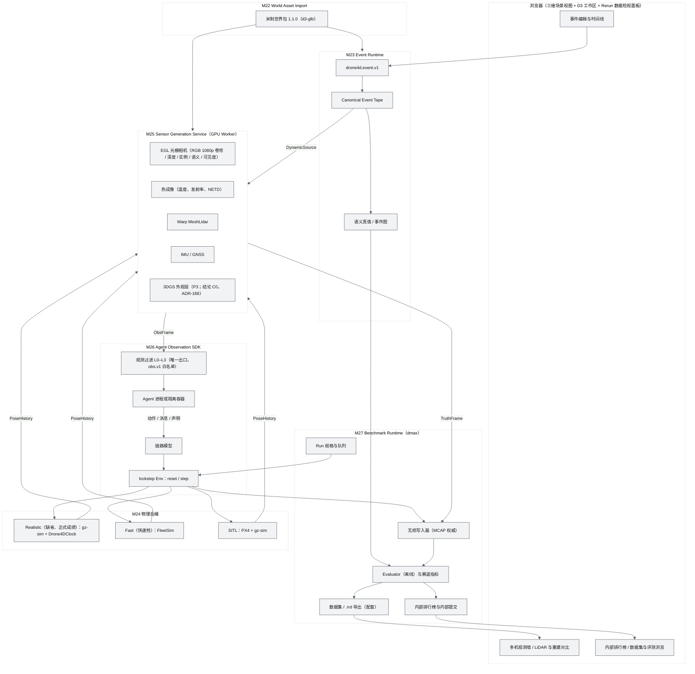
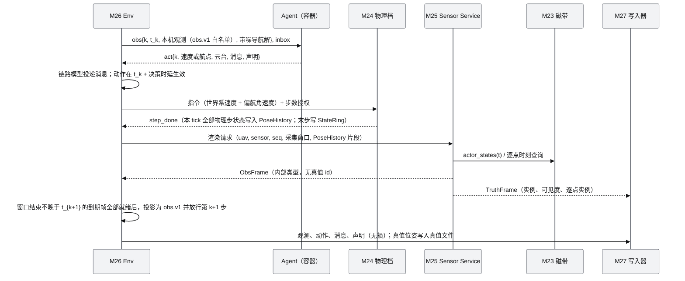
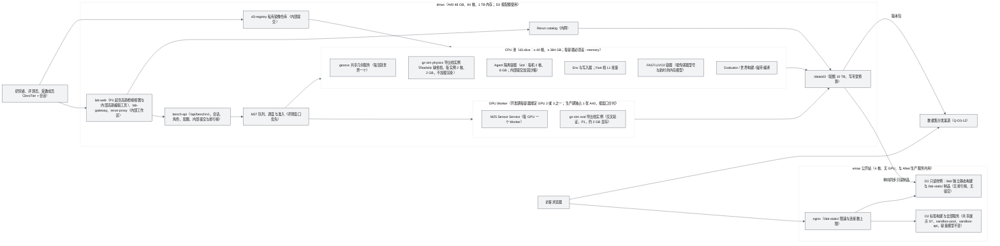
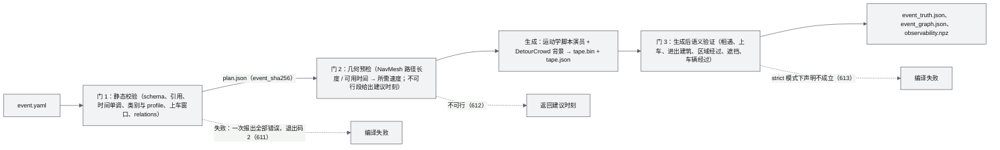
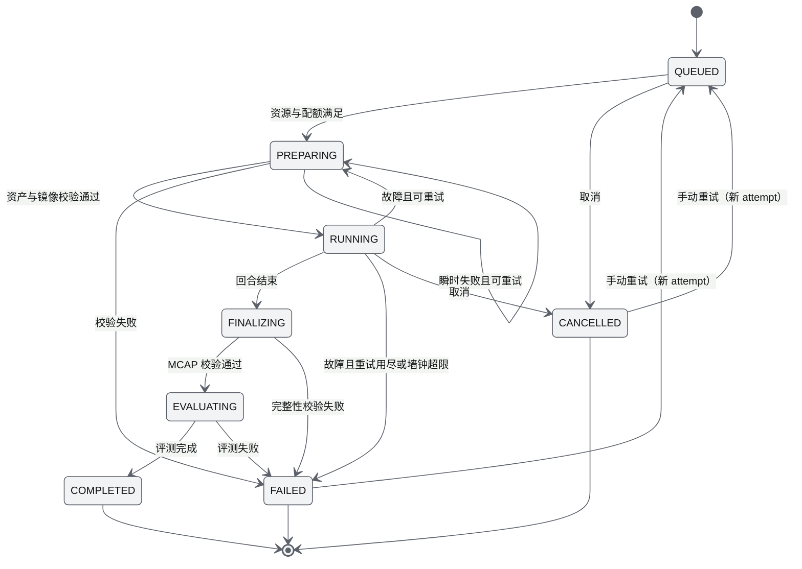
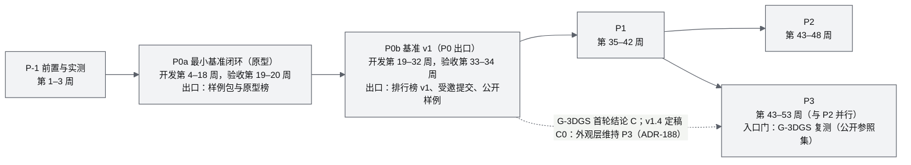

# 05 D3 设计增补与决策记录（D3 Design Supplement & Decision Record）

| 项 | 内容 |
|---|---|
| 文档编号 | AWR-05 |
| 标题 | D3 设计增补与决策记录 |
| 版本 | v1.6 |
| 日期 | 2026-10-20 |
| 状态 | 草案 v1.6（按用户 2026-10-18 决定新增 ADR-194：D3 封板范围为 P-1、P0a、P0b，P1 至 P3 移出并登记为 D3.x 顺延清单；涉及合入 `main`、公开站上线与样例上传的条款在封板前实际上线并实测；性能类正式数字只在独占卡上采集；人工评审由 Opus 起草并先行生效；§7.10 新增 D1 至 D4 交付称谓表。ADR-194 先行生效，待封板前用户确认，待确认事项见 §23.5；见 §3.8、§7.10、§10、§11、§23）。同版并入决策登记（`docs/impl/D3-决策登记.md`）的 ADR-195 至 ADR-205（先行生效，待封板前用户确认），按 ADR-197、ADR-198 修订 D3-AC-07、10，并入封板收尾批次各任务的实现口径、实测记录与验证位置，见 §24；2026-10-19 并入封板收尾第二批的实现口径、实测记录与验证位置，新增待确认事项 §23.5 C-12 至 C-17，见 §25；同日并入第三批，新增 ADR-206 至 ADR-208 与待确认事项 C-18 至 C-23，见 §26；同日并入第四批，新增 ADR-209 至 ADR-211 与待确认事项 C-24 至 C-32，见 §27；2026-10-20 并入第五批，无新增生效 ADR，新增待确认事项 C-33 至 C-37（C-33 为 D3-AC-03 锚点条款口径的 ADR 草案，待用户决定，未生效），见 §28；同日并入第六批，新增 ADR-212（D3-AC-03 锚点吸附条款在 crop 上的口径，K06 按 §28.5 选项 (A) 实现，先行生效，待封板前用户确认）与待确认事项 C-38、C-39，见 §29；v1.5 状态：草案 v1.5（按用户 2026-10-17 交互式确认的 4 项决定修订 P0a 开发顺序与分支规则，见 §3.7、ADR-193 与 §22；范围、验收与工作量不变）；v1.4 状态：草案 v1.4（首轮交叉评审已处置，见 §17；模块反馈已裁决，见 §18；按用户 2026-10-12 交互式确认的设计决定修订，决策变更记录见 §19；并入高斯外观层评估实验 r11 的结论，决策门首轮裁决见 §6.4.1 与 ADR-187，并入记录见 §20；按用户 2026-10-12 第二次交互式讨论确认的 5 项决定定稿并并入研究单元 r12（SuperSplat），高斯外观层定为结论 C0、排行榜改为多赛道，决策变更记录见 §21；本版无待用户确认的裁决） |
| 上游文档 | 用户 D3 需求原文、补充要求、2026-10-12 决策与 2026-10-12 两次交互式讨论确认的设计决定 [inputs/D3-需求原文-2026-10-11.md](inputs/D3-需求原文-2026-10-11.md)；用户设计讨论 design-r1（`/data/projs/anet-drone-data/design-r1.md`，D3 设计阶段并入 `docs/inputs/`）；D3 研究总览 [research/d3/00-index.md](research/d3/00-index.md) 与 r1–r12 笔记（r11 为 Skyfall-GS 研读与生成式高斯外观层实验 D3-SKY：[research/d3/r11-skyfall-gs.md](research/d3/r11-skyfall-gs.md)；r12 为 SuperSplat、SuperSplat Viewer 与 splat-transform 的研读与实验：[research/d3/r12-supersplat.md](research/d3/r12-supersplat.md)）；[AWR-03](03-设计基线与决策记录.md)（ADR-001 至 ADR-087）；[AWR-04](04-D2-设计增补与决策记录.md)（ADR-088 至 ADR-126）；[AWR-20](20-机型与传感器目录.md)；[16](16-World数据规范.md)、[17](17-接口与实时协议规范.md)、[19](19-部署与运维说明书.md)；M03、M04、M05、M06、M07、M08、M12、M13、M14、M17、M18-M19、M20 PRD；D2 实现与验收报告（`docs/impl/D2-*`） |
| 下游文档 | 新增模块 PRD：M22 World Asset Import、M23 Event Runtime、M24 Physics Backends、M25 Sensor Generation Service、M26 Agent Observation SDK、M27 Benchmark Runtime（文件名见 §1.3）；10–19 号说明书的 D3 增补节；AWR-20 的 D3 增补（长量程激光雷达型号）；M03、M04、M05、M06、M07、M08、M11、M12、M13、M14、M15、M16、M18-M19、M21 PRD 的 D3 增补节；D3 实现与验收报告（`docs/impl/D3-*`） |
| 适用版本范围 | V0.3（即本期交付 D3）至 V1.0 |
| 修订记录 | v1.0（2026-10-12）：首版。定位、四权威架构与部署分工；模块 M22–M27；R-D3-01 至 R-D3-40；ADR-127 至 ADR-159；D3-AC-01 至 D3-AC-45；工作包 WP-D3-00 至 WP-D3-23；Q-D3-01 至 Q-D3-10。v1.1（2026-10-12）：首轮交叉评审处置（51 条，含阻塞级 2 条，全部采纳）。P0 拆分为 P0a、P0b 两个出口并各设 2 周验收与加固缓冲；新增 ADR-160 至 ADR-166（PoseHistory 与 IMU 合成、观测白名单与种子保密、锁步背压、存储治理与数据分发、公开提交边界、相机独立包、工作区部署与角色）；新增 D3-AC-46 至 D3-AC-54；新增 WP-D3-24 至 WP-D3-29；扩展点增至 17 处；新增 Q-D3-11、Q-D3-12；工作量由 89.5 人周修订为 117.5 人周；追加 §17 评审处置记录。v1.2（2026-10-12）：M22–M27 PRD 与 14 §21、17 §18、20 §15 的基线反馈共 165 条逐条裁决（§18）；新增 ADR-167 至 ADR-173（世界包确定性构建与几何服务、事件真值版本与环境轨、时钟档与物理档导出档、Agent 动作守卫与定位档、传感器生成单一实现、实验规格与种子承诺、工作区会话与数据访问）；修订 ADR-130、131、138、145、149、157、160、161、163、164、166 的相关条款；新增 D3-AC-55；模块与相邻文档的冲突项按裁决统一（stage 区段、求交瓦片、导航解与云台读数的生成方、噪声参数单一真源、时钟档）；文档集文件名与状态按实际更新；工作量修订为 123.3 人周；新增 Q-D3-13。v1.3（2026-10-12）：按用户交互式确认的 11 项设计决定（R-D3-41 至 R-D3-51）修订：交付重心改为基准排行优先，内部排行榜与内部提交（内部与受邀成员，dmax 隔离容器执行）提前到首个里程碑与 P0，排行榜不对外，数据集导出保留为配套能力；gz-sim 锁步档提前为 P0 缺省物理档并成为正式成绩的唯一来源，FleetSim 保留为快速档；相机第一阶段增加卷帘快门、热成像与 1080p 多机输出；第一批事件纳入跨遮挡身份保持、多人交汇与交接、车辆追踪、未知位置目标搜索四类；主得分由 EC、EU、AO、CE 合成；公开站只读展示样例、不展示排行榜（取消 P3 公开配额提交）；首个里程碑重新定义为"最小基准闭环"并据此重排 P0a、P0b 至 P3；登记高斯外观层（网格 → 3DGS → 扩散逐级细化）的评估项与决策门。新增 ADR-174 至 ADR-186，修订 ADR-127、132、136、137、138、140、141、142、147、149、150、151、152、156、159、163、164、165、166、169、172 的相关条款（各 ADR 末尾"v1.3 修订"条）；新增 D3-AC-56 至 D3-AC-65，废止 D3-AC-44；新增 WP-D3-30 至 WP-D3-37；工作量修订为 144.3 人周；新增 Q-D3-14 至 Q-D3-17；追加 §19 决策变更记录。v1.4（2026-10-12）：并入研究单元 r11（Skyfall-GS 研读与"网格 → 3DGS → 扩散逐级细化"实验，D3-SKY）的结论：§6.4 增加首轮评估结论、P0b 收尾、方案比较与所需工作包和工期、门限修订 G-3DGS v2、再评估触发条件、风险与待确认事项（§6.4.1 至 §6.4.7）；新增 ADR-187（决策门首轮裁决为结论 C：生成式高斯外观不提前到 P1，维持 P3 并保留为研究工具；网格蒸馏 3DGS 基础设施验证与真实航拍参照集的 P1 方案 C1 待用户确认）；修订 ADR-141、ADR-186 的相关条款（末尾"v1.4 修订"条）；外观来源枚举增加 `mesh_distilled`，正式成绩分轨只接受 `mesh`（P3 起经榜单版本登记可接受 `aerial`）；C3 合成补充为 C3-G；世界包高斯图层目录统一为 `visual/gaussian/`；§14 登记扩散模型白名单并排除 FLUX.1 [dev]；更新风险 36，新增风险 39、40；更新 Q-D3-14，新增 Q-D3-18；追加 §20 并入记录。方案 C1 确认前阶段计划、验收与工作量不变（144.3 人周，有效验收 64 条）。同日按用户第二次交互式讨论确认的 5 项决定（R-D3-52 至 R-D3-56）定稿 v1.4，并入研究单元 r12（SuperSplat、SuperSplat Viewer 与 splat-transform）：高斯外观层定为结论 C0（维持 P3，第一阶段只用网格渲染，不采纳方案 C1；v1.4 草案为方案 C1 预留的 WP-D3-38、D3-AC-66、67 作废、不复用）；G-3DGS 保留为 P3 入口门，参照集只用公开数据集（§6.4.8）；FLUX.1 [dev] 允许在内部研究中复测 Skyfall-GS 原版细化，许可解释由用户负责，产出不进入发布制品（§6.4.9）；排行榜取消缺省合成权重，改为"分轨 × 赛道"的多赛道报告，各赛道分别报告四项指标及其置信区间，合成主得分为后续评分版本的待定项（§5.6.9）；SuperSplat 系高斯采纳项登记在 P3，网格选择交互复用于 P1 事件编辑器（§6.5）。新增 ADR-188 至 ADR-192；修订 ADR-141、150、154、172、182、186、187 的相关条款（末尾"v1.4 修订"条）；新增 D3-AC-68 至 D3-AC-71，修订 D3-AC-18、26、41、43、56、57、58、62、64；新增 WP-D3-39 至 WP-D3-42，修订 WP-D3-17、22、30、35、37；关闭 Q-D3-14、Q-D3-18，新增 Q-D3-19、Q-D3-20；更新风险 36、38、39、40，新增风险 41 至 45；工作量修订为 156.05 人周（P1 +0.75、P3 +11.0），4 人编制全程约 53 周；有效验收 68 条（阻塞 52 条、应交付 16 条）；追加 §21 决策变更记录。v1.5（2026-10-17）：按用户交互式确认的 4 项决定（R-D3-57 至 R-D3-60）修订：P0a 按"看见、运动、评测"三个子里程碑顺序开发（范围、交付物、退出标准与工作量不变，§10.2）；重申高斯外观层结论 C0；彩色相机输出在内部工作区与 Python SDK 提供，公开站只展示预渲染样例；D2 已登记的 5 项小缺陷先在 `d2` 维护分支修复，`d3-dev` 自 `d2` 创建，下一大版本整体验收前不合入 `main`、不更新公开站。新增 ADR-193；追加 §3.7、§22；工作量仍为 156.05 人周，有效验收仍为 68 条。v1.6（2026-10-18）：按用户 2026-10-18 决定（R-D3-61 至 R-D3-70）新增 ADR-194：D3 封板（V0.3 发布，标签 `v0.3.0`）范围为 P-1、P0a、P0b 的 41 条验收（阻塞 39 条、应交付 2 条），P1 至 P3 的 27 条验收与 50.75 人周移出 D3 封板并登记为 D3.x 顺延清单（不是豁免，编号与阈值保留）；涉及合入 `main`、公开站上线与样例上传的条款在封板前实际上线并以生产环境实测判定；性能类正式数字只在独占卡上采集；人工评审由 Opus 起草并先行生效、封板前汇总用户确认；公开样例与数据集的分发渠道为 ModelScope（Q-D3-12 关闭）；NavMesh 采用 Recast/Detour，D3-AC-07、10 的条款修订由决策登记给出；§7.10 新增 D1 至 D4 交付称谓表，下一大版本统一称 D4。追加 §3.8、§23，新增 Q-D3-21 至 Q-D3-24；ADR-194 先行生效，待封板前用户确认。同日并入决策登记的 ADR-195 至 ADR-205（独占卡口径与性能验收窗口、NavMesh 采用 Recast/Detour 与查询服务 navsvc、D3-AC-07 与 D3-AC-10 修订、Interactive 模式局部偏离模型、大模型白名单与每运行预算、ModelScope 分发渠道、干净主机代用、Tier B 参考设备、离线依赖获取、资产许可复核），修订 ADR-132、ADR-185，关闭 Q-D3-01；并入封板收尾批次（H01、H02、I01、L01、G01、G02、W01 至 W06、S01、S02、S04、S05、S10、S11、P01 至 P04、P06、A01、A02、A04、A05、B01 至 B07、B30、R01、E02 至 E04、F01）的实现口径与验证位置，追加 §24 封板收尾记录；阈值不变。2026-10-19 并入封板收尾第二批（S03、E01、W09、W10、F02、F03、L02、L03、A03、S06 至 S09、D00、P05、P07、P08、B08、B09、B11、B12、B14、B15、SL1、R02 至 R04、S12、S13、A06、L04、E05、G64）的实现口径、实测记录与验证位置，修订 ADR-195 决策 (3) 与 ADR-196、198、202、204 的后果条，D3-AC-09、11、59、63 增加口径说明并登记待确认事项 C-12 至 C-17，追加 §25；阈值与验收计数不变。2026-10-19 并入封板收尾第三批（W11、G03、G04、G05、B13、B16、B18、F04、F06、F08、R05、R06、A07、A08、A11、E06、E07、E08、S14 至 S18、P09、H06）：新增 ADR-206（G5 幻觉审计门限冻结）、ADR-207（D3-AC-12 逐射线计数口径）、ADR-208（Realistic 档 RefTracker 与两档容差冻结），D3-AC-12 逐射线条款表述按 ADR-207 修订，D3-AC-33 引用道路走廊定义，登记待确认事项 C-18 至 C-23，追加 §26；阈值与验收计数不变。2026-10-19 并入封板收尾第四批（K01、K02、W07、W08、W13、W14、F05、F07、A09、S19、S20、B19、B23、B24、B26、H04）：新增 ADR-209（D2 v0.2.2 的执行：重建 `d2`、两个提交、合入 `d3-dev`、C-02 确认后打标签）、ADR-210（D3-AC-02 调平验收以公开 DEM 交叉核对 L5 替代控制点判据，用户 2026-10-19 决定）、ADR-211（NavMesh 对拉伸面的处理），确认事项 C-24（`v0.2.2` 产品版本号保持 0.2.0）、C-25（GitHub About 与 12 个 topics）与 C-26 至 C-32；D3-AC-02 增加 L5 注记，D3-AC-01、04、11、13、15、21、22、25、33、51、58、59、62、63 的验证位置与实测摘要并入，追加 §27；阈值与验收计数不变。2026-10-20 并入封板收尾第五批（W12、E09、SL2、S21、B25、R07）：ADR-196 后果补记 Detour 后端交付、`AWR_EVENT_NAV` 与跨机对拍；D3-AC-03、11、12、14、21、22、25、33、34、59、62 的验证位置与实测摘要并入，其中 S21 在独占卡（dmax GPU 2，A 级）上取得正式数字：D3-AC-12、22 的性能条款通过，D3-AC-11 与 D3-AC-34 的启动时长条款不通过；§4.7 与 §5.3.5 补记资源与 RTF 实测；§5.6.8、§12.2 的 `d3-registry` 部署件路径改为 `tools/deploy/dmax/registry/**`；§8.1 登记 `event.v1` 的 `drive`、`stop`、`park` 与 `tape_manifest.v1` 的 `report.lanes`；§14 登记 CNCF Distribution；登记待确认事项 C-33 至 C-37，D3-AC-03 锚点条款的口径以 ADR 草案提交用户决定（§28.5）；追加 §28；阈值与验收计数不变。2026-10-20 并入封板收尾第六批（K03、K04、K05、K06、SL3、F13）：新增 ADR-212（D3-AC-03 锚点条款的分母定义与 crop 西侧 off-mesh 连接，先行生效）；ADR-196 后果补记正式运行的磁带守卫与编译镜像 `d3-compile:dev`；§5.4.3 实现状态改为效果链与 PBO 异步读回已实现（K03），§5.4.6、§5.6.2 补记 SLAM 锚定点与 CPU 份额的实测（SL3），§5.3.6 补记 `/lab/compare`（F13），§5.6.3 热成像 `temp_ck` 改为 zstd level 1；D3-AC-03、11、14、22、34、35、47、59 的验证位置与实测摘要并入，其中 K04 在 CPU 池复测 D3-AC-34 的性能条款通过，K06 按 ADR-212 使 D3-AC-03 通过，SL3 按暂定阈值判 D3-AC-14 两条不通过，K03 的 D3-AC-11 独占卡正式复测在并入时仍在进行；登记待确认事项 C-38、C-39，C-33 至 C-35 补记；追加 §29；阈值与验收计数不变 |

## 0. 摘要

1. **定位**：Drone4D D3 定义为 *A World-Grounded Event Simulation and Active Observation Benchmark for Collaborative Aerial Agents*（面向协同空中智能体的真实世界事件仿真与主动观测基准）。核心命题是"同一世界 + 同一事件 + 不同机队策略 → 不同观测"，研究问题是在部分可观测条件下，多个自主智能体如何协同决定在何处、何时、以何种方式观测动态世界（§2）。
2. **交付重心（v1.3）**：基准排行优先。内部排行榜与内部提交（内部成员与受邀成员，提交的 Agent 容器在 dmax 隔离执行）自首个里程碑起提供原型，P0 出口交付排行榜 v1；排行榜只在内部工作区展示、不对外；数据集导出保留为配套能力（§2.1、ADR-174、ADR-183）。
3. **与 D1、D2 的关系**：D2 原样保留为公开交互沙盒；D3 是运行在 dmax 上的事件沙盘与基准系统，只新增包，经 17 处扩展点与 D2 接合并以回归门守护；公开站在 V0.3 切换前保持 D2 标签构建，D3 只读样例视图以独立静态构建挂在 `/lab/`（§4.8，ADR-129）。
4. **架构**：世界、事件、物理、智能体四个权威互不越界；Sensor Generation Service 是位姿与磁带的纯函数，所有物理档共用；Benchmark Runtime 负责编排、录制、评测、赛道指标与内部排行榜（§4，ADR-128）。
5. **世界与事件**：三份 Sketchfab GLB 是带烘焙光照的摄影测量三角网格，不是 3DGS，也不是米制；M22 强制完成米制尺度、真北与调平标定并派生几何、导航与质量层，crop 小镇为首个场景。M23 以 `drone4d.event.v1` 编译出跨机逐字节一致的 Canonical Event Tape；第一批事件纳入四类：跨遮挡身份保持（Re-ID）、多人交汇与交接、车辆追踪、未知位置目标搜索，分别配套可区分外观的人物外观库、关系事件与事件图、车辆路网与驾驶行为、搜索任务与目标先验（ADR-130 至 ADR-136、ADR-181）。
6. **物理（v1.3）**：Realistic 档（gz-sim 锁步，`Drone4DClock` 进程内门控）提前为 P0 缺省物理档，排行榜正式成绩只在 gz-sim 锁步档产生；FleetSim 保留为快速档，用于开发、训练与大规模搜索；SITL 档只做飞控验证；三档经统一 DroneAdapter 接入、共用 M25 传感器服务，并以逐物理步的无损 PoseHistory 提供位姿与比力；gz 实例缺省为不加载渲染的 `physics` 导出档，每实例 2 核、2 GB 内存、不占 GPU（ADR-137、ADR-138、ADR-160、ADR-176 至 ADR-178）。
7. **传感器**：快速照片级相机采用 EGL/OpenGL 网格光栅化，一遍 MRT 输出 RGB、深度、实例、语义；第一阶段在既有效果链上增加卷帘快门（逐顶点行时刻投影）、1080p 多机输出（nvJPEG）与热成像（实体温度与发射率、环境辐射、大气透过、NETD 与固定图案噪声）；吞吐目标按相机档位分列（`rgb720-gs` 晴天 ≥ 120、最坏 ≥ 80 帧/s；`rgb1080-rs` 晴天 ≥ 60、最坏 ≥ 40 帧/s；`therm512` ≥ 300 帧/s，均为暂定、P-1 实测后冻结）。网格 LiDAR 采用 Warp GPU 逐射线求交与逐点时刻，IMU 由物理档比力合成。3DGS 为可切换外观层，几何、遮挡、标签与 LiDAR 恒取网格；"网格 → 3DGS → 扩散逐级细化"（参照 Skyfall-GS）已按决策门完成首轮评估（r11）：扩散细化没有带来可测的低空观感增益，不约束几何时还使几何与多视一致性显著劣化，裁决为结论 C；v1.4 经用户确认定为结论 C0：第一阶段不做高斯外观，P0a 至 P2 的无人机视角一律为网格渲染，3DGS 外观层（网格蒸馏验证图层、外观层工程与真实航拍资产）全部在 P3，不采纳 P1 前移方案 C1；G-3DGS 保留为 P3 入口门，真实参照集只用公开数据集；FLUX.1 [dev] 只在内部研究中用于复测 Skyfall-GS 原版细化（ADR-139 至 ADR-143、ADR-179、ADR-180、ADR-186 至 ADR-190）。
8. **观测、评测与排行榜**：M26 是 Agent 的唯一观测出口（`bench/obs.v1` 白名单、排名运行种子保密、lockstep 与决策时延、链路模型、隔离容器），Python SDK 与 3 个基线策略在首个里程碑交付，大模型指挥层与 ANet 多智能体委派在 P1 接入。M27 以 MCAP 为唯一权威帧存储；排行榜以"分轨 × 赛道"为比较单元：赛道按事件类型（跨遮挡身份保持、多人交汇与交接、车辆追踪、未知位置目标搜索）或研究任务划分，每个赛道分别报告事件捕获率 EC、事件理解 EU、主动观测效率 AO_real、协同效率 CE 四项指标及其 95% 置信区间（"种子 × 重复运行"的两阶段分层自助法），逐项判定统计并列；v1.4 取消缺省合成权重，合成主得分为后续评分版本的待定项，计算接口与 `score_version` 权重字段保留（ADR-145 至 ADR-150、ADR-182、ADR-185、ADR-191）。
9. **Rerun 与公开站**：Rerun 作为数据检视与跨 Run 查询层；公开站只读展示样例（事件回放、多机私有视角、样例数据检视 Rerun 面板），不展示排行榜与任何得分比较，不接受提交（ADR-149、ADR-184）。
10. **部署**：内部工作区、bench-api、排行榜服务与私有镜像仓库部署在 dmax；dmax GPU Worker 承担渲染、LiDAR 与 gz `xval` 实例，CPU 池承担 gz `physics` 实例、Agent 容器、FAST-LIVO2、评测与世界构建；开发期每个容器绑定 GPU 2 或 GPU 3 之一，评测、生产与性能验收期独占 1 张 A40 并按窗口分时（评测优先于生产）；D3 在 dmax 上的 CPU 配额修订为 40 核（ADR-151、ADR-163、ADR-178）。
11. **交付**：首个里程碑 P0a 为"最小基准闭环"：crop 小镇米制世界 + 1 个固定事件 + gz-sim 锁步 + 多机相机与 LiDAR + Python SDK 与 3 个基线策略 + 评测与内部排行榜原型，跑通后交付样例与原型榜；P0b 为基准 v1（四类事件、热成像、排行榜 v1 与受邀提交、FAST-LIVO2 重建对比、公开站样例）；其后 P1、P2、P3。估算 156.05 人周（±40%，不含验收轮次）：v1.3 为 144.3 人周（较 v1.2 增加 21.0 人周，其中 gz-sim 前移 5.0 人周），v1.4 增加 11.75 人周（P1 事件编辑器网格选择交互 0.75；P3 网格蒸馏验证图层 0.5、高斯发布流水线与外部资产配方 2.5、内部高斯编辑与检视 4.0、Spark 共渲染 3.0、P3 入口门 1.0），4 人编制约 53 周；验收 68 条有效（阻塞 52 条、应交付 16 条；D3-AC-44 废止，D3-AC-66、67 为未采纳方案的预留编号，作废）（§10、§11、ADR-175、ADR-188、ADR-192）。
12. **高斯资产工具链（v1.4，r12）**：splat-transform 高斯发布流水线、内部 SuperSplat 编辑器（v3 WebGPU 构建为主、v2 WebGL2 构建备用）、Lab 高斯检视视图与场景视图 Spark 共渲染随高斯外观层登记在 P3；SuperSplat 的选择交互与屏幕掩码命中测试逻辑改在网格上实现，复用于 P1 事件编辑器的区域、锚点与几何不完整标注；M25 运行期继续以 gsplat 作为高斯渲染后端，只借用 SOG/SPZ 格式与 `fillRatio` 发布门（§6.5、ADR-192）。
13. **封板与称谓（v1.6）**：D3 封板（V0.3 发布，标签 `v0.3.0`）的范围为 P-1、P0a、P0b 三个出口，共 41 条验收（阻塞 39 条、应交付 2 条）；P1、P2、P3 的 27 条验收与 50.75 人周移出 D3 封板，编号与阈值原样保留，登记为 D3.x 顺延清单，去向（D3.x 增量交付或并入 D4）由 D4 概念设计评审确认。涉及合入 `main`、公开站上线与公开样例上传的条款在封板前实际上线，并以生产环境实测判定；性能类正式数字只在独占卡上采集；封板范围内不设豁免。交付称谓统一为 D1（V0.1）、D2（V0.2）、D3（V0.3）、D3.x（V0.3.x）与 D4（下一大版本，调研与概念设计阶段，AWR-06），不使用"Drone4D 2.0"一类称谓（§7.10、ADR-194；先行生效，待封板前用户确认）。

---

## 1. 本文的地位与使用规则

### 1.1 地位与裁决顺序

1. 本文是 D3 全部文档与实现的**唯一基线**。D3 范围内的冲突按以下顺序裁决（高者为准）：**用户 D3 需求原文、补充要求、2026-10-12 决策与 2026-10-12 两次交互式讨论确认的设计决定（R-D3，§3）> 用户硬性要求 R1–R4（AWR-03 §2.4）> 本文（AWR-05）> AWR-04 > AWR-03 > D3 研究总览 00-index > r1–r12 笔记 > design-r1 > 01-design**。用户决定之间存在先后时以后者为准：交互式确认的决定（R-D3-41 至 R-D3-51）取代此前决策中与之冲突的部分（R-D3-26 的阶段条款、R-D3-27 的 P3 公开配额提交、R-D3-35 的阶段、R-D3-38 的资产阶段），取代关系逐条登记在 §3.5 与 §19；第二次交互式讨论确认的决定（R-D3-52 至 R-D3-56，v1.4）取代此前决定与设计中与之冲突的部分（R-D3-50 的合成主得分、R-D3-51 的 P1 前移评估选项、ADR-187 的方案 C1），取代关系登记在 §3.6 与 §21；2026-10-18 用户决定（R-D3-61 至 R-D3-70，v1.6）取代此前决定与设计中与之冲突的部分（§10 以 P-1 至 P3 全部出口为 D3 交付的条款、§4.7 与 Q-D3-01 在封板时的条件通过条款、ADR-193 决策 (3) 中合入 `main` 的时点与 Q-D3-12 的镜像渠道），取代关系登记在 §3.8 与 §23。
2. 用户 2026-10-12 采纳的默认决策（FAST-LIVO2 只以独立容器使用、OSM 派生数据单独标注 ODbL、数据集署名）高于 AWR-03 R4a"科研用途，忽略 license"：凡对外发布的制品（公开站、GitHub 仓库、数据集、镜像）一律按 §14 执行许可与署名；仅限内部研究的镜像与中间产物仍适用 R4a（ADR-154）。
3. 本文不重述 AWR-03、AWR-04 已定义的内容；未在本文修改的条款（坐标、时间、单位、命名、契约演进、设计体系、写作规范、性能运行协议 ADR-033、多租户沙盒与容量模型等）原样适用于 D3。
4. 本文对 AWR-03、AWR-04 的修改一律以 ADR-127 起的追加 ADR 表达，并在 ADR 标题中写明"修订"或"扩展"的对象；AWR-03 §7.0 ADR 索引、附录 E 与 AWR-04 §12.0 增加索引行指向本文 §9，原 ADR 不删除。
5. 写作规范沿用 AWR-03 §10.2（中文、技术名词英文、需求编号、依据、mermaid、可测试验收、严禁 emoji 与状态字形）。D3 全部对外文案另受 §7.10 企业级文案规范约束（R-D3-21，ADR-153）；本文的表述同样遵循其原则（§7.10 中作为反例列出的词语除外）。
6. 本文凡引用实测数字，均以 00-index §1.2 的统一尺度为口径（town 8.374 m/单位、crop 20.935 m/单位、hill 2.49 m/单位）；标"需复测"的数字在 P-1 按正确尺度复测后由实现报告冻结。"dmax"指 A40 48 GB、容器 `--cpus 16`；"本机"指 8 核 Xeon E5-2603 v4、无 GPU。

### 1.2 编号、版本与术语

| 项 | 规则 |
|---|---|
| 用户需求 | `R-D3-xx`（§3）：R-D3-01 至 R-D3-20 来自需求原文与 design-r1 中用户本人撰写的段落，R-D3-21 至 R-D3-25 来自 2026-10-11 补充要求，R-D3-26 至 R-D3-40 来自 2026-10-12 决策，R-D3-41 至 R-D3-51 来自 2026-10-12 交互式确认的设计决定（v1.3），R-D3-52 至 R-D3-56 来自 2026-10-12 第二次交互式讨论确认的设计决定（v1.4），R-D3-57 至 R-D3-60 来自 2026-10-17 交互式讨论确认的设计决定（v1.5），R-D3-61 至 R-D3-70 来自 2026-10-18 用户决定（v1.6） |
| 本期交付 | **D3 = V0.3**。V0.3 主题由"环境物理化 I 与规划"修订为"事件沙盘与主动观测基准"，原 V0.3 条目的去向见 ADR-127。v1.6：D3 封板即 V0.3 发布，标签 `v0.3.0`，范围为 P-1、P0a、P0b；P1 至 P3 移出为 D3.x 顺延清单；D1 至 D4 的交付称谓与版本对照见 §7.10 交付称谓表（ADR-194） |
| 阶段 | `P-1`、`P0a`、`P0b`、`P1`、`P2`、`P3`（沿用用户决策用语）。用户决策中的"P0"由 P0a 与 P0b 两个出口共同交付。**v1.3 重新定义**（ADR-175）：P0a 为首个里程碑"最小基准闭环"（原型），P0b 为"基准 v1"（P0 出口）；v1.1 与 v1.2 中"P0a 事件与相机闭环、P0b LiDAR/SLAM 与公开站只读"的划分不再适用，新旧范围对照见 §19.3。每个出口对应一次 V0.3 小版本发布，版本号按 ADR-118 的单一来源生成。v1.6：D3 封板范围为 P-1、P0a、P0b；P1、P2、P3 的验收条目与工作包移出 D3 封板，阶段名、编号与阈值保留，随 D3.x 或 D4 交付（ADR-194） |
| 优先级 | 为避免与阶段名混淆，本文的优先级写作"阻塞"、"应交付"、"可延期"，分别对应 AWR-03 §10.2 的 P0、P1、P2 语义；M22–M27 PRD 的需求表仍用 P0/P1/P2，并另设"阶段"列 |
| 验收 | `D3-AC-xx`（§11）；模块 PRD 的 AC 用 `<前缀>-AC-###`，在"验收要点"列引用 D3-AC |
| ADR | 从 ADR-127 起连续编号（§9），本版为 ADR-127 至 ADR-212（ADR-195 至 ADR-205 由决策登记并入，ADR-206 由 G3DGS 评审记录并入，ADR-207、208 由封板收尾第三批起草，ADR-209 至 211 由封板收尾第四批起草，ADR-212 由封板收尾第六批起草，v1.6） |
| 新增模块 | M22–M27（§5）；需求前缀为模块号，例如 `M23-FR-001`；文件名以模块编号开头 |
| 工作包 | `WP-D3-xx`（§12） |
| 待决问题 | `Q-D3-xx`（§15） |
| 原因码 | 新增码段 600–699（§8.4，ADR-155），按模块划分子段 |
| 契约 | `packages/contracts` 由 1.2.0 升至 1.3.0，只增不改（ADR-155） |
| 随机流 | 新登记 19 `event_runtime`、20 `comm_link`、21 `obs_fast`、22 `sensor_gen`，以事件时间索引或帧序号取键（ADR-136、ADR-171）；排行榜置信区间的自助法重采样使用独立的 `board_bootstrap` 派生键，不占用仿真随机流（ADR-182） |

**术语**

| 术语 | 定义 |
|---|---|
| 世界（World）、世界包 | M22 产出的米制 World Package（`schemaVersion 1.1.0`、`profile = d3-glb`），以 `contentVersion` 标识版本。研究笔记中"World Package v2 / world.json v2"的说法一律指 1.1.0 加 `d3-glb`，不存在 2.x 主版本（D2 读取端只接受 `1.*`） |
| 事件（Event） | 以 `drone4d.event.v1` 描述的一段固定世界过程（脚本演员、背景人群、环境关键帧、通信干扰区、语义注释） |
| 事件磁带（Canonical Event Tape） | 事件编译后生成的唯一真值时间线（`drone4d.tape.v1`），以 `content_sha256`（规范头原始字节与解压后规范帧数据）标识；语义真值另以 `truth_sha256` 标识（ADR-168） |
| 实验规格、运行（Run）与运行清单 | 实验规格是研究者提交的请求（`seeds[]` 或 `seed_count`），按种子展开为若干 Run；Run 是一条磁带 + 一个机队配置 + 一个策略 + 物理档与时钟档 + 观测档 + 噪声档 + 一个运行种子的一次执行；运行清单 `run_manifest.json` 记录执行结果，排名运行只含种子承诺 `seed_commit`。进入排行榜或 test 集评分的运行称为排名运行，其运行种子对 Agent 保密（ADR-161、ADR-172） |
| 实验（Experiment） | 同一事件上一组 Run 的集合，对应 Rerun catalog 的一个 dataset |
| 物理档 | Realistic（gz-sim 锁步，**缺省档与正式成绩的唯一来源**）、Fast（FleetSim，快速档：开发、训练与大规模搜索）、SITL（PX4 + gz-sim，只做飞控验证）（v1.3，ADR-176） |
| 观测档 | L0 Oracle、L1 检测级、L2 渲染级（另设 L2-depth 子档）、L3 SITL/HIL；T0 特征级只用于不排名的开发运行（§5.5.3）。L0 与 T0 经独立的特权 schema `bench/obs_privileged.v1` 交付，不进入 `bench/obs.v1` |
| 定位档 | `localization ∈ {estimated, oracle}`：`estimated`（缺省）为带噪导航解，`oracle` 为真值位姿，只用于不排名分组与私有地图的上限评测；`clean` 噪声档的运行视同 `oracle` 单列（ADR-170） |
| 噪声档 | clean、realistic、harsh；逐传感器数值以 AWR-20 §15.6.5 为单一真源，离散化方法见 M25 PRD，§5.4.6 为摘要（ADR-171） |
| 外观层 | 静态场景的着色来源：`mesh`（缺省）或 `3dgs`；`3dgs` 的来源 `appearance_source` 取 `aerial`（真实航拍重建资产，P3）、`mesh_distilled`（以网格渲染图直接训练的 3DGS，只作 P3 外观层工程的验证资产与非排名运行，不宣称比网格更真实）或 `generative`（网格 → 3DGS → 扩散逐级细化，维持 P3 研究工具）（ADR-186 至 ADR-188）；几何、深度、遮挡、标签与 LiDAR 恒取网格；P0a 至 P2 只有 `mesh` |
| PoseHistory | 物理档逐物理步的无损状态历史（时刻、位置、姿态、速度、角速度、机体系比力），全部为机体原点量，是 M25 唯一的位姿来源（ADR-160）；杆臂项由 M25 按挂载外参计算 |
| 时钟档（`clock_profile`） | 四元组 `{name, main_hz, physics_hz, l1_hz}`，四元组（不是名称）进入运行哈希；D3 缺省 `{d1_250, 250, 250, 250}`，即 `FleetConfig.l1_every = 1`（ADR-169） |
| 事件沙盘 | 产品层对 D3 系统的称呼（对外文案用"事件沙盘"或"Event Lab"）。代码命名一律用 `lab`、`bench`、`event`，不得使用 `Sandbox`，以免与 D1 的沙盘视图 `ui/views/Sandbox.tsx` 和 D2 的沙盒会话 `sandboxSession` 混淆（AWR-04 §1.2）。用户可见称谓按 §7.10 统一：D1 视图称"三维场景视图"，D2 称"交互沙盒"，"沙盘"一词只用于 D3 |
| emax、dmax | emax 为公开站主机（4 核、无 GPU）；dmax 为实验与生产主机（A40 48 GB、64 核、1 TB 内存、`/data` 49 TB 可用） |
| 独占 GPU | 数据集批量生产与性能验收期间，D3 GPU Worker 独占的一张 A40，按验收、生产、训练窗口分时（R-D3-28，§4.7） |
| 最小基准闭环 | 首个里程碑（P0a）：crop 小镇米制世界 + 1 个固定事件 + gz-sim 锁步 + 多机相机与 LiDAR + Python SDK 与 3 个基线策略 + 评测与内部排行榜原型（R-D3-48，ADR-175） |
| 正式成绩 | 进入内部排行榜的成绩：只由 gz-sim 锁步档（`physics = realistic`、`physics_opts.export = physics`）、Exogenous 模式、已发布的 test 事件与榜单版本固定的秘密种子集产生（ADR-176、ADR-182） |
| 四项指标 | 事件捕获率 EC、事件理解 EU、主动观测效率 AO_real、协同效率 CE（归一化定义见 §5.6.9），均取值 [0, 1]；排行榜在每个赛道分别报告四项指标的点估计与 95% 置信区间（ADR-191） |
| 合成主得分（`S`） | 四项指标的加权合成（取值 0–100）。v1.3 曾以缺省权重 0.35、0.25、0.20、0.20 作为排名主键；v1.4 起为后续评分版本的待定项：`score_version` 保留权重字段与计算接口，权重未定义（`weights = null`）时不计算、不显示、不参与排序（ADR-182、ADR-191） |
| 分轨（track） | 排行榜的配置单元：固定机队（标准机型、机数、传感器与外观层）、观测档、物理档与智能体类别；不同分轨之间不比较（ADR-182） |
| 赛道（lane） | 分轨内按事件类型（`reid`、`handoff`、`vehicle`、`search`）或研究任务划分的比较单元；排行榜的最小比较单元为"分轨 × 赛道"，赛道之间不合并、不平均（ADR-191） |
| 榜单版本（`board_version`） | 一组冻结的分轨、赛道（含各赛道的 test 事件清单）、`score_version`、test 划分版本、秘密种子集承诺、评测器主版本与平台镜像摘要；版本变更时全部条目重新评测或归档（ADR-182、ADR-191） |
| 公开参照集（`refset`） | 只由公开数据集组成的真实航拍与 LiDAR 参照数据，用于 G-3DGS 的 G4（KID）与航拍域模型、P3 资产管线试点与 sim2real 回归；按各数据集许可只用于内部研究（§6.4.8、ADR-189） |
| P3 入口门 | P3 开始时按 G-3DGS v2 对各外观来源执行的决策门（含以公开参照集测量 G4、以 FLUX.1 [dev] 内部复测 Skyfall-GS 原版细化），结论决定各外观来源在 P3 的用途（§6.4.8、ADR-188） |
| 内部提交、受邀成员 | 内部提交：研究者或受邀成员把 Agent 容器镜像推送到 dmax 私有仓库并请求正式评测；受邀成员是经管理员邀请、以 `invited` 角色访问内部工作区的外部研究者，只能提交、查看内部排行榜与本人结果（ADR-183） |
| 相机档位 | 吞吐与验收的计量单位：`rgb720-gs`（1280 × 720 全局快门）、`rgb1080-rs`（1920 × 1080 卷帘快门）、`therm512`（640 × 512 长波红外）（ADR-179、ADR-180） |
| D3 封板（v1.6） | D3 交付的终结判定与 V0.3 发布：封板范围（P-1、P0a、P0b）内的验收按 §10 退出标准全部通过，发布动作已上线并实测，待确认事项经用户确认后，在 `main` 的合并提交上打 `v0.3.0` 标签（ADR-194）；对外文案称"V0.3 发布"，"封板"只用于内部文档 |
| D3.x 顺延清单（v1.6） | 移出 D3 封板的 P1 至 P3 验收条目与工作包的登记表，编号、阈值与依赖原样保留，各条去向为 D3.x 增量交付（V0.3.x）或并入 D4（§23.3、ADR-194）。顺延不是豁免：顺延条目不计入 D3 封板分母，交付时按原阈值验收 |
| 发布动作 | 合入 `main`、打版本标签、公开站（emax）上线、公开样例与数据集上传到分发渠道。v1.6 起，封板范围内涉及发布动作的验收条款以上线后的生产环境实测判定，cgroup 模拟与 dry-run 只作上线前演练（ADR-194） |
| 评测运行（排名运行） | 内部提交或基线在正式评测中执行的 Run；保留类别 `ranked_eval`：帧字节交付后只保留逐帧摘要，按抽样保留完整录制（ADR-163 v1.3 修订） |

### 1.3 D3 文档集与状态

| 文档 | 文件 | 定义的内容 | 状态 |
|---|---|---|---|
| 用户需求原文 | [inputs/D3-需求原文-2026-10-11.md](inputs/D3-需求原文-2026-10-11.md) | R-D3 的追溯源（含补充要求与 2026-10-12 决策） | 只读 |
| 用户设计讨论 | `inputs/D3-design-r1.md`（由 `/data/projs/anet-drone-data/design-r1.md` 原样并入） | 用户的设计讨论；R-D3-19、R-D3-20 的出处 | 只读（P-1 并入） |
| D3 研究 | [research/d3/00-index.md](research/d3/00-index.md)、r1–r12（r11 为 v1.4 并入的 Skyfall-GS 研读与生成式高斯外观层实验；r12 为 v1.4 并入的 SuperSplat、SuperSplat Viewer 与 splat-transform 研读与实验） | 实测数字、推荐架构、风险与默认值 | 只读 |
| AWR-05 | 本文 | D3 唯一基线：定位、架构、模块 M22–M27、ADR-127 至 ADR-212、阶段计划、D3-AC、工作包、风险、许可、评审处置记录（§17）、模块反馈裁决（§18）、决策变更记录（§19、§21、§22、§23）、r11 结论并入记录（§20）与封板收尾记录（§24 至 §29） | 草案 v1.6 |
| AWR-M22 | [modules/M22-World资产导入PRD.md](modules/M22-World资产导入PRD.md) | GLB 导入、标定、派生资产、MeshWorldQuery 与共享几何服务、CLI；v1.1 增补车道图前移与生成式外观评估输入；v1.2 并入 r11 结论（外观来源分档、网格蒸馏构建阶段 `appearance.gs`、出处清单、按来源分档的入包验收）；v1.3 按 AWR-05 v1.4 定稿（结论 C0：高斯图层与 `appearance.gs` 在 P3；高斯发布子阶段；几何不完整人工标注） | 草案 v1.3 |
| AWR-M23 | [modules/M23-事件运行时PRD.md](modules/M23-事件运行时PRD.md) | 事件 DSL、编译门、磁带、人群、语义验证、环境轨、模式；v1.1 增补第一批四类事件与任务；v1.2 按 AWR-05 v1.4 同步赛道映射与事件编辑器网格选择交互的编辑资源 | 草案 v1.2 |
| AWR-M24 | [modules/M24-物理后端PRD.md](modules/M24-物理后端PRD.md) | Realistic（缺省）、Fast、SITL 档；PhysicsTier 与 DroneAdapter；PoseHistory；gz-sim 插件；SDF 导出；v1.1 增补正式成绩、确定性与每实例资源 | 草案 v1.1 |
| AWR-M25 | [modules/M25-传感器生成服务PRD.md](modules/M25-传感器生成服务PRD.md) | SensorBackend v2、PoseHistory 与 IMU 合成、相机、LiDAR、IMU、GNSS 与导航解、噪声离散化、3DGS、调度、`drone4d-camera` 独立包；v1.1 增补卷帘快门、1080p、热成像与高斯外观层决策门；v1.2 并入 r11 结论（C3-G 合成、外观来源 `mesh_distilled`、评估工具 G-3DGS v2）；v1.3 按 AWR-05 v1.4 定稿（结论 C0、P3 入口门与公开参照集、FLUX.1 [dev] 内部复测、gsplat 运行期与 SOG/SPZ 格式借用） | 草案 v1.3 |
| AWR-M26 | [modules/M26-智能体观测SDK-PRD.md](modules/M26-智能体观测SDK-PRD.md) | Env、观测分级与 `bench/obs.v1` 白名单、动作守卫、链路模型、私有地图、隔离与泄漏审计；v1.1 增补基线策略、热成像观测与大模型指挥层 | 草案 v1.1 |
| AWR-M27 | [modules/M27-基准运行时与数据集PRD.md](modules/M27-基准运行时与数据集PRD.md) | 实验与 Run 编排、录制与存储治理、数据集与分发、评测、SLAM 轨道、内部提交与排行榜、工作区服务进程；v1.1 增补主得分合成、分轨、榜单版本与受邀提交（v1.1 补记：Run 规格的外观来源与正式分轨约束，ADR-187）；v1.2 按 AWR-05 v1.4 改为多赛道榜单数据模型、展示与验收（合成主得分待定），并登记 P3 高斯接口 | 草案 v1.2 |
| D3 增补节（已写） | [14 §21](14-UI交互设计PRD.md)（事件沙盘工作区交互；§21.29 为 v1.3 修订，§21.30 为 v1.4 修订）、[17 §18](17-接口与实时协议规范.md)（bench-api、线协议、原因码 600–698 全表；§18.23 为 v1.3 修订，§18.23.7 为 AWR-05 v1.4 补记，§18.24 为 v1.4 修订）、[20 §15](20-机型与传感器目录.md)（长量程型号、D3 相机与噪声参数单一真源；§15.16 为 v1.3 修订，§15.17 为 v1.4 同步） | 对应文档的 D3 增补 | 草案（v1.4 同步） |
| D3 增补节（待写） | 10–13、15、16、18、19 号说明书；M03、M04、M05、M06、M07、M08、M09、M11、M12、M13、M14、M15、M16、M18-M19、M21 PRD | 对既有模块的 D3 改动（§5.0 影响表） | 待写（P0a、P0b 内随工作包完成） |

---

## 2. 产品定位与系统边界

### 2.1 定位

**名称**：产品名 ANet Drone4D（首次出现后可简称 Drone4D）。基准全称 *Drone4D: A World-Grounded Event Simulation and Active Observation Benchmark for Collaborative Aerial Agents*，中文全称"面向协同空中智能体的真实世界事件仿真与主动观测基准"。仓库标识 `ANet-Drone4D` 只用于 URL 与包名，不用于正文（§7.10）。

**核心命题**：

```text
Same World + Same Event + Different Drone Policies  =>  Different Observations
W(t) = EventRuntime(W0, E, seed, t)                         事件真值与无人机无关（Exogenous 模式）
O_i(t) = Sensor(W(t), Pose_i(t), Config_i)                   每架机只得到本机传感器在实际位姿下的观测
```

**研究问题**：How can autonomous agents collaboratively decide where, when, and how to observe a dynamic world under partial observability?

**与现有公开数据的根本差异**：现有大量无人机数据是固定航线、固定视频，观测在采集时就已固定。D3 固定的是世界与事件，开放的是机队数量、机型与传感器、飞行策略、协同策略与通信条件；同一事件可以被不同策略反复观测，每次产生由决策引起的新观测，并在统一口径下自动评分（R-D3-01 至 R-D3-06）。原型已在 crop 世界上验证该命题：同一磁带上 6 种机队策略各 12 个种子，Event Capture 从 0.25 到 1.00 不等（00-index §0 第 1 条）。

**交付重心（v1.3，R-D3-41，ADR-174）**：D3 以"基准排行"为首要交付物，数据集为配套能力。判断标准是：同一事件上的不同机队策略能否在统一、可复现、不泄漏真值的口径下被正式评分并排序。因此首个里程碑即包含评测与内部排行榜原型（§10.2），正式成绩只在 gz-sim 锁步档产生（ADR-176），排行榜只在内部工作区展示（ADR-183、ADR-184）；数据集导出、`.rrd` 派生与分发渠道沿用既有设计，按配套能力排期（P0b 导出、P3 发布）。

**系统能力（按数据流）**：

| 能力 | 承担模块 | 对外表述（企业级文案，§7.10） |
|---|---|---|
| 将真实摄影测量 GLB 转换为米制、可查询、可导航的世界包 | M22 | 世界资产导入与米制标定 |
| 以声明式 DSL 编排固定事件，并以世界几何验证其语义 | M23 | 事件编排与语义验证 |
| 以三档物理后端推进机体：Realistic 档（缺省、正式成绩）由 Gazebo Sim 提供刚体动力学，Fast 档用于开发、训练与大规模搜索 | M24 | 多保真度物理后端 |
| 按机体实际位姿生成相机（含卷帘快门与 1080p）、热成像、深度、分割、LiDAR、IMU 与 GNSS 观测 | M25 | 传感器生成服务 |
| 为每架机提供隔离的观测、受限的通信与统一的动作接口 | M26 | 智能体观测 SDK |
| 批量编排运行、无损录制、自动评测与赛道指标、内部提交与排行榜、导出数据集 | M27 | 基准运行时 |

### 2.2 与 D1、D2 的关系

| 交付 | 定位 | 运行位置 | 在 D3 中的状态 |
|---|---|---|---|
| D1（V0.1） | Mock 覆盖全层的 World Runtime：点云 Web 世界、FleetSim 机群、环境、录制回放 | 本机与 emax | 原样保留；D3 复用其内核、契约、设计体系与录制格式 |
| D2（V0.2-demo） | 公开交互沙盒：多租户会话、识别物与感知判据、任务编排与接力监控、开放接口 | emax 公开站 | **原样保留为公开交互沙盒**；D3 不改变其容量模型、公开 profile 与组合根 |
| D3（V0.3） | 事件沙盘与主动观测基准（基准排行优先，数据集为配套能力）：世界导入、事件运行时、多档物理、传感器生成、观测 SDK、基准运行时与内部排行榜 | dmax（GPU Worker 与 CPU 池）；emax 只承载只读样例视图 | 本文 |

接合方式（ADR-129）：

1. **发布次序**：D2（含 D2.1）完成验收后打标签，发布到 GitHub `main` 与公开站 `https://drone4d.agentnetwork.org.cn/`（R-D3-18，另一工作流负责）。D3 自该标签拉 `d3-dev` 分支；D2 的后续修复只在 `d2` 维护分支进行，再合入 `d3-dev`，不反向合并。D2 发布前须通过发布面文案复核（D3-AC-46，P-1）。公开站发布线：V0.3 切换前，emax 主构建保持 D2 标签构建，D2 热修经 `d2` 分支打标签后部署；D3 只读视图自 P0b 起以 `d3-dev` 的独立静态构建挂在 `/lab/`；切换条件与回滚见 ADR-129。
2. **只新增包**：`awr.world.glb`、`awr.world.mesh`、`awr.sim.events`、`awr.phys`、`awr.sensorsvc`、`awr.agentsdk`、`awr.bench`；前端新增 `engine/actors`、`viewport/layers/worldMesh.tsx`、`ui/lab/**`。D2 包不得 import D3 包，以 import 方向测试固定。
3. **17 处扩展点**：对 D2 文件的改动只限 §12.3 列出的 17 处（约 29 个文件；P-1 实施第 1–12 处与第 17 处，P0b 实施第 15、16 处，P1 实施第 13、14 处）。第 1–16 处是加字段、加枚举、加分派、加开关的小改，缺省路径不变；第 17 处是 D2 发布面的文案复核，只改文案、不改功能。
4. **开关与组合根**：D3 插件只出现在 `D3_PLUGINS` 与 `runtime.yaml` 的 `d3` profile 中；`AWR_D3_ENABLED`（缺省 0）控制 D3 路由、`open_world_query` 的网格分派与 D3 topic 的生产者；公开站组合根不加载 D3 插件。
5. **回归门**：每个 D3 工作包合入前，D2 全部测试通过，并在"安装 D3 包、开关关闭"与"开关打开但不加载事件"两种条件下对拍批处理事件流、resim 帧摘要与 M18 确定性用例逐字节一致；公开演示构建的 K9 prod-bundle-scan、D2 公开站 e2e 与 Tier S 首屏指标通过（D3-AC-01）。

**D2 能力在 D3 中的复用度**（r7 §0）：按 Python 行数计，45% 原样复用（时钟与内核、命令与安全、规划与集群算法、环境、契约、运行时基础设施），39% 只需加接口（世界导入与查询、传感器、录制、沙盒、接口层、智能体），12.5% 与 D3 语义冲突、隔离后复用（M18 识别物反应、M19 真值关联感知、M20 特权编排），3% 与 D3 无关。

### 2.3 范围与不做

v1.3 起阶段按 ADR-175 重新排列：P0a 为首个里程碑"最小基准闭环"（原型），P0b 为"基准 v1"（P0 出口）。

| 层 | P0a 最小基准闭环 | P0b 基准 v1 | P1 | P2 | P3 | 不在 D3 |
|---|---|---|---|---|---|---|
| 世界 | crop 世界包（米制标定、BVH 与求交瓦片、DSM/DTM、quality、semantic、occupancy、行人与车辆 NavMesh、OSM 锚点、碰撞分块、彩色点云）；town 只做配准（crop 共帧继承的参照，不构建完整世界包）；共享几何服务 `geosvc` | town 世界包（LiDAR 探索与 FAST-LIVO2 回归环线，含跨 ISA 复验）；OSM 车道图（车辆追踪事件，由 P1 前移）；ESDF | hill 世界包；编辑器锚点修正与几何不完整人工标注（v1.4）；事件舞台裁剪网格（浏览器 Tier B/A） | 全世界 3D Tiles 网格瓦片 | 真实航拍资产世界包（与 3DGS 同源）；网格蒸馏验证图层与高斯发布流水线（splat-transform，v1.4） | 室内结构重建；自动补全缺失立面 |
| 事件 | DSL、三道编译门、运动学磁带（脚本演员 ≤ 30 名）、DetourCrowd 背景人群、语义验证、事件图、环境关键帧、通信干扰区；1 个固定事件 `crop-handoff-001`（多人交汇与交接类） | 第一批四类事件全部纳入：跨遮挡身份保持（Re-ID）、多人交汇与交接、车辆追踪（车道图与驾驶行为）、未知位置目标搜索（搜索任务与目标先验）；每类 ≥ 1 个 dev 事件与 ≥ 2 个 test 事件；骨骼动画相位；热成像实体参数 | 背景 `actor` 实体种类（容量 > 32）、事件编辑器 | Interactive 模式与实现磁带 | 事件族生成（Scenic 式分布） | 交通法规级车辆仿真 |
| 物理 | Realistic 档：gz-sim 锁步（`Drone4DClock`、`Drone4DControl`、`Drone4DVelocityControl`、`PoseTap`、`GzSimBackend`、`physics` 导出档 SDF、每 Run 重启生命周期），缺省物理档与正式成绩来源 | Fast 档（FleetSim + MeshWorldQuery 净空、`pose_history` stage）与两档一致性；gz 健壮性（看门狗、重启重放、复现审计）；同种子 reset 复用验证 | gz `xval` 导出与原生相机交叉验证、Jetty 评估 | SITL 档；风系数标定与动力学对照报告 | — | 百架级 Realistic；L2 气动 |
| 传感器 | EGL 光栅相机（RGB、深度、实例、语义、可见度）与基础效果链；1080p 多机输出（nvJPEG）与卷帘快门；Warp 网格 LiDAR（倒装 MID-360、逐点时刻、动态实体）；IMU 合成、GNSS 与导航解库 | 热成像（实体温度与发射率、环境辐射、NETD）；雨与投影阴影、自动曝光；SLAM 合同与 Livox 输出；相机档位吞吐正式验收；骨骼动画渲染（LBS）与外观库 | 长量程雷达型号；多回波（选项）；`drone4d-camera` 独立包；RotorPy 与 Gym 适配 | gz 原生传感器交叉验证扩展 | P3 入口门（G-3DGS 复测，公开参照集）；3DGS 外观层（网格蒸馏验证图层先行、真实航拍资产；生成式高斯外观维持研究工具，不随产品交付，ADR-186 至 ADR-188） | 雷达波；主动照明成像 |
| 智能体 | L1/L2 Env、`bench/obs.v1` 白名单出口、Python SDK（reset/step）、3 个基线策略（含 L2 参考检测器）、决策时延、动作守卫、基础链路模型、Agent 隔离容器 | 泄漏红队全集；Bench 安全档完整化；基线策略扩展到四类事件；热成像观测 | 大模型指挥层（推理网关）与 ANet 多智能体委派；链路模型完善、在线私有地图与 Frontier | — | — | 大模型本身的训练 |
| 基准 | 实验与 Run 规格（缺省 `physics = realistic`）、队列与准入、无损录制、EC、EU v0、AO_real v0、CE v0、安全间距、四项指标与置信区间（v1.4 不含合成权重）、内部排行榜原型（交汇与交接赛道）、内部提交（内部成员） | 排行榜 v1（分轨 × 赛道、四项指标与置信区间、榜单版本、隐藏 test 划分、秘密种子集、逐项统计并列）、受邀成员提交与容器加固、存储治理与 `ranked_eval` 保留、数据集导出（配套）、`slam_eval` 与 L0 离线地图、`.rrd` 派生 | AO_real v1、EU 与 CE 的诊断扩展；Rerun catalog 查询；大模型指挥层分轨 | L1 与 L2 一致性标定；town 协同探索演示 | LeRobot 与 OpenLABEL 导出、数据集分发与正式发布、对标对照报告 | 公开排行榜；公开提交；在线竞赛运营 |
| 前端 | 内部工作区部署与角色、运行列表与状态、事件回放（脚本演员）、多机观测墙、排行榜与提交页（原型） | 排行榜 v1 与受邀成员页面、LiDAR 与重建对比、数据集浏览、Rerun 数据检视面板（内部与公开样例）、热成像显示、公开站样例静态构建 | 事件编辑器与时间线（区域、锚点与几何不完整标注采用网格上的选择交互，v1.4）、机队与策略配置、事件舞台网格显示 | 全世界网格瓦片图层、Fast 与 Realistic 对照视图 | Lab 高斯检视视图、内部高斯编辑工具（SuperSplat）、航线预览、场景视图 Spark 共渲染（可延期）（v1.4） | 移动端编辑；公开站高斯视图 |
| 部署 | dmax GPU Worker 与 CPU 池、gz `physics` 实例池、私有镜像仓库、单卡绑定、`d3.slice` 配额 | 公开站发布线与样例静态制品同步；存储配额、写带宽与评测窗口准入 | 推理网关（大模型指挥层） | — | 数据集分发渠道 | 多机房部署 |

**非目标**：D3 不以"更真实的渲染"本身为目标；不在公开站运行任何 GPU 负载，也不在公开站展示排行榜或接受提交（R-D3-45、R-D3-46）；不把 PX4 SITL 与 Fast 档的结果纳入排行榜；不声称"首创"（与 CarlaAir、UnrealZoo、ESARBench、AirCopBench 的系统对照报告在 P3 完成，WP-D3-29、D3-AC-53；r6 §13.6）。

### 2.4 资产与场景分工（R-D3-16、R-D3-30）

| 世界 | 来源与许可 | 米制尺度 | 范围 / 边长中位数 / 纹素 | D3 角色 |
|---|---|---|---|---|
| crop（oryahovo crop #1） | Sketchfab，CC-BY-4.0 | 20.935 m/单位（继承 town 局部坐标） | 2.5 × 1.7 km / 1.9 m / 19 cm | **城镇级事件主场景**：街道网完整、OSM 锚点丰富（151 个路口、70 栋建筑、30 个 POI），r6 原型已在其上完成 |
| town（An entire small town scanned by a drone） | Sketchfab，CC-BY-4.0 | 8.374 m/单位（±0.5%） | 4.6 × 2.8 km / 3.3 m / 28 cm | 大范围 LiDAR 探索、远景、FAST-LIVO2 回归环线；山地协同探索场景在 P1 出口前另行确定资产，之前以 town 代替（Q-D3-03） |
| hill | Sketchfab，CC-BY-4.0 | 2.49–2.53 m/单位 | 122 × 145 m / 13 cm / 2.5 cm | 街巷级近距离观测与 Re-ID |

依据：r2 §0、§2；00-index §3.3。三份 GLB 均为带烘焙光照的纹理三角网格，模型存在 1.1°–1.25° 的系统倾斜，town/crop 需绕 Z 转 168.04° 才对准真北。"3DGS + mesh 沙盘"在本文中的含义为：**网格既是几何真值，也是缺省外观；3DGS 是可切换的外观层**：真实航拍重建资产的 3DGS 在 P3 引入（R-D3-26，ADR-141）；用户倾向尽量使用 3DGS，"网格 → 3DGS → 扩散模型逐级细化"（参照 Skyfall-GS）的生成式高斯外观作为评估项，经决策门决定是否提前到 P1（v1.4：首轮评估裁决为结论 C，经用户确认定为结论 C0：第一阶段只用网格渲染，3DGS 外观层维持 P3，ADR-187、ADR-188）；无论外观来源如何，几何真值、遮挡、标签与 LiDAR 始终以网格为准（R-D3-51，ADR-186）。首个场景为 crop 小镇（R-D3-49）。

---

## 3. 需求追溯

"原文摘录"一列是用户原话（只截取，不改写）；"模块"列主责在前；"阶段"为首次交付的阶段。

### 3.1 需求原文逐句拆分

| 编号 | 原文摘录 | 需求解释 | 模块 | 阶段 | 优先级 | 验收 |
|---|---|---|---|---|---|---|
| R-D3-01 | "我们真实想要模拟的是事件，而非drone采集的图像" | 系统以事件为一等对象：事件有 DSL、编译、磁带、语义真值与事件图；图像是事件在某一观测者下的投影 | M23、M27 | P0a | 阻塞 | D3-AC-06、07 |
| R-D3-02 | "当前大量公开的数据都是固定飞行轨迹的无人机采集的视频数据，我们想做的是固定沙盘内，事件是固定的" | 世界与事件固定（Exogenous 模式、Canonical Event Tape），观测随策略变化；与固定航线数据集形成区隔 | M23、M22 | P0a | 阻塞 | D3-AC-07、08 |
| R-D3-03 | "比如ABC三个人，经由地图上的建筑、位置，从X走到Y走到Z" | 脚本演员以"锚点 + 到达时刻"表达路线，沿 NavMesh 合法移动；锚点来自 OSM 播种与编辑器确认；支持出入建筑、上下车 | M23、M22 | P0a | 阻塞 | D3-AC-03、06 |
| R-D3-04 | "其间有视觉的遮挡，风速变化、下雨等等" | 遮挡由网格几何与语义验证器计算（含未声明的遮挡事件）；风、阵风、雨、能见度以环境关键帧驱动物理与传感器；通信干扰区作为环境的一部分 | M23、M25、M07、M26 | P0a | 阻塞 | D3-AC-06、09、28 |
| R-D3-05 | "我们允许用户指派不同的无人机，数量不定，飞行策略不定，协同策略不定" | 机队配置（机型、数量、传感器、起点或机巢）、策略镜像或 SDK 端点、协同与通信参数全部是 Run 规格的可变项；P0 经 SDK 与 `/api/bench/v1/runs` 指派，配置界面在 P1 交付 | M27、M26、M21 | P0a（SDK/REST）、P1（界面） | 阻塞 | D3-AC-09、17、51 |
| R-D3-06 | "在这个沙盘内进行反复针对同一事件的采集" | 同一磁带上反复运行；Run 规格完整记录世界版本、磁带哈希、种子与档位；结果按事件组织为实验 | M27 | P0a | 阻塞 | D3-AC-07、17、18 |
| R-D3-07 | "我需要这个沙盘能允许模拟的无人机按照3dgs+mesh的沙盘结构，提供简易的真实的无人机的视角图像采集能力" | 世界包同时承载网格（几何与外观真值）与可选 3DGS 外观层；每架机按自身相机采集图像 | M22、M25 | P0a（网格）、P3（3DGS） | 阻塞 | D3-AC-09、41 |
| R-D3-08 | "即模拟无人机在虚拟沙盘内飞行的时候可以根据真实的物理引擎确定空间位置、视角" | 位姿由物理档（FleetSim 或 gz-sim）以逐物理步的 PoseHistory 给出，云台由挂载链计算；传感器只读位姿，不自行假设机位，不做位姿外推；v1.3 起 Realistic 档为缺省物理档（R-D3-44） | M24、M25 | P0a（Realistic，缺省）、P0b（Fast） | 阻塞 | D3-AC-09、34、35 |
| R-D3-09 | "并根据真实的3dgs渲染截图，作为无人机当时真实的视角" | 每帧在服务端按曝光中点位姿渲染，作为 Agent 当时的真实观测原样存档；P0–P2 以网格光栅化为外观，P3 起对真实航拍资产以 3DGS 着色（R-D3-26） | M25 | P0a、P3 | 阻塞 | D3-AC-09、11、41 |
| R-D3-10 | "这样可以造出大量的数据集，完全取决于沙盘的精细程度" | 批量编排与数据集导出；世界包发布 `sensorHints`（纹素、边长、纹理受限距离），数据集声明分辨率边界 | M27、M22 | P0a、P3 | 阻塞 | D3-AC-18、42、50 |
| R-D3-11 | "每个无人机没有全局视野，只有自己飞行的视野" | M26 为唯一观测出口；观测分级、`bench/obs.v1` 白名单序列化、排名运行种子保密、泄漏红队测试（含噪声反演）、Agent 隔离容器、通信只经链路模型 | M26、M25、M27 | P0a | 阻塞 | D3-AC-16 |
| R-D3-12 | "我甚至希望模拟无人机能够模拟激光雷达在这个glb文件驱动的沙盘内进行场景重建和图像采集" | 网格 LiDAR（逐点时刻、动态实体、天气）、IMU/GNSS、Livox 兼容输出；每机私有重建（L0 已知位姿地图与 L1 FAST-LIVO2；P0b 的 L0 地图为离线生成，P1 起为在线私有地图）；按 R-D3-29 提前到 P0：多机网格 LiDAR 采集在 P0a（最小基准闭环）交付，FAST-LIVO2 重建对比在 P0b 出口验收（v1.3） | M25、M26、M27 | P0a（采集）、P0b（重建对比） | 阻塞 | D3-AC-10、12 至 15、56 |
| R-D3-13 | "另外我希望你clone https://github.com/hku-mars/fast-livo2 到本地并进行深入研究" | 已由 r1 完成源码精读、真机与仿真闭环；设计上作为 SLAM 轨道的估计器与数据产品生成器，独立容器运行 | M27、M25 | P0b | 阻塞 | D3-AC-13、14 |
| R-D3-14 | "我在…design-r1.md进行了一次可参考的设计讨论，请你认真阅读，并结合我们drone4d的实际代码情况进行设计" | design-r1 逐条确认或修正（§3.4）；代码接合以 r7 审计为依据（17 处扩展点、复用度）；design-r1 的两个演示场景与对标要求分别由 P2 协同探索演示与 P3 对标对照报告承接 | 全部 | P-1 | 阻塞 | 文档评审；D3-AC-52、53 |
| R-D3-15 | "我授权你去ssh root@dmax.anet.chat进行实验，传输数据如果慢的话你就去modelscope上进行文件传输" | dmax 作为 D3 实验与生产主机；数据传输以 ZeroTier rsync 为主（实测 1.75–2.3 MB/s），大文件可经 ModelScope 或并行 Range 下载；容器命名与资源规则见 §4.6 | M27、运维 | P-1 | 阻塞 | D3-AC-22 |
| R-D3-16 | "我们在 /data/projs/anet-drone-data/ 还给你准备了两套glb文件格式的可作为默认drone4d沙盘的真实的3dgs数据" | 三份 GLB（town、crop、hill）作为默认沙盘；经核实为摄影测量网格而非 3DGS，按 §2.4 分工 | M22 | P0a | 阻塞 | D3-AC-02 |
| R-D3-17 | "请你充分理解我们的诉求，设计并进一步更新整套系统" | 本文与 M22–M27 PRD、既有文档的 D3 增补节；实现按 §10 分阶段 | 全部 | P-1 至 P3 | 阻塞 | 各阶段出口 |
| R-D3-18 | "我希望当前正在进行的版本不要受到影响，先将D2完整发布到github和https://drone4d.agentnetwork.org.cn/，再根据这套新的需求，进一步设计迭代系统" | D2 先发布打标签（发布前完成发布面文案复核）；D3 独立分支、只新增包、17 处扩展点、回归门；公开站在 V0.3 切换前保持 D2 标签构建，D3 只读视图为独立静态构建；公开站组合根不加载 D3 | 全部 | P-1 | 阻塞 | D3-AC-01、21、46 |
| R-D3-19 | design-r1（用户撰写段落）："这个glb文件我会自带两个…这种点云带有颜色、带有结构，我感觉作为沙盘的环境很好" | GLB 作为沙盘环境；浏览器 Tier S 以网格采样的彩色点云显示，Tier B/A 自 P1 起显示事件舞台裁剪网格、自 P2 起显示全世界网格瓦片 | M22、M05、M06 | P0a、P1、P2 | 阻塞 | D3-AC-02、39、54 |
| R-D3-20 | design-r1（用户撰写段落）："我还是建议使用Gazebo这种真实的来构建计算后端，前端展示可以保持使用浏览器" | Realistic 档以 gz-sim 为计算后端，v1.3 起为 P0 缺省物理档与正式成绩来源（R-D3-44）；前端统一为浏览器（三维场景视图 + D3 工作区） | M24、M15 | P0a | 阻塞 | D3-AC-34、35 |

### 3.2 补充要求（2026-10-11）

| 编号 | 原文摘录 | 需求解释 | 模块 | 阶段 | 优先级 | 验收 |
|---|---|---|---|---|---|---|
| R-D3-21 | "这次drone4d的网站、网页应用、github readme repo，都要保持：UI 设计界面不要有口语化的东西，要做成企业级、工业级的产品，优雅的描述" | 网站、网页应用、README 与仓库元数据统一执行企业级文案规范（§7.10，中文与英文两套规则）；D2 发布面在 P-1 复核，作为 D2 发布的放行条件；文案 lint 纳入 `make lint` 与发布面检查（扩展 ADR-079） | M15、M00 | P-1（D2 发布面）、P0b（D3 页面） | 阻塞 | D3-AC-23、46 |
| R-D3-22 | "下一轮中请你调研：https://github.com/rerun-io/rerun 并尝试融入使用" | Rerun 作为派生的语义录制、跨 Run 查询与数据检视层；网页嵌入"数据检视"面板并与 M12 时间轴同步（§6.1）；公开站样例数据检视使用同一面板（R-D3-46） | M27、M15 | P0b（导出与面板）、P1（catalog 查询） | 阻塞 | D3-AC-20、25 |
| R-D3-23 | "https://github.com/gazebosim/gz-sim 这个一定要clone并调研并使用" | gz-sim 作为 Realistic 物理档（锁步插件产品化、SDF 导出、交叉验证），见 §6.2；v1.3 起锁步档与 `physics` 导出提前到 P0a | M24 | P0a（锁步档与 `physics` 导出）、P1（交叉验证、Jetty 评估） | 阻塞 | D3-AC-31、34、35、40 |
| R-D3-24 | "https://github.com/spencerfolk/rotorpy 这个你研究一下" | 已由 r10 完成；RotorPy 定位为算法开发宿主、动力学参考与特征级 T0 档，相机适配器同签名（§6.3）；适配器、Gym 包装、T0 档与动力学对拍由 WP-D3-24 交付 | M25、M24 | P1 | 应交付 | D3-AC-48 |
| R-D3-25 | "我们最终希望有一个 fast photorealistic (3dgs/glb based) camera sensor" | 快速照片级相机：统一 CameraModel/CameraFrame 契约；网格光栅化为 P0 产品路线，第一阶段增加卷帘快门、1080p 多机输出与热成像（R-D3-47）；3DGS 为可切换外观层（真实航拍资产 P3，生成式高斯外观按 ADR-186 决策门）；吞吐目标按相机档位见 D3-AC-11；同一渲染核心以 `drone4d-camera` 包与镜像对外交付（§5.4.9） | M25 | P0a、P0b、P1、P3 | 阻塞 | D3-AC-09、11、41、49、60、61 |

### 3.3 用户决策（2026-10-12）

| 编号 | 决策（00-index §6 题号） | 需求解释 | 模块 | 阶段 | 优先级 | 验收 |
|---|---|---|---|---|---|---|
| R-D3-26 | 第 1 题：网格渲染为主（P0–P2 以 GLB 网格硬件光栅化作为无人机真实视角）；P3 另行获取真实航拍重建的 3DGS 资产，作为可切换的外观层 | ADR-140、ADR-141；不从网格训练 3DGS 用于产品观测（v1.3 由 R-D3-51 修订：网格 → 3DGS → 扩散逐级细化的生成式高斯外观作为评估项，经 ADR-186 决策门决定是否提前到 P1；v1.4 首轮裁决为结论 C，ADR-187；v1.4 由 R-D3-52 定稿为结论 C0：维持 P3，ADR-188） | M25、M22 | P0a、P3 | 阻塞 | D3-AC-11、41、64、68 |
| R-D3-27 | 第 9 题：P0–P1 只读（事件回放、多机观测浏览、数据集检视）；P3 开放带配额的任务提交，在 dmax 上排队执行 | **v1.3 由 R-D3-45、R-D3-46 取代**：公开站只读展示样例，不展示排行榜，取消 P3 公开配额提交；提交只在内部进行（ADR-183、ADR-184）；公开站不运行任何 D3 计算 | M27、M15、M11 | P0b | 阻塞 | D3-AC-21（D3-AC-44 废止） |
| R-D3-28 | 第 10 题：开发与实验期共享 GPU 2、3；数据集批量生产与性能验收期独占 1 张 A40 | GPU 分配规则与独占卡分时窗口写入部署配置与验收环境（ADR-151，§4.7） | 运维、M25 | P-1 起 | 阻塞 | D3-AC-11、12、22 |
| R-D3-29 | 第 5 题：LiDAR 提前到 P0，P0 即交付多机网格 LiDAR 采集与 FAST-LIVO2 重建对比 | MeshLidar、IMU 合成与 GNSS 在 P0a（最小基准闭环）交付；SLAM 合同、`slam_eval`、L0 离线地图与"LiDAR 与重建对比"视图在 P0b 出口验收（ADR-142、ADR-143；v1.3 阶段按 ADR-175） | M25、M27、M15 | P0a、P0b | 阻塞 | D3-AC-12 至 15 |
| R-D3-30 | 第 2、3 题（采纳默认）：crop 为事件主场景、town 用于大范围 LiDAR 探索、hill 用于近距离与 Re-ID；山地场景先用 town，P2 前确定资产 | §2.4；ADR-156；山地资产在 P1 出口前确定（P1 退出条件） | M22 | P0a、P1（hill） | 阻塞 | D3-AC-02、55 |
| R-D3-31 | 第 4 题（采纳默认）：Realistic 档共用 M25 传感器服务 | gz 只提供位姿与接触，原生传感器只作交叉验证与 ROS 生态出口（ADR-138、ADR-139）；v1.3 起 Realistic 档为缺省档，两档共用同一传感器服务与 DroneAdapter（R-D3-44） | M24、M25 | P0a | 阻塞 | D3-AC-34、35 |
| R-D3-32 | 第 6 题（采纳默认）：首个 Benchmark 观测档 L1 + L2，排行榜分开 | ADR-159；v1.3 起排行榜按分轨组织（观测档为分轨维度之一，ADR-182） | M26、M27 | P0a、P0b | 阻塞 | D3-AC-18、43、57 |
| R-D3-33 | 第 7 题（采纳默认）：FAST-LIVO2 仅以独立容器使用，镜像只在内部使用，发布数据时注明生成工具 | ADR-143、ADR-154 | M27 | P0b | 阻塞 | D3-AC-24、45 |
| R-D3-34 | 第 8 题（采纳默认）：OSM 派生数据单独标注 ODbL | anchors、道路图等 ODbL 层单独标注许可与署名（ADR-154） | M22 | P0a | 阻塞 | D3-AC-24 |
| R-D3-35 | 第 11 题（采纳默认）：隐藏 test 集 + 容器提交 | ADR-147；v1.3 由 R-D3-45 修订：隐藏 test 集与容器提交提前到 P0（原型在 P0a，test 划分在 P0b 建立），只对内部成员与受邀成员开放 | M27 | P0a、P0b | 阻塞 | D3-AC-43、57、59 |
| R-D3-36 | 第 12 题（采纳默认）：嵌入 Rerun 数据检视面板 | 修订 D1 PRD NG-09（ADR-149）；v1.3 面板提前到 P0b，同时服务公开站样例 | M15、M27 | P0b | 阻塞 | D3-AC-25 |
| R-D3-37 | 第 13 题（采纳默认）：Gazebo Harmonic，P2 前评估 Jetty | ADR-138；Jetty 评估在 P1 内完成，作为 P1 退出条件 | M24 | P1、P2 | 阻塞 | D3-AC-40 |
| R-D3-38 | 第 14 题（采纳默认）：P0 用 Khronos 样例动态资产，P1 起采购或制作 | ADR-156；v1.3 由 R-D3-42 修订：Re-ID 所需的可区分外观人物资产库与车辆资产提前到 P0b（ADR-181） | M25、M23 | P0a、P0b | 应交付 | D3-AC-09、62 |
| R-D3-39 | 第 15 题（采纳默认）：人力与工期视资源而定 | 按 4 人编制排期（v1.3：P0a 第 4–20 周、P0b 第 19–34 周，每个出口含 2 周验收与加固缓冲），资源变化时按 §10.7 重排（Q-D3-05） | — | — | — | — |
| R-D3-40 | 第 16 题（采纳默认）：增加一个长量程雷达机型 | 机型目录新增 Avia 或 Mid-70 类长量程 LiDAR 型号及其载机 `awr_q9_lr`，供高空观察任务；同时增补倒装 MID-360 机型变体作为建图缺省挂载；D3 增量放在覆盖层 `vehicles/d3/`，D2 公开沙盒的机型目录不变（ADR-157） | M21、M25 | P1 | 应交付 | D3-AC-32 |

承接要求：设计体系（R2：shadcn、lieflat、transitions.dev、morphicons、ANet Graphite、禁 emoji）对 D3 全部新页面强制适用；D1 与 D2 的阻塞级验收不得回退（D3-AC-01）。

### 3.4 对 design-r1 的采纳与修正

design-r1 的建议经 r1–r10 实测后逐条处置，完整证据见 00-index §3。下表只列结论与本文落点。

| design-r1 建议 | 处置 | 本文落点 |
|---|---|---|
| 三种权威分离（World/Event、Flight/Physics、Agent） | 采纳，并把"观测"独立为纯函数服务、"评测"独立为离线权威 | §4.1、ADR-128 |
| GLB 派生多种表达 | 采纳；补充 quality、semantic、navgraph 三层，并强制米制标定 | §5.1、ADR-130 至 ADR-132 |
| 事件 DSL "锚点 + 时刻"、Canonical Event Tape、Exogenous / Interactive | 采纳；增加几何预检与自动排时、strict 语义验证；Interactive 放到 P2 | §5.2、ADR-133 至 ADR-135 |
| 复用 M18 TargetRuntime 推进事件实体 | 修正：脚本演员走运动学 NavMesh 时间线（磁带），M18 增加 `motion.mode = timeline` 与 `reaction_policy = exogenous`，判据只作度量 | ADR-134、ADR-135 |
| Realistic 档 = Gazebo 物理 + Gazebo 传感器 | 修正：Gazebo 只提供动力学与接触，传感器共用 M25；v1.3 起 Realistic 档为缺省物理档与正式成绩来源（design-r1 原建议 Fast 为大规模 Benchmark 主力，按 R-D3-44 修正） | ADR-137 至 ADR-139、ADR-176 |
| LiDAR 高保真版用 Gazebo GPU LiDAR | 修正：两档都用 Warp MeshLidar（逐点时刻）；gz 射线表分叉只作选项 | ADR-142 |
| Photorealistic 档 = 3DGS 相机 | 修正：网格光栅化为 P0–P2 产品路线；3DGS 只用于真实航拍资产，且一律以网格深度判遮挡 | ADR-140、ADR-141 |
| M19 Johnson/TTPF 用于快速感知 | 修正：只作 L1 观测（匿名化、按机私有）与理论 oracle；Event Capture 真值取渲染可见度 | ADR-145、ADR-150 |
| 沿用 D2 沙盒 REST/WS 接入 Agent | 修正：Benchmark 走 M26 lockstep Env 与 `/api/bench/v1`；沙盒 REST/WS 只用于交互与演示 | ADR-145、ADR-155 |
| Active Observation 看机位；Collaborative Efficiency 看收益与成本 | 修正：AO_real 以实际证据质量计；CE 同时报告冗余度、边际收益曲线与成本 | ADR-150 |
| 可复现即种子一样；不要求跨 GPU 逐像素一致 | 细化为三级确定性标准；新随机流不以主时钟 tick 取键 | ADR-136 |
| P1 才做 LiDAR | 按用户决策提前到 P0：采集在 P0a，FAST-LIVO2 重建对比在 P0b 出口验收（v1.3） | ADR-142、R-D3-29 |
| 两个演示场景：小镇事件、山地协同探索 | 修正：crop 为事件主场景与首个场景、hill 为近距离场景、town 为大范围探索；P2 交付 town 大范围 LiDAR/RGB 协同探索演示（WP-D3-28）；山地资产在 P1 出口前确定 | ADR-156、D3-AC-52 |
| 高保真运行需要独立 GPU Worker，不进公开沙盒 | 采纳 | ADR-151 |
| 与已有可交互多无人机 Benchmark 系统对照（design-r1 §十二） | 采纳；P3 完成对标对照报告，对外文案不作"首创"类表述 | WP-D3-29、D3-AC-53 |
| Thermal 第一版"基于实体温度和环境的简化模型"（design-r1 §六） | 采纳（v1.3，R-D3-47）：由 M25 在网格光栅化管线中实现，实体温度与发射率、环境辐射、大气透过与 NETD 噪声；不采用 Gazebo 热像作为观测来源 | §5.4.10、ADR-180 |
| 首版四种评价视角（Event Capture、Event Understanding、Active Observation、Collaborative Efficiency）（design-r1 §八） | 采纳并合成为排行主得分（v1.3，R-D3-50）；v1.4 起按赛道分别报告四项指标，合成权重待定（R-D3-54） | §5.6.9、ADR-182、ADR-191 |
| 第一个里程碑"固定的三人一车事件、任意投放无人机、外部算法控制、独立产生 RGB、Depth 与 LiDAR 观测、重放与比较"（design-r1"最终建议"） | 采纳并扩展为"最小基准闭环"：加入 gz-sim 锁步、基线策略、评测与内部排行榜原型（v1.3，R-D3-48） | §10.2、ADR-175 |


### 3.5 用户确认的设计决定（2026-10-12，交互式讨论，v1.3）

原文见 [inputs/D3-需求原文-2026-10-11.md](inputs/D3-需求原文-2026-10-11.md) 末尾"用户确认的设计决定"。本节各条高于此前决策中与之冲突的部分，取代关系在"取代或修订"列注明。

| 编号 | 主题与原文摘录 | 需求解释 | 取代或修订 | 模块 | 阶段 | 优先级 | 验收 |
|---|---|---|---|---|---|---|---|
| R-D3-41 | 交付重心："基准排行优先（原设计为数据集工厂优先）" | 首个里程碑即提供评测与内部排行榜原型，P0 出口交付排行榜 v1；数据集导出保留为配套能力（ADR-174） | 修订 ADR-127 的交付主题表述、ADR-147 的阶段 | M27、全部 | P0a、P0b | 阻塞 | D3-AC-56、57、43 |
| R-D3-42 | 第一批事件类型："四类全部纳入：跨遮挡身份保持（Re-ID）、多人交汇与交接、车辆追踪、未知位置目标搜索" | 四类事件的 DSL 与任务契约、验证器与关键事件定义、test 变体；配套可区分外观的人物外观库、关系事件与事件图、车辆路网与驾驶行为、搜索任务与目标先验（ADR-181） | 修订 R-D3-38 的资产阶段、ADR-132 车道图阶段、ADR-156 | M23、M22、M25、M26、M27 | P0a（交汇与交接类 1 个事件）、P0b（四类） | 阻塞 | D3-AC-33、62 |
| R-D3-43 | 智能体："Python 研究算法优先（reset/step SDK 与基线策略）；大模型指挥层与 ANet 多智能体委派在 P1 接入" | Python SDK 与 3 个基线策略在 P0a 交付；大模型指挥层经推理网关接入并单设分轨，ANet 委派经链路层，在 P1 交付（ADR-185） | 扩展 ADR-145、ADR-146、ADR-170 | M26、M14、M27 | P0a、P1 | 阻塞（SDK 与基线）、应交付（大模型指挥层） | D3-AC-58、65 |
| R-D3-44 | gz-sim："提前为 P0 默认后端；FleetSim 保留为快速档（开发、训练、大规模搜索），排行榜正式成绩只在 gz-sim 锁步档产生，两档共用同一传感器服务与接口" | Realistic 档锁步与 `physics` 导出档在 P0a 交付并为 Run 规格缺省；正式成绩只取 gz 锁步档；Fast 档在 P0b 接入并以一致性用例约束两档接口；确定性、资源与工期相应调整（ADR-176、ADR-177、ADR-178） | 修订 ADR-137、ADR-138、ADR-169 的阶段与缺省；R-D3-20、R-D3-23、R-D3-31 的阶段 | M24、M25、M26、M27 | P0a、P0b | 阻塞 | D3-AC-17、34、35 |
| R-D3-45 | 提交与排行："仅内部排行与提交（内部与受邀成员在 dmax 隔离执行），排行榜不对外展示" | 提交只接受内部成员与受邀成员的 Agent 容器，在 dmax 加固沙箱中执行；排行榜只在内部工作区展示（ADR-183） | 取代 R-D3-27 的 P3 公开配额提交；修订 R-D3-35 阶段、ADR-164、ADR-166 | M27、M26、M15 | P0a（内部成员）、P0b（受邀成员） | 阻塞 | D3-AC-43、59 |
| R-D3-46 | 公开站："只读展示样例：事件回放、多机私有视角、样例数据检视（Rerun 面板），不展示排行榜" | 公开站样例静态构建只含精选 dev 样例运行，不含主得分、跨策略比较与提交入口（ADR-184） | 取代 R-D3-27 的公开站范围；修订 ADR-151、ADR-152 | M27、M15、M00 | P0b | 阻塞 | D3-AC-21、25 |
| R-D3-47 | 相机第一阶段："在既有效果链基础上增加卷帘快门、热成像（基于实体温度与发射率）、1080p 多机输出" | 卷帘快门与 1080p 在 P0a 交付，热成像在 P0b 交付；吞吐目标按相机档位重算；编码与存储预算重算（ADR-179、ADR-180） | 修订 ADR-140 的在线全局快门缺省与吞吐阈值；修订 §2.3"热成像物理模型不在 D3" | M25、M21、M26、M27 | P0a、P0b | 阻塞 | D3-AC-11、60、61 |
| R-D3-48 | 首个里程碑："先跑通最小基准闭环：crop 小镇米制世界 + 1 个固定事件 + gz-sim 锁步 + 多机相机与 LiDAR + Python SDK 与 3 个基线策略 + 评测与内部排行榜原型；跑通后提交样例与榜单，再扩展其余事件与场景" | P0a 定义为最小基准闭环，出口交付内部样例包与原型榜；其余事件、场景与能力按 P0b 至 P3 扩展（ADR-175） | 修订 v1.1 的 P0a、P0b 定义 | 全部 | P0a | 阻塞 | D3-AC-56 |
| R-D3-49 | 首个场景："crop 小镇（oryahovo crop）" | 与 ADR-156 一致；P0a 只构建 crop，town 移至 P0b | 修订 v1.2 P0a 的 town 世界包范围 | M22 | P0a | 阻塞 | D3-AC-02 |
| R-D3-50 | 排行主得分："事件捕获率、事件理解、主动观测效率、协同效率四项共同构成主得分" | 主得分为四项归一化后的加权合成，定义归一化、权重、置信区间、"种子 × 重复运行"、分轨与平局规则（ADR-182）。v1.4 由 R-D3-54 修订：暂不确定合成权重，排行榜按赛道分别报告四项指标及其置信区间，合成主得分为后续评分版本的待定项（ADR-191） | 修订 ADR-172 决策 (4) 的排序键、ADR-150 的排名用途；v1.4 由 R-D3-54 修订 | M27 | P0a（原型）、P0b（v1） | 阻塞 | D3-AC-57 |
| R-D3-51 | 高斯外观层："用户倾向尽量使用 3DGS；参照 Skyfall-GS 研究'网格 → 3DGS → 扩散模型逐级细化'的生成式增强方案，评估后决定是否把高斯外观层从 P3 提前到 P1；几何真值、遮挡、标签与 LiDAR 始终以网格为准" | 登记评估项与决策门：评估在 P0b 内结合并行的 Skyfall-GS 实验完成，按决策门结论决定 P1 是否纳入生成式高斯外观；外观层不改变几何、深度、遮挡、标签与 LiDAR（ADR-186）。v1.4：首轮评估已完成（r11），裁决为结论 C；经用户确认（R-D3-52）定为结论 C0，维持 P3，不采纳 P1 方案 C1（§6.4、ADR-187、ADR-188） | 修订 R-D3-26、ADR-141 的阶段条款；v1.4 由 R-D3-52 定稿 | M25、M22 | P0b（评估）、P3（v1.4） | 应交付（评估）；阻塞（不变量） | D3-AC-41、64 |

### 3.6 用户确认的设计决定（2026-10-12，第二次交互式讨论，v1.4）

原文见 [inputs/D3-需求原文-2026-10-11.md](inputs/D3-需求原文-2026-10-11.md) 末尾"用户确认的设计决定（2026-10-12，第二次交互式讨论：Skyfall-GS 与 SuperSplat 结论之后）"。讨论以研究单元 r11（Skyfall-GS）与 r12（SuperSplat）的结论为输入。本节各条高于此前决定与设计中与之冲突的部分，取代关系在"取代或修订"列注明，处置记录见 §21。

| 编号 | 主题与原文摘录 | 需求解释 | 取代或修订 | 模块 | 阶段 | 优先级 | 验收 |
|---|---|---|---|---|---|---|---|
| R-D3-52 | 高斯外观层："维持 P3（ADR-187 结论 C0）：第一阶段不做高斯，只用网格渲染；不采纳 C1 的 P1 前移" | P0a 至 P2 的无人机视角一律为网格光栅化，Run 规格只接受 `appearance = mesh`；3DGS 外观层的全部工程（M22 高斯图层与网格蒸馏验证图层、M25 `GsCameraBackend` 与 C3-G、瓦片驻留与外观切换）与真实航拍资产在 P3 交付；G-3DGS 保留为 P3 入口门；v1.4 草案为方案 C1 预留的编号作废（ADR-188） | 定稿 ADR-187 决策 (1)；取消 ADR-187 决策 (6) 的方案 C1；关闭 Q-D3-14、Q-D3-18 | M25、M22、M27 | P3 | 阻塞（不变量）；应交付（入口门） | D3-AC-41、64、68、69 |
| R-D3-53 | FLUX.1 [dev]："本项目为研究项目，且与监控无关，允许在内部研究中使用 FLUX.1 [dev]（许可解释由用户负责）；用于后续 P3 高斯研究中对 Skyfall-GS 原版细化的复测" | FLUX.1 [dev] 只用于内部研究：在 P3 入口门以其复测 Skyfall-GS 原版细化（FlowEdit + FLUX.1 [dev]）；许可解释与责任归属按用户决定登记；权重、生成图像与由其派生的高斯资产不进入任何发布制品（ADR-190） | 修订 ADR-187 决策 (5) 与 §14 中"内部复测须经用户确认"的条款 | M25、M22 | P3（入口门） | 应交付 | D3-AC-68 |
| R-D3-54 | 排行主得分："暂不确定合成权重；排行榜拆分为多个赛道（按事件类型或研究任务），各赛道分别报告事件捕获率、事件理解、主动观测效率、协同效率四项指标；合成主得分以后再评定" | 取消 `d3-score-0`、`d3-score-1` 的缺省权重；排行榜以"分轨 × 赛道"为比较单元，每个赛道报告四项指标的点估计与 95% 置信区间并逐项判定统计并列，另给出无权重的非支配层级；合成主得分的计算接口与 `score_version` 权重字段保留，待后续评分版本定义（ADR-191） | 修订 R-D3-50；修订 ADR-182 决策 (2)、(3)、(5)、(6)、(7)，ADR-150 v1.3 修订条，ADR-172 决策 (4) | M27、M15、M26 | P0a（原型）、P0b（v1） | 阻塞 | D3-AC-43、56、57、58 |
| R-D3-55 | 真实航拍参照集："暂时只用公开数据集（如 MARS-LVIG 等真实航拍与 LiDAR 数据），不安排实地拍摄" | G-3DGS 的真实参照集（G4 的 KID、G3 与 G5 的航拍域模型）只由公开数据集组成，按各数据集许可只用于内部研究；不安排 P600 外业（ADR-189） | 取代 ADR-187 方案 C1 中的 P600 参照集；修订 Q-D3-14 的参照集缺省 | M25、M22 | P3（入口门） | 应交付 | D3-AC-68 |
| R-D3-56 | SuperSplat（r12）："与高斯相关的采纳项（splat-transform 高斯发布流水线、内部部署 SuperSplat 编辑器、Lab 高斯检视视图、Spark 共渲染）随高斯外观层移至 P3；基于网格的选择交互复用于事件编辑器（区域、锚点、几何不完整标注）按原计划保留" | 高斯相关采纳项全部登记在 P3（含 r12 的工作量估计与风险）；网格选择交互（屏幕掩码命中测试）在 P1 事件编辑器中实现；M25 运行期维持 gsplat，借用 SOG/SPZ 格式与 `fillRatio` 发布门（ADR-192） | 扩展 ADR-141、ADR-152；修订 ADR-141"浏览器端的 3DGS LOD 流式加载仍在 V0.8"在 D3 范围内的适用 | M22、M15、M06、M25、M27 | P1（选择交互）、P3（高斯采纳项） | 应交付 | D3-AC-26、69、70、71 |

---
### 3.7 用户确认的设计决定（2026-10-17，交互式讨论，v1.5）

原文见 [inputs/D3-需求原文-2026-10-11.md](inputs/D3-需求原文-2026-10-11.md) 末尾"用户确认的设计决定（2026-10-17，交互式讨论：D2 发布之后的下一阶段）"。讨论以 GitHub 路线图议题（#1 至 #7 里程碑与 D2 待办）为输入。本节各条高于此前决定与设计中与之冲突的部分，处置记录见 §22。

| 编号 | 主题与原文摘录 | 需求解释 | 取代或修订 | 模块 | 阶段 | 优先级 | 验收 |
|---|---|---|---|---|---|---|---|
| R-D3-57 | 主线："D3 相机先行" | P0a 的范围、交付物与工作量不变，开发顺序改为"看见、运动、评测"三个子里程碑：P0a-1 看见（crop 世界包、EGL 光栅相机的 RGB、深度与实例输出、按机采集接口、多机观测墙），P0a-2 运动（事件运行时，脚本演员与背景行人进入画面），P0a-3 评测（gz-sim 锁步、SDK 与基线策略、评测与原型榜）（ADR-193） | 修订 ADR-175 中 P0a 内部的工作顺序；P0a 出口与退出标准不变 | M22、M25、M23、M24、M26、M27、M15 | P0a | 阻塞（顺序约束） | P0a-1：D3-AC-02、09、10；P0a-2：D3-AC-06、07；P0a-3：§10.2 全部退出标准 |
| R-D3-58 | 高斯外观层："维持 C0，P3 再做" | 重申 R-D3-52：P0a 至 P2 的无人机视角只用网格光栅化，彩色观测来自 GLB 网格的纹理与材质 | 不修订（确认 ADR-188） | M25、M22 | P3 | 阻塞（不变量） | D3-AC-41、64 |
| R-D3-59 | 彩色相机的呈现："内部工作区与 SDK；公开站预渲染样例" | 彩色 RGB 观测在内部工作区（多机观测墙）与 Python SDK 中提供，由 dmax GPU 生成；公开站只展示预渲染样例（P0b，§7.9）；D2 公开沙盒不提供 D3 相机输出（D2 城市点云只有坐标与法向，没有颜色） | 与 R-D3-46 一致，不修订 | M25、M26、M15 | P0a（内部与 SDK）、P0b（公开样例） | 应交付 | D3-AC-09、10 |
| R-D3-60 | D2 维护："开 D3 前先清小缺陷" | 创建 `d3-dev` 之前，在 `d2` 维护分支修复 D2 已登记的 5 项小缺陷（GitHub #6、#7、#8、#9、#14）；`d3-dev` 自含这些修复的 `d2` 创建；开发只在分支上进行，下一大版本整体验收之前不合入 `main`、不更新公开站（ADR-193） | 细化 ADR-129 的分支规则与 §10.1 第 1 行 | M00、M15、M11、M08 | P-1 | 阻塞 | D3-AC-01 |

### 3.8 用户决定（2026-10-18，D3 收尾与封板，v1.6）

用户于 2026-10-18 依据 68 条有效验收的逐条审计结果（完成 0 条、部分完成 34 条、未开始 34 条）对 D3 的收尾与封板作出以下决定。本节各条高于此前决定与设计中与之冲突的部分，处置记录见 §23。表中"主题与原文摘录"为用户决定的要点；人工评审类事项按 R-D3-69 由 Opus 起草并先行生效，封板前汇总用户确认。

| 编号 | 主题与原文摘录 | 需求解释 | 取代或修订 | 模块 | 阶段 | 优先级 | 验收 |
|---|---|---|---|---|---|---|---|
| R-D3-61 | 封板范围："D3 封板范围 = P-1 + P0a + P0b，P1–P3 以 ADR 移出（D3.x 或并入 D4）" | D3 封板只判定 P-1、P0a、P0b 三个出口（41 条验收）；P1、P2、P3 的 27 条验收与对应工作包移出 D3 封板，编号与阈值保留，登记为 D3.x 顺延清单（ADR-194） | 修订 §10 序言中以全部阶段出口为 D3 交付的口径、§10.4 至 §10.6 与 §11.4 至 §11.6 的封板适用 | 全部 | 封板 | 阻塞 | §10、§11 封板判定 |
| R-D3-62 | 发布动作："涉及合入 main、emax 公开站上线、数据集上传的验收条款须在封板前实际上线并实测；部署已授权作为收尾的一部分" | 发布动作不以"发布就绪"或演练计入封板：封板前完成合入 `main`、公开站上线与公开样例上传，并以生产环境实测判定相应条款；cgroup 模拟与 dry-run 只作上线前演练 | 修订 ADR-193 决策 (3) 的合入时点（合入 `main` 成为封板步骤）；修订 D3-AC-01、21、46 的环境口径 | M00、M15、M27 | 封板 | 阻塞 | D3-AC-01、21、25、46（D3-AC-50、52 随所在阶段顺延） |
| R-D3-63 | 性能口径："性能类正式数字只在独占卡上采集（可用 dmax 更多 GPU，当前约定 GPU 2、3，GPU 1 空闲时可用）" | 性能类条款与排行榜正式评测只取独占卡数字：测量窗口内同卡其他计算进程为 0；可用卡为 GPU 2、3，GPU 1 空闲时可用；共享卡数字只作开发参考，封板不接受条件通过 | 修订 §4.7"独占卡未到位"段与 Q-D3-01 在封板时的适用；修订 D3-AC-22 的条件通过括注 | M25、M27、M24、运维 | P-1、P0a、P0b | 阻塞 | D3-AC-11、12、22、34、43、47 |
| R-D3-64 | NavMesh："采用 Recast/Detour" | NavMesh 烘焙与查询采用 Recast/Detour；实现路线与对磁带、基线成绩的影响由决策登记给出 | 细化 ADR-132（修订文本以后续 ADR 记录） | M22、M23 | P0a | 阻塞 | D3-AC-03 |
| R-D3-65 | 磁带确定性："AC-07 修订为 Python 生成 + TS 解码逐字节对拍（不实现 Node 生成器）" | D3-AC-07 的跨语言条款改为 Python 生成磁带、TypeScript 解码器逐字节对拍，不实现 Node 端生成器 | 修订 D3-AC-07（条款文本由决策登记给出，并入 §11.2 时以后续 ADR 记录） | M23、M15 | P0a | 阻塞 | D3-AC-07 |
| R-D3-66 | 跨传感器时间："AC-10 合批键条款以文档修订替代（保留 ≤ 1 mm 阈值并修复逐点时刻偏差）" | D3-AC-10 的合批键条款以文档修订替代；≤ 1 mm 阈值不变，逐点时刻偏差作为缺陷修复 | 修订 D3-AC-10（同上） | M25 | P0a | 阻塞 | D3-AC-10 |
| R-D3-67 | 分发渠道："数据集与公开样例分发渠道 = ModelScope" | 公开样例中超过 64 MB 的文件与样例包、以及完整数据集经 ModelScope 分发；emax 只承载索引与 ≤ 64 MB 的切片 | 关闭 Q-D3-12（Hugging Face 镜像不在 D3 封板范围，见 Q-D3-12） | M27、M00 | P0b（样例）、D3.x（数据集） | 阻塞 | D3-AC-21（D3-AC-50 随 P3 顺延） |
| R-D3-68 | 版本标签："v0.2.1（D2 补丁，已打在 928c57b）与 v0.3.0（D3 封板）" | `v0.2.1` 为 D2 补丁标签（928c57b；`d2` 维护分支自该提交重建，ADR-209），不移动；`v0.3.0` 为 D3 封板标签；标签只增不改 | 细化 ADR-127 的版本发布与 ADR-193 的分支规则 | M00 | P-1、封板 | 阻塞 | D3-AC-46；封板 |
| R-D3-69 | 人工评审："人工评审（文案抽查、G3DGS 评审记录、P-1 冻结 ADR）由 Opus 起草并先行生效，封板前汇总给用户确认" | 评审记录与冻结 ADR 由 Opus 起草，状态标"先行生效，待封板前用户确认"并据此推进；封板前一次汇总提交用户确认，被否决或修改的条目重新判定 | 修订 D3-AC-23、46、47、64 中"评审记录""ADR 冻结"的执行方式 | 文档总编、M15、M25 | P-1、P0b、封板 | 阻塞 | D3-AC-23、46、47、64 |
| R-D3-70 | 称谓："下一大版本统一称 D4（调研与概念设计阶段），不得出现'Drone4D 2.0'" | 下一大版本统一称 D4（协同实验平台，AWR-06），处于调研与概念设计阶段，D3 封板后启动实现；全部文档、界面与仓库元数据不使用以主版本号 2 指代下一大版本的称谓；§7.10 重写交付称谓表 | 修订 §7.10 交付称谓；D3-AC-46 的称谓条款由 D1 至 D3 扩为 D1 至 D4 | 全部 | P-1 | 阻塞 | D3-AC-23、46 |

## 4. 总体架构

### 4.1 四个权威与两项服务

D3 的第一条架构约束是权威分离：每一类状态只有一个写入者，其他组件只读（ADR-128）。

| 权威或服务 | 负责 | 实现 | 不负责 | 读写规则 |
|---|---|---|---|---|
| **世界权威（World）** | 静态几何与外观、坐标与尺度、语义、可行走区域、锚点、几何不完整区域 | M22 世界包（只读，按 `contentVersion` 寻址） | 不感知事件与机体 | 构建期写入，运行期只读 |
| **事件权威（Event）** | 演员状态（位置、朝向、速度、状态、容器）、环境时间线、通信干扰区、语义真值与事件图 | M23 磁带（Exogenous 模式只读，所有 Run 共用；Interactive 模式每 Run 产出实现磁带） | 不感知无人机（Exogenous）；不替 Agent 做任务判断 | 编译期写入，运行期只读 |
| **物理权威（Physics）** | 机体动力学、接触与碰撞、风对机体的作用、实际位姿与云台角 | M24 档位：gz-sim（Realistic，缺省与正式成绩；SITL）或 FleetSim（Fast，快速档） | 不决定事件发生了什么；不生成观测 | 运行期唯一写入机体状态（StateRing 与 PoseHistory） |
| **智能体权威（Agent）** | 基于本机观测与收到的消息做决策，产出动作、消息与事件声明 | M26 Env 中的 Agent 进程或隔离容器 | 不能读取磁带、真值（含本机真值位姿与外参）、排名运行的种子、全局地图、其他机未共享的观测 | 只经 M26 动作接口写入命令 |
| Sensor Generation Service | 只按本机传感器的实际位姿、内参与环境生成观测与对应真值 | M25：`O = Render(World, Tape(t), Pose(t), Rig, Env(t), seed)` | 不读 Agent 状态，不改变世界与事件 | 纯函数；ObsFrame（内部类型）交 M26，由 M26 投影为 `bench/obs.v1` 白名单后交 Agent；TruthFrame 交评测库 |
| Benchmark Runtime | Run 编排与队列、无损录制、离线评测与赛道指标、内部提交与排行榜、数据集与 `.rrd` 导出 | M27（含 Evaluator 与排行榜服务） | 运行期不向 Agent 暴露任何真值；排行榜不对外 | 运行后读取真值评分 |

### 4.2 架构总图



### 4.3 一个 lockstep tick 的时序

Benchmark 缺省以 lockstep 运行：仿真时钟只在全部 Agent 给出动作（或按超时规则沿用上一动作）后推进；慢决策用决策时延模型表达，仿真不等待真实墙钟（ADR-145）。



规则：

1. 传感器按曝光时刻（相机）或逐点时刻（LiDAR）直接查询磁带，不经 sim-core 实体表，因此不受 D2 stage 次序（识别物 stage 170 位于传感器 100–109 之后）影响。
2. 位姿来源为 PoseHistory（ADR-160）：物理档逐物理步的无损状态历史（时刻、位置、姿态、速度、角速度、机体系比力）。Fast 档由 D3 stage `pose_history` 在每个物理步直接写入 Env 的无损缓冲，不经有损的 StateRing；Realistic 档由 `step_done` 携带本 tick 内全部物理步的状态，caps 声明 `pose_history_hz`。任意时刻在相邻两步之间以线性插值与球面插值求位姿；云台按 `T_world_base · T_base_mount · R_gimbal` 计算（沿用 M13 约定）。
3. 缺省物理档为 Realistic（gz-sim 锁步，ADR-176），Fast 档时序相同、只是物理推进由 sim-core 完成。物理步与 tick 的整数倍关系由 Run 规格的 `clock_profile` 四元组 `{name, main_hz, physics_hz, l1_hz}` 声明（§5.6.1，ADR-169）：SLAM 轨道、L2 IMU 输出与档间对照要求 `physics_hz ≥ 200`，缺省 `{d1_250, 250, 250, 250}`（`FleetConfig.l1_every = 1`，不改 D2 文件）；D1 原生的 `d1_250` 多旋翼 L1 为 125 Hz（`l1_every = 2`），只允许用于不含 IMU、LiDAR、bag 输出的 L1 吞吐运行；tick 周期必须是物理步长的整数倍；Realistic 档 tick 0.1 s = 25 × 4 ms 物理步（r9 §3.2）。
4. 观测可用时刻：第 k+1 步的观测只包含采集窗口结束时刻 ≤ t_{k+1} 的帧，不做位姿外推；卷帘快门帧的采集窗口结束时刻为末行曝光结束时刻（ADR-179）。相机触发网格为有理数网格，帧在首个 `t_b ≥ t_end,k` 的 tick 交付（§5.4.3 时间行，ADR-171）；帧周期整除 tick 周期时采集窗口恰好在 tick 边界结束；LiDAR 帧窗口为 [t_{k+1} − 100 ms, t_{k+1}]。
5. Benchmark 锁步下 M25 超限时阻塞仿真时钟（墙钟变慢、仿真不变），不降频、不转离线；`(uav, sensor, seq)` 集合只由 Run 规格决定（ADR-162）。降频与转离线只用于交互预览与实时演示。

### 4.4 数据产品与流向

```text
GLB + OSM 抽取 + DEM ──M22──> 世界包 worlds/<id>/（contentVersion）
                                    │ NavMesh / anchors / quality / raycast
event.yaml ─────────────M23──> plan.json ─> tape.bin + tape.json（content_sha256）─> event_truth.json、event_graph.json、observability.npz（truth_sha256）；brief.json（非真值简报）
                                    │
Run 规格（run_manifest.json）─M27──> 队列与准入 ─> Env + 物理档 + M25 ─> runs/<run_id>/raw.mcap（权威，无损；帧数据只存一份，即 Agent 实际收到的字节）
                                                                     ├─> truth/run_<id>.mcap（隐藏真值：实例、可见度、逐点实例、真值位姿、无损 PoseHistory；单独文件；test 划分存 /data/d3/hidden/）
                                                                     └─> frames.idx（(uav, sensor, seq) → (块记录偏移, 解压后块内偏移, 长度) 的索引，不另存帧数据）
运行后 ─M27──> evaluation.json（EC、EU、AO_real、CE 四项分量）─> 评测运行（ranked_eval）：只保留逐帧摘要 frames.digest、精简真值 truth_min 与抽样完整录制（ADR-163 v1.3）
                                  ─> 排行榜服务：按 board_version 聚合"种子 × 重复运行"，按赛道逐项计算四项指标与 95% 置信区间（ADR-182、ADR-191；合成主得分待定），只在内部工作区展示
                                  ─> 按需派生（带保留期，ADR-163）：dataset 逐文件导出、.rrd（obs / truth / eval / agent 分层）、
                                  ROS bag（Livox 全点流）、PCD、LeRobot、OpenLABEL
发布 ─> emax（单向同步，只读样例，ADR-184）：浏览器层世界、精选 dev 样例事件的磁带与简报、观测层机队轨迹 tracks_obs.bin（带噪导航解与云台读数）、预渲染视角视频（RGB 与热成像伪彩）、public 档时间窗切片与 basemap.rrd（单片 ≤ 64 MB）；不含得分、排行榜与提交入口
     ─> 数据集分发渠道（Q-D3-12）：完整数据集版本包（sha256 清单、许可、引用）与世界外观包（P1，供 drone4d-camera 离线使用）；test 集真值不出 dmax
```

### 4.5 确定性与复现：三级标准

扩展 ADR-049，确定性分三级（ADR-136）：

| 级别 | 对象 | 标准 | 依据 |
|---|---|---|---|
| 一级：逐字节，跨机器 | 事件磁带、世界包内容文件（同一输入、同一工具版本） | sha256 相同；磁带规范头按 RFC 8785（JCS）规范化后原样存储，哈希对规范头原始字节与解压后的规范帧数据计算，与压缩实现无关，校验方不重新序列化；世界包内容文件只由确定性 CPU 核生成（float64、显式运算次序、禁止 FMA 合并），Embree 与 Warp 只用于运行期与校验，`--gpu` 构建不改变内容文件；贴地高度 `walkable_height` 以确定性 float64 重心坐标求值，Python 与 JS 两份实现以 golden 逐位对拍（ADR-167、ADR-168） | 磁带在两台不同 CPU 的机器上 `body_sha256` 相同（r6 §7.2）；NavMesh WASM 单线程 IEEE-754 |
| 一级 b：逐字节，同镜像同 CPU ISA | CPU 档 L1 运行的观测与动作流（Run 规格 `raycast = cpu`，不转交 GPU） | sha256 相同；跨机器只在同一 ISA 路径（同为 AVX2 或同为 AVX-512）时承诺 | Open3D/Embree 与 numpy 的一致性依赖同一 wheel 的同一实现，不作跨 ISA 合同（r6 §7.2） |
| 二级 a：逐字节，同镜像同 CPU ISA 同种子 | gz-sim 锁步位姿（`physics` 导出档，不加载渲染） | 位姿逐位相同（需记录并固定 `--seed`）；P1 由 WP-D3-18 实测确认 | gz 物理不依赖 GPU；r9 §3.3.2 位姿逐位一致 |
| 二级 b：逐字节，同镜像同型号 GPU | M25 GPU 档帧、gz 原生传感器帧（`xval` 导出档） | sha256 相同（需记录并固定 `--seed`） | gz 在 GPU 2 与 GPU 3 之间帧逐字节一致（r9 §3.3.2） |
| 三级：容差 | 跨 GPU 型号、驱动或镜像版本 | f32 原始深度 p90 ≤ 1 mm、像素偏移 ≤ 0.1 px、解码 RGB PSNR ≥ 40 dB、每演员实例 IoU ≥ 0.98、LiDAR 逐射线距离差 p99 ≤ 1 mm 且最大 ≤ 1 cm、命中判定不一致 ≤ 1e-4；v1.6（S05）：像素偏移口径为灰度（无 RGB 时为逆深度）Hann 窗相位相关加上采样 DFT 细化（1/100 px），LiDAR 以 `offset_time_ns` 为射线键 | 跨后端平面深度差中位数 0.008–0.32 mm、偏移 ≤ 0.06 px（r3）；CPU 与 GPU 求交距离差 0.28 mm 为缩小尺度世界中同一批 float32 射线的结果，r4 管线核对为 p99 0.7 mm、最大 1 cm（正确尺度下需复测，WP-D3-03） |

**正式成绩的复现等级（v1.3，ADR-177）**：排行榜只收 gz-sim 锁步档运行。一次正式运行的观测流在"同一 `board_version` 固定的平台镜像摘要（gz 镜像与插件、M25 Worker、Env）、同一 CPU ISA 等级、同一 GPU 型号与驱动、同一种子"条件下应逐字节一致：物理位姿为二级 a，M25 帧为二级 b，Env 与链路模型为一级 b；Agent 自身的非确定性由"重复运行"度量而不归入平台。平台复现审计每日以基线策略复跑抽样 Run 并比对逐帧摘要，任何不一致冻结该 `board_version` 的新评测并触发调查（D3-AC-17）。v1.6（B07）：审计实现为 `python -m awr.bench.platform_audit run`（`awr/bench/platform_audit.py`）：逐帧摘要 `frames.digest`（`drone4d.bench.frames_digest.v1`：obs/<uav>、act/<uav>、逐 tick 位姿、report、net、truth/* 逐行 sha256，头含 `pose_sha256`、`versions`、`run_hash`）；首跑摘要于发布时固化到 `<board>/digests/`；冻结写 `<board>/audit/freeze.json`，subworker 不领取冻结版本的提交，解冻须署名与说明（`audit/freeze_history.jsonl`）；某事件无首跑摘要时审计记 incomplete 而不冻结。v1.6（P05）：正式配置 360 s、3 机、5 个变体（两次相同运行、经 M25 会话、M25 背压在途 1 + 50 ms、再叠加写入器背压）在 dmax A40 上逐字节一致（`pose_sha256`、obs/act 流、43206 帧集合与字节、`frames.digest` 0 差异）；对拍工具 `tools/bench/d3/determinism_official.py`，摘要 `drone4d.bench.determinism_official.v1` 作为产物保存。

PX4 SITL 的时钟从动于 Gazebo，结果不确定，不承诺任何一级；SLAM 结果（FAST-LIVO2 同一 bag 重复运行有 cm–dm 级差异）以"种子 × 重复运行"的分布报告。运行清单记录 GPU 型号、驱动版本、镜像摘要、CPU ISA、`clock_profile`、种子与全部版本号。深度容差只适用于 f32 原始深度；f16、u16 与对数编码为派生格式（§5.6.4），不参与确定性判定。

### 4.6 部署视图



| 位置 | 硬件 | 运行 | 不运行 |
|---|---|---|---|
| emax（`https://drone4d.agentnetwork.org.cn`） | 4 核、约 2.6–2.8 GB 可用内存、无 GPU | D2 全部功能（V0.3 切换前为 D2 标签构建，容量模型与组合根不变）；D3 只读样例静态构建与制品（`/lab/` 与 `/lab-static/`，自 P0b 起，ADR-184）：世界浏览器层（彩色点云）、精选 dev 样例的事件回放（前端磁带解码与插值）、多机私有视角（预渲染 RGB 与热成像伪彩视频，按机同步）、样例数据检视（Tier B/A 嵌入 Rerun Web Viewer 读取 `public` 档切片，Tier S 提供切片下载）、LiDAR 与重建对比样例（预计算）；单文件 > 64 MB 的制品不放 emax；不展示排行榜与得分比较，不提供任何提交入口 | BVH、渲染、MeshLidar、Gazebo、FAST-LIVO2、评测、世界构建、完整数据集托管、排行榜与提交；公开组合根 `AWR_D3_ENABLED = 0` |
| dmax GPU Worker | A40 48 GB | M25 Worker（常驻 2–3 个世界；正式评测、开发运行与生产共用，按 §4.7 份额准入）、MeshLidar、热成像、gz-sim `xval` 导出档实例（P1，交叉验证与 ROS 生态出口）、`render_offline`、3DGS 训练与高斯外观层评估（P3 入口门；研究镜像 `d3-sky` 内的 FLUX.1 [dev] 复测，权重只挂载到研究容器，§6.4.9）、高斯发布流水线的 GPU 步骤（P3，splat-transform 经 Dawn 与 Vulkan，§6.5.1）；独占卡分时规则见 §4.7 | 公网匿名流量 |
| dmax CPU 池 | D3 配额 ≤ 40 核、≤ 384 GB（cgroup `d3.slice`，v1.3 由 32 核修订，Q-D3-11） | gz-sim `physics` 导出档实例（Realistic 缺省档；每实例 `--cpus 2`、`--memory 2g`、不挂载 GPU、启动 < 5 s）；Agent 容器（`std` 每机 2 核、8 GB；内部提交与受邀提交在加固沙箱中运行，ADR-183）；Env 与写入器（每 Run 2 核、4 GB）；FAST-LIVO2（按 §5.6.2 内存模型约 16–20 GB/实例；评测队列非空时并行度限制为 4）、Evaluator、Fast 档 L1 批量 Env、`geosvc`（每活跃世界一个，约 0.7 GB，容器 `d3-geosvc`）、世界构建（3–6 分钟/世界）、NavMesh 与磁带编译；内部工作区 `lab-web`、`lab-gateway`、`rerun-proxy`、bench-api 与私有镜像仓库 `d3-registry`；每实例资源预算与并发上限见 §4.7 | — |
| dmax 存储 | `/data/d3`，配额 10 TB（缺省，Q-D3-11），持续写带宽预算见 ADR-163 | 世界包、事件包、runs（标准轨 3 机 360 s、`rgb1080-rs` + `therm512` + LiDAR 的完整录制约 13–17 GB；720p 无热成像配置约 6.5–7.3 GB；L2-depth 另加 15–24 GB）、评测运行（`ranked_eval`，每 Run 持久约 0.1 GB 加抽样完整录制）、提交镜像、按需派生物（带保留期）、发布包；逐通道体积见 §5.6.4 | 与其他服务共用的 `/data` 其余空间 |

隔离与命名：每个容器设 `--memory`；GPU 容器只绑定一张卡（Ogre-Next 固定使用 0 号 EGL 设备，只能在容器层面绑定 GPU），CPU 池容器不挂载 GPU；开发期每个 GPU 容器只绑定一张卡（`--gpus '"device=2"'` 或 `'"device=3"'`），不得使用 `device=2,3`；gz 实例使用独立的 `GZ_PARTITION = <run_id>`、`GZ_IP = 127.0.0.1`；容器命名 `d3-<组件>`（如 `d3-sensorsvc`、`d3-geosvc`、`d3-gz`、`d3-livo`、`d3-bench`、`d3-labweb`、`d3-registry`、`d3-agent-<run>-<uav>`；P1 起 `d3-infer-gw`）；Docker 使用 `--dns 223.5.5.5` 或 host 网络（00-index §2.9：Docker 默认 DNS 无效）。v1.6（B06）：容器清单规则 CM-01 至 CM-08 由 `tools/deploy/dmax/audit_manifests.py`（含 `--live` 实时审计）检查，规则文本在 `awr.agentsdk.env.containers.RULES`；`d3-gz-*` 名字空间保留给 gz 实例（测试容器改名为 `d3-test-gz`）；D3 可用卡为 GPU 2、3，GPU 1 空闲时可用（R-D3-63）。

### 4.7 GPU 与资源分配（R-D3-28；v1.3 按 ADR-178 修订）

| 时期 | GPU | 规则 |
|---|---|---|
| 开发与实验期 | GPU 2、3 共享（其余 GPU 属于其他服务，不得触碰） | 每个 D3 容器只绑定一张卡（GPU 2 或 GPU 3），与"每块 GPU 一个 Worker"及 Ogre/EGL 固定使用可见设备 0 的约束一致；性能数字只作参考，报告中注明同卡其他负载；P0a 的原型榜评测可在共享卡上进行，成绩标注"原型" |
| 独占期 | 独占 1 张 A40：验收窗口内满足独占前置条件的 GPU 1、2、3 之一，优先 GPU 1（v1.6，ADR-195；原为"卡号由运维确认，缺省 GPU 3；4 人排期下自第 16 周起申请，第 17–18 周做性能与评测预演"，Q-D3-01 已关闭） | 按下表分时；开发容器不得绑定该卡；队列按混合负载上限准入；排行榜 v1 的正式评测只在独占卡上执行（P0b 起）；独占前置条件分 A 级（同卡外部计算进程为 0）与 B 级（外部进程只驻留显存、窗口内 SM 与显存带宽占用恒为 0、空闲显存 ≥ 需求 + 4 GB），B 级计为正式数字须经用户确认（ADR-195） |

**独占卡分时窗口**（v1.3：增设评测窗口并规定评测优先于生产）

| 窗口 | 时段 | 允许负载 | 规则 |
|---|---|---|---|
| 验收窗口 | 每个阶段出口前 3–5 个工作日，提前 1 周预约 | 只运行被验收的基准 | 评测、生产与训练暂停；按 ADR-033 运行协议（排他锁、负载前置条件、3 次取中位）；记录 `nvidia-smi` 同卡其他进程为 0 |
| 评测窗口 | 缺省全天，验收窗口除外 | 排行榜正式评测（内部提交、基线、平台复现审计）与支撑的 M25 会话 | 评测队列非空时优先准入；单卡同时运行的正式评测 Run ≤ 3 个；保证每个正式 Run 的 GPU 份额 ≥ 1/3 卡 |
| 生产窗口 | 评测队列空闲时 | M25 生产与开发 Worker 会话、MeshLidar、gz `xval` 实例（P1）、`render_offline`、交互预览 | 混合负载上限见下 |
| 训练窗口 | 生产低峰（每日约 8 h） | 3DGS 训练（P3：网格蒸馏验证图层构建，每 150 m 瓦片约 17 min；真实航拍资产）、高斯发布流水线的 GPU 步骤（抽稀、浮点过滤、体素化）与高斯外观层评估及再评估（P3 入口门，含 FLUX.1 [dev] 内部复测；ADR-186 至 ADR-190） | 训练期间生产吞吐上限降至 50%，交互预览暂停；评测窗口不受影响（训练显存 ≤ 20 GB，与评测并存） |

**每实例资源预算**（ADR-178；"实测"项在 P-1 由 WP-D3-03 测得后以 ADR 冻结，冻结前按本表准入）

| 组件 | 运行位置 | CPU | 内存 | GPU 显存 | GPU 时间 | 依据与备注 |
|---|---|---|---|---|---|---|
| gz `physics` 实例（≤ 8 机） | CPU 池 | `--cpus 2`（3 机锁步估约 1.2 核） | `--memory 2g`（常驻约 0.2–0.5 GB） | 0 | 0 | r9 §3.3.1：不加载视觉网格、0.7–0.9 s 即可锁步；每步约 0.7 + 0.12·N ms |
| gz `xval` 实例（P1） | GPU Worker | `--cpus 4` | `--memory 6g` | ≤ 2.5 GB | 按 10% 计 | 首帧 13–16 s，RSS 2–3 GB（r9） |
| gz `sitl` 实例（P2） | CPU 池 | 1 + 0.34 × 机数 | 1 GB + 0.3 GB × 机数 | 0（无相机） | 0 | r5 §2.9 |
| M25 Worker（每 GPU 一个） | GPU Worker | ≤ 16 核 | 16 GB | 常驻世界每个约 1.5 GB（≤ 3 个）+ 批缓冲 ≤ 4 GB | — | ADR-139 |
| M25 会话（每 Run，标准轨 3 机） | 计入 Worker | — | — | ≤ 1.2 GB（3 × `rgb1080-rs` 渲染目标与读回缓冲、3 × `therm512`、LiDAR 缓冲） | 最坏档约 0.85 GPU·s/仿真 s，晴天档约 0.55（暂定） | 由 §5.4.3 吞吐目标折算。v1.6 实测（D00，GPU 1，B 级）：会话显存 175 MiB（含 CUDA 上下文 442 MiB），世界常驻 1624 MiB；GPU 时间渲染加编码 0.16 GPU·s/仿真 s，含同步读回 1.0；`therm512` 与 Warp LiDAR 尚未进入会话。S09（GPU 3，B 级，开发参考）：crop 世界单会话 2.0–2.2 GB，其中世界常驻约 1.9 GB。本行"≤ 1.2 GB"与 M25 §6.21"世界常驻每世界约 2.1 GB"冲突，推荐由 D01 以 ADR 改为"每世界常驻之外的会话增量 ≤ 1.2 GB"，并同时定义 GPU 时间口径（推荐渲染加编码，读回另列）；待确认（§23.5 C-14）。v1.6 第五批（S21，dmax GPU 2，A 级，[impl/D3-独占卡性能验收.md](impl/D3-独占卡性能验收.md)）：完整标准轨会话显存 2674 MiB，GPU 时间 0.53–0.56 GPU·s/仿真 s（单 Run 0.528，3 并发 0.563） |
| Env 与写入器（每 Run） | CPU 池 | 2 核 | 4 GB | 0 | 0 | 写入器阻塞生产者而不丢帧 |
| Agent 容器（每机，`std`） | CPU 池 | 2 核 | 8 GB | 0 | 0 | ADR-170；内部提交另加 tmpfs ≤ 1 GB |
| `geosvc`（每活跃世界） | CPU 池 | 1 核 | 0.7 GB | 0 | 0 | ADR-167 |

**标准轨正式 Run 的合计预算**（3 机，L2）：CPU 10 核（gz 2、Env 与写入器 2、Agent 6）、内存约 30 GB、GPU 显存 ≤ 1.2 GB 加共享常驻世界、GPU 时间最坏档约 0.85 GPU·s/仿真 s。在 `d3.slice` 40 核下，正式评测并发上限为 3 个 Run（30 核），余量 10 核供 `geosvc`、调度与工作区服务；评测队列非空时 FAST-LIVO2 等批作业的并发核数 ≤ 8。

**混合负载容量模型**：以 P-1 实测的各相机档位"最坏档等效帧/s"为卡的容量单位 C。生产窗口内按 GPU 时间份额准入：交互预览 ≤ 10%，在线闭环 Run（开发运行与生产）≤ 60%，离线重渲染与 `render_offline` ≤ 30%；评测窗口内正式评测 Run 优先，其份额从上述类别按比例回收；Benchmark 运行的观测墙实时预览由交付帧降采样生成（写入器旁路），不占 GPU 份额（ADR-173）；gz `physics` 实例在 CPU 池运行、不计 GPU 份额，`xval` 实例按 2.5 GB 显存与 10% GPU 时间计（ADR-169）；显存上限为 M25 Worker ≤ 24 GB（3 个世界约 4.5 GB 加批缓冲与会话缓冲）、gz `xval` 实例 ≤ 4 个、训练窗口内 3DGS ≤ 20 GB。调度器按 Run 规格估算的帧率、相机档位、LiDAR 机数与 gz 实例数折算份额，超出时排队，不降低已准入运行的观测频率（ADR-162）。

**独占卡未到位**（v1.6 按 ADR-195 改写）：P0a 出口的性能类测量可在共享卡上执行并记录同卡负载，原型榜成绩标注"原型"；P0b 出口的性能类验收（D3-AC-11、12、22、34 的性能条款）与排行榜 v1 的正式评测必须在独占卡上取得正式数字后才能封板（ADR-195）；P1 至 P3 移出 D3 封板后，原"独占卡未到位时按条件通过登记豁免、到位后 4 周内复测、P1 出口前必须正式通过"的条款不再适用。独占卡取 dmax 的 GPU 1、2、3 之一（优先 GPU 1），不触碰其余 GPU；独占级别（A 级或经确认的 B 级）、外部进程表与 `nvidia-smi pmon` 采样摘要写入报告，任一采样出现外部占用时该次运行作废重跑，按 ADR-033 运行协议执行；共享卡数字只作开发参考，不计入封板（R-D3-63，ADR-194 决策 (7)）。

依据：dmax 是共享机，GPU 争用下吞吐波动最高可达 3 倍（r9 §3.3.3：E1 由 0.95 降至 0.65–0.72，LiDAR 1800×128 由 0.61 降至 0.19），性能类退出标准与正式成绩的墙钟预算在争用条件下无法保证（00-index §6 第 10 题）。CPU、内存与存储配额见 ADR-151、ADR-163 与 ADR-178。

### 4.8 与 D2 的接合：扩展点、开关与回归门

```text
D2（不变）                                   D3（新增包，只依赖 D2，D2 不 import D3）
awr.world.{ingest,package,geometry,...}  <-- awr.world.glb        GLB 适配器、标定、派生器（M22）
                                         <-- awr.world.mesh       MeshWorldQuery、NavMesh、锚点（M22）
awr.sim.{fleet,core,runtime,backends}    <-- awr.sim.events       EventRuntime 插件、磁带读写（M23）
awr.sim.targets（加 timeline/exogenous） <-- awr.sim.events
awr.sim.backends.base（协议）            <-- awr.phys             Fast 接触 stage、GzSimBackend、桥接（M24）
awr.sim.sensors（v1 不变）               <-- awr.sensorsvc        SensorBackend v2、相机、MeshLidar、调度（M25）
awr.agent、awr.tasking、awr.swarm        <-- awr.agentsdk         Env、观测过滤、链路模型、SDK（M26）
awr.recorder、awr.sandbox                <-- awr.bench            Run、队列、无损写入、数据集、评测、Rerun 导出（M27）
apps/web/src/{engine,viewport,ui}        <-- engine/actors、viewport/layers/worldMesh.tsx、ui/lab/**
packages/contracts（1.2.0）              --> 1.3.0：新目录 event/、bench/、sensor/v2/，其余只增可选字段
```

- **17 处扩展点**：逐文件清单、所有者与"缺省不变"的证明方法见 §12.3。明确不触及：`sim/runtime/batch.py`、`sim/runtime/main.py`、`sandbox/spawner.py` 的 `default_plugins()`、`recorder/app.py` 与 `writer.py`、`sim/sensors/lidar/scan_rt.py`、`sim/sensors/backends/base.py`、`sim/perception/**`、`sim/tasking/**`、`api/rt/gateway.py`（D3 实时网关为新进程 `lab-gateway`，复用其库而不改文件）、`tools/sdk/awr_sandbox.py`、`world/package/cli.py`、`configs/worldpkg.yaml`（D3 派生器登记在独立的 `configs/worldpkg.d3.yaml`，只由 D3 CLI 读取）。
- **开关**：`AWR_D3_ENABLED`（缺省 0）；公开 profile 恒为 0。
- **进程**：D3 新增进程 `bench-api`（`python -m awr.api.bench_main`，含内部提交与排行榜接口）、`bench-scheduler`、`geosvc`（每活跃世界一个，由 bench-scheduler 管理）、`sensorsvc-worker`、`gz-instance`、`livo-job`、`rerun-relay`、`lab-web`、`lab-gateway`、`rerun-proxy`、`d3-registry`（私有镜像仓库，v1.3）、`infer-gw`（推理网关，P1，ADR-185），只在 `runtime.yaml` 的 `d3` profile 中声明，部署在 dmax。
- **依赖**：D3 的第三方依赖（rerun-sdk、mcap-protobuf-support、rosbags、av、open3d、warp 等）以独立锁文件 `python/requirements-d3.lock` 安装到 D3 镜像与开发环境，`pyproject.toml` 与 D2 锁文件不变。v1.6（R01）：rerun-sdk 锁定 0.38.1，H.264 由 av 16.0.1（PyAV，自带 libx264）编码，D3 锁文件增加 rerun-sdk、av 与 pyarrow 26.0.0；SLAM bag 由纯 Python 写入器生成，不依赖 rosbags（§5.4.6）。
- **数据**：D3 世界包放在新世界 id 下（`oryahovo-crop1`、`smalltown-01`、`hill-01`），不改 D2 七个世界的包与派生缓存。
- **回归门**（每个 D3 工作包合入前，D3-AC-01）：
  1. D2 Python 测试全集（`pytest -m "not perf"`）、前端单测与契约测试通过；
  2. 零影响对拍：`AWR_D3_ENABLED = 0` 与"= 1 但不加载事件"两种条件下，`relay_batch.py --case b --hours 1 --determinism` 的 `events.jsonl`、`relay_stats.json` 与 D2 基线逐字节一致；`--resim` 帧摘要序列一致；`tests/targets/test_determinism.py` 轨迹哈希一致；v1.6（G01）：`--resim` 帧摘要对拍由 `tools/bench/d3/regress_gate.py` 的内置步骤 `resim` 执行：固定脚本记入 `gate.json`（synthcity、2 机、takeoff/goto/orbit/rtl、30 s、伪墙钟）并重放；D2 基线以 `d2@928c57b` 的代码录制（`PYTHONPATH` 指向 `git archive` 检出目录），脚本变化时由 `spec_sha256` 使基线失效；v1.6（G04）：`relay_batch` 的运行检查与确定性检查保持严格；场景质量检查（空档 gaps、交接 handover、派单时延 dispatch delays）采用差分规则：本次通过，或与 `baseline.json` 的 `relay_checks`（D2）以相同结果失败，即判通过；D2 基线必须以 `--stack-root <d2 检出目录>` 录制，因为 `relay_batch` 把自身目录树的 `python/` 放在 worker 导入路径的首位；现状：`d3-dev` 在 `dispatch_delays.battery` 与 `gaps.non_exempt` 上回归，与 G05 发现 1 为同一问题（§26.5）；v1.6（K01）：已修复，零影响步骤恢复为绿。分歧来自论文合并：决策层改以 `env_mean_wind` 按仿真时刻读取 M07 平均风，而 D2 以 `t = None` 查询，在真实 M07 服务上抛错并按无风计；该行为现由显式开关 `DecisionAwareness.env_wind` 控制（缺省 False，即 D2 行为；开启时返航逆风、`EnergyModel.estimate` 与 `path_wh`、`shared_energy` 的风按仿真时刻读取 M07 平均风，关闭时保持 D2 的查询方式），`research/ccf-tpci` 实验框架以 `paper_awareness()` 开启；D2 基线未重录；
  3. D2 性能用例子集（flight60、fleet-ladder、targets/perception 预算用例）与基线差 ≤ 5%；v1.6（G04）：该步骤缺省开启，测量 call 阶段的线程 CPU 时间（取代墙钟），预热 1 次后重复 7 次取中位数；基线为 21 次重复的中位数，以 `d2@928c57b` 在 dmax CPU 池录制（`d3-agent-py:dev`、D2 锁文件 venv、`--cpus 16`、`d3.slice`）；每项指标至多比基线高 5%；主机指纹不一致时判为不可比较；运行要求每 CPU 负载 ≤ 0.5；在 D2 上已失败的预算用例（M18-AC-022、M19-AC-026）只有在结果不变时才判通过；
  4. `make lint-m06` 与 `m06.gpu-limits` 通过；
  5. import 方向测试通过；
  6. 公开演示构建：ADR-111 K9 prod-bundle-scan、D2 公开站 e2e 与 Tier S 首屏指标在 D2 标签构建与 `/lab/` 独立静态构建上通过（V0.3 切换后对 `d3-dev` 公开构建执行同一检查）。v1.6（G01、G02）：K9 的 D3 扩展（内置步骤 `k9-d3`）要求 D2 公开演示构建中 `/lab/`、`/api/bench/v1/runs`、`/api/bench/v1/events`、`/api/bench/v1/session` 与基址 `/api/bench/v1` 的出现次数为 0（基址也计入，因为 bench 客户端由基址拼接路径）；开关缺省关闭时的构建对拍由 `make demo-parity` 执行（`tools/bench/d3/scan_public.py d2-parity`，缺省对照 `v0.2.1`；D2 标签与当前树须在结构相同的目录中构建，因为 rolldown 的模块次序依赖绝对路径）。v1.6（G03）：内置步骤 `public-e2e` 在本机 cgroup 模拟 emax 的条件下执行 D2 公开站 e2e 与 Tier S 首屏（`tests/e2e/d2-public-gate.spec.ts`，口径见 AWR-18 §21.2 第 6 行）；基线为 `d2@928c57b` 的代码栈加 v0.2.1 演示构建。
- **回归门的执行**（v1.6，G05）：合入前强制执行。`make gate-d3-light`（轻量门：契约、Vitest 单测、lint、import 方向、`resim`、带 K9 的公开演示构建、`k9-d3`、`demo-parity`、`lab-build`）在本机与托管 CI 中运行（`ci.yml` 的 `d3-gate` 任务：`d3-dev` 推送与合入 `d3-dev` 的 PR）。重部分（D2 Python 全集、零影响对拍、`resim`、import 方向）在 dmax CPU 池运行（`make gate-d3-dmax`，`tools/deploy/dmax/run_d3_gate.sh`：容器 `d3-test-gate-*`、离线 D2 venv、不用 GPU、`d3.slice`）。夜间作业 `make gate-d3-nightly` 取 `origin/d3-dev`。证据存于 `runs/perf/d3-gate/<tree id>/<tier>/`，含 `report.json` 与 `meta.json`；`make gate-d3-check GATE_TIER=light|full` 以 tree id 为键、按步骤取最新结果，完整门可由多份报告合并覆盖。`GATE_REF=<commit>` 在 `git archive` 导出的目录上运行，共享工作树中未提交的改动不计入。工作包只有在 `make gate-d3-check GATE_REF=<commit>` 通过后才能合入。

---
## 5. 模块定义 M22–M27

### 5.0 模块总表与对既有模块的影响

| 编号 | 名称 | 职责（一句话） | 所属进程 / 主目录 | 依赖 | PRD |
|---|---|---|---|---|---|
| M22 | World Asset Import（世界资产导入） | 把 GLB 转换为米制 World Package（1.1.0，`d3-glb`）：标定、调平、派生 raycast、碰撞、DSM/DTM、quality、semantic、occupancy、NavMesh、navgraph、anchors、浏览器 LOD，并提供 MeshWorldQuery 与共享几何服务 | 构建作业（CPU 池，`--gpu` 可选）与共享几何服务进程 `geosvc` / `python/awr/world/glb/`、`python/awr/world/mesh/` | M00、M03、M04 | [M22](modules/M22-World资产导入PRD.md) |
| M23 | Event Runtime（事件运行时） | 编译 `drone4d.event.v1`（三道门），生成 Canonical Event Tape（运动学脚本演员 + 背景人群；v1.6：生成器为 Python 单一实现，封板范围内背景沿 Detour 路径推进，ADR-196、ADR-197），验证语义真值并产出事件图，运行期以磁带驱动 M18 与环境轨 | 编译作业（CPU 池）与 sim-core 插件 / `python/awr/sim/events/`、`tools/navsvc/`（v1.6：NavMesh 烘焙工具与查询服务 navsvc，ADR-196） | M00、M22、M18、M07、M08 | [M23](modules/M23-事件运行时PRD.md) |
| M24 | Physics Backends（物理后端档位） | 提供 Realistic（gz-sim 锁步，缺省与正式成绩）、Fast（FleetSim 快速档）、SITL 三档物理，经统一 PhysicsTier、DroneAdapter 与指令语义接入；产出 PoseHistory；产品化 gz-sim 锁步插件与 World Package → SDF 导出 | sim-core（Fast）与 gz 容器（Realistic、SITL）/ `python/awr/phys/`、`native/gz/`、`python/awr/world/export/gz.py` | M00、M08、M22、M23 | [M24](modules/M24-物理后端PRD.md) |
| M25 | Sensor Generation Service（传感器生成服务） | 按实际位姿与磁带同一时刻生成相机（RGB 含卷帘快门与 1080p、深度、实例、语义、可见度）、热成像、LiDAR、IMU、GNSS 观测与对应真值；GPU Worker 服务化；3DGS 外观层（决策门，ADR-186） | sensorsvc-worker（每 GPU 一个）/ `python/awr/sensorsvc/` | M00、M13、M22、M23、M24 | [M25](modules/M25-传感器生成服务PRD.md) |
| M26 | Agent Observation SDK（智能体观测 SDK） | 唯一观测出口：lockstep Env、L0–L3 观测分级与 `bench/obs.v1` 白名单出口、决策时延、动作映射、链路模型、私有地图、Agent 隔离容器与远程协议 | Env（bench 作业内）与 Agent 容器 / `python/awr/agentsdk/`、`tools/sdk/drone4d/` | M00、M08、M14、M19、M25 | [M26](modules/M26-智能体观测SDK-PRD.md) |
| M27 | Benchmark Runtime（基准运行时与数据集） | 实验规格与 Run 规格、队列与准入、无损录制与存储治理、Evaluator 与赛道指标、内部提交（内部成员与受邀成员）与内部排行榜、隐藏 test 集、数据集与 `.rrd` 派生（配套）、数据分发、SLAM 轨道、公开站样例制品同步、工作区服务进程 | bench-api、bench-scheduler、lab-gateway、rerun-proxy、rerun-relay / `python/awr/bench/`、`python/awr/api/bench_main.py` | M00、M12、M17、M22–M26 | [M27](modules/M27-基准运行时与数据集PRD.md) |

依赖方向沿用 AWR-03 §6.2：D3 模块只依赖 D2 模块与契约；M23、M24（Fast 档 stage）、M26 通过 M08 的 stage、查询与会话段注册表接入 sim-core，M08 不 import 它们；M25 不依赖 M26、M27；M27 只经 M26 的 Env 与 M25 的服务接口编排运行。

**对既有模块的影响**（由原所有者实现，经本文授权；逐文件变更见 §12.3）

| 模块 | D3 增补 |
|---|---|
| M00 | 契约 1.3.0（`event/`、`tape`、`bench/`、`sensor/v2/`、`frame.v1`、`render_req.v1`、`lidar_frame.v2`、`lidar_gt.v1`、`caps/gz.json`、`caps/px4_gz.json`、world schema 1.1.0 枚举、snapshot 可选段、topics 与 MCAP 通道、rng 流 19–21、原因码 600–699）；import 方向测试；文案 lint（ADR-153，中英文规则集）；部署套件 `tools/deploy/dmax/**`；emax 站点文件的 `/lab/` 与 `/lab-static/`（扩展点 16）；NOTICE 与 THIRD_PARTY_NOTICES 的 D3 署名 |
| M03 | `RawCloud.rgb` 可选、有 rgb 时写 `col.rgb = srgb`（扩展点 6）；GLB 构建复用 M03 的 staging、原子发布、`contentVersion` 与 validate（以库调用，不改 CLI） |
| M04 | `open_world_query` 在世界包有 `role = geometry`、`type = mesh`、`format = awr-trimesh@1` 的图层且开关打开时，以 `importlib` 字符串加载分派到 MeshWorldQuery（D2 包不 import D3 包）；拆出不分派的 `open_dsm_world_query` 供 MeshWorldQuery 继承（扩展点 7）；D2 七个世界走原路径 |
| M05 | GLB 表面采样的彩色点云经现有 ANET_Q16 管线与 `defaultColorMode = rgb` 显示，零改动 |
| M06 | 新图层 `actors`（P1）、`worldMesh`（P1 事件舞台裁剪子集，P2 全世界 3D Tiles）、服务端视角帧流面板（含热成像伪彩显示，P0b）；`LayerId` 增补（扩展点 14，P1）；新图层先过 `m06.gpu-limits`；P0 的 LiDAR 与重建对比使用 `ui/lab` 专用画布，不经图层注册表 |
| M07 | 磁带环境关键帧由 M23 stage `event_clock` 在关键帧时刻经 `submit_internal` 投递 `env/set`（不改代码）；`TapeReader.env_at` 以 M07 库函数对编译后的环境轨求值，作为 M25 与物理档的共同来源；Realistic 档 WindEffects 系数标定口径与 `field` 对照模式 |
| M08 | `budgets.py` 增 D3 区段 195–199（扩展点 1：195 M24 `mesh_contact`、198 M24 `pose_history`、199 M23 `event_clock`，196–197 保留；授权 `mesh_contact` 写入列明的 FleetState 字段）；`actor` 实体种类（扩展点 13，P1）；`SimBackend`、`DroneAdapter`、`ClockCaps` 协议被 GzSimBackend 原样实现；批处理组装方式被 M26 Env 复用 |
| M11 | topics 与 MCAP 通道增补（扩展点 10）；`runtime.yaml` 的 `d3` profile 与 `bench-api` 入口（扩展点 12）；公开 profile 不变 |
| M12 | 回放可选的"磁带演员源"（扩展点 11）；前端 Timeline store（`stores/timeline.ts`）作为 Rerun 面板的唯一时间权威 |
| M13 | `Raycast` 字面量加 `mesh`、`render`（扩展点 5）；SensorBackend v1 与 `scan_rt.py` 不变（保留给公开站预览）；MID-360 花样与 `cbrng` 被 M25 复用 |
| M09 | Bench 安全档（D3 增补节；以会话配置实现，如需改动 M09 文件，须先按 §12.3 登记扩展点）：在全部物理档关闭改变轨迹的 M09 自主动作（电量返航、围栏限幅、C2 链路失效保护），与演员相关的禁入与 `keepout_guard` 关闭；越界与电量低于储备在评测端计入安全指标；网格接触保持开启（ADR-170） |
| M14 | Mock ANet 与合同网只复用库层，经 `ANetOverLink` 适配器作为 M26 链路层之上的协同策略运行；Bench 不启动 agent-runtime 进程（其 `SimBridge` 读取全队 StateRing），代码不变（ADR-146）；大模型指挥层与 ANet 多智能体委派在 P1 接入（ADR-185） |
| M15 | D3 工作区（`ui/lab/**`）与部署形态、角色权限（含受邀成员）；内部排行榜与提交页；Rerun 面板外壳；公开站样例静态构建；文案规范与 lint 落地；演示构建路由与导航入口（扩展点 15）；i18n 与 README 文案复核（扩展点 17） |
| M16 | D3 基准与回归 harness（`tools/bench/d3/**`）、回归门用例 |
| M17 | 进程管理（spawn、cgroup、接管）以库形式被 M27 调度器复用；`snapshot.schema.json` 可选段 `event`、`agents`（扩展点 9） |
| M18 | `motion.mode = timeline` 与 `reaction_policy ∈ {interactive, exogenous}`（扩展点 2、3、4）；缺省 `interactive`，D2 行为逐位不变 |
| M19 | 输出只作为开发运行的 L1 观测（经 M26 匿名化与按机私有化）与评测端理论 oracle；排名运行的 L1 只用 M26 网格视线模型（流 21），代码不变 |
| M20 | 只作为 L0 特权基线与"已知目标"任务的策略；`Allocator` 作为集中式协同策略插槽，代码不变 |
| M21 | 长量程 LiDAR 型号及其载机 `awr_q9_lr`、倒装 MID-360 机型变体 `p600_mid360_inv`（含 MID-360 内置 IMU 噪声字段，ADR-157）、标准基准机型变体 `p600_bench`（GX40 卷帘 1080p + 同云台 `lwir640` 13 mm + 倒装 MID-360，v1.3）、`lwir640` 的 D3 热成像渲染侧表，全部放在只由 D3 加载器读取的覆盖层 `vehicles/d3/`，D2 机型目录不变；D3 相机侧表与噪声档数值（AWR-20 §15.6）；机型目录被 Run 规格引用 |

### 5.1 M22 World Asset Import

#### 5.1.1 职责与边界

- 输入：GLB（含 Sketchfab 署名元数据）、OSM 离线抽取（Geofabrik，记录 sha256）、DEM（SRTM 30 m 等）、可选控制点。
- 输出：米制世界包 `worlds/<id>/`（`schemaVersion 1.1.0`、`profile = d3-glb`），全部派生资产在 world 帧（ENU、米）；原始 GLB 的相似变换只出现在 `coordinate.source.T_world_source`。
- 不负责：事件编排（M23）、运行期渲染（M25）、Gazebo 导出的 SDF 语义（M24 提供导出器，M22 提供输入资产）。

#### 5.1.2 必做标定（ADR-130）

| 步骤 | 方法 | 证据与字段 | 依据 |
|---|---|---|---|
| 米制尺度、真北与平移 | 有 OSM 时：道路网或建筑轮廓 FFT 相似变换搜索 + 倒角精配；无 OSM 时：控制点或已知尺寸（车长、车位、道路宽度）自检 | `coordinate.source.unitsToMeters`、`yawDeg`、`registration.method`、残差；`scaleStatus ∈ {landmark, assumed}` | r2 §2：town 8.374 m/单位（±0.5%），三条独立证据 |
| 调平 | 公里级：DEM 回归为主估计，墙面竖直度为独立复核，两法之差 ≤ 0.5°，超出时 qa 告警并要求控制点；小场景：墙面竖直度加控制点 | `source.leveledDeg`、两法估计值与差值；与方法无关的验收量：已知水平面（OSM 水体、广场）坡度、控制点 AGL 残差 | r2 §2.4：town 两法分别为 1.25° 与 0.88°，相差 0.37°（2.5 km 尺度上约 16 m 高差）；SRTM 拟合 RMSE 2.9 m |
| 轴向 | glTF Y-up → ENU：`(x, −z, y)·s`；检测镜像（det > 0） | `T_world_source` | r2 §2.1 |
| 分辨率体检 | 纹素、三角形边长、纹理受限距离 | `sensorHints{texelM, meshEdgeP50M, textureLimitedRangeM, multiLayerColumnFrac}` | r2 §0；town 720p、HFOV 60° 时临界斜距约 320 m |
| 太阳方位估计 | 烘焙阴影方向估计 | `sensorHints.bakedSunAzElDeg`，供动态实体按同一方向着色 | r2 §3、r3 §6 |

规则：米制判定由 M22 `metric_ok()` 统一实现：`scaleStatus ≠ relative`（`scaleStatus` 为 World Package 1.0 的必填枚举，七值 relative 至 survey）且标定证据完整；不满足时 M23 事件编译返回 600 `WORLD_UNCALIBRATED`，不得加载事件（D3-AC-02）。排名运行另要求 `scaleStatus ∉ {relative, assumed}`；当前三份 GLB 世界为 `landmark`（ADR-130）。v1.6（W01）："标定证据完整"的可执行定义见 M22 PRD FR-016 与 §7（实现为 `awr.world.geometry.status.metric_ok`，D2 世界同样可用）。

#### 5.1.3 构建阶段与产物

构建分 13 个阶段，每个阶段可单独重跑，产物写入 `worlds/.staging/<id>-<nonce>/`，沿用 M03 原子发布：

| # | 阶段 | 产物 | 格式 | 消费者 | dmax 耗时（crop） |
|---|---|---|---|---|---|
| 1 | normalize | 展平节点，烘焙 `T_world_source`（float64 计算，float32 落盘） | — | 后续阶段 | 秒级 |
| 2 | raycast | 焊接、去退化、拓扑体检后的世界帧米制网格（加载时建 BVH，不序列化）；按求交瓦片表切分（512 m 方形瓦片，以世界原点对齐，三角形按质心归属，局部原点为瓦片中心），附与 `appearance.glb` 三角形顺序对齐的逐面 UV、材质号、语义与质量位侧表（ADR-167） | `awr-trimesh@1` | MeshWorldQuery、M25、评测 | Open3D 建树 1.3 s，Warp LBVH 38 ms |
| 3 | grids | `dsm_2m`、`dtm_10m`、`dsm_2m_n`（与 D1 同格式同格距）、`dsm_0p5m`（新层，分块流式） | `f32-grid@1` | D2 WorldQuery、Grid25、规划、围栏（原样） | 2 m 8.7 s，0.5 m 34 s（town） |
| 4 | quality | 扫描覆盖多边形、洞、拉伸面、低纹素、多层柱、水面 | 位掩码栅格 + `geojson/awr-quality@1` | 全链路"不完整即未知" | — |
| 5 | semantic | 逐三角形粗语义（地面、路面、建筑立面、屋顶、植被、水体） | `cls.u8` | M25 语义图、NavMesh 代价、遮挡物分类 | — |
| 6 | collision | meshopt 减面至 10%，大世界分块（每块 ≤ 5 万面）+ STL | `awr-trimesh@1` + STL | Gazebo（M24） | 10.3 s，p95 误差 1.28 m（与原网格分辨率相当） |
| 7 | occupancy | 16³ 稀疏砖块四态体素（unknown、free、occupied、below-surface）+ ESDF | `awr-occ@1` | 评测真值、规划器、私有地图评测 | — |
| 8 | navmesh | 行人 Recast 烘焙 → 种子洪泛裁剪 → 语义区域代价 → OSM 道路先验；车辆 profile NavMesh（P0a，半径 1.2 m、坡度 20°、爬升 0.3 m）加锚点约束，P0b 起车辆追踪事件改用 OSM 车道图（v1.3，ADR-181） | `detour-navmesh@1`、`geojson/awr-navgraph@1` | M23 编译期、浏览器编辑器 | 行人 237 s（单线程 WASM，本机） |
| 9 | anchors | OSM 播种（路口、建筑出入口、POI）+ NavMesh 吸附；id 跨重建稳定 | `awr-anchors@1` | 事件 DSL 与世界之间的唯一接口 | 20 ms 级 |
| 10 | appearance | `appearance.glb`（world 帧米制，glTF Y-up 存储为 (E, U, −N)；服务端渲染，unlit）。浏览器网格制品（事件舞台裁剪子集，gltfpack，P1；3D Tiles，meshopt + KTX2，按瓦片图集重排，纹理 ≤ 4096，P2）放在非内容导出目录 `export/`，以 `export.json.source_content_version` 绑定，重新导出不改变 `contentVersion` | glTF、`3dtiles@1.1` | M25、`drone4d-camera`、M24 SDF 导出；浏览器 Tier B/A | gltfpack 后 74.2 MB |
| 11 | pointcloud | 网格采样彩色点云（`col.rgb = srgb`） | `potree2/anet-q16@1` | 浏览器 Tier S、D2 视口（M05 零改动） | — |
| 12 | package | `files[]`、`contentVersion`、`world.json 1.1.0`、`qa/report.json` | — | 全部 | — |
| 13 | validate | 结构 + 语义 + deep，新增 V-GLB 规则组 | — | 原子发布 | — |

单世界全流程（不含配准）dmax 约 3–6 分钟（00-index §2.1）。可选阶段 `gaussian`：`visual/gaussian/`（v1.4 统一为 AWR-03 与 M22 的目录名），`spz@2` 或 `KHR_gaussian_splatting`；来源 `appearanceSource` 取 `aerial`（真实航拍重建资产，P3，ADR-141）、`mesh_distilled`（网格蒸馏 3DGS，由构建阶段 `appearance.gs` 生成，P3 外观层工程的验证资产）或 `generative`（网格 → 3DGS → 扩散逐级细化；维持研究工具，不进入产品世界包的发布，ADR-187、ADR-188）；任何来源都只登记为外观层、不参与几何派生，并写出处清单 `visual/gaussian/provenance.json`（§5.4.4）。v1.4：`gaussian` 阶段在 P3 交付，入包由高斯发布子阶段执行（`gs.inspect`、`gs.clean`、`gs.align`、`gs.tile`、`gs.encode.server`、`gs.encode.web`、可选 `gs.voxel`、`gs.validate`），执行器为锁定版本的 splat-transform（§6.5.1、ADR-192）。

V-GLB 规则组：`unitsToMeters` 与 `T_world_source` 行列式一致；`scaleStatus ∈ {landmark, assumed}` 时必须有证据；raycast 顶点全部在 `bounds` 内；`dsm_2m` 与 raycast 网格竖向射线复算的随机抽样差 < 1 cm；NavMesh 种子所在岛面积 > 0；anchors 的 `navSnap` 到 NavMesh 距离 < 3 m（否则 qa 告警）；quality 覆盖多边形与 `dsm_2m_n > 0` 的格一致；ODbL 派生层必须有署名字段。

#### 5.1.4 world.json 的加法式扩展

- 以 `schemaVersion = "1.1.0"` + `profile = "d3-glb"` 发布，只做加法：`layers[].type` 枚举增加 `navmesh`、`navgraph`、`anchors`、`quality`；格式注册表增加 `gltf-glb@2`、`awr-trimesh@1`、`awr-occ@1`、`detour-navmesh@1`、`geojson/awr-navgraph@1`、`awr-anchors@1`、`geojson/awr-quality@1`；layer 对象增加可选字段 `axes`、`note`（`stats` 在 1.0 中已存在）；顶层增加可选 `profile`、`sensorHints`（`scaleStatus` 在 1.0 中已是必填字段）；`dataset` 增加 `derivedFrom`。加法式修订同时涉及 `schemas/world/{world,coordinate,grid,qa-report}.schema.json`（`registration.method` 新取值、`kind = quality`、`glb` 段），均在扩展点 8 内。
- **D1 必需图层全部保留**（点云、源点云、DTM、DSM、类别表、zones、env），D2 的 sim-core、WorldQuery、M05 与沙盒准入不改代码即可加载 GLB 世界（D3-AC-02）。
- `T_world_layer` 仍只允许刚体变换；`zones.border` 改为扫描覆盖多边形内缩（小世界 5 m、城镇级 20 m）。
- `dataset.license`、`dataset.citation`、`dataset.derivedFrom[]`（含 OSM ODbL 与 SRTM，带 sha256）为必填（ADR-154）。

#### 5.1.5 "不完整即未知"（ADR-131）

摄影测量网格在包围盒中有 26–39% 位于扫描范围外，覆盖范围内仍有约 3% 的洞、147 个开放边界环与 1.7% 面积的拉伸面（crop，r2 §4.9）。约定全链路一致：

| 环节 | 规则 |
|---|---|
| occupancy | 未观测区标 `unknown`，不当 `free` |
| NavMesh | 不完整区域默认不可行走；编辑器可人工补 off-mesh 连接 |
| 人工标注（v1.4，P1） | 事件编辑器以网格上的选择交互标出自动派生遗漏的几何不完整区域，保存为质量标注提议；管理员审核后写入 `quality.overrides.json` 并以 `world_build{steps: quality}` 重建 quality 层，产生新的世界版本（§7.2、ADR-192）；提议本身不改变事件编译与评测 |
| LiDAR | 射线打到无数据区或拉伸面时在真值侧车中打 `void` 标记；观测帧按传感器语义输出（无回波或有回波） |
| 相机 | 输出 `invalid_mask`（真值层），可见度统计排除该区域 |
| 评测 | Event Capture 与 AO 只在可观测区计分；事件发生在不完整区域时，在报告中单列，不计入分母 |
| 进入建筑 | 只做状态切换（演员 `INSIDE`，对全部传感器不可见），不建模室内 |

#### 5.1.6 MeshWorldQuery 与共享几何服务

```python
class MeshWorldQuery(DsmWorldQuery):            # python/awr/world/mesh/query.py
    """2.5D 方法继承且保持 D2 的 2 m 栅格语义（栅格由网格派生）；0.5 m 栅格只服务新增方法；3D 方法覆盖为网格精确求交。"""
    def los_batch(self, A: NDArray[f64, (N, 3)], B: NDArray[f64, (N, 3)],
                  step_m: float = 1.0, eps_m: float = 0.5) -> NDArray[bool_, (N,)]: ...   # 两端裁 eps，语义同 D2
    def ray_hit(self, origin: Vec3, direction: Vec3, max_range_m: float = 5000.0) -> RayHit | None: ...
    def free_distance(self, origins: NDArray, dirs: NDArray, max_m: float) -> NDArray[f32]: ...
    # D3 新增
    def raycast_batch(self, o: NDArray[f32, (N, 3)], d: NDArray[f32, (N, 3)], tmax: float
                      ) -> tuple[NDArray[f32], NDArray[u32], NDArray[u32]]: ...   # (t_m, prim_id, inst_id)
    def walkable_height(self, xy: NDArray[f64, (N, 2)], profile: Literal["person", "vehicle"] = "person",
                        nav_z: NDArray[f64] | None = None) -> NDArray[f32]: ...   # 无导航面或无命中为 NaN（v1.6，M22 §7.5.1）
    def nav_path(self, a: Vec3, b: Vec3, profile: Literal["person", "vehicle"] = "person") -> NavPath: ...
    def semantic_of(self, prim_id: NDArray[u32]) -> NDArray[u8]: ...           # anet-classes@1 码（静态类 0–15）
    def closest_batch(self, p: NDArray[f64, (N, 3)], max_m: float) -> NDArray[f32]: ...   # 到网格的最近表面距离（v1.2 增补）
```

- 2.5D 方法（高度、走廊、贴地，104 处调用中的 93 处）沿用网格派生的 2 m 栅格（`dsm_2m` 等，与 D1 同格式同格距），派生数组 `dsm_eff`、`dsm_dil1`、`hm`、`inflated_1m` 的格宽与 D2 相同，`contact` 半径约束 `min(2.0, cell)` 的语义不变，M09、M10、M20 行为与 D2 一致；0.5 m 栅格只产出 `dsm_0p5m`，只服务细粒度高度查询，由共享几何服务以只读 memmap 提供（crop 约 68 MB、town 约 206 MB，不进入会话匿名内存）；精细地面高度由 `walkable_height`（NavMesh 定位加网格向下求交，确定性 float64 重心坐标求值，ADR-168）提供；新增 `closest_batch(points, max_m)`（到网格的最近表面距离，供 M24 `mesh_contact` 与净空真值）；3D 方法（`los_batch` 8 处、`free_distance` 2 处、`ray_hit` 1 处）改为网格精确求交（r7 §4.4）。
- CPU 实现用 Open3D `RaycastingScene`（Embree 4，dmax 16 核持续 18–33 M 射线/s）；大批量交给 M25 的 GPU（Warp），但 L1 CPU 档运行（一级 b 确定性）不转交 GPU。两者命中 100% 一致，深度差 < 1 cm 的占 99.9999%（r2，正确尺度）。MeshWorldQuery 与 MeshLidar 一律在瓦片局部原点下以 float32 相对坐标求交（世界坐标以 float64 保存），避免大坐标的舍入误差；瓦片表是 `awr-trimesh@1` 格式的一部分，由 M22 定义并写入 raycast 层元数据，M22 与 M25 共用同一组 float32 顶点（ADR-167）。
- **共享几何服务 `geosvc`**：每个活跃世界一个进程（容器 `d3-geosvc`，约 0.7 GB，由 bench-scheduler 管理，计入 `d3.slice` 内存核算）持有 BVH（约 300 MB 常驻）与 0.5 m 栅格，sim-core 与 Env 经本地 IPC（共享内存 + 批量请求）提交射线，会话侧只持有 IPC 句柄与只读 memmap，不在每个会话内建树；原因是 D2 沙盒每会话预算只有 140–155 MB（r2 E15）。内存验收以会话匿名页（或 PSS）增量计，文件页不计（D3-AC-05）。
- **D2 接口语义保持**（v1.6，W04）：命中距离按命中三角形平面以 float64 重算，Embree 只决定命中哪个三角形；`ray_hit` 起点在 2 m 柱体内时返回离开柱体后的首个命中（同 D2）；探针服务的 `ray_hit_iter`、`segment_los_iter` 走同一网格求交；`free_distance` 上限 16 条、超限错误码 110（同 D2），大批量用 `raycast_batch`；`ready_event` 保持 D2 `geo.ready` 字段集合，网格概况由 `mesh_info()` 提供。
- **`geosvc` 实现口径**（v1.6，W05；协议全文见 M22 PRD §7.5.4）：服务只提供求交原语 `cast`、`closest`、`walk` 与 `ping`、`stats`，`raycast_batch`、`los_batch`、`free_distance`、`ray_hit` 在客户端由 `cast` 原语计算，与进程内实现逐位相同；共享内存段为每连接一个 memfd，描述符随 hello 应答经 `SCM_RIGHTS` 传递；客户端入口为 `python/awr/world/mesh/geosvc.py` 的 `open_geosvc_world_query`。世界包构建产出 `dsm_0p5m` 之前，`geosvc` 在加载时把它派生到运行期缓存 `<cache_root>/geosvc/<world>-<cv>-<key>/dsm_0p5m.{json,f32}`（每格 2×2 条向下网格射线取最高命中，无命中格取 `dsm_2m` 最近格），不属于世界包内容文件；crop 为 5024×3400 格、68.3 MB，一次派生 65 s。

#### 5.1.7 CLI 与作业

```text
python -m awr.world.glb inspect  <file.glb> [--json]
python -m awr.world.glb register <id> --glb <file> [--osm <file>] [--dem srtm30m|eudem25m|none] [--method roads|footprints|manual]
                                  [--control-points cp.json] [--frame-of <other-id>]
python -m awr.world.glb build    <id> --glb <file> --registration registration.json [--profile fast|full]
                                  [--steps <list>] [--gpu] [--jobs N] [--nav person,vehicle] [--osm <file>] [--voxel 0.25|1|2]
python -m awr.world.glb export-gazebo <id> [--collision-ratio 0.1] [--out dir]     # 调用 M24 导出器
python -m awr.world.glb anchors {list|add|rm|import|export} <id> ...
python -m awr.world.glb quality {list|add|deprecate|import|export} <id> ...       # 几何不完整人工标注（v1.4，P1）
python -m awr.world.glb gaussian {inspect|publish|validate} <id> ...             # 高斯发布子阶段（v1.4，P3，§6.5.1）
```

`world_build` 作业在 M27 队列中以 `GlbAdapter` 运行；公开部署（`allow_derive = false`）只消费预构建的世界包。

#### 5.1.8 路径所有权

`python/awr/world/glb/**`、`python/awr/world/mesh/**`、`configs/worldpkg.d3.yaml`、`configs/worlds.d3/**`（世界配方、配准记录与锚点覆写）、`data/raw/d3-glb/**`（清单入库、资产不入库）、`tools/worldglb/**`（Node NavMesh 烘焙脚本）、`tests/d3/world/**`、`tests/d3/quality/**`、`worlds/{oryahovo-crop1,smalltown-01,hill-01}/`（生成物，不入 git）、`packages/contracts/schemas/world/` 中 D3 新增的格式 schema（由 M22 起草、M00 合入）。锚点有两层：世界锚点覆写（`anchors.overrides.json`，管理员经 M22 CLI 或接口执行，产生新的世界版本）与事件局部覆盖层（M23，`extends: world`，不改变世界版本）；`event/anchors.schema.json` 以 `kind`（DSL 语义）加 `category`（来源语义）合并 r2 与 r6 两套写法，由 M22 与 M23 共同起草。

### 5.2 M23 Event Runtime

#### 5.2.1 DSL `drone4d.event.v1`

| 字段 | 含义 | 规则 |
|---|---|---|
| `schema`、`event_id`、`version` | 标识与版本 | `event_id` 小写短横线；修改任何影响磁带的字段必须加 `version` |
| `world{id, region, package_sha256}` | 世界包引用 | 必须引用满足 `metric_ok()` 的米制世界包（§5.1.2）；`package_sha256` 由编译器填写 |
| `anchors_ref` | 锚点来源：`world`（世界包 `anchors` 图层）或 `event:<file>`（事件局部覆盖层，`extends: world`，可增补、覆盖或 `remove`） | 锚点 `{id, kind, category, profile, xy 或 polygon, radius_m, building?, pair?}`；事件编辑器的拖放只写事件局部覆盖层，不改变世界版本；解析结果的 sha256 进入 plan 与规范头 |
| `seed`、`duration_s`、`tick_hz` | 种子、时长、磁带频率 | 磁带 10 Hz；种子只影响背景人群与外观抽样，不影响脚本演员 |
| `mode` | `exogenous` 或 `interactive` | 首个公开 Benchmark 只用 `exogenous`（ADR-135） |
| `time_origin_utc` | 事件起点的仿真日历 | 供 M07 太阳位置与照度 |
| `actors[]` | 脚本演员 | P0–P3 每个事件 ≤ 30 名（与 M18 会话实体上限一致，超出返回 618）；类别 `person`、`vehicle`、`dog`、`uav`、`machine`、`object`；`appearance`、`gait{speed_mps[lo,hi], accel_mps2}`、`route[]`；容器（`board` 的 `target`）只能是脚本演员 |
| `actors[].route[]` | 路点 | `{t, at, do?, dwell_s?, via?, target?, tol_s?}`；`t` 为**到达时刻**；速度不写，由编译器按 NavMesh 路径长度反算 |
| `route[].do` | 动作 | `spawn`、`pass`、`wait`、`enter_building`、`exit_building`、`board`、`alight`、`despawn`、`pickup`、`drop`；`board`/`alight` 需 `target` 为车辆且在其等待窗口内、距离 < 8 m |
| `background[]` | 背景人群与车流 | `{class, count, zone, speed_mps[lo,hi], pause_s[lo,hi], stream}` |
| `environment{interpolation, keyframes[]}` | 环境关键帧 | `interpolation ∈ {smooth（缺省）, step, linear}`；关键帧 `{t, wind_mps, wind_dir_deg, gust_sigma_mps, rain_mm_h, visibility_m, fog?, cloud?, air_temp_c?, rh_pct?}`；有降雨而未写云量时，云量缺省补为 0.9（M07 的降雨受云量门控）；`air_temp_c`（缺省 15）与 `rh_pct`（缺省 60）供热成像的表面温度与大气透过计算（v1.3，ADR-180） |
| `comms.zones[]` | 通信干扰区 | `{id, polygon, t[from,to], extra_loss, extra_latency_ms?, bandwidth_scale?}`，由 M26 解释 |
| `annotations[]` | 声明式语义事件 | `{id, type, participants, window[from,to], params, salience?, label_zh?}`；编译后由验证器确认 |
| `relations[]` | 事件关系 | `{src, rel ∈ before/after/during/overlaps/causes/enables, dst}`；时序关系由验证器检查，因果只作标签 |
| `interactive{reactions, replan_on_block, max_deviation_m}` | Interactive 模式附加规则 | Exogenous 模式忽略 |
| `brief` | 任务简报（可选） | 公开锚点、目标外观描述、任务区；编译为非真值的 `brief.json`（`event/brief.v1.schema.json`），由 M27 任务契约 `bench/task.v1` 引用、M26 投影给 Agent；不得含演员 id、路线与时刻；v1.3 增加参考外观图（外观库标准姿态渲染图，非真值）与搜索先验（目标搜索类） |
| `event_type`（v1.3） | 事件类型 | `reid_occlusion`、`rendezvous_handoff`、`vehicle_track`、`target_search`；决定必备演员配置、验证器、关键事件集合、允许的 report 类型与简报内容（§5.2.8，ADR-181）；缺省 `rendezvous_handoff` |
| `actors[].appearance_ref`（v1.3） | 外观库引用 | `appearance_lib@1` 中的外观 id（人物与车辆）；Re-ID 类事件要求目标与干扰者的外观属性距离满足 §5.2.8 约束，由门 1 校验 |
| `actors[].thermal`（v1.3） | 热成像参数（可选） | `{surface_temp_c?, emissivity?, profile?}`；缺省按类别取 M25 `thermal_table_v1`（人员、车辆发动机与排气、犬类）；车辆 `engine_on` 由运动状态推导 |
| `actors[].drive`（v1.3） | 车辆驾驶行为（可选） | `{profile ∈ {urban, cautious, aggressive}, idm{v0_mps?, T_s?, s0_m?, a_mps2?, b_mps2?}}`；车辆追踪类事件的车辆沿 OSM 车道图运行并按 IDM 跟驰与路口让行规则推进（§5.2.8） |
| `search`（v1.3） | 搜索任务（目标搜索类） | `{target, prior{type: gmm \| grid, components[{anchor \| xy, sigma_m, weight}] \| grid_ref}, area_polygon, motion ∈ {static, wander(radius_m)}, windows_s}`；目标实际位置由编译器按先验与事件种子抽样并写入磁带，只有先验进入简报 |

完整 JSON Schema 起点为 r6 原型 `event.v1.schema.json`，P-1 由 M23 起草、M00 合入 `packages/contracts/event/event.v1.schema.json`。

#### 5.2.2 编译三道门（ADR-133）



- 门 2 依据：凭直觉填写的 8 段路线中 5 段不可行或不连通，所需速度最高 7.27 m/s，街道路径比直线长 1.3–2 倍（r6 §4.4）。编译器按步态中值（人 1.35 m/s、车 0.6 × 上限）给出建议时刻，编辑器一键采纳。
- 门 3 依据：作者 5 条声明中 4 条通过，并发现 1 条未声明的遮挡事件（r6 §6.2）。未声明但实际发生的显著事件以 `declared: false` 写入真值；可观测性 oracle 44.7 万条射线约 0.5 s。

#### 5.2.3 Canonical Event Tape（ADR-134）

| 部分 | 内容 |
|---|---|
| 规范头 | 以 RFC 8785（JCS）规范化的 JSON，原样存储；字段：`schema = drone4d.tape.v1`、`event_id`、`event_sha256`（只覆盖影响磁带的 DSL 输入子集）、`seed`、`mode`、`tick_hz`、`n_ticks`、记录布局、演员表（idx、id、class、scripted）、锚点解析 sha256、NavMesh sha256（人、车）、世界 `contentVersion`、编译后的环境轨、通信区。DSL 全文哈希 `dsl_sha256` 与语义真值版本 `truth_rev`、`truth_sha256` 写在 `tape.json` 与真值产物中，不进入规范头（ADR-168） |
| 帧数据 | 每帧每演员 22 B：`x_mm, y_mm, z_mm`（i32；z 为网格贴地高度，见"生成"）、`yaw_cdeg`（i16）、`vx_cmps, vy_cmps, vz_cmps`（i16，世界系速度，可表达倒退、侧移与坡道和楼梯的竖直分量）、`state`（u8：0 缺席、1 移动、2 等待、3 在车内、4 在建筑内、5 离场）、`container`（u8，所乘演员 idx，255 为无）；P1 起增加动画片段与相位侧车 |
| 存储 | 按演员分列 + 差分 + zstd，每 10 s 一个关键帧块，脚本演员与背景演员分为两个子块（sim-core 只解码脚本演员子块）；r6 原型（20 B 布局）43 名演员 360 s 约 0.27 MB（17.4 B/演员/s），1003 名约 7.5 MB；22 B 布局的存储密度在 P-1 复测（D3-AC-07 上限 25 B/演员/s）；v1.6 实测（D00）：22 B 布局 43 名演员 360 s 为 14.42 B/演员/s，1003 名为 12.38 B/演员/s，取代 r6 20 B 布局的 17.4 |
| 哈希 | `content_sha256 = sha256(规范头原始字节 ‖ 规范帧数据)`；`body_sha256 = sha256(规范帧数据)`；规范帧数据指解压后、tick 主序的 22 B 定点记录，与压缩级别和库版本无关；`file_sha256` 只作传输校验；校验方（Python `TapeReader`）对存储的原始字节求哈希，不重新序列化，避免不同实现（Python 生成器、TS 解码器）在键序、数字格式（5 与 5.0、−0）上的差异误报 614；生成器版本、recast-navigation 版本与 WASM sha256、navsvc 的 Node 版本与耗时只写 `provenance`，不进哈希（v1.6，ADR-196、ADR-197） |
| 生成 | 脚本演员沿 NavMesh 路径按时刻做运动学推进（到达误差 0）；背景人群原设计用 DetourCrowd 并为每名脚本演员设代理障碍、背景主动避让（v1.6 按 ADR-196 决策 (7)：封板范围内背景行人沿 Detour 路径由 Python 生成器推进，不调用 DetourCrowd；DetourCrowd 批量推进作为 D3.x 背景避让的候选实现）；多人共用 zone 锚点时分配环形站位；生成器为 Python 单一实现（`awr.sim.events`），NavMesh 查询经 navsvc 调用 recast-navigation 0.43.1 的 Detour WASM（v1.6，ADR-196、ADR-197），位置毫米定点化；演员 z 一律由网格向下求交贴地（与 MeshWorldQuery `walkable_height` 同一算法：确定性 float64 重心坐标求值，二维三角形网格索引、显式运算次序、禁止 FMA 合并；Python 实现归 M22（`awr.world.mesh.query.WalkIndex`），TS 实现 `apps/web/src/engine/actors/tape/walkable.ts` 与 Python 实现以 golden `packages/contracts/golden/event/walkable-small.*` 逐位对拍，v1.6），不取 NavMesh 高度（Recast `ch 0.2`、`detailSampleMaxError 0.4` 时与网格表面可差约 0.4 m）；门 3 检查 \|z_tape − z_mesh\| ≤ 2 cm |
| 读取 | `TapeReader.actor_states(t_ns)`：复用 D2 `Track.build + hermite`，切线取帧内存储的速度向量（带速度时 1 Hz 误差 ≤ 4.47 cm、2 Hz ≤ 1.16 cm），每样点 0.4–3.6 µs；10 Hz 磁带为准。相邻两帧的可见性类别不同（`state` 在 {1 移动, 2 等待} 与 {0 缺席, 3 在车内, 4 在建筑内, 5 离场} 之间切换）或 `container` 不同时不跨帧插值，取阶跃（t < t_{k+1} 取第 k 帧，t ≥ t_{k+1} 取第 k+1 帧），spawn、上下车、进出建筑与 despawn 不产生滑移轨迹；移动与等待之间的切换照常插值，避免出发与到达时刻的位移跳变 |

依据：r6 §5.1，人群方式推进脚本演员在背景 200 人时 B 迟到 45 s，1000 人时 8 个计划到达只实现 3 个；运动学方式到达误差 0，且背景 0/40/200/1000 人时脚本演员列哈希不变。

版本规则：影响轨迹的 DSL 字段变化 → `event.version + 1`、新磁带；世界几何或 NavMesh 变化 → 磁带失效必须重生成，旧运行的评分不与新磁带混排；只改注释、关系、显示名 → 不改磁带，`event_truth.json` 重算；生成器升级 → 重新生成并比较 `content_sha256`，相同只更新出处。

#### 5.2.4 两种模式（ADR-135）

| 项 | Exogenous（首个公开 Benchmark 主模式） | Interactive（P2 扩展任务） |
|---|---|---|
| 事件推进 | 读磁带，不在线计算 | M23 运动源在线推进：脚本路线 + 按 M18 只读状态执行反应（M18 不新增运动代码）；背景人群以局部偏离模型相对编译期磁带偏移（sim-core 不调用 Node 生成器） |
| 无人机能否改变事件 | 不能 | 能（逃离、躲避、改走 via） |
| 事件真值 | 磁带 + 离线验证，所有运行共用 | 每次运行产出"实现磁带"，单独验证与评分 |
| 公平比较 | 同一磁带上直接比较不同策略 | 只比较同一初始条件下的结果分布（多个种子） |
| 复现 | 磁带哈希 + 运行种子 | 事件 DSL 哈希 + 种子 + 输入日志（M08 inputlog/resim） |
| 附加指标 | 被发现次数作为隐蔽观测度量（不影响运动） | 被发现次数、事件偏离度（逐演员平均位置偏差、事件集合差异） |

依据：D2 缺省反应下，一架机悬停在出发点附近就让 A 偏离 53.9 m、晚到 38.5 s，盘旋或跟踪时 A 到不了终点；关闭反应后 5 种策略的演员轨迹 sha256 相同，被发现事件照常计数（r7 E2）。另提供"混合"设置：脚本演员 Exogenous、背景人群 Interactive（P2）。

#### 5.2.5 运行期接入

```python
# python/awr/sim/events/plugin.py（M23，只出现在 D3_PLUGINS）
def install():
    R.register_session_loader("event", load_event, owner="M23", order=45)   # vehicles(40) 之后、targets(50) 之前
    R.register_stage("event_clock", every=1, order=199, owner="M23")         # 环境轨：在关键帧时刻经 submit_internal 投递 env/set
    R.register_query("event/status", query_status)
    R.register_slow_task("m23.publish", publish_event_status)                # 事件阶段、环境轨、通信区（1 Hz）
    R.register_batch_output("event_run", write_event_run)                    # 磁带哈希、演员与机队相遇统计

def load_event(items, api):
    tape = Tape.open(items["tape"])                                          # 校验 content_sha256 与世界 contentVersion
    m18.runtime().set_motion_source(TapeMotionSource(tape))                  # 扩展点 3 的新钩子
    for a in tape.scripted_actors():                                         # ≤ 30 名脚本演员进 M18 实体表
        api.submit("target/add", {"target": {"id": a.id, "class": a.cls, "pos": a.pos0,
                   "motion": {"mode": "timeline"}, "reaction_policy": tape.mode}})
    EVENT_CLOCK.arm(compile_env_track(tape.environment))                     # 环境轨按关键帧时刻排队；env/set 无定时字段，
                                                                             # 不在装配时一次性提交，由 event_clock 在 t_now < t_op ≤ t_now + dt 时投递
```

- M18 在 `timeline` 下位置、朝向、速度、状态取自运动源，跳过 `step_motion` 且不取随机数；`exogenous` 下反应覆盖不生效、不广播，判据与状态机照常运行，"被发现"作为隐蔽观测度量（r7 §8.2）。
- M19、M20、前端识别物图层、TargetLite32 与 REST 不感知磁带的存在；M25 直接从磁带取曝光时刻的演员状态。
- 背景人群在 P0 只存在于磁带（M25 渲染与 LiDAR 求交可见，并出现在预渲染视角视频中）；浏览器回放在 P0 只显示脚本演员（≤ 30 名）：内部回放由 replay-worker 读 MCAP 并经扩展点 11 从磁带补出演员，公开站回放为纯静态，由前端磁带解码器（zstd WASM + 按演员分列差分解码，`engine/actors/tape/`）读取 `tape.bin` 并驱动 `ui/lab` 内实例化的 `engine/targets` 已导出组件（`TargetsOverlay` 与目标模型），不改 M18 前端文件；P1 起背景人群以 `actor` 实体种类（容量 > 32）进入 sim-core 与前端实例化图层。

#### 5.2.6 真值产物

| 文件 | 内容 |
|---|---|
| `event_truth.json` | 语义事件（含 `declared: false` 的未声明事件）、声明验证结果、天空可见度；`truth_rev`、`truth_sha256`（`evaluation.json` 记录该哈希，排行榜只在同一真值哈希下比较） |
| `event_graph.json` | 实体 + 事件 + 关系 + 时间；可导出 ASAM OpenLABEL |
| `observability.npz` | 关键时刻在全部网格与高度档上的视点质量 oracle（参考相机，事件级）；用于相机无关的 AO_pos_LOS 与编辑器反馈；AO_real 的分母由 Evaluator 按每次 Run 的机队相机计算（§5.6.5） |
| `event.mcap`（事件级真值，位于数据集 `truth/`） | `/event/actors`（10 Hz）、`/event/semantic` |
| `brief.json` | 任务简报（非真值），dev 与 test 均公开 |

#### 5.2.7 接口与路径所有权

```python
def compile_event(event_yaml: Path, world: WorldRef, *, strict: bool = True) -> CompileResult   # plan、warnings、retime 建议
def generate_tape(plan: Plan, *, out: Path) -> TapeRef                                          # content_sha256、provenance
def validate_semantics(tape: TapeRef, world: WorldRef) -> TruthBundle                           # event_truth、event_graph、observability
class TapeReader:
    def actor_states(self, t_ns: int, ids: Sequence[int] | None = None) -> ActorStates          # SoA：pos_enu_m、yaw、vel、state、container
    def env_at(self, t_ns: int) -> EnvSample
    def comm_zones_at(self, t_ns: int) -> list[CommZone]
```

路径：`python/awr/sim/events/**`、`tools/navsvc/**`（v1.6：NavMesh 烘焙工具 `bake.mjs` 与查询服务 `navsvc.mjs`，ADR-196；Node 包，独立 `package.json` 与锁文件；版本钉住文件 `tools/worldglb/RECAST_VERSION` 与 M22 V-GLB-14 共用；不含磁带生成器，ADR-197；§24 第一批记为 `tools/events/**`，W09 交付时改为本路径）、`packages/contracts/event/**`（起草）、`events/**`（示例事件 DSL，入 git）。

#### 5.2.8 第一批四类事件与任务（v1.3，ADR-181）

四类事件共用 DSL、编译门、磁带格式与评测指标定义；类型只决定必备演员配置、门 3 的验证器、关键事件集合 E、允许的 report 类型与简报内容。每类在 P0b 出口至少有 1 个 dev 事件与 2 个 test 事件（均在 crop），test 事件由同一模板以不同锚点、时刻、外观分配与先验样本生成，只登记在 test 划分（§5.6.6）。

| 类型 | 场景构成 | 必备配套 | 关键事件集合 E（门 3 验证器产出） | 允许的 report | 简报内容 |
|---|---|---|---|---|---|
| `reid_occlusion` 跨遮挡身份保持 | 1 名目标人物 + ≥ 3 名干扰人物；目标路线至少包含 2 处持续 ≥ 5 s 的遮挡（穿越建筑、树冠或廊下、上下车、人群） | 外观库 `appearance_lib@1`：≥ 24 个可区分人物外观（上装与下装颜色、图案、配饰、身高档、步态速度），每个外观附属性向量与离线外观嵌入；目标与干扰者至少 1–2 个属性相同（难负样本）且属性距离 ≥ 2（门 1 校验） | `target_reacquire`（每次遮挡结束后目标重新可见，参与者为目标）、`enter_building`、`exit_building`、`board`、`alight` | `reacquire{track_id, evidence}`、`identity_link{track_a, track_b, evidence}`；把干扰者关联为目标计为误报 | 目标参考外观图与属性文本、最后已知锚点与时刻、任务区 |
| `rendezvous_handoff` 多人交汇与交接 | 2–4 名人物在锚点交汇、停留、交接物品（`object` 类演员经 `pickup`/`drop` 转移容器）、分散或上车 | 关系事件与事件图：`meet`、`handover`、`disperse`、`board`、`alight` 节点与 `before`、`during`、`causes` 边，导出 OpenLABEL | `meet`（≥ 2 人间距 ≤ 2 m 持续 ≥ 5 s）、`handover`（物品容器在交汇窗口内由 A 变为 B）、`disperse`、`board`、`alight`、关系边 | `meet`、`handover{giver, receiver, object?}`、`board`、`alight`、`relation{src, rel, dst}`，均附证据 | 参与者外观描述（不含身份）、交汇区域、任务区 |
| `vehicle_track` 车辆追踪 | 1 辆目标车辆 + ≥ 2 辆相似干扰车辆 + 背景车流；沿 OSM 车道图行驶，含转弯、停车、驶入与驶出区域、建筑遮挡 | 车辆路网与驾驶行为：M22 车道图（车道、转向连通、限速），M23 生成器按 IDM 跟驰（缺省 v0 按道路等级、T = 1.5 s、s0 = 2 m、a = 1.5 m/s²、b = 2.0 m/s²）与路口让行规则推进，确定性、只用流 19 | `depart`、`turn{intersection}`、`stop`、`park`、`enter_zone`、`exit_zone`、`target_reacquire`（车辆被遮挡后重新可见） | `vehicle_event{type, evidence, position}`、`identity_link` | 目标车辆外观（颜色、车型、参考外观图）、起始区域与时刻、任务区 |
| `target_search` 未知位置目标搜索 | 1 个目标（人员、车辆或物品）位于由先验抽样的位置，静止或小范围游走；任务区内有遮挡与干扰物 | 搜索任务与目标先验：简报给出高斯混合或栅格先验与搜索区，实际位置不出现在任何 Agent 可见制品中；test 变体以秘密种子从先验重新抽样 | `target_window_k`：把目标在场区间按 60 s 切分为 K 个窗口，每个窗口为一个关键事件（参与者为目标），使"更早发现并持续观测"直接体现为更高的 EC | `found{evidence, position}`（定位误差 ≤ 5 m 且证据关联到目标） | 目标类别与外观、先验、搜索区、禁入区 |

规则：

1. 关键事件、参与者与区间全部由门 3 从磁带与网格计算，作者声明只作核对（ADR-133）；类型专属验证器的阈值写入 `event_truth.json` 的 `validator_params`，进入 `truth_sha256`。
2. 外观库与车辆资产按 §14 登记许可；参考外观图由 M25 以标准姿态、标准光照离线渲染，属于简报（非真值）；外观嵌入只用于门 1 的可区分性校验与评测诊断，不下发 Agent。
3. 目标搜索类的先验与实际位置：先验进入 `brief.json` 与 `bench/task.v1`；实际位置只在磁带与真值中，test 事件的磁带即真值（§5.6.6）。
4. 骨骼动画：P0b 起外观库人物与车辆带动画片段，磁带侧车给出片段与相位，M25 以 LBS 渲染（ADR-156 v1.3 修订）。
5. EU 的匹配映射：report 与真值按类型映射后一对一匹配（§5.6.5）：`reacquire`、`identity_link` → `target_reacquire`；`meet`、`handover`、`disperse`、`board`、`alight`、`enter_building`、`exit_building` → 同名关键事件；`relation` → 关系边；`vehicle_event{type}` → 同类型的车辆关键事件；`found` → `target_present`（目标搜索类的 EU 真值为单个在场事件，定位误差 ≤ 5 m 且证据关联到目标；EC 与 AO 仍按 60 s 窗口计）。

### 5.3 M24 Physics Backends

#### 5.3.1 三档物理（ADR-137）

| 档位 | 飞行权威 | 与网格的接触 | 时钟模式（`ClockCaps.mode`） | 可复现 | 规模 | 用途 | 阶段 |
|---|---|---|---|---|---|---|---|
| Realistic（**缺省**） | gz-sim（Harmonic；P1 内评估 Jetty）：DART + bullet 网格碰撞、x500 旋翼模型、`Drone4DVelocityControl`、标定后的 WindEffects | 有（10 万–50 万面 STL） | lockstep（进程内 `Drone4DClock`；正式成绩只取此模式）或 free_running（只用于预览） | 二级 a（`physics` 导出档：同镜像、同 CPU ISA、同种子位姿逐位）；`xval` 导出档的原生传感器帧为二级 b；正式成绩的复现等级见 §4.5 | 物理约 25 架/进程；标准轨 3 机；锁步链路吞吐由 P-1 实测（§5.3.5） | Run 规格缺省档；排行榜正式成绩的唯一来源；高可信复跑、撞楼与贴地、抗风 | P0a（锁步档与 `physics` 导出）；P1 `xval` 与 Jetty 评估 |
| Fast（快速档） | FleetSim（D2 SoA、PX4-lite；D1 实测 1000 架 @ 250 Hz 单核 3.5 ms） | MeshWorldQuery 净空与碰撞判定（新增 D3 stage，经共享几何服务批量查询） | lockstep / 倍速 | 一级（CPU 档逐字节） | 数十至数百架 | 开发、训练、大规模策略搜索与批量数据；不产生正式成绩 | P0b |
| SITL | PX4 + gz（官方镜像） | 有 | slaved_realtime | 不保证 | 10 架 RTF 0.955 | 飞控交互与失效保护；不进排行榜 | P2 |

Realistic 与 SITL 只支持多旋翼；Fast 档的固定翼机体由 `fw_kin` 以 50 Hz 写入，不得输出 IMU（637）。gz 实例按导出档区分：`physics`（Realistic 档缺省，不加载渲染，CPU 池运行）、`xval`（加载原生传感器，用于交叉验证与 ROS 生态出口，GPU Worker 运行）、`sitl`（显式列出 PX4 所需系统）（ADR-169）。

共同规则：

0. **正式成绩**（v1.3，ADR-176）：排名运行只允许 `physics = realistic`、`clock = lockstep`、`physics_opts.export = physics`；其他组合的排名请求返回 682（`why = ranked_requires_realistic`）。Fast 档的结果可用于开发对照与训练，不进入排行榜，也不与正式成绩混排。
1. 三档都把 PoseHistory 送进同一个 M25；在相同的 PoseHistory 采样分辨率（≥ 200 Hz）下，Fast 与 Realistic 的观测差异只来自动力学（R-D3-31；D3-AC-35 以同一轨迹的两档采样对拍验证）。为保持这一前提，Benchmark 组合在全部物理档关闭改变轨迹的 M09 自主动作，约束由 M26 动作守卫统一执行（§5.0 M09 行，ADR-170）；三档以同一函数从档位中立信号派生 `VehicleStatus`。
2. 指令语义统一为**世界系速度 + 偏航角速度**；航点、跟随、环绕等高层指令在 Drone4D 侧换算，与 FleetSim 共用航点时间参数化（`topp_lite_nb`）、PX4 位置环参数与 M21 限幅，位置反馈以 tick 频率进行（FleetSim 的 refgen 融合在 L1 核内，不能原样用于 gz），差异计入档间对照报告；只向 gz 下发速度。位置类指令解释在本机导航解坐标系中，由 M26 在每个控制步换算后交路径跟踪器（ADR-170）。
3. 风：Fast 档沿用 M07 相对空速风模型，由磁带环境关键帧驱动；gz 档缺省用 WindEffects，系数 k 取标定值（缺省 k = 1 会导致机体失控偏离，r5）；WindEffects 为全场均匀风与线性阻力，与 M07 冻结 von Kármán 场及 FleetSim `composite` 力律不同，因此另设 `field` 模式（逐机注入 M07 风、`composite` 力律）供档间对照运行使用，D3-AC-35 的对照运行使用 `field` 或 σ_turb = 0（v1.6，P08：`field` 模式已在 P0b 实现，插件 `native/gz/plugins/wind/Drone4DWindDrag.cc`，稳态下 `composite` 力律与 FleetSim 的倾角差在 0.001° 以内，见 M24 §6.5.8）；雨与雾不交给物理后端，统一在 M25 实现（gz 粒子雨让 RTF 降一半而只影响 0.06% 的 LiDAR 射线）。
4. 事件真值永远来自磁带：gz 中的 actor 不参与碰撞、不受重力（20 kg 箱子被穿过只移动 0.010 m），只作为可被传感器看到的皮肤；车辆缺省不做碰撞（与 Fast 档一致），`vehicle_collision = true` 的带碰撞体运动学模型只用于不排名运行。无人机与演员之间不做物理碰撞，最小间距由评测端按磁带演员包围体计算并计入安全指标（§5.6.5）。

#### 5.3.2 统一 DroneAdapter 与 GzSimBackend

`GzSimBackend` 原样实现 D2 的 `SimBackend` 协议，`DroneAdapter.pose()` 读 StateRing，`VehicleStatus` 由三档共用的同一函数从档位中立信号派生（Fast 档的 `derive_state` 读 M09 FSM 块，gz 与 SITL 没有该块，不能共用原实现）：

| 方法 | 实现 |
|---|---|
| `attach(world, clock, bus, ring)` | 在指定 GPU 的工作容器中启动 gz 进程（独立 `GZ_PARTITION`），等待锁步服务与传感器就绪屏障；屏障后的第一个 tick 为回合零点；实例生命周期见 §5.3.5 |
| `spawn(spec)` / `despawn(id)` | 优先在导出时预置机位；运行时经 `/world/<w>/create`、`/remove` |
| `dispatch_batch(cmds)` | 高层指令经路径跟踪器转为世界系速度 + 偏航角速度，合并进单条控制消息 |
| `step(tick)` | 授予 `tick_period / dt` 步，等待 `step_done`；本 tick 全部物理步的 `(t_sim_ns, pos, q_xyzw, vel, omega, f_b)` 写入 PoseHistory，末步写 StateRing |
| `snapshot()` / `restore()` | 只记录运行清单与 tick；恢复采用"重启实例 + 重放"（`SerializedState` 覆盖不完整） |

契约 `packages/contracts/rt/caps/gz.json`：`backend = gz_sim`、`kinds = [uav, vehicle, human]`、`max_vehicles = 8`、`clock = {mode: lockstep, pausable, max_speed: 1.0, steppable}`、`cmd.velocity = native`、`hover = native`、`goto/follow_path/orbit/takeoff/land` 为 `emulated via velocity`、`trust_ceiling = 3`、`truth = true`、`physics_hz = 250`、`pose_history_hz = 250`（r9 §4.5；ADR-160）。`caps/px4_gz.json` 声明 `slaved_realtime`、`ranked = false`。`rt/caps.schema.json` 为 `additionalProperties: false`，其 `backend` 枚举增加 `gz_sim`、`px4_gz` 与可选属性 `physics_hz`、`pose_history_hz`、`ranked` 的加法式修订并入扩展点 4（契约 1.3.0，P-1）。

#### 5.3.3 gz-sim 插件产品化（ADR-138）

| 组件 | 类型 | 职责 | 原型 |
|---|---|---|---|
| `Drone4DClock` | 世界级 System（C++） | `PreUpdate` 入口在步数预算为 0 时阻塞（锁步门控）；按仿真时间纯函数回放磁带，写 actor 的 `TrajectoryPose`/`AnimationTime`、运动学车辆的 `WorldPoseCmd`、风实体的 `WorldLinearVelocitySeed`；`PostUpdate` 采集真值位姿并发布 `step_done` | r9 `Drone4DClock.cc`（磁带回放偏差 0.0 m） |
| `Drone4DControl` | 协议层 | "指令集 + 步数授权"合并为单条控制消息（自定义 protobuf，经同一 ZeroMQ 套接字有序投递），`step_done` 携带本 tick 内每个物理步的位置、姿态、速度、角速度与机体系比力（25 步 × 机数；caps 声明 `pose_history_hz`） | r9 §4.3 第 5 条（消除跨通道排序与 Python GIL 风险） |
| `Drone4DVelocityControl` | 模型级 System（上游 `MulticopterVelocityControl` 分叉，保留 Apache-2.0 头） | `<commandFrame>world\|heading\|body</commandFrame>`，每步把世界系指令换算为机体系；同步写入指令缓冲 | r9：定高误差由 −87 m 降至 +1.4 m 以内 |
| `PoseTap` | 宿主侧桥 | 把 `step_done` 镜像到 D2 StateRing，网关、UI、录制链路不改 | r5 §4.3 |
| `GzSensorBridge` | C++ 进程（可选） | 订阅 gz 原生传感器、按 tick 汇齐、写共享内存、生成 `drone4d.frame.v1`；只用于交叉验证与 ROS 生态出口 | r9 §4.4 |

运行要点（均为已复现的约束）：渲染初始化异步，客户端须等"传感器就绪屏障"；Sensors 系统跳过无订阅者的传感器，交叉验证模式启动即订阅全部声明的传感器；actor `<pose>` 必须为单位位姿、`loop = true` 并在末尾加驻留路点（`<loop>false</loop>` 加任意渲染传感器会导致首帧阻塞，gz-sim 8.15 缺陷）；每次运行独立 `GZ_PARTITION`，客户端以 `finally` 回收进程组；Python `gz.transport` 的 `request()` 持有 GIL，因此 gz 进程内组件一律为 C++，宿主侧不使用 `gz.transport` Python 绑定，以 pyzmq（阻塞调用释放 GIL）实现自定义控制协议；P-1 spike 或 P0a 实测开销超标时改为 C++ 扩展（v1.3）。

#### 5.3.4 World Package → SDF 导出

`python/awr/world/export/gz.py`（落实 ADR-048 的导出器路径，内容按本文修订）：

| 世界包资产 | SDF 映射 | 规范化 |
|---|---|---|
| `coordinate.json` | `<spherical_coordinates>`、静态模型位姿 | 世界系 ENU、米；导出对象为 world 帧米制 `appearance.glb`（尺度、真北偏航、调平与平移已烘焙，glTF Y-up 存储为 (E, U, −N)），SDF `<pose>` 只加 roll = +π/2，不再缩放；不导出原始 GLB |
| `appearance.glb` | 静态模型 `<visual><mesh>` | 解压 Draco/meshopt、纹理转 PNG/JPEG（gz 不支持 Draco、meshopt、KTX2），按需分块；记录内容哈希 |
| `mesh.collision`（STL） | 同一模型 `<collision>` | 10 万–50 万面；bullet 检测器；对照运行可选 `collision_source = raycast`（全分辨率网格，与 Fast 档 `mesh_contact` 同源），排名运行的缺省在 P0a 以 D3-AC-34 的对照实测后决定并写入榜单版本（v1.3） |
| 事件实体 | 人：`<actor>`（蒙皮，补偿根节点 0.66 m 前向偏移）；车：带碰撞体的运动学模型 | 每个实体挂 `Label`，实例 id 与磁带演员 id 建立映射表 |
| 机队 | `<include>` 机型模板 + 挂载 | 机型模板来自 M21 目录 |
| 系统清单 | Physics（dartsim + bullet）、Sensors（ogre2，只在 `xval` 档）、Imu、NavSat、WindEffects、Label、Drone4DClock；`sitl` 档显式列出 PX4 所需系统（世界级 `<plugin>` 存在时 gz 不再加载 PX4 的 `server.config`），插件以同一 gz-sim 次版本构建并做加载自检 | 批处理省略 SceneBroadcaster 与 GUI；显式写 `<gravity>0 0 -9.80665</gravity>`（与 FleetSim 一致，SDF 缺省 9.8 会在比力与悬停推力上造成系统差） |

导出产物：`world.sdf`、`models/`、`tape.bin` 引用、`gz_manifest.json`（gz 版本、插件版本、资产哈希、种子、步长）。导出后自动验收：`gz sdf -k` 通过；探针渲染深度与 DSM 差值中位数 < 1 cm（r5 实测 0.6 mm）；视觉网格与碰撞 STL 的同点偏差 ≤ 1 cm；actor 与磁带偏差 < 0.6 m（D3-AC-31）。

#### 5.3.5 部署规格与路径所有权

| 项 | 规格 |
|---|---|
| 镜像 | Ubuntu 24.04 + Gazebo Harmonic + Drone4D 插件，约 3.5 GB；需补 `/usr/share/glvnd/egl_vendor.d/10_nvidia.json` |
| 单实例 | `physics` 导出档：`--cpus 2`、`--memory 2g`，不挂载 GPU，不加载视觉网格，启动 < 5 s；`xval` 导出档：`--cpus 4`、`--memory 6g`、单卡、显存 ≤ 2.5 GB，首帧 13–16 s；`sitl` 档按机数线性配给（M24 §8.2）；每实例与每 Run 的完整预算与并发上限见 §4.7（ADR-178） |
| 实例生命周期 | gz 的 `--seed` 同时决定风噪声与传感器噪声且运行时不可修改（r9 §4），因此换种子即重启实例；正式评测一律每 Run 重启（`physics` 档启动 < 5 s，开销可忽略）；同一种子的回合复用只用于开发运行，须先经 P0b 验证 reset 后位姿逐位一致（D3-AC-35），未通过前一律每 Run 重启（v1.6，P04：FR-060 验证（2026-10-18，dmax）判定 `per_run`，依据是插件不支持 Reset、世界复位后回不到回合起点；每 Run 重启已验证逐位一致）；故障时按"重启实例 + 从回合起点重放"恢复，重放结果与无故障运行逐位一致（ADR-177）；启动开销（`physics` < 5 s；`xval` 首帧 13–16 s、RSS 2–3 GB）计入 `realistic_run` 的排队与产能估算 |
| GPU 绑定 | 只有 `xval` 档容器挂载 GPU，`--gpus device=N` 单卡（EGL 固定使用可见设备 0）；`physics` 与无相机的 `sitl` 档不挂载 GPU |
| 吞吐 | r9 实测：3 机 ×（720p RGB + 900×40 LiDAR）@ 10 Hz 锁步 RTF 0.95，为 gz 原生 Ogre2 传感器渲染下的结果（等帧 p50 78.8 ms）；纯物理 8.26；同卡双实例总吞吐 1.58 倍；r9 实测过的 Python 驱动方式只有进程内托管 0.81（争用条件）与进程外 gz.transport 0.37–0.46。D3 采用的 Env → ZeroMQ → `Drone4DClock` → `PoseTap` → M25 链路由 P-1 的 WP-D3-03 以 spike 实测（v1.3 由 P1 前移），P0a 以产品化实现复测（D3-AC-34、D3-AC-47）。v1.6（P03）产品化实测替换上述依据（共享卡，开发参考）：3 机 360 s、gz 容器 `--cpus 2`，只计物理与锁步协议的 RTF 中位 3.79（gz 自报 4.39），L1 Env 端到端 1.79，L2 + M25 端到端 0.42；正式数字由 S21 独占卡复测给出（v1.6 第五批，S21：按 ADR-195 决策 (6) 在 CPU 池测得只计物理与锁步协议的 RTF 两组中位 3.12 与 3.54，单次 2.92–3.65，低于 P03 的 3.79；`physics` 实例启动 6 次中 1 次 6.24 s，见 §11.2 D3-AC-34），RTF 阈值由 D01 以 ADR 冻结；目标：只计物理与锁步协议时 3 机 RTF ≥ 3.0，含 M25 标准轨传感器时由 GPU 份额决定（§4.7） |

路径：`python/awr/phys/**`、`native/gz/**`（C++ 插件与桥，新顶层目录，扩展 ADR-050 布局，构建经 `mk/gz.mk`）、`python/awr/world/export/gz.py`、`packages/contracts/rt/caps/{gz,px4_gz}.json`（起草）、`tools/deploy/dmax/images/gz/**`。Fast 档的网格接触 stage `mesh_contact`（order 195，50 Hz，ESDF 门控 + `closest_batch`/射线求交）位于 `python/awr/phys/fast/contact.py`，`pose_history` stage（order 198，逐物理步）位于 `python/awr/phys/fast/capture.py`，均经 `D3_PLUGINS` 注册；`mesh_contact` 经扩展点 1 授权写入 M08 所有的 `p`、`v`、`ctrl_mode`、`crash_sub` 等 FleetState 字段，以产生与 D2 `COLLISION_WORLD` 一致的坠毁语义，坠毁比 M09 guard 晚一个物理步（4 ms）可见（ADR-169）。Run 规格的可选对象 `physics_opts`（导出档、风模式、力律、碰撞源、车辆碰撞、实例复用、步进超时、tick 周期）进入运行哈希。

#### 5.3.6 两档共用接口与一致性（v1.3，ADR-176）

| 项 | 规定 |
|---|---|
| 共用接口 | 两档对 M26 只暴露 `PhysicsTier`（`submit`、`advance`、`status`）与 D2 `SimBackend`/`DroneAdapter`；指令语义（世界系速度 + 偏航角速度）、路径跟踪器参数、`VehicleStatus` 派生函数、PoseHistory 契约与 M25 会话协议完全相同；Agent 与 M25 不感知档位 |
| 一致性用例集 | `tests/d3/phys/conformance/`：同一 DroneAdapter 一致性用例在两档上运行（起降、悬停、速度阶跃、航点、环绕、接触与坠毁、风扰）；同一条轨迹分别经两档采样的 PoseHistory 送入 M25 时，LiDAR 逐点位姿差 ≤ 1 mm、IMU 输出差在重采样容差内（D3-AC-35）；v1.6（P09）：实现于 `python/awr/phys/tier_compare.py`（9 个用例：起降、悬停、速度阶跃、速度限幅、偏航阶跃、方形航线、环绕、接触与坠毁、恒风悬停；CLI `python -m awr.phys.tier_compare run\|m25\|report`），测试 `tests/d3/phys/conformance/`（本机）与 `tests/d3/gz/test_tier_compare.py`（dmax）；对照运行中 gz 侧使用 `RefTracker`（`python/awr/phys/tracker.py`）：与 Fast 档同一指令映射、同一 M08 参考生成器，逐物理步推进，位置环与 FleetSim `pos_ctrl` 同式；PX4 速度积分、加速度前馈与阻尼项以速度当量叠加；compose 增加 `px4` 档（Lee `velocityGain` = PX4 速度 P 增益 × 机体总质量）。首轮实测见 §26.3 第 36 行；Realistic 档生产缺省采用 RefTracker 与 `px4` 档、容差冻结见 ADR-208（推荐，待确认） |
| 档间差异报告 | 同一 Run 规格在两档下的位置 RMS、到达时刻差、能耗差与指标差写入 `tier_compare.json`，供研究者判断 Fast 档训练结果向正式成绩迁移的可靠性；v1.6（P09）：报告 `tier_compare.json`（`drone4d.phys.tier_compare.v1`）的字段为 `vehicle`、`clock_profile`、`wind_mode`、`drag_law`、`collision_source`、`tolerance_status`；`cases[]` 的 `interface`、`metrics`、`diff`、`tol`、`within`；`sampling_consistency`；`m25_bytewise`；v1.6（F13）：`/lab/compare` 页面读取 `tier_compare.json` 的 `cases[]`、`sampling_consistency`、`m25_bytewise` 与各用例的 `<case>.<tier>.npz`；由轨迹重算的位置 RMS 与报告值之差 ≤ 1e-9 m（P09 的 9 个用例最大 2.2e-15 m） |
| 开发流程 | 推荐流程：Fast 档开发与训练（数十倍实时）→ Realistic 档开发运行复核 → 提交正式评测；SDK 以同一 `make(..., physics=...)` 切换，不改 Agent 代码 |

### 5.4 M25 Sensor Generation Service

#### 5.4.1 定位与 SensorBackend v2（ADR-139）

M25 是全部物理档共用的观测生成服务，是位姿、磁带与世界的纯函数：`O = Render(World, Tape(t), PoseHistory(t), Rig, Env(t), run_seed, 触发网格)`。它不读 Agent 状态，不改变世界与事件。有状态的传感器过程（自动曝光、IMU 偏置随机游走、GNSS Gauss-Markov）按完整触发网格或采样网格顺序递推，与帧是否交付、何时交付无关（ADR-162）。SensorBackend v2 与 v1 并列，`V1Adapter` 让任何 v2 后端装到 D2 的 v1 调用点上。

```python
@dataclass(frozen=True)
class PoseSample:                                                         # 一个物理步的无损状态（ADR-160）
    t_ns: int; pos_enu_m: Vec3; q_ws_xyzw: Quat                           # 机体（FLU）在世界（ENU）中的位姿
    vel_enu_mps: Vec3; omega_b_rps: Vec3; f_b_mps2: Vec3                  # 世界系速度、机体系角速度、机体系比力；均为机体原点量，
                                                                          # 作用于 (t_{n−1}, t_n] 的步内常值（半隐式 Euler 下即步末速度）
@dataclass(frozen=True)
class PoseHistory: uav: str; hz: int; samples: Sequence[PoseSample]; gimbal: Sequence[GimbalSample]   # 逐物理步；lerp + slerp
class DynamicSource(Protocol):                                            # Exogenous：磁带；Interactive：M18 实体表快照
    def actor_states(self, t_ns: int) -> ActorStates: ...
    def env_at(self, t_ns: int) -> EnvSample: ...
@dataclass(frozen=True)
class SensorRequest:                                                      # 内部类型
    run_id: str; uav: str; sensor: str; seq: int                           # (uav, sensor, seq) 同时作为计数器随机数的键
    t_trigger_ns: int; exposure_ns: int; readout_ns: int                   # t_trigger_ns 为采集窗口结束时刻 t_end,k（触发网格格点，§5.4.3）；时间戳 = 中间行曝光中点
    poses: PoseHistory; outputs: frozenset[str]; quality: Literal["preview", "online", "offline"]
@dataclass
class ObsFrame:   request: SensorRequest; meta: FrameMeta; payload: CameraObsInt | LidarObsInt | ImuObsInt | GnssObsInt   # 内部类型，不进入 Agent 进程
@dataclass
class TruthFrame: request: SensorRequest; meta: FrameMeta; payload: CameraTruth | LidarTruth                 # 实例、可见度、逐点实例
class SensorBackendV2(Protocol):
    def caps(self) -> BackendCapsV2: ...                                   # raycast = gpu|cpu，render = raster-glb|gs|gz，输出集合
    def open(self, world: WorldRef, rigs: Mapping[str, RigSpec], dynamic: DynamicSource) -> None: ...
    def append_poses(self, uav: str, samples: PoseSampleBlock) -> None: ...  # 会话内增量推送 PoseHistory；跨进程时请求只以时间区间引用（v1.2）
    def submit(self, reqs: Sequence[SensorRequest]) -> SubmitResult: ...  # 非阻塞；超限返回 641 SENSOR_BACKPRESSURE
    def poll(self) -> Sequence[tuple[ObsFrame, TruthFrame | None]]: ...
```

ObsFrame、SensorRequest、PoseHistory 与 FrameMeta 只在 M25、M26、M27 之间流动；M26 以 `bench/obs.v1` 白名单 schema 逐字段投影后交给 Agent（§5.5.4，ADR-161）。Benchmark 锁步下 641 只让 Env 阻塞仿真时钟等待，不改变观测集合（ADR-162）。

后端：`RasterCameraBackend`（EGL/OpenGL；可见光与热成像两个输出族共用同一几何与实例管线，v1.3）、`MeshLidarBackend`（Warp；无 GPU 时 Open3D CPU 回退）、`ImuGnssBackend`（IMU 合成、GNSS 与导航解，§5.4.6）、`GsCameraBackend`（P3）、`GzNativeSensorBackend`（交叉验证）。导航解误差、GNSS 误差与云台编码器读数只有 M25 一份实现（随机流 22），以纯函数库形式在 P0a 导出，M26 Env 在 L1 与 L2 运行中直接调用，不另行生成（ADR-171）。

#### 5.4.2 统一相机契约（R-D3-25）

坐标与时间约定沿用 D2 M13：世界 ENU、机体 FLU、光学帧 RDF、四元数 `[x, y, z, w]`、像素中心 0.5（COLMAP 约定）、整数纳秒、平面深度。导出到 vikit 与 ROS `CameraInfo` 时主点减 0.5（§5.4.6）。Agent 相机 `cam0` 取机型目录的 `eo` 槽位（P600 为 GX40，可变焦）；v1.3 起标准轨缺省为 `rgb1080-rs` 档：1920 × 1080、卷帘读出 20 ms，4.8 mm 时 fx = fy = 1655.17、HFOV 60.23°；`rgb720-gs` 档（1280 × 720 全局快门，4.8 mm 时 fx = fy = 1103.45）用于开发、Fast 档与交互预览（AWR-20 §15.6.1、§15.6.2）；热成像 `therm0` 见 §5.4.10；目录相机的曝光按事件起点照度取 1 ms（日间）或 33.3 ms（夜间）并在运行内恒定，`exposure_s = 0.008` 只作无目录相机（`from_hfov`）的缺省。

```python
@dataclass(frozen=True)
class CameraModel:
    width: int; height: int
    fx: float; fy: float; cx: float; cy: float                          # 像素中心 0.5 约定
    dist: tuple[float, float, float, float, float] = (0, 0, 0, 0, 0)    # OpenCV k1 k2 p1 p2 k3；描述交付图像的几何
    near_m: float = 0.3; far_m: float = 3000.0                          # 深度缓冲 reversed-Z + DEPTH32F（ADR-140）
    fps: str = "10"                                                     # 有理数帧率的十进制字符串（如 "10"、"12.5"、"15"）
    exposure_s: float = 0.008                                           # 时间戳 = 中间行曝光中点
    readout_s: float = 0.0                                              # 卷帘读出时长；0 = 全局快门（SLAM 相机必须为 0）；rgb1080-rs 档为 0.020
    rs_method: Literal["vertex", "bands"] = "vertex"                    # 卷帘实现：逐顶点行时刻投影（缺省，v1.3）或行带（参照实现）
    blur_subframes: int = 1                                             # 曝光窗内运动模糊子帧数
    rs_bands: int = 1                                                   # 行带数（只在 rs_method = bands 时生效），与运动模糊子帧分别参数化
    shadow: Literal["contact", "map"] = "contact"                       # 动态实体接地阴影：接触阴影近似或 2048² 阴影图
    isp: IspConfig = IspConfig()                                        # 自动曝光（ae = auto | fixed）、EV、色调、gamma、编码质量
    noise: NoiseConfig = NoiseConfig()                                  # Poisson-Gaussian；计数器式随机数

@dataclass
class CameraFrame:                                                      # M25 内部帧；Agent 侧为 bench/obs.v1 的 CameraObs
    uav_id: str; sensor_id: str; frame_index: int
    t_mid_ns: int; exposure_ns: int
    T_world_cam: NDArray[f64, (4, 4)]                                   # ENU ← RDF；真值外参，只进入 TruthFrame 与评测库
    K: NDArray[f64, (3, 3)]; dist: tuple
    rgb: bytes | NDArray[u8, (H, W, 3)]                                 # sRGB；交付与存档为同一字节（§5.4.3 编码行）
    depth: NDArray[f32, (H, W)] | None                                  # 观测深度：仅 L2-depth 子档，经传感器模型（量程与噪声），米；无回波为 0
    gt_depth: NDArray[f32, (H, W)] | None                               # 真值层：渲染平面深度（光轴 z），可选
    instance: NDArray[u16, (H, W)] | None                               # 真值层；0 = 静态场景
    semantic: NDArray[u8, (H, W)] | None                                # 真值层；d3-semantic@1 码（0–15 沿用 anet-classes@1，32–37 演员类别，255 天空或无几何）
    features: FeatureTrack | None                                       # 可选：特征点真值（RotorPy 语义，T0 档）；只用于不排名的开发运行
    meta: FrameMeta                                                     # world contentVersion、tape sha、backend、renderer_version、appearance、seed；内部字段
```

帧记录 `drone4d.frame.v1` 分为 `agent_view`、`ground_truth` 与 `internal` 三个分区：`agent_view` 只含 RGB、（L2-depth 子档的）传感器深度、标称挂载与带噪云台读数；`ground_truth` 含实例、`instance_unocc`、语义、`T_world_sensor`、`gimbal_true`、`objects[]{inst, actor, class, px_visible, px_unoccluded, h_px_unocc, h_px_visible, visible_ratio, bbox_xywh, bbox_unocc_xywh, occluder_sem_px, flags}`、`invalid_mask`、可选 `gt_depth` 与 `timing`（真值采样时刻），只写评测库；`internal` 含 tape sha、动态源标识、backend、渲染器版本与 `derived`，不下发（种子由 M27 写入评测库时填写）。`px_unoccluded` 为只渲染演员时的像素集合（演员间遮挡同时计入分子与分母），演员间遮挡另由 `occluder_sem_px` 中的演员类别码给出。`h_px_unocc` 为无遮挡实例掩膜包围盒的高度像素，是 L2 识别判据的量纲（§5.6.5）。字段全表以 M25 PRD §7.2.1 为准（ADR-171）。Agent 侧只接收 `bench/obs.v1` 白名单 schema（§5.5.4）。渲染请求 `drone4d.render_req.v1` 字段见 r3 §8.3，P-1 由 M25 起草入契约。

#### 5.4.3 快速照片级相机：网格光栅化（ADR-140）

| 项 | 规定 | 依据 |
|---|---|---|
| 渲染器 | OpenGL on EGL（P0 用 moderngl，MIT；吞吐不足时以原生 C++ 或 Vulkan 替换，接口不变） | r3：720p RGB + 深度 + 实例的光栅化与读回 1.37–1.59 ms（draw 0.34–0.38 ms），1080p 2.86–3.04 ms，不含效果链与编码；唯一实测的 720p 端到端链路为 r10 §3.5（畸变、雾、渐晕、自动曝光、噪声、ISP、nvJPEG 与 f16 深度回读）101–112 帧/s，不含实例、语义、可见度与深度编码 |
| 输出 | 一遍 MRT：RGB8、R32F 平面深度、R16UI 实例、R8UI 语义；动态实体与静态场景同一 z-buffer；深度缓冲为 reversed-Z + `DEPTH32F`（`glClipControl(GL_LOWER_LEFT, GL_ZERO_TO_ONE)`，清除值 0，比较 `GREATER`），near 0.3 m、far 3000 m 下远距离的遮挡次序由浮点精度保证，不依赖固定深度偏置 | 与 nvdiffrast 平面深度差中位数 0.008–0.32 mm、像素偏移 ≤ 0.06 px；常规 24 位非线性深度缓冲在 300 m 处分辨率约 2 cm、1 km 处约 20 cm，r3 的 1 cm 动态深度偏置在约 200 m 以外不足 |
| 材质 | 一律按 unlit（烘焙光照）；动态实体按 `bakedSunAzElDeg` 着色；接地阴影缺省为接触阴影近似（`shadow = contact`：沿太阳方向投影的贴地椭圆衰减贴花，估计约 0.2 ms/帧，P-1 实测），`shadow = map` 为 r3 的 2048² 投影阴影图（4.0–4.7 ms/帧），只用于离线高质量档或显式开启 | r2 §3；r3 exp6 |
| 动态实体 | P0a 用 Khronos 样例（CesiumMan、CesiumMilkTruck、Fox，CC-BY）；P0b 起使用外观库 `appearance_lib@1` 中带骨骼动画、外观可区分的人物与车辆（v1.3 由 P1 前移，ADR-181），磁带给出动画片段与相位，渲染端做 LBS | R-D3-38、R-D3-42 |
| 时间 | 绝对触发网格：帧率以有理数 p/q 表示，采集窗口结束时刻 `t_end,k = t0 + ⌊k · 10⁹ · q / p⌋`（整数纳秒，不累积漂移），帧在首个 `t_b ≥ t_end,k` 的 tick 交付（帧周期整除 tick 周期时恰好落在 tick 边界；`round(1e9 / fps)` 累加在 15 Hz 第 3 帧晚 1 ns 而推迟一个 tick，已废止）；中间行曝光中点 `t_mid,k = t_end,k − (e + T_ro) / 2`（e 为曝光时长，T_ro 为卷帘读出时长），时间戳取 `t_mid,k`；第 i 行（0 ≤ i < H）的曝光中点 `t_row(i) = t_mid + (i − (H − 1)/2) · T_ro / H`；曝光窗内 `blur_subframes` 个子帧各自采样机体与演员位姿，卷帘时按 `rs_bands` 条行带分别取行带中心时刻的位姿，两者分别参数化；位姿一律取自已推进的 PoseHistory，不外推（§4.3 规则 4） | r10 §4.5（RotorPy 取步末瞬时位姿导致 30 Hz 实得 25 Hz） |
| 效果链 | 在无畸变域（含裕量的渲染视场）中依次施加：雾与雨（依赖深度；消光系数与 LiDAR 共用同一环境时间线）→ 曝光与运动模糊（线性域）；随后对全部输出施加同一畸变映射：RGB 双线性，深度、实例、语义与 `invalid_mask` 最近邻（平面深度对同一三维点不变）；再施加渐晕 → Poisson-Gaussian 噪声（键 `(run_seed, uav, sensor, frame_index)`）→ ISP（色调、gamma）→ 量化与编码。`CameraFrame.K` 与 `dist` 描述交付图像的几何 | 720p GPU：雾 0.3 ms、雨 1.7–2.4 ms、投影阴影图 4.0–4.7 ms、噪声 < 0.5 ms（r3） |
| 可见度真值 | 每帧每演员 `px_visible`、`px_unoccluded`、`visible_ratio`、bbox、遮挡物语义类别；植被遮挡单列 | r3 §5.3 |
| 编码 | Agent 收到的字节即存档的字节：RGB 缺省以 nvJPEG（质量 90）交付并原样写入 MCAP，`rgb_codec = raw` 时以原始数组交付并无损存档（zstd）；L2-depth 子档的深度以 f32 交付，权威存档为 f32 + 字节重排 + zstd（无损）；真值实例 u16 + zstd；f16、u16 与对数编码只用于预览、`.rrd` 与数据集派生（§5.6.4） | r10：720p JPEG 301–360 kB/帧；CPU 单线程编码 720p：JPEG 3.0 ms、深度 PNG16 23 ms，1080p 多机时 CPU 编码先成为瓶颈 |
| 卷帘快门（v1.3，ADR-179） | 缺省 `rs_method = vertex`：顶点着色器以曝光中点位姿投影得到行号 y₀，按 `t_row(y)` 求该行时刻，再以该时刻的相机位姿（含云台）与演员位姿重新投影，作 2 次不动点迭代；相机位姿取自 PoseHistory 在读出窗口内的 9 个均匀节点（lerp + slerp，作为 uniform 传入），演员位姿取读出窗口首末两个磁带时刻的线性插值（实例缓冲）；深度、实例、语义与 RGB 同一遍输出，因此标签与图像几何一致；`rs_method = bands` 以 `rs_bands` 条行带的行带中心位姿逐带绘制，作为参照实现与回归对拍；参照真值由 Warp 逐行射线求交生成（每行取该行精确时刻的位姿），只用于验收。v1.6 实现说明（S06）：验收参照为 `camera.rowref`，以 Warp BVH 逐行在该行精确位姿下射线求交，三角形以 t_mid 相机位置为局部原点、按 float32 存储；`bands` 参照实现每带渲染一帧全局快门图像后按行拼接；读出窗口静止时（`raster.rs_static`：旋转差 ≤ 1e-9、位置差 ≤ 1 µm）走全局快门程序，否则 1080p 下 float32 舍入会使约 27 个深度像素相差 1 ulp。实测：逐顶点 p99 0.034 px，16 带最大 0.99 px，全局快门 p99 21 px（§25.3 第 11 行）；warp-lang 1.17.0 以离线方式装入 `d3-sensorsvc` 镜像（`requirements-warp.lock`） | 1080p、读出 20 ms、8 m/s 平移叠加 90°/s 偏航时，逐顶点方法相对逐行射线参照的重投影误差 p99 ≤ 0.5 px（D3-AC-60）；行带方法在 16 带时的量化误差上界为 T_ro/(2·16) = 0.63 ms，约 1 px，且绘制开销随带数线性增长，因此不作缺省 |
| 1080p 多机输出与编码（v1.3，ADR-179） | `rgb1080-rs` 档 RGB 一律经 GPU nvJPEG（质量 90，4:2:0）编码，两个 CUDA 流使渲染与编码重叠；在线路径禁止 CPU 编码（1080p CPU 单线程编码约 82 ms/帧，r3 §4）；交付字节即存档字节；单帧约 0.6–0.8 MB（估，P-1 实测冻结；v1.6 实测见 §5.6.4 体积表与 `docs/impl/D3-相机实测记录.md`），每机·分钟 @ 10 Hz 约 360–480 MB。v1.6（S08）：L2 Env 相机经 `camera.encode.shared_encoder` 编码，交付字节即 `raw.mcap` 存档字节。v1.6 实现说明（S02）：编码栈为 nvImageCodec 0.9.0 + nvJPEG 12.4，以离线 wheel 装入 `d3-sensorsvc` 镜像，nvImageCodec 的 CPU 编解码扩展已删除，只保留 `libnvjpeg_ext`；两条流为上传流（固定页 H2D）与编码流（等待上传事件），2 组槽位；编码器身份为 `nvimgcodec-<ver>/jpeg/q90/420`；在线守卫为 `online_path()`，越界抛 `CpuEncodeForbidden`；CPU 回退 `encode_jpeg` 的子采样统一为 4:2:0（原先质量 ≥ 90 时为 4:4:4） | r3：1080p 光栅化与读回 2.86–3.04 ms；r10：720p JPEG 301–360 kB/帧 |
| 研究对拍 | nvdiffrast 只用于研究镜像与回归对拍，不进入产品镜像（许可第 3.3 条限研究与评估） | r10 §5 |
| 实现状态（v1.6，S09；K03 更新） | K03（`raster-gl@0.5.0`、`fx-full@2`）实现完整效果链：畸变重映射遍（`build_remap` 接入渲染路径，`RESOLVE_FS` 把含裕量的无畸变渲染域重映射到交付像素，RGB 双线性、其余平面最近邻，卷帘行时刻按交付行计）；渲染域着色遍依次为接触阴影、2048² 投影阴影图（16 采样 PCF）、湿润、雾与雨消光（Koschmieder，σ = 3.912/V + 1.076·R^0.67 km⁻¹）与雨线（16 采样，键取 `cam_rain` 通道）；天气档：晴天为能见度 20 km、接触阴影、`DIST_TIER = (-0.08, 0.02, 0, 0, 0)`，最坏为雾 2 km、雨 8 mm/h、`shadow = map`。同时实现：持久映射 PBO 异步读回（`camera/readback.py`：栅栏等待、零拷贝只读视图；`submit` 返回 `RenderJob` 或 `ThermalJob`，`render` 为同步包装，结果逐字节相同）；天空分类质量位（天空遍写出分类平面，CPU 只以 float64 复核近地平线像素，与原掩码逐位相同）；GPU 可见度归约（计算着色器原子归约，与 CPU 统计逐值相同）；演员合批绘制（`camera/actorbuf.py`）。吞吐工具已删除代理遍（`proxy_passes` 恒为空，`--fx-proxy` 只保留为兼容参数）。S09 记录的状态（`raster-gl@0.4.1` 只实现增益与自动曝光、渐晕、噪声、ISP，缺项以代理遍计时）由此取代。S20：`therm512` 与标准轨在线测量使用完整热成像流水线与 Warp MID-360 产品路径；标准轨显存取单个 Worker 进程（EGL + nvJPEG + Warp）的 pmon fb 峰值 | S09、S20、K03 报告；§25.5 F-15、§27.5 F-54 |

吞吐目标（独占 A40，单 M25 Worker，crop 世界，全输出含真值、可见度、编码与落盘；D3-AC-11；v1.3 按相机档位重算，均为暂定，P-1 以 WP-D3-03 实测完整链路后以 ADR 冻结，冻结前不得放宽）：

| 相机档位 | 晴天档（畸变、雾、噪声、ISP、接触阴影） | 最坏档（再加雨与 2048² 投影阴影图） | 应交付目标（晴天 / 最坏） | 推算依据 |
|---|---|---|---|---|
| `rgb720-gs`（1280 × 720，全局快门） | ≥ 120 帧/s | ≥ 80 帧/s | ≥ 200 / ≥ 120 帧/s | r3 GL 预算约 3.3 ms/帧，雨 1.7–2.4 ms，投影阴影 4.0–4.7 ms，合计约 9–10 ms；r10 已测部分链路 101–112 帧/s |
| `rgb1080-rs`（1920 × 1080，卷帘 20 ms，逐顶点方法） | ≥ 60 帧/s | ≥ 40 帧/s | ≥ 90 / ≥ 60 帧/s | 光栅化与读回约为 720p 的 2 倍，效果链按像素数约 2.25 倍，逐顶点卷帘约 +0.5–1.0 ms，nvJPEG 1080p 约 1.5–2 ms（与渲染重叠），最坏约 22–25 ms/帧 |
| `therm512`（640 × 512 长波红外） | ≥ 300 帧/s（与天气无关的单档） | — | ≥ 500 帧/s | 约 0.33 Mpx 光栅化约 0.6 ms，辐射换算、透过与噪声约 0.5 ms，u16 + zstd 编码在 CPU 线程池并行 |

产能与排期一律按最坏档计：标准轨正式 Run（3 机 × `rgb1080-rs` @ 10 Hz + 3 × `therm512` @ 10 Hz + 3 × MID-360）约 0.85 GPU·s/仿真 s，单卡单 Run 的传感器实时因子上限约 1.2，3 个并发正式 Run 时各约 0.4（§4.7）；离线数据集生产 300 s、10 架、15 Hz、720p 共 45,000 帧单卡约 9.4 分钟（不含排队与写带宽限速）。

#### 5.4.4 3DGS 外观层（ADR-141；v1.3 按 ADR-186 增设生成式高斯外观的评估项与决策门；v1.4 按 ADR-187 登记首轮裁决、外观来源分档与 C3-G 合成，按 ADR-188、ADR-192 定稿阶段、发布流水线与格式）

- 外观来源三类（`appearance_source`，ADR-187）：
  - `aerial`：真实航拍重建资产（P600 自采、采购或合作获得，Q-D3-04），P3 交付；是唯一可经榜单版本登记进入正式成绩分轨的 3DGS 来源。
  - `mesh_distilled`：以网格多高度渲染图直接训练的 3DGS（r11 产物 A）。与网格的一致性 33.0/33.1 dB（中空/低空）、期望深度残差中位数 0.20/0.25 m、gsplat 720p 291 帧/s，但低空 Tenengrad 只有网格的约 72%、29/29 个低空视角的 MUSIQ 低于网格，因此不宣称比网格更真实；只作 P3 外观层工程的验证资产（图层构建与入包验收、C3-G 合成、瓦片驻留与外观切换，可在真实航拍资产到位前先行验证，D3-AC-69）与非排名运行（v1.4：方案 C1 未采纳，ADR-188）。
  - `generative`：网格 → 3DGS → 扩散逐级细化（参照 Skyfall-GS）。首轮评估（r11）没有测到低空观感增益，不约束几何时几何与多视一致性显著劣化，扩散模型还会按网格粗几何生成不存在的内容；裁决为结论 C（ADR-187）：维持 P3，保留为研究工具，不进入产品镜像、世界包发布、正式成绩分轨、公开样例与数据集；P3 入口门以公开参照集与 FLUX.1 [dev] 内部复测再评估一次（§6.4.8、§6.4.9），此后满足 §6.4.5 的触发条件时按 G-3DGS v2 复测。"直接以网格训练 3DGS 用于产品观测"仍不采用（上限即网格：同分布 34 dB，低空掉 6–7 dB，瓦片外为空；r11 在正确米制尺度下复现）。
- **不变量**（三类来源均适用，R-D3-51）：几何真值、深度、遮挡、实例、语义、可见度、LiDAR 与热成像一律来自网格；外观层只替换静态像素的颜色；切换外观层不改变任何标签与观测几何（D3-AC-41）；帧元数据、运行清单与数据集说明标注 `appearance_source`，`mesh_distilled` 与 `generative` 不得作为真实影像宣称。
- 合成方案 C3-G（C3 加生成式外观的补充规则，r11 §2.7）：
  - 动态实体像素（实例 ≠ 0）取网格演员颜色；演员轮廓 1 px 内按 3DGS alpha 与网格覆盖率混合；动态实体阴影在 3DGS 颜色上按网格深度衰减。
  - 静态几何像素在 3DGS 累计不透明度 ≥ 0.5 且位于外观层覆盖多边形内时取 3DGS 颜色，否则回退网格颜色并计数（`sensorsvc_gs_fallback_px_total`）。
  - 天空或无几何像素在 3DGS 不透明度 ≥ 0.5 时取 3DGS 颜色，否则取背景色；入包验收要求天空方向不透明度 > 0.5 的像素占比 ≤ 0.1%。
  - 3DGS 期望深度只用于入包配准与诊断，不参与遮挡、可见度与标签计算；LiDAR 反射率与热成像由网格纹理与语义派生，不读 3DGS。
  - 依据：C3 与网格真值完全一致；以 3DGS 期望深度判遮挡（C2）会把 14.3% 本应被挡住的像素画出来，实例 IoU 只有 0.892（r3 §5.2）。
- 训练与驻留：训练视角覆盖 Agent 飞行包络（AGL 8–150 m、俯角 15–90°）；`scene_scale` 按训练瓦片尺度设置（150 m 训练瓦片取 10；gsplat 默认按相机分布半径缩放学习率，在航拍场景 7k 步只有 22.7 dB）；训练瓦片每块上限 4M 高斯，外观瓦片与 M22 的 512 m 求交瓦片对齐、内部 128–256 m 子瓦片、相邻重叠 ≥ 30 m；60 m AGL 斜视约需 9–16 个训练瓦片同时驻留，SH0 原始参数约 2.3–4.1 GB，在 M25 的 8 GB 缺省驻留预算内；发布编码为 `spz@2`（600 m 舞台 SH0 原始约 5.2 GB，按典型压缩比估约 0.5 GB）（r11 §4.2、§7.4）。
- 运行：gsplat 批量渲染（4M 高斯 720p 320–480 fps；"3DGS 背景 + 网格前景 + ISP" 4M 时 184 fps），外观层由 Run 规格的 `appearance ∈ {mesh, 3dgs}` 切换（`3dgs` 另带 `appearance_source ∈ {aerial, mesh_distilled, generative}`），切换不改变几何、深度与标签（D3-AC-41）；卷帘快门下 3DGS 颜色按与网格相同的逐行时刻合成（行带或逐像素时刻查表，实现随 P3 的 3DGS 外观层工程确定）；排行榜分轨在版本内固定外观层，不同外观层的成绩不混排（ADR-182）；排名运行只接受 `mesh`，P3 起经榜单版本登记可接受 `aerial`，`mesh_distilled` 与 `generative` 一律 `ranked = false`（ADR-187）。
- 出处清单 `visual/gaussian/provenance.json`（ADR-187）：`appearance_source`；`source_mesh`（世界包 `contentVersion`、`T_world_source`、源 GLB sha256 与 CC-BY-4.0 署名）；`trainer`（gsplat 版本、策略与超参、随机种子、训练视图集合哈希）；`generator`（仅 `generative`：模型名、版本与权重 sha256、许可标识、提示词与负向提示词、条件模式与权重、各级强度、样本数、种子表、频带分离与几何锁定标志）；`metrics`（入包时的 G1–G3、G6 指标快照与验收工具版本）；`tiles`（编号、包围盒、重叠宽度、高斯数、编码）。生成式外观是随机样本，任何参数或种子变化都产生新版本，Run 规格与排行结果绑定外观层版本。
- 发布与格式（v1.4，r12，ADR-192）：入包经高斯发布子阶段（§6.5.1）：体检（`fillRatio`、NaN 与 Inf 计数、模型标签）→ 清理（NaN 过滤、不透明度 ≥ 0.004、覆盖外包盒裁剪；r12 实测 4M 高斯中 58% 不透明度低于 1/255、36% 位于街区外，清理后剩 28%，渲染 PSNR ≥ 61 dB）→ 对齐 → 瓦片 → 服务端编码 `spz@2`（读回位置误差 p99 ≤ 1 mm，供 M25）与网页编码流式 SOG（`sog-lod@1`，LOD 0–3，供 Lab 高斯检视视图与 Spark 共渲染）。SOG 的位置误差为 4–14 mm，只用于浏览器，不用于 M25。M25 运行期继续以 gsplat（CUDA）批量渲染与 C3-G 合成，不引入 PlayCanvas 引擎；splat-transform 自带的 WebGPU 光栅化器（1.12M 高斯 720p 约 17 ms/帧，比 gsplat 慢约一个数量级）只用于无 CUDA 环境的缩略图与 CI 金标准对拍（r12 §3.10、§4.4）。
- 资产包要求（Q-D3-04）：同一批航拍影像同时产出摄影测量网格与 3DGS（共享相机位姿）；网格经 M22 构建世界包（标定、NavMesh、锚点、quality）；配准验收为覆盖区内网格平面深度与 3DGS 期望深度的残差中位数 ≤ 5 cm；新世界需重新编写示例事件（计入 WP-D3-22）；许可按 §14 登记。

#### 5.4.5 网格 LiDAR（P0b，ADR-142）

| 项 | 规定 | 依据 |
|---|---|---|
| 求交 | NVIDIA Warp `mesh_query_ray`（GPU 软件 BVH；建树 0.26 s；核函数 250–790 M 射线/s）；无 GPU 时 Open3D CPU（11–20 M 射线/s）；两者均在 M22 瓦片表（512 m）的局部原点下以同一组 float32 顶点求交 | r4 §3；CPU 与 GPU 距离差 ≤ 0.28 mm 为缩小尺度世界、同一批 float32 射线的结果（需复测，WP-D3-03） |
| 花样 | MID-360 非重复花样在 GPU 上生成，每帧 20,000 射线，10 Hz；复用 D2 花样定义与计数器随机数 | r7 E5 |
| 挂载 | 建图任务缺省使用倒装 MID-360 机型变体 `p600_mid360_inv`（M21 增补，外参与 FAST-LIVO2 `extrinsic_T/R` 一致）；M21 目录缺省的正装前倾 20° 挂载（`mount rpy_deg [0, 20, 0]`）在 15 m AGL 以上有效点率低于 3%，不得用于建图任务 | r1：倒装 30 m AGL 有效回波 28.6%；r4 §5.1：倒装视场 −52°~+7°，正下方 38° 盲锥 |
| 逐点时刻 | 缺省每帧 K = 11 个位姿节点（10 ms 间隔，由 PoseHistory 求得），逐点插值，开销 +1%；可选 `pose_nodes = native`（帧内全部物理步样本，250 Hz）；SLAM 运行的缺省由 P-1 以 RPE100 对比确定（D3-AC-47） | 8 m/s 时单一位姿 FAST-LIVO2 ATE 43 cm，逐点 4.0 cm（缩小尺度世界下的绝对值，需复测，WP-D3-03） |
| 动态实体 | ≤ 64 个近邻实体用实例化（局部系网格 + 包围球剔除），更多实体或骨骼动画用合并网格 refit | 64 实体 +11%，256 实体 refit 0.27 ms |
| 反射率 | 按语义类别查 905 nm 反射率表（`reflectance_model = sem_table_v1`），纹理亮度只作调制，演员类别采用分布化反射率（避免仅凭反射率分离演员，纳入红队用例）；调制前以 `bakedSunAzElDeg` 与网格几何估计烘焙阴影掩膜并补偿阴影区亮度；乘入射角余弦，Livox 口径（漫反射 0–150）；检测概率为逻辑斯蒂模型 | 摄影测量贴图烘焙了拍摄时刻的日照与硬阴影（r2），主动传感器回波不应受太阳阴影影响；置信度 C，待真机标定 |
| 天气 | 雨、雾、雪消光与近场假回波（tag bit[1:0] = 01）；与相机共用环境时间线 | 10 mm/h 雨量程降约 3%，V = 200 m 浓雾降约 30% |
| 帧时序 | 帧窗口 [t_k − 100 ms, t_k] 结束于 tick 边界，在该 tick 输出；`timebase = header.stamp = 帧首`；`offset_time(i) = ⌊i · 10⁸ / N⌋` ns（N 为该型号每帧槽位数，MID-360 N = 20,000 时即 `i·5000 ns`，Avia N = 24,000），`offset_time` 与槽位序号一一对应，为 `lidar_frame.v2` 必填字段 | r4 §6.1；AWR-20 §15.4.3 |
| 输出 | `awr.sensor.lidar_frame.v2`（去掉 22,000 点上限，`tag` 为 Livox 语义，不含"命中识别物"位）；隐藏真值 `awr.sensor.lidar_gt.v1`（逐点实例、`void` 标记）；Livox `CustomMsg`（ROS1/ROS2）、PCD、PLY；逐点时刻随点输出，下游显示与建图一律按逐点位姿处理（§5.5.6、§6.1.3） | r4 §6.2 |
| 公开站预览 | D2 的 2 m DSM 扫描器 `scan_rt.py` 保持不变，只用于公开站 2 Hz 预览，不得用于数据集（街道低空 41% 射线命中判定错误） | r4 §0 |
| 容量 | 单卡端到端（扫描 + GPU 压缩 + 回传有效点）每 0.1 s tick：1 / 100 / 200 / 400 / 800 架分别 1.96 / 11.3 / 21.3 / 44.3 / 191 ms，实时上限约 500–600 架 | r4 §4.4 |

#### 5.4.6 IMU 合成、GNSS、噪声档与 SLAM 导出合同（冻结）

**IMU 合成（ADR-160）**

- 来源：PoseHistory 中逐物理步的机体原点比力 `f_b = R_wbᵀ (a_w − g_w)`（`g_w = (0, 0, −9.80665)`）与角速度 `ω_b`；IMU 杆臂项 `ω̇ × r + ω × (ω × r)` 由 M25 按挂载外参计算（`ω̇` 取后向差分）。Fast 档的加速度取半隐式 Euler 的步内常值 `(v_{n+1} − v_n) / dt`，角速度取速率环输出；不对插值位姿求导，不要求轨迹 C2 连续。
- 重采样：先在物理频率上做一阶抗混叠低通（截止 80 Hz，状态按物理步递推），再线性插值到 200 Hz 绝对网格 `t_j = t0 + j · 5 ms`。SLAM 轨道与 L2 的 IMU 输出要求 `physics_hz ≥ 200`（Fast 档 `clock_profile = {d1_250, 250, 250, 250}`，gz 档 250 Hz，ADR-169）。
- 噪声：按噪声档参数表叠加白噪声、偏置随机游走、上电偏置与振动；随机数键为 `(run_seed, uav, sensor, sample_index)`，经随机流 22 `sensor_gen` 派生。harsh 档振动为三轴各 1.5 m/s² 正弦，频率取机型 `acoustic.bpf_hz`（P600 150 Hz、Q9 120 Hz），相位按种子，在抗混叠与重采样之后按输出采样时刻叠加（即含采样混叠），P-1 核对 r1 实现后冻结。
- 交付：L2 同时交付 MID-360 内置 IMU（`lidar0_imu`）与飞控 IMU（`imu0`），Agent 侧一律为 m/s²；g 只用于 `/livox/imu` 导出（AWR-20 §15.3）。
- 约定：`/livox/imu` 使用 MID-360 内置 IMU（ICM40609）参数，加速度单位 g、`orientation_covariance[0] = −1`；飞控 IMU（`vehicles/p600/sensors/imu.yaml`，单位 m/s²）只用于 Agent 的导航解，不进入 SLAM 合同。
- 初始化：预滚窗口放在事件零点之前 `[−t_pre, 0)`（缺省 2 s，合同下限 0.5 s）：地面起飞为静止窗口，`start: pose`（空中出生）为悬停保持窗口；预滚期间物理、PoseHistory 与 IMU 正常推进，磁带与环境取 t = 0 的状态，不调用 Agent、不交付观测；空中出生时 `rig.json` 开启 `gravity_align_en`。生成端断言 |ω| < 5 rad/s、|a| < 30 m/s²（轨迹二阶导不连续曾使估计在起飞瞬间跳到 47° 横滚，r1 §4）。
- 初始化的实现（v1.6，S14）：`python/awr/agentsdk/env/preroll.py`；`EventTimeTier` 的档内时间 = 事件时间 + `t_pre`，PoseHistory 以负时刻保存预滚窗口；`BenchEnv` 接受 `preroll_s`（缺省 2.0，0 为关闭预滚）；窗口报告写入运行清单 `tier_info.preroll`；静止判据为暂定值：static 0.05 m/s 与 0.05 rad/s，hover_hold 0.1 m/s 与 0.2 rad/s，平均比力 1 ± 0.01 g，在 P-1 冻结。
- 依据：r1 的 RPE100 基线与"5 s 纯惯导回代 3.7 mm"来自 `sim_livo_bag.py` 的 1 kHz 微分平坦样条，不是 FleetSim 或 gz 的输出；D3-AC-14 的区间在 P-1 以 Fast 档复测后冻结。

**GNSS**：缺省 `single` 档 Gauss-Markov（水平 σ 1.2 m、竖直 σ 2.0 m、τ 60 s，另加白噪声 0.2 m / 0.4 m），取自 M21 `vehicles/p600/sensors/gnss.yaml`；Bench 定位档覆盖 M21 缺省的 `fix_type: rtk_fixed`，`rtk_fixed`（水平 1 cm）为显式选项；fix 状态按配置档固定，不运行 D2 的 fix 状态机；随机数键为采样序号。导航解的位置误差取同一 GNSS 误差实现的 Gauss-Markov 分量（不含白噪声），因此导航解与原始 GNSS 同源相关。

**噪声档参数表**（摘要；数值以 AWR-20 §15.6.5 为单一真源，离散化方法见 M25 PRD §6.9–§6.10，数值在 P-1 以 Fast 档复测后以 ADR 冻结）

| 传感器 | clean | realistic | harsh | 来源 |
|---|---|---|---|---|
| IMU（`/livox/imu`，MID-360 内置） | 零噪声、零偏置 | 白噪声为 200 Hz 每样本标准差 acc 1e-3 g、gyro 7e-4 rad/s（等效密度 7.07e-5 g/√Hz、4.95e-5 rad/s/√Hz）；偏置随机游走 acc 1e-5 g/√s、gyro 1e-5 rad/s/√s；上电偏置 acc 0.196 m/s²、gyro 0.5°/s（按种子抽样） | realistic + 桨叶振动（三轴各 1.5 m/s²，频率取机型 `acoustic.bpf_hz`） | r4 §7（MID-360 内置 IMU 缺省值）；r1 §2 档位表；M21 `mid360.yaml` 补噪声字段 |
| 飞控 IMU（导航解） | 零噪声 | `vehicles/p600/sensors/imu.yaml` 全套 | realistic + 振动 | M21 |
| GNSS | 零噪声 | single：GM σ_h 1.2 m、σ_v 2.0 m、τ 60 s | single + 多路径跳变（σ 3 m，平均每 60 s 一次） | M21 `gnss.yaml` |
| LiDAR | 测距 σ 2–3 mm、无角噪声 | 测距 σ 3 cm（< 20 m）/ 2 cm、角度 σ 0.1°、虚警 1e-4 | realistic + 雨雾假回波（随环境时间线） | M21 `mid360.yaml`；r1 §2 |
| 相机 | 无噪声、恒定曝光 | 读出噪声 σ 2 DN、散粒噪声（系数见 AWR-20）、自动曝光误差 ±20% | σ 4 DN、±40% | r1 §2；AWR-20 §15.6.5 |
| 云台编码器（`cam0` 读数） | 0 | σ 0.05°（每帧白噪声） | σ 0.2° | AWR-20 §15.6.5 |
| 导航解（`nav`） | 零噪声（视同 `oracle` 定位，单列分组） | 位置：GNSS GM 分量 + 白噪声 0.05 / 0.10 m（水平 / 竖直）；横滚俯仰 GM σ 0.2°、τ 30 s；航向 GM σ 1.0°、τ 60 s | 位置白噪声 0.10 / 0.20 m；横滚俯仰 0.4°；航向 2.0° | AWR-20 §15.6.5；M25 §6.9.4 |
| 深度（L2-depth 子档） | 无噪声、量程 0.3–200 m | σ(d) = 0.005·d + 0.0005·d²（米）、量程 0.3–60 m，越界为 0 | σ 加倍、量程 0.3–40 m | 本文暂定，P1 标定 |
| 湍流（物理档） | 无 | 0.3 m 带限湍流 | 1.0 m 湍流 | r1 §2 |

**SLAM 导出合同**（r1 §4.3 + r4 §7.1；v1.1 增补相机几何与时间条款）

- SLAM 相机：`slam_cam` 为机体固连、全局快门（`readout_s = 0`）、固定内参的专用传感器，与 Agent 可控的 `cam0` 分开；未配置 `slam_cam` 的运行在 `slam_eval` 中锁定 `cam0` 的云台与变焦（锁定期间相应动作被拒绝，663）。
- 时间：M25 时间戳为曝光中点；`rig.json` 生成器写入 `exposure_time_init = 0`、`img_time_offset = 0`，避免 FAST-LIVO2 以 `img_stamp + img_time_offset + exposure_time_init` 计算成像时刻（LIVMapper.cpp:953）时重复平移。
- 内参：导出到 vikit 与 ROS `CameraInfo` 时执行 `cx − 0.5`、`cy − 0.5`（整数像素中心约定）。
- 模式：SLAM 轨道以 LIVO 模式（相机 + LiDAR + IMU）为主口径，LIO 模式（`img_en = 0`）单列为对照。
- 主指标 RPE100：沿真值轨迹按路程每 100 m 取一段，在段起点的机体系中比较估计与真值的相对平移，按段起点对齐航向以去除航向漂移，误差以占路程的百分比表示（r1 §4.4）。统计口径：单次运行的标量取段均值（与 r1 `eval_sim.py` 的 `rpe100_mean_pct` 及 D3-AC-14 阈值来源一致），跨"种子 × 重复运行"报告中位数与分布，段中位数另报作参考。
- 锚定点（v1.6，SL3）：地图到网格距离与锚定漂移按 r1 口径以首个估计位姿锚定；首个估计落在预滚窗口内的初始化阶段，其后 0.1–0.3° 的姿态修正经 280 m 环线放大，主导锚定地图与漂移指标（gz 主组 clean LIVO 地图到网格均值 0.316 m，以事件零点锚定为 0.085 m）。推荐改为以事件零点锚定，待 D01 以 ADR 冻结（§23.5 C-39，决策登记 D-26）；冻结前按 r1 口径判定，事件零点口径只作拟议值报告。
- SLAM 相机相位：`slam_cam` 的采集窗口按 §4.3 规则 4 结束于 tick 边界（位于 LiDAR 帧末尾），r1 基线使用帧首 + 50 ms 的相机时刻；P-1 对两种相位分别测量 RPE100（D3-AC-47），必要时为 `slam_cam` 开放 `trigger_phase_ns`（不影响 Agent 相机）。v1.6（SL3）：`r1_mid` 与 `tick_end` 两种相位、`pose_nodes` 的 `native` 与 11 的 RPE100 差异均在重复运行的离散范围内，缺省保持 `tick_end` 与 11（[impl/D3-SLAM-实测记录.md](impl/D3-SLAM-实测记录.md) §3）。
- 挂载：建图任务使用倒装 MID-360 变体 `p600_mid360_inv`（§5.4.5），`rig.json` 的 `extrinsic_T/R` 由该变体生成。

| 话题 | 类型 | 频率 | 规则 |
|---|---|---|---|
| `/livox/lidar` | `livox_ros_driver/CustomMsg`（md5 与 livox_ros_driver 及 driver2 一致） | 10 Hz | 每帧槽位全部输出（MID-360 为 20,000 点），无回波点写 `(0, 0, 0)`、反射率 0、tag 0；`offset_time(i) = ⌊i · 10⁸ / N⌋` ns 单调 |
| `/livox/imu` | `sensor_msgs/Imu`（加速度 g） | 200 Hz | 与 LiDAR 同一时基；MID-360 内置 IMU 参数 |
| `/left_camera/image/compressed` | `sensor_msgs/CompressedImage`（JPEG） | 10 Hz | 由 `slam_cam` 生成；同一时基；相机时刻落在 LiDAR 覆盖内 |

实现（v1.6，S10）：bag 由 `python/awr/sensorsvc/slam/bag.py` 写出，为纯 Python 的 ROS1 bag v2.0 写入器与读取器，不依赖 ROS 与 rosbags；块压缩为 none（缺省）或 bz2；md5 按 genmsg 规则由消息定义计算，连接记录的 `message_definition` 写 gendeps 全文；无回波槽位保持 `line = i mod 4`；Imu 姿态未知（`orientation_covariance[0] = -1`）；`verify_slam_bag` 为回读检查，违例返回 642。v1.6（SL1）：`slam_eval` 作业实现于 `tools/bench/d3/slam_eval`（CLI `run`、`eval`、`regress`、`judge`、`memmodel`、`rebag`、`fleet`），FAST-LIVO2 执行镜像为 `d3-livo`（`tools/deploy/dmax/images/slam`，`FROM d3-r1-fast-livo2:noetic`）；用例目录约定为 `drone4d.bench.slam_case.v1`（`sim.bag`、`livo.yaml`、`camera.yaml`、`gt_imu.tum`、可选 `gt_lidar_world.ply`、`case.json`）；684 覆盖 OOM（含 cgroup `oom_kill` 计数）、非零退出与 600 s 日志无增长，保留日志并重试 1 次；`eval_sim` 与 r1 的 RPE100 相对差 ≤ 0.34%。M27 §4.9、§26 登记的路径为 `python/awr/bench/slam/*`，本批次实现在 `tools/` 下，接入调度器时迁移。

实现（v1.6，S14）：`rig.json` 与配置生成位于 `python/awr/sensorsvc/slam/rig.py`（CLI `python -m awr.sensorsvc.slam.rig`），输出 `rig.json`、`livo.yaml`、`camera.yaml`、`fastlio.yaml`；`livo_params_version` 为 `r1-2026-10`；FAST-LIO 的 IMU 协方差取 LIVO 的值（`acc_cov` 0.5、`gyr_cov` 0.3）；649 覆盖 `check_slam_rig`，642 覆盖 `check_slam_configs` 与 `require_init_window`；`rig.json` 新增字段见 M25 §6.11.3。

附带 `rig.json`（自动生成 FAST-LIVO2 与 FAST-LIO 的 yaml）与真值层侧车 `gt_imu.tum`、`gt_cam.tum`、`gt_lidar_world.ply`、GT 深度（只写真值文件，按真值规则发布，ADR-161）。合同测试：md5、点数、时间单调、零点占位、IMU 单位与静止或悬停窗口、IMU 读数与同算法 float64 参考实现之差 ≤ 1e-6（m/s²、rad/s；参考实现与未滤波插值之差另行报告）、clean 档（零偏置、零噪声）5 s 纯惯导回代误差 < 5 cm、`exposure_time_init = 0`、`img_time_offset = 0`、内参减 0.5 换算、SLAM 相机全局快门且内外参恒定、噪声参数与参数表一致（D3-AC-13）。负向用例：删除无回波点的 bag 必须被合同测试拒绝（该错误会触发 FAST-LIVO2 `preprocess.cpp:183` 的级联时间修正，最大漂移由 0.46 m 变为 1.38 m，加湍流后 3 次全部发散）。

#### 5.4.7 服务化与调度（GPU Worker）

| 项 | 规定 |
|---|---|
| 进程 | 每块 GPU 一个 `sensorsvc-worker`，两个 CUDA 流（渲染与编码/读回重叠）；常驻 2–3 个世界（GL 路径单世界约 1.5 GB 显存）；每个 Run 一个会话，标准轨会话显存 ≤ 1.2 GB（§4.7，ADR-178）；热成像与可见光共用会话、几何与实例缓冲 |
| 合批 | 键 `(world, dynamic_source_id, appearance, backend, 分辨率, 输出集合, t_ns)`（`dynamic_source_id` 为磁带 `content_sha256` 或实现磁带 id，不同事件或外观层的会话不得同批）；只有采样时刻（曝光中点、子帧或行带时刻）精确到纳秒相同的帧共享一次实体状态更新，不同时刻的帧不得共用实体状态（行人 1.35 m/s 时 10 ms 偏差即约 13.5 mm，违反 D3-AC-10）；不满批等待（≤ 20 ms）只适用于流式提交（`more = true`），锁步一次性提交立即成批 |
| 队列 | 三级：交互预览 > 在线闭环 > 离线重渲染；每个 Run 有在途上限。Benchmark 锁步模式：超限时 Env 阻塞仿真时钟等待（墙钟变慢、仿真不变），禁止降频与转离线，tick 内到期帧未全部就绪时不放行观测；交互预览与实时演示模式：`submit` 返回 641 后降低预览频率，负载回落后恢复（ADR-162）。Benchmark 运行的观测墙实时预览不经 M25 预览队列，由写入器旁路从交付帧降采样生成（2 Hz、480 × 270），M25 预览队列只服务交互预览模式（ADR-173） |
| 读回与编码 | 固定页内存异步拷贝（PBO / pinned），RGB 用 nvJPEG；L2-depth 深度为 f32 + 字节重排 + zstd（无损）；预览深度 f16 |
| 两种模式 | 在线闭环只渲染 Agent 需要的通道；离线重渲染用于数据集的高分辨率、补充标签与 Blender 金标准。**Agent 实际看到的帧原样存档（存档字节与交付字节相同），不得以重渲染替代** |
| 宿主适配 | FleetSim：实现 v2 `submit/poll`；Benchmark 中 Env 在放行下一步前等待全部到期帧，交互预览中非阻塞、下一步顶部锁存最新已就绪帧；gz-sim：Realistic 档由 `PoseTap` 推 PoseHistory（不使用 gz 渲染）；RotorPy：`BatchedPhotorealCamera` 与 `BatchedPinholeCamera` 同签名，可作为 `simulate_batch(camera=...)`；Gym：`VecEnv` 观测包装返回 `(B, H, W, 3)` 张量；后两者随 `drone4d-camera` 交付（§5.4.9） |
| 资源 | 开发期每个容器绑定 GPU 2 或 GPU 3 之一；生产期独占卡，按 §4.7 分时与准入；容器 `d3-sensorsvc`，CPU ≤ 16，必须设 `--memory` |

#### 5.4.8 路径所有权

`python/awr/sensorsvc/**`（`camera/`、`lidar/`、`imu/`、`gs/`、`sched/`、`adapters/{fleetsim,gz,rotorpy,gym}.py`、`contract/`）、`packages/contracts/sensor/v2/**`（起草）、`tools/sdk/drone4d-camera/**`（独立包的打包、示例与文档；D2 纯函数模块 `frames`、`cbrng` 在构建时拷贝到 `drone4d_camera/_vendor/` 并校验 sha256，仓库内单一来源）、`tools/bench/d3/{camera_throughput,lidar_concurrency,gs_throughput}.py`（M25 起草维护，M16 提供 harness 与回归门接入）、`tools/deploy/dmax/images/sensorsvc/**`、`assets/actors/**`（动态实体资产与许可清单）。

#### 5.4.9 照片级相机的对外交付形态（ADR-165）

| 项 | 规定 |
|---|---|
| 交付物 | Python 包 `drone4d-camera`（wheel，Linux x86_64）与容器镜像；渲染核心与 M25 `RasterCameraBackend` 同源构建，`CameraModel`、`CameraFrame` 与 `drone4d.frame.v1` 的类型由 `packages/contracts/sensor/v2` 生成；1.0 含卷帘快门与 1080p，热成像以 `drone4d-camera[thermal]` 可选组件提供（v1.3） |
| 运行模式 | 离线模式：读取世界外观包（world 帧 `appearance.glb` 或事件舞台裁剪子集，按 CC-BY-4.0 附署名再分发；P1 起经数据集分发渠道发布，17 §18.8.6）与可选磁带，按调用方给出的位姿与时刻渲染；不依赖 dmax、bench-api 与 sim-core |
| 最低硬件 | NVIDIA GPU（EGL，驱动 ≥ 535）、显存 ≥ 8 GB、Linux x86_64；无 GPU 时只支持 CPU 软件光栅（llvmpipe）用于 CI，不作性能承诺 |
| API 与版本 | 语义化版本；1.x 内 `CameraModel`、`CameraFrame`、`render(poses, t_ns)` 与 RotorPy 适配签名保持兼容；废弃接口至少保留一个 minor 版本并在 release notes 中说明 |
| 示例与文档 | RotorPy `simulate_batch(camera=BatchedPhotorealCamera(...))`、Gymnasium 向量环境观测包装、离线位姿序列渲染；中英文文档，遵循 §7.10 |
| 一致性 | 同镜像同型号 GPU 与 M25 服务输出逐字节一致；跨 GPU 型号满足 §4.5 三级容差 |
| 交付与验收 | P1，WP-D3-24，D3-AC-49 |

#### 5.4.10 热成像相机（P0b，v1.3，ADR-180）

设计目标：在网格光栅化管线中以"实体温度与发射率 + 环境辐射 + 大气透过 + 探测器噪声"生成辐射测温图像，使夜间、雾霾与遮挡条件下的搜索与追踪任务可以用热成像完成；不追求热传导与日照历史的物理仿真，所有参数版本化并标注置信度。

| 项 | 规定 | 依据与置信度 |
|---|---|---|
| 传感器 | `therm0` 取机型 `lwir` 槽位；标准轨 `p600_bench` 为 `lwir640` 13 mm F1.0，与 `cam0` 同云台共视轴（挂载偏置按目录），640 × 512、12 µm、8–14 µm；fx = fy = 13 / 0.012 = 1083.33 px，HFOV 32.9°、VFOV 26.6°；帧率缺省 `"10"`（可选 `"9"`、`"30"`）；全局读出（行读出时序简化，D） | AWR-20 §6.4（B）；§15.16.2（v1.3） |
| 几何 | 与可见光共用同一网格、同一实例与语义管线；单独一遍 640 × 512 MRT：表面温度与发射率（RG16F）、平面深度、实例、语义、表面法向竖直分量。v1.6 实现设定（S13）：表面温度、发射率与法向竖直分量合用 RGBA32F，不用 RG16F 加 R8 SNORM（f16 在 300 K 处步长 0.25 K，超出 0.2 K 误差预算）；静态法向由片元导数求得，演员法向取顶点法向，均取朝向相机的一面；静态类别取外观目录的 `tri.cls` 流，没有时以求交网格 `cls` 按 `src` 回填，都没有时为 0（default 行） | ADR-140 |
| 静态表面温度 | `T_s = T_air + ΔT_base(c) + s · ΔT_sun(c) · max(0, sin h) + (1 − cloud) · ΔT_night(c) · [h < 0] − wet · ΔT_wet(c)`；c 为 `d3-semantic@1` 静态类别，h 为事件起点太阳高度角（M07），s 为该三角形在事件起点太阳方向上的日照可见度（M25 以 Warp 对静态网格逐三角形向太阳求交，按（世界版本、事件版本）缓存为 `thermal_static.npz`；v1.6，S13：质心单射线，可见 255、遮挡 0，起点沿太阳方向外移 2 cm，太阳在地平线下时全为 0；成员为 `sun_vis`、`sun_az_el_deg`、`backend`，zip 成员时间固定为 1980-01-01、不压缩，以保证字节确定；建筑立面另乘入射余弦 \|n·sun\|），`wet` 在雨强 ≥ 0.5 mm/h 时为 1；参数表 `thermal_table_v1`（路面、地面、立面、屋顶、植被、水体）由 M25 维护 | 参数为文献量级的暂定值（D），P0b 以公开热红外航拍样例的表观温差统计核对后冻结 |
| 发射率 | 按类别：路面 0.95、地面 0.93、立面 0.92、屋顶 0.90、植被 0.98、水体 0.96，降雨时 +0.02（上限 0.99）；低发射率材质（金属屋面等）在 P1 由外观库或世界覆写标注 | D |
| 动态实体 | 人员：`T = T_air + 0.55 · (34 − T_air)`（着装有效表面温度），外观库带材质分区时裸露皮肤 33 °C；车辆：车身 `T_air + 2 + 8 · s`，发动机区与排气区在 `engine_on`（行驶中或停车后 120 s 内）分别为 `T_air + 45` 与 `T_air + 80`，熄火后以 τ = 600 s 指数回落；犬类 `T_air + 0.6 · (38 − T_air)`；发射率人员 0.97、车身 0.90；DSL `actors[].thermal` 可覆盖。v1.6 实现设定（S13）：车身盒体上 x ≥ 0.2·l 为发动机区，x ≤ −0.45·l 且 z ≤ 0.35·h 为排气区；熄火后两区以 τ = 600 s 回落到车身温度，熄火时长 = 停车时长 − 120 s，从未行驶的车辆按冷车计；车身日照项按无遮挡计；人员代理的颈与头为皮肤分区；DSL `profile` 改用参数表另一类别行，`surface_temp_c` 覆盖 base 分区，`emissivity` 覆盖全部分区；machine、uav、object 为 body 模型，分别为 +2 + 8·sin h、ε 0.90，+3 + 4·sin h、ε 0.90，0 + 4·sin h、ε 0.93（本实现设定） | D；AWR-20 §6.9 参考作用距离表的目标模板（人员 ΔT 8 K、ε 0.97；轿车热斑 ΔT 50 K、ε 0.90）为量级参照 |
| 环境辐射 | 反射项 `L_refl = w_sky · B(T_sky) + (1 − w_sky) · B(T_air)`，`w_sky = clamp(n_z, 0, 1)`；天空有效温度 `T_sky = T_air − 25 · (1 − 0.8 · cloud)` K；无几何像素（语义 255）直接取天空辐射 | D |
| 辐射与透过 | 波段积分 Planck 辐亮度 B(T)（8–14 µm，查表，200–400 K，步长 0.01 K）；`L_obj = ε · B(T_s) + (1 − ε) · L_refl`；`L_sensor = τ(d) · L_obj + (1 − τ(d)) · B(T_air)`，`τ(d) = exp(−β · d)`，`β = β_clear(rh) + β_fog + β_rain`，与可见光雾雨共用 M07 环境时间线；表观温度 `T_app = B⁻¹(L_sensor)`。v1.6（S11）：无几何像素直接取 B(T_sky)，不另乘 τ；d 为沿视线的斜距；只在给定雾能见度时计入 β_fog；Planck 表版本 `planck-band-lut@1`，其 sha256 覆盖辐亮度表与 dB/dT 表两部分字节 | 参数形式固定，系数暂定（D），P0b 冻结 |
| 探测器 | 微测辐射热计时间常数 τ_b = 10 ms：在帧窗口内取 4 个子帧按 `exp(−Δt/τ_b)` 加权（v1.6，S13：子帧窗口为 [t_end − (S−1)·τ_b, t_end]，等间隔取样，4 子帧时权重约 0.03、0.09、0.24、0.64；真值层取末子帧；全部子帧位姿与演员相同时只绘制一遍）；光学模糊高斯 σ = 0.6 px；时间噪声 NETD（标称 50 mK @ 300 K、F1.0，按 `dB/dT` 随场景温度换算）；固定图案噪声：每像素偏置与增益按 `(run_seed, uav, sensor)` 抽样、运行内固定；量化为 0.01 K | AWR-20 §6.4（NETD、积分 10 ms，B）；噪声档数值以 AWR-20 §15.6.5 为单一真源 |
| 输出 | Agent 侧 `ThermalObs`：`temp_ck`（u16，0.01 K/LSB，辐射测温表观温度）+ 内参、标称挂载与带噪云台读数（`bench/obs.v1`，M26）；可选 `therm_codec = agc_jpeg`（8 位自动增益伪彩，只用于开发与预览）；存档为 u16 + zstd（交付字节即存档字节）；真值层：实例、语义、`objects[]`（含每个实体相对其周边 3 px 环带的表观温差 `dT_app_k`；v1.6，S13：环带为切比雪夫距离 ≤ 3 px 且不含任何演员像素，环带为空时不给出该字段并加标记 `no_ring`）；表面温度与发射率真值图不在线存储，由 `render_offline` 重建 | ADR-161、ADR-163 |
| 识别判据 | 热成像帧上的 `ident`：`h_px_unocc ≥ 16`、`visible_ratio ≥ 0.5` 且 `\|dT_app_k\| ≥ 1.0 K`（M27 阈值表 `eval_thresholds.v1`，P2 与 L1、L2 一同标定） | ADR-150、ADR-182 |
| 确定性 | 与可见光相同：同镜像同型号 GPU 逐字节（二级 b）；`thermal_static.npz` 以确定性求交生成并记录 sha256，进入运行清单 | §4.5 |
| 体积 | 单帧 u16 + zstd 约 0.23–0.30 MB（估），每机·分钟 @ 10 Hz 约 140–180 MB | §5.6.4 |
| 实现设定（v1.6，S20） | 吞吐工具由磁带速度推导车辆的 `engine_on` 状态；热成像真值写入 `/eval/hidden/camera/{uav}/therm0`（`camera_gt` 容器，`kind = thermal`），正式热成像真值通道名待 M27 通道契约确定（`channels.py` 尚无热成像真值主题），L2 Env 接入热成像时与此一致；crop 世界 `sensorHints.bakedSunAzElDeg` 为空，静态日照项与 `thermal_bake` 未生效 | S20 报告；§27.5 F-54 |

### 5.5 M26 Agent Observation SDK

#### 5.5.1 接口

```python
class DroneAgent:                                   # 研究者实现
    def reset(self, config: AgentConfig) -> None:
        """本机 id、机型与传感器（M21 目录）、起点或机巢、任务简报、通信预算、观测档。"""
    def step(self, obs: Observation, inbox: list[Message]) -> Action:
        """obs：bench/obs.v1 白名单 {k, t_ns, nav(带噪导航解：位置、速度、姿态、电量), sensors{cam0: CameraObs | therm0: ThermalObs | lidar0: LidarObs | imu0: ImuObs | gnss0: GnssObs | detections[]}, ground_hint}
        inbox：本步实际送达的消息；返回 Action（见 §5.5.4）。"""

env = drone4d.bench.make(world="oryahovo-crop1", event="abc-crossing-001@v1", fleet=fleet_cfg,
                         obs_level="L2", comm=CommCfg(...), mode="exogenous", physics="realistic",
                         noise="realistic", seed=7)          # 对齐 PettingZoo Parallel API；physics 缺省 realistic（gz 锁步），开发与训练可改 fast；
                                                             # 排名运行的种子由 M27 生成并对 Agent 保密
obs, infos = env.reset()
while env.agents:
    actions = {aid: agents[aid].step(obs[aid], infos[aid]["inbox"]) for aid in env.agents}
    obs, rewards, terms, truncs, infos = env.step(actions)
run = env.close()                                    # run_manifest、raw.mcap；评分由 Evaluator 离线计算
```

Benchmark 中 `rewards` 恒为 0（由真值派生的奖励是泄漏通道），训练奖励只在特权运行中提供；L0 与 T0 观测经独立的 `bench/obs_privileged.v1` 交付，Agent 配置经 `bench/agent_config.v1`，远程线协议为 `drone4d.bench.wire.v1`（17 §18.9）。

Env 骨架沿用 D2 批处理的组装方式（`SimCore + LocalBus + LocalRing + BatchCtl`），主循环按 slice 推进，动作经 M26 动作守卫（ActionGuard）后作为命令注入 CommandEngine，生效 tick = `request_tick + max(1, ⌈τ / tick⌉)`，在途期间机体执行上一指令，与 D2-FX-R2 修复的"固定延迟生效、未到即阻塞"同一规则。不修改 `sim/runtime/batch.py`。

#### 5.5.2 lockstep 与决策时延（ADR-145）

| 设计点 | 规定 |
|---|---|
| 步长 | 控制 10 Hz（与磁带同频）；传感器按各自频率产出 |
| lockstep | Benchmark 缺省：Env 等待全部 Agent 的动作；每步墙钟预算（开发运行缺省 2 s；正式评测 L2 分轨 0.5 s、L1 分轨 0.25 s，使 3,600 步的运行在墙钟上限内完成，v1.3）超时沿用上一动作并计数 `agent_timeouts` |
| 决策时延模型 | LLM 等慢决策：`decision.mode ∈ {fixed, per_step, measured}`，动作在仿真时刻 `t + τ` 生效，期间机体执行上一指令；仿真不等待墙钟，快慢策略在仿真时间上可比。排名运行只用声明值（`fixed` 缺省，或 `per_step` 逐次声明且不低于 `tau_min_ms`）；`measured`（墙钟实测）依赖墙钟、破坏逐字节确定性，只用于开发运行（ADR-170） |
| 实时模式 | 只用于交互演示（经 D2 沙盒 REST/WS），不参与评测 |
| 传感器背压 | Benchmark 锁步下 M25 背压只延长墙钟，不改变观测集合与仿真时间（ADR-162） |

#### 5.5.3 观测分级（与物理档正交）

| 档 | 内容 | 计算 | 用途 |
|---|---|---|---|
| L0 Oracle | 演员真值位姿、事件真值 | 无 | 只用于调试与评测端；Benchmark 中禁止（Env 拒绝，662） |
| L1 检测级 | 每个成像传感器的检测列表：类别、像素尺寸、带噪地面位置、可识别时的外观描述、斜距；无真值 id | 视锥 + 网格 LOS（身体 5 点、车辆盒）+ 像素阈值 + 雨雾透过率 + 键控抽样（随机流 21），排名运行只用此模型；M19 判据经匿名化与按机私有化的适配器只用于开发运行（M19 以 tick 取键且为 2 m DSM 视线） | 大规模策略搜索、协同算法比较（数十倍实时） |
| L2 渲染级 | RGB（`agent_view`；标准轨 1080p 卷帘）、热成像（`therm0` 辐射测温，P0b 起）、LiDAR 点云、IMU（`lidar0_imu` 与 `imu0`，m/s²）、GNSS 与带噪导航解；不含深度 | M25 GPU Worker | VLM、视觉检测与 Re-ID、昼夜搜索与追踪、建图与 SLAM |
| L2-depth 子档 | L2 + 深度传感器（按噪声档参数表施加量程与噪声，不是渲染真值深度） | M25 GPU Worker | 需要深度输入的方法；排行榜单独分组 |
| L3 SITL/HIL | PX4 + gz | 少量机体 | 飞控与控制器验证；不进排行榜 |
| T0 特征级 | `CameraFrame.features`（由深度与位姿派生的特征点真值，RotorPy 语义） | M25 | 只用于不排名的开发运行（VO 前端解耦测试、CI）；排名运行中 Env 拒绝（662） |

每个任务声明允许的最低档，排行榜按档分开（L1、L2、L2-depth）；L1 与 L2 的识别量统一为高度像素，阈值在 P2 以 L2 实例分割标定（D3-AC-38）。首个 Benchmark 开放 L1 与 L2（R-D3-32），L2-depth 为可选分组。

#### 5.5.4 信息权限、观测白名单与动作（ADR-161）

| Agent 可以获取 | 默认不可获取 |
|---|---|
| 本机传感器观测（按档，`bench/obs.v1` 白名单字段）、本机带噪导航解（位置、速度、姿态）与电量 | 演员真值 id 与位置、实例图、逐点实例、可见度 |
| 传感器的标称挂载外参与带噪云台编码器读数 | 本机真值位姿与真值外参（`T_world_cam`、PoseHistory）、SensorRequest、FrameMeta |
| 实际送达的消息 | 其他机未共享的观测、其他 Agent 的内部状态 |
| 任务简报：公开锚点（如建筑门）、目标外观描述、任务区（M23 `brief.json` 经 M27 任务契约 `bench/task.v1` 投影） | 磁带（test 事件的磁带、DSL 与 plan 即真值）、未来轨迹、事件真值、oracle；运行期不经 M26 下发全局网格与 occupancy（静态世界包在 dev 与 test 中均公开，是允许内置于容器的公开先验） |
| `ground_hint`：公开地形高度（DSM 查询） | 排名运行的 run_seed、磁带与事件哈希、后端内部元数据、墙钟 |

物理固有、允许的信息：消息时延与投递成败（反映机间距离与遮挡）、接触与坠毁（反映静态几何）；Env 不下发 RSSI 与链路余量。保密对象限定为动态真值、本机真值位姿与外参、种子与 test 事件的磁带（ADR-170）。

出口规则：

1. Agent 侧只接收 `bench/obs.v1` 白名单 schema（字段全表以 M26 PRD §7.3 为准，含 CameraObs 的 `readout_ns` 与 `rgb.codec`、Detection 的 `t_mid_ns`、LidarObs 的逐点 `offset_time_ns`，以及观测级 `status`、`acks`、`comm`、`dropped`、`term` 与按传感器累积的帧列表）：`CameraObs{sensor_id, seq, t_mid_ns, exposure_ns, readout_ns, width, height, K, dist, mount_nominal, gimbal_reading, rgb, depth?}`、`ThermalObs{sensor_id, seq, t_mid_ns, width, height, K, dist, mount_nominal, gimbal_reading, temp_ck, codec}`（v1.3）、`LidarObs{sensor_id, seq, t_start_ns, mount_nominal, points[xyz, reflectivity, tag, offset_time]}`、`ImuObs`、`GnssObs`、`Detection{det_id, sensor_id, seq, class, bbox_xywh, h_px, slant_range_m, ground_xy_noisy, appearance?}`、`NavSolution`，一律 `additionalProperties: false`。序列化器由 schema 生成并逐字段构造，不再按字段名黑名单剥离；ObsFrame、SensorRequest、PoseHistory、FrameMeta、`CameraFrame.features` 与任何后端内部元数据不得进入 Agent 进程。
2. 外参只给标称挂载与带噪云台读数；位姿只给带噪导航解（误差模型由 M25 实现，§5.4.6）。位置类指令（航点、环绕、路径、返航与云台 look-at 目标）解释在本机导航解坐标系中，Env 在每个控制步以 `p_true_target = p_cmd − e(t_k)` 换算后交路径跟踪器，避免航点收敛后指令点等于本机真值位置（ADR-170）。
3. 排名运行的 run_seed 由 M27 以 CSPRNG 生成，不出现在 reset 配置、观测、错误消息与日志回显中；运行结束后只写入评测库，test 集永不公开。开发运行可由研究者自行指定种子。计数器式随机数的实现公开，种子保密是噪声不可反演的前提。
4. M19 输出去掉真值 id 与 `n_in_fov`，航迹按机私有；L1 检测带每帧随机生成的匿名 `det_id`，`det_id → actor` 映射只存评测库，不能跨帧关联到演员；LiDAR `tag` 不带"命中识别物"位；`TruthFrame` 不进入 Agent 进程。
5. M20 的已知目标位置与禁入体属于"任务简报"的一种，只在声明了"已知目标"的任务中下发。

动作：速度设定（与 D2 VelSetpoint16 一致）、航点、偏航速率、云台 look-at 或角度、变焦（`slam_cam` 不受控；`slam_eval` 运行中锁定 `cam0` 时拒绝，663）、传感器模式（M13/M19 `sensor/mode` 语义）、消息、事件声明（不含环境查询 `env/query` 与 M20 规划 `tasking/plan`） `report{type, participants[{track_id, appearance, evidence[≥ 1]{uav, sensor, frame_seq, bbox_xywh 或 point_xy 或 det_id}}], window, position, confidence}`；evidence 供评测端建立参与者对应（§5.6.5 EU）；一律经 M26 动作守卫（ActionGuard：按仿真时间确定性执行 schema 与有限值检查、按 M21 限幅档限幅并回执 `clamped`、云台与变焦范围检查、任务静态禁入区按导航解判定，复用 M14 `GuardPolicy` 的限幅与包络语义，不使用墙钟限流）与 CommandEngine。M14 TrustedGuard 面向 agent-runtime 的异步委派（墙钟限流、要求活动委派），不用于 Bench 路径（ADR-170）。

#### 5.5.5 通信链路模型（ADR-146）

```text
应用层：协同策略（共享目击、跟踪声明、分工、黑板、ANet 委派与回执）    ← Agent 实现（M14 ANet 为其中一类）
会话层：消息、广播、主题、可靠传输（重传、确认）                        ← SDK 提供可选库
链路层：距离、视距、干扰区、丢包、时延、带宽桶                          ← Env 唯一实现
```

| 项 | 缺省取值 |
|---|---|
| 路径损耗 | 2.4 GHz 自由空间 `20 lg d + 20 lg f_MHz − 27.55`；机间非视距（网格射线判定）+20 dB |
| 链路余量 | `M = 20 dBm − PL + 90 dBm` |
| 丢包 | `PER = 1 / (1 + exp((M − 10) / 2))`；干扰区内与 `extra_loss` 合成 `1 − (1 − PER)(1 − extra)` |
| 速率与时延 | `1 Mbps × clip(M / 30, 0.05, 1)`；时延 = 10 ms + 字节 × 8 / 速率 + U(0, 20) ms |
| 带宽 | 每机上行令牌桶 125 KB/s，超出丢弃并计数 |
| 随机数 | 流 20 `comm_link`，键 `(seed, src, dst, msg_seq)` |
| 复杂度控制 | 链路状态按 1 s 缓存（对称）；P1 加空间分块与传感射线批量化，先做原型并给出预期收益（D3-AC-28 阈值暂定）；全员广播投递次数约 370–410 × N²（r6 §10.4） |
| 记录 | 每次投递 `{t, src, dst, ok, lat_ms, los, bytes}` 写入 `/net/records`；RSSI 与链路余量不下发给 Agent |
| 与 C2 链路的关系 | Bench 中 Agent 视为机载，D2 机型的 C2 链路（如 P600 `gr01`、3,500 m）失效保护关闭；M26 链路只承载机间与 GCS 消息 |

#### 5.5.6 私有地图

- **L0 轨道（已知位姿建图）**：评测端离线使用真值位姿；在线私有地图以定位档区分：`localization = oracle`（真值位姿，只用于不排名分组与上限评测，D3-AC-27 在此档验收）与 `estimated`（带噪导航解，单独报告）。P0 实现（P0b，WP-D3-25）：`slam_eval` 中的 `eval_sim` 以真值逐点位姿离线积分，稀疏 8³ 块哈希 log-odds 占据（v1.6，B15：实现于 `awr.bench.eval.lidar_map`，log-odds 为 0.01 单位的 int16 定点，按帧更新规则同 OctoMap `computeUpdate`），体素 0.25 m，深度上限 60 m，作业 `--memory 16g`，不做 TSDF 面重建（r1：首版 TSDF 0.15 m、80 m 深度在约 1 km 航线上内存占用达约 400 GB）；产出每机覆盖与两两 Jaccard（在 0.5 m 表面体素上计算）。P1 实现（WP-D3-15）：Agent 进程内的 SDK 库，稀疏 8³ 块 log-odds（可选 TSDF），只保留活动窗口，CPU 实现为缺省、GPU（Warp）为可选（公开提交容器无 GPU）；提供 `integrate`、`frontiers(min_cluster)`（聚类与可达性过滤）、`export_delta`、`merge`（log-odds 相加），Marching Cubes 按权重掩膜出面。两种实现一律按逐点位姿积分 LiDAR 点，不按帧位姿积分，以免重新引入运动畸变（r4：8 m/s 时中位 0.47 m）。依据：3 机各 60 s 单机覆盖 22–31%、合并 63%、两两 Jaccard 0–0.24；稠密存储 831 MB/机，稀疏块 32–43 MB（r4 §8）。
- **L1 轨道（SLAM 在环）**：FAST-LIVO2 容器每机一个实例，消费本机传感器流，产出估计轨迹与彩色地图；离线以 bag 为主（P0b），在线经 ROS 桥（P2 可选）。Agent 只看到"自己估计的"量。

#### 5.5.7 隔离与远程协议

- 进程内运行只用于开发。排名运行的策略为 `policy.kind ∈ {image, reference}`（`sdk` 端点与进程内模式只用于开发运行，排名请求返回 664），一律使用 `std` 资源档（2 核、8 GB、无 GPU），避免排行榜混入算力差异。正式评测时每个 Agent 放在独立的无网络容器中（`--network none`，只挂载本地 socket；挂载路径、主机名与环境变量不含运行标识，`/proc/self/mountinfo` 只见中性暂存路径），经本地 socket 或 `WS /api/bench/v1/runs/{rid}/agents/{aid}` 交换 `obs{k, t, ...}` 与 `act{k, ...}`，超时沿用上一动作。
- Agent 调试写入器在 Agent 容器内运行，只写 `agent.<uav>.rrd`（检测、信念地图、规划、收发消息），不能读取真值，因此不构成泄漏通道（r8 §10.8）。
- 泄漏红队测试按四类方法执行（M26 PRD §8.3）：结构化检索（按 schema 字段检索演员 id、磁带演员序号、真值坐标、本机真值位姿与外参、run_seed、磁带与事件哈希）；高熵字节检索（对非图像载荷做 4 与 8 字节窗口检索，图像载荷只检查 JPEG APPn 与 COM 段白名单，避免对图像做数值检索的偶然匹配）；种子与噪声反演（以收到的全部数值作为候选种子反演 GNSS 噪声、导航误差与 L1 演员位置，反演误差不得优于噪声模型标称值）；行为攻击（越权连接、在线限幅与告警探测）（D3-AC-16）。

#### 5.5.8 与 D2 组件的关系与路径所有权

| D2 组件 | 在 D3 中的角色 |
|---|---|
| 沙盒 REST/WS 与 `tools/sdk/awr_sandbox.py` | 交互、演示与调试 Agent；不用于评测（沙盒 token 可读全部真值） |
| 沙盒快照 `awr.sandbox.snapshot.v1` | 机队配置沿用；新增可选段 `event`、`agents`（扩展点 9） |
| M14 Agent Runtime 与 ANet | 协同策略的一类实现；委派、报价、黑板单元的字节与时延经链路模型（Mock ANet 的 0.9–1.1 s 叠加在链路时延之上） |
| M20 Allocator | 集中式协同策略插槽；只能使用简报与收到的消息 |
| M19 感知判据 | L1 观测的像素阈值、透过率、照度参数来源 |

路径：`python/awr/agentsdk/**`（`env/`、`filter/`、`action/`、`link/`、`maps/`、`container/`、`policies/` 参考策略）、`tools/sdk/drone4d/**`（对外 SDK 包 `drone4d.bench`，不改 `awr_sandbox.py`）、`tests/d3/{leak_redteam,env,l1,link,action,wire,container,maps,agentsdk_pkg}/**`、`tools/bench/d3/{fleet_scale,env_overhead}.py`；Agent 基础镜像 `tools/deploy/dmax/images/agent-base/**` 按子目录规则归 M00（M26 起草）。M14 ANet 经 `ANetOverLink` 适配器走链路层（WP-D3-15）。

#### 5.5.9 智能体接入顺序与基线策略（v1.3，ADR-185）

**接入顺序**（R-D3-43）：P0a 只承诺 Python 研究算法的接入面（`drone4d.bench` SDK 的 reset/step、容器入口 `drone4d-agent run`、线协议），并随 SDK 交付 3 个基线策略；大模型指挥层与 ANet 多智能体委派在 P1 接入。其他语言经线协议 `drone4d.bench.wire.v1` 接入（协议公开，SDK 不提供）。

**基线策略**（P0a，`policy.kind = reference`，在排行榜上作为参考行，不参与排名）：

| 基线 | 策略 | 感知适配 | 协同与通信 | report 生成规则 |
|---|---|---|---|---|
| `static_guard` 锚点分守 | 按简报公开锚点与任务区，用贪心最大覆盖把机队分配到观察位（高度取任务包络中值），到位后云台按扇区扫视 | L1：检测列表；L2：参考检测器 `ref_det_v1`（v1.6，A05：自研 CenterNet 式网络，numpy CPU 推理，输入 960×540，类别人员与车辆；原登记的 YOLOX-S 与 ONNX Runtime 未采用）；P0b 起热成像通道加 `ref_thermal_blob_v1`（表观温差阈值连通域；v1.6，A09：已实现于 `drone4d.baselines.thermal`，配置热像仪时 L2 缺省开启，规则见 M26 §14.3） | 无主动通信，只广播目击（≤ 1 条/s） | 同帧内两人检测框中心地面距离 ≤ 2 m 且持续 ≥ 5 s 时报 `meet`；其余类型不报 |
| `coverage_scan` 区域覆盖扫描 | 把任务区按机数切分，各机执行割草机航线；目标搜索类按先验密度加权排序航带 | 同上 | 分区固定，无协调 | 检测到与简报描述匹配的目标时报 `found`；其余同上 |
| `track_share` 检测驱动跟踪与共享 | 检测到目标后转为跟踪（保持斜距与俯角），以颜色直方图与外观属性做简单重识别；丢失后按最后已知速度外推搜索；按机间距离与消息分配接力 | 同上 | 广播目击与跟踪声明，按"最近空闲机"接力 | 按跟踪状态报 `reacquire`、`meet`、`handover`、`board`、`alight`、`vehicle_event`、`found`，均附证据 |

基线的要求：在 L1 与 L2 上都可运行；同一种子两次运行动作流逐字节一致；在首个事件上的指标顺序应体现策略差异（D3-AC-58）；源码与镜像随 SDK 发布，作为研究者的起点。

**大模型指挥层**（P1）：`drone4d.bench.commander` 提供分层接口：指挥层以 1/5–1/10 Hz 读取汇总观测（检测、地图摘要、消息）并输出高层任务（区域分配、目标指派、接力），由 Python 技能策略执行；模型经 dmax 上的推理网关 `infer-gw` 访问（经 Agent 容器内的本地套接字转发，容器仍为 `--network none`），网关执行模型白名单、每运行 token 预算、请求与响应全文记录（写入 `agent.<uav>` 层）与固定采样参数；决策时延按 `decision.mode = fixed` 声明（≥ 网关 p95 时延）。大模型的非确定性使其单设分轨（`llm-std3-l2`，重复次数 R = 3），不与无大模型分轨混排（ADR-182）。ANet 多智能体委派经 `ANetOverLink` 走链路层（ADR-146）。

### 5.6 M27 Benchmark Runtime

#### 5.6.1 Run 规格

三个对象分开定义（ADR-172）：实验规格（`POST /api/bench/v1/runs` 的请求体，含 `seeds[]` 或 `seed_count`）按种子展开为若干 Run 规格（契约 `bench/run_spec.v1.schema.json`，每个 Run 只含一个种子，配置键 `config_sha256` 不含种子）；运行结束写运行清单 `run_manifest.json`（契约 `bench/run_manifest.v1.schema.json`），排名运行的清单只含种子承诺 `seed_commit`（HMAC），种子明文只写入评测库 EvalStore。Run 规格主要字段（全表以 M27 PRD §7.2 与 17 §18.5.4 为准）：

| 字段 | 类型 | 说明 |
|---|---|---|
| `run_id`、`experiment_id` | string | `run-` / `exp-` + 10 位 base32 |
| `world` | `{id, contentVersion}` | 世界包版本 |
| `event` | `{id, version, tape_content_sha256}` | 磁带哈希 |
| `fleet[]` | `{uav_id, vehicle_ref, sensors[], start: anchor \| nest \| pose}` | 机型引用 M21 目录；`start.pose` 的航向写 `yaw_deg`；传感器覆盖项的 `fps` 为有理数十进制字符串 |
| `policy` | `{kind: sdk \| image \| reference, endpoint \| image_digest \| name, params, decision}` | 策略镜像摘要、SDK 端点或参考策略名（白名单由 M26 维护）；`decision` 为决策时延模式；排名运行只允许 `image` 与 `reference` |
| `physics` | `realistic \| fast \| sitl` | 物理档；v1.3 缺省 `realistic`（gz 锁步）；排名运行只允许 `realistic`（ADR-176） |
| `physics_opts` | object（可选） | 导出档、风模式、力律、碰撞源、车辆碰撞、实例复用、步进超时、tick 周期；进入运行哈希（ADR-169） |
| `clock_profile` | `{name, main_hz, physics_hz, l1_hz}` | 时钟档四元组，可以名称提交、由服务端回填；四元组（不是名称）纳入 `versions` 与运行哈希；缺省 `{d1_250, 250, 250, 250}`；SLAM 轨道、L2 的 IMU 输出与档间对照要求 `physics_hz ≥ 200`，校验以 M24 能力声明的 `physics_hz` 为准，不以档名判断（ADR-169） |
| `obs_level` | `L1 \| L2 \| L2-depth \| L3` | L0 不得用于 Benchmark；T0 特征档只用于不排名的开发运行 |
| `appearance` | `mesh \| 3dgs` | 外观层（`3dgs` 另带 `appearance_source ∈ {aerial, mesh_distilled, generative}`；`aerial` 与 `mesh_distilled` 自 P3，`mesh_distilled` 只用于非排名运行；`generative` 只用于研究，ADR-187、ADR-188）；分轨在版本内固定外观层；排名运行只接受 `mesh`，P3 起经榜单版本登记可接受 `aerial`，其余返回 682（`why = ranked_appearance`） |
| `noise` | `clean \| realistic \| harsh` | 噪声档；`clean` 档运行视同 `oracle` 定位，单列分组 |
| `localization` | `estimated \| oracle` | 定位档（ADR-170）；排名运行为 `estimated` |
| `comm` | `CommCfg` | 链路参数 |
| `mode` | `exogenous \| interactive` | 事件模式 |
| `seeds[]` 或 `seed_count` | int[] 或 int（实验规格） | 二选一：`seeds[]` 只用于开发运行；排名运行只允许 `seed_count ≥ 10`，种子由 M27 以 CSPRNG 生成并对 Agent 保密，只写入评测库，清单只含 `seed_commit`（ADR-161、ADR-172） |
| `outputs` | set | `rgb`、`thermal`（v1.3，P0b）、`depth`（L2-depth）、`gt_depth`（真值深度，可选，体积大）、`seg`（在真值文件中保存实例与语义，不进入 Agent 观测）、`lidar`、`imu`、`gnss`、`bag`、`rrd`；`bag` 与 `rrd` 为按需派生 |
| `rgb_codec` | `jpeg \| raw` | Agent 收到的 RGB 编码，即存档编码（缺省 `jpeg`） |
| `raycast` | `cpu \| gpu` | L1 运行的视线求交后端；一级 b 确定性要求 `cpu` |
| `retention` | `transient \| standard \| pinned \| ranked_eval` | 保留类别（ADR-163）；`ranked_eval` 只由正式评测作业设置（v1.3） |
| `ranked` | bool | SITL 与 Fast 恒为 false；排名运行只引用 strict 编译且已发布的事件版本，且 `physics = realistic`、`physics_opts.export = physics`，否则 682 |
| `eval_ref`（v1.3；v1.4 增加 `lane`） | `{submission_id, board_version, track, lane}` 或缺省 | 只由正式评测作业写入，研究者提交的实验规格不得携带；用于把 Run 归属到排行榜条目 |
| `resources_class`、`privileged`、`restart_on_crash` | enum、bool、bool | Agent 资源档（排名运行只允许 `std`）、特权观测开关（L0、T0，只用于不排名运行）、Agent 崩溃后是否重启 |
| `versions` | object | contracts、renderer、gz、插件、镜像摘要、GPU 型号与驱动、CPU ISA、`clock_profile`、噪声档参数表版本、`reflectance_model`、Rerun 版本、git sha |

#### 5.6.2 作业类型与运行状态机

| 作业 | 资源 | 说明 |
|---|---|---|
| `world_build` | CPU 池（`--gpu` 可选） | M22 构建，3–6 分钟/世界 |
| `event_compile` | CPU 池 | M23 三道门与磁带生成 |
| `l1_run` | CPU 池 | 数十倍实时（单次 360 s 仿真 4.2–7.7 s） |
| `l2_run` | GPU Worker + CPU | 渲染与 LiDAR |
| `realistic_run` | gz `physics` 实例（CPU 池）+ GPU Worker（M25） | v1.3 起为 P0a 缺省运行类型，`l2_run` 与 `l1_run` 在 `physics = realistic` 时即为本作业；预估时长计入实例启动开销（`physics` 档 < 5 s，`xval` 档首帧 13–16 s；换种子即重启） |
| `slam_eval` | CPU 池 | 生成 bag → 以 4 倍速运行 N 次 FAST-LIVO2 → `eval_sim`（含 P0 的 L0 离线地图与 Jaccard）。资源按内存模型 `mem_limit = 1.5 × (2 GB + 430 B × r_map × T)`：r_map 为按型号标定的地图点累积率（MID-360 倒装 30 m AGL 约 5 万点/s，Avia 约 8 万点/s，P-1 标定），T 为航时；MID-360 360 s 作业约 16 GB、2 核；HKisland03 与长量程型号 ≥ 20 GB、4 核（v1.6，SL1：共享负载下 `--cpus 4 --memory 20g` 以 1 倍速实测处理落后，republish 的原始图像在队列中堆积，240 s 内 RSS 超过 20 GB 并被 OOM 终止（684）；8 核、32 GB 时回归通过，r1 同为 8 核、32 GB；4 核不足，推荐以 ADR 把 HKisland03 回归改为"≥ 32 GB、8 核"，8 核、32 GB 仍满足 D3-AC-14"≥ 20 GB、4 核"的字面要求，待确认，§23.5 C-16）；长航时作业关闭 `pcd_save_en` 或分段存图；OOM 与异常退出在作业层捕获并记录 684（r1 §2：内存随扫过的表面积线性增长，约 430 B/点）；v1.6（SL3）：2 核、4 倍速回放时 LIVO 模式约丢弃 25% 的 LiDAR 帧（republish 队列长度为 1，图像被丢弃，LiDAR 帧随之合并处理），4 核时处理帧比例 ≥ 99%，MID-360 LIVO 作业须 4 核；实测 r_map 3.8–4.3 万点/s（斜率口径，暂定值 5 万点/s），RSS 峰值约 4.1 GB（160 s）；内存模型的 `cpus` 与 r_map 由 D01 冻结后修订（§23.5 C-39） |
| `render_offline` | GPU Worker | 离线重渲染（高分辨率、补充标签、热成像真值图） |
| `submission_eval`（v1.3） | 编排作业（不占资源）+ 展开的 `realistic_run` | 内部提交的正式评测：镜像扫描、冒烟验证、按分轨展开"test 事件 × 秘密种子 × 重复"、评分与条目合成（§5.6.7、§5.6.9） |
| `platform_audit`（v1.3） | 同 `realistic_run` | 每日以基线策略复跑抽样 Run 并比对逐帧摘要（ADR-177） |
| `thermal_bake`（v1.3） | GPU Worker | 按（世界版本、事件版本）计算静态三角形日照可见度 `thermal_static.npz`（§5.4.10） |
| `export` | CPU 池 | 按需派生数据集逐文件、`.rrd`、LeRobot、OpenLABEL、bag、PCD，带保留期（ADR-163） |

| 状态 | 事件 | 守卫 | 动作 | 目标状态 |
|---|---|---|---|---|
| QUEUED | 调度器选中 | 资源与配额满足 | 预留 GPU 与 CPU 份额 | PREPARING |
| QUEUED | 取消 | — | 释放票据 | CANCELLED |
| PREPARING | 资产就绪 | 世界包、磁带、镜像哈希校验通过 | 启动 Env、物理档、M25 会话、Agent 容器 | RUNNING |
| PREPARING | 校验失败 | — | 记录原因码（682 等） | FAILED |
| RUNNING | 回合结束 | — | 停止 Agent，冲刷写入器 | FINALIZING |
| RUNNING | 故障 | 可重试次数未用尽 | 重启实例并从回合起点重放 | PREPARING |
| RUNNING | 故障 | 已用尽 | 保留现场与日志 | FAILED |
| PREPARING | 瞬时失败（gz 就绪超时、Worker 未就绪） | 可重试次数未用尽 | 释放并重新预留资源 | PREPARING |
| RUNNING | 墙钟超限 | — | 终止进程组，记录 693 | FAILED |
| RUNNING | 取消 | — | 终止进程组 | CANCELLED |
| FINALIZING | MCAP 关闭并校验 | — | 写 `run_manifest.json` 摘要 | EVALUATING |
| FINALIZING | 完整性校验失败 | — | 保留录制，记录 687 | FAILED |
| EVALUATING | 评测完成 | — | 写 `evaluation.json`，触发导出 | COMPLETED |
| EVALUATING | 评测失败 | — | 保留录制 | FAILED |
| FAILED、CANCELLED | 手动重试 | 角色允许且未超配额 | 以同一 Run 规格创建新 attempt（`run_id` 不变、`attempt + 1`），原 attempt 记录不变 | QUEUED（新 attempt） |



调度：队列按优先级（交互预览 > 正式评测 > 研究者提交 > 批量生产；v1.3 取消公开配额提交类，增加正式评测类并在评测窗口内优先）与租户公平轮转；进程管理以库形式复用 M17 的 spawn、cgroup 与接管；实验池与公开沙盒池分开部署，不共享容量模型。准入按 GPU 时间份额与显存（§4.7）、`d3.slice` 的 CPU 与内存配额、`/data/d3` 余量与写带宽预算（ADR-163）计算，不满足时排队。

#### 5.6.3 录制（ADR-148）

- **MCAP 为权威**：D3 使用独立的无损写入器（队列满时阻塞生产者并记录，不丢帧），D2 的 M12 写入器不改。新通道采用 Foxglove schema，便于 Rerun 与 Foxglove 双向读取；磁带与世界清单作为 MCAP 附件；隐藏真值另存 `truth/run_<id>.mcap`。帧数据只在 MCAP 中保存一份，存档字节与 Agent 收到的字节相同；不交付给 Agent 的传感器（如 `slam_cam`）同样写入 `raw.mcap` 观测层，标注 `agent_delivered = false`，不参与交付摘要核对；`frames.idx` 只是 `(uav, sensor, seq)` 到 `(块记录偏移, 解压后块内偏移, 长度)` 的索引（格式见 M27 PRD §7.5.3，ADR-163）。

| 通道 | 编码 | 频率 | 层 |
|---|---|---|---|
| `/uav/{id}/state` | `awr.DroneState64.v1` | 10–50 Hz | **真值**（真实位姿；写入真值文件，按真值规则发布，评测与内部回放用） |
| `/uav/{id}/obs/nav` | msgpack | 10 Hz | 观测（Agent 实际拿到的带噪导航解） |
| `/uav/{id}/obs/detections` | json | 传感器频率 | 观测（L1） |
| `/uav/{id}/camera/{name}/{image,depth}` | `foxglove.CompressedImage`（Agent 收到的 JPEG 原样）/ `foxglove.RawImage`（`rgb_codec = raw`；L2-depth 深度为 f32 + 字节重排 + zstd 块压缩） | 传感器频率 | 观测（L2） |
| `/uav/{id}/thermal/{name}` | `foxglove.RawImage`（u16，0.01 K/LSB，zstd 块压缩；Agent 收到的字节原样）（v1.3）；v1.6（S17）：消息为 `foxglove.RawImage`，`encoding = 16UC1`；`width`、`height` 与 `step = 2W` 描述解码后的图像；`data` 与 `ThermalObs.temp_ck` 逐字节相同（u16le 加一个 zstd 帧，v1.6（K03）起为 level 1，编码器标识 `zstd-1/u16le`）；通道元数据 `codec = 16UC1`、`compression = zstd`、`unit = 0.01 K`、`therm_codec`；`log_time = t_mid_ns`、`sequence = seq`；`agc_jpeg` 预览写为 `CompressedImage`（jpeg）；`frames.idx` 中的传感器名为 `<name>`；FrameStore 与 BN-50、51 返回交付的 zstd 字节（content-type `application/zstd`），`frame_index.v1` 的 codec 增加 `16UC1` | 传感器频率 | 观测（L2） |
| `/uav/{id}/lidar/{name}` | `awr.sensor.lidar_frame.v2` 或 `foxglove.PointCloud` | 10 Hz | 观测（L2） |
| `/uav/{id}/imu/{name}`、`/uav/{id}/gnss/{name}` | msgpack | 200 Hz / 10 Hz | 观测（L2） |
| `/uav/{id}/action`、`/uav/{id}/report` | json | 10 Hz / 事件驱动 | 运行 |
| `/net/records` | json | 每次投递 | 运行 |
| `/env` | `awr.env.keyframe.v1` | 关键帧 + 1 Hz | 运行 |
| `/eval/hidden/*`（实例、可见度、逐点实例、检测 `det_id` 到演员的映射及 L1 真值侧车 `vis5` 与真值 `h_px`、真值位姿与外参） | 二进制 / json | 传感器频率 | **真值，单独文件，不随运行数据发布** |
| `/truth/phys/{uav}/pose_history` | `awr.phys.pose_history.v1`（每 tick 每机一块，约 44 KB/s/机） | 物理频率 | **真值**（无损 PoseHistory，供 `render_offline`、SLAM 真值侧车、档间对照与故障重放） |
| `/phys/clearance` | `{t_ns, uav, clear_m}` | 10 Hz | **真值**（到静态网格的净空，供安全指标） |
| `/phys/tick_stats` | json | 1 Hz | 运行（tick 耗时分解、`gz_rtf`、RSS、重试数） |

- **`.rrd` 为派生**：由 MCAP 经导出器派生（帧数据只在 MCAP 中），按 `obs.<uav>`、`truth`、`eval`、`agent.<uav>` 分层分文件（§6.1）。

#### 5.6.4 数据集目录、体积与导出（ADR-163）

```text
dataset/
└── <event_id>/                                  # 一个事件（固定世界 + 固定磁带）
    ├── world_manifest.json                      # 世界包 id、尺度与坐标系、网格与 NavMesh sha256、许可与署名（CC-BY-4.0、ODbL）
    ├── event/{event.yaml, plan.json, tape.bin, tape.json}
    ├── truth/                                   # dev 集可附带；test 集真值只存 /data/d3/hidden/（0700，经 HiddenStore 审计）
    │   ├── event_truth.json  event_graph.json  observability.npz  event.mcap
    │   └── run_<run_id>.mcap                    # 每次运行的隐藏真值（实例、可见度、逐点实例、真值位姿）
    └── runs/<run_id>/
        ├── run_manifest.json  raw.mcap  frames.idx  evaluation.json      # 持久；raw.mcap 为唯一帧存储
        └── derived/                                                      # 按需派生，带保留期
            ├── export_manifest.json                                      # v1.6（B16）：导出清单（M27 FR-072）
            ├── <uav>/{rgb/, depth_log16/, seg/, lidar/, state.jsonl}
            ├── messages.jsonl  actions.jsonl  reports.jsonl
            ├── bag/<uav>.bag                                             # transient；v1.6 与 M27 §7.6 对齐（原写作 uav-01/bag/）
            └── rrd/{obs.uav-01.rrd, ..., agent.uav-01.rrd}               # truth.rrd、eval.rrd 存 /data/d3/evalstore/rrd/，只注册到评测 catalog
```

**单一权威存储与保留**：帧数据只在 `raw.mcap` 中保存一份，`frames.idx` 只是索引。保留分两级（ADR-163）：Run 级（`raw.mcap` 与真值文件）为 transient 14 天（失败运行与临时运行）、standard 180 天（未发布、未进入排行榜）、pinned 不清理（被发布包或排行榜引用）；派生物级（`derived/` 下的逐文件导出、bag 与 `.rrd`，由 `export` 或 `slam_eval` 作业按需派生）为 transient 7 天（如 `slam_eval` 的 bag）、standard 30 天、pinned 不清理。已清理的制品返回 697 `ARTIFACT_EXPIRED`。真值深度不在线存储，需要时由 `render_offline` 按同一位姿重建（二级确定性）。

**保留实现口径**（v1.6，B05）：实现入口为 `python/awr/bench/retention.py`（`python -m awr.bench.retention` 提供 `gc --dry-run` 与 `pin`、`unpin`）；保留级别登记在每个 Run 的 `retention.json`（`drone4d.bench.retention.v1`），不写入 `bench.sqlite` 的 `runs.retention`、`expires_unix_ns`；审计文件为 `/data/d3/audit/retention-<UTC 日期>.jsonl`。`truth_min` 为 `truth/` 子集 {`fleet.npz`、`l1.jsonl`、`l2.jsonl`、`contacts.jsonl`、`run_seed.json`} 加 report 证据帧实例图 `truth/evidence/<uav>/<cam>/<seq>.gt`，清单为 `truth_min.json`；`frames.digest` 为文本格式（头 `#drone4d.bench.frames_digest.v1`，行 `uav\tsensor\tseq\tsha256\tbytes`），只含 `agent_delivered` 通道与 Env `obs.sha256` 行（`sensor = obs`、`bytes = -`），不含 `run_id`；去重指重复运行只记 `dup_of`，不存摘要、`truth_min` 与预览，Agent 输出与评测保留。pinned 运行同样免于 14 天的 `.attempts` 清理（"pinned 永不删除"优先于"FAILED/CANCELLED attempt 一律 14 天"）。

**派生格式**：数据集深度缺省为 `depth_log16`（PNG16，`d = 0.3 · 10^(4 · v / 65534)` 米，相对量化步长约 1.4e-4，即 100 m 处约 1.4 cm、1 km 处约 14 cm；`v = 65535` 为无回波或越界哨兵），可选 f32；`.rrd` 深度为 u16 线性，`meter = floor(65535 / far_m)`（far 3000 m 时 `meter = 21`，步长约 4.8 cm），越界像素写 0（Rerun 无效值）并在元数据中计数；全部派生格式在元数据中标注量化方式。

**体积口径**（720p @ 10 Hz、MID-360 满点 20,000 点/帧；标"估"的数字在 P-1 实测后由实现报告冻结）

| 通道 | 存储位置与编码 | 每帧 | 每机·分钟 | 依据与条件 |
|---|---|---|---|---|
| RGB（Agent 所见） | `raw.mcap`，nvJPEG 质量 90 | 301–360 kB | 181–216 MB | r10：720p JPEG 实测 |
| RGB 1080p 卷帘（标准轨，v1.3） | `raw.mcap`，nvJPEG 质量 90 | 实测均值 0.52–0.70 MB，最大 1.15 MB；预算按 0.7 MB 估算、1.1 MB 留余量 | 约 420 MB（按 1.1 MB 约 660 MB） | v1.6 实测：D00 均值 579 kB、p95 903 kB，会话内 572 kB；S08（hfov 60°）视点网格 realistic 档均值 700 kB、最大 1083 kB，三档最大 1149 kB，3 机在线运行均值 521 kB、最大 710 kB（`docs/impl/D3-相机实测记录.md`）；3 机 × 10 Hz 约 16–33 MB/s。原外推值 0.6–0.8 MB 废止 |
| 热成像（标准轨，v1.3） | `raw.mcap`，u16 + zstd | 估 0.23–0.30 MB（原始 0.66 MB） | 估 140–180 MB | 热像图像平滑，按 35–45% 压缩比估计 |
| LiDAR 有效点 | `raw.mcap`，`lidar_frame.v2` + zstd | 约 0.2 MB | 约 120 MB | r4 §6：每帧 0.6–1.0 万有效点，约 2 MB/s/机 |
| IMU、GNSS、导航解、动作、消息 | `raw.mcap` | — | < 5 MB | r6 |
| 实例、`objects[]`、`invalid_mask` | 真值文件，u16 + zstd | 估 20–40 kB | 估 12–24 MB | 静态像素为 0，压缩率高 |
| LiDAR 逐点真值 | 真值文件 | 约 60 kB（未压缩） | 约 36 MB | 每点 3 B × 2 万点 |
| 真值位姿 | 真值文件 | — | < 3 MB | 50 Hz |
| 深度（L2-depth 子档） | `raw.mcap`，f32 + 字节重排 + zstd | 估 1.4–2.2 MB（原始 3.69 MB） | 估 0.84–1.3 GB | 本文估算 |
| 全点 bag（派生） | `derived/bag/`，CustomMsg + JPEG | 约 0.71 MB | 约 430 MB | r4：全点 3.8 MB/s/机；JPEG 约 3.3 MB/s/机 |
| `.rrd`（派生） | `derived/rrd/` | — | 见 §6.1.5 各档 | r8 |

**标准轨每次运行**（v1.3；3 机 × 360 s，`rgb1080-rs` + `therm512` + MID-360）：完整录制约 13–17 GB（RGB 6.5–8.6 GB、热成像 2.5–3.2 GB、LiDAR 约 2.2 GB、真值约 1.5–2.5 GB，1080p 实例图与 LiDAR 逐点真值为主）。v1.6 实测更正（D00）：完整录制实测 121 MB/仿真 s，360 s 运行约 43.7 GB，以真值数据为主（约 104 MB/s）；上述 13–17 GB 估计偏低，标准轨存储与保留按实测值重估。**评测运行**（`ranked_eval`，ADR-163 v1.3 修订）：帧字节交付给 Agent 并完成评分后不再保留，只保留逐帧摘要 `frames.digest`（每帧 `(uav, sensor, seq, sha256, bytes)`）、精简真值 `truth_min`（`objects[]`、真值位姿、评测所需的证据帧实例图）、动作、消息与 report、`evaluation.json` 与 2 Hz 480 × 270 预览，每 Run 约 0.1 GB；每个"提交 × test 事件"随机抽 1 个 Run 保留完整录制 30 天供复核；重复运行的逐帧摘要与首次相同时只存摘要。一次正式提交（标准轨 8 个 test 事件 × 5 种子 × 2 次重复 = 80 个 Run）的持久数据约 8 GB 加 8 个抽样完整录制约 120 GB，30 天后抽样录制降为摘要。

**720p 参考配置每次运行**（3 机 × 360 s = 18 机·分钟）：持久数据约 6.5–7.3 GB（`raw.mcap` 约 5.5–6.2 GB，真值约 0.9–1.1 GB）；L2-depth 另加约 15–24 GB；派生物在保留期内另占 bag 约 7.7 GB、`.rrd` `dataset` 档约 10–13 GB、逐文件导出与 `raw.mcap` 同量级。L1 3 机 360 s 的 `raw.mcap` 为 439 KB（r6）。100 次 L2 运行持久约 0.65–0.73 TB；P3 批量（例如 3 个事件族 × 6 种策略 × 10 个种子 = 180 次 L2，其中 20% 为 L2-depth）持久约 1.7–2.2 TB。v1.0 引用的"5–7 GB/次"取自 r6 §11.3（1080p H.265、960×540 @ 5 Hz 深度），与 D3 配置不符，已废止。

**写带宽**：标准轨正式 Run 以实时因子 1.0 运行时约 41 MB/s（RGB 21、热成像 8、LiDAR 6、真值约 6），3 个并发正式 Run 约 50–60 MB/s（评测运行先写入 `/data/d3/scratch` 再精简）；v1.6 实测更正（D00）：完整录制的写速率为 121 MB/s（实时因子 1.0），其中真值约 104 MB/s，300 MB/s 预算只够约 2 个完整录制同时进行，"3 个并发正式 Run"的前提须按此复核（待确认，§23.5 C-17）；720p 相机以 150 帧/s 生产时 RGB 约 50 MB/s；L2-depth 深度约 210–330 MB/s；LiDAR 每机约 2 MB/s。D3 持续写带宽预算为 min(300 MB/s，P-1 实测 `/data` 持续写带宽 × 50%)，调度器按 Run 规格估算的写速率准入，超出时排队（D3-AC-22）。v1.6 实测（D00）：`/data` O_DIRECT 持续写 892.6 MB/s（同日较早一轮为 667 MB/s，期间有至多约 80 MB/s 的其他写入），预算取 300 MB/s；`/data` 为共享盘，实测值随他人负载波动。v1.6 实测更正（B23）：Env 正式标准轨运行写入 16.0 MB/仿真 s（`raw.mcap` 16.0，真值 MCAP 约 0.02），每个 360 s 运行约 5.8 GB；3 个并发运行在实时因子 1.0 时约 48 MB/s，与"50–60 MB/s"的估算一致；D00 的 121 MB/s 来自 `sensorsvc.capture` 的完整采集（含 `gt_depth` 等真值层），不是 Env 正式运行的写入路径；3 并发实测实时因子 0.2（受 CPU 限制），写速率均值 9.7 MB/s。据此回答 §23.5 C-17 的一部分：3 个并发正式运行在 300 MB/s 预算之内。

导出：LeRobot（parquet + mp4 + 元数据）、ASAM OpenLABEL（事件与对象标注）、ROS bag（Livox 全点流，§5.4.6）、PCD、`.rrd`；对外发布经数据集分发渠道（§7.7、Q-D3-12）。

#### 5.6.5 评测（ADR-150）

记经验证的关键事件集合为 E，事件 e 的区间 `[a_e, b_e]`、参与者 `P_e`，机队 U；`ident(u, p, k)` 表示机 u 在帧 k 以识别级观察到参与者 p。L1 与 L2 使用同一量纲，即人体在像面上的线尺寸（高度像素）：L1 为投影高度 `h_px ≥ 16` 且可见比例（身体 5 点 LOS）≥ 0.5；L2 为 `TruthFrame.objects` 中无遮挡实例掩膜包围盒高度 `h_px_unocc ≥ 16` 且 `visible_ratio ≥ 0.5`。阈值 P0 按 r6 口径冻结（1.6 m 人体在 30 px 时质量记为 1），P2 由 D3-AC-38 以 L2 实例分割标定后经 ADR 修订。v1.3：热成像帧上的识别另要求表观温差 `|dT_app_k| ≥ 1.0 K`（§5.4.10）；卷帘帧以交付图像的实例图判定；关键事件集合 E 与 report 类型按事件类型定义（§5.2.8），目标搜索类以 60 s 窗口为关键事件。

| 指标 | 定义 | 报告 |
|---|---|---|
| Event Capture（EC） | `EC = \|{e ∈ E : ∃u, ∀p ∈ P_e, ∃k ∈ [a_e − 2 s, b_e + 2 s], ident(u, p, k)}\| / \|E\|`；多人区间事件另要求同一帧同时识别全部参与者；L1 的可见比例与 `h_px` 取 M26 写入的 L1 真值侧车（`vis5`、真值 `h_px`，随 `det_id → actor` 映射存评测库） | EC 与 EC 覆盖（事件区间内全部在场参与者被同一机识别的帧比例） |
| Event Understanding（EU） | Agent 的 `report` 与真值按（类型、时间差 ≤ 15 s、参与者对应）一对一匹配；参与者对应由 report 中每名参与者的证据建立：L2 以证据帧的 TruthFrame 实例图关联（证据框与该演员可见掩膜包围盒 IoU ≥ 0.3，或证据点落在膨胀 3 px 的掩膜内），L1 以证据中的匿名 `det_id` 经评测库映射关联；无有效证据的参与者不计对应 | precision、recall、F1 |
| Active Observation（AO_real） | 对每个关键时刻 τ：`q_real(τ) = max_u min_{p∈P} min(1, h_px/30)·vis`（τ ± 1 s，`h_px` 与 ident 同口径），`AO_real = mean_τ clip(q_real(τ) / q*(τ), 0, 1)`；oracle `q*(τ)` 由 Evaluator 按本 Run 机队的相机模型（内参、云台范围）与任务允许的高度包络计算（候选视点为 10 m 网格 × 包络内每 10 m 一档高度），遮挡计入静态网格与磁带中的动态实体；`evaluation.json` 记录 oracle 的相机与网格参数 | AO_real（不同相机配置不混排）；相机无关的 AO_pos_LOS（M23 参考相机 oracle）与 AO_pos 只作参考。P0a 交付 AO_real v0（oracle 取 M23 参考相机 `observability.npz`，r6 口径）与 AO_pos，P1 交付按本 Run 机队相机计算 oracle 的 v1 |
| Collaborative Efficiency（CE） | 协同收益 `G = EC(fleet) − max_u EC(u)`；冗余度 = 被识别时同时观察该目标的平均机数；成本 = 航程 km、通信 KB、丢包；排行榜报告的归一化协同效率 `CE` 见 §5.6.9（以 EC 覆盖计算协同增益、按 `1 − 1/\|U\|` 归一化并乘资源预算系数） | 归一化 `CE`（排行榜指标）；诊断量 `G`、`G / (\|U\| − 1)`、`ΔEC/km`、`ΔEC/KB`、冗余度、EC 随 N 的边际收益曲线（P1） |
| 安全与合规（附加） | 近地告警、禁入体侵入、被发现次数；无人机与演员最小间距（评测端按磁带演员包围体计算：人员为半径 0.4 m、高 1.8 m 的胶囊，车辆按类别包围盒）；任务规则缺省最小间距人员 5 m、车辆 3 m，违反计次；穿越演员包围体的运行在排名中判无效（`ranked_valid = false`） | 计数、最小间距分布 |
| SLAM 轨道 | RPE100（主指标，定义见 §5.4.6）、最大锚定漂移、Umeyama 对齐 ATE、地图 F@0.2（锚定与对齐两种）、颜色 MAE；几何指标统一用 `eval_sim`（到 GLB 网格的距离、可观测表面完整度） | 按"种子 × 重复运行"的分布 |

评测规则：每个配置至少 10 个运行种子，报告均值、标准差与 95% 置信区间；评测器对转发目击去重并按秒分桶（朴素实现在 30 机时超过 25 分钟）；只在可观测区计分；L1 与 L2 分属不同分轨；EU v0 与 CE v0 在 P0a 交付（v1.3，由 P1 前移），AO_real v1 与诊断扩展在 P1 交付；赛道报告、置信区间与排名规则见 §5.6.9（v1.4 取消缺省合成权重）。依据：覆盖扫描 AO_pos 0.92 而 AO_real 0；跟踪策略冗余度 1.4–1.6、协同收益 0–0.06；EU F1（0.53–0.65）明显低于 EC（0.88–1.00）（r6 §12.3）。

#### 5.6.6 划分、提交与排行榜（ADR-147；v1.3 按 ADR-174、ADR-182、ADR-183 修订；v1.4 按 ADR-191 修订）

- **dev**：磁带、真值、若干参考运行全部对内部成员与受邀成员公开，用于方法开发；精选 dev 样例按 ADR-184 发布到公开站。
- **test**：只公开世界包、事件简报、任务契约与观测档，真值与磁带隐藏且不出 dmax；参赛者提交 Agent 容器，由 M27 在加固沙箱中运行并评分（§5.6.7）；P0b 起每类事件至少 2 个 test 事件，由同一模板的不同变体构成（锚点、时刻、外观分配、目标先验样本），变体只在 test 中出现；事件族的分布式生成在 P3 扩展（WP-D3-23）。
- **原型榜（P0a）**：只有 1 个固定事件 `crop-handoff-001`，不设 test 事件；只开设交汇与交接赛道（`handoff`），以该事件的秘密种子集报告四项指标与置信区间，标注"原型"，用于验证闭环与评分口径，P0b 出口随榜单 v1 启用而归档。
- **排行榜 v1（P0b）**：按"分轨 × 赛道"、榜单版本与评测器主版本组织，四项指标、置信区间与逐项排名规则见 §5.6.9；只收 gz-sim 锁步档的正式运行，Fast、SITL 与开发运行不进入；只在同一 `truth_sha256` 集合下比较（ADR-172）。
- **可见范围**：排行榜只在内部工作区展示（研究者、评测员、管理员与受邀成员可读），不进入公开站静态构建、不提供匿名接口；对外引用排行榜结果（论文、报告）须经管理员按 Q-D3-16 审批并以快照形式导出。
- **公开范围**：公开站与分发渠道只发布 dev 划分事件的磁带、DSL 与 plan（test 事件的磁带即真值）；`publish_static` 以划分登记表校验。

#### 5.6.7 内部提交与受邀成员（v1.3，ADR-183；取代 v1.2 的"公开提交边界（P3，ADR-164）"）

| 项 | 规定 |
|---|---|
| 提交主体 | 内部成员（`researcher` 及以上）与受邀成员（`invited`）；受邀成员由管理员签发有效期 ≤ 90 天、可续期的 bench token（绑定团队 id），经管理员批准加入 ZeroTier 网络后访问内部工作区；不接受匿名或公网提交 |
| 允许提交 | Agent 容器镜像（经 `d3-registry` 私有仓库签名推送，≤ 4 GB，以摘要引用）；评测对象为所选分轨中所选赛道（缺省全部赛道）的 test 事件与榜单版本固定的秘密种子集；开发用冒烟验证只针对 dev 事件 |
| 不允许 | 自定义事件 DSL 与世界；SDK 端点（WS 不接入正式评测）；L0、T0、SITL 与 Fast 档；Agent 容器内的 GPU；`outputs` 中的真值项；访问任何网络（大模型分轨只经推理网关的本地套接字，P1） |
| 流水线 | `RECEIVED → SCANNING`（Trivy 漏洞与体积扫描，不通过 692；v1.6，B14：inspect（≤ 4 GB、linux/amd64）加 Trivy，领取前扫描器自检，不可用时提交保持 RECEIVED；非开发榜在扫描前做轮次配置准入，返回 633 或 682；扫描记录写入 `submissions/<id>/scan.json`；见 17 §18.23）`→ VALIDATING`（dev 事件 60 s 冒烟：握手、`bench/obs.v1` 与 `bench/act.v1` 校验、每步墙钟）`→ EVALUATING`（展开为"test 事件 × 秘密种子 × 重复"的 `realistic_run`）`→ SCORING`（§5.6.9）`→ DONE`；任一阶段失败为 `REJECTED` 或 `FAILED` 并附原因码 |
| 容器加固 | 沿用 v1.2 公开提交边界的加固要求（ADR-164），对受邀成员与内部成员的正式评测一律适用：rootless 运行时加 gVisor（`runsc`）或 seccomp 缺省档；`--network none`、`--cap-drop ALL`、`no-new-privileges`、只读根文件系统、tmpfs ≤ 1 GB；`--cpus 2`、`--memory 8g`、`--pids-limit 256`；每步墙钟预算：L2 分轨 0.5 s、L1 分轨 0.25 s（超时沿用上一动作并计数）；单 Run 墙钟上限 = 仿真时长 × 10 + 10 min（超限 693）；v1.6（B13）：运行超过墙钟上限即终止（693 `RUN_WALL_LIMIT_EXCEEDED`，`detail.why = wall_limit`，带 `stage` 与 `limit_s`）；冒烟运行超限为 REJECTED；正式运行超限记为无效行（`ranked_valid = false`、`invalid_reasons = [wall_limit]`），不重跑；v1.6（B24）：seccomp 配置 `d3-agent-v1`（以 `--security-opt seccomp=<文件>` 显式指定，由 `awr.agentsdk.env.containers.seccomp_profile` 生成）：缺省动作 EPERM，放行集合为 moby 缺省档中不依赖能力的部分；`clone` 只放行不带命名空间标志的调用，`clone3` 返回 ENOSYS；逃逸类系统调用为 KILL_PROCESS（容器退出码 159）。运行期审计（`AWR_AGENT_HARDEN_AUDIT=1`，不提权）：网络由持有网络命名空间的监视容器读取 `OutNoRoutes` 计数；fork 炸弹由 Engine API 进程数峰值达到 `--pids-limit 256` 判定；tmpfs 写满由 shmem 峰值 ≥ 0.95 × 256 MB tmpfs 判定；隐藏存储为 `/data/d3/hidden` 只读诱饵加宿主侧 inotify；每个触发的向量写一条 691 拒绝记录（`why = hardening`，`vector`）；局限见 §23.5 C-30 |
| 配额 | 以"正式提交"计量（一次 = 所选赛道全部 test 事件 × 秘密种子 × 重复）：受邀成员每团队每周 ≤ 2 次、内部成员每人每周 ≤ 5 次（管理员可调整）；冒烟验证每人每日 ≤ 10 次；每团队每周 GPU 时间上限缺省 40 GPU·h；同时排队 ≤ 2 个；超额返回 681；v1.6（B13）计数规则：周为 UTC 自然周（周一 00:00 UTC 起），日为 UTC 自然日；正式提交计入 RECEIVED 至 SCORING 各状态与 DONE，WITHDRAWN、REJECTED、FAILED 不计；提交到开发榜（`track.dev`）的计为冒烟验证；受邀成员按团队、内部成员按人计数；GPU 时间按团队计，每个运行按实测 `gpu_s` 或运行墙钟 × 1/3 卡计入；管理员以 `submissions/quota.json` 调整上限；681 的 `detail.quota ∈ {queued, formal_week, smoke_day}` 并给出重置时刻 `resets_unix_ns`（17 §18.23.5） |
| 结果可见性 | 结果缺省只对提交者（与其团队）可见；提交者选择"进入内部榜"后显示在排行榜；撤回后 24 h 内从榜单移除，评分记录保留（v1.6，B12：撤回在读取时立即生效；每个榜单版本有 `listing.json`（`entry_id → submission_id`），对账函数 `boardstore.delist_withdrawn` 重新发布当前版本，旧版本保持只读并在读取时隐藏；24 h 上限为 `WITHDRAW_SLA_S = 86400`）；test 集只返回各赛道四项指标的点估计与置信区间（v1.4 不返回合成主得分），不返回观测、真值与运行录制；v1.6（B13）："结果缺省只对提交者团队可见"指私有提交的 `result` 对团队以外的研究者不返回，评测员及以上可见，进入榜单后所有人可见（`docs/impl/D3-决策登记.md` §7） |
| 保留 | 镜像在评分完成后 30 天删除（在任一赛道的任一指标上进入前三名（含统计并列）或位于非支配层 1 的条目保留到榜单版本归档）；评分、运行清单与 `ranked_eval` 摘要保留到榜单版本归档后 180 天 |
| 接口 | `POST /api/bench/v1/registry/token`（推送令牌）、`POST /api/bench/v1/submissions`、`GET /api/bench/v1/submissions`、`GET /api/bench/v1/submissions/{sid}`、`DELETE /api/bench/v1/submissions/{sid}`（排队中撤回）、`POST /api/bench/v1/submissions/{sid}/visibility`；排行榜 `GET /api/bench/v1/board`、`GET /api/bench/v1/leaderboard`、`GET /api/bench/v1/board/{track}/entries/{entry_id}`（17 §18.4、§18.23） |
| 验收 | D3-AC-43、D3-AC-59 |

v1.2 中面向公网的配额提交（OIDC 身份、`/api/bench/v1/public/**`、emax 转发）按 R-D3-45 取消；相应接口登记为废止（17 §18.23），扩展点 16 不再包含 P3 的 `/api/bench/v1/public/` 转发增补。

#### 5.6.8 路径所有权

`python/awr/bench/**`（`spec/`、`sched/`、`recorder/`、`eval/`、`export/`、`rerun/`、`slam/`、`api/`、`board/`（赛道指标、置信区间、榜单版本，v1.3；v1.4 改为多赛道）、`submit/`（内部提交流水线与加固沙箱，v1.3）、`platform_audit.py`（平台复现审计，v1.3；v1.6 实现为单模块，原登记的 `audit/` 子包不建）、`retention.py`（保留与清理，v1.6），以及 `api/gateway.py` 即 lab-gateway（v1.6，F05：单模块，入口 `python -m awr.bench.api.gateway`，取代原登记的 `rt_main.py`）、`api/rerun_proxy.py` 即 rerun-proxy（v1.6，R05））、`tools/deploy/dmax/registry/**`（`d3-registry` 部署件；v1.3 登记为 `tools/deploy/dmax/images/registry/**`，v1.6（B25）改为本路径；容器的组件名为 `registry`：`d3-registry`、`d3-registry-authz`、`d3-registry-front`）、`python/awr/api/bench_main.py`（新入口，归 M27；M11 只登记 `runtime.yaml`；bench 路由放在 `awr/bench/api/`，只由 bench-api 挂载，不进入 `api/rest/` 自动发现，避免出现在 show-api 与 sandbox-api 中）、`packages/contracts/bench/**`（起草）、`tools/bench/d3/{batch_matrix,eval_perf,writer_throughput,fio_d3}.py`（其余 `tools/bench/d3/**` 归 M16 或按 §12.2 分属）、`tools/deploy/dmax/images/{bench,livo}/**`（FAST-LIVO2 镜像 Dockerfile 只在构建时拉取上游，仓库内不含其源码）。

#### 5.6.9 赛道、四项指标、置信区间与排名规则（v1.3 ADR-182；v1.4 按 ADR-191 修订：取消缺省合成权重，改为多赛道）

v1.3 以四项分量的加权合成主得分 S（缺省权重 0.35、0.25、0.20、0.20）作为排名主键。用户 2026-10-12 第二次交互式讨论决定暂不确定合成权重（R-D3-54）：排行榜拆分为多个赛道，各赛道分别报告四项指标；合成主得分以后再评定。本节为 v1.4 的有效规则，v1.3 的合成与排序规则只作追溯（ADR-182 原文）。

**分量（每个 Run r 计算，均取值 [0, 1]）**

| 分量 | 定义 | 归一化 |
|---|---|---|
| `EC(r)` | §5.6.5 的事件捕获率（关键事件集合 E 按事件类型定义，§5.2.8） | 天然为比例 |
| `EU(r)` | §5.6.5 的事件理解 F1（report 与真值一对一匹配，参与者以证据关联） | 天然为比例；四类事件均定义了可报告的关键事件，因此每个 Run 都有 EU |
| `AO(r)` | §5.6.5 的 AO_real（P0a 为 v0：参考相机 oracle；P1 起为 v1：按机队相机的 oracle），截断到 [0, 1] | 天然为比例；榜单版本固定 AO 版本 |
| `CE(r)` | `CE = Ĝ · f_res`。协同增益 `Ĝ = clip((V(U) − max_u V({u})) / (1 − 1/\|U\|), 0, 1)`，`V(S)` 为机集合 S 的联合覆盖（关键事件区间按 1 s 分桶，某桶内每名在场参与者都被 S 中至少一架机识别即记为覆盖，不同参与者可由不同机识别；V 为覆盖桶占比）；资源系数 `f_res = clip(1 − 0.5 · max(0, ρ − 1), 0, 1)`，`ρ = ½(ΣD / ΣD_budget + ΣB / ΣB_budget)`，D 为航程、B 为发送字节，预算由任务契约 `bench/task.v1.budget` 给出（缺省每机每 360 s 航程 2.4 km、发送 10 MB） | `Ĝ` 的分母为 \|U\| 架机均分全部覆盖时的最大增益，因此 `Ĝ = 1` 表示"全覆盖且由各机均分"，`Ĝ = 0` 表示"全部价值由单机取得"；预算内资源系数为 1，超出预算 3 倍时为 0；\|U\| = 1 的分轨不报告 CE |

**赛道（v1.4）**：排行榜的最小比较单元为"分轨 × 赛道"。事件类型赛道与 `event_type` 一一对应（`reid` 对应 `reid_occlusion`、`handoff` 对应 `rendezvous_handoff`、`vehicle` 对应 `vehicle_track`、`search` 对应 `target_search`），每个 test 事件只属于一个事件类型赛道；研究任务赛道由榜单版本以任务契约 `bench/task.v1` 登记，可复用事件类型赛道的 test 事件，但以独立的秘密种子集评测，结果不与事件类型赛道合并。

| 赛道 | 类别 | 包含的 test 事件 | 开设 |
|---|---|---|---|
| `handoff` 多人交汇与交接 | 事件类型 | 交汇与交接类 test 事件 | P0a 原型（`crop-handoff-001`，不设 test 划分，见 §5.6.6）；P0b 起 ≥ 2 个 test 事件 |
| `reid` 跨遮挡身份保持 | 事件类型 | Re-ID 类 test 事件（≥ 2 个） | P0b |
| `vehicle` 车辆追踪 | 事件类型 | 车辆追踪类 test 事件（≥ 2 个） | P0b |
| `search` 未知位置目标搜索 | 事件类型 | 目标搜索类 test 事件（≥ 2 个） | P0b |
| 研究任务赛道（例如 `mixed4` 四类混合、长时持续观测、协同探索） | 研究任务 | 榜单版本登记的事件组合与观测要求 | 按榜单版本登记；榜单 v1 不开设 |

**聚合**：每个 test 事件 e 使用榜单版本固定的秘密种子集（K 个种子；排行榜 v1 为 K = 5，每个事件类型赛道 ≥ 2 个 test 事件，即每个赛道 ≥ 10 个种子），每个种子执行 R 次重复（无大模型分轨 R = 2，大模型分轨 R = 3）；同一榜单版本内全部条目使用同一种子集，保证配对比较。对每项指标 m ∈ {EC, EU, AO, CE}：事件级 `m_e = mean_{seed, rep} m(r)`，赛道级 `m_lane = mean_{e ∈ lane} m_e`（事件等权）。不在赛道之间平均或合并，也不在四项指标之间合成。重复之间逐帧摘要不同的条目标注"非确定"，并逐项报告 `repeat_delta`。`ranked_valid = false`（如穿越演员包围体）的 Run 全部分量记 0，不从样本中剔除。v1.6（B01）细化：使结果失效的原因（当前为 `actor_penetration`，墙钟超限可后续加入）使四项分量全部记 0，原始 `ec`、`eu`、`ao`、`ce` 段保留供诊断；`physics_not_ranked`（kinematic 开发运行）只标记该 Run 不进入正式榜，分量照常输出供开发榜使用，由 `ranked_row` 排除出正式榜。

**置信区间**：两阶段分层自助法（10,000 次重采样）：在赛道内的每个 test 事件内对种子有放回重采样，被抽中的种子再对其 R 次重复有放回重采样，按上式重算四项指标，各取 2.5% 与 97.5% 分位数为 95% 置信区间；四项指标共用同一重采样序列；重采样随机数以 `HMAC(K_board, entry_id ‖ board_version ‖ lane)` 派生，同一输入的区间逐字节可复现。原型榜（单事件）同法计算并标注"样本不足"。

**分轨**：分轨 = 固定机队（机型、机数、传感器与外观层）× 观测档 × 物理档（恒为 Realistic 锁步）× 事件模式（Exogenous）× 智能体类别（是否使用大模型）。榜单 v1 开设 `std3-l2`（主轨：3 × `p600_bench`，L2，含 `rgb1080-rs`、`therm512`、MID-360）与 `std3-l1`（同机队，L1 检测级）；`std3-l2d`（L2-depth）为可选分轨；P1 增设 `std5-l2`（5 机）与 `llm-std3-l2`（大模型指挥层）。每个分轨包含榜单版本登记的全部赛道；不同分轨之间不比较、不合并排名。

**排名与呈现（赛道内）**：

1. 不设综合名次。每项指标单独给出名次：按该指标点估计降序；相邻条目按配对自助法（同一种子集、同一重采样序列）计算该指标差值的 95% 置信区间，区间含 0 的条目归入同一并列组，组内显示同一名次（取组内最高名次）并标注"统计并列"。
2. 非支配层级（无权重的汇总呈现）：条目 A 支配条目 B，当且仅当 A 在四项指标上的点估计均不低于 B，且至少一项指标的配对差值 95% 置信区间整体大于 0；按该关系逐层剥离不被任何条目支配的条目（层 1、层 2……）。层级只用于呈现与筛选，不构成名次，也不隐含指标之间的权重。
3. 缺省显示次序（只决定列表顺序）：非支配层级升序，同层内按首次进入榜单的时刻先后；页面允许按任一指标列排序。
4. 上榜条件：该赛道全部 test 事件的 K × R 个 Run 均完成（平台原因失败的 Run 自动重跑，不计入提交方）；`ranked_valid = false` 的 Run 占比 ≤ 20%，否则条目在该赛道标注"无效"，不参与名次与分层；同一团队在同一"分轨 × 赛道"只显示一个代表条目（由团队指定，缺省为最近一次上榜的条目），其余在团队视图中查看。
5. 基线策略作为参考行显示四项指标与置信区间，不占名次，不参与分层。

**合成主得分（待定项）**：`score_version` 定义分量、归一化与权重。`d3-score-0`（原型榜）与 `d3-score-1`（榜单 v1）只定义四项分量与归一化，`weights = null`：合成主得分不计算、不显示、不参与排序，任何接口与页面不出现合成值。计算接口保留：`compose(components, weights) → {s, ci95}`，其中 `S(r) = 100 · Σ_k w_k · m_k`，置信区间沿用上述两阶段自助法，由单元测试覆盖。用户评定权重后以新的 `score_version`（例如 `d3-score-2`）登记，同时决定合成主得分的作用（替代或补充逐项名次、是否跨赛道合成）；新评分版本即新榜单版本，全部条目以存储的分量重算，不需要重跑（Q-D3-19）。

**榜单版本的 gz 锁步规则**（v1.6，B12）：排名榜的配置物理档必须为 realistic（缺省即 realistic）；声明其他物理档或 `lockstep = false` 的行由 `append_rows` 拒绝并在发布时剔除；`BoardPhysicsError` 是 `BoardVersionError` 的子类。

**榜单版本**：`board_version` 冻结分轨集合、赛道集合（含各赛道的 test 事件清单）、`score_version`、test 划分版本、秘密种子集承诺 `seed_set_commit`（HMAC）、评测器主版本、平台镜像摘要（gz 与插件、M25 Worker、Env、基线镜像）、GPU 型号与 CPU ISA 等级；任一项变更即新版本，旧版本归档只读。平台复现审计失败时冻结当前版本的新评测（ADR-177）。

v1.6（B18）实现：榜单版本模板为 `configs/bench.d3/board-v1/board.json`（`drone4d.bench.board_config.v1`，不含秘密：主赛道分轨 `std3-l2` 与分轨 `std3-l1`、四个事件类型赛道、K = 5、R = 2、`events_per_lane = 2`、`d3-score-1`、`weights = null`）。`aggregate.seal_board` 按 `event_type` 把 test 事件分配到赛道，以 CSPRNG 抽取种子，连同 `K_eval` 与 `K_board` 写入 EvalStore（`drone4d.bench.board_evalstore.v1`，服务端，0600）；锁文件（`drone4d.bench.board_lock.v1`）只含 HMAC 承诺：事件级 `HMAC(K_eval, "seed_set:lane:event:seeds")`、赛道级 `"lane_seed_set:…"`、榜单级 `"board_seed_set:…"`。`d3-score-1` 置信区间重采样的随机数为 `HMAC-SHA256(K_board, entry_id‖board_version‖lane)` 的前 8 字节。行只携带种子序号 k ∈ [0, K)，携带种子值的行被拒绝；缺少任一 K × R 运行的条目为 `status = incomplete`，不给名次与层级；`display_order` 实现缺省显示次序；冻结项以 `aggregate.frozen_diff` 比较。排队中提交在领取时其登记的榜单版本已非当前版本的处理规则见 M27 §15.4（先行生效，待确认，§23.5 C-21）。

---
## 6. Rerun、gz-sim、RotorPy 与高斯外观层

### 6.1 Rerun 的融入方式（R-D3-22、R-D3-36，ADR-149）

#### 6.1.1 定位与分工

| 层 | 载体 | 职责 | 权威性 |
|---|---|---|---|
| 原始录制 | MCAP（D1/D2 的 awr 编码通道 + D3 的 Foxglove schema 通道） | 逐字节回放、重仿真、审计；保留 McapSource 的 seek 与 backfill 算法 | **权威**（ADR-040、ADR-148） |
| 语义录制 | `.rrd`（每次 Run 一个 segment，按 obs / truth / eval / agent 分层） | 评审、可视化、跨 Run 查询、按权限分发 | 派生，可由 MCAP 重建 |
| 数据集文件 | §5.6.4 目录（rgb / depth / lidar / json，LeRobot、OpenLABEL、bag） | 训练与外部工具 | 派生 |
| 实时指挥与事件编辑 | shadcn + 三维场景视图与 D3 工作区 | 机队总览、事件编排、实验控制 | 产品主界面 |
| 数据检视 | Rerun Web Viewer（嵌入"数据检视"面板）与原生 Viewer（研究者工作台） | 多机传感器帧、深度与分割、LiDAR、Agent 私有信念、真值对照 | 专业面板，不承载业务控件 |

Rerun 不承担两件事：不作为产品主界面（egui 体系、无中文界面、无业务控件）；不作为照片级相机（`GaussianSplats3D` 为实验性 CPU 排序显示，只用于核对外观层与网格是否对齐）。

#### 6.1.2 录制拓扑

```text
Benchmark Recorder（每个 Run 一个独立进程组）
  ├─ ① MCAP 写入器（权威、无损）
  ├─ ② RRD 分片写入器：每架机一个进程 → obs.<uav>.rrd；真值一个进程 → truth.rrd；Evaluator 离线写 eval.rrd
  └─ ③ Agent 调试写入器：每个 Agent 容器内一个 → agent.<uav>.rrd（只记录 Agent 自己已知的信息）
Run 结束：rerun rrd optimize → 注册到 catalog（评测 catalog：全部层；分发 catalog：obs + agent）
实时旁路（可选）：总线（zenoh，LOSSY 读者）→ rerun-relay（有界队列，满即丢弃最旧）→ serve_grpc（memory_limit）
```

规则：② ③ 写入器不在仿真主循环内，从 MCAP（经 `frames.idx` 定位）或总线读取，可离线追赶；离线导出（`--from-mcap`）的输出必须与在线写入逐实体一致；权威进程不直接调用 `serve_grpc`（慢客户端会阻塞发送端：实测写入端在 10.6 s 处被阻塞超过 5 s，r8 §9.8）。高频位姿与标量缓冲约 1 s 后以 `send_columns` 写入（SDK 时间 12.3 s → 3.9 s）。v1.6（R02）：在线写入器为 `awr.bench.recorder.rerun_online`。`McapTee` 挂在 RunWriter 的 mcap Writer 上，与 MCAP 接收同一消息流；每个分片在独立的 spawn 进程中运行，队列有界，队列满时缺省改为从 MCAP 离线重新派生该分片，`on_full = block` 时对生产者施加背压；segment 属性、相机 Pinhole 与相机位姿（静态或逐帧）在运行结束时写入，随后执行 `rerun rrd optimize`。由于 `rerun rrd compare` 按 chunk 比较，而 SDK batcher 按墙钟切分 chunk，逐实体一致的判定为：两侧先以去除上限的 `rerun rrd optimize` 规范化，再要求 `rerun rrd compare --unordered` 通过，并比对逐实体行摘要（`compare_online`）。

#### 6.1.3 实体路径与时间轴规范

| 实体路径 | 内容 | 层 |
|---|---|---|
| `/world` | `ViewCoordinates.RIGHT_HAND_Z_UP`（静态）；`/` 上挂 `AnnotationContext`（d3-semantic@1，静态） | obs |
| `/world/basemap` | 降采样底图（静态；正式部署作为 catalog asset） | asset |
| `/fleet/<uav>` | `Transform3D`（world ← body FLU），Agent 实际收到的带噪导航解，50 Hz，列式写入 | obs |
| `/truth/fleet/<uav>` | `Transform3D` 真值位姿，50 Hz | truth |
| `/fleet/<uav>/telemetry/<name>` | `Scalars`（高度、速度、电量、链路质量） | obs |
| `/fleet/<uav>/cam<k>` | `Transform3D`（body ← 光学帧 RDF，随云台变化） | obs |
| `/fleet/<uav>/cam<k>/image` | `Pinhole`（静态；内参必须放在此子实体上，不得与 `Transform3D` 同实体） | obs |
| `/fleet/<uav>/cam<k>/image/{rgb,depth}` | `EncodedImage` 或 `VideoStream(H264)`；`DepthImage`（u16 线性，`meter = floor(65535 / far_m)`，越界写 0；或 f32 `meter = 1`）；深度只在 L2-depth 运行中属于 obs 层 | obs |
| `/fleet/<uav>/cam<k>/image/det` | `Boxes2D`（L1 检测，匿名 `det_id`，不含真值 id；v1.2 按 M27 §7.5.1 补登） | obs |
| `/fleet/<uav>/cam<k>/image/{instance,semantic}` | `SegmentationImage` | truth |
| `/fleet/<uav>/cam_fast/image/*` | RotorPy 式特征级快速相机（T0，只在不排名的开发运行中出现） | obs |
| `/fleet/<uav>/lidar<k>` | `Transform3D`（body ← sensor，静态）+ `Points3D`（传感器帧，附逐点时刻 `offset_time` 分量，挂在帧窗口结束时刻） | obs |
| `/truth/fleet/<uav>/lidar<k>` | `Points3D`（按真值逐点位姿去畸变后的世界系点） | truth |
| `/agents/<uav>/{det,belief,plan,msg}` | `Boxes2D`、`VoxelGridMap`、`LineStrips3D`、`TextLog` | agent |
| `/truth/actors/<actor>` | `Transform3D` 50 Hz + 静态形体（`Capsules3D` / `Boxes3D`，带 `class_ids`） | truth |
| `/truth/events/<event_id>` | `StateChange`（active / 复位）；`/truth/events` 上记 `TextLog` | truth |
| `/truth/env/<field>` | `Scalars`（风速、雨强、能见度、通信质量） | truth |
| `/eval/visibility/<uav>`、`/eval/metrics/<name>` | `Scalars`（各实体可见像素数、EC/EU/AO/CE 时间序列） | eval |

命名规则：`application_id = drone4d-d3-<world>-<event>`，不得含点号（点号会被规范化并追加哈希后缀）；路径各段只用 `[a-z0-9_-]`；路径过滤只支持末尾 `/**`，跨机选择同一模态时由机队清单展开显式列表。时间轴：`sim_time`（duration，事件起点起算，纳秒，权威）与 `tick`（sequence）；关闭 `log_time` 与 `log_tick`；传感器帧时间戳取曝光中点或扫描起点，与 `drone4d.frame.v1` 一致。上述规则以导出器 CI 中的实体路径校验器（`rerun rrd verify` 加自定义 lint）强制。

导出器命名规则（v1.6，R01）：相机与 LiDAR 按传感器名排序映射为 `cam<k>` 与 `lidar<k>`，已是该形式的名称保留（Env 相机 `eo` 映射为 `cam0`），映射写入 `export.json` 与 segment 属性 `sensor_map`；IMU 与 GNSS 写到 `/fleet/<uav>/telemetry/<sensor_id>`，为多序列 `Scalars` 并以 `SeriesLines` 命名，导航遥测为 `/fleet/<uav>/telemetry/{altitude,speed,battery}`；评测层为 `/eval/visibility/<uav>/<actor>`、`/eval/metrics/comm_ok_<src>_<dst>` 与 `comm_latency_ms_<src>_<dst>`；`tick = floor(sim_time_ns · clock_profile.main_hz / 1e9)`；帧抽稀按绝对仿真时间分桶（`t // period`）；LiDAR `Points3D` 实体另带 `offset_time` 与 `reflectivity` 分量。`rec/mcap_channels.json` 中 imu 与 gnss 的 `rrd_entity` 由 `/fleet/<uav>/telemetry/imu|gnss` 改为 `/fleet/<uav>/telemetry/<sensor_id>`，属契约文件，由 M00 修订（§24.5）。

#### 6.1.4 catalog 组织

| Rerun 概念 | D3 映射 | 命名 |
|---|---|---|
| dataset | 一个事件（world + event + 版本） | `<world>.<event>`，评测与分发分属两个 catalog |
| segment | 一次 Run | `recording_id = run_id` |
| layer | `obs.<uav>`、`truth`、`eval`、`agent.<uav>` | **分发 catalog 只注册 `obs.*` 与 `agent.*`**：在只含观测层的 dataset 上查询真值返回 0 行（r8 §9.6） |
| asset | 世界底图（降采样点云或简化 GLB）、标定、事件区域 | 单个 ≤ 300 MiB，每个 dataset ≤ 12 个 |
| blueprint | 评测版面（真值 + 观测 + 信念）、Agent 版面（单机观测与信念） | 注册为 dataset 默认版面 |
| segment 属性 | `policy`、`n_uav`、`physics`、`clock_profile`、`obs_level`、`appearance`、`noise`、`seed`（排名运行只写入评测 catalog）、`world_content_version`、`tape_sha256`、`contracts_version`、`rerun_version`、`git_sha` | `send_property` 写入，可筛选与分组 |

catalog 服务部署在 dmax 内网，浏览器只经 `rerun-proxy` 以短期令牌访问（§7.11）：Web Viewer 加载 catalog 时不能附加 `Authorization` 头，令牌也不得放入 URL（17 §3.2），因此 `viewer_url` 设置路径限定的短期 Cookie `d3_rr`（Path=/rerun/，10 min，HttpOnly、SameSite=Strict），原生 Viewer 经本机代理注入鉴权头（17 §18.10，ADR-173）；元数据只在内存中，注册清单由数据集目录生成并在启动时自动重放。查询封装 `awr.bench.rerun.D3Catalog`：`runs(...)`、`poses(runs, hz)`、`frames(run, uav, cam, t)`、`visibility(actor, window)`、`viewer_url(run, t)`；网关只提供 `viewer_url` 与鉴权，不转发数据流。

v1.6（R05）：路径限定 Cookie `d3_rr` 以同一令牌设置两条：`Path=/rerun/` 与 `Path=/rerun.cloud.v1alpha1.RerunCloudService`，均为 HttpOnly、Secure、SameSite=Strict、Max-Age=600；原因是 rerun 0.38 的 gRPC 客户端（Web Viewer 的 gRPC-web 与原生 tonic）只保留 URL 的源，全部 RPC 发往 `/<package.Service>/<Method>`，dataset URI 解析器拒绝未知路径段。两条路径都不覆盖 `/api/**` 与 `/lab/**`；URL 不携带令牌；ADR-173 的阈值不变，D3-AC-25 的表述保持（17 §18.10.2、§18.10.3）。

v1.6（R03）：实现入口为 `awr.bench.catalog`（CLI `python -m awr.bench.catalog register|asset|rebuild|deregister|list|serve|perf`），`D3Catalog` 位于 `awr.bench.catalog.query`；dataset 名为 `path_part(world).path_part(event)`，点号只分隔层级；注册前执行 694 版本检查与 lint，分发 catalog 另行拒绝 `/truth`、`/eval` 实体与 `seed` 属性；`poses` 在客户端以 latest-at 重采样：服务端返回原始行，客户端在绝对网格 `k·period` 上以 `searchsorted` 取值（OSS catalog 的 `using_index_values` 每个网格点约 70 µs）；实测 3 个 Run × 3 机 × 360 s 最大 0.395 s；Viewer 设置 `memory_limit` "1.5GB"、`hide_welcome_screen`，不检查更新；注册清单 schema 为 `drone4d.bench.rerun_registry.v1`。注册时就地执行 `rerun rrd optimize`，同目录隐藏标记 `.<name>.optimized.json` 保证每个文件只优化一次；优化保留实体与逐实体行但改变 chunk 边界，因此 `rerun rrd compare` 须在注册前或两个已优化文件之间执行。

#### 6.1.5 编码档位与版本

| 档位 | RGB | 深度 | LiDAR | 体积（机·分钟） | 用途 |
|---|---|---|---|---|---|
| `review` | JPEG q85（v1.6 实现：直接沿用存档 JPEG，不做二次有损编码） | u16 线性 + LZ4 | f32 | r8 实测 192 MB（640×480 @ 5 Hz）；720p @ 10 Hz 外推约 1.1 GB | 研发评审，每帧可独立随机访问 |
| `dataset`（内部缺省） | H.264 crf 23，GOP 2 s，无 B 帧（v1.6：每个关键帧前重复 SPS/PPS，x264 2 线程、preset veryfast） | PNG16（快速压缩档，无损；P1 起改 RVL） | f32 有效点 | r8 实测约 105 MB（640×480 @ 5 Hz，LiDAR 平均 4,758 回波/帧；满点约 215 MB）；720p @ 10 Hz 外推约 560 MB，满点 LiDAR 另加约 145 MB | 内部回放与检视 |
| `public`（公开切片） | 640×360 @ 5 Hz，H.264 crf 28 | 320×180 @ 2 Hz，u16 | 有效点抽稀至 ≤ 5,000 点/帧 @ 5 Hz | 估约 30 MB；3 机 10 s 切片实测 4.97–7.80 MB（v1.6，R04；原外推约 15 MB） | 公开站时间窗切片，单片 ≤ 64 MB |
| `archive-raw` | 原始 | f32 | f32 | r8 实测 607 MB（640×480 @ 5 Hz） | 仅短片段基准对照 |

实例与语义属于真值层，不进入 `public` 档与分发 catalog。公开切片不内嵌底图：底图以单独的 `basemap.rrd`（按事件舞台裁剪与降采样，≤ 24 MB）发布，与切片以同一 `recording_id` 合并加载；切片只携带相机与 LiDAR 的静态标定。外推值为估算，P0b 实测后由实现报告冻结。

版本：npm 包 `@rerun-io/web-viewer-react`、Python SDK 与 catalog 服务锁定同一版本（0.38.x）；`.rrd` 只保证读上一个 minor 版本，归档以 MCAP 为准，`.rrd` 视为可再生产物，升级流程固定为 `rerun rrd migrate` 加回归查询；镜像构建时执行 `rerun analytics disable`；运行时基线 Python ≥ 3.11（rerun-sdk 0.38 要求 numpy ≥ 2）。v1.6（R01）：rerun-sdk 锁定 0.38.1，H.264 由 av 16.0.1（PyAV，自带 libx264）编码；命令行子进程设置 `CI=1`，使 Rerun 不启动用量统计，镜像构建仍执行 `rerun analytics disable`；实现入口为 `python -m awr.bench.recorder.rerun_export --from-mcap`，检查器为 `awr.bench.recorder.rerun_export.lint_rrd`。v1.6（R02）：`rerun rrd compare` 按 chunk 比较，在线与离线输出的比较先以去除上限的 `rerun rrd optimize` 规范化（§6.1.2）。v1.6（R03）：catalog 客户端依赖 `datafusion==54.0.0`（rerun-sdk 0.38.1 的 FFI 主版本为 54，随附 cloudpickle），在 `requirements-d3.in` 中声明。v1.6（R04）：公开切片实现入口为 `tools/bench/d3/public_slice.py`；切片体积按实际写入字节判定，MB 单位与 `scan_public` 相同（2^20 B）；dmax 上以真实采集（3 机、1080p/720p @ 10 Hz、2 台 MID-360）实测，10 s 公开切片 4.97–7.80 MB，无需降级；底图对事件舞台裁剪区为 5.68 MB（0.25 m 体素），整个 500 万点世界为 23.55 MB（1.86 m 体素）。上述数字取代外推值"3 机 10 s 切片约 15 MB"（实测，由实现报告冻结）。底图携带 `recording_id = run_id`，因此按 Run 生成（路径 `runs/<rid>/slices/basemap.rrd`）。

#### 6.1.6 网页"数据检视"面板与 M12 时间轴同步（修订 NG-09）

| 项 | 规定 |
|---|---|
| 位置 | D3 工作区"运行回放 · 数据检视"页，`react-resizable-panels` 左右分栏：左侧三维场景视图（真值与机队总览），右侧 Rerun Web Viewer |
| 加载 | `React.lazy` 按需加载；Wasm 自托管（49 MB，gzip 后 16 MB），文件名带版本号，Brotli 或 gzip 与长期缓存；CSP `script-src` 含 `'wasm-unsafe-eval'`；v1.6（R06）：npm 包为核心包 `@rerun-io/web-viewer` 0.38.1；React 封装 `@rerun-io/web-viewer-react` 不暴露 `set_current_time`、`set_playing`、`set_active_timeline`，不采用；实现入口 `apps/web/src/ui/lab/inspect/viewerLoader.ts`，是该包唯一的动态 `import()`；Wasm 为 51,225,405 B（实测构建 gzip 后 16.27 MB），Vite 输出带内容哈希的文件名；`memory_limit` 与 `check_for_updates_on_startup` 作为 `WebViewer.start` 选项传入 Wasm 的 AppOptions |
| 时间权威 | **工作区内由 lab 播放头统一时间**（14 §21.13）：内部工作区的 RT 会话中，lab 播放头委托 M12 Timeline store（`stores/timeline.ts`）作为唯一时间权威；公开只读构建没有 RT 连接，lab 播放头以 `engine/time` 驱动本地时钟；`stores/timeline.ts` 不修改。三维场景视图或时间轴拖动时调用 `set_current_time(recording_id, "sim_time", ns)`；Viewer 中的拖动或播放经 `time_update` 回写 lab 播放头；回写带防重入标记，避免两侧来回触发（ADR-173）；v1.6（R06）：实现于 `ui/lab/inspect/rerunSync.ts`；回声按精确值识别（每次推送登记一个待回声值，保留 10 s），同时保留 50 ms 窗口规则；挂接时先暂停 Viewer 并把活动时间轴设为 `sim_time`，挂接推送的回声到达之前丢弃 Viewer 的时间与时间轴事件（实测原因：0.38 打开 `.rrd` 后即开始播放且不发 play 事件，缺省时间轴为 `tick`）；与已同步时刻相差一帧以内的 Viewer 更新合并，100 ms 后写入精确值，拖动结束后静止误差为 0；真实 Viewer 实测（本机 SwiftShader，开发参考）：100 次往返最大误差 0 ns，推送数 = 回声数 = 384，lab 拖动期间无回写 |
| 选择联动 | `selection_change` 的实体路径映射到三维场景视图中的对象：`/fleet/<uav>` 对应机体，`/truth/actors/<id>` 对应真值实体；三维场景视图中的选择经 blueprint 或 URL 片段定位 |
| 数据来源 | 内部工作区经 `rerun-proxy` 以短期 Cookie `d3_rr` 使用 catalog URL 按需取 Chunk；公开站使用 `public` 档时间窗切片（§6.1.5，单片 ≤ 64 MB，只携带相机与 LiDAR 静态标定）与单独的 `basemap.rrd`（同一 `recording_id` 合并加载）；v1.3 起面板在 P0b 交付：公开站样例在 Tier B/A 嵌入 Web Viewer 读取 `public` 档切片与 `basemap.rrd`，Tier S 提供切片下载（供原生 Viewer 打开）；内部工作区的 catalog 按需取数在 P0b 可用，跨 Run 查询封装在 P1 交付；不允许以 HTTP 直链整体下载完整 Run（Web Viewer 每帧摄入预算 10 ms，Wasm 内存上限 2.5 GB） |
| 配置 | `hide_welcome_screen: true`、`check_for_updates_on_startup: false`、`memory_limit` ≤ 1.5 GB；以 `override_panel_state` 隐藏 Rerun 顶栏与选择面板；主题跟随宿主 |
| 文案 | 面板标题、空状态、加载与错误提示由宿主页面提供，统一使用规范中文（§7.10）；Rerun 内部界面保持英文，不在其中实现业务操作 |
| 设备档 | 只在 Tier B/A（硬件 GPU）启用；Tier S 显示说明并提供下载切片的入口（供原生 Viewer 打开） |

NG-09 修订（ADR-149）：AWR-13 NG-09"把 Foxglove、Lichtblick、Rerun 的查看器嵌入产品 UI"改为：主场景视图与指挥界面仍为 shadcn + three.js；Rerun Web Viewer 可作为"数据检视"专业面板嵌入 D3 工作区，前提是按需加载、版本锁定、由宿主提供外壳与中文文案，且不在其中实现业务操作；Foxglove 与 Lichtblick 仍不嵌入。数据检视不在手机与平板布局中提供（§7.9）。

### 6.2 gz-sim 的使用方式（R-D3-20、R-D3-23、R-D3-37，ADR-138）

| 维度 | 规定 |
|---|---|
| 角色 | Realistic 物理档（v1.3 起为缺省物理档与排行榜正式成绩的唯一来源，ADR-176）：刚体动力学（DART + bullet 网格碰撞）、旋翼模型（MulticopterMotorModel）、WindEffects；SITL 档的仿真宿主。**不作为缺省传感器来源**：每次传感器更新约 11 ms（CPU 渲染线程为瓶颈，GPU 利用率 < 15%），gpu_lidar 不支持 MID-360 非重复花样与逐点时刻 |
| 版本 | 原型与 P0 生产用 Harmonic（gz-sim 8.x，LTS 至 2028；榜单版本固定次版本与插件构建摘要）；在 P1 内完成 Jetty（gz-sim 10，新增批量射线与 CPU LiDAR）评估并以 ADR 记录迁移结论，作为 P1 退出条件（D3-AC-40），迁移只在新榜单版本生效；main 分支（EnTT ECM、Python ECM 绑定）不用于生产 |
| 时钟 | Drone4D 持有 `t_sim_ns` 与 tick；gz 只在被授予步数时推进（进程内 `Drone4DClock` 门控；r9 在 gz 原生 Ogre2 传感器渲染下测得锁步 3 机 RTF 0.95，相对自由运行开销约 20%）；进程外 gz-transport 锁步只有 0.37–0.46 RTF，不采用；D3 采用的 Env → ZeroMQ → `Drone4DClock` → `PoseTap` → M25 链路由 P-1 spike 实测、P0a 以产品化实现复测（v1.3，D3-AC-47、34） |
| 事件 | 磁带在 `Drone4DClock` 的 `PreUpdate` 中按仿真时间纯函数回放；与 Fast 档使用同一份磁带；Interactive 模式由 M23 每 tick 计算增量后经同一控制消息下发 |
| 传感器 | 缺省共用 M25（R-D3-31）；`GzNativeSensorBackend` 作为交叉验证（同一位姿下与 M25 逐像素比对）与 ROS 2 生态出口（`ros_gz_bridge`，不进主链路） |
| 确定性 | `physics` 导出档：同镜像、同 CPU ISA、同种子位姿逐位一致；`xval` 导出档：同镜像、同型号 GPU 帧逐字节一致（均需 `--seed`）；有无渲染传感器不影响物理；`--seed` 不可在运行时修改，换种子即重启实例（§5.3.5）；正式成绩的复现等级与平台复现审计见 §4.5 与 ADR-177 |
| 阶段 | v1.3（ADR-176）：P-1：锁步链路 spike 与每实例资源实测；P0a：C++ 锁步插件产品化（`step_done` 携带逐物理步状态）、`GzSimBackend`、`physics` 导出档 SDF 导出与自动验收、每 Run 重启生命周期、Realistic 档作为缺省档运行；P0b：看门狗与重启重放、平台复现审计、同种子 reset 复用验证、与 Fast 档的一致性用例；P1：`xval` 导出与 gz 原生相机交叉验证、Jetty 评估；P2：PX4 SITL 档、风系数标定与动力学对照报告 |
| 对外表述 | 档位名称：快速仿真（Fast）、高保真仿真（Realistic，Gazebo Sim）、飞控在环（SITL）；能力描述示例："高保真仿真档由 Gazebo Sim 提供刚体动力学与旋翼模型，在 Drone4D 权威时钟下逐步推进，同一实验条件下可逐位复现。"性能数值一律注明硬件、分辨率、传感器组合与测量条件 |
| 许可 | gz 系列 Apache-2.0、Ogre-Next MIT、Assimp BSD；分叉代码保留原版权头，纳入 THIRD_PARTY_NOTICES |

### 6.3 RotorPy 的定位（R-D3-24，ADR-144）

| 用途 | 方式 | 说明 |
|---|---|---|
| 动力学参考与回归基准 | 气动力矩与 Dryden 阵风的移植结论沿用 n03；以 RotorPy 单机 `Multirotor` 生成对拍轨迹，校验 FleetSim | 不作为 FleetSim 的运行时依赖：RotorPy 批量动力学每步 GPU 约 20–36 ms、CPU 约 16–20 ms，达不到 100 Hz 实时 |
| 视觉算法开发宿主 | 研究者可在 RotorPy 中直接使用 M25 照片级相机：`BatchedPhotorealCamera` 与 `BatchedPinholeCamera` 同签名，可作为 `simulate_batch(camera=...)`；Gym 向量环境只需加观测包装 | 降低算法团队接入门槛 |
| 特征级快速档（T0） | 保留"特征点投影"作为最快一档，特征点由 M25 的深度图与位姿派生（`CameraFrame.features`），不再依赖 AABB 世界 | 用于 VO 前端解耦测试、控制回归与 CI；只用于不排名的开发运行（ADR-161） |
| HIL 参考 | `PX4Multirotor` 的 MAVLink lockstep 实现作为 FleetSim HIL 桥的对照 | 见 n03 §3.6 |
| 不采用 | v3.0 相机不是渲染器（特征点针孔投影 + 方块溅射，像面无 z-buffer）；把小镇采样成 1M–16M 特征点后 PSNR 只有 6.8–18.5 dB，不能承担照片级观测 | 已知缺陷（共享世界无方块时全部不可见、帧率量化、全局 `np.random`）报告上游 |

许可：RotorPy MIT。适配层只依赖 `render(worlds, states)`、`measurement`、`frame_rate` 三个约定，以隔离上游接口变化。

交付：RotorPy 适配器、Gym 向量环境包装、T0 特征档与 FleetSim 对拍轨迹在 P1 由 WP-D3-24 交付（D3-AC-48）；面向外部研究者的照片级相机独立包见 §5.4.9（D3-AC-49）。


### 6.4 高斯外观层评估：网格 → 3DGS → 扩散逐级细化（R-D3-51，ADR-186）

**评估对象**：参照 Skyfall-GS（https://github.com/jayin92/skyfall-gs）"先重建 3DGS、再以扩散模型逐级细化并回训"的思路，在现有 GLB 世界上生成高斯外观层：(1) 由网格在多高度档渲染训练视图（覆盖 Agent 飞行包络，含 30 m 以下低空）；(2) 训练 3DGS（`scene_scale` 按瓦片尺度，r3 §5 的学习率设置）；(3) 由高空到低空分级，以图像扩散模型细化各级渲染视图并回训 3DGS，迭代若干轮；(4) 以 C3 合成接入 M25（3DGS 只替换静态像素颜色）。评估由并行进行的 Skyfall-GS 实验提供结论（实验笔记入库到 `docs/research/d3/` 后由 ADR-186 引用），WP-D3-37 负责按本节协议整理指标并形成决策备忘。v1.4：实验笔记已入库为 [r11-skyfall-gs.md](research/d3/r11-skyfall-gs.md)（D3-SKY），首轮结论与裁决见 §6.4.1 与 ADR-187；用户确认的最终处置（结论 C0、P3 入口门、公开参照集、FLUX.1 [dev] 的内部研究使用）见 §6.4.7 至 §6.4.9 与 ADR-188 至 ADR-190。

**不变量**：几何真值、深度、遮挡、实例、语义、可见度与 LiDAR 恒取网格；外观层不得改变任何标签；生成式外观在元数据中标注 `appearance_source = generative`，数据集说明声明其为生成式增强，不作为真实影像。

**评估协议与决策门 G-3DGS**（区域：crop 事件舞台 600 m × 600 m；视角：30、60、120 m AGL 三档各 ≥ 300 个、含倾斜与近天底；对照：同视角的网格渲染）：

| # | 指标 | 方法 | 门限（v1.3 暂定；v1.4 按首轮评估修订为 G-3DGS v2，见 §6.4.4） | 性质 |
|---|---|---|---|---|
| G1 | 几何一致 | 覆盖区内 3DGS 期望深度与网格平面深度残差中位数；网格边缘（Canny）与 3DGS 渲染边缘的 2 px 内 F 值 | 残差中位数 ≤ 5 cm；边缘 F 值 ≥ 0.80 | 必须通过 |
| G2 | 多视一致 | 相邻帧以网格深度互相重投影的光度误差（遮挡掩膜外），与网格渲染同一指标的比值 | ≤ 1.5 倍网格渲染的误差；无可见闪烁（逐帧亮度方差不超过网格的 1.5 倍） | 必须通过 |
| G3 | 语义保持 | 通用语义分割模型在 3DGS 渲染上的类别图与网格语义标签的 mIoU，相对网格渲染的降幅 | 降幅 ≤ 5 个百分点 | 必须通过 |
| G4 | 低空观感增益 | 以真实航拍参照集计算 KID（v1.4：参照集只用公开数据集，高度档见 §6.4.4、§6.4.8）；无参考清晰度指标 | 30 m AGL 档 KID 相对网格渲染下降 ≥ 30%，其余高度档不劣化 | 决定性指标 |
| G5 | 下游影响 | 参考检测器 `ref_det_v1` 在演员合成于 3DGS 背景与网格背景上的 AP 差；如有真实航拍验证集，比较两者的模拟到真实差距 | AP 下降 ≤ 2 个百分点；有真实验证集时差距不扩大 | 必须通过 |
| G6 | 吞吐 | C3 合成（含卷帘与 ISP）独占 A40 | 720p ≥ 150 帧/s（≤ 8M 高斯）、1080p ≥ 60 帧/s | 必须通过 |
| G7 | 成本 | 单世界舞台区域的生成耗时与存储 | ≤ 48 GPU·h（A40），参数 ≤ 4 GB | 必须通过 |
| G8 | 许可 | Skyfall-GS 代码、扩散模型权重与生成内容的使用条款 | 允许内部研究使用；如用于公开样例或数据集，须允许再分发，否则只限内部 | 必须通过（决定使用范围） |

**决策**：在 P0b 出口评审（或并行实验先期结束时）按上表裁决：(A) 全部必须项通过且 G4 达标——P1 新增"生成式高斯外观层"（WP-D3-22 拆分，生成式部分进入 P1，真实航拍资产仍在 P3），`appearance = 3dgs` 只在新分轨或新榜单版本中启用，不影响已有分轨；(B) 必须项通过但 G4 未达标——维持 P3，生成式外观只用于公开样例的可选观感对照（标注生成式）；(C) 任一必须项未通过——维持 P3，记录失败原因。结论以 ADR 记录并同步 §10、§12 与 M22、M25。v1.4：首轮裁决定稿为结论 C0（ADR-188）；决策门保留为 P3 入口门（§6.4.8），入口门结论为 A 时只在 P3 内新增生成式外观的范围并重估工作量，不改变 P0a 至 P2。

#### 6.4.1 首轮评估结论（v1.4，2026-10-12，D3-SKY，r11）

**证据**：[r11-skyfall-gs.md](research/d3/r11-skyfall-gs.md)（Skyfall-GS `jayin92/skyfall-gs@7319484` 研读与适配实验；脚本、结果 JSON 与镜像构建文件在 `.cache/research/d3/r11-skyfall-gs/`）。实验在 crop 世界的 150 m × 150 m 街区（世界 ENU 中心 (−150, 140) m，含公共建筑、多层住宅、民居、街道、停车场与行道树）上进行；留出视角为中空 30 个（AGL 64–115 m）、低空 30 个（AGL 11–29 m，俯角 15–50°），另有横移视角对与低空直线轨迹。对照与变体：网格渲染（mesh）；产物 A（网格多高度渲染图直接训练的 3DGS，即 `mesh_distilled`）；从产物 A 出发的 4 级课程式扩散细化（AGL 80 → 50 → 30 → 18 m）b1（不加约束）、b2（保守强度）、b3（频带分离回灌）、b4（频带分离加几何锁定）。细化器为 SDXL base 1.0 + ControlNet-Union（网格逆深度与网格边缘条件）；Skyfall-GS 原版的 FlowEdit 以许可兼容的 FLUX.1 [schnell] 对照，FLUX.1 [dev] 因许可未运行（§14）。

**主要实测**（"中空 / 低空"，一致性均以网格渲染为参照）

| 项 | 实测 | 含义 |
|---|---|---|
| 产物 A：与网格的一致性与几何 | PSNR 33.0 / 33.1 dB；期望深度对网格平面深度残差中位数 0.20 / 0.25 m（相对 0.22% / 1.15%） | 网格训练 3DGS 的上限即网格（与 r3 一致，正确米制尺度下复现） |
| 产物 A：低空清晰度 | Tenengrad 0.019（网格 0.026，约 72%）；MUSIQ 33.6（网格 45.6）；29/29 个低空视角的锐度与 MUSIQ 低于网格 | 不宣称比网格更真实 |
| 产物 A：成本与吞吐 | 150 m 街区 4M 高斯，30k 步 17.2 min、峰值显存 4.7 GB，SH0 PLY 259 MB；gsplat 单视角 720p 291 帧/s、1080p 225 帧/s | 可作为外观层基础设施的验证资产 |
| b1 不加约束 | 一致性逐级下降至 21.6 / 19.9 dB；期望深度残差中位数 3.66 / 3.38 m；低空 57% 像素出现前景浮点 | 不可用 |
| b2 保守强度 | 18 m 级回训发散，13.4 dB | 不可用 |
| b3 频带分离 | 26.3 / 26.5 dB；前景浮点 37% / 30% | 几何仍漂移 |
| b4 频带分离加几何锁定 | 32.1 / 32.3 dB；残差中位数 0.18 / 0.22 m；720p 366 帧/s；低空 MUSIQ 31.8（产物 A 33.6），只有 5/29 个低空视角高于产物 A；Tenengrad 0.017（产物 A 0.019） | 安全，但没有可测的观感增益 |
| 细化器 | SDXL + ControlNet 强度 ≤ 0.55 几乎不增细节；≥ 0.70 出现照片级瓦片与砌石，同时把多面体树团画成芭蕉叶或篷布、在立面生成不存在的拱门与老虎窗；FlowEdit + FLUX.1 [schnell] 几乎不改变输入 | 细节与幻觉不可分，网格粗几何是语义幻觉的主要诱因 |
| 机理 | 同一视角两个扩散样本之间只有 19–21 dB；细化图锐度最多恢复到网格水平（18 m 级 0.023 对网格 0.023），回训后降到 0.011–0.012；产物 A 高斯最大轴尺度中位数 10.6 cm，而 18 m 级画面中心像素足迹约 3.7 cm | 生成细节不具三维一致性，被 3DGS 平均掉，或在不锁定几何时转为浮点；承载厘米级细节需要的高斯数约为现有的 6 倍以上 |
| 成本 | 单 150 m 瓦片（产物 A + b4）约 1.2 GPU·h（A40），不锁定约 1.4 GPU·h；细化进程峰值 14.2 GB | 算力不是约束 |

**决策门 G-3DGS 对照**（候选为 b4；门限为 §6.4 表中的 v1.3 暂定值）

| # | 产物 A | b4 | 判定 |
|---|---|---|---|
| G1 几何一致 | 残差中位数 0.20 / 0.25 m；边缘 F 0.91 / 0.61 | 0.18 / 0.22 m；F 0.89 / 0.55 | 不通过（产物 A 同样不通过：5 cm 门限只对厘米级 GSD 的实拍重建有意义，§6.4.4） |
| G2 多视一致 | 视角对重投影误差 2.06 倍网格；轨迹相邻帧 2.21 倍，亮度跳变 0.97 倍 | 2.11 倍；2.31 倍，亮度跳变 1.01 倍 | 重投影不通过（产物 A 同样不通过：网格自身误差只有 0.12–0.45 级，比值病态）；亮度跳变通过 |
| G3 语义保持 | ADE20K 分割器粗类别 mIoU 0.61 / 0.41 | 0.54 / 0.39，相对产物 A 降 7 / 2 个百分点 | 不可判定：该分割器把 9% 的网格低空像素判为"人"，代理指标不可靠 |
| G4 低空观感增益（决定性） | 无真实航拍参照集，KID 未测 | 无参照集；无参考画质与锐度均未超过产物 A，更未超过网格 | **不通过** |
| G5 下游影响 | mAP 下降 −1.52 / −0.17 个百分点（IoU 0.5 / 0.3） | −1.70 / −0.49（95% 区间上界 −0.30 / +0.28）；幻觉审计每帧新增 0.098 | 通过（2026-10-19 补测，r11 §4.6）；首轮为"未测"（`ref_det_v1` 与演员合成流水线未就绪） |
| G6 吞吐 | 291 / 225 帧/s（720p / 1080p，gsplat 单视角） | 366 / 292 帧/s | 通过（未含 C3 网格遍与 ISP） |
| G7 成本 | 600 m 舞台约 20 个瓦片，约 6 GPU·h | 约 24 GPU·h；SH0 原始约 5.2 GB | 算力通过；存储须以 `spz@2` 压缩（估约 0.5 GB）后才通过 |
| G8 许可 | gsplat Apache-2.0 | SDXL OpenRAIL++-M、ControlNet-Union Apache-2.0 可用；FLUX.1 [dev] 排除 | 有条件通过（§14） |

**裁决：结论 C**。生成式高斯外观层不提前到 P1，维持 P3，保留为研究工具。失败原因登记为：生成细节不具三维一致性，被 3DGS 平均掉或转为浮点；网格粗几何诱发语义幻觉；缺少真实航拍参照集。按 G-3DGS v2 门限（§6.4.4），b4 可以满足 G1、G2，但决定性指标 G4 仍不通过、G3 未能判定、G5 补测通过，至多为结论 B；由于 b4 与产物 A 相比没有可见增益，结论 B 中"公开样例的可选观感对照"没有使用价值，因此按结论 C 处置。两种结论对 P1 的含义相同：生成式外观不进入 P1。v1.4：用户确认维持 P3，第一阶段不做高斯外观（结论 C0，R-D3-52，ADR-188）。

**适用范围与稳健性**：首轮实验与本节协议存在偏差：单个 150 m 街区而非 600 m 舞台；每个高度带 30 个留出视角而非 ≥ 300 个；单一随机种子，每个变体 1 次运行；4 级 × 5k 步而非 Skyfall-GS 的 5 级 × 10k 步；FLUX.1 [dev] 因许可未运行，未复现 Skyfall-GS 原版的细化强度。这些偏差不改变裁决：决定性指标在单街区上已全面落后于无细化的产物 A；机理分析（扩散样本之间不一致、高斯容量不足）与区域大小无关；FLUX.1 [dev] 无论效果如何都不能进入产品与发布制品；用户已确认允许其在内部研究中使用（R-D3-53），复测安排在 P3 入口门（§6.4.9），按机理分析（逐视角的图像扩散细节不具三维一致性，与具体模型无关）预计不改变结论，但未实测。偏差与局限见 r11 §6.4，补测安排见 §6.4.2。

#### 6.4.2 P0b 内的收尾（WP-D3-37，1.0 人周，工作量不变）

| 事项 | 内容 |
|---|---|
| 决策备忘定稿 | 以 r11 为证据定稿决策备忘与 ADR-187，提交 P0b 出口评审（v1.4：裁决已经用户确认为结论 C0，ADR-188，Q-D3-14 关闭） |
| 评估工具产品化 | `gs_eval`（M25-FR-193）按 G-3DGS v2 实现 G1、G2、G3、G5、G6 与幻觉目标审计；r11 的 `s4_eval.py`、`s5_gate.py` 为参照实现；v1.6（H06）：推荐移入 WP-D3-42（D3.x 顺延，不作为封板门，待确认，§23.5 C-18） |
| G5 补测 | 在产物 A 与 b4 的保留 checkpoint 上补测 `ref_det_v1` 的 AP 差与航拍域检测器的幻觉目标审计；结果写入备忘，不改变结论 C 时不重开裁决。v1.4 后续（2026-10-19，G64）：已完成，工具 `tools/bench/d3/g5_eval.py`，结果见 r11 §4.6。b4 与产物 A 的 mAP 均未下降（b4 IoU 0.5 −1.70、IoU 0.3 −0.49 个百分点，区间上界 −0.30 / +0.28），b1 对照下降约 7 个百分点；航拍域幻觉审计（`ref_det_v1`）b4 每帧新增 0.098 ≤ 0.1（暂定）；不改变结论 C，不重开裁决 |
| 评审记录 | v1.6（H06）：评审记录为 [impl/D3-G3DGS-评审记录.md](impl/D3-G3DGS-评审记录.md)（Opus 起草，先行生效，待封板前用户确认）；维持结论 C0，不重开裁决；D3-AC-64 判定通过（以用户确认为前提）；G5 幻觉审计门限按 ADR-206 冻结；评审对 b4 全部 44 个新增检测做了目视复核，未见生成的人员或车辆 |
| G4 | 无真实航拍参照集时登记为"未测，原因：无参照集"；v1.4：参照集只用公开数据集，在 P3 入口门建立并测量（§6.4.8，WP-D3-42、D3-AC-68） |
| 研究保留物 | dmax 上的 `d3-sky:v1` 镜像（19.5 GB）、许可兼容的模型权重（SDXL、ControlNet-Union、FLUX.1 [schnell]，41 GB）与实验缓存（17 GB）缺省保留到 P3 入口门复测完成（v1.4），供补测与再评估使用；之后只保留脚本、结果 JSON 与镜像构建文件，模型权重按需重新下载；FLUX.1 [dev] 权重在入口门前按 §6.4.9 获取与存放 |

#### 6.4.3 是否提前到 P1：方案比较与用户裁决（v1.4 定稿：方案 C0）

| 方案 | 内容 | 工作量与工期 | 处置 |
|---|---|---|---|
| A：生成式外观提前到 P1 | 按决策门结论 A 在 P1 交付生成式高斯外观层 | — | 不可行：G4 未通过（ADR-186 规则） |
| **C0：采纳（R-D3-52）** | 第一阶段不做高斯外观，P0a 至 P2 只用网格渲染；生成式外观维持研究工具；网格蒸馏 3DGS 不进入产品观测；3DGS 外观层的全部工程（M22 高斯图层与网格蒸馏验证图层、M25 `GsCameraBackend` 与 C3-G、瓦片驻留与外观切换）随真实航拍资产在 P3 交付（WP-D3-22）；G-3DGS 保留为 P3 入口门（§6.4.8） | P0a 至 P2 的阶段计划不变；P3 的外观层相关工作量按 §10.6、§12.1 重估（v1.4 合计 156.05 人周，4 人编制约 53 周） | 采纳。外观层工程的风险在 P3 内以网格蒸馏验证图层先行暴露（D3-AC-69），不等待真实航拍资产 |
| C1：未采纳 | P1 以网格蒸馏 3DGS 验证外观层基础设施，并以 P600 采集真实航拍参照集 | +2.0 人周，4 人编制全程约 52 周 | 未采纳（R-D3-52、R-D3-55）。v1.4 草案为其预留的工作包 WP-D3-38 与验收 D3-AC-66、67 未进入有效清单，作废且不复用 |

**方案 C1 技术内容的去向**：网格蒸馏构建阶段 `appearance.gs`（M22-FR-079、081）与外观层基础设施工程并入 P3 的 WP-D3-22；P600 实拍参照集取消，由公开参照集替代（§6.4.8，WP-D3-42）；原 D3-AC-66 的度量（舞台训练 ≤ 10 GPU·h、`spz@2` 参数 ≤ 1 GB、相对残差、几何文件 sha256 不变、只改 `appearance` 时其余输出逐字节不变、天空不透明度、回退像素与驻留显存、"C3-G + 卷帘 + ISP" 吞吐、排名请求返回 682）并入 P3 的 D3-AC-69；原 D3-AC-67 中 KID 流程可复现的要求并入 D3-AC-68，外业采集、匿名化与场地授权的要求随方案取消。

#### 6.4.4 门限修订：G-3DGS v2（随 ADR-187 生效，用于再评估与各来源的入包验收）

| # | v1.3 暂定门限 | 首轮发现 | v2 门限 |
|---|---|---|---|
| G1 残差 | 残差中位数 ≤ 5 cm | 网格派生外观层在 11–150 m 视角上残差中位数为 0.18–0.25 m（相对深度 0.2–1.1%），任何网格派生外观都无法通过；5 cm 只对厘米级 GSD 的实拍重建有意义 | `aerial`：≤ 5 cm（不变）。`mesh_distilled`、`generative`：期望深度相对残差中位数中空（AGL 40–150 m）≤ 0.5%、低空（AGL 8–40 m）≤ 1.5%；`generative` 的残差另须 ≤ 同瓦片产物 A 的 1.1 倍 |
| G1 边缘 F | ≥ 0.80 | 低空网格渲染本身模糊、边缘稀疏，产物 A 低空只有 0.61 | `aerial` 与全部来源的中空：≥ 0.80；`mesh_distilled`、`generative` 的低空：≥ 同瓦片产物 A 的 90% |
| G2 多视一致 | ≤ 1.5 倍网格渲染的重投影误差；亮度方差 ≤ 1.5 倍网格 | 网格渲染的重投影误差只有 0.12–0.45 级（0–255），比值病态，产物 A 就有 2.1–2.2 倍 | `generative`：≤ 1.5 倍同瓦片产物 A；全部来源另加绝对门限：低空轨迹相邻帧重投影 MAE ≤ 1.0 级（暂定），亮度跳变 ≤ 1.5 倍网格 |
| G3 语义保持 | 通用语义分割模型的 mIoU 降幅 ≤ 5 个百分点 | ADE20K 地面视角分割器在航拍渲染上不稳定 | 改用航拍域分割模型（UAVid、LoveDA 等数据训练），或以网格语义层投影为参照比较渲染分割；降幅门限不变 |
| G4 低空观感增益 | 30 m 档 KID 相对网格下降 ≥ 30% | 没有真实参照集无法计算 | 以公开参照集（§6.4.8）计算，渲染视角按参照影像的高度档与俯角分布匹配取样；v1.4 按参照集的实际覆盖把高度档调整为低空档（AGL ≤ 60 m，以 UAVid 约 50 m 斜视序列为主）与中空档（AGL 80–150 m，以 MARS-LVIG、GauU-Scene 与 UrbanScene3D 真实场景为主）：低空档 KID 相对网格下降 ≥ 30%，中空档不劣化；MUSIQ、Tenengrad 等无参考指标只作辅助 |
| G5 下游影响 | `ref_det_v1` AP 下降 ≤ 2 个百分点 | COCO 检测器航拍召回低，幻觉审计灵敏度不足 | AP 门限不变；增加航拍域检测器（VisDrone 等数据训练）的幻觉目标审计：相对网格渲染，每帧新增人与车辆检测数 ≤ 0.1（暂定，首次复测后冻结）。冻结门限（ADR-206，先行生效，待封板前用户确认，§23.5 C-15）：审计以同噪声键成对比较（同一视角的网格与各变体共用效果链噪声键与曝光误差相位；只统计无演员的背景帧；类别为人员与车辆；工作阈值 0.3；"新增"指与同一视角网格帧任一同类检测 IoU < 0.3 的检测），对 `generative` 来源判定、对 `mesh_distilled` 与 `aerial` 只报告：① 每帧检测数净增（变体 − 网格）≤ 0.1；② 每帧新增检测数（相对网格）≤ 同瓦片产物 A 的值 + 0.05；③ 抽样目视复核新增检测不少于 20 处（不足时全查），发现生成的人员或车辆即判不通过；三项同时满足为通过。检测器：P0b 为 `ref_det_v1`，P3 入口门另加以公开航拍数据训练的检测器，两者分别判定。理由：首次复测中产物 A 为 0.107，换传感器噪声种子达 0.249，逐帧新增计数在 0.1 量级上由阈值抖动主导；按冻结门限 b4 的两项为 −0.12 与 0.098 ≤ 0.157，44 处新增检测全量目视复核未见生成目标，通过 |
| G6 吞吐 | 720p ≥ 150、1080p ≥ 60 帧/s | 首轮只测了 gsplat 单视角 | 口径改为"C3-G 合成 + 卷帘 + ISP"全链路；门限不变 |
| G7 成本 | ≤ 48 GPU·h，参数 ≤ 4 GB | SH0 原始参数约 5.2 GB | 参数按发布编码（`spz@2`）计；门限不变 |
| G8 许可 | 内部研究可用；公开须可再分发 | FLUX.1 [dev] 禁止生产用途与监视相关研发 | 进入产品与发布制品的扩散模型实行白名单（§14）；Skyfall-GS 中由 Inria 3DGS 派生的代码与光栅化器不得进入产品镜像；仅限内部研究按 R4a 处理；FLUX.1 [dev] 的内部研究使用按 §6.4.9（v1.4） |

#### 6.4.5 生成式路线的再评估触发条件

满足任一条件时，以 D3-SKY 协议（r11 §2、§9 的脚本与命令）按 G-3DGS v2 复测，结论以新 ADR 记录：

1. 出现许可兼容（Apache-2.0、OpenRAIL 等，且没有监视用途禁令）、带深度或边缘条件的多视角或视频扩散模型；
2. 网格植被改为程序化树木实例（多面体树团是语义幻觉的主要诱因）；
3. 增强改在纹理空间（UV 图集）进行，使细节对所有视角天然一致（r11 未实测）；
4. 公开参照集登记新的数据集或高度档（例如出现覆盖 30 m 以下城镇场景、许可允许内部研究使用的数据集），需要以 KID 复核任一外观方案。

P3 入口门（§6.4.8）是计划内的一次复测，不依赖上述触发条件。

复测成本：每个 150 m 瓦片约 1.2–1.4 GPU·h（A40），舞台区约 24–28 GPU·h，在训练窗口内执行（§4.7）。

#### 6.4.6 风险

| 风险 | 影响 | 缓解 | 登记 |
|---|---|---|---|
| 生成式外观引入幻觉内容（无标注目标、错误物体）或许可限制再分发 | 观测与标签不一致；数据集无法公开 | 生成式外观只作研究工具；再评估时执行幻觉目标审计，提示词不含目标类别词；产品与发布制品的扩散模型白名单；FLUX.1 [dev] 只用于内部研究且其产出不得进入发布制品（§6.4.9） | §13 风险 36、42（v1.4 更新） |
| 网格蒸馏 3DGS 被当作"更真实"的外观使用或宣传 | 研究结论或对外表述失真；成绩不可比 | 帧元数据、运行清单与数据集元数据标注 `mesh_distilled`；只允许非排名运行（682）；不进入公开样例；对外文案不作真实感表述 | §13 风险 39（新增） |
| 公开参照集与 Drone4D 世界的域差异（地区、季节、相机、高度与俯角分布）或许可限制 | G4 的 KID 有偏或不可比；参照集不能对外发布 | 按高度档与俯角匹配渲染视角；G4 只比较网格与 3DGS 相对同一参照集的变化；结论注明参照集版本与子集；按许可只在内部使用（§6.4.8） | §13 风险 40（v1.4 改写） |
| 3DGS 外观层工程问题（CUDA-GL 互操作、驻留空洞、卷帘合成误差）在 P3 才暴露 | P3 延期 | P3 内以网格蒸馏验证图层先行验证（D3-AC-69），不等待真实航拍资产；沿用 M25 的读回后备路径与按瓦片缓存 | M25 §11 风险 13；§13 风险 44 |
| SuperSplat、SuperSplat Viewer 与 splat-transform 上游迭代快、破坏性变更频繁（v3 改为 WebGPU 专用即为一例） | 发布流水线或内部工具在升级后行为变化 | 精确锁版本；升级前重跑 r12 的回归脚本；只依赖公开接口（CLI、`createViewer`）（§6.5） | §13 风险 41 |
| 首轮结论被更强的许可兼容模型推翻 | 错失外观增益 | 保留 D3-SKY 工具与触发条件（§6.4.5） | 本节 |

#### 6.4.7 用户确认结果（v1.4，2026-10-12 第二次交互式讨论）

v1.4 草案在本节列出的 5 个待确认事项，已由用户在第二次交互式讨论中答复（R-D3-52 至 R-D3-55），处置如下：

1. 首轮裁决定为结论 C0：维持 P3，第一阶段不做高斯外观，只用网格渲染（R-D3-52，ADR-188；Q-D3-14 关闭）。
2. 方案 C1 不采纳（Q-D3-18 关闭）；其预留编号 WP-D3-38、D3-AC-66、67 作废，技术内容的去向见 §6.4.3。
3. 真实航拍参照集不安排实地拍摄，暂时只用公开数据集（R-D3-55，ADR-189，§6.4.8）；P3 真实航拍资产的获取方式仍按 Q-D3-04。
4. G-3DGS v2 门限维持（§6.4.4），G4 的高度档按公开参照集的实际覆盖调整；标"暂定"的绝对门限在 P3 入口门复测后以 ADR 冻结。
5. FLUX.1 [dev]：本项目为研究项目、与监控无关，允许在内部研究中使用，许可解释由用户负责（R-D3-53，ADR-190，§6.4.9）；产品与发布制品的扩散模型白名单不变（§14）。

#### 6.4.8 P3 入口门与公开参照集（v1.4，ADR-188、ADR-189）

**时点与对象**：P3 开始的第 43–44 周（WP-D3-42），在 WP-D3-22 的外观层工程与真实航拍资产接入之前执行。对象为网格蒸馏变体（r11 产物 A）、r11 的 b4 变体、Skyfall-GS 原版细化（FlowEdit + FLUX.1 [dev]，§6.4.9）与入口门时已到位的 `aerial` 资产（如有）。协议与工具沿用 D3-SKY（r11 §2、§9 的脚本）与 `gs_eval`（M25-FR-193、200）；区域与视角数量按 §6.4 的协议执行（crop 事件舞台；每个高度档的留出视角 ≥ 300 个），不再沿用首轮的单街区与 30 个留出视角。

**判定与后果**：按 G-3DGS v2（§6.4.4）裁决。

| 结论 | 条件 | P3 内的处置 |
|---|---|---|
| A | 必须项全部通过且 G4 达标 | 生成式外观可作为新的外观来源接入 P3，只在新分轨或新榜单版本中启用；P3 范围与工作量以 ADR 重估，不改变 P0a 至 P2；进入产品的生成式外观只能以白名单模型重新生成（§6.4.9） |
| B | 必须项通过，G4 未达标 | 维持研究工具，可用于内部工作区的标注对照 |
| C | 任一必须项未通过 | 维持研究工具，登记失败原因 |

无论结论如何，几何、深度、遮挡、实例、语义、可见度、热成像与 LiDAR 恒取网格；`aerial` 资产的 G1 至 G8 测量与入口门结论写入决策备忘与 ADR（D3-AC-68）。

**公开参照集**（R-D3-55、ADR-189）：只用公开数据集，不安排实地拍摄。下表的许可于 2026-10-12 按各数据集发布页核对；入库前以锁定版本的发布页与随附许可文件复核，并记入登记表。表中数据集均只用于内部研究，不进入任何发布制品。

| 数据集 | 内容与采集条件 | D3 用途 | 许可（发布页） | 使用限制 |
|---|---|---|---|---|
| MARS-LVIG（香港大学 MaRS 实验室，IJRR 2024） | DJI M300 RTK 搭载 Livox Avia、Hikvision CA-050 全局快门相机（2448 × 2048）与 ZED-F9P 原始 GNSS；RTK 位姿真值与 DJI L1 测绘真值；23 个序列（机场、海岛、乡镇、山谷），巡航高度 80、90、130 m，Featureless 序列含 20 m 手动低空段 | G4 中空档参照（天底为主）；P3 航拍资产管线试点（影像、RTK 位姿与 L1 点云同源）；LiDAR sim2real 回归（HKisland03 已用于 r1 与 D3-AC-14） | CC BY-NC-SA 4.0，仅限学术用途，商业用途须联系作者 | 内部研究；不再分发原始数据与派生数据 |
| UAVScenes（ICCV 2025，基于 MARS-LVIG） | 在 MARS-LVIG 上补充逐帧图像与 LiDAR 点云的语义标注（19 类）与 6 自由度位姿 | G3 航拍域语义分割模型的评测与选型；G5 幻觉审计的语义参照 | CC BY-NC-SA 4.0，仅限学术用途 | 同上 |
| UrbanScene3D 真实场景（深圳大学 VCC，ECCV 2022） | Residence、Campus、Sci-Art、PolyTech、ArtSci 等真实场景的高分辨率航拍影像（含位姿）与重建模型，部分场景附地面激光扫描（Trimble X7） | P3 航拍资产管线试点（同批影像产出网格与 3DGS，以激光扫描核对 G1 ≤ 5 cm 的配准流程）；G4 中空档补充 | 仅限非商业使用；不得传播数据集或其修改版本；使用须引用 | 内部研究；派生数据不出 dmax |
| UAVid（特文特大学，ISPRS JPRS 2020） | 30 个 4K 斜视视频序列，飞行高度约 50 m，300 张逐像素标注（8 类）；另有 UAVid-depth | G4 低空档主要参照；G3 航拍域分割模型（以 UAVid 训练） | CC BY-NC-SA 4.0 | 内部研究 |
| VisDrone（天津大学 AISKYEYE） | 14 个城市的多平台无人机图像与视频，行人与车辆等目标标注 | G5 幻觉目标审计的航拍域检测器（以 VisDrone 训练）；G4 低空档补充（按元数据筛选高度） | 发布页未见明确的许可文本，按"仅学术研究"对待 | 入库前复核条款；内部研究 |
| Mill 19（卡内基梅隆大学，Mega-NeRF） | Building、Rubble 两个场景，约 10 万 m² 工业区，数千张高清航拍影像与标定位姿（Parrot ANAFI） | P3 大范围航拍 3DGS 的训练、瓦片划分与驻留压力测试（外部资产入库配方，WP-D3-39） | 代码仓库为 MIT；发布页未声明数据许可 | 按仅研究使用对待；入库前复核 |
| GauU-Scene V2（香港中文大学（深圳）） | 6.67 km²、6 个约 1 km² 场景；DJI M300 + Zenmuse L1 LiDAR，5472 × 3648 影像，起飞点以上 120–150 m；LiDAR 真值 | `aerial` 来源 G1 几何一致评测的外部参照；大范围外观瓦片与驻留测试；G4 中空档补充 | 须经申请表取得许可文件后使用，条款以许可文件为准 | 按许可文件；内部研究 |
| Hessigheim 3D（H3D，斯图加特大学 ifp） | 无人机激光扫描点云（约 800 点/m²）与以倾斜影像（GSD 约 2–3 cm）纹理化的网格，含语义标注 | "网格 + LiDAR 同源"资产包的外部参照：配准与 G1 流程演练；语义参照 | 注册后下载，数据条款以订阅时的条款为准（论文开放获取，其许可不覆盖数据） | 入库前复核；内部研究 |
| NTU VIRAL（南洋理工大学） | 无人机搭载 2 台 16 线 LiDAR、双目相机、IMU 与 UWB，低空绕建筑飞行 | 低空 LiDAR 惯导回归（M25 LiDAR 与 IMU 合同的 sim2real 对照，不用于外观） | CC BY-NC-SA 4.0，非商业学术用途 | 内部研究 |

**参照集规则**：

1. 登记：每个数据集以 `configs/refsets.d3/<dataset>.yaml` 登记名称、版本或下载日期、来源 URL、许可标识与核对日期、子集清单与选取规则（高度档、俯角、场景类型）、sha256 清单与用途；数据存放在 dmax `/data/d3/refsets/<dataset>/<version>/`（0750，研究组可读），不进入仓库、世界包、公开站、数据集发布与对外镜像。
2. G4 的 KID 流程：特征提取器（Inception-v3 池化层特征）版本、子集大小与重采样种子固定，结果可复现；网格渲染与 3DGS 渲染按参照影像的高度档与俯角分布取样；只比较同一参照集下网格与 3DGS 的相对变化，并注明参照集版本与子集。
3. 航拍域模型：G3 的分割模型与 G5 的检测器只在研究镜像中训练或微调，权重不进入产品镜像，模型卡登记训练数据与许可。
4. 对外引用：报告与论文只引用统计数值与结论，并注明数据集与许可；不发布参照影像、派生图像与以其训练的模型权重。
5. 用户决定为"暂时只用公开数据集"；以后改为实地采集或采购时以新 ADR 记录，本节的用途划分不变。

#### 6.4.9 FLUX.1 [dev] 的内部研究使用（v1.4，ADR-190）

| 项 | 规定 |
|---|---|
| 用户决定与许可解释 | 用户于 2026-10-12 确认：本项目为研究项目，且与监控无关，允许在内部研究中使用 FLUX.1 [dev]；许可解释由用户负责（R-D3-53）。设计基线登记该解释与责任归属，不对许可作独立认定；r11 §1.8 记录的许可条款（FLUX.1 [dev] Non-Commercial License v1.1.1 的 §2.b 与 §4.a）原样保留供追溯 |
| 用途 | 只用于 P3 入口门对 Skyfall-GS 原版细化的复测：FlowEdit + FLUX.1 [dev]（引导强度与 Skyfall-GS 原版设置一致），与 r11 的 SDXL + ControlNet 变体、FLUX.1 [schnell] 对照在同一区域与同一留出视角上比较；复测约 1 个工作日、1 张 A40，在训练窗口内执行（§4.7） |
| 隔离 | 权重经 Hugging Face 受限仓库按其许可流程获取，接受许可的账户与日期登记在研究记录中；只存放于 dmax 研究目录（如 `/data/anet-drone4d-d3/sky/models/flux1-dev/`，0750），只挂载到研究镜像 `d3-sky` 的容器；产品镜像、M22 构建作业与 M25 Worker 不挂载该目录 |
| 产出 | 生成图像、细化后的高斯资产与中间缓存只写研究目录；出处清单 `generator` 段登记模型名、权重 sha256、许可标识 `flux-1-dev-non-commercial-1.1.1` 与 `scope = internal_research`；M22 发布构建按权重 sha256 与许可标识拒绝含该生成器的图层（601）；`check-release` 扫描发布制品；以其产出的外观运行一律 `ranked = false`（682） |
| 对外 | 不发布生成图像、高斯资产与以其产出训练的模型；报告与论文只引用复测的指标与结论，并注明模型与许可；如需对外展示生成图像，另行评审 |
| 不改变的规则 | 产品镜像与发布制品（世界包、公开样例、数据集、`drone4d-camera`）的扩散模型白名单不变（§14）；入口门结论为 A 时，进入产品的生成式外观只能以白名单模型重新生成 |

### 6.5 高斯资产发布、编辑与浏览器渲染（r12，v1.4，R-D3-56，ADR-192）

**证据**：[r12-supersplat.md](research/d3/r12-supersplat.md)（playcanvas/supersplat 3.5.2 与 v2 分支 2.32.5、supersplat-viewer 1.37.0、splat-transform 3.10.1、PlayCanvas engine 2.24.0-beta.9 的研读与实测；资产为 r11 的网格蒸馏 3DGS 及其 2 × 2 至 4 × 4 平铺，1.12M 至 17.85M 高斯；脚本与结果在 `.cache/research/d3/r12-supersplat/` 与 `docs/research/d3/r12-assets/`）。四个仓库均为 MIT 许可。

**阶段处置**（R-D3-56）：与高斯相关的采纳项随高斯外观层登记在 P3；基于网格的选择交互复用于 P1 事件编辑器。人周取 r12 §5 的估计。

| 采纳项 | r12 建议阶段 | v1.4 阶段 | 工作包 | 人周 |
|---|---|---|---|---|
| 高斯发布流水线（splat-transform 封装：坐标换算与回读校验、清理、对齐、瓦片、SPZ 与流式 SOG、体素、门限、出处清单 `pipeline` 段、`world_build` 接入） | P1（随方案 C1） | P3 | WP-D3-39 | 2.0（R12-1；r12 记其中 1.0 替代方案 C1 的"`appearance.gs` 构建与 `spz@2` 编码"一项，方案 C1 未采纳、基线不含该项，因此按全额计入） |
| 外部高斯资产入库配方（Skyfall-GS 产物、公开数据集试点与航拍资产的配方、质检清单与示例） | P1 研究、P3 | P3 | WP-D3-39 | 0.5（R12-7） |
| 内部高斯编辑工具（SuperSplat v3 与 v2 锁定构建、发布功能剔除、保存到 Drone4D、鉴权部署、编辑上传接口、中文文案复核、操作手册） | P1 | P3 | WP-D3-40 | 1.0（R12-2） |
| Lab 高斯检视视图（`createViewer` 组件、viewer-settings 生成、与 lab 播放头同步、来源角标、Playwright 用例，含 `gpu-limits` 最小上限） | P1 | P3 | WP-D3-40 | 2.0（R12-3） |
| 航线预览与外观层视频（轨迹到 `animTracks` 的转换、服务端 `--camera-track` 渲染作业、视频封装） | P1 | P3 | WP-D3-40 | 1.0（R12-4） |
| 场景视图 Spark 共渲染（Spark 接入经典视口、`m06.gpu-limits` 与 M06 规则审查、瓦片调度） | P2（视需要） | P3（可延期） | WP-D3-41 | 3.0（R12-6） |
| 事件编辑器网格选择交互（多边形、套索、盒体与网格拾取，移植交互与掩码求交） | P1（事件编辑） | P1（不变） | WP-D3-17 | 1.5（R12-5）；其中多边形区域绘制与锚点放置已在 WP-D3-17 范围内（14 §21.4.4），增量计 0.75 |
| M25 运行期与格式借用（gsplat 不变；SPZ 读取；`fillRatio`；光栅化器只作 CI 对拍） | — | P3 | WP-D3-22 | 不另计 |

合计：P3 9.5 人周（WP-D3-39 至 WP-D3-41），P1 0.75 人周（WP-D3-17）。网格蒸馏验证图层 `appearance.gs` 的训练阶段（0.5 人周）计入 WP-D3-22，其编码、清理、瓦片与发布由 WP-D3-39 承担。

#### 6.5.1 高斯发布流水线（P3，M22，WP-D3-39）

`gaussian` 阶段拆为可单独重跑的子阶段，执行器为锁定版本的 splat-transform（随世界构建镜像分发），由 M22 的 Python 封装调用；适用于 `aerial`、`mesh_distilled`、`generative` 三类来源的入包，不改变 ADR-187、ADR-188 对各来源用途的限制（`generative` 只产出研究目录下的版本）。

| 子阶段 | 动作 | 门限与产物 | 依据 |
|---|---|---|---|
| `gs.inspect` | `--info`、`--stats` | 记录高斯数、SH 阶、模型标签、各列统计与 `fillRatio`；NaN 或 Inf 计数 > 0、`fillRatio` 无效即拒绝（601） | r12 §2.8、§3.1 |
| `gs.clean` | NaN 过滤；不透明度 ≥ 0.004；按外观覆盖多边形外包盒裁剪（封装自动换算到引擎空间）；可选浮点过滤与连通簇保留 | 清理前后数量与渲染对照写入 `qa`；清理后对"只裁剪"版本的渲染 PSNR ≥ 50 dB（暂定；r12 实测 ≥ 61 dB）；浮点过滤按资产评估后开启 | r12 §3.2、§3.3 |
| `gs.align` | `aerial` 按资产包配准结果做相似变换（球谐系数一并旋转）；`mesh_distilled` 已在世界帧，跳过 | 与网格深度的残差按 G-3DGS v2（`aerial` 中位数 ≤ 5 cm） | §5.4.4、§6.4.4 |
| `gs.tile` | 按 512 m 求交瓦片与 128–256 m 子瓦片切分，相邻重叠 ≥ 30 m | 每子瓦片 ≤ 4M 高斯 | §5.4.4 |
| `gs.encode.server` | 每子瓦片写 `spz@2`，供 M25 | 读回位置误差 p99 ≤ 1 mm（r12 实测 0.19 mm） | r12 §3.3 |
| `gs.encode.web` | 抽稀 50%、25%、10% 生成 LOD 1–3，写流式 SOG（`sog-lod@1`）；坐标为瓦片集局部 y 向上 | 对清理版本的渲染 PSNR：LOD 0 ≥ 48 dB；写入 `export/gaussian/<tileset>/`，以 `export.json.source_content_version` 绑定，不改变 `contentVersion` | r12 §2.6、§3.2 |
| `gs.voxel`（可选） | 0.25 m 体素与地面填充 | 只供浏览器行走与相机防穿模，不进入几何真值 | r12 §2.9 |
| `gs.validate` | 以 splat-transform 光栅化器对固定视角集渲染，与上一版本比较；出处清单完整性 | 结果写入 `qa/report.json` | r12 §3.10 |

- 坐标约定：splat-transform 与 PlayCanvas 把 PLY 数据视为绕 Z 轴旋转 180° 的存储空间，`-B` 盒体与变换参数均在引擎空间解释；封装统一计算世界 ENU 到引擎空间与网页坐标（x = E − Ec，y = U，z = −(N − Nc)）的换算，并在输出上回读校验（残差为 0），禁止手写参数；`export.json` 记录 `T_web_world`。
- 出处清单 `visual/gaussian/provenance.json` 增加 `pipeline[]`（工具、版本、命令行、输入输出 sha256、耗时）、`stats.before` 与 `stats.after`（数量、`fillRatio`）、`edits[]`（§6.5.2）。
- 格式注册增补（由 M22 起草，在 16 号文档登记后使用）：`sog@1`、`sog-lod@1`（`lod-meta.json` version 1）、`ssproj@1`（编辑记录，只作出处附件）、`svo-voxel@1.1`（可选）；`spz@2` 维持。
- 流式 SOG 的叶块缺省 16 m 时 600 m 场景写出约 12.5 min（4 × 4 平铺，r12 §3.2）；航拍资产取 `--lod-chunk-extent` 32–64 m 并在入口门复测后冻结。
- 容器内 GPU 步骤（抽稀、浮点过滤、体素化、SOG 的球谐调色板）需要同时挂载 NVIDIA 的 Vulkan ICD 与 glvnd EGL vendor 文件（r12 §2.8），按 `world_build` 作业在训练窗口内运行。
- CLI：`python -m awr.world.glb gaussian {inspect|publish|validate} <wid> ...`（参数见 M22 v1.3）。

#### 6.5.2 内部高斯编辑工具（P3，M22、M15，WP-D3-40）

- 部署：SuperSplat 静态构建部署在内部工作区 `/lab/tools/gs-editor/`，位于 `lab-web` 同一鉴权反向代理之后；最低角色为研究者；不进入公开站构建。版本精确锁定：v3（3.5.2，WebGPU 专用）为缺省；v2 分支（2.32.5，WebGL2）供无 WebGPU 的工作站使用（r12 实测 v3 在只有 WebGL2 的浏览器中启动失败）。
- 必要补丁（约 200 行）：构建期剔除"发布到 superspl.at"的菜单与网络调用；增加"保存到 Drone4D"菜单，经 `postMessage` 把 `.ssproj` 与导出的 PLY 交给宿主页，由宿主页上传到 `POST /api/bench/v1/worlds/{wid}/gaussian/edits`（BN-33）；界面字符串按 §7.10 复核。宿主与编辑器的消息为 `drone4d:gs-load {url, filename}`、`drone4d:gs-saved {ssproj, ply}`、`drone4d:gs-dirty {dirty}`，来源校验沿用编辑器 `iframe-api` 的 `hostOrigin()`；资产以短期签名 URL 打开。
- 用途：自动清理之后的人工质检与修补：删除天空与远景残留、删除生成式外观中的幻觉物体（只在研究目录）、检查瓦片接缝、复核 `aerial` 资产的三点调平。
- 审计：每次保存产生新的外观层版本，`provenance.json` 的 `edits[]` 记录工程文件 sha256、编辑器版本、操作者、删除数量与包围盒；外观层版本进入 Run 规格与运行清单（M25-FR-201）。
- 约束：禁止颜色分级等与几何真值无关的人工外观修改（会破坏 C3-G 的接缝与阴影一致性）；人工修补不改变 `appearance_source`，不能把生成式外观变为真实外观；编辑器的事件总线只用于内部工具，不作为对外接口。

#### 6.5.3 Lab 高斯检视视图与航线预览（P3，M15、M22、M27，WP-D3-40）

- 路由 `/lab/worlds/:wid/gaussian`（内部工作区，研究者及以上）；以 SuperSplat Viewer 的 `createViewer({ui: false})` 嵌入，内容为 §6.5.1 的流式 SOG，来源与外观层版本以常驻角标显示。
- 预算：WebGL2 客户端 2M 高斯（移动设备 1M），WebGPU 客户端 4M；单文件 SOG 只用于 ≤ 2M 的场景。依据（A40，1080p，WebGL2）：17.85M 高斯的单文件 SOG 在 WebGL2 下 CPU 排序 474 ms，流式 LOD 预算 4M 时 GPU 2.5 ms、排序 95 ms（r12 §3.7）。
- 设置文件由 bench-api 生成（`GET /api/bench/v1/worlds/{wid}/gaussian/viewer-settings?run=&uav=`，BN-32）：锚点作为注释（`annotations[].extras.anchorId`，点击回到事件编辑器）；航线动画轨由观测层轨迹 `tracks_obs.bin` 按 30 帧/s 生成，`target` 取云台视线与地面交点，`fov` 取相机内参。
- 时间：与 lab 播放头同步（`seek(timeS)`），偏差 ≤ 1 帧。
- 约束：同一页面只允许一个检视实例，卸载时 `destroy()`；面板显示当前渲染数量与预算；纳入 `m06.gpu-limits` 最小上限回归（r12 实测 WebGL2 规范最小统一块上限下 0 个 WebGL 错误）。
- 外观层视频：服务端以 splat-transform 的 `--camera-track` 渲染作业生成，只用于内部评审，片头标注外观来源；对外演示与数据集样例一律以 M25 渲染。

#### 6.5.4 场景视图 Spark 共渲染（P3，可延期，M06，WP-D3-41）

- 触发条件：(1) §6.5.3 的检视视图经内部评审确认外观层的浏览价值；(2) Spark 通过 `m06.gpu-limits` 与 M06 编码规则审查。条件未满足时以豁免记录延期（D3-AC-71）。
- 做法：在三维场景视图的经典视口（`WebGLRenderer`）中加入 Spark 2.x（MIT，three r186）读取同一份 SOG，与点云、网格演员、无人机与视锥同屏并共享深度；Spark 的高斯中心为 float16，必须使用瓦片局部坐标；分页 LOD 由本模块瓦片调度实现；图层 `splat` 经扩展点 14 登记（类型增补）。r12 实测 17.85M 高斯在 A40 1080p 的 GPU 帧时间 15.6 ms。
- 范围：只在内部工作区的 Tier B/A；Tier S 与公开站不提供；D1-AC-03b 不回退。不替代 §6.5.3 的检视视图。

#### 6.5.5 网格选择交互复用于事件编辑器（P1，M15、M22，WP-D3-17）

- 复用对象：SuperSplat 的选择交互设计（矩形与盒体、多边形、套索、笔刷；增加、减去、替换、求交四种组合；仅可见模式）与"屏幕掩码 → 世界点集"的命中测试逻辑（中心点投影到 NDC 后与矩形或掩码纹理求交；仅可见模式先做深度拾取）。
- 命中对象为网格而不是高斯：Tier B/A 使用事件舞台裁剪网格（三角形质心与顶点），Tier S 使用 `dsm_2m` 格点；世界坐标以 MeshWorldQuery 或浏览器侧网格求交得到，结果转为世界帧 ENU 简单多边形（≤ 64 顶点，满足 DSL 约束）。
- 区域：背景人群 zone、通信干扰区、目标搜索的搜索区与任务区以多边形、套索、盒体三种方式绘制；套索与盒体结果经简化转为简单多边形。
- 锚点：放置与拖放沿用 14 §21.4.4 的吸附规则（NavMesh 吸附距离 < 3 m）；框选多个锚点用于批量确认或废弃（提升为世界锚点仍只对管理员开放）。
- 几何不完整标注：工具 `LAB_QUALITY_MARK` 在网格视图中框出自动 quality 派生遗漏的洞、拉伸面或碎块，保存为质量标注提议（类别、多边形、说明），随事件草稿保存；管理员审核后经 `POST /api/bench/v1/worlds/{wid}/quality/overrides`（BN-31）写入 `quality.overrides.json` 并触发 `world_build{steps: quality}`，产生新的世界版本；提议本身不改变事件编译与评测。
- 撤销与重做沿用编辑器的 50 步栈；区域绘制的本地命中测试 p95 ≤ 100 ms（舞台网格 ≤ 1,000,000 三角形，Tier B 参考设备）。

#### 6.5.6 M25 渲染后端与格式借用（P3，M25，WP-D3-22）

- 运行期继续采用 gsplat（CUDA，Apache-2.0）与 C3-G 合成，不引入 PlayCanvas 引擎：gsplat 4M 高斯 720p 2.1–3.4 ms，而 splat-transform 的 WebGPU 光栅化器 1.12M 高斯 720p 17 ms、17.85M 112 ms（r12 §3.10）。
- 格式：M25 读取世界包的 `spz@2`（毫米级以下精度），读写经 splat-transform 的格式实现或其格式说明，避免各自解析；SOG 只用于浏览器。
- 借用：发布门 `fillRatio`（§6.5.1）；PlayCanvas 的流式驻留策略（按距离与相机后方惩罚选择 LOD、预算分配）作为 M25 瓦片驻留与 LRU 的参照（8 GB 缺省驻留预算）；splat-transform 光栅化器在无 CUDA 的 CI 中生成外观层的金标准缩略图，监控外观层版本变化。

#### 6.5.7 公开站

P3 之前公开站不提供任何高斯视图；`mesh_distilled` 与 `generative` 外观在任何阶段都不进入公开站。`aerial` 资产到位且许可允许再分发后，是否在公开站提供只读高斯视图以新 ADR 决定（§7.9）。

---

## 7. 前端：D3 工作区

### 7.1 信息架构与路由

D3 工作区是 D2 应用中的一个新工作区，对外称"事件沙盘（Event Lab）"，路由前缀 `/lab`（`/bench` 与 `/runs` 已被 D1 的 GPU 自检页与录制覆盖页占用）。部署形态与角色见 §7.11：内部工作区部署在 dmax，按角色鉴权；公开站以 `d3-dev` 的独立静态构建挂在 `/lab/`，只暴露样例只读页，不含排行榜与提交页（v1.3，ADR-184）。

| 路由 | 页面 | 内容 | 阶段 | 公开站 |
|---|---|---|---|---|
| `/lab/login` | 工作区登录 | 以 bench token 换取会话（`POST /api/bench/v1/session`），读取当前会话与角色（`GET /api/bench/v1/session`） | P0a | 不提供（只在内部构建） |
| `/lab` | 工作区首页 | 内部：世界、事件、实验、排行榜摘要与队列状态；公开站：样例目录（精选 dev 样例运行、世界与说明） | P0a（内部）、P0b（公开样例） | 样例目录 |
| `/lab/worlds`、`/lab/worlds/:wid` | 世界列表与详情 | 世界包版本、标定证据（尺度、真北、两法调平差值）、`sensorHints`、quality 覆盖、许可与署名 | P0a | 只读 |
| `/lab/events`、`/lab/events/:eid` | 事件列表、事件编辑与时间线 | 事件列表与编译状态；地图 + 锚点 + NavMesh 预览；演员泳道时间线、环境关键帧、通信区、注释；预检结果与建议时刻；新建事件；区域、锚点与几何不完整标注采用网格上的选择交互（v1.4，§7.2） | P0a（列表、只读时间线与回放）；P1（编辑与新建） | 只读回放 |
| `/lab/worlds/:wid/gaussian`（v1.4） | 高斯检视视图 | SuperSplat Viewer 嵌入（流式 SOG）、外观来源与版本角标、锚点注释、航线动画轨、与 lab 播放头同步（§6.5.3） | P3 | 不提供 |
| `/lab/tools/gs-editor/`（v1.4） | 内部高斯编辑工具 | 内部部署的 SuperSplat（v3 WebGPU 缺省，v2 WebGL2 备用），保存到 Drone4D 产生新的外观层版本（§6.5.2） | P3 | 不提供 |
| `/lab/experiments/new` | 机队与策略配置 | 机型与传感器、数量、起点或机巢、策略（参考策略、SDK 端点、镜像）、物理档（缺省 Realistic）、时钟档、观测档、噪声档、种子集合；Run 规格预览与资源估算 | P1（P0 经 SDK 与 `/api/bench/v1/runs` 指派） | 不提供 |
| `/lab/runs` | 运行列表与状态 | 状态机（§5.6.2）、进度、资源、原因码与失败原因；取消、重试；按事件、策略与状态筛选 | P0a | 不提供 |
| `/lab/runs/:rid` | 多机观测墙 | 每机私有视角网格（RGB；热成像伪彩，P0b；L2-depth 运行可切换深度；LiDAR 鸟瞰）；与三维场景视图、时间轴同步；真值叠加开关（实例、分割与可见度；test 划分与排名运行仅评测员与管理员，dev 划分的不排名运行对研究者开放） | P0a | 只读（公开样例运行的观测层，无真值叠加，路径为 `/lab/samples/:sid`） |
| `/lab/runs/:rid/lidar` | LiDAR 与重建对比 | GLB 真值、L0 已知位姿地图、FAST-LIVO2 地图三方对比；到网格距离误差着色；RPE、ATE、漂移曲线；种子分布（Tier S 降级见 §7.5） | P0b | 只读（预计算） |
| `/lab/runs/:rid/inspect` | 运行回放 · 数据检视 | 三维场景视图 + Rerun Web Viewer，双向时间与选择联动 | P0b（v1.3 由 P1 前移） | 只读（公开样例，Tier B/A，`public` 档切片） |
| `/lab/compare` | Fast 与 Realistic 对照 | 同一 Run 规格在两档下的轨迹差、观测差与指标差 | P2 | 只读 |
| `/lab/datasets` | 数据集与评测浏览 | 按事件组织的实验列表、Run 指标表（EC、EU、AO_real、CE、SLAM；v1.4 不含合成主得分）、策略对比图；小体积切片下载与完整数据集的分发链接；许可声明 | P0b | 不提供（公开站只提供样例与分发链接，不提供指标比较） |
| `/lab/leaderboard` | 内部排行榜 | 按分轨、赛道与榜单版本组织；各赛道四项指标及其 95% 置信区间、逐项名次与统计并列、非支配层级、基线参考行；合成主得分在评分版本定义权重之前不显示；条目详情（按 test 事件分解）（v1.3，ADR-182；v1.4，ADR-191） | P0a（原型）、P0b（v1） | 不提供 |
| `/lab/submissions`、`/lab/submissions/:sid` | 内部提交 | 推送令牌与镜像摘要、分轨与赛道选择（v1.4）、配额、流水线状态（扫描、冒烟、评测、评分）、结果与可见性（v1.3，ADR-183） | P0a（内部成员）、P0b（受邀成员） | 不提供 |
| `/lab/samples/:sid`（公开站） | 样例运行 | 事件回放、多机私有视角（RGB 与热成像伪彩视频同步）、样例数据检视（Rerun 面板，Tier B/A）；不显示得分 | P0b | 只读 |

全部路由以 Playwright 验收；每个页面在路由表中标注最低角色（§7.11）。路由、线框、状态机与文案键的完整定义见 14 §21。

### 7.2 事件编辑与时间线

- 地图：三维场景视图中显示世界（Tier S 彩色点云；Tier B/A 自 P1 起为事件舞台裁剪网格，P2 起为全世界网格瓦片）、NavMesh 覆盖、锚点（按 kind 分组）、quality 不完整区域（灰度斜线纹理）。
- 编辑：拖放锚点、添加演员与路点、设置动作；浏览器加载与服务端同一份 Detour 二进制，实时调用几何预检（单段路径查询为毫秒级），不可行段以告警色标出并给出"建议时刻"，一键采纳（D3-AC-26）。
- 时间线：演员泳道（状态色带：移动、等待、在车内、在建筑内）、环境关键帧轨（风、雨、能见度）、通信干扰区轨、注释与关系轨；与 M12 Timeline 共用播放头。
- 编译：提交到 `/api/bench/v1/events`，显示三道门结果与语义验证差异（声明与实算对照，`declared: false` 的事件单列）。
- 选择交互（v1.4，ADR-192）：区域（背景人群 zone、通信干扰区、搜索区与任务区）以多边形、套索、盒体三种方式绘制，命中测试复用 SuperSplat 的"屏幕掩码 → 世界点集"逻辑，但对象为网格（Tier B/A 舞台网格，Tier S 为 `dsm_2m` 格点），不在高斯上进行；锚点放置沿用 NavMesh 吸附；几何不完整标注以工具 `LAB_QUALITY_MARK` 保存为质量标注提议，经管理员提升后产生新的世界版本（§5.1.5、§6.5.5）。

### 7.3 机队与策略配置

- 机队表：机型（M21 目录，含长量程 LiDAR 型号）、数量、传感器挂载与参数（分辨率、帧率、视场、挂载角）、起点（锚点、机巢或坐标）。
- 策略：参考策略（悬停、分守、覆盖扫描、跟踪、共享跟踪）、SDK 端点或策略镜像摘要；协同参数（消息预算、广播或点对点）。
- 档位：物理档、观测档、外观层、噪声档；不兼容组合即时提示（例如 L0 不可用于 Benchmark、SITL 不计排名）。
- 资源估算：按 §5.4 与 §5.6 的成本模型给出预计 GPU 时长、存储、写带宽与队列位置。
- P0 阶段机队指派经 SDK 与 `/api/bench/v1/runs` 完成（R-D3-05），本页在 P1 交付。

### 7.4 多机观测墙（每机私有视角）

- 网格布局按机数自适应（1、2×2、3×3、4×4），每格显示该机实际收到的观测（`agent_view`），角标显示机号、高度、云台角、链路质量与丢包；热成像（P0b）以白热或黑热调色板显示表观温度并附温度色标（单位 °C，范围按帧自动或固定），可与同机 RGB 并排或切换；卷帘相机在信息面板注明读出时长。
- 实时运行显示低分辨率预览流（经 `lab-gateway`，只在内部工作区；Benchmark 运行的预览由写入器旁路从交付帧降采样生成，2 Hz、480 × 270，与 Agent 实际收到的帧同源；交互预览模式才使用 M25 预览队列；界面标注"预览 · 2 Hz"）；回放使用预渲染视频与 `raw.mcap` 中的帧（经 `frames.idx` 定位）。
- 真值叠加（演员框、实例与分割、可见比例、遮挡物类别）以明确的"评测视图"标签区分：test 划分与排名运行只对评测员与管理员可见；dev 划分的不排名运行对研究者开放（dev 真值按 §5.6.6 本即公开）；公开站不提供真值叠加。
- 与三维场景视图联动：选中某一格即在视图中高亮该机视锥；时间轴拖动时全部格同步。

### 7.5 LiDAR 与重建对比

- 三方对比：GLB 真值、L0 已知位姿地图（P0b 为 `eval_sim` 离线生成，§5.5.6）、FAST-LIVO2 彩色地图（点云）；可单独开关。
- 渲染：对比视图使用 `ui/lab/lidar/` 内的专用画布（v1.6，F06：实现位于 `apps/web/src/ui/lab/lidar-compare/`（`CompareCanvas.tsx` 等），不是 `ui/lab/lidar/`；路由参数与绘制规则见 14 §21.2.2、§21.8.2），不经 M06 图层注册表（P0 不依赖扩展点 14），预算检查沿用 `m06.gpu-limits` 的阈值。Tier B/A：真值以裁剪后的局部碰撞网格（10% 减面，≤ 30 万面）半透明显示。Tier S：真值改用阶段 11 已产出的网格采样彩色点云，FAST-LIVO2 地图预先抽稀到 D2 点预算阶梯以内，误差着色在 dmax 预计算并随点下发（SwiftShader 每秒约 0.6–0.7 M 三角形，30 万面每帧仍需约 0.4–0.5 s）。
- 误差着色：地图点到网格距离（0–0.5 m 灰阶顺序色阶 g400 至 g50，超出截断；不以色相或红色表达误差大小，遵循一处红规则），图例与单位明示。
- 指标面板：RPE100、对齐 ATE、最大锚定漂移、F@0.2（锚定与对齐）、颜色 MAE；"种子 × 重复运行"分布以箱线图显示（lieflat 图表规范）。
- 多机：每机私有地图并列显示，两两覆盖 Jaccard 与合并覆盖率（P0b 显示离线 L0 结果；P1 起显示在线私有地图）。

### 7.6 Rerun 数据检视

见 §6.1.6。面板外壳、标题、空状态与错误提示由 M15 提供；Viewer 未加载时三维场景视图的帧率不受影响（D1-AC-03b 不回退）。

### 7.7 数据集与评测浏览

- 事件 → 实验 → Run 三级目录；Run 表列出 Run 规格要点与指标；支持按策略、机数、档位筛选与分组。
- 策略对比（内部工作区）：同一事件下多策略的 EC、EU、AO_real、CE（各带置信区间）与成本并列，冗余度与边际收益曲线；v1.4 起不显示合成主得分；公开站不提供。
- 下载：emax 只提供索引、元数据与 ≤ 64 MB 的样例切片（v1.3：不提供指标表与得分比较，ADR-184）；完整数据集按层（event、dev runs 观测层、dev 真值；test 真值不发布）与格式（MCAP、LeRobot、OpenLABEL、bag、`.rrd`）经数据集分发渠道提供（Q-D3-12），每个版本带语义化版本号、sha256 清单、许可文件与引用信息（D3-AC-50）；每个下载页显示许可与署名（CC-BY-4.0 原作者、OSM ODbL、生成工具声明）。

### 7.8 图层与设备档

| 档 | 世界外观 | 演员 | 视角 |
|---|---|---|---|
| Tier S（SwiftShader，公开站回退档） | 网格采样彩色点云（ANET_Q16，M05/M06 零改动；RawCloud 增加 rgb 流） | P0：≤ 30 名脚本演员，内部回放复用 TargetLite32 与识别物图层，公开站由前端磁带解码器驱动 `engine/targets` 已导出组件；背景人群只在预渲染视频中可见；P1 起用实例化 `actors` 图层 | 预渲染视频与帧序列 |
| Tier B/A（硬件 GPU） | P1 起事件舞台裁剪网格（gltfpack 子集，内部工作区先行）；P2 起全世界 3D Tiles 网格瓦片（meshopt + KTX2，图集按瓦片重排，纹理 ≤ 4096）；新图层先过 `m06.gpu-limits` | 同上 | 同上；Rerun 面板可用 |

依据：SwiftShader 每秒约 0.6–0.7 M 三角形，3M 三角形每帧约 4 s，只能显示点云（r2 E08）。P0–P1 期间无人机视角为网格渲染、浏览器中的世界为点云，二者观感不一致，因此事件舞台的网格显示前移到 P1（D3-AC-39）。高斯外观层（v1.4，P3）只在内部工作区的 Tier B/A 显示：独立的高斯检视视图（§6.5.3）与可延期的场景视图 Spark 图层（§6.5.4）；Tier S 与公开站不显示。

### 7.9 公开站只读样例范围（R-D3-46；v1.3 按 ADR-184 修订，取代 R-D3-27 的 P3 提交条款）

| 阶段 | 公开站提供 | 公开站不提供 |
|---|---|---|
| P0b 起 | 样例目录：精选 dev 样例运行（每类事件 1–2 个，基线策略或经提交者书面同意的内部策略）；事件回放（前端磁带解码与插值，只显示脚本演员；机队位置取观测层轨迹制品 `tracks_obs.bin`）；多机私有视角（预渲染的每机 RGB 视频与热成像伪彩视频，按仿真时间同步）；样例数据检视（Tier B/A 嵌入 Rerun Web Viewer 读取 `public` 档切片与 `basemap.rrd`，Tier S 提供切片下载）；世界浏览（彩色点云；P2 起 Tier B/A 网格瓦片）；LiDAR 与重建对比样例（预计算）；完整数据集的分发链接（P3 发布后）；方法说明、许可与引用 | 排行榜、四项指标、合成主得分与任何跨策略或跨提交的得分比较与排序；提交入口与提交状态；任何写操作、事件编译、Run 提交、Agent 连接；真值叠加；test 集任何内容；完整数据集托管；任何高斯外观层视图（v1.4，§6.5.7） |
| P3 | 同上，并增加数据集发布页（版本、许可、引用、下载链接） | 同上；不提供公开配额提交（v1.2 的 P3 公开配额提交按 R-D3-45 取消） |

样例页只显示该次运行的观测、事件回放与（可选的）事件捕获时间线，不显示主得分与分量数值；样例运行属于 dev 划分，其磁带与观测层为公开数据。

实现约束：

1. 发布线（ADR-129）：V0.3 切换前，公开站主构建保持 D2 标签构建；D3 只读视图为 `d3-dev` 的独立静态构建（`VITE_AWR_LAB_ONLY = 1`、`base = /lab/`），nginx `alias` 到 `/srv/drone4d/lab/<version>/`；制品索引 `/lab-static/index.json` 为 `no-cache`，制品只经版本化前缀 `/lab-static/v/<version>/` 访问并 `immutable` 缓存（不以 `current` 目录别名整体缓存，否则新版本不可被发现），均由 dmax 单向同步；回滚为恢复上一版本的 `index.json` 与静态构建目录，目标 ≤ 10 min（17 §18.8.5）。只读构建在构建期以常量剔除写入口代码，K9 prod-bundle-scan 对 `/lab/` 构建另检查 `/api/bench/v1/runs`、`/events`、`/session` 字符串为 0。v1.6（G02）：`/events`、`/session` 指 bench 路径 `/api/bench/v1/events` 与 `/api/bench/v1/session`；单独的 `/session` 会命中 Tailwind 容器类 `@container/sessionbar`，不作判据；另扫描不带尾斜杠的基址 `/api/bench`。扫描工具为 `tools/bench/d3/scan_public.py`，经 `make lab-build`、`make lab-scan` 执行；`/lab/` 组合根为 `apps/web/src/app/lab-public/`，开关解析与构建期剔除在 `vite.config.ts`（`labStripPlugin`、`labPublicPlugin`），禁用模块表为 `LAB_PUBLIC_FORBIDDEN_RE`。
2. 公开组合根 `AWR_D3_ENABLED = 0`；公开站上 `/api/bench/*` 一律返回 404（v1.3：不再开放 `/api/bench/v1/public/**`）；只读构建在构建期剔除排行榜与提交页代码，K9 prod-bundle-scan 对 `/lab/` 构建另检查 `/leaderboard`、`/submissions`、`/board`、`/registry` 与 `/api/bench/v1/` 字符串为 0。
3. 磁盘：以 Q-D2-09 确认 emax 可用磁盘为前提（Q-D3-02）；D3 在 emax 的总占用（含最近 2 个版本，以 `rsync --link-dest` 去重）≤ 3 GB；单文件 > 64 MB 的制品不放 emax。
4. 带宽：`/lab-static/` 配置 `limit_rate_after 8m`、`limit_rate 2m`、每 IP `limit_conn 4`，D3 下载连接全站 ≤ 32；完整数据集只经分发渠道下载。v1.6（F08）nginx 增补的实际规则：`limit_rate_after` 只给不带 Range 或 Range 为 `bytes=0-` 的请求，其余分段请求从首字节起限速，防止按 8 MiB 一段反复请求绕过限速；`sendfile_max_chunk 256k`（nginx 1.24 的 write filter 以它为每次 `send_chain` 的上限，对 TLS 同样生效），以减少下载对共享 worker 上 WS 帧的影响；`limit_conn` 4 / 32 超出时返回 429；`max_ranges 1`。本节与 D3-AC-21 中限速与不限速前段的数值以 2^20 B 为单位（与 `scan_public`、R04 同一口径，即 nginx 的 `2m` 与 `8m`）。
5. D2 容量模型与 N_max 不变；并发下载期间 D2 WS 推送时延不回退（D3-AC-21）。
6. 设备档：沿用 D2.1 的平板与手机布局（ADR-122）；只读页在手机上为单列布局并限制同屏视频路数，数据检视不在手机与平板提供（14 §21.14.3）。

### 7.10 企业级文案规范（R-D3-21，ADR-153）

适用范围：公开站网页、网页应用全部界面字符串（`apps/web` 的 `zh-CN.json` 与 `en.json`）、GitHub `README.md` 与 `README.zh-CN.md`、仓库 About 描述、topics、release notes 与 `CITATION.cff`、`docs/` 中对外引用的段落、数据集发布页、`drone4d-camera` 文档、OpenAPI 描述、错误与提示文案。D2 发布面在 P-1 按本规范复核，作为 D2 发布的放行条件（D3-AC-46）。

**原则**

1. 正式、克制、准确：陈述能力与条件，不作夸张、情绪化或营销化表达。
2. 以名词短语与陈述句为主；按钮使用动宾结构（"提交运行"、"导出数据集"），不使用口语化祈使语气。
3. 性能与精度数字必须注明条件（硬件、分辨率、传感器组合、测量方法），无条件的数字不得出现在对外文案中。
4. 不得声称"首创"、"唯一"、"最强"、"业界领先"等无法验证的比较；与外部工作的比较只在有系统对照实验时给出（D3-AC-53）。
5. 术语统一：中文界面使用本文 §1.2 术语表与下表的称谓；英文专有名词保持官方写法（Gazebo Sim、Rerun、FAST-LIVO2、RotorPy、Livox MID-360）。
6. 严禁 emoji 与状态字形；不以感叹号、波浪号表达语气；省略号只用于打开对话框的菜单项与截断显示；不使用网络流行语、语气词与营销化短语。禁用以短语模式匹配（例如"超快"、"超强"、"超酷"、"秒出"、"秒杀"、"巨好"、"黑科技"、"炫酷"、"搞定"、"神器"），"超时"、"超过"、"超出"、"超限"、"超配额"与"数字 + 秒"等正常用语列入白名单。
7. 空状态、加载与错误提示说明"发生了什么"与"可以做什么"，例如"当前事件尚无运行记录。可在机队与策略配置中创建实验。"；错误提示附原因码。
8. D3 新增界面字符串中文与英文同时交付（P0b 起），英文规则集对 D3 页面即时生效；D1、D2 既有界面的英文化仍按 AWR-14 §13.1 的版本安排。

**英文文案规则**（`README.md`、`en.json`、仓库元数据、release notes、`drone4d-camera` 文档）

1. 句式：以陈述句为主；标题、按钮与菜单使用 sentence case（"Export dataset"、"Submit run"），专有名词保持官方写法。
2. 禁用词与口号：awesome、amazing、blazing、lightning-fast、super、magic、revolutionary、game-changing、cutting-edge、world-class、best-in-class、first-ever、seamless、effortless、insanely 等；不使用口号式标语（如现行 README 的 "Reality in, swarms out."），以能力陈述代替。
3. 数字：注明条件（硬件、分辨率、传感器组合、测量方法），例如 "up to 1,000 drones" 必须附硬件与时钟档。
4. 定位一致：README 的能力表述与 D3 定位一致，分别说明交互沙盒（D2，服务器无需 GPU）与事件沙盘（D3，传感器生成需要服务器 GPU）的前提，不得以 "No GPU needed on the server" 概括全部产品。
5. 产品名：首次出现写 "ANet Drone4D"，此后可简称 "Drone4D"；仓库标识 `ANet-Drone4D` 只用于 URL 与包名，不用于正文。

**术语与表述对照（节选）**

| 场景 | 采用 | 不采用 |
|---|---|---|
| 产品名 | ANet Drone4D（首次出现）、Drone4D（简称）；基准全称见 §2.1 | 正文中的 ANet-Drone4D；无人机小游戏、仿真神器 |
| 交付称谓（v1.6 按 ADR-194 重写，全表见下文"交付称谓表"） | D1 视图称"三维场景视图"（Scene View）；D2 称"交互沙盒"（Interactive Sandbox）；D3 称"事件沙盘"（Event Lab）；"沙盘"一词只用于 D3；D3.x 随 D3 称"事件沙盘"；下一大版本称 D4 | 以"数字沙盘"或"沙盘"指代 D1 视图；"沙盘"与"沙盒"混用；"Drone4D 2.0"、"Drone4D v2"、"2.0 版"、"二代"、"新一代 Drone4D"；"D3.5"、"D3 Plus" |
| 物理档 | 快速仿真、高保真仿真（Gazebo Sim）、飞控在环（SITL） | 极速模式、真实模式 |
| 渲染 | 照片级渲染（基于 GLB 网格）；3DGS 外观层 | 以假乱真、电影级 |
| 观测 | 每机私有观测；观测档 L1 检测级、L2 渲染级 | 上帝视角、开天眼 |
| 运行状态 | 排队中、准备中、运行中、收尾中、评测中、已完成、失败、已取消 | 跑起来了、搞定、挂了 |
| 性能描述 | "单张 A40 上 720p 相机持续吞吐 ≥ 120 帧/s（RGB、深度、实例、语义，含效果链与编码，晴天档）" | "飞快"、"秒出图" |

**交付称谓表（v1.6，ADR-194；先行生效，待封板前用户确认）**

| 交付 | 版本 | 标签 | 主题 | 用户可见称谓（中文 / English） | 状态（2026-10-18） |
|---|---|---|---|---|---|
| D1 | V0.1 | 无（D1 交付时未打版本标签；交付范围以 `docs/impl/D1-交付总结.md` 为准，不补打标签） | Mock 覆盖全层的 World Runtime；分 D1-core 与 D1-ext 两层 | 三维场景视图 / Scene View | 已交付 |
| D2 | V0.2 | `v0.2.0`（2026-10-13，`main` 1288b34）；`v0.2.1`（D2 补丁标签，928c57b；`d2` 自该提交重建，ADR-209）；D3-AC-46 文案复核的发布标签见 Q-D3-21 与 ADR-209（`v0.2.2` 在标签实际推送后补记于此） | 交互沙盒、量化感知、机巢编排与中继监视；D2.1、D2.2 为 D2 内的增量交付 | 交互沙盒 / Interactive Sandbox | 已发布；`d2` 为维护分支 |
| D3 | V0.3 | `v0.3.0`（封板标签，打在 `main` 的合并提交上）；发布候选推荐 `v0.3.0-rc.N`（待确认） | 事件沙盘与主动观测基准；封板范围 P-1、P0a、P0b | 事件沙盘 / Event Lab | 开发中（`d3-dev`） |
| D3.x | V0.3.x | 推荐 `v0.3.x`（x ≥ 1，待确认） | D3 封板后的增量交付：D3.x 顺延清单中留在 D3 线的条目与缺陷修复 | 事件沙盘 / Event Lab（不另设称谓） | 规划 |
| D4 | 待定（推荐 V0.4，待确认，Q-D3-23） | 无 | 协同实验平台（AWR-06 `docs/06-D4-协同实验平台概念设计.md`）；调研与概念设计阶段，D3 封板后启动实现 | 发布前对外只称"D4"并说明处于调研与概念设计阶段；产品称谓由 D4 概念设计评审确定 | 调研与概念设计 |

使用规则：

1. D1 至 D4 是交付称谓，用于文档、议题、里程碑与提交信息；界面、README 与 release notes 以版本号（V0.x、`v0.x.y`）与产品称谓（三维场景视图、交互沙盒、事件沙盘）表述，README 能力表按 14 §21.15.8 使用"交付（D1、D2、D3）"列，D4 未发布前不列入。
2. 下一大版本统一称 D4。任何文档、界面、仓库元数据、议题与提交信息不得使用"Drone4D 2.0"、"Drone4D v2"、"2.0 版"、"二代"、"新一代 Drone4D"等以主版本号 2 指代下一大版本的称谓；引用历史设计稿（design-r2 等）中的此类称谓时改称 D4（AWR-06 已执行）。第三方许可与软件版本号（Apache License 2.0、Apache-2.0、glTF 2.0、OAuth 2.0）与契约、协议的版本号（`board.v2`、`wire.v2`、`1.3.0`）不受此限。
3. D3.x 只写作"D3.x"或具体版本号 `v0.3.x`，不使用"D3.5"、"D3 Plus"等称谓；D1-core、D1-ext、D2.1、D2.2 为历史称谓，保留原文。
4. 对外文案称"V0.3 发布"，"封板"只用于内部文档；D4 未发布前不在界面与 README 中预告功能与日期。
5. ADR-193 与 R-D3-60 中的"下一大版本"指 V0.3（D3），原文不改；自 v1.6 起"下一大版本"只指 D4。
6. 演示段编号 D0 至 D7（AWR-13 §4.4、M16）是演示脚本的段号，不是交付称谓；新文档引用时写全称"演示段 D3"等，段号是否改名随 D3.x 的演示脚本修订另定（待确认）。

**执行**：`tools/lint/copy-lint.mjs`（M00）含中文与英文两套规则集，扫描上述范围：短语禁用表与白名单、感叹号与语气符号、emoji 与禁用字形、未注明条件的数字模式、产品名写法、交付称谓（v1.6：按上表禁用以主版本号 2 指代下一大版本的称谓，规则编号 CL-ALL-03，见 14 §21.15.7）；P-1 建立基线并作为 D2 发布的放行条件（D3-AC-46），基线中的例外逐条登记并在 P0b 出口前清零；之后并入 `make lint` 与发布面检查 REL（扩展 ADR-079）。v1.6（L03）：copy-lint 已并入 REL，规则编号为 REL-09（`tools/lint/check-release.mjs`）；P0b 出口使用 `check-release --copy-strict` 或 `make lint-copy-strict`。M15 维护中英文字符串评审清单，每个发布前人工抽查（D3-AC-23）；v1.6：抽查记录由 Opus 起草并先行生效，封板前汇总用户确认（R-D3-69，ADR-194）。

**copy-lint 规则编号**（v1.6，L01）：

| 规则 | 含义 |
|---|---|
| COPY-01 | 短语禁用表与白名单 |
| COPY-02 | 感叹号与语气符号 |
| COPY-03 | 省略号 |
| COPY-04 | emoji 与禁用字形 |
| COPY-05 | 未注明条件的数字 |
| COPY-06 | 产品名与专有名词写法 |
| COPY-07 | 英文 sentence case |
| COPY-08 | 最高级措辞（D3-AC-53） |
| COPY-09 | 口号式标语 |
| COPY-10 | 称谓与术语表（含交付称谓规则 CL-ALL-03，14 §21.15.7） |
| COPY-BL-01 | 基线登记失效（登记项已不再命中） |
| COPY-BL-02 | 基线登记缺字段 |
| COPY-BL-03 | `--strict` 下仍有基线例外 |

1. 基线登记文件为 `tools/lint/copy-lint.baseline.json`：`exceptions` 为 P-1 基线，P0b 出口前清零，由 `make lint-copy-strict` 判定；`allow` 为经评审的永久放行项，须填写 `reason` 与 `reviewed`。Markdown 文档可用 `<!-- copy-lint-allow COPY-xx 理由 -->` 放行单行。v1.6（L02）：P-1 基线已于 2026-10-18 清零（`exceptions = []`、`allow = []`），由 `tests/e2e/test_release_copy.py` 防止回退。
2. 缺省扫描范围为 D3-AC-46 的发布面；`tools/lint/copy-lint.scope.json` 追加 D3 范围（L05）。
3. "数字 + 秒"白名单同时覆盖中文数字（如"三秒"）。"唯一"只在声明型用法时报出，例如"国内唯一""唯一支持""唯一的平台"；"唯一标识""必须唯一"等技术用法不报。

### 7.11 D3 工作区部署形态与角色（ADR-166）

| 项 | 规定 |
|---|---|
| 内部工作区 | dmax `d3` profile 部署 `lab-web`（`d3-dev` 的内部构建，含全部 `/lab` 页面）与 `lab-gateway`（D3 实时网关新进程，复用 `awr.api.rt` 网关库，不改 `api/rt/gateway.py`，只承载 §8.3 的 D3 topic）；经 dmax 上的鉴权反向代理访问，网络入口只开放 ZeroTier 内网。v1.6 实现（F05）：lab-gateway 为单模块 `python/awr/bench/api/gateway.py`（入口 `python -m awr.bench.api.gateway`，`127.0.0.1:18651`，WS `/api/lab/rt`）；生产者以 `write_live()` 写最新值样本 `<data_root>/live/<run_id>/<topic 中的 / 换成 ~>.awlv`（文件头 `AWLV` 加 i64 `t_sim_ns`），`bench/run/{rid}/status` 由 run-controller 只写计数，状态字段始终取自 RunStore；lab topic 不接受通配（314）；限频为预览 5 Hz、LiDAR 2 Hz、状态与事件 1 Hz、actor 10 Hz；受邀成员握手即 `error{115}` 并以 4403 关闭；回放会话实现前 `serverInfo` 不含时钟、TIME 为 STOPPED。部署件 `tools/deploy/dmax/lab/`（`profile.sh`、`labctl.sh`、nginx 模板），容器与运维入口见 19 §21.4 |
| 会话 | 研究者、评测员、管理员与受邀成员（v1.3，`invited` 角色，token 有效期 ≤ 90 天、绑定团队）在 `/lab/login` 以 bench token（ADR-123 的密钥文件方式签发）登录，`POST /api/bench/v1/session` 换取 HttpOnly、`SameSite=Strict`、有效期 12 h 的会话 Cookie，Cookie 内含角色声明；`GET` 读取当前会话与角色，`DELETE` 注销。bench-api 的会话 Cookie 是对 17 §3.2"禁止使用 cookie"在 bench-api 范围内的修订，CSRF 防护为 `SameSite=Strict` + Origin 白名单 + 写操作必带 `X-D3-CSRF` 头；D1、D2 接口的规则不变（ADR-173）。WS 使用由会话派生的短期令牌（10 min）；Rerun 数据访问使用路径限定的短期 Cookie `d3_rr`（§6.1.4） |
| Rerun catalog | 只在 dmax 内网；浏览器经 `rerun-proxy` 校验短期令牌与角色后访问；评测 catalog 只对评测员与管理员开放；公开站不访问 catalog |
| 公开站 | 独立静态构建（§7.9），只有匿名访客角色，无会话，无排行榜与提交 |
| 受邀成员接入（v1.3） | 管理员签发 `invited` 角色 token 并批准其 ZeroTier 节点；网络策略只放行 lab-web、bench-api 与 `d3-registry`；受邀成员不能访问 catalog、实时 topic 与任何真值接口；账户到期或撤销后会话与推送令牌在 ≤ 2 s 内失效（ADR-183） |

**角色与权限矩阵**

| 能力 | 访客（公开站） | 受邀成员（v1.3） | 研究者 | 评测员 | 管理员 |
|---|---|---|---|---|---|
| 公开站样例只读页 | 是 | 是 | 是 | 是 | 是 |
| 世界、事件与 dev 集运行的只读页（内部工作区） | 否 | 是（dev 事件与本人提交的冒烟运行） | 是 | 是 | 是 |
| 事件编辑与编译、Run 提交、取消与重试 | 否 | 否 | 是（本人及所属项目） | 是 | 是 |
| 实时预览流与 Agent 调试层 | 否 | 否 | 是（本人运行） | 是 | 是 |
| dev 划分不排名运行的评测视图（真值叠加） | 否 | 否 | 是 | 是 | 是 |
| test 划分与排名运行的真值叠加、评测 catalog、test 集运行明细 | 否 | 否 | 否 | 是 | 是 |
| 内部提交（镜像推送、正式评测请求、撤回、可见性） | 否 | 是（本团队，受配额约束） | 是 | 是 | 是 |
| 内部排行榜（各赛道四项指标、置信区间、逐项名次与并列组、非支配层级） | 否 | 是（只读） | 是 | 是 | 是 |
| 高斯检视视图与内部高斯编辑工具（P3；编辑保存产生新的外观层版本） | 否 | 否 | 是 | 是 | 是 |
| 几何不完整标注提议（P1，随事件草稿） | 否 | 否 | 是 | 是 | 是 |
| 世界锚点与质量层覆写、高斯外观层发布（产生新的世界版本） | 否 | 否 | 否 | 否 | 是 |
| 配额、队列优先级、榜单版本、受邀成员账户、部署与 catalog 管理；排行榜快照导出 | 否 | 否 | 否 | 否 | 是 |

每个 `/api/bench/v1` 接口在 OpenAPI 中以 `x-d3-role` 标注最低角色；越权请求返回 403 并写审计日志；Playwright 按角色覆盖全部 `/lab` 路由（D3-AC-51）。

---

## 8. 接口与契约增补

### 8.1 契约 1.3.0（只增不改，ADR-155）

| 目录或文件 | 内容 | 起草 | 阶段 |
|---|---|---|---|
| `event/event.v1.schema.json`、`event/anchors.schema.json` | 事件 DSL 与锚点（v1.3 只增：`event_type`、`actors[].appearance_ref`、`actors[].thermal`、`actors[].drive`、`search`、环境 `air_temp_c`、`rh_pct`） | M23、M22 | P0a（P0b 字段在 P0b 合入，只增） |
| `event/appearance_lib.v1.schema.json`（v1.3） | 外观库条目：id、类别、属性向量、资产引用、动画片段、热成像材质分区、许可。v1.6 实现口径（E05）：schema 为 `drone4d.appearance_lib.v1`；条目字段为 `id`、`class`、`attrs`、`vector`、`asset`（procedural，含 render 参数）、`size_m`、`gait`、`anim_clips`、`thermal_zones`、`embedding`（`awr-attr-descriptor@1`，只作诊断）、`description`（zh、en）、`ref_image`（M25 回填）、`license`；库级字段为 `generator`（`spec_sha256`、`seed`、`rounds`）、`palette`、`rules`、`min_hard_negatives` | M23、M25 | P0b |
| `event/tape.v1.schema.json` | 磁带规范头与记录布局 | M23 | P0a |
| `event/truth.v1.schema.json`、`event/graph.v1.schema.json`、`event/brief.v1.schema.json` | 语义真值与事件图（含 `truth_rev`、`truth_sha256`）；任务简报（非真值） | M23 | P0a |
| `bench/run_spec.v1.schema.json`、`bench/evaluation.v1.schema.json`、`bench/obs.v1.schema.json`、`bench/act.v1.schema.json` | Run 规格（含 `clock_profile`、`retention`；v1.3 缺省 `physics = realistic`、增加 `eval_ref`）、评测结果（v1.3 增加主得分分量）、Agent 观测白名单（CameraObs、ThermalObs（v1.3）、LidarObs、ImuObs、GnssObs、Detection、NavSolution，`additionalProperties: false`，序列化器由 schema 生成）与动作消息（report 含证据；v1.3 增加四类事件的 report 类型） | M27、M26 | P0a |
| `bench/run_manifest.v1.schema.json`、`bench/task.v1.schema.json` | 运行清单（排名运行只含 `seed_commit`；v1.3 增加 `eval_ref`、`frames_digest_ref`）；任务（最低观测档、高度包络、安全间距、已知目标、计分事件类型；v1.3 增加 `event_type`、资源预算 `budget`、搜索先验 `prior`、参考外观图引用；Agent 可见部分由 M26 投影） | M27 | P0a |
| `bench/agent_config.v1.schema.json`、`bench/obs_privileged.v1.schema.json`、`bench/wire.v1.schema.json` 与 `bench/golden/wire/*.hex` | Agent 配置（含简报投影）；L0 与 T0 特权观测；线协议 `drone4d.bench.wire.v1` 与黄金向量 | M26 | P0a |
| `bench/{frame_index.v1, frames.v1, tracks.v1, lab_static_index.v1}.schema.json` | 帧索引与区间帧、机队轨迹、公开站静态制品索引（17 §18.8） | M27 | P0a（静态索引 P0b） |
| `bench/{export_manifest.v1, dataset_index.v1}.schema.json`（v1.6，B16） | 数据集导出清单（`drone4d.bench.export_manifest.v1`：`exporter`、`generated_unix_ns`、`source`、`quantization`、`license`、`generation`、`retention`、`counts`、`skipped`、`files[]`）与数据集索引（`drone4d.bench.dataset_index.v1`，`index.json`，不含时间戳字段）；字段见 M27 FR-072、§7.6；v1.6（B26，只增）：`files[].kind` 增加 `thermal_u16`、`thermal_agc` | M27 | P0b |
| `bench/session.v1.schema.json`、`bench/submission.v1.schema.json` | 工作区会话（含 `invited` 角色）与内部提交（v1.3 改为内部提交，字段 `track`、`image_digest`、`visibility`、`state`） | M27 | P0a |
| `bench/score.v1.schema.json`、`bench/board.v1.schema.json`（v1.3；v1.4 只增） | 四项分量与逐项置信区间、`score_version`（`weights` 可为 null）、`repeat_delta`、保留的合成字段 `composite`（权重未定义时为 null）；榜单版本、分轨与赛道定义、条目、逐项名次与并列组、非支配层级 | M27 | P0a（原型）、P0b（v1） |
| `sensor/v2/frame.v1.schema.json`、`sensor/v2/render_req.v1.schema.json`、`sensor/v2/pose_history.v1.schema.json` | 帧契约（`agent_view`、`ground_truth`、`internal` 三个分区，字段全表见 M25 §7.2.1；v1.3 只增 `readout_ns`、`rs_method`、热成像 `temp_ck`、`dT_app_k`）、渲染请求与 PoseHistory；v1.6（S17，只增）：`kind ∈ {camera, thermal}`；热成像记录携带 `agent_view.temp_ck`（`dtype u16`、`unit 0.01 K`、`codec radiometric_u16`、`compression zstd`、`ref`、`sha256`），不含 rgb 与 depth；其 `ground_truth` 不含 `invalid_mask`，`objects[]` 增加 `dT_app_k` 与 `no_ring` 标志；`timing` 为 `{t_truth_ns, lag_subframes, subframe_weights}`；`internal.thermal` 必填；相机专属必填字段以 `allOf` 中的 if/then 按 `kind` 约束（M25 §7.2.1、§19） | M25、M24 | P0a（热成像字段 P0b） |
| `sensor/v2/lidar_frame.v2.schema.json`、`sensor/v2/lidar_gt.v1.schema.json` | LiDAR 观测（`offset_time` 必填，与槽位序号一一对应）与隐藏真值 | M25 | P0b |
| `d3-semantic@1` 类别表 | 0–15 沿用 anet-classes@1，32–37 演员类别，255 天空或无几何；在 16 号文档登记 | M25 起草、M00 | P0a |
| `schemas/world/{world,coordinate,grid,qa-report}.schema.json` | 1.1.0：类型枚举与可选字段、`registration.method` 新取值、`kind = quality`、`glb` 段（扩展点 8） | M22 | P0a |
| `world/quality_overrides.v1.schema.json`、`world/gaussian_provenance.v1.schema.json` 的 `pipeline`、`stats`、`edits` 段、`world/gaussian_viewer_settings.v1.schema.json`（v1.4） | 几何不完整人工标注（P1）；高斯发布流水线的出处清单增补与检视视图设置文件（P3）；格式注册 `sog@1`、`sog-lod@1`、`ssproj@1`、`svo-voxel@1.1` 在 16 号文档登记后使用 | M22、M27 | P1、P3 |
| `sandbox/snapshot.schema.json` | 可选段 `event`（M23 起草）、`agents`（M26 起草）（扩展点 9） | M23、M26 | P0a |
| `rt/topics.json`、`rec/mcap_channels.json` | D3 topic 与 MCAP 通道（扩展点 10） | M27、M11 | P0a |
| `rt/rng_streams.json` | 流 19–22（扩展点 4） | M23、M26、M25 | P0a |
| `rt/reasons.json` | 600–698 全表（17 §18.12）；WS 关闭码 4460、4462–4464 | 各模块 | P0a |
| `target/target.schema.json` | `motion.mode = timeline`、`reaction_policy`（扩展点 4） | M18 | P0a |
| `rt/caps.schema.json`（`backend` 加 `gz_sim`、`px4_gz`；可选 `physics_hz`、`pose_history_hz`、`ranked`，扩展点 4）、`rt/caps/gz.json`、`rt/caps/px4_gz.json` | 物理档能力声明 | M24 | P-1（schema）、P1（声明文件） |

契约生成物重新生成后，D2 前端只因类型增补而变，`make lint` 与类型检查必须通过。

契约 1.3.x 变更登记（v1.6）：`sensor/v2/frame.v1` 的 `internal.appearance` 取值 `gs` 改为 `3dgs`，新增可选字段 `appearance_source` 与 `appearance_version`（M25-FR-194、FR-201，P01）；`rec/mcap_channels.json` 中 imu 与 gnss 的 `rrd_entity` 待改为 `/fleet/<uav>/telemetry/<sensor_id>`（R01，由 M00 修订）；v1.6 第四批：`bench/act.v1` 的 Report 增加可选字段 `event`（模式 `^[a-z][a-z0-9_]{0,47}$`，只用于 `vehicle_event`，A09）；`bench/export_manifest.v1` 的 `files[].kind` 增加 `thermal_u16`、`thermal_agc`（B26），均为只增。v1.6 第五批（E09）：`event/event.v1` 的 `actors[]` 增加可选 `drive{profile ∈ urban | cautious | aggressive, idm{v0_mps, T_s, s0_m ≥ 2, a_mps2, b_mps2}}`，`route[].do` 增加 `stop`、`park`；`event/tape_manifest.v1` 的 `report` 增加可选 `lanes{navgraph_sha256, digest, vehicles, audit, log}`；磁带头 `world.navgraph_sha256`（`tape.v1` 既有可选字段）对使用车道图的事件开始填写；均为只增，生成物已重新生成。v1.6 第六批：没有契约 schema 改动；`bench/frame_index.v1` 的 codec 取值 `lidar_v2` 开始用于 LiDAR 帧（写入器的通道元数据仍为 `lidar-v2`，只在接口输出时换名，K05）；Env 运行清单（`drone4d.bench.env_run.v1`，非契约）增加 `tape_check`（K05）；`gz_lockstep.py startup` 的输出 `drone4d.bench.gz_startup.v1` 为工具记录，不是契约（K04）。

### 8.2 REST `/api/bench/v1`（bench-api，部署在 dmax）

下表为主要端点的节选；完整端点表（BN-00 至 BN-97，含帧索引与区间帧、机队轨迹、派生物、作业、实验、发布版本、队列、机型目录、世界与锚点、事件草稿与制品、内部提交、排行榜与健康检查）、请求与响应 schema、角色与原因码以 17 §18.4 为准。

| 方法与路径 | 请求 | 响应 | 说明 |
|---|---|---|---|
| `POST /api/bench/v1/session`、`GET`、`DELETE` | `{token}`（POST） | `204` 设置会话 Cookie；`GET` 返回 `{principal, role, projects[]}`；`DELETE` 注销 | 工作区会话（§7.11） |
| `GET /api/bench/v1/worlds`、`/worlds/{wid}` | — | 世界包列表、标定证据、`sensorHints`、许可 | 浏览 |
| `GET /api/bench/v1/events` | 过滤参数 | 事件列表与编译状态 | 浏览 |
| `POST /api/bench/v1/events` | `{dsl, anchors_ref, strict}` | `202 {event_id, job_id}` | 异步编译（202 + 轮询，沿用 D2 风格） |
| `GET /api/bench/v1/events/{eid}` | — | `{status, gates[], warnings[], segments[], retime{}, tape{content_sha256}, truth_summary}` | 编译结果 |
| `POST /api/bench/v1/events/{eid}/preflight` | `{actor, route}` | `{segments[{len_m, avail_s, need_mps, feasible}], suggest_t[]}` | 编辑器实时预检 |
| `POST /api/bench/v1/runs` | 实验规格 | `202 {experiment_id, run_ids[], warnings[], agents?[]}`（种子展开） | 提交；`POST /runs/estimate` 返回资源估算 |
| `GET /api/bench/v1/runs` | 过滤参数（事件、策略、状态） | 运行列表 | 运行列表页 |
| `GET /api/bench/v1/runs/{rid}` | — | `{status, attempt, progress, resources, reason?, evaluation?}` | 状态 |
| `DELETE /api/bench/v1/runs/{rid}` | — | `204` | 取消 |
| `POST /api/bench/v1/runs/{rid}/retry` | — | `202 {run_id, attempt}` | 手动重试（新 attempt） |
| `WS /api/bench/v1/runs/{rid}/agents/{aid}` | lockstep：服务端 `obs{k, t, ...}`（`bench/obs.v1`），客户端 `act{k, ...}` | — | 远程 Agent；超时沿用上一动作 |
| `GET /api/bench/v1/datasets`、`/datasets/{event}` | — | 实验与 Run 列表、指标 | 浏览 |
| `GET /api/bench/v1/runs/{rid}/viewer_url` | 查询参数 `t_from`、`t_to` | `{url}`，并设置路径限定的短期 Cookie `d3_rr`（v1.6，R05：`/rerun/` 与 `/rerun.cloud.v1alpha1.RerunCloudService` 两条路径，见 §6.1.4） | Rerun catalog 深链接（经 `rerun-proxy`） |
| `GET /api/bench/v1/worlds/{wid}/anchors`、`POST /api/bench/v1/worlds/{wid}/anchors/overrides` | —；覆写操作 | 锚点列表；`202 {job_id}`（触发 `world_build{steps: anchors}`，产生新的世界版本） | 世界锚点覆写只对管理员开放；事件编辑器的锚点拖放写事件局部覆盖层 |
| `POST /api/bench/v1/worlds/{wid}/quality/overrides`（v1.4，BN-31，P1） | 质量标注操作（`add`、`deprecate`，含多边形、类别与说明） | `202 {job_id}`（触发 `world_build{steps: quality}`，产生新的世界版本） | 只对管理员开放；研究者的标注提议随事件草稿保存 |
| `GET /api/bench/v1/worlds/{wid}/gaussian/viewer-settings`（v1.4，BN-32，P3） | 查询参数 `run`、`uav` | 检视视图设置文件（相机、锚点注释、航线动画轨） | 研究者及以上 |
| `POST /api/bench/v1/worlds/{wid}/gaussian/edits`、`POST /api/bench/v1/worlds/{wid}/gaussian/publish`（v1.4，BN-33、BN-34，P3） | 编辑器保存的 `.ssproj` 与 PLY；发布参数 | `202 {appearance_version}`；`202 {job_id}`（触发 `world_build{steps: gaussian}`） | 编辑为研究者及以上，产生新的外观层版本；发布只对管理员开放 |
| `POST /api/bench/v1/registry/token` | `{team?}` | `{username, token, exp_unix_ns}` | 签发 10 min 有效的私有仓库推送令牌（v1.3） |
| `POST /api/bench/v1/submissions` | `bench/submission.v1`（`track`、`image_digest`、`entry`、`notes`） | `202 {submission_id, position}` | 内部提交（内部成员与受邀成员，v1.3，P0a） |
| `GET /api/bench/v1/submissions`、`/submissions/{sid}` | 过滤参数 | 提交列表；状态、排队位置、流水线阶段、结果 | 本人或本团队 |
| `DELETE /api/bench/v1/submissions/{sid}`、`POST /submissions/{sid}/visibility` | —；`{visibility}` | `204`；`200` | 撤回排队中的提交；进入或退出内部榜 |
| `GET /api/bench/v1/board`、`/leaderboard?track=&lane=&board_version=`、`/board/{track}/entries/{entry_id}` | — | 榜单版本、分轨与赛道；条目（各赛道四项指标与置信区间、逐项名次与并列组、非支配层级、基线参考行；v1.4 不含合成主得分）；条目详情（按赛道与 test 事件分解） | 内部排行榜（最低角色 `invited`，不对外） |

鉴权：研究者、评测员、管理员与受邀成员经工作区会话（§7.11；bench token 沿用 ADR-123 的服务器密钥文件比对方式签发）。v1.2 的公开配额提交接口（`/api/bench/v1/public/**`、OIDC 登录）按 R-D3-45 废止（17 §18.23）。所有接口在 OpenAPI 快照中登记，并以 `x-d3-role` 标注最低角色。

### 8.3 实时 topic 增补（`awr.rt.v1`，只新增）

`actor/state`（演员状态块，P1 起 `actor` 实体种类，真值类）、`event/status`（环境轨、通信区，1 Hz；事件阶段字段 `phase` 属语义真值，只对评测员与管理员下发）、`uav/{id}/sensor/{name}/preview`（低分辨率预览帧 blob；Benchmark 运行由写入器旁路从交付帧降采样，交互预览模式取 M25 预览队列）、`uav/{id}/lidar/{name}/v2`（预览降采样）、`bench/run/{rid}/status`。全部由 `lab-gateway` 承载（不经 D2 网关进程），按 principal 的 topic 作用域：Agent principal 不得订阅任何 `actor/*`、`event/status` 与真值类 topic；公开 viewer 不得订阅 D3 实时 topic（公开站不运行 D3）。字段与作用域见 17 §18.11。

### 8.4 原因码段 600–699

| 子段 | 模块 | 已登记 |
|---|---|---|
| 600–609 | M22 | 600 `WORLD_UNCALIBRATED`、601 `WORLD_BUILD_FAILED`、602 `WORLD_LICENSE_MISSING`；v1.2 登记 603–605 |
| 610–629 | M23 | 611 `EVENT_COMPILE_FAILED`、612 `EVENT_INFEASIBLE`、613 `EVENT_SEMANTIC_MISMATCH`、614 `TAPE_HASH_MISMATCH`、615 `TAPE_WORLD_MISMATCH`；v1.2 登记 616–621 |
| 630–639 | M24 | 630 `PHYSICS_TIER_UNAVAILABLE`、631 `GZ_NOT_READY`、632 `GZ_STEP_TIMEOUT`、633 `SITL_NOT_RANKED`；v1.2 登记 634–639 |
| 640–659 | M25 | 641 `SENSOR_BACKPRESSURE`、642 `SENSOR_CONTRACT_VIOLATION`、643 `APPEARANCE_UNAVAILABLE`、644 `OBS_SCHEMA_VIOLATION`（码位保留在本子段，检出与发出方为 M26 的 `bench/obs.v1` 序列化器）；v1.2 登记 640、645–652 |
| 660–679 | M26 | 661 `AGENT_TIMEOUT`、662 `OBS_LEVEL_FORBIDDEN`、663 `ACTION_REJECTED`、664 `AGENT_ISOLATION_VIOLATION`；v1.2 登记 665–667 |
| 680–699 | M27 | 681 `RUN_QUOTA_EXCEEDED`、682 `RUN_SPEC_INVALID`、683 `RUN_RESOURCE_UNAVAILABLE`、684 `SLAM_JOB_FAILED`、685 `STORAGE_QUOTA_EXCEEDED`、686 `WRITE_BUDGET_EXCEEDED`、690 `PUBLIC_READ_ONLY`、691 `TEST_SPLIT_ACCESS_DENIED`、692 `SUBMISSION_REJECTED`；v1.2 登记 680、687–689、693–698 |

v1.3 不新增原因码，新增情形以既有码加 `detail.why` 表达：排名运行物理档不合规为 682（`why = ranked_requires_realistic`）、榜单版本已归档或分轨不存在为 682（`why = board_closed`、`track_unknown`）、热成像不可用为 649（`why = thermal_unavailable`）、受邀成员越权为 403 `115`、提交配额为 681；`/api/bench/v1/public/**` 在 dmax 与 emax 一律 404。名称与语义先在 17 号文档登记再使用（AWR-03 §10.2 第 9 条）；v1.2 登记的码（含名称、HTTP 状态与补救要点）以 17 §18.12 全表为准，WS 关闭码 4460、4462–4464 见 17 §18.12.3。

### 8.5 随机流 19–21（ADR-136）

| 流号 | 名称 | 所有者 | 键 | 用途 |
|---|---|---|---|---|
| 19 | `event_runtime` | M23 | `(seed, 19, actor_no, goal_n, ch)` | 背景人群目标点、速度、停留、外观；v1.6 通道登记：9–11 `search`、12–15 `search_wander`（E08），24–27 `vehicle`（W13，背景交通的起点、路线与参数，`python/awr/sim/events/vehicle.py` 的 `background`） |
| 20 | `comm_link` | M26 | `(seed, 20, src_no, dst_no, msg_seq, ch)` | 丢包、时延抖动 |
| 21 | `obs_fast` | M26 | `(seed, 21, uav_no, actor_no, frame_seq, ch)` | L1 检测抽样、量测噪声、外观噪声 |
| 22 | `sensor_gen` | M25 | `(run_seed, 22, uav_no, index, ch)`，`index` 为帧序号或采样序号，通道表见 M25 §6.17.2 | 相机、热成像（时间噪声与固定图案噪声，v1.3 增加通道）、LiDAR、IMU、GNSS 噪声，导航解误差与云台编码器读数（v1.2 登记；M25 自有通道表，D2 `cbrng.CHANNELS` 不改） |

M25 的传感器噪声键为 `(run_seed, uav, sensor, frame_index)`（IMU、GNSS、导航解为 `sample_index`），经流 22 映射到 `cbrng.key` 的五级结构，复用 `cbrng.py` 的 SplitMix64 逐级派生；D2 已有的 18 个流保持原样。键里只用"谁、第几个、哪一帧"，不用调用次数，也不用主时钟 tick（r7 E2c：只换时钟档，random_walk 在 0.6 s 后分叉，120 s 内平均偏差 13.9 m）。计数器式随机数的实现公开，因此排名运行的 run_seed 对 Agent 保密（ADR-161）。

---
## 9. 架构决策记录（ADR-127 至 ADR-212）

### 9.0 索引

| ADR | 标题 | 修订或扩展 |
|---|---|---|
| 127 | D3 基线地位、V0.3 交付代号与原 V0.3 条目的去向 | 修订 AWR-03 §8.1 V0.3 行；扩展 ADR-042、ADR-088；v1.3 修订（ADR-174、175） |
| 128 | 四权威与两项服务：世界、事件、物理、智能体；Sensor Service 为纯函数，Benchmark Runtime 为离线评测权威 | 扩展 ADR-020、ADR-047 |
| 129 | 与 D2 的接合：D2 原样保留为公开交互沙盒，17 处扩展点，分支、开关、回归门与公开站发布线 | 扩展 ADR-050、ADR-110 |
| 130 | GLB 世界导入：米制尺度、真北与调平强制标定；World Package 1.1.0 `d3-glb` 加法式扩展 | 扩展 ADR-006、ADR-034 |
| 131 | 网格为几何真值；"不完整即未知"；MeshWorldQuery 分派与共享几何服务 | 扩展 M04 查询接口；修订 ADR-048 的"DSM 高度图网格"导出口径 |
| 132 | NavMesh、车辆路网与锚点：锚点是事件与世界之间的唯一接口 | 新增；v1.3 修订（ADR-181）；v1.6 修订（ADR-196） |
| 133 | 事件 DSL `drone4d.event.v1` 与三道编译门（strict 语义验证） | 新增 |
| 134 | Canonical Event Tape：运动学脚本演员 + DetourCrowd 背景；格式、哈希与跨机逐字节；磁带作为 M18 运动源 | 扩展 ADR-047；修订 M18 运动语义（新取值） |
| 135 | Exogenous 与 Interactive 两种模式；M18 `reaction_policy` | 扩展 ADR-099 |
| 136 | 确定性三级标准；随机流 19–21 以事件时间或帧序号取键 | 扩展 ADR-049；v1.3 修订（ADR-177、182） |
| 137 | 物理三档与统一 DroneAdapter：Fast、Realistic（gz-sim）、SITL（只做飞控验证） | 修订 ADR-020 的版本排期；扩展 ADR-048；v1.3 修订（ADR-176） |
| 138 | gz-sim 的使用方式：Harmonic、P1 内评估 Jetty；Drone4DClock 等插件产品化；SDF 导出；原生传感器只作交叉验证 | 修订 ADR-048 的 gz 导出器内容与版本；v1.3 修订（ADR-176、177） |
| 139 | M25 Sensor Generation Service：所有档共用；SensorBackend v2 与 v1 并列；ObsFrame 与 TruthFrame 分离；GPU Worker 服务化 | 扩展 ADR-048；M13 SensorBackend v1 不变 |
| 140 | 快速照片级相机：EGL/OpenGL 网格光栅化为 P0–P2 产品路线；统一 CameraModel/CameraFrame 契约；nvdiffrast 只作研究对拍 | 新增；v1.3 修订（ADR-179） |
| 141 | 3DGS 外观层：P3 只对真实航拍重建资产启用，C3 合成，网格深度判遮挡 | 修订 AWR-03 §8.1 V0.6、V0.8 的 3DGS 条目在 D3 的落点；v1.3 修订（ADR-186）；v1.4 修订（ADR-187、ADR-188、ADR-192） |
| 142 | 网格 LiDAR 提前到 P0：Warp 逐射线、MID-360 花样、逐点时刻、Livox 兼容输出；D2 DSM 扫描器只保留预览 | 修订 ADR-020 中 LiDAR 落点；扩展 M13；v1.3 修订（ADR-175） |
| 143 | SLAM 轨道：FAST-LIVO2 仅以独立容器使用；输入合同冻结；`slam_eval` 与 RPE100 主指标 | 新增 |
| 144 | RotorPy 的定位：算法开发宿主、动力学参考与特征级 T0 档 | 新增 |
| 145 | M26 唯一观测出口：L0–L3 分级、信息权限、泄漏红队、lockstep 与决策时延、隔离容器 | 新增；与 ADR-093 的沙盒 token 并存 |
| 146 | 通信链路模型只在 Env 实现一份；M14 ANet 作为链路层之上的协同策略 | 扩展 ADR-036 |
| 147 | M27 Run 规格、作业、队列与 dmax 池；数据集划分、隐藏 test 集与容器提交 | 新增；v1.3 修订（ADR-174、183） |
| 148 | 录制：MCAP 为权威（独立无损写入器、Foxglove schema 新通道、真值分文件），`.rrd` 派生 | 扩展 ADR-040 |
| 149 | Rerun 融入：实体路径规范、catalog 组织、版本锁定、实时旁路经中继、数据检视面板与 M12 时间轴同步 | 修订 AWR-13 NG-09；v1.3 修订（ADR-184） |
| 150 | 评价指标：EC、EU、AO_real、CE（含冗余度与边际收益）与 SLAM 轨道指标 | 新增；v1.3 修订（ADR-182）；v1.4 修订（ADR-191） |
| 151 | 部署与资源：公开站只读视图（P0–P2）与 P3 配额提交；dmax GPU Worker 与 CPU 池；GPU 分配 | 扩展 ADR-085、ADR-091；不改 D2 容量模型；v1.3 修订（ADR-178、184） |
| 152 | D3 前端工作区 `/lab`、图层分档与服务端视角流 | 扩展 ADR-108、ADR-111；v1.3 修订（ADR-183、184） |
| 153 | 企业级文案规范与文案 lint | 扩展 ADR-030、ADR-079 |
| 154 | 资产许可与署名：CC-BY-4.0、ODbL、GPL-2.0 容器隔离、研究限定许可 | 在对外发布范围内修订 AWR-03 R4a 的适用；扩展 ADR-109 的署名做法；v1.4 修订（ADR-189、190、192） |
| 155 | 契约 1.3.0、原因码段 600–699 与 `/api/bench/v1` | 扩展 ADR-014、ADR-107 |
| 156 | 默认沙盘分工与动态实体资产 | 新增；v1.3 修订（ADR-181） |
| 157 | 机型目录增加长量程 LiDAR 型号与任务约束 | 扩展 ADR-095、ADR-115 |
| 158 | D3 路径所有权、模块 M22–M27 与工作包 | 扩展 ADR-050、ADR-110、ADR-126 |
| 159 | 首个 Benchmark：Exogenous 模式，观测档 L1 + L2，排行榜按档分开 | 新增；v1.3 修订（ADR-182、183） |
| 160 | PoseHistory 与 IMU 合成 | 扩展 ADR-139；修订 §5.4.6 v1.0 的 C2 口径 |
| 161 | Agent 观测白名单 `bench/obs.v1` 与排名运行种子保密 | 扩展 ADR-145、ADR-139 |
| 162 | Benchmark 锁步下的传感器背压与有状态传感器过程 | 扩展 ADR-139、ADR-136 |
| 163 | 数据体积、单一权威存储、保留与分发 | 扩展 ADR-148、ADR-151；v1.3 修订（ADR-182、183） |
| 164 | 公开提交边界与不可信容器加固 | 扩展 ADR-147、ADR-151；v1.3 修订（ADR-183） |
| 165 | 照片级相机对外交付形态 `drone4d-camera` | 扩展 ADR-140、ADR-144；v1.3 修订（ADR-179、180） |
| 166 | D3 工作区部署形态与角色权限 | 扩展 ADR-152、ADR-111；v1.3 修订（ADR-183） |
| 167 | 世界包确定性构建、求交瓦片表与共享几何服务 `geosvc` | 扩展 ADR-130、ADR-131、ADR-136 |
| 168 | 事件真值版本与哈希分层、环境轨调度、任务简报与锚点覆盖层 | 扩展 ADR-133、ADR-134、ADR-135 |
| 169 | 时钟档四元组、物理档导出档与 D3 stage 区段 | 修订 ADR-160 决策 (4)；扩展 ADR-137、ADR-138；v1.3 修订（ADR-176） |
| 170 | Agent 动作守卫、导航系指令、定位档与 Bench 安全档 | 修订 ADR-145 的动作条款；扩展 ADR-161 |
| 171 | 传感器生成的单一实现：有理数触发网格、随机流 22、导航解与云台读数的生成方、噪声参数单一真源 | 扩展 ADR-136、ADR-139、ADR-140、ADR-160 |
| 172 | 实验规格、运行清单与种子承诺；排行榜排序；公开提交计量 | 扩展 ADR-147、ADR-161、ADR-163、ADR-164；v1.3 修订（ADR-182、183）；v1.4 修订（ADR-191） |
| 173 | 工作区会话与数据访问的承载方式、lab 播放头与预览来源 | 修订 ADR-149 的时间权威条款；修订 17 §3.2 在 bench-api 的适用；扩展 ADR-166 |
| 174 | 交付重心：基准排行优先；排行榜不对外；数据集为配套能力 | 修订 ADR-127 的交付主题表述、ADR-147 的阶段；修订 R-D3-27 的落点 |
| 175 | 首个里程碑"最小基准闭环"与阶段 P-1、P0a、P0b、P1、P2、P3 的重新排列 | 修订 v1.1 的 P0 拆分定义与 §10、§11、§12 的阶段映射 |
| 176 | gz-sim 锁步档为 P0 缺省物理档与正式成绩的唯一来源；FleetSim 为快速档；两档共用传感器服务与接口 | 修订 ADR-137、ADR-138、ADR-169 的阶段与缺省 |
| 177 | 正式成绩的确定性等级与平台复现审计 | 扩展 ADR-136；修订 §4.5 二级 a 的验证时点 |
| 178 | gz 实例、传感器会话与 Agent 容器的每实例资源预算；评测窗口与容量模型 | 扩展 ADR-151、ADR-169；修订 §4.6、§4.7 与 Q-D3-11 |
| 179 | 相机第一阶段：卷帘快门（逐顶点行时刻投影）与 1080p 多机输出；按相机档位的吞吐目标；编码与存储预算 | 修订 ADR-140；扩展 ADR-163 |
| 180 | 热成像相机模型：实体温度与发射率、环境辐射、大气透过、NETD 与固定图案噪声 | 修订 §2.3"热成像物理模型不在 D3"；扩展 ADR-139、ADR-171 |
| 181 | 第一批四类事件与任务契约：Re-ID、多人交汇与交接、车辆追踪、未知位置目标搜索 | 扩展 ADR-133、ADR-134、ADR-159、ADR-168；修订 ADR-132、ADR-156 的阶段 |
| 182 | 主得分合成、置信区间、"种子 × 重复运行"、分轨、榜单版本与平局规则 | 修订 ADR-150 的排名用途、ADR-172 决策 (4)；v1.4 修订（ADR-191） |
| 183 | 内部提交与受邀成员：提交流水线、容器加固、配额与可见性 | 修订 ADR-147、ADR-164、ADR-166；取代 R-D3-27 的公开配额提交 |
| 184 | 公开站只读样例展示：事件回放、多机私有视角、样例数据检视；不展示排行榜 | 修订 ADR-151、ADR-152、ADR-149 的阶段；修订 §7.9 |
| 185 | 智能体接入顺序：Python SDK 与 3 个基线策略优先；大模型指挥层与 ANet 委派在 P1 | 扩展 ADR-145、ADR-146、ADR-170；v1.6 修订（参考检测器实现） |
| 186 | 高斯外观层评估项与决策门：网格 → 3DGS → 扩散逐级细化（参照 Skyfall-GS） | 修订 ADR-141 的阶段条款；扩展 ADR-140；v1.4 修订（ADR-187、ADR-188） |
| 187 | 高斯外观层决策门首轮裁决（结论 C）、外观来源分档、G-3DGS v2 门限与 P1 方案 C1 | 扩展 ADR-186；修订 ADR-141 的来源与配准门限条款；v1.4 修订（ADR-188 至 ADR-190） |
| 188 | 高斯外观层决策定稿：结论 C0，维持 P3，不采纳方案 C1；G-3DGS 保留为 P3 入口门 | 修订 ADR-187 决策 (1)、(6)；修订 ADR-186 的评估时点；扩展 ADR-141 |
| 189 | 真实航拍参照集只用公开数据集：组成、用途、高度档与许可约束 | 修订 ADR-187 的 G4 安排与方案 C1 的参照集；修订 §6.4.4 G4 的高度档 |
| 190 | FLUX.1 [dev] 的内部研究使用：许可解释与责任归属、范围、隔离与产出约束 | 修订 ADR-187 决策 (5)；扩展 ADR-154 |
| 191 | 排行榜多赛道：按赛道分别报告四项指标与置信区间、逐项名次与非支配层级；合成主得分待定 | 修订 ADR-182 决策 (2)、(3)、(5)、(6)、(7)；修订 ADR-150 v1.3 修订条、ADR-172 决策 (4) |
| 192 | SuperSplat 与 splat-transform 的采纳与分阶段：高斯发布流水线、内部编辑器、Lab 检视视图、Spark 共渲染登记 P3；网格选择交互复用于 P1 事件编辑器；M25 维持 gsplat | 扩展 ADR-141、ADR-152；修订 ADR-141 中浏览器端 3DGS 流式加载的落点 |
| 193 | P0a 相机先行的开发顺序（看见、运动、评测三个子里程碑）与 `d2`、`d3-dev` 分支和发布规则 | 修订 ADR-175 的 P0a 内部顺序；细化 ADR-129；v1.6 修订（ADR-194：合入 `main` 成为封板步骤） |
| 194 | D3 封板范围与封板规则（P-1、P0a、P0b；P1 至 P3 移出为 D3.x 顺延清单；发布动作封板前上线并实测；性能只取独占卡；人工评审先行生效）与 D1 至 D4 交付称谓（先行生效，待封板前用户确认） | 修订 §10 退出标准的封板适用、§4.7 与 Q-D3-01 的条件通过条款、ADR-193 决策 (3)、§7.10 交付称谓、Q-D3-12；扩展 ADR-127、ADR-175 |
| 195 | 独占卡口径与性能验收窗口：GPU 1、2、3 之一（优先 GPU 1），A/B 级独占前置条件，6 个 8 h 窗口，P0b 性能条款封板前正式通过（先行生效，待封板前用户确认） | 修订 §4.7"独占期"行与"独占卡未到位"段、Q-D3-01 缺省决策；细化 ADR-033 在 dmax 的适用 |
| 196 | NavMesh 采用 Recast/Detour：recast-navigation 0.43.1 WASM 烘焙、查询服务 navsvc 与确定性（先行生效，待封板前用户确认） | 扩展 ADR-132；修订 M23-FR-018、FR-023 的生成器宿主；取代栅格 A* 过渡实现在正式事件中的使用 |
| 197 | D3-AC-07 修订：Python 生成器与 TS 解码器逐字节对拍（先行生效，待封板前用户确认） | 修订 D3-AC-07 的 Node 生成器条款、§5.2.3 磁带"生成"行与 M23-FR-023 |
| 198 | D3-AC-10 修订：按各自时刻独立查询磁带时刻函数，LiDAR 逐点时刻求交（先行生效，待封板前用户确认） | 修订 D3-AC-10 的合批键条款与 M25 MeshLidar 动态实体求交的时刻口径 |
| 199 | Interactive 模式背景人群采用局部偏离模型（D3.x 路线决定，推荐，待确认） | 细化 ADR-135；落实 M23 §6.13.4；D3-AC-37 |
| 200 | 大模型指挥层的模型白名单与每运行 token 预算（D3.x 路线决定，推荐，待确认） | 细化 ADR-185；Q-D3-17 的推荐处置；D3-AC-65 |
| 201 | 数据集与公开样例的分发渠道：ModelScope（先行生效，待封板前用户确认） | 关闭 Q-D3-12；扩展 ADR-163 |
| 202 | 干净主机演练以 dmax 全新容器代替（推荐，待确认） | 细化 D3-AC-58 与 D3-AC-49 的"干净主机" |
| 203 | Tier B 参考设备（推荐，待确认） | 细化 ADR-044 在 D3-AC-39、54、70 的适用 |
| 204 | 离线依赖获取：Trivy 漏洞库与 gz Jetty（推荐，待确认） | 细化 ADR-183 决策 (3) 的 Trivy 扫描与 D3-AC-40 的评估镜像来源 |
| 205 | 资产许可确认：hill-01 源模型与 HKisland03（先行生效，待封板前用户确认） | 细化 ADR-154 与 §14 的对应条目 |
| 206 | G-3DGS v2 的 G5 幻觉目标审计门限冻结（先行生效，待封板前用户确认） | 修订 §6.4.4 G5 行"暂定，首次复测后冻结"；细化 ADR-187 决策 (3)；落实 ADR-194 决策 (3) |
| 207 | D3-AC-12 逐射线对拍的计数口径：轮廓边 float32 判定歧义（先行生效，待封板前用户确认） | 修订 D3-AC-12 逐射线条款的表述；阈值不变 |
| 208 | Realistic 档参考跟踪器 RefTracker 与两档一致性容差冻结（推荐，待确认） | 细化 ADR-176、ADR-137；落实 D3-AC-35 与 M24 §6.10.6 |
| 209 | D2 发布面补丁 v0.2.2 的执行：`d2` 维护分支重建、提交、合入 `d3-dev` 与标签（先行生效，待封板前用户确认） | 落实 ADR-194 决策 (5) ③、(6) 与 Q-D3-21 推荐方案；细化 R-D3-68 |
| 210 | D3-AC-02 调平验收：公开 DEM 交叉核对（L5）替代控制点判据（用户决定；判据细则先行生效，待封板前用户确认） | 修订 D3-AC-02 调平条款的判定方式、M22 §6.6.4 与 §6.7 的 G-13；阈值不变 |
| 211 | NavMesh 对拉伸面的处理：近水平拉伸面按语义取区域（先行生效，待封板前用户确认） | 修订 M22 §7.3.6 bit 2 的 NavMesh 消费规则；细化 ADR-196 |
| 212 | D3-AC-03 锚点吸附条款在 crop 上的口径：西侧 off-mesh 连接与按保留分量统计（先行生效，待封板前用户确认） | 修订 D3-AC-03 锚点条款"> 3 m 的比例"的分母定义；扩展 M22 §6.6.11 的 status 规则；阈值不变 |

### ADR-127 D3 基线地位、V0.3 交付代号与原 V0.3 条目的去向（修订 AWR-03 §8.1 V0.3 行；扩展 ADR-042、ADR-088）
- **背景**：用户提出以事件为中心的新需求（R-D3），要求 D2 不受影响；AWR-03 §8.1 的 V0.3 主题是"环境物理化 I 与规划"，与 D3 的范围不同。
- **决策**：本文为 D3 唯一基线，裁决顺序见 §1.1；D3 = V0.3，主题修订为"事件沙盘与主动观测基准"；每个阶段出口发布一次 V0.3 小版本。原 V0.3 条目去向：L2 质量守恒风场库、环境 High 档、闪电、Tier A storage buffer 与 compute 光栅评估、R3F v10 评估顺延到 V0.4 前半，退出标准不变；"Planning 引入 B-spline 与 ESDF"、"碰撞代理 L1–L2（体素、SDF）"由 M22 的 occupancy 与 ESDF 资产先行提供数据基础，规划算法本身顺延 V0.4；原 V0.6 的"gz 导出器与 Gazebo 传感器"、"3DGS 离线训练"与原 V0.8 的"3D Tiles 网格"、"Dynamic Objects 与 Tracks 层"中与 D3 相关的部分提前到 D3（ADR-137、ADR-138、ADR-141、ADR-152），其余仍在原版本。
- **备选**：D3 记为"V0.3-bench"切片、不改 V0.3 主题（否决：用户明确以 D3 为下一交付，切片会使 V0.3 原主题与 D3 并行争夺同一资源，版本语义不清）。
- **后果**：AWR-03 §8.1 版本表与附录 E 增加索引行；10–19 号说明书增加 D3 增补节；`tools/lint/no-emoji.mjs` 的文档扫描范围增加 `docs/05-*.md`。
- **依据**：inputs/D3-需求原文；AWR-03 §8.1；00-index §4.10。
- **v1.3 修订**：交付主题保持"事件沙盘与主动观测基准"，交付重心按 ADR-174 改为基准排行优先；阶段出口按 ADR-175 重排。
### ADR-128 四权威与两项服务（扩展 ADR-020、ADR-047）
- **背景**：design-r1 提出三种权威分离；实测表明 D2 的识别物反应会改写事件（一架机悬停使 A 偏离 53.9 m），M19 感知帧带真值 id，沙盒 REST 可读全部真值。
- **决策**：世界（M22）、事件（M23）、物理（M24）、智能体（M26 中的 Agent）四个权威，每类状态只有一个写入者；Sensor Generation Service（M25）是位姿、磁带与世界的纯函数；Benchmark Runtime（M27）的 Evaluator 是离线评测权威，运行期不向 Agent 暴露任何真值。权威表见 §4.1。
- **备选**：沿用 D2 sim-core 内的识别物与感知 stage 作为事件与观测来源（否决：stage 次序使传感器读到上一 tick 的识别物；反应改写事件；感知带真值关联）。
- **后果**：传感器直接查磁带，不依赖 sim-core 实体表；D2 的 M18、M19、M20 只作为 L1 观测来源、隐蔽度量与 L0 特权基线。
- **依据**：r7 E2、§3.2、§5（C1–C14）；r3 §8.1；design-r1 §三。

### ADR-129 与 D2 的接合（扩展 ADR-050、ADR-110）
- **背景**：用户要求 D2 不受影响并先行发布（R-D3-18）；r7 审计确认 D2 的登记表、派生器登记、图层枚举与后端协议足以让 D3 以插入方式接入。
- **决策**：D2 原样保留为公开交互沙盒。D3 在 `d3-dev` 分支只新增包；对 D2 文件的改动限于 §12.3 的 17 处扩展点（第 1–12 处由 WP-D3-00 在 P-1 先行实施；第 17 处为 D2 发布面文案复核，由 WP-D3-13 在 P-1 经 `d2` 分支合入；第 15、16 处由 WP-D3-27 在 P0b 实施；第 13、14 处在 P1），全部通过回归门；`AWR_D3_ENABLED` 缺省 0；D3 插件只在 `D3_PLUGINS` 与 `d3` profile；D2 包不得 import D3 包；D3 派生器登记在独立的 `configs/worldpkg.d3.yaml`；bench 路由不进入 `api/rest/` 自动发现。公开站发布线：V0.3 切换前，emax 主构建保持 D2 标签构建，D2 热修经 `d2` 分支打标签、部署 emax、再合入 `d3-dev`；D3 只读视图自 P0b 起为 `d3-dev` 的独立静态构建（`VITE_AWR_LAB_ONLY = 1`），挂在 `/lab/`，由 dmax 单向同步。切换到 `d3-dev` 主构建的条件：D2 公开站 e2e、ADR-111 K9 prod-bundle-scan、Tier S 首屏指标与 D2-AC-04 容量用例在 `d3-dev` 公开构建上全部通过且 D3-AC-01 全绿，切换只在阶段出口发布时进行。回滚：`install.sh` 以版本化目录切回上一个 D2 标签构建，目标 ≤ 10 min，每个出口前演练一次。
- **备选**：在 D2 内核中直接扩展识别物与感知（否决：缺省行为改变，回归面过大）；D3 另起仓库（否决：失去契约、设计体系与录制格式的复用，世界包与磁带需要双份维护）。
- **后果**：每个 D3 工作包合入前执行回归门（§4.8，D3-AC-01），公开演示构建（K9、D2 公开站 e2e、Tier S 首屏）纳入回归门；`/lab/` 只读构建在构建期以常量剔除写入口代码，K9 对其另检查 `/api/bench/v1/runs`、`/events`、`/session` 字符串为 0（v1.2；v1.6 口径：`/events`、`/session` 指 `/api/bench/v1/events` 与 `/api/bench/v1/session`，另扫描基址 `/api/bench`，见 §7.9 实现约束 1）；D2 修复只在 `d2` 维护分支进行，定期合入 `d3-dev`。
- **依据**：r7 §7；AWR-04 ADR-110、ADR-111、ADR-126；v1.1 评审 RV-05。

### ADR-130 GLB 世界导入与强制标定（扩展 ADR-006、ADR-034）
- **背景**：三份 GLB 不是米制，节点矩阵中的缩放不可信（town 根节点 ×2.5 与 crop ×1 共用同一局部坐标）；模型倾斜 1.1°–1.25°；各研究单元曾因尺度不一致使米制数字偏差 2–8 倍。
- **决策**：M22 对每个世界强制完成尺度、真北与调平标定并留存证据（`coordinate.json` 与 `qa/report.json`）；满足 `metric_ok()`（`scaleStatus ≠ relative` 且标定证据完整，v1.2 修订：原写法"`∈ {landmark, assumed}`"会误拒 `gnss`、`lidar`、`rtk`、`survey`）才能加载事件，否则 600；排名运行另要求 `scaleStatus ∉ {relative, assumed}`；World Package 以 `1.1.0` + `profile = d3-glb` 加法式扩展，D1 必需图层全部保留，所有派生资产在 world 帧米制；OSM 抽取与 DEM 记录 sha256。
- **备选**：沿用 GLB 节点矩阵尺度（否决：实测错误）；用 r3 的 ×4 估计（否决：低估 2.09 倍）。
- **后果**：D2 运行时不改代码即可加载 GLB 世界的点云、DSM 与 DTM；尺度错误被阻断在事件编译之前。
- **依据**：r2 §0、§2、§5；00-index §1.2、§3.3。

### ADR-131 网格为几何真值、"不完整即未知"与 MeshWorldQuery（扩展 M04；修订 ADR-048 导出口径）
- **背景**：2 m DSM 视线与网格精确求交在 GLB 事件上不一致 13.3–13.6%，几乎全是误判遮挡；17.8% 的演员脚点低于 2 m DSM 0.5 m 以上；摄影测量网格存在扫描范围外区域、洞与拉伸面。
- **决策**：网格是几何真值；2.5D 方法保持 D2 的 2 m 栅格语义（栅格由网格派生），0.5 m 栅格只服务新增方法并由共享几何服务以只读 memmap 提供，3D 方法（视线、射线、净空）改为网格精确求交；`open_world_query` 只在世界包有 `role = geometry`、`type = mesh`、`format = awr-trimesh@1` 的图层且开关打开时，以 `importlib` 字符串加载分派到 MeshWorldQuery（D2 包不 import D3 包；拆出 `open_dsm_world_query`）；每个活跃世界由一个共享几何服务进程持有 BVH；全链路执行"不完整即未知"（§5.1.5）。ADR-048 中 gz 导出器的"DSM 高度图网格 + 建筑代理网格"口径在 D3 世界上改为"appearance.glb 视觉 + 减面网格碰撞"。
- **备选**：继续以 DSM 作真值（否决：误差见背景）；每个会话内建 BVH（否决：约 300 MB 常驻超过沙盒每会话 140–155 MB 预算）。
- **后果**：D2 的 104 处 WorldQuery 调用中 93 处行为与 D2 一致；数据集可见度真值只来自网格渲染或网格射线。
- **依据**：r7 E4、§8.3；r2 §4.2、§4.9、E15。

### ADR-132 NavMesh、车辆路网与锚点
- **背景**：Recast 会把树冠、屋顶、平静水面当作可走面；直接删除会把街道网打碎（最大岛 1.13 km² → 0.23 km²）；车辆 NavMesh 碎成 2221 块。
- **决策**：行人 NavMesh = Recast 烘焙 → 种子洪泛裁剪 → 语义区域代价 → OSM 道路先验 → 编辑器人工补 off-mesh 连接；车辆在 P0 允许"车辆 NavMesh + 锚点约束"，P1 改为配准后的 OSM 车道图加跟驰模型；锚点由 OSM 播种、NavMesh 吸附、编辑器确认，id 跨重建稳定，是事件 DSL 与世界之间的唯一接口。
- **备选**：全自动 NavMesh（否决：缺陷见背景）；手工绘制路网（否决：不可扩展）。
- **后果**：路径落在 OSM 道路走廊的比例从 37% 升到 74%，经过植被从 14% 降到 2%；锚点吸附中位距离 0.84 m。
- **依据**：r2 §4.6、§4.7；r6 §3；00-index §3.3 车辆运动裁决。
- **v1.3 修订**：车辆在 P0a 仍用"车辆 NavMesh + 锚点约束"；OSM 车道图加跟驰（IDM）与路口让行由 P1 前移到 P0b，供车辆追踪类事件使用（ADR-181）。
- **v1.6 修订**（ADR-196）：NavMesh 烘焙与查询采用 Recast/Detour：recast-navigation 0.43.1 WASM 在 Node 中烘焙行人与车辆两个 profile，常驻查询服务 navsvc 供 Python 事件编译器调用，同一 WASM 与 NavMesh 二进制供后续浏览器编辑器使用；正式事件只接受 Detour 后端，栅格 A*（`awr-navgrid@1`）只保留给无 NavMesh 图层的测试夹具；封板范围内背景行人沿 Detour 路径由 Python 生成器推进，不调用 DetourCrowd。
### ADR-133 事件 DSL 与三道编译门
- **背景**：凭直觉填写的路线多数不可行（8 段中 5 段不可行或不连通）；作者声明的语义事件 5 条中 1 条不成立，另有 1 条未声明的遮挡事件。
- **决策**：采用 `drone4d.event.v1`（"锚点 + 到达时刻"，速度不写）；编译分三道门：静态校验、几何预检（给出建议时刻）、生成后语义验证；strict 模式下声明不成立即编译失败（613），未声明但显著的事件以 `declared: false` 写入真值；编辑器实时调用预检。
- **备选**：直接采用 OpenSCENARIO（否决：面向道路交通的触发器状态机，不适合人在建筑与街道间按时刻移动；其触发器语法作为 Interactive 模式的扩展参考）。
- **后果**：事件真值不凭声明成立；作者在编辑阶段即获得可行性反馈。
- **依据**：r6 §4、§6。

### ADR-134 Canonical Event Tape（扩展 ADR-047）
- **背景**：以人群模拟推进脚本演员时，背景 1000 人下 8 个计划到达只实现 3 个；D2 `path` 航点无时刻、遇墙永久卡住、按 DSM 顶面取高。
- **决策**：脚本演员沿 NavMesh 按时刻做运动学推进，背景人群用 DetourCrowd 并主动避让脚本演员；磁带格式、哈希与版本规则见 §5.2.3；运行期磁带作为 M18 的运动源（`motion.mode = timeline`），播放器复用 D2 `Track.build + hermite`；传感器按曝光中点或逐点时刻直接查磁带。
- **备选**：运行期在线推进（否决：策略不同导致调用次数不同，事件不再相同）；复用 M18 `path`（否决：见背景）。
- **后果**：同一磁带被所有 Run 共用；脚本演员列与背景密度解耦；P1 起背景人群以 `actor` 实体种类进入 sim-core。
- **依据**：r6 §5、§7；r7 E2d、E3。

### ADR-135 Exogenous 与 Interactive 两种模式（扩展 ADR-099）
- **背景**：D2 识别物反应使演员偏离 53.9–570 m；关闭反应后 5 种策略的轨迹 sha256 相同且"被发现"照常计数。
- **决策**：M18 增加 `reaction_policy ∈ {interactive, exogenous}`（缺省 `interactive`，D2 行为逐位不变）；Exogenous 为首个公开 Benchmark 的主模式，反应不作用于运动且不广播，判据保留为隐蔽观测度量；Interactive 放到 P2，每次运行产出实现磁带，单独验证与评分，只比较同一初始条件下的结果分布，并报告事件偏离度。
- **备选**：只提供 Interactive（否决：策略之间不可公平比较）。
- **后果**：论文与对外表述不得声称 Interactive 两次运行的目标轨迹相同。
- **依据**：r7 E2a、E2b；r6 §8；design-r1 §5.2。

### ADR-136 确定性三级标准与随机流 19–21（扩展 ADR-049）
- **背景**：D2 有 16 处随机数以主时钟 tick 为键，换时钟档即分叉；GPU 渲染跨型号不保证逐位一致；FAST-LIVO2 同一 bag 重复运行有 cm–dm 级差异。
- **决策**：确定性分三级（§4.5；L1 运行为一级 b，只承诺同镜像同 CPU ISA 逐字节）；磁带规范头按 RFC 8785（JCS）规范化，哈希对存储的原始字节计算；Run 规格记录 `clock_profile` 并纳入运行哈希；新登记流 19 `event_runtime`、20 `comm_link`、21 `obs_fast`，以"谁、第几个、哪一帧"为键；M25 噪声键为 `(run_seed, uav, sensor, frame_index)`；磁带一次生成、多次播放，不在运行期抽样；运行清单记录 GPU 型号、驱动、镜像摘要与种子；SLAM 结果按"种子 × 重复运行"报告分布。
- **备选**：要求跨环境逐像素一致（否决：不可实现且无必要）。
- **后果**：策略不同（调用次数不同）时，同一机对同一目标在同一帧的随机数仍相同，策略之间的差异只反映策略本身。
- **依据**：r7 E2c；r9 §3.3.2；r6 §7.2；r1 §0。
- **v1.3 修订**：增加正式成绩的复现等级与平台复现审计（ADR-177）；热成像噪声在流 22 增加通道；排行榜自助法重采样不占用仿真随机流（ADR-182）。
### ADR-137 物理三档与统一 DroneAdapter（修订 ADR-020 的版本排期；扩展 ADR-048）
- **背景**：用户要求以 Gazebo 构建真实计算后端（R-D3-20）；实测 gz 物理每步 1.75–1.97 ms（10 架，与碰撞网格规模无关），单进程 250 Hz 实时上限约 25 架；PX4 SITL 时钟从动、结果不确定；ADR-020 把 gz 与 Isaac 定位为 V0.6 起的传感器后端。
- **决策**：Fast（FleetSim）、Realistic（gz-sim，P2）、SITL（PX4 + gz，P2，只做飞控验证、`ranked = false`）三档，均实现 D2 `SimBackend`/`DroneAdapter`；指令语义统一为世界系速度 + 偏航角速度，高层指令由 Drone4D 侧同一路径跟踪器换算；三档都把 PoseHistory（ADR-160）送进同一个 M25；Fast 档补齐网格净空与碰撞判定 stage 及 `pose_history` stage。
- **备选**：以 gz 全面替换 FleetSim（否决：规模与吞吐不足，批量策略搜索需要数十倍实时）；只保留 Fast（否决：违反 R-D3-20、R-D3-23）。
- **后果**：在相同 PoseHistory 采样分辨率下，Fast 与 Realistic 的观测差异只来自动力学，可做"同策略、两后端"对照（D3-AC-35）；Gazebo 进入 D3 而非 V0.6。
- **依据**：r5 §0；r9 §0、§4.1；00-index §4.4。
- **v1.3 修订**：Realistic 档提前到 P0a 并成为 Run 规格缺省与正式成绩的唯一来源；Fast 档定位为快速档（开发、训练、大规模搜索），在 P0b 接入；SITL 仍在 P2（ADR-176）。原"Fast 为 Benchmark 主体"的表述不再适用。
### ADR-138 gz-sim 的使用方式（修订 ADR-048 的 gz 导出器内容与版本）
- **背景**：gz-sim 进程外锁步只有 0.37–0.46 RTF；进程内 C++ `Drone4DClock` 锁步 3 机 RTF 0.95；上游 `MulticopterVelocityControl` 机动时掉高（−87 m）；gz 原生传感器每进程约 90 次更新/s。
- **决策**：采用 Harmonic，在 P1 内（P2 开始前）评估 Jetty 并实测 D3 锁步链路；产品化 `Drone4DClock`（锁步门控、磁带回放、真值采集）、`Drone4DControl`（单条控制消息协议）、`Drone4DVelocityControl`（`commandFrame = world`）、`PoseTap` 与可选 `GzSensorBridge`；gz 进程内组件一律 C++，宿主侧不使用 `gz.transport` Python 绑定（以 pyzmq 实现控制协议，v1.2 限定）；World Package → SDF 导出器（world 帧米制 `appearance.glb` 视觉、只加 roll = +π/2、不再缩放、减面碰撞、Label、`spherical_coordinates`）与自动验收在 P1 交付；gz 原生传感器只作交叉验证与 ROS 2 生态出口；GPU 在容器层绑定，每实例独立 `GZ_PARTITION`；`step_done` 携带本 tick 内全部物理步状态（ADR-160）；换种子即重启实例，同种子回合复用须先验证 reset 后逐位一致。
- **备选**：Python 进程内或进程外锁步（否决：GIL 缺陷导致应答丢失，吞吐不足）；gz 原生传感器作为 Realistic 档缺省（否决：吞吐与 MID-360 保真度不足，Fast 与 Realistic 差异不可归因，R-D3-31）。
- **后果**：新增顶层目录 `native/gz/`（C++ 插件），分叉代码保留 Apache-2.0 头并登记 THIRD_PARTY_NOTICES；SITL 档沿用官方 PX4 镜像（需补 EGL vendor 文件、GCS 心跳与平整起降垫）。
- **依据**：r9 §2–§4；r5 §2.6、§2.9；00-index §3.3；v1.1 评审 RV-09、RV-33、RV-48。
- **v1.3 修订**：锁步插件、`GzSimBackend` 与 `physics` 导出档 SDF 导出由 P2/P1 前移到 P0a；锁步链路实测前移到 P-1 spike 与 P0a；`xval` 交叉验证与 Jetty 评估仍在 P1；正式评测一律每 Run 重启实例（ADR-176、ADR-177）。
### ADR-139 M25 Sensor Generation Service（扩展 ADR-048；M13 v1 不变）
- **背景**：SensorBackend v1 只有静态世界、单一机体位姿、无逐传感器触发，从未有生产实现；Realistic 与 Fast 需要同一观测来源；观测与真值需要物理隔离。
- **决策**：M25 为全部物理档共用的纯函数服务；SensorBackend v2（PoseHistory、DynamicSource、逐传感器请求、内部 ObsFrame 与 TruthFrame 分离、BackendCapsV2）与 v1 并列，`V1Adapter` 适配 D2 调用点；每 GPU 一个 Worker，三级队列与背压（641；Benchmark 锁步下阻塞仿真时钟而不降频，ADR-162），在线闭环与离线重渲染两种模式，Agent 实际看到的帧原样存档；Agent 只接收 `bench/obs.v1` 白名单投影（ADR-161）。
- **备选**：每个物理档各自生成观测（否决：差异不可归因，维护多套）；在 sim-core 内渲染（否决：sim-core 预算已紧，D2 感知与识别物 stage 曾超预算 4–20 倍）。
- **后果**：sim-core 内 D3 插件只做磁带插值与状态发布（每 tick 微秒级）。
- **依据**：r7 §8.4、E5；r3 §8；r10 §4。

### ADR-140 快速照片级相机：网格光栅化（新增）
- **背景**：用户最终希望有 fast photorealistic（3DGS/GLB based）camera sensor（R-D3-25），并决定 P0–P2 以 GLB 网格硬件光栅化作为无人机真实视角（R-D3-26）；r3 实测 EGL/OpenGL MRT 720p 1.37–1.59 ms；nvdiffrast 许可限研究与评估；pyrender 深度为非线性缓冲、Open3D Filament 色彩管线不直通；Blender 只适合离线金标准。
- **决策**：产品渲染器为 OpenGL on EGL（P0 用 moderngl，必要时以原生 C++ 或 Vulkan 替换，接口不变）；统一 `CameraModel`/`CameraFrame`/`drone4d.frame.v1` 契约；绝对触发网格、曝光中点时间戳、子帧位姿插值；效果链顺序与噪声键见 §5.4.3（全部输出共用同一畸变映射，依赖深度的效果在无畸变域施加）；深度缓冲为 reversed-Z + DEPTH32F；触发网格使采集窗口在 tick 边界结束，卷帘行时刻与运动模糊子帧分别参数化；nvdiffrast 只在研究镜像中用于对拍；吞吐阈值分晴天档与最坏档，P-1 实测完整链路后冻结（D3-AC-11）。
- **备选**：nvdiffrast 作为产品（否决：许可）；Gazebo Ogre2 作为缺省相机（否决：约 11–13 ms/帧，CPU 渲染线程瓶颈）；three.js 无头 Chromium（否决：经 CDP 导出 240–460 ms/帧，只作前端一致性校验）。
- **后果**：产能与排期按最坏档计（在线闭环约 8 机 × 10 Hz）；1080p 多机时瓶颈转为编码，必须使用 nvJPEG 与轻量深度编码；渲染核心另以 `drone4d-camera` 独立包对外交付（ADR-165）。
- **依据**：r3 §3、§4、§8；r10 §3.5、§4.2–§4.8。
- **v1.3 修订**：在线闭环的 Agent 相机缺省改为 `rgb1080-rs`（1920 × 1080、卷帘读出 20 ms、逐顶点行时刻投影），720p 全局快门保留为 `rgb720-gs` 档；吞吐阈值按相机档位分列（§5.4.3）；1080p 在线路径只允许 GPU 编码（ADR-179）。
### ADR-141 3DGS 外观层（修订 AWR-03 §8.1 V0.6、V0.8 的 3DGS 条目在 D3 的落点）
- **背景**：从网格训练的 3DGS 上限就是网格（同分布 34 dB，低空掉 6–7 dB，瓦片外为空）；以 3DGS 期望深度判遮挡会产生 14.3% 假可见像素；用户决定 P3 另行获取真实航拍重建的 3DGS 资产（R-D3-26）。
- **决策**：3DGS 是 P3 起可切换的外观层，只对真实航拍重建资产启用；合成一律采用 C3（3DGS 只替换静态像素颜色，深度、实例、语义、遮挡、可见度来自网格）；训练视角覆盖飞行包络、`scene_scale` 按瓦片尺度、相邻瓦片同时驻留；Run 规格以 `appearance` 字段切换，切换不改变几何与标签。浏览器端的 3DGS LOD 流式加载仍在 V0.8。
- **备选**：P0 即以网格训练 3DGS（否决：不增加真实感，只增加成本）；以 3DGS 期望深度合成（否决：演员"穿墙"）。
- **后果**：P3 范围依赖资产获取（Q-D3-04）；资产包须由同一批影像同时产出网格与 3DGS（共享相机位姿），网格经 M22 构建世界包，覆盖区内网格深度与 3DGS 期望深度残差中位数 ≤ 5 cm；新世界需重新编写示例事件；资产到位前 P3 其余条目照常推进。
- **依据**：r3 §5、§7；r10 §3.6、§4.7；00-index §3.2 第 2 条。
- **v1.3 修订**：阶段条款修订：真实航拍资产的 3DGS 仍在 P3；生成式高斯外观（网格 → 3DGS → 扩散逐级细化）作为评估项，经 ADR-186 决策门决定是否提前到 P1；C3 合成与"几何、遮挡、标签、LiDAR 恒取网格"的不变量不变。
- **v1.4 修订**（ADR-187）：外观来源分为 `aerial`、`mesh_distilled`、`generative` 三类。决策中"只对真实航拍重建资产启用"修订为：正式成绩分轨只接受真实航拍来源（经榜单版本登记）；网格蒸馏 3DGS 可用于外观层基础设施验证与非排名运行（方案 C1 确认后在 P1），备选中"P0 即以网格训练 3DGS（否决：不增加真实感，只增加成本）"对产品观测仍然成立（r11 在正确尺度下复现：低空锐度约为网格的 72%）。合成规则扩展为 C3-G（§5.4.4）。后果中的配准门限"残差中位数 ≤ 5 cm"只对 `aerial` 适用，其余来源按 G-3DGS v2（§6.4.4）。
- **v1.4 修订**（ADR-188、ADR-192，定稿）：3DGS 外观层的全部工程与真实航拍资产在 P3 交付（结论 C0），P0a 至 P2 只用网格渲染；网格蒸馏图层只作 P3 外观层工程的验证资产。决策中"浏览器端的 3DGS LOD 流式加载仍在 V0.8"在 D3 范围内修订为：内部工作区的高斯检视视图与可延期的 Spark 共渲染在 P3（ADR-192），D1、D2 主视口不变；入包经 splat-transform 高斯发布子阶段。
### ADR-142 网格 LiDAR 提前到 P0（修订 ADR-020 中 LiDAR 落点；扩展 M13）
- **背景**：D2 的 2 m DSM 扫描器测距差中位约 1 m、街道低空 41% 射线命中判定错误，且每会话 1 机、≤ 2 Hz、整帧单一位姿；Warp 网格求交单卡实时约 500 架；用户决定 P0 交付多机网格 LiDAR 与 FAST-LIVO2 重建对比（R-D3-29）。
- **决策**：MeshLidar（Warp）为 Fast 与 Realistic 两档共用的 LiDAR 后端，规格见 §5.4.5；输出 `lidar_frame.v2`、`lidar_gt.v1` 与 Livox CustomMsg；无 GPU 时 Open3D CPU 回退；D2 `scan_rt.py` 不变，只用于公开站预览；gz 射线表分叉（约百行）只作为可选交叉验证。
- **备选**：保持 P1 交付（否决：用户决策）；gz gpu_lidar（否决：均匀网格，不支持非重复花样与逐点时刻）；OptiX（保留为千架级或每帧 20 万点稠密雷达的后续选项）。
- **后果**：P0 工作量增加（v1.1 口径：WP-D3-07 5.0 人周、WP-D3-25 3.0 人周与 WP-D3-26 中的对比视图），并新增"LiDAR 与重建对比"视图；为避免 LiDAR 支线阻塞事件闭环，在 P0b 出口验收；建图缺省挂载为倒装 MID-360 变体（ADR-157）。
- **依据**：r4 §0–§7；r7 C7、C8；00-index §6 第 5 题。
- **v1.3 修订**：多机网格 LiDAR 采集与 IMU 合成在 P0a（最小基准闭环）交付；SLAM 合同、`slam_eval` 与重建对比在 P0b 出口验收（ADR-175）。
### ADR-143 SLAM 轨道与 FAST-LIVO2（新增）
- **背景**：FAST-LIVO2 为 GPL-2.0、只有 ROS1；模拟 MID-360 + IMU + 相机 bag 可不改代码运行，clean 档 RPE100 0.08%，与真机数据同一量级；输入合同有一处错误结果就差 3 倍乃至发散。
- **决策**：FAST-LIVO2 只以独立容器作业使用（不入库、不链接，镜像只在内部使用，Dockerfile 在构建时拉取上游 `main@0d2c034` 并打 Sophus 补丁）；作为 L1 SLAM 在环估计器与离线数据产品生成器，不进入仿真内核；SLAM 导出合同冻结（§5.4.6）并以合同测试守护；M27 `slam_eval` 作业以 4 倍速运行 N 次（资源按 §5.6.2 的内存模型：MID-360 360 s 约 16 GB、2 核，HKisland03 与长量程型号 ≥ 20 GB、4 核），以 LIVO 模式为主口径，报告 RPE100（主指标，定义见 §5.4.6）、最大锚定漂移、对齐 ATE、地图 F@0.2 与颜色 MAE 的分布；以 MARS-LVIG HKisland03 真机数据定期回归。
- **备选**：将其源码纳入仓库或链接（否决：GPL-2.0）；ROS2 社区移植版（暂不采用，须经本闭环回归后才可替换）。
- **后果**：数据集中由 FAST-LIVO2 产出的轨迹与地图注明生成工具与版本（ADR-154）。
- **依据**：r1 §0、§4、§6、§7；r4 §7。

### ADR-144 RotorPy 的定位（新增）
- **背景**：RotorPy v3.0 相机不是渲染器，PSNR 6.8–18.5 dB；批量动力学达不到 100 Hz 实时；MIT 许可、Gym 向量环境与 HIL 实现有参考价值。
- **决策**：RotorPy 作为算法开发宿主（M25 相机同签名适配）、动力学参考与回归基准、特征级 T0 快速档的语义来源；不作为运行时依赖；已知缺陷报告上游。
- **备选**：以 RotorPy 作为 Fast 档动力学（否决：吞吐不足）；以其相机作为观测（否决：画质不足）。
- **后果**：`awr.sensorsvc.adapters.rotorpy` 只依赖三个约定接口。
- **依据**：r10 §0、§3、§4.1、§4.9。

### ADR-145 M26 唯一观测出口（新增；与 ADR-093 沙盒 token 并存）
- **背景**：D2 存在多条真值泄漏通道（M19 帧真值 id、全队融合航迹、LiDAR tag bit0、沙盒 REST、WS 全局 topic、M20 快照、SimBridge 全量状态）。
- **决策**：Agent 的全部输入只经 M26 Env：观测分级 L0–L3（L0 禁用于 Benchmark）、信息权限表（§5.5.4）、出口按 `bench/obs.v1` 白名单序列化（ADR-161）、泄漏红队测试；Benchmark 缺省 lockstep，慢决策用决策时延模型；正式评测每个 Agent 在独立无网络容器中运行；动作经 M26 动作守卫（ActionGuard，仿真时间）与 CommandEngine（v1.2 修订：原写法"经 TrustedGuard"不可行，见 ADR-170）。沙盒 REST/WS 保留为交互与演示接口，不用于评测。
- **备选**：在沙盒 token 上加权限（否决：实时 pub/sub 与真值接口面过大，难以证明无泄漏）。
- **后果**：Agent 调试写入器只能记录 Agent 自己已知的信息；排行榜可信度由隔离与红队测试支撑。
- **依据**：r7 C3、C6、C7、C13、§9 第 3 条；r6 §9。

### ADR-146 通信链路模型与 M14 ANet（扩展 ADR-036）
- **背景**：通信应成为可实验变量；全员广播投递次数随机队规模平方增长；ANet 委派为秒级应用层协作。
- **决策**：链路层（距离、视距、干扰区、丢包、时延、带宽桶）只在 Env 中实现一份，参数见 §5.5.5；会话层为 SDK 可选库；M14 ANet 的委派与黑板作为链路层之上的协同策略运行，其应用层时延叠加在链路时延之上；链路状态 1 s 缓存，P1 加空间分块。
- **备选**：Agent 直接互联（否决：无法计入成本与干扰）；ns-3 在线联合仿真（保留为离线高保真选项，不进默认路径）。
- **后果**：ADR-036"ANet 是协作平面，不是控制平面"的定位不变；CE 指标计入通信成本与丢包。
- **依据**：r6 §10；ADR-036。

### ADR-147 M27 编排、数据集划分与容器提交（新增）
- **背景**：需要批量、可复现、可审计的运行与公平的公开评测。
- **决策**：Run 规格字段见 §5.6.1，作业类型与状态机见 §5.6.2；队列按优先级与租户公平轮转，进程管理复用 M17 库；数据集分 dev 与 test，test 只公开世界包、简报与观测档，真值不出 dmax，参赛者提交 Agent 容器在服务端无网络沙箱运行；事件族变体部分只在 test 出现。
- **备选**：公开全部真值（否决：排行榜可被过拟合）。
- **后果**：P3 前需完成容器沙箱与审计日志；公开配额提交复用同一提交通道，边界、身份与加固见 ADR-164。
- **依据**：r6 §11.4；00-index §6 第 11 题。
- **v1.3 修订**：隐藏 test 集与容器提交提前到 P0（原型在 P0a，test 划分与排行榜 v1 在 P0b），提交主体限于内部成员与受邀成员（ADR-174、ADR-183）；事件族的分布式生成仍在 P3。
### ADR-148 录制：MCAP 权威与 `.rrd` 派生（扩展 ADR-040）
- **背景**：D2 录制器有损（满队列丢弃 Full64 与块消息）、18 个 D2 topic 不进 MCAP、公开档不录制；数据集不能丢帧。
- **决策**：D3 使用独立的无损写入器，D2 M12 写入器不改；新通道采用 Foxglove schema；磁带与世界清单作为 MCAP 附件；隐藏真值另存 `truth/run_<id>.mcap`；`.rrd` 由导出器从 MCAP 派生，离线导出与在线写入逐实体一致；帧数据只在 MCAP 中保存一份，存档字节即 Agent 收到的字节，L2-depth 深度为 f32 无损（ADR-163）；内部回放由 replay-worker 读 MCAP 并从磁带补出演员（扩展点 11），公开站回放由前端磁带解码器补出演员。
- **备选**：以 `.rrd` 为权威（否决：`.rrd` 只兼容上一个 minor 版本，同等内容比 MCAP 大 22%，且 D1/D2 已冻结 awr 编码与 seek 算法）。
- **后果**：MCAP 与 `.rrd` 互补；归档以 MCAP 为准。
- **依据**：r8 §0 第 7 条、§10.1；r7 C10。

### ADR-149 Rerun 融入（修订 AWR-13 NG-09）
- **背景**：用户要求调研并融入 Rerun（R-D3-22），并采纳"嵌入 Rerun 数据检视面板"（R-D3-36）；D1 PRD NG-09 不把 Rerun 嵌入产品 UI。
- **决策**：Rerun 作为语义录制、跨 Run 查询与数据检视层：实体路径与时间轴规范、catalog 组织、编码档位与版本锁定（0.38.x）见 §6.1；实时旁路只经 rerun-relay 有损转发；NG-09 修订为：主场景视图与指挥界面仍为 shadcn + three.js，Rerun Web Viewer 可作为"数据检视"专业面板嵌入 D3 工作区（按需加载、版本锁定、宿主提供外壳与中文文案、不实现业务操作），工作区内由 lab 播放头统一时间，RT 会话中 lab 播放头委托 M12 Timeline store，双向同步（v1.2 修订，ADR-173）；Foxglove 与 Lichtblick 仍不嵌入。
- **备选**：保持 NG-09 不嵌入（否决：用户决策）；以 Rerun 作为主场景视图（否决：egui 体系、无中文与业务控件，违反全量 shadcn）。
- **后果**：AWR-13 NG-09 行与 AWR-14 增加 D3 增补；CSP 增加 `'wasm-unsafe-eval'`。
- **依据**：r8 §0、§9.7、§10；00-index §3.3。
- **v1.3 修订**：数据检视面板由 P1 前移到 P0b，并用于公开站样例数据检视（ADR-184）；catalog 跨 Run 查询封装仍在 P1。
### ADR-150 评价指标（新增）
- **背景**：只看机位会严重高估（覆盖扫描 AO_pos 0.92 而 AO_real 0）；共享不总是更好；跟踪策略冗余高、协同收益低；EU 明显低于 EC。
- **决策**：指标定义见 §5.6.5：EC 以识别级（L2 由渲染可见度判定）完整看到事件为准；EU 只读 Agent 自己提交的声明；AO 以实际证据质量除以 oracle 最优质量（AO_real）；CE 同时报告协同收益、冗余度、边际收益曲线与 km、KB 成本；SLAM 轨道以 RPE100 为主指标；每配置 ≥ 10 种子；只在可观测区计分；L1 与 L2 的识别量统一为高度像素（L2 取无遮挡实例掩膜包围盒高度）；AO_real 的 oracle 按本 Run 机队相机与任务高度包络计算并截断到 [0, 1]，不同相机配置不混排；EU 的参与者对应以 report 证据关联；安全指标计入无人机与演员最小间距。
- **备选**：沿用 M19 Johnson/TTPF 理论可探测概率作为 Capture（否决：未经像素级可见性验证）。
- **后果**：Evaluator 需按机队规模设计复杂度（去重与时间分桶）。
- **依据**：r6 §12；r1 §4.4；v1.1 评审 RV-17、RV-18、RV-34。
- **v1.3 修订**：四项指标除单独报告外合成为排行主得分（ADR-182）；EU v0 与 CE v0 由 P1 前移到 P0a；CE 进入主得分时使用归一化协同效率（§5.6.9）。
- **v1.4 修订**（ADR-191）：v1.3 修订条中"四项指标除单独报告外合成为排行主得分"修订为：四项指标在每个赛道分别报告点估计与置信区间，合成主得分为后续评分版本的待定项；CE 作为排行榜指标时使用归一化协同效率（§5.6.9）。
### ADR-151 部署与资源（扩展 ADR-085、ADR-091；不改 D2 容量模型）
- **背景**：emax 为 4 核、无 GPU、与 ANet 生产服务共用；网格 BVH 约 300 MB 超过 D2 沙盒每会话预算；dmax 为共享机，GPU 争用下吞吐波动可达 3 倍；用户决定公开站 P0–P1 只读、P3 开放配额提交，开发期共享 GPU 2、3，生产与性能验收期独占 1 张 A40。
- **决策**：公开站只承载 D3 只读静态构建与制品（P0b–P2；发布线见 ADR-129，磁盘账与限速见 §7.9），P3 按 ADR-164 的边界开放带配额的任务提交（只转发到 dmax 排队执行）；dmax GPU Worker 承担 M25、MeshLidar、gz 实例与 3DGS 训练，CPU 池承担 FAST-LIVO2、评测、L1 批量、世界构建、磁带编译与内部工作区；开发期每个容器只绑定一张卡，独占卡按验收、生产、训练窗口分时并按混合负载上限准入（§4.7）；D3 在 dmax 上的配额为 CPU ≤ 32 核、内存 ≤ 384 GB（`d3.slice`）、`/data/d3` 10 TB 与写带宽预算（ADR-163，Q-D3-11）；dmax 制品单向同步到公开站，test 集真值不出 dmax；所有容器带 `--memory` 与 GPU 绑定。
- **备选**：在公开站运行 D3 CPU 档（否决：挤占 D2 容量与 ANet 生产服务）。
- **后果**：D2 的 N_max、cgroup 布局与降级阶梯不变；性能类验收必须在独占卡上执行，独占卡未到位时按 §4.7 条件通过并登记豁免。
- **依据**：00-index §0 第 10 条、§4.9、§6 第 9、10 题；r2 E15。
- **v1.3 修订**：公开站只承载只读样例（ADR-184），不再开放 P3 配额提交；dmax CPU 配额修订为 40 核；每实例资源预算与评测窗口见 ADR-178 与 §4.7。
### ADR-152 D3 前端工作区（扩展 ADR-108、ADR-111）
- **背景**：D3 需要事件编辑、机队配置、多机私有视角、LiDAR 重建对比、数据检视与数据集浏览；`/bench`、`/runs` 已被占用；Tier S 无法渲染百万级三角形。
- **决策**：新增工作区 `/lab`（§7.1）；Tier S 以网格采样彩色点云显示世界，Tier B/A 自 P1 起显示事件舞台裁剪网格、自 P2 起显示全世界 3D Tiles 网格瓦片；P0 回放只显示脚本演员（内部复用 TargetLite32 与识别物图层，公开站由前端磁带解码器驱动 `engine/targets` 已导出组件），背景人群自 P1 起用新的实例化图层；LiDAR 与重建对比使用 `ui/lab` 专用画布，Tier S 以点云降级；无人机视角由服务端渲染帧流提供（实时预览低分辨率，回放用预渲染视频）；用户可见称谓按 §7.10 统一；部署形态与角色见 ADR-166；公开站只暴露只读页；新图层先过 `m06.gpu-limits`。
- **备选**：在浏览器端渲染无人机视角（否决：与服务端观测不一致，不能作为数据集真值；Tier S 不可行）。
- **后果**：M06 `LayerId` 增补（扩展点 14，P1）；`ui/lab/**` 归 M15。
- **依据**：r2 §4.8；r7 §3.12、F1–F5。
- **v1.3 修订**：公开站构建不含排行榜与提交页；内部工作区增加排行榜、提交与受邀成员页面；数据检视面板前移到 P0b（ADR-183、ADR-184）。
### ADR-153 企业级文案规范与文案 lint（扩展 ADR-030、ADR-079）
- **背景**：用户要求网站、网页应用与 README 不使用口语化表达，呈现企业级、工业级产品（R-D3-21）。
- **决策**：执行 §7.10 的原则与术语对照；新增 `tools/lint/copy-lint.mjs`，扫描界面字符串、README、网站页面与数据集发布页（禁用词、感叹号与语气符号、emoji 与禁用字形、未注明条件的性能数字），并入 `make lint` 与发布面检查；设计文档只受既有 emoji 扫描约束。
- **备选**：只靠人工评审（否决：不可持续）。
- **后果**：D2 现有字符串、README 与仓库元数据在 P-1 按同一规范复核，作为 D2 发布的放行条件（D3-AC-46，扩展点 17，不改变 D2 功能）；copy-lint 含中文与英文两套规则集，禁用以短语模式匹配并设白名单。
- **依据**：inputs/D3-需求原文（补充要求）；r9 §4.8。

### ADR-154 资产许可与署名（在对外发布范围内修订 AWR-03 R4a 的适用；扩展 ADR-109）
- **背景**：三份 GLB 为 CC-BY-4.0；OSM 派生数据为 ODbL；FAST-LIVO2 为 GPL-2.0；nvdiffrast 限研究与评估；用户采纳"FAST-LIVO2 仅以独立容器使用、OSM 单独标注 ODbL"。
- **决策**：对外发布的制品一律执行 §14 的许可与署名规则；GPL 组件只以独立容器使用并以仓库扫描守护；研究限定许可的组件不得进入产品镜像；仅限内部研究的中间产物仍适用 R4a。
- **备选**：沿用 R4a 忽略许可（否决：用户决策高于 R4a，且公开站与数据集对外发布）。
- **后果**：NOTICE、THIRD_PARTY_NOTICES、`world_manifest.json`、数据集页面增加署名；D3-AC-24、D3-AC-45。
- **依据**：00-index §6 第 7、8 题；r1 §7；r10 §5；r2 §5.4。
- **v1.4 修订**（ADR-189、ADR-190、ADR-192）：公开参照集各数据集按其许可只用于内部研究（§6.4.8）；FLUX.1 [dev] 按用户决定只在内部研究中使用，其产出不进入发布制品（§6.4.9）；SuperSplat 系组件与 Spark（MIT）登记 §14，mediabunny（MPL-2.0）不修改源文件。

### ADR-155 契约 1.3.0、原因码段与 bench 接口（扩展 ADR-014、ADR-107）
- **背景**：D3 新增事件、磁带、Run、传感器 v2 等契约；需要独立的原因码段与实验接口。
- **决策**：契约 1.2.0 → 1.3.0 只增不改（§8.1）；原因码段 600–699 按模块划分（§8.4）；实验接口 `/api/bench/v1` 由独立进程 bench-api 提供，只部署在 dmax，路由不进入 `api/rest/` 自动发现；实时 topic 只新增并按 principal 作用域控制。
- **备选**：在沙盒 REST v1 上扩展（否决：沙盒 token 可读全部真值，且公开站部署）。
- **后果**：17 号文档登记新原因码与 topic；OpenAPI 快照增加 bench 文档。
- **依据**：r6 §14.3；r7 P1、P2、I1。

### ADR-156 默认沙盘分工与动态实体资产（新增）
- **背景**：crop 街道网完整、锚点丰富、几何比 town 更细；town 范围最大；hill 纹素 2.5 cm 但只有 122 × 145 m；现有资产中没有山谷级场景。
- **决策**：crop 为事件主场景，town 用于大范围 LiDAR 探索与 FAST-LIVO2 回归环线，hill 用于近距离与 Re-ID；山地协同探索场景在 P1 出口前确定资产，之前以 town 代替；动态实体 P0 使用 Khronos 样例（CC-BY），P1 起采购或制作带骨骼动画的人物与车辆资产库。
- **备选**：以 town 为事件主场景（否决：纹素 28 cm、边长 3.3 m，近距离事件不可辨）。
- **后果**：世界包 id：`oryahovo-crop1`、`smalltown-01`、`hill-01`。
- **依据**：r2 §0；00-index §3.3、§6 第 2、3、14 题。
- **v1.3 修订**：crop 为首个场景（R-D3-49）；P0a 只构建 crop，town 移至 P0b；Re-ID 所需的可区分外观人物资产库、车辆资产与骨骼动画由 P1 前移到 P0b（ADR-181）。
### ADR-157 机型目录增加长量程 LiDAR 型号（扩展 ADR-095、ADR-115）
- **背景**：倒装 MID-360 在 30 m AGL 有效回波约 28.6%，45 m 只剩 3%，正下方有半角 38° 的盲锥；"高空看全局、低空做 LiDAR 建图"是物理约束。
- **决策**：AWR-20 与 M21 目录新增一个 Avia 或 Mid-70 类长量程 LiDAR 型号（参数取厂商规格并标注置信度），载机为参考机型变体 `awr_q9_lr`（v1.2：P600 挂 Avia 与 SLAM 相机后 4.118 kg，超过 MTOW 4.1 kg），以 HKisland03 真机数据（Avia @ 90 m）做回归参照；全部 D3 增量放在只由 D3 加载器读取的覆盖层 `vehicles/d3/`，D2 机型目录与公开沙盒不变；任务说明写入约束：建图类任务 AGL ≤ 30–40 m 且倒装；高空观察任务不依赖 MID-360 建图。M21 同时增补倒装 MID-360 机型变体 `p600_mid360_inv`（外参与 FAST-LIVO2 `extrinsic_T/R` 一致，含 MID-360 内置 IMU 噪声字段），D3-AC-14、15 使用该变体；长量程型号以绝对有效点数与有效点率验收（D3-AC-32；有效点率的分母为每帧槽位数，Avia 为 24,000，首回波），不以 MID-360 为分母。
- **备选**：只给相机（否决：用户采纳增加长量程型号）。
- **后果**：MeshLidar 的花样生成器增加该型号的扫描模式；SLAM 合同按型号生成 `rig.json`。
- **依据**：r1 §6 第 8 条；r4 §5.1；00-index §6 第 16 题。

### ADR-158 D3 路径所有权、模块与工作包（扩展 ADR-050、ADR-110、ADR-126）
- **背景**：并行开发需要明确的路径所有权；D3 新增 C++ 插件与部署镜像。
- **决策**：模块 M22–M27 的主目录见 §5.0；新增顶层目录 `native/`（C++ 源码，M24 所有，构建经 `mk/gz.mk`）；部署套件 `tools/deploy/dmax/**`（M00 与 M27 按子目录分属）；工作包与路径所有权见 §12；每个工作包独立 worktree 与分支 `d3/<wp>`，合并前通过 `make ci` 与回归门；跨所有权改动以变更请求交给所有者（§12.3）。
- **后果**：AWR-03 §4.1 目录树、§4.3 路径表与附录 E 增加 D3 增补段。
- **依据**：AWR-03 §4.5；AWR-04 §14.2、ADR-126。

### ADR-159 首个 Benchmark 的口径（新增）
- **背景**：需要在 GPU 预算、评测口径与可信度之间取得平衡；用户采纳"首个 Benchmark 观测档 L1 + L2"。
- **决策**：首个公开 Benchmark 只用 Exogenous 模式；开放 L1 与 L2 两个观测档（L2-depth 为可选分组），排行榜分开；任务声明允许的最低观测档与简报内容；SITL 与 L0 不进入排行榜；首发事件在 crop 世界上（3 名脚本演员 + 1 辆车 + ≥ 40 名背景行人，360 s，风雨与通信干扰区）。
- **备选**：只开 L1（否决：不能体现照片级观测与 LiDAR 价值）。
- **后果**：L1 阈值在 P2 用 L2 分割像素数标定（D3-AC-38）。
- **依据**：00-index §6 第 6 题；r6 §9.1、§12。
- **v1.3 修订**：首个 Benchmark 的事件由"3 名脚本演员 + 1 辆车"的单一事件扩展为四类事件（P0b），P0a 原型榜只用 `crop-handoff-001`；排行榜按分轨组织，观测档为分轨维度之一，排行榜只在内部展示（ADR-182、ADR-183）。
### ADR-160 PoseHistory 与 IMU 合成（扩展 ADR-139；修订 §5.4.6 v1.0 的 C2 口径）
- **背景**：v1.0 以 lerp + slerp 插值的"位姿窗口"作为传感器位姿来源，并要求轨迹 C2 连续。FleetSim L1 为 125 Hz 半隐式 Euler，理想速率环直接令 `S.omega = w`（M08 §6.5.3–6.5.4），加速度与角速度在物理步之间为分段常数，插值位姿只有 C0 连续，C2 断言必然失败，对插值位姿求导得到的比力为脉冲序列；Realistic 档 `step_done` 每 0.1 s 只返回一个位姿，LiDAR 逐点时刻（K = 11）、曝光子帧与 200 Hz IMU 均无法正确生成；Fast 档的 StateRing 只保留最新状态且消费者可丢样；r1 的 RPE100 基线来自 1 kHz 微分平坦样条，不是 FleetSim 的输出。
- **决策**：(1) PoseHistory 为物理档逐物理步的无损状态历史（时刻、位置、姿态、速度、角速度、机体系比力）；Fast 档由 D3 stage `pose_history`（M08 分配的 D3 区段内 order 198，ADR-169）在每个物理步写入 Env 的无损缓冲，不经 StateRing；样本全部为机体原点量，杆臂项由 M25 计算；Realistic 档 `step_done` 携带本 tick 内全部物理步状态，caps 声明 `pose_history_hz`。(2) IMU 由物理档比力与角速度合成：一阶抗混叠（80 Hz）加线性重采样到 200 Hz 绝对网格，噪声按噪声档参数表；不对插值位姿求导，不断言 C2。(3) 合同测试改为"IMU 读数与 PoseHistory 一致"与 clean 档（零偏置、零噪声）纯惯导回代。(4) SLAM 轨道与 L2 IMU 输出要求 `physics_hz ≥ 200`，Fast 档 `clock_profile = {d1_250, 250, 250, 250}`（`l1_every = 1`；v1.2 修订：原写法"`clock_profile = d1_250`"在 D1 口径下多旋翼 L1 为 125 Hz，不满足要求，ADR-169）。(5) 空中出生时在事件零点之前的预滚窗口 `[−2 s, 0)` 中悬停保持（不调用 Agent、不交付观测），并开启 `gravity_align_en`。(6) D3-AC-14 的 RPE100 区间在 P-1 以 Fast 档复测后冻结。
- **备选**：对物理状态历史拟合 SE(3) 三次样条后求导（否决：引入与物理档不一致的平滑，加速度阶跃处的振铃与拟合误差难以给出合同级上限）；把 FleetSim 提高到 1 kHz（否决：批量吞吐约降为四分之一，且不解决 gz 档）。
- **后果**：在相同 PoseHistory 采样分辨率下比较 Fast 与 Realistic（D3-AC-35）；M24 Fast 档增加 `pose_history` stage（不改 D2 文件）；`Drone4DControl` 的 `step_done` 体积约增加 25 倍（3 机每 tick 约 10 KB）。
- **依据**：v1.1 评审 RV-14、RV-15；M08 §6.5.3–6.5.4；r1 §2、§4；r9 §4.3。

### ADR-161 Agent 观测白名单与排名运行种子保密（扩展 ADR-145、ADR-139）
- **背景**：v1.0 的 ObsFrame 内嵌 `SensorRequest`（含真值位姿窗口），`CameraFrame.T_world_cam` 为真值外参，`FrameMeta` 含 seed 与 tape sha，`features` 为由深度与位姿派生的特征点真值；出口只按 `_truth`、`_vis`、`_ident` 字段名剥离。噪声为计数器式随机数且代码公开，Agent 一旦获得 seed，即可扣除 GNSS 噪声得到本机真值位姿，并在小整数范围内枚举 `actor_no` 还原 L1 演员的真值位置与身份。
- **决策**：(1) 契约层分离：ObsFrame、SensorRequest、PoseHistory、FrameMeta 为 M25、M26、M27 的内部类型；Agent 只接收 `bench/obs.v1` 白名单 schema（CameraObs、LidarObs、ImuObs、GnssObs、Detection、NavSolution，`additionalProperties: false`），由 schema 生成的序列化器逐字段构造，不再按字段名黑名单剥离。(2) 外参只给标称挂载与带噪云台读数，位姿只给带噪导航解。(3) 排名运行的 run_seed 由 M27 以 CSPRNG 生成，不出现在 reset 配置、观测、错误消息与日志回显中。(4) T0 特征档只用于不排名的开发运行。(5) L1 检测带每帧随机的匿名 `det_id`，映射只存评测库。(6) 红队测试增加本机真值位姿与外参、run_seed、磁带哈希的检索，以及以收到数值为候选种子的噪声反演用例（D3-AC-16）。(7) 位置类指令解释在导航解坐标系中，避免航点收敛泄漏本机真值位置；静态世界包是公开先验，保密对象限定为动态真值、本机真值位姿与外参、种子与 test 事件磁带（v1.2，ADR-170）。
- **备选**：保留黑名单剥离并补充字段名（否决：新增字段默认放行，无法证明无泄漏）；对种子做哈希后下发（否决：哈希值仍可作为计数器随机数的键）。
- **后果**：`drone4d.frame.v1` 增设 `internal` 分区，`T_world_sensor` 移入 `ground_truth`；开发运行仍可由研究者指定种子；新增原因码 644 `OBS_SCHEMA_VIOLATION`。
- **依据**：v1.1 评审 RV-13；r3 §8.3；r6 §9；r7 C3、C6。

### ADR-162 Benchmark 锁步下的传感器背压与有状态传感器过程（扩展 ADR-139、ADR-136）
- **背景**：v1.0 规定 M25 超限时返回 641，由 Env 降低相机频率或转入离线模式；同一 Run 规格在不同墙钟负载下，Agent 收到的帧序列与动作会不同，与 D3-AC-17 的逐字节确定性矛盾，策略间比较也混入负载噪声；自动曝光、IMU 偏置随机游走与 GNSS Gauss-Markov 的状态随帧递推，丢帧或改为离线重渲染会改变状态。
- **决策**：Benchmark 锁步模式下，M25 超限时 Env 阻塞仿真时钟（墙钟变慢，仿真不变），禁止降频与转离线；`(uav, sensor, seq)` 集合只由 Run 规格决定，tick 内到期帧未全部就绪时不放行观测。降频与转离线只用于交互预览与实时演示。有状态过程按完整触发网格或采样网格顺序递推，与交付无关；M25 的"纯函数"口径为（World、Tape、PoseHistory、Rig、Env、run_seed、触发网格）的函数。
- **备选**：在 Benchmark 中一律关闭自动曝光（保留为 `isp.ae = fixed` 选项，不作为缺省）。
- **后果**：负载高峰时运行墙钟变长，调度器据此估算排队；D3-AC-17 增加背压一致性用例，D3-AC-22 的"降频后恢复"只针对交互预览队列。
- **依据**：v1.1 评审 RV-16。

### ADR-163 数据体积、单一权威存储、保留与分发（扩展 ADR-148、ADR-151）
- **背景**：v1.0 的体积估算沿用 r6 §11.3（1080p H.265、960×540 @ 5 Hz 深度），与 D3 的 720p @ 10 Hz 全输出配置不符；同一份帧数据在 `raw.mcap`、帧库、dataset 逐文件、`.rrd` 与真值文件中保存多份；Rerun 体积未注明测量条件；未评估写带宽；完整数据集没有对外分发渠道，而 emax 磁盘与带宽有限。
- **决策**：(1) 帧数据只在 MCAP 中保存一份，`frames.idx` 只是索引；保留分两级（v1.2 明确）：Run 级（`raw.mcap` 与真值文件）transient 14 天（失败与临时运行）、standard 180 天（未发布、未进排行榜）、pinned 不清理；派生物级（dataset 逐文件导出、bag 与 `.rrd`，按需派生）transient 7 天、standard 30 天、pinned 不清理。不交付给 Agent 的传感器（`slam_cam`）写入 `raw.mcap` 观测层并标注 `agent_delivered = false`，不参与交付摘要核对；test 真值只存 `/data/d3/hidden/`，`truth.rrd` 与 `eval.rrd` 存 `/data/d3/evalstore/rrd/`。(2) Agent 收到的字节即存档的字节；L2 缺省不含深度，深度只在 L2-depth 子档交付并以 f32 无损存档；真值深度按需由 `render_offline` 重建。(3) 体积口径按 §5.6.4 的逐通道表（720p @ 10 Hz），每项注明条件，P-1 实测后冻结。(4) dmax：`/data/d3` 配额 10 TB、80% 告警；持续写带宽预算 min(300 MB/s，实测持续写带宽 × 50%)，调度器按 Run 规格估算写速率准入。(5) 公开切片使用 `public` 档（§6.1.5），单片 ≤ 64 MB，底图单独发布。(6) 完整数据集经分发渠道发布（Q-D3-12），带版本号、sha256 清单、许可与引用；emax 只承载索引、元数据、指标与小体积切片。
- **备选**：保留帧库作为第二份存储以便随机访问（否决：MCAP 分块索引已支持按帧随机读取，双份存储使体积翻倍）。
- **后果**：100 次 L2 运行持久约 0.65–0.73 TB，P3 批量约 2 TB 量级；派生物可随时重建；新增原因码 685、686。
- **依据**：v1.1 评审 RV-01、RV-08、RV-20、RV-40；r4 §6；r8 §9.3；r10 §3.5。
- **v1.3 修订**：增加保留类别 `ranked_eval`：评测运行的帧字节在交付与评分后不保留，只保留逐帧摘要、精简真值与按"提交 × test 事件"抽样的完整录制（30 天），重复运行摘要相同则去重；体积口径增加 1080p 与热成像（§5.6.4）。"Agent 收到的字节即存档的字节"对非评测运行不变；对评测运行，权威记录为逐帧摘要，复核依赖正式成绩的复现等级（ADR-177）。
### ADR-164 公开提交边界与不可信容器加固（扩展 ADR-147、ADR-151）
- **背景**：用户决定 P3 开放带配额的任务提交并在 dmax 排队执行；v1.0 未界定"任务"的范围、身份体系与对共享主机上不可信容器的加固，提交接口也缺少状态查询与撤回。
- **决策**：边界、身份、配额、加固、可见性与接口见 §5.6.7：公开提交只接受 Agent 容器（以及只用参考策略白名单的 Run 规格），评测对象限于已发布的 dev 事件与隐藏 test 集，物理档只开放 Fast；不开放自定义事件、SDK 端点、L0、SITL 与 Realistic；身份采用外部 OIDC；配额以"评测提交"计量并设每日 GPU 时间上限，每步墙钟预算 0.25 s（v1.2，ADR-172）；容器以 rootless 加 gVisor 或 seccomp、无网络、资源与墙钟上限运行，镜像经漏洞与体积扫描。
- **备选**：开放 SDK 端点（否决：公网 WS 接入 dmax 锁步，暴露面与资源占用不可控）；开放自定义事件编译（否决：编译消耗 CPU，且事件内容需人工审核）。
- **后果**：WP-D3-23 增加身份、加固与接口工作量；D3-AC-44 增加负向用例；新增原因码 692。
- **依据**：v1.1 评审 RV-39；R-D3-27。
- **v1.3 修订**：公开提交边界按 R-D3-45 取消；其容器加固、镜像扫描、资源上限与审计要求原样适用于内部提交与受邀成员提交（ADR-183）；每步墙钟预算改为 L2 分轨 0.5 s、L1 分轨 0.25 s。
### ADR-165 照片级相机对外交付形态 `drone4d-camera`（扩展 ADR-140、ADR-144）
- **背景**：用户的目标"fast photorealistic (3dgs/glb based) camera sensor"在 RotorPy 相机的语境下提出，用于视觉算法开发与测试；v1.0 只把相机实现为 dmax 上的服务，外部研究者无法在本地获取与运行。
- **决策**：发布 Python 包与容器镜像 `drone4d-camera`，与 M25 同源构建、共用契约；离线模式读取公开世界包外观层（附 CC-BY 署名再分发）；最低硬件、语义化版本、RotorPy 与 Gym 示例见 §5.4.9；在 P1 交付（WP-D3-24，D3-AC-49）。
- **备选**：只提供服务端 API（否决：离开 dmax 即不可用）；以 nvdiffrast 实现（否决：许可限研究与评估）。
- **后果**：§14 增加外观层再分发的署名义务；M25 渲染核心需保持不依赖服务进程的可打包边界。
- **依据**：v1.1 评审 RV-42；r10 §0、§4；R-D3-25。
- **v1.3 修订**：1.0 含卷帘快门与 1080p；热成像以可选组件 `drone4d-camera[thermal]` 提供（P1）。
### ADR-166 D3 工作区部署形态与角色权限（扩展 ADR-152、ADR-111；v1.2 起会话 Cookie 条款修订 17 §3.2 在 bench-api 的适用，见 ADR-173）
- **背景**：v1.0 定义了只在内部使用的能力（事件编辑、机队配置、实时预览、真值叠加、catalog 检视），但没有承载可写内部工作区的主机、角色权限矩阵与网页鉴权方式；ADR-111 的角色切换依赖沙盒 sid token，不能直接沿用；§4.8 声明不改 D2 网关文件，而 D3 实时 topic 需要网关。
- **决策**：内部工作区在 dmax `d3` profile 中部署 `lab-web`、`lab-gateway`（D3 实时网关新进程，复用网关库，不改 `api/rt/gateway.py`）与 `rerun-proxy`，经鉴权反向代理与 ZeroTier 访问；bench token 换取会话 Cookie；访客、研究者、评测员、管理员四类角色与权限矩阵见 §7.11；公开站为独立静态构建，只有匿名访客角色。
- **备选**：内部工作区部署在 emax（否决：emax 不承载 D3 计算与写操作，且与 ANet 生产服务共用）。
- **后果**：新增进程 `lab-web`、`lab-gateway`、`rerun-proxy`；新增 D3-AC-51；`/api/bench/v1` 增加会话、列表与重试接口。
- **依据**：v1.1 评审 RV-38。
- **v1.3 修订**：增加 `invited`（受邀成员）角色与权限（§7.11，ADR-183）；访客角色不再有提交能力。
### ADR-167 世界包确定性构建、求交瓦片表与共享几何服务 `geosvc`（扩展 ADR-130、ADR-131、ADR-136）
- **背景**：世界包派生要求跨机器逐字节一致，而 Embree 与 numpy 的一致性只在同一 ISA 成立，r2 原型的 DSM 由 Embree 竖向射线生成；"瓦片局部原点下 float32 求交"未定义瓦片划分，M22 与 M25 若各自定义，CPU 与 GPU 命中一致性无法保证；共享几何服务未出现在进程清单与内存核算中；浏览器网格制品若作为内容文件，每次重新导出都会改变 `contentVersion` 并使该世界上全部磁带被判 615。
- **决策**：(1) 世界包内容文件只由确定性 CPU 核生成（float64、显式运算次序、禁止 FMA 合并），Embree 与 Warp 只用于运行期与校验，`--gpu` 构建不改变内容文件。(2) 求交瓦片表是 `awr-trimesh@1` 格式的一部分，由 M22 定义并写入 raycast 层元数据：512 m 方形瓦片、以世界原点对齐、三角形按质心归属（不复制）、局部原点为瓦片中心（Z 取瓦片顶点 Z 中位数取整到 1 m）、多瓦片命中取最小距离并按（瓦片序号、三角形号）决胜；M22 MeshWorldQuery 与 M25 MeshLidar、光栅相机共用同一组 float32 顶点。(3) 共享几何服务 `geosvc` 为 D3 进程，每活跃世界一个（约 0.7 GB），由 bench-scheduler 管理，计入 `d3.slice`。(4) 浏览器网格制品（事件舞台裁剪子集、3D Tiles）放在非内容导出目录 `export/`，以 `export.json.source_content_version` 绑定。(5) 0.5 m 栅格只产出 `dsm_0p5m`；MeshWorldQuery 增加 `closest_batch`。
- **备选**：由 M25 定义 1024 m 瓦片（否决：瓦片是网格格式的一部分，应由格式所有者定义；512 m 时局部半径约 362 m，float32 ULP ≤ 0.03 mm，更保守）；舞台子集作为内容文件（否决：见背景）。
- **后果**：D3-AC-02 的"两次构建 `contentVersion` 相同"可在不同 ISA 的机器上成立；M25 PRD 的瓦片缺省值改为引用 M22；`d3-geosvc` 进入部署清单。
- **依据**：M22 PRD §13 第 4–8、14、17 条；M25 PRD §14 第 7、8 条；r2 §2.5、E15。

### ADR-168 事件真值版本与哈希分层、环境轨调度、任务简报与锚点覆盖层（扩展 ADR-133、ADR-134、ADR-135）
- **背景**：磁带规范头含 `event_sha256`，若覆盖完整 DSL，则"只改注释、关系、显示名不改磁带"不成立；对 zstd 压缩字节求哈希会随压缩实现变化；贴地 z 要求与 `walkable_height` 同一实现，而 Open3D/Embree 只承诺同 ISA 一致；M07 `env/set` 没有定时字段、只有 smooth、step、exp 三种模式且降雨受云量门控，装配时一次性提交全部关键帧会使其在 t = 0 生效；任务简报没有生产者；拖放锚点会改变世界版本。
- **决策**：(1) 规范头 `event_sha256` 只覆盖影响磁带的 DSL 输入子集；`dsl_sha256`（全文）、`truth_rev`、`truth_sha256` 写在 `tape.json` 与真值产物中，`evaluation.json` 记录 `truth_sha256`，排行榜只在同一真值哈希下比较。(2) `content_sha256` 覆盖规范头原始字节与解压后、tick 主序的规范帧数据，`file_sha256` 只作传输校验。(3) `walkable_height` 以确定性 float64 重心坐标求值，Python 实现归 M22，生成器 JS 实现以 golden 逐位对拍。(4) 环境轨由 M23 stage `event_clock`（order 199）在关键帧时刻经 `submit_internal` 投递 `env/set`；DSL `environment.interpolation ∈ {smooth, step, linear}`；有降雨时云量缺省补为 0.9；`TapeReader.env_at` 以 M07 库函数求值，作为 M25 与物理档的共同来源。(5) DSL 增加可选 `brief`，编译为非真值的 `brief.json`。(6) `anchors_ref` 支持事件局部覆盖层（`extends: world`），编辑器拖放只写覆盖层；世界锚点覆写只由管理员执行并产生新的世界版本。(7) 脚本演员每事件 ≤ 30 名，背景演员不能作为容器；可见性类别或容器变化时取阶跃，移动与等待之间照常插值；车辆 profile NavMesh 在 P0a 交付。(8) Interactive 模式的反应在 M23 运动源中按 M18 只读状态执行，背景人群以局部偏离模型实现，M18 不新增运动代码。(9) 排名运行只引用 strict 编译且已发布的事件版本；公开发布只含 dev 划分事件的磁带。
- **备选**：为 sim-core 提供 Python DetourCrowd 绑定以在线推进背景人群（否决：增加一套与生成器不同源的实现，确定性无法对拍；保留为 P2 之后的选项）。
- **后果**：新增原因码 616–621；契约增加 `event/brief.v1.schema.json`；D3-AC-07 的哈希口径改为规范帧数据；M23 stage 次序改为 199。
- **依据**：M23 PRD §14 第 1–16 条；M22 PRD §13 第 18 条；r6 §5–§7；M07 §6.3。

### ADR-169 时钟档四元组、物理档导出档与 D3 stage 区段（修订 ADR-160 决策 (4)；扩展 ADR-137、ADR-138）
- **背景**：基线以 `clock_profile = d1_250` 满足"物理频率 ≥ 200 Hz"，但 D1 的 `d1_250` 多旋翼 L1 物理为 125 Hz（`l1_every = 2`），同一名称对应两种物理频率；gz 实例无渲染传感器时不加载视觉网格、常驻约 0.2 GB、0.7–0.9 s 即可锁步，基线却按 GPU 负载计；195–199 区段未划分；Fast 网格接触 stage 必须写 M08 所有的 FleetState 字段；Run 规格缺少影响结果的物理档选项；`caps.schema.json` 不能表达 gz 档能力。
- **决策**：(1) `clock_profile` 为四元组 `{name, main_hz, physics_hz, l1_hz}`，四元组进入运行哈希；D3 缺省 `{d1_250, 250, 250, 250}`，由 `awr.phys.fast.tier.fleet_config()` 只覆盖 `FleetConfig.l1_every = 1`，不改 D2 `clock_profile.py`（M08-FR-076 已在 `l1_every ∈ {1, 2}` 下做 SIH 回归）；`{d1_250, 250, 125, 125}` 只用于不含 IMU、LiDAR、bag 输出的 L1 吞吐运行；tick 周期必须是物理步长的整数倍，否则 637；校验以 M24 能力声明的 `physics_hz` 为准。(2) gz 导出档：`physics`（Realistic 档缺省，CPU 池，不挂载 GPU）、`xval`（原生传感器交叉验证，GPU Worker，按 2 GB 显存与 10% GPU 时间计）、`sitl`。(3) D3 stage 区段：195 `mesh_contact`（M24）、198 `pose_history`（M24）、199 `event_clock`（M23），196–197 保留；扩展点 1 授权 `mesh_contact` 写入列明的 FleetState 字段并接受一个物理步的可见延迟。(4) Run 规格增加 `physics_opts`（导出档、风模式、力律、碰撞源、车辆碰撞、实例复用、步进超时、tick 周期）并进入运行哈希。(5) `caps.schema.json` 的加法式修订并入扩展点 4。(6) 导出器显式写重力 9.80665；增加 WindEffects 之外的 `field` 风模式与 `collision_source = raycast` 选项供档间对照；车辆缺省不碰撞；Realistic 与 SITL 只支持多旋翼。
- **备选**：新增 D2 时钟档 `d3_250`（否决：须新增扩展点修改 D2 文件，而 `l1_every` 已可配置）；由 `pose_history` stage 在物理步内子步积分输出 250 Hz（否决：与物理档不一致）。
- **后果**：Fast 档 L1 计算量约翻倍，D3-AC-28 的大规模 L1 运行可选 125 Hz 档；`realistic_run` 的启动开销按导出档估算；D3-AC-14、47 的复测在 `l1_every = 1` 下进行；P-1 由 M24 提供 `capture-fast` 原型（计入 WP-D3-03）。
- **依据**：M24 PRD §13 第 1、2、4、7–9、13–16、18–21 条；M27 PRD §13 第 2 条；M23 PRD §14 第 16 条；17 §18.21 第 3 条；r9 §3.3.1。
- **v1.3 修订**：Realistic 档缺省导出档为 `physics`，自 P0a 起为 Run 规格缺省；Fast 档 stage（195、198）在 P0b 接入，区段分配不变（ADR-176）。
### ADR-170 Agent 动作守卫、导航系指令、定位档与 Bench 安全档（修订 ADR-145 的动作条款；扩展 ADR-161）
- **背景**：M14 TrustedGuard 面向 agent-runtime 的异步委派（`velocity` 标记 `agent: no`、墙钟限流每 AID 5/s、要求活动委派），不适用于 10 Hz 仿真时间控制；路径跟踪器以真值闭环时，航点收敛后"指令点 = 本机真值位置"；墙钟实测的决策时延破坏逐字节确定性；"真值位姿或真值加 GNSS 噪声"的在线地图与 ADR-161 冲突；Realistic 档的机体在 sim-core 中为 L0 镜像，M09 不管理 L0，电量返航等自主动作只在 Fast 档发生；D2 的在线限幅与告警按真值触发，构成泄漏通道。
- **决策**：(1) 动作经 M26 ActionGuard（仿真时间，复用 `GuardPolicy` 的限幅与包络语义）与 CommandEngine，不经 TrustedGuard；动作清单不含 `env/query` 与 `tasking/plan`。(2) 位置类指令解释在本机导航解坐标系中，Env 每个控制步换算后交路径跟踪器。(3) 决策时延 `decision.mode ∈ {fixed, per_step, measured}`，排名运行只用声明值，`measured` 只用于开发运行。(4) 定位档 `localization ∈ {estimated, oracle}`；`oracle` 与 `clean` 噪声档只进单列分组；私有地图助手为 Agent 进程内的 SDK 库，CPU 实现为缺省。(5) Bench 安全档：在全部物理档关闭改变轨迹的 M09 自主动作（电量返航、围栏限幅、C2 链路失效保护），关闭与演员相关的禁入与 `keepout_guard`，越界与电量低于储备由 Evaluator 计入安全指标，网格接触保持开启；Agent 视为机载，M26 链路只承载机间与 GCS 消息。(6) 静态世界包为公开先验，保密对象限定为动态真值、本机真值位姿与外参、种子与 test 事件磁带；不下发 RSSI 与链路余量。(7) 排名运行 `policy.kind ∈ {image, reference}`、资源档 `std`；Benchmark 中 `rewards` 恒为 0。
- **备选**：保留电量失效保护（否决：只在 Fast 档发生，使档间差异不再只来自动力学）。
- **后果**：M09 D3 增补节定义 Bench 安全档；WP-D3-15 计入 `ANetOverLink`；红队增加在线限幅与告警探测用例。
- **依据**：M26 PRD §13 第 1–6、11–14、16–18、21、22、24 条；M24 PRD §13 第 6 条；r7 C3、C6、C13。

### ADR-171 传感器生成的单一实现：有理数触发网格、随机流 22、导航解与云台读数的生成方、噪声参数单一真源（扩展 ADR-136、ADR-139、ADR-140、ADR-160）
- **背景**：`round(1e9/fps)` 累加在 15 Hz 第 3 帧晚 1 ns 而推迟一个 tick 交付；M25 噪声键需要流号登记；`anet-classes@1` 没有演员类别；M25 与 M26 各自实现导航解误差与云台编码器噪声，参数不同（云台 0.05° 与 0.1°；横滚俯仰 0.2° 与 0.3°、航向 τ 60 s 与 120 s）；噪声档表的 IMU 白噪声未注明是每样本标准差还是密度；`offset_time = i·5000 ns` 只适用于 MID-360；`cam0` 的目录来源与曝光缺省未规定；同一 `depth` 字段同时承担真值与观测含义。
- **决策**：(1) 帧率以有理数 p/q（十进制字符串）表示，`t_end,k = t0 + ⌊k · 10⁹ · q / p⌋`，帧在首个 `t_b ≥ t_end,k` 的 tick 交付；`t_trigger_ns` 定义为 `t_end,k`。(2) 登记随机流 22 `sensor_gen`（M25 所有，自有通道表）。(3) 语义码表 `d3-semantic@1`（0–15 沿用 anet-classes@1，32–37 演员类别，255 天空或无几何）。(4) 导航解误差、GNSS 误差与云台编码器读数只由 M25 实现（流 22），以纯函数库在 P0a 导出，M26 Env 在 L1 与 L2 中调用；导航解位置误差取 GNSS 误差的 Gauss-Markov 分量加白噪声，与原始 GNSS 同源。(5) 噪声数值以 AWR-20 §15.6.5 为单一真源，离散化方法以 M25 为准，本文 §5.4.6 为摘要；IMU 白噪声为 200 Hz 每样本标准差；harsh 振动频率取机型 `acoustic.bpf_hz`。(6) LiDAR `offset_time(i) = ⌊i · 10⁸ / N⌋`，N 为型号每帧槽位数。(7) `cam0` 取机型 `eo` 槽位（P600 为 GX40）；目录相机曝光按事件起点照度取 1 ms 或 33.3 ms，8 ms 只作无目录相机的缺省。(8) `CameraFrame` 拆分观测 `depth`（仅 L2-depth）与真值 `gt_depth`；`frame.v1` 增加只增字段（`instance_unocc`、`bbox_unocc_xywh`、`objects[].flags`、`timing`、`derived`）。(9) 合批键增加 `dynamic_source_id` 与 `appearance`；不满批等待只适用于流式提交。(10) 三级容差增加解码 RGB PSNR ≥ 40 dB 与每演员实例 IoU ≥ 0.98。(11) 会话协议增加 `append_poses`；逐点时刻可选 `pose_nodes = native`；L2 交付 `lidar0_imu` 与 `imu0`，Agent 侧单位 m/s²。
- **备选**：由 M26 在 Env 内生成导航解（否决：L1 与 L2 需要同一误差实现，且导航解与 GNSS 必须同源）。
- **后果**：M26 PRD 的导航解与云台噪声条目改为调用 M25；AWR-20 §15.6.5 成为噪声参数的定义方；D3-AC-13 的 IMU 判据改为与 float64 参考实现之差 ≤ 1e-6。
- **依据**：M25 PRD §14 第 1–4、9–16、18–24 条；M26 PRD §13 第 7 条；20 §15.14 F-D3-03 至 F-D3-08、F-D3-11；17 §18.21 第 10、13 条。

### ADR-172 实验规格、运行清单与种子承诺；排行榜排序；公开提交计量（扩展 ADR-147、ADR-161、ADR-163、ADR-164）
- **背景**：`seeds[]` 放在运行清单中与"排名种子只写入评测库"冲突；`POST /runs` 的响应有两种形状；Run 级与派生物级保留类别同名但对象不同；按"运行"计量的公开配额使 L2 提交无法凑满 10 个排名种子；排行榜排序键与评测器版本未规定；RPE100 的单次与跨运行统计量未区分。
- **决策**：(1) 实验规格（`seeds[]` 或 `seed_count`）、Run 规格（单种子）与运行清单三分；排名运行只允许 `seed_count ≥ 10`，种子以 CSPRNG 生成、只写入 EvalStore，清单只含 `seed_commit`。(2) `POST /runs` 统一返回 `{experiment_id, run_ids[], warnings[], agents?[]}`。(3) 保留两级见 ADR-163。(4) 排行榜按观测档与评测器主版本分组，主键 EC 均值，平局依次比较 EU F1、AO_real，有效排名种子 < 10 的提交不上榜，只在同一 `truth_sha256` 下比较。(5) 公开提交以"评测提交"计量（K 个事件 × 10 个排名种子），另设每身份每日 GPU 时间上限（缺省 2 GPU·h），每步墙钟预算 0.25 s。(6) RPE100 单次运行取段均值，跨"种子 × 重复运行"报告中位数与分布。(7) `policy.kind` 增加 `reference`；状态机增加 PREPARING 自重启、墙钟超限（693）与 FINALIZING 完整性校验失败（687）；`frames.idx` 为（块记录偏移、解压后块内偏移、长度）。
- **备选**：保留按运行计量的公开配额（否决：L2 提交永远无法获得有效排名）。
- **后果**：契约增加 `bench/run_manifest.v1` 与 `bench/task.v1`；WP-D3-09 增加种子承诺、EvalStore、准入回填、完整性校验与 AO_real v0（+1.0 人周）。
- **依据**：M27 PRD §13 第 3–10、14、17–20 条；17 §18.21 第 4、9 条。
- **v1.3 修订**：决策 (4) 的排序规则由 ADR-182 取代（主得分、置信区间、统计并列与显示次序）；决策 (5) 的公开提交计量取消，内部提交以"正式提交"计量（ADR-183）。
- **v1.4 修订**（ADR-191）：决策 (4) 的排序规则再由 ADR-191 取代：排行榜按"分轨 × 赛道"逐项给出名次与统计并列，不设综合名次。
### ADR-173 工作区会话与数据访问的承载方式、lab 播放头与预览来源（修订 ADR-149 的时间权威条款；修订 17 §3.2 在 bench-api 的适用；扩展 ADR-166）
- **背景**：工作区会话使用 Cookie，而 17 §3.2 规定 D1、D2 接口禁止 Cookie（CSRF）；Web Viewer 加载 catalog 时不能附加 `Authorization` 头，令牌放入 URL 又违反 17 §3.2；M12 Timeline store 绑定 RT 传输，公开只读构建没有 RT 连接，修改该文件也不在扩展点内；观测墙实时预览若取自 M25 预览队列，则为 Benchmark 运行额外渲染、占用 GPU 份额，且与 Agent 实际收到的帧不同源；路由表缺少登录页与会话读取接口。
- **决策**：(1) bench-api 使用会话 Cookie（HttpOnly、`SameSite=Strict`、12 h），CSRF 防护为 `SameSite=Strict` + Origin 白名单 + 写操作必带 `X-D3-CSRF` 头；该条款只修订 17 §3.2 在 bench-api 的适用，D1、D2 接口不变；增加 `/lab/login` 与 `GET`、`DELETE /api/bench/v1/session`。(2) Rerun 数据访问以路径限定的短期 Cookie `d3_rr`（Path=/rerun/，10 min）承载，原生 Viewer 经本机代理注入鉴权头。(3) 工作区内由 lab 播放头统一时间：RT 会话中委托 M12 Timeline，公开只读构建以 `engine/time` 驱动本地时钟，`stores/timeline.ts` 不修改。(4) Benchmark 运行的观测墙实时预览由写入器旁路从交付帧降采样生成（2 Hz、480 × 270），M25 预览队列只用于交互预览模式。(5) dev 划分的不排名运行对研究者开放评测视图；test 与排名运行保持评测员及以上；世界锚点覆写只对管理员开放。
- **备选**：以 URL 查询参数携带 Rerun 令牌（否决：令牌进入访问日志与 Referer）。
- **后果**：17 §18.3、§18.10 与 14 §21.13 按此实现；AWR-13 NG-09 的修订文本同步改为 lab 播放头；D3-AC-25 的同步判据以 lab 播放头为参照。
- **v1.6 实现补记**（R05）：路径限定 Cookie `d3_rr` 以同一令牌设置两条路径 `/rerun/` 与 `/rerun.cloud.v1alpha1.RerunCloudService`（rerun 0.38 的 gRPC 客户端只保留 URL 的源，RPC 发往 `/<package.Service>/<Method>`），两条路径都不覆盖 `/api/**` 与 `/lab/**`；URL 不携带令牌；本 ADR 的阈值不变，D3-AC-25 的表述保持（§6.1.4，17 §18.10.2）。
- **v1.6 实现补记**（F05）：rerun-proxy 双向转发 `x-rerun-*` gRPC 元数据；entry 级 RPC 要求 `x-rerun-entry-id` 与 `x-rerun-entry-name-bin`，按白名单丢弃时浏览器 Viewer 的 ReadDatasetEntry 返回 InvalidArgument（F05 部署实测发现，`tests/d3/rerun/test_proxy.py` 增加透传断言）。
- **依据**：14 §21.27 第 1、2、6、7、12 条；17 §18.21 第 1、5、6、12 条。

### ADR-174 交付重心：基准排行优先（修订 ADR-127 的交付主题表述、ADR-147 的阶段；修订 R-D3-27 的落点）
- **背景**：v1.2 的排期以"数据集工厂"为主线：评测在 P0a 只有 EC 与 AO_real v0，EU、CE 在 P1，隐藏 test 集、容器提交与排行榜在 P3。用户在 2026-10-12 交互式讨论中确定交付重心为"基准排行优先"（R-D3-41），并要求排行榜只在内部展示（R-D3-45）。
- **决策**：(1) D3 的首要交付物是可复现、无真值泄漏、可正式评分并排序的基准；数据集导出、`.rrd` 派生与分发为配套能力。(2) 首个里程碑即提供评测（EC、EU v0、AO_real v0、CE v0）、主得分合成与内部排行榜原型，P0 出口交付排行榜 v1（ADR-175、ADR-182）。(3) 排行榜与提交只在内部工作区提供（内部成员与受邀成员），公开站只读展示样例（ADR-183、ADR-184）。(4) 数据集导出保留在 P0b（逐文件、`depth_log16`、bag），LeRobot、OpenLABEL 与分发渠道仍在 P3。
- **备选**：维持数据集优先、排行榜在 P3（否决：与用户决定冲突，且排行榜的评分口径、隔离与复现要求会在 P3 才暴露问题）；对外开放排行榜（否决：用户决定）。
- **后果**：EU、CE、隐藏 test 集与容器加固前移，P0 工作量增加；Run 规格缺省物理档改为 Realistic（ADR-176）；存储治理增加评测运行的保留类别（ADR-163 v1.3）。
- **依据**：R-D3-41、R-D3-45；design-r1 §八"四种评价视角"。

### ADR-175 首个里程碑"最小基准闭环"与阶段重排（修订 v1.1 的 P0 拆分定义与 §10、§11、§12 的阶段映射）
- **背景**：v1.1 把 P0 拆为 P0a（事件与相机闭环）与 P0b（LiDAR/SLAM、Rerun 派生、公开站只读）。用户要求先跑通最小基准闭环（R-D3-48），并把 gz-sim、排行榜、四类事件与相机新能力前移。
- **决策**：(1) P0a = 最小基准闭环（原型）：crop 米制世界、1 个固定事件 `crop-handoff-001`（多人交汇与交接类）、gz-sim 锁步（Realistic 缺省档）、3 机相机（`rgb1080-rs`）与网格 LiDAR、IMU 与导航解、Python SDK 与 3 个基线策略、EC/EU v0/AO_real v0/CE v0 与主得分、内部排行榜原型与内部成员提交；跑通后交付样例包与原型榜。(2) P0b = 基准 v1（P0 出口）：四类事件、热成像、Fast 档与两档一致性、排行榜 v1 与受邀成员提交（容器加固、隐藏 test 划分）、泄漏红队全集、存储治理与数据集导出、SLAM 合同与 FAST-LIVO2 重建对比、town 世界、Rerun 面板与公开站样例、相机档位吞吐正式验收、高斯外观层决策门。(3) P1、P2、P3 的剩余范围见 §10。(4) 工作包按"同一工作包可跨 P0a 与 P0b 分期"的方式登记（§12.1），验收按阶段重排（§11）。
- **备选**：保留 v1.2 的 P0a/P0b 内容并在 P0a 后追加"排行榜原型"（否决：gz-sim 不在 P0，原型榜的成绩不是正式口径，违反 R-D3-44）；把四类事件全部放入首个里程碑（否决：违反"先跑通最小闭环，再扩展其余事件与场景"）。
- **后果**：首个里程碑在 4 人编制下为第 20 周（开发第 4–18 周、验收第 19–20 周），P0 出口为第 34 周；总工作量 144.3 人周（§10.7）；v1.2 中以 P0a/P0b 指代的范围在模块 PRD 中按 §19.3 对照表改写。
- **依据**：R-D3-48；design-r1"最终建议"的第一个里程碑。

### ADR-176 gz-sim 锁步档为 P0 缺省物理档与正式成绩的唯一来源（修订 ADR-137、ADR-138、ADR-169 的阶段与缺省）
- **背景**：v1.2 以 Fast 档为 Benchmark 主体，Realistic 档在 P2；用户决定 gz-sim 提前为 P0 缺省后端，排行榜正式成绩只在 gz-sim 锁步档产生，FleetSim 保留为快速档，两档共用同一传感器服务与接口（R-D3-44）。
- **决策**：(1) Run 规格 `physics` 缺省 `realistic`，`physics_opts.export` 缺省 `physics`（不加载渲染、CPU 池运行）。(2) 排名运行只允许 `physics = realistic`、`clock = lockstep`、`export = physics`，否则 682（`why = ranked_requires_realistic`）。(3) `Drone4DClock`、`Drone4DControl`（`step_done` 携带逐物理步状态）、`Drone4DVelocityControl`、`PoseTap`、`GzSimBackend`、`caps/gz.json` 与 `physics` 导出档 SDF 导出在 P0a 交付；正式评测一律每 Run 重启实例；看门狗、重启重放与平台复现审计在 P0b 交付。(4) Fast 档（`mesh_contact`、`pose_history` stage）在 P0b 接入，定位为开发、训练与大规模搜索；两档共用 `PhysicsTier`、DroneAdapter、指令语义、路径跟踪器、`VehicleStatus` 派生、PoseHistory 契约与 M25 会话协议，以一致性用例集约束（§5.3.6）。(5) `xval` 交叉验证与 Jetty 评估仍在 P1，SITL 在 P2。(6) 工期：相对 v1.2 增加 5.0 人周（P-1 链路 spike 0.5；WP-D3-20 健壮性、复现审计与验收加固 2.5；WP-D3-12 gz 实例容量与准入 1.0；WP-D3-31 两档一致性用例 1.0）。
- **备选**：正式成绩同时接受 Fast 档（否决：用户决定只取 gz 锁步）；P0 只做 gz 导出、锁步留到 P2（否决：同上）；gz 原生传感器作为 Realistic 观测（否决：沿用 ADR-138，吞吐与 MID-360 保真度不足，档间差异不可归因）。
- **后果**：P0a 的关键路径增加 gz C++ 支线（§10.2）；正式评测的墙钟与资源由 gz 实例与 M25 共同决定（ADR-178）；Fast 档的结果不进入排行榜，研究者以档间差异报告评估迁移可靠性。
- **依据**：R-D3-44；r9 §3.3（锁步 RTF 0.95、`physics` 实例 0.7–0.9 s 就绪、位姿逐位一致）；r5 §2；ADR-169。

### ADR-177 正式成绩的确定性等级与平台复现审计（扩展 ADR-136；修订 §4.5 二级 a 的验证时点）
- **背景**：正式成绩只取 gz 锁步档后，排行榜的可信度取决于"同一提交在同一平台上能否重现同一观测流"。v1.2 把 gz 位姿逐位一致的验证放在 P1，且未定义排行榜所需的平台冻结与审计。
- **决策**：(1) 正式成绩的复现等级：同一 `board_version` 固定的平台镜像摘要、CPU ISA 等级、GPU 型号与驱动、同一种子下，Env、链路与 L1 为一级 b，gz 位姿为二级 a，M25 帧为二级 b，观测流逐字节一致。(2) 二级 a 的验证由 P1 前移到 P0a（D3-AC-17、34）。(3) Agent 的非确定性不归入平台：每个种子执行 R 次重复，重复间差异以 `repeat_delta` 报告（ADR-182）。(4) 平台复现审计 `platform_audit` 每日以基线策略复跑抽样 Run（每个 test 事件至少 1 个），逐帧摘要与首跑不一致即冻结该榜单版本的新评测并调查。(5) 故障恢复采用"重启实例 + 从回合起点重放"，重放结果必须与无故障运行逐位一致；无法满足时该 Run 记为平台失败并整体重跑。
- **备选**：只承诺三级容差（否决：排行榜需要可核对的逐字节复现以支撑争议处理）；要求跨 GPU 型号逐位一致（否决：不可实现）。
- **后果**：榜单版本必须冻结镜像与硬件等级，升级 gz、M25 或驱动即开新版本；评测运行只保留逐帧摘要也能支撑复核（ADR-163 v1.3）。
- **依据**：r9 §3.3.2；ADR-136；R-D3-44。

### ADR-178 每实例资源预算、评测窗口与容量模型（扩展 ADR-151、ADR-169；修订 §4.6、§4.7 与 Q-D3-11）
- **背景**：Realistic 档成为缺省后，每个正式 Run 同时占用 gz 实例、Env、写入器、3 个 Agent 容器与 M25 会话；v1.2 只给出 gz 实例的容器参数，未给出每 Run 的合计预算与并发上限；`d3.slice` 32 核不足以支撑 3 个并发正式 Run 与其他作业。
- **决策**：(1) 每实例预算按 §4.7 表：gz `physics` 2 核、2 GB、无 GPU；gz `xval` 4 核、6 GB、≤ 2.5 GB 显存；M25 会话（标准轨 3 机）≤ 1.2 GB 显存、最坏档约 0.85 GPU·s/仿真 s；Env 与写入器 2 核、4 GB；Agent 每机 2 核、8 GB；`geosvc` 1 核、0.7 GB。(2) 标准轨正式 Run 合计 10 核、约 30 GB；`d3.slice` 修订为 40 核，正式评测并发 ≤ 3 个 Run，评测队列非空时其他批作业 ≤ 8 核。(3) 独占卡增设评测窗口，评测优先于生产；单卡并发正式 Run ≤ 3 个、每个份额 ≥ 1/3 卡。(4) "实测"项（gz 实例实际 CPU、M25 会话显存与 GPU 时间）由 P-1 的 WP-D3-03 测得后以 ADR 冻结。
- **备选**：每个正式 Run 独占一张 GPU（否决：GPU 利用率低，评测吞吐受限）；正式 Run 与开发运行同一优先级（否决：评测排队时间不可预测）。
- **后果**：运维须确认 40 核配额（Q-D3-11）；调度器准入按核数、内存、显存、GPU 份额与写带宽五项计算。
- **依据**：r9 §3.3.1、§3.3.3；r3 §4；ADR-151、ADR-169。

### ADR-179 相机第一阶段：卷帘快门与 1080p 多机输出（修订 ADR-140；扩展 ADR-163）
- **背景**：用户要求相机第一阶段在既有效果链上增加卷帘快门与 1080p 多机输出（R-D3-47）。v1.2 的在线闭环为 720p 全局快门，卷帘只作为离线高质量档的行带选项；1080p 多机时 CPU 编码先成为瓶颈（r3 §4）。
- **决策**：(1) 标准轨 Agent 相机为 `rgb1080-rs`：1920 × 1080、卷帘读出 20 ms、曝光中点时间戳不变，`CameraObs.readout_ns` 交付 Agent。(2) 卷帘缺省实现为逐顶点行时刻投影（2 次不动点迭代；相机位姿取读出窗口内 9 个 PoseHistory 节点，演员位姿取窗口首末线性插值），深度、实例、语义与 RGB 同一遍输出；行带方法保留为参照实现；以 Warp 逐行射线求交为验收参照，重投影误差 p99 ≤ 0.5 px（D3-AC-60）。(3) 1080p 在线路径只允许 GPU nvJPEG 编码，渲染与编码双流重叠。(4) 吞吐目标按相机档位分列（`rgb720-gs`、`rgb1080-rs`，§5.4.3），P-1 实测后冻结。(5) SLAM 相机仍为全局快门（SLAM 合同不变）。
- **备选**：卷帘以行带法为缺省（否决：16 带量化误差约 1 px 且开销随带数线性增长）；1080p 用 CPU 多线程 JPEG（否决：约 12 核编码，挤占 Agent 容器配额）；延续 720p（否决：用户决定）。
- **后果**：标准轨 RGB 存储约为 720p 的 2 倍，评测运行以逐帧摘要保留（ADR-163 v1.3）；M25 卷帘与运动模糊子帧组合的开销按子帧数线性增长。
- **依据**：R-D3-47；r3 §3–§4；r10 §3.5、§4.5。

### ADR-180 热成像相机模型（修订 §2.3"热成像物理模型不在 D3"；扩展 ADR-139、ADR-171）
- **背景**：v1.2 把热成像物理模型列为"不在 D3"；用户要求第一阶段增加基于实体温度与发射率的热成像（R-D3-47），design-r1 §六也建议第一版采用基于实体温度和环境的简化模型。目录中已有 `lwir640`（640 × 512、8–14 µm、NETD 50 mK）。
- **决策**：在 M25 光栅管线中增加热成像输出族（§5.4.10）：静态表面温度按语义类别、事件起点太阳高度与逐三角形日照可见度、云量与降雨计算；动态实体按类别与 DSL 参数（发动机与排气的启停与冷却）；发射率按类别；反射环境辐射按法向竖直分量混合天空与空气辐射；大气透过与可见光共用环境时间线；探测器包括微测辐射热计时间常数、光学模糊、NETD 时间噪声与固定图案噪声；Agent 侧交付辐射测温 u16（0.01 K）；参数表版本化并标注置信度，噪声数值以 AWR-20 §15.6.5 为单一真源；标准轨机型 `p600_bench` 在 GX40 云台上共视轴挂载 `lwir640` 13 mm。
- **备选**：使用 Gazebo 热像（否决：与 Realistic 档"gz 不提供观测"的原则冲突，且无法与 M25 的可见光共用实例与可见度真值）；做热传导与日照历史的物理仿真（否决：超出第一阶段目标，参数无法标定）。
- **后果**：M22 不变（使用既有语义层）；M23 DSL 增加实体热参数与环境温湿度；M25 增加 `thermal_bake` 作业与参数表；M26 增加 `ThermalObs`；M27 的识别判据对热成像帧增加表观温差条件；热成像为 P0b 交付，P0a 原型榜不含热成像。
- **依据**：R-D3-47；design-r1 §六；AWR-20 §6.4、§6.9。

### ADR-181 第一批四类事件与任务契约（扩展 ADR-133、ADR-134、ADR-159、ADR-168；修订 ADR-132、ADR-156 的阶段）
- **背景**：v1.2 只有"3 名脚本演员 + 1 辆车"的示例事件，车辆车道图与带动画的人物资产在 P1。用户决定第一批四类事件全部纳入（R-D3-42）。
- **决策**：(1) DSL 增加 `event_type ∈ {reid_occlusion, rendezvous_handoff, vehicle_track, target_search}` 与相应字段（外观引用、热参数、驾驶行为、搜索先验）；类型决定必备配置、门 3 验证器、关键事件集合、允许的 report 类型与简报（§5.2.8）。(2) 配套：可区分外观的人物外观库 `appearance_lib@1`（≥ 24 个人物外观、属性向量与离线嵌入，可区分性由门 1 校验）、关系事件与事件图、OSM 车道图与 IDM 跟驰及路口让行（由 P1 前移到 P0b）、搜索任务与目标先验（先验进简报，实际位置只在磁带）。(3) 目标搜索类以 60 s 窗口为关键事件，使"更早发现并持续观测"体现为更高的 EC，四类事件共用同一组指标定义。(4) 每类在 P0b 出口至少 1 个 dev 与 2 个 test 事件，test 事件由模板变体构成并登记在 test 划分；事件族的分布式生成仍在 P3。(5) P0a 只实现交汇与交接类的 1 个固定事件。
- **备选**：每类事件定义独立指标（否决：主得分要求四项指标跨类型同义）；只做 Re-ID 与交汇两类（否决：用户决定四类全部纳入）。
- **后果**：外观库与车辆资产的采购或制作须在 P0a 第 8 周前决定（Q-D3-08）；M22 车道图、M23 驾驶行为与 M25 骨骼动画前移到 P0b；工作量增加约 6.0 人周（WP-D3-32、WP-D3-34）。
- **依据**：R-D3-42；r6 §4–§6（原型事件、门 2、门 3）；r2 §4.6–§4.7（OSM 道路配准）。

### ADR-182 主得分合成、置信区间、分轨、榜单版本与平局规则（修订 ADR-150 的排名用途、ADR-172 决策 (4)）
- **背景**：v1.2 排行榜以 EC 均值为主键、EU 与 AO_real 依次打破平局；用户决定主得分由事件捕获率、事件理解、主动观测效率与协同效率四项共同构成（R-D3-50）。
- **决策**：(1) 四个分量均归一化到 [0, 1]：EC、EU F1、AO_real 天然为比例；CE 定义为 `Ĝ · f_res`（联合覆盖的协同增益按 `1 − 1/|U|` 归一化，乘资源预算系数）。(2) `S = 100 · Σ w_k · m_k`，`d3-score-1` 缺省权重 0.35、0.25、0.20、0.20，随 `score_version` 版本化；无效 Run 分量记 0。(3) 每个 test 事件使用榜单版本固定的秘密种子集（v1：每事件 5 个、每类 ≥ 10 个），每个种子 R 次重复（无大模型 2 次、大模型 3 次）；事件、类型、分轨三级等权平均。(4) 95% 置信区间以两阶段分层自助法（种子、重复）计算，重采样种子由 HMAC 派生，结果可复现。(5) 分轨 = 机队 × 观测档 × 物理档（Realistic 锁步）× 事件模式 × 智能体类别；v1 开设 `std3-l2`、`std3-l1`（`std3-l2d` 可选），P1 增设 `std5-l2` 与 `llm-std3-l2`。(6) 排名按 S 点估计；配对自助法下 ΔS 的 95% 区间含 0 的相邻条目为统计并列（同一名次）；组内显示次序依次比较 EC、EU、AO、资源系数与首次上榜时刻；无效 Run 占比 > 20% 的条目不排名；基线为参考行。(7) 榜单版本冻结分轨、`score_version`、test 划分、种子集承诺、评测器主版本、平台镜像摘要与硬件等级。
- **备选**：保留 EC 主键（否决：用户决定）；按基线锚定归一化（否决：锚点随基线更新而漂移，历史成绩不可比）；以几何平均合成（否决：单项为 0 即整体为 0，对 CE 不稳定的事件过于敏感）。
- **后果**：Evaluator 输出全部分量与 `f_res`；排行榜服务按存储的分量重算任意 `score_version`；配对比较要求同一榜单版本内所有条目使用同一种子集。
- **依据**：R-D3-50；design-r1 §八；r6 §12.3（策略间 EC 0.25–1.00、EU F1 0.53–0.65、协同收益 0–0.06 的量级）。
- **v1.4 修订**（ADR-191）：决策 (2) 的缺省权重取消（`weights = null`，合成主得分为待定项，计算接口保留）；决策 (3) 的"事件、类型、分轨三级等权平均"改为赛道内对事件等权平均，不跨赛道合并；决策 (5) 增加赛道层级；决策 (6) 改为逐项名次、统计并列与非支配层级，不设综合名次；决策 (7) 的榜单版本增加赛道集合。

### ADR-183 内部提交与受邀成员（修订 ADR-147、ADR-164、ADR-166；取代 R-D3-27 的公开配额提交）
- **背景**：v1.2 在 P3 开放面向公网的配额提交（OIDC 身份、emax 转发）；用户决定只允许内部与受邀成员提交并在 dmax 隔离执行（R-D3-45）。
- **决策**：(1) 提交主体为内部成员与受邀成员；新增 `invited` 角色，由管理员签发绑定团队的 token（≤ 90 天）并批准 ZeroTier 节点，网络策略只放行 lab-web、bench-api 与 `d3-registry`。(2) 提交物为 Agent 容器镜像（私有仓库签名推送，以摘要引用），流水线为扫描、冒烟验证、正式评测、评分（§5.6.7）。(3) v1.2 公开提交边界的加固要求原样适用于全部正式评测（rootless + gVisor 或 seccomp、无网络、资源与墙钟上限、Trivy 扫描）。(4) 配额以"正式提交"计量，结果缺省只对提交者可见，选择后进入内部榜。(5) `/api/bench/v1/public/**` 与 OIDC 登录接口废止，扩展点 16 不再包含 P3 转发增补。
- **备选**：保留公网提交但不展示排行榜（否决：用户决定只内部提交）；受邀成员经公网 HTTPS 入口访问（否决：增加 dmax 暴露面；ZeroTier 已满足需求，Q-D3-15 保留复议）。
- **后果**：原型阶段（P0a）只对内部成员开放；受邀成员在 P0b 泄漏红队全集与加固验收通过后开放（D3-AC-16、59）；P3 工作量减少 0.75 人周。
- **依据**：R-D3-45；ADR-164；v1.1 评审 RV-39。

### ADR-184 公开站只读样例展示（修订 ADR-151、ADR-152、ADR-149 的阶段；修订 §7.9）
- **背景**：v1.2 的公开站自 P0b 只读、P3 增加排行榜与配额提交；用户决定公开站只读展示样例（事件回放、多机私有视角、样例数据检视 Rerun 面板），不展示排行榜（R-D3-46）。
- **决策**：(1) 公开站样例静态构建自 P0b 起提供样例目录、事件回放、多机私有视角（RGB 与热成像伪彩视频同步）、样例数据检视（Tier B/A 嵌入 Rerun Web Viewer，Tier S 下载）、世界浏览与 LiDAR 重建对比样例；P3 增加数据集发布页。(2) 不提供排行榜、主得分、跨策略或跨提交的得分比较、提交入口、真值叠加与 test 集内容；构建期剔除相关代码并由 K9 扫描守护。(3) Rerun 数据检视面板由 P1 前移到 P0b。(4) 样例运行限于 dev 划分，内部策略的样例须经提交者书面同意。
- **备选**：在公开站展示基线策略的指标对比（否决：构成事实上的排名，与用户决定不符）。
- **后果**：WP-D3-26 增加面板与样例页面；公开站流量与磁盘账沿用 §7.9 实现约束。
- **依据**：R-D3-46；ADR-129、ADR-149。

### ADR-185 智能体接入顺序：Python SDK 与基线策略优先，大模型指挥层与 ANet 委派在 P1（扩展 ADR-145、ADR-146、ADR-170）
- **背景**：用户决定 Python 研究算法优先（reset/step SDK 与基线策略），大模型指挥层与 ANet 多智能体委派在 P1 接入（R-D3-43）；首个里程碑要求 3 个基线策略。
- **决策**：(1) P0a 交付 `drone4d.bench` SDK、容器入口与 3 个基线策略（`static_guard`、`coverage_scan`、`track_share`），L2 感知使用参考检测器 `ref_det_v1`（v1.6，A05：自研 CenterNet 式网络，numpy CPU 推理，输入 960×540；原写"YOLOX-S，Apache-2.0，CPU 推理"），P0b 扩展到四类事件与热成像通道；基线在排行榜上为参考行。(2) P1 交付大模型指挥层：分层接口、推理网关 `infer-gw`（本地套接字转发、模型白名单、token 预算、全文记录、固定采样参数），单设分轨 `llm-std3-l2`（R = 3）。(3) ANet 委派经 `ANetOverLink` 走链路层（ADR-146）。
- **备选**：P0 同时支持大模型指挥层（否决：用户决定 P1；且其非确定性需要单独的评测口径）；基线只用 L1（否决：最小闭环要求多机相机观测参与决策）。
- **后果**：Agent 容器在正式评测中仍为 `--network none`；推理网关为 dmax 新进程（P1）；`ref_det_v1` 权重与许可登记 §14（v1.6：自研权重，YOLOX 代码与权重不使用）。
- **依据**：R-D3-43；r6 §12（6 种参考策略原型）；ADR-146。

### ADR-186 高斯外观层评估项与决策门：网格 → 3DGS → 扩散逐级细化（修订 ADR-141 的阶段条款；扩展 ADR-140）
- **背景**：ADR-141 规定 3DGS 只用于 P3 的真实航拍资产，理由是"从网格训练的 3DGS 上限即网格"。用户倾向尽量使用 3DGS，并要求参照 Skyfall-GS 研究"网格 → 3DGS → 扩散模型逐级细化"的生成式增强方案，评估后决定是否提前到 P1，几何真值、遮挡、标签与 LiDAR 始终以网格为准（R-D3-51）。
- **决策**：(1) 登记评估项与决策门 G-3DGS（§6.4）：几何一致、多视一致、语义保持、低空观感增益、下游影响、吞吐、成本、许可八项指标，其中低空观感增益为决定性指标，其余为必须通过项。(2) 评估在 P0b 内完成，证据来自并行进行的 Skyfall-GS 实验，WP-D3-37 负责按协议整理并形成决策备忘（D3-AC-64）。(3) 决策结果：全部通过则 P1 新增生成式高斯外观层（只在新分轨或新榜单版本启用）；必须项通过但观感增益不足则维持 P3、只用于公开样例的标注对照；必须项未通过则维持 P3。(4) 不变量：外观层只替换静态像素颜色，几何、深度、遮挡、实例、语义、可见度与 LiDAR 恒取网格；生成式外观标注 `appearance_source = generative`。
- **备选**：直接把 3DGS 外观层提前到 P1（否决：生成内容与网格的一致性、闪烁与许可尚无证据）；不评估（否决：用户要求评估）。
- **后果**：P0b 增加 1.0 人周（WP-D3-37）；决策门通过时 WP-D3-22 拆分，生成式部分进入 P1 并重新估算工作量；Run 规格的 `appearance` 增加 `appearance_source`。
- **依据**：R-D3-51；r3 §5（C3 合成、网格训练 3DGS 的上限）；r10 §3.6；Skyfall-GS 仓库（评估期间登记版本与许可）。
- **v1.4 修订**（ADR-187）：评估证据已入库（[r11](research/d3/r11-skyfall-gs.md)），首轮裁决为结论 C；门限修订为 G-3DGS v2（§6.4.4）；决策 (4) 的来源标注扩展为 `appearance_source ∈ {aerial, mesh_distilled, generative}`；后果中"决策门通过时 WP-D3-22 拆分，生成式部分进入 P1"改为按 ADR-187 的方案 C1 处置（拆分的是网格蒸馏验证与外观层工程，不是生成式外观）；依据中的 Skyfall-GS 版本与许可登记为 `jayin92/skyfall-gs@7319484`（2026-09-27）与 r11 §1.8。
- **v1.4 修订**（ADR-188，定稿）：首轮裁决经用户确认为结论 C0；决策 (2) 的评估已在 P0b 完成首轮，决策门保留为 P3 入口门（§6.4.8）；决策 (3) 中"P1 新增生成式高斯外观层"的情形改为"P3 内新增"。

### ADR-187 高斯外观层决策门首轮裁决：生成式外观维持 P3，外观来源分档，G-3DGS v2 门限，P1 方案 C1（扩展 ADR-186；修订 ADR-141 的来源与配准门限条款）
- **背景**：ADR-186 要求以并行的 Skyfall-GS 实验为证据按 G-3DGS 裁决生成式高斯外观是否从 P3 提前到 P1（R-D3-51）。r11（D3-SKY）研读 Skyfall-GS 论文与代码，在 crop 150 m 街区上实现"网格 → 3DGS → 扩散逐级细化"的适配并在 dmax 实测（§6.4.1）：网格直接训练的 3DGS（产物 A）与网格一致性 33 dB，但低空锐度约为网格的 72%；课程式扩散细化在不约束几何时使一致性降到约 20 dB、期望深度残差中位数升到 3.4–3.7 m、低空 57% 像素出现前景浮点；加频带分离与几何锁定后安全（32 dB、残差 0.18–0.22 m），但低空无参考画质与锐度都没有超过产物 A。机理是同一视角的扩散样本之间只有 19–21 dB，生成细节不具三维一致性，被 3DGS 平均掉；扩散模型还会把网格的多面体树团与平面立面画成不存在的物体。Skyfall-GS 原版所用的 FLUX.1 [dev] 许可禁止生产用途与"与监视相关的研究或开发"，未在本项目运行。
- **决策**：(1) 首轮裁决为结论 C：生成式高斯外观层不提前到 P1，维持 P3，保留为研究工具（D3-SKY 脚本与 `d3-sky:v1` 镜像），不进入产品镜像、世界包发布、正式成绩分轨、公开样例与数据集；按 G-3DGS v2 门限至多为结论 B，因候选变体没有可见增益，按 C 处置。(2) 外观来源枚举为 `appearance_source ∈ {aerial, mesh_distilled, generative}`（`appearance = mesh` 时帧元数据记 `mesh`）；排名运行只接受 `mesh`，P3 起经榜单版本登记可接受 `aerial`；`mesh_distilled` 与 `generative` 一律 `ranked = false`（682，`why = ranked_appearance`）。(3) 门限修订为 G-3DGS v2（§6.4.4）：按来源分档，`aerial` 维持残差中位数 ≤ 5 cm，网格派生来源改用相对残差并以产物 A 为参照，G3、G5 改用航拍域模型并增加幻觉目标审计，G6 改为全链路口径，G7 按发布编码计。(4) 合成规则补充为 C3-G，外观层出处清单 `visual/gaussian/provenance.json`，世界包高斯图层目录统一为 `visual/gaussian/`（§5.4.4）。(5) 进入产品镜像与发布制品（世界包、公开样例、数据集）的扩散模型实行白名单；FLUX.1 [dev] 及其他带非商业或禁止监视相关用途条款的模型不得进入这些制品；仅限内部研究的使用按 AWR-03 R4a 处理，FLUX.1 [dev] 的内部复测须经用户确认（§6.4.7）；Skyfall-GS 中由 Inria 3DGS 派生的代码与光栅化器不得进入产品镜像（§14）。(6) 建议方案 C1（待用户确认，Q-D3-18）：P1 增加网格蒸馏 3DGS 的外观层基础设施验证与真实航拍参照集，+2.0 人周，WP-D3-22 中 2.5 人周由 P3 前移，新增 WP-D3-38 与 D3-AC-66、67（§6.4.3）；确认前按方案 C0 执行，阶段计划、验收与工作量不变。(7) 满足 §6.4.5 的触发条件时按 G-3DGS v2 复测并以新 ADR 记录。
- **备选**：(a) 结论 A，生成式外观提前到 P1（否决：决定性指标 G4 未通过，不约束几何时几何与多视一致性显著劣化）；(b) 以 FLUX.1 [dev] 复现 Skyfall-GS 原版细化强度后再裁决（未采纳为裁决前提：其许可禁止生产用途与监视相关研发，即使效果更好也不能进入产品；逐视角图像扩散细节不具三维一致性的机理与具体模型无关；按 R4a 的内部复测作为可选项交用户确认）；(c) 把网格蒸馏 3DGS 作为产品观测的缺省外观（否决：无真实感增益，低空锐度低于网格）；(d) 结论 B，生成式外观用于公开样例的观感对照（否决：候选变体与产物 A 没有可见差别，对照没有信息量）；(e) 不在 P1 做任何安排（即方案 C0，作为确认前缺省）。
- **后果**：D3-AC-64 的 G4（KID）与 G5 首轮未测：G5 由 WP-D3-37 在 P0b 补测，G4 待真实航拍参照集，补测结果不改变结论 C 时不重开裁决（§6.4.2）。WP-D3-22、WP-D3-37 的内容按 §6.4.2、§6.4.3 更新；风险 36 更新，新增风险 39、40；§14 登记扩散模型与 Skyfall-GS 组件的许可；Q-D3-14 更新，新增 Q-D3-18；M22、M25 升至 v1.2 同步来源分档、构建阶段与 C3-G，M27 与 17 §18 补记外观来源与排名约束。方案 C1 确认后合计 146.3 人周、有效验收 66 条，4 人编制全程约 52 周。
- **依据**：R-D3-51；ADR-186；r11 §0、§1.8、§4.1–§4.5、§6、§7、§8；r3 §5.2（C2 假可见像素）。
- **v1.4 修订**（ADR-188 至 ADR-190，用户确认）：决策 (1) 定稿为结论 C0；决策 (6) 的方案 C1 不采纳，预留编号作废；决策 (5) 中 FLUX.1 [dev] 的内部复测已经用户确认（ADR-190）；后果中"G4 待真实航拍参照集"改为在 P3 入口门以公开参照集测量（ADR-189）；"方案 C1 确认后合计 146.3 人周、有效验收 66 条"不再适用。
### ADR-188 高斯外观层决策定稿：结论 C0，维持 P3，G-3DGS 保留为 P3 入口门（修订 ADR-187 决策 (1)、(6)；修订 ADR-186 的评估时点；扩展 ADR-141）
- **背景**：ADR-187 以 r11 为证据给出首轮裁决（结论 C），并建议方案 C1（P1 以网格蒸馏 3DGS 验证外观层基础设施，并以 P600 采集真实航拍参照集），待用户确认。用户在第二次交互式讨论中决定维持 P3（结论 C0）：第一阶段不做高斯，只用网格渲染，不采纳 C1 的 P1 前移（R-D3-52）。
- **决策**：(1) 首轮裁决定稿为结论 C0：P0a 至 P2 的无人机视角一律为网格光栅化，Run 规格在 P3 之前只接受 `appearance = mesh`（`3dgs` 返回 643）；3DGS 外观层的全部工程（M22 `gaussian` 阶段与高斯图层、网格蒸馏验证图层 `appearance.gs`、M25 `GsCameraBackend` 与 C3-G、瓦片驻留与外观切换、配准验收工具）与真实航拍资产在 P3 交付（WP-D3-22）。(2) 方案 C1 不采纳；v1.4 草案为其预留的 WP-D3-38、D3-AC-66、67 作废且不复用；其技术内容按 §6.4.3 的去向并入 P3。(3) G-3DGS 决策门保留为 P3 入口门（§6.4.8，WP-D3-42，D3-AC-68）：P3 开始时按 G-3DGS v2 对网格蒸馏、生成式（含 FLUX.1 [dev] 内部复测）与已到位的 `aerial` 资产测量；结论 A 时只在 P3 内新增生成式外观的范围并以 ADR 重估，不改变 P0a 至 P2。(4) 外观来源的用途不变（ADR-187 决策 (2)）：排名运行只接受 `mesh`，P3 起经榜单版本登记可接受 `aerial`；`mesh_distilled` 与 `generative` 一律 `ranked = false`。(5) Q-D3-14、Q-D3-18 关闭。
- **备选**：(a) 采纳方案 C1（否决：用户决定；第一阶段不使用高斯观测时，提前投入外观层工程不改变 P0a 至 P2 的交付）；(b) 取消决策门，P3 直接按真实航拍资产交付（否决：P3 仍需判定网格蒸馏与生成式来源的用途；入口门复用 r11 工具，成本约 1.0 人周）。
- **后果**：P1 不含任何高斯外观工作；P3 的工作量与排期按 §10.6、§12.1 重估；外观层工程的风险在 P3 内以网格蒸馏验证图层先行暴露（D3-AC-69）；M22、M25、M27 与 17 §18 中"方案 C1 确认时 P1"的条款一律改为 P3。
- **依据**：R-D3-52；ADR-187；r11 §0、§7、§8；§6.4.3、§6.4.7。

### ADR-189 真实航拍参照集只用公开数据集（修订 ADR-187 后果中的 G4 安排与方案 C1 的参照集；修订 §6.4.4 G4 的高度档）
- **背景**：G-3DGS 的决定性指标 G4（低空观感增益，KID）需要真实航拍参照集；ADR-187 的方案 C1 计划以 P600 在 P1 实地采集。用户决定暂时只用公开数据集（如 MARS-LVIG 等真实航拍与 LiDAR 数据），不安排实地拍摄（R-D3-55）。
- **决策**：(1) 公开参照集由 §6.4.8 所列的公开数据集组成（MARS-LVIG、UAVScenes、UrbanScene3D 真实场景、UAVid、VisDrone、Mill 19、GauU-Scene V2、Hessigheim 3D、NTU VIRAL），在 P3 入口门建立（WP-D3-42）。(2) 用途：G4 的 KID（按高度档与俯角匹配取样）、G3 与 G5 的航拍域模型、P3 航拍资产管线试点（同批影像产出网格与 3DGS，以 LiDAR 或激光扫描核对配准）、LiDAR sim2real 回归。(3) G4 的高度档按参照集的实际覆盖调整为低空档（AGL ≤ 60 m）与中空档（AGL 80–150 m），门限不变（§6.4.4）。(4) 按各数据集许可只用于内部研究：以 `configs/refsets.d3/` 登记许可与核对日期，数据只存 dmax `/data/d3/refsets/`，不进入仓库、世界包、公开站、数据集发布与对外镜像；对外只引用统计数值与结论。(5) 许可以发布页与随附许可文件为准，入库前复核；未声明数据许可的数据集按仅研究使用对待。
- **备选**：(a) P600 实地采集（否决：用户决定暂不安排）；(b) 以网格渲染或网格蒸馏图像作参照（否决：不能度量"更真实"）；(c) 采购商业航拍数据（当前不需要；如后续采用以新 ADR 记录）。
- **后果**：WP-D3-42 包含参照集登记、子集选取与 KID 流程；风险 40 改写为域差异与许可限制；公开数据中 30 m 以下的城镇场景较少，G4 低空档以约 50 m 的斜视序列为主，结论注明这一限制；P3 真实航拍资产的获取仍按 Q-D3-04。
- **依据**：R-D3-55；ADR-187；r11 §4.5、§7.1；r1 §3.2（MARS-LVIG HKisland03）；各数据集发布页（2026-10-12 核对）。

### ADR-190 FLUX.1 [dev] 的内部研究使用（修订 ADR-187 决策 (5)；扩展 ADR-154）
- **背景**：Skyfall-GS 原版以 FLUX.1 [dev] 执行 FlowEdit 细化；r11 因其许可（禁止生产用途与监视相关研发）未运行，未复现原版细化强度，ADR-187 把内部复测交用户决定。用户确认：本项目为研究项目，且与监控无关，允许在内部研究中使用 FLUX.1 [dev]，许可解释由用户负责；用于 P3 高斯研究中对 Skyfall-GS 原版细化的复测（R-D3-53）。
- **决策**：(1) 登记用户的许可解释与责任归属：许可解释由用户负责，设计基线不作独立认定；r11 §1.8 的条款记录保留。(2) 使用范围只限内部研究，用于 P3 入口门的 Skyfall-GS 原版细化复测（§6.4.9）。(3) 隔离：权重只存放于 dmax 研究目录、只挂载到研究镜像 `d3-sky`；产出只写研究目录，出处清单登记许可标识与 `scope = internal_research`。(4) 不进入任何发布制品与正式成绩：产品镜像、世界包发布、正式成绩分轨、公开样例、数据集、`drone4d-camera` 与对外演示；M22 发布构建按权重 sha256 与许可标识拒绝（601），`check-release` 扫描；以其产出的外观运行一律 `ranked = false`。(5) 产品与发布制品的扩散模型白名单不变；入口门结论为 A 时，进入产品的生成式外观只能以白名单模型重新生成。
- **备选**：(a) 维持不运行（否决：用户决定，且复测可补全 r11 的局限）；(b) 允许其产出进入内部排行榜或公开样例（否决：超出用户决定的"内部研究"范围）。
- **后果**：WP-D3-42 包含复测（约 1 个工作日、1 张 A40）；§14 的 FLUX.1 [dev] 条目与白名单规则修订；新增风险 42（许可解释风险与产出外泄）。
- **依据**：R-D3-53；ADR-187；r11 §1.8、§4.1、§6.4。

### ADR-191 排行榜多赛道与合成主得分待定（修订 ADR-182 决策 (2)、(3)、(5)、(6)、(7)；修订 ADR-150 v1.3 修订条、ADR-172 决策 (4)）
- **背景**：ADR-182 以四项分量的加权合成主得分（缺省权重 0.35、0.25、0.20、0.20）作为排名主键，并在分轨内对四类事件等权平均。用户决定暂不确定合成权重；排行榜拆分为多个赛道（按事件类型或研究任务），各赛道分别报告四项指标；合成主得分以后再评定（R-D3-54）。
- **决策**：(1) 排行榜的最小比较单元为"分轨 × 赛道"；赛道按事件类型（`reid`、`handoff`、`vehicle`、`search`）或研究任务划分，榜单 v1 开设四个事件类型赛道，研究任务赛道按榜单版本登记（§5.6.9）。(2) 每个赛道分别报告 EC、EU、AO、CE 的点估计（事件内对"种子 × 重复"平均，赛道内对事件等权平均）与 95% 置信区间（两阶段分层自助法，四项共用重采样序列）；不在赛道之间、也不在指标之间合成。(3) 不设综合名次：逐项给出名次与统计并列组；另给出无权重的非支配层级作为汇总呈现，层级不构成名次。(4) 合成主得分为后续评分版本的待定项：`d3-score-0`、`d3-score-1` 只定义分量与归一化，`weights = null`；`compose` 计算接口、`bench/score.v1` 的 `composite` 字段与 `score_version` 的权重字段保留；权重评定后以新评分版本与新榜单版本启用，以存储的分量重算（Q-D3-19）。(5) 同一团队在同一"分轨 × 赛道"只显示一个代表条目（团队指定）；上榜条件与无效判定按赛道计算；榜单版本增加赛道集合。(6) ADR-182 的其余条款不变：分量定义与 CE 归一化、"种子 × 重复运行"、秘密种子集、分轨定义、配对自助法、无效 Run 规则、榜单版本冻结项。
- **备选**：(a) 保留 v1.3 缺省权重（否决：用户决定暂不确定）；(b) 以单一指标（如 EC）为主键（否决：相当于未经评定的权重）；(c) 以各指标名次之和或平均名次作为综合名次（否决：隐含等权与序数加总，同样是未经评定的合成）；(d) 只逐项排名、不提供分层（否决：四项指标冲突时缺少无权重的汇总视图）。
- **后果**：`bench/score.v1`、`bench/board.v1`、BN-83、BN-84、BN-97、BN-95 与排行榜页面按赛道与逐项名次修订（M27 v1.2、14 §21.30、17 §18.24）；D3-AC-43、56、57、58、62 修订；排行榜 v1 的"8 个 test 事件 × 5 种子 × 2 重复"不变，即每个赛道 2 个 test 事件、10 个种子；工作量不变（合成计算改为逐项计算与分层，计算接口保留）。
- **依据**：R-D3-54；ADR-182；r6 §12.3（策略在不同指标上的排序不一致：EC 0.25–1.00、EU F1 0.53–0.65、协同收益 0–0.06）。

### ADR-192 SuperSplat 与 splat-transform 的采纳与分阶段（扩展 ADR-141、ADR-152；修订 ADR-141"浏览器端的 3DGS LOD 流式加载仍在 V0.8"在 D3 范围内的适用）
- **背景**：r12 研读 SuperSplat（编辑器）、SuperSplat Viewer 与 splat-transform 并在本机与 dmax 实测：splat-transform 覆盖入包所需的全部批处理（体检与 `fillRatio`、清理、坐标变换、瓦片、SPZ 与流式 SOG、体素），SOG 体积约为原始 PLY 的 1/19、位置误差 4–14 mm；Viewer 的流式 LOD 在 WebGL2 下把 17.85M 高斯的排序延迟由 474 ms 降到 95 ms（预算 4M）；编辑器 v3 为 WebGPU 专用；Spark 可直接读取 SOG；splat-transform 的光栅化器比 gsplat 慢约一个数量级。用户决定高斯相关采纳项随高斯外观层移至 P3，基于网格的选择交互复用于事件编辑器按原计划保留（R-D3-56）。
- **决策**：(1) P3（WP-D3-39）：M22 `gaussian` 阶段拆为高斯发布子阶段，执行器为锁定版本的 splat-transform；服务端编码 `spz@2`，网页编码流式 SOG；`fillRatio` 与 NaN 门限、坐标换算回读校验、出处清单 `pipeline`、`stats`、`edits` 段（§6.5.1）。(2) P3（WP-D3-40）：内部高斯编辑工具（SuperSplat v3 缺省、v2 备用，剔除对外发布，保存到 Drone4D 产生新的外观层版本）、Lab 高斯检视视图（Viewer 嵌入、流式 LOD 预算、与 lab 播放头同步、来源角标）、航线预览与外观层视频（§6.5.2、§6.5.3）。(3) P3（WP-D3-41，可延期）：场景视图 Spark 共渲染，以检视视图评审结论与 M06 门为前提（§6.5.4）。(4) P1（WP-D3-17）：SuperSplat 的选择交互与屏幕掩码命中测试逻辑在网格上实现，用于事件编辑器的区域、锚点与几何不完整标注（§6.5.5）。(5) M25 运行期继续以 gsplat 作为高斯渲染后端与 C3-G 合成，只借用 SOG 与 SPZ 格式（服务端只用 SPZ）、`fillRatio` 发布门与流式驻留策略；splat-transform 光栅化器只用于 CI 缩略图与对拍（§6.5.6）。(6) 公开站在 `aerial` 资产到位且许可允许再分发之前不提供任何高斯视图。(7) 三个上游包与引擎精确锁版本，升级前重跑 r12 的回归脚本。
- **备选**：(a) 按 r12 建议在 P1 采纳最小集合（否决：用户决定随外观层移至 P3）；(b) 主视口统一改用 PlayCanvas（否决：需重写 D1、D2 视口、图层、测试与性能门，r12 §4.2 方案 D）；(c) three r186 `GaussianSplat`（否决：只支持 `WebGPURenderer`，无流式 LOD，r12 §4.2 方案 C）；(d) M25 改用 splat-transform 光栅化器（否决：吞吐低一个数量级）。
- **后果**：P3 增加 9.5 人周（WP-D3-39 至 WP-D3-41），P1 增加 0.75 人周（WP-D3-17）；新增 BN-31 至 BN-34 与格式注册 `sog@1`、`sog-lod@1`、`ssproj@1`、`svo-voxel@1.1`；新增路由 `/lab/worlds/:wid/gaussian` 与 `/lab/tools/gs-editor/`；§14 登记 SuperSplat 系组件与 Spark 的许可；新增风险 41、45；D3-AC-26 增补，新增 D3-AC-69 至 D3-AC-71。
- **依据**：R-D3-56；r12 §0、§3、§4、§5、§6；ADR-141、ADR-152。

---
### ADR-193 P0a 相机先行的开发顺序与分支规则（修订 ADR-175 的 P0a 内部顺序；细化 ADR-129）
- **背景**：D2 v0.2.0 已于 2026-10-13 发布到 `main` 与公开站。用户于 2026-10-17 决定 D3 相机先行（R-D3-57），以便尽早由 GLB 网格得到无人机视角的彩色画面；同时要求先在维护分支清除 D2 的小缺陷，开发只在分支上进行，下一大版本整体验收后再合入与部署（R-D3-60）。v1.4 的 P0a 计划没有规定内部顺序，按依赖关系实际以 gz-sim 锁步与评测闭环为先。
- **决策**：(1) P0a 分三个子里程碑顺序交付，每个子里程碑以内部演示为出口（§10.2）：P0a-1 看见：WP-D3-04 的 crop 世界包与 MeshWorldQuery、WP-D3-06 的 EGL 光栅相机（RGB、深度、实例）与 `rgb1080-rs`、WP-D3-11 的帧端点与 SDK 取帧、WP-D3-10 的多机观测墙、WP-D3-12 的 sensorsvc 镜像；P0a-2 运动：WP-D3-05 的事件运行时、磁带与 `crop-handoff-001`，WP-D3-07 的 MeshLidar 与 IMU，WP-D3-10 的磁带解码与事件回放；P0a-3 评测：WP-D3-20 的 gz-sim 锁步缺省档、WP-D3-08 的 Env、SDK 与基线策略、WP-D3-09 与 WP-D3-30 的评测、四项指标与原型榜，WP-D3-10 的运行列表与排行榜页。(2) 子里程碑之间允许重叠，后一子里程碑的契约与接口工作可以提前；P-1 的 gz 锁步链路 spike（WP-D3-03）不推迟。P0a-1 的相机以脚本位姿或 D2 FleetSim 位姿经 `append_poses` 驱动，不依赖 gz 锁步；P0a-3 切换到 PoseHistory 真值通道时不改变相机接口。(3) 分支：`d2` 自 v0.2.0（`main` 1288b34）创建并承载 D2 修复；`d3-dev` 自含 5 项修复的 `d2` 创建；此后 D2 修复仍只在 `d2` 进行，并定期合入 `d3-dev`；下一大版本（V0.3）整体验收前不合入 `main`、不更新公开站。(4) P0a 的范围、交付物、退出标准与 49.5 人周不变。
- **备选**：(a) 维持物理与评测闭环先行（否决：用户决定相机先行）；(b) 先在 D2 公开沙盒提供彩色相机（否决：D2 点云没有颜色，且 R-D3-46 限定公开站只展示只读样例）；(c) 在 `main` 上直接开发并持续部署（否决：用户要求下一大版本验收后再合入与部署）。
- **后果**：WP-D3-04、WP-D3-06 前移到 P0a 开发窗口的前段，WP-D3-10 的观测墙前移、运行列表与排行榜页后移；gz 锁步与评测集中在 P0a 后段，WP-D3-20 若延误将直接推迟 P0a 出口，缓解为 (2) 的 spike 不推迟与子里程碑重叠，并在风险 30 的跟踪中单列。GitHub 路线图议题 #1 与 P0a 各工作包议题按本 ADR 标注子里程碑。
- **依据**：R-D3-57 至 R-D3-60；ADR-129、ADR-175、ADR-188；r3 §0（GLB 网格相机渲染实测）。
- **v1.6 修订**（ADR-194）：决策 (3) 中"整体验收前不合入 `main`、不更新公开站"细化为：封板范围（P-1、P0a、P0b）内的条目在 `d3-dev` 全部通过后，合入 `main` 与公开站上线作为封板步骤在打 `v0.3.0` 之前执行，并以上线实测判定相应条款；P1 至 P3 不再是合入 `main` 的前提。

---
### ADR-194 D3 封板范围、封板规则与 D1 至 D4 交付称谓（修订 §10 退出标准的封板适用、§4.7 与 Q-D3-01 的条件通过条款、ADR-193 决策 (3)、§7.10 交付称谓、Q-D3-12；扩展 ADR-127、ADR-175）
- **状态**：先行生效，待封板前用户确认（2026-10-18 由 Opus 依据用户 2026-10-18 决定起草；用户未决定的事项给出推荐并标"待确认"，汇总见 §23.5）。
- **背景**：2026-10-18 对 68 条有效验收逐条审计：完成 0 条、部分完成 34 条、未开始 34 条，剩余工作合并去重约 507 人日（±40%）；P3 依赖外部资产与外网下载，P1 的 Tier B 帧率与模型额度依赖外部条件。§10 原以 P-1 至 P3 全部出口为 D3 交付，ADR-193 规定 V0.3 整体验收前不合入 `main`、不更新公开站；AWR-06 以 D3 封板为 D4 实现的启动门 G0。用户于 2026-10-18 决定缩小封板范围、发布动作在封板前上线实测、性能只取独占卡、人工评审由 Opus 起草先行生效，并统一下一大版本的称谓（R-D3-61 至 R-D3-70）。
- **决策**：(1) 封板范围：D3 封板（V0.3 发布，标签 `v0.3.0`）判定 P-1、P0a、P0b 三个出口，共 41 条验收：阻塞 39 条（P-1：D3-AC-46、47；P0a：D3-AC-01 至 10、17 至 19、34、51、56 至 58、60；P0b：D3-AC-11 至 16、20 至 25、33、35、43、59、61、62），应交付 2 条（D3-AC-63、64）。(2) 移出：P1、P2、P3 的 27 条验收（阻塞 13 条：D3-AC-26、27、28、30、31、37、39、40、41、42、45、49、50；应交付 14 条：D3-AC-29、32、36、38、48、52、53、54、55、65、68、69、70、71）与完全属于这些阶段的工作包（WP-D3-14 至 19、21 至 24、28、29、36、39 至 42），以及跨阶段工作包中 P1 至 P3 的份额（合计 50.75 人周），移出 D3 封板，编号、阈值、依赖与 §11.7 的废止状态原样保留，登记为 D3.x 顺延清单（§23.3）；各条去向按 §23.3 的推荐执行，由 D4 概念设计评审（AWR-06）确认。顺延不是豁免，顺延条目不计入 D3 封板分母，交付时按原阈值验收。(3) 判定：各阶段按 §10 退出标准判定，阻塞项全部通过，应交付项通过率 ≥ 80%（P0b 只有 2 项，须 2/2 通过），D3-AC-01 回归门持续全绿；"通过"指有可重复的测试计数、可重复的产物或文档化测量，阈值逐条对照 §11 原文；标"暂定"的阈值须先以 ADR 冻结再判定，冻结前不得放宽。封板范围内不设豁免：§10 序言、§4.7 与 Q-D3-01 中"条件通过并登记豁免"只适用于封板前的内部阶段检查点；封板范围内如需新增豁免，须以新 ADR 经用户批准。环境替代不是豁免，阈值不变：D3-AC-58 的"干净主机"以 dmax 全新容器代替（决策登记 ADR-202）；D3-AC-15、25、51 的"本机 Tier B"因本机没有 GPU 须在 Tier B 参考设备上正式测量（Q-D3-24）。两者经用户确认后执行。(4) 发布动作在封板前完成并实测（R-D3-62）：封板范围内涉及合入 `main`、公开站上线与公开样例上传的条款，以上线后的生产环境实测判定，不以"发布就绪"、dry-run 或 cgroup 模拟计入封板；cgroup 模拟与 dry-run 只作上线前演练。对应条款为 D3-AC-46（文案复核合入 `d2` 并随 D2 标签发布，上线后的公开站落地页与关于页复核）、D3-AC-21（emax 上的全部条款：公开组合根与进程表、`/api/bench/*` 404、构建产物扫描、D2-AC-04 的 N_max、磁盘账与单文件上限、`limit_rate`、16 路并发下载期间 D2 WS 推送时延 p95 增幅 ≤ 10%、回滚演练 ≤ 10 min）、D3-AC-01（D2 公开站 e2e 与 Tier S 首屏在上线后的 emax 上复测）与 D3-AC-25 中公开样例页的条款；D3-AC-50、52 的上线与上传条款随所在阶段顺延，交付时同样以上线实测判定。部署已获用户授权作为收尾的一部分；每次上线的窗口、回滚预案与上线记录写入阶段报告。(5) 封板顺序：① 工程验收：`d3-dev` 上封板范围内的条目全部通过，P-1 实测报告、P0a 与 P0b 实现与验收报告入库；② 发布候选：`d3-dev` 打发布候选标签（推荐 `v0.3.0-rc.N`，待确认），发布线演练（cgroup 模拟、dry-run 与回滚演练）通过；③ D2 发布面：文案复核提交在 `d2` 分支，打 D2 补丁标签（Q-D3-21），合入 `d3-dev`，不反向合并；④ 合入 `main`：`d3-dev` 以合并提交合入 `main`，不变基、不压缩；⑤ 上线：公开站主构建为 D2 标签构建，`/lab/` 为 `main` 合并提交的独立静态构建，公开样例中超过 64 MB 的文件与样例包上传 ModelScope；⑥ 上线实测：按 (4) 执行，ModelScope 下载后完整性校验 100% 通过；任一条不通过时在 10 min 内回滚到上一 D2 标签构建并撤下 `/lab/`，在 `d3-dev` 修复后自 ② 重新执行；⑦ 用户确认：(8) 的待确认事项汇总与本 ADR 经用户确认；⑧ 封板：在 `main` 的合并提交上打 `v0.3.0`，关闭封板范围内的工作包议题与里程碑，P1 至 P3 的议题转入 D3.x 顺延里程碑，置顶议题 #1 更新为 D3 封板与 D4 入口。封板后 `d3-dev` 改作 D3 维护分支（推荐更名为 `d3`，待确认），D4 开发分支自封板提交创建（AWR-06 §10.1）。(6) 版本与标签（R-D3-68）：`v0.2.1` 为 D2 补丁标签（928c57b；v1.6 更正：`d2` 分支此前并不存在，由 ADR-209 决策 (1) 自该提交重建），不移动；`v0.3.0` 为 D3 封板标签；标签只增不改，不删除、不重打。`v0.2.1` 早于 D3-AC-46 的文案复核，推荐复核结果在 `d2` 上以 `v0.2.2` 发布并作为公开站主构建（满足 D3-AC-21"公开站主构建为 D2 标签构建"）；备选为不另打 D2 标签、复核结果随 `v0.3.0` 发布并相应修订 D3-AC-46 的"随 D2 标签发布"（待确认，Q-D3-21）。D3.x 推荐使用 `v0.3.x`（x ≥ 1）；D4 的版本号待定（Q-D3-23）。(7) 性能口径（R-D3-63）：§11 中以吞吐、帧率、时延、RTF、显存、写带宽为度量的条款（至少包括 D3-AC-11、12，D3-AC-22 与 34 的性能条款，D3-AC-47 的吞吐、显存与带宽项）与 D3-AC-43 的正式评测，只采集独占卡上的数字：dmax 的 GPU 2、3 之一，GPU 1 空闲时亦可使用，不触碰其余 GPU；测量窗口内 `nvidia-smi` 记录的同卡其他计算进程为 0，按 ADR-033 运行协议（排他锁、负载前置条件、3 次取中位）执行；报告记录卡号、同卡进程快照与容器 `--cpus`、`--memory`。共享卡数字只作开发参考，不计入封板。(8) 人工评审（R-D3-69）：§7.10 文案抽查记录（D3-AC-23、46）、高斯外观层决策评审记录（D3-AC-64）、P-1 实测报告的冻结 ADR（D3-AC-47 及其冻结的 D3-AC-11、12、14、34 阈值）与本 ADR 由 Opus 起草，状态写"先行生效，待封板前用户确认"，工程据此推进；封板顺序 ⑦ 前形成一份待确认事项汇总，一次提交用户。用户否决或修改的条目，依赖它的验收重新判定，封板相应顺延。需要管理员身份或外部资源的动作（ZeroTier 节点批准与 `invited` token 签发、外部资产、模型额度）不在此列，仍由用户执行。(9) 称谓（R-D3-70）：交付称谓按 §7.10 交付称谓表执行；下一大版本统一称 D4（协同实验平台，AWR-06），处于调研与概念设计阶段，D3 封板后启动实现；不使用"Drone4D 2.0"及以主版本号 2 指代下一大版本的称谓，copy-lint 增设规则 CL-ALL-03；D3-AC-46 的称谓条款由"D1、D2、D3"扩为"D1 至 D4"。(10) 分发渠道（R-D3-67）：公开样例与数据集的分发渠道为 ModelScope，Q-D3-12 关闭；Hugging Face 镜像不在 D3 封板范围，是否设置随 D3-AC-50 的交付另定（待确认）；emax 只承载索引与 ≤ 64 MB 的切片，规则不变。(11) 条款修订的衔接（R-D3-64 至 R-D3-66）：NavMesh 采用 Recast/Detour；D3-AC-07 的跨语言条款改为"Python 生成 + TypeScript 解码逐字节对拍"，不实现 Node 端生成器；D3-AC-10 的合批键条款以文档修订替代，≤ 1 mm 阈值不变，逐点时刻偏差作为缺陷修复。实现路线与条款文本由决策登记（`docs/impl/D3-决策登记.md`，其 ADR-195 至 ADR-205 并入 §9 时编号接续本 ADR）给出，ADR-132 与 §11.2 按其修订；封板按修订后的条款判定。
- **备选**：(a) 维持 §10 原口径，以 P-1 至 P3 全部出口为 D3 封板（否决：R-D3-61；P3 依赖外部资产与外网下载，P1 依赖 Tier B 设备与模型额度，封板时点不可控）；(b) 发布动作以"发布就绪"（实现完成、发布线就绪、演练通过）计入封板，实际发布在封板后授权执行（否决：R-D3-62，用户要求封板前实际上线并实测，演练不能代替生产环境的容量与带宽测量）；(c) 性能条款在共享卡上以"同卡负载记录 + 余量"条件通过（否决：R-D3-63；共享卡下吞吐波动最高约 3 倍，§4.7 依据）；(d) P1 至 P3 条目以豁免记录留在 D3 分母内（否决：豁免表示同一交付内降低或延期验收，而这些条目整体移出并在后续交付按原阈值验收，以顺延清单登记语义更清楚）；(e) 下一大版本称"Drone4D 2.0"（否决：R-D3-70；与 V0.x 版本号体系和 D1 至 D3 的交付称谓不一致）；(f) 在 `d3-dev` 而不是 `main` 上打封板标签（否决：封板以公开站上线实测为前提，公开站自 `main` 构建，标签应指向实际发布的提交）。
- **后果**：§0、§1.1、§1.2、§1.3、§4.7、§7.10、§10 序言与 §10.4 至 §10.6、§11 序言与 §11.4 至 §11.6、D3-AC-01、21、22、23、46、§15（Q-D3-01、Q-D3-12，新增 Q-D3-21 至 Q-D3-24）、§16 按本 ADR 修订，追加 §3.8 与 §23；13 §7.5 与 14 §21.15、§21.31 同步交付称谓。D3 封板范围的工作量为 105.3 人周（P-1 12.8、P0a 49.5、P0b 43.0），顺延 50.75 人周（P1 20.25、P2 9.0、P3 21.5），合计 156.05 人周不变。封板计划中以"发布就绪"计入封板的任务（P0b 报告、封板动作授权、公开样例与数据集上线）改为封板前执行并以上线实测判定。AWR-06 §10.1 的启动门 G0（G0-1 至 G0-3 的计数与阶段、G0-6 的合入、G0-7 的标签名）按本 ADR 同步。GitHub 里程碑 #5 至 #7 中 P1 至 P3 的工作包议题转入 D3.x 顺延里程碑。copy-lint 增设 CL-ALL-03，规则文本见 14 §21.15.7。
- **依据**：R-D3-61 至 R-D3-70；§4.7、§10、§11；ADR-033、ADR-127、ADR-175、ADR-178、ADR-193；AWR-06 §10.1；2026-10-18 的 68 条有效验收逐条审计。

### ADR-195 独占卡口径与性能验收窗口（修订 §4.7"独占期"行与"独占卡未到位"条、Q-D3-01 缺省决策；细化 ADR-033 运行协议在 dmax 的适用）
- **状态**：先行生效，待封板前用户确认。口径与可用卡为用户决定；窗口时段与次数为推荐（待确认）。
- **背景**：§4.7 以"独占 1 张 A40，缺省 GPU 3"为性能验收与排行榜正式评测的前提，独占卡未到位时 P0b 性能条款可条件通过并在 P1 出口前正式通过。用户 2026-10-18 决定：性能类正式数字只在独占卡上采集；可使用 dmax 更多 GPU，当前约定 GPU 2、3，GPU 1 空闲时可用；封板范围为 P-1 至 P0b。2026-10-18 14:08 UTC 实测 dmax：GPU 1 有 3 个外部进程（合计约 1.7 GB 显存）、GPU 2 与 GPU 3 各有 1 个外部进程（约 31.8 GB、30.1 GB），三张卡 5 s 采样利用率均为 0%；三张卡均不满足 ADR-033"同卡其他进程为 0"的字面条件。P1 移出封板后，"P1 出口前正式通过"失去时点。
- **决策**：(1) 独占卡不再固定卡号，定义为验收窗口内满足独占前置条件的 GPU 1、2、3 之一；优先级 GPU 1、GPU 3、GPU 2；其余 GPU 不得使用。(2) 独占前置条件（窗口开始前 10 min 与窗口内持续检查，`nvidia-smi --query-compute-apps` 与 `nvidia-smi pmon -s um -d 1` 1 s 采样）：A 级为同卡外部计算进程数为 0；B 级为外部进程只驻留显存，窗口内全部采样的外部进程 SM 与显存带宽占用为 0，且空闲显存 ≥ 被测负载需求 + 4 GB。A 级计为正式数字；B 级计为正式数字须经用户确认（待确认），确认前 B 级数字登记为"独占（驻留豁免）"，同时保留原始采样记录。任一采样出现外部占用时，该次运行作废并重跑，不进入中位数。(3) 运行协议沿用 ADR-033：排他锁（`/data/anet-drone4d-d3/d3dev/.perf.lock`，`flock -x`）、开跑前 `d3.slice` 负载前置条件、每项 3 次取中位；容器 `--gpus device=N`、`--cpus 16`、`--memory`，容器名按 dmax 容器约定为 `d3-<任务 id>-*`（性能测量容器以 `perf` 结尾，例如 D00 的 `d3-d00-perf`；v1.6 第二批统一，原写法 `d3-perf-*` 不再使用）；报告记录卡号、独占级别、外部进程表与 pmon 采样摘要。(4) 窗口排期（推荐，待确认）：共 6 个窗口，每个 8 h，缺省 UTC 16:00 至次日 00:00（西雅图 09:00–17:00 PDT），以前置条件检查为准，运维给出其他低峰时段时以运维时段为准：D01 的 P-1 冻结测量 1 个（相机三档端到端吞吐、1080p JPEG 体积、M25 会话显存与 GPU 时间）；S21 的 AC-11、12、22 正式验收 2 个；B21 的排行榜 v1 正式评测 2 个（`std3-l2` 为 5 个条目 × 8 个 test 事件 × 5 种子 × 2 重复 = 400 个 Run，按每 Run 约 200 s、每卡 3 个并发估算约 7.4 h，`std3-l1` 不占 GPU）；复测 1 个。原计划的 B33 窗口随 P3 移出取消。(5) 同一窗口内可并行使用两张满足条件的卡，每张卡只运行一类被测负载，报告分卡记录。(6) gz `physics` 实例的 RTF 与资源（AC-34）在 CPU 池测量，前置条件为 `d3.slice` 内无其他 D3 批作业，与 GPU 窗口同时段执行。(7) 封板判定：P0a 的性能类测量允许在共享卡上执行并标注"原型"；P0b 的性能类验收（AC-11、12、22、34 的性能条款）与排行榜 v1 的正式评测（AC-43）必须在独占卡上取得正式数字后才能封板，不再以"条件通过"进入 v0.3.0。
- **备选**：(a) 维持固定 GPU 3（否决：GPU 3 当前有约 30 GB 外部驻留，且用户允许使用更多卡）；(b) 共享卡数字加同卡负载记录与余量作为正式口径（否决：与用户"正式数字只在独占卡上采集"的决定不符）；(c) 封板时保留条件通过（否决：P1 移出后无后续复测时点）。
- **后果**：S21、B21 的"GPU 3 独占窗口"改为"按本 ADR 取得的独占卡"；若封板前无法取得 A 级或经确认的 B 级窗口，AC-11、12、22、34、43 不能通过，封板顺延。D01 冻结的暂定阈值以独占数字为准。
- **回退**：用户否决 B 级时，只采信 A 级窗口，需运维腾空 GPU 1（外部驻留最小）作为窗口卡。
- **依据**：用户 2026-10-18 决定；§4.7；ADR-033；ADR-178；dmax `nvidia-smi` 实测（2026-10-18 14:08 UTC）；r9 §3.3.3（共享卡吞吐波动最高 3 倍）。

### ADR-196 NavMesh 采用 Recast/Detour：烘焙、查询服务与确定性（扩展 ADR-132；修订 M23-FR-018、FR-023 的生成器宿主；取代 `awr.sim.events.nav` 栅格 A* 过渡实现在正式事件中的使用）
- **状态**：先行生效，待封板前用户确认。采用 Recast/Detour 为用户决定；实现形态为推荐（待确认）。
- **背景**：ADR-132 与 §5.1.3 构建阶段第 8 行规定行人与车辆 NavMesh 由 Recast 烘焙；P0a 期间世界包尚无 NavMesh 图层，事件编译器以 1 m 高度场与 8 连通 A* 过渡实现（`awr-navgrid@1`），磁带头 `navmesh_sha256` 覆盖的是栅格而非 NavMesh。原设计的生成器为 Node + recast-navigation WASM（M23-FR-023），用户已决定生成器保留 Python 实现（ADR-197）。r2 以 @recast-navigation 0.43.1 完成烘焙实测（行人单线程 WASM 本机 237 s）；npm 上 0.43.1 发布于 2026-04-07，为当前最新版本。
- **决策**：(1) 版本：`@recast-navigation/core`、`@recast-navigation/generators`、`@recast-navigation/wasm` 精确锁定 0.43.1，Node 22（与本机 v22.12.0 同一主版本）；WASM 单线程、禁用 relaxed SIMD；WASM 文件 sha256 写入 NavMesh 图层清单。(2) 烘焙：M22 构建阶段 `navmesh` 由 Python 构建流水线以子进程调用 Node 烘焙工具，输入为 raycast 网格与 OSM 先验，输出行人与车辆两个 profile 的 `detour-navmesh@1` 二进制、`geojson/awr-navgraph@1` 与烘焙参数；种子洪泛裁剪、语义区域代价与 OSM 道路先验按 ADR-132；图层 sha256 进入 `contentVersion`。(3) 查询服务 navsvc：每个活跃世界一个常驻 Node 进程，加载同一 WASM 与 NavMesh 二进制，以行分隔 JSON 经标准输入输出（或 Unix 套接字）提供 `snap`（findNearestPoly）、`path`（findPath + findStraightPath）、`los`（raycast）、`random_point_around`（findRandomPointAroundCircle，种子由调用方给出）；输入输出坐标在边界上量化为整数毫米，Recast 轴向换算（y 上）只在 navsvc 内部进行。(4) Python 编译器在 `awr.sim.events.nav` 增加 Detour 后端，接口与 `NavGrid` 相同（`snap`、`path`、`los`），磁带头 `navmesh_sha256` 取 NavMesh 图层 sha256，`provenance` 记录 recast-navigation 版本、WASM sha256 与 Node 版本。(5) 正式事件（样例包、排行榜 dev 与 test 事件）只接受 Detour 后端；`awr-navgrid@1` 只保留给无 NavMesh 图层的测试夹具，以此编译的磁带不得用于正式运行。(6) 确定性：两台机器（本机 E5-2603 v4 AVX2、dmax Gold 6326 AVX-512）烘焙的 NavMesh sha256 相同（D3-AC-03），navsvc 对同一请求序列的应答逐字节相同。(7) 背景人群：封板范围内背景行人沿 Detour 路径由 Python 生成器推进（现有 `background_timeline` 改用 Detour 路径），不调用 DetourCrowd；DetourCrowd 批量推进（navsvc `crowd.run`）作为 D3.x 背景避让（D3-AC-29）的候选实现。(8) 浏览器：后续事件编辑器（D3-AC-26）加载同一 WASM 与 NavMesh 二进制做本地预检，结果与 navsvc 逐字段对拍（M23-FR-018）。
- **备选**：(a) Python 绑定原生 recastnavigation（否决：原生构建在不同 ISA 上的浮点结果难以保证逐位一致，且浏览器需另一份实现）；(b) 继续使用栅格 A*（否决：用户决定采用 Recast/Detour，且栅格不满足 OSM 走廊与锚点吸附的设计口径）；(c) 恢复 Node 生成器（否决：用户决定不实现 Node 生成器，ADR-197）。
- **后果**：W09 按本 ADR 实现烘焙与 navsvc（v1.6 第二批，W09 已交付：路径为 `tools/navsvc/**`（Node 包，`src/{bake.mjs, bake_worker.mjs, tiles.mjs, navsvc.mjs, core.mjs, recast.mjs}`），版本钉住文件 `tools/worldglb/RECAST_VERSION`，WASM sha256 钉住于 `tools/navsvc/WASM_SHA256`；navsvc 协议已实现：操作 `hello`、`snap`、`path`（返回 `complete`、`rounds`、`why = island | nodes`）、`los`（`clear`、`t_ppm`、`hit`）、`random_point_around`、`random_point`（按面积均匀，mulberry32 以请求给出的种子初始化，供 D3-AC-03 抽样）、`height`（getPolyHeight，`z_mm`）、`batch`、`quit`；错误码 `BAD_REQUEST`、`UNKNOWN_OP`、`NAV_UNAVAILABLE`（604）；全部坐标为整数毫米 [E, N, U]；本机 AVX2 与 dmax AVX-512、8/16 线程烘焙的 NavMesh sha256 相同，navsvc 应答逐字节相同）；切换后 `crop-handoff-001` 磁带与全部基线成绩改变，P0a 正式口径（B10）排在 W12、E09 之后；THIRD_PARTY_NOTICES 登记 recast-navigation（MIT）与 recastnavigation（Zlib）；Node 成为 M22 构建与 M23 编译的运行期依赖，sensorsvc 与 agent 镜像不需要 Node，编译与构建镜像需要。v1.6 第五批（W12）：Python 编译器的 Detour 后端 `DetourNav` 与选择函数 `build_stage_nav` 已交付（`python/awr/sim/events/nav.py`，决策 (4)）；后端由环境变量 `AWR_EVENT_NAV` = `auto` | `detour` | `grid` 选择（`auto`：有 NavMesh 图层且 navsvc 可启动时用 Detour，否则退回栅格并记告警；`detour`：不可用时报 ConfigError；`grid`：一律用栅格），排名编译（ranked）强制 Detour（决策 (5)）；行人与车辆共用一个 navsvc 进程；`NavSvc.close()` 发送 quit 后关闭标准输入，进程即时退出（原先须等满 10 s 超时）；磁带 `generator_version` 为 `0.2.0-detour` 或 `0.2.0-grid`。2026-10-19 在 dmax（Gold 6326，AVX-512）的 `d3-sensorsvc:dev` 中挂载静态 Node v22.12.0（`AWR_NODE`）运行完整 NavMesh 阶段（Python 准备加 Node 烘焙）：烘焙输入与 person、vehicle 两个 bin（`71f8775c…`、`53695af9…`）在 8 与 16 线程下与本机（E5-2603 v4，AVX2）相同；navsvc 对 1,200 个请求的应答逐字节相同；`crop-handoff-001` 的 Detour 编译在两台机器上的 `content_sha256` 均为 `219c37d9…`（§28.3 第 58 行）。正式编译入口须设 `AWR_EVENT_NAV=detour`（或以 ranked 编译）；镜像加入 Node 之前，不含 Node 的容器以上述挂载方式运行。v1.6 第六批（K05）：消费侧（BenchEnv）在正式运行（ranked 且 `physics = realistic`）中拒绝以下磁带，一律报 615 并带 `why`：`generator_version` 以 `-grid` 结尾（`grid_generator`）、`navmesh_sha256` 与世界 `detour-navmesh@1` 图层的 `bin.sha256` 不同（`navmesh_mismatch`）、来源字段缺失（`provenance_missing`）或世界缺该图层（`navmesh_layer_missing`）；当时 dmax 上的 `crop-handoff-001/v1` 磁带（`0.1.0-grid`，为 `efad268468de` 编译）在 `7d3429a04895` 上被拒绝。v1.6 第六批（K06）：新增 dmax 编译镜像 `d3-compile:dev`（`tools/deploy/dmax/images/compile`：基于 `d3-sensorsvc:dev`，加 Node v22.12.0、`/node_modules/@recast-navigation` 0.43.1 与 `ENV AWR_EVENT_NAV=detour`）；navsvc 依赖可位于上级目录的 `node_modules`：Python `navmesh.navsvc_modules()` 按 Node 的方式向上查找，`recast.mjs` 以 `import.meta.resolve` 取包目录，版本与 WASM 核对作用于实际加载的包；正式编译、B10、B20 与 E10 使用 `d3-compile:dev`，在该镜像中运行需要栅格退回的测试须加 `-e AWR_EVENT_NAV=auto`；`crop-handoff-001/v1` 已以 Detour 为 `7d8c8b895e55` 重新编译并发布（ADR-212 后果）。
- **回退**：用户否决 navsvc 形态时，改为每次编译启动一次性 Node 子进程（无常驻服务），其余条款不变。
- **依据**：用户 2026-10-18 决定；ADR-132；§5.1.3；M23-FR-018、FR-019、FR-021、FR-023；r2 §4.6、§4.7；npm `@recast-navigation/core` 版本列表（2026-10-18 核对）。

### ADR-197 D3-AC-07 修订：Python 生成器与 TS 解码器逐字节对拍（修订 D3-AC-07 的 Node 生成器条款；修订 §5.2.3 磁带"生成"行与 M23-FR-023 的生成器宿主）
- **状态**：先行生效，待封板前用户确认。来源：用户决定。
- **背景**：D3-AC-07 原文要求"Node 生成器写出的规范帧数据与 Python、TS 解码结果逐字节一致"与"`walkable_height` 的 Python 与 JS 实现 golden 逐位一致"。P0a 实际交付的生成器为 Python（`awr.sim.events`），TS 解码器（`apps/web/src/engine/actors/tape`）已以 golden `packages/contracts/golden/event/tape-small.*` 对拍 Python；审计认定 Node 条款"无对象"。用户决定修订为"Python 生成 + TS 解码逐字节对拍"，不实现 Node 生成器。
- **决策**：(1) 生成器为 Python 单一实现；NavMesh 查询经 navsvc 调用 Detour WASM（ADR-196），其版本与 WASM sha256 只写 `provenance`。(2) 对拍对象：同一 `tape.bin`，TS 解码器计算的 `header_sha256`、`body_sha256`、`content_sha256` 与 Python `TapeReader` 相同，逐演员逐帧的定点字段（位置毫米、速度、yaw 厘度、状态、容器）逐值相等；对拍方式为入库 golden 与测试时随机生成的磁带两种。(3) 跨机器确定性：同一输入在同一机器连续生成 3 次、在本机（AVX2）与 dmax（AVX-512）各生成 1 次，`content_sha256` 全部相同；生成器内核不得启用 numba `fastmath`，浮点结果在写入前量化为定点。(4) `walkable_height`：Python（`awr.world.mesh.query.WalkIndex` 与 `MeshWorldQuery.walkable_height`）与 TS（`apps/web/src/engine/actors/tape/walkable.ts`）两种实现均已交付，并以 golden `packages/contracts/golden/event/walkable-small.*` 逐位对拍（`tests/d3/world/test_walkable_height.py`、`apps/web/tests/m06/tape.test.ts`）；`walkable_height` 条款保留为 v0.3.0 的条款（v1.6 并入时按 W06 结果修订，原推荐"JS 实现随 D3.x 事件编辑器提供"不再适用）。(5) 其余条款（压缩级别不改变 `content_sha256`、只改注释或关系时 `truth_sha256` 改变而 `content_sha256` 不变、背景 0 / 40 / 200 / 1,000 人时脚本演员列哈希相同、到达误差 ≤ 1 mm、\|z_tape − z_mesh\| ≤ 2 cm、上下车与进出建筑无滑移、存储 ≤ 25 B/演员/s、43 名演员 360 s 生成 ≤ 10 s）与阈值不变。
- **备选**：(a) 实现 Node 生成器以满足原文（否决：用户决定）；(b) 只以 golden 对拍（否决：不能覆盖生成器后续变更，故增加随机磁带对拍）。
- **后果**：D3-AC-07 文本已按本 ADR 修订（§11.2）；W06、E03 的测试以 Python 生成器为对象，`tests/d3/events/test_tape_determinism.py` 增加 TS 对拍（经 `node` 运行 TS 解码器或由 Vitest 读取 Python 产出的随机磁带）；M23-FR-023 的"Node 版本"出处字段改为"navsvc 的 Node 版本"。W06 已完成：`walkable_height` 的 Python 与 TS 实现以同一 golden 逐位对拍。
- **依据**：用户 2026-10-18 决定；D3-AC-07 原文；M23 §6.8、FR-023；审计 audit-07-08-09-10。

### ADR-198 D3-AC-10 修订：按各自时刻独立查询磁带时刻函数，LiDAR 逐点时刻求交（修订 D3-AC-10 的合批键条款；修订 M25 MeshLidar 动态实体求交的时刻口径）
- **状态**：先行生效，待封板前用户确认。来源：用户决定。
- **背景**：D3-AC-10 原文含"同一合批中只有 `t_ns` 完全相同的帧共享实体状态"。现实现为逐帧独立查询（相机在曝光中点 `t_mid_ns` 调用 `TapeReader.actor_states`），不存在合批，合批键条款无验证对象。另一方面，MeshLidar 的动态实体按 K = 11 个位姿节点划分 10 ms 段、取段中点时刻的实体状态（`python/awr/sensorsvc/lidar/mesh.py` `_actors`），段半宽 5 ms，行人 1.35 m/s 时位置偏差约 6.75 mm，车辆 10 m/s 时约 50 mm，不满足 ≤ 1 mm。用户决定以文档修订替代合批键条款，保留 ≤ 1 mm 阈值并修复逐点时刻偏差。
- **决策**：(1) 删除合批键条款，改为：传感器读取实体状态一律以帧或点各自的整数 `t_ns` 查询同一磁带时刻函数 `TapeReader.actor_states(t_ns)`（10 Hz 帧间 Hermite 插值，M23 §6.8），不跨时刻共享实体状态；实现若引入实体状态缓存，缓存键必须包含整数 `t_ns`，以断言验证。(2) LiDAR 逐点时刻求交：静态网格仍按位姿节点段求交；对每个候选动态实体，以每条候选射线自身的槽位时刻 `t_s + i·5 µs` 求实体位姿，把射线变换到实体局部坐标系后与实体局部代理网格求交，取与静态命中的较近者。实体位置与时刻函数之差只来自量化（≤ 0.5 mm），不再有段中点近似。(3) 候选实体筛选以帧区间 6 个样本中可见样本的位置包围球，加代理外接半径，再加 0.5 m 余量判定（实现口径，S01），不影响结果，只影响计算量。(4) 相机：全局快门与卷帘档均以帧时间戳（中间行曝光中点）取实体状态，与 D3-AC-09 一致；卷帘逐行的实体运动不在本条范围。(5) 验收构造：穿越路口的行人（≥ 1.3 m/s）与车辆（≥ 8 m/s）各一；相机与 LiDAR 所用实体位置与时刻函数之差 ≤ 1 mm；改变 sim-core stage 次序或时钟档不改变传感器读到的实体状态。
- **备选**：(a) 细分节点段使 v·Δt/2 ≤ 1 mm（否决：车辆 20 m/s 时每帧需约 1,000 段，计算量不可接受）；(b) 放宽阈值（否决：用户决定保留 ≤ 1 mm）；(c) 实现合批并以合批键约束（否决：当前无合批需求，且逐时刻查询已满足一致性）。
- **后果**：D3-AC-10 文本已按本 ADR 修订（§11.2）；S01 修改 MeshLidar 动态实体求交，S07 实现 `tests/d3/sensors/test_time_consistency.py`；D3-AC-12 的吞吐测量以修订后的实现为准（候选射线数受扫掠包围球约束，预计对 100 架 p95 影响小于 10%，以 S16 实测为准）。S01 性能实测（本机共享机，仅供开发参考）：对齐磁带帧时每帧时刻函数查询由 10 次降到 6 次，扫描 66 ms → 53 ms；跨磁带帧边界的帧约 22 次查询，65 ms → 82 ms；`crop-handoff-001` 磁带 `actor_states` 约 0.87 ms/次。v1.6 第二批（S07）：已实现，采集路径经 `capture.ActorClock`（整数 `t_ns` 键断言、精确时刻复用、只读数组）在多机之间共享同一时刻的查询；2 机 2 s 运行的磁带查询由 556 次降为 303 次。
- **依据**：用户 2026-10-18 决定；D3-AC-10 原文；M23 §6.8；M25 §6.8；审计 audit-07-08-09-10。

### ADR-199 Interactive 模式背景人群采用局部偏离模型（细化 ADR-135；落实 M23 §6.13.4；D3-AC-37）
- **状态**：先行生效，待封板前用户确认。来源：推荐（待确认）。D3-AC-37 属 P2，已移出 D3 封板范围，本 ADR 作为 D3.x 的路线决定。
- **背景**：D3-AC-37 要求 Interactive 运行可经 inputlog 逐位重放、输出实现磁带与事件偏离度、flee 与 hide 目标点 100% 落在 NavMesh 上。Python 侧没有 DetourCrowd 绑定，sim-core 不能调用生成器做人群仿真；M23 §6.13.4 已给出混合模式的局部偏离模型（无人机水平距离 < 30 m 且 AGL < 40 m 时，在 NavMesh 上取远离方向 15 m 的点，以 1.5 倍原速前往并停留 10 s，再以 1.3 倍原速返回磁带当前位置并重新跟随）。
- **决策**：(1) Interactive 模式的背景演员与可反应的脚本演员采用上述局部偏离模型，不在 sim-core 引入 DetourCrowd。(2) flee 与 hide 目标点经 navsvc `snap` 与 `random_point_around` 求取（种子取流 19 计数器），不在 NavMesh 上的候选点重新抽样，最多 8 次，仍失败时原地停留并计数。(3) 实现磁带：脚本演员列在未触发反应时与原磁带逐字节相同；偏离段写入实现磁带并单独通过语义验证。(4) 事件偏离度定义为实现磁带与原磁带的逐演员位置差积分（m·s）与触发次数，写入 Run 报告。(5) 偏离期间不与其他背景演员互避，以 M23 §6.9.4 的间距检查统计重叠。
- **备选**：(a) sim-core 内嵌 DetourCrowd（否决：需新增原生依赖与 Python 绑定，且跨 ISA 逐位重放难以保证）；(b) 由 navsvc 在线推进人群（否决：每 tick 跨进程调用与锁步时序耦合，D3.x 再评估）。
- **后果**：E17、E18 按本 ADR 实现；依赖 ADR-196 的 navsvc。
- **依据**：ADR-135；M23 §6.13.4、§6.9.4；D3-AC-37 原文；审计 audit-36-37-38-52-54。

### ADR-200 大模型指挥层的模型白名单与每运行 token 预算（关闭 Q-D3-17 的缺省决策；细化 ADR-185；D3-AC-65）
- **状态**：先行生效，待封板前用户确认。来源：推荐（待确认）。D3-AC-65 属 P1，已移出 D3 封板范围，本 ADR 作为 D3.x 的路线决定。
- **背景**：Q-D3-17 要求 P1 开始前确定 2–3 个模型（本地部署优先，外部接口须评估数据外发合规）与每运行 token 预算。项目已在使用 gravitex（OpenAI 兼容接口）；指挥层按 M26-FR-127 以 1/5–1/10 Hz 决策，360 s 运行为 36–72 次调用。
- **决策**：(1) 推理网关 `infer-gw` 只经 gravitex 访问外部模型，凭据只存放于 dmax 网关进程的环境文件（不进入仓库、镜像与 Agent 容器）；Agent 容器只挂载 `/run/drone4d/infer.sock`，仍为 `--network none`。(2) 白名单（以 2026-10-14 可用的模型标识为准，启用前复核并把解析后的带日期版本写入运行清单）：`gpt-6-sol`（主模型）、`gemini-4-argon`（对照模型）、`gemini-3.8-flash`（低成本模型）。(3) 每运行预算：输入 ≤ 600,000 token、输出 ≤ 60,000 token、调用 ≤ 120 次，单次 `max_tokens` ≤ 1,024；采样参数固定（`temperature = 0`，接口支持时固定 `seed`）；超预算返回明确错误、运行继续并沿用上一指令。(4) 外发内容只限 `bench/obs.v1` 白名单内的汇总观测，不含真值、秘密种子与他人提交内容；请求与响应全文写入 `agent.<uav>` 层。(5) 每团队每周费用上限由管理员配置，缺省 200 次运行。(6) `llm-std3-l2` 分轨以 R = 3 评测并报告重复间差异；外部模型版本变化视为新分轨配置。
- **备选**：(a) 本地部署开源模型（推荐作为 D3.x 增补：dmax 可用卡有限，且与正式评测争用 GPU）；(b) 不设调用次数上限（否决：预算失控时难以定位）。
- **后果**：A15、A17、A18 按本 ADR 实现；数据外发合规由用户确认（待确认）。
- **依据**：Q-D3-17；ADR-185；M26-FR-127、FR-128；D3-AC-65 原文。

### ADR-201 数据集与公开样例的分发渠道：ModelScope（关闭 Q-D3-12；扩展 ADR-163）
- **状态**：先行生效，待封板前用户确认。渠道为用户决定；镜像、命名空间与上传方式为推荐（待确认）。
- **背景**：Q-D3-12 的缺省决策为"ModelScope 数据集仓库为主，Hugging Face 为镜像"。用户 2026-10-18 决定数据集与公开样例的分发渠道为 ModelScope。D3-AC-21 要求 D3 在 emax 的总占用不超过 Q-D3-02 预算且无 > 64 MB 的单文件；D3-AC-50 要求 emax 只承载索引与 ≤ 64 MB 的预览切片。
- **决策**：(1) ModelScope 数据集仓库为唯一正式分发渠道；Hugging Face 镜像不在 v0.3.0 提供，是否在 D3.x 增设由用户决定（待确认）。(2) 命名空间推荐为项目组织账号下的 `drone4d-samples`（公开样例包）与 `drone4d-dataset`（完整数据集，D3.x），每个版本以语义化版本标签发布，附 sha256 清单、LICENSE（CC-BY-4.0 与 ODbL 分层标注）、CITATION 与生成工具声明（待确认）。(3) emax 只承载 `/lab/` 静态构建、样例目录与索引页、≤ 64 MB 的预览切片；全分辨率样例包与完整数据集只在 ModelScope。(4) 上传在本机执行（本机可访问 modelscope.cn，dmax 容器无 DNS）：dmax 产物先同步到本机暂存目录、校验 sha256 后上传；ModelScope 令牌只存放于 `~/.config/awr/` 下的环境文件，不写入仓库、日志与输出。(5) 下载校验：发布后从渠道重新下载并按 sha256 清单校验，结果写入发布记录。(6) 世界外观包（`drone4d-camera` 离线模式，D3-AC-49）在 D3.x 经同一渠道发布。
- **备选**：(a) ModelScope 与 Hugging Face 双渠道（暂不采用：用户决定 ModelScope，镜像待确认）；(b) emax 承载完整样例（否决：违反 Q-D3-02 与 D3-AC-21 的磁盘与单文件限制）。
- **后果**：B36、F08、H05 按本 ADR 准备上传脚本与索引页；实际上传与上线按 ADR-194 的发布动作规则在封板前执行并实测。v1.6 补记（K02）：论文实验数据 `research/ccf-tpci/data/m1geo_full.parquet`（12,858,479 B，REL-01）移出仓库，经同一 ModelScope 渠道分发；条目登记于 `research/ccf-tpci/data/external.json`（字节数、sha256、重新生成命令，`channel = modelscope`），由 `fetch_external.py` 下载并校验；上传后在 `external.json` 填写 `url`，上传前以重新生成命令获取。
- **依据**：用户 2026-10-18 决定；Q-D3-02、Q-D3-12；ADR-163；D3-AC-21、50 原文；modelscope.cn 可达性（2026-10-18 本机核对）。

### ADR-202 干净主机演练以 dmax 全新容器代替（细化 D3-AC-58 与 D3-AC-49 的"干净主机"）
- **状态**：先行生效，待封板前用户确认。来源：推荐（待确认）。
- **背景**：D3-AC-58（P0a，封板范围内）要求在干净主机上 15 min 内按文档运行示例 Agent；D3-AC-49（P1，已移出）要求在满足 §5.4.9 最低硬件的干净 GPU 主机上 15 min 内运行离线示例。项目没有专用的干净主机；dmax 容器无 DNS，pip 只能离线。
- **决策**：(1) AC-58：以 dmax 上新拉起的 `python:3.12-slim` 容器（镜像摘要写入记录）作为干净主机，不挂载仓库、不预装依赖，只读挂载离线 wheel 目录作为包索引（`pip install --no-index --find-links`），计时从容器启动开始到示例 Agent 完成首个 Run；离线 wheel 目录只含 `drone4d` 及其依赖，以清单列出。(2) AC-49（D3.x）：以 dmax 上新拉起的 CUDA 运行时容器（`--gpus device=N`、`-e NVIDIA_DRIVER_CAPABILITIES=all`，驱动 580 系列，满足"驱动 ≥ 535、显存 ≥ 8 GB"）作为干净 GPU 主机，世界外观包从 ModelScope 下载后经本机同步（容器内无 DNS 时记为离线下载步骤）。(3) 记录中注明与真实干净主机的差异：包来源为离线 wheel 目录而非 PyPI，网络下载时间不计入。(4) 参考消费级 GPU 型号（D3-AC-49）在 D3.x 由用户指定（待确认）；未指定前 A40 数字只作参考。
- **备选**：(a) 采购或借用实体干净主机（暂不采用：无设备）；(b) 以开发容器演练（否决：预装依赖不构成干净环境）。
- **后果**：A11 按本 ADR 执行并记录步骤与耗时（v1.6 第二批，A03：dmax 上标签 `python:3.12-slim` 的现有镜像（`afad9ec00dc4`）为 linux/arm64，演练须以 `--platform linux/amd64` 拉取的 amd64 镜像并另设标签，x86_64 上以模拟方式运行且 pip 找不到 x86_64 wheel（实测 665 `hello_timeout`），不覆盖共享标签；A03 的文档实跑使用全新 `python:3.11-slim`（amd64）容器，正式演练仍归 A11，见 AWR-05 §25.2）；v1.6 第三批（A11）：已于 2026-10-19 UTC 执行，amd64 镜像以镜像名 `docker.m.daocloud.io/library/python:3.12-slim` 拉取，未覆盖共享标签；从容器启动起算 45.0–51.2 s（最大 51.17 s ≤ 900 s），记录见 [impl/D3-SDK-上手演练记录.md](impl/D3-SDK-上手演练记录.md)；S25 在 D3.x 按同一口径执行。
- **依据**：D3-AC-58、49 原文；§5.4.9；dmax 运行约定（容器无 DNS、离线 wheel）。

### ADR-203 Tier B 参考设备（细化 ADR-044 在 D3-AC-39、54、70 的适用）
- **状态**：先行生效，待封板前用户确认。来源：推荐（待确认）。D3-AC-39、54、70 属 P1–P3，已移出 D3 封板范围。
- **背景**：D3-AC-39 要求参考 Tier B 设备 1080p 下帧率 ≥ 30 fps（p5 ≥ 24 fps）；本机为 Tier S（SwiftShader），无实体 GPU 浏览器设备。
- **决策**：(1) 登记两台参考设备：独显参考（用户可用的独立显卡台式机或笔记本，记录 GPU、驱动、浏览器版本与显示分辨率）与集显参考（近 3 年的集成显卡笔记本）；两台设备由用户提供并登记（待确认）。(2) 无实体设备时，以 dmax 无头 Chromium（真实 GPU，ANGLE 经 EGL 或 Vulkan）作为代用参考，只用于功能、`m06.gpu-limits` 与相对比较，帧率数字不作为正式验收。(3) 正式帧率按 ADR-033 运行协议 3 次取中位，记录设备能力档判定结果。
- **备选**：(a) 以 A40 代用数字作为正式值（否决：A40 远强于 Tier B 典型设备，数字不具代表性）。
- **后果**：H07、H10 在 D3.x 执行；F10、F12 的实现可在代用参考上完成功能验证。
- **依据**：ADR-044；D3-AC-39、54、70 原文。

### ADR-204 离线依赖获取：Trivy 漏洞库与 gz Jetty（细化 ADR-183 决策 (3) 的 Trivy 扫描与 D3-AC-40 的评估镜像来源）
- **状态**：先行生效，待封板前用户确认。来源：推荐（待确认）。
- **背景**：D3-AC-59（P0b，封板范围内）要求镜像推送后以 Trivy 扫描，HIGH 及以上未修复漏洞拒绝、体积 > 4 GB 拒绝（692）；现 `subworker` 只做 `docker inspect` 检查且阈值为 8 GiB。D3-AC-40（P1，已移出）要求 Harmonic 与 Jetty 的对比评估。dmax 容器无 DNS。2026-10-18 本机核对：Trivy 最新为 v0.76.0（2026-10-14 发布），v0.75.0 发布于 2026-10-01；OSRF 软件源 `noble` 提供 `gz-jetty 1.0.0-2~noble` 与 `gz-harmonic 1.0.0-1~noble`；本机 Docker 29.4.2 可用且可访问 GitHub、ghcr.io 与 packages.osrfoundation.org。
- **决策**：(1) Trivy 版本锁定 v0.75.0（发布已满两周），以 GitHub 发布页的静态二进制与校验和文件获取，sha256 校验后同步到 dmax `/data/anet-drone4d-d3/d3dev/tools/trivy/`。(2) 漏洞库：在本机以 `trivy image --download-db-only` 与 `--download-java-db-only` 下载 `trivy-db` 与 `trivy-java-db`，连同 `metadata.json` 打包同步到 dmax `/data/anet-drone4d-d3/d3dev/trivy-cache/`，扫描容器只读挂载，参数 `--skip-db-update --skip-java-db-update --offline-scan --cache-dir`。(3) 刷新：每周一次，以及每个榜单版本正式评测前一次；扫描报告记录库的 `DownloadedAt`，库龄 > 7 天时告警，> 30 天时拒绝扫描并要求刷新。(4) 扫描对象为推送到 `d3-registry` 的镜像（`trivy image --input` 读取导出的镜像归档或直接读取仓库），体积阈值改为 4 GB（以镜像未压缩大小计）。(5) gz Jetty：在本机以 `ubuntu:24.04` 为基础、OSRF 软件源安装 `gz-jetty` 与插件构建依赖（g++、cmake、libzmq3-dev、cppzmq-dev、protobuf、eigen），构建评估镜像 `d3-gz-jetty:eval`，`docker save` 并压缩后同步到 dmax `docker load`；Harmonic 对照镜像以同一基础与 `gz-harmonic` 重建，避免 ROS vendor 包与 OSRF 包的差异混入对比；`native/gz` 插件分别构建，ABI 差异作为评估项记录。
- **备选**：(a) 在 dmax 宿主机联网下载（不采用：dmax 为共享生产机，只做本项目必需的操作，且容器无 DNS）；(b) Trivy 在线更新库（否决：容器无网络）；(c) Jetty 以 ROS 2 Kilted vendor 包构建（备用：OSRF 包不可用时采用）。
- **后果**：B14 按本 ADR 接入 Trivy（v1.6 第二批，B14 已实现：`fetch.sh`、`build.sh` 与 Dockerfile 位于 `tools/deploy/dmax/images/trivy/`；扫描方式为 `docker save` 加 `trivy image --input`，在 `d3-trivy:dev` 隔离容器中执行，不挂载 docker 套接字，`--cache-backend memory`；库龄取 db 与 java-db 中较旧的 `UpdatedAt`；扫描器故障重试 1 次后判 FAILED 320，失败关闭）；P10 在 D3.x 按本 ADR 构建评估镜像。THIRD_PARTY_NOTICES 已登记 Trivy（Apache-2.0，§14）；gz Jetty 与 Harmonic 同为 Apache-2.0。
- **依据**：D3-AC-59、40 原文；ADR-183；§14；GitHub `aquasecurity/trivy` 发布列表与 OSRF `noble` 软件源（2026-10-18 核对）。

### ADR-205 资产许可确认：hill-01 源模型与 HKisland03（细化 ADR-154 与 §14 的对应条目）
- **状态**：先行生效，待封板前用户确认。许可事实已复核；许可解释为推荐（待确认）。
- **背景**：§14 登记三份 Sketchfab GLB 为 CC-BY-4.0、MARS-LVIG（含 HKisland03）为 CC BY-NC-SA 4.0 仅限学术用途（2026-10-12 核对）。D3-AC-55（hill-01，P1，已移出）与 D3-AC-14（HKisland03 回归，P0b，封板范围内）需要许可确认。
- **决策**：(1) hill-01 源模型 `anciolina_3d_hilltop_village_scan_snowy.glb`（143,818,396 B，sha256 `c374a461a23d2aa052e6b17c2956714cc9eafd3dbbe3303aa9af72fa5d93946e`，路径 `/data/projs/anet-drone-data/02-hilltop-village/`）：Sketchfab 接口（2026-10-18 核对）显示许可为 CC Attribution（`by`），作者 dok11，发布于 2023-09-20，允许下载；GLB `asset.extras` 记录相同（作者、来源 URL、CC-BY-4.0）。结论：可再分发派生世界包与渲染图像，须署名作者、来源链接与许可，并注明"经修改（米制标定、调平、派生）"。(2) 同日复核 crop（`oryahovo - crop #1`，作者 bg3d）与 town（`An entire small town scanned by a drone`）的 Sketchfab 许可均为 CC Attribution，与 §14 一致。(3) HKisland03：MARS-LVIG 发布页（2026-10-18 核对）声明 CC BY-NC-SA 4.0、仅限学术用途、商业用途须联系作者。使用范围限定为内部 sim2real 回归（D3-AC-14、D3.x 的 D3-AC-32 花样拟合），数据只存放于 dmax，不再分发原始数据与派生数据，对外只引用统计数值与结论；因不再分发派生数据，相同方式共享条款不被触发。(4) 本项目作为研究项目使用 MARS-LVIG 是否符合"仅限学术用途"，由用户确认并负责许可解释（待确认），确认前按 (3) 的范围使用。(5) hill-01 的 `hMslM` 使用 EU-DEM 25 m 时，按数据源条款在 `derivedFrom[]` 署名（§14 既有条目）。
- **备选**：(a) 以作者另行授权覆盖（不需要：CC BY 已允许再分发）；(b) 不使用 HKisland03（否决：D3-AC-14 以其作真机回归参照）。
- **后果**：W18 在 D3.x 可直接使用 hill 源模型；SL3 的 HKisland03 回归按 (3) 执行；L03 的许可扫描以本 ADR 的署名字段为准。
- **依据**：§14；ADR-154、ADR-189；Sketchfab 模型接口与 GLB `asset.extras`（2026-10-18 核对）；MARS-LVIG 发布页（2026-10-18 核对）。

### ADR-206 G-3DGS v2 的 G5 幻觉目标审计门限冻结（修订 §6.4.4 G5 行"暂定，首次复测后冻结"；细化 ADR-187 决策 (3)；落实 ADR-194 决策 (3)）
- **状态**：先行生效，待封板前用户确认（2026-10-19 由 Opus 依据 G64 补测结果起草，§23.5 C-15）。
- **背景**：ADR-187 决策 (3) 在 G5 中增加航拍域检测器的幻觉目标审计，§6.4.4 的门限为"相对网格渲染，每帧新增人与车辆检测数 ≤ 0.1（暂定，首次复测后冻结）"。ADR-194 决策 (3) 规定标"暂定"的阈值须先以 ADR 冻结再判定。2026-10-19 的首次复测（G64，r11 §4.6）显示，逐帧"新增"计数在 0.1 量级上由工作阈值附近的检测抖动主导：只由网格渲染训练、不可能生成新目标的产物 A 为 0.107，同一网格画面只换传感器噪声种子即达 0.249，最不受约束的 b1 反而只有 0.089。绝对门限 0.1 因此既会误判产物 A，也不能区分抖动与真实幻觉。
- **决策**：(1) 审计以同噪声键成对比较执行：同一视角的网格与各变体共用效果链噪声键与曝光误差相位，变体之间只有背景外观不同；只统计无演员的背景帧；检测类别为人员与车辆；工作阈值 0.3；"新增"指与同一视角网格帧任一同类检测 IoU < 0.3 的检测。(2) 判据（对 `generative` 来源判定，对 `mesh_distilled` 与 `aerial` 只报告）：① 每帧检测数净增（变体 − 网格）≤ 0.1；② 每帧新增检测数（相对网格）≤ 同瓦片产物 A 的值 + 0.05，产物 A 以同一视角集、同一噪声键测得；③ 抽样目视复核新增检测：生成网格与变体并排图，抽查不少于 20 处（不足 20 处时全查），复核结论写入报告，发现生成的人员或车辆即判不通过。三项同时满足为通过。(3) 报告另列：相对产物 A 的新增数，以及以 `--reseed` 测得的网格噪声本底；两者只作解读参考，不参与判定。(4) 检测器：P0b 与 D3 封板范围内以定稿 `ref_det_v1`（版本与权重 sha256 写入报告）充当航拍域检测器；P3 入口门（WP-D3-42）另加以公开航拍数据（VisDrone 等）训练的检测器，只在研究镜像中训练（§6.4.8 参照集规则第 3 条），两个检测器分别按 (2) 判定，任一不通过即审计不通过。(5) 不变：G5 的 AP 门限（IoU 0.5 与 0.3 两档 mAP 下降均 ≤ 2 个百分点，点估计判定，同时报告以视角为单位的成对自助法 95% 区间）；G2 的绝对门限"低空轨迹相邻帧重投影 MAE ≤ 1.0 级"仍为暂定，在 P3 入口门复测后以 ADR 冻结（§6.4.7 第 4 条）。(6) 参照实现为 `tools/bench/d3/g5_eval.py` 的 summarize 阶段，`gs_eval` 产品化时按本 ADR 实现（M25-FR-200）。
- **备选**：(a) 保留绝对门限"每帧新增 ≤ 0.1"（否决：产物 A 为 0.107，会把不可能产生幻觉的外观判为不通过；换噪声种子即达 0.249，门限落在抖动范围内）；(b) 只用每帧检测数净增（否决：生成目标替换被模糊掉的既有检测时，净增可以为零甚至为负）；(c) 以噪声本底为参照（否决：本底反映传感器噪声，不反映重渲染引起的抖动，且每次复测须多跑一遍全量推理）；(d) 只做目视复核（否决：不可复现，不能自动化回归）。
- **后果**：§6.4.4 G5 行的"冻结建议"改为冻结门限并引用本 ADR；r11 §4.6 第 5 条与 §7.5 G5 行改为"已冻结（ADR-206）"；M25-FR-200 的幻觉审计按本 ADR 实现；按本 ADR，b4 的两项计数为 −0.12 与 0.098 ≤ 0.157；评审对全部 44 个新增检测做了目视复核（本记录 §3.2），未见生成目标；三项同时满足，通过；D3-AC-64 在暂定门限下同样通过，判定不依赖本 ADR 是否获确认。用户否决时回退为暂定门限 0.1，b4 仍通过，产物 A 的审计结果只报告、不判定（现行 `g5_eval.py` 即如此）。
- **依据**：ADR-187 决策 (3)；ADR-194 决策 (3)、(8)；§6.4.4、§6.4.7；r11 §4.6、§7.5；G64 补测结果（`g5.json`，2026-10-19T03:02:11Z）；评审记录 [impl/D3-G3DGS-评审记录.md](impl/D3-G3DGS-评审记录.md) §3.2、§7（H06）。

### ADR-207 D3-AC-12 逐射线对拍的计数口径：轮廓边 float32 判定歧义（修订 D3-AC-12 逐射线条款的表述；阈值不变）
- **状态**：先行生效，待封板前用户确认（R-D3-69；2026-10-19 由 Opus 依据 S16 实测起草，§23.5 C-19）。
- **背景**：D3-AC-12 要求 Warp MeshLidar 与 Open3D CPU 参考（均为瓦片局部原点 float32 求交）逐射线距离差 p99 ≤ 1 mm、最大 ≤ 1 cm，命中判定不一致 ≤ 1e-4。两种 float32 射线与三角形求交（Open3D 中的 Embree 与 Warp 的 watertight 测试）在三角形边上的容差不同。在有深度台阶的轮廓边上，落在较近三角形边界 float32 舍入范围内的射线（带宽为 2^-18 × 瓦片局部坐标量级，约 32 个 float32 ulp）可能在一侧命中较近的三角形、在另一侧命中其后的表面，此时距离差等于台阶高度。S16 在 dmax 上实测 960 帧、19.2M 条射线：命中判定不一致 0，p99 1.6e-13 m，最大 2.52 m，最大值来自 3 条轮廓边射线（比例 1.6e-7，台阶 5.2 cm 至 2.52 m，较近三角形边界距离 ≤ 8.7e-6 m）；去掉这 3 条后同一表面最大 2.8e-5 m。
- **决策**：(1) 轮廓边判定歧义射线（两侧命中不同静态三角形、距离差 > 0.1 mm，且较近三角形的边界距离在 2^-18 × 瓦片局部坐标量级之内）计入命中判定不一致率，阈值 ≤ 1e-4 不变。(2) 距离差分布（p99 ≤ 1 mm、最大 ≤ 1 cm，阈值不变）在同一表面射线上统计。(3) 报告同时给出原文口径的数字与边缘歧义计数。(4) 阈值不放宽，只明确哪些射线计入。D3-AC-12 的逐射线条款表述改为："逐射线距离差（同一表面）p99 ≤ 1 mm、最大 ≤ 1 cm，命中判定不一致（含轮廓边 float32 判定歧义）≤ 1e-4"。
- **备选**：(a) 维持原文口径（否决：有深度台阶的轮廓边上差值等于台阶高度，任何有限样本上都可能出现，反映的是两种 float32 求交在边界上的容差差异，不反映实现错误）；(b) 放宽最大值阈值（否决：封板规则不放宽阈值，ADR-194）；(c) 两侧改用同一求交算法后重测（不采纳为缺省：CPU 参考的意义在于独立实现，保留为回退）。
- **后果**：`tools/bench/d3/lidar_concurrency.py` 的 `judge` 已分列原文口径与本 ADR 口径（`d_same_surface_m`、`edge`、`hit_or_edge_mismatch_rate`），本 ADR 确认前拟议条款不进入 `seal_ready`，确认后改为判定口径；按本 ADR，S16 实测为命中不一致加歧义 1.6e-7 ≤ 1e-4、同一表面最大 2.8e-5 m ≤ 1 cm、p99 ≤ 1 mm，逐射线条款通过；正式吞吐数字由 S21 在独占卡上采集。
- **回退**：用户否决时按原文口径判定，最大差 2.52 m 超过 1 cm，逐射线条款不通过；须令两侧在轮廓边上采用一致的边界规则（备选 (c)）后重测。
- **依据**：§11.3 D3-AC-12；ADR-194 决策 (3)；R-D3-69；S16 实测（§26.3 第 32 行；`tests/d3/sensorsvc/test_lidar_gpu_cpu_diff.py`）。

### ADR-208 Realistic 档参考跟踪器 RefTracker 与两档一致性容差冻结（细化 ADR-176、ADR-137；落实 D3-AC-35 与 M24 §6.10.6）
- **状态**：推荐，待封板前用户确认（2026-10-19 由 Opus 依据 P09 实测起草，§23.5 C-20）。确认前两档对照运行（`tier_compare`）按本 ADR 执行；生产路径的切换在确认后由 Env 所有者接线。
- **背景**：D3-AC-35 要求同一 DroneAdapter 一致性用例在 Fast 与 Realistic 两档上通过，M24 §6.10.6 只给出部分初始容差。P09 首轮 dmax 实测以 P0a Tracker 与 r9 增益驱动 gz 时只有 2/9 用例通过：速度环无积分（12 m/s 指令只到 10.67 m/s）、悬停为零速度而非位置保持（8 m/s 风中漂移 13 m）、起降与 LAND 剖面与 PX4 不同、航点与环绕到达时刻差 1.4 s / 100 m。改用 `RefTracker`（与 Fast 档同一指令映射与 M08 参考生成器，逐物理步推进，PX4 速度积分、前馈与阻尼以速度当量叠加）与 compose `px4` 档后 9/9 通过（§26.3 第 36 行）。
- **决策**：(1) Realistic 档的生产缺省采用 `RefTracker` 加 compose `px4` 档（Lee `velocityGain` = PX4 速度 P 增益 × 机体总质量）；Env 的 `_GzTier` 以 `GzSimBackend(..., tracker=RefTracker(vehicle=..., ground_h=<世界 DTM 高程>))` 与 `VelocityLimits(profile="px4")` 构建，`ground_h` 取自世界 DTM；P0a `Tracker` 只保留给 KinematicTier 与切换前的运行。(2) 冻结 P09 设定的容差：悬停 0.5 m（位置 RMS 与最大漂移），速度限幅稳态差 1.0 m/s（两档均 ≤ 12.3 m/s），环绕位置 RMS 1.5 m、绕圈时刻差每 100 m 1.0 s、半径 RMS 差 0.5 m，接触与坠毁 0.5 s / 0.5 m；M24 §6.10.6 各项按首轮实测确认其初始容差（速度阶跃、偏航阶跃、恒风悬停、方形航线、爬升与下降）。(3) 确认后 `tier_compare.json` 的 `tolerance_status` 由初始值改为冻结。
- **备选**：(a) 保持 P0a Tracker 与 r9 增益（否决：首轮 2/9 通过）；(b) 以 PX4 SITL 作为 Realistic 档的控制器（否决：SITL 为 P2 档，不是正式成绩来源，ADR-176）。
- **后果**：Env 接线后 D3-AC-17 正式配置的位姿摘要随之改变，须重新执行 P05 的正式配置对拍；`d3-gz:dev` 须重建以包含 `Drone4DClock` 的注入模式；`tests/d3/phys/test_gz_protocol.py::test_backend_against_fake_clock` 的期望随之更新；GPU 相机逐字节一项待 GPU 可用时补测（§26.5 F-36）；M24-AC-028 已满足。
- **回退**：否决 (1) 时生产路径保持 P0a Tracker，D3-AC-35 的一致性结论只适用于对照配置并在报告中注明；否决 (2) 时容差保持初始值状态，D3-AC-35 按初始容差判定并在报告中标注。
- **依据**：§5.3.6；M24 §6.10.6、§6.10.7、FR-081、AC-028；ADR-176；P09 实测（`tier_compare.json`，dmax `d3-gz:p09`，2026-10-19）。

### ADR-209 D2 发布面补丁 v0.2.2 的执行：`d2` 维护分支重建、提交、合入 `d3-dev` 与标签（落实 ADR-194 决策 (5) ③、(6) 与 Q-D3-21 推荐方案；细化 R-D3-68；D3-AC-46、D3-AC-01）
- **状态**：先行生效，待封板前用户确认（2026-10-19 由 Opus 依据用户 2026-10-18 决定与 H04 演练起草，§23.5 C-02、C-24、C-25）。决策 (1)、(2)、(5) 不涉及标签与公开发布，确认前即可执行；决策 (4)、(7) 的标签、GitHub release、About 与 topics 在 C-02 经用户确认后执行；执行单见 [impl/D2-v0.2.2-发布执行单.md](impl/D2-v0.2.2-发布执行单.md)。
- **背景**：2026-10-19 核对：(a) ADR-194 与 §7.10 称 `v0.2.1` 位于"`d2` 分支 928c57b"，但 `d2` 分支在本地与 `origin` 均不存在，只有注释标签 `v0.2.1`；(b) D3-AC-46 的文案复核已在 `d3-dev` 提交（21490b0），`d3-dev` 的演示构建因此与 `v0.2.1` 不再逐字节一致，D3-AC-01 回归门的 demo-parity 一步为红（F-30）；(c) `d2` 树上的 `make lint` 在存在 `~/.config/awr/*.env` 的主机上因 REL-03 把公开的图像模型标识报为凭据而失败（3 处），`d3-dev` 已由 e155a21 修复；(d) GitHub About 为 263 字符，超过 AWR-14 §21.15.8 的 120 字符上限，20 个 topics 含未交付能力（`gaussian-splatting`、`world-model`、`embodied-ai`）与 D3 能力（`gazebo`、`lidar`），release 只有 `v0.2.0`，`v0.2.1` 无 release；(e) 产品版本单一来源（ADR-118：`pyproject.toml`、`package.json`、`apps/web/package.json`）在 `v0.2.1` 仍为 0.2.0。
- **决策**：(1) 自 `v0.2.1^{commit}`（928c57b）重建 `d2` 并推送 `origin`，作为 D2 维护分支；`d2` 只接受 D2 补丁，不从 `d3-dev` 合入。(2) `d2` 上两个提交：① 文案复核，内容与 21490b0 中 7 个文件（两份 README、CITATION.cff、`LandingContent.ts`、`zh-CN.json`、`en.json`、`tests/e2e/test_release_copy.py`）的改动逐字节相同，`d3-dev` 专属的 `tools/lint/copy-lint.baseline.json` 不进入 `d2`；② 回移 e155a21 中 REL-03 的 `PUBLIC_KEYS` 修复与对应自测。提交后 `d2` 的树须等于演练值 0fa048af…，并在 `d2` 检出上通过发布面静态检查、`make lint-tools`、界面单元测试与类型检查（执行单第 3 节）。(3) 产品版本号：`v0.2.2` 不改动 0.2.0，沿用 `v0.2.1` 的做法；构建标识以提交号区分，CITATION 与 BibTeX 的 0.2.2 指发布标签（推荐，待确认，C-24；备选为三处来源同改 0.2.2，并同步 D2 perf 规格 `power-live.spec.ts` 的版本断言）。(4) C-02 确认后在 `d2` 的提交 ② 上打注释标签 `v0.2.2` 并推送；标签只增不改，发布后发现问题以 `v0.2.3` 修复。(5) `d2` 以 `--no-ff` 合并提交合入 `d3-dev`，不反向合并；唯一冲突 `tools/lint/selftest.mjs` 取 `d3-dev` 一侧（`d3-dev` 已在 `selftest-release.mjs` 覆盖同一用例）。同一合并提交把 `mk/deploy.mk` 的 `D2_REF` 缺省值改为 `d2` 提交 ② 的完整提交号（C-02 确认前）或 `v0.2.2`（确认后），`tests/d3/regress_gate/gate.json` 中 demo-parity 的说明同步；零影响、resim、perf 与 relay 基线保持 d2@928c57b（`v0.2.2` 不改动仿真、任务与传感代码），`public_e2e` 基线保持，封板顺序 ⑥ 在生产环境复测时另行记录。(6) 时序：ADR-194 决策 (5) ③ 中"提交在 `d2`、合入 `d3-dev`"提前到工程验收 ① 期间执行，它是 D3-AC-01 回归门 demo-parity 转绿的前提，且不触及 `main` 与 emax；打 `v0.2.2` 与 GitHub 发布在 C-02 确认后、④ 合入 `main` 之前执行；emax 主构建切换到 `v0.2.2` 随 ⑤ 上线，落地页与关于页复核随 ⑥ 执行。(7) GitHub：release `v0.2.2` 以 [impl/D2-v0.2.2-发布说明.md](impl/D2-v0.2.2-发布说明.md) 第 1 节为正文，标题"V0.2.2 · Copy review of the release surface"，标为 Latest；`v0.2.1` 不另补 release，其修复列入 `v0.2.2` 的 Fixed。About 采用发布说明第 2 节的 120 字符描述；topics 为 12 个（L02 草稿的 10 个加 `anet`、`urbanscene3d`），移除 `4d`、`drone`、`drone-swarm`、`swarm`、`embodied-ai`、`gaussian-splatting`、`world-model`、`gazebo`、`lidar`；`benchmark`、`gazebo`、`lidar`、`rerun` 随 V0.3 发布追加（推荐，待确认，C-25）。About、topics 与 release 需要仓库管理员权限，由用户或持授权的发布代理执行。
- **备选**：(a) 不重建 `d2`，在 `v0.2.1` 之上直接打 `v0.2.2`（否决：D2 维护分支缺失，后续补丁无处提交，与 §7.10"`d2` 为维护分支"不符）；(b) REL-03 修复只留在 `d3-dev`（否决：D3-AC-46 以 `make lint` 为测试，`d2` 树在发布主机上不能通过）；(c) 从 `d3-dev` 拣选 21490b0（否决：该提交含 `d2` 上不存在的 copy-lint 基线文件，拣选产生修改与删除冲突；按 7 个文件移植得到相同的树）；(d) Q-D3-21 的备选方案，不另打 D2 标签、复核结果随 `v0.3.0` 发布（不推荐：公开站主构建须为 D2 标签构建（D3-AC-21），`v0.2.1` 构建不含复核文案，D3-AC-46 的上线复核与 D3-AC-21 均须另行修订；选中时 `d2` 的两个提交保留为无标签提交，`d3-dev` 上 CITATION.cff、两份 README 与 `LandingContent.ts` 的 0.2.2 改为 0.3.0，`D2_REF` 指向 `d2` 提交 ②）。
- **后果**：D3-AC-46 的"合入 `d2` 并随 D2 标签发布"在决策 (4)、(7) 执行后判定，"上线后的公开站落地页与关于页复核"在封板顺序 ⑥ 判定；D3-AC-01 的 demo-parity 在决策 (5) 执行后可转绿（F-30 关闭条件）；§7.10 交付称谓表 D2 行在打标签后补记 `v0.2.2`；F-23 按执行单执行。
- **回退**：C-02 被否决时按备选 (d) 处理；C-24 被否决时在 `d2` 追加版本提交（三处来源改 0.2.2 并同步 perf 规格断言），标签打在该提交上；C-25 被否决时 topics 按用户给定的清单更新，About 与 release 不受影响。
- **依据**：ADR-118、ADR-193、ADR-194 决策 (4) 至 (6)；R-D3-68；Q-D3-21；AWR-14 §21.15.8、§21.15.9；H04 演练（2026-10-19 UTC，独立克隆，未改动仓库引用）：`d2` 检出上发布面静态检查 26 passed、2 skipped，`make lint-tools` 通过（回移前 REL-03 3 处），vitest `tests/m15`、`tests/m00` 332 例通过；合入后 demo-parity 对演练标签 66/66 文件一致，对 `v0.2.1` 为 `only_a 7, only_b 7, differ 1`。

### ADR-210 D3-AC-02 调平验收：公开 DEM 交叉核对（L5）替代控制点判据（修订 D3-AC-02 调平条款的判定方式、M22 §6.6.4 与 §6.7 的 G-13 与 `needs_control_points`；阈值不变）
- **状态**：以公开 DEM 交叉核对替代控制点判据为用户决定（2026-10-19）；判据细则由 Opus 依据 W07、W08 实测起草，先行生效，待封板前用户确认（§23.5 C-26）。
- **背景**：D3-AC-02 的调平条款要求 DEM 回归与墙面竖直度两法之差 ≤ 0.5°，且 ≥ 3 处已知水平面坡度 ≤ 0.2°（L3），或 ≥ 20 个分散控制点的 AGL 残差 RMS ≤ 2 m（L4）。crop 与 town 可用的 OSM 水平面均为多瑙河水面，网格水面有摄影测量穹形变形（crop 最大 3.393°，town 0.26°–3.27°），L3 不成立；两个世界都没有实测控制点，L4 不适用（§24.5 F-03）。
- **决策**：(1) km 级世界的调平可按 L5 判定。L5 成立当且仅当以下各项同时满足，任一方法缺失即不成立：主 DEM（SRTM 1″，Terrain Tiles on AWS）、交叉核对 DEM（Copernicus DEM GLO-30，配方 `qa.dem`，与主 DEM 同一地面抽样、同一种子）与墙面竖直度三法两两之差 ≤ 0.5°；各法调平后剩余倾角 ≤ 0.5°；三法剩余梯度均值的倾角 ≤ 0.2°；各 DEM 的竖向尺度比 k ∈ [0.85, 1.15]。阈值全部沿用既有门限（L1 0.5°、G-05 0.5°、L3 0.2°、R4），不按实测调整。(2) G-13 在 L3、L4、L5 任一成立时通过；L5 成立时 L3（水平面判据）只作为告警门 G-16 报告；`needs_control_points = not (L1 and (L3 or L4 or L5))`。(3) crop 不重新调平，保持与 town 相同的调平帧（inherit-frame）：GLO-30（0.084°）与墙面（0.113°）相差 0.049°，SRTM（0.397°）为离群者。(4) 本 ADR 覆盖 crop 与 town 两个世界包。
- **实测**：crop（contentVersion `7d3429a04895`，W07）：两两之差 0.392°、0.349°、0.049°；剩余倾角 SRTM 0.397°、GLO-30 0.084°、墙面 0.113°；三法均值 0.168°；k 0.917、0.967；GLO-30 拟合 RMSE 2.36 m（SRTM 3.22 m）；L3 最大 3.393°。town（`b5103d23ed70`，W08）：DEM 与墙面两法之差 0.319°，剩余倾角 0.060°；两两之差 ≤ 0.370°，三法均值 0.042°；k SRTM 0.956、GLO-30 0.970；L3 不成立（0.26°–3.27°）。见 §27.3。
- **备选**：(a) 增设 ≥ 20 个实测控制点（L4）（不采用：没有现场测量条件，用户决定以公开数据替代）；(b) 按三法均值（`suggested_applied_g`）重新调平 crop（不采用：crop 与 town 的调平帧将不一致，且三法均值的剩余倾角已 ≤ 0.2°）；(c) 放宽 L3 的 0.2° 阈值（否决：违反 ADR-194 不放宽阈值的规则）。
- **后果**：§24.5 F-03 以本 ADR 关闭；crop 与 town 的配方增加 `qa.dem`（GLO-30）；`configs/worlds.d3/raw-manifest.json` 与 THIRD_PARTY_NOTICES 登记 GLO-30（只用于 QA 统计，不再分发），§14 增加对应条目，世界包 `dataset.derivedFrom[]` 增加 GLO-30 条目与署名；两个世界的 `qa.status = warn`，唯一原因为 G-16；M22 §6.6.4、§6.7、§7.6.1、§7.3.8 与 §8.1 同步修订。
- **回退**：否决时 D3-AC-02 的调平条款回到 L3 或 L4，须取得控制点后复验 crop 与 town，封板顺延到复验通过。
- **依据**：用户 2026-10-19 决定；D3-AC-02 原文；M22 §6.6.4、§6.7；ADR-194 决策 (3)；W07、W08 实测（§27.3 第 42 至 44 行，§24.3 第 1 行）。

### ADR-211 NavMesh 对拉伸面的处理：近水平拉伸面按语义取区域（修订 M22 §7.3.6 bit 2 的 NavMesh 消费规则；细化 ADR-196）
- **状态**：先行生效，待封板前用户确认（2026-10-19 由 Opus 依据 W07 实测起草，§23.5 C-27）。LiDAR 与相机对 stretched 位的消费不在本 ADR 中决定（§23.5 C-28）。
- **背景**：quality 层 `q.u8` 的 bit 2（stretched）按边长判定（emax > max(p99, 6 × 中位)，crop 上为 11.3 m）；W09 按 M22 §7.3.6 把 stretched 一律置为不可走。W07 以全新流水线重建 crop 时两者首次联调：被判拉伸的 7,582 个三角形中约 160k m²（88%）为道路、广场等平坦区的近水平大三角形，行人 NavMesh 碎成 41 个含种子岛（主岛 0.104 km²，191 个路口种子只有 48 个落在保留岛上），车辆 NavMesh 主岛 0.006 km²，车道吸附率由 0.53 降到 0.28。
- **决策**：(1) 只有 n_z < 0.9（坡度 > 25.8°）的拉伸面置为不可走；近水平拉伸面按语义取区域号；nodata、hole、water 的处理不变。(2) 规则对 crop 与 town 同样适用。
- **实测**：crop 行人主岛 0.727 km²（种子 170/191 在主岛上），车辆主岛 0.152 km²，车道吸附率 0.530（§27.3 第 42 行）。
- **备选**：(a) 保持一律不可走（否决：NavMesh 碎裂，D3-AC-03 的可达条款与车道吸附不能成立）；(b) 在 quality 阶段的边长判据中排除近水平面（暂不采用：会改变 `q.u8` 与 contentVersion，并改变 S15 用例数值，与 LiDAR、相机消费一并在 C-28 中决定）。
- **后果**：实现于 `python/awr/world/glb/derive/navmesh.py`；`tests/d3/world/test_navmesh_layer.py` 的区域号用例改为水平拉伸面按语义取区域、竖直拉伸面与水面置为不可走；M22 §7.3.6 表第 2 行同步修订。
- **回退**：否决时恢复一律不可走，D3-AC-03 须以 off-mesh 连接或调整 quality 判据后复验。
- **依据**：M22 §7.3.6；ADR-196；W07 实测。

### ADR-212 D3-AC-03 锚点吸附条款在 crop 上的口径：西侧 off-mesh 连接与按保留分量统计（修订 D3-AC-03 锚点条款"> 3 m 的比例"的分母定义；扩展 M22 §6.6.11 的 status 规则；落实 §28.5 选项 (A)；阈值不变）
- **状态**：先行生效，待封板前用户确认（2026-10-20 由 Opus 依据 W12 的 ADR 草案（§28.5）与 K06 实测起草，§23.5 C-33）。本 ADR 取代 §28.5 的草案。
- **背景**：见 §28.5。crop 上 D3-AC-03 的可达条款（随机 1,000 对 100% 可达）要求行人 NavMesh 只保留主岛（`keep = largest-seeded`，W07），被裁掉的岛上的锚点在 15 m 内没有可走面，> 3 m 的比例为 22/231 = 9.5%。OSM way 200320976 在西侧岛与主岛之间断开 3 m，是唯一有证据支持的连接。
- **决策**：(1) crop 配方增加 `configs/worlds.d3/oryahovo-crop1/offmesh.json`，含一条西侧连接 `osm-w200320976-break`，把约 55,923 m² 的西侧岛并入主岛；`keep = largest-seeded` 不变。(2) "点状锚点 `navSnap` > 3 m 的比例 ≤ 5%"只在保留（可寻路）分量上的点状锚点上统计。(3) 被裁剪岛上的锚点定义为：吸附半宽 15 m 内（含沿 OSM 道路的重定位）没有保留多边形，且 3 m 内有被裁剪（flags = 0）的多边形；这类锚点置 `status = review`，不提供给事件路线，在报告中单列，不进入 (2) 的分母。(4) 其余条款（可达、道路走廊、植被、车辆段、中位距离、跨机 sha256）与全部阈值不变；报告同时给出全体锚点口径的比例。
- **实测**（K06，crop contentVersion `7d8c8b895e55`，本机与 dmax 数字相同）：随机 1,000 对 1000/1000 可达；道路走廊 89.48%；经过植被 4.39%；`navSnap` 中位 0.0 m；> 3 m 的比例 6/224 = 2.68%（5 个位于建筑内的 POI、1 个 7.53 m 的路口）；被裁剪岛上的锚点 7 个（边缘山地小岛）置 review；全体口径 13/231 = 5.63%；西侧岛 9 个锚点全部在 3 m 内；person bin `be5314d1…`、vehicle bin `53695af9…` 两机相同（§29.3 第 74、75 行）。
- **备选**：§28.5 的 (B)（为 crop 登记豁免，不采用：封板范围内不设豁免，ADR-194）与 (C)（锚点条款在全部含种子岛的 NavMesh 上测量，不采用：世界包须增加第二个 bin 或 navsvc 的标志过滤）。
- **后果**：crop 重建为 `7d8c8b895e55`，只有 `geometry/nav/person.{bin,json}` 变化（行人保留多边形 91,873 → 100,502，可走面积 726,890.66 → 782,813.55 m²），车辆层与 navgraph 不变；`crop-handoff-001/v1` 以 Detour 重新编译并在 dmax 发布（`content_sha256` `b1285649…`，`generator_version` `0.2.0-detour`），B10 基线成绩、X01 与公开样例以新 contentVersion 重算；`tests/d3/world/test_navmesh.py::test_crop_anchor_snap_far_fraction` 删除 strict xfail，被裁剪多边形由 `tests/d3/world/navmesh_pruned.mjs` 查找；M22 §6.6.11 的伪代码与 status 规则、§7.6.3 同步修订；经过植被的比例由 0.30% 升到 4.39%，余量小，岛或裁剪规则再变时须复核。
- **回退**：用户否决时 D3-AC-03 按原文全体口径判定（13/231 = 5.63%，不通过），须在 §28.5 的 (B)、(C) 中另行决定；`offmesh.json` 可保留（不影响可达条款）。
- **依据**：§11.2 D3-AC-03；§28.5；M22 §6.6.11、§7.6.3；ADR-194 决策 (3)；ADR-196；ADR-211；K06 实测（`results-B06/K06.md`）。

---
## 10. 阶段计划与退出标准

工作量口径沿用 r7 §6（有经验的工程师，含单测与文档，不含验收轮次，±40%）。v1.1 合计 117.5 人周，v1.2 按模块反馈补估为 123.3 人周。**v1.3 按用户 2026-10-12 交互式确认的决定重排阶段（ADR-175）并补估，合计 144.3 人周，较 v1.2 增加 21.0 人周**：gz-sim 前移 +5.0（P-1 链路 spike 0.5、WP-D3-20 健壮性与复现审计 2.5、WP-D3-12 gz 实例容量与准入 1.0、WP-D3-31 两档一致性用例 1.0；在 4–6 人周的预期区间内）；相机第一阶段 +4.0（卷帘与 1080p 1.0、热成像 2.5、P-1 相机 spike 0.5）；四类事件与外观库 +6.0（WP-D3-32 新增 4.5、WP-D3-34 新增 1.5）；基准排行优先 +3.0（排行榜 v1 与受邀提交 2.75、排行榜页面 0.5、L2 参考检测器 0.5，取消公开配额提交 −0.75）；契约增补 +0.5；大模型指挥层推理网关 +1.5（P1）；高斯外观层评估与决策门 +1.0。另有 10.0 人周属于在阶段之间平移的既有工作（由 P1、P2、P3 前移到 P0），不改变合计。已有原型的条目（相机、LiDAR、事件编译与磁带、评测、gz 锁步、`.rrd` 导出）实际工作量可能再低 20–30%。资产采购与制作（外观库人物与车辆、P3 真实航拍资产）不计人周，按 Q-D3-04、Q-D3-08 另行预算。v1.4 并入 r11 结论（ADR-187）并按用户第二次交互式讨论定稿（ADR-188 至 ADR-192）：高斯外观层维持 P3（结论 C0），方案 C1 未采纳；P1 增加事件编辑器网格选择交互 0.75 人周；P3 增加网格蒸馏验证图层的训练阶段 0.5、高斯发布流水线与外部资产配方 2.5、内部高斯编辑与检视 4.0、场景视图 Spark 共渲染 3.0（可延期）与 P3 入口门 1.0，共 11.0 人周；**v1.4 合计 156.05 人周，较 v1.3 增加 11.75 人周**；P3 开发窗口由第 43–49 周延长到第 43–51 周，4 人编制全程约 53 周。排行榜改为多赛道（ADR-191）不改变工作量。

阶段划分（ADR-175）：**P0a = 首个里程碑"最小基准闭环"（原型）**；**P0b = 基准 v1（P0 出口）**；P1、P2、P3 承接其余范围。每个出口另设 2 周验收与加固缓冲（不计入人周；D2 首轮验收 55 项通过 26 项，可作参照）。排期按 4 人编制、计划利用率 ≤ 85% 编排。每个阶段的退出标准是：该阶段全部"阻塞"级验收通过；"应交付"级验收通过率 ≥ 80%，未通过项有豁免记录；D3-AC-01 回归门持续全绿。性能类验收的独占卡口径与封板判定见 ADR-195：P0b 的性能类条款与排行榜 v1 的正式评测须在封板前以独占卡正式数字通过，原"独占卡未到位时按 §4.7 条件通过并登记豁免，P1 出口前必须正式通过"不再适用（v1.6）。

**D3 封板范围（v1.6，ADR-194；先行生效，待封板前用户确认）**：D3 封板判定 P-1、P0a、P0b 三个出口（41 条验收：阻塞 39 条、应交付 2 条），封板范围内不设豁免，性能类条款以独占卡上的正式数字通过，涉及合入 `main`、公开站上线与公开样例上传的条款以上线后的生产环境实测判定。P1、P2、P3 的范围、退出标准与工作量原样保留，移出 D3 封板并登记为 D3.x 顺延清单（§23.3），下文 §10.4 至 §10.6 与 §10.7 中这三个阶段的周次只作顺延后的排期参考。



### 10.1 P-1 前置（第 1–3 周，12.8 人周）

| 事项 | 产出 | 工作包 |
|---|---|---|
| D2（含 D2.1）完成验收、打标签、发布到 GitHub `main` 与公开站（另一工作流） | D2 标签；D3 自该标签创建 `d3-dev`（v1.5：D2 已于 2026-10-13 以 v0.2.0 发布；`d2` 维护分支自该版本创建并先修复 5 项小缺陷，`d3-dev` 自 `d2` 创建，ADR-193） | — |
| D2 发布面文案复核（D2 发布的放行条件） | `README.md`、`README.zh-CN.md`、公开站落地页与关于页、`zh-CN.json` 与 `en.json` 按 §7.10 复核；D1、D2、D3 用户可见称谓统一；copy-lint 中英文规则集与基线；GitHub About、topics 与 release notes。交接方式：复核结果以变更请求提交到 `d2` 分支，由 D2 发布负责人合入并随 D2 标签发布（扩展点 17） | WP-D3-13 |
| 扩展点小改（第 1–12 处）与回归门 | 回归门用例（含 K9 bundle 扫描、D2 公开站 e2e、Tier S 首屏）、对拍基线、import 方向测试 | WP-D3-00 |
| 契约 1.3.0 草案 | `event/`（含 v1.3 只增字段与 `appearance_lib.v1`）、`bench/`（含 `obs.v1` 白名单与 `ThermalObs`、`act.v1` 证据与四类 report、会话与 `invited` 角色、`submission.v1`、`score.v1`、`board.v1`、`task.v1` 的类型与预算）、`sensor/v2/`（含 PoseHistory、frame.v1 三分区与卷帘、热成像字段）、world 1.1.0、rng 19–22、原因码 600–699 | WP-D3-01（延续到 P0a 第 6 周） |
| 文档：M22–M27 PRD、10–19 号说明书与受影响 PRD 的 D3 增补节；design-r1 并入 `docs/inputs/` | 文档草案（v1.3 同步） | WP-D3-02 |
| 正确尺度复测与 P-1 实测 | v1.2 清单（r3、r4 复测；CPU 与 GPU 逐射线差异；逐点与单一位姿 ATE 比值；FAST-LIVO2 RPE100 基线；`/data` 写带宽；`slam_eval` r_map；磁带密度；`pose_nodes` 与 `slam_cam` 相位）全部保留，其中 RPE100 基线在 gz-sim 锁步轨迹（PoseHistory 250 Hz，由 r9 原型加逐步状态输出的 spike 采集）与 Fast 档 `capture-fast` 轨迹上各测一组；v1.3 增加：(1) gz 锁步链路 spike：Env → ZeroMQ → `Drone4DClock` → `PoseTap` → M25 的 3 机 RTF、同种子两次运行位姿逐位一致、`physics` 实例 CPU 与内存实测；(2) 相机 spike：`rgb1080-rs` 逐顶点卷帘与 `therm512` 的端到端吞吐（晴天档与最坏档）、1080p nvJPEG 单帧体积；(3) 标准轨 M25 会话显存与 GPU 时间 | WP-D3-03（gz spike 延续到 P0a 第 4 周） |

**退出标准**：D2 标签存在且 `d3-dev` 从该标签创建（v1.5：自含 5 项小缺陷修复的 `d2` 创建，ADR-193）；D3-AC-46、D3-AC-47 通过；WP-D3-00 合入且 D3-AC-01 通过；契约 1.3.0 草案评审通过；M22–M27 PRD 草案（v1.1）提交。P-1 实测结果以 ADR 冻结 D3-AC-11（按相机档位）、12、14、34 的暂定阈值与 §4.7 的"实测"项，只允许依据实测修订，修订记录写入实现报告。

### 10.2 P0a：最小基准闭环（首个里程碑，原型；第 4–20 周：开发第 4–18 周，验收与加固第 19–20 周；49.5 人周）

**目标**：在 crop 小镇上跑通"世界 → 事件 → gz-sim 锁步物理 → 多机相机与 LiDAR 观测 → Python SDK 与基线策略 → 评测与四项指标 → 内部排行榜"的完整闭环；跑通后交付样例包与原型榜，再按 P0b 扩展其余事件与场景（R-D3-48）。

**开发顺序（v1.5，R-D3-57，ADR-193）**：范围、交付物与退出标准不变，开发按三个子里程碑顺序推进，相邻子里程碑可以重叠。

| 子里程碑 | 内容 | 主要工作包 | 出口（内部演示） |
|---|---|---|---|
| P0a-1 看见 | crop 世界包与 MeshWorldQuery；EGL 光栅相机的 RGB、深度与实例输出，`rgb1080-rs` 与基础效果链；按机采集接口（bench-api 帧端点与 SDK 取帧）；多机观测墙 | WP-D3-04、WP-D3-06、WP-D3-11（帧端点）、WP-D3-10（观测墙）、WP-D3-12（sensorsvc 镜像） | crop 上 3 机的彩色 RGB、深度与实例图可在内部工作区的观测墙查看，并可经 SDK 取回；退出标准第 1 条与第 4 条的相机部分可测 |
| P0a-2 运动 | 事件运行时与磁带；`crop-handoff-001` 的脚本演员与背景行人进入画面；MeshLidar 与 IMU；前端磁带解码与事件回放 | WP-D3-05、WP-D3-07、WP-D3-10（事件回放） | 退出标准第 2 条；演员在相机与 LiDAR 观测中可见，遮挡与时间正确 |
| P0a-3 评测 | gz-sim 锁步缺省档与 PoseHistory 真值通道；Env、SDK 与 3 个基线策略；评测、四项指标与原型榜；内部提交 | WP-D3-20、WP-D3-08、WP-D3-09、WP-D3-30、WP-D3-10（运行列表、排行榜页） | P0a 全部退出标准 |

**范围**

- M22：town 配准（作为 crop 共帧继承的参照，不构建完整世界包）与 crop 世界包（米制标定与两法调平复核、BVH 与求交瓦片表、DSM/DTM、quality、semantic、occupancy、行人与车辆 NavMesh、OSM 锚点、碰撞分块、彩色点云）、MeshWorldQuery（含 `closest_batch`）、共享几何服务 `geosvc`。
- M23：DSL（含 `brief`、锚点覆盖层与 `event_type` 字段）、三道门、运动学磁带（22 B 布局、JCS 规范头、规范帧哈希、确定性贴地 z、可见性切换阶跃）、DetourCrowd 背景、语义验证与 `truth_sha256`、事件图、参考相机 oracle、环境轨 stage `event_clock`；M18 `timeline` 与 `exogenous`；固定事件 `crop-handoff-001`（交汇与交接类，沿用 r6 原型：3 名脚本演员 + 1 辆车 + ≥ 40 名背景行人，360 s，风雨与通信干扰区；关键事件为两人交汇、一人上车完成人员交接、一人进入建筑与车辆经过；物品交接与关系边在 P0b 随四类事件补齐）。
- M24：Realistic 档（缺省）：`Drone4DClock`、`Drone4DControl`（逐物理步状态）、`Drone4DVelocityControl`、`PoseTap`、`GzSimBackend`、`caps/gz.json`、`physics` 导出档 SDF 导出与自动验收、每 Run 重启生命周期、PoseHistory 真值通道与净空真值。
- M25：SensorBackend v2 与 PoseHistory 接入（`append_poses`）、EGL 光栅相机（RGB、深度、实例、语义、可见度；reversed-Z；统一畸变映射；接触阴影；有理数触发网格）、`rgb1080-rs`（逐顶点卷帘、nvJPEG）与基础效果链（雾、噪声、ISP）、GPU Worker 调度（Benchmark 锁步阻塞）、Warp MeshLidar（倒装 MID-360、逐点时刻、动态实体）、IMU 合成、GNSS 误差与导航解纯函数库。
- M26：L1/L2 Env、`bench/obs.v1` 白名单出口与线协议、lockstep 与决策时延、动作守卫与动作映射（导航系换算、report 证据、L1 `det_id`）、Bench 安全档、基础链路模型、Python SDK（reset/step）、Agent 隔离容器、3 个基线策略与参考检测器 `ref_det_v1`。
- M27：实验规格与 Run 规格（缺省 `physics = realistic`、`clock_profile` 四元组、种子承诺）、队列与准入、无损写入（单一权威存储）、EC、EU v0、AO_real v0、CE v0、安全间距评测、四项指标与置信区间（`d3-score-0`，v1.4 不含权重）、内部排行榜原型（交汇与交接赛道，单事件、秘密种子集、标注"原型"）、内部成员提交流水线（私有仓库、扫描、冒烟、评测、评分）、`submission_eval` 作业、内部回放磁带演员源、lab-gateway 与 rerun-proxy。
- 前端：`/lab` 外壳、内部工作区部署与角色（§7.11，不含受邀成员）、运行列表与状态页、前端磁带解码器与事件回放（脚本演员）、多机观测墙、排行榜与提交页（原型）。
- 部署：dmax GPU Worker 与 CPU 池、gz `physics` 实例池、私有镜像仓库 `d3-registry`、单卡绑定、`d3.slice` 配额。

**交付物**：样例包（`crop-handoff-001` 上 3 个基线策略各 1 个代表运行的事件回放、3 机私有视角视频、MCAP 与指标，内部可见）；原型榜（3 个基线参考行与至少 1 个内部提交条目，四项指标与 95% 置信区间）；P0a 实现与验收报告。

**退出标准**：D3-AC-01 至 D3-AC-10、D3-AC-17 至 D3-AC-19、D3-AC-34、D3-AC-51、D3-AC-56 至 D3-AC-58、D3-AC-60 通过。其中可测要点：

1. crop 世界包构建可重复，`scaleStatus = landmark`，V-GLB 通过；D2 运行时不改代码加载其 DSM、DTM 与点云（D3-AC-02）。
2. `crop-handoff-001` 三道门编译通过，磁带 `content_sha256` 跨两台机器、跨 Node 与 Python 一致（D3-AC-06、07）。
3. gz-sim 锁步档 3 机运行：同种子两次运行位姿逐位一致；`step_done` 逐物理步状态与 PoseHistory 一致；`physics` 实例资源在 §4.7 预算内（D3-AC-34）。
4. 3 机 `rgb1080-rs` 与 MID-360 观测时间、遮挡与卷帘几何正确，不使用外推位姿（D3-AC-09、10、60）。
5. 3 个基线策略在 L1 与 L2 上完成"1 事件 × 10 种子 × 2 重复"的正式口径评测，四项指标与置信区间可由 `evaluation.json` 逐字节重算，原型榜显示参考行与内部提交条目；全部 Agent 消息通过 `bench/obs.v1` 校验（D3-AC-17、18、56、57、58）。

### 10.3 P0b：基准 v1（P0 出口；第 19–34 周：开发第 19–32 周，验收与加固第 33–34 周；43.0 人周）

**范围**

- M23 与 M22：第一批四类事件（DSL 类型字段与类型专属验证器、关键事件与 report 类型、简报与搜索先验）、OSM 车道图与 IDM 跟驰及路口让行、外观库 `appearance_lib@1` 接入与可区分性校验、骨骼动画相位侧车、每类 ≥ 1 个 dev 与 ≥ 2 个 test 事件；town 世界包（含跨 ISA 复验）；ESDF。
- M24：Fast 档（FleetSim、`mesh_contact` 与 `pose_history` stage）与两档一致性用例集；gz 看门狗与重启重放、平台复现审计、同种子 reset 复用验证。
- M25：热成像（`therm512`、`thermal_table_v1`、`thermal_bake`、NETD 与固定图案噪声）；雨与投影阴影、自动曝光、交互预览队列；骨骼动画渲染（LBS）；SLAM 合同、Livox 输出与 `slam_cam`；相机档位吞吐正式验收；高斯外观层决策备忘定稿、`gs_eval` 产品化与 G5 补测（WP-D3-37，证据为 r11，§6.4.2）。
- M26：泄漏红队全集；Bench 安全档完整化；基线策略扩展到四类事件与热成像通道；`ThermalObs`。
- M27：排行榜 v1（分轨 `std3-l2`、`std3-l1`，`d3-score-1`，榜单版本与秘密种子集，统计并列）；受邀成员角色、提交配额与容器加固；存储配额、写带宽准入与 `ranked_eval` 保留；数据集导出（配套）；`slam_eval`、L0 离线地图与 Jaccard；`.rrd` 派生与 catalog；`public` 档切片与 `basemap.rrd`；`publish_static` 样例制品。
- 前端：排行榜 v1 与受邀成员页面、LiDAR 与重建对比、数据集浏览、Rerun 数据检视面板（内部与公开样例）、热成像显示、公开站样例静态构建。
- 部署：公开站发布线、扩展点 15 与 16、emax 磁盘账与限速、回滚演练；评测窗口与独占卡。

**退出标准**：D3-AC-11 至 D3-AC-16、D3-AC-20 至 D3-AC-25、D3-AC-33、D3-AC-35、D3-AC-43、D3-AC-59、D3-AC-61、D3-AC-62 通过；应交付项 D3-AC-63、D3-AC-64 通过率 ≥ 80%。其中可测要点：

1. 四类事件各有 1 个 dev 与 2 个 test 事件 strict 编译通过，类型验证器产出的关键事件与真值一致；车辆沿车道图运行且跟驰无穿越（D3-AC-33、62）。
2. 排行榜 v1：`std3-l2` 与 `std3-l1` 分轨在 8 个 test 事件 × 5 种子 × 2 重复上完成基线与至少 2 个提交条目的评测，统计并列与显示次序符合 §5.6.9；受邀成员提交经加固沙箱执行，负向用例全部阻断（D3-AC-43、59）。
3. 泄漏红队四类方法 0 命中（D3-AC-16）；相机档位吞吐与 LiDAR 并发在独占 A40 上达标（D3-AC-11、12）；热成像辐射测温与噪声统计达标（D3-AC-61）。
4. 3 架倒装 MID-360 机产出私有 LiDAR 数据、L0 离线地图与 FAST-LIVO2 地图并在对比视图中显示，RPE100 落在 P-1 冻结的区间（D3-AC-13 至 15）。
5. 公开站样例上线：事件回放、多机私有视角（RGB 与热成像）、样例数据检视（Rerun 面板）可用，公开构建中排行榜与提交相关字符串为 0，D2 容量不回退（D3-AC-21、25）。

**公开样例首发**：D3-AC-21、23、24 通过后，可在 P0b 出口之前先行发布公开站样例（缺省第 31 周），不等待其余 P0b 条目。

### 10.4 P1：编辑器、大模型指挥层、私有地图与协同、gz 交叉验证与评估、相机独立包（第 35–42 周：开发第 35–40 周，验收与加固第 41–42 周；20.25 人周）

> v1.6（ADR-194）：本阶段移出 D3 封板，范围、退出标准与工作量原样保留，登记为 D3.x 顺延清单（§23.3）。

**范围**：事件编辑器与时间线；机队与策略配置页；事件舞台裁剪网格显示（Tier B/A）；背景 `actor` 实体种类与实例化图层；hill 世界包、事件舞台裁剪子集导出与世界锚点覆写接口；大模型指挥层（推理网关、分层接口、`llm-std3-l2` 分轨）与 ANet 增量共享（`ANetOverLink`）；链路模型完善（空间分块与射线批量化原型先行）；在线私有地图与 Frontier；AO_real v1（按机队相机的 oracle）、EU 与 CE 的诊断扩展、catalog 查询封装；`std5-l2` 分轨；gz `xval` 导出与原生相机交叉验证、Jetty 评估；长量程 LiDAR 型号及其载机 `awr_q9_lr`；RotorPy 与 Gym 适配、T0 特征档、FleetSim 与 RotorPy 对拍；照片级相机独立包 `drone4d-camera`（含卷帘，热成像为可选组件）与世界外观包；事件编辑器的区域、锚点与几何不完整标注采用网格上的选择交互（v1.4，ADR-192，+0.75 人周）；高斯外观层不进入 P1（v1.4 结论 C0，ADR-188）。

**退出标准**：阻塞项 D3-AC-26、27、28、30、31、39、40、49 通过，应交付项 D3-AC-29、32、48、55、65 通过率 ≥ 80%；Q-D3-03（山地资产）关闭；P0b 中条件通过的性能验收已在独占卡上正式通过。

### 10.5 P2：SITL 档、Interactive 模式、标定、全世界网格瓦片、协同探索演示（第 43–48 周：开发第 43–46 周，验收与加固第 47–48 周；9.0 人周）

> v1.6（ADR-194）：本阶段移出 D3 封板，范围、退出标准与工作量原样保留，登记为 D3.x 顺延清单（§23.3）。

**范围**：PX4 SITL 档与 `caps/px4_gz.json`；风系数标定与动力学对照报告；Interactive 模式（反应沿 NavMesh、实现磁带、事件偏离度）；L1 阈值、L2 识别量与热成像识别阈值标定；浏览器 Tier B/A 全世界 3D Tiles 网格瓦片；town 大范围 LiDAR/RGB 协同探索演示（内部 Run 集与公开样例）。

**退出标准**：阻塞项 D3-AC-37 通过，应交付项 D3-AC-36、38、52、54 通过率 ≥ 80%。

### 10.6 P3：3DGS 外观层（网格蒸馏验证与真实航拍资产）、高斯资产工具链、事件族、扩展导出与数据集发布（第 43–53 周，与 P2 并行：开发第 43–51 周，验收与加固第 52–53 周；21.5 人周 + 资产获取）

> v1.6（ADR-194）：本阶段移出 D3 封板，范围、退出标准与工作量原样保留，登记为 D3.x 顺延清单（§23.3）。

**范围**：P3 入口门（第 43–44 周，WP-D3-42）：建立公开参照集，按 G-3DGS v2 复测网格蒸馏、生成式变体（含 FLUX.1 [dev] 内部复测）与已到位的 `aerial` 资产，结论以 ADR 记录并决定各外观来源在 P3 的用途（§6.4.8、§6.4.9）；3DGS 外观层（WP-D3-22：网格蒸馏验证图层 `appearance.gs`、M22 高斯图层与几何派生隔离、M25 `GsCameraBackend` 与 C3-G 合成、瓦片驻留与外观切换、真实航拍资产包与配准验收、新世界示例事件；生成式外观维持研究工具，不随本阶段交付，ADR-187、ADR-188）；高斯发布流水线与外部资产入库配方（WP-D3-39，§6.5.1）；内部高斯编辑与检视（WP-D3-40：SuperSplat 编辑工具、Lab 高斯检视视图、航线预览与外观层视频，§6.5.2、§6.5.3）；场景视图 Spark 共渲染（WP-D3-41，可延期，前提为检视视图评审结论与 M06 门，§6.5.4）；事件族生成（Scenic 式分布，扩充 test 划分）；批量基准矩阵；LeRobot、OpenLABEL 导出；catalog 浏览；数据集分发渠道与正式发布；对标对照报告。

**退出标准**：阻塞项 D3-AC-41、42、45、50 通过（D3-AC-41 在资产未到位时以豁免记录延期，不阻塞其余条目发布）；应交付项 D3-AC-53、68、69、70、71 通过率 ≥ 80%（D3-AC-71 在触发条件未满足时以豁免记录延期，不计入分母）。

### 10.7 工作量、关键路径与排期

| 阶段 | 人周 | 4 人排期（相对周） | 6 人排期（相对周） | 验收与加固缓冲 |
|---|---|---|---|---|
| P-1 | 12.8 | 第 1–3 周（与 D2 收尾并行；WP-D3-01 的 1.0 人周与 WP-D3-03 的 0.5 人周延续到 P0a 第 4–6 周） | 第 1–2 周 | 含在周期内 |
| P0a 最小基准闭环 | 49.5 | 第 4–20 周（开发 4–18） | 第 3–14 周（开发 3–12） | 2 周 |
| P0b 基准 v1 | 43.0 | 第 19–34 周（开发 19–32，第 19–20 周 2 人先行） | 第 13–23 周（开发 13–21） | 2 周 |
| P1 | 20.25 | 第 35–42 周 | 第 24–29 周 | 2 周 |
| P2 | 9.0 | 第 43–48 周 | 第 30–34 周 | 2 周 |
| P3 | 21.5 + 资产获取 | 第 43–53 周（与 P2 并行；开发第 43–51 周） | 第 30–37 周（开发第 30–35 周） | 2 周 |
| 合计 | **156.05**（±40%） | 约 53 周 | 约 37 周 | — |

利用率核算（4 人）：P-1 窗口计划 11.3 人周（扣除延续到 P0a 的 1.5 人周）；P0a 开发窗口第 4–18 周 60 人周，计划 49.5 + 延续 1.5 = 51.0 人周，利用率 85%；P0b 开发窗口第 19–32 周（第 19–20 周 2 人、其余 4 人）52 人周，计划 43.0 人周，约 83%；P1 开发窗口 24 人周、计划 20.25 人周，约 84%；P2 与 P3 并行窗口第 43–51 周 36 人周、计划 30.5 人周（P2 9.0、P3 21.5），约 85%（84.7%），P2 验收（第 47–48 周）与前序缺陷修复占用的余量较 v1.3 收窄，必要时按 WP-D3-41 的可延期条款释放 3.0 人周。6 人编制下 P0a 开发窗口 60 人周，利用率同为 85%；P2 与 P3 并行开发窗口第 30–35 周 36 人周，约 85%。

**P0a 关键路径（条目级）**：WP-D3-00（P-1）→ W1 crop GLB 导入与标定（2.0，第 4–5 周）→ W3 raycast、栅格与碰撞分块（0.5，第 6 周）→ W4 NavMesh（1.5，第 6–7 周）→ E1 门 2 几何预检集成（1.0，第 8 周；门 1、门 3 以合成 NavMesh 夹具自第 4 周并行开发）→ E2 磁带（1.5，第 9–10 周）→ A1 Env 与 gz Realistic 档、真实磁带集成（1.5，第 11–12 周；Env 骨架以 r6 原型磁带自第 6 周并行开发）→ B4 评测与四项指标（1.5，第 13–14 周）→ B6 原型榜与内部提交流水线（1.0，第 15 周）。串行约 11.5 人周，第 15 周完成；第 16–17 周端到端联调与基线调参，第 18 周生成样例包与原型榜，浮动约 1 周。

**P0a gz 支线**：G1 `Drone4DClock`、`Drone4DControl`、`Drone4DVelocityControl` 由 r9 原型产品化（2.5，第 4–7 周，以 r5、r9 测试世界开发）→ G3 crop `physics` 导出档 SDF 导出与自动验收（1.0，第 7–9 周，依赖第 6 周的碰撞分块）→ G2 `GzSimBackend`、`PoseTap` 与逐步 PoseHistory（1.5，第 8–9 周）→ G4 每 Run 重启生命周期与位姿逐位一致检查（1.0，第 10 周），第 11 周并入 A1；浮动约 1 周。其他并行支线：相机（5.5 人周，第 5 周起）、LiDAR 与 IMU（3.0 人周，第 8 周起：静态依赖 W3，动态依赖 E2，IMU 依赖 G2 的 PoseHistory）、SDK 与基线（第 6 周起）、前端（4.0 人周，第 8 周起使用 WP-D3-09 的夹具）、接口与契约（3.0 人周）、部署（2.0 人周）。

**P0b 关键路径**：车道图（M22，1.0，第 19–20 周）→ IDM 跟驰与路口让行（1.5，第 21–22 周）→ 四类事件验证器与关键事件（2.0，第 22–24 周，与外观库接入并行）→ test 事件变体编写（1.0，第 25–26 周）→ 榜单 v1 冻结（`d3-score-1`、种子集、分轨，第 27 周）→ 泄漏红队全集、容器加固与受邀成员接入（第 27–29 周）→ 榜单 v1 基线评测与受邀提交开放（第 30–31 周）→ 联调（第 32 周）→ P0b 验收（第 33–34 周）。并行：热成像（2.5，第 21–26 周）、外观库与骨骼动画（资产在第 8 周前决定采购或制作，接入第 23–26 周）、Fast 档与一致性（2.5，第 19–23 周）、SLAM 合同与 `slam_eval`（5.0，第 19–28 周）、前端（5.5，第 21–31 周）、公开样例首发（第 29–31 周）、高斯外观层决策备忘定稿与 G5 补测（第 30–32 周，证据 r11 已入库；v1.4 裁决已定稿为结论 C0）。

**P3 关键路径**（v1.4）：WP-D3-42 入口门（参照集登记与 KID 流程、G-3DGS v2 复测含 FLUX.1 [dev] 内部复测，第 43–44 周）→ WP-D3-22 网格蒸馏验证图层与 M25 `GsCameraBackend`、C3-G、驻留与外观切换（第 44–47 周；WP-D3-39 发布流水线于第 43–46 周并行，第 46 周前提供 `spz@2` 与流式 SOG）→ WP-D3-40 编辑工具、检视视图与航线预览（第 47–50 周）→ WP-D3-41 Spark 共渲染（第 49–51 周，触发条件满足时）；真实航拍资产到位后接入并按 D3-AC-41 验收（未到位时以豁免延期）；事件族、扩展导出、数据集发布与对标报告并行。

工作包级依赖（§12.1）只表达合入次序，排期以上述条目级依赖为准。独占 A40 自第 16 周起申请（Q-D3-01），第 17–18 周做性能与评测预演，第 19–20 周进入 P0a 验收窗口，P0b 起承担排行榜正式评测。资源变化时按本表重排（R-D3-39、Q-D3-05）。

---

## 11. 验收标准（D3-AC）

环境约定："独占 A40"指数据集生产与性能验收期独占的一张 A40（R-D3-28），容器 `--cpus 16`、设 `--memory`，按 ADR-033 运行协议（排他锁、负载前置条件、3 次取中位），报告记录同卡其他进程为 0；独占卡未到位时按 §4.7 条件通过并登记豁免；"dmax CPU 池"指 `d3.slice` 内 `--cpus 16` 的 CPU 容器；"本机"指 8 核无 GPU 开发机；"emax（或 cgroup 模拟）"沿用 AWR-04 §13 的口径；"Tier S / Tier B"沿用 ADR-044。共 71 个编号：有效 68 条（阻塞 52 条、应交付 16 条），D3-AC-44 于 v1.3 废止，D3-AC-66、67 为 v1.4 草案中方案 C1 的预留编号，方案未采纳，作废且不复用（§11.7）。编号沿用 v1.0，v1.1 新增 D3-AC-46 至 D3-AC-54，v1.2 新增 D3-AC-55，v1.3 新增 D3-AC-56 至 D3-AC-65 并按 ADR-175 重排阶段（新旧阶段对照见 §19.3）；v1.4 新增 D3-AC-68 至 D3-AC-71（P3），并修订 D3-AC-18、26、41、43、56、57、58、62、64（对照见 §21.3）；各条所属阶段以所在小节为准。标"暂定"的阈值在所述实测完成后以 ADR 冻结，冻结前不得放宽。v1.6（ADR-194）：D3 封板只判定 §11.1 至 §11.3 的 41 条（阻塞 39 条、应交付 2 条），§11.4 至 §11.6 的 27 条移出为 D3.x 顺延清单，编号与阈值不变；封板时环境列中的"emax（或 cgroup 模拟）"以上线后的 emax 实测判定，cgroup 模拟只作上线前演练；"独占卡未到位时按 §4.7 条件通过"在封板时不适用，独占卡口径按 ADR-195。证据规则（v1.6，I01）：D3 测试经统一入口 `tools/deploy/dmax/run_d3_tests.sh` 执行（在分配的一张卡上运行 `d3-sensorsvc` 主阶段，另加 `d3-gz` 阶段，按测试合并结果）；完成证据为 `out/tests/<sha>[-dirty-<digest>]/` 下的 `counts.json`（passed、failed，skip 按 dep、gpu、optin、data、platform、other 分层，另列缺失依赖）；入口以 `AWR_D3_REQUIRE=dep,gpu` 运行，在完整镜像与 GPU 上缺依赖或缺 GPU 计为失败；显式 skip 分层约定为 skip 原因可以 `[tier] ` 开头。

### 11.1 P-1（D3-AC-46、47）

| 编号 | 优先级 | 度量与阈值 | 方法 | 环境 |
|---|---|---|---|---|
| D3-AC-46 D2 发布面文案复核 | 阻塞 | `README.md`、`README.zh-CN.md`、公开站落地页与关于页、`zh-CN.json`、`en.json` 通过 copy-lint 中文与英文规则集（基线例外逐条登记，P0b 出口前清零）；README 不含口号式标语与未注明条件的性能数字，能力表述区分 D2 与 D3 的服务器 GPU 前提；产品名写法统一；D1 至 D4 的交付称谓与用户可见称谓按 §7.10（含 v1.6 交付称谓表）统一，不出现"Drone4D 2.0"一类称谓；GitHub About、topics 与 release notes 经评审；受影响的 D2 e2e 文本断言随同一变更更新且全部通过；复核结果已合入 `d2` 分支并随 D2 标签发布（v1.6：标签见 ADR-194 决策 (6) 与 Q-D3-21，以上线后的公开站落地页与关于页复核） | `make lint`、评审记录（v1.6：由 Opus 起草并先行生效，封板前用户确认）、D2 e2e | 本机；公开站（上线后复核，ADR-194） |
| D3-AC-47 P-1 实测报告 | 阻塞 | 报告入库并以 ADR 冻结：正确尺度下 r3、r4 复测数字；CPU 与 GPU 逐射线距离差分布（p50、p99、最大）；逐点位姿与单一位姿的 ATE 比值；Fast 档 FleetSim 轨迹（`clock_profile = {d1_250, 250, 250, 250}`）上 FAST-LIVO2 LIVO 与 LIO 的 RPE100（clean、realistic，5 种子 × 3 重复；单次取段均值，跨运行取中位数）；`pose_nodes = 11` 与 `native`、`slam_cam` 两种触发相位的 RPE100 对比；720p 相机完整链路端到端吞吐（晴天档与最坏档，注明是否独占）；`/data` 持续写带宽；`slam_eval` 内存模型参数 r_map；22 B 磁带布局的存储密度；v1.3 增加：gz 锁步链路 spike 的 3 机 RTF 与同种子位姿逐位一致结果、gz `physics` 实例 CPU 与内存、`rgb1080-rs` 与 `therm512` 端到端吞吐（晴天档与最坏档）、1080p JPEG 单帧体积、标准轨 M25 会话显存与 GPU 时间；FAST-LIVO2 RPE100 基线在 gz 锁步与 Fast 档两种轨迹上各报一组 | `tools/bench/d3/`、`slam_eval`、fio；v1.6（S16）：逐点位姿与单一位姿的 ATE 比值与逐射线距离差分布见 §26.3 第 32、33 行，由 D01 并入 `docs/impl/D3-P-1-实测报告.md`；v1.6（SL3）：SLAM 各项已实测：Fast 档与 gz 锁步两组轨迹上 FAST-LIVO2 LIVO 与 LIO 的 RPE100 矩阵（clean、realistic 5 种子 × 3 重复）；`pose_nodes` 的 `native` 对 11、`slam_cam` 的 `r1_mid` 对 `tick_end` 无系统差异（缺省不变）；MID-360 在 4 核下的 r_map 为 3.8–4.3 万点/s；见 [impl/D3-SLAM-实测记录.md](impl/D3-SLAM-实测记录.md) §3（§29.3 第 76 至 78 行） | dmax |

### 11.2 P0a 最小基准闭环（D3-AC-01 至 10、17 至 19、34、51、56 至 58、60）

| 编号 | 优先级 | 度量与阈值 | 方法 | 环境 |
|---|---|---|---|---|
| D3-AC-01 D2 零影响回归门 | 阻塞 | D2 Python 测试全集、前端单测与契约测试通过；`AWR_D3_ENABLED = 0` 与"= 1 但不加载事件"两种条件下，`relay_batch.py --case b --hours 1 --determinism` 的 `events.jsonl`、`relay_stats.json` 与 D2 基线逐字节一致，`--resim` 帧摘要序列一致，`tests/targets/test_determinism.py` 轨迹哈希一致；D2 性能子集与基线差 ≤ 5%；`make lint-m06`、`m06.gpu-limits` 与 import 方向测试通过；公开演示构建（D2 标签构建与 `/lab/` 独立静态构建）上 ADR-111 K9 prod-bundle-scan 通过、D2 公开站 e2e 通过、Tier S 首屏指标不回退；扩展点 15、16 在开关关闭时 D2 构建产物与站点行为不变；D1 与 D2 阻塞级验收不回退 | `make ci`、`tests/d3/regress_gate/`（v1.6：`tools/bench/d3/regress_gate.py` 内置步骤 `resim`、`k9-d3`）、`make demo-parity`、D2 公开站 e2e；v1.6（G03）：`tests/e2e/d2-public-gate.spec.ts`（`regress_gate.py` 内置步骤 `public-e2e`）；v1.6（G04）：perf 子集步骤缺省开启（线程 CPU 时间、7 次中位、基线 21 次中位）；v1.6（G05）：`make gate-d3-check`，证据 `runs/perf/d3-gate/<tag>/`；v1.6（K01，2026-10-19）：零影响步骤恢复为绿。分歧来自论文合并：决策层以 `env_mean_wind` 读取风，而 D2 以 `t = None` 查询，在真实 M07 服务上抛错并按无风计；该行为现由显式开关 `DecisionAwareness.env_wind` 控制（缺省 False，即 D2 行为），`research/ccf-tpci` 实验框架以 `paper_awareness()` 开启；relay case b 1 h seed 11 的摘要 `c7354dc2…`、`88de54fa…` 与 D2 基线相同（`tests/sim/test_d2_zero_impact.py`，10 个用例；证据 dmax `gate/out/k01/zi1`）；v1.6（K02）：D2 环境收集错误、check-release、no-emoji、check-brand 与 `d2-parity` 两侧契约导出已修正（`tests/d3/test_d2_collect.py`、`tests/d3/regress_gate/test_lint_hygiene.py`），`demo-parity` 的新发现见 §27.5 F-43 | 本机、emax（或 cgroup 模拟；v1.6：D2 公开站 e2e 与 Tier S 首屏在封板上线后的 emax 上复测，ADR-194） |
| D3-AC-02 世界包构建与标定 | 阻塞 | crop 世界包（P0a；town 世界包在 P0b 按同一判据复验）两次构建 `contentVersion` 相同；`scaleStatus = landmark` 且 `metric_ok()` 为真，尺度与 r2 结果差 ≤ 0.5%；调平：DEM 回归与墙面竖直度两法之差 ≤ 0.5°（超出时 qa 告警并要求控制点），且调平后 ≥ 3 处 OSM 水体或广场等已知水平面的坡度 ≤ 0.2°，或 ≥ 20 个分散控制点的 AGL 残差 RMS ≤ 2 m；V-GLB 全部通过；`dsm_2m` 与网格竖向射线抽样差 < 1 cm；D2 sim-core 与 M05 不改代码加载其点云、DSM、DTM；对未标定世界（`scaleStatus = relative` 或标定证据不完整）提交事件编译返回 600；两次构建分别在 AVX2 与 AVX-512 机器上执行时内容文件 sha256 相同；单世界构建（不含配准）≤ 10 min；`dataset.license`、`citation`、`derivedFrom[]`（含 ODbL）齐全；v1.6（ADR-210）：调平验收也可按 L5（两套公开 DEM 加墙面竖直度交叉核对）判定；L5 成立时水平面判据降为告警（G-16） | `python -m awr.world.glb build`、`make validate`（v1.6：Makefile 无此目标，由包命令行 `validate --deep` 覆盖 V-GLB 规则组）、`tests/d3/world/`（V-GLB 为 `tests/d3/world/test_vglb.py`；未标定世界返回 600 为 `tests/d3/events/test_world_gate.py`）；crop 实测见 §24.3；v1.6（W07、W08）：`tests/d3/world/test_build_repro.py`、`test_dsm_vs_mesh.py`、`test_d2_load.py`（crop），`tests/d3/world/test_town_package.py`（town）；从原始数据重建并逐文件对拍为选择性用例（`AWR_D3_CROP_REBUILD=1`）；crop 与 town 实测见 §27.3 第 42 至 44 行 | dmax CPU 池 |
| D3-AC-03 NavMesh 与锚点 | 阻塞 | 行人 NavMesh 在种子洪泛裁剪后随机 1,000 对路径 100% 可达；路径落在 OSM 道路走廊的比例 ≥ 70%，经过植被 ≤ 5%；车辆 profile NavMesh 存在且示例事件的车辆段可达；点状锚点（路口、出入口、POI、人工点；建筑多边形不计）`navSnap` 中位距离 ≤ 1 m，> 3 m 的比例 ≤ 5%（允许沿 OSM 道路自动重定位；v1.6 按 ADR-212 只在保留（可寻路）分量的点状锚点上统计，被裁剪岛上的锚点置 `status = review` 并单列）；两台机器烘焙的 NavMesh sha256 相同 | `tests/d3/world/test_navmesh.py`；v1.6（W12）：`tests/d3/world/test_navmesh.py` 12 个用例。crop `7d3429a04895` 实测：随机 1,000 对 1000/1000 可达；路径落在 OSM 道路走廊的比例 89.35%；经过植被 0.30%；车辆段可达；点状锚点 `navSnap` 中位 0.0 m；两台机器 sha256 相同（本机 AVX2 与 dmax AVX-512）；> 3 m 的比例 22/231 = 9.5%，未达到，口径待用户决定（§23.5 C-33，ADR 草案见 §28.5），该用例以 strict xfail 标记（§28.3 第 57、58 行）；v1.6（K06，ADR-212）：crop `7d8c8b895e55` 实测：随机 1,000 对 1000/1000 可达；道路走廊 89.48%；经过植被 4.39%；`navSnap` 中位 0.0 m；> 3 m 的比例按 ADR-212 口径 6/224 = 2.68%，被裁剪岛上的锚点 7 个置 review（全体口径 13/231 = 5.63%）；两台机器 sha256 相同（person `be5314d1…`、vehicle `53695af9…`）；strict xfail 已删除（§29.3 第 74、75 行） | 本机与 dmax |
| D3-AC-04 不完整即未知 | 阻塞 | quality 层与覆盖多边形存在；occupancy 中覆盖外体素为 unknown（抽样 100%）；打到无数据区的 LiDAR 点在真值侧车中带 `void` 标记；相机真值层输出 `invalid_mask`；构造发生在洞内的事件，EC 分母剔除该事件并在报告中单列 | `tests/d3/quality/`（v1.6，W10：`test_quality_layer.py` 17 个用例；crop scratch 重建实测见 §25.3 第 13 行）；v1.6（S15）：`tests/d3/quality/test_sensor_unknown.py` 12 个用例（LiDAR 空洞逐槽位、相机 `invalid_mask` 位 1–4 逐像素、`run_capture` 真值文件端到端、occupancy unknown 联动）；v1.6（W14）：`tests/d3/quality/test_ec_holes.py`，8 个用例（剔除规则、EC 与覆盖分母、带洞世界端到端：门 3 置 `in_incomplete_region` → `evaluate_run` 的 `excluded[]` → 剔除时 EC 1.0，不剔除时 0.667） | dmax |
| D3-AC-05 MeshWorldQuery | 阻塞 | D2 `tests/world_query` 的 105 个用例以 DSM 柱体网格夹具（由夹具世界的 DSM 生成网格图层）在 MeshWorldQuery 下重跑通过（2.5D 方法保持 2 m 栅格语义，`contact` 半径约束 `min(2.0, cell)` 不变）；`los_batch`、`ray_hit`、`free_distance` 与 Open3D 参考逐射线距离差 p99 ≤ 1 mm、最大 ≤ 1 cm；BVH 与 0.5 m 栅格只在共享几何服务中常驻（只读 memmap），sim-core 会话匿名内存（或 PSS）增量 ≤ 20 MB，文件页不计 | `tests/d3/world/test_mesh_query.py`、`tests/d3/world/test_world_query_mesh.py`（D2 105 个用例的柱体网格重跑与逐射线统计）、夹具 `tests/d3/world/fixtures_mesh.py`；内存口径（v1.6）：读 `smaps_rollup`，基线为 D2 会话（已加载 numba 与 M04、已打开 DsmWorldQuery），增量为打开 MeshWorldQuery 并执行 10,000 次查询，以 `Pss_Anon` 与 `Pss − Pss_File` 判定，实测见 §24.3 | 本机 |
| D3-AC-06 事件编译三道门 | 阻塞 | 故意写错的事件一次报出全部错误（未知锚点、时间不单调、上车窗口、类别与 profile 不符、未知参与者）且退出码 2（611）；不可行段返回 612 与建议时刻，采纳后通过；strict 模式下声明不成立返回 613；未声明的显著事件以 `declared: false` 写入真值；示例事件编译通过且 4 类关键事件（相遇、上车、进入建筑、车辆经过）全部验证成立 | `tests/d3/events/test_compile.py`、`tests/d3/events/test_compile_gate1.py`、`tests/d3/events/test_verify.py`（v1.6，E01：门 3） | 本机 |
| D3-AC-07 事件磁带逐字节确定性（v1.6 按 ADR-197 修订） | 阻塞 | 同一输入在同一机器连续生成 3 次、在两台不同 CPU 型号的机器（本机 AVX2 与 dmax AVX-512）上各生成 1 次，`content_sha256` 全部相同（规范头 JCS，对规范头原始字节与解压后规范帧数据求哈希；生成器为 Python 单一实现，TS 解码器对同一 `tape.bin` 计算的 `header_sha256`、`body_sha256`、`content_sha256` 与 Python `TapeReader` 相同，逐演员逐帧定点字段逐值相等，以入库 golden 与随机生成磁带两种方式对拍；改变 zstd 压缩级别时 `content_sha256` 不变；出处信息不进哈希）；只改注释、关系或显示名时 `content_sha256` 不变而 `truth_sha256` 改变；背景 0 / 40 / 200 / 1,000 人时脚本演员列哈希相同；脚本演员到达误差 ≤ 1 mm；全部演员帧的 \|z_tape − z_mesh\| ≤ 2 cm，`walkable_height` 的 Python 与 JS 实现 golden 逐位一致；构造上下车与进出建筑用例，可见性切换前后不跨帧插值、无滑移，移动与等待之间的切换无位移跳变；存储 ≤ 25 B/演员/s；43 名演员 360 s 生成 ≤ 10 s | `tests/d3/events/test_tape_determinism.py`、`apps/web` 磁带解码器对拍、`tests/d3/world/test_walkable_height.py`、`apps/web/tests/m06/tape.test.ts`（"脚本演员列哈希"即 M23 §6.7.4 的 `scripted_sha256`） | 本机与 dmax |
| D3-AC-08 Exogenous 隔离 | 阻塞 | 同一磁带、≥ 5 种机队策略（含悬停于演员出发点 10 m 内、盘旋、跟踪）：三名脚本演员在 sim-core 中的实现轨迹 sha256 与磁带一致；M18"被发现"事件照常计数并写入度量；`reaction_policy` 缺省值下 D2 行为逐位不变（由 D3-AC-01 覆盖） | `tests/d3/events/test_exogenous.py` | 本机 |
| D3-AC-09 多机多视角观测 | 阻塞 | 同一磁带上 1 / 3 / 5 架三种机队配置（悬停、扫描、跟踪）在 Realistic 档（缺省）下产出的 `rgb1080-rs` RGB、深度、实例、语义帧摘要集合两两交集为空（起飞前地面帧及渲染输入相同的帧除外：位姿与可见演员状态差 ≤ 1 µm / 1e-9 rad，RGB 另要求同机号、同帧号；参考策略共用约 27 s 的起飞爬升段，同一架机在此阶段产生相同帧；v1.6 口径修订，S03，待确认，§23.5 C-12）；帧时间戳等于中间行曝光中点（整数 ns，与触发网格误差 0），采集窗口结束时刻不晚于交付 tick，渲染所用位姿全部取自已推进的 PoseHistory（不外推断言）；在无遮挡、无截断的构造视角下，演员网格三维质心的投影与只渲染该演员一遍得到的掩膜质心之差 ≤ 1 px（1080p，静止机体以排除卷帘效应；720p 档同样成立），已知标记顶点在实例图中的像素位置误差 ≤ 1 px；两遍合成与联合 z-buffer 的实例 IoU 均值 ≥ 0.999；斜距 ≥ 300 m 时人与地面、人与贴墙立面的实例 IoU ≥ 0.99；`dist ≠ 0` 时 RGB 与深度、实例、语义的边缘对齐误差 ≤ 0.5 px（v1.6 口径，S03：全部边缘样本的 RMS ≤ 0.5 px 且系统偏差 ≤ 0.1 px；标签按最近邻采样（M25-FR-036），单个样本按设计量化到约 1 px）。Realistic 档部分在挂载 docker 套接字的 `d3-sensorsvc` 容器中运行，统一入口主阶段在平台层下跳过 | `tests/d3/sensors/test_multiview.py`（v1.6，S03：I01 标签 `0c6f948327b3-dirty-85b23d3a` 14 passed、0 failed、4 平台层跳过、1 xfailed；Realistic 运行 `s03-run7-realistic` 3 passed、1 xfailed） | dmax（单卡绑定） |
| D3-AC-10 跨传感器时间一致（v1.6 按 ADR-198 修订） | 阻塞 | 构造穿越路口的行人（≥ 1.3 m/s）与车辆（≥ 8 m/s）：相机曝光中点与 LiDAR 逐点时刻对应的实体位置均由同一磁带时刻函数在该时刻给出，渲染与求交所用实体位置与时刻函数之差 ≤ 1 mm（LiDAR 按逐点时刻求交，不以位姿节点段中点近似）；传感器读取实体状态一律以帧或点各自的整数 `t_ns` 查询，不跨时刻共享实体状态，实现若引入实体状态缓存则缓存键包含整数 `t_ns`（断言验证）；改变 sim-core stage 次序或时钟档不改变传感器读到的演员状态。注（v1.6，S07）：Env 控制步 100 ms 时有效的 sim-core 时钟档只有 `d1_250` 与 `sandbox100`，`d1_250_l1_125` 被拒绝（637），因此"改变时钟档"以 `d1_250` 对 `sandbox100` 验证，`sandbox100` 只比较相机（M24-FR-005 禁止 100 Hz 物理下的 LiDAR 与 IMU） | `tests/d3/sensors/test_time_consistency.py`（v1.6，S07：dmax GPU 1，5 passed；实测见 §25.3 第 12 行） | dmax |
| D3-AC-17 lockstep、确定性与决策时延（v1.3：正式成绩配置） | 阻塞 | 正式成绩配置（Realistic 档 gz `physics` 导出档 + M25 GPU 帧 + L2，基线策略）同一 Run 规格在同镜像、同 CPU ISA、同型号 GPU 上两次运行：gz 位姿逐位一致，Agent 收到的观测流与动作流逐字节一致；故障注入（运行中杀死 gz 实例）后按"重启实例 + 从回合起点重放"恢复，结果与无故障运行逐字节一致；注入 M25 背压（在途上限置 1、人为延迟 50 ms）时两次运行的 `(uav, sensor, seq)` 集合与帧字节逐一一致，且与无背压运行一致；跨环境容差（f32 深度 p90 ≤ 1 mm、像素偏移 ≤ 0.1 px、LiDAR 逐射线 p99 ≤ 1 mm）；`clock_profile` 或平台镜像摘要改变时运行哈希改变；Agent 超时沿用上一动作并计数；声明 2 s 决策时延的动作在 t + 2 s 生效（误差 0 tick），仿真不等待墙钟；平台复现审计作业对抽样 Run 复跑后逐帧摘要一致（Fast 档 CPU L1 的一级 b 确定性由 D3-AC-35 覆盖） | `tests/d3/env/`（`test_tolerance.py`：三级容差比较脚本 `python -m awr.agentsdk.env.tolerance`、运行哈希敏感性、超时沿用）、`tests/d3/phys/determinism/`（正式配置的 GPU 背压一致性，P05：`test_official.py`；对拍工具 `tools/bench/d3/determinism_official.py`，变体 a/b/m25/bp1/bp2，摘要 `drone4d.bench.determinism_official.v1`）、`tests/d3/deploy/test_backpressure.py`（本机 CPU 背压一致性）、`tests/d3/bench/test_platform_audit.py`（平台复现审计） | dmax |
| D3-AC-18 评测与四项指标分量（v1.3；v1.4 改称） | 阻塞 | 在 `crop-handoff-001` 上，6 种参考策略 × 12 种子（L1）的 EC 均值与 r6 §12.3 差 ≤ 0.1；覆盖扫描策略 AO_real v0（M23 参考相机 oracle）≤ 0.05 且 AO_pos ≥ 0.85；EU v0：L2 证据经实例图关联（IoU ≥ 0.3 或点落在膨胀 3 px 的掩膜内）、L1 证据经 `det_id` 关联，各有构造用例；CE v0：构造"单机取得全部覆盖"用例 `Ĝ = 0`、"3 机均分全覆盖"用例 `Ĝ = 1`、超预算 3 倍用例 `f_res = 0`；无人机与演员最小间距计入安全指标，构造穿越演员包围体的用例 `ranked_valid = false` 且分量记 0；`run_manifest.json` 通过 schema 校验（排名运行的清单只含 `seed_commit`）；`evaluation.json` 对同一输入逐字节一致；30 机 L1 360 s 评测 ≤ 30 s，3 机 L2 360 s 评测 ≤ 120 s | `tests/d3/bench/`、`tests/d3/eval/test_eval_timing.py`（耗时条款，v1.6）；r6 EC 对照口径见 §24.5 | dmax CPU 池 |
| D3-AC-19 录制与回放 | 阻塞 | 注入背压时 MCAP 写入器阻塞生产者并记录，丢帧 0；帧数据只在 MCAP 中保存一份（`frames.idx` 只含偏移），Agent 收到的 RGB 字节与存档字节 sha256 一致；磁带与世界清单为附件；真值（含真值位姿）在单独文件；内部回放的演员由磁带补出且与磁带位置差 ≤ 5 cm；前端磁带解码器的脚本演员位置与内部回放差 ≤ 5 cm；两个 Run 同步对比时时间轴一致 | `tests/d3/bench/test_recorder.py`（v1.6 已建立，7 个用例）、`tests/d3/bench/test_replay_actors.py`（B08，5 个用例）、`apps/web/tests/m06/tape_replay.test.ts`（B08）、Playwright `lab/replay`；`apps/web/tests/lab/replay.test.ts`（F04，16 个用例，Vitest 时间轴同步） | dmax、本机 Tier S |
| D3-AC-34 Realistic 档锁步（v1.3：前移到 P0a，缺省档） | 阻塞 | crop `physics` 导出档 SDF：`gz sdf -k` 通过，碰撞 STL 与 raycast 网格同点偏差 ≤ 1 cm，显式重力 9.80665；3 架 x500（`p600_bench` 质量与惯量参数映射）在锁步下由 Env 驱动 360 s：`step_done` 携带每 tick 25 个物理步状态且 `pose_history_hz = 250` 与实测一致；同镜像、同 CPU ISA、同种子两次运行位姿逐位一致；有无 M25 传感器负载时物理轨迹逐位一致；机动时世界系定高误差 ≤ 2 m；`step_done`、帧时间戳与 tick 时刻之差为 0（k = 0 的相机帧除外：L2 以 `t_mid = max(…, 0)` 截断，其窗口末端不是 tick 时刻）；正式评测每 Run 重启实例，`physics` 实例启动 ≤ 5 s；只计物理与锁步协议时 3 机 RTF ≥ 3.0（暂定，P-1 实测后冻结）；每实例 CPU ≤ 2 核、内存 ≤ 2 GB、不挂载 GPU；`physics = fast` 的排名请求返回 682（`why = ranked_requires_realistic`） | `tools/bench/d3/gz_lockstep.py`、`tests/d3/phys/test_gz_export_checks.py`（v1.6：原登记 `tests/d3/gz/test_export_physics.py` 的实际路径）、`tests/d3/phys/test_gz_lockstep_long.py`、`tests/d3/api/test_spec_rules.py`（排名拒绝条款）；v1.6（S21）：性能条款按 ADR-195 决策 (6) 在 CPU 池正式测量（[impl/D3-独占卡性能验收.md](impl/D3-独占卡性能验收.md)）：只计物理与锁步协议的 RTF 两组中位 3.12 与 3.54（单次 2.92–3.65），通过；`physics` 实例启动 6 次中 1 次 6.24 s（中位 2.74–3.16 s），S21 不通过，K04 复测通过；每实例 1.02 核、1.29 GiB、不挂载 GPU，通过；`gz_lockstep.py` 未计入 2 s Env 预滚（20 tick），因此把 `step_done` 每 tick 25 步与 `pose_history_hz` 两项误判为不通过（实测 3620 tick、每机 250.000 Hz、坏步 0）；启动时长的统计量待确认（§23.5 C-34；§28.3 第 64 行）；v1.6（K04）：CPU 池复测通过（ADR-033、ADR-195 决策 (6)，2026-10-20 05:17–05:34 UTC）：`physics` 实例启动共 43 个样本（3 个 Run 的实例加 `gz_lockstep.py startup` 的 40 次冷启动），最大 3.73 s、p95 3.15 s、中位 2.66 s，按最差实例与按 p95 均通过；只计物理与锁步协议的 RTF 中位 3.60（单次 3.13–3.78，RTF 与采样率按实际推进的 362 s 折算，含预滚）；每实例 1.02 核、1.265 GiB、不挂 GPU；工具的预滚计数已修正（`step_done` 按 `n_ticks` 加预滚 tick 比较：3620 tick、坏步 0、每机 250.000 Hz）；工具新增 `startup` 子命令、启动分段计时与 `cpu_pool` 测量级别；复现脚本 `tools/deploy/dmax/run_gz_perf.sh`；详见 [impl/D3-独占卡性能验收.md](impl/D3-独占卡性能验收.md) §3.3（§29.3 第 71、72 行） | dmax（P0a 共享卡，P0b 独占卡复测） |
| D3-AC-51 内部工作区部署与角色 | 阻塞 | `lab-web`、`lab-gateway`、`rerun-proxy` 在 dmax `d3` profile 中运行，只经鉴权反向代理与 ZeroTier 可达（公网端口扫描不可达）；bench token 换取会话 Cookie（HttpOnly、`SameSite=Strict`、12 h）；四类角色的路由与 API 权限矩阵逐项用例通过（越权返回 403 并审计）；Playwright 覆盖 `/lab/worlds`、`/lab/worlds/:wid`、`/lab/events`、`/lab/runs`（状态机、取消、重试、原因码显示）；Rerun catalog 只能经 `rerun-proxy` 以短期令牌访问 | `tests/d3/lab/`、Playwright `lab/roles`；v1.6（F05）：`tests/d3/lab/test_gateway.py`（13 个用例）、`tests/d3/deploy/test_lab_profile.py`（7 个用例）；dmax `d3` profile 部署实测（§27.3 第 50 行）。"公网端口扫描不可达"的证据在绑定层面给出：dmax 宿主对自身各地址扫描（公网网卡上 lab 端口 0 个开放，22 端口为阳性对照）加 ZeroTier 成员扫描；互联网侧扫描由用户在任一公网主机补做 | dmax、本机 Tier B |
| D3-AC-56 最小基准闭环端到端（首个里程碑） | 阻塞 | 在 dmax 上以一条命令执行：crop 世界包 + `crop-handoff-001`（三道门 strict 编译通过）+ Realistic 档 gz 锁步 + 3 架 `p600_bench`（P0a 无热成像：`rgb1080-rs` + 倒装 MID-360 + IMU + GNSS + 导航解）+ 3 个基线策略（L1 与 L2 各一组，经 Python SDK 与隔离容器）× 10 个秘密种子 × 2 次重复 → 全部 Run 达到 COMPLETED，生成 `evaluation.json`（EC、EU、AO_real v0 与 CE v0）→ 原型榜（交汇与交接赛道）显示四项指标与置信区间及 3 个基线参考行，1 个内部成员提交的 Agent 镜像经扫描、冒烟、正式评测与评分后出现在原型榜；全部 Agent 收到的消息通过 `bench/obs.v1` 校验（未知字段 0）；样例包（每个基线 1 个代表运行的事件回放、3 机私有视角视频、MCAP 与指标）在内部工作区可浏览；单个正式 Run 墙钟 ≤ 仿真时长 × 3（共享卡，原型） | `tools/bench/d3/mbl_e2e.py`、`tools/deploy/dmax/run_mbl_e2e.sh`（一条命令入口，B09）、报告 `out/<name>/mbl_e2e.json`（`drone4d.bench.mbl_e2e.v1`，含 10 项检查与 `formal`、`formal_passed` 标志）、`tests/d3/env/test_mbl_e2e.py`、Playwright `lab/mbl` | dmax（共享卡可） |
| D3-AC-57 赛道指标、置信区间与排行榜规则（v1.4 按 ADR-191 修订） | 阻塞 | 各赛道的四项指标由 `evaluation.json` 存储的分量按 `score_version` 聚合，与排行榜显示值逐字节一致；评分版本或赛道集合变更产生新榜单版本，旧版本只读；95% 置信区间以两阶段分层自助法逐项计算，同一输入两次计算逐字节一致；`weights = null` 时任何接口响应与页面中不出现合成主得分；构造用例：(a) 两条目某项指标的配对差值区间含 0 时该项显示同一名次并标注"统计并列"；(b) 非支配层级按 §5.6.9 计算，构造的支配与不可比用例分层正确，层级不显示为名次；(c) 无效 Run 占比 21% 的条目在该赛道标注"无效"，不参与名次与分层；(d) 平台原因失败的 Run 自动重跑且不计入提交方；(e) 同一团队在同一"分轨 × 赛道"只显示代表条目；(f) Fast 档、SITL 或开发运行不进入排行榜；(g) 不同分轨、不同赛道、不同外观层的条目不混排、不合并；(h) 合成接口：以测试用评分版本给定权重时，`compose` 由存储的分量重算出合成值与置信区间，两次结果逐字节一致且无需重跑；单分轨 100 个条目、4 个赛道的榜单重算 ≤ 60 s | `tests/d3/board/test_score.py`、`test_rank.py`、`test_compose.py`、`tests/d3/board/test_rank_extra.py`、`tests/d3/api/test_bench_board_api.py`、`apps/web/tests/lab/board.test.ts` | dmax CPU 池 |
| D3-AC-58 Python SDK 与基线策略 | 阻塞 | `pip install drone4d`（或 Agent 基础镜像）后，按文档在 15 min 内以 `make(..., physics="realistic")` 与 `physics="fast"`（P0b 起）运行示例 Agent，同一 Agent 代码在两档与 L1、L2 上不改动；`static_guard`、`coverage_scan`、`track_share` 在 L1 与 L2 上都可运行，同一种子两次运行动作流逐字节一致；L2 参考检测器 `ref_det_v1` 只用 CPU 且在容器 `std` 资源档内满足每步墙钟预算；在 `crop-handoff-001` 上 `track_share` 的 EC 均值高于 `coverage_scan`，且在交汇与交接赛道上三个基线至少在一项指标上不全部两两统计并列（v1.4）；基线的 report 均附证据并通过 `bench/act.v1` 校验；SDK 与基线源码随文档发布，文档通过 copy-lint | `tests/d3/agentsdk_pkg/`（v1.6，A03：`test_package.py` 覆盖 wheel 与 sdist 内容、可复现构建、干净 venv 与 copy-lint；`test_quickstart.py` 在干净 venv 中经线协议运行示例，覆盖 kinematic L1/L2、fast L1、d3-gz 中 realistic L1 与来自 wheel 的 3 个基线）、`tests/d3/baselines/`、`tests/d3/phys/test_fast.py`（P07）；干净主机演练记录 [impl/D3-SDK-上手演练记录.md](impl/D3-SDK-上手演练记录.md)（A11，ADR-202：dmax 全新 `python:3.12-slim` amd64 容器，容器起算 45.0–51.2 s ≤ 900 s）；v1.6（A09）：四类事件的 report 规则与热成像通道，`tests/d3/baselines/test_event_types.py`（20 个用例，四类场景 × 三基线，动作流两次运行逐字节一致） | 干净主机、dmax |
| D3-AC-60 卷帘快门与 1080p 多机输出 | 阻塞 | `rgb1080-rs`（读出 20 ms）在 8 m/s 平移叠加 90°/s 偏航的构造轨迹上，逐顶点方法渲染的已知标记顶点像素位置相对 Warp 逐行射线参照的误差 p99 ≤ 0.5 px，行带方法（16 带）误差 ≤ 1.5 px；深度、实例、语义与 RGB 的边缘对齐误差 ≤ 0.5 px；`CameraObs.t_mid_ns` 为中间行曝光中点、`readout_ns = 20,000,000`；静止机体时卷帘与全局快门输出逐字节一致；3 机 × 1080p @ 10 Hz 时 RGB 经 GPU nvJPEG 编码，在线路径无 CPU 编码调用，Agent 收到的字节与存档字节 sha256 一致；1080p 单帧体积实测写入实现报告 | `tests/d3/sensors/test_rolling_shutter.py`（v1.6，S06：12 个用例，`AWR_D3_REQUIRE=dep,gpu` 下全部要求 warp、moderngl 与 EGL）、`test_1080p.py`（实测记录 `docs/impl/D3-相机实测记录.md`） | dmax（单卡绑定） |

### 11.3 P0b 基准 v1（D3-AC-11 至 16、20 至 25、33、35、43、59、61 至 64）

| 编号 | 优先级 | 度量与阈值 | 方法 | 环境 |
|---|---|---|---|---|
| D3-AC-11 相机档位吞吐（v1.3 按档位重算） | 阻塞 | 单 M25 Worker、crop 世界、全输出（RGB8、平面深度、实例、语义、可见度；热成像为表观温度、实例、语义与 `objects[]`），RGB 经 nvJPEG、热成像经 u16 + zstd，存档与落盘按 §5.4.3，10 min 持续吞吐：`rgb720-gs` 晴天档 ≥ 120、最坏档 ≥ 80 帧/s；`rgb1080-rs`（逐顶点卷帘）晴天档 ≥ 60、最坏档 ≥ 40 帧/s；`therm512` ≥ 300 帧/s（均为暂定，P-1 实测后冻结）；在线闭环队列单帧时延 p99 ≤ 50 ms（720p）、≤ 80 ms（1080p）；标准轨单个正式 Run（3 × `rgb1080-rs` + 3 × `therm512` + 3 × MID-360，最坏档）在 M25 独占时传感器实时因子 ≥ 1.0，3 个并发正式 Run 时各 ≥ 0.35；会话显存 ≤ 1.2 GB（v1.6 待澄清：与 M25 §6.21"世界常驻每世界约 2.1 GB"冲突，推荐由 D01 以 ADR 改为"每世界常驻之外的会话增量 ≤ 1.2 GB"，§23.5 C-14）；应交付目标为 `rgb720-gs` 200 / 120、`rgb1080-rs` 90 / 60、`therm512` 500 帧/s | `tools/bench/d3/camera_throughput.py --profiles rgb720-gs,rgb1080-rs,therm512`（v1.6，S09 实现 `rgb720-gs`、`rgb1080-rs` 档；S20 增加 `therm512` 档与完整标准轨在线负载：`rgb1080-rs` + `therm512` + MID-360 在同一 Worker 中运行（`--online-extras`），3 个并发运行与整会话显存；`tests/d3/bench/test_camera_throughput.py`；开发参考数字见 §25.3 第 14 行与 §27.3 第 47 行，效果链补齐与 CPU 侧优化前本条不能通过；v1.6（S21，dmax GPU 2，A 级，2026-10-19 22:49 至 10-20 03:06 UTC，[impl/D3-独占卡性能验收.md](impl/D3-独占卡性能验收.md)）：`therm512` 66.0 帧/s，不通过，计入；720p 晴天/最坏 42.4/39.9 帧/s，1080p 22.6/21.9 帧/s，在线时延 p99 140.6/279.2 ms，标准轨实时因子单 Run 0.459、3 并发各 0.432，会话显存 2674 MiB，以上各项含代理遍，不计入；独占卡本身不能使本条通过，须先完成 M25 吞吐优化与效果链（§24.5 F-15、§27.5 F-54），复测窗口待确认（§23.5 C-35；§28.3 第 65 行））；v1.6（K03）：效果链（畸变、接触阴影、2048² 投影阴影图、湿润、雾与雨、雨线，`raster-gl@0.5.0`、`fx-full@2`）与 PBO 异步读回、天空分类质量位、GPU 可见度归约、帧组装并行化已实现，吞吐工具不再有代理遍（§5.4.3）；独占卡正式复测 2026-10-20 07:30 UTC 起在 dmax GPU 2 执行（`k03/run_k03.sh cam cam-sum`，与 S21 同一协议加 `--fx-proxy off`，预计 11:45 UTC 结束），正式数字与判定待补（§29.5 F-65）；开发参考（20–30 s，主机负载 8–80，不计入）：`therm512` 80–111 帧/s，720p 晴天/最坏 72–98/61–73 帧/s，1080p 46–58/45–58 帧/s，720p 在线 p99 约 68 ms、实时因子 1.75；`therm512` ≥ 300 帧/s 在单进程 Python Worker 架构下不可达（每帧 GIL 占用约 8.5 ms，预算 3.3 ms），阈值处置待用户决定（§23.5 C-38；§29.3 第 70 行） | 独占 A40 |
| D3-AC-12 LiDAR 并发 | 阻塞 | Warp MeshLidar，MID-360 花样每帧 20,000 射线，10 Hz，逐点位姿 K = 11、语义反射率、32 个动态实体、天气开：每 0.1 s tick（扫描 + GPU 压缩 + 回传有效点）100 架 p95 ≤ 30 ms；应交付目标 400 架 p95 ≤ 80 ms；与 Open3D CPU 参考（均为瓦片局部原点 float32 求交）逐射线距离差（同一表面）p99 ≤ 1 mm、最大 ≤ 1 cm，命中判定不一致（含轮廓边 float32 判定歧义）≤ 1e-4（v1.6 按 ADR-207 明确计数口径，阈值不变，先行生效，待封板前用户确认） | `tools/bench/d3/lidar_concurrency.py`；v1.6（S12）：产品路径 `python/awr/sensorsvc/lidar/warp_mesh.py`（`WarpMeshLidar`、`open_mesh_lidar`，`AWR_LIDAR_BACKEND` = auto \| warp \| cpu），测试 `tests/d3/sensorsvc/test_mesh_lidar_gpu.py`；对拍命中不一致 0、p99 ≤ 1.9e-6 m、最大 ≤ 7.6e-6 m；吞吐为共享卡参考（§25.3 第 16 行），正式数字由 S16、S21 采集；v1.6（S16）：工具 `tools/bench/d3/lidar_concurrency.py`（`drone4d.bench.lidar_concurrency.v1`，子命令 `run`、`judge`），测试 `tests/d3/sensorsvc/test_lidar_gpu_cpu_diff.py`；共享卡参考值：100 架 p95 25.4 ms、400 架 p95 66.3 ms（dmax GPU 2，外部计算占用 77–100%）；960 帧、19.2M 条射线逐射线对拍：命中不一致 0，p99 1.6e-13 m，最大 2.52 m（来自 3 条轮廓边 float32 射线），同一表面最大 2.8e-5 m（§26.3 第 31、32 行）；正式吞吐数字由 S21 采集；v1.6（S21，dmax GPU 2，A 级，2026-10-19 22:11–22:23 UTC，[impl/D3-独占卡性能验收.md](impl/D3-独占卡性能验收.md)）：100 架 p95 14.06 ms、400 架 p95 53.06 ms，吞吐条款通过；逐射线条款沿用 S16 的对拍结果，按 ADR-207 判定，仍取决于 §23.5 C-19（§28.3 第 62 行） | 独占 A40 |
| D3-AC-13 LiDAR/IMU 输出合同 | 阻塞 | CustomMsg md5 与 livox_ros_driver 一致；每帧槽位全部输出（MID-360 20,000 点）、无回波零点占位、`offset_time(i) = ⌊i · 10⁸ / N⌋` ns 单调、`timebase` 为帧首；IMU 200 Hz、单位 g、MID-360 内置 IMU 参数；预滚窗口位于事件零点之前（≥ 0.5 s，缺省 2 s；地面起飞为静止、空中出生为悬停保持，期间不调用 Agent），空中出生时 `gravity_align_en` 开启；IMU 读数与同算法 float64 参考实现之差 ≤ 1e-6（m/s²、rad/s；参考实现与未滤波插值之差另行报告）；clean 档（零偏置、零噪声）5 s 纯惯导回代误差 < 5 cm；\|ω\| < 5 rad/s、\|a\| < 30 m/s² 断言；`rig.json` 生成的 FAST-LIVO2 yaml 外参与 rig 一致，`exposure_time_init = 0`、`img_time_offset = 0`，内参 cx、cy 减 0.5；SLAM 相机为全局快门且内参、外参在运行中恒定；噪声参数与参数表逐项一致；删除无回波点的 bag 被合同测试拒绝（642） | `tests/d3/slam/test_contract.py`；v1.6（S14）：`tests/d3/slam/test_rig.py`（rig.json、yaml 与预滚条款）；v1.6（S19）：`tests/d3/slam/test_contract.py`（C1–C11、N1、N2；realistic 档 `slam_cam` 云台读数一项为 xfail，待 `capture.py` 修复），参考实现 `tests/d3/slam/imu_reference.py`；C4 的口径待确认（§23.5 C-31） | dmax CPU 池 |
| D3-AC-14 FAST-LIVO2 RPE 区间 | 阻塞 | 机型 `p600_mid360_inv`；轨迹由 Realistic 档（gz-sim 锁步，`physics_hz = 250`，缺省）生成，Fast 档 FleetSim（`clock_profile = {d1_250, 250, 250, 250}`，即 `l1_every = 1`）轨迹另报一组；RPE100 单次运行取段均值，跨运行取中位数；正确尺度 town 883 m 环线、30 m AGL、6 m/s；LIVO 模式为主口径，LIO 模式单列：clean 档 RPE100 ≤ 0.10%、对齐 ATE ≤ 0.20 m、地图到网格距离均值 ≤ 0.15 m；realistic 档 5 种子 × 3 次重复的 RPE100 中位数落在 [0.15%, 0.40%]，单次最大 ≤ 0.50%，且中位数不低于 clean 档（以上区间为 r1 样条轨迹口径的暂定值，P-1 以 gz 锁步与 Fast 档轨迹复测后以 ADR 冻结）；8 m/s 航段逐点位姿相对单一位姿的 ATE 改善 ≥ 5 倍（P-1 复测后冻结）；HKisland03 真机回归 ATE ≤ 1.2 m（镜像健康检查，作业 ≥ 20 GB、4 核）；报告注明反射率模型与噪声档参数表版本 | `slam_eval` 作业、`eval_sim`（v1.6，SL1：`tools/bench/d3/slam_eval`，镜像 `d3-livo`；HKisland03 在共享负载下 4 核、20 GB 不足，8 核、32 GB 回归通过，见 §5.6.2；v1.6（SL2）：轨迹与算例工具 `tools/bench/d3/slam_traj.py`（route、fly、cases、summary），测试 `tests/d3/slam/test_slam_traj.py`；town `b5103d23ed70` 上 883 m 环线两组轨迹：`gz_lockstep` 主组与 `fast` 附加组，6 m/s，各另附 8 m/s 组；算例集 dmax `sl2/out/cases`，每组为 clean 种子 1 与 realistic 种子 1–5；FAST-LIVO2 单次冒烟（gz clean 种子 1）LIVO RPE100 段均值 0.057%、对齐 ATE 0.053 m，LIO 0.071%、0.083 m，不作判定，正式矩阵与判定归 SL3（§28.3 第 60、61 行））；v1.6（SL3）：矩阵工具 `tools/bench/d3/slam_matrix.py`（plan、cases、run、regress、reanchor、report），测试 `tests/d3/slam/test_slam_matrix.py`，记录 [impl/D3-SLAM-实测记录.md](impl/D3-SLAM-实测记录.md)；24 个算例 × LIVO/LIO × 3 次 = 144 次运行，`--cpus 4`；主组 gz LIVO：clean RPE100 0.054%、对齐 ATE 0.051 m、锚定地图到网格均值 0.316 m（以事件零点锚定为 0.085 m，拟议，不计入）；realistic 5 × 3 中位 0.112%（单次最大 0.237%）；8 m/s：gz 单一位姿 3/3 发散，Fast 档比值 51–88 倍；HKisland03 ATE 1.043 m；版本 `sem_table_v1`、`d3-noise-1`；按暂定阈值，clean 地图距离一条与 realistic 区间下界一条不通过，由 D01 以 ADR 冻结（§23.5 C-39；§29.3 第 76 至 78 行） | dmax CPU 池 |
| D3-AC-15 多机 LiDAR 采集与重建对比 | 阻塞 | 3 架 `p600_mid360_inv` 在同一世界不同区域各飞 ≥ 60 s：每机产出私有 LiDAR 数据、L0 离线已知位姿地图（`eval_sim`，逐点位姿积分，体素 0.25 m，深度上限 60 m，在 `--memory 16g` 内完成）与 FAST-LIVO2 地图；两两覆盖 Jaccard ≤ 0.3（0.5 m 表面体素）；"LiDAR 与重建对比"视图在 Tier B 以裁剪网格正确显示三方叠加，在 Tier S 以点云降级显示；到网格距离着色与 `eval_sim` 数值一致，RPE、ATE、漂移分布正确 | `tests/d3/slam/test_multi_uav.py`、Playwright `lab/lidar-compare`；v1.6（B19）：采集工具 `tools/bench/d3/lidar_collect.py`（plan、collect、cases、slam、post、all），`tests/d3/slam/test_multi_uav.py`；正式记录 dmax `b19/out`，两两 Jaccard 最大 0.0379，10 项判定全部通过（§27.3 第 46 行）；视图部分待 F06 与 Playwright 在 Tier B 参考设备上完成 | dmax、本机 Tier S 与 Tier B |
| D3-AC-16 观测隔离无泄漏 | 阻塞 | 对 L1 与 L2 排名运行配置中 Agent 收到的全部消息（obs、inbox、reset 配置、错误消息）按四类方法检测（M26 PRD §8.3）：结构化检索（按 schema 字段检索演员 id、磁带演员序号、真值坐标、本机真值位姿与外参、run_seed、磁带与事件哈希与实例图）与高熵字节检索（非图像载荷的 4 与 8 字节窗口，float32、float64、毫米定点三种编码；图像载荷只检查 JPEG 段白名单）命中 0；Agent 收到的消息全部通过 `bench/obs.v1` 白名单 schema 校验（未知字段 0）；以收到的全部数值作为候选种子反演 GNSS 噪声与 L1 演员位置的红队用例，反演误差不优于噪声模型标称值；排名运行请求 T0 特征档时被拒绝（662）；行为攻击用例（在线限幅与告警探测、越权连接）不泄漏演员信息；Agent 容器对 dmax 内网、公网、catalog、沙盒 API 与 bench-api 的连接全部失败，挂载路径、主机名与环境变量不含运行标识；分发 catalog 上查询 `/truth/**` 返回 0 行；LiDAR `tag` 不含识别物位；L1 检测不含真值 id 与 `n_in_fov`，`det_id` 每帧随机且不能跨帧关联到演员，航迹按机私有 | `tests/d3/leak_redteam/`；v1.6（A06）检测规则实现口径见 §25.2 A06 条与 M26 §8.3；v1.6（A07）：`tests/d3/leak_redteam/test_inversion.py`（R3、R4、662、`det_id`）；v1.6（A08）：Agent 容器对 96 个目标（dmax 内网、公网、catalog、沙盒 API、bench-api）的连接全部失败，诱饵命中 0，并有主机网络阳性对照；生产配置的元数据标识命中 0；分发 catalog `/truth/**` 返回 0 行；正式规模容器路径矩阵 12/12（`results-B03/A08.md`）。正式规模下带噪导航解与 GNSS 解在 1 mm 内与本机位置或外参吻合属偶然吻合，推荐按标称噪声以泊松检验判定（与 `r1.gimbal` 同一方法），实现前按 A08 孤立偶然吻合规则执行：只限导航与 GNSS 字段、每字段每帧至多一次、每运行至多 6 帧（待确认，§23.5 C-22） | dmax |
| D3-AC-20 Rerun 派生与回放 | 阻塞 | 从 MCAP 离线导出的 `.rrd` 与在线写入逐实体一致（`rerun rrd compare`）；`application_id` 无点号、实体路径校验通过；`/fleet/<uav>` 为带噪导航解，真值位姿只在 `/truth/**`；注册到评测与分发两个 catalog，分发 catalog 只含 `obs.*` 与 `agent.*`；跨 3 个 Run 的位姿查询 ≤ 1 s；`rerun_version` 不一致时给出迁移提示；`public` 档切片（3 机 10 s，含相机与 LiDAR 静态标定，不含底图）≤ 64 MB，与 `basemap.rrd`（≤ 24 MB）合并后可由原生 Viewer 打开并回放；派生物按保留期清理 | `tests/d3/rerun/`（v1.6：`test_online_vs_offline.py`，R02） | dmax |
| D3-AC-21 公开站只读样例视图（v1.3） | 阻塞 | 部署后公开组合根 `AWR_D3_ENABLED = 0`，进程表中无 D3 进程；`/api/bench/*`（含 `/api/bench/v1/public/**`）返回 404；公开站主构建为 D2 标签构建，`/lab/` 为独立静态构建；只读页在 Tier S 可用且只发起静态 GET 请求：样例目录、事件回放由前端磁带解码器驱动（只显示脚本演员）、多机私有视角（RGB 与热成像伪彩视频按仿真时间同步，偏差 ≤ 1 帧）、样例数据检视（Tier S 为切片下载）；公开构建产物中 `/leaderboard`、`/submissions`、`/board`、`/registry` 与 `/api/bench/v1/` 字符串为 0，页面不出现主得分与跨策略得分比较；D2-AC-04 容量用例复测通过且 N_max 不变；公开静态目录中 test 集文件数为 0；D3 在 emax 的总磁盘占用（含保留版本）不超过 Q-D3-02 的预算且无 > 64 MB 的单文件；单访客下载速率不超过 `limit_rate` 设定（2 MB/s，前 8 MB 不限）；16 路并发下载期间 D2 WS 推送时延 p95 相对无下载基线的增幅 ≤ 10%；回滚演练切回上一个 D2 标签构建 ≤ 10 min | Playwright `lab/public`、e2e、`tools/bench/d3/scan_public.py`（build/static）、`make lab-build`、`make lab-scan`、负载复测；v1.6（F08）：演练入口 `tools/deploy/emax/d3-public/nginx-check.sh`（容器 nginx 1.24 端到端）与 `drill.py`（cgroup 模拟），上线检查入口 `verify.py`（`--local`）；B03 演练：发布线、verify、N_max、磁盘与回滚通过；WS p95 增幅在本机处于门限附近（负载有效的两次为 7.4% 与 10.8%），D2-AC-04 变体 A 本机因主机竞争不通过，须在空闲主机重跑，正式以 H05 的 emax 实测判定（ADR-194 决策 (4)）；v1.6（F07）：样例运行页 `apps/web/src/app/lab-public/samples/`，单元测试 `apps/web/tests/lab/labPublicSamples.test.ts`；本机 Chrome SwiftShader 冒烟在 Tier S 3 路视频下合成帧偏差最大 1 帧（开发参考），正式测量为 Tier B 参考设备上的 Playwright `lab/public-samples`；`/lab/` 构建对 Rerun Viewer Wasm 中的字符串做等长改写（`vite.config.ts` 的 `remapVendorStrings`，覆盖 Rust 源码路径与文档地址），改写后扫描字符串为 0，未放宽扫描规则；该处理待用户确认（§23.5 C-29），备选为对锁定 sha256 的 Wasm 豁免，须按 ADR-194 决策 (3) 另立 ADR；v1.6（R07）：Playwright `lab/public-samples` 在本机 Tier S 下 1× 12 s 最大偏差 1 帧（0 帧 132 次、−1 帧 64 次），暂停拖动偏差 0；主机负载 0.5–1.3/核时起播第 1 s 偏差达 2–6 帧，用例只在主机空闲（1 min 负载 ≤ 0.5/核）时判定播放偏差；Tier B 6 路并排的偏差待 ADR-203 的参考设备（§23.5 C-37；§28.3 第 69 行） | emax（或 cgroup 模拟；v1.6：封板以上线后的 emax 实测判定，cgroup 模拟只作上线前演练，ADR-194） |
| D3-AC-22 GPU、存储、评测窗口与背压 | 阻塞 | 正式评测、生产与性能验收运行只绑定独占卡（未到位时按 §4.7 条件通过；v1.6：封板不接受条件通过，ADR-194；独占卡口径按 ADR-195）；评测队列非空时正式评测优先准入，单卡并发正式 Run ≤ 3 且各自份额 ≥ 1/3 卡，`d3.slice` 内正式评测核数不超过 30、其他批作业 ≤ 8 核；`ranked_eval` Run 在评分后只保留逐帧摘要与 `truth_min`（抽样 Run 保留完整录制 30 天），重复运行摘要相同时去重；GPU 容器只绑定一张卡，CPU 池容器（含 `geosvc` 与 gz `physics` 导出档实例）不挂载 GPU；全部 D3 容器设 `--memory`，gz 与 Worker 使用独立分区与命名；Benchmark 锁步下 M25 超限时阻塞仿真时钟、不降频；交互预览队列超限返回 641 并降频，负载回落后恢复；Benchmark 运行的观测墙预览不进入 M25 队列；`/data/d3` 配额与保留清理作业生效（过期派生物被清理、pinned 不被清理、超配额时新运行排队并记录 685）；1 h 生产负载下 D3 持续写速率 p95 ≤ 写带宽预算，MCAP 写入器阻塞时间占墙钟 ≤ 1%；CPU 池作业受 `d3.slice` 配额约束 | `tests/d3/deploy/`（v1.6：背压三项 `test_backpressure.py`，即锁步阻塞不降频、预览 641 降频与恢复、观测墙预览不进入 M25 队列；保留与清理 `test_retention.py`，入口 `python/awr/bench/retention.py`）、运行清单审计（`tools/deploy/dmax/audit_manifests.py`，含 `--live`；`tests/d3/deploy/test_manifest_audit.py`）；v1.6（B23）：1 h 写速率与 MCAP 阻塞两项的测量工具为 `tools/bench/d3/write_load.py`（`tests/d3/bench/test_write_load.py`，19 个用例）。口径：持续写速率 = 本负载容器 cgroup v2 `io.stat` 中 `/data` 所在盘的 `wbytes`，60 s 滑动窗口（步长 10 s）的 p95，与调度器 `io.stat` 1 min 均值（M27 §6.7.3、M27-AC-011）及预算来源 fio 60 s 持续写同口径，1 s 与 10 s 窗口只记录（回写每 5 s 成批落盘）；MCAP 阻塞 = 逐 Run 清单 `recorder.writer_block_frac` 的最大值。实测（formal2，2026-10-19，dmax GPU 1，ADR-195 B 级待确认 C-32）：60 s p95 12.15 MB/s ≤ 300，`writer_block_frac` 最大 4.3e-5；7 个运行、3 并发、实时因子 0.2；v1.6（S21，dmax GPU 2，A 级，测量窗口 2026-10-19 20:44–21:44 UTC，[impl/D3-独占卡性能验收.md](impl/D3-独占卡性能验收.md)）：1 h 写速率（60 s 窗口）p95 12.48 MB/s，MCAP 阻塞逐 Run 最大 8.2e-5，单卡并发均值 2.998、9/9 成功、无丢帧，两项通过，取代 B23 B 级数字的正式地位（C-32 不再是本条的前提）；`retention.compact_ranked` 在含 LiDAR 的真实 L2 运行上仍失败（`KeyError: 'lidar-v2'`，9/9 个 Run 触发，§27.5 F-55），"`ranked_eval` Run 在评分后只保留逐帧摘要与 `truth_min`"一项待修复后复验（§28.3 第 63 行）；v1.6（K05）：`read.py` 支持 `lidar-v2`，帧索引与范围容器输出使用契约编码名 `lidar_v2`（通道元数据仍为 `lidar-v2`）；`compact_ranked` 在含 LiDAR 的真实 L2 运行上通过（`tests/d3/bench/test_recorder.py::test_env_l2_lidar_frame_index_digest_and_ranked_compaction`）；dmax 真实运行上的复验待执行（§29.5 F-67） | dmax |
| D3-AC-23 企业级文案 | 阻塞 | `copy-lint` 中文与英文规则集对全部 D3 页面字符串、`/lab/` 公开构建、数据集发布页与 OpenAPI 描述通过；短语禁用表与白名单按 §7.10 执行（"超时"、"N 秒"、打开对话框的菜单省略号不误报）；D3-AC-46 基线例外已清零，`README.md`、`README.zh-CN.md`、`zh-CN.json` 与 `en.json` 复跑中英文规则集不回退；§7.10 评审清单人工抽查覆盖全部 D3 页面 | `make lint`、评审记录（v1.6：由 Opus 起草并先行生效，封板前用户确认，ADR-194） | 本机 |
| D3-AC-24 许可与署名 | 阻塞 | NOTICE、THIRD_PARTY_NOTICES、`world_manifest.json`、数据集页面、`/lab/` 页面与 `public` 切片含 CC-BY-4.0 原作者署名与 OSM ODbL 声明；仓库扫描无 FAST-LIVO2 源码与链接产物；产品镜像中无 nvdiffrast；gz 分叉代码保留原版权头 | `tools/lint/check-release.mjs`（扩展；v1.6，L03：REL-05 至 REL-08）、`tools/lint/selftest-release.mjs`、镜像清单扫描（`tools/deploy/dmax/scan_images.sh`，含 `d3-livo` 与 `d3-r3-camera-render` 自检对照，L04） | 本机、dmax |
| D3-AC-25 Rerun 数据检视与时间轴同步（v1.3 前移到 P0b，覆盖公开样例） | 阻塞 | 工作区按需加载 Web Viewer；在三维场景视图中拖动时间轴后 Viewer 当前时间与 lab 播放头误差 ≤ 1 帧（≤ 100 ms 仿真时间），反向亦然（内部 RT 会话中 lab 播放头与 M12 Timeline 一致）；Rerun 数据经路径限定 Cookie `d3_rr` 访问，URL 中不含令牌；100 次往复拖动后无回环震荡（双方事件计数一致）；选择联动正确；`public` 档 10 s 时间窗切片（3 机，≤ 64 MB）与 `basemap.rrd` 首帧可见 ≤ 5 s，内部工作区经 catalog 按需取数首帧可见 ≤ 5 s（均为暂定，P0b 实测后以 ADR 冻结）；`memory_limit` ≤ 1.5 GB；Viewer 未加载时 D1-AC-03b 不回退；公开样例页的面板只读取静态切片、不发起 catalog 请求；面板外壳文案通过 D3-AC-23 | Playwright `lab/inspect`、`lab/public-samples`；v1.6（F07）：公开样例页的面板使用静态来源（切片加 `basemap.rrd`，`recording_id = run_id`）；页面打开期间请求守卫（`samples/staticGuard.ts`）拦截同源 `/lab/`、`/lab-static/` 以外与非 GET 的请求；Rerun 0.38.1 Viewer 即使设 `check_for_updates_on_startup = false` 仍在启动时请求 GitHub releases 接口，且 Wasm 内含 tel.rerun.io 使用统计端点；v1.6（F05）：dmax 部署实测 `d3_rr` 两条路径、URL 不含令牌，rerun-proxy 透传 `x-rerun-*` 元数据后 FetchChunks 返回 200；首帧 ≤ 5 s 由 R07 在 Tier B 参考设备上测量；v1.6（R07）：Playwright `tests/e2e/lab-inspect.spec.ts` 与 `tests/e2e/lab-public-samples.spec.ts`，本地测试栈 `tests/e2e/lab_stack.py`（真实 bench-api、真实 rerun-proxy、两个真实 Rerun 0.38.1 catalog 服务与测试构建）；本机 Tier S（SwiftShader）实测：100 次往复两个方向误差 0 ns，推送数 = 回声数 = 1139；路径限定 `d3_rr` 与 URL 不含令牌通过；catalog URI 上 `#selection=` 定位生效；公开页只读取静态切片通过。Viewer 0.38.1 对 catalog 来源发出的 `recording_open` 中 `version` 为 null，面板原先判为 694，内部工作区无法进入 READY；R07 已修复（`version` 非 null 时才比较，版本已由 BN-57 检查）。首帧 ≤ 5 s 在本机 SwiftShader 下只作开发参考（catalog 58.7 s，公开真实切片 70.4 s），正式数字仍待 ADR-203 的 Tier B 参考设备（§23.5 C-37；§28.3 第 68、69 行） | 本机 Tier B |
| D3-AC-33 OSM 车道图与车辆运动（v1.3：前移到 P0b 并升为阻塞） | 阻塞 | 车辆追踪类事件的车辆沿 OSM 车道图运动，路段 100% 落在道路走廊内（v1.6，W11：道路走廊定义为车辆道路中心线按 max(width_m/2, 5 m) 缓冲，与 `ROAD_CORRIDOR` 的 5 m 相同，见 M22 §6.6.11）；IDM 跟驰下车辆间无穿越、最小车距 ≥ 2 m；路口按让行规则通过，无冲突穿越；转弯、停车与泊车关键事件由验证器产出并与磁带一致；`crop-handoff-001` 改用车道图后语义验证仍全部成立；车辆生成确定性（两台机器 `content_sha256` 相同） | `tests/d3/events/test_vehicle.py`；v1.6（W11）：车道图提取与走廊校验见 M22 §6.6.11、§7.3.4，crop 实测见 §26.3 第 27 行；v1.6（W13）：`python/awr/sim/events/vehicle.py`（IDM 跟驰、路口互斥单元与让行、磁带验证器 `audit` 与关键事件 `key_events`），`tests/d3/events/test_vehicle.py`（14 个用例），crop 实测见 §27.3 第 52 行；接入运行时归 E09；v1.6（E09）：车道图车辆接入 `gen.py`（`lane_traffic`）、DSL 的 `drive`、`stop`、`park` 与门 3 验证器 `verify/vehicle_track.py`，测试 `tests/d3/events/test_types_vehicle.py`（10 个用例）；crop-handoff-001 的 vehicle_C 走廊采样比例 1.0、超出走廊 0.0 m、行车道 1.0，经过 5 个路口单元，`safety_stops` 0，四条声明与两条关系全部成立；合成路网 8 车审计重叠 0、车距违例 0；跨机 `content_sha256` 对拍归 X01（§28.3 第 59 行） | 本机 |
| D3-AC-35 Fast 与 Realistic 两档一致性与 gz 健壮性（v1.3：前移到 P0b） | 阻塞 | DroneAdapter 一致性用例集在两档上全部通过；同一磁带与 Run 规格在两档都能运行（对照运行使用 `field` 风模式或 σ_turb = 0，Bench 安全档关闭改变轨迹的 M09 自主动作）；给定相同 PoseHistory 时 M25 输出逐字节相同；同一条轨迹分别经两档的 PoseHistory 采样，LiDAR 逐点位姿差 ≤ 1 mm、IMU 输出差在重采样容差内；Fast 档 CPU L1（`raycast = cpu`）两次运行观测与动作流逐字节一致（同机，并在同 ISA 的第二台机器复测）；档间差异报告 `tier_compare.json`（位置 RMS、到达时刻差、指标差）带容差并写入数据集；gz 看门狗在步进超时 5 s 内重启实例并重放；同种子 reset 复用经验证逐位一致或明确判定为每 Run 重启 | `tests/d3/phys/conformance/`、`tests/d3/gz/test_tier_compare.py`、`tests/d3/phys/determinism/test_fault.py`（gz 看门狗、重启重放、reset 复用验证）、`tests/d3/phys/test_fast.py`（v1.6，P07）、Playwright `lab/compare`（P2）；v1.6（P09）：9/9 用例接口判定与容差判定通过；7501 个样本时刻逐位相同、位置最大差 2.84e-7 m；LiDAR 300 帧 4,203,660 点逐字节相同；IMU 差 0；M25 同 PoseHistory 逐字节（CPU 相机替身、LiDAR、IMU，本机与 dmax 跨机一致）；`tier_compare.json` 字段齐全（§26.3 第 36 行）；GPU 相机逐字节一项待补测；v1.6（F13）：`/lab/compare` 页面已实现（单元测试 `apps/web/tests/lab/tierCompare.test.ts`，P09 真实报告 9/9 用例解码与 RMS 复算一致）；Playwright `lab/compare` 用例待 BN-54 实现后补写（§29.5 F-70） | 独占 A40、dmax CPU 池 |
| D3-AC-43 内部排行榜 v1 与内部提交（v1.3：前移到 P0b，不对外） | 阻塞 | 分轨 `std3-l2` 与 `std3-l1` 在榜单版本 v1 上：3 个基线参考行与 ≥ 2 个提交条目完成"8 个 test 事件 × 5 种子 × 2 重复"的正式评测，并按赛道显示四项指标及其 95% 置信区间、逐项名次与并列组、非支配层级（v1.4，不显示合成主得分）；只收 gz 锁步档的正式运行；内部成员提交的 Agent 容器在加固沙箱中运行；test 集真值访问审计日志中外部访问为 0，越权访问返回 691；排行榜接口最低角色为 `invited`，匿名与公开站访问返回 404；提交者撤回后 24 h 内条目下线 | e2e、`tests/d3/board/` | dmax |
| D3-AC-59 受邀成员提交与容器加固 | 阻塞 | 管理员签发 `invited` token 与 ZeroTier 授权后，受邀成员只能访问 lab-web、bench-api 与 `d3-registry`，对 catalog、实时 topic、真值接口与他人提交的访问返回 403 `115` 并审计；token 撤销后会话与推送令牌 ≤ 2 s 失效；镜像推送、扫描（Trivy HIGH 及以上未修复漏洞即拒绝，体积 > 4 GB 拒绝，692；v1.6 口径说明（B14，待用户确认，§23.5 C-13）："HIGH 及以上未修复漏洞"指镜像未修复、上游已有修复版本的漏洞（Trivy `FixedVersion` 非空，与 `--ignore-unfixed` 相同），上游无修复的只计数并记录；体积按 `docker inspect` 未压缩 `Size`，GB 为十进制）、冒烟验证与正式评测流程完整；配额：超出每周正式提交数或 GPU 时间上限返回 681；负向用例：越权系统调用、联网尝试、fork 炸弹、写满 tmpfs、读取 `/data/d3/hidden` 的尝试被加固策略阻断（691 并审计）且不影响同机其他作业；超墙钟上限被终止（693）；结果缺省只对提交者团队可见 | e2e、红队用例、`tests/d3/submit/`（v1.6：`test_image_scan.py`，B14）；v1.6（B24）：`tests/d3/submit/test_redteam.py`（26 个用例；dmax 命令见 `results-B04/B24-artifacts/run_b24.sh`，2026-10-19 26 passed）；审计局限见 §23.5 C-30；v1.6（B25）：`d3-registry` 已部署（`tools/deploy/dmax/registry/regctl.sh`），三个容器：distribution v3.0.0（`127.0.0.1:18671`）、`d3-registry-authz`（`authz.py` 逐请求调用 `BenchAuth.authorize_registry`，不缓存，`127.0.0.1:18672`）与 nginx 前端 TLS（`10.253.20.5:18670`）；测试 `tests/d3/deploy/test_registry.py`（22 个用例）；2026-10-19 演练 30/30 项通过，撤销生效最大 0.013 s（5 次），推送 → 接入（materialize）→ `scan_image`（Trivy 0.75.0）通过；ZeroTier 受邀成员策略 `tools/deploy/dmax/registry/zerotier/ztmember.py` 已实现并在规则求值器上验证，尚未应用，待用户执行（§23.5 C-36）；策略应用前不批准外部成员（§28.3 第 66、67 行）；v1.6（K05）：subworker 增加镜像接入门 `registry_gate`（模式 `invited` \| `all` \| `off`）：受邀提交在 `submissions/<sid>/registry.json` 为 `pulled` 或 `present` 后才领取，`foreign_image` 与 `digest_is_manifest` 报 692，提交后 1800 s 仍未就绪报 692 `image_missing`；`run_subworker.sh` 的数据根统一为 `$LAB_DATA`，并缺省启动 `d3-subworker-materialize` 侧车（每 5 s 一次 `regctl.py materialize`，此时接入门为 `all`）；dmax 部署与演练待执行（§29.5 F-67） | dmax |
| D3-AC-61 热成像 | 阻塞 | 辐射换算：波段积分 Planck 表的正反变换往返误差 ≤ 0.01 K（200–400 K）；构造场景：(a) 均匀 300 K、ε = 1 的平板，无噪声输出表观温度误差 ≤ 0.05 K；(b) ε = 0.9 的水平面在晴空（T_sky = T_air − 25 K）下的表观温度与解析解差 ≤ 0.1 K；(c) 雾中 1 km 外目标的表观温差按 `τ(d)` 衰减，与解析解差 ≤ 5%；噪声：均匀 300 K 场景逐像素时间标准差在标称 NETD 的 ±10% 内，固定图案噪声在运行内恒定、换种子改变；动态实体：人员与车辆（发动机运转与熄火 600 s 后）表观温度符合 `thermal_table_v1` 与 DSL 参数（误差 ≤ 0.2 K，无噪声档）；`ThermalObs` 通过 `bench/obs.v1` 校验，交付字节即存档字节；同镜像同型号 GPU 两次运行逐字节一致；热成像识别判据（`h_px_unocc ≥ 16`、可见比例 ≥ 0.5、`\|dT_app_k\| ≥ 1 K`）有构造用例 | `tests/d3/sensors/test_thermal.py`；v1.6（S18）：两进程逐字节一致与识别用例见 §26.3 第 34 行 | dmax（单卡绑定） |
| D3-AC-62 第一批四类事件 | 阻塞 | 四类各有 ≥ 1 个 dev 与 ≥ 2 个 test 事件 strict 编译通过且登记在对应划分；Re-ID：目标路线含 ≥ 2 处持续 ≥ 5 s 的遮挡，验证器产出的 `target_reacquire` 与磁带一致，目标与干扰者属性距离 ≥ 2（门 1 拒绝不合格配置）；交汇与交接：`meet`、`handover`、`disperse` 与关系边由验证器产出并导出 OpenLABEL，物品容器转移与磁带一致；车辆追踪：见 D3-AC-33，关键事件 `turn`、`stop`、`park` 与磁带一致；目标搜索：实际位置由先验与事件种子确定性抽样，`brief.json` 与 `bench/task.v1` 只含先验不含实际位置（泄漏扫描 0 命中），60 s 窗口关键事件计数正确；四类事件的基线评测均完成且各赛道的四项指标与置信区间可计算（v1.4）；外观库与车辆资产许可登记齐全 | 按类型分文件 `tests/d3/events/test_types_{reid,rendezvous,search,vehicle}.py`（v1.6，E06、E07、E08；取代单一 `test_types.py`）、`tests/d3/leak_redteam/`；target_search 的 `brief.json` 与 `task.v1` 先验扫描在 `tests/d3/leak_redteam/test_inversion.py::test_brief_and_task_contain_only_priors`（通用口径，A07；target_search 专项在 `test_types_search.py`，E08）；v1.6（A09）：基线侧四类 report 的产出由 `tests/d3/baselines/test_event_types.py` 覆盖；v1.6（E09）：车辆追踪条款（门 1 必备配置 `E-TYPE`、门 3 验证器，关键事件 depart、turn、stop、park、enter_zone、exit_zone 与 target_reacquire）由 `tests/d3/events/test_types_vehicle.py` 覆盖，crop 车道审计数字见 §28.3 第 59 行；车辆追踪类 ≥ 1 个 dev 与 ≥ 2 个 test 事件的内容归 E10 | 本机、dmax |
| D3-AC-63 数据集导出（配套能力） | 应交付 | dev 运行的数据集导出三层目录（事件、真值、运行）与 `run_manifest.json` 通过 schema 校验；逐文件导出（RGB、热成像 u16、`depth_log16`、LiDAR、bag）与 `raw.mcap` 内容一致；test 划分与评测运行不可导出（691）；派生物按保留期清理（v1.6 口径，B11："评测运行"指保留级别为 `ranked_eval` 或 `kind = submission` 的运行，导出返回 691，`detail.why = eval_run`） | `tests/d3/bench/test_export.py`；v1.6（B16）：实现入口 `python/awr/bench/export/dataset.py`，测试 `tests/d3/bench/test_export.py`（13 个用例）；v1.6（B26）：热成像 u16 导出为 `<uav>/thermal_u16/<seq>.png`（PNG16，0.01 K/LSB，来源 sha256 = 交付字节），agc_jpeg 预览导出为 `thermal_agc/<seq>.jpg`；派生物保留接入：请求类别 transient/standard、清单镜像 `derived/bag/export_manifest.json`、清理作业 `python -m awr.bench.export.retention gc`（retention_gc + 事件索引重写）；测试 `tests/d3/bench/test_export.py` 16 个用例；正式核验由 RP0b 在 dmax CPU 池执行 | dmax CPU 池 |
| D3-AC-64 高斯外观层评估与决策备忘 | 应交付 | 按 §6.4 协议完成 G1–G8 八项指标的测量或引用（并行 Skyfall-GS 实验的结论入库并注明版本），形成决策备忘与 ADR 草案（A、B、C 三种结论之一）；如结论为 A，给出 P1 生成式高斯外观层的范围与工作量重估。v1.4：首轮证据为 r11，裁决见 ADR-187（结论 C）；G4 的 KID 在无真实航拍参照集时登记为"未测"并注明原因，G5 由 WP-D3-37 补测（§6.4.2）；补测结果不改变结论 C 时本条按已形成的备忘与 ADR 验收。v1.4：裁决经用户确认为结论 C0（ADR-188）；G4 的 KID 移至 P3 入口门以公开参照集测量（D3-AC-68），本条在 P0b 按已形成的备忘、ADR 与 G5 补测结果验收。G5 补测已完成（2026-10-19，r11 §4.6）：AP 下降 ≤ 2 个百分点通过；"有真实验证集时差距不扩大"因无真实航拍验证集登记未测；评审记录见 [impl/D3-G3DGS-评审记录.md](impl/D3-G3DGS-评审记录.md)（H06，先行生效，待封板前用户确认）；G5 幻觉审计按 ADR-206 冻结 | 评估报告、评审记录 | dmax |

### 11.4 P1（D3-AC-26 至 32、39、40、48、49、55、65）

> v1.6（ADR-194）：本节条目移出 D3 封板，登记为 D3.x 顺延清单（§23.3），交付时按本节阈值验收。

| 编号 | 优先级 | 度量与阈值 | 方法 | 环境 |
|---|---|---|---|---|
| D3-AC-26 事件编辑器 | 阻塞 | 显示 NavMesh、锚点与 quality 区域；拖动锚点后浏览器本地预检 p95 ≤ 50 ms，服务端权威预检结果与建议时刻上屏 p95 ≤ 200 ms；锚点拖放只写事件局部覆盖层，世界 `contentVersion` 不变；一键采纳后编译通过；时间线显示演员泳道、环境关键帧、通信区与注释并与播放头同步；v1.4：区域（背景人群 zone、通信干扰区、搜索区与任务区）可用多边形、套索、盒体三种方式绘制，结果为 ≤ 64 顶点的简单多边形并通过 DSL 校验；命中测试对象为网格（Tier B/A）或 `dsm_2m` 格点（Tier S），本地命中测试 p95 ≤ 100 ms；几何不完整标注提议随草稿保存，管理员提升（BN-31）后产生新的世界版本，研究者调用 BN-31 返回 403；提议不改变事件编译结果与 `truth_sha256` | Playwright `lab/event-editor` | 本机 Tier B |
| D3-AC-27 私有地图与协同 | 阻塞 | 在 `localization = oracle` 下验收（`estimated` 下的结果单独报告）：3 机在线私有地图两两 Jaccard ≤ 0.3；共享后合并覆盖率 ≥ 最佳单机的 1.5 倍；稀疏块存储 ≤ 50 MB/机·分钟；`merge` 后的占据体素中位距真值 ≤ 0.2 m；按逐点位姿积分 | `tests/d3/maps/` | dmax |
| D3-AC-28 通信与规模 | 阻塞 | 60 架 L1 运行 360 s 单核 ≤ 120 s（暂定：r6 §10.4 在已启用 1 s 链路缓存时实测 194.4 s，需空间分块与射线批量化再提速约 1.6 倍；WP-D3-15 先做原型并给出预期收益，P1 中期以 ADR 冻结）；干扰区窗口内丢包率 ≥ 窗口外 2 倍，EC 变化可测并写入报告；链路 1 s 缓存使 N = 30 的耗时下降 ≥ 30% | `tools/bench/d3/fleet_scale.py` | dmax CPU 池 |
| D3-AC-29 背景人群与 actor 实体 | 应交付 | ≥ 200 名背景行人以 `actor` 种类进入 sim-core 与前端，`target` 容量 32 的 D2 行为不变；人群避让脚本演员（最小间距 ≥ 0.5 m）；Tier S 下演员图层 + 200 人群 + 10 架满足 D1-AC-03b | `tests/d3/actors/`、Playwright | 本机 Tier S |
| D3-AC-30 事件理解、主动观测与协同效率（v1：P1 扩展） | 阻塞 | EU 按四类事件的 report 类型计算 precision、recall、F1（Re-ID 的干扰者关联计为误报、关系边 F1 单列），参与者级明细正确；AO_real v1 截断到 [0, 1]，oracle 按本 Run 机队相机与任务高度包络计算并在 `evaluation.json` 记录参数，不同相机配置不混排；CE（协同收益、冗余度、边际收益曲线、km 与 KB 成本、丢包）输出；每配置 ≥ 10 种子报告均值与标准差；指标与参考实现对拍一致 | `tests/d3/bench/test_metrics.py` | dmax CPU 池 |
| D3-AC-31 gz `xval` 导出与交叉验证（v1.3：`physics` 导出档的验收移至 D3-AC-34） | 阻塞 | 导出 crop 与 town 的 `xval` 档 SDF：导出对象为 world 帧 `appearance.glb`，SDF 只含 roll = +π/2；`gz sdf -k` 通过；探针渲染深度与 DSM 差值中位数 < 1 cm；视觉网格与碰撞 STL 同点偏差 ≤ 1 cm；actor 与磁带偏差中位数 < 0.6 m；同一位姿下 gz 原生相机与 M25 相机在静态像素上的深度差中位数 ≤ 1 cm | `tests/d3/gz/test_export.py` | dmax（单卡绑定） |
| D3-AC-32 长量程 LiDAR 型号 | 应交付 | 目录新增型号（载机 `awr_q9_lr`，位于覆盖层 `vehicles/d3/`，D2 机型目录不变）的量程、视场、点频与花样与厂商规格逐项一致并标注置信度；town 90 m AGL 航线上该型号每帧有效点数 ≥ 10,000 且有效点率（分母为每帧槽位数，Avia 24,000，首回波）≥ 50%（暂定，按 HKisland03 同航高真机实测对照后以 ADR 冻结），并报告与真机有效点率的偏差；`rig.json` 按型号生成 | `tests/d3/catalog/`、`tools/bench/d3/longrange.py` | dmax |
| D3-AC-39 事件舞台网格显示 | 阻塞 | Tier B/A 下 crop 事件舞台裁剪网格（gltfpack 子集）图层通过 `m06.gpu-limits`；参考 Tier B 设备 1080p 下帧率 ≥ 30 fps（p5 ≥ 24 fps）；与服务端无人机视角帧在同一位姿下的建筑轮廓偏差 ≤ 2 px；Tier S 仍为彩色点云且 D1-AC-03b 不回退 | Playwright、`m06.gpu-limits` | 本机 Tier S、Tier B |
| D3-AC-40 gz 版本评估（v1.3：锁步链路实测与 reset 验证已前移，本条只含 Jetty 评估） | 阻塞 | 完成 Harmonic 与 Jetty 的插件 ABI、批量射线、CPU LiDAR 与锁步性能对比，以 ADR 记录迁移结论（迁移或维持）；迁移只在新榜单版本生效，评估报告给出对现有榜单版本的影响 | 评估报告、`tools/bench/d3/gz_lockstep.py` | dmax |
| D3-AC-48 RotorPy 宿主与对拍 | 应交付 | `simulate_batch(camera=BatchedPhotorealCamera(...))` 8 架 10 Hz 通过；Gymnasium 向量环境观测包装返回 `(B, H, W, 3)`；T0 特征档的特征点与 M25 深度一致（重投影误差中位数 ≤ 0.5 px）；同一指令序列下 RotorPy `Multirotor` 与 FleetSim 的位置 RMS 差写入报告且 ≤ 0.5 m / 60 s（暂定） | `tests/d3/rotorpy/` | dmax |
| D3-AC-49 照片级相机独立包 | 阻塞 | 在满足 §5.4.9 最低硬件的干净 GPU 主机上，`pip install drone4d-camera` 或拉取镜像，并从分发渠道下载世界外观包后，15 min 内运行离线示例；参考消费级 GPU（型号在 P1 指定）上 720p RGB + 深度 ≥ 100 帧/s、1080p 卷帘 RGB ≥ 40 帧/s（暂定）；`drone4d-camera[thermal]` 可选组件的热成像输出与 M25 同镜像同型号 GPU 逐字节一致；同镜像同型号 GPU 与 M25 服务输出逐字节一致，跨型号满足三级容差；包内附 CC-BY 署名；1.x API 兼容性测试通过；文档通过 copy-lint | `tests/d3/camera_pkg/`、安装演练记录 | 干净 GPU 主机、dmax |
| D3-AC-55 hill 世界包 | 应交付 | `hill-01` 尺度落在 2.49–2.53 m/单位，建筑轮廓配准残差中位数 ≤ 1.0 m；调平以墙面法两子集差 ≤ 0.3°、CI95 半宽 ≤ 0.3° 与 ≥ 3 处人工水平面坡度 ≤ 0.5° 验收（145 m 场景不适用 DEM 回归）；外环路经 off-mesh 连接后随机 200 对路径 100% 可达；`metric_ok()` 为真；构建 ≤ 5 min（M22-AC-023） | 构建 qa、`tests/d3/world/test_hill.py` | dmax CPU 池 |
| D3-AC-65 大模型指挥层与 ANet 委派 | 应交付 | 推理网关只经 Agent 容器内的本地套接字可达（容器仍为 `--network none`），模型白名单、每运行 token 预算与全文记录生效，超预算返回明确错误且运行继续；`llm-std3-l2` 分轨以 R = 3 评测并报告重复间差异；ANet 委派消息经链路模型投递并计入通信成本；指挥层示例在 `crop-handoff-001` 上完成正式口径评测 | `tests/d3/commander/`、e2e | dmax |

### 11.5 P2（D3-AC-36 至 38、52、54）

> v1.6（ADR-194）：本节条目移出 D3 封板，登记为 D3.x 顺延清单（§23.3），交付时按本节阈值验收。

| 编号 | 优先级 | 度量与阈值 | 方法 | 环境 |
|---|---|---|---|---|
| D3-AC-36 SITL 档 | 应交付 | 1 / 3 / 5 / 10 架 PX4 SITL 在 15 s 内就绪；≤ 5 架时 RTF ≥ 0.95；SITL Run 的 `ranked = false`，提交排行榜返回 633 | `tests/d3/gz/test_sitl.py`、`tests/d3/api/test_spec_rules.py`（排名拒绝条款） | dmax（单卡绑定） |
| D3-AC-37 Interactive 模式 | 阻塞 | Interactive 运行可经 inputlog 逐位重放；输出实现磁带与事件偏离度；flee、hide 目标点 100% 落在 NavMesh 上；实现磁带单独通过语义验证 | `tests/d3/events/test_interactive.py` | 本机 |
| D3-AC-38 L1 与 L2 一致 | 应交付 | 同一运行中 L1 与 L2 的识别判定一致率 ≥ 90%；L1 像素阈值与 L2 识别量（`h_px_unocc`）阈值由 L2 实例分割标定并入库 | `tests/d3/bench/test_l1_l2.py` | dmax |
| D3-AC-52 town 协同探索演示 | 应交付 | ≥ 5 架机在 town 上执行大范围 LiDAR/RGB 协同探索（参考策略 + Frontier），产出公开 Run 集（≥ 3 种策略 × ≥ 3 个种子）与公开站只读视图（回放、观测墙、合并覆盖率曲线）；覆盖率与通信成本写入报告 | `tools/bench/d3/explore_demo.py`、Playwright | dmax、emax（或 cgroup 模拟） |
| D3-AC-54 全世界网格瓦片 | 应交付 | Tier B/A 下 town 与 crop 全世界 3D Tiles 网格瓦片图层通过 `m06.gpu-limits`；Tier S 仍为彩色点云且 D1-AC-03b 不回退 | Playwright、`m06.gpu-limits` | 本机 Tier S、Tier B |

### 11.6 P3（D3-AC-41、42、45、50、53、68 至 71）

> v1.6（ADR-194）：本节条目移出 D3 封板，登记为 D3.x 顺延清单（§23.3），交付时按本节阈值验收。

| 编号 | 优先级 | 度量与阈值 | 方法 | 环境 |
|---|---|---|---|---|
| D3-AC-41 3DGS 外观层 | 阻塞（资产到位为前提，未到位以豁免记录延期） | 资产包同时含网格与 3DGS（共享相机位姿），覆盖区内网格深度与 3DGS 期望深度残差中位数 ≤ 5 cm；实例掩膜与网格真值 IoU ≥ 0.999；训练视角覆盖飞行包络时低空 PSNR 相比同分布视角下降 ≤ 3 dB；同一 Run 规格只改 `appearance`（含 `appearance_source`）时深度、实例、语义、可见度、热成像与 LiDAR 逐字节不变；合成符合 C3-G（§5.4.4，天空方向不透明度 > 0.5 的像素占比 ≤ 0.1%）；帧元数据、运行清单与数据集说明标注 `appearance_source`（`aerial`、`mesh_distilled` 或 `generative`），出处清单 `visual/gaussian/provenance.json` 完整；720p 混合着色 ≥ 150 帧/s（≤ 8M 高斯）；v1.4：入包经高斯发布子阶段并满足 D3-AC-69 (a) 的门限 | `tests/d3/gs/`、`tools/bench/d3/gs_throughput.py`、`tests/d3/api/test_spec_rules.py`（排名拒绝条款） | 独占 A40 |
| D3-AC-42 批量 Benchmark | 阻塞 | 无人值守完成 ≥ 100 次运行，自动评分并导出标准化数据集（MCAP、LeRobot、OpenLABEL、bag、`.rrd`）；失败运行自动重试且最终失败率 ≤ 2%；运行期间存储占用与写带宽不超过 ADR-163 的预算 | `tools/bench/d3/batch_matrix.py` | 独占 A40 + dmax CPU 池 |
| D3-AC-45 数据集发布合规 | 阻塞 | 发布包含 CC-BY-4.0 与 ODbL 署名、生成工具声明（含 FAST-LIVO2 版本）、许可文件与引用信息；公开包中 test 集真值为 0 | 发布检查脚本 | dmax |
| D3-AC-50 数据集分发 | 阻塞 | 完整数据集发布到分发渠道（Q-D3-12），每个版本含语义化版本号、sha256 清单、LICENSE（CC-BY-4.0、ODbL 分层标注）、CITATION 与生成工具声明；下载后完整性校验 100% 通过；公开范围符合分层规则（event、dev 运行观测层、dev 真值公开，test 真值为 0）；emax 只承载索引与 ≤ 64 MB 的预览切片，发布期间 emax 出口带宽与 D2 容量（D2-AC-04）不受影响 | 发布检查脚本、下载校验、容量复测 | dmax、分发渠道、emax |
| D3-AC-53 对标对照报告 | 应交付 | 与 CarlaAir、UnrealZoo、ESARBench、AirCopBench 等工作的系统对照，维度至少包括世界来源与尺度、事件可控性、观测隔离、物理档、传感器（相机、LiDAR、IMU）、评测指标、可复现等级与许可；对外文案不作"首创"类表述；报告经评审入库 | 评审记录 | — |
| D3-AC-68 P3 入口门与公开参照集（v1.4） | 应交付 | 公开参照集登记表 `configs/refsets.d3/` 覆盖 §6.4.8 中实际使用的数据集，每项含许可标识、核对日期、来源、子集选取规则与 sha256 清单；数据只存 `/data/d3/refsets/`（0750），仓库、世界包、公开站构建与发布包中的参照集文件数为 0（发布扫描）；G4 的 KID 流程可复现（特征提取器版本、子集大小与重采样种子固定，同一输入两次结果一致），低空档与中空档各给出网格渲染与网格蒸馏变体的 KID；G-3DGS v2 的 G1 至 G8 对网格蒸馏变体、b4 与 Skyfall-GS 原版细化（FlowEdit + FLUX.1 [dev]）全部测量或注明未测原因，区域为 crop 事件舞台，每个高度档留出视角 ≥ 300 个；FLUX.1 [dev] 权重只出现在研究目录与 `d3-sky` 容器的挂载中（产品镜像与构建作业的挂载清单扫描为 0），出处清单登记许可标识与 `scope = internal_research`，含该生成器的图层在发布构建中被拒绝（601）；入口门结论以 ADR 记录并同步 §10.6 与 §12.1 | `tools/bench/d3/gs_eval.py`、`tests/d3/gs/test_refset.py`、镜像与挂载清单扫描、评审记录 | dmax（训练窗口） |
| D3-AC-69 高斯发布流水线与网格蒸馏验证图层（v1.4） | 应交付 | (a) 发布流水线：splat-transform 版本锁定并写入出处清单 `pipeline[]`；`gs.inspect` 对含 NaN 或 Inf、`fillRatio` 无效的夹具拒绝（601）；坐标换算回读残差为 0；清理后对"只裁剪"版本的渲染 PSNR ≥ 50 dB（暂定）；`spz@2` 读回位置误差 p99 ≤ 1 mm；流式 SOG 的 LOD 0 对清理版本的渲染 PSNR ≥ 48 dB；同一输入与镜像两次发布的内容文件 sha256 相同；网页制品写入 `export/` 且世界 `contentVersion` 不变。(b) 网格蒸馏验证图层：crop 事件舞台（600 m × 600 m）`appearance.gs` 训练合计 ≤ 10 GPU·h（A40），`spz@2` 参数 ≤ 1 GB；期望深度对网格平面深度的相对残差中位数中空 ≤ 0.5%、低空 ≤ 1.5%；`raycast`、grids、occupancy、NavMesh 与碰撞文件的 sha256 不变；同一 Run 规格只改 `appearance` 时深度、实例、语义、可见度、热成像与 LiDAR 输出逐字节不变；天空方向不透明度 > 0.5 的像素占比 ≤ 0.1%；AGL 60 m 斜视飞越舞台全程回退像素占比 ≤ 1%（暂定）且驻留显存 ≤ 8 GB；"C3-G + 卷帘 + ISP" 720p ≥ 150 帧/s、1080p ≥ 60 帧/s；帧元数据与运行清单标注 `appearance_source = mesh_distilled`，以该外观提交排名运行返回 682 | `tests/d3/gs/`、`tests/d3/world/test_gaussian_publish.py`、`tools/bench/d3/gs_throughput.py`、`tests/d3/api/test_spec_rules.py`（排名拒绝条款） | 独占 A40、dmax CPU 池 |
| D3-AC-70 内部高斯编辑与检视（v1.4） | 应交付 | (a) 编辑工具：SuperSplat v3 与 v2 构建版本锁定；构建产物中对外发布地址与上传代码为 0（构建扫描）；只经内部工作区鉴权入口可达（未登录返回 401），公开站构建中相关字符串为 0；"保存到 Drone4D"产生新的外观层版本，`provenance.json` 的 `edits[]` 含工程文件 sha256、编辑器版本、操作者、删除数与包围盒，`appearance_source` 不变；含颜色分级操作的保存被拒绝。(b) 检视视图：`/lab/worlds/:wid/gaussian` 以流式 SOG 加载 crop 舞台外观层，来源与版本角标常驻；WebGL2 预算 2M、WebGPU 预算 4M 生效且面板显示当前渲染数量；与 lab 播放头偏差 ≤ 1 帧；锚点注释点击后回到事件编辑器对应锚点；页面卸载后 WebGL 上下文释放；`m06.gpu-limits` 最小上限下 WebGL 错误为 0；Tier B 参考设备 1080p 下帧率 ≥ 30 fps（暂定）。(c) 航线预览：由 `tracks_obs.bin` 生成的动画轨与内部回放的机位差 ≤ 0.5 m；服务端外观层视频片头标注外观来源 | Playwright `lab/gaussian`、`lab/gs-editor`、构建扫描 | 本机 Tier B、带 WebGPU 的工作站、dmax |
| D3-AC-71 场景视图 Spark 共渲染（v1.4，触发条件满足时） | 应交付 | `splat` 图层经扩展点 14 登记并通过 `make lint-m06` 与 `m06.gpu-limits`；与点云、网格演员与无人机视锥同屏时深度遮挡正确（构造用例）；高斯中心以 float16 存储时的量化误差在 128 m 子瓦片内实测并写入报告，p99 超过 5 cm 时缩小子瓦片后复测；Tier B 参考设备 1080p、2M 高斯预算下帧率 ≥ 30 fps（暂定）；Tier S 与公开站构建不含该图层；D1-AC-03b 不回退；触发条件未满足时以豁免记录延期 | Playwright `viewport/splat`、`m06.gpu-limits` | 本机 Tier S、Tier B |

### 11.7 废止与作废（D3-AC-44、66、67）

| 编号 | 优先级 | 度量与阈值 | 方法 | 环境 |
|---|---|---|---|---|
| D3-AC-44 公开站配额提交（v1.3 废止） | — | 按 R-D3-45 取消公开配额提交，本条废止；其加固与负向用例并入 D3-AC-59 | — | — |
| D3-AC-66 3DGS 外观层基础设施（网格蒸馏验证，v1.4 草案预留，作废） | — | 方案 C1 未采纳（ADR-188），本编号未登记即作废、不复用；度量并入 D3-AC-69 (b) | — | — |
| D3-AC-67 真实航拍参照集（v1.4 草案预留，作废） | — | 方案 C1 未采纳、不安排实地拍摄（ADR-188、ADR-189），本编号作废、不复用；KID 流程的可复现要求并入 D3-AC-68 | — | — |

---

## 12. 工作包与路径所有权

### 12.1 工作包

v1.3 起一个工作包可跨 P0a 与 P0b 分期交付，"阶段与人周"列给出各期份额；表中"变化"列说明 v1.3 相对 v1.2 的增减与平移（对照见 §19.4），v1.4 的变化另行标注（对照见 §21.4）。

| 工作包 | 所有者 | 内容 | 阶段与人周 | 合计 | 依赖 | 变化（v1.3 相对 v1.2；v1.4 另注） |
|---|---|---|---|---|---|---|
| WP-D3-00 扩展点与回归门 | M00 牵头；各文件所有者实施 | §12.3 第 1–12 处扩展点；回归门用例（含 K9 bundle 扫描、D2 公开站 e2e、Tier S 首屏）；import 方向测试 | P-1 3.0 | 3.0 | D2 标签 | — |
| WP-D3-01 契约 1.3.0 | M00 | §8.1 全部契约（含 `bench/obs.v1` 白名单与 `ThermalObs`、`act.v1` 四类 report、会话与 `invited` 角色、`submission.v1`、`score.v1`、`board.v1`、`task.v1`、PoseHistory、frame.v1 三分区与卷帘、热成像字段、`appearance_lib.v1`）、生成物、原因码与随机流登记 | P-1 至 P0a 第 6 周 2.5 | 2.5 | 各起草模块 | +0.5（契约增补） |
| WP-D3-02 文档 | 文档总编 | M22–M27 PRD；10–19 号说明书与受影响 PRD 的 D3 增补节；design-r1 并入 inputs | P-1 2.0 | 2.0 | 本文 | — |
| WP-D3-03 正确尺度复测与 P-1 实测 | M22、M25、M27、M24 | §10.1 实测清单（D3-AC-47）；M24 `capture-fast` 原型；gz 锁步链路 spike 与每实例资源实测；`rgb1080-rs` 与 `therm512` 吞吐 spike | P-1 3.8 | 3.8 | r2 尺度 | +1.0（gz spike 0.5、相机 spike 0.5） |
| WP-D3-13 文案规范与 D2 发布面复核 | M15、M00 | copy-lint 中英文规则集与基线；README、网站与 i18n 复核（扩展点 17）；GitHub 元数据；D1、D2、D3 称谓统一；与 D2 发布工作流交接 | P-1 1.5 | 1.5 | — | — |
| WP-D3-04 世界导入 | M22 | P0a：town 配准（crop 共帧继承的参照）与 crop 世界包（W1 导入与标定、W3 派生器与求交瓦片表、碰撞分块、W4 行人与车辆 NavMesh、W5 锚点、occupancy）、W6 MeshWorldQuery（含 `closest_batch`）、`geosvc`；P0b：town 世界包（含跨 ISA 复验与 deep 校验）、ESDF | P0a 6.5；P0b 2.0 | 8.5 | WP-D3-00 | 平移：town 由 P0a 移至 P0b |
| WP-D3-05 事件运行时 | M23 | P0a：E1 DSL（含 `event_type` 字段）与三道门、E2 磁带（22 B 布局、JCS、贴地 z、阶跃规则）、E3 运行期接入、E5 语义验证、真值与参考相机 oracle、固定事件 `crop-handoff-001`；P0b：跨机器确定性复测、简报与覆盖层完善 | P0a 6.0；P0b 1.0 | 7.0 | WP-D3-04 | — |
| WP-D3-06 相机与调度 | M25 | P0a：S1 SensorBackend v2 与 PoseHistory 接入、S2 EGL 光栅相机（reversed-Z、统一畸变映射、接触阴影）、`rgb1080-rs`（逐顶点卷帘、nvJPEG）与基础效果链、S3 GPU Worker 调度（Benchmark 锁步阻塞）、S4 可见度真值（`h_px_unocc`）；P0b：雨与投影阴影、自动曝光、交互预览队列、相机档位吞吐调优与正式验收 | P0a 5.5；P0b 2.0 | 7.5 | WP-D3-01、WP-D3-04 | +1.0（卷帘与 1080p） |
| WP-D3-07 LiDAR、IMU 与 SLAM 合同 | M25、M21 | P0a：S5 MeshLidar（倒装 MID-360 变体、逐点时刻、动态实体）、S6 IMU 合成、GNSS 与导航解库；P0b：天气与语义反射率完善、噪声档参数表、Livox 输出、SLAM 合同（`slam_cam`、`rig.json` 规则）与合同测试 | P0a 3.0；P0b 2.0 | 5.0 | WP-D3-04、WP-D3-05、WP-D3-20 | 平移：采集由 P0b 移至 P0a |
| WP-D3-08 Env、SDK 与基线策略 | M26 | P0a：A1 lockstep Env 与决策时延、A2 观测分级与 `bench/obs.v1` 白名单出口、A3 动作映射（report 证据、L1 `det_id`）、A4 Python SDK、Agent 隔离容器、基础链路模型、3 个基线策略与参考检测器 `ref_det_v1`；P0b：泄漏红队全集、Bench 安全档完整化、基线扩展到四类事件与热成像通道、`ThermalObs` | P0a 6.0；P0b 1.5 | 7.5 | WP-D3-05、WP-D3-06、WP-D3-20 | +0.5（参考检测器）；平移：Fast 档 stage 移至 WP-D3-31 |
| WP-D3-09 基准运行时 | M27 | P0a：B1 实验规格与 Run 规格（缺省 `physics = realistic`、`clock_profile` 四元组、种子承诺与 EvalStore）与队列准入、B2 无损写入（单一权威存储、`frames.idx`、FINALIZING 完整性校验）、B4 EC、EU v0、AO_real v0、CE v0、安全间距评测、B5 回放磁带演员源（M12 实施扩展点 11）；P0b：存储配额、写带宽准入与保留作业（含 `ranked_eval`）、B3 数据集导出（配套）、完整性与审计完善 | P0a 5.5；P0b 2.5 | 8.0 | WP-D3-08 | 平移：EU 与 CE v0 由 WP-D3-16 前移 1.0 |
| WP-D3-30 内部排行榜原型与内部提交（v1.3） | M27 | 四项指标与置信区间（`d3-score-0`；v1.4 起不含权重，合成接口保留）、原型榜（交汇与交接赛道）、秘密种子集与承诺、`submission_eval` 作业、私有仓库接入、扫描与冒烟验证、内部成员提交流水线 | P0a 2.0 | 2.0 | WP-D3-09 | 平移：由 v1.2 WP-D3-23（P3）前移 2.0 |
| WP-D3-10 前端 P0a | M15、M06 | `/lab` 外壳与路由（含 `/lab/login`）、lab 播放头、内部工作区部署接入、会话与角色（§7.11）、运行列表与状态页、前端磁带解码器与事件回放（脚本演员）、多机观测墙、排行榜与提交页（原型） | P0a 4.0 | 4.0 | WP-D3-09 的夹具（第 8 周起） | 世界详情页移至 WP-D3-26 |
| WP-D3-11 接口与实时协议 | M27、M11 | P0a：topic 增补、bench-api 入口与 `/api/bench/v1`（会话、世界、事件、运行、帧、提交与排行榜端点）、OpenAPI 快照与角色标注、线协议黄金向量、`lab-gateway` 与 `rerun-proxy` 代码；P0b：受邀成员、导出与数据集端点、`/public/**` 废止的 404 守护 | P0a 3.0；P0b 1.0 | 4.0 | WP-D3-01 | — |
| WP-D3-12 dmax 部署 | M00、M27 | P0a：dmax 镜像与容器编排（sensorsvc、gz、bench、lab-web、registry）、gz `physics` 实例池、单卡绑定、`d3.slice` 的 CPU 与内存配额；P0b：`/data/d3` 配额与写带宽准入、评测窗口与容量模型、livo 镜像 | P0a 2.0；P0b 1.0 | 3.0 | WP-D3-06、WP-D3-09 | +1.0（gz 实例容量与准入） |
| WP-D3-20 gz-sim Realistic 档（缺省后端） | M24 | P0a：G1 `Drone4DClock`、`Drone4DControl`（逐物理步状态）、`Drone4DVelocityControl`、`PoseTap`、`GzSimBackend` 与 `caps/gz.json`、`physics` 导出档 SDF 导出与自动验收、每 Run 重启生命周期、位姿逐位一致检查；P0b：看门狗与重启重放、平台复现审计、同种子 reset 复用验证、性能调优（v1.6 进度，P04：看门狗与重启重放、同种子 reset 验证已完成，判定 `per_run`；控制日志落盘（FR-068 `control.bin`）与基于控制日志的复现审计尚未完成；平台复现审计作业 `awr.bench.platform_audit` 由 B07 实现） | P0a 6.0；P0b 2.5 | 8.5 | WP-D3-00、WP-D3-04 | 平移：G1 由 P2、SDF 导出与链路实测由 P1 前移 6.0；+2.5（健壮性、复现审计、验收加固）；SITL 移至 WP-D3-36 |
| WP-D3-25 SLAM 评测、L0 离线地图与 Rerun 派生 | M27 | `slam_eval`（内存模型、异常捕获）、`eval_sim` 的 L0 离线地图与 Jaccard、`.rrd` 派生与 catalog 注册、`public` 档切片与 `basemap.rrd`、样例制品 | P0b 3.0 | 3.0 | WP-D3-07、WP-D3-09 | — |
| WP-D3-26 前端 P0b | M15、M06 | 排行榜 v1 与受邀成员页面、LiDAR 与重建对比（专用画布、Tier S 点云降级、预计算误差着色）、数据集浏览、Rerun 数据检视面板（内部与公开样例，扩展点 14 之外以 `ui/lab` 内组件实现）、热成像显示、世界详情页、`/lab/` 公开样例静态构建 | P0b 5.5 | 5.5 | WP-D3-25 | +0.5（排行榜 v1 页面）；平移：Rerun 面板由 WP-D3-17 前移 1.5 |
| WP-D3-27 公开站发布线 | M00、M15 | 扩展点 15、16（演示构建路由与导航入口、emax 站点文件的 `/lab/` 与 `/lab-static/`、限速）、dmax → emax 单向同步、磁盘账、回滚演练 | P0b 1.0 | 1.0 | WP-D3-26 | 不再包含 P3 的公开提交转发 |
| WP-D3-31 Fast 档与两档一致性（v1.3） | M24 | Fast 档 `PhysicsTier`、`mesh_contact` 与 `pose_history` stage、`d3phys` 块；DroneAdapter 一致性用例集与档间差异报告 | P0b 2.5 | 2.5 | WP-D3-20 | 平移：由 WP-D3-08 移入 1.5；+1.0（一致性用例） |
| WP-D3-32 第一批四类事件与任务（v1.3） | M23、M22、M27 | 事件类型框架与 `bench/task.v1` 类型字段；Re-ID、交汇与交接、车辆追踪、目标搜索的验证器、关键事件与 report 类型；OSM 车道图（M22）与 IDM 跟驰及路口让行（M23）；搜索先验；每类 dev 与 test 事件编写 | P0b 6.5 | 6.5 | WP-D3-05、WP-D3-04 | 平移：车道图与跟驰由 WP-D3-14 前移 2.0；+4.5（新增） |
| WP-D3-33 热成像（v1.3） | M25、M21 | `therm512` 输出族、`thermal_table_v1`、`thermal_bake`、辐射与透过、探测器噪声、u16 编码与真值、`lwir640` D3 侧表与 `p600_bench` 变体 | P0b 2.5 | 2.5 | WP-D3-06 | +2.5（新增） |
| WP-D3-34 外观库与骨骼动画（v1.3） | M25、M23 | `appearance_lib@1` 接入与可区分性校验、参考外观图离线渲染、骨骼动画相位侧车（M23）、LBS 渲染（M25）、热成像材质分区 | P0b 2.0 | 2.0 | WP-D3-06、资产采购（Q-D3-08） | 平移：动画相位由 WP-D3-14 前移 0.5；+1.5（新增） |
| WP-D3-35 排行榜 v1、受邀提交与容器加固（v1.3） | M27、M15、M00 | 分轨 × 赛道与榜单版本、`d3-score-1`（分量与归一化，`weights = null`）冻结、test 划分与秘密种子集、逐项统计并列与非支配层级（v1.4 按 ADR-191 修订，工作量不变）；`invited` 角色与 ZeroTier 接入、配额与审计；rootless + gVisor 或 seccomp 加固、Trivy 扫描、墙钟上限 | P0b 3.5 | 3.5 | WP-D3-30、WP-D3-32 | 平移：加固由 v1.2 WP-D3-23 移入 0.75；+2.75（新增） |
| WP-D3-37 高斯外观层评估与决策门（v1.3） | M25、M22 | 按 §6.4 协议整理并行 Skyfall-GS 实验的证据、补测 G1–G8、决策备忘与 ADR 草案；v1.4：以 r11 为证据定稿决策备忘与 ADR-187、`gs_eval` 按 G-3DGS v2 产品化（M25-FR-193；v1.6 推荐顺延至 WP-D3-42，待确认，§23.5 C-18）、G5 补测（§6.4.2）；裁决经用户确认为结论 C0（ADR-188），G4 移至 P3 入口门（WP-D3-42） | P0b 1.0 | 1.0 | r11（已入库） | +1.0（新增） |
| WP-D3-14 事件运行时 P1 与 hill 世界包 | M23、M08、M22 | E6 背景 `actor` 种类（扩展点 13）；hill 世界包（D3-AC-55）；事件舞台裁剪子集导出、世界锚点覆写接口支持；v1.4 增加质量层覆写（`quality.overrides.json`、BN-31，与 WP-D3-17 的选择交互同批交付，工作量计入 WP-D3-17） | P1 2.5 | 2.5 | P0b | 平移：车道图与跟驰、动画相位前移到 P0b（−2.5） |
| WP-D3-15 链路、私有地图与大模型指挥层 | M26、M14 | A5 链路模型完善（空间分块与射线批量化原型先行）与 ANet 增量共享（`ANetOverLink`）、A6 在线私有地图助手（SDK 库，CPU 缺省）与 Frontier；推理网关 `infer-gw` 与指挥层分层接口、`llm-std3-l2` 分轨 | P1 5.5 | 5.5 | P0b | +1.5（推理网关与指挥层） |
| WP-D3-16 评测 P1 | M27 | AO_real v1（按机队相机的 oracle、截断）、EU 与 CE 的诊断扩展（边际收益曲线）、`std5-l2` 分轨；catalog 查询封装 | P1 2.0 | 2.0 | P0b | 平移：EU、CE v0 前移到 WP-D3-09（−1.0） |
| WP-D3-17 前端 P1 | M15、M06 | F1 事件编辑器与时间线、机队与策略配置页、事件舞台裁剪网格图层（扩展点 14）；v1.4：区域、锚点与几何不完整标注的网格选择交互（多边形、套索、盒体；屏幕掩码命中测试；质量标注提议与管理员提升，ADR-192） | P1 5.25 | 5.25 | WP-D3-16 | 平移：Rerun 面板前移到 WP-D3-26（−1.5）；v1.4 +0.75（r12 R12-5 估 1.5，其中区域绘制与锚点放置约一半已在范围内） |
| WP-D3-18 gz 交叉验证与 Jetty 评估 | M24 | `xval` 导出档 SDF 与 gz 原生相机交叉验证、最小 `GzSensorBridge`、Jetty 评估 | P1 1.5 | 1.5 | WP-D3-20 | 平移：SDF 导出主体与链路实测前移到 WP-D3-20（−1.5） |
| WP-D3-19 长量程 LiDAR 型号 | M21、M25 | 目录型号、花样、`rig.json` | P1 1.0 | 1.0 | WP-D3-07 | — |
| WP-D3-24 RotorPy 适配与相机独立包 | M25、M24 | RotorPy 与 Gym 适配、T0 特征档、FleetSim 与 RotorPy 对拍、`drone4d-camera` 包（含卷帘、热成像可选组件）与镜像、示例与文档 | P1 2.5 | 2.5 | WP-D3-06、WP-D3-33 | — |
| WP-D3-36 SITL 档（v1.3 由 WP-D3-20 拆出） | M24 | G2 PX4 SITL 档与 `caps/px4_gz.json`；风系数标定与动力学对照报告 | P2 1.5 | 1.5 | WP-D3-20 | 平移：由 WP-D3-20 拆出 |
| WP-D3-21 Interactive、标定与网格瓦片 | M23、M26、M06、M22 | E7 Interactive 模式、L1/L2 与热成像识别阈值标定、F4 全世界 3D Tiles 网格瓦片（前端）及其生成侧（M22 `export-web tiles`） | P2 6.0 | 6.0 | P1 | — |
| WP-D3-28 协同探索演示 | M27、M26、M15 | town 大范围 LiDAR/RGB 协同探索演示（内部 Run 集与公开样例） | P2 1.5 | 1.5 | P1 | — |
| WP-D3-22 3DGS 外观层 | M22、M25 | 资产包要求与配准验收、新世界的世界包构建、W8 3DGS 资产图层与几何派生隔离、网格蒸馏验证图层 `appearance.gs` 的训练阶段（v1.4 新增 0.5；编码、清理、瓦片与发布由 WP-D3-39 承担）、S7 `GsCameraBackend` 与 C3-G 合成、瓦片驻留与外观切换、新世界示例事件；生成式外观不进入产品（ADR-187、ADR-188） | P3 6.0 | 6.0 | 资产获取（Q-D3-04）；WP-D3-42；ADR-186 至 ADR-188 | v1.4 +0.5；方案 C1 未采纳（ADR-188） |
| WP-D3-23 事件族与扩展导出 | M27、M23 | X1 事件族（扩充 test 划分）、批量基准矩阵、LeRobot 与 OpenLABEL 导出、catalog 浏览 | P3 3.0 | 3.0 | P2 | 平移：容器提交与排行榜前移（−2.0），加固移入 WP-D3-35（−0.75）；取消公开配额提交（−0.75） |
| WP-D3-29 数据集分发与对标报告 | M27、文档总编 | 分发渠道、版本包与 sha256 清单、正式发布；对标对照报告 | P3 2.0 | 2.0 | WP-D3-23 | — |
| WP-D3-39 高斯发布流水线与外部资产入库配方（v1.4） | M22 | splat-transform 锁定与封装（`gs.inspect`、`gs.clean`、`gs.align`、`gs.tile`、`gs.encode.server`、`gs.encode.web`、`gs.voxel`、`gs.validate`）、坐标换算与回读校验、门限、出处清单 `pipeline` 与 `stats` 段、`world_build{steps: gaussian}` 接入、格式注册 `sog@1` 等的起草（2.0，r12 R12-1）；外部高斯资产入库配方：Skyfall-GS 产物、公开参照集中的资产管线试点（UrbanScene3D 真实场景、Mill 19、GauU-Scene V2）与航拍资产的配方、质检清单与示例（0.5，R12-7） | P3 2.5 | 2.5 | WP-D3-22 的图层登记；WP-D3-42 的参照集 | v1.4 新增（ADR-192） |
| WP-D3-40 内部高斯编辑与检视（v1.4） | M15、M22、M27 | SuperSplat v3 与 v2 锁定构建、对外发布功能剔除、保存到 Drone4D 补丁、鉴权部署、BN-33 编辑上传与外观层版本、中文文案复核、操作手册（1.0，R12-2）；Lab 高斯检视视图：`createViewer` 组件、BN-32 viewer-settings 生成（锚点注释、航线动画轨）、与 lab 播放头同步、来源角标、Playwright 用例（2.0，R12-3）；航线预览与外观层视频：轨迹到 `animTracks` 的转换、服务端 `--camera-track` 渲染作业与视频封装（1.0，R12-4） | P3 4.0 | 4.0 | WP-D3-39 | v1.4 新增（ADR-192） |
| WP-D3-41 场景视图 Spark 共渲染（v1.4，可延期） | M06 | Spark 接入经典视口、`splat` 图层（扩展点 14）、`m06.gpu-limits` 与 M06 编码规则审查、瓦片调度与 float16 中心的局部坐标处理 | P3 3.0 | 3.0 | WP-D3-40 的评审结论；M06 门 | v1.4 新增（ADR-192，r12 R12-6）；触发条件未满足时以豁免延期 |
| WP-D3-42 P3 入口门：公开参照集与 G-3DGS 复测（v1.4） | M25、M22 | 公开参照集登记、获取与子集选取、KID 流程（0.5）；G-3DGS v2 复测：网格蒸馏变体、b4、Skyfall-GS 原版细化（FLUX.1 [dev] 内部复测，隔离按 §6.4.9）与已到位的 `aerial` 资产，决策备忘与 ADR（0.5） | P3 1.0 | 1.0 | WP-D3-37；r11 工具与 `d3-sky` 镜像 | v1.4 新增（ADR-188 至 ADR-190） |

合计 156.05 人周（P-1 12.8、P0a 49.5、P0b 43.0、P1 20.25、P2 9.0、P3 21.5）；v1.3 为 144.3 人周，v1.4 增加 11.75 人周（WP-D3-17 +0.75、WP-D3-22 +0.5、WP-D3-39 2.5、WP-D3-40 4.0、WP-D3-41 3.0、WP-D3-42 1.0）。v1.4 草案中方案 C1 的 WP-D3-22 拆分与 WP-D3-38 未采纳，WP-D3-38 编号作废、不复用（ADR-188）。表中依赖只表达合入次序，排期以 §10.7 的条目级关键路径为准。并行规则沿用 AWR-03 §4.5：每个工作包独立 worktree 与分支 `d3/<wp>`，合并前通过 `make ci` 与 D3-AC-01 回归门。

### 12.2 路径所有权（新增路径）

| 路径 | 所有者 |
|---|---|
| `python/awr/world/glb/**`（含 v1.4 `gaussian/` 高斯发布子阶段封装与质量层覆写）、`python/awr/world/mesh/**`、`configs/worldpkg.d3.yaml`、`configs/worlds.d3/**`（含 v1.4 `quality.overrides.json`）、`data/raw/d3-glb/**`（清单）、`tools/worldglb/**`（含 v1.4 splat-transform 锁定版本 `tools/worldglb/splat-transform/`）、`tests/d3/{world,quality}/**` | M22 |
| `python/awr/sim/events/**`、`tools/navsvc/**`（v1.6，W09；原登记 `tools/events/**`）、`events/**`（含 v1.3 四类事件的 dev 事件与模板 `events/d3/{reid,handoff,vehicle,search}/**`；test 事件只存 `/data/d3/hidden/`，不入 git） | M23 |
| `python/awr/phys/**`（`fast/`、`gz/`、`adapter.py`）、`native/gz/**`、`mk/gz.mk`、`python/awr/world/export/gz.py`、`tests/d3/phys/**`（含 v1.3 一致性用例集 `conformance/`） | M24 |
| `python/awr/sensorsvc/**`（含 v1.3 `thermal/`）、`assets/actors/**`（含 v1.3 外观库 `appearance_lib/` 与许可清单）、`tools/sdk/drone4d-camera/**`、`configs/refsets.d3/**`（v1.4 公开参照集登记，与 M22 共同起草）、`tests/d3/gs/**` | M25 |
| `python/awr/agentsdk/**`（含 v1.3 基线策略 `policies/baselines/` 与参考检测器 `perception/`）、`tools/sdk/drone4d/**`、`tools/deploy/dmax/images/infer-gw/**`（P1）、`tests/d3/{leak_redteam,env,l1,link,action,wire,container,maps,agentsdk_pkg}/**`、`tools/bench/d3/{fleet_scale,env_overhead}.py` | M26 |
| `python/awr/bench/**`（含 `api/gateway.py` 即 `lab-gateway`（v1.6，F05：单模块，入口 `python -m awr.bench.api.gateway`，取代原登记的 `rt_main.py`）、`api/rerun_proxy.py`（v1.6，R05：单模块，入口 `python -m awr.bench.api.rerun_proxy`，取代 `rerun_proxy/`）；v1.3 `board/`、`submit/`、平台复现审计（v1.6 实现为单模块 `platform_audit.py`）；v1.6 `retention.py`）、`tools/deploy/dmax/registry/**`（v1.6，B25；原登记 `tools/deploy/dmax/images/registry/**`）、`tests/d3/{board,submit}/**`、`python/awr/api/bench_main.py`（M11 只登记 `runtime.yaml`）、`tools/bench/d3/{batch_matrix,eval_perf,writer_throughput,fio_d3}.py` | M27 |
| `vehicles/d3/**`（D3 机型与型号覆盖层，只由 D3 加载器读取；v1.3 增加 `p600_bench` 变体与 `lwir640` 热成像侧表）、`python/awr/sim/catalog_d3/**`（v1.6：覆盖层加载器实现于 `python/awr/sim/catalog/loader.py`，`catalog_d3/` 包尚未创建）、`tools/catalog/fit_avia_pattern.py`、`tests/d3/catalog/**`（v1.6） | M21 |
| `apps/web/src/ui/lab/**`（含 v1.4 `gaussian/` 高斯检视视图与编辑工具宿主页）、`apps/web/src/stores/lab/**`、`apps/web/src/app/routes/lab*.tsx`、`tools/deploy/dmax/images/gs-editor/**`（v1.4 SuperSplat 锁定构建与补丁，P3） | M15 |
| `apps/web/src/engine/actors/**`（含 `tape/` 前端磁带解码器）、`apps/web/src/viewport/layers/{actors,worldMesh}.tsx`、`apps/web/src/viewport/layers/splat.tsx`（v1.4 Spark 共渲染，P3）、`apps/web/src/engine/droneview/**` | M06 |
| `packages/contracts/{event,bench,sensor/v2}/**`、`tools/lint/copy-lint.mjs`、`tools/deploy/dmax/{compose,common}/**` | M00 |
| `tools/deploy/dmax/images/{sensorsvc,gz,livo,bench,labweb}/**` | M25、M24、M27、M27、M15 |
| `tools/deploy/dmax/images/agent-base/**`、`python/requirements-d3.lock` | M00（分别由 M26、M27 起草） |
| `tools/bench/d3/**`（harness 与回归门接入；上列按文件归属各模块的脚本除外，其中 `camera_throughput`、`lidar_concurrency`、`gs_throughput` 由 M25 起草维护，`gz_lockstep` 由 M24 起草维护）、`tests/d3/regress_gate/**` | M16 |
| `docs/05-*.md`、`docs/modules/M22-*`…`M27-*`、`docs/inputs/D3-*` | 文档总编 |

### 12.3 跨所有权变更请求（17 处扩展点）

| # | 文件 | 所有者 | 改动 | 缺省路径不变的证明 | 阶段 | 工作包 |
|---|---|---|---|---|---|---|
| 1 | `python/awr/sim/fleet/stages/budgets.py` | M08 | `ORDER_RANGES` 给 D3 分配 195–199（195 M24 `mesh_contact`、198 M24 `pose_history`、199 M23 `event_clock`，196–197 保留），`PACKAGE_OWNER` 加 D3 包前缀，`BUDGET_CORE` 加 D3 行；授权 `mesh_contact` 写入 `p`、`v`、`ctrl_mode`、`crash_sub` 等列明的 FleetState 字段（字段表见 M08 D3 增补节），接受一个物理步的可见延迟 | D2 组合根不登记 D3 stage，Σ 预算与构建结果不变；`tests/sim` 构建用例 | P-1 | WP-D3-00 |
| 2 | `python/awr/sim/targets/model.py` | M18 | `motion.mode` 枚举加 `timeline`；顶层可选 `reaction_policy ∈ {interactive, exogenous}` | 缺省 `interactive`；`tests/targets/test_schema.py`、`test_determinism.py` 逐字节 | P-1 | WP-D3-00 |
| 3 | `python/awr/sim/targets/{motion,runtime}.py` | M18 | `timeline` 时位置等取自已登记的运动源，跳过 `step_motion` 与行为覆盖；`exogenous` 时覆盖返回 `(None, True)` 且不广播；新增 `set_motion_source` 钩子；运动源可只读访问 M18 的 `state1` 与 `config`（供 Interactive 模式在 M23 运动源中执行反应） | 分支只在新取值下进入；M18 全部 93 个测试 | P-1 | WP-D3-00 |
| 4 | `packages/contracts/target/target.schema.json`、`rt/rng_streams.json`、`rt/caps.schema.json` | M00 | 同上字段；新流 19–22；`caps.schema.json` 的 `backend` 枚举加 `gz_sim`、`px4_gz`，可选属性 `physics_hz`、`pose_history_hz`、`ranked` | 只增枚举与可选字段；`make test-contracts` | P-1 | WP-D3-00 |
| 5 | `python/awr/sim/sensors/models.py` | M13 | `Raycast` 字面量加 `mesh`、`render` | 类型注解，运行期无影响 | P-1 | WP-D3-00 |
| 6 | `python/awr/world/ingest/types.py`、`world/pointcloud/writer.py`、`world/package/build.py` | M03 | `RawCloud.rgb` 可选；有 rgb 时写 `col.rgb = srgb` | 七个 D2 世界无 rgb，`contentVersion` 不变（`make validate` 对拍） | P-1 | WP-D3-00 |
| 7 | `python/awr/world/geometry/query.py` | M04 | `open_world_query` 在世界包有 `role = geometry`、`type = mesh`、`format = awr-trimesh@1` 的图层且开关打开时，以 `importlib` 字符串加载并返回 MeshWorldQuery；拆出不分派的 `open_dsm_world_query` | D2 七个世界无该图层；`tests/world_query` 105 个测试；import 方向测试 | P-1 | WP-D3-00 |
| 8 | `packages/contracts/schemas/world/{world,coordinate,grid,qa-report}.schema.json` | M00 | 1.1.0：类型枚举加 `navmesh`、`navgraph`、`anchors`、`quality`；可选字段 `profile`、`sensorHints`、`axes`、`note`、`dataset.derivedFrom`；`registration.method` 新取值；`grid` 的 `kind = quality`；`qa-report` 的 `glb` 段 | 只增枚举与可选字段 | P-1 | WP-D3-00 |
| 9 | `packages/contracts/sandbox/snapshot.schema.json` | M00 | 可选段 `event`、`agents` | `additionalProperties: false` 下只增可选属性 | P-1 | WP-D3-00 |
| 10 | `packages/contracts/rt/topics.json`、`rec/mcap_channels.json` | M00 | §8.3 topic 与 §5.6.3 通道 | 只增；兴趣集与录制按需 | P-1 | WP-D3-00 |
| 11 | `python/awr/recorder/replay.py` | M12 | 可选的"磁带演员源" | 未给磁带时不启用 | P-1 | WP-D3-00（实现随 WP-D3-09，P0a） |
| 12 | `configs/runtime.yaml`（新增 `d3` profile 与进程声明） | M11 | `d3` profile 声明 bench-api、bench-scheduler、`geosvc`、lab-gateway、rerun-proxy 等进程，`AWR_D3_ENABLED` 开关；入口 `python/awr/api/bench_main.py` 为 D3 新文件，归 M27；v1.6（F05）：lab-gateway 命令改为 `python -m awr.bench.api.gateway`（原登记的 `awr.bench.rt_main` 不存在），rerun-proxy 改为 `python -m awr.bench.api.rerun_proxy` | 公开与缺省 profile 不变；`tests/rt/test_public_mode.py` | P-1 | WP-D3-00 |
| 13 | `python/awr/sim/fleet/stages/registry.py`、`python/awr/sim/core/entities.py` | M08 | `register_entity_block` 的 kind 加 `actor`，容量按 kind | 只有 `target` 时行为不变 | P1 | WP-D3-14 |
| 14 | `apps/web/src/viewport/layers/registry.ts` | M06 | `LayerId` 与 owner 联合类型增补 | 类型增补；`make lint-m06`、`m06.gpu-limits` | P1 | WP-D3-17 |
| 15 | `apps/web/src/lib/demo.ts`（`DEMO_ROUTES`）、`apps/web/src/app/router/table.ts`（`installRoutes`）、落地页与导航入口文件 | M15 | 开关 `VITE_AWR_LAB_PUBLIC`（缺省 0）为 1 时把 `lab*` 路由 id 加入演示路由集合并显示导航入口；`VITE_AWR_LAB_ONLY = 1` 时构建只含 `/lab` 只读页（`/lab/` 独立静态构建）；导航入口在 `d2` 分支以同一开关受控 | 开关缺省关闭时 D2 演示构建产物逐字节不变（构建对拍）；ADR-111 K9 prod-bundle-scan、D2 公开站 e2e、Tier S 首屏指标；v1.6 实现（G02）：`/lab/` 组合根为 `apps/web/src/app/lab-public/`，开关解析与构建期剔除在 `vite.config.ts`（`labStripPlugin`、`labPublicPlugin`）；演示构建在构建期剔除内部工作区（lab 路由通配、`lab.*` 字典键、`engine/actors` 再导出、Tailwind 候选扫描，另加模块守卫）；对拍以 `make demo-parity`（`tools/bench/d3/scan_public.py d2-parity`，缺省对照 `v0.2.1`）执行，D2 标签与当前树须在结构相同的目录中构建（rolldown 的模块次序依赖绝对路径）；v1.6（G05）：D2 补丁 v0.2.2 打标签后，`demo-parity` 的对照基准改为 `v0.2.2`（`mk/deploy.mk` 的 `D2_REF`）；在此之前 L02 的 D2 发布文案改写使对拍不再逐字节一致（§26.5 F-30）；v1.6（K02）：`d2-parity` 两侧均导出 `packages/contracts` 后测得，契约原因码注册表中的 D3 码（600 起）使 D2 演示构建的 `rt.worker` 与 `ui` 各增加 13,415 B，契约或前端所有者从 D2 构建剥离这些码、或以 ADR 认定该差异之前，本处"逐字节不变"不成立（§27.5 F-43） | P0b | WP-D3-27 |
| 16 | `tools/deploy/emax/drone4d.agentnetwork.org.cn.conf`、`tools/deploy/emax/install.sh` | M00（emax 部署所有者） | 新增 `location /lab/` 与 `/lab-static/`（alias、`limit_rate`、`limit_conn`）；`install.sh` 增加 D3 版本化目录、磁盘账检查与回滚（v1.3：取消 P3 的 `/api/bench/v1/public/` 转发增补，`/api/bench/` 一律 404）；v1.6（F08）：实现方式与上文不同。按 ADR-194 决策 (5) ⑤，公开站主构建保持 D2 标签构建，D2 站点文件与 `install.sh` 都不改；改由 `tools/deploy/emax/d3-public/labsite.py render` 在 D2 站点文件上插入 `lab-http.conf` 与 `lab-server.conf` 两段增补；版本化目录、磁盘账与回滚由 `labctl.py` 实现；回滚到 D2 即恢复 D2 站点文件（`labctl withdraw`），可选同时执行 `install.sh --rollback` | 只新增 location；`nginx-check.sh` 对拍用例全部通过；D2 路径的响应逐字节一致 | P0b | WP-D3-27 |
| 17 | `apps/web/src/app/i18n/{zh-CN,en}.json`、`README.md`、`README.zh-CN.md`、公开站落地页与关于页文案 | M15 | D2 发布面文案按 §7.10 复核（只改文案，不改功能）；D1、D2、D3 用户可见称谓统一；新增 `lab.*` 键 | 路由与功能不变；受影响的 D2 e2e 文本断言随同一变更更新且 D2 e2e 全部通过；copy-lint 通过；经 `d2` 分支合入并随 D2 标签发布 | P-1（D2 发布前） | WP-D3-13 |

第 1–12 处在 P-1 由 WP-D3-00 集中实施（其中第 11 处的实现随 WP-D3-09 在 P0a 完成），第 17 处在 P-1 经 `d2` 分支合入，第 15、16 处在 P0b 实施，第 13、14 处在 P1 实施（第 14 处在 P3 另由 WP-D3-41 增补 `splat` 图层，类型增补，证明方式相同）；每处合入前均通过 D3-AC-01 回归门。

文档侧变更：AWR-03 §7.0 的 ADR-127 至 ADR-173 索引行（v1.3 与 v1.4 的 ADR-174 至 ADR-192 索引行待补登）、§10 文档地图的 AWR-05 与 M22–M27 行、附录 E 的说明已于 v1.2 补登，§4.1 目录树与 §4.3 路径表的 D3 增补段待写；docs/README.md 文档地图已登记 D3 文档；AWR-04 §12.0 增加指向本文的索引行（待 D2 验收修复工作流结束后合入，避免并行改动）；AWR-13 NG-09 按 ADR-149 与 ADR-173 修订；AWR-20 §15 已增加长量程 LiDAR 型号、载机与 D3 相机及噪声参数（ADR-157、ADR-171）。

---

## 13. 风险与缓解

| # | 风险 | 影响 | 缓解 | 来源 |
|---|---|---|---|---|
| 1 | GLB 尺度与配准错误，或各环节尺度不一致 | 速度、像素、量程、通信距离全部失真 | M22 强制标定并留存证据，未标定世界禁止加载事件；P-1 按正确尺度复测（WP-D3-03） | r2、r3、r4、r6 |
| 2 | 摄影测量网格缺陷：实心树冠、屋顶与水面可走、建筑内部与背面缺失、洞、拉伸面 | 可见度偏保守；NavMesh 出现孤岛或错误通道；LiDAR 无法穿透植被 | quality 层与"不完整即未知"规则；植被遮挡单独统计；进入建筑只做状态切换；编辑器人工修正 | r2、r3、r4、r6 |
| 3 | 光照烘焙在纹理中，阴影固定 | 无法模拟昼夜；雨天只能整体变暗；演员光照与背景不一致 | 估计太阳方位并统一着色；作为已知限制写入数据集说明 | r2、r3 |
| 4 | 城镇级网格粗（边长 1.9–3.3 m，纹素 19–28 cm） | 常规航高下背景比真实航拍模糊，检测器可能学到伪特征 | 发布 `sensorHints` 中的纹理受限距离；近距离任务用 hill；P3 引入真实航拍 3DGS 资产 | r2、r3 |
| 5 | 模拟器与算法之间的隐含假设（无回波点、点序、IMU 单位、静止初始化、时基、卷帘） | SLAM 结果"好得不真实"或"差得不真实"，差距可达一个数量级 | 冻结合同与合同测试（含负向用例）；HKisland03 与自采 P600 真机数据定期回归 | r1、r4 |
| 6 | 真值经多条通道泄漏给 Agent | Benchmark 结果失真 | 唯一观测出口；泄漏红队测试；正式评测在服务端运行无网络容器；分发 catalog 不含真值层 | r6、r7 |
| 7 | D2 尚未通过验收，D3 起点可能移动 | 扩展点小改与 D2 修复冲突 | D2 打标签后再开 WP-D3-00；D2 修复只在维护分支进行并定期合入 | r7 |
| 8 | sim-core 预算已紧 | D3 负载挤占 D2 的 Σ 预算 | 重计算全部放在 sim-core 之外的 GPU 服务与共享几何服务；sim-core 内只做磁带插值与状态发布 | r7 |
| 9 | dmax 共享机 GPU 争用；独占卡不能按期到位；评测、生产、验收与训练争用同一张独占卡 | 性能验收与正式成绩的墙钟不可复现；可能影响其他服务；产能低于计划 | 生产与性能验收只在独占卡执行（R-D3-28）；独占卡按验收、生产、训练窗口分时并按混合负载上限准入（§4.7）；未到位时 P0a、P0b 的性能类验收条件通过并登记豁免，P1 出口前正式通过；开发容器单卡绑定；所有容器设 `--memory`（曾出现 TSDF 内存占用达约 400 GB）；D3 设 CPU、内存与存储配额（ADR-151） | r1、r3、r4、r5、r9 |
| 10 | 跨硬件不可逐位复现 | 复现争议 | 三级确定性标准；运行清单记录 GPU 型号、驱动、镜像摘要与种子 | r2、r4、r9 |
| 11 | 许可（CC-BY、ODbL、GPL-2.0、研究限定许可） | 发布受阻或违规 | §14 规则与 D3-AC-24、45 的自动检查；FAST-LIVO2 只作容器；nvdiffrast 不进产品镜像 | r1、r2、r3、r10 |
| 12 | 3DGS 资产获取延迟或质量不足 | P3 外观层延期 | P3 其余条目不依赖资产；以豁免记录延期 D3-AC-41；资产验收以低空 PSNR 与覆盖包络为准 | r3、r10 |
| 13 | 数据量、写带宽与 CPU 编码 | 100 架 5 分钟 LiDAR 约 57 GB；L2-depth 每次运行另加 15–24 GB；`/data` 与其他服务共用；1080p 多机时 CPU 编码先成瓶颈 | 单一权威存储与按需派生、保留期（ADR-163）；`/data/d3` 配额与写带宽准入；深度只在 L2-depth 子档交付；MCAP zstd 分块；nvJPEG；`dataset` 档 H.264；`public` 档降采样 | r3、r4、r8；v1.1 评审 |
| 14 | 机队规模带来平方级复杂度 | 60 机时 133 万次投递；朴素评测器 30 机时超过 25 分钟 | 链路 1 s 缓存与空间分块；评测器去重与时间分桶 | r6 |
| 15 | 指标投机（长期悬停在简报锚点、利用机位指标、贴近演员取景） | 排行榜失去意义 | 严格控制简报；AO_real（按机队相机的 oracle、截断）；无人机与演员最小间距计入安全指标并可判无效；事件族变体与隐藏 test 集 | r6；v1.1 评审 |
| 16 | 工具链停滞或快速迭代（ROS1 EOL、Sophus 补丁、Harmonic 2028 年停止维护、Rerun 2–3 周一个 minor） | 镜像不可重建；`.rrd` 无法打开 | 镜像归档；核心链路 C++；P2 前 Jetty 评估；Rerun 锁定 0.38.x、MCAP 为归档权威 | r1、r8、r9 |
| 17 | gz-sim 上游缺陷与分叉维护（actor `loop=false` 导致首帧阻塞、`TrajectoryPose` 与 `<pose>` 相乘、Python GIL） | Realistic 档不稳定 | 导出器规避已知缺陷；分叉改动最小化并以补丁管理；评估向上游提交 `commandFrame` 与射线表接口 | r5、r9 |
| 18 | 骨骼动画尚未实现 | 动作类事件在视觉上不可识别 | 磁带输出动画相位，渲染端做 LBS；P0b 起外观库提供带动画的资产（v1.3，ADR-181） | r3、r5 |
| 19 | Rerun Web Viewer 摄入预算与内存上限 | 大录制加载慢或被截断 | catalog 按需取数；时间窗切片；限制同屏视图；批量分析交给原生 Viewer 与查询 API | r8 |
| 20 | 工作量估计 ±40%；验收轮次未计入人周 | 计划偏差；出口延期 | P0 拆为 P0a、P0b 两个出口，LiDAR 支线延误不阻塞事件闭环；每个出口设 2 周验收与加固缓冲；按条目级关键路径排期，计划利用率 ≤ 85%；先做已有原型的条目；每阶段出口复核 | r7；v1.1 评审 |
| 21 | 外部数据源与网络不稳定（Overpass 超时、Docker Hub 超时、Google Drive 配额） | 世界构建或依赖下载失败 | Geofabrik 离线抽取并记录 sha256；并行 Range 下载；镜像与数据在 dmax 留副本；必要时经 ModelScope 传输（R-D3-15） | r1、r2、r5 |
| 22 | 公开站磁盘与带宽被 D3 静态制品挤占 | D2 服务受影响 | 以 Q-D2-09 为前提的磁盘账（Q-D3-02）与版本化目录；单文件 > 64 MB 不放 emax，完整数据集经分发渠道；`/lab-static/` 限速与连接数上限；只同步观测层片段与 `public` 档切片；`install.sh` 校验；D3-AC-21 复测 D2 WS 时延 | 本文设定；v1.1 评审 |
| 23 | 对外文案回退为口语化或夸大表述 | 与企业级定位不符 | `copy-lint` 进入 `make lint` 与发布检查；字符串评审清单 | R-D3-21 |
| 24 | 对人员的仿真观测可能被误读为监视能力宣传 | 合规与声誉风险 | D3 只使用合成演员与公开资产；数据集说明声明仿真性质与用途；任何真机接入另行合规评审（沿用 AWR-04 §16.1） | 本文设定 |
| 25 | 传感器位姿与 IMU 的数值口径与物理档不一致（物理步长、重采样、杆臂、时钟档） | SLAM 结果偏离真实传感器特性，Fast 与 Realistic 不可比 | PoseHistory 无损逐步历史（ADR-160）；IMU 合成规范与合同测试；`clock_profile` 写入 Run 规格；P-1 在 Fast 档复测 RPE100 基线 | v1.1 评审 |
| 26 | 公开提交被滥用（恶意镜像、资源耗尽、越权读取） | dmax 共享主机与其他服务受影响；test 集泄露 | §5.6.7 边界与容器加固；OIDC 身份、配额与限速；审计；D3-AC-44 负向用例 | v1.1 评审 |
| 27 | 公开站发布线混乱（D2 热修与 D3 只读视图交错） | 公开站回退或中断 | ADR-129 发布线：D2 标签构建 + `/lab/` 独立静态构建；切换条件与 10 min 回滚，每个出口前演练 | v1.1 评审 |
| 28 | v1.3 重排后 P0 工作量 92.5 人周，4 人编制下 P0 出口在第 34 周；P0a 开发窗口利用率 85%，处于上限 | 首个里程碑或 P0 出口延期 | 先做已有原型的条目；最小基准闭环只含必要范围，其余全部归入 P0b；按 Q-D3-13 在第 10 周与第 24 周复核并决定是否增加人员或调整 P0b 范围（可顺延项：town 世界、ESDF、SLAM 合同的 Avia 部分） | v1.2 模块反馈；v1.3 |
| 29 | 模块之间对同一事实各自给出数值或实现（瓦片尺寸、stage 次序、导航解与云台噪声） | 实现分叉，确定性与一致性用例失败 | 定义方唯一：瓦片表归 M22（ADR-167）、stage 区段归 M08 扩展点 1（ADR-169）、噪声数值归 AWR-20 §15.6.5、导航解与云台读数实现归 M25（ADR-171）；文档总编在每个阶段出口做跨文档一致性扫描 | v1.2 模块反馈 |
| 30 | gz-sim 锁步插件提前进入首个里程碑的关键路径（C++ 插件、ABI、上游缺陷） | 首个里程碑延期；正式成绩不可用 | r9 原型为起点；P-1 链路 spike 先行；gz 支线设 1 周浮动；第 12 周检查点未就绪时，原型榜以 r9 原型插件运行并标注"原型"，产品化顺延到 P0b，不改用 Fast 档出正式成绩 | v1.3（R-D3-44） |
| 31 | 排行榜被反复提交探测或过拟合（秘密种子、test 事件） | 排名失去区分度 | 榜单版本固定的秘密种子集与隐藏 test 事件；正式提交配额；只返回聚合分量与置信区间，不返回逐种子结果；榜单版本定期轮换种子集与 test 变体；审计异常提交模式 | v1.3（R-D3-45） |
| 32 | 受邀成员的不可信容器在共享主机上运行 | dmax 其他服务受影响；test 集泄露 | 加固沙箱（rootless + gVisor 或 seccomp、无网络、资源与墙钟上限）；镜像扫描；ZeroTier 访问控制只放行三个服务；泄漏红队与加固负向用例在开放前通过（D3-AC-16、59）；审计 | v1.3（R-D3-45） |
| 33 | 1080p 与热成像使单次运行体积增至 13–17 GB；正式评测每次提交 80 个 Run | `/data/d3` 配额与写带宽被评测占满 | `ranked_eval` 保留类别（逐帧摘要、精简真值、抽样完整录制）、重复运行去重、评测运行先写 scratch 再精简；配额与写带宽准入 | v1.3（R-D3-47） |
| 34 | 热成像参数置信度低（表面温度与发射率为文献量级的暂定值） | 热成像任务的难度与真实场景偏离 | 参数表版本化并标注置信度；以公开热红外航拍样例核对表观温差统计后冻结；参数表版本进入榜单版本，修改即新版本；对外文案注明为简化模型 | v1.3（R-D3-47） |
| 35 | Re-ID 外观库资产的获取周期与可区分性不足 | 四类事件延期；Re-ID 任务退化为颜色匹配 | 第 8 周前决定采购或制作（Q-D3-08）；门 1 以属性距离校验可区分性并要求难负样本；兜底以开源资产的参数化换装（纹理重着色与配饰组合）扩充到 24 个外观；v1.6（E05）：已采用自制程序化外观库（24 个人物、16 个车辆），兜底不再需要 | v1.3（R-D3-42） |
| 36 | 生成式高斯外观引入与网格不一致的幻觉内容，或许可限制再分发 | 观测与标签不一致；数据集无法公开 | 决策门 G-3DGS 的几何一致、多视一致、语义保持与许可为必须项；外观层只替换颜色、标签恒取网格；生成式外观标注来源；许可不允许再分发时只限内部。v1.4：首轮评估实测到语义幻觉（多面体树团被画成芭蕉叶或篷布、立面生成不存在的拱门与老虎窗）与几何漂移，裁决为结论 C，生成式外观只作研究工具，不进入产品、正式分轨、公开样例与数据集（ADR-187）；再评估时执行航拍域检测器的幻觉目标审计，提示词不含目标类别词；产品与发布制品的扩散模型白名单；FLUX.1 [dev] 按用户决定只在内部研究中使用，其产出与派生资产不进入发布制品与正式成绩（§6.4.9） | v1.3（R-D3-51）；v1.4（r11、R-D3-53） |
| 37 | 大模型指挥层的非确定性、时延与费用 | 成绩不可复现；评测成本失控 | 单设分轨与 R = 3；决策时延按声明值；推理网关的模型白名单、token 预算与全文记录 | v1.3（R-D3-43） |
| 38 | 主得分权重与 CE 定义引发争议或被投机（例如刻意分散覆盖以抬高 CE） | 排名被质疑 | 权重与归一化随 `score_version` 版本化并公开给参赛者；四个分量单独显示；CE 以联合覆盖与资源预算共同约束；构造用例回归；争议按新榜单版本处理，不追溯修改已归档版本；v1.4 起不设缺省权重，按赛道逐项报告与排名，合成主得分在权重评定后以新评分版本启用（ADR-191、Q-D3-19） | v1.3（R-D3-50）；v1.4（R-D3-54） |
| 39 | 网格蒸馏 3DGS（`mesh_distilled`）被当作"更真实"的外观使用或对外宣传 | 研究结论与对外表述失真；不同外观的成绩被混比 | 帧元数据、运行清单与数据集元数据标注 `appearance_source`；`mesh_distilled` 只允许非排名运行（682，`why = ranked_appearance`），不进入公开样例；对外文案不作真实感表述（§7.10）；r11 实测其低空锐度约为网格的 72% 写入说明；P0a 至 P2 不存在该外观（结论 C0） | v1.4（r11、ADR-187、ADR-188） |
| 40 | 公开参照集与 Drone4D 世界的域差异（地区、季节、相机、高度与俯角分布；30 m 以下的城镇场景稀少）或许可限制（非商业、禁止再分发、需申请） | G4 的 KID 有偏或不可比；结论不能以公开数据对外展示 | 按高度档与俯角匹配渲染视角；G4 只比较网格与 3DGS 相对同一参照集的变化，结论注明参照集版本、子集与低空档的高度偏差；参照集只在内部使用，入库前复核许可（§6.4.8） | v1.4（R-D3-55、ADR-189；改写原方案 C1 的采集风险） |
| 41 | SuperSplat、SuperSplat Viewer 与 splat-transform 迭代快、破坏性变更频繁（近 3 个月 66–97 次提交；v3 改为 WebGPU 专用），Viewer 依赖引擎私有接口 | 高斯发布流水线、内部编辑工具与检视视图在升级后行为变化 | 精确锁版本；升级前重跑 r12 的回归脚本（`bshot.mjs`、`editor_setup.js`、`st_bench.sh`、`precision.py`）；只依赖 CLI 与 `createViewer` 等公开接口，编辑器事件总线只用于内部工具；保留 v2 构建 | v1.4（r12 §6、ADR-192） |
| 42 | FLUX.1 [dev] 的许可与项目用途（Re-ID、车辆追踪、目标搜索）存在不同理解；其产出流入发布制品 | 合规风险；发布制品需要撤回 | 许可解释由用户负责并登记（R-D3-53）；权重与产出隔离在研究目录与研究镜像；发布构建与 `check-release` 按权重 sha256 与许可标识拒绝；对外只引用指标与结论；对外展示生成图像另行评审 | v1.4（R-D3-53、ADR-190） |
| 43 | 不设合成主得分时，条目在不同赛道与指标上的优劣不一致，排行结论难以概括，或被选择性引用（只引用有利的赛道与指标） | 研究结论表述失真；内部决策困难 | 逐项名次与非支配层级同时呈现；对外引用排行榜按 Q-D3-16 以完整快照（全部赛道、四项指标与置信区间）导出；合成权重按 Q-D3-19 评定后以新评分版本启用 | v1.4（R-D3-54、ADR-191） |
| 44 | v1.4 后 P3 工作量增至 21.5 人周，P2 与 P3 并行窗口利用率约 85%；外观层工程与资产在 P3 同时到位，问题晚暴露 | P3 出口延期 | P3 入口门与网格蒸馏验证图层先行（第 43–47 周）；Spark 共渲染为可延期项（释放 3.0 人周）；第 46 周复核 P3（Q-D3-13）；资产未到位时 D3-AC-41 以豁免延期 | v1.4（ADR-188、ADR-192） |
| 45 | 浏览器高斯渲染的平台差异：编辑器 v3 需要 WebGPU，容器内无头浏览器无法覆盖 WebGPU 路径；WebGL2 大场景的排序滞后；多个 WebGL 上下文并存 | 内部工具在部分工作站不可用；检视时的闪烁被误判为资产质量问题；显存与上下文数增加 | v2 构建备用（Q-D3-20）；WebGPU 路径在带显示的工作站人工验收，CI 只覆盖 WebGL2；流式 LOD 与 2M 至 4M 预算，面板显示当前渲染数量；同一页面只允许一个检视实例，卸载时释放 | v1.4（r12 §3.6、§6） |

---

## 14. 资产许可与合规（ADR-154）

| 组件或资产 | 许可 | 使用方式 | 义务与落点 |
|---|---|---|---|
| 三份 Sketchfab GLB（town、crop、hill） | CC-BY-4.0 | 世界包源数据；派生网格、点云、瓦片与渲染图像 | 在 NOTICE、THIRD_PARTY_NOTICES、`world.json` 的 `dataset.citation`、`world_manifest.json`、数据集与公开站页面保留原作者署名、链接与许可（town、crop 为 Mitko @bg3d；hill 按 GLB `asset.extras` 中的署名登记；v1.6：2026-10-18 经 Sketchfab 模型接口复核三份均为 CC Attribution，hill 署名为 dok11（https://sketchfab.com/dok11），来源 https://sketchfab.com/3d-models/anciolina-3d-hilltop-village-scan-snowy-64ede430838142f5929edfc7eb371efc，ADR-205）；注明"经修改（米制标定、调平、派生）"；`drone4d-camera` 离线模式再分发外观层时随包附署名与许可文件 |
| OpenStreetMap 派生数据（配准证据、anchors、navgraph） | ODbL-1.0 | 配准与锚点播种 | ODbL 层单独标注许可与署名"OpenStreetMap contributors"；以 `dataset.derivedFrom[]` 记录抽取文件 sha256；派生数据库按 ODbL 共享 |
| SRTM 等 DEM | 按数据源条款 | 调平与 `hMsl` | 在 `derivedFrom[]` 记录来源。v1.6（L03）：oryahovo 区域的实际来源为 AWS Terrain Tiles（tilezen/joerd skadi `N43E023.hgt.gz`，sha256 `fa315c41…`；解压文件 `b0a0d087…`）；须附署名"SRTM terrain data courtesy of the U.S. Geological Survey"与"Europe terrain data produced using Copernicus data and information funded by the European Union - EU-DEM layers" |
| EU-DEM 25 m（Copernicus） | 按数据源条款 | hill 的 `hMslM`（`--dem eudem25m`） | 在 `derivedFrom[]` 记录来源并按数据源条款署名 |
| Copernicus DEM GLO-30（v1.6，ADR-210） | Copernicus DEM 许可（GLO-30 公开） | crop 与 town 调平交叉核对（只用于 QA 统计，不再分发） | `derivedFrom[]` 条目，署名"Produced using Copernicus WorldDEM-30 (c) DLR e.V. 2010-2014 and (c) Airbus Defence and Space GmbH 2014-2018 provided under COPERNICUS by the European Union and ESA; all rights reserved"；登记 `configs/worlds.d3/raw-manifest.json` 与 THIRD_PARTY_NOTICES（W07） |
| Khronos glTF 样例动态资产（CesiumMan、CesiumMilkTruck、Fox 等） | 按各资产随附许可逐项登记 | P0a 动态实体 | `assets/actors/LICENSES.md` 逐项列出；P0b 起外观库资产按合同条款（v1.3） |
| FAST-LIVO2（含 rpg_vikit 分叉等依赖） | GPL-2.0（依赖按各自许可） | 只以独立容器作业使用；镜像只在内部使用 | 仓库不含源码与链接产物（D3-AC-24 扫描）；数据集注明"轨迹与地图由 FAST-LIVO2（版本）生成" |
| MARS-LVIG（含 HKisland03） | CC BY-NC-SA 4.0，仅限学术用途（发布页，2026-10-12、2026-10-18 核对） | 内部 sim2real 回归；v1.4 起另作公开参照集（G4 中空档、资产管线试点） | 不再分发原始与派生数据；对外只引用统计数值与结论（§6.4.8）；本项目作为研究项目的使用范围由用户确认并负责许可解释（v1.6，ADR-205） |
| 公开参照集的其余数据集（UAVScenes、UrbanScene3D 真实场景、UAVid、VisDrone、Mill 19、GauU-Scene V2、Hessigheim 3D、NTU VIRAL，v1.4） | 各自条款，见 §6.4.8（多为非商业署名相同方式共享或仅限非商业使用；部分未声明数据许可或需申请） | 只用于内部研究：G4、G3 与 G5 的航拍域模型、P3 资产管线试点、sim2real 回归 | 以 `configs/refsets.d3/` 登记许可与核对日期；数据只存 `/data/d3/refsets/`；不进入任何发布制品；以其训练的模型权重不进入产品镜像（ADR-189） |
| gz-sim、gz-* 库 | Apache-2.0 | Realistic 与 SITL 档 | 分叉代码保留原版权头，登记 THIRD_PARTY_NOTICES；v1.6（L03）：分叉文件（`native/gz/src` 7 个，gz-sim 8.15.0 multicopter_control）保留原版权头并以 Drone4D modifications 段注明改动（Apache-2.0 第 4(b) 条），由 check-release REL-06 校验 |
| x500_base 模型（v1.6，L03） | BSD-3-Clause（Rudis Laboratories） | gz 机体模型 `native/gz/models/x500_d4d` | 许可文本 `native/gz/models/x500_d4d/LICENSE`，登记 THIRD_PARTY_NOTICES |
| Ogre-Next、Assimp | MIT、BSD | 随 gz 镜像 | 登记 |
| PX4 | BSD-3-Clause | SITL 档官方镜像 | 登记 |
| Rerun SDK、Viewer | MIT 或 Apache-2.0 | 导出、catalog、Web Viewer | 登记；关闭遥测 |
| NVIDIA Warp | 以锁定版本随附的 LICENSE 为准，进入产品镜像前复核 | MeshLidar | 登记；v1.6：`warp-lang` 1.17.0 以离线方式装入 `d3-sensorsvc`（`tools/deploy/dmax/images/sensorsvc/requirements-warp.in`，S06、S12）；v1.6 第四批（K02）已登记 THIRD_PARTY_NOTICES（REL-08 通过） |
| Apache DataFusion Python（`datafusion`，v1.6，R03） | Apache-2.0 | catalog 客户端（`requirements-d3.in`，`datafusion==54.0.0`） | 登记 THIRD_PARTY_NOTICES（v1.6 第四批 K02 已登记，REL-08 通过） |
| moderngl、Open3D、meshoptimizer、gltfpack | MIT | 相机、几何、LOD | 登记 |
| recast-navigation（C++ 与 JS 绑定） | Zlib、MIT | NavMesh 烘焙（M22）与 navsvc 查询（M23），版本 0.43.1（v1.6，ADR-196；磁带生成为 Python 实现，ADR-197） | 登记 |
| gsplat | Apache-2.0 | 3DGS 着色与训练（P3） | 登记 |
| SuperSplat（编辑器，main 与 v2 分支）、SuperSplat Viewer、splat-transform、PlayCanvas engine（v1.4） | MIT | P3：高斯发布流水线（splat-transform 随世界构建镜像）、内部高斯编辑工具与 Lab 高斯检视视图（静态构建） | 登记 THIRD_PARTY_NOTICES；构建期剔除编辑器的对外发布代码；精确锁版本 |
| splat-transform 的依赖 `webgpu`（Dawn 的 Node 绑定）与 `@adobe/spz`（v1.4） | 以锁定版本随附的 LICENSE 为准（2026-10-12 查询：`webgpu` 的 npm 包声明 MIT、上游仓库为 BSD-3-Clause；`@adobe/spz` 的 npm 包声明 ISC、上游仓库为 MIT），进入镜像前复核 | 高斯发布流水线 | 登记 |
| mediabunny（SuperSplat 视频导出依赖，v1.4） | MPL-2.0（文件级） | 内部编辑工具的视频导出 | 不修改其源文件；如需修改，按文件公开修改部分 |
| Spark（sparkjsdev/spark，v1.4） | MIT | P3 场景视图共渲染（可延期） | 登记 |
| RotorPy | MIT | 宿主适配与对拍 | 登记 |
| 论文实验数据 `m1geo_full.parquet`（v1.6，K02） | 项目自产数据 | `research/ccf-tpci` 论文图 2 | 不入库（REL-01）；经 ModelScope 渠道分发（ADR-201），`research/ccf-tpci/data/external.json` 登记字节数与 sha256，上传后填写 `url` |
| nvdiffrast | NVIDIA Source Code License（第 3.3 条限研究与评估） | 只在研究镜像中用于对拍 | 不进入产品镜像（D3-AC-24 扫描） |
| Blender | GPL | 离线金标准渲染（独立进程） | 不链接；只使用其输出图像 |
| CNCF Distribution 镜像仓库（`registry:3.0.0`，v1.6，B25） | Apache-2.0 | `d3-registry` 后端，只以上游容器镜像原样使用，不修改、不再分发 | 登记 THIRD_PARTY_NOTICES |
| gVisor、Trivy | Apache-2.0 | 内部提交与受邀提交的容器加固与镜像扫描（v1.3 由 P3 前移到 P0b） | 登记 |
| `ref_det_v1` 参考检测器（v1.6 按 A05 重新登记；v1.3 登记的 YOLOX 代码与权重未使用） | 自研权重，以自研渲染数据（crop 世界包与事件磁带）训练，随 SDK 发布 | 基线策略的 L2 感知（numpy CPU 推理） | 随 SDK 附模型卡（`model_card.json`）与许可文件；不涉及 COCO 等第三方训练数据 |
| ONNX Runtime | MIT | v1.3 登记为参考检测器推理；v1.6 起 `ref_det_v1` 改为 numpy 推理，未使用 | 未进入镜像时不登记 |
| 外观库人物与车辆资产（`appearance_lib@1`，v1.3） | v1.6（E05）：自制程序化资产（`configs/appearance.d3`，LicenseRef-ANet-OSL），无第三方来源（原条款"按采购合同或各资产许可逐项登记，开源资产限 CC0、CC-BY"不再适用） | Re-ID 与车辆追踪事件的动态实体、参考外观图 | 随项目许可发布，无第三方署名义务 |
| Skyfall-GS 代码（`jayin92/skyfall-gs@7319484`，评估项，v1.3；v1.4 按 r11 §1.8 登记） | 仓库顶层 Apache-2.0；由 Inria 3DGS 派生的训练代码（`train.py`、`scene/`、`gaussian_renderer/` 等）、`diff-gaussian-rasterization-depth` 与 `simple-knn` 按 Gaussian-Splatting License（非商业，研究与评估）对待；子模块 FlowEdit、MoGe、fused-ssim 为 MIT | 只在研究镜像 `d3-sky:v1` 中用于高斯外观层评估（ADR-186、ADR-187）；产品只可复用 MIT 部分 | Inria 派生代码与光栅化器不得进入产品镜像（D3-AC-24 扫描）；产品的 3DGS 训练与渲染用 gsplat |
| SDXL base 1.0（v1.4） | CreativeML Open RAIL++-M（附使用限制，允许商用） | 生成式外观研究工具的细化器（扩散模型白名单） | 生成内容的使用不得违反许可附件 A 的限制，再分发时随数据集条款向下游传递；数据集说明声明"生成式增强、非真实影像"；对外发布前法务复核 |
| ControlNet-Union-SDXL（xinsir，v1.4） | Apache-2.0 | 同上（网格深度与边缘条件） | 登记 |
| FLUX.1 [schnell]（v1.4） | Apache-2.0 | 只作 Skyfall-GS FlowEdit 算法的研究对照 | 登记 |
| FLUX.1 [dev]（v1.4） | FLUX.1 [dev] Non-Commercial License v1.1.1：只允许非商业用途；禁止将模型或其产生的数据用于商业或生产目的、军事目的、监视目的（包括与监视相关的任何研究或开发）与生物特征处理 | 产品与发布制品禁用；r11 未运行（已下载的部分权重已删除）。用户于 2026-10-12 确认本项目为研究项目、与监控无关，允许在内部研究中使用，许可解释由用户负责（R-D3-53）；只用于 P3 入口门复测 Skyfall-GS 原版细化（§6.4.9） | 不得进入产品镜像、世界包发布、正式成绩、公开样例、数据集与对外演示，构建工具按权重 sha256 拒绝；权重与产出只存研究目录、只挂载到研究镜像 `d3-sky`；出处清单登记许可标识与 `scope = internal_research`；对外只引用复测的指标与结论（ADR-190） |

规则：上述义务适用于全部对外发布的制品（公开站、GitHub 仓库、数据集、对外镜像）；仅限内部研究的镜像与中间产物仍适用 AWR-03 R4a。扩散模型白名单（v1.4，ADR-187）：进入产品镜像与发布制品（世界包、公开样例、数据集）的扩散模型只允许许可明确允许本项目用途且没有监视用途禁令的模型（当前为 SDXL base 1.0 与 ControlNet-Union-SDXL；FLUX.1 [schnell] 只作研究对照）；带"非商业"或"禁止监视相关用途"条款的模型不得进入这些制品；仅限内部研究的使用按 R4a 处理，涉及监视用途禁令的模型须经用户确认后才在内部使用（FLUX.1 [dev] 已于 2026-10-12 经用户确认，范围见 §6.4.9）。公开参照集（v1.4）只用于内部研究，不进入任何发布制品（§6.4.8）。新增第三方组件在合入前登记本表并由 check-release REL-05 至 REL-08 校验（REL-08 要求 `requirements-d3.in`、镜像 `requirements-*.in` 与 `tools/navsvc/package.json` 中的包均已登记 THIRD_PARTY_NOTICES；v1.6，L03）。

---

## 15. 待决问题

| 编号 | 问题 | 默认决策（未答复时执行） |
|---|---|---|
| Q-D3-01 | 评测、生产与性能验收期独占的 A40 卡号与可用时段 | **已关闭（v1.6）**：独占卡为验收窗口内满足独占前置条件的 GPU 1、2、3 之一，优先 GPU 1；6 个 8 h 窗口（D01 1 个、S21 2 个、B21 2 个、复测 1 个），缺省 UTC 16:00 至次日 00:00，以前置条件检查为准；B 级（驻留豁免）是否计为正式数字待用户确认（ADR-195）。原默认决策：缺省 GPU 3，4 人排期下自第 16 周起申请，第 17–18 周做性能与评测预演，P0b 起承担排行榜正式评测（v1.3）；开发期每容器绑定 GPU 2 或 3 之一；分时窗口见 §4.7（评测优先于生产）；未到位时 P0a 原型榜标注"原型"、P0b 的性能类验收条件通过并登记豁免，P1 出口前正式通过。v1.6（R-D3-63，ADR-194）：独占卡可取 GPU 2、3，GPU 1 空闲时亦可使用；封板时性能类条款与正式评测只取独占卡数字，不接受条件通过；独占窗口的排期由决策登记给出 |
| Q-D3-02 | 公开站 D3 静态制品的磁盘预算 | 以 Q-D2-09 确认 emax 可用磁盘为前提。磁盘账 = D2 世界与缓存 × 保留版本数 + D3 静态构建与制品 × 保留版本数；D3 总占用（含最近 2 个版本，以 `rsync --link-dest` 去重）≤ 3 GB；单文件 > 64 MB 不放 emax；Q-D2-09 降级为只部署 synthcity 与 S 级三城时，D3 只同步 crop 世界与精选 Run（≤ 1 GB） |
| Q-D3-03 | 山地协同探索场景的资产来源 | P1 出口前确定（P1 退出条件）；之前以 town 做大范围探索。v1.6 补充：hill-01 源模型许可已复核为 CC BY 4.0（ADR-205）；场景资产的最终确定随 P1 移入 D3.x |
| Q-D3-04 | P3 真实航拍 3DGS 资产的获取方式（P600 自采、采购或合作）与时间 | P2 期间完成采集方案；资产包须由同一批影像同时产出网格（经 M22 构建世界包）与 3DGS（共享相机位姿），覆盖区内网格深度与 3DGS 深度残差中位数 ≤ 5 cm；新区域的示例事件重新编写（已计入 WP-D3-22）；许可按 §14 登记；资产未到位时 D3-AC-41 以豁免延期；v1.4：G-3DGS 的参照集不依赖本题（只用公开数据集，ADR-189）；公开数据集只用于资产管线试点（WP-D3-39），因其非商业与禁止再分发条款，不作为进入发布制品的 P3 正式资产 |
| Q-D3-05 | D3 人力编制 | 按 4 人排期（v1.3：P0a 第 4–20 周、P0b 第 19–34 周；v1.4：P3 至第 53 周，全程约 53 周）；增加到 6 人时按 §10.7 重排（约 37 周） |
| Q-D3-06 | FAST-LIVO2 镜像是否对外发布 | 只内部使用；对外只发布其产出数据并注明生成工具 |
| Q-D3-07 | Rerun catalog 是否对外开放 | 只在 dmax 内网；公开站使用静态时间窗切片 |
| Q-D3-08 | 外观库人物与车辆资产（带骨骼动画、可区分外观，Re-ID 与车辆追踪所需）的采购或制作 | v1.3 前移：P0a 第 8 周前决定采购或制作方案，P0b 第 23 周前到位 ≥ 24 个人物外观与 ≥ 8 个车辆外观；预算未批准时以开源 CC0、CC-BY 资产的参数化换装兜底（风险 35）。v1.6 已决定（E05）：采用自制程序化方案，24 个人物外观、16 个车辆外观（`configs/appearance.d3`）；风险 35 的兜底方案不再需要 |
| Q-D3-09 | 内部提交的身份与配额（v1.3：由"P3 公开配额提交"改为内部与受邀成员提交） | 受邀成员由管理员签发 `invited` token（≤ 90 天、绑定团队）并批准 ZeroTier 节点；以"正式提交"计量：受邀成员每团队每周 ≤ 2 次、内部成员每人每周 ≤ 5 次，冒烟验证每人每日 ≤ 10 次，每团队每周 GPU 时间 ≤ 40 GPU·h，同时排队 ≤ 2 个；容器镜像 ≤ 4 GB；边界与加固见 §5.6.7 |
| Q-D3-10 | 对外英文名称与标语的使用范围 | 产品名 ANet Drone4D（简称 Drone4D）；基准全称"Drone4D: A World-Grounded Event Simulation and Active Observation Benchmark for Collaborative Aerial Agents"，用于网站、README 与数据集页面；不使用口号式标语；仓库标识 ANet-Drone4D 只用于 URL 与包名；中文全称见 §2.1 |
| Q-D3-11 | D3 在 dmax 上的 CPU、内存与存储配额 | v1.3：CPU ≤ 40 核（由 32 核上调，支撑 3 个并发正式 Run，ADR-178）、内存 ≤ 384 GB（`d3.slice`）；`/data/d3` 10 TB，80% 告警；写带宽预算 min(300 MB/s，实测持续写带宽 × 50%)；运维确认前按此执行，确认为 32 核时正式评测并发降为 2 |
| Q-D3-12 | 完整数据集的分发渠道 | **已关闭（v1.6）**：用户确认公开样例与数据集的分发渠道为 ModelScope（R-D3-67，ADR-194）；Hugging Face 镜像不在 D3 封板范围，是否设置随 D3-AC-50 的交付另定（待确认）；emax 不承载完整数据集，只承载索引与 ≤ 64 MB 的切片；世界外观包的发布随 D3-AC-49 顺延；命名空间、上传与下载校验见 ADR-201。原默认决策：ModelScope 数据集仓库为主，Hugging Face 数据集仓库为镜像；对象存储或 CDN 视费用另定 |
| Q-D3-13 | 计划利用率（v1.2 约 88%；v1.3 重排后 P0a 85%、P0b 83%） | 维持 4 人排期与阶段周次；第 10 周复核 P0a 关键路径与 gz 支线浮动，浮动 < 1 周时增加 0.5 人至 P0a 结束，或按风险 30 的兜底执行；第 24 周复核 P0b，必要时把 town 世界、ESDF、Avia 的 SLAM 合同顺延到 P1；v1.4：P1 约 84%，P2 与 P3 并行窗口约 85%，第 46 周复核 P3，必要时延期 WP-D3-41 |
| Q-D3-14 | 高斯外观层决策门的时点与门限 | **已关闭（v1.4）**：用户确认结论 C0（R-D3-52，ADR-188）；决策门保留为 P3 入口门（§6.4.8），门限按 G-3DGS v2，G4 的高度档按公开参照集的覆盖调整，标"暂定"的绝对门限在入口门复测后以 ADR 冻结；参照集只用公开数据集，不安排实地拍摄（R-D3-55，ADR-189） |
| Q-D3-15 | 受邀成员的接入方式 | 缺省经 ZeroTier（管理员批准节点、ACL 只放行 lab-web、bench-api 与 `d3-registry`）；受邀成员数超过 20 个团队或出现网络合规限制时，复议改为 dmax 上的 mTLS 专用入口 |
| Q-D3-16 | 内部排行榜结果的对外引用（论文、报告） | 不对外展示；对外引用须经管理员审批，以榜单版本快照（含 `board_version`、分轨、置信区间与方法说明）导出，未经条目所有者同意不公开其团队名 |
| Q-D3-17 | 大模型指挥层的模型白名单与费用（P1） | P1 开始前确定 2–3 个模型（本地部署优先，外部接口须评估数据外发合规）；每运行 token 预算与每团队每周费用上限由管理员配置；未确定前 `llm-std3-l2` 分轨不开放。v1.6 推荐（待确认）：经 gravitex 网关，白名单 `gpt-6-sol`、`gemini-4-argon`、`gemini-3.8-flash`；每运行输入 ≤ 600k、输出 ≤ 60k token、调用 ≤ 120 次；随 P1 移出 D3 封板，在 D3.x 启用（ADR-200） |
| Q-D3-18 | 是否采纳方案 C1（P1 以网格蒸馏 3DGS 先行验证外观层基础设施并采集真实航拍参照集）；FLUX.1 [dev] 是否用于内部复测 | **已关闭（v1.4）**：方案 C1 不采纳（R-D3-52）；FLUX.1 [dev] 允许在内部研究中复测 Skyfall-GS 原版细化，许可解释由用户负责（R-D3-53，ADR-190）；预留编号 WP-D3-38、D3-AC-66、67 作废 |
| Q-D3-19 | 合成主得分的权重与作用（替代或补充逐项名次、是否跨赛道合成）的评定（v1.4） | 评定前按 ADR-191 执行：只按赛道逐项报告与排名，`weights = null`；缺省在排行榜 v1 运行满一个榜单版本周期后（不早于 P1 出口评审），以各赛道的指标分布、指标间相关性与条目排序的稳定性为依据评定；评定结果以新评分版本与新榜单版本启用，以存储的分量重算，不追溯修改已归档版本 |
| Q-D3-20 | 内部高斯编辑工具的版本前提：SuperSplat v3 需要支持 WebGPU 的工作站（v1.4） | 缺省 v3 为主、v2（WebGL2）为备用，两者都锁版本；P3 开始前（第 42 周）由管理员登记可用工作站；v2 分支停止维护或出现安全问题时只保留 v3，并以 ADR 记录 |
| Q-D3-21 | D3-AC-46 文案复核的发布标签（v1.6） | 推荐：复核结果在 `d2` 分支以 D2 补丁标签 `v0.2.2` 发布并作为公开站主构建（`v0.2.1` 已打在 928c57b，早于复核，标签不移动）；备选：不另打 D2 标签，复核结果随 `v0.3.0` 发布，并把 D3-AC-46 的"随 D2 标签发布"修订为"随 V0.3 发布"。待确认，确认前按推荐准备；执行方式与备选的处理见 ADR-209 |
| Q-D3-22 | D3.x 顺延清单中各条的去向（D3.x 增量交付或并入 D4）（v1.6） | 推荐按 §23.3：与 AWR-06 范围重叠的 D3-AC-27、28、30、42、65 为"D4 候选"，由 D4 概念设计评审决定；其余 22 条为 D3.x，按 `v0.3.x` 交付。待确认 |
| Q-D3-23 | D4 的版本号与标签（v1.6） | 推荐 D4 = V0.4，标签 `v0.4.x`，由 D4 的 ADR 修订 AWR-03 §8.1 的 V0.4 主题（参照 ADR-127 对 V0.3 的处理）；与 AWR-06 的 Q-D4-16 合并处理。确认前文档只写"D4"，不写版本号 |
| Q-D3-24 | 封板范围内"本机 Tier B"环境的替代（D3-AC-15、25、51）（v1.6） | 本机没有 GPU，无法构成 Tier B。推荐：正式测量在决策登记 ADR-203 登记的 Tier B 参考设备上执行（与 D3-AC-39、54、70 共用设备与登记方式），设备到位前以 dmax 上硬件 EGL 运行的无头 Chromium 作开发参考，不计入封板；替代环境不是豁免，阈值不变。参考设备的提供时点影响封板时点，待确认 |

---

## 16. 追溯

| 需求 | ADR | 模块 | 验收 |
|---|---|---|---|
| R-D3-01、R-D3-02 | 128、133、134、135、168 | M23、M22、M27 | D3-AC-06、07、08 |
| R-D3-03、R-D3-04 | 132、133、134、146、168 | M23、M22、M25、M07、M26 | D3-AC-03、06、09、28 |
| R-D3-05、R-D3-06 | 147、136、145、166、172 | M27、M26、M21 | D3-AC-09、17、18、51 |
| R-D3-07、R-D3-09、R-D3-25、R-D3-26 | 140、141、139、165、171、179、180、186、187、188、192 | M25、M22 | D3-AC-09、11、41、49、60、61、64、68、69 |
| R-D3-08、R-D3-20、R-D3-23、R-D3-31、R-D3-37 | 137、138、160、169、176、177、178 | M24、M25 | D3-AC-17、31、34、35、36、40 |
| R-D3-10 | 147、148、130、163 | M27、M22 | D3-AC-18、42、50 |
| R-D3-11 | 145、128、161、162、170、171 | M26、M25、M27 | D3-AC-16、17 |
| R-D3-12、R-D3-13、R-D3-29、R-D3-33 | 142、143、160、175 | M25、M26、M27 | D3-AC-10、12 至 15、27、47、56 |
| R-D3-14、R-D3-17 | 127、129 | 全部 | 文档评审；各阶段出口；D3-AC-52、53 |
| R-D3-15、R-D3-28 | 151、163 | 运维、M25、M27 | D3-AC-11、12、22、47 |
| R-D3-16、R-D3-19、R-D3-30 | 130、131、156、167 | M22、M05、M06 | D3-AC-02、39、54、55 |
| R-D3-18 | 129、151 | 全部 | D3-AC-01、21、46 |
| R-D3-21 | 153 | M15、M00 | D3-AC-23、46 |
| R-D3-22、R-D3-36 | 148、149、173、184 | M27、M15 | D3-AC-20、25 |
| R-D3-24 | 144、165 | M25、M24 | D3-AC-48 |
| R-D3-27（v1.3 由 R-D3-45、R-D3-46 取代） | 151、152、166、173、183、184 | M27、M15、M11 | D3-AC-21、51（D3-AC-44 废止） |
| R-D3-32 | 159、150、182 | M26、M27 | D3-AC-18、30、43、57 |
| R-D3-34 | 154 | M22 | D3-AC-24 |
| R-D3-35 | 147、172、183 | M27 | D3-AC-43、59 |
| R-D3-38 | 156、181 | M25、M23 | D3-AC-09、62 |
| R-D3-39 | — | — | §10.7 |
| R-D3-40 | 157 | M21、M25 | D3-AC-32 |
| R-D3-41 | 174、175 | 全部 | D3-AC-43、56、57 |
| R-D3-42 | 181、132、156 | M23、M22、M25、M27 | D3-AC-33、62 |
| R-D3-43 | 185、145、146 | M26、M14、M27 | D3-AC-58、65 |
| R-D3-44 | 176、177、178、137、138、169 | M24、M25、M26、M27 | D3-AC-17、34、35 |
| R-D3-45 | 183、164、166 | M27、M26、M15 | D3-AC-43、59 |
| R-D3-46 | 184、149、152 | M27、M15、M00 | D3-AC-21、25 |
| R-D3-47 | 179、180、140、163 | M25、M21、M26、M27 | D3-AC-11、60、61 |
| R-D3-48 | 175 | 全部 | D3-AC-56 |
| R-D3-49 | 156、175 | M22 | D3-AC-02 |
| R-D3-50 | 182、150、191 | M27 | D3-AC-57 |
| R-D3-51 | 186、187、188、141 | M25、M22、M27 | D3-AC-41、64、68 |
| R-D3-52 | 188、187、141 | M25、M22、M27 | D3-AC-41、64、68、69 |
| R-D3-53 | 190、154 | M25、M22 | D3-AC-68 |
| R-D3-54 | 191、182、150、172 | M27、M15、M26 | D3-AC-43、56、57、58、62 |
| R-D3-55 | 189、187 | M25、M22 | D3-AC-68 |
| R-D3-56 | 192、141、152 | M22、M15、M06、M25、M27 | D3-AC-26、69、70、71 |
| R-D3-57 至 R-D3-60 | 193、175、129、188 | M22、M23、M24、M25、M26、M27、M15、M00 | D3-AC-01、02、06、07、09、10、41、64 |
| R-D3-61 至 R-D3-70 | 194、127、175、178、193、153、163、132 | 全部 | §10、§11 的封板判定；D3-AC-01、03、07、10、11、12、21、22、23、25、34、43、46、47、64 |
| R2（设计体系，继承） | 152、153；AWR-03 ADR-028 至 032 | M15 | D3-AC-01、23、46 |
| R3（流畅性，继承） | 152 | M05、M06、M16 | D3-AC-01、29、39、54 |
| R4a（许可，对外发布范围内修订） | 154 | 全部 | D3-AC-24、45、50 |

本文条款引用：AWR-03 §2.4、§4.1、§4.3、§4.5、§8.1、§10.2，ADR-006、014、020、030、033、034、036、040、042、044、047、048、049、050；AWR-04 §1.2、§4.4.7、§13、§16.1，Q-D2-09，ADR-088、093、095、099、107、108、109、110、111、115、118、123、126；AWR-13 NG-09。研究依据：00-index §0–§7；r1 §0、§4、§6、§7（FAST-LIVO2 与 SLAM 合同）；r2 §0、§2、§4、§5、§6（GLB 世界包）；r3 §3–§8（相机渲染、帧契约、合成、调度）；r4 §0–§9（MeshLidar、输出格式、私有地图）；r5 §0、§2、§4（Gazebo 物理、actor、SITL）；r6 §4–§14（事件 DSL、磁带、观测隔离、通信、数据集、指标）；r7 §0、§5–§8（D2 代码审计、扩展点、回归门）；r8 §0、§9、§10（Rerun）；r9 §0、§3、§4（gz-sim 锁步）；r10 §0、§3、§4（RotorPy 与照片级相机）；r11 §0–§8（Skyfall-GS 与高斯外观层实验）；r12 §0–§6（SuperSplat、splat-transform 与浏览器高斯渲染）；design-r1 全文。

---

## 17. 评审处置记录

本节记录 v1.0 首轮交叉评审的处置。评审分三个视角：A 工程可行性与资源；B 物理与传感器正确性；C 需求覆盖与产品质量。共 51 条，其中阻塞级 2 条、主要 26 条、次要 23 条，全部采纳（个别条目在评审给出的两个方案中选定其一，已在"处置"列注明）。两条阻塞级意见（RV-13 真值泄漏通道、RV-14 IMU 合成）均已在契约、设计与验收三个层面闭环。处置后的阶段划分为 P-1、P0a、P0b、P1、P2、P3（§10），工作包为 WP-D3-00 至 WP-D3-29（§12.1），验收为 D3-AC-01 至 D3-AC-54（§11），新增 ADR-160 至 ADR-166（§9）。

| 编号 | 级别 | 视角 | 问题（摘要） | 处置 | 修改落点 |
|---|---|---|---|---|---|
| RV-01 | 主要 | A | 数据体积套用 r6 口径，低估约 5 倍；同一帧多份存储；Rerun 体积未注明条件；未评估写带宽 | 采纳。按 720p @ 10 Hz、nvJPEG、满点 LiDAR 逐通道重算并注明条件；帧数据只在 MCAP 存一份，派生物按需生成并设保留期；L2 缺省不含深度；`/data/d3` 配额 10 TB 与写带宽预算；新增 `public` 档切片规格与单独底图，满足单片 ≤ 64 MB | §4.4、§4.6、§5.6.3、§5.6.4、§6.1.5、ADR-163、D3-AC-20、22、25、Q-D3-11 |
| RV-02 | 主要 | A | P0 无余量，验收轮次未计；关键路径与工作包级依赖不一致；新增范围未计工作量 | 采纳。P0 拆为 P0a（D3-AC-01 至 11、16 至 19、22、51）与 P0b（D3-AC-12 至 15、20、21、23、24），各设 2 周验收与加固缓冲；按条目级依赖重画关键路径（P0a 串行 10.5 人周、浮动约 2 周；LiDAR 支线最晚第 15 周接入、浮动约 3 周）；补估新增条目，合计 117.5 人周，4 人编制 P0 利用率约 85% | §0、§1.2、§10、§12.1、R-D3-39、Q-D3-05 |
| RV-03 | 主要 | A | P0 阻塞验收 D3-AC-15 依赖 P1 的 L0 私有地图；离线 TSDF 内存无约束 | 采纳方案一。P0 的 L0 地图由 `eval_sim` 以真值逐点位姿离线生成（稀疏 log-odds、体素 0.25 m、深度上限 60 m、`--memory 16g`、不做 TSDF），计入 WP-D3-25；注明 P0 与 P1 实现差别 | §5.5.6、§7.5、§12.1、D3-AC-15 |
| RV-04 | 主要 | A | `slam_eval` 的 2 核、≤ 6 GB 与 FAST-LIVO2 内存特征不符 | 采纳。改为按型号与航时的内存模型 `1.5 × (2 GB + 430 B × r_map × T)`；HKisland03 与长量程型号 ≥ 20 GB、4 核；长航时关闭 `pcd_save_en` 或分段存图；异常退出记录 684；CPU 池并行度修正为约 8–12 个 | §4.6、§5.6.2、§8.4、ADR-143、D3-AC-14、47 |
| RV-05 | 主要 | A | 扩展点承诺不完整；公开站发布线未定义；D3-AC-01 未覆盖公开演示构建 | 采纳。新增扩展点 15（演示路由与导航，开关 `VITE_AWR_LAB_PUBLIC` 与 `VITE_AWR_LAB_ONLY`）、16（emax 站点文件与 `install.sh`）、17（i18n 与 README 文案）；ADR-129 定义发布线：V0.3 切换前 emax 保持 D2 标签构建，D3 只读视图为独立静态构建挂在 `/lab/`，并规定切换条件、热修路径与 10 min 回滚；K9、D2 公开站 e2e 与 Tier S 首屏纳入 D3-AC-01 | §2.2、§4.8、§7.9、§12.3、ADR-129、D3-AC-01、21 |
| RV-06 | 主要 | A | 150 帧/s 缺少端到端实测，验收负载排除雨与阴影 | 采纳。P-1 增加 moderngl 完整链路 spike（WP-D3-03、D3-AC-47）；D3-AC-11 改为晴天档 ≥ 120、最坏档 ≥ 80 帧/s（暂定，实测后冻结）；产能按最坏档计；接地阴影缺省为接触阴影近似，投影阴影图只用于离线高质量档 | §0、§5.4.3、ADR-140、D3-AC-11、47 |
| RV-07 | 次要 | A | Tier S 无法显示 GLB 真值网格；公开站静态回放路径未落到工作包与验收 | 采纳。Tier S 真值改为网格采样彩色点云，FAST-LIVO2 地图抽稀到点预算阶梯，误差着色预计算；前端磁带解码器驱动静态回放，P0 只显示脚本演员，背景人群只在预渲染视频中；纳入 WP-D3-10、WP-D3-26 与 D3-AC-19、21 | §5.2.5、§7.5、§7.8、§7.9、D3-AC-15、19、21 |
| RV-08 | 次要 | A | 公开站磁盘与带宽预算未与 D2 约束对齐 | 采纳。Q-D3-02 以 Q-D2-09 为前提并给出磁盘账，3 GB 含保留版本；单文件 > 64 MB 不放 emax，完整数据集经分发渠道；`/lab-static/` 限速与连接数上限；D3-AC-21 增加磁盘、单访客带宽与 D2 WS 时延检查 | §7.9、Q-D3-02、Q-D3-12、风险 22、D3-AC-21 |
| RV-09 | 次要 | A | gz 锁步依据与 D3 链路不符；"实例按回合复用"与 `--seed` 不可改矛盾 | 采纳。P1 的 WP-D3-18 实测 Env → ZeroMQ → `Drone4DClock` → `PoseTap` → M25 链路 RTF 并替换依据；换种子即重启，同种子复用须先验证 reset 逐位一致；启动开销计入 `realistic_run` 排队与产能 | §5.3.1、§5.3.5、§5.6.2、§6.2、ADR-138、D3-AC-40 |
| RV-10 | 次要 | A | 独占 A40 的排期与混合负载容量未定义；开发期多卡绑定冲突；CPU 与磁盘无配额 | 采纳。§4.7 规定申请时点、验收、生产与训练分时窗口、混合负载容量模型与队列份额，未到位时条件通过并登记豁免；开发容器单卡绑定；ADR-151 增加 CPU、内存与存储配额 | §4.6、§4.7、§5.4.7、ADR-151、Q-D3-01、Q-D3-11、D3-AC-22 |
| RV-11 | 次要 | A | MeshWorldQuery 的 0.5 m 栅格与会话 RSS ≤ 20 MB 矛盾；`contact` 半径语义变化 | 采纳。2.5D 方法保持 2 m 栅格语义（`contact` 约束不变）；0.5 m 只服务新增方法，由共享几何服务以只读 memmap 提供；度量改为匿名页或 PSS 增量 | §5.1.6、ADR-131、D3-AC-05 |
| RV-12 | 次要 | A | D3-AC-28 阈值需再提速约 1.6 倍，所依赖的优化未实测 | 采纳。阈值标注暂定；WP-D3-15 先做空间分块与射线批量化原型并给出预期收益，P1 中期以 ADR 冻结 | §5.5.5、D3-AC-28 |
| RV-13 | 阻塞 | B | 交给 Agent 的帧对象带真值位姿窗口、真值外参、seed、tape sha 与特征点真值，黑名单剥离拦不住；已知 seed 可反演噪声 | 采纳（四项全部）。契约层分离内部 ObsFrame 与 Agent 侧 `bench/obs.v1` 白名单（`additionalProperties: false`，序列化器由 schema 生成）；外参只给标称挂载与带噪云台读数；排名运行种子以 CSPRNG 生成并对 Agent 保密；T0 特征档只用于不排名运行；L1 `det_id` 匿名；D3-AC-16 增加本机真值位姿与外参、run_seed、tape sha 检索与噪声反演红队用例 | §4.1、§4.3、§5.4.1、§5.4.2、§5.5.3、§5.5.4、§5.5.7、§5.6.1、§8.1、§8.5、ADR-161、D3-AC-16 |
| RV-14 | 阻塞 | B | IMU 读数来源未定义；C2 断言在 Fast 档必然失败；200 Hz 与物理步不对齐；r1 基线不是 FleetSim 输出；回代条件未注明；空中出生没有静止窗口 | 采纳方案 A。物理档逐步输出机体系比力（含杆臂项）与角速度，M25 以 80 Hz 一阶抗混叠加线性重采样生成 200 Hz 读数；合同测试改为"读数与 PoseHistory 一致"与 clean 档零偏置零噪声回代；SLAM 与 L2 IMU 要求物理 ≥ 200 Hz（`d1_250`）；D3-AC-14 以 Fast 档轨迹验收，区间 P-1 复测后冻结；空中出生注入 2 s 悬停保持窗口并开启 `gravity_align_en` | §5.4.6、ADR-160、D3-AC-13、14、47 |
| RV-15 | 主要 | B | PoseWindow 的来源与时间分辨率未规定，与 r9 协议及有损 StateRing 冲突 | 采纳。定义 PoseHistory（逐物理步无损：t、p、q、v、ω、比力）；Fast 档由 `pose_history` stage 在锁步内直接收集；Realistic 档 `step_done` 携带本 tick 全部物理步，caps 声明 `pose_history_hz`；D3-AC-35 增加两档采样对拍用例 | §1.2、§4.3、§5.3.1 至 §5.3.3、§5.4.1、ADR-137、ADR-160、D3-AC-34、35 |
| RV-16 | 主要 | B | 背压降级使观测集合依赖墙钟负载；有状态噪声受丢帧影响 | 采纳。Benchmark 锁步下超限阻塞仿真时钟，禁止降频与转离线，tick 内帧未就绪不放行；降频只用于交互预览；有状态过程按完整触发网格递推；D3-AC-17 增加背压一致性用例，D3-AC-22 的降频恢复只针对预览 | §4.3、§5.4.1、§5.4.7、§5.5.2、ADR-162、D3-AC-17、22 |
| RV-17 | 主要 | B | L2 识别判据量纲与 L1 不一致；AO 归一化存在系统偏差 | 采纳。L1 与 L2 统一为高度像素（L2 取无遮挡实例掩膜包围盒高度 `h_px_unocc`），阈值 P0 按 r6 冻结、P2 标定；oracle 按本 Run 机队相机与任务高度包络计算并计入动态遮挡，AO_real 截断到 [0, 1]，参数写入 `evaluation.json`，不同相机配置不混排，另报告 AO_pos_LOS | §5.2.6、§5.4.2、§5.6.5、ADR-150、D3-AC-30、38 |
| RV-18 | 主要 | B | EU 的参与者对应在 L2 下不可计算，在 L1 下定义不全 | 采纳。report 为每名参与者附 ≥ 1 条证据（uav、sensor、frame_seq、bbox 或像面点或 `det_id`）；L2 以实例图关联（IoU ≥ 0.3 或点落在膨胀 3 px 的掩膜内），L1 以匿名 `det_id` 经评测库映射关联；D3-AC-30 增加 L2 用例 | §5.5.4、§5.6.5、§8.1、D3-AC-30 |
| RV-19 | 主要 | B | 噪声档没有数值定义；IMU 与 GNSS 口径冲突；L2 深度没有传感器模型；D3-AC-14 未指定模式；RPE100 未定义 | 采纳。§5.4.6 新增逐传感器噪声档参数表；`/livox/imu` 改用 MID-360 内置 IMU 参数（M21 补噪声字段）；GNSS 缺省 single 档 GM τ 60 s；深度只在 L2-depth 子档提供并有传感器模型；SLAM 以 LIVO 为主口径；写入 RPE100 定义 | §1.2、§5.4.6、§5.5.3、§5.6.1、D3-AC-13、14 |
| RV-20 | 主要 | B | 深度与 RGB 的存档精度与"无损权威""原样存档"矛盾；u16 厘米在 655 m 饱和 | 采纳。Agent 收到的字节即存档字节；L2-depth 深度以 f32 + 字节重排 + zstd 无损存档；f16、u16 与对数编码只用于派生并标注量化；数据集深度用 `depth_log16`，`.rrd` 深度 `meter = floor(65535 / far_m)`，越界写 0 并计数；§4.5 深度容差只适用于 f32 原始深度 | §4.5、§5.4.3、§5.4.7、§5.6.3、§5.6.4、§6.1.3、ADR-148、ADR-163 |
| RV-21 | 主要 | B | SLAM 导出合同遗漏相机几何与时间约定的前提 | 采纳。新增机体固连、全局快门、固定内参的 `slam_cam`（或锁定 `cam0` 云台与变焦，拒绝码 663）；`rig.json` 写入 `exposure_time_init = 0`、`img_time_offset = 0`；导出内参 cx、cy 减 0.5；合同测试增加对应断言 | §5.4.2、§5.4.6、§5.5.4、D3-AC-13 |
| RV-22 | 主要 | B | LiDAR 挂载未落到机型目录与验收；D3-AC-32 的比值没有判别力 | 采纳。M21 增补倒装 MID-360 变体 `p600_mid360_inv`（外参与 FAST-LIVO2 一致）；D3-AC-14、15 使用该变体；D3-AC-32 改为绝对阈值（每帧有效点 ≥ 10,000 且有效点率 ≥ 50%，暂定，以 HKisland03 对照后冻结） | §5.0、§5.4.5、§5.4.6、ADR-157、D3-AC-14、15、32 |
| RV-23 | 主要 | B | 调平残差 ≤ 0.2° 缺少参照，无法验收 | 采纳。DEM 回归为主估计、墙面竖直度复核，两法之差 ≤ 0.5°，超出告警并要求控制点；另设与方法无关的验收：已知水平面坡度 ≤ 0.2°，或 ≥ 20 个控制点 AGL 残差 RMS ≤ 2 m | §5.1.2、D3-AC-02 |
| RV-24 | 主要 | B | Run 规格缺时钟档；L1 跨机器逐字节承诺过强；磁带头 JSON 规范化未定义 | 采纳。Run 规格增加 `clock_profile` 并纳入哈希；L1 运行降为一级 b（同镜像同 CPU ISA、`raycast = cpu`），增加同 ISA 跨机复测；规范头采用 RFC 8785（JCS），哈希对存储的原始字节计算，校验不重新序列化 | §4.5、§5.2.3、§5.6.1、ADR-136、D3-AC-07、17 |
| RV-25 | 主要 | B | 多项 LiDAR 与几何精度阈值来自尺度错误的实验 | 采纳。D3-AC-05、D3-AC-12 与 §4.5 改为分位数口径（p99 ≤ 1 mm、最大 ≤ 1 cm），并要求瓦片局部原点 float32 求交；WP-D3-03 增加 CPU 与 GPU 逐射线差异分布、逐点与单一位姿 ATE 比值的复测；§5.4.5 相关数字标注"需复测" | §4.5、§5.1.6、§5.4.5、D3-AC-05、12、14、47 |
| RV-26 | 次要 | B | 相机帧在锁步中的可用时刻与卷帘时间戳未定义 | 采纳。触发网格前移，使采集窗口在 tick 边界结束；第 k+1 步只含窗口结束 ≤ t_{k+1} 的帧，不外推；时间戳为中间行曝光中点，并给出行时刻公式；运动模糊子帧与卷帘行带分别参数化；D3-AC-09 增加不外推断言 | §4.3、§5.4.2、§5.4.3、ADR-140、D3-AC-09 |
| RV-27 | 次要 | B | 深度测试缓冲格式未规定，远距离出现 z 冲突 | 采纳。ADR-140 写明 reversed-Z + DEPTH32F（`glClipControl` 0..1）；D3-AC-09 增加斜距 ≥ 300 m 的实例 IoU 用例 | §5.4.2、§5.4.3、ADR-140、D3-AC-09 |
| RV-28 | 次要 | B | 磁带 z 取 NavMesh 高度；只存 yaw 与无符号速度；状态切换处插值产生滑移 | 采纳。z 由网格向下求交贴地，门 3 检查 \|Δz\| ≤ 2 cm；帧记录改为 22 B，存 vx、vy、vz；状态或容器变化处取阶跃、不插值；存储密度 P-1 复测 | §5.2.3、D3-AC-07、47 |
| RV-29 | 次要 | B | 合批时间桶使不同时刻的帧共用实体状态 | 采纳。合批键改为精确到纳秒的 `t_ns`，不同时刻的帧不得共用实体状态 | §5.4.7、D3-AC-10 |
| RV-30 | 次要 | B | 畸变只施加于 RGB，与深度及真值标签错位 | 采纳。全部输出共用同一畸变映射（RGB 双线性，深度与标签最近邻）；雾、雨等依赖深度的效果在无畸变域施加；K 与 dist 描述交付图像；D3-AC-09 增加边缘对齐用例 | §5.4.2、§5.4.3、ADR-140、D3-AC-09 |
| RV-31 | 次要 | B | LiDAR 反射率受烘焙日照阴影影响 | 采纳。改为按语义类别查反射率表、纹理只作调制，调制前以 `bakedSunAzElDeg` 估计阴影掩膜并补偿；模型版本写入 Run 规格与 D3-AC-14 报告 | §5.4.5、§5.6.1、D3-AC-14 |
| RV-32 | 次要 | B | 真值位姿的层级归属不一致；LiDAR 逐点时刻未贯穿下游 | 采纳。真值位姿移到 `/truth/fleet/<uav>`，obs 层 `/fleet/<uav>` 改为带噪导航解；`/uav/{id}/state` 与 SLAM 侧车统一划为真值；LiDAR 点附逐点时刻，真值层提供按逐点位姿去畸变的世界系点；L0 地图按逐点位姿积分 | §5.4.5、§5.4.6、§5.5.6、§5.6.3、§6.1.3、D3-AC-20 |
| RV-33 | 次要 | B | World Package → SDF 导出变换的描述有歧义 | 采纳。导出对象为 world 帧米制 `appearance.glb`（glTF 存储为 (E, U, −N)），SDF 只加 roll = +π/2、不再缩放；增加视觉网格与碰撞 STL 同点偏差 ≤ 1 cm 的验收 | §5.1.3、§5.3.4、ADR-138、D3-AC-31 |
| RV-34 | 次要 | B | 无人机与动态实体之间没有净空或碰撞判定 | 采纳。评测端按磁带演员包围体计算最小间距并计入安全指标；任务规则缺省人员 5 m、车辆 3 m，穿越包围体的运行在排名中判无效；物理档仍不让演员参与动力学 | §5.3.1、§5.6.5、ADR-150、D3-AC-18 |
| RV-35 | 次要 | B | D3-AC-09 的投影误差定义不清 | 采纳。改为在无遮挡、无截断的构造视角下比较演员网格三维质心投影与单演员掩膜质心，或检验已知标记顶点的像素位置，误差 ≤ 1 px | D3-AC-09 |
| RV-36 | 主要 | C | R-D3-21 覆盖先行的 D2 发布，但文案复核排在 P0 出口 | 采纳。README、网站与 i18n 复核及 copy-lint 基线前移到 P-1，作为 D2 发布的放行条件，并写明与 D2 发布工作流的交接；新增 D3-AC-46；P0b 只复核 D3 新页面（D3-AC-23） | §2.2、§3.2、§7.10、§10.1、ADR-153、WP-D3-13、D3-AC-23、46 |
| RV-37 | 主要 | C | 英文文案没有规则；产品名有三种写法；仓库元数据不在适用范围内 | 采纳。§7.10 增加英文文案规则（sentence case、禁用词与口号、数字注明条件、定位一致）；规定产品名 ANet Drone4D（简称 Drone4D）、基准全称与仓库标识的用法；适用范围纳入 About、topics、release notes 与 CITATION；copy-lint 增加英文规则集 | §2.1、§7.10、Q-D3-10、D3-AC-23、46 |
| RV-38 | 主要 | C | 内部工作区没有承载主机、角色权限与网页鉴权；缺少多类页面；P0 机队指派方式未说明 | 采纳。新增 §7.11 与 ADR-166：dmax 部署 `lab-web`、`lab-gateway`、`rerun-proxy`，经鉴权反向代理与 ZeroTier 访问；四类角色与权限矩阵；bench token 换取会话 Cookie；补齐 `/lab/worlds`、`/lab/events`、`/lab/runs`（状态机、取消、重试、原因码）与 `/lab/compare`；R-D3-05 注明 P0 经 SDK/REST；新增 D3-AC-51 | §3.1、§4.6、§7.1、§7.3、§7.11、§8.2、§8.3、ADR-166、D3-AC-51 |
| RV-39 | 主要 | C | P3 公开提交的"任务"未定义；身份、接口、加固与负向验收缺失 | 采纳。新增 §5.6.7 公开提交边界（允许 Agent 容器与参考策略 Run 规格；禁止自定义事件、SDK 端点、L0、SITL 与 Realistic）、OIDC 身份、配额与限速、可见性与保留、容器加固；补全提交、状态与撤回接口；D3-AC-44 增加负向用例 | §5.6.7、§8.2、ADR-164、Q-D3-09、风险 26、D3-AC-44 |
| RV-40 | 主要 | C | 公开数据集没有对外分发渠道 | 采纳。emax 只承载索引、元数据、指标与小体积切片；完整数据集经 ModelScope（主）与 Hugging Face（镜像）发布，带版本号、sha256 清单、许可与引用；规定分层公开范围；新增 D3-AC-50 | §4.4、§4.6、§7.7、ADR-163、Q-D3-12、D3-AC-50 |
| RV-41 | 主要 | C | 决策 5 的 P0 阻塞验收依赖 P1、P2 的地图、网格图层与 Tier S 能力 | 采纳（与 RV-03、RV-07 合并处置）。L0 离线地图并入 WP-D3-25（P0b）；对比视图使用 `ui/lab` 专用画布显示裁剪网格，不依赖扩展点 14；Tier S 以网格采样点云降级 | §2.3、§5.5.6、§7.5、§10.3、D3-AC-15、21 |
| RV-42 | 主要 | C | 快速照片级相机缺少面向外部研究者的交付形态 | 采纳。新增 §5.4.9 与 ADR-165：`drone4d-camera` 包与镜像，离线模式读取公开外观层（附署名），规定最低硬件、语义化版本、RotorPy 与 Gym 示例；WP-D3-24（P1）；新增 D3-AC-49 | §3.2、§5.4.9、§14、ADR-165、D3-AC-49 |
| RV-43 | 主要 | C | P3 真实航拍 3DGS 资产没有对应的网格与世界包 | 采纳。资产包须由同一批影像同时产出网格与 3DGS（共享相机位姿），网格经 M22 构建世界包；配准残差中位数 ≤ 5 cm；新世界示例事件单列工作量（WP-D3-22 由 4.0 增至 5.5 人周）；许可登记 | §5.4.4、ADR-141、Q-D3-04、WP-D3-22、D3-AC-41 |
| RV-44 | 主要 | C | RotorPy 交付没有工作包，P0 阻塞验收依赖未排期工作 | 采纳。新增 WP-D3-24（P1）；D3-AC-11 去掉 RotorPy 子条款，另立 D3-AC-48（P1，应交付），覆盖 RotorPy 与 Gym 适配、T0 一致性与动力学对拍；统一 R-D3-24 的阶段与优先级并同步 §16 | §3.2、§6.3、§12.1、§16、D3-AC-11、48 |
| RV-45 | 次要 | C | 禁用单字"超""秒"与省略号会误伤正常界面用语 | 采纳。改为短语模式并设白名单（超时、超过、超出、超限、超配额、数字 + 秒）；打开对话框的菜单省略号与截断显示允许使用 | §7.10、D3-AC-23 |
| RV-46 | 次要 | C | 正文存在口语化表达 | 采纳。相关措辞统一改为正式表述（缺陷见背景、导致机体失控偏离、导致首帧阻塞、内存占用达约 400 GB、指标投机、沿用、回退档） | §5.3.1、§5.3.3、§5.5.1、§7.8、ADR-132、§13 |
| RV-47 | 次要 | C | P0 公开站"数据检视"的形态未写明 | 采纳方案一。P0b 公开站数据检视为指标表与 `public` 档切片下载（供原生 Viewer 打开）；Web Viewer 面板自 P1 起在 Tier B/A 提供；同步修订 D3-AC-20、21、25 | §4.6、§6.1.6、§7.9、D3-AC-20、21、25 |
| RV-48 | 次要 | C | Jetty 评估与山地资产确定落在 P2 之内，而决策要求在 P2 之前完成 | 采纳。Jetty 评估移入 P1（WP-D3-18），D3-AC-40 改为 P1 退出条件；Q-D3-03 关闭列入 P1 退出标准 | §2.4、§3.3、§6.2、§10.4、ADR-138、Q-D3-03、D3-AC-40 |
| RV-49 | 次要 | C | "沙盘"与"沙盒"称谓混用 | 采纳。§7.10 术语表规定 D1 视图称"三维场景视图"、D2 称"交互沙盒"、D3 称"事件沙盘"，"沙盘"只用于 D3；本文对 three.js 视图的称呼同步修订；D2 界面称谓在 P-1 复核中统一 | §1.2、§4.2、§6.1、§7.1 至 §7.6、§7.10、D3-AC-46 |
| RV-50 | 次要 | C | design-r1 的演示场景与对标要求没有交付物 | 采纳。P2 增加 town 大范围 LiDAR/RGB 协同探索演示（WP-D3-28，D3-AC-52）；P3 增加对标对照报告（WP-D3-29，D3-AC-53） | §2.3、§3.1、§3.4、§10.5、§10.6、D3-AC-52、53 |
| RV-51 | 次要 | C | P2 之前浏览器只显示点云，与网格渲染的无人机视角观感不一致 | 采纳。事件舞台裁剪网格显示前移到 P1（内部工作区先行）；D3-AC-39 提升为阻塞并给出帧率与轮廓偏差标准；全世界 3D Tiles 另立 D3-AC-54（P2，应交付） | §2.3、§7.8、ADR-152、D3-AC-39、54 |

---

## 18. 模块 PRD 与说明书增补反馈的裁决记录（v1.2）

本节逐条裁决 M22–M27 PRD 的"对基线的反馈"与 14 §21.27、17 §18.21、20 §15.14 的反馈，共 165 条：采纳 156 条，部分采纳 9 条，不采纳 0 条。"部分采纳"指采纳问题但以不同方案处置，或在两个模块的相互冲突的建议中择一，方案见"裁决"列；被裁决调整的模块文档已按裁决同步修订。编号沿用各文档原编号（M22-#n 即 M22 PRD §13 第 n 条）。

**裁决原则**：同一事实只有一个定义方（求交瓦片表归 M22，D3 stage 区段归 M08 扩展点 1，噪声数值归 AWR-20 §15.6.5，导航解与云台读数的实现归 M25，完整接口表归 17 §18.4，原因码全表归 17 §18.12）；不新增扩展点，必要的契约改动并入既有扩展点 4、8；对 D2 文件的改动仍限 §12.3 的 17 处。

**相互冲突的建议及裁决**

| 主题 | 冲突 | 裁决 | 依据 |
|---|---|---|---|
| D3 stage 区段 | M23-#16 建议 195 `event_clock`、196–197 接触、199 `pose_history`；M24-#8 建议 195 `mesh_contact`、198 `pose_history`、199 留给 M23 | 195 `mesh_contact`、198 `pose_history`、199 `event_clock`，196–197 保留；M23 PRD 已改为 199 | `pose_history` 须在全部写机体状态的 stage 之后；`event_clock` 只投递 `env/set`（下一步边界生效），次序不影响结果（ADR-169） |
| 求交瓦片 | M22-#6 为 512 m、世界原点对齐、质心归属不复制；M25-#7 为缺省 1024 m、边界复制 | 采用 M22 定义（512 m）；M25 PRD 已改为引用 | 瓦片是 `awr-trimesh@1` 格式的一部分，由格式所有者定义（ADR-167） |
| 时钟档 | M24-#1 与 17-#3 建议 `{d1_250, 250, 250, 250}`（`l1_every = 1`，不改 D2）；M27-#2 建议新增 D2 时钟档 `d3_250` 并登记第 18 处扩展点 | 采用前者；M27 PRD 的 Q-M27-01 已改 | `FleetConfig.l1_every` 已可配置且有 SIH 回归，无须改 D2 文件（ADR-169） |
| 导航解与云台读数 | M25-#10 主张由 M25 生成；M26 PRD 在 Env 内以流 21 自行生成；两者参数不同（20 F-D3-07、F-D3-08） | 只由 M25 实现（流 22），以纯函数库在 P0a 导出，M26 调用；数值取 AWR-20 §15.6.5（云台 0.05°；横滚俯仰 0.2°、30 s；航向 1.0°、60 s）；M26 PRD 已同步 | L1 与 L2 必须同一误差实现，导航解与 GNSS 必须同源（ADR-171） |
| 排名运行的策略类型 | M26-#16 为只允许 `image`；M27 FR-011 为 `{image, reference}` | `{image, reference}`；参考策略在同一隔离容器中运行；M26 FR-070 已同步 | `reference` 为平台自有代码，无隔离风险；`sdk` 端点始终不排名（ADR-170） |
| 电量失效保护 | M26 FR-043 保持电池失效保护开启；M24-#6 建议 Benchmark 关闭全部改变轨迹的 M09 自主动作 | 关闭（电量低于储备计入安全指标）；M26 FR-043 已同步 | Realistic 档的机体为 L0 镜像，M09 不管理，否则档间差异不只来自动力学（ADR-170） |
| 世界锚点覆写的角色 | M22-#12 与 17 BN-13 为研究者及以上；M23-#11 为管理员 | 管理员；事件编辑器的拖放只写事件局部覆盖层；17 BN-13 已同步 | 覆写产生新的世界版本，影响该世界上全部事件（ADR-168、ADR-173） |
| harsh 振动频率 | M25-#14 为 97 Hz 三轴正弦；20 F-D3-03 建议取机型桨叶通过频率 | 频率取机型 `acoustic.bpf_hz`，幅值、轴向、相位与叠加位置按 M25-#14 | 振动频率应随机型；P-1 核对 r1 实现后冻结（ADR-171） |

**M22 World 资产导入（18 条）**

| # | 摘要 | 裁决 | 落点 |
|---|---|---|---|
| 1 | `scaleStatus` 与 `layers[].stats` 在 1.0 中已存在 | 采纳 | §5.1.4 |
| 2 | 600 判定误拒更强的 `scaleStatus` | 采纳：`metric_ok()`；排名运行另要求 `∉ {relative, assumed}` | §5.1.2、§5.2.1、ADR-130、D3-AC-02 |
| 3 | 扩展点 8 只含 `world.schema.json` | 采纳：扩为四个 world schema | §5.1.4、§8.1、§12.3 第 8 处 |
| 4 | 共享几何服务未进进程清单与内存核算 | 采纳：`geosvc`、`d3-geosvc` | §4.6、§4.8、§5.1.6、§12.3 第 12 处、ADR-167 |
| 5 | 分派判据、import 方向与 D2 用例夹具 | 采纳 | §5.0 M04 行、§12.3 第 7 处、ADR-131、D3-AC-05 |
| 6 | 瓦片划分的定义方 | 采纳（与 M25-#7 合并裁决） | §5.1.3、§5.1.6、ADR-167 |
| 7 | 内容文件与 ISA 相关的确定性 | 采纳 | §4.5、ADR-167、D3-AC-02 |
| 8 | 浏览器网格制品改变 `contentVersion` | 采纳：放 `export/` | §5.1.3 第 10 行、ADR-167 |
| 9 | D3-AC-03 告警比例无分母 | 采纳：点状锚点为分母，允许沿道路重定位 | D3-AC-03 |
| 10 | hill 世界包无验收 | 采纳：新增 D3-AC-55（应交付） | §11.4、§10.4、§16 |
| 11 | 路径所有权缺构建输入与测试目录 | 采纳 | §5.1.8、§12.2 |
| 12 | 缺锚点与构建接口 | 部分采纳：接口登记于 17 §18.4；锚点覆写只对管理员开放 | §8.2、§7.11 |
| 13 | P1、P2 生成侧未计工作量 | 采纳：WP-D3-14 +1.5、WP-D3-21 +1.5 人周 | §10、§12.1 |
| 14 | 0.5 m DSM/DTM 与阶段产物不一致 | 采纳：只产出 `dsm_0p5m` | §5.1.6 |
| 15 | "world.json v2"说法 | 采纳：术语注明不存在 2.x | §1.2 |
| 16 | `--dem` 缺 EU-DEM，§14 未登记 | 采纳 | §5.1.7、§14 |
| 17 | 缺最近表面距离查询 | 采纳：`closest_batch` | §5.1.6、ADR-167 |
| 18 | 锚点字段两套写法 | 采纳：`kind` + `category`，M22 与 M23 共同起草 | §5.1.8、§5.2.1 |

**M23 事件运行时（16 条）**

| # | 摘要 | 裁决 | 落点 |
|---|---|---|---|
| 1 | 环境轨不能经 `env/set` 一次性提交 | 采纳：stage `event_clock`、插值取值、云量补值、`env_at` 以 M07 库求值 | §5.0 M07 行、§5.2.1、§5.2.5、ADR-168 |
| 2 | `event_sha256` 与版本规则冲突 | 采纳：输入子集哈希，另设 `dsl_sha256`、`truth_rev`、`truth_sha256` | §5.2.3、§5.2.6、§5.6.6、ADR-168 |
| 3 | 帧数据哈希对象 | 采纳：解压后规范帧数据，`file_sha256` 只作传输校验 | §4.5、§5.2.3、D3-AC-07 |
| 4 | 贴地 z 与一级确定性 | 采纳：确定性 float64 重心坐标，Python 与 JS golden 对拍 | §4.5、§5.2.3、ADR-168 |
| 5 | P0a 缺车辆 NavMesh | 采纳 | §2.3、§5.1.3 第 8 行、D3-AC-03 |
| 6 | Interactive 模式落地方式 | 采纳：局部偏离模型；反应在 M23 运动源中执行，扩展点 3 允许只读 `state1`、`config` | §5.2.4、§12.3 第 3 处、ADR-168 |
| 7 | 脚本演员上限不一致 | 采纳：≤ 30，背景演员不能作容器 | §5.2.1 |
| 8 | 任务简报无生产者 | 采纳：`brief` → `brief.json`，契约 `event/brief.v1` | §4.4、§5.2.1、§5.2.6、§8.1 |
| 9 | 编辑器接口未登记 | 采纳：以 17 §18.4、§18.7 为准 | §8.2 |
| 10 | 原因码 616–621 | 采纳：已在 17 §18.12 登记 | §8.4 |
| 11 | 锚点编辑改变世界版本 | 采纳：事件局部覆盖层；世界覆写只由管理员执行 | §5.1.8、§5.2.1、§7.11、ADR-168 |
| 12 | `event/status` 数据级别 | 采纳：`phase` 只对评测员与管理员，Agent 不可订阅 | §8.3 |
| 13 | 状态切换阶跃规则过宽 | 采纳：只在可见性类别或容器变化时阶跃 | §5.2.3、D3-AC-07 |
| 14 | 磁带在数据集与公开站的级别 | 采纳：`truth/event.mcap`；只发布 dev 事件磁带 | §5.2.6、§5.6.4、§5.6.6、§7.9 |
| 15 | 排名运行的编译模式 | 采纳：只引用 strict 编译且已发布版本，否则 682 | §5.6.1 |
| 16 | snapshot `event` 段起草方与 stage 区段 | 部分采纳：`event` 段由 M23 起草；区段按冲突裁决表 | §8.1、§12.3 第 1 处、ADR-169 |

**M24 物理后端（22 条）**

| # | 摘要 | 裁决 | 落点 |
|---|---|---|---|
| 1 | `d1_250` 不满足 ≥ 200 Hz（阻塞） | 采纳：四元组 `{d1_250, 250, 250, 250}`、`l1_every = 1` | §1.2、§4.3、§5.4.6、§5.6.1、ADR-160、ADR-169、D3-AC-14、47 |
| 2 | `caps.schema.json` 不能表达 gz 档 | 部分采纳：并入扩展点 4（P-1），不新增扩展点 | §5.3.2、§8.1、§12.3 第 4 处 |
| 3 | 文件名不一致 | 采纳：以实际文件名为准 | §1.3、§5.0 |
| 4 | gz 实例不应一律计为 GPU 负载 | 采纳：`physics`、`xval`、`sitl` 导出档 | §4.6、§4.7、§5.3.1、§5.3.5、ADR-169 |
| 5 | 缺无损 PoseHistory 通道 | 采纳：`/truth/phys/{uav}/pose_history`、`/phys/clearance`、`/phys/tick_stats` | §4.4、§5.6.3 |
| 6 | M09 自主动作只在 Fast 档发生 | 采纳方案一：Bench 安全档在全部档关闭 | §5.0 M09 行、§5.3.1、ADR-170 |
| 7 | 接触 stage 写 M08 字段 | 采纳：扩展点 1 授权并接受一个物理步延迟 | §5.3.5、§12.3 第 1 处 |
| 8 | 区段未划分 | 部分采纳：见冲突裁决表 | §5.0 M08 行、§12.3 第 1 处 |
| 9 | gz 位姿确定性条件 | 采纳：拆为二级 a 与二级 b | §4.5、§5.3.1、§6.2 |
| 10 | "核心链路一律 C++"过宽 | 采纳：限定为 gz 进程内组件，宿主不用 `gz.transport` Python 绑定 | §5.3.3、ADR-138 |
| 11 | `derive_state()` 不能共用 | 采纳：档位中立信号派生 | §5.3.1、§5.3.2 |
| 12 | 路径跟踪器不能原样共用 | 采纳：共用时间参数化与参数，位置反馈以 tick 频率 | §5.3.1 |
| 13 | WindEffects 与 M07 不可比 | 采纳：增加 `field` 模式 | §5.3.1、D3-AC-35 |
| 14 | 碰撞网格与全分辨率网格不一致 | 采纳：`collision_source = raycast` 选项，P1 定缺省 | §5.3.4 |
| 15 | 重力常量 | 采纳：9.80665 | §5.3.4 |
| 16 | Run 规格缺物理档选项 | 采纳：`physics_opts` 入运行哈希 | §5.3.5、§5.6.1 |
| 17 | 原因码 634–639 与 4 个事件 | 采纳：码已在 17 §18.12 登记，事件在 17 §18.12.4 登记 | §8.4 |
| 18 | 车辆碰撞缺省不明 | 采纳：缺省不碰撞，`vehicle_collision` 只用于不排名运行 | §5.3.1 |
| 19 | 固定翼与 VTOL 支持范围 | 采纳 | §5.3.1 |
| 20 | P-1 缺 250 Hz 轨迹采集 | 采纳：`capture-fast` 原型计入 WP-D3-03 | §10.1、§12.1 |
| 21 | SITL 世界插件与 ABI | 采纳 | §5.3.4 |
| 22 | D3-AC-22 字面要求 | 采纳 | §4.6、D3-AC-22 |

**M25 传感器生成服务（24 条）**

| # | 摘要 | 裁决 | 落点 |
|---|---|---|---|
| 1 | 触发网格累积漂移 | 采纳：有理数网格与交付规则 | §4.3、§5.4.2、§5.4.3、ADR-171 |
| 2 | 噪声键需流号 | 采纳：流 22 `sensor_gen` | §8.5、§12.3 第 4 处、ADR-171 |
| 3 | 语义码表缺演员类别 | 采纳：`d3-semantic@1` | §5.4.2、§6.1.3、§8.1 |
| 4 | 合批键缺动态源 | 采纳 | §5.4.7 |
| 5 | 644 发出方 | 采纳：码位保留，发出方为 M26 | §8.4 |
| 6 | `tools/bench/d3` 归属 | 采纳：按文件注明 | §5.4.8、§12.2 |
| 7 | 瓦片未定义 | 部分采纳：由 M22 定义，尺寸取 512 m（见冲突裁决表） | §5.4.5、ADR-167 |
| 8 | M22 产物缺侧表 | 采纳 | §5.1.3 第 2 行 |
| 9 | IMU 噪声单位 | 采纳 | §5.4.6 |
| 10 | 导航解生成方 | 采纳（与 M26-#7 合并裁决） | §5.4.1、§5.5.4、ADR-171 |
| 11 | `t_trigger_ns` 语义 | 采纳：定义为 `t_end,k` | §5.4.1 |
| 12 | K = 11 丢弃物理步分辨率 | 采纳：`pose_nodes = native` 选项，P-1 定缺省 | §5.4.5、§10.1、D3-AC-47 |
| 13 | 杆臂项与 PoseSample 语义 | 采纳 | §1.2、§5.4.1、§5.4.6、ADR-160 |
| 14 | harsh 振动未定义 | 部分采纳：定义按本条，频率按 20 F-D3-03 | §5.4.6 |
| 15 | 跨进程重复传输位姿 | 采纳：`append_poses` | §5.4.1 |
| 16 | `depth` 字段双重含义 | 采纳：拆分 `depth` 与 `gt_depth` | §5.4.2 |
| 17 | `slam_cam` 相位与 r1 不同 | 采纳：P-1 对比，必要时开放 `trigger_phase_ns` | §5.4.6、§10.1、D3-AC-47 |
| 18 | 参数表缺云台、导航解、散粒噪声与 fix | 采纳：数值以 AWR-20 §15.6.5 为准 | §5.4.6 |
| 19 | 三级容差缺 RGB 与实例 | 采纳 | §4.5 |
| 20 | 独立包对 D2 纯函数模块的依赖 | 采纳：构建时 vendor 并校验 sha256 | §5.4.8 |
| 21 | D3-AC-13 "理论误差"不可判定 | 采纳 | §5.4.6、D3-AC-13 |
| 22 | `px_unoccluded` 定义 | 采纳 | §5.4.2 |
| 23 | `frame.v1` 只增字段 | 采纳 | §5.4.2、ADR-171 |
| 24 | 20 ms 等待增加锁步墙钟 | 采纳：只适用于流式提交 | §5.4.7 |

**M26 智能体观测 SDK（24 条）**

| # | 摘要 | 裁决 | 落点 |
|---|---|---|---|
| 1 | TrustedGuard 不可行 | 采纳：ActionGuard | §5.5.1、§5.5.4、ADR-145、ADR-170 |
| 2 | 位置类指令泄漏真值位置 | 采纳：导航解坐标系 | §5.3.1、§5.5.4、ADR-161、ADR-170 |
| 3 | 测得时延依赖墙钟 | 采纳：排名运行只用声明值 | §5.5.2 |
| 4 | L0 在线地图与权限冲突 | 采纳：`localization` 档；地图助手为 SDK 库 | §1.2、§5.5.6、§5.6.1、D3-AC-27 |
| 5 | 静态世界不应列为保密 | 采纳：静态世界为公开先验 | §5.5.4、ADR-161 |
| 6 | M19 适配器不满足确定性 | 采纳：排名 L1 只用网格视线模型 | §5.0 M19 行、§5.5.3 |
| 7 | 导航解依赖 P0b 的 GNSS | 采纳：M25 在 P0a 导出纯函数；Bench 定位档覆盖 M21 缺省 | §5.4.6、§10.2、ADR-171 |
| 8 | 契约与 Run 规格字段缺失 | 采纳 | §5.6.1、§8.1 |
| 9 | 白名单字段不足 | 采纳：以 M26 §7.3 为准 | §5.5.4 |
| 10 | 644 发出方与新原因码 | 采纳：665–667 已登记 | §8.4 |
| 11 | 悬停保持窗口占用事件时间 | 采纳：预滚置于 t < 0 | §5.4.6、ADR-160、D3-AC-13 |
| 12 | 在线限幅与告警泄漏 | 采纳：Bench 安全档 | §5.0 M09 行、ADR-170 |
| 13 | `env/query`、`tasking/plan` 标记为 Agent 可用 | 采纳：动作清单排除 | §5.5.4 |
| 14 | M14 只在库层不变 | 采纳：`ANetOverLink`，WP-D3-15 +0.5 人周 | §5.0 M14 行、§5.5.8、§12.1 |
| 15 | 容器元数据与 JPEG 段泄漏 | 采纳 | §5.5.7 |
| 16 | `policy.kind` 与 `ranked` 无约束 | 部分采纳：排名运行为 `{image, reference}`（见冲突裁决表） | §5.5.7、§5.6.1 |
| 17 | 排名运行算力未统一 | 采纳：`std` 资源档 | §5.5.7、§5.6.1 |
| 18 | 物理固有信息未说明 | 采纳 | §5.5.4、§5.5.5 |
| 19 | 反射率可分离演员 | 采纳：演员分布化反射率并纳入红队 | §5.4.5 |
| 20 | 字节检索判据不可执行 | 采纳：四类方法 | §5.5.7、D3-AC-16 |
| 21 | `rewards` 取值 | 采纳：恒为 0 | §5.5.1 |
| 22 | C2 链路关系 | 采纳 | §5.5.5 |
| 23 | 路径未登记 | 采纳 | §5.5.8、§12.2 |
| 24 | `clean` 档导航解等于真值 | 采纳：视同 `oracle` 单列 | §1.2、§5.4.6、§5.6.1 |

**M27 基准运行时与数据集（24 条）**

| # | 摘要 | 裁决 | 落点 |
|---|---|---|---|
| 1 | 文件名 | 采纳 | §1.3、§5.0 |
| 2 | 时钟档（须裁决） | 部分采纳：采用 M24 方案（见冲突裁决表） | ADR-169 |
| 3 | 种子与清单冲突 | 采纳：三分与 `seed_count`、`seed_commit` | §1.2、§5.6.1、ADR-172 |
| 4 | 两级保留类别 | 采纳 | §5.6.4、ADR-163 |
| 5 | AO_real 阶段不一致 | 采纳：P0a 交付 v0，P1 交付 v1 | §2.3、§5.6.5、§10.2、D3-AC-18 |
| 6 | 按运行计量的公开配额 | 采纳：评测提交与 GPU 时间上限 | §5.6.7、Q-D3-09、ADR-172 |
| 7 | 公开提交墙钟 | 采纳：每步 0.25 s | §5.5.2、§5.6.7、ADR-164 |
| 8 | 缺任务契约 | 采纳：`bench/task.v1` | §8.1 |
| 9 | 排行榜排序键 | 采纳 | §5.6.6、ADR-172 |
| 10 | RPE100 统计量 | 采纳 | §5.4.6、D3-AC-14 |
| 11 | 路径所有权冲突 | 采纳；lab-gateway 与 rerun-proxy 代码计入 WP-D3-11 | §5.6.8、§12.1、§12.2、§12.3 第 12 处 |
| 12 | 端点缺失 | 采纳：以 17 §18.4 为准 | §8.2 |
| 13 | 原因码 680、687–689、693–696 | 采纳：已登记 | §8.4 |
| 14 | 缺 `reference` 策略类型 | 采纳 | §5.6.1 |
| 15 | D3 依赖进入 `pyproject.toml` | 部分采纳：独立锁文件，不新增扩展点 | §4.8、§12.2 |
| 16 | LiDAR 点序与 `offset_time` | 采纳：必填并与槽位一一对应 | §5.4.5、§8.1 |
| 17 | 不交付给 Agent 的传感器 | 采纳：`agent_delivered = false` | §5.6.3、ADR-163 |
| 18 | test 真值存储隔离 | 采纳 | §4.4、§5.6.4、ADR-163 |
| 19 | 状态机缺迁移 | 采纳 | §5.6.2 |
| 20 | `frames.idx` 定位 | 采纳 | §4.4、§5.6.3 |
| 21 | L1 识别量的来源 | 采纳：L1 真值侧车 | §5.6.3、§5.6.5 |
| 22 | `outputs.seg` 含义 | 采纳：说明改为真值文件中的实例与语义（字段名不变） | §5.6.1 |
| 23 | 公开站发布磁带 | 采纳：只发布 dev 事件 | §5.6.6、§7.9 |
| 24 | WP-D3-09 工作量 | 采纳：WP-D3-09 +1.0、WP-D3-11 +1.0 人周 | §10、§12.1 |

**14 §21 事件沙盘工作区交互（12 条）**

| # | 摘要 | 裁决 | 落点 |
|---|---|---|---|
| 1 | 缺登录页与会话读取接口 | 采纳 | §7.1、§7.11、§8.2 |
| 2 | Timeline 在公开构建中不能作时间权威 | 采纳：lab 播放头 | §6.1.6、ADR-149、ADR-173、D3-AC-25 |
| 3 | 公开站缺机队轨迹制品 | 采纳：`tracks_obs.bin` | §4.4、§7.9 |
| 4 | 误差色阶类型 | 采纳：灰阶顺序色阶 | §7.5 |
| 5 | `/lab/experiments/new` 公开提交与边界冲突 | 采纳 | §7.1 |
| 6 | 研究者不能查看 dev 真值叠加 | 采纳：dev 不排名运行对研究者开放 | §7.1、§7.4、§7.11、ADR-173 |
| 7 | Rerun 令牌承载方式 | 采纳：路径限定 Cookie `d3_rr` | §6.1.4、§6.1.6、§7.11、ADR-173 |
| 8 | D3-AC-26 时延口径 | 采纳：本地 50 ms、服务端 200 ms | D3-AC-26 |
| 9 | 移动设备形态 | 采纳 | §7.9 |
| 10 | 英文字符串交付时点 | 采纳：D3 新增字符串中英文同时交付 | §7.10 |
| 11 | 只读构建的写入口剔除与扫描 | 采纳 | §7.9、ADR-129 |
| 12 | 预览帧来源 | 采纳：交付帧降采样 | §4.7、§5.4.7、§7.4、§8.3、ADR-173 |

**17 §18 接口与实时协议（14 条）**

| # | 摘要 | 裁决 | 落点 |
|---|---|---|---|
| 1 | 会话 Cookie 与 17 §3.2 冲突 | 采纳：修订在 bench-api 的适用并规定 CSRF | §7.11、ADR-166、ADR-173 |
| 2 | 文件名不一致 | 采纳 | §1.3、§5.0 |
| 3 | `d1_250` 口径 | 采纳（同 M24-#1） | ADR-169 |
| 4 | `POST /runs` 响应两种形状 | 采纳 | §8.2、ADR-172 |
| 5 | GET 带请求体 | 采纳：查询参数 | §8.2 |
| 6 | Rerun 令牌承载 | 采纳（同 14-#7） | ADR-173 |
| 7 | 静态制品缓存 | 采纳：索引 `no-cache`、版本化前缀 | §7.9 |
| 8 | 外部研究者获取外观层 | 采纳：世界外观包（P1） | §4.4、§5.4.9、Q-D3-12、D3-AC-49 |
| 9 | 排名运行种子数量 | 采纳：`seed_count` | §5.6.1 |
| 10 | 触发网格公式 | 采纳（同 M25-#1） | §5.4.3 |
| 11 | 白名单字段 | 采纳（同 M26-#9） | §5.5.4 |
| 12 | 预览来源 | 采纳（同 14-#12） | ADR-173 |
| 13 | `offset_time` 只适用于 MID-360 | 采纳：`⌊i · 10⁸ / N⌋` | §5.4.5、§5.4.6、D3-AC-13 |
| 14 | 端点表不全 | 采纳：§8.2 改为节选并以 17 §18.4 为准 | §8.2 |

17 §18.21 对并行文档的对齐请求（M27 `yaw_rad`、M27 `clock_profile` 哈希输入、M27 §8.5 `current` 别名、M22 `world_summary` 字段大小写）按 17 号文档的处理执行：M27 PRD 已改为 `yaw_deg`、四元组入哈希与版本化前缀；M22 `world_summary` 保持 camelCase，由 bench-api 外层信封以 snake_case 承载。

**20 §15 机型与传感器目录（11 条）**

| 序 | 摘要 | 裁决 | 落点 |
|---|---|---|---|
| F-D3-01 | 长量程型号无可用载机 | 采纳：`awr_q9_lr` | §3.3 R-D3-40、§5.0 M21 行、ADR-157、D3-AC-32 |
| F-D3-02 | D3 增量改变 D2 机型目录 | 采纳：覆盖层 `vehicles/d3/` | §5.0 M21 行、§12.2、ADR-157 |
| F-D3-03 | 振动频率应随机型 | 采纳 | §5.4.6、ADR-171 |
| F-D3-04 | `offset_time` 按型号参数化 | 采纳（同 17-#13） | §5.4.5 |
| F-D3-05 | L2 交付的 IMU 与单位 | 采纳 | §5.4.6、§5.5.3 |
| F-D3-06 | `cam0` 的目录来源 | 采纳：`eo` 槽位（GX40）；M25 缺省参数已同步 | §5.4.2 |
| F-D3-07 | 云台编码器噪声 | 采纳：0.05°（见冲突裁决表） | §5.4.6 |
| F-D3-08 | 导航解误差参数 | 采纳：取 M25 值（见冲突裁决表） | §5.4.6 |
| F-D3-09 | 有效点率分母 | 采纳 | ADR-157、D3-AC-32 |
| F-D3-10 | M21 新增路径 | 采纳 | §12.2 |
| F-D3-11 | 曝光缺省 | 采纳 | §5.4.2 |

---

## 19. 决策变更记录（v1.3，2026-10-12 交互式确认）

本节以评审处置的格式记录用户在 2026-10-12 交互式讨论中确认的设计决定对 v1.2 基线的变更。来源为 [inputs/D3-需求原文-2026-10-11.md](inputs/D3-需求原文-2026-10-11.md) 末尾"用户确认的设计决定"，共 11 项，登记为 R-D3-41 至 R-D3-51（§3.5），全部采纳；其中与 2026-10-12 早先决策冲突的部分以交互式确认的决定为准（§1.1 第 1 条）。处置后新增 ADR-174 至 ADR-186，修订 21 个既有 ADR（各 ADR 末尾的"v1.3 修订"条），新增 D3-AC-56 至 D3-AC-65，废止 D3-AC-44，新增 WP-D3-30 至 WP-D3-37，工作量由 123.3 人周修订为 144.3 人周。

### 19.1 变更处置

| 编号 | 主题 | v1.2 设计 | 用户决定 | 处置 | 修改落点 |
|---|---|---|---|---|---|
| DC-01 | 交付重心 | 数据集工厂优先：P0a 只有 EC 与 AO_real v0；EU、CE 在 P1；隐藏 test 集、容器提交与排行榜在 P3 | 基准排行优先；内部排行榜与内部提交提前到首个里程碑与 P0；排行榜不对外；数据集导出保留为配套能力（R-D3-41） | 采纳。首个里程碑提供评测、主得分与原型榜；P0 出口交付排行榜 v1；数据集导出移到 P0b，发布与扩展导出仍在 P3 | §0、§2.1、§2.3、§5.6.6、§10、ADR-174、ADR-127 v1.3、ADR-147 v1.3；D3-AC-43、56、57、63；WP-D3-09、30、35 |
| DC-02 | gz-sim 的阶段与地位 | Fast 档为 Benchmark 主体；gz 导出与交叉验证在 P1，锁步档在 P2 | gz-sim 提前为 P0 缺省后端；FleetSim 为快速档；正式成绩只在 gz 锁步档产生；两档共用传感器服务与接口（R-D3-44） | 采纳。Run 规格缺省 `physics = realistic`；锁步插件、`GzSimBackend` 与 `physics` 导出档在 P0a；Fast 档在 P0b 并以一致性用例约束；正式成绩的确定性等级与平台复现审计；每实例资源预算与评测窗口；工期 +5.0 人周 | §1.2、§3.5、§4.5–§4.7、§5.3、§6.2、ADR-176 至 ADR-178、ADR-137、138、169 v1.3；D3-AC-17、34、35、40、47；WP-D3-03、12、20、31、36 |
| DC-03 | 相机第一阶段 | 在线闭环 720p 全局快门；卷帘只作离线行带选项；热成像物理模型不在 D3 | 增加卷帘快门、热成像（实体温度与发射率）、1080p 多机输出（R-D3-47） | 采纳。`rgb1080-rs` 逐顶点卷帘与 nvJPEG 在 P0a；热成像模型在 P0b；吞吐目标按相机档位重算；体积与写带宽重算；标准轨机型 `p600_bench` | §2.3、§5.4.2、§5.4.3、§5.4.10、§5.6.4、ADR-179、ADR-180、ADR-140 v1.3、ADR-163 v1.3；D3-AC-11、60、61；WP-D3-06、33；20 §15.16 |
| DC-04 | 第一批事件 | 只有"3 名脚本演员 + 1 辆车"的示例事件；车道图与带动画人物资产在 P1 | 四类全部纳入：Re-ID、多人交汇与交接、车辆追踪、未知位置目标搜索（R-D3-42） | 采纳。DSL 类型字段、类型专属验证器与关键事件、外观库、关系事件与事件图、车道图与 IDM、搜索先验；每类 ≥ 1 个 dev 与 ≥ 2 个 test 事件；P0a 只做交汇与交接类 1 个事件 | §5.2.1、§5.2.8、ADR-181、ADR-132、156 v1.3；D3-AC-33、62；WP-D3-32、34；M22、M23 v1.1 |
| DC-05 | 主得分 | 排行榜以 EC 均值为主键，EU F1 与 AO_real 依次打破平局 | 事件捕获率、事件理解、主动观测效率、协同效率四项共同构成主得分（R-D3-50） | 采纳。四分量归一化与版本化权重、"种子 × 重复运行"、两阶段分层自助法置信区间、分轨、榜单版本、统计并列与显示次序 | §5.6.5、§5.6.9、ADR-182、ADR-150、172 v1.3；D3-AC-18、57 |
| DC-06 | 提交与排行范围 | P3 开放公网配额提交（OIDC、emax 转发），P3 起公开站展示排行榜 | 仅内部排行与提交（内部与受邀成员在 dmax 隔离执行），排行榜不对外（R-D3-45） | 采纳。新增 `invited` 角色与 ZeroTier 接入；内部提交流水线；加固要求原样适用；公开提交接口与 emax 转发废止；D3-AC-44 废止，其负向用例并入 D3-AC-59 | §5.6.7、§7.11、§8.2、ADR-183、ADR-164、166 v1.3；D3-AC-43、59；WP-D3-23、35；17 §18.23 |
| DC-07 | 公开站 | P0b–P2 只读（回放、观测浏览、数据集检视），P3 增加排行榜与配额提交 | 只读展示样例：事件回放、多机私有视角、样例数据检视（Rerun 面板），不展示排行榜（R-D3-46） | 采纳。公开站样例静态构建；不展示得分与比较；Rerun 面板前移到 P0b；构建期剔除排行榜与提交代码并扫描 | §4.4、§4.6、§7.1、§7.9、ADR-184、ADR-149、151、152 v1.3；D3-AC-21、25；WP-D3-26；14 §21.29 |
| DC-08 | 首个里程碑 | P0a 事件与相机闭环；P0b LiDAR/SLAM、Rerun 派生与公开站只读 | 最小基准闭环：crop 米制世界 + 1 个固定事件 + gz-sim 锁步 + 多机相机与 LiDAR + Python SDK 与 3 个基线策略 + 评测与内部排行榜原型（R-D3-48） | 采纳。P0a 重新定义为最小基准闭环，P0b 为基准 v1；P-1 至 P3 与工作包、关键路径、验收映射重排（§19.3、§19.4） | §1.2、§10、§11、§12.1、ADR-175；D3-AC-56 |
| DC-09 | 智能体接入 | P0a 参考策略与 SDK；ANet 经链路层在 P1；未规定大模型的接入方式 | Python 研究算法优先（reset/step SDK 与基线策略）；大模型指挥层与 ANet 多智能体委派在 P1（R-D3-43） | 采纳。3 个基线策略与参考检测器在 P0a；推理网关与指挥层分轨在 P1 | §5.5.9、ADR-185；D3-AC-58、65；WP-D3-08、15 |
| DC-10 | 首个场景 | crop 为事件主场景；P0a 同时构建 crop 与 town | crop 小镇（oryahovo crop）（R-D3-49） | 采纳。P0a 只构建 crop，town 移至 P0b | §2.3、§2.4、ADR-156 v1.3；D3-AC-02；WP-D3-04 |
| DC-11 | 高斯外观层 | 3DGS 只用于 P3 真实航拍资产；不从网格训练 3DGS | 尽量使用 3DGS；参照 Skyfall-GS 研究"网格 → 3DGS → 扩散逐级细化"，评估后决定是否从 P3 提前到 P1；几何真值、遮挡、标签与 LiDAR 始终以网格为准（R-D3-51） | 采纳。登记评估协议与决策门 G-3DGS（八项指标）；P0b 完成评估与决策备忘；不变量写入契约与验收 | §5.4.4、§6.4、ADR-186、ADR-141 v1.3；D3-AC-41、64；WP-D3-22、37 |

### 19.2 被取代或修订的既有决策

| 既有条目 | 变更 | 依据 |
|---|---|---|
| R-D3-26（3DGS 只在 P3） | 阶段条款修订：生成式高斯外观经决策门可提前到 P1；真实航拍资产仍在 P3 | R-D3-51 |
| R-D3-27（P0–P1 只读，P3 开放配额提交） | 取代：公开站只读展示样例，取消 P3 配额提交 | R-D3-45、R-D3-46 |
| R-D3-35（P3 隐藏 test 集 + 容器提交） | 阶段修订：P0a 原型、P0b 建立 test 划分与排行榜 v1，只对内部与受邀成员 | R-D3-41、R-D3-45 |
| R-D3-38（P0 用样例资产，P1 起采购） | 阶段修订：可区分外观的人物与车辆资产在 P0b 到位 | R-D3-42 |
| R-D3-20、R-D3-23、R-D3-31（Realistic 档 P1、P2） | 阶段修订：Realistic 锁步档在 P0a，为缺省档 | R-D3-44 |
| R-D3-22、R-D3-36（Rerun 面板 P1） | 阶段修订：面板在 P0b，覆盖公开样例 | R-D3-46 |
| ADR-127、132、136、137、138、140、141、142、147、149、150、151、152、156、159、163、164、165、166、169、172 | 各 ADR 末尾追加"v1.3 修订"条，原文保留 | ADR-174 至 ADR-186 |
| §2.3"热成像物理模型"列为不在 D3 | 删除；热成像在 P0b 交付 | R-D3-47 |
| 17 §18.4 BN-86 至 BN-94（公开提交与 OIDC） | 废止（17 §18.23） | R-D3-45 |

### 19.3 阶段与验收对照

**v1.2 阶段范围的去向**

| v1.2 范围 | v1.3 去向 |
|---|---|
| P0a：crop 世界包、`geosvc`、MeshWorldQuery | P0a（不变） |
| P0a：town 世界包 | P0b |
| P0a：DSL、三道门、磁带、背景人群、语义验证、环境轨 | P0a（不变）；四类事件扩展在 P0b |
| P0a：EGL 光栅相机与效果链、GPU 调度 | P0a（增加 1080p 卷帘）；雨、投影阴影、自动曝光与预览队列在 P0b |
| P0a：Fast 档 `mesh_contact` 与 `pose_history` stage | P0b（WP-D3-31）；P0a 改为 Realistic 档 |
| P0a：Env、白名单出口、动作守卫、SDK、隔离容器、参考策略 | P0a（增加 3 个基线策略与参考检测器）；泄漏红队全集在 P0b |
| P0a：Run 规格、队列、无损写入、EC、AO_real v0、安全评测 | P0a（增加 EU v0、CE v0、主得分与原型榜） |
| P0a：数据集导出、存储配额与保留作业 | P0b |
| P0b：MeshLidar、IMU 合成与 GNSS | P0a |
| P0b：SLAM 合同、`slam_eval`、L0 离线地图、LiDAR 与重建对比视图 | P0b（不变） |
| P0b：`.rrd` 派生、`public` 档切片、公开站只读 | P0b（公开站改为只读样例） |
| P1：EU、CE、Rerun 面板、车道图与跟驰、骨骼动画相位、gz 导出与锁步链路实测 | P0a（EU v0、CE v0、链路实测）或 P0b（面板、车道图、动画、`physics` 导出之外的 gz 健壮性） |
| P2：gz 锁步档 | P0a |
| P3：隐藏 test 集、容器提交、排行榜 | P0a（原型）、P0b（v1） |
| P3：公开配额提交 | 取消 |

**验收的阶段变更**

| 验收 | v1.2 阶段 | v1.3 阶段 | 内容变更 |
|---|---|---|---|
| D3-AC-02 | P0a | P0a | crop 在 P0a，town 在 P0b 复验 |
| D3-AC-09、10 | P0a | P0a | `rgb1080-rs` 与 Realistic 档 |
| D3-AC-11 | P0a | P0b | 按相机档位分列阈值 |
| D3-AC-14 | P0b | P0b | 轨迹以 gz 锁步为主、Fast 档另报 |
| D3-AC-16 | P0a | P0b | 受邀成员开放前必须通过 |
| D3-AC-17 | P0a | P0a | 改为正式成绩配置（gz + M25），Fast 档条款移入 D3-AC-35 |
| D3-AC-18 | P0a | P0a | 增加 EU v0、CE v0；数据集导出条款移入 D3-AC-63 |
| D3-AC-21 | P0b | P0b | 公开站改为只读样例，增加排行榜与提交字符串扫描 |
| D3-AC-22 | P0a | P0b | 增加评测窗口与 `ranked_eval` |
| D3-AC-25 | P1 | P0b | 覆盖公开样例 |
| D3-AC-30 | P1 | P1 | 改为 v1 扩展（四类 report、AO_real v1） |
| D3-AC-31 | P1 | P1 | 只含 `xval` 档 |
| D3-AC-33 | P1（应交付） | P0b（阻塞） | 车辆追踪类事件所需 |
| D3-AC-34 | P2 | P0a | 改写为 Realistic 缺省档的锁步、导出与资源验收 |
| D3-AC-35 | P2 | P0b | 两档一致性与 gz 健壮性 |
| D3-AC-40 | P1 | P1 | 只含 Jetty 评估 |
| D3-AC-41 | P3 | P3 | 增加 `appearance_source` |
| D3-AC-43 | P3 | P0b | 内部排行榜 v1 |
| D3-AC-44 | P3 | 废止 | 负向用例并入 D3-AC-59 |
| D3-AC-47 | P-1 | P-1 | 增加 gz 链路、相机档位与资源实测 |
| D3-AC-49 | P1 | P1 | 增加卷帘与热成像可选组件 |
| D3-AC-56 至 58、60 | — | P0a | 新增 |
| D3-AC-59、61 至 64 | — | P0b | 新增 |
| D3-AC-65 | — | P1 | 新增 |

### 19.4 工作包与工作量对照

| 类别 | 工作包 | 人周变化 | 说明 |
|---|---|---|---|
| gz-sim 前移 | WP-D3-03 +0.5、WP-D3-12 +1.0、WP-D3-20 +2.5、WP-D3-31 +1.0 | +5.0 | 在用户给出的 4–6 人周区间内 |
| 相机第一阶段 | WP-D3-03 +0.5、WP-D3-06 +1.0、WP-D3-33 +2.5 | +4.0 | 卷帘与 1080p、热成像、spike |
| 四类事件与外观库 | WP-D3-32 +4.5、WP-D3-34 +1.5 | +6.0 | 资产采购不计人周 |
| 基准排行优先 | WP-D3-35 +2.75、WP-D3-26 +0.5、WP-D3-08 +0.5、WP-D3-23 −0.75 | +3.0 | 取消公开配额提交减 0.75 |
| 契约增补 | WP-D3-01 +0.5 | +0.5 | — |
| 大模型指挥层 | WP-D3-15 +1.5 | +1.5 | P1 |
| 高斯外观层评估 | WP-D3-37 +1.0 | +1.0 | P0b |
| 阶段间平移（合计不变） | WP-D3-20 ← WP-D3-18 1.5 与 v1.2 WP-D3-20 G1 4.5；WP-D3-36 ← WP-D3-20 G2 1.5；WP-D3-31 ← WP-D3-08 1.5；WP-D3-09 ← WP-D3-16 1.0；WP-D3-26 ← WP-D3-17 1.5；WP-D3-32 ← WP-D3-14 2.0；WP-D3-34 ← WP-D3-14 0.5；WP-D3-30 ← WP-D3-23 2.0；WP-D3-35 ← WP-D3-23 0.75 | 0 | 由后续阶段前移到 P0 或在阶段内拆分 |
| 合计 | — | +21.0 | 123.3 → 144.3 人周 |

### 19.5 同步修订的文档

| 文档 | 版本或节 | 内容 |
|---|---|---|
| M22 World 资产导入 PRD | v1.1（§14 D3-REV） | P0a 只构建 crop；town、ESDF 与跨 ISA 证明移至 P0b；OSM 车道图前移到 P0b；`gaussian` 阶段的生成式来源与标注 |
| M23 事件运行时 PRD | v1.1（§15 D3-REV） | 四类事件、DSL 增补字段、类型验证器与关键事件、外观库与 IDM 车辆、搜索先验、test 变体；首个固定事件 `crop-handoff-001` |
| M24 物理后端 PRD | v1.1（§14 D3-REV） | Realistic 缺省档与正式成绩；阶段重排；确定性与平台复现审计；每实例资源；一致性用例 |
| M25 传感器生成服务 PRD | v1.1（§15 D3-REV） | `rgb1080-rs` 逐顶点卷帘、1080p 编码、热成像模型、相机档位吞吐、外观库 LBS、高斯外观层决策门 |
| M26 智能体观测 SDK PRD | v1.1（§14 D3-REV） | 基线策略与参考检测器、`ThermalObs`、受邀提交的隔离、大模型指挥层与推理网关（P1） |
| M27 基准运行时与数据集 PRD | v1.1（§14 D3-REV） | 主得分合成、分轨与榜单版本、内部提交与受邀成员、`ranked_eval` 保留、公开站样例、公开提交废止 |
| 14 UI 交互设计 PRD | §21.29 | 内部排行榜与提交页、受邀成员角色、热成像显示、公开站样例 |
| 17 接口与实时协议规范 | §18.23 | 内部提交与排行榜端点、受邀成员身份、`ThermalObs` 与 report 类型、公开提交接口废止 |
| 20 机型与传感器目录 | §15.16 | `p600_bench` 变体、`lwir640` 热成像侧表、`cam0` 卷帘 1080p 参数、热成像噪声档 |
| D3 研究总览 00-index | §9 附记 | 用户决定的落点与 Skyfall-GS 评估项登记 |

### 19.6 一致性扫描

v1.3 修订后对 D3 文档集执行一致性扫描，规则与结果如下（扫描脚本与输出不入库，结论以本表为准）。

| 规则 | 范围 | 结果 |
|---|---|---|
| 阶段口径：不得再出现"Realistic 档 P2""排行榜 P3""公开配额提交""P0b 交付 LiDAR 采集"等 v1.2 口径的有效陈述（历史记录、修订说明与被标注为"v1.2"或"废止"的内容除外） | AWR-05、M22–M27、14 §21、17 §18、20 §15 | 已处置，见下文第 1–4 条 |
| 编号：ADR-174 至 ADR-186、D3-AC-56 至 D3-AC-65、WP-D3-30 至 WP-D3-37、R-D3-41 至 R-D3-51、Q-D3-14 至 Q-D3-17 在定义处唯一、在引用处存在 | 同上 | 一致：AWR-05 内 ADR、D3-AC、WP、R-D3、Q-D3 的全部引用均有定义（脚本核对）；模块新增编号（M22-FR-074 至 078、M23-FR-070 至 083、M24-FR-076 至 083、M25-FR-182 至 197、M26-FR-120 至 131、M27-FR-159 至 176 及对应验收）与既有编号不冲突 |
| 合计数：工作量 144.3 人周（P-1 12.8、P0a 49.5、P0b 43.0、P1 19.5、P2 9.0、P3 10.5）、验收有效 64 条（阻塞 52、应交付 12） | AWR-05 §0、§10、§11、§12 | 一致 |
| 写作规范：无 emoji 与状态字形；技术名词英文；对外文案示例符合 §7.10 | 修订涉及的全部段落 | 一致 |

处置说明：

1. **已改写的有效陈述**：AWR-05 的 §0、§1.2、§2、§3、§4.4 至 §4.8、§5.0 至 §5.6、§6.1.6、§6.2、§7、§8、§10 至 §16；各模块 PRD 的 §0、§2（阶段范围）、需求表"阶段"列（M22 4 条、M23 4 条、M24 71 条、M25 28 条、M26 6 条、M27 35 条）、废止与修订标注、用例、角色、默认参数与待决问题；14 §21 的摘要、路由、角色、§21.7.3、§21.9、§21.12、§21.14、写操作映射与需求；17 §18 的摘要、标识、接口全景、身份与角色、限流、端点表、Run 规格、实现指引与风险；20 §15 的摘要、增量总表、rig 映射、`cam0` 参数、噪声档与渲染档位。
2. **保留的历史陈述**：既有 ADR 的"背景"与"决策"原文（以末尾"v1.3 修订"条修订）、§17 首轮评审处置记录、§18 模块反馈裁决记录、各模块"对基线的反馈"节、17 §18.3.4 的公开参赛者身份原文（已标注废止）、模块"实施顺序"节的 v1.0 周次（已加 v1.1 说明，以 AWR-05 §10.7 为准）。这些内容保留用于追溯，不构成有效要求。
3. **跨文档一致性核对项**：主得分权重（0.35、0.25、0.20、0.20）、秘密种子与重复（原型榜 10 × 2；v1 每个 test 事件 5 × 2）、每步墙钟预算（L2 0.5 s、L1 0.25 s）与墙钟上限（仿真时长 × 10 + 10 min）、`d3.slice` 40 核与正式评测并发 3、相机档位阈值、`p600_bench` 派生值、热成像参数表与噪声档、受邀成员接口范围、公开站 404 规则，在 AWR-05、M24 至 M27、14、17、20 中取值一致。
4. **新发现并已修正的不一致**：town 配准是 crop 共帧继承的前提，town 配准保留在 P0a、完整世界包移至 P0b（AWR-05 §2.3、§10.2、WP-D3-04；M22 FR-078）；首个固定事件不含物品交接，物品交接与关系边随四类事件在 P0b 补齐（§10.2、M23 §2.1）；跨 ISA 确定性证明保留在 P0a（D3-AC-02），P0b 只做 town 复验；M23 外观引用失败与 M22 生成式外观对齐失败分别使用本模块码段（611、601）而非 M25 码。


---

## 20. r11 结论并入记录（v1.4，2026-10-12）

本节记录研究单元 r11（[research/d3/r11-skyfall-gs.md](research/d3/r11-skyfall-gs.md)，Skyfall-GS 研读与"网格 → 3DGS → 扩散逐级细化"高斯外观层实验，D3-SKY）并入设计基线的处置。r11 是 R-D3-51 与 ADR-186 要求的并行实验，本次并入只改文档，不改代码；用户尚未确认的裁决与方案以"建议"登记，确认前按缺省执行（§6.4.7、Q-D3-14、Q-D3-18）。v1.4 定稿补记：用户已在第二次交互式讨论中确认，SK-01 的结论 C 定稿为 C0，SK-02 与 SK-03 所属的方案 C1 未采纳（网格蒸馏验证并入 P3，参照集改用公开数据集），本节的"待用户确认"与"方案 C1"陈述只作追溯，有效处置见 §21。

### 20.1 处置

| 编号 | r11 结论或建议 | 处置 | 落点 |
|---|---|---|---|
| SK-01 | 生成式高斯外观无低空观感增益，决策门 G4 不通过，建议结论 C，不提前到 P1 | 采纳为首轮裁决建议，待用户确认；未答复时按结论 C 执行 | §6.4.1、ADR-187、Q-D3-14 |
| SK-02 | 网格蒸馏 3DGS（产物 A）作为 P1 外观层基础设施验证资产，不宣称更真实 | 采纳为方案 C1 的一部分，待用户确认；新增外观来源 `mesh_distilled` 并限制为非排名运行 | §5.4.4、§6.4.3、ADR-187、Q-D3-18 |
| SK-03 | P600 小范围真实航拍参照集提前到 P1 | 采纳为方案 C1 的一部分（WP-D3-38，D3-AC-67），待用户确认 | §6.4.3、风险 40 |
| SK-04 | 真实航拍 3DGS 外观层维持 P3 | 采纳，不变 | §10.6、WP-D3-22 |
| SK-05 | 生成式路线保留为研究工具，设再评估触发条件 | 采纳 | §6.4.5 |
| SK-06 | 门限修订（G1、G2 按来源分档并以产物 A 为参照，G3、G5 改用航拍域模型并增加幻觉目标审计） | 采纳为 G-3DGS v2，"暂定"项首次复测后冻结 | §6.4.4、M22-FR-077、M25-FR-200 |
| SK-07 | C3-G 合成规则（天空不透明度、阴影、LiDAR 与热像不读 3DGS、幻觉目标治理） | 采纳 | §5.4.4、M25-FR-198 |
| SK-08 | 外观层出处清单、外观瓦片划分与驻留预算 | 采纳 | §5.4.4、M22-FR-080、081、M25-FR-199 |
| SK-09 | 扩散模型白名单，FLUX.1 [dev] 排除；Skyfall-GS 的 Inria 派生代码不进产品 | 采纳于产品与发布制品；内部研究按 AWR-03 R4a 处理，FLUX.1 [dev] 的内部复测交用户决定 | §14、§6.4.7 第 5 项 |
| SK-10 | 世界包高斯图层目录 `visual/gaussian/` | 采纳；修正 §5.1.3 与 M25 §6.12 的 `visual/mesh/gaussian/` 笔误 | §5.1.3、M25 §6.12 |

### 20.2 修改清单

| 范围 | 修改 |
|---|---|
| AWR-05 | 头部版本与修订记录（v1.4）；§0 第 7 条；§1.1、§1.2（ADR 范围与"外观层"术语）、§1.3；§2.3 传感器行；§3.5 R-D3-51；§4.2 架构图节点；§4.7 训练窗口；§5.1.3；§5.4.4；§5.6.1 `appearance`；§6.4 引言与 §6.4.1 至 §6.4.7；§9.0 索引、ADR-141 与 ADR-186 的"v1.4 修订"条、新增 ADR-187；§10 引言、流程图、§10.3、§10.4、§10.6、§10.7；§11 引言、D3-AC-41、D3-AC-64；§12.1 WP-D3-22、WP-D3-37 与合计说明；§13 风险 36、新增 39、40；§14；§15 Q-D3-14、新增 Q-D3-18；§16；本节 |
| 计划数字 | 方案 C0（确认前缺省）：工作量 144.3 人周、有效验收 64 条、4 人编制约 51 周，均不变。方案 C1（确认后）：146.3 人周（P0b 43.25、P1 23.75、P3 8.0），有效验收 66 条（阻塞 52、应交付 14），4 人编制约 52 周 |

### 20.3 同步修订的文档

| 文档 | 版本或节 | 内容 |
|---|---|---|
| M22 World 资产导入 PRD | v1.2（§15 D3-SKY 修订） | 外观来源 `mesh_distilled`；`generative` 只用于研究世界、发布构建拒绝；网格蒸馏构建阶段 `appearance.gs`（FR-079）、出处清单（FR-080）、外观瓦片划分（FR-081）；按来源分档的对齐验收（FR-077）；M22-AC-036、037 |
| M25 传感器生成服务 PRD | v1.2（§16 D3-SKY 修订） | C3-G（FR-198）、驻留预算（FR-199）、`gs_eval` v2（FR-200）、外观来源与版本贯通（FR-201）；§6.12 与 FR-150 至 153 的阶段按方案 C0 或 C1；FrameMeta、会话与合批键；M25-AC-054、055 |
| M27 基准运行时与数据集 PRD | v1.1 §14.9 补记 | Run 规格 `appearance_source`、V20 排名约束、导出与公开样例只选取 `mesh` 与 `aerial` 来源 |
| 17 接口与实时协议规范 | §18.23.7（AWR-05 v1.4 补记） | Run 规格字段、排名约束、`board.v1` 分轨外观取值；API-FR-136、API-AC-101 |
| D3 研究总览 00-index | §1.1 单元索引增加 r11；§8 可复用实现增加 r11 脚本；§9 补记；新增 §10 | r11 的关键实测、对 §0 第 2 条与 §2.4 的补充、设计基线落点 |

### 20.4 一致性扫描

v1.4 修订后对 AWR-05、M22、M25、M27 §14.9、17 §18.23.7 与 00-index 执行一致性扫描（扫描脚本与输出不入库，结论以本表为准）。

| 规则 | 结果 |
|---|---|
| 编号：ADR-187、WP-D3-38、D3-AC-66、67、Q-D3-18、M22-FR-079 至 081、M22-AC-036、037、M25-FR-198 至 201、M25-AC-054、055、API-FR-136、API-AC-101 在定义处唯一、在引用处存在；D3-AC-66、67 与 WP-D3-38 只在 §6.4.3 定义为方案 C1 的预留编号，§11、§12.1 的有效清单与合计不含它们 | 见下文第 1 条 |
| 外观来源枚举：`appearance_source ∈ {aerial, mesh_distilled, generative}`（帧元数据另有 `mesh`）在 AWR-05、M22、M25、M27、17 中一致；不再有 `{aerial, generative}` 的有效陈述 | 见下文第 1 条 |
| 目录名：世界包高斯图层一律为 `visual/gaussian/` | 见下文第 1 条 |
| 阶段口径：不再有"生成式外观经决策门可提前到 P1"的有效陈述（历史记录、修订说明与被标注为 v1.3 的内容除外）；3DGS 外观层工程的阶段一律写作"方案 C1 确认时 P1，否则 P3" | 见下文第 1 条 |
| 数字：r11 实测值（33.0/33.1 dB、0.20/0.25 m、291/225 帧/s、17.2 min、4.7 GB、19–21 dB、10.6 cm、约 72%、5/29、1.2–1.4 GPU·h）与 r11 §4 一致；方案 C1 的工作量、排期与验收合计自洽 | 见下文第 1 条 |
| 写作规范：无 emoji 与状态字形；表格列数一致 | 见下文第 1 条 |

处置说明：

1. 扫描结果：上述规则全部一致（编号引用与表格列数由脚本核对）。
2. 扫描中发现并已修正的不一致：(a) 世界包高斯图层目录在 AWR-05 §5.1.3 与 M25 §6.12 写作 `visual/mesh/gaussian/`，与 AWR-03、M03、M22 的 `visual/gaussian/` 不一致，已统一；(b) M27 的 Run 规格缺少 AWR-05 §5.6.1 与 17 §18 已有的 `appearance_source` 字段，已在 M27 §14.9 补齐；(c) M22-FR-077 的"残差中位数 ≤ 5 cm 适用于全部来源"与首轮实测矛盾（网格派生外观为 0.18–0.25 m），已按来源分档。白名单只约束产品与发布制品，内部研究仍按用户硬性要求 AWR-03 R4a（科研用途忽略许可）处理，FLUX.1 [dev] 的内部复测交用户决定（§6.4.7 第 5 项）。

---

## 21. 决策变更记录（v1.4，2026-10-12 第二次交互式确认）与 r12 并入记录

本节以评审处置的格式记录用户在 2026-10-12 第二次交互式讨论（Skyfall-GS 与 SuperSplat 结论之后）中确认的设计决定，以及研究单元 r12（[research/d3/r12-supersplat.md](research/d3/r12-supersplat.md)）的并入。来源为 [inputs/D3-需求原文-2026-10-11.md](inputs/D3-需求原文-2026-10-11.md) 末尾"用户确认的设计决定（2026-10-12，第二次交互式讨论）"，共 5 项，登记为 R-D3-52 至 R-D3-56（§3.6），全部采纳。本次修订只改文档，不改代码（D2 验收在另一工作流进行）。v1.4 先以草案形式并入 r11（§20，方案 C1 待确认），本节在同一版本号下完成定稿；§20 与本节冲突之处以本节为准。处置后新增 ADR-188 至 ADR-192，修订 ADR-141、150、154、172、182、186、187（各 ADR 末尾的"v1.4 修订"条）；新增 D3-AC-68 至 D3-AC-71，作废 v1.4 草案预留的 D3-AC-66、67；新增 WP-D3-39 至 WP-D3-42，作废预留的 WP-D3-38；关闭 Q-D3-14、Q-D3-18，新增 Q-D3-19、Q-D3-20；工作量由 144.3 人周修订为 156.05 人周。

### 21.1 变更处置

| 编号 | 主题 | v1.4 草案或 v1.3 设计 | 用户决定 | 处置 | 修改落点 |
|---|---|---|---|---|---|
| DC-12 | 高斯外观层阶段 | 首轮裁决建议结论 C；方案 C1（P1 网格蒸馏验证与 P600 参照集）待确认，确认前按 C0 执行 | 维持 P3（结论 C0）：第一阶段不做高斯，只用网格渲染；不采纳 C1 的 P1 前移（R-D3-52） | 采纳。P0a 至 P2 只用网格渲染；外观层工程与真实航拍资产全部在 P3，P3 内以网格蒸馏验证图层先行；方案 C1 的预留编号作废 | §0、§1.2、§2.3、§2.4、§4.7、§5.1.3、§5.4.4、§5.6.1、§6.4.1 至 §6.4.3、§6.4.7、§10.4、§10.6、ADR-188、ADR-141、186、187 的 v1.4 修订；D3-AC-41、64、69；WP-D3-22；M22 v1.3、M25 v1.3、M27 v1.2 |
| DC-13 | P3 入口门与真实航拍参照集 | G4 待 P600 参照集（方案 C1）或公开许可替代集 | 暂时只用公开数据集（如 MARS-LVIG 等真实航拍与 LiDAR 数据），不安排实地拍摄（R-D3-55） | 采纳。G-3DGS 保留为 P3 入口门；公开参照集的组成、用途、许可与登记规则；G4 高度档按参照集覆盖调整 | §6.4.4、§6.4.5、§6.4.8、§14、ADR-189；D3-AC-68；WP-D3-42；风险 40；Q-D3-04、Q-D3-14 |
| DC-14 | FLUX.1 [dev] | 产品与发布制品禁用；内部复测交用户决定，缺省不复测 | 本项目为研究项目、与监控无关，允许在内部研究中使用，许可解释由用户负责；用于 P3 复测 Skyfall-GS 原版细化（R-D3-53） | 采纳。登记许可解释与责任归属；只用于 P3 入口门复测；权重与产出隔离在研究目录与研究镜像；不进入任何发布制品与正式成绩；白名单不变 | §6.4.9、§14、ADR-190、ADR-154 v1.4 修订；D3-AC-68；风险 36、42 |
| DC-15 | 排行主得分 | 四项分量按缺省权重 0.35、0.25、0.20、0.20 合成主得分 S 并排名 | 暂不确定合成权重；排行榜按事件类型或研究任务分赛道，各赛道分别报告四项指标；合成主得分以后再评定（R-D3-54） | 采纳。"分轨 × 赛道"为比较单元；逐项点估计、置信区间、名次与统计并列；无权重的非支配层级；`weights = null`，计算接口与版本字段保留 | §0、§1.2、§2.3、§5.6.1、§5.6.5 至 §5.6.9、§7.1、§7.7、§7.9、§7.11、§8.1、§8.2、ADR-191、ADR-150、172、182 的 v1.4 修订；D3-AC-18、43、56、57、58、62；WP-D3-30、35；风险 38、43；Q-D3-19；M23 v1.2、M27 v1.2、14 §21.30、17 §18.24、20 §15.17 |
| DC-16 | SuperSplat（r12）的采纳 | r12 建议 P1 采纳发布流水线、编辑工具、检视面板与航线预览，P2 视需要采纳 Spark 共渲染，P1 采纳事件编辑器选择交互 | 高斯相关采纳项随高斯外观层移至 P3；基于网格的选择交互复用于事件编辑器（区域、锚点、几何不完整标注）按原计划保留（R-D3-56） | 采纳。高斯发布流水线、内部编辑工具、Lab 检视视图与航线预览、Spark 共渲染（可延期）登记在 P3，工作量与风险按 r12 登记；网格选择交互与几何不完整标注在 P1；M25 维持 gsplat，借用 SOG、SPZ 与 `fillRatio` | §5.1.3、§5.1.5、§5.1.7、§5.4.4、§6.5、§7.1、§7.2、§7.8、§7.9、§7.11、§8.1、§8.2、§12、§14、ADR-192；D3-AC-26、69、70、71；WP-D3-17、39、40、41；风险 41、44、45；Q-D3-20；14 §21.30、17 §18.24 |

### 21.2 r12 结论并入

| 编号 | r12 结论或建议（r12 §0、§4、§7） | 处置 | 落点 |
|---|---|---|---|
| SS-01 | SuperSplat 作为 M22 的人工资产编辑工具，独立部署在内部工作区，不嵌入 Lab 主界面 | 采纳，阶段为 P3 | §6.5.2；WP-D3-40；D3-AC-70 |
| SS-02 | 编辑器 v3 为 WebGPU 专用，v2 分支为 WebGL2；v3 为主、v2 备用，均锁版本 | 采纳；工作站前提登记为待决问题 | §6.5.2；Q-D3-20；风险 45 |
| SS-03 | splat-transform 作为 M22"高斯发布"子阶段的执行器，以 Python 封装调用 | 采纳，阶段为 P3 | §6.5.1；WP-D3-39；M22-FR-083 |
| SS-04 | 入包前一律执行"盒体裁剪 + 不透明度阈值 + NaN 过滤"，浮点过滤按资产评估后开启；`fillRatio` 作为发布门 | 采纳 | §6.5.1；M22-FR-083；D3-AC-69 |
| SS-05 | 服务端保存 SPZ 或浮点 PLY，浏览器分发用流式 SOG；大场景必须分块 | 采纳：服务端 `spz@2`，网页 `sog-lod@1` | §5.4.4、§6.5.1、§6.5.6；M25-FR-204 |
| SS-06 | 坐标约定（存储空间绕 Z 轴 180°）由封装统一计算并回读校验，记录 `T_web_world` | 采纳 | §6.5.1；M22-FR-084 |
| SS-07 | WebGL2 大场景必须用流式 LOD 与 2–4M 预算；单文件 SOG 只用于 ≤ 2M | 采纳 | §6.5.3；D3-AC-70 |
| SS-08 | 两级方案：Lab 独立视图（Viewer）在 P1，场景视图 Spark 同屏在 P2 视需要；SOG 为共用格式 | 采纳方案，阶段改为 P3（R-D3-56）；Spark 为可延期项 | §6.5.3、§6.5.4；WP-D3-40、41；D3-AC-70、71 |
| SS-09 | 浏览器高斯图层在 WebGL2 最小上限下无错误，仍纳入 `m06.gpu-limits` 回归 | 采纳 | D3-AC-70、71 |
| SS-10 | 容器内无头浏览器的 WebGPU 不可用；WebGPU 路径在带显示的工作站验收 | 采纳 | §6.5.2；风险 45 |
| SS-11 | 航线预览用 Viewer 的动画轨（由运行轨迹生成）；演示视频以 M25 渲染为准 | 采纳，阶段为 P3 | §6.5.3；M27-FR-186、187 |
| SS-12 | M25 运行期保持 gsplat，只借用格式读写、`fillRatio` 与驻留策略；splat-transform 光栅化器只作缩略图与对拍 | 采纳 | §6.5.6；M25-FR-204 至 206 |
| SS-13 | 四个仓库为 MIT；上游迭代快，须锁版本并在升级时重跑回归脚本 | 采纳 | §14；风险 41 |
| SS-14 | 事件编辑器复用多边形、套索、盒体的交互与"屏幕掩码 → 世界点集"的求交逻辑，拾取在网格或 DSM 上进行；外观层视图中的锚点以注释显示；几何不完整的人工补充在网格视图中进行 | 采纳：选择交互与几何不完整标注在 P1（WP-D3-17）；锚点注释随检视视图在 P3 | §6.5.5、§7.2；D3-AC-26；M22-FR-082、M23-FR-085 |
| SS-15 | 工作量 11.0 人周（最小集合净增 3.0 人周） | 按全部采纳项登记：P3 9.5 人周（WP-D3-39 至 41），P1 增量 0.75 人周；R12-1 按全额计入（方案 C1 未采纳，基线不含其替代项） | §6.5、§12.1 |
| SS-16 | 需要确认的事项（r12 §7）：P1 最小集合、P1 检视面板与 P2 Spark、v3 默认与 WebGPU 前提、公开站在 `aerial` 前不提供高斯视图 | 前两项按用户决定移至 P3；第三项采纳并登记 Q-D3-20；第四项采纳 | §6.5.7；Q-D3-20 |

### 21.3 被取代或修订的既有决策

| 既有条目 | 变更 | 依据 |
|---|---|---|
| R-D3-50（四项共同构成主得分） | 修订：暂不确定合成权重，按赛道分别报告四项指标 | R-D3-54 |
| R-D3-51（评估后决定是否提前到 P1） | 定稿：维持 P3（结论 C0） | R-D3-52 |
| ADR-187 决策 (1)、(6) | (1) 定稿为结论 C0；(6) 方案 C1 不采纳 | ADR-188 |
| ADR-187 决策 (5) 中 FLUX.1 [dev] 的内部复测 | 经用户确认允许，范围与隔离按 §6.4.9 | ADR-190 |
| ADR-187 后果中"G4 待真实航拍参照集" | 在 P3 入口门以公开参照集测量 | ADR-189 |
| ADR-182 决策 (2)、(3)、(5)、(6)、(7) | 取消缺省权重；赛道内聚合；增加赛道层级；逐项名次与非支配层级；榜单版本增加赛道集合 | ADR-191 |
| ADR-150 v1.3 修订条、ADR-172 决策 (4) | 不再合成主得分作为排名主键 | ADR-191 |
| ADR-141 决策中"浏览器端的 3DGS LOD 流式加载仍在 V0.8" | D3 范围内：内部工作区的高斯检视视图与 Spark 共渲染在 P3 | ADR-192 |
| ADR-186 的评估时点 | P0b 完成首轮；决策门保留为 P3 入口门 | ADR-188 |
| Q-D3-14、Q-D3-18 | 关闭 | R-D3-52、R-D3-53、R-D3-55 |
| WP-D3-38、D3-AC-66、D3-AC-67（v1.4 草案预留） | 作废，编号不复用 | ADR-188、ADR-189 |

### 21.4 阶段、验收与工作量对照

**阶段与工期**

| 阶段 | v1.3 | v1.4 | 说明 |
|---|---|---|---|
| P1 | 19.5 人周，第 35–42 周 | 20.25 人周，第 35–42 周（开发窗口利用率约 84%） | 事件编辑器网格选择交互 +0.75 |
| P3 | 10.5 人周，第 43–51 周（开发第 43–49 周） | 21.5 人周，第 43–53 周（开发第 43–51 周） | 入口门 1.0、网格蒸馏验证图层 0.5、高斯发布流水线与配方 2.5、内部编辑与检视 4.0、Spark 共渲染 3.0（可延期） |
| 合计 | 144.3 人周，4 人约 51 周，6 人约 36 周 | 156.05 人周，4 人约 53 周，6 人约 37 周 | P2 与 P3 并行窗口利用率约 85% |

**验收**

| 验收 | 变更 |
|---|---|
| D3-AC-18 | 改称"评测与四项指标分量"，条款不变 |
| D3-AC-26 | 增加三种绘制方式、网格命中测试与几何不完整标注提议 |
| D3-AC-41 | 增加"入包经高斯发布子阶段" |
| D3-AC-43 | 按赛道显示四项指标与置信区间、逐项名次与非支配层级，不显示合成主得分 |
| D3-AC-56 | 原型榜为交汇与交接赛道的四项指标与置信区间 |
| D3-AC-57 | 改写为赛道指标、置信区间与排行榜规则（含合成接口保留的构造用例） |
| D3-AC-58 | 基线区分度改为"至少一项指标不全部统计并列" |
| D3-AC-62 | "主得分可计算"改为"各赛道四项指标与置信区间可计算" |
| D3-AC-64 | 裁决定稿为结论 C0；G4 移至 P3 入口门 |
| D3-AC-66、67 | v1.4 草案预留，作废 |
| D3-AC-68 至 71 | 新增（P3，应交付） |
| 合计 | 有效 64 条（阻塞 52、应交付 12）→ 有效 68 条（阻塞 52、应交付 16）；编号 1 至 71，其中 44 废止、66 与 67 作废 |

**工作包**

| 工作包 | 变化 | 人周 |
|---|---|---|
| WP-D3-17 | 增加网格选择交互与几何不完整标注（含质量层覆写的后端部分） | +0.75（4.5 → 5.25） |
| WP-D3-22 | 增加网格蒸馏验证图层的训练阶段；方案 C1 的拆分不采纳 | +0.5（5.5 → 6.0） |
| WP-D3-30、35 | 主得分合成改为逐项指标、并列与分层；计算接口保留 | 0 |
| WP-D3-37 | 裁决定稿；G4 移至 WP-D3-42 | 0 |
| WP-D3-39 | 新增：高斯发布流水线与外部资产入库配方 | +2.5 |
| WP-D3-40 | 新增：内部高斯编辑与检视（编辑工具、检视视图、航线预览与外观层视频） | +4.0 |
| WP-D3-41 | 新增：场景视图 Spark 共渲染（可延期） | +3.0 |
| WP-D3-42 | 新增：P3 入口门（公开参照集与 G-3DGS 复测） | +1.0 |
| WP-D3-38 | v1.4 草案预留，作废 | 0 |
| 合计 | — | +11.75（144.3 → 156.05） |

### 21.5 同步修订的文档

| 文档 | 版本或节 | 内容 |
|---|---|---|
| M22 World 资产导入 PRD | v1.3（§16 D3-FINAL 修订） | 结论 C0：`appearance.gs` 与高斯图层在 P3；高斯发布子阶段（FR-083 至 086）；几何不完整人工标注（FR-082，P1）；M22-AC-038 至 040 |
| M23 事件运行时 PRD | v1.2（§16） | 事件类型与赛道的对应（FR-084）；草稿的质量标注提议（FR-085）；M23-AC-044 |
| M25 传感器生成服务 PRD | v1.3（§17 D3-FINAL 修订） | 结论 C0；P3 入口门的 KID 流程（FR-202）；外观层使用范围与研究模型隔离（FR-203）；服务端格式、CI 缩略图与驻留优先级（FR-204 至 206）；M25-AC-056、057 |
| M27 基准运行时与数据集 PRD | v1.2（§15 D3-FINAL 修订） | 多赛道榜单数据模型、计算与排名、展示与接口（FR-177 至 184）；质量层覆写接口与高斯检视与编辑接口（FR-185 至 187）；M27-AC-051 至 055 |
| M24、M26 PRD | 不变 | 物理档与观测 SDK 不受影响；M26-AC-031 引用 D3-AC-58 的全部条款，随 D3-AC-58 的修订生效 |
| 14 UI 交互设计 PRD | §21.30（v1.4 同步） | 多赛道排行榜线框与规则、提交的赛道选择、事件编辑器的网格选择交互与几何标注、高斯检视视图与内部编辑工具、文案键、UX-FR-226 至 232、UX-AC-116 至 119 |
| 17 接口与实时协议规范 | §18.24（v1.4 同步） | BN-31 至 BN-34；BN-83、84、95、96、97 修订；schema 增量；原因码使用；API-FR-137 至 141、API-AC-102 至 106 |
| 20 机型与传感器目录 | §15.17（v1.4 同步） | `p600_bench` 覆盖各赛道；`cam0` 在 P0a 至 P2 只用网格渲染；MARS-LVIG HKisland03 的许可登记；参数不变 |
| D3 研究总览 00-index | §1.1 单元索引增加 r12；§8 增加 r12 脚本；§9、§10.3 补记；新增 §11 | r12 关键实测与第二次用户决定的落点 |

### 21.6 一致性扫描

v1.4 定稿后对 AWR-05、M22、M23、M25、M27、14 §21、17 §18、20 §15 与 00-index 执行一致性扫描（扫描脚本与输出不入库，结论以本表为准）。

| 规则 | 范围 | 结果 |
|---|---|---|
| 编号：ADR-127 至 ADR-192、D3-AC-01 至 D3-AC-71、WP-D3-00 至 WP-D3-42、R-D3-01 至 R-D3-56、Q-D3-01 至 Q-D3-20 在定义处唯一、在引用处存在；WP-D3-38、D3-AC-66、67 只以"作废"记录出现，不在有效清单与合计中 | 上述全部文档 | 一致（脚本核对：引用的编号全部有定义） |
| 模块与接口新增编号：M22-FR-082 至 086、M22-AC-038 至 040、M23-FR-084、085、M23-AC-044、M25-FR-202 至 206、M25-AC-056、057、M27-FR-177 至 187、M27-AC-051 至 055、UX-FR-226 至 232、UX-AC-116 至 119、API-FR-137 至 141、API-AC-102 至 106、BN-31 至 BN-34 不与既有编号冲突 | 模块 PRD、14、17 | 一致；M22-AC-034 与 M27-FR-130、140、153 的重复行为既有修订表对原条款的复述，非本次引入 |
| 阶段口径：不再有"方案 C1 确认时 P1""高斯外观层在 P1"的有效陈述；不再有以合成主得分排名或显示合成数值的有效陈述（历史记录、修订说明与被标注为 v1.3 或已取代的内容除外） | 同上 | 已处置，见下文第 1 条 |
| 合计数：工作量 156.05 人周（P-1 12.8、P0a 49.5、P0b 43.0、P1 20.25、P2 9.0、P3 21.5）；有效验收 68 条（阻塞 52、应交付 16），另有废止 1 条、作废 2 条；P1 开发窗口利用率约 84%，P2 与 P3 并行窗口约 85% | AWR-05 §0、§10、§11、§12、§21.4 | 一致（工作包表按阶段逐行求和与 §10.7 相符；验收按优先级计数相符） |
| 赛道标识与事件类型的对应（`reid`、`handoff`、`vehicle`、`search` 对应 `reid_occlusion`、`rendezvous_handoff`、`vehicle_track`、`target_search`） | AWR-05 §5.6.9、M23 §16、M27 §15、14 §21.30、17 §18.24 | 一致 |
| BN-31 至 BN-34 的路径、最低角色与阶段 | AWR-05 §8.2、17 §18.4 与 §18.24、M22-FR-082 与 086、M27-FR-185 与 186 | 一致（BN-31、BN-34 为管理员，BN-32、BN-33 为研究者及以上） |
| 公开参照集的组成、用途与许可；FLUX.1 [dev] 的使用范围与隔离 | AWR-05 §6.4.8、§6.4.9、§14、ADR-189、ADR-190、M25 §17、20 §15.17 | 一致；许可于 2026-10-12 按各数据集发布页核对 |
| 写作规范：无 emoji 与状态字形；新增行无口语化或营销化用语；表格列数一致 | 9 个修订文件 | 一致（脚本核对 emoji、禁用短语与表格列数，均无新增问题） |

处置说明：

1. 已改写的有效陈述：AWR-05 的头部与 §0、§1.1 至 §1.3、§2.1、§2.3、§2.4、§3.3（R-D3-26）、§3.4、§3.5、§3.6（新增）、§4.2、§4.4、§4.6、§4.7、§5.0、§5.1.3、§5.1.5、§5.1.7、§5.4.4、§5.6.1、§5.6.5 至 §5.6.9、§6.4 至 §6.5、§7.1、§7.2、§7.7 至 §7.9、§7.11、§8.1、§8.2、§9（索引与 v1.4 修订条）、§10 至 §16、§20 引言；M22 §0、§2.1、§7.1.3、FR-079、081 与 AC-034、036 的阶段；M23 G-M23-7；M25 §0、§2、FR-150 至 153、198、199 与 AC-054 的阶段、§6.12 标题；M27 标题、§0、§2.1、§6.7.11、§7、FR-159、163、165、175 与 Q-M27-02；14 §21 头部、§21.0、§21.4.4、§21.12、UX-FR-218 的取代说明；17 §18 头部、§18.0、§18.1 追溯表、§18.4 端点表与 §18.5.4 的 `appearance` 字段；20 §15 头部、§15.0、§15.16.1 用途行；00-index 头部、§1.1、§8、§9、§10.3。
2. 保留的历史陈述：既有 ADR 的"背景"与"决策"原文（以末尾"v1.4 修订"条修订）、§17 至 §20 的处置记录、M22 §15、M25 §16 与 M27 §14 的 v1.1、v1.2 修订记录（已加 v1.3 或 v1.2 的定稿说明）、14 §21.29 与 17 §18.23 的 v1.3 修订节。这些内容保留用于追溯，不构成有效要求。
3. 新发现并已修正的不一致：(a) 17 §18.5.4 的 `appearance` 字段仍写"`mesh_distilled` 在方案 C1 确认时自 P1"，已改为 P3；(b) v1.4 草案的方案 C0 把网格蒸馏图层放在 P3，但 WP-D3-22 的 5.5 人周未计其训练阶段，本次计入 0.5 人周；(c) r12 把 R12-1 的 1.0 人周记为替代方案 C1 的一项，方案 C1 未采纳后该替代不成立，本次按全额 2.0 人周计入；(d) R-D3-54 的"取代或修订"列与 ADR-191 的标题对齐为 ADR-182 决策 (2)、(3)、(5)、(6)、(7)；(e) 14 的 UX-FR-218 仍要求显示主得分 S，已标注由 UX-FR-226 取代。

## 22. 决策变更记录（v1.5，2026-10-17 交互式确认）

### 22.1 变更处置

| 决定 | 处置 | 落点 |
|---|---|---|
| R-D3-57 相机先行 | 采纳；P0a 内部顺序改为"看见、运动、评测"，范围、交付物、退出标准与工作量不变 | §3.7、§10.2、ADR-193 |
| R-D3-58 维持 C0 | 确认，不修订 | §3.7、ADR-188 |
| R-D3-59 彩色相机的呈现 | 确认：内部工作区与 SDK 在 P0a，公开站预渲染样例在 P0b；D2 公开沙盒不提供 | §3.7、§7.9 |
| R-D3-60 先清 D2 小缺陷、分支开发 | 采纳；5 项修复已在 `d2` 完成（#14 SDK 长轮询读超时、#7 会话用量的机巢与任务计数、#9 应用分块加载失败的重试与重新载入、#8 添加无人机对话框的满载与不兼容机巢、#6 低频机体与回放的信号延迟误报），`d3-dev` 自 `d2` 创建；议题在合入 `main` 并验收部署后关闭 | §3.7、§10.1、ADR-193 |

### 22.2 阶段、验收与工作量

工作量仍为 156.05 人周（P-1 12.8、P0a 49.5、P0b 43.0、P1 20.25、P2 9.0、P3 21.5），有效验收仍为 68 条；P0a 子里程碑不新增验收条目，其出口以既有验收条目的子集判定（§10.2）。

---

## 23. 决策变更记录（v1.6，2026-10-18 用户决定：D3 收尾与封板）

本节记录 R-D3-61 至 R-D3-70 的处置。ADR-194 与本节由 Opus 依据用户决定起草，状态为"先行生效，待封板前用户确认"；用户未决定的事项给出推荐并标"待确认"，汇总在 §23.5。

### 23.1 变更处置

| 决定 | 处置 | 落点 |
|---|---|---|
| R-D3-61 封板范围 | 采纳；封板判定 P-1、P0a、P0b 的 41 条验收，P1 至 P3 的 27 条验收与 50.75 人周登记为 D3.x 顺延清单 | §0、§1.2、§10、§11、ADR-194 决策 (1)(2)(3)、§23.3 |
| R-D3-62 发布动作封板前上线实测 | 采纳；"发布就绪"不计入封板，cgroup 模拟与 dry-run 只作演练；封板顺序 ①–⑧ | ADR-194 决策 (4)(5)；D3-AC-01、21、46；ADR-193 v1.6 修订 |
| R-D3-63 性能只取独占卡 | 采纳；GPU 2、3，GPU 1 空闲时可用；封板不接受条件通过 | §4.7、Q-D3-01、D3-AC-22、ADR-194 决策 (7) |
| R-D3-64 NavMesh 采用 Recast/Detour | 采纳；实现路线由决策登记给出（ADR-196），并入 §9 时修订 ADR-132 | ADR-194 决策 (11)；`docs/impl/D3-决策登记.md` |
| R-D3-65 D3-AC-07 修订 | 采纳；条款文本由决策登记给出（ADR-197），并入 §11.2 | ADR-194 决策 (11) |
| R-D3-66 D3-AC-10 修订 | 采纳；条款文本由决策登记给出（ADR-198），并入 §11.2 | ADR-194 决策 (11) |
| R-D3-67 分发渠道 ModelScope | 采纳；Q-D3-12 关闭，Hugging Face 镜像待定 | Q-D3-12、ADR-194 决策 (10) |
| R-D3-68 版本标签 | 采纳；`v0.2.1` 不移动，`v0.3.0` 打在 `main` 的合并提交上；D2 文案复核的标签待确认 | §7.10、ADR-194 决策 (6)、Q-D3-21 |
| R-D3-69 人工评审先行生效 | 采纳；评审记录与冻结 ADR 由 Opus 起草，封板前一次汇总用户确认 | ADR-194 决策 (8)；D3-AC-23、46 方法列 |
| R-D3-70 下一大版本称 D4 | 采纳；§7.10 重写交付称谓表，copy-lint 增设 CL-ALL-03 | §7.10、ADR-194 决策 (9)、14 §21.15、13 §7.5 |

### 23.2 被取代或修订的既有决策

| 既有决策 | 修订内容 |
|---|---|
| §10 序言（各阶段出口共同构成 D3 交付） | D3 封板只判定 P-1、P0a、P0b；P1 至 P3 顺延 |
| §4.7"独占卡未到位"段、Q-D3-01 | 条件通过只适用于封板前的内部阶段检查点；封板只取独占卡正式数字 |
| ADR-193 决策 (3) | 合入 `main` 与公开站上线成为封板步骤，在 `v0.3.0` 之前执行；P1 至 P3 不再是合入前提 |
| ADR-127（每个阶段出口发布一次 V0.3 小版本） | 封板发布 `v0.3.0`；P1 至 P3 顺延条目按 D3.x（推荐 `v0.3.x`）或 D4 交付 |
| §7.10 交付称谓 | 由 D1 至 D3 扩为 D1 至 D4，并增设交付称谓表与使用规则 |
| Q-D3-12 | 关闭：ModelScope；Hugging Face 镜像待定 |
| 封板计划中的"发布就绪"口径（D3-AC-21、46、50、52） | 不采用；封板范围内的 D3-AC-21、46 以上线实测判定，D3-AC-50、52 随阶段顺延 |

### 23.3 D3.x 顺延清单与去向推荐（待确认，Q-D3-22）

去向说明：D3.x 为在 D3 基线上的增量交付（推荐 `v0.3.x`）；"D4 候选"为与 AWR-06 范围（协同算法接口、交互网络、评测框架与排行榜泛化、LLM 预算档）重叠的条目，由 D4 概念设计评审决定并入 D4 或留在 D3.x，决定前按 D3.x 登记。

| 阶段 | 验收 | 优先级 | 主要工作包 | 推荐去向 |
|---|---|---|---|---|
| P1 | D3-AC-26 事件编辑器 | 阻塞 | WP-D3-17、WP-D3-14 | D3.x |
| P1 | D3-AC-27 私有地图与协同 | 阻塞 | WP-D3-15 | D4 候选（AWR-06 世界真值与 Belief 分离） |
| P1 | D3-AC-28 通信与规模 | 阻塞 | WP-D3-15 | D4 候选（AWR-06 交互网络） |
| P1 | D3-AC-29 背景人群与 actor 实体 | 应交付 | WP-D3-14 | D3.x |
| P1 | D3-AC-30 事件理解、主动观测与协同效率 | 阻塞 | WP-D3-16 | D4 候选（AWR-06 评测框架） |
| P1 | D3-AC-31 gz xval 导出与交叉验证 | 阻塞 | WP-D3-18 | D3.x |
| P1 | D3-AC-32 长量程 LiDAR 型号 | 应交付 | WP-D3-19 | D3.x |
| P1 | D3-AC-39 事件舞台网格显示 | 阻塞 | WP-D3-17 | D3.x |
| P1 | D3-AC-40 gz 版本评估（Jetty） | 阻塞 | WP-D3-18 | D3.x |
| P1 | D3-AC-48 RotorPy 宿主与对拍 | 应交付 | WP-D3-24 | D3.x |
| P1 | D3-AC-49 照片级相机独立包 | 阻塞 | WP-D3-24 | D3.x |
| P1 | D3-AC-55 hill 世界包 | 应交付 | WP-D3-14 | D3.x |
| P1 | D3-AC-65 大模型指挥层与 ANet 委派 | 应交付 | WP-D3-15 | D4 候选（AWR-06 B-LLM 预算档） |
| P2 | D3-AC-36 SITL 档 | 应交付 | WP-D3-36 | D3.x |
| P2 | D3-AC-37 Interactive 模式 | 阻塞 | WP-D3-21 | D3.x |
| P2 | D3-AC-38 L1 与 L2 一致 | 应交付 | WP-D3-21 | D3.x |
| P2 | D3-AC-52 town 协同探索演示 | 应交付 | WP-D3-28 | D3.x（公开视图上线按 ADR-194 决策 (4) 实测） |
| P2 | D3-AC-54 全世界网格瓦片 | 应交付 | WP-D3-21 | D3.x |
| P3 | D3-AC-41 3DGS 外观层 | 阻塞（资产到位为前提） | WP-D3-22 | D3.x（资产未到位时按 §10.6 以豁免延期） |
| P3 | D3-AC-42 批量 Benchmark | 阻塞 | WP-D3-23 | D4 候选（AWR-06 Benchmark Suite） |
| P3 | D3-AC-45 数据集发布合规 | 阻塞 | WP-D3-29 | D3.x |
| P3 | D3-AC-50 数据集分发 | 阻塞 | WP-D3-29 | D3.x（ModelScope；上传与 emax 索引按 ADR-194 决策 (4) 实测） |
| P3 | D3-AC-53 对标对照报告 | 应交付 | WP-D3-29 | D3.x |
| P3 | D3-AC-68 P3 入口门与公开参照集 | 应交付 | WP-D3-42（v1.6：含 WP-D3-37 中 `gs_eval` 产品化的份额，M25-AC-051、055，待确认，C-18） | D3.x |
| P3 | D3-AC-69 高斯发布流水线与网格蒸馏验证图层 | 应交付 | WP-D3-39、WP-D3-22 | D3.x |
| P3 | D3-AC-70 内部高斯编辑与检视 | 应交付 | WP-D3-40 | D3.x |
| P3 | D3-AC-71 场景视图 Spark 共渲染 | 应交付（可延期） | WP-D3-41 | D3.x（触发条件未满足时按 §10.6 豁免延期，不计分母） |

合计 27 条：阻塞 13 条、应交付 14 条；推荐 D3.x 22 条、D4 候选 5 条。

风险注记（v1.6 第二批，B15）：D3-AC-27 的"稀疏块存储 ≤ 50 MB/机·分钟"在 0.25 m 体素下实测为 92–100 MB/机·分钟（每块 1096 B），r4 的依据（32–43 MB）为 0.5 m 体素；阈值不变，WP-D3-15 在 D3.x 实现时须处理体素尺寸与存储预算的关系。

### 23.4 阶段、验收与工作量

| 范围 | 阶段 | 阻塞 | 应交付 | 人周 |
|---|---|---|---|---|
| D3 封板 | P-1 | 2 | 0 | 12.8 |
| D3 封板 | P0a | 19 | 0 | 49.5 |
| D3 封板 | P0b | 18 | 2 | 43.0 |
| D3 封板合计 | — | 39 | 2 | 105.3 |
| D3.x 顺延 | P1 | 8 | 5 | 20.25 |
| D3.x 顺延 | P2 | 1 | 4 | 9.0 |
| D3.x 顺延 | P3 | 4 | 5 | 21.5 |
| D3.x 顺延合计 | — | 13 | 14 | 50.75 |
| 总计 | — | 52 | 16 | 156.05 |

有效验收仍为 68 条，工作量仍为 156.05 人周；D3-AC-44 废止、D3-AC-66、67 作废的状态不变。封板范围内的豁免清单为空：原计划中的豁免项（D3-AC-41、55、71，D3-AC-39、54、70 的 Tier B 与 WebGPU 帧率）随所在阶段移出；性能类条款的条件通过在封板时不适用；P0b 的应交付项 D3-AC-63、64 须全部通过。

### 23.5 待封板前用户确认的事项

| 编号 | 事项 | 推荐 | 依据 |
|---|---|---|---|
| C-01 | ADR-194 全文与本节（封板范围、封板顺序、判定与豁免规则） | 按本文执行 | R-D3-61 至 R-D3-70 |
| C-02 | D2 文案复核的发布标签 | `v0.2.2`（`d2`），作为公开站主构建；`d2` 自 928c57b 重建，提交与合入 `d3-dev` 在确认前执行，标签与 GitHub 发布在确认后执行 | Q-D3-21、ADR-209 |
| C-03 | 发布候选标签与封板后分支 | `v0.3.0-rc.N`；封板后 `d3-dev` 更名为 `d3` 作 D3 维护分支 | ADR-194 决策 (5) |
| C-04 | D3.x 版本号 | `v0.3.x`（x ≥ 1） | §7.10、ADR-194 决策 (6) |
| C-05 | 顺延条目去向 | §23.3 推荐表 | Q-D3-22 |
| C-06 | D4 的版本号 | V0.4（`v0.4.x`），确认前只写"D4" | Q-D3-23 |
| C-07 | D4 对外产品称谓 | 由 D4 概念设计评审确定；确认前只称"D4" | §7.10 |
| C-08 | Hugging Face 镜像 | 不在 D3 封板范围，随 D3-AC-50 另定 | Q-D3-12 |
| C-09 | "本机 Tier B"的替代环境与 Tier B 参考设备的提供 | 正式测量用 Tier B 参考设备（决策登记 ADR-203）；dmax 无头 Chromium 只作开发参考 | Q-D3-24 |
| C-10 | 演示段编号 D0 至 D7 是否改名 | 保留，引用时写"演示段"全称；改名随 D3.x 演示脚本修订另定 | §7.10 使用规则第 6 条 |
| C-11 | 人工评审汇总（文案抽查记录、高斯外观层评审记录、P-1 冻结 ADR） | 各记录完成后汇总一次提交；D2 发布面文案评审记录（D3-AC-46）已由 L02 起草（`docs/impl/D2-v0.2.2-文案评审记录.md`）；高斯外观层评审记录已由 H06 起草（[impl/D3-G3DGS-评审记录.md](impl/D3-G3DGS-评审记录.md)） | ADR-194 决策 (8) |
| C-12 | D3-AC-09 口径修订：帧摘要交集的例外扩为"起飞前地面帧及渲染输入相同的帧"；边缘对齐误差定义为全部边缘样本 RMS ≤ 0.5 px 且系统偏差 ≤ 0.1 px（v1.6 第二批，S03） | 按 §11.2 修订文本执行 | §11.2 D3-AC-09、M25-FR-036 |
| C-13 | D3-AC-59"HIGH 及以上未修复漏洞"的口径：只计上游已有修复版本的漏洞（等同 `--ignore-unfixed`），无修复的只计数并记录；体积按未压缩 `Size`、十进制 GB（B14） | 按 §11.3 口径说明执行 | §11.3 D3-AC-59、ADR-204 |
| C-14 | M25 会话显存口径：D3-AC-11 与 §4.7 的"≤ 1.2 GB"改为"每世界常驻之外的会话增量 ≤ 1.2 GB"，并定义 GPU 时间口径为渲染加编码、读回另列（S09、D00）；v1.6 第四批（S20）：完整标准轨单进程实测 2674 MiB，比世界常驻约多 0.7–0.8 GB | 由 D01 以 ADR 冻结 | §4.7、§11.3 D3-AC-11、M25 §6.21 |
| C-15 | G-3DGS v2 G5 幻觉审计门限的冻结方式（成对比较的两项判据加抽样目视复核，G64） | 按 ADR-206 冻结（H06 起草；b4 在暂定门限与冻结门限下均通过，D3-AC-64 的判定不依赖本项） | §6.4.4、r11 §4.6 |
| C-16 | HKisland03 回归作业资源改为"≥ 32 GB、8 核"；MID-360 倒装 30 m AGL 的 r_map 冻结为 2.7 万点/s，Avia 在独占核上复测或增加积压项后再冻结，冻结前 `slam.mem` 保持暂定（SL1） | 由 D01 以 ADR 冻结 | §5.6.2、D3-AC-14、47、M27 §11 |
| C-17 | 标准轨完整录制写速率实测 121 MB/s，300 MB/s 预算只够约 2 个完整录制并发；"3 个并发正式 Run"的前提与评测运行先写 scratch 再精简的口径须复核（D00） | 正式评测并发按写带宽准入，评测运行只保留精简产物 | §5.6.4、§4.7、D3-AC-22 |
| C-18 | `gs_eval` 产品化（M25-FR-193、200，M25-AC-051、055）移入 WP-D3-42（D3.x 顺延），不作为封板门（H06） | 按此执行；否决时在封板前实现 | [impl/D3-G3DGS-评审记录.md](impl/D3-G3DGS-评审记录.md) §5.2 |
| C-19 | ADR-207：D3-AC-12 逐射线对拍中轮廓边 float32 判定歧义射线计入命中不一致率，距离差分布按同一表面统计，阈值不变（S16） | 按 ADR-207 执行；v1.6 第五批（S21）：D3-AC-12 的吞吐条款已在独占卡上正式通过，逐射线条款仍取决于本项 | ADR-207、§11.3 D3-AC-12 |
| C-20 | ADR-208：Realistic 档生产缺省采用 RefTracker 与 compose `px4` 档；冻结 P09 设定的两档一致性容差（P09） | 按 ADR-208 执行；确认后接线 Env 并重做 D3-AC-17 对拍 | ADR-208、§5.3.6、M24 §6.10.6 |
| C-21 | 排队提交领取时登记的榜单版本已非当前版本：`aggregate.admits` 返回 None 则迁移到当前版本、以当前种子集评测并审计；否则 REJECTED 680 `board_frozen` 并退还配额；已冻结版本不再接收新行（B18） | 按此执行（已先行生效） | M27 §15.4 |
| C-22 | D3-AC-16"命中 0"在正式规模下的口径：带噪导航解与 GNSS 解在 1 mm 内与本机位置或外参的吻合按标称噪声以泊松检验判定（与 `r1.gimbal` 同一方法）；实现前按 A08 孤立偶然吻合规则（只限导航与 GNSS 字段、每字段每帧至多一次、每运行至多 6 帧）（A08） | 按此执行 | §11.3 D3-AC-16、M26 §8.3 |
| C-23 | 回归门的本机夜间作业（crontab，`mk/d3.mk` 节首给出的命令行）与 `make gate-d3-hook` 的 pre-push 钩子是否安装；安装后无门证据的 `d3-dev` 推送被拒绝（G05） | 安装；提交代理每提交一个任务后执行 `make gate-d3-light GATE_REF=HEAD && make gate-d3-check GATE_REF=HEAD` 再推送 | §4.8 回归门的执行 |
| C-24 | `v0.2.2` 的产品版本号：`pyproject.toml` 与 `package.json` 保持 0.2.0（沿用 `v0.2.1`），构建标识以提交号区分，CITATION 与 BibTeX 的 0.2.2 指发布标签（H04） | 按 ADR-209 决策 (3) 执行；否决时在 `d2` 追加版本提交 | ADR-209、ADR-118 |
| C-25 | GitHub About（120 字符）、topics 调整为 12 个与 `v0.2.2` release 标题（H04） | 按 ADR-209 决策 (7) 与 [impl/D2-v0.2.2-发布说明.md](impl/D2-v0.2.2-发布说明.md) 第 2 节执行 | ADR-209、AWR-14 §21.15.8 |
| C-26 | ADR-210：D3-AC-02 的调平条款按 L5（主 DEM、GLO-30 交叉核对 DEM 与墙面竖直度三法）判定，L3 降为告警门 G-16；crop 不重新调平；覆盖 crop 与 town（W07、W08） | 按 ADR-210 执行（以公开 DEM 交叉核对替代控制点判据已由用户 2026-10-19 决定，本项确认判据细则） | ADR-210、§11.2 D3-AC-02、M22 §6.6.4 |
| C-27 | ADR-211：NavMesh 只把 n_z < 0.9 的拉伸面置为不可走，近水平拉伸面按语义取区域（W07） | 按 ADR-211 执行 | ADR-211、M22 §7.3.6 |
| C-28 | 质量位 stretched 的定义与 LiDAR、相机消费：crop 约 160k m² 近水平大三角形（道路、广场）被判为拉伸面，按 M22 §7.3.6 同时触发 LiDAR `void` 与相机 `invalid_mask`（W07） | 由用户在两项中选择：(a) quality 阶段的边长判据排除近水平面（改变 `q.u8` 与 contentVersion，S15 用例数值随之更新，crop 与 town 重建）；(b) 保持现状，传感器在这些路面上不返回。未决前按 (b) | M22 §7.3.6、M25 §6.6.2、§6.8.6 |
| C-29 | `/lab/` 公开构建对 Rerun Viewer Wasm 中的 Rust 源码路径与文档地址做等长字符串改写（`vite.config.ts` 的 `remapVendorStrings`），扫描字符串归零，未放宽扫描规则（F07） | 接受改写；否决时改为对锁定 sha256 的 Viewer Wasm 豁免扫描，须按 ADR-194 决策 (3) 另立 ADR | §11.3 D3-AC-21、THIRD_PARTY_NOTICES |
| C-30 | 受邀提交容器红队审计的两项局限：被 seccomp 终止的子进程只记录在宿主内核日志（type=1326），读取需要 CAP_SYSLOG；隐藏存储审计只覆盖对诱饵目录本身的访问，对不存在路径的 open 不可观测（B24） | 由用户决定是否授予审计进程 CAP_SYSLOG；未决前以主进程退出码 159 与诱饵访问为判据，并在报告中注明局限 | §5.6.7、§11.3 D3-AC-59、M26 §8.1 |
| C-31 | SLAM 导出合同 C4（初始化窗口比力均值 1 ± 0.01 g）与 realistic 档上电偏置（σ 0.196 m/s²）冲突：200 个种子中 62.5% 不通过；B19 的 bag 在 3 机中 2 机为 1.0385 g 与 1.0318 g（S19、B19） | C4 只在 clean 档或 PoseHistory 上判定；由 S14 所有者以 ADR 冻结 | M25 §6.11.4、§11.3 D3-AC-13 |
| C-32 | D3-AC-22 的 1 h 写速率与 MCAP 阻塞两项在 GPU 1 的 B 级"独占（驻留豁免）"窗口采集（B23） | 计为正式数字；否决时在 A 级窗口重跑 `run_b23.sh formal`（约 1 h 40 min）；v1.6 第五批（S21）：A 级窗口已取得正式数字（12.48 MB/s、8.2e-5），本项不再是 D3-AC-22 的前提，只决定 B23 数字的地位 | ADR-195 决策 (2)、§11.3 D3-AC-22 |
| C-33 | D3-AC-03 锚点吸附条款在 crop 上的口径：可达条款与锚点条款冲突，`keep = largest-seeded` 下 > 3 m 的比例 9.5%（W12，ADR 草案见 §28.5，未生效） | 选项 (A)：增加西侧 off-mesh 连接，> 3 m 比例只在保留（可寻路）分量的点状锚点上统计，被裁剪岛上的锚点 `status = review`，实测约 2.7%；须重建 crop；v1.6 第六批（K06）：已按选项 (A) 实现，以 ADR-212 先行生效，实测 6/224 = 2.68%（全体口径 13/231 = 5.63%），crop 已重建为 `7d8c8b895e55`；状态：已实现，待用户确认 | §11.2 D3-AC-03、§28.5、ADR-212、M22 §6.6.11 |
| C-34 | D3-AC-34"`physics` 实例启动 ≤ 5 s"的统计量：按最差实例判定，或按 3 次运行的中位数判定（S21 实测 6 次中 1 次 6.24 s，中位 2.74–3.16 s） | 由 D01 以 ADR 明确；确认前按原文逐次判定（最差实例）；同时调查 `docker run` 到控制端点 4.84 s 的守护进程延迟，或改为预创建实例，处理后以 `run_s21.sh gzcpu` 复测（约 12 min，不占 GPU）；v1.6 第六批（K04）：docker 守护进程正常（`docker run` 中位 0.20 s），预创建实例只节省约 0.05 s，未采用；启动下限约 2.0 s 来自 gz-transport 13 发现服务的初始化（2 次心跳 × `kDefHeartbeatInterval` = 1000 ms，gz-sim 的 `TopicInfo("/stats")` 等待它，不可配置）；S21 的 6.24 s 与外部 `sgl_diffusion` 服务在 GPU 2 上启动同时发生，K04 的 131 次冷启动未复现；建议 D01 的 ADR 采用"ADR-033 协议下 ≥ 40 次冷启动加各 Run 实例的 p95 ≤ 5 s"（与 M24-NFR-006、M24-AC-026 一致），同时报告最差实例，不采用 3 次中位；确认前仍按逐次判定，K04 两种口径均通过（最大 3.73 s、p95 3.15 s） | §11.2 D3-AC-34、ADR-195 决策 (6) |
| C-35 | D3-AC-11 的复测窗口：S21 在独占卡上不通过，瓶颈在 CPU 侧（读回、帧组装），独占相对共享只提升 10–25% | 新开 M25 吞吐优化与效果链任务（F-15、F-54）；完成后以 `run_s21.sh cam`（`--fx-proxy off`）在 A 级窗口复测（约 4.5 h），窗口与运维协调（GPU 2 存在外部间歇占用）；本条通过前 v0.3.0 不能封板；v1.6 第六批（K03）：吞吐优化与效果链已实现，A 级复测由 K03 执行（2026-10-20 07:30 UTC 起，dmax GPU 2，`k03/run_k03.sh`），结果待补（§29.5 F-65）；阈值处置见 C-38 | §11.3 D3-AC-11、ADR-195 |
| C-36 | 受邀成员的网络策略与镜像摘要（B25）：(a) 策略按 ZeroTier 成员地址（`ztsrc`、`ztdest`）编写，不使用标签，因为标签可由发送方隐瞒；每个受邀成员一个规则块，置于 chatchat-01 现有规则之前，共享网络上未受邀的成员不受影响；(b) 外部成员只在策略应用之后批准，当前 dmax 的 ZeroTier 地址开放 40 个端口，多为同机其他项目的服务；(c) overlay2 宿主上 `image_digest` 为配置摘要（镜像 ID） | 按 (a)、(b)、(c) 执行；用户（网络管理员）以 `ztmember.py plan` 核对后以 `apply --yes` 应用，应用后从受邀节点扫描确认只开放 18660 与 18670 | §11.3 D3-AC-59、17 §18.23.3、19 §21.4.1 |
| C-37 | D3-AC-25 两项首帧 ≤ 5 s 与 D3-AC-21 Tier B 6 路并排偏差 ≤ 1 帧须在 ADR-203 的 Tier B 参考设备上测量，设备由用户提供并登记（R07） | 用户登记设备后，在设备上运行 `AWR_LAB_TIER=B npx playwright test --project=e2e lab-inspect lab-public-samples`，或由本机经 `AWR_PW_CONNECT` 与 `AWR_LAB_HOST` 驱动；测得后按 D3-AC-25 原文以新 ADR 冻结阈值 | §11.3 D3-AC-21、25，ADR-203，C-09 |
| C-38 | D3-AC-11 阈值处置（K03）：`therm512`（640 × 512，独占 A40，单 M25 Worker）≥ 300 帧/s 在单进程 Python Worker 架构下不可达（dmax A40 上以 py-spy 剖析 `therm512` 持续模式：每帧 GIL 占用约 8.5 ms，对应预算 3.3 ms；四子帧提交在主线程上即需 4–7 ms），可见光各档的开发参考也仍低于阈值；另，持续模式在途上限 4 帧（S09 工具缺省）使帧率受限于约 4 / 单帧时延 | 待用户在两个选项中决定：(A) 阈值不变，D3-AC-11 不封板，原生或多进程 Worker 与分层子帧渲染在 D4 实现；(B) D01 依据 K03 独占卡正式数字以 ADR 冻结阈值（原文"暂定，P-1 实测后冻结"允许），应交付目标作为 D4 目标保留。修改在途上限属协议变更，须一并确认 | §11.3 D3-AC-11、§5.4.3、ADR-194 决策 (3)、ADR-195、决策登记 D-28 |
| C-39 | D3-AC-14 的锚定点、realistic 区间与 `slam_eval` 资源（SL3）：按暂定阈值，clean 地图到网格均值 0.316 m（> 0.15 m）与 realistic 中位 0.112%（低于 [0.15%, 0.40%] 的下界）两条不通过 | 由 D01 以 ADR 冻结（决策登记 D-26）：(a) 地图距离与漂移以事件零点锚定（0.085 m）；(b) realistic 区间冻结为无湍流实测口径（例如 [0.08%, 0.30%]），或保留原区间并在 `slam_traj.py fly` 中加入湍流后重飞；(c) MID-360 LIVO 作业 4 核、r_map 约 4.5 万点/s。冻结后以 `slam_matrix.py report` 重新判定，无须重跑 | §11.3 D3-AC-14、§5.4.6、§5.6.2、决策登记 D-26 |

### 23.6 同步修订的文档

| 文档 | 修订 |
|---|---|
| [13 §7.5](13-产品设计PRD.md) | 新增"交付称谓与版本对照"，引用本文 §7.10 |
| [14 §21.15](14-UI交互设计PRD.md)、§21.31 | 称谓原则第 7 条、术语表、copy-lint 规则 CL-ALL-03、README 能力表与评审清单按 D1 至 D4 修订；§21.31 登记 v1.6 同步与 §20 中"沙盘"称谓的覆盖 |
| 已同步（v1.6 封板收尾批次，见 §24.4；原列为待同步） | `inputs/D3-需求原文-2026-10-11.md` 末尾追加 2026-10-18 用户决定原文；AWR-06 §10.1 启动门 G0 按 ADR-194 修订计数、阶段、合入与标签；10、18、19 号说明书的封板与发布流程；M16 PRD 中演示段编号的引用写法 |

### 23.7 一致性扫描

1. ADR 编号连续：ADR-127 至 ADR-194，§9.0 索引 68 行与正文 68 节一一对应（v1.6 并入 ADR-195 至 ADR-205 后为 79 行与 79 节，见 §24.6）。
2. 验收计数：§11.1 至 §11.3 共 41 条（阻塞 39、应交付 2），§11.4 至 §11.6 共 27 条（阻塞 13、应交付 14），合计 68 条，与 §11 序言一致。
3. 称谓：全仓库文档、界面字符串与仓库元数据中以"Drone4D 2.0"或"2.0 版"指代下一大版本的出现次数为 0（2026-10-18 扫描；"0.2.0 版本"、"Apache License 2.0"与第三方软件版本号不属此类）。
4. ADR-193、R-D3-60 中的"下一大版本"指 V0.3，按 §7.10 使用规则第 5 条保留原文。

---

## 24. v1.6 封板收尾记录（2026-10-18 批次）

本节记录 D3 收尾与封板工程第一批任务的文档并入结果：决策登记 ADR-195 至 ADR-205 并入 §9，D3-AC-07、10 按 ADR-197、ADR-198 修订，各任务的实现口径、验证位置与实测记录并入正文与模块 PRD。本批次不放宽任何阈值，不改变验收计数（有效 68 条，封板范围 41 条）与工作量（156.05 人周）；性能类数字凡标"共享卡"或"开发参考"者不计入封板（ADR-195）。各任务的完成证据以 §11 序言的证据规则为准。

### 24.1 决策登记并入

| 事项 | 处置 | 落点 |
|---|---|---|
| ADR-195 至 ADR-205 | 全文并入 §9，编号接续 ADR-194，未顺延；状态沿用登记原文（先行生效或推荐，均待封板前用户确认） | §9.0、§9；`docs/impl/D3-决策登记.md` 头表"并入记录" |
| ADR-197 决策 (4) | 按 W06 结果修订：`walkable_height` 的 Python（`awr.world.mesh.query.WalkIndex`、`MeshWorldQuery.walkable_height`）与 TS（`apps/web/src/engine/actors/tape/walkable.ts`）实现均已交付，并以 golden `packages/contracts/golden/event/walkable-small.*` 逐位对拍；条款保留为 v0.3.0 条款，登记 §5 第 3 项不再需要确认 | ADR-197、D3-AC-07、§5.2.3 |
| ADR-198 决策 (3) | 按 S01 实现口径修订：候选实体以帧区间 6 个样本中可见样本的位置包围球加代理外接半径、再加 0.5 m 余量筛选；后果补记性能实测（§24.3） | ADR-198 |
| ADR-132 | 增加 v1.6 修订条（Recast/Detour、navsvc、正式事件只接受 Detour 后端） | ADR-132、§9.0 |
| ADR-185 | 参考检测器改为自研 CenterNet 式网络（A05） | ADR-185 决策 (1) 与后果、§5.5.9、§14 |
| §4.7、§10、Q-D3-01 | 独占卡口径改为 GPU 1、2、3 之一（优先 GPU 1），A/B 级前置条件；"P1 出口前正式通过"不再适用；Q-D3-01 关闭 | §4.7、§10 序言、§15 |
| §14、§15 | Sketchfab GLB、MARS-LVIG、recast-navigation、`ref_det_v1`、ONNX Runtime 条目修订；Q-D3-03、12、17 补充 | §14、§15 |

### 24.2 正文修订清单

| 位置 | 修订 | 来源 |
|---|---|---|
| §4.5 | 三级容差的像素偏移与 LiDAR 射线键口径；平台复现审计的实现（`frames.digest`、冻结与解冻） | S05、B07 |
| §4.6 | 容器清单规则 CM-01 至 CM-08 与审计工具；`d3-gz-*` 名字空间保留；可用卡 | B06 |
| §4.7 | "独占期"行与"独占卡未到位"段 | H02（ADR-195） |
| §4.8 | 依赖锁定（rerun-sdk 0.38.1、av 16.0.1、pyarrow 26.0.0）；回归门第 2 项 `resim` 步骤与 D2 基线录制方式；第 6 项 `k9-d3` 步骤与 `make demo-parity` | R01、G01、G02 |
| §5.1.2 | 标定证据完整的可执行定义指向 M22 PRD | W01 |
| §5.1.6 | `walkable_height` 签名增加 `nav_z`；D2 接口语义保持；`geosvc` 实现口径与 `dsm_0p5m` 运行期派生 | W04、W05、W06 |
| §5.2.3、§5.2.7 | 生成器为 Python 单一实现，NavMesh 查询经 navsvc；`tools/events/**` 为 navsvc 与烘焙工具；背景人群封板范围内不调用 DetourCrowd | H02（ADR-196、ADR-197）、W06 |
| §5.3.5 | 实例复用判定 `per_run`；吞吐行以产品化实测替换 r9 依据 | P04、P03 |
| §5.4.3 | 1080p 编码栈与在线守卫 | S02 |
| §5.4.6 | SLAM bag 写入器与回读检查 | S10 |
| §5.4.10 | 无几何像素、斜距、雾项与 Planck 表版本 | S11 |
| §5.5.9 | `static_guard` 的 L2 参考检测器 | A05 |
| §5.6.4 | 保留实现入口、`truth_min`、`frames.digest` 格式与去重口径 | B05 |
| §5.6.8、§12.2 | `audit/` 子包改为单模块 `platform_audit.py`；增加 `retention.py`；M21 增加 `tests/d3/catalog/**` | B07、B05、P06 |
| §5.6.9 | `ranked_valid = false` 的分量规则细化 | B01 |
| §6.1.3、§6.1.5 | Rerun 导出器命名规则、编码与版本 | R01 |
| §7.9、ADR-129、§12.3 第 15 处 | K9 `/lab/` 扫描口径、扫描工具与 `make` 目标、`/lab/` 组合根与构建期剔除 | G02 |
| §7.10 | copy-lint 规则编号 COPY-01 至 COPY-10、COPY-BL-01 至 03，基线登记与范围 | L01 |
| §8.1 | 契约 1.3.x 变更登记（`internal.appearance`、`appearance_source`、`appearance_version`；`rrd_entity` 待改） | P01、R01 |
| §11 序言 | D3 测试统一入口与 `counts.json` 证据规则 | I01 |
| §11.2、§11.3 | D3-AC-07、10 修订条文；D3-AC-01、02、05、06、17、18、19、21、22、34、35、57 的验证位置；D3-AC-34 的 k = 0 相机帧注记 | H02、W02、W03、W04、W05、E02、S04、S05、B07、B30、B03、G02、B05、B06、P02、P03、P01、P04、B02 |
| §11.5、§11.6 | D3-AC-36、41、69 增加排名拒绝条款测试 | P01 |
| §12.1 | WP-D3-20 的 P0b 进度 | P04 |

### 24.3 实测记录（供 P-1、P0a、P0b 实现与验收报告引用）

下表数字均为本批次任务报告的实测值。"性质"列为"共享卡"或"开发参考"的数字不计入封板，正式值按 ADR-195 在独占卡上采集；报告引用时注明本表行号与环境。

| # | 项目 | 实测值 | 环境与口径 | 性质 | 来源 | 引用位置 |
|---|---|---|---|---|---|---|
| 1 | crop 调平与尺度 | 两法差 0.349°，剩余倾角 0.397°；L5 成立（GLO-30 0.084°、墙面 0.113°，三法剩余均值 0.168°）；L3 为告警（G-16，多瑙河网格水面最大 3.393°）；尺度相对 r2 +0.23%，R5（20 次重启尺度相对标准差）0.06%（v1.6 第四批 W07 更新；原记录"L3、L4 未通过，需控制点或人工决策"由 ADR-210 处置） | dmax CPU 池与本机；判据见 M22 §6.6.4、§6.7 与 ADR-210 | 工程实测 | W02、W07 | D3-AC-02，RP0a |
| 2 | 预期倾斜（墙面法改进后） | 墙面法 crop 1.27°、town 1.51°（r2 为 0.88°）；DEM 回归 crop 1.61°、town 1.21° | 墙面带宽 \|n_z\| < 0.1，迭代 3 次 | 工程实测 | W02 | M22 §8.1 |
| 3 | MeshWorldQuery 会话内存增量 | `geosvc` 模式 +0.88 MB；进程内对照 +614 MB | crop；`smaps_rollup`，`Pss_Anon` 与 `Pss − Pss_File`，基线为 D2 会话，增量为打开 MeshWorldQuery 并执行 10,000 次查询 | 工程实测 | W05 | D3-AC-05，RP0a |
| 4 | `dsm_0p5m` 运行期派生 | 5024×3400 格、68.3 MB、一次派生 65 s | crop；每格 2×2 条向下射线取最高命中 | 工程实测 | W05 | M22-FR-026 |
| 5 | LiDAR 逐射线时刻求交的开销 | 对齐磁带帧时每帧时刻函数查询 10 → 6 次，扫描 66 → 53 ms；跨磁带帧边界的帧约 22 次查询，65 → 82 ms；`crop-handoff-001` 的 `actor_states` 约 0.87 ms/次 | 本机共享机，Open3D CPU 参考路径 | 开发参考 | S01 | ADR-198，D3-AC-10、12 |
| 6 | 1080p JPEG 体积与编码时延 | 体积均值 638 kB、最大 824 kB（正下视 250 m 823 kB、斜视 150 m 610–647 kB、低空 40 m 482 kB）；编码 p50 2.1 ms、p99 2.7 ms；流水线 26.3 ms/帧，串行 28.1 ms/帧 | 共享卡，`oryahovo-crop1`，`rgb1080-rs` 卷帘 | 共享卡 | S02 | D3-AC-60、47；相机实测记录（S08）；体积正式值见 `docs/impl/D3-相机实测记录.md`（S08，hfov 60°）：视点网格 realistic 档均值 700 kB、最大 1083 kB，三档最大 1149 kB；3 机在线运行均值 521 kB、最大 710 kB（§25.3 第 17 行）；编码时延仍为开发参考，正式值由 S21 在独占卡上采集 |
| 7 | gz 锁步 RTF | 3 机 360 s：只计物理与锁步协议中位 3.79（gz 自报 4.39），L1 Env 端到端 1.79，L2 + M25 端到端 0.42；`p600_bench` 映射下最高速度约 9.8 m/s（指令 12 m/s） | 共享卡；gz 容器 `--cpus 2` | 共享卡 | P03 | D3-AC-34、47（D01 的 P-1 实测报告）；正式数字由 S21 复测，RTF 阈值由 D01 以 ADR 冻结 |
| 8 | 参考检测器每步墙钟 | `std` 档单帧推理 p95 0.095 s，每步墙钟 p95 0.116 s、p99 0.131 s、最差 0.181 s（预算 0.5 s），超时 0，ACT 不一致 0 | dmax 2026-10-18 17:09–17:28Z，Xeon Gold 6326（64 逻辑核），loadavg 10.5–11.6，3 个 `std` 容器并发，3 次取中位（ADR-033）；来源 `model_card.json` 的 `std_step_wall`（`tools/bench/d3/refdet/step_wall.py`）；局限：录制使用 kinematic 物理 | 工程实测 | A05 | D3-AC-58，RP0a |
| 9 | 评测耗时 | 30 机 L1 360 s 中位 10.91 s（阈值 30 s），3 机 L2 360 s 中位 2.60 s（阈值 120 s），耗时条款通过 | `tests/d3/eval/test_eval_timing.py::test_eval_timing_formal`；输入由 proto-2 的 10 个 3 机 L1 运行并联、l2-smoke 的 L2 运行平铺构造；dmax `--cpus 16` CPU 容器（dmax 当前没有 `d3.slice`，未放入 slice） | 工程实测 | B30 | D3-AC-18，RP0a |
| 10 | `.rrd` 导出速度 | `review` 2.5 倍实时（39.6 ms/帧），`dataset` veryfast 0.61 倍（165 ms/帧），superfast 0.74 倍；libx264 单独 1080p 2 线程 veryfast 37 ms/帧、ultrafast 16 ms/帧 | dmax 共享 CPU 池，`--cpus 2`，Xeon Gold 6326，1080p @ 10 Hz 含 L2-depth，单分片 | 开发参考 | R01 | M27-NFR-006；正式测量在 720p 参考配置上进行 |

其余状态记录：

1. D3-AC-07：证据位置为 `tests/d3/events/test_tape_determinism.py`，RP0a 可引用 E03 与 B01 的结果记录（`results-B01/E03.md`）。
2. D3-AC-16、56：A01 完成 `obs.v1` 全量校验计数的本地部分（`<run>/agents/obs_audit.json`，摘要并入 `manifest.json.obs_audit`），正式数字由 B10 采集。
3. D3-AC-58：证据位置为 `tests/d3/baselines/test_act_reports.py`（L1 回合与构造的 L1、L2 输入）；L2 证据登记缺陷（`core.py` 的 `_observe` 未把相机帧登记到 ActionGuard）修复前，本条在 L2 上不计为通过（A02）。
4. D3-AC-35：gz 看门狗、重启重放与 reset 复用验证已完成，判定 `per_run`（P04）；控制日志落盘尚未完成。
5. D3-AC-19：`tests/d3/bench/test_recorder.py` 已建立（7 个用例，B03）；v1.6 第二批：回放演员条款为 `tests/d3/bench/test_replay_actors.py` 与 `apps/web/tests/m06/tape_replay.test.ts`（B08），实测最大差约 5 µm（阈值 5 cm），见 §25.2。

### 24.4 同步修订的文档

| 文档 | 修订 | 来源 |
|---|---|---|
| [inputs/D3-需求原文-2026-10-11.md](inputs/D3-需求原文-2026-10-11.md) | 末尾追加 2026-10-18 用户决定原文（对应 R-D3-61 至 R-D3-70） | H01 |
| [06 §10.1](06-D4-协同实验平台概念设计.md) | 启动门 G0 的计数、阶段、合入、标签与 Q-D4-16 | H01 |
| [10](10-系统架构说明书.md)、[18](18-性能与测试方案.md)、[19](19-部署与运维说明书.md) | 封板与发布流程（ADR-194 决策 (5)）；18 号的回归门步骤、lint 规则清单与 D3 测试入口；19 号的 `/lab/` 构建、扫描与对拍目标及 nginx SPA 回退 | H01、G01、G02、L01、I01 |
| [14 §21.2.3、§21.14.2、§21.15.7](14-UI交互设计PRD.md) | 文件名与禁用模块表；CL 与 COPY 规则编号对照 | G02、H01、L01 |
| [17](17-接口与实时协议规范.md) | §18.5 Runs 列表与状态、世界列表、`meta.features`；§18.5.4 校验主码优先级；§18.23 提交评测与可见性；线协议 CLOSE 原因 | F01、P01、B02、A01 |
| [20 §15](20-机型与传感器目录.md) | 覆盖层加载器实现位置、变体补丁字段、规则 SD-1、外参与侧表可选字段；热成像噪声档 | P06、S11 |
| M16、M18-M19、M22 至 M27 PRD | 各任务的实现口径、测试路径与验收映射（逐项见各 PRD 的 v1.6 注记） | 各任务 |
| [impl/D3-决策登记.md](impl/D3-决策登记.md) | 头表增加并入记录；ADR-197 决策 (4)、ADR-198 决策 (3) 与后果按 W06、S01 修订 | H02、W06、S01 |

### 24.5 待确认与后续事项

| 编号 | 事项 | 推荐或现状 | 负责 |
|---|---|---|---|
| F-01 | 决策登记 §5 的待确认事项（第 3 项已由 W06 解决） | 并入 §23.5 的封板前汇总一次提交用户 | 文档总编 |
| F-02 | D3-AC-18 的 r6 EC 对照口径：r6 的 EC 为 4 类事件的均值，`crop-handoff-001` 只有 3 类（相遇、上车、进入建筑，无车辆经过） | 推荐按事件类型逐类对照（`REFERENCE6.per_event` 已按类型存储），并以 r6 在同 3 类上重算的均值作总体 EC 对照；待确认 | M27、M26 |
| F-03 | crop 调平 L3、L4 未通过（§24.3 第 1 行） | 增设控制点或由用户人工决策后判定 D3-AC-02 的调平条款；v1.6 第四批：以 ADR-210（L5 公开 DEM 交叉核对）关闭，待用户确认（C-26） | M22 |
| F-04 | Env 运行的真值文件位于 `<run_dir>/truth/run_<id>.mcap`，数据集布局为 `<event>/truth/run_<id>.mcap` | 在 M27 §7.6 确定迁移或统一方式；v1.6 第二批（B11）：test 划分运行的真值应写入 `hidden/<eid>/truth/`，位置错误由 `python -m awr.bench.split misplaced` 检出（§25.5） | M27 |
| F-05 | `/uav/{id}/state` 当前为 10 Hz、每 tick 末的 `awr.bench.TruthState.v1`，未达到 50 Hz DroneState64 | 登记差距，随 B03 后续任务补齐 | M27 |
| F-06 | `rec/mcap_channels.json` 中 imu 与 gnss 的 `rrd_entity` 改为 `/fleet/<uav>/telemetry/<sensor_id>` | 契约文件，由 M00 修订 | M00 |
| F-07 | `python/awr/agentsdk/env/recorder.py` 文档串补充 `truth/l2.jsonl` 的 `mask` 字段 | 由 B03 所有者修订 | M27 |
| F-08 | `mk/d3.mk` 头注释补充 skip 落点与分层说明 | 由 I01 所有者修订 | M16 |
| F-09 | `p600_bench` 到 `d4d_quad` 的参数映射目前只在 `gz_lockstep.py` 中实现 | 移入 `configs/phys/quad_templates.yaml` 与 `compose/_GzTier` | M24 |
| F-10 | M25-AC-015 的 GPU 时间份额（≤ 5 个百分点）与 `estimate()` ≤ 20% 尚未覆盖 | 由后续 S 任务补测 | M25 |
| F-11 | A01 未实现的审计字段：`privileged_encoder_instances`、`brief_anchor_overlap`、`timeout_ratio`、`wallclock_dependent`、`container_selfcheck` | 由后续 A 任务补齐 | M26 |
| F-12 | M27 调度模块路径：PRD 为 `python/awr/bench/sched/{cost,scheduler}.py`，实现为 `python/awr/bench/scheduler.py`；`gc --dry-run`、`pin`、`unpin` 由 `python -m awr.bench.retention` 提供而非 `awr.bench.ctl` | 接入调度进程时迁移或合并，PRD 已注明 | M27 |
| F-13 | 演示段编号 D0 至 D7 是否改名（C-10）；`tests/e2e/test_demo_check.py` 断言"D6a" | 保留编号，引用写"演示段 Dn"；改名随 D3.x 演示脚本修订 | M16 |

### 24.6 一致性扫描

1. ADR 编号连续：ADR-127 至 ADR-205，§9.0 索引 79 行与正文 79 节一一对应（2026-10-18 复核）。
2. 验收计数不变：有效 68 条；封板范围 §11.1 至 §11.3 共 41 条（阻塞 39、应交付 2），D3.x 顺延 27 条；D3-AC-07、10 修订后阈值不变（≤ 1 mm、≤ 2 cm、≤ 25 B/演员/s、≤ 10 s）。
3. 称谓：本批次新增文本不以主版本号 2 指代下一大版本，下一大版本只写"D4"。
4. 决策登记与本文一致：登记 §2 的 ADR 全文与 §9 相同（ADR-197 决策 (4)、ADR-198 决策 (3) 已在两处同步修订），登记 §3 的条文已全部并入。

## 25. v1.6 封板收尾记录（2026-10-19 批次）

本节记录 D3 收尾与封板工程第二批任务（S03、E01、W09、W10、F02、F03、L02、L03、A03、S06 至 S09、D00、P05、P07、P08、B08、B09、B11、B12、B14、B15、SL1、R02 至 R04、S12、S13、A06、L04、E05、G64）的文档并入结果。本批次不放宽任何阈值，不改变验收计数（有效 68 条，封板范围 41 条）与工作量（156.05 人周）；需要改变验收口径的条目（D3-AC-09、11、59 与 G-3DGS v2 的 G5 门限等）一律登记为待用户确认（§23.5 C-12 至 C-17），确认前按推荐执行。性能类数字凡标"共享卡"或"开发参考"者不计入封板（ADR-195）；GPU 1 的 B 级数字登记为"独占（驻留豁免）"，计为正式数字须经用户确认。

### 25.1 正文修订清单

| 位置 | 修订 | 来源 |
|---|---|---|
| §4.5 | 正式配置逐字节一致的对拍结果（5 个变体） | P05 |
| §4.7 "M25 会话"行 | 会话显存、世界常驻与 GPU 时间实测；"≤ 1.2 GB"与 M25 §6.21 的冲突与推荐口径 | D00、S09 |
| §5.0 M23 行、§5.2.7、§12.2 | NavMesh 烘焙与 navsvc 的路径为 `tools/navsvc/**`（第一批登记的 `tools/events/**` 更正），版本钉住文件 `tools/worldglb/RECAST_VERSION` | W09 |
| §5.2.3 存储行 | 22 B 布局实测存储密度 | D00 |
| §5.3.1 第 3 项 | `field` 风模式已实现 | P08 |
| §5.4.3 | 卷帘快门验收参照与静止判定；L2 Env 相机共用编码器；效果链与 PBO 读回的实现状态 | S06、S08、S09、S03 |
| §5.4.6 | `slam_eval` 作业、`d3-livo` 镜像与用例目录约定 | SL1 |
| §5.4.10 | 热成像几何遍、子帧、车辆分区、`dT_app_k` 环带、`thermal_static.npz` 与静态类别的实现设定 | S13 |
| §5.5.6 | L0 地图实现位置与定点 log-odds | B15 |
| §5.6.2 `slam_eval` 行 | HKisland03 在 4 核、20 GB 下 OOM 的实测与推荐资源 | SL1 |
| §5.6.4 | 1080p JPEG 体积实测替换外推值；完整录制体积与写速率实测更正；`/data` 写带宽实测 | D00、S08 |
| §5.6.7 | 提交流水线 SCANNING 阶段的实现；撤回的读取即时生效 | B14、B12 |
| §5.6.9 | 榜单版本的 gz 锁步规则 | B12 |
| §6.1.2、§6.1.4、§6.1.5 | 在线 `.rrd` 写入器与逐实体比较口径；catalog 实现入口与查询口径；`datafusion` 依赖；公开切片实测体积与按 Run 底图 | R02、R03、R04 |
| §6.4.1、§6.4.2、§6.4.4、§11.3 D3-AC-64 | G5 补测结果、b4 判定与 G5 审计门限的冻结建议 | G64 |
| §7.10 | copy-lint 基线已清零并由回归测试守护；copy-lint 并入 REL-09 | L02、L03 |
| §8.1 `appearance_lib` 行 | 外观库 schema 的实现字段 | E05 |
| ADR-195 决策 (3) | 容器名统一为 `d3-<任务 id>-*`（性能测量容器以 `perf` 结尾） | D00 |
| ADR-196、ADR-198、ADR-202、ADR-204 后果 | navsvc 协议与跨机确定性已实现；`ActorClock` 共享查询；`python:3.12-slim` 标签为 arm64 的处置；Trivy 扫描已实现 | W09、S07、A03、B14 |
| §11.2、§11.3 | D3-AC-09 例外与边缘对齐口径；D3-AC-10 时钟档注；D3-AC-11 会话显存待澄清；D3-AC-59 漏洞口径；D3-AC-63 评测运行定义；D3-AC-04、06、09、10、11、12、14、16、17、19、20、24、35、56、58、59、60 的验证位置 | S03、S07、S09、B14、B11、W10、E01、S12、SL1、A06、P05、B08、R02、L03、L04、P07、B09、A03、S06、S08 |
| §14 | DEM 实际来源与署名；gz 分叉的修改声明与 x500_base 登记；REL-05 至 REL-08；外观库资产改为自制程序化；Warp 版本与 `datafusion` 登记 | L03、E05、S06、R03 |
| §13 风险 35、§15 Q-D3-08 | 外观库采用自制方案，兜底不再需要 | E05 |
| §23.3 | D3-AC-27 存储预算的风险注记 | B15 |
| §23.5 | 新增待确认事项 C-12 至 C-17；C-11 补 D2 文案评审记录 | S03、B14、S09、D00、G64、SL1、L02 |

### 25.2 任务实现记录

| 任务 | 交付与实现口径 | 验证位置 | 验收 |
|---|---|---|---|
| S03 | 多视角观测：帧摘要交集的例外与边缘对齐口径（§11.2）；`build_remap` 在 `awr.sensorsvc.camera.proj`（CPU，带缓存），未接入 GPU 渲染路径；Realistic 档部分在挂载 docker 套接字的 `d3-sensorsvc` 容器中运行 | `tests/d3/sensors/test_multiview.py`：I01 标签 `0c6f948327b3-dirty-85b23d3a` 14 passed、0 failed、4 平台层跳过、1 xfailed；Realistic 运行 `s03-run7-realistic` 3 passed、1 xfailed | D3-AC-09（口径待确认 C-12） |
| E01 | 门 3 实现于 `awr.sim.events.verify`；`W-BG-OVERLAP`；未声明事件全量扫描、声明匹配、不完整区域与真值路径的实现口径（M23 §17.2）；示例事件 `crop-handoff-001` 增加第 4 条声明 `cross_C`（`zone_pass`，`vehicle_C`，`ev_plaza`，buffer 25 m，窗口 [200, 290]），`content_sha256` 不变，`dsl_sha256` 与 `truth_sha256` 改变 | `tests/d3/events/test_verify.py` | D3-AC-06 |
| W09 | NavMesh 烘焙与 navsvc 交付在 `tools/navsvc/**`；协议见 ADR-196 后果；`detour-navmesh@1` 清单字段与裁剪模式见 M22 §7.3.3、§6.8 | 跨机 sha256 相同（§25.3 第 25 行）；navsvc 应答逐字节相同 | D3-AC-03；crop 的 `seeded` 裁剪保留 10 个 person 岛，100% 可达条款取决于 W07、W12 的取舍（`keep` 或 off-mesh 连接） |
| W10 | quality 层、覆盖多边形与 occupancy 层（M22 §6.6.7、§6.6.10、§7.3.2、§7.3.6）；V-Z-02 对 `d3-glb` 世界跳过；`qa-report.schema.json` 的 `stages[].name` 枚举增补 | `tests/d3/quality/test_quality_layer.py`（17 个用例）；crop scratch 重建（§25.3 第 13 行） | D3-AC-04 |
| F02 | lab 路由分片与 i18n 分片（14 §21.2.2 第 1 条、§21.19）；页面落点 `apps/web/src/ui/lab/{worlds,runs}/`，路由 `apps/web/src/app/routes/lab/*.route.ts`，文案 `apps/web/src/app/i18n/lab/{worlds,runs}.*.json`；`ui/lab/LabRunsPage.tsx` 与 `app/routes/labRuns.tsx` 已移除；`/lab/runs` 与 `/lab/events` 的 P0a 实现口径（14 §21.6、§21.4.1） | `apps/web/tests/lab/worlds.test.ts` | D3-AC-51（界面部分） |
| F03 | `x-d3-role` 由路由实际执行的依赖读出（`awr.bench.api.deps.annotate`，设计表 `deps.ENDPOINTS`）；受邀成员只读范围与 `invited_scope`、研究者写范围与 `project_scope`；访问审计 `audit/access-<UTC yyyymmdd>.jsonl` 与动作集合；会话有效期上限 12 h，`GET /session` 返回 `iat_unix_ns`、`exp_unix_ns`；事件载荷 `split`；bench OpenAPI 快照迁到 `packages/contracts/bench/openapi/bench.openapi.snapshot.json`（`gen_openapi.py --app bench`，需要 `.venv-d3`）；见 17 §18.3.5、§18.3.7、§18.4、§18.5 | `tests/d3/lab/{test_roles, test_openapi_roles, test_audit, test_session_ttl}.py` | D3-AC-51（接口部分）、59 |
| L02 | D2 发布面文案复核：README 按 14 §21.15.8 重建，能力表含"交付（D1/D2/D3）"与"运行前提"列，运行环境表（V0.2 无需 GPU；V0.3 需要 NVIDIA GPU，驱动 ≥ 535）；CITATION.cff 与 BibTeX 版本 0.2.2（Q-D3-21 推荐方案）；D1 视图称三维场景视图（UX-AC-039 为"在三维场景视图中打开"）；P-1 基线清零；发布说明与仓库元数据草稿 [impl/D2-v0.2.2-发布说明.md](impl/D2-v0.2.2-发布说明.md)，评审记录 [impl/D2-v0.2.2-文案评审记录.md](impl/D2-v0.2.2-文案评审记录.md)（Opus 起草，先行生效，待封板前确认） | `tests/e2e/test_release_copy.py` | D3-AC-46（合入 `d2`、打标签与上线后复核待完成） |
| L03 | NOTICE 与 THIRD_PARTY_NOTICES 的 D3 署名；check-release REL-05 至 REL-09（§14、§7.10，AWR-18 §13.1）；gz 分叉文件补修改声明 | `tools/lint/selftest-release.mjs`（62 例） | D3-AC-24 |
| L04 | 镜像清单扫描 `tools/deploy/dmax/scan_images.sh`（含 `d3-livo` 与 `d3-r3-camera-render` 自检对照）；存档 `out/scan_images/<tag>/summary.json` | 同左 | D3-AC-24、M25-AC-019 |
| A03 | `drone4d` wheel 与 sdist、快速上手文档 `docs/sdk/quickstart.{zh-CN,en}.md`（文档站 `guide/sdk-quickstart`）；wheel sha256 `b8b54b30…`（`SOURCE_DATE_EPOCH=1760745600`，两次构建逐字节一致）（v1.6 第三批，A11：该值只在 umask 002 下复现；快速上手第 8 节改为 `umask 022` 加源目录权限统一，登记值为 `b8e9ddd3…000b9d`） | `tests/d3/agentsdk_pkg/test_package.py`、`test_quickstart.py`；实测见 §25.3 第 24 行 | D3-AC-58（正式干净主机演练归 A11，ADR-202） |
| A06 | 泄漏审计 R1、R2 的实现规则（M26 §8.3）；检出缺陷：导航解姿态与角速度取真值（M26 §8.2 L-02），修复前 D3-AC-16 不能判通过；孤立命中的复核判读 | `tests/d3/leak_redteam/` | D3-AC-16 |
| S06 | 卷帘快门验收参照 `camera.rowref` 与 `raster.rs_static`（§5.4.3） | `tests/d3/sensors/test_rolling_shutter.py`（12 个用例）；§25.3 第 11 行 | D3-AC-60 |
| S07 | `capture.ActorClock`（整数 `t_ns` 键断言、精确时刻复用、只读数组）在采集路径落实 ADR-198 决策 (1) | `tests/d3/sensors/test_time_consistency.py`（dmax GPU 1，5 passed）；§25.3 第 12 行 | D3-AC-10 |
| S08 | 1080p 单帧体积与 3 机在线输出核对，记录 `docs/impl/D3-相机实测记录.md` | `tests/d3/sensors/test_1080p.py`；§25.3 第 17 行 | D3-AC-60、47 |
| S09 | 相机吞吐工具 `tools/bench/d3/camera_throughput.py`：持续模式 10 min、在途 ≤ 4、4 线程编码池、录制每 60 s 轮转并删除旧段；在线模式 10 Hz 锁步、1 或 3 个并发 Worker、时延从 tick 请求算起；渲染器缺少的晴天档与最坏档效果（畸变、雾、接触阴影、雨、2048² 投影阴影图）以 GPU 代价代理遍计时，带 `fx_proxy` 的结果只作开发参考；ADR-195 的独占采样为 1 s pmon 加 5 s 计算进程查询，容器须加 `--pid=host` | `tests/d3/bench/test_camera_throughput.py`（15 个用例）；§25.3 第 14 行 | D3-AC-11（效果链补齐前不能通过）、47 |
| D00 | P-1 补测脚本与 dmax 实测（`/data` 写带宽、磁带密度、1080p JPEG、M25 会话显存与 GPU 时间、r3 与 r4 正确尺度复测），数据源 `D00-artifacts/p1_measure.json` | `tests/d3/bench/test_p1_measure.py`（21 个用例）；§25.3 第 15 行 | D3-AC-47（由 D01 冻结） |
| P05 | 正式配置逐字节一致的对拍工具 `tools/bench/d3/determinism_official.py`（变体 a/b/m25/bp1/bp2）；Env 的 Realistic 档改经 `SupervisedGzBackend`（M24-FR-078、079，`step_timeout_s` 缺省 5 s，`reuse_policy = per_run`），关闭 P04 后续事项第 1 条 | `tests/d3/phys/determinism/test_official.py`；§25.3 第 22 行 | D3-AC-17 |
| P07 | Fast 档单模块 `python/awr/phys/fast.py` 与组合口径（M24 §15） | `tests/d3/phys/test_fast.py` | D3-AC-35、58 |
| P08 | gz `field` 风模式与风阻插件（M24 §6.5.8） | `tests/d3/phys/test_gz_wind.py`；§25.3 第 23 行 | M24-AC-017、D3-AC-35 |
| B08 | 回放演员源 `awr.bench.recorder.read.TapeActorSource` 与 `tape_target_rows`；前端解码对拍 golden `packages/contracts/golden/event/tape-replay.{bin,json}` | `tests/d3/bench/test_replay_actors.py`（5 个用例）、`apps/web/tests/m06/tape_replay.test.ts`；实测最大差约 5 µm（阈值 5 cm） | D3-AC-19 |
| B09 | 最小基准闭环端到端工具 `tools/bench/d3/mbl_e2e.py`：7 个带检查点的阶段（world → compile → lockstep → runs → board → submit → report），配置 schema `drone4d.bench.mbl_e2e_config.v1`，缺省即正式设定；`wall_s` 为 `run_job` 从 Env 构建到关闭的计时（含 gz 与 Agent 容器启动），提交运行取 Env 清单的 `wall_s`；每个观测档一个榜单版本（`<board.version>-l1`、`-l2`，current 为 L2），一个版本只取一条赛道的元数据与一个 `run_spec`；秘密种子 evalstore 为 `<out>/evalstore/secrets.json`（0600），`seed_commit = HMAC-SHA256(K_eval, run_id ":" seed)`，`seed_set_commit = HMAC-SHA256(K_eval, "seed_set:" event ":" seeds)`，全部对外输出只带种子序号 k；续跑：指纹不符退出码 3，运行只在 COMPLETED 且评测 sha256 相符时计为完成，运行前核对磁带 `content_sha256`，重新发布时保留提交行 | `tests/d3/env/test_mbl_e2e.py`（6 个用例）；`tools/deploy/dmax/run_mbl_e2e.sh` | D3-AC-56 |
| B11 | 划分登记与隐藏存储 `python/awr/bench/split.py`、真值访问 `python/awr/bench/api/truth.py`（M27 FR-113、FR-114）；审计动作 `truth_read`、`split_change`、`hidden_seal`（17 §18.3.7）；评测运行不可导出（691 `eval_run`） | M27 §16.5 | D3-AC-43、63 |
| B12 | 撤回的读取即时生效、`listing.json` 与 `delist_withdrawn`；匿名与公开站主机名访问 BN-83、84、97 返回 404 `305`；榜单版本 gz 锁步规则（17 §18.23.6、§18.23.8，M27 FR-167） | M27 §16.2 | D3-AC-43、57 |
| B14 | Trivy 离线扫描与 4 GB 体积上限（ADR-204 后果，17 §18.23.8） | `tests/d3/submit/test_image_scan.py` | D3-AC-59（口径待确认 C-13） |
| B15 | L0 地图 `awr.bench.eval.lidar_map`（M27 FR-107） | `tests/d3/slam/test_l0_map.py`；§25.3 第 21 行 | D3-AC-15 |
| SL1 | `slam_eval` 作业与 `d3-livo` 镜像（§5.4.6）；HKisland03 资源实测；`traj_metrics` 步进缺省改为 0（M27-AC-024） | `tools/bench/d3/slam_eval`；§25.3 第 18 行 | D3-AC-14、15、47 |
| R02 | 在线 `.rrd` 写入器与比较口径（§6.1.2） | `tests/d3/rerun/test_online_vs_offline.py` | D3-AC-20 |
| R03 | catalog 实现入口、注册与查询口径（§6.1.4）；BN-57 的实现要求登记于 M27 §16.6 | §25.3 第 20 行 | D3-AC-20 |
| R04 | 公开切片 `tools/bench/d3/public_slice.py` 与按 Run 底图（§6.1.5） | `tests/d3/rerun/test_public_slice.py`；§25.3 第 19 行 | D3-AC-20、21 |
| S12 | MeshLidar Warp GPU 产品路径 `python/awr/sensorsvc/lidar/warp_mesh.py`（M25 §6.8.3） | `tests/d3/sensorsvc/test_mesh_lidar_gpu.py`；§25.3 第 16 行 | D3-AC-12 |
| S13 | `therm512` 热成像渲染与 `thermal_table_v1`（§5.4.10，M25 §15.6） | M25 §18 | D3-AC-61、11 |
| E05 | 外观库 `appearance_lib@1`：自制程序化资产（24 个人物、16 个车辆）、schema 字段（§8.1）、DSL 引用规则与 `E-APPEARANCE`（M23 §15.2、§6.4）、编译报告 `appearance` 段、M25 程序化代理与动画片段 | M23 §17.2、M25 §18 | D3-AC-62 |
| G64 | G5 补测工具 `tools/bench/d3/g5_eval.py`，结果见 r11 §4.6（插图 `research/d3/r11-assets/g5_new_dets_mesh_vs_b4.jpg`） | §6.4.1、§6.4.2；§25.3 第 26 行 | D3-AC-64 |

### 25.3 实测记录（续 §24.3）

编号接续 §24.3。"性质"列的规则同 §24.3。

| # | 项目 | 实测值 | 环境与口径 | 性质 | 来源 | 引用位置 |
|---|---|---|---|---|---|---|
| 11 | 卷帘几何误差（D3-AC-60） | 3 条构造轨迹（8 m/s + ±90°/s 偏航，1920 × 1080，hfov 84°，读出 20 ms），373 个标记：逐顶点 p99 0.034 px、最大 0.042；16 带最大 0.99 px、p99 0.89；全局快门 p99 9.6–21.4 px；边缘对齐 ≤ 0.031 px；静止机体逐字节相同 | dmax GPU 3 共享卡；几何度量，不含时序成分 | 工程实测 | S06 | D3-AC-60，RP0a；`docs/impl/D3-相机实测记录.md` 第 5A 节 |
| 12 | 跨传感器时间一致（D3-AC-10） | 相机 t_mid 渲染误差 0.044 mm（行人）、0.055 mm（车辆）、0.045 mm（背景行人），帧末反例 5.4 / 43.0 / 5.6 mm；LiDAR 最坏 0.019 mm；同一时刻相机与 LiDAR 之差 1.4e-14 m；改变 stage 次序、时钟档与物理档时演员状态逐位相同；2 机 2 s 运行磁带查询 556 → 303 次 | dmax GPU 1；时钟档对比为 `d1_250` 对 `sandbox100`（后者只比较相机，§11.2 注） | 工程实测 | S07 | D3-AC-10，RP0a；ADR-198 |
| 13 | crop quality 与 occupancy 层 | footprint 799 顶点、2.649 km²；V-GLB-07 IoU 0.99975；V-GLB-12 border 604 顶点；V-GLB-13 覆盖外 10,000 抽样全为 unknown、表面 10,000 抽样全为 occupied；occ_1m 2514 × 1702 × 243、84,561 砖块、4.99 MB；各位面积 nodata 1.63 km²、hole 140 m²、stretched 0.147 km²、low-texture 16 m²、multilayer 0.477 km²、water 0.114 km²；`multiLayerColumnFrac` 0.18；构建 314 s（quality 38.1 s、occupancy 97.3 s），峰值 RSS 2.5 GB | 本机 8 核共享，新代码重建到 scratch（`worlds/` 未改动，正式重建归 W07），contentVersion `01907d109268` | 工程实测 | W10 | D3-AC-04，RP0a |
| 14 | 相机档位吞吐（D3-AC-11，代理口径） | `rgb720-gs` 晴天 37.8 帧/s、最坏 33.0；`rgb1080-rs` 晴天 18.4、最坏 17.3；在线 p99 720p 160 ms、1080p 303 ms；3 × 720p 最坏档 RTF 0.82；标准轨相机部分单 Run 0.415、3 并发 0.461–0.481；会话显存 2.0–2.2 GB（世界常驻约 1.9 GB）；GPU 时间 3 × 1080p 最坏档 0.37–0.39 GPU·s/仿真 s；1080p 分阶段 p50：几何与效果 9.3 ms、同步读回 33.1 ms、代理遍 0.52 ms、nvJPEG 5.9 ms、帧组装 90 ms；在线 CPU 编码调用 0；整卡利用率 p50 6%（3 并发 16%），瓶颈在 Worker 的 CPU 侧 | dmax GPU 3，B 级（外部进程只驻留显存），宿主 loadavg 31–47，2026-10-18 21:56–22:53 UTC；含 `fx_proxy` | 开发参考 | S09 | D3-AC-11、47；正式数字由 S21 在独占窗口采集，须先补齐效果链并做 CPU 侧优化（§25.5 F-15） |
| 15 | P-1 补测 | `/data` O_DIRECT 持续写中位 892.6 MB/s（同日较早一轮 667 MB/s，期间其他写入至多约 80 MB/s）；22 B 磁带 43 名演员 360 s 14.42 B/演员/s，1003 名 12.38；1080p JPEG 均值 579 kB、p95 903 kB，会话内 572 kB；M25 会话显存 175 MiB（含 CUDA 上下文 442 MiB），世界常驻 1624 MiB；GPU 时间渲染加编码 0.16 GPU·s/仿真 s，含同步读回 1.0；完整录制 121 MB/仿真 s（360 s 约 43.7 GB，真值约 104 MB/s）；r3、r4 正确尺度复测见 research/d3/00-index §12 | dmax GPU 1，B 级"独占（驻留豁免）"（3 个外部进程合计 1688 MiB 驻留，SM 与显存带宽占用全为 0），2026-10-18 22:20–23:07 UTC；CPU 项在 `d3-d00-cpu` 容器 | 独占（驻留豁免） | D00 | D3-AC-47（D01 的 P-1 实测报告，数据源 `D00-artifacts/p1_measure.json`）；§4.7、§5.2.3、§5.6.4 |
| 16 | MeshLidar GPU 路径 | 对拍命中不一致 0，距离差 p99 ≤ 1.9e-6 m、最大 ≤ 7.6e-6 m；吞吐（每架 1 帧、32 演员、街道上方 12 m）100 架中位 15.6 ms、400 架 59.5–59.9 ms（`copy=False`） | 共享卡 | 共享卡 | S12 | D3-AC-12；正式数字由 S16、S21 采集 |
| 17 | 1080p JPEG 单帧体积 | 视点网格 realistic 档均值 700 kB、最大 1083 kB，三档最大 1149 kB；3 机在线运行均值 521 kB、最大 710 kB；预算按 0.7 MB 估算、1.1 MB 留余量，3 机 × 10 Hz 约 16–33 MB/s | hfov 60°，crop 世界 | 工程实测（体积）；编码时延为开发参考，正式值由 S21 在独占卡上采集 | S08 | D3-AC-60、47；`docs/impl/D3-相机实测记录.md`；§24.3 第 6 行的体积正式值以本行为准 |
| 18 | `slam_eval` 内存模型 r_map（D3-AC-47） | MID-360 倒装 30 m AGL：LIVO 斜率口径 26.0–26.9k 点/s、峰值口径 10.8–12.6k；LIO 15.0–16.1k / 6.8–9.0k；RSS 峰值 2.46–2.86 GB，模型值 159 s 为 8.14 GB；推荐冻结 MID-360 为 2.7 万点/s（360 s 为 9.3 GB）。Avia HKisland03 共享负载下 143k / 151k，含消息积压，峰值 22.6 GB（r1 低负载时 12.7 GB，约 7.8 万）；430 B/点模型在负载下对 Avia 不成立，冻结前须在独占核上复测或增加积压项 | dmax CPU 池，共享负载 load avg 31–46 | 工程实测 | SL1 | D3-AC-47（D01 的 ADR）；M27 §6.8 `slam.mem` 冻结前保持暂定（§23.5 C-16） |
| 19 | 公开切片与底图 | 真实采集（3 机，1080p/720p @ 10 Hz，2 台 MID-360）：10 s 公开切片 4.97–7.80 MB，无需降级；底图事件舞台裁剪区 5.68 MB（0.25 m 体素），500 万点全世界 23.55 MB（1.86 m 体素） | dmax；体积按实际写入字节（2^20 B） | 工程实测 | R04 | D3-AC-20；取代 §6.1.5 外推值"3 机 10 s 切片约 15 MB" |
| 20 | catalog 查询 | 3 个 Run × 3 机 × 360 s 的 `poses` 最大 0.395 s；未优化冷查询最长 1.14 s，优化后 0.25–0.40 s | dmax | 工程实测 | R03 | D3-AC-20；M27-FR-083 |
| 21 | L0 地图稀疏块存储 | 0.25 m 体素 92–100 MB/机·分钟（每块 1096 B）；r4 依据 32–43 MB 为 0.5 m 体素 | dmax CPU 池 | 工程实测 | B15 | D3-AC-27 风险注记（§23.3），阈值不变 |
| 22 | 正式配置确定性 | 360 s、3 机、5 个变体逐字节一致：`pose_sha256`、obs/act 流、43206 帧集合与字节、`frames.digest` 0 差异 | dmax A40 | 工程实测 | P05 | D3-AC-17，RP0a |
| 23 | gz `field` 风模式 | field 消息与 M07 查询逐位一致；x500 在 8 m/s 风中倾角 7.8503°，FleetSim 7.8505° | dmax CPU 池 | 工程实测 | P08 | M24-AC-017、D3-AC-35 |
| 24 | SDK 快速上手 | dmax 全新 `python:3.11-slim`（amd64）容器：realistic 3 机 60 s 回合从容器启动到结束 49.4 s，fast 47.6 s；线协议与进程内运行的 `acts_sha256` 相同；Python 3.13 重放 0 不一致 | dmax，`--network none --cpus 2 --memory 8g`，离线 wheel 目录 | 工程实测 | A03 | D3-AC-58（正式干净主机演练归 A11） |
| 25 | NavMesh 跨机确定性 | person `6b40e12a…c4e8`、vehicle `bcf63440…dbc7` 在本机（AVX2）与 dmax（AVX-512）、8/16 线程烘焙相同；navsvc 应答逐字节相同；dmax 16 线程 Node 烘焙 5.9 s（瓦片 4.0 s），RSS 604 MB | crop 求交网格 2,879,110 个三角形全分辨率 | 工程实测（烘焙耗时为原型数字） | W09 | D3-AC-03 |
| 26 | G5 下游影响补测 | b4 mAP 下降 −1.70 / −0.49 个百分点（IoU 0.5 / 0.3，95% 区间上界 −0.30 / +0.28），产物 A −1.52 / −0.17，b1 对照下降约 7；幻觉审计 b4 每帧新增 0.098（产物 A 0.107，换噪声种子 0.249） | dmax，单街区，`ref_det_v1` | 工程实测 | G64 | D3-AC-64；§6.4.1、§6.4.4；r11 §4.6 |

### 25.4 同步修订的文档

| 文档 | 修订 | 来源 |
|---|---|---|
| [impl/D3-决策登记.md](impl/D3-决策登记.md) | ADR-195 决策 (3)、ADR-196、ADR-198、ADR-202、ADR-204 后果与本文同步；头表并入记录；决策总表 D-10 | D00、W09、S07、A03、B14 |
| [impl/D3-相机实测记录.md](impl/D3-相机实测记录.md) | 第 5A 节卷帘几何误差 | S06 |
| [impl/D2-v0.2.2-发布说明.md](impl/D2-v0.2.2-发布说明.md)、[impl/D2-v0.2.2-文案评审记录.md](impl/D2-v0.2.2-文案评审记录.md) | 新建：v0.2.2 release notes、GitHub About 与 topics 草稿；D3-AC-46 文案评审记录 | L02 |
| [14](14-UI交互设计PRD.md) §21.2.2、§21.4.1、§21.6、§21.19、§21.31.2、UX-AC-101 | lab 路由分片与查询参数；事件列表与运行列表的 P0a 口径；i18n 分片；UX-AC-039 与其他键已修改；回放单元级证据 | F02、L02、B08 |
| [17](17-接口与实时协议规范.md) §18.0、§18.3.5、§18.3.7、§18.4、§18.5.1、§18.5.3、§18.8、§18.12.2、§18.13、§18.16、§18.23.6、§18.23.8 | bench OpenAPI 快照路径与 `x-d3-role` 来源；BN-00、02、03、10、11、20、22、42、43 最低角色改为 invited；受邀与研究者的数据范围；访问与真值审计；`iat_unix_ns`、`exp_unix_ns` 与 `split`；按 Run 底图；`remedy_en` 建议；API-AC-097 实现；BN-99 修订与 SCANNING | F03、B11、R04、F02、B12、B14、R03 |
| [18](18-性能与测试方案.md) §13.1、§13.2 | REL-05 至 REL-09 登记；REL-03 的 `PUBLIC_KEYS`；整集规则与 `selftest-release.mjs` | L03 |
| M22 PRD §6.6.7、§6.6.10、§6.8、§7.1.2、§7.3.2、§7.3.3、§7.3.6、§7.3.8、§7.8、§9.1、§17 | NavMesh 与 navsvc 的实现落点与清单字段；quality 与 occupancy 实现口径 | W09、W10 |
| M23 PRD §6.1、§6.4、§7.2、FR-018、FR-049、§9.1、§10、§15.2、§15.3、§17 | 门 3 与错误目录；navsvc 协议；回放函数位置；外观库引用与规则；测试路径 | E01、W09、B08、E05 |
| M24 PRD §6.5.8、§7.4、§9.1、M24-AC-017、§15 | `field` 风模式实现；Fast 档单模块与组合口径 | P07、P08 |
| M25 PRD §6.4.4、§6.5、§6.5.7、§6.8.2 至 §6.8.5、§6.17.2、§15.6、§15.7、M25-AC-005、006、019、§18 | 多视角测试路径；`build_remap` 状态；`ActorClock`；效果链缺项；LiDAR GPU 路径与通道表按代码修订；热成像实现设定；外观库程序化代理；镜像扫描 | S03、S07、S09、S12、S13、E05、L04、S06、S08 |
| M26 PRD FR-080、§8.1、§8.2、§8.3、M26-AC-030、§15 | API 与运行器入口差异；基础镜像版本；导航解姿态缺陷；泄漏审计输出与规则 | A03、A06、P07 |
| M27 PRD FR-053、FR-073、FR-075、FR-077、FR-082、FR-083、FR-104、FR-107、FR-113、FR-114、FR-167、M27-AC-009、021、024、§6.5、§6.7.7、§6.7.8、§6.7.10、§6.8、§7.8、§8.4、§9.1、§10.1、§16 | 各任务的实现位置、口径、测试路径与验收映射 | B08、B09、B11、B12、B14、B15、R02、R03、R04、SL1 |
| [research/d3/00-index.md](research/d3/00-index.md) §12、[research/d3/r11-skyfall-gs.md](research/d3/r11-skyfall-gs.md) §4.6 | 正确尺度复测附记；G5 补测插图 | D00、G64 |
| 文档站 `docs-site/{zh_CN,en}/guide/sdk-quickstart.md` 与两份 `index.md` 的使用指南目录 | 新增页面，以 MyST include 引入 `docs/sdk/quickstart.{zh-CN,en}.md`（跳过首段的跨语言链接）；`sphinx-build -W` 两种语言通过 | A03 |

### 25.5 待确认与后续事项（续 §24.5）

| 编号 | 事项 | 推荐或现状 | 负责 |
|---|---|---|---|
| F-14 | RP0a 报告须引用的证据：D3-AC-09（S03 的 I01 标签与 Realistic 运行，§25.2）、D3-AC-17（P05，§25.3 第 22 行）、Env Realistic 档经 `SupervisedGzBackend`（P05 关闭 P04 后续事项第 1 条）、D3-AC-24（L04 存档 `out/scan_images/<tag>/summary.json`，建议入库后在 HEAD 上重采一次，得到不带 `-dirty` 的标签） | RP0a 任务执行 | RP0a |
| F-15 | M25 效果链（畸变、雾、接触阴影、雨、2048² 投影阴影图）与 PBO 异步读回未实现，且无封板任务覆盖；S09 实测离 D3-AC-11 阈值约差 3 倍，瓶颈在 CPU 侧（同步读回、质量位、L2-depth 压缩、受 GIL 限制的帧组装） | 新开 M25 效果链与吞吐优化任务，完成后以 `--fx-proxy off` 复测；否则 D3-AC-11 不能通过、封板顺延；v1.6 第五批：S21 已在独占卡（dmax GPU 2，A 级）上实测，差距仍为 1.8–4.5 倍（`therm512` 66.0 对 300 帧/s，1080p 最坏档 21.9 对 40 帧/s），独占卡本身不能使 D3-AC-11 通过（§28.3 第 65 行，C-35）；v1.6 第六批（K03）：读回（持久映射 PBO）、效果链、zstd-1、天空分类质量位、L2-depth 并行压缩与移出 GIL 的帧组装已完成；剩余为架构限制（单进程 Python Worker 的 GIL 占用），见 §23.5 C-38 | M25 |
| F-16 | D01 的 P-1 实测报告（`docs/impl/D3-P-1-实测报告.md`）以 `D00-artifacts/p1_measure.json` 为 `/data` 写带宽、磁带密度、1080p JPEG、M25 会话显存与 GPU 时间、r3 与 r4 复测的数据源；GPU 1 记为 B 级"独占（驻留豁免）"；同时冻结 GPU 时间口径（§23.5 C-14） | D01 执行 | D01 |
| F-17 | crop 的 `seeded` 裁剪保留 10 个 person 岛，D3-AC-03 的 100% 可达取决于 W07、W12 的取舍（`keep = largest-seeded` 或 off-mesh 连接） | 由 W07、W12 决定并记录；v1.6 第四批（W07）：crop 配方设 `build.nav.person.keep: largest-seeded`，车辆保留全部含种子岛；非正式探测 navsvc 随机 1,000 对行人路径 1,000/1,000 完整，正式口径归 W12；v1.6 第五批（W12）：正式统计可达 1000/1000，锚点 > 3 m 的比例 9.5% 未达到，口径待 C-33；v1.6 第六批（K06）：按 ADR-212 增加西侧 off-mesh 连接，crop 重建为 `7d8c8b895e55`，D3-AC-03 通过 | M22 |
| F-18 | M26-FR-080 的 `drone4d-agent run module:Class` 与实现（无 `run` 子命令）不一致；M26 §7.2 示例与实现 API 不一致 | 补 `run` 子命令或修订 PRD；修订 §7.2 前 M26-AC-030 的"API 参考与 §7 一致"不满足 | M26 |
| F-19 | `python/awr/agentsdk/env/spec.py` 中 `EnvSpec` 的物理档注释缺 `fast` | 由 S05 所有者修订 | M26 |
| F-20 | `rt/reasons.json` 增加 `remedy_en`（英文界面目前不显示处理建议） | 契约文件，由 M00 修订 | M00 |
| F-21 | dmax 上 `d3data/events/crop-handoff-001/v1` 的现存磁带（`613f4d69…`）由旧代码编译，与 HEAD 不同；E01 增加声明 `cross_C` 后 `dsl_sha256` 与 `truth_sha256` 也已改变 | 事件数据重新编译并发布，基线成绩随之重算；v1.6 第四批：crop 已重建为 `7d3429a04895`，磁带须对新世界包重新编译（§27.5 F-44）；v1.6 第六批（K06）：`crop-handoff-001` v1 已以 Detour 为 `7d8c8b895e55` 重新编译（`content_sha256` `b1285649…`，`generator_version` `0.2.0-detour`）并在 dmax 发布，基线成绩待 B10 重算 | M23 |
| F-22 | 导航解姿态与角速度取真值（A06），阻塞 D3-AC-16；导航位置白噪声 0.05 / 0.10 m 也未实现 | 在 `python/awr/agentsdk/env/nav.py`（或 M25 `nav_solution`）按 AWR-20 §15.6.5 补齐，任务待指派 | M26 |
| F-23 | L02 的 `d2` 补丁合入、`v0.2.2` 标签、GitHub release 与 About 更新、emax 上线后复核 | 提交、发布与部署任务按 ADR-194 决策 (4) 执行；品牌头图的仓库标识写法需重新出图；v1.6 第四批：执行方式见 ADR-209 与 [impl/D2-v0.2.2-发布执行单.md](impl/D2-v0.2.2-发布执行单.md) | M15、M00 |
| F-24 | BN-57 `viewer_url` 尚未调用 `D3Catalog.viewer_url(strict=True)` | 按 M27 §16.6 第 2 项实现 | M27 |
| F-25 | M25 LiDAR 的纹理亮度调制、烘焙阴影补偿、harsh 档鬼影与雨致测距噪声在 CPU 与 GPU 两条路径中均未实现；> 64 个实体的 refit 路径移至 D3.x | 补齐时两条路径同时修改 | M25 |
| F-26 | 每周以及每个榜单版本正式评测前运行 `tools/deploy/dmax/images/trivy/fetch.sh --db-only` 刷新漏洞库 | 列入运维清单（RP0b、§4.6） | M27 |
| F-27 | `proto_board.py` 的 `<policy>-s<seed>` 运行目录与行暴露种子值 | 不得用于秘密种子轮次；正式轮次使用 `mbl_e2e.py` | M27 |
| F-28 | 2026-10-19 在工作树上运行 check-release 的新增违规：REL-08 `warp-lang`（`requirements-warp.in`）与 `datafusion`（`requirements-d3.in`）未登记 THIRD_PARTY_NOTICES；REL-07 `tools/deploy/dmax/images/slam/{Dockerfile, run_livo.sh}` 引用 FAST-LIVO2 而未标注研究或内部镜像（应加 `LABEL awr.image.scope=internal` 或并入 `images/livo/`）；既有的 REL-01（`research/ccf-tpci/data/m1geo_full.parquet`，L03 遗留 1）不变 | 由 L03、SL1、R03、S12 的所有者修正后复跑 `check-release`；v1.6 第四批（K02）已修正：REL-07 `images/slam` 加 `LABEL awr.image.scope=internal`，REL-08 登记 `datafusion` 与 `warp-lang`，REL-01 见 §26.5 F-32 | M00、M27、M25 |

§24.5 F-04 的处置补充（B11）：test 划分运行的真值写入 `hidden/<eid>/truth/`，位置错误的文件由 `python -m awr.bench.split misplaced` 检出。

### 25.6 一致性扫描

1. ADR 编号不变：ADR-127 至 ADR-205，本批次只修订 ADR-195、196、198、202、204 的决策或后果条，`docs/impl/D3-决策登记.md` 同步修订（2026-10-19 复核）。
2. 验收计数不变：有效 68 条；封板范围 41 条；本批次修订的验收口径（D3-AC-09、11、59、63 与 G5 门限）未放宽阈值数值，全部登记为待确认（§23.5 C-12 至 C-17）。
3. 称谓：本批次新增文本不以主版本号 2 指代下一大版本；新建的 D2 评审记录同样遵守。
4. 路径：`tools/events/**` 的登记已在 §5.0、§5.2.7、§12.2、M22 §9.1、M23 §6.1 组件表与 §7.2、§9.1 改为 `tools/navsvc/**`（M23 §9.1 保留 v1.0 设计树并标注）。

## 26. v1.6 封板收尾记录（2026-10-19 第三批）

本节记录 D3 收尾与封板工程第三批任务（W11、G03、G04、G05、B13、B16、B18、F04、F06、F08、R05、R06、A07、A08、A11、E06、E07、E08、S14 至 S18、P09、H06）的文档并入结果。本批次新增 ADR-206 至 ADR-208（先行生效或推荐，均待封板前用户确认）；D3-AC-12 的逐射线条款按 ADR-207 明确计数口径，D3-AC-33 引用道路走廊定义，阈值数值均不变；验收计数（有效 68 条，封板范围 41 条）与工作量（156.05 人周）不变。需要改变验收口径或生产缺省的条目登记为待确认（§23.5 C-18 至 C-23），确认前按推荐执行。性能类数字凡标"共享卡"或"开发参考"者不计入封板（ADR-195）。各任务原始记录在封板工程的任务结果目录 `results-B03/<任务>.md`，本节只摘录并入正文的结论。

### 26.1 正文修订清单

| 位置 | 修订 | 来源 |
|---|---|---|
| §4.8 回归门第 2、3、6 项与"回归门的执行" | relay 场景质量检查的差分规则与 D2 基线录制方式；perf 子集步骤缺省开启、线程 CPU 时间与统计口径；内置步骤 `public-e2e`；合入前强制执行（轻量门、dmax 重部分、夜间作业、证据目录与 `gate-d3-check`） | G03、G04、G05 |
| §5.3.6 | 一致性用例集与 `tier_compare.json` 的实现；RefTracker 与 compose `px4` 档 | P09 |
| §5.4.6 | 预滚窗口实现；`rig.json` 与 FAST-LIVO2、FAST-LIO 配置生成 | S14 |
| §5.6.3 热成像通道行 | `16UC1` 编码、通道元数据、`frames.idx` 与 BN-50、51 的交付字节 | S17 |
| §5.6.4 目录树 | 派生目录与 M27 §7.6 对齐：`<uav>/{…, state.jsonl}`、`bag/<uav>.bag`、`export_manifest.json` | B16 |
| §5.6.7 配额、容器加固、结果可见性行 | 计数规则与 681 的 `detail.quota`；693 墙钟终止与无效行；可见性的含义 | B13 |
| §5.6.9 | 榜单 v1 模板、EvalStore 与 HMAC 承诺、`incomplete`、`display_order`、冻结项比较 | B18 |
| §6.1.4 | `d3_rr` 设置两条路径及原因 | R05 |
| §6.1.6 加载、时间权威行 | Web Viewer 核心包与唯一加载入口；回声精确值识别、挂接暂停与合并写入 | R06 |
| §6.4.2、§6.4.4 G5 行 | 新增"评审记录"行；`gs_eval` 产品化推荐顺延；G5 幻觉审计改为冻结门限 | H06 |
| §7.5 | 对比视图实现路径为 `ui/lab/lidar-compare/` | F06 |
| §7.9 实现约束 4 | nginx 增补的实际规则（Range 限速、`sendfile_max_chunk`、429、`max_ranges`）与 2^20 B 单位 | F08 |
| §8.1 | `frame.v1` 增加 `kind = thermal`；新增 `bench/{export_manifest.v1, dataset_index.v1}` 行 | S17、B16 |
| §9 | 新增 ADR-206、ADR-207、ADR-208；标题范围与 §9.0 索引；§1.2 ADR 范围；ADR-173 增加 v1.6 实现补记（`d3_rr` 两条路径）；ADR-202 后果补记 A11 执行结果 | H06、S16、P09、R05、A11 |
| §11.2、§11.3 | D3-AC-12 逐射线条款表述（ADR-207）；D3-AC-33 走廊定义；D3-AC-64 评审记录与 ADR-206；D3-AC-62 验证位置按类型分文件；D3-AC-01、04、12、13、16、19、21、33、35、47、58、61、63 的验证位置与实测摘要 | W11、G03、G04、G05、S14、S15、S16、A07、A08、F04、F08、P09、A11、S18、E06、E07、E08、B16、H06 |
| §12.1 WP-D3-37、§23.3 D3-AC-68 行 | `gs_eval` 产品化推荐移入 WP-D3-42 | H06 |
| §12.3 第 15、16 处 | `demo-parity` 对照基准随 v0.2.2 改为 `v0.2.2`；第 16 处的实际实现方式（`labsite.py render`、`labctl.py`） | G05、F08 |
| §23.5 | C-11、C-15 更新；新增 C-18 至 C-23 | H06、S16、P09、B18、A08、G05 |

### 26.2 任务实现记录

| 任务 | 交付与实现口径 | 验证位置 | 验收 |
|---|---|---|---|
| W11 | OSM 车道图：`geojson/awr-navgraph@1` 车道扩展（`schema_version` 1.1.0，只增），要素类型 edge、lane、connector、junction、conflict_zone、stop_line；流水线 `osm_highways → split_at_nodes → clip(cover) → drape_z(dsm_2m) → lanes → corridor_check → nav_snap → navgraph.geojson`；道路走廊为车辆道路中心线按 max(width_m/2, 5 m) 缓冲；`lane_route` 500 对抽样取自最大强连通分量；qa-report 增加 `glb.navgraph` 段（M22 §6.6.11、§7.3.4、§7.3.8） | `tests/d3/world/test_lanes.py`（12 个用例）；§26.3 第 27 行 | D3-AC-33（车道图部分；车辆沿车道图运动归 W13、E09，跨机对拍归 X01） |
| G03 | 内置步骤 `public-e2e`：本机 cgroup 模拟 emax 运行 D2 公开站 e2e 与 Tier S 首屏，基线 `d2@928c57b` 加 v0.2.1 演示构建（AWR-18 §21.2 第 6 行，AWR-19 封板顺序第 6 步给出生产复测命令） | `tests/e2e/d2-public-gate.spec.ts`、`tests/d3/regress_gate/test_gate_public_e2e.py`；§26.3 第 28 行 | D3-AC-01（本机部分；emax 复测归 H05） |
| G04 | perf 子集步骤缺省开启，线程 CPU 时间、7 次中位、21 次中位基线；relay 场景质量检查改为差分规则（§4.8） | `tests/d3/regress_gate/test_gate_perf.py`；§26.3 第 29 行 | D3-AC-01（perf 与 relay 部分；当前 `d3-dev` 有 2 项 relay 回归，F-29） |
| G05 | 合入前强制执行：`make gate-d3-light`、`gate-d3-dmax`、`gate-d3-nightly`、`gate-d3-check`、`gate-d3-hook`，托管 CI `d3-gate` 任务，证据 `runs/perf/d3-gate/<tree id>/<tier>/`（§4.8） | `tests/d3/regress_gate/test_gate_enforce.py`；§26.3 第 30 行 | D3-AC-01（机制达成；HEAD 不绿：零影响、pytest、lint、demo-parity 四项失败，F-29 至 F-33） |
| B13 | 配额计数规则、693 墙钟终止、令牌撤销即时生效、推送令牌 `aud=registry` 与团队命名空间、受邀令牌有效期上限 90 天（§5.6.7，17 §18.23.3、§18.23.5，M27-FR-168） | `tests/d3/submit/test_quota_scope.py`、`tests/d3/api/test_bench_submissions.py`；§26.3 第 41 行 | D3-AC-59（本机部分；ZeroTier 授权、d3-registry 部署与真实推送归 B25，红队用例归 B24） |
| B16 | 数据集导出器 `python/awr/bench/export/dataset.py`（`export_run`、`verify_export`、`artifact_items`；CLI `python -m awr.bench.export`）；导出清单与数据集索引契约（M27 §7.6、FR-067、FR-072） | `tests/d3/bench/test_export.py`（16 个用例（B26 +3）） | D3-AC-63（热成像 u16 由 B26 补充；正式核验归 RP0b） |
| B18 | 榜单 v1 模板 `configs/bench.d3/board-v1/board.json` 与 `d3-score-1`（§5.6.9，M27 §15.2、§15.4，M32 §8.2） | `tests/d3/board/test_lanes.py`、`test_version.py`（100 × 4 重建 19.96 s） | D3-AC-43、57（配置部分；排队提交规则待确认 C-21） |
| F04 | `/lab/replay` 双 Run 同步回放页与样例包浏览（14 §21.2.2、§21.22）。时间轴一致的口径：lab 播放头为唯一时钟；Run r 的本地时刻 = u + shift_r（sim 模式 shift 为 0，即同一 `t_sim_ns`；event 模式 shift_B = offset_A − offset_B，事件时刻 = 运行时刻 + `offset_s`）；帧取 `t_ns` ≤ 本地时刻的最大者；两个 Run 帧周期不同时阈值取较大周期；锁步仿真帧间隔恒定，\|Δ\| < P 严格成立；存在逐帧抖动时上界为实际帧间隔，全程核对如实报告；全程核对为精确计算：在重叠区间内归并两个 Run 的帧时刻 | `apps/web/tests/lab/replay.test.ts`（16 个用例）、Playwright `lab/replay` | D3-AC-19（同步对比）、D3-AC-56（样例包页面部分）、M27-AC-009 |
| F06 | `lab/lidar-compare` 对比视图（`apps/web/src/ui/lab/lidar-compare/`）、制品契约 `drone4d.bench.lidar_compare.v1`、Tier S 预算与绘制规则（14 §21.2.2、§21.8.2，M27-FR-109） | `apps/web/tests/lab/lidarCompare.test.ts`（17 个用例）、`lidarCompare.browser.test.ts` | D3-AC-15（视图部分） |
| F08 | 公开样例发布线与回滚演练脚本（不部署）：`tools/deploy/emax/d3-public/{labsite.py, labctl.py, verify.py, drill.py, nginx-check.sh}`；`lab_static_index.v1` 写入方 `labctl.py index`（§7.9、§12.3 第 16 处，17 §18.8.5，M27 §7.8） | `tests/d3/deploy/`；§26.3 第 38 行 | D3-AC-21（工具就绪；emax 实测归 H05；空闲主机重跑见 F-34） |
| R05 | `rerun-proxy` 单模块 `python/awr/bench/api/rerun_proxy.py`（入口 `python -m awr.bench.api.rerun_proxy`，取代 `awr.bench.rerun_proxy` 与 `rerun_proxy/{__main__,app}.py`）；`d3_rr` 两条路径；只转发 17 个只读 RPC；审计动作 `rerun_link`、`rerun_proxy`、`rerun_session`（§6.1.4，17 §18.10.2、§18.10.3） | `tests/d3/rerun/test_proxy.py`（取代 `tests/d3/lab/test_rerun_proxy.py`） | D3-AC-25（Cookie 条款）、D3-AC-51（catalog 只经 rerun-proxy 访问）、M27-AC-022；部署与端口扫描归 F05 |
| R06 | Rerun Web Viewer 嵌入与播放头双向同步：`apps/web/src/ui/lab/inspect/`（`viewerLoader.ts`、`rerunSync.ts`），路由 `lab-inspect`；依赖 `@rerun-io/web-viewer` 0.38.1（BOM T84、THIRD_PARTY_NOTICES）；演示构建逐字节不变（§6.1.6，14 §21.9） | `apps/web/tests/lab/inspect.test.ts`（42 个用例）；§26.3 第 40 行 | D3-AC-25（页面与同步部分） |
| A07 | 在 A06 的 R1、R2 框架上扩展：R3 种子与噪声反演（白化增量域口径：以公开标称 σ、τ 白化导航 GM 误差，消除 τ = 60 s 长相关的样本自相关；候选集为整数字段、非图像载荷 4 与 8 字节窗口、`agent_seed`、[0, 2^20) 小整数与 `run_id` base32 解码；判据为候选不含运行种子与派生键、相关系数 ≤ 0.5、修正后 RMS/σ 的 95% 下界 ≥ 0.9）；R4 行为攻击（A1 航点收敛、A3 跨帧 `det_id` 关联率为 0 加卡方检验、A4 次序秩相关、A5 与 A7 在线限幅与链路字段缺失）；特权档 662；target_search 简报扫描。L1 `det_id` 由直接下发计数器 RNG 的内部派生键 `hex64(seed, 21, ag, seq, 4)` 改为带密钥的 BLAKE2b 单向摘要（密钥 `det_id_key(seed)` 由运行种子以 BLAKE2b 派生，个性化串 `d4d-l1-detid-key`，常量 `DET_ID_PERSON`），跨帧不可关联、不暴露内部随机键、不能作反演输入，schema 不变（`^[0-9a-f]{16}$`），实现于 `python/awr/agentsdk/env/l1.py`（M26 §8.2 L-04、L-05） | `tests/d3/leak_redteam/test_inversion.py`（13 个用例） | D3-AC-16（R3、R4、662、`det_id`）、D3-AC-62（简报先验扫描）；导航解缺陷仍阻塞 AC-16 整体判定（F-35） |
| A08 | 容器隔离实测与分发 catalog 真值 0 行；正式规模容器路径矩阵（L1、L2、L2-depth × realistic、harsh × 2 种子 × 3 机）；R2 毫米定点成对模式须排除整米值与公开起点，LiDAR `offset_time_ns` 网格为公开时序（M26 §8.3）；启动器尚未满足 M26 §8.1 规格，以 strict xfail 跟踪 | `tests/d3/leak_redteam/test_container_isolation.py`、`test_catalog_truth.py`；§26.3 第 37 行 | D3-AC-16（隔离、元数据与 catalog 条款；正式规模的偶然吻合口径待确认 C-22） |
| A11 | 干净主机上手演练：dmax 全新 `python:3.12-slim`（amd64）容器，记录 [impl/D3-SDK-上手演练记录.md](impl/D3-SDK-上手演练记录.md)（ADR-202，2026-10-19 执行） | §26.3 第 35 行 | D3-AC-58 |
| E06 | rendezvous_handoff 验证器与 OpenLABEL 事件级导出。门 1 要求（`participant_count`、`participant_class`、`object_carry`）只适用于声明角色的 P0b 形态事件，P0a 的 `crop-handoff-001` 保持 M23-AC-037 的 P0a 规则；meet = 两两 ≤ 2 m 持续 ≥ 5 s，按共享成员且时间重叠传递合并；handover = 人与人之间的容器变更，直接或经地面 ≤ 10 s，释放帧与拾取帧两者距离均 < 2 m，且包含在给出者与接收者的一次 meet 内；disperse = meet 后 120 s 内首个全部参与者两两不共存（状态 1–3）或相距 ≥ 10 m 的帧，散开前再次相遇时 disperse 移到较晚的 meet；关键关系：handover 在 meet 期间、meet 先于 disperse、meet 先于成员其后的 board、alight 与 enter_building，handover 导致接收者的下一次 board 或 enter_building；携带语义：持有者在车内时物体的容器指向车辆，持有者在建筑内时物体为状态 4，放下后物体停在持有者放下帧的位置；严格码 S-CARRY、S-HANDOVER、S-KEY-MEET（613），警告 W-HANDOVER-OUTSIDE、W-NO-MEET；S-OVERLAP 不计 object 类道具；`truth.v1` 增加可选 `key_events`、`key_relations`、`validator_params`、`report_map` 与证据的 `object`、`dist_m`、`gap_ms`，`event_graph.json` 写在真值旁；OpenLABEL 事件级导出 `python/awr/bench/export/openlabel.py`，以官方 schema 校验（schema 不入库，ASAM 许可按 ADR-205 的同一流程复核） | `tests/d3/events/test_types_rendezvous.py`（11 个用例，含官方 OpenLABEL 1.0 JSON Schema 校验 0 错误） | D3-AC-62（交汇与交接条款）、M23-AC-039 |
| E07 | reid_occlusion 类型与 `target_reacquire` 验证：门 1 `E-TYPE`、门 3 `S-TYPE` 与 `W-TYPE-ORACLE`；遮挡设施的静态计数与门 3 视线 oracle；类型以 `@requirement(event_type)` 在 `verify/registry.py` 登记门 1 检查（M23 §6.4、§15.3、§15.6） | `tests/d3/events/test_types_reid.py`（16 个用例） | D3-AC-62（Re-ID 条款）、M23-AC-037、039 |
| E08 | target_search 类型与先验抽样：随机流通道 9–11 `search`、12–15 `search_wander`；先验形状、抽样算法与 `target_window` 关键事件；`brief.json` 在封板范围内只为 target_search 生成（M23 §6.15、§15.2、§15.3、FR-009、FR-076、FR-083，M27 task.v1） | `tests/d3/events/test_types_search.py`（19 个用例） | D3-AC-62（目标搜索条款）、M23-AC-041、037 |
| S14 | `rig.json`、`livo.yaml`、`camera.yaml`、`fastlio.yaml` 生成（`python/awr/sensorsvc/slam/rig.py`）与预滚窗口（`python/awr/agentsdk/env/preroll.py`），覆盖 D3-AC-13 的 rig.json、yaml 与预滚条款（§5.4.6，M25 §6.11.3，M26 §6.3） | `tests/d3/slam/test_rig.py`（18 个用例；M26-AC-022 的测试位置） | D3-AC-13（rig、yaml 与预滚条款） |
| S15 | occupancy unknown 与 LiDAR 空洞、相机 `invalid_mask` 联动（M25 §6.6.2、§6.8.6，M22 §7.3.6） | `tests/d3/quality/test_sensor_unknown.py`（12 个用例）；§26.3 第 39 行 | D3-AC-04 |
| S16 | `tools/bench/d3/lidar_concurrency.py`（`drone4d.bench.lidar_concurrency.v1`，`run`、`judge`）与逐射线对拍；轮廓边判定歧义的分类与 ADR-207 | `tests/d3/sensorsvc/test_lidar_gpu_cpu_diff.py`；§26.3 第 31 至 33 行 | D3-AC-12（逐射线条款按 ADR-207 通过，待确认 C-19；吞吐正式数字归 S21）、D3-AC-47（分布与 ATE 比值，由 D01 并入） |
| S17 | `ThermalObs`（`awr.agentsdk.schemas.thermal_obs`）、`obs.v1` 与录制 u16 通道；`frame.v1` 的 `kind = thermal`；golden 向量 `packages/contracts/bench/golden/thermal/` | `tests/d3/sensors/test_thermal_obs.py`、`tests/d3/sdk/test_sdk_frames.py` | D3-AC-61、63 |
| S18 | 热成像识别判据 `python/awr/bench/eval/ident.py`（热成像行另要求 \|dT_app_k\| ≥ 1.0 K，`no_ring` 时不识别，三个阈值均含等号，同一机同一帧多传感器任一通过即计）与 GPU 两进程逐字节一致；`eval_thresholds.v1` 的 `dT_app_k = 1.0` | `tests/d3/sensors/test_thermal.py`（dmax 99/99）；§26.3 第 34 行 | D3-AC-61 |
| P09 | 两档一致性用例集与 `tier_compare.json`（§5.3.6，M24 §6.10.6、§6.10.7、FR-081）；Realistic 档 RefTracker 与容差冻结起草为 ADR-208 | `tests/d3/phys/conformance/test_conformance.py`（10 项）、`tests/d3/gz/test_tier_compare.py`；§26.3 第 36 行 | D3-AC-35（GPU 相机逐字节一项待补测，F-36）、M24-AC-016、028、M25-AC-040（LiDAR 与 IMU 部分） |
| H06 | 高斯外观层决策评审记录 [impl/D3-G3DGS-评审记录.md](impl/D3-G3DGS-评审记录.md)：维持结论 C0；D3-AC-64 判定通过（以用户确认为前提）；ADR-206 冻结 G5 幻觉审计门限；`gs_eval` 产品化推荐移入 WP-D3-42 | 记录 §10（39 passed，24 项数值与 `g5.json` 一致） | D3-AC-64（待确认 C-11、C-15、C-18） |

### 26.3 实测记录（续 §25.3）

编号接续 §25.3。"性质"列的规则同 §24.3。

| # | 项目 | 实测值 | 环境与口径 | 性质 | 来源 | 引用位置 |
|---|---|---|---|---|---|---|
| 27 | crop 车道图 | 道路边 336、车辆边 281（33.4 km）；车道 550（49.1 km）、连接段 1,000；路口 126、冲突区 126；停止线需要 322、缺失 0；走廊内段占比与采样占比均为 1.0，最大超出 0.0 m；最大强连通分量长度占比 0.9729；主分量内随机 500 对 `lane_route` 500/500 可达；NavMesh 吸附（≤ 1 m）顶点占比 0.529；构建 3.2 s（无吸附）、4.0–5.5 s（含吸附）；重复构建与输入次序变化时 `content_sha256` 相同 | 本机；输入为现有世界包的 `dsm_2m` 与 W09 的 scratch 车辆 NavMesh | 工程实测 | W11 | D3-AC-33、M22-AC-033 |
| 28 | D2 公开站 e2e 与 Tier S 首屏（本机门） | synthcity 与 shenzhen 首屏字节与 D2 基线逐字节相同；揭示时程序数 27（相同）、绘制点数 20,000（相同）；TTFP 中位 11.0 / 6.2 ms，基线 10.8 / 8.9 ms | 本机 cgroup 模拟 emax（CPUQuota 250%、MemoryHigh 1.8 GB、MemoryMax 2 GB、4 核 cpuset） | 工程实测；正式以上线后 emax 复测为准（ADR-194） | G03 | D3-AC-01 |
| 29 | D2 性能子集 | `d3-dev` 与 D2 基线比值 0.96–1.012；录制时每 CPU 负载 0.30–0.45 | dmax CPU 池（`d3-agent-py:dev`、D2 锁文件 venv、`--cpus 16`、`d3.slice`），线程 CPU 时间 | 工程实测 | G04 | D3-AC-01 |
| 30 | 零影响对拍 | 同一 dmax 容器与 venv：`d2@928c57b` 的 `relay_batch.py --case b --hours 1 --seed 11` 得到 `relay_stats` `c7354dc2…`、`events` `88de54fa…`（与 `baseline.json` 一致）；`d3-dev` HEAD 得到 `53e3d933…`、`0e2f55f6…`；首个分歧在 `events.jsonl` 第 1033 行（t ≈ 1058.8 s，p600-03 触发 `SAF.BAT.ENERGY_RTL`） | dmax CPU 池 | 工程实测（回归） | G05 | D3-AC-01；F-29 |
| 31 | LiDAR 并发吞吐 | 100 架 p95 25.4 ms；400 架 p95 66.3 ms | dmax GPU 2，外部计算占用 77–100% | 共享卡 | S16 | D3-AC-12；正式数字由 S21 采集 |
| 32 | GPU 与 CPU 逐射线对拍 | 960 帧、19,200,000 条射线（双方命中 6,496,499 条）：命中不一致 0；p99 1.6e-13 m；最大 2.52 m，来自 3 条轮廓边 float32 判定歧义射线（2.522、0.538、0.052 m，比例 1.56e-7，较近三角形边界距离 ≤ 8.7e-6 m）；同一表面最大 2.83e-5 m；两次运行逐项相同 | dmax GPU 2 | 工程实测（对拍结果与卡负载无关） | S16 | D3-AC-12（ADR-207）、D3-AC-47 |
| 33 | 逐点位姿与单一位姿的 ATE 比值 | FAST-LIVO2 LIO，crop 城镇场地 (−335.82, −219.94)、R 70.7 m、8 m/s、偏航 32°/s 振荡、60 s：clean 0.039 m 对 2.52 m（64 倍），realistic 0.047 m 对 0.81 m（17 倍）；第二次运行 38 倍与 15 倍，单一位姿结果在重复间呈双峰；畸变 A p50 0.44 m、B 0.37 m | dmax | 工程实测 | S16 | D3-AC-47（由 D01 并入 `docs/impl/D3-P-1-实测报告.md`） |
| 34 | 热成像两进程逐字节一致 | `d3-sensorsvc:dev` `sha256:428ff448ba20`，A40 驱动 580.95.05；识别用例 h 20 / 14 px、vis 0.844 / 0.156、dT 与 δ 相差 ≤ 0.021 K；99/99 | dmax GPU 3 共享卡 | 工程实测 | S18 | D3-AC-61，RP0b |
| 35 | SDK 干净主机演练 | 从容器启动起算 45.0–51.2 s（最大 51.17 s，为 900 s 的 5.7%）；amd64 镜像以镜像名 `docker.m.daocloud.io/library/python:3.12-slim` 拉取，未覆盖共享标签 | dmax 全新 `python:3.12-slim`（amd64）容器，2026-10-19 08:03–08:09 UTC，不用 GPU | 工程实测 | A11 | D3-AC-58（ADR-202） |
| 36 | Fast 与 Realistic 两档一致性 | 9/9 用例接口与容差判定通过：takeoff_land 位置 RMS 0.0095 m；hover 最大漂移 0.044 m；velocity_step 位置 RMS 0.373 m、上升时间差 0.08 s；velocity_limit 稳态差 0.855 m/s（Fast 11.86、gz 11.00）；yaw_step t90 差 0.096 s；waypoints 到达时刻差 0.117 s / 100 m；orbit 位置 RMS 1.110 m、绕圈时刻差 0.372 s / 100 m；contact_crash 0.02 s、0.243 m；wind_hover 倾角差 0.0004°；采样一致性 7501 个样本位置最大差 2.84e-7 m、姿态 2.67e-15 rad；LiDAR 300 帧 4,203,660 点逐字节相同；IMU 6000 样本差 0；首轮（P0a Tracker 与 r9 增益）只有 2/9 通过 | dmax `d3-gz:p09`（`--cpus 6 --memory 12g`，207 s）；field 风模式、`sigma_turb = 0` | 工程实测 | P09 | D3-AC-35、M24 §6.10.6、ADR-208 |
| 37 | Agent 容器隔离 | 两台主机各 96 个目标连接成功数 0（77 个 ENETUNREACH、12 个 ECONNREFUSED、4 个 ENOENT、3 个 gaierror），诱饵命中 0，主机网络阳性对照可达；生产配置 `metadata_hits_prod` 为空；分发 catalog `/truth/**` 等口径 0 行；正式矩阵 12/12 白名单与段违规 0，L1 与 L2 孤立偶然吻合每例 0–4 帧 | dmax（L1、L2 360 s，L2-depth 60 s） | 工程实测 | A08 | D3-AC-16；C-22 |
| 38 | 公开样例发布线演练 | 单访客速率：前 8 MiB 819 MiB/s，之后 1.992 MiB/s，Range 请求 1.99 MiB/s；N_max 6 次均为 4 且不变；模拟磁盘 220.5 MB；撤下 `/lab/` 回到 D2 ≤ 1.5 s；16 路并发下载期间 WS p95 增幅在负载有效的两次为 7.4% 与 10.8%（门限 10%）；D2-AC-04 变体 A 本机不通过（主机竞争） | 本机 cgroup 模拟与容器 nginx 1.24 | 工程实测（演练）；正式以 H05 的 emax 实测判定 | F08 | D3-AC-21；F-34 |
| 39 | 传感器 unknown 联动 | SensorQuality 加载 3.5 s（2.88M 个三角形，327 个洞边三角形，58,269 个相机标记三角形）；相机 720p 每帧 0.35–0.40 s；LiDAR 每帧 70–86 ms（旧规则 33–43 ms）；相机 CPU 回投判定与首次命中射线投射一致率 99.98–99.99%，差异全为多标记 | W10 scratch 世界，共享机 | 开发参考 | S15 | D3-AC-04 |
| 40 | Web Viewer 时间同步 | 100 次往返最大误差 0 ns；推送数 = 回声数 = 384；lab 拖动期间无回写；Wasm 51,225,405 B（gzip 16.27 MB） | 本机 SwiftShader | 开发参考 | R06 | D3-AC-25 |
| 41 | 令牌撤销时延 | session 0.012 s、push 0.013 s、frames 0.013 s、researcher session 0.020 s | 本机 | 工程实测 | B13 | D3-AC-59 |

### 26.4 同步修订的文档

| 文档 | 修订 | 来源 |
|---|---|---|
| [impl/D3-决策登记.md](impl/D3-决策登记.md) | ADR-202 后果补记 A11 执行结果；头表并入记录；新增 §7 第三批补充登记（perf 门统计口径、结果可见性的含义、G05 发现、发布线演练重跑、排队提交规则） | A11、G04、B13、G05、F08、B18 |
| [impl/D3-G3DGS-评审记录.md](impl/D3-G3DGS-评审记录.md) | 头表 ADR 编号注明已并入 §9（编号未被占用） | H06 |
| [sdk/quickstart.zh-CN.md](sdk/quickstart.zh-CN.md)、[sdk/quickstart.en.md](sdk/quickstart.en.md) | §0 增加干净主机演练行；§8 构建前设置 `umask 022` 与源目录权限，登记的 wheel sha256 改为 `b8e9ddd3…000b9d`（原值 `b8b54b30…` 只在 umask 002 下复现） | A11 |
| [14](14-UI交互设计PRD.md) §21.2.1、§21.2.2、§21.8、§21.8.2、§21.9.2、§21.9.3、§21.9.4、§21.17.3、§21.22 | `/lab/replay` 路由与站点图节点；`lab/runs/:rid/inspect` 的 `slice` 与 `?inspect=force`；`lab/runs/:rid/lidar` 查询参数（§21.2.2 表）；对比视图实现路径与绘制规则；数据检视 UNSUPPORTED 与 LOADING 状态、同步伪代码、选择联动；LfBox 与 LfMatrix 待迁移；实现表增加 `ui/lab/replay/` | F04、F06、R05、R06 |
| [17](17-接口与实时协议规范.md) §18.4、§18.8.2、§18.8.4、§18.8.5、§18.8.7（新增）、§18.10.2、§18.10.3、§18.16、§18.23.3、§18.23.4、§18.23.5、§18.23.6 | BN-57 实现与 Cookie、rerun-proxy 路径、只读 RPC 与审计；新增 BN-75 `GET /samples` 与样例包形状；推送令牌与 registry 授权、受邀令牌有效期；681 `detail.quota` 与 693；热成像帧接口与 golden 向量；board.v1 可选字段；导出制品；`/lab-static/` 的 nginx 实际规则 | R05、F04、B13、S17、B18、B16、F08 |
| [18](18-性能与测试方案.md) §21.2 | 第 6 行 `k9-d3` 去掉 D2 公开站 e2e；新增第 6 行 `public-e2e（内置）` | G03 |
| [19](19-部署与运维说明书.md) 封板顺序第 6 步 | 生产复测命令 | G03 |
| M22 PRD §6.6.11、§7.3.4、§7.3.6、§7.3.8、FR-075、AC-033 | 车道扩展、流水线与走廊定义；q.u8 bit1；qa-report `glb.navgraph`；FR-075 的 JS 对拍条款由 ADR-196、197 取代 | W11、S15 |
| M23 PRD §6.4、§6.9.1、§6.10.2、§6.15、§15.2、§15.3、§15.6、§15.7、FR-009、FR-076、FR-083、AC-037、AC-039 | E06、E07、E08 的类型规则、错误码与测试位置 | E06、E07、E08 |
| M24 PRD §6.5.7、§6.10.6、§6.10.7、FR-081、AC-028 | RefTracker；首轮实测；注入模式；指令生效步；AC-028 已满足 | P09 |
| M25 PRD §6.6.2、§6.8.6、§6.11.3、§7.2.1、§18、FR-070、FR-193、FR-200、AC-012、AC-040、AC-049、AC-051、AC-055 | 相机质量位实现；空洞判定说明；rig.json 新增字段；frame.v1 热成像；LiDAR 对拍证据；`gs_eval` 顺延与 ADR-206 | S15、S14、S17、S16、P09、H06 |
| M26 PRD §6.3、§8.1、§8.2、§8.3、FR-072、FR-124、AC-022 | 预滚实现；ThermalObs 投影；启动器差距；L-04、L-05 `det_id`；R2 排除规则；测试位置 | S14、S17、A08、A07 |
| M27 PRD §7.2 任务表、§7.5.1、§7.6、§7.6.1（新增）、§7.8、§7.11、§8.4、§6.8 识别阈值行、§9.1 文件表与契约清单、§15.2、§15.4、FR-067、FR-070、FR-071、FR-072、FR-087、FR-109、FR-166、FR-168、AC-009、AC-022 | 导出器、契约与 689 原因；`lidar_compare.v1`；样例包；RAW_TOPIC_PATTERNS；排队提交规则；rerun-proxy 路径；受邀令牌有效期 | B16、F06、F04、S17、S18、E06、E08、B18、R05、B13 |
| M32 PRD §8.2 | 增加 `d3-score-1` 差异表（D3-S1-01 至 06） | B18 |
| M11 PRD 进程表 | rerun-proxy 入口改为 `awr.bench.api.rerun_proxy` | R05 |
| [research/d3/r11-skyfall-gs.md](research/d3/r11-skyfall-gs.md) §4.6、§7.5 | G5 冻结状态改为"已按 ADR-206 冻结"；补记 44 处全量目视复核与插图 `r11-assets/g5_b4_new_dets_all.jpg` | H06 |

### 26.5 待确认与后续事项（续 §25.5）

| 编号 | 事项 | 推荐或现状 | 负责 |
|---|---|---|---|
| F-29 | 零影响对拍实际回归（G05 发现 1，与 G04 检出的 `dispatch_delays.battery`、`gaps.non_exempt` 回归为同一问题）：`928c57b..HEAD` 之间 D2 仿真代码的改动来自论文合并 705a1be 与 0958627（`python/awr/sim/safety/battery.py` 的 awareness 开关、`_rtl_params()`、shared_energy 的能量等效时间与环境风，`mission/generators/lawnmower.py`、`sensors/detector.py` 等） | 由论文合并的负责人使缺省 awareness 与 D2 逐字节等价；或以 ADR 认定为 D2 行为变更并重录基线（同时影响 `main` 705a1be 的公开站行为，须用户决定）；v1.6 第四批（K01）已修复：决策层取风改由 `DecisionAwareness.env_wind` 控制（缺省 D2 行为），零影响摘要与 D2 基线相同，基线未重录、不需要 ADR；K01 的提交通过 `make gate-d3-dmax GATE_REF=HEAD` 后关闭（G04 后续第 1 条、G05 后续 (a) 与 (j) 一并关闭） | M09、M00 |
| F-30 | `demo-parity` 不再逐字节一致：HEAD 与 v0.2.1 的演示构建只差 apidocs 与 landing 各 +347 字节，来源是 L02 的 D2 发布文案改写（21490b0） | L02 补丁合入 `d2` 并打 `v0.2.2` 后把 `mk/deploy.mk` 的 `D2_REF` 缺省值改为 `v0.2.2`（§12.3 第 15 处）；v1.6 第四批：执行方式见 ADR-209 与 [impl/D2-v0.2.2-发布执行单.md](impl/D2-v0.2.2-发布执行单.md)；`D2_REF` 先设为 `d2` 提交 ② 的完整提交号、打标签后改为 `v0.2.2` 时关闭（H04 演练：对 `v0.2.2` 66/66 文件一致）；另见 §27.5 F-43 | M15、M00 |
| F-31 | D2 环境（`.venv`）下 `tests/d3` 有 10 个模块在模块级导入 `foxglove_schemas_protobuf` 或 `google.protobuf`，D2 pytest 全集在收集阶段中断（托管 CI 的 pytest shard 2 在 `main` 705a1be 上同样失败） | 各模块加 `pytest.importorskip`（I01 遗留 3 的同一问题）；v1.6 第四批（K02）已修正：实测 12 个模块（另含 `rerun/test_proxy.py`、`submit/test_quota_scope.py`）加 `pytest.importorskip`，防回归用例 `tests/d3/test_d2_collect.py` | 各测试所有者 |
| F-32 | lint 红（HEAD 与工作树相同）：check-release 5 项（REL-01 `research/ccf-tpci/data/m1geo_full.parquet`、REL-07 `images/slam` 两处、REL-08 `datafusion` 与 `warp-lang`，`lint-selftest` 因此失败）；no-emoji 54 处（例如 `tools/bench/d3/determinism_official.py` 的 U+2194）；check-brand 2 处（`apps/web/src/app/lab-public/App.tsx` 的 `avatar-96.png`、`index.html` 的 `anet-logo.svg`，须登记到 AWR-15 §4.2 的位置表或改引用） | 由各文件所有者修正后复跑；与 §25.5 F-28 合并跟踪；v1.6 第四批（K02）已修正：REL-01 `m1geo_full.parquet` 移出仓库（`.gitignore`、`research/ccf-tpci/data/external.json`、`fetch_external.py`，提交代理执行 `git rm --cached`）；REL-07 加标签；REL-08 登记 `datafusion` 与 `warp-lang`；no-emoji 57 处改写；check-brand 登记 `/lab/` 的两个落点（AWR-15 §4.2） | M00、M15、M27、M25 |
| F-33 | `scan_public.py d2-parity` 两侧都链接本检出的 `node_modules`，`@awr/contracts` 两侧都解析到当前树的契约，契约改动导致的演示构建变化测不出来 | ref 一侧也导出 `packages/contracts`，并把 `@awr/*` 指向副本（与 `GATE_REF` 导出相同）；v1.6 第四批（K02）已修正：两侧均导出 `packages/contracts`，`@awr/*` 指向各自副本；修正后测得的差异见 §27.5 F-43 | M00 |
| F-34 | 封板顺序 ② 的"发布线演练通过"须在空闲主机上重跑 `drill.py`：要求 `load_valid = true`，D2-AC-04 变体 A 在基线阶段即满足（单步 p99 ≤ 8 ms）；不放宽阈值；仍在 10% 附近时在 emax 上以 `drill` 的 `_wsprobe` 与 `_download` 子命令直接测，或评估 `ssl_buffer_size`、`output_buffers` 调优 | 重跑后由 H05 在 emax 正式测量（ADR-194 决策 (4)） | M00 |
| F-35 | 续 §25.5 F-22：`nav.py` 导航解姿态 `q_wb_xyzw` 与角速度取真值，导航位置白噪声 0.05 / 0.10 m 未实现，阻塞 D3-AC-16 整体判通过；白噪声落地后 R3 的导航位置反演须把白噪声通道并入候选重算 | 修复归 M26，任务待指派 | M26 |
| F-36 | P09 遗留：GPU 相机逐字节一项未测（GPU 1 在 60 min 内不满足使用条件，命令见 `results-B03/P09.md`）；`d3-gz:dev` 须重建以包含注入模式；生产路径切换待 ADR-208 确认；`tier_compare.json` 随数据集发布；F13 `lab/compare` 读取 `cases[]` 与 `sampling_consistency` | GPU 可用时补测；其余按 ADR-208；v1.6 第六批（F13）：`lab/compare` 读取 `cases[]` 与 `sampling_consistency` 一项已完成 | M24、M25 |
| F-37 | Agent 启动器未满足 M26 §8.1 与 FR-072 的规格（主机名、随机令牌目录、`DRONE4D_SOCK` 与 `DRONE4D_PROTOCOL`），以 strict xfail 跟踪；正式规模偶然吻合的泊松检验在 redteam 检索中实现（C-22） | 由 M26 实现 | M26 |
| F-38 | `appearance = 3dgs` 在 P3 之前返回 643（M27 V07）尚未实现，原因是 BN-40 `POST /runs` 未实现 | 随 BN-40 实现一并落实并补测试，`deps.py` 的 BN-40 错误码加入 643 | M27 |
| F-39 | q.u8 与 tri.q.u8 的逐三角形 bit1（洞边）应在世界构建的 quality 阶段烘焙；当前由读取端在加载时从质量栅格的洞单元与焊接边界边推导 | quality 阶段补烘焙 | M22 |
| F-40 | `packages/contracts/event/event.v1.schema.json` 中 `route.do` 的描述仍写"pickup and drop are P1"，应为 P0b（为避免重新生成本批次未改） | 由契约所有者在下一次契约修订时更正并重新生成 | M00、M23 |
| F-41 | LfBox 与 LfMatrix 暂在页面内实现（`ui/lab/lidar-compare/charts.tsx`），须迁入 `ui/lf` | M15 | M15 |
| F-42 | M26-AC-022 的测试文件按 PRD 为 `tests/d3/env/test_preroll.py`，实际为 `tests/d3/slam/test_rig.py`；PRD 已按实际路径更新 | 已处置 | M26 |

### 26.6 一致性扫描

1. ADR 编号连续：ADR-127 至 ADR-208；本批次新增 ADR-206（H06 评审记录起草，编号未被占用）、ADR-207（S16）、ADR-208（P09），§9.0 索引与正文一一对应；修订 ADR-202 的后果条（`docs/impl/D3-决策登记.md` 同步），ADR-173 增加实现补记。
2. 验收计数不变：有效 68 条；封板范围 41 条；D3-AC-12 的逐射线条款表述按 ADR-207 修订，阈值数值不变；D3-AC-16 正式规模口径登记为待确认（C-22）。
3. 称谓：本批次新增文本不以主版本号 2 指代下一大版本，版本标签只出现 v0.2.1、v0.2.2 与 v0.3.0。
4. 路径：rerun-proxy 的入口在 17 §18.10.3 与 §18.16、M11 进程表、M27 进程表、§8.4 与 §9.1、本文 §12.2 中统一为 `python -m awr.bench.api.rerun_proxy`；对比视图路径在 §7.5、14 §21.8.2 与 §21.22 中统一为 `ui/lab/lidar-compare/`。

## 27. v1.6 封板收尾记录（2026-10-19 第四批）

本节记录 D3 收尾与封板工程第四批任务（K01、K02、W07、W08、W13、W14、F05、F07、A09、S19、S20、B19、B23、B24、B26、H04）的文档并入结果。本批次新增 ADR-209（H04 起草，D2 v0.2.2 的执行）、ADR-210（D3-AC-02 调平验收以公开 DEM 交叉核对 L5 替代控制点判据，用户 2026-10-19 决定，W07、W08 实测）、ADR-211（NavMesh 对拉伸面的处理，W07），均先行生效，待封板前用户确认；D3-AC-02 的调平条款按 ADR-210 增加 L5 判定方式，阈值数值不变；验收计数（有效 68 条，封板范围 41 条）与工作量（156.05 人周）不变。需要改变验收口径或生产缺省的条目登记为待确认（§23.5 C-24 至 C-32），确认前按推荐执行。性能类数字凡标"共享卡"或"开发参考"者不计入封板（ADR-195）。各任务原始记录在封板工程的任务结果目录 `results-B04/<任务>.md`，本节只摘录并入正文的结论。

### 27.1 正文修订清单

| 位置 | 修订 | 来源 |
|---|---|---|
| 头表、§1.2、§1.3、§9 标题 | 第四批并入摘要；ADR 范围改为 ADR-127 至 ADR-211 | 文档代理 |
| R-D3-68、§7.10 D2 行、ADR-194 决策 (6) | "`d2` 分支 928c57b"更正为"`v0.2.1` 标签（928c57b），`d2` 自该提交重建（ADR-209）"；`v0.2.2` 在标签实际推送后补记 | H04 |
| §4.8 回归门第 2 项 | 零影响回归已修复：决策层取风的显式开关 `DecisionAwareness.env_wind` | K01 |
| §5.4.3 实现状态行、§5.4.10 新增"实现设定"行 | `therm512` 与标准轨在线测量使用完整热成像流水线与 Warp MID-360 产品路径，显存口径；车辆 `engine_on` 由磁带速度推导、热成像真值通道暂定位置 | S20 |
| §5.5.9 `static_guard` 行 | `ref_thermal_blob_v1` 已实现于 `drone4d.baselines.thermal` | A09 |
| §5.6.4 写带宽 | Env 正式运行 16.0 MB/仿真 s 的实测更正，回答 C-17 的一部分 | B23 |
| §5.6.9 赛道段落 | 4 处 U+2194 改为"对应"（no-emoji GLYPH-01，该行在 HEAD 中已存在） | H04 |
| §5.6.7 容器加固行 | seccomp 配置 `d3-agent-v1` 与运行期审计的实现 | B24 |
| §5.6.8、§7.11、§12.2、§12.3 第 12 处 | lab-gateway 为单模块 `python/awr/bench/api/gateway.py`（取代 `rt_main.py`），生产者接口、限频、握手与 TIME 状态 | F05 |
| §8.1 导出清单行与"契约 1.3.x 变更登记" | `act.v1` Report 可选 `event`；`export_manifest.v1` 的 `files[].kind` 增加 `thermal_u16`、`thermal_agc` | A09、B26 |
| §8.5 流 19 | 通道登记 9–15（E08）与 24–27 `vehicle`（W13） | W13、E08 |
| §9 | 新增 ADR-210、ADR-211；§9.0 索引补 ADR-209 至 211；ADR-173 增加 rerun-proxy 元数据透传补记；ADR-201 后果补记论文数据经 ModelScope 分发 | W07、W08、H04、F05、K02 |
| §11.2、§11.3 | D3-AC-02 增加 L5 注记；D3-AC-01、02、04、11、13、15、21、22、25、33、51、58、59、62、63 的验证位置与实测摘要 | K01、K02、W07、W08、W14、S20、S19、B19、F07、B23、F05、W13、A09、B24、B26 |
| §12.3 第 15 处 | `demo-parity` 修正后测得契约原因码使 D2 演示构建增加 13,415 B，"逐字节不变"暂不成立 | K02 |
| §14 | 新增 Copernicus DEM GLO-30 与论文数据 `m1geo_full.parquet` 条目；`warp-lang`、`datafusion` 已登记 | W07、K02 |
| §23.5 | C-14 补记 S20 实测；新增 C-26 至 C-32（C-24、C-25 由 H04 登记） | W07、W08、F07、B24、S19、B19、B23、S20 |
| §24.3 第 1 行、§24.5 F-03 | crop 调平改记 L5 结果；F-03 以 ADR-210 关闭 | W07 |
| §25.5 F-17、F-21、F-23、F-28；§26.5 F-29 至 F-33；§26.2 B16 行 | 状态更新（F-28、F-29、F-31 至 F-33 已修正；F-23、F-30 的执行方式见 ADR-209） | W07、K01、K02、H04、B26 |

### 27.2 任务实现记录

| 任务 | 交付与实现口径 | 验证位置 | 验收 |
|---|---|---|---|
| K01 | 零影响回归修复：`DecisionAwareness.env_wind`（缺省 False，即 D2 行为）；`awr.sim.core.envwind` 的 `d2_query_wind` 与 `decision_wind`；返航逆风（`SafetyRuntime.wind_head`）、`P600EnergyModel` 的 `estimate` 与 `path_wh`、`shared_energy` 的风经该开关取得，关闭时 `path_wh` 恢复 D2 的逐段标量循环（逐位相同）；论文实验框架 `research/ccf-tpci/experiments/harness.py` 以 `paper_awareness()` 开启，论文数值口径不变；D2 基线未重录，不需要 ADR | `tests/sim/test_d2_zero_impact.py`（10 个用例）；dmax `regress_gate.py --steps zero-impact` 与本机 `resim` 通过（§27.3 第 54 行） | D3-AC-01（零影响条款；以提交后 `make gate-d3-dmax GATE_REF=HEAD` 为正式证据） |
| K02 | G05 遗留的 lint 与 CI 卫生：D2 环境收集错误（12 个模块加 `pytest.importorskip`）；REL-01 论文数据移出仓库（`external.json`、`fetch_external.py`，ModelScope 渠道）；REL-07 标签与镜像目录豁免语义（AWR-18 §13.1）；REL-08 登记 `datafusion`、`warp-lang`；no-emoji 57 处改写（未改规则）；check-brand 登记 `/lab/` 的两个落点（AWR-15 §4.2、§4.8）；`scan_public.py d2-parity` 两侧导出契约 | `tests/d3/test_d2_collect.py`、`tests/d3/regress_gate/test_lint_hygiene.py`；`selftest-release` 新增 2 组用例 | D3-AC-01（lint 一项；`demo-parity` 新发现见 F-43） |
| W07 | crop 世界包重建（contentVersion `7d3429a04895`）；L5 公开 DEM 交叉核对（`qa.py` 的 GeoTIFF 读取、`dem_cross_check`、G-16，ADR-210）；NavMesh 拉伸面规则（ADR-211）；配方 `qa.dem` 与 `build.nav.person.keep: largest-seeded`；`raw-manifest.json` 与 THIRD_PARTY_NOTICES 登记 GLO-30，SRTM 来源与署名按实际来源修正 | `tests/d3/world/test_build_repro.py`（7 个用例，选择性重建 `AWR_D3_CROP_REBUILD=1`）、`test_dsm_vs_mesh.py`（2 个，独立 Embree 射线）、`test_d2_load.py`（5 个，D2 sim-core、M04、M17、M05 原代码加载）、`test_levelling.py` 增加 11 个；§27.3 第 42 行 | D3-AC-02（crop；跨机正式对拍报告归 X01） |
| W08 | town 世界包 `smalltown-01`（contentVersion `b5103d23ed70`）构建与复验；配方 `qa` 段与 crop 同一组输入（水面抽取、GLO-30、r2 对照尺度 8.374）；配准方法由 `manual` 改为 `osm-road-correlation`（M22 §8.1）；原始资产同步到 dmax | `tests/d3/world/test_town_package.py`（7 个用例）；§27.3 第 43 行 | D3-AC-02（town 按同一判据复验；跨 ISA 对拍归 X01）、RP0b |
| W13 | 车辆运动模型 `python/awr/sim/events/vehicle.py`：IDM 跟驰、路口互斥单元与让行、两层安全兜底、磁带验证器 `audit` 与关键事件 `key_events`；接口 `simulate`、`background`、`audit`、`key_events`、`VehicleSim.track`；随机流 19 通道 24–27（规则见 M23 §15.4） | `tests/d3/events/test_vehicle.py`（14 个用例）；§27.3 第 52 行 | D3-AC-33（运动与验证器部分；接入 gen.py 与 DSL 归 E09，跨机对拍归 X01） |
| W14 | EC 分母剔除洞内事件（M27-FR-089、M23 §6.9.3）：`ec.exclusions`、`inside_masks`，`evaluation.json` 的 `excluded[]` 填写，EC、覆盖、AO、CE 用剔除后的事件集，EU 用全集 | `tests/d3/quality/test_ec_holes.py`（8 个用例）；§27.3 第 53 行 | D3-AC-04、M27-AC-020、M23-AC-018 |
| F05 | lab-gateway 单模块 `python/awr/bench/api/gateway.py`（§7.11，17 §18.11）；dmax `d3` profile 部署件 `tools/deploy/dmax/lab/`（6 个容器、nginx 鉴权反向代理、TLS、`labctl.sh` 与 `profile.sh`，19 §21.4）；rerun-proxy 透传 `x-rerun-*` 元数据（ADR-173 补记）；`configs/runtime.yaml` 的两个入口更正 | `tests/d3/lab/test_gateway.py`（13 个用例）、`tests/d3/deploy/test_lab_profile.py`（7 个用例）；dmax 部署实测（§27.3 第 50 行） | D3-AC-51、D3-AC-25（Cookie 与 URL 条款）；12 h Cookie 到期实测与互联网侧扫描见 F-49 |
| F07 | 公开样例运行页 `apps/web/src/app/lab-public/samples/`（事件回放平面图、多机私有视角视频同步 `videoSync.ts`、数据检视静态来源、请求守卫 `staticGuard.ts`、文案分片 `lab.public.run.*`）；`vite.config.ts` 的 `remapVendorStrings`（C-29）；`staticIndex.ts` 解析已有字段 | `apps/web/tests/lab/labPublicSamples.test.ts`（33 个用例）；`make lab-build` 扫描通过；本机冒烟（§27.3 第 51 行） | D3-AC-21、D3-AC-25（公开样例部分；正式数字由 R07 在 Tier B 参考设备上采集） |
| A09 | 基线策略扩展到四类事件与热成像通道：`drone4d.baselines.{events, prior, thermal}`（M26 §14.3 v1.2 注记）；`act.v1` Report 增加可选 `event`（17 §18.13、§18.23） | `tests/d3/baselines/test_event_types.py`（20 个用例） | D3-AC-58、D3-AC-62（基线侧） |
| S19 | SLAM 导出合同全量用例：`awr.sensorsvc.imu` 的噪声参数改由 `imu_icm40609_livox` 经 `imu_noise_tier` 取值（harsh = realistic 加振动），`check_dynamics` 与 `assert_dynamics`（C8、M25-FR-092）；参考实现 `tests/d3/slam/imu_reference.py`（M25 §6.9.2、§6.10、§6.11.4） | `tests/d3/slam/test_contract.py`（14 个用例：13 passed、1 xfailed）；§27.3 第 45 行 | D3-AC-13（C4 口径待确认 C-31） |
| S20 | `camera_throughput.py` 增加 `therm512` 档与完整标准轨在线负载（`--online-extras`，3 并发，整会话显存）；`partial_workload` 与 `deferred:S20` 标注删除 | `tests/d3/bench/test_camera_throughput.py`；§27.3 第 47 行 | D3-AC-11（共享卡开发参考，不能通过；正式数字归 S21，须先完成 F-54 的产品优化） |
| B19 | 多机 LiDAR 采集 `tools/bench/d3/lidar_collect.py`（plan、collect、cases、slam、post、all），产出 `derived/compare`（`drone4d.bench.lidar_compare.v1`）与 `b19_report.json`；compare 制品由 `lidar_collect.build_compare` 生成（M27 §6.7.7、FR-109） | `tests/d3/slam/test_multi_uav.py`；正式记录 dmax `b19/out`（§27.3 第 46 行） | D3-AC-15（多机采集、L0 与 FAST-LIVO2 地图条款通过；视图部分待 F06、Playwright 与 Tier B 参考设备） |
| B23 | 1 h 生产写负载工具 `tools/bench/d3/write_load.py`（`load`、`sample`、`analyze`，判定为 60 s 滑动窗口 p95 与逐 Run `writer_block_frac` 最大值，输出 `p1_measure` part `write_load`）；dmax 脚本 `run_b23.sh` | `tests/d3/bench/test_write_load.py`（19 个用例）；§27.3 第 48 行 | D3-AC-22（1 h 写速率与 MCAP 阻塞两项通过，B 级待确认 C-32）；M27-AC-006、011 |
| B24 | seccomp 配置 `d3-agent-v1` 与运行期审计（`awr.agentsdk.env.containers`，§5.6.7，M26 §8.1） | `tests/d3/submit/test_redteam.py`（26 个用例：本机 15 个、真实镜像 11 个）；§27.3 第 49 行 | D3-AC-59（红队条款；局限待确认 C-30） |
| B26 | 数据集导出的热成像 u16 与 agc 预览、派生物保留接入 B05（`python/awr/bench/export/retention.py`：类别、清单镜像、`gc` 与 `reconcile`）；导出器版本 1.1.0；689 `unknown_retention`、`thermal_payload_invalid`、`uav_id_reserved`（M27 §7.6、FR-058、059、066，17 §18.8.4） | `tests/d3/bench/test_export.py`（16 个用例） | D3-AC-63（真实运行的热成像核验待 Env 接入热像仪，F-56） |
| H04 | ADR-209、确认事项 C-24 与 C-25、执行单 [impl/D2-v0.2.2-发布执行单.md](impl/D2-v0.2.2-发布执行单.md)，发布说明与评审记录增补；独立克隆演练第 1 至 4 步（§27.3 第 55 行） | `tests/e2e/test_release_publish.py`（6 个用例） | D3-AC-46（合入 `d2`、打标签与上线后复核待执行）、D3-AC-01（demo-parity 转绿的前提） |

### 27.3 实测记录（续 §26.3）

编号接续 §26.3。"性质"列的规则同 §24.3。

| # | 项目 | 实测值 | 环境与口径 | 性质 | 来源 | 引用位置 |
|---|---|---|---|---|---|---|
| 42 | crop 重建 | contentVersion `7d3429a04895`，本机 AVX2（E5-2603 v4）两次构建（423 s、427 s）与 dmax AVX-512（Gold 6326）一次构建相同，38/38 个内容文件 sha256 相同；dmax 16 核构建 162 s；`dsm_2m` 与独立 Embree 射线 10,000 格最大差 6.7e-5 m（p99 3.1e-5 m）；V-GLB 15 项 pass、V-GLB-06 不适用；行人 NavMesh 主岛 0.727 km²（bin `71f8775c…`），车辆主岛 0.152 km²（bin `53695af9…`）；navgraph `content_sha256` `7d7ec621…`，车道吸附率 0.530；调平见 §24.3 第 1 行 | dmax CPU 池（`--cpus 16 --memory 12g`）与本机 8 核共享；构建耗时为原型数字 | 工程实测 | W07 | D3-AC-02、03，RP0a；X01 |
| 43 | town 标定与世界包（smalltown-01） | contentVersion `b5103d23ed70`，两次构建相同；尺度相对 r2 +0.14%（8.3856 对 8.374），R5 8e-8；DEM 与墙面两法之差 0.319°，剩余倾角 0.060°；L3 不成立（多瑙河网格水面 0.26°–3.27°）；L5 成立（两两之差 ≤ 0.370°，三法均值 0.042°）；V-GLB 15 项 pass、V-GLB-06 不适用；`dsm_2m` 最大差 8e-6 m；本机构建 432 s | 本机 8 核共享；跨 ISA 对拍归 X01 | 工程实测 | W08 | D3-AC-02，RP0b |
| 44 | crop 调平 L5 | 两两之差 0.392°、0.349°、0.049°；剩余倾角 SRTM 0.397°、GLO-30 0.084°、墙面 0.113°；三法均值 0.168°；k 0.917、0.967；GLO-30 拟合 RMSE 2.36 m（SRTM 3.22 m）；L3 最大 3.393°（告警 G-16） | 本机调平 QA 75.2 s | 工程实测 | W07 | D3-AC-02；ADR-210 |
| 45 | SLAM 导出合同 | IMU 与 float64 参考实现之差：M25 输出 gyro 5.6e-17、acc 7.4e-15，f32 存档路径 gyro 7.4e-9、acc 4.8e-7（≤ 1e-6）；clean 5 s 纯惯导回代 3.4–14.8 mm（< 5 cm）；C4 在 realistic 档读数上 200 个种子 62.5% 不通过（C-31） | 本机 | 工程实测 | S19 | D3-AC-13 |
| 46 | 多机 LiDAR 采集与地图 | 3 架 `p600_mid360_inv` 各飞 62.0 s 运动段（航程 300 m）；L0 峰值 297.5 MiB/机（`--memory 16g` 内），到网格距离中位 0.069–0.070 m；FAST-LIVO2 LIVO 与 LIO 各 3/3 成功；两两覆盖 Jaccard 最大 0.0379（≤ 0.3），合并覆盖 82.9%；着色与 eval_sim 一致（1 万点最大差 0.99993 mm）；LIVO RPE100 中位 0.077%、ATE 中位 0.057 m；10 项判定全部通过 | dmax GPU 2 共享卡只用于生成数据，不报告性能数字；世界包 `7d3429a04895` | 工程实测 | B19 | D3-AC-15，RP0b |
| 47 | `therm512` 与标准轨吞吐 | `therm512` 65.1 帧/s（60 s 分箱最低 59.2），p99 90.6 ms；标准轨单 Run RTF 0.378，3 并发各 0.32–0.33；1080p p99 320 ms；会话显存 2674 MiB；GPU 时间 0.62 GPU·s/仿真 s；单线程 `therm512` 帧组装 7.55 ms，其中 zstd-3 5.57 ms | dmax GPU 3 共享卡，2026-10-19 12:39–13:18 UTC，外部进程 SM 70–89% | 共享卡 | S20 | D3-AC-11；C-14；正式数字归 S21 |
| 48 | 1 h 生产写负载 | 60 s 滑动窗口 p95 12.15 MB/s（预算 300）；`writer_block_frac` 最大 4.3e-5；7 个运行、3 并发、实时因子 0.2；每运行 `raw.mcap` 约 5.78 GB（16.0 MB/仿真 s）；估计与实测之比：写速率 3.74 倍、持久字节 2 倍、墙钟 972 s 对约 1800 s | dmax GPU 1，2026-10-19 13:24:50–14:24:50 UTC，B 级"独占（驻留豁免）" | 独占（驻留豁免） | B23 | D3-AC-22（C-32）；ADR-163 CostModel 冻结（D01） |
| 49 | 受邀提交容器红队 | 26 passed；4 个越权系统调用退出码 159；联网 6 次尝试全部 ENETUNREACH；fork 炸弹进程数峰值 256；tmpfs ENOSPC；隐藏存储只见诱饵；邻居作业基线 10.38 s、并发 12.06 s（限值 15.56 s） | dmax `d3-agent-py:dev`，2026-10-19T13:34:09Z，不用 GPU | 工程实测 | B24 | D3-AC-59 |
| 50 | 内部工作区部署 | 6 个容器在线，监听只有 `10.253.20.5:18660` 与 `127.0.0.1:18650-18654`；清单审计 0 个发现；宿主自身地址扫描：公网网卡 lab 端口 0 个开放（22 为阳性对照）；ZeroTier 无令牌核查 12/12、容器内有令牌核查 21/21；会话 Cookie exp − iat = 43200 s；`d3_rr` 两条路径，URL 不含令牌 | dmax，2026-10-19 | 工程实测 | F05 | D3-AC-51、25 |
| 51 | 公开样例页视频同步 | Tier S（3 路 RGB）1×、4×、0.5× 合成帧偏差最大 1 帧；热成像 3 路最大 1 帧；Tier B 仿真 6 路 1× 98% 在 ±1 帧内、最大 2；请求全部为同源 `/lab/`、`/lab-static/` 的 GET | 本机 Chrome 151 + SwiftShader，机器负载 3–4 | 开发参考 | F07 | D3-AC-21；正式由 R07 在 Tier B 参考设备上测量 |
| 52 | 车辆运动与审计 | crop 60 车 180 s：走廊与行车道 100%，最小车距 3.69 m，相交 0，路口通过 558 次，审计违例 0；200 车 240 s：最小车距 2.03 m，相交 0，`safety_stops` 12（同一对车、同一处几何重叠） | 本机 | 工程实测 | W13 | D3-AC-33 |
| 53 | EC 洞内事件剔除 | 带洞世界端到端：剔除后 EC 1.0（1/1），不剔除对照 0.667；同一输入复评逐字节一致 | 本机（运动学，`static_guard`，72 s） | 工程实测 | W14 | D3-AC-04、M27-AC-020 |
| 54 | 零影响对拍（修复后） | `AWR_D3_ENABLED = 0` 与 1：relay case b 1 h seed 11 的 `relay_stats` `c7354dc2…`、`events` `88de54fa…`，与 D2 基线相同（修复前 `53e3d933…`、`0e2f55f6…`）；`resim` 帧摘要相同 | dmax CPU 池（`d3-agent-py:dev`、D2 锁文件离线 venv），被测树为 HEAD 1952c2e 叠加 K01 改动；证据 `gate/out/k01/zi1` | 工程实测 | K01 | D3-AC-01；§26.3 第 30 行 |
| 55 | D2 v0.2.2 演练 | `d2` 两个提交后的树 `0fa048af…`；`d2` 检出上发布面静态检查 26 passed、2 skipped，`make lint-tools` 通过，vitest 332 例通过；合入 `d3-dev` 后 `demo-parity` 对 `v0.2.2` 66/66 文件一致，对 `v0.2.1` 为 `only_a 7, only_b 7, differ 1` | 独立克隆（`git clone -s`），未改动仓库引用 | 工程实测（演练） | H04 | D3-AC-46、D3-AC-01；ADR-209 |
| 56 | 热成像基线检测 | `ref_thermal_blob_v1` 640×512 单帧约 0.095 s；背景与暴力中值逐像素一致，1.8 K 不检出，地面投影误差 ≤ 0.5 m | 本机 | 开发参考 | A09 | D3-AC-58；M26 §14.3 |

### 27.4 同步修订的文档

| 文档 | 修订 | 来源 |
|---|---|---|
| [impl/D3-决策登记.md](impl/D3-决策登记.md) | 头表并入记录；新增 §8 第四批补充登记（ADR-210、211 的登记与 D-17 至 D-20） | W07、W08、K01、B23、F05 |
| [15](15-视觉设计规范与色卡.md) §4.2、§4.8 | `/lab/` 公开只读构建的两个落点（`LabHeader.tsx` 顶栏头像标 24 px，`lab-public/index.html` 启动遮罩徽章与 favicon）；BRAND-02 只登记这两个文件 | K02 |
| [17](17-接口与实时协议规范.md) §18.5.6、§18.8.4、§18.8.5、§18.10.3、§18.11、§18.13、§18.16、§18.23 P0b 行 | `retention` 的实现；已清理格式不列出与清单镜像；视频制品要求与可选 `t0_s`；rerun-proxy 元数据透传；lab-gateway 实现口径；`act.v1` Report 可选 `event`；lab-gateway 文件 | B26、F07、F05、A09 |
| [18](18-性能与测试方案.md) §13.1 REL-07 行 | 镜像目录 `Dockerfile` 带 `LABEL awr.image.scope=research\|internal` 时整个目录的配方文件豁免；`images/slam`（`d3-livo`）标为 internal | K02 |
| [19](19-部署与运维说明书.md) §21.3、新增 §21.4 | 封板顺序 ⑧ 的 `d2` 表述；内部工作区（dmax `d3` profile）的容器表、部署根、运维入口、镜像与回滚、令牌签发、CA 分发与页面鉴权 | H04、F05 |
| [14](14-UI交互设计PRD.md) §21.29.3 规则 3 | 视频同步的实现参数与设备路数上限 | F07 |
| THIRD_PARTY_NOTICES.md（仓库根，`@rerun-io/web-viewer` 条目） | `/lab/` 公开构建对 `re_viewer_bg.wasm` 的等长字符串改写说明 | F07 |
| M09 PRD M09-FR-053 | `DecisionAwareness.env_wind` 开关 | K01 |
| M11 PRD §16.1、§16.2 进程行 | lab-gateway 实现口径的引用；入口改为 `python -m awr.bench.api.gateway` | F05 |
| M22 PRD §6.6.4、§6.7、§7.3.6、§7.3.8、§7.6.1、§8.1 | L5 与 G-16；NavMesh 对拉伸面的消费；`glb.leveling.cross_check`；配方 `qa.dem` 与 `build.nav.<profile>.keep`；crop 与 town 期望值、town 配准方法 | W07、W08 |
| M23 PRD §15.4、§6.9.3 修订表 | 车辆运动模型的实现口径（互斥单元、次路间隙接受、准入、安全层、审计判据、关键事件）；M27 侧剔除已交付 | W13、W14 |
| M25 PRD §6.9.2、§6.10、§6.11.4、§15.6 | IMU 噪声参数来源与 harsh 档、预滚负向随机游走；合同测试实现；热成像实现设定 | S19、S20 |
| M26 PRD §7.5 Report、§8.1、§14.3 | Report 可选 `event`；审计模式的容器网络与诱饵挂载；四类事件 report 规则与 `ref_thermal_blob_v1` 实现 | A09、B24 |
| M27 PRD §2.3、§6.1 进程表、§8.4、§9.1、§10.1、§6.7.6、§6.7.7、§7.6、FR-058、FR-059、FR-066、FR-089、FR-109、FR-154、NFR-003、AC-006、AC-011、AC-020 | lab-gateway 入口；EC 剔除规则；compare 制品生产方与时基；导出目录与保留；写负载口径与实测；测试位置 | F05、W14、B19、B26、B23 |

### 27.5 待确认与后续事项（续 §26.5）

| 编号 | 事项 | 推荐或现状 | 负责 |
|---|---|---|---|
| F-43 | `demo-parity` 修正后测得的真实差异（K02 发现）：契约 reasons 注册表新增的 D3 码（600 起，如 `WORLD_UNCALIBRATED:600`、`EVENT_COMPILE_FAILED:611`）进入 D2 演示构建，`rt.worker-*.js` 与 `ui-*.js` 各多 13,415 B；与 `v0.2.2` 标签无关，§12.3 第 15 处的"逐字节不变"当前不成立 | 二选一：按码段拆分 reasons 生成物或构建期替换，使 D3 码不进入 D2 构建；或以 ADR 认定该差异并调整对拍规则 | M00、M15 |
| F-44 | crop 已重建为 `7d3429a04895`，dmax `d3data/events/crop-handoff-001/v1/tape.json` 仍引用 `efad268468de`（旧世界包保留在 `$D/worlds.prev/oryahovo-crop1-efad268468de`） | 事件磁带对新世界包重新编译并发布，B10、A10 等依赖新磁带（续 §25.5 F-21）；v1.6 第五批：W12 切换到 Detour、E09 改用车道图并调整时刻后，事件内容已改变，dmax 上的 v1 磁带仍未重新编译；S21 测得 BenchEnv 不调用 `check_world`，旧磁带在新世界上运行未报 615（F-62）；若 C-33 采用选项 (A)，crop 须再次重建，磁带以重建后的 contentVersion 编译；v1.6 第六批（K06）：已重新编译并发布到 dmax `d3data/events/crop-handoff-001/v1`（`content_sha256` `b1285649…`，`0.2.0-detour`），旧磁带移到 `d3data.prev/events/crop-handoff-001/v1-efad268468de`；dmax `worlds/oryahovo-crop1` 为 `7d8c8b895e55`，上一包在 `worlds.prev/oryahovo-crop1-7d3429a04895`；BenchEnv 已核对磁带的世界版本（K05） | M23（W12、E09） |
| F-45 | town 构建所用代码为 W07 进行中的工作树（md5 快照见 W08 记录）：W07 之后若再改 `python/awr/world/glb/**`、`derive/**` 或 `package/validate.py`，town 须重建（约 7 min）并同步到 dmax，SL2 与 X01 以重建后的版本为准；跨 ISA 对拍与 dmax 构建计时归 X01（dmax 上须同步 `configs/worlds.d3/`、挂载 `/data/anet-drone4d-d3/data` 与 Node）；`test_d2_load.py`、`test_dsm_vs_mesh.py` 的世界 id 写死为 crop，建议参数化到 town；V-GLB-06 在锚点阶段交付前对两个世界均不适用，若"V-GLB 全部通过"要求 06 为 pass 须另立任务 | X01 执行；参数化与锚点阶段另行指派 | M22 |
| F-46 | crop 配准记录的 `frame_of.registration_sha256`（`788142…`）在 W08 修改前就与 town `registration.json` 的 sha256 不一致，改后 town 为 `0bd2ff38…`；没有代码校验该绑定 | 由 M22 所有者按新值刷新，或在 M22 §8.1 注明其只是历史引用 | M22 |
| F-47 | 车辆模型尚未接入 `gen.py`、DSL 的 `drive`、`stop`、`park` 与门 3 的 `verify/vehicle_track.py`；`crop-handoff-001` 改用车道图；饱和主路下次路车等待过长（20 车 180 s 最长 84.7 s，40 车超过 120 s）；立交与车道图几何重叠只靠探测与 OBB 安全层兜底；车辆高度建议以 `walkable_height(profile = vehicle)` 作 `z_fn`；审计 200 车 240 s 约 55 s | 接入归 E09；饥饿问题的最长等待让步评估归 D4；立交分层建议由 W11 侧增加 layer 区分；v1.6 第五批（E09）：已接入 `gen.py`、DSL 与门 3 验证器，z_hint 依次取车辆导航面、行人导航面与车道高度；其余事项不变 | M23、M22 |
| F-48 | M23 §6.9.3 的"void 射线占比 > 50%"判据仍未实现（需要 `tri_quality` 或 `q.u8`）；全部计分事件被剔除时 EC 与覆盖记 0（schema 要求 number），是否改为 null 须修订 schema；隐藏划分评测须以含真值的事件目录调用 `evaluate_run`，否则不按不完整区域剔除且无告警 | 判据补齐另行指派；null 口径与告警由 M27 决定 | M23、M27 |
| F-49 | F05 遗留：12 h Cookie 到期实测（≥ 2026-10-20T00:54Z 以 `labctl.sh fetch` 取回 `cookie-probe-20261019T125244Z.json`，判定 `ok`）；互联网侧端口扫描（用户在任一公网主机执行 `labctl.py scan --host <dmax 公网地址> --label public-external`）；除 status 外的 lab topic 没有生产者接入 `write_live()`，回放会话与 TIME 未实现；`profile.sh` 须登记到 `audit_manifests.py` 的 SHELL_SITES，`tools/bench/d3/lidar_collect.py` 须登记 PY_LAUNCHERS（使 `test_manifest_audit` 失败），实时审计发现 `d3-s20-dev`、`d3-B19-smoke` 违反 CM-06；部署镜像来自未提交的工作树，批次提交后须在提交上重建并上线（`labctl.sh build && profile.sh up`）；ZeroTier 成员批准与受邀成员网络策略归 B25；控制器 10 s 打开超时对慢速 ZeroTier 链路偏紧。操作记录：清理旧镜像时在 dmax 上执行过一次 `docker image prune -f`，会删除全机无标签且无容器引用的悬空镜像，今后只删除本任务自己的标签 | 按项执行；Cookie 结果并入 D3-AC-51 证据 | M27、M00、M15 |
| F-50 | F07 遗留：Playwright `lab/public-samples` 在 Tier B 参考设备上的正式测量（同时测 D3-AC-25 首帧 ≤ 5 s，归 R07）；`tracks_obs.bin` 尚无生产者（BN-48、publish_static）；`rerun_export` 与 `rerun_online` 忽略热成像通道，公开切片暂无热成像（S17 后续 5）；内部工作区 `/lab/runs/:rid/inspect` 不受请求守卫保护，Viewer 的 GitHub 版本检查与 tel.rerun.io 端点由 R06 所有者评估；copy-lint 缺省范围未覆盖 `apps/web/src/app/lab-public/i18n/*.json` 与 `apps/web/src/app/lab-public/samples/i18n/*.json`；手机布局的下载表仍为横向滚动表格 | 按项指派；copy-lint 范围由 D3-AC-23 所有者补齐；v1.6 第五批（R07）：Playwright `lab/public-samples` 已实现并在本机 Tier S 通过，Tier B 正式测量待参考设备（C-37） | M15、M27 |
| F-51 | A09 遗留：Env（`l2.py`）须挂载热像仪并把交付的热像仪帧登记到 `ActionGuard.frames`，否则热像仪证据被 663 `evidence_unknown` 拒绝；`brief_for_agent` 的车辆目标应投影为 `top_rgb`，`agent_config.v1` 的 brief 增加 `search` 投影；EU 须按 `event` 匹配同类型车辆关键事件、`reacquire`/`identity_link` 对应 `target_reacquire`、热像仪证据按传感器解析；`pyproject` 增加 `thermal` extra（zstandard）并更新 `test_package.py` 断言，`d3-agent-py` 镜像须含 zstandard；跟踪器改动改变基线分数，B10、B21 的正式评测在其后采集；ActionGuard 可增加 `vehicle_event` 必须带 `event` 的校验（663 `why = event`） | 按项指派 | M26、M27 |
| F-52 | S19 遗留：`capture.py` 对 `slam_cam` 等无云台相机不应加编码器噪声（修复后 xfail 转为通过）；N1 的原因名 `livox_zero_points_missing` 未出现在 642 的 detail 中；导出端（B32 或 dataset `_bag_one`）写 bag 前应调用 `imu.assert_dynamics`；bag 时基须规定（测试采用"事件时刻 + t_pre"）；realistic 档 IMU 噪声变小（陀螺约 1/7、加速度约 1/6），L2 观测、`lidar_concurrency` 生成的 `slam_eval` 算例与 SL3 的 RPE 矩阵以新参数为准，报告注明 `noise_table_version = d3-noise-1` | 按项指派；C4 见 C-31；v1.6 第五批（SL2）：bag 时基取事件时刻加 `T0_BAG_NS`（1.76e9 s），与 r1、`lidar_collect` 一致，预滚段进入 bag | M25 |
| F-53 | B19 遗留：BN-54 `/runs/{rid}/artifacts/compare/{path}` 未实现（制品已位于 `derived/compare/`）；建议登记 `packages/contracts/bench/lidar_compare.v1.schema.json`；`color_mae_dn` 仍为 null（需要网格纹理采样）；采集作业的航点数组可缓存；dmax `d3-sensorsvc:dev` 镜像没有 Node，合成世界夹具在镜像内 ERROR | 按项指派；v1.6 第五批（W12）：镜像加入 Node 之前，以只读挂载静态 Node v22.12.0 并设 `AWR_NODE` 运行（ADR-196 后果） | M27、M25、M00 |
| F-54 | S20 遗留：S21 正式窗口前须完成的产品优化：`encode_temp_ck`（zstd-3 5.6 ms）改 zstd-1（须同步黄金向量与 S17 的逐字节约定）或多线程压缩；S09 遗留的 PBO 异步读回、`ray_elevation` 质量位、L2-depth 压缩与受 GIL 限制的帧组装；会话显存口径由 D01 以 ADR 冻结（C-14）；crop 世界无太阳位置，可改取事件环境的太阳位置；正式热成像真值通道名待定 | 新开 M25 吞吐优化任务后由 S21 在独占卡上采集；v1.6 第五批：S21 已在独占卡（dmax GPU 2，A 级）上实测，差距仍为 1.8–4.5 倍（`therm512` 66.0 对 300 帧/s，1080p 最坏档 21.9 对 40 帧/s），独占卡本身不能使 D3-AC-11 通过（§28.3 第 65 行，C-35）；优化任务完成后复测；v1.6 第六批（K03）：`encode_temp_ck` 已改 zstd-1（真实帧 3.7 ms；8 × 6 黄金向量在 level 1 与 level 3 下逐字节相同，S17 约定不变），PBO 异步读回、`ray_elevation` 质量位、L2-depth 并行压缩与移出 GIL 的帧组装已完成；剩余为架构限制，见 §23.5 C-38；会话显存口径仍待 C-14 | M25、D01 |
| F-55 | B23 发现：`retention.compact_ranked` 在含 LiDAR 的真实 L2 运行上失败（`frames_digest` 读到 `lidar-v2` 帧时 `KeyError`，`python/awr/bench/recorder/read.py` 的 `_SCHEMA_OF_CODEC` 缺该编码），formal2 的 7 个运行全部触发，D3-AC-22"`ranked_eval` 评分后只保留逐帧摘要与 truth_min"一项受影响；dmax 世界几何缓存 `$D/worlds/.geo-cache/oryahovo-crop1` 过期，以只读方式挂载 worlds 的运行器在 `write_entry` 处失败；调度进程未接线、`d3.slice` 的 `cpu.max` 仍为 `max`；Env 构造或 step 出错时 gz 兄弟容器不会被删除；`p1_measure.py` 的 `PARTS` 缺 `write_load`；CostModel 冻结建议 L2 标准轨按 16 MB/仿真 s、Env 运行去掉或缩放 `truth_inst_mb_720p`（ADR-163，D01） | `compact_ranked` 修复并补含 lidar0 的真实运行用例（B05、B07 后续）；其余按项指派；v1.6 第五批（S21）：仍未修复，S21 的 9/9 个 Run 触发；v1.6 第六批（K05）：`lidar-v2` 一项已修复（`read.py` 支持该编码，含 LiDAR 的真实 L2 运行上 `compact_ranked` 通过），其余各项不变 | M27、D01 |
| F-56 | B26 遗留：Env 的 L2Sensors 尚未挂载 ThermalCamera，真实运行的热成像导出核验待接入后由 RP0b 执行；每小时清理作业须调用 `python -m awr.bench.export.retention gc`（直接调用 `awr.bench.retention gc` 时事件索引不随清理更新）；bench-api `POST /runs/{rid}/exports` 的 `retention` 传给 `export_run(retention_class=...)`，三个新 detail 映射为 689 | 部署与接口实现时落实 | M27 |
| F-57 | H04 遗留：提交代理按执行单第 1、2、4 步重建 `d2`、两次提交、推送 `d2`、`--no-ff` 合入 `d3-dev` 并把 `D2_REF` 设为 `d2` 提交 ② 的完整提交号；C-02、C-24、C-25 确认后执行第 3、5 步（打并推送 `v0.2.2`、`D2_REF` 改为 `v0.2.2`、GitHub release、About 与 topics，需要仓库管理员权限）；封板顺序 ⑤、⑥ 的 emax 主构建切换与落地页、关于页复核写回执行单第 9 节与 P0b 报告；品牌头图的仓库标识写法须重新出图（L02 遗留 3）；§7.10 D2 行在标签推送后补记 `v0.2.2` | 按执行单执行 | M00、M15 |
| F-58 | 提交代理的收尾：K01 以提交上的 `make gate-d3-dmax GATE_REF=HEAD` 为正式门证据（本批 dmax 运行用的是同内容叠加树）；K02 的 `git rm --cached research/ccf-tpci/data/m1geo_full.parquet` 与新文件入库，提交后运行 `make gate-d3-light GATE_REF=HEAD && make gate-d3-check GATE_REF=HEAD`；`m1geo_full.parquet` 上传 ModelScope 后在 `external.json` 填写 `url`（并入 H05 或数据集上线步骤）；`main`（705a1be）上同一文件仍在库，托管 CI 在 `main` 上仍因 REL-01 失败，随 `d3-dev` 合入 `main` 解决；`research/ccf-tpci/experiments` 有 12 条既有 ruff 告警（不在 `make lint` 范围） | 提交代理执行 | M00 |

### 27.6 一致性扫描

1. ADR 编号连续：ADR-127 至 ADR-211，§9.0 索引 85 行与正文 85 节一一对应；本批次新增 ADR-209（H04 已写入正文，本批补入索引，编号未被占用）、ADR-210、ADR-211（W07 起草，编号未被占用）；ADR-173、ADR-201 增加补记。C-24、C-25 由 H04 登记，C-26 至 C-32 由本批次新增，编号未与其他任务冲突，H04 的引用（`docs/impl/D2-v0.2.2-*`、`tests/e2e/test_release_publish.py`）无须改号。
2. 验收计数不变：有效 68 条；封板范围 41 条；D3-AC-02 的调平条款按 ADR-210 增加 L5 判定方式，阈值数值不变；D3-AC-22 的写速率与阻塞口径（60 s 滑动窗口 p95、逐 Run 最大值）为测量定义，不改变阈值。
3. 称谓：本批次新增文本不以主版本号 2 指代下一大版本，版本标签只出现 v0.2.1、v0.2.2 与 v0.3.0；"`d2` 分支 928c57b"的表述在 R-D3-68、§7.10、ADR-194 与 19 §21.3 中统一更正。
4. 路径：lab-gateway 的入口在本文 §5.6.8、§7.11、§12.2、§12.3 第 12 处，17 §18.11 与 §18.16，M11 §16.2，M27 §2.3、§6.1、§8.4、§9.1 与 FR-154 中统一为 `python -m awr.bench.api.gateway`（`python/awr/bench/api/gateway.py`）。
5. 字形：本文 §5.6.9 赛道段落（原第 1579 行）的 4 处 U+2194 已改为文字，no-emoji 对本文不再报告。

## 28. v1.6 封板收尾记录（2026-10-20 第五批）

本节记录 D3 收尾与封板工程第五批任务（W12、E09、SL2、S21、B25、R07）的文档并入结果。本批次没有新增生效的 ADR；W12 起草的"D3-AC-03 锚点吸附条款在 crop 上的口径"是待用户决定的 ADR 草案（§28.5），确认前不生效，确认后按 §9 的顺序编号并入。新增待确认事项 C-33 至 C-37（§23.5），C-19、C-32 增加补记。验收计数（有效 68 条，封板范围 41 条）、阈值与工作量（156.05 人周）不变。S21 在独占卡（dmax GPU 2，A 级）上取得性能类正式数字：D3-AC-12、22 的性能条款通过；D3-AC-11 不通过，D3-AC-34 的实例启动时长条款不通过，两项通过前 v0.3.0 不能封板（ADR-194、ADR-195）。性能类数字凡标"共享卡"或"开发参考"者不计入封板（ADR-195）。本节时刻均为 UTC。各任务原始记录在封板工程的任务结果目录 `results-B05/<任务>.md`，本节只摘录并入正文的结论。

### 28.1 正文修订清单

| 位置 | 修订 | 来源 |
|---|---|---|
| 头表 | 日期、状态与修订记录增加第五批摘要 | 文档代理 |
| §4.7"每实例资源预算"M25 会话行 | 补记 S21 A 级完整标准轨会话显存 2674 MiB、GPU 时间 0.53–0.56 GPU·s/仿真 s | S21 |
| §5.3.5 部署规格表"吞吐"行 | 补记 S21 CPU 池 RTF 3.12–3.54（P03 为 3.79） | S21 |
| §5.4.10"识别判据"行 | 代码段内的竖线转义为 `\|`，修正表格列错位（文字不变） | 文档代理 |
| §5.6.8、§12.2 M27 行 | `d3-registry` 部署件路径改为 `tools/deploy/dmax/registry/**`（原登记 `tools/deploy/dmax/images/registry/**`），容器组件名 `registry` | B25 |
| §8.1"契约 1.3.x 变更登记" | `event.v1` 的 `drive` 与 `stop`、`park`；`tape_manifest.v1` 的 `report.lanes`；磁带头 `world.navgraph_sha256` 开始填写 | E09 |
| §9 ADR-196 后果 | Detour 后端交付、`AWR_EVENT_NAV`、dmax 跨机对拍与正式编译入口 | W12 |
| §11.2 | D3-AC-03（W12）、D3-AC-34（S21）的验证位置与实测摘要 | W12、S21 |
| §11.3 | D3-AC-11、12、22（S21）；D3-AC-14（SL2）；D3-AC-21、25（R07）；D3-AC-33、62（E09）；D3-AC-59（B25） | S21、SL2、R07、E09、B25 |
| §14 | 登记 CNCF Distribution 镜像仓库 v3.0.0（Apache-2.0，只以容器镜像使用） | B25 |
| §23.5 | C-19、C-32 补记；新增 C-33 至 C-37 | W12、S21、B25、R07 |
| §24.5 F-15；§25.5 F-17；§27.5 F-44、F-47、F-50、F-52、F-53、F-54、F-55 | 状态更新 | W12、E09、SL2、S21、R07 |

### 28.2 任务实现记录

| 任务 | 交付与实现口径 | 验证位置 | 验收 |
|---|---|---|---|
| W12 | 事件编译切换到 NavMesh：Detour 后端 `DetourNav` 与选择函数 `build_stage_nav`（`python/awr/sim/events/nav.py`，ADR-196 决策 (4)、(5)、(7)）。接口与 `NavGrid` 相同（`snap`、`path`、`route`、`los`/`los_many`、`z_at`/`z_at_batch`、`walkable`），另有 `walkable_batch`（E08 搜索抽样）、`offmesh_dist_batch`（门 3 `S-OFFMESH`）、`nav_z_batch`（getPolyHeight）、`path_raw`、`provenance()` 与舞台 1 m 栅格视图（背景演员按此抽样后沿 Detour 路径行走）。竖直初值取求交网格自上而下首个命中再抬高 0.5 m；路径要求走廊完整（`complete`），首末点换成调用方给的平面点，受限圆角由 `round_corners_with` 实现。后端由 `AWR_EVENT_NAV` = `auto` \| `detour` \| `grid` 选择，排名编译强制 Detour；行人与车辆共用一个 navsvc 进程，舞台释放时发送 quit；`NavSvc.close()` 关闭标准输入（close 由 10 s 超时降为 0.06 s）；栅格后端保留为夹具后端；`generator_version` 为 `0.2.0-detour` 或 `0.2.0-grid`；`compile.py` 与 `test_tape_determinism.py` 改用 `build_stage_nav` | `tests/d3/world/test_navmesh.py`（12 个用例：合成 5 个、crop 7 个；锚点 > 3 m 一项为 strict xfail；跨机对拍以 `AWR_NAVMESH_PEER_SHA256` 启用）；§28.3 第 57、58 行 | D3-AC-03（> 3 m 比例条款未达到，待 C-33）；D3-AC-07 的编译口径 |
| E09 | 车辆追踪类型与 `crop-handoff-001` 迁移到车道图：DSL `drive`、`stop`、`park`（契约只增，门 1 `E-DRIVE`）；`gen.py` 的车道图车流 `lane_traffic`（路点投影到车道、`vehicle.chain_route` 成线、停留语义、背景 `class: vehicle` 组、门 2 检查、车道口径到达行、生成自检 `vehicle.audit` 与 `report.lanes`）；`verify/vehicle_track.py`（必备配置与验证器，关键事件与 report 映射）；`consistency.py` 的 `S-OFFMESH`、`S-ARRIVAL` 车道口径；`crop-handoff-001` 的三个车辆锚点移到车道中心线（ev_road_west、ev_plaza_curb_road、ev_road_east），vehicle_C 改为 `drive: {profile: urban}`、出现时刻由 150 s 改为 195 s，并为 Detour 寻路调整两处时刻（person_B 到 ev_east_street 由 120 s 改为 124 s，消除 `I-SPEED`；person_A 广场停留由 7 s 改为 20 s，消除 `S-OVERLAP`），事件 version 仍为 1；没有 `drive` 车辆也没有车道图背景车辆的事件，磁带逐字节不变 | `tests/d3/events/test_types_vehicle.py`（10 个用例：合成路网 8 个、合成 GLB 世界端到端 1 个、crop 1 个）；§28.3 第 59 行 | D3-AC-33、D3-AC-62（车辆追踪条款；dev 与 test 事件内容归 E10，跨机对拍归 X01） |
| SL2 | town 883 m 环线轨迹与算例：`tools/bench/d3/slam_traj.py`（route、fly、cases、summary）。r1 超椭圆环线（a = 140 m、b = 90 m、指数 4、旋转 20°、1.1 圈）经世界包 `coordinate.json` 的 `source.T_world_source` 换到世界帧，高度按 r1 规则以世界包 DSM 2 m 计算；两组轨迹 `gz_lockstep`（主组，4 ms 物理步，每 tick 25 步）与 `fast`（附加组，`{d1_250, 250, 250, 250}`），6 m/s，各另附 8 m/s 组；算例为 `slam_eval` 目录（`drone4d.bench.slam_case.v1`），`sim.bag` 含 MID-360 网格 LiDAR（`sem_table_v1` 反射率）、由物理档比力合成的内置 IMU 与 `slam_cam`，另写 `rig.json`、FAST-LIVO2 与 FAST-LIO 配置、`gt_imu.tum`；导出前执行 `require_init_window` 与 `assert_dynamics`（违例 642）；`slam_traj.json`（`drone4d.bench.slam_traj_set.v1`）登记轨迹组与算例清单；实现设定见本表后的列表 | `tests/d3/slam/test_slam_traj.py`（本机 12 passed、1 skipped；dmax 容器 7 passed）；§28.3 第 60、61 行 | D3-AC-14（输入就绪，RPE 判定归 SL3） |
| S21 | 独占卡性能正式验收，交付 [impl/D3-独占卡性能验收.md](impl/D3-独占卡性能验收.md)；未改代码，测量工具沿用前批（`lidar_concurrency.py`、`gz_lockstep.py`、`write_load.py`、`camera_throughput.py`、`p1_measure.py guard`），dmax 驱动脚本 `$D/s21/run_s21.sh`。GPU 2 外部占用时间线（2026-10-19）：16:37–20:34 外部用户的 vLLM、SGLang 推理服务基准间歇占用（至少 20 个进程），期间 5 次尝试或其 GPU 部分按规则作废；之后取得 3 段 A 级窗口：写带宽 20:34–22:10、LiDAR 22:11–22:23、相机 22:39 至 10-20 03:06。发现：相机测量首次启动时，`crop-handoff-001/v1` 磁带为世界 `efad268468de` 编译，而 dmax `$D/worlds` 为 `7d3429a04895`，Worker 报 615 `TAPE_WORLD_MISMATCH`，改用与磁带一致的世界后测量；BenchEnv（`env/core.py`）打开磁带时不调用 `check_world`，gz、写带宽与 B23 的运行在新世界上使用了旧磁带而未报 615 | dmax `$D/s21/out/`；§28.3 第 62 至 65 行 | D3-AC-12、22 性能条款通过；D3-AC-34 启动时长不通过；D3-AC-11 不通过 |
| B25 | `d3-registry` 部署与受邀成员 ZeroTier 策略，路径 `tools/deploy/dmax/registry/`：`regctl.sh`（load、sync、up、down、status、drill、materialize、materialize-drill、gc、fetch）；`authz.py`（Basic 或 Bearer 凭据，逐请求重读令牌表，不缓存；会话库独立为 `registry-authz.sqlite`）；nginx 前端模板（每个 `/v2/` 请求一次 `auth_request`，不转发 `Authorization`，单请求体 ≤ 4 GB，访问日志不含查询串）；`regctl.py materialize`（把团队命名空间中推送的镜像拉到宿主，结论 `pulled`、`present`、`foreign_image`、`not_found`、`digest_is_manifest`、`pull_failed`，记录写入 `submissions/<sid>/registry.json`）；`zerotier/ztmember.py`（render、merge、check、plan、apply）。GC 只在仓库停止时执行（运行中回收后 inmemory 描述符缓存会把已删除的 Blob 报告为存在） | `tests/d3/deploy/test_registry.py`（22 个用例）；dmax 演练（§28.3 第 66、67 行） | D3-AC-59（应用层通过；网络层已实现并演练，待用户应用，C-36） |
| R07 | Playwright `lab/inspect`（6 个用例）与 `lab/public-samples`（2 个用例）：`tests/e2e/lab-inspect.spec.ts`、`tests/e2e/lab-public-samples.spec.ts`、共用部分 `tests/e2e/labStack.ts`，本地测试栈 `tests/e2e/lab_stack.py`（`serve-internal`、`make-public-site`、`serve-public`）；环境变量 `AWR_LAB_TIER`（`S` 或 `B`）、`AWR_LAB_RUN_EXPORT`、`AWR_LAB_SLICES`、`AWR_PW_CONNECT` 与 `AWR_LAB_HOST`（远端设备）、`AWR_LAB_BASE` 等（改测已部署工作区）；修复 catalog 来源 `recording_open.version` 为 null 时误判 694 的缺陷（`apps/web/src/ui/lab/inspect/inspectController.ts`、`rerunSync.ts`，回归用例在 `apps/web/tests/lab/inspect.test.ts`） | 本机 `lab-inspect` 6 passed（真实导出 `cap-crop-3uav-demo`，20.6 min）、`lab-public-samples` 2 passed（2.4 min）；§28.3 第 68、69 行 | D3-AC-25、D3-AC-21（Playwright 部分；首帧 ≤ 5 s 与 Tier B 6 路偏差待参考设备，C-37） |

SL2 的实现设定（工程决定，已写入代码注释，不改变验收口径）：

1. 限幅档取 `p600_std`（12/8 m/s）：`p600_mid360` 的缺省限幅档 `prometheus_outdoor` 水平限速为 3 m/s，达不到 D3-AC-14 要求的 6 m/s；Fast 档经 `apply_limits` 写入 FleetSim 状态，gz 侧写入 RefTracker 的影子状态。
2. 航线取 100 个航点，间隔约 9 m：TOPP-lite 只在直线段加速，航点间隔小于 2 × `NAV_ACC_RAD`（4 m）时巡航速度被压到约 3.3–3.9 m/s；100 个航点时规划均速 5.92 m/s。
3. bag 时基为事件时刻加 `T0_BAG_NS`（1.76e9 s），与 r1、`lidar_collect` 一致；预滚段进入 bag。
4. `slam_cam` 在 dmax 上以 llvmpipe CPU 渲染（约 35 ms/帧），JPEG q95，固定曝光 8 ms；缺省相位为 `tick_end`（曝光窗口结束于帧末），另可选 `r1_mid`（帧首 + 50 ms）。
5. 反射率模型 `sem_table_v1` 下每帧回波约 4.2k，r1 的纹理亮度模型为 5.7k；高度与 r1 不同，原因是 town 已调平并使用 DSM 2 m；SL3 报告须注明。
6. 两组轨迹都不含风与湍流（P07、P09 对照运行口径）；r1 realistic 档含 0.3 m 湍流，realistic 区间的复测可能偏低，由 D01 冻结时考虑。

### 28.3 实测记录（续 §27.3）

编号接续 §27.3。"性质"列的规则同 §24.3；"独占（A 级）"与"正式（CPU 池）"为按 ADR-195 采集、计入封板的正式数字。

| # | 项目 | 实测值 | 环境与口径 | 性质 | 来源 | 引用位置 |
|---|---|---|---|---|---|---|
| 57 | D3-AC-03 NavMesh 统计（crop） | 随机 1,000 对 1000/1000 可达（`random_point` 种子 20261019 + i，rounds 最大 2，总长 1512 km）；道路走廊（5 m）长度比例 89.35%（逐条中位 90.8%）；经过植被 0.30%（OSM 植被面 64 个；crop 点云与网格无植被类别）；车辆层面积 0.17 km²，vehicle_C 两段 Detour 走廊完整（193.4 m、148.6 m），门 2 预检全部段可行；点状锚点 231 个（路口 191、POI 31、示例事件 9）`navSnap` 中位 0.0 m，> 3 m 22/231 = 9.5%，其中 16 个在 15 m 内无可走面（位于被 `keep = largest-seeded` 裁掉的岛上），只计保留岛为 2.8% | 本机，crop `7d3429a04895`，Detour 后端 | 工程实测 | W12 | D3-AC-03；C-33 |
| 58 | NavMesh 与 Detour 编译跨机对拍 | dmax（Gold 6326，AVX-512）在 `d3-sensorsvc:dev` 中挂载静态 Node v22.12.0 运行完整 NavMesh 阶段：烘焙输入与 person、vehicle 两个 bin（`71f8775c…`、`53695af9…`）在 8 与 16 线程下与本机（E5-2603 v4，AVX2）相同；navsvc 对 1,200 个请求的应答逐字节相同；`crop-handoff-001` 的 Detour 编译 `content_sha256` 两机均为 `219c37d9…`；crop 示例事件编译 Detour 28.6 s、栅格 26.8 s（本机同负载） | 2026-10-19，本机与 dmax CPU 池 | 工程实测 | W12 | D3-AC-03、D3-AC-07；ADR-196 |
| 59 | 车道图车辆（crop-handoff-001） | vehicle_C 走廊采样比例 1.0、超出走廊 0.0 m、行车道 1.0、横向最大 0.64 mm；经过 5 个路口单元，`safety_stops` 0；四条声明（encounter_AB、board_BC 255 s、enter_AZ 290 s、cross_C）全部 verified，两条 before 关系成立；`S-OFFMESH`、`S-ZGROUND`、`S-ARRIVAL`、`S-CONTAINER` 通过；vehicle_C 在停车点 226.7–265 s 等候，距 UAV 起飞位最近 21.5 m；合成路网 8 车（4 脚本、4 背景）审计重叠 0、车距违例 0，产出 turn（左、右）、stop、park、depart、enter_zone、exit_zone，与生成决策核对不一致 0 | 本机；Detour 与栅格两种后端均 strict 编译通过；跨机 `content_sha256` 见第 58 行 | 工程实测 | E09 | D3-AC-33、D3-AC-62 |
| 60 | SLAM 轨迹（town 883 m 环线） | 航线水平 883.48 m（3D 889.25 m），AGL 中位 30.4 m；`gz_lockstep` 6 m/s：巡航 p50 5.95 m/s、运动段 151.9 s、横向偏差最大 0.50 m、高度偏差最大 0.17 m、max\|ω\| 1.65 rad/s；`fast` 6 m/s：5.95 m/s、152.5 s、0.68 m、0.16 m、1.27 rad/s；8 m/s 组巡航 7.92 与 7.90 m/s；PoseHistory 自 −2 s 起 4 ms 等步无缺口，预滚判定通过，无接触；重飞 `pose_history.bin` 逐位相同（gz `722b6bd9…`、fast `874096c8…`）；两档位置差 6 m/s 组 p50 0.14 m、最大 0.70 m | dmax CPU（`d3-gz`、`d3-sensorsvc` 容器，不用 GPU），town `b5103d23ed70`，无风与湍流 | 工程实测 | SL2 | D3-AC-14 |
| 61 | SLAM 算例与冒烟 | 12 个算例（每组 clean 种子 1 与 realistic 种子 1–5），每例 1,599–1,605 帧，每帧回波 4,182–4,190（r1 为 5,720），bag 768–836 MB，全部经 `verify_slam_bag` 读回校验；相机与 LiDAR 深度核对 \|Δz\| 中位 1.5 cm、p90 4.5 cm；FAST-LIVO2 单次冒烟（gz clean 种子 1）：LIVO RPE100 段均值 0.057%、对齐 ATE 0.053 m、锚定地图到网格均值 0.322 m，LIO 0.071%、0.083 m、0.170 m | dmax CPU，`d3-livo:dev`；单次冒烟不作判定 | 开发参考 | SL2 | D3-AC-14；正式矩阵归 SL3 |
| 62 | LiDAR 并发吞吐（正式） | 100 架 p95 14.06 ms（3 次 13.95、16.69、14.06 ms，取中位）；400 架 p95 53.06 ms；与共享卡参考相比，100 架 p95 降低约 45% | dmax GPU 2，2026-10-19 22:11–22:23，窗口前 600 s 与窗口内外部计算进程为 0 | 独占（A 级） | S21 | D3-AC-12 |
| 63 | 1 h 生产写负载（正式） | 60 s 窗口 p95 12.48 MB/s（预算 300）；`writer_block_frac` 逐 Run 最大 8.2e-5；单卡并发均值 2.998，9/9 成功，丢帧 0；`retention.compact_ranked` 9/9 个 Run 触发 `KeyError: 'lidar-v2'` | dmax GPU 2，测量窗口 2026-10-19 20:44:13–21:44:13 | 独占（A 级） | S21 | D3-AC-22 |
| 64 | gz `physics` RTF 与资源（正式） | 只计物理与锁步协议的 RTF：第 1 组中位 3.12，第 2 组中位 3.54（单次 2.92–3.65）；实例启动中位 2.74–3.16 s，6 次中 1 次 6.24 s（其中 `docker run` 到控制端点 4.84 s）；1.02 核、1.29 GiB、不挂 GPU；实测 3620 tick、每机 250.000 Hz、坏步 0 | dmax CPU 池（ADR-195 决策 (6)），2026-10-19 18:46–19:38 | 正式（CPU 池） | S21 | D3-AC-34；C-34 |
| 65 | 相机档位吞吐（正式） | `therm512` 66.02 帧/s（分箱最低 59.58）；720p 晴天/最坏 42.41/39.92 帧/s，1080p 22.60/21.85 帧/s；在线 p99 720p 140.6 ms、1080p 279.2 ms；标准轨 RTF 单 Run 0.459、3 并发各最低 0.432；会话显存 2674 MiB；GPU 时间 0.528（单 Run）与 0.563（3 并发）GPU·s/仿真 s；瓶颈在 CPU 侧：读回 720p 13 ms、1080p 27 ms，帧组装 48–79 ms，`therm512` 整卡利用率 p50 35%；相对共享卡只提升 10–25% | dmax GPU 2，2026-10-19 22:49 至 10-20 03:06；720p、1080p 与标准轨各项含代理遍，不计入 | 独占（A 级） | S21 | D3-AC-11；C-14、C-35 |
| 66 | `d3-registry` 演练 | `regctl.sh drill` 30/30（两轮）；撤销生效：会话 0.010–0.013 s、推送令牌 0.0107–0.0112 s（各 5 次，阈值 2 s）；他队推送与拉取、向他队 PUT 清单、`_catalog`、受邀成员 DELETE 与前缀碰撞命名空间 6 项返回 403 DENIED 并审计；`materialize-drill`：本队提交 `pulled`，他队引用同一镜像 `foreign_image`；`scan_image`（Trivy 0.75.0 离线库，库龄 1.66 d）pass；`audit_manifests.py --live` 对三个容器 0 个发现 | dmax，2026-10-19，不用 GPU | 工程实测 | B25 | D3-AC-59 |
| 67 | ZeroTier 受邀策略求值 | dmax ZeroTier 地址扫描 100 个端口中 40 个开放（多为同机其他项目）；`ztmember.py check` 以该扫描与演练成员表（两个有效、一个已到期）求值 406/406；受邀成员可达 [18660, 18670]，到期成员为 [] | 本机（内部成员 10.253.20.3）扫描；仓库内规则子集求值器，未经 ZeroTier 官方规则编译器，未应用到网络 | 工程实测（演练） | B25 | D3-AC-59；C-36 |
| 68 | Playwright `lab/inspect` | 6 passed；100 次往复两个方向静置后误差 0 ns；推送、回声与 Viewer 收到的推送均为 1139，拖动中相邻推送最小间隔 166 ms；11 类 gRPC-web RPC 携带 `d3_rr` 并返回 200，bench-api 请求不携带 `d3_rr`，URL 不含令牌；`#selection=` 在 catalog URI 上定位生效；首帧可见：catalog 58.7 s（READY 49.6 s） | 本机 Chrome for Testing 151 + SwiftShader（Tier S），真实导出 `cap-crop-3uav-demo`，主机负载 5–10 | 首帧为开发参考；其余为工程实测 | R07 | D3-AC-25 |
| 69 | Playwright `lab/public-samples` | 2 passed；只读页 23 个请求全部为同源 GET，WebSocket 0；面板 32 个请求全部为同源 `/lab/`、`/lab-static/` 的 GET，catalog、`/api/`、`/rerun/` 请求 0；1× 12 s 共 196 帧，偏差 0 帧 132 次、−1 帧 64 次，最大 1；暂停拖动 6 处偏差 0；负载 0.5–1.3/核时起播第 1 s 偏差 2–6 帧；公开真实切片首帧 70.4 s | 同上；R04 真实切片（`recording_id` 以 `rerun rrd route` 改写为公开运行 id） | 首帧与播放偏差为开发参考；请求条款为工程实测 | R07 | D3-AC-21、D3-AC-25 |

### 28.4 同步修订的文档

| 文档 | 修订 | 来源 |
|---|---|---|
| [impl/D3-决策登记.md](impl/D3-决策登记.md) | 新增 §9 第五批补充登记（D-21 至 D-25） | W12、E09、SL2、B25、R07 |
| [14](14-UI交互设计PRD.md) §21.9.2 OPENING 行 | catalog 来源的 `recording_open` 可不带写入器版本（0.38.1 发出 null），此时版本只由 BN-57 `rerun_version` 检查 | R07 |
| [17](17-接口与实时协议规范.md) §18.8.5 规则 6 | 公开切片与 `basemap.rrd` 的 `recording_id` 须等于公开运行 id（`lab_static_index.v1`，`run-[a-z2-7]{10}`） | R07 |
| [17](17-接口与实时协议规范.md) §18.23.3 第 1、4 项 | 网络策略改指 `ztmember.py plan`、`apply`（ZeroTier Central，`ZT_CENTRAL_TOKEN` 由管理员持有），端口 18660 与 18670；客户端推送流程、CA 信任、401 质询、403 与 503 | B25 |
| [19](19-部署与运维说明书.md) 新增 §21.4.1 | `d3-registry` 的三个容器、`regctl.sh` 动作、GC 规则与镜像接入 | B25 |
| THIRD_PARTY_NOTICES.md（仓库根，"Separate containers"表） | CNCF Distribution registry v3.0.0（Apache-2.0），只以容器镜像使用 | B25 |
| M23 PRD §6.4、§6.5、§6.6.1、§6.6.4、§6.7.6、§6.9.4、§15.2、§15.3、§15.4、§17.1、§17.2 | 车道图车辆的 DSL、停留语义、错误目录、一致性口径、`vehicle_track` 验证器与 report 映射、`report.lanes`；Detour 后端取代栅格过渡实现，栅格只用于夹具；`crop-handoff-001` 的车辆锚点与时刻 | E09、W12 |

### 28.5 待用户决定的 ADR 草案：D3-AC-03 锚点吸附条款在 crop 上的口径（W12，C-33）

- **状态**：草案，待用户决定；确认前不生效，D3-AC-03 按原文判定（当前"> 3 m 的比例 ≤ 5%"一项未达到）。确认后按 §9 顺序编号并入，并同步 M22 §6.6.11 与本文 §11.2。v1.6 第六批：K06 已按选项 (A) 实现，本草案以 ADR-212 编号并先行生效（待用户确认，C-33），D3-AC-03 按 ADR-212 判定。
- **背景**：crop 上 D3-AC-03 的可达条款（随机 1,000 对 100% 可达）与锚点条款（点状锚点 `navSnap` > 3 m 的比例 ≤ 5%）相互冲突。W07 为满足可达条款把行人 NavMesh 裁剪为 `keep = largest-seeded`，被裁掉的岛上的锚点在 15 m 内没有可走面。三种裁剪的实测：
  - `keep = seeded`（保留全部含种子岛）：> 3 m 比例 2.6%，可达 829/1000 对；
  - `keep = largest-seeded`（现配方）：9.5%，1000/1000；
  - `largest-seeded` 加唯一有证据支持的 off-mesh 连接（OSM way 200320976，断开 3 m，连通面积 55,923 m² 的西侧岛）：5.6%，1000/1000，经过植被 4.39%。
- **选项**：
  - (A)（推荐）：在 `configs/worlds.d3/oryahovo-crop1/offmesh.json` 增加西侧连接（草稿由 W12 提供）；> 3 m 的比例改为在保留（可寻路）分量上的点状锚点上统计，位于被裁剪岛上的锚点置 `status = review`（扩展 M22 §6.6.11 的 status 规则），不提供给事件路线；实测 6/224 ≈ 2.7%。需要重建 crop（W07），E09、B10 的磁带与 X01 随后改用新的 contentVersion。
  - (B)：条款不变，为 crop 登记 v0.3.0 豁免，在 D3.x 以重新划分网格或补扫解决。
  - (C)：锚点条款改为在全部含种子岛的 NavMesh 上测量（2.6%），可达条款改为只在主分量上测量。不作为推荐：世界包只带一个 bin，须增加第二个 bin 或 navsvc 的标志过滤。
- **后果**：采用 (A) 后删除 `test_crop_anchor_snap_far_fraction` 的 xfail 标记；crop 重建使 F-44 的磁带重编译以新的 contentVersion 进行；阈值数值不变，只改变分母定义。采用 (B) 时须按 ADR-194 决策 (3) 登记豁免。

### 28.6 待确认与后续事项（续 §27.5）

| 编号 | 事项 | 推荐或现状 | 负责 |
|---|---|---|---|
| F-59 | W12 遗留：D3-AC-03 锚点条款待 C-33 决定，通过后删除 xfail；Detour 后端下 43 演员 360 s 编译 warm 20.5 s，超过 `test_generation_43_actors_360s_within_10s` 的 10 s 门限（栅格后端通过，E09 发现）；Detour 拉直点贴着障碍角，圆角弦会切入障碍，拐点基本保留不圆角，与栅格路径观感不同；dmax 镜像没有 Node 时 `auto` 退回栅格，正式编译（ranked）与 B10 须在带 Node 的编译环境运行；浏览器端 Detour 预检（E11）可复用 `DetourNav` 的竖直初值与吸附口径 | 编译性能另行指派（navsvc 批量请求或缓存）；圆角平滑归 D3.x；其余按项指派；v1.6 第六批（K06）：D3-AC-03 锚点条款按 ADR-212 通过，xfail 已删除；正式编译环境为 `d3-compile:dev` | M23、M22 |
| F-60 | E09 遗留：磁带 flags 侧车（M23-FR-079，AC-042）未实现，只读磁带（无舞台）时只告警 `W-TYPE-LANES`，不产出车辆关键事件；`drive.lane_route[]` 未进入 schema，路线约束以路点 `via` 锚点表达（M23 §15.2 已注明）；E10 编写 `vehicle_track` 事件须遵守：车辆全部给 `drive`，目标与干扰车辆给 `appearance_ref`，锚点在车道中心线 3 m 内，路点时刻为迟到上限，`park` 选没有后续车流的车道末端，`enter_zone`/`exit_zone` 须有引用 zone 的注释；dmax 的 `crop-handoff-001/v1`、基线成绩与公开样例须重新编译与重算（F-21、F-44） | flags 侧车另行指派；事件内容归 E10；重编译归 B10 | M23 |
| F-61 | SL2 遗留：SL3 以 `out/cases/*` 运行 `slam_eval run --modes livo,lio --repeats 3`，8 m/s 的 ATE 比与相位、节点对比用 `cases --pose-nodes single`/`11`/`native` 与 `--cam-phase r1_mid` 生成；冒烟中 LIVO 锚定地图到网格均值 0.32 m、漂移 1.0 m，均劣于 LIO（相机与 LiDAR 几何核对通过，候选原因为相位差与 LIVO 输出位姿数 1,194 对 1,596），由 SL3 分析；Fast 档质量未按 3.885 kg 修正（P07 遗留 3）；`python -m awr.phys capture-fast` CLI（M24-FR-015）仍未实现，功能已由 `slam_traj.py fly --tier fast` 覆盖；dmax `sl2/out` 约 10.5 GB 保留给 SL3，封板后可删；实现者首次同步时 rsync 源参数写错并以 `pkill -x rsync` 停止，可能中断同一时刻其他代理的 rsync（已披露） | 按项指派；CLI 由 M24 所有者决定实现或修订 FR-015 | M24、M25、M27 |
| F-62 | S21 遗留：D3-AC-34 启动时长（C-34）；`gz_lockstep.py` 须按 `n_ticks + 预滚 tick` 计数并按实际推进时长折算；`lidar_concurrency.py judge` 在 C-19 确认后采用 ADR-207 口径（目前仍按原文判最大 2.52 m 不通过）；`read.py` 不识别 `lidar-v2`（F-55）；BenchEnv（`env/core.py`）打开磁带时须调用 `check_world`，使磁带与世界不符时报 615；B21 的评测窗口须与运维协调 GPU 2 的外部占用；D01 冻结时注意 RTF 余量（2.92–3.65 对阈值 3.0）与 C-14 口径的会话显存（约 0.7–0.8 GB）；dmax `$D/s21`（约 300 MB）与 `$D/s16` 保留到 D01 | 按项指派；`check_world` 接入为 M26、M27 的阻塞修复；v1.6 第六批：D3-AC-34 启动时长已由 K04 复测通过，只余统计量待 D01（C-34）；`gz_lockstep.py` 的预滚计数与按实际推进时长折算已修正（K04）；`read.py` 的 `lidar-v2` 已修复（K05）；BenchEnv 构造时调用 `awr.agentsdk.env.tapecheck`，磁带与世界不符时报 615，结果写入运行清单 `tape_check`（K05） | M26、M27、M24、D01 |
| F-63 | B25 遗留：用户（网络管理员）建成员表，以 `ztmember.py plan --members <表> --rules-source <当前规则>` 核对后以 `ZT_CENTRAL_TOKEN=… ztmember.py apply --members <表> --yes` 应用（控制器若为自建控制器则按规则 JSON 手工应用），应用后从受邀节点运行 `labctl.py scan --host 10.253.20.5` 确认只开放 18660 与 18670；subworker 处理受邀提交前须读取 `submissions/<sid>/registry.json` 并只接受 `pulled` 或 `present`，建议在 `run_subworker.sh` 中常驻运行 `regctl.py materialize --interval 5`；lab profile 的 bench-api 数据根 `$LAB_DATA` 与 `run_subworker.sh` 缺省的 `d3dev/benchroot` 须在 RP0b 演练前统一；BN-95 可考虑接受 `<ns>/<repo>@<清单摘要>` 并由 materialize 换算为配置摘要；`audit_manifests.py` 的 `SHELL_SITES` 须登记 `registry/regctl.sh`（当前 CM-00 告警）；成员须信任 lab CA（`/etc/docker/certs.d/10.253.20.5:18670/ca.crt`）；dmax 保留部署根 `/data/anet-drone4d-d3/registry`、镜像 `registry:3.0.0` 与三个服务容器；实现者清理本机集成环境时使用了以同一命令行中出现的模式为参数的 `pkill -f`，并写过自匹配的 `pgrep -f` 循环（已披露，无其他影响） | 网络策略由用户执行；其余按项指派 | M27、M00、用户 |
| F-64 | R07 遗留：Tier B 正式测量（C-37）；dmax 当前部署（`f24e206f7e-dirty`）仍有 `recording_open.version` 缺陷，须按 F05 遗留用含修复的提交重建并部署，然后以 `AWR_LAB_BASE=https://10.253.20.5:18660` 运行 `lab-inspect`（令牌只放环境变量）；内部构建中 D1 启动遮罩盖住 lab 页面，且 `/api/auth/*`、`/api/sandbox/v1/capacity`、`/worlds/shenzhen` 等 D2 请求在 lab 部署中返回 404（建议 `/lab/**` 路由不启动 D1 世界）；公开页在主机负载较高时起播第 1 s 视频领先播放头 3–6 帧（`videoSync.ts`）；SwiftShader 下 10 s 打开超时偶尔先于 `recording_open` 触发；内部页 Viewer 请求 GitHub releases 接口，无请求守卫拦截（同 F-50）；R04 `public_slice` 当前写入 `cap-crop-handoff-001` 作为 `recording_id`，须改为公开运行 id（17 §18.8.5 规则 6）；内部 RT 会话中 lab 播放头与 M12 Timeline 一致的用例待 `stores/lab/playhead.ts` 接入 gateway 来源（R06 遗留 3） | 前端所有者处理遮罩、超时与站外请求；F07 所有者处理起播偏差；M27 与 R04 所有者处理 `recording_id` | M15、M27、用户 |

### 28.7 一致性扫描

1. ADR 编号：本批次没有新增生效 ADR，仍为 ADR-127 至 ADR-211，§9.0 索引 85 行与正文 85 节一一对应；§28.5 的草案未占用编号。C-33 至 C-37 由本批次新增，F-59 至 F-64 接续 §27.5，编号未与其他任务冲突。
2. 验收计数不变：有效 68 条；封板范围 41 条；阈值不变。S21 的 D3-AC-11 与 D3-AC-34（实例启动时长）不通过，两项通过前 v0.3.0 不能封板。
3. 路径：`d3-registry` 部署件路径在本文 §5.6.8、§12.2、17 §18.23.3 与 19 §21.4.1 中统一为 `tools/deploy/dmax/registry/**`。
4. 称谓：本批次新增文本不以主版本号 2 指代下一大版本；版本标签只出现 v0.3.0。
5. 时间：本节与本批次在 §11 中补记的时刻均为 UTC。

## 29. v1.6 封板收尾记录（2026-10-20 第六批）

本节记录 D3 收尾与封板工程第六批任务（K03、K04、K05、K06、SL3、F13）的文档并入结果。本批次新增 ADR-212（K06 按 §28.5 选项 (A) 实现 D3-AC-03 锚点条款的口径，由 Opus 起草，先行生效，待封板前用户确认，C-33）；新增待确认事项 C-38、C-39（§23.5），C-33 至 C-35 增加补记。验收计数（有效 68 条，封板范围 41 条）、阈值与工作量（156.05 人周）不变。D3-AC-34 的性能条款经 K04 在 CPU 池复测通过；D3-AC-03 按 ADR-212 通过；D3-AC-14 按暂定阈值有两条不通过，待 D01 冻结（C-39）；D3-AC-11 的独占卡正式复测在本节并入时仍在进行（K03，2026-10-20 07:30 UTC 起），正式数字与判定待补，开发参考显示 `therm512` 仍远低于阈值（C-38）。D3-AC-11、D3-AC-14 通过或按 ADR 冻结之前 v0.3.0 不能封板（ADR-194、ADR-195）。本节时刻均为 UTC。各任务原始记录在封板工程的任务结果目录 `results-B06/<任务>.md`，本节只摘录并入正文的结论。

### 29.1 正文修订清单

| 位置 | 修订 | 来源 |
|---|---|---|
| 头表、§1.2、§1.3、§9 标题 | 第六批并入摘要；ADR 范围改为 ADR-127 至 ADR-212；文档集表中封板收尾记录的范围改为 §24 至 §29 | 文档代理 |
| §5.3.6"档间差异报告"行 | `/lab/compare` 读取的字段与 RMS 复算核对 | F13 |
| §5.4.3"实现状态"行 | 改为效果链、PBO 异步读回、天空分类质量位、GPU 可见度归约与演员合批已实现，吞吐工具删除代理遍 | K03 |
| §5.4.6 | 新增"锚定点"条；"SLAM 相机相位"条补记相位与节点对比结论 | SL3 |
| §5.6.2 `slam_eval` 行 | 2 核下 LIVO 丢帧、MID-360 LIVO 作业须 4 核、r_map 实测 | SL3 |
| §5.6.3 `/uav/{id}/thermal/{name}` 行 | `temp_ck` 的 zstd 帧由 level 3 改为 level 1（`zstd-1/u16le`） | K03 |
| §8.1"契约 1.3.x 变更登记" | 本批次没有契约 schema 改动；`lidar_v2` 编码名开始使用；`tape_check` 与 `gz_startup.v1` 为非契约记录 | K04、K05 |
| §9 | 新增 ADR-212，§9.0 索引补行；ADR-196 后果补记正式运行的磁带守卫、`d3-compile:dev` 与 navsvc 依赖解析 | K05、K06 |
| §11.1 | D3-AC-47 的 SLAM 各项 | SL3 |
| §11.2 | D3-AC-03 判定列按 ADR-212 注明分母定义，验证位置补 K06 实测；D3-AC-34 补 K04 复测，S21 的"本项不通过"改为"S21 不通过，K04 复测通过" | K06、K04 |
| §11.3 | D3-AC-11（K03）、D3-AC-14（SL3）、D3-AC-22（K05）、D3-AC-35（F13）、D3-AC-59（K05） | K03、SL3、K05、F13 |
| §23.5 | C-33、C-34、C-35 补记；新增 C-38、C-39 | K03、K04、K06、SL3 |
| §25.5 F-15、F-17、F-21；§26.5 F-36；§27.5 F-44、F-54、F-55；§28.5 状态条；§28.6 F-59、F-62 | 状态更新 | K03、K04、K05、K06、F13 |

### 29.2 任务实现记录

| 任务 | 交付与实现口径 | 验证位置 | 验收 |
|---|---|---|---|
| K03 | M25 相机与热成像吞吐优化与效果链（`raster-gl@0.5.0`、`fx-full@2`）。读回：持久映射 PBO 读回环 `python/awr/sensorsvc/camera/readback.py`（`glBufferStorage` 持久映射、栅栏、零拷贝只读视图，槽位在 release 前不复用；只入队的 GL 调用不释放 GIL，栅栏等待释放 GIL）；`RasterCamera.submit`、`ThermalCamera.submit` 返回 `RenderJob`、`ThermalJob`，吞吐 Worker 在提交本帧前 finalize 上一帧；测光小图改为 RGBA32F（去掉驱动侧的 f16 → f32 转换，dmax A40 上每帧 2.3 ms）。帧组装：L2-depth 复制与 sha256、真值 zstd、`gt_depth`、`temp_ck` 编码在辅助线程池中帧内并行，字节与同步组装逐字节相同；可见度统计 CPU 侧以 `bincount` 向量化（720p 41 名演员 28.6 → 6.9 ms），GPU 侧以计算着色器原子归约随帧读回（`RenderOut.vis`、`ThermalOut.vis`，720p 组装中 13.7 → 0.4 ms），只在没有质量位时使用；`ray_elevation` 质量位由天空遍的天空分类平面（R8UI）给出，CPU 只以 float64 复核分类 2；`encode_temp_ck` 改 zstd-1（`TEMP_CK_ENCODER = "zstd-1/u16le"`，`thermal-gl@2`）；`RunWriter(pack_threads=2)` 并行执行 bshuf4-zstd（消息顺序与字节不变）。提交开销：演员合批 `camera/actorbuf.py`（一个顶点缓冲、三个 SSBO、一次绘制调用），瓦片模型视图逐帧向量化，热成像环境常量按环境缓存。效果链见 §5.4.3；吞吐工具删除代理遍，`IMPLEMENTED_FX` 覆盖两档全部效果项 | dmax `d3-k03-t1`（GPU 2）：`tests/d3/sensorsvc`、`tests/d3/sensors`、`tests/d3/bench/test_camera_throughput.py` 250 passed、13 skipped；新增 `tests/d3/sensorsvc/test_raster_fx_chain.py`（着色遍对 `shade_reference` ≥ 99.9% 像素差 ≤ 2e-3，重映射对 `remap_bilinear` ≤ 1e-4、对 `remap_nearest` 精确）；§29.3 第 70 行 | D3-AC-11（正式复测进行中，C-35、C-38） |
| K04 | gz 实例启动与锁步预滚计时（`python/awr/phys/gz/instance.py`、`tools/bench/d3/gz_lockstep.py`）：`GzInstance.wait_socket` 端点文件每 10 ms 检查一次，docker 实例的存活检查改为后台线程每 0.5 s 一次（语义不变：进程先退出报 638、网格缺失报 638、超时报 631），`launch` 记录 `cmd_s`、`socket_s`、`log_check_s`；`step_done_25` 按 `n_ticks + preroll_ticks` 比较，`pose_history_hz` 与 `rtf_phys` 按实际推进时长折算，定高误差窗口平移预滚时长；`ProbeTier.hello()` 在控制端点出现后立即发送；启动分段 `launch_cmd_s`、`socket_seen_s`、`log_check_s`、`launch_to_socket_s`、`hello_s`、`host_gap_s`、`startup_s`；新子命令 `startup --n N`（输出 `drone4d.bench.gz_startup.v1`）；冷启动样本并入启动条款，按最差实例判定并同时报告 p95；只跑 physics 且未分配 GPU 时标注 `cpu_pool`（ADR-195 决策 (6)，计为正式）；新脚本 `tools/deploy/dmax/run_gz_perf.sh` | `tests/d3/phys/test_gz_lockstep_long.py`（新增 6 项）、`tests/d3/phys/test_gz_instance_startup.py`（4 项）；dmax `d3-gz:dev` 容器 9 passed（含 5 项真实 gz 锁步）；§29.3 第 71、72 行 | D3-AC-34 性能条款通过（统计量待 C-34） |
| K05 | 录制、磁带核对与提交链路：`python/awr/bench/recorder/read.py` 支持 `lidar-v2`（帧索引与范围容器按契约名输出 `awr.sensor.lidar_frame.v2`、`lidar_v2`，未登记的编码报带通道名的 `ValueError`）；新模块 `python/awr/agentsdk/env/tapecheck.py` 接入 `BenchEnv.__init__`（`open_tape` 之后、创建录制器之前；不符时报 615，不创建运行目录、不启动 gz；正式运行另核对生成器、来源与 NavMesh 摘要，见 ADR-196 后果与 M26 §6.6.1）；`python/awr/bench/subworker.py` 的 `registry_gate()`（模式 `invited` 缺省、`all`、`off`，命令行 `--registry-gate` 或 `AWR_REGISTRY_GATE`、`--registry-wait-s`）；`tools/deploy/dmax/run_subworker.sh` 数据根缺省为 `$LAB_DATA`、以 `$LAB_UID` 运行，缺省启动 `d3-subworker-materialize` 侧车；`audit_manifests.py` 的 `SHELL_SITES` 登记 `registry/regctl.sh`、`lab/profile.sh`、`scan_images.sh` 与 `run_subworker.sh` 的三个变体 | `tests/d3/bench/test_recorder.py`、`tests/d3/env/test_tapecheck.py`、`tests/d3/bench_recorder` 18 passed；`tests/d3/env/test_subworker.py` 20 passed（新增 16）；`tests/d3/submit/test_quota_scope.py` 23 passed；§29.3 第 73 行 | D3-AC-22（保留条款）、D3-AC-59（提交链路）；dmax 复验待 F-67 |
| K06 | crop 西侧 off-mesh 连接与编译镜像：`configs/worlds.d3/oryahovo-crop1/offmesh.json`（连接 `osm-w200320976-break`），crop 重建为 `7d8c8b895e55`（只有 `geometry/nav/person.{bin,json}` 变化）；ADR-212 的锚点分母在测试中实现，被裁剪多边形由 `tests/d3/world/navmesh_pruned.mjs` 查找，删除 `test_crop_anchor_snap_far_fraction` 的 strict xfail，新增 `test_crop_person_navmesh_offmesh_link_joins_the_west_island` 与 `test_navsvc_modules_resolve_from_an_ancestor_directory`；`tools/deploy/dmax/images/compile/{Dockerfile,build.sh}` 构建 `d3-compile:dev`（sha256:2002e826…）；`navmesh.py` 增加 `navsvc_modules()`，`tools/navsvc/src/recast.mjs` 以 `import.meta.resolve` 取包目录；`crop-handoff-001` v1 以 strict、ranked 与 Detour 重新编译并在 dmax 发布 | 本机 `tests/d3/world/test_navmesh.py` 12 passed、1 skipped（peer 用例在 dmax 运行）；世界与事件相关测试 98 + 77 + 43 passed；dmax `d3-compile:dev` 中 `test_navmesh.py`、`test_navmesh_layer.py` 23 passed（含跨机 peer 用例）；`node --test tools/navsvc/test/*.test.mjs` 6 passed；§29.3 第 74、75 行 | D3-AC-03（按 ADR-212 通过，待 C-33） |
| SL3 | FAST-LIVO2 RPE100 矩阵与 HKisland03 回归：`tools/bench/d3/slam_matrix.py`（`plan` 核对 24 个算例与 SL2 轨迹一致，`cases` 补齐算例，`run` 以宿主子进程并行调用 `slam_eval run`，`regress`、`reanchor`（锚定点敏感性诊断）与 `report`（`matrix.json`、`matrix.md`：judge_ac14、8 m/s ATE 比与发散计数、相位与节点对比、资源与 r_map、运行有效性（处理帧比例 ≥ 98%）、HKisland03 回归、版本字段，另附事件零点锚定的拟议口径，不计入判定））；文件不含 docker 启动点；记录 [impl/D3-SLAM-实测记录.md](impl/D3-SLAM-实测记录.md)。SL2 遗留 2（LIVO 锚定地图距离偏大）定位为两个原因：2 核份额下 LIVO 丢帧约 25%（矩阵统一 `--cpus 4`），以及以首个估计锚定（§5.4.6）；`slam_cam` 相位不是原因 | `tests/d3/slam/test_slam_matrix.py`（15 项）与 `test_slam_eval.py` 共 37 passed；dmax `slam_matrix.py run` 24/24 个算例、144 次运行，无 684；§29.3 第 76 至 78 行 | D3-AC-14（按暂定阈值两条不通过，待 C-39）；D3-AC-47 的 SLAM 各项 |
| F13 | 内部页面 `/lab/compare`（Fast 与 Realistic 对照，单运行模式）：`apps/web/src/ui/lab/compare/{npz.ts, tierCompare.ts, charts.tsx, TierComparePage.tsx}`、路由 `app/routes/lab/compare.route.ts`、i18n 分片 `app/i18n/lab/compare.{zh-CN,en}.json`；经 BN-54 读取 `tier_compare.json` 与各用例的 `<case>.<tier>.npz`（`npz.ts` 解码 `np.savez` 文件，含 numpy 写出的 zip64 头与压缩归档）；版式、共用播放头、规格检查与一致性核对见 14 §21.10；公开构建不含该路由 | `apps/web/tests/lab/tierCompare.test.ts` 17 passed、1 skipped（真实制品用例以 `AWR_F13_REAL_DIR` 启用后 18 passed）；`tests/lab` 与 i18n 共 218 passed；固定数据 `apps/web/tests/lab/fixtures/tier_compare/`（由 `gen.py` 以真实 `CaseRun.save` 生成，含 P09 的实际报告）；本机无头 Chrome 以 P09 真实数据渲染 orbit 与 contact_crash；§29.3 第 79 行 | D3-AC-35（页面部分；Playwright 待 F-70）；UX-AC-097 |

### 29.3 实测记录（续 §28.3）

编号接续 §28.3。"性质"列的规则同 §24.3；"独占（A 级）"与"正式（CPU 池）"为按 ADR-195 采集、计入封板的正式数字。

| # | 项目 | 实测值 | 环境与口径 | 性质 | 来源 | 引用位置 |
|---|---|---|---|---|---|---|
| 70 | 相机档位吞吐（K03 实现后） | `therm512` 80–111 帧/s（S21 正式 66.0）；720p 晴天/最坏 72–98/61–73 帧/s（42.4/39.9）；1080p 晴天/最坏 46–58/45–58 帧/s（22.6/21.9）；720p 在线 p99 约 68 ms、实时因子 1.75（140.6 ms、0.89）；剖析：S21 代码基线 1080p 最坏档每帧 GIL 16.6 ms（占用 66%）、`therm512` 每帧 8.5 ms（67%，主线程提交占 63%），1080p 整帧 GPU 时间约 1 ms；`encode_temp_ck` 真实帧 zstd-3 7.8 ms（压缩比 2.01）、zstd-1 3.7 ms（1.84） | dmax GPU 2，20–30 s 开发测量，主机负载 8–80；py-spy 0.4.0 只用于开发测量。A 级正式复测 2026-10-20 07:30 UTC 起执行，结果待补 | 开发参考 | K03 | D3-AC-11；C-35、C-38 |
| 71 | gz `physics` 启动与 RTF（正式复测） | 实例启动 43 个样本（3 个 Run 的实例 2.72、2.62、2.61 s；40 次冷启动中位 2.66 s、p95 3.18 s、最大 3.73 s），合并最大 3.73 s、p95 3.15 s、中位 2.66 s；只计物理与锁步协议的 RTF 3.13、3.78、3.60，中位 3.60（按 362 s 折算）；CPU p95 0.49 核、最大 1.02 核，anon 最大 1.265 GiB，无设备；3620 tick（3600 + 预滚 20），坏步 0，每机 250.000 Hz；同种子 3 次位姿摘要均为 `89ef00cede24…`（与 S21 相同）；机动定高误差 1.426 m | dmax CPU 池（ADR-033 排他锁、ADR-195 决策 (6)），2026-10-20 05:17–05:34；loadavg 7.9–10.1；`d3.slice` 内只有 12 个常驻服务进程；只跑 physics，有无 M25 负载两项沿用 S21 第 1 组 | 正式（CPU 池） | K04 | D3-AC-34；C-34 |
| 72 | gz 实例启动时长构成 | 40 次冷启动的中位：`docker run` 0.20 s，端点文件出现 1.0 s，HelloAck 1.57 s，合计 2.61 s；空负载容器 `docker run -d` 0.14–0.24 s、`docker create` 0.05 s、`docker start` 0.18–0.22 s；容器内逐行计时：`gz` 外壳约 0.15 s，SDF 与插件约 0.35 s，"Resource paths published"（0.67 s）到"Found no publishers on /stats"（2.16 s）之间 1.5 s 为 gz-transport 发现服务的初始化等待（2 × 1000 ms 心跳）；S21 的 6.24 s 样本中 gz 进程晚启动约 3.5 s，同一时段外部 `sgl_diffusion` 服务在 GPU 2 上启动；K04 131 次冷启动最大 3.73 s | dmax `d3-gz:dev`，诊断轮 `$D/k04/out/diag3/` 与 journal | 工程实测 | K04 | D3-AC-34；C-34；M24 §6.8.1 |
| 73 | 磁带与世界核对（真实磁带） | dmax 当时的 `crop-handoff-001/v1` 磁带（为 `efad268468de` 编译）在本机 crop `7d3429a04895` 上，开发与正式运行均报 615；把版本在内存中改为一致后，正式运行仍报 615 `why = grid_generator`（`0.1.0-grid`） | 本机；dmax 只读复制磁带 | 工程实测 | K05 | ADR-196 决策 (5)；F-44 |
| 74 | D3-AC-03 NavMesh 统计（crop `7d8c8b895e55`） | 随机 1,000 对 1000/1000 完整（种子 20261019 + i，rounds 最大 3，总长 1588.1 km）；道路走廊（5 m）89.48%（逐条中位 90.69%）；经过植被 4.39%；车辆层未变，vehicle_C 两段 Detour 走廊 193.4 m、148.6 m，门 2 预检全部可行；点状锚点 `navSnap` 中位 0.0 m；> 3 m 按 ADR-212 口径 6/224 = 2.68%（5 个建筑内 POI、1 个 7.53 m 的路口），被裁剪岛上的锚点 7 个置 review，全体口径 13/231 = 5.63%；西侧岛 9 个锚点全部在 3 m 内 | 本机与 dmax 数字相同；Detour 后端 | 工程实测 | K06 | D3-AC-03；ADR-212；C-33 |
| 75 | crop 重建与磁带重新编译 | 本机构建 369.4 s（2026-10-20 05:02:29–05:08:41），dmax 在 `d3-compile:dev` 中从原始数据独立构建 145.6 s（05:14:25–05:16:52，`--cpus 16 --memory 12g --network none`），contentVersion 均为 `7d8c8b895e55`，38 个内容文件 sha256 全部相同，只有 `geometry/nav/person.{bin,json}` 变化：行人保留多边形 91,873 → 100,502，可走面积 726,890.66 → 782,813.55 m²；person bin `be5314d1e45d74c3…`（57,647,700 B），vehicle bin `53695af9…` 与 navgraph `content_sha256` `7d7ec621…` 不变；`crop-handoff-001` v1 两机 `content_sha256` 均为 `b1285649605e08ef…`（`file_sha256` `363f76e5…`），`verify` 通过，`check_world` 接受 `7d8c8b895e55`、对旧世界报 615 | 本机（E5-2603 v4，AVX2）与 dmax（Gold 6326，AVX-512），2026-10-20 04:58–05:40 | 工程实测 | K06 | D3-AC-03、D3-AC-07；ADR-212；F-21、F-44 |
| 76 | SLAM 矩阵主组（gz 锁步，LIVO） | clean：RPE100 0.054%、对齐 ATE 0.051 m、锚定地图到网格均值 0.316 m（r1 口径；以事件零点锚定为 0.085 m，拟议）；realistic 5 种子 × 3 重复中位 0.112%（p10 0.092%、p90 0.213%），单次最大 0.237%，不低于 clean；LIO 对照：0.060%、0.054 m、0.157 m；clean 地图距离以事件零点锚定时由 0.157–0.369 m 降到 0.062–0.093 m | dmax CPU 池，`d3-livo` 镜像 `9f7128958a44`，`--cpus 4`，2026-10-20；24 个算例 × LIVO/LIO × 3 次 = 144 次，判定范围内 48 次全部有效；版本 `sem_table_v1`、`d3-noise-1` | 工程实测 | SL3 | D3-AC-14；C-39 |
| 77 | SLAM 矩阵附加组与对比项 | Fast 组 LIVO：0.080%、0.098 m、地图 0.250 m，realistic 中位 0.102%（LIO 0.063%，realistic 0.151%）；8 m/s 逐点相对单一位姿的 ATE：gz 单一位姿 3/3 发散（比值大于 9000），Fast 51 倍（LIVO）、88 倍（LIO）；`pose_nodes` native 对 11、`slam_cam` `r1_mid` 对 `tick_end` 的差异在重复离散范围内（LIO 两种相位结果相同，作为对照）；r_map 斜率口径中位 37,559–43,252 点/s，RSS 峰值约 4.1 GB（160 s） | 同第 76 行 | 工程实测 | SL3 | D3-AC-14、D3-AC-47 |
| 78 | HKisland03 回归与 CPU 份额探测 | HKisland03 ATE 1.043 m（阈值 1.2 m，8 核、32 GB，镜像与矩阵一致）；CPU 份额 2、4、8 核探测：2 核时 LIVO 处理约 75% 的 LiDAR 帧，4 核时 ≥ 99%；`fast-realistic-s1-r1_mid/livo-r2` 在共享负载峰值时段为 97.8%，不在判定范围内 | 同第 76 行 | 工程实测 | SL3 | D3-AC-14、D3-AC-47；§5.6.2 |
| 79 | `/lab/compare` 真实数据核对 | P09 输出 9 个用例两档全部解码，采样网格一致；由轨迹重算的位置 RMS 与报告最大差 2.2e-15 m；最小余量为 velocity_limit（容差的 85%）；采样一致性：LiDAR 逐点位姿差 6.7e-14 m（限 1 mm）、PoseHistory 位置差 2.84e-7 m（限 1e-6 m）、IMU 差 0，页面按各自上限自行判定 | 本机，dmax `p09/final` 只读复制（用后删除）；无头 Chrome | 工程实测 | F13 | D3-AC-35；UX-AC-097 |

### 29.4 同步修订的文档

| 文档 | 修订 | 来源 |
|---|---|---|
| [impl/D3-决策登记.md](impl/D3-决策登记.md) | 新增 §10 第六批补充登记（D-26 至 D-30） | SL3、K04、K03、K05、K06 |
| [impl/D3-独占卡性能验收.md](impl/D3-独占卡性能验收.md) | K04 已写 §3.3 与 §0、§6、§7、§8 的 AC-34 部分；本批补 K03 复测行、§0 AC-11 行、新增 §5.4"K03 复测"、§6 AC-11 行、§7 的 `run_k03.sh` 与 §8 第 1 条；§7 阶段表中被 K04 段落隔断的两行恢复到表内 | K03、K04、文档代理 |
| [impl/D3-SLAM-实测记录.md](impl/D3-SLAM-实测记录.md) | 新增（SL3 已写） | SL3 |
| [14](14-UI交互设计PRD.md) §21.2.2 `/lab/compare` 行、§21.10、UX-AC-097 | 查询参数改为 `run`、`case`、`uav`、`t`；只在内部构建提供；实现说明；两运行模式随 P2 移出 | F13 |
| [17](17-接口与实时协议规范.md) §18.23.6 API-FR-132；§18.23.3 第 5 项 | 热成像编码器改为 zstd level 1，黄金向量不变；镜像接入门与 materialize 侧车 | K03、K05 |
| [19](19-部署与运维说明书.md) §21.1、§21.4.1 | 新增 `d3-compile:dev` 构建入口与 `run_gz_perf.sh`；`audit_manifests.py` 登记项；`run_subworker.sh` 的 materialize 侧车与数据根 | K06、K04、K05 |
| M22 PRD §6.6.11、§7.6.3 | 伪代码与 status 规则增加被裁剪岛上的锚点；crop 带 `offmesh.json` | K06 |
| M24 PRD §6.8.1 LAUNCHING 行、M24-AC-016 | 启动实现说明；`lab/compare` 页面实现状态 | K04、F13 |
| M25 PRD §6.5 注、§6.5.7、§6.7、热成像帧记录、S20 实现设定、实现记录表 §6.5/§6.7/§6.21 行 | 效果链与读回已实现；编码器 `zstd-1/u16le`、`thermal-gl@2`；代理遍删除、辅助线程池与 GPU 可见度统计 | K03 |
| M26 PRD §6.6.1 说明第 5 项 | BenchEnv 构造时的磁带核对与 `tape_check` | K05 |
| M27 PRD §6.5 提交状态机 RECEIVED 行、§7.5.1 `/uav/{id}/thermal/{name}` 通道行 | 镜像接入门；热成像 zstd level 1 | K05、K03 |

### 29.5 待确认与后续事项（续 §28.6）

| 编号 | 事项 | 推荐或现状 | 负责 |
|---|---|---|---|
| F-65 | K03 遗留：D3-AC-11 独占卡正式复测约 11:45 UTC 结束，须读取 dmax `/data/anet-drone4d-d3/d3dev/k03/formal/out/camera/camera_throughput.json`、`formal/logs/run.log` 与 guard 文件 `out/camera/guard-gpu2-*.json`（独占级别），补入 `results-B06/K03.md` 的占位、[impl/D3-独占卡性能验收.md](impl/D3-独占卡性能验收.md) §0、§5.4、§6 与本文 §11.3 D3-AC-11、§29.3；结果出来后清理 dmax：删除 `$K/src`、`$K/formal/src`、`$K/out`、`$K/rec`、`$K/cache` 与 `$K/prof/py-spy`，保留 `$K/formal/out`、`$K/formal/logs`、`run_k03.sh` 与 `$K/prof/*.txt`，确认无 `d3-K03-*`、`d3-k03-*` 容器；`tests/d3/bench/test_camera_throughput.py` 为任务路径外的共享文件改动，须由所有者复核；后续可选优化（不在本次）：以 `gl_Layer` 单遍渲染热成像子帧、原生提交、深度 sha256 拆分或移到 GPU（须改规格）、无几何掩码移到 GPU | 正式数字由下一批文档代理并入；阈值处置见 C-38 | M25、D01 |
| F-66 | K04 遗留：C-34 的统计量由 D01 以 ADR 明确（推荐见 C-34）；启动余量约 1.3 s（最差 3.73 s，下限约 2.0 s），可选后续（不在封板范围）：M27 在 `phys.instance` 启动超过 5 s 时记录并重启该 Run 的实例，或由 native/gz 所有者在 gz 镜像中缩短发现服务心跳；有无 M25 负载两项未以 K04 代码复测，沿用 S21 第 1 组结论，如需同版本结论可在下一个独占窗口以 `run_s21.sh gz` 运行（约 30 min，GPU）；D01 引用启动数字与 RTF 区间（S21 2.92–3.65、K04 3.13–3.78）时以 [impl/D3-独占卡性能验收.md](impl/D3-独占卡性能验收.md) §3.3 为准；dmax 只保留 `$D/k04`（约 0.4 MB），D01 引用后删除 | 按项指派 | M24、M27、D01 |
| F-67 | K05 遗留：dmax 部署未执行：`registry/regctl.sh sync` 后运行 `run_subworker.sh`，核对 uid 10001 可写 `$LAB_DATA/{submissions,dataset}`、`$D/run/as-10001` 存在且属 10001、materialize 侧车写出 `registry.json`，再以 `regctl.sh materialize-drill` 回放一次推送 → 接入 → 领取 → 扫描；在 dmax 含 LiDAR 的运行上执行一次 `compact_ranked` 复验 D3-AC-22；`sensorsvc/capture.py`（样例包）、`tools/bench/d3/p1_measure.py` 与 `camera_throughput.py` 只调用 `check_world`，正式输出须改调 `tapecheck.check_tape_world(formal=True)`；`gz_lockstep.py` 与 `run_gz_perf.sh` 的新 docker 启动点须登记到 `audit_manifests.py`（当前 `test_manifest_audit` 4 例失败）；`leak_redteam/test_search::test_l1_ranked_run_has_zero_hits` 与 `baselines/test_act_reports[track_share]` 须在含 K05 的 HEAD 上复跑（在混有其他任务 navsvc 改动的工作树中失败，原因未确认）；前批遗留 B23 第 6 项（BenchEnv 异常路径关闭 gz）与 B25 BN-95（接受清单摘要）仍开放；实现者在本机等待循环中写过一次自匹配的 `pgrep -f`，已立即停止，无副作用（已披露） | 部署与复验归 RP0b 前的部署任务；其余按项指派 | M27、M26、M00 |
| F-68 | K06 遗留：C-33 须用户确认（全体口径为 5.63%）；X01 记录 crop `7d8c8b895e55`（person bin `be5314d1…`、vehicle bin `53695af9…`、navgraph `7d7ec621…`、磁带 `b1285649…`，dmax 证据 `$D/k06/out`）；B10、F-21、F-44 在新磁带上重算基线，正式编译在 `d3-compile:dev` 中运行，需要栅格退回的事件测试在该镜像中加 `-e AWR_EVENT_NAV=auto`；`d3-sensorsvc` 重建后须重新执行 `tools/deploy/dmax/images/compile/build.sh`；dmax 的 `d3-sensorsvc:dev` 由较旧的 `requirements-d3.lock` 构建（无 datafusion），重建须 dmax docker 能访问 pip 镜像，归镜像所有者；经过植被 4.39% 接近 5%，岛或裁剪规则再变时须复核；`apps/web/tests/lab/worlds.test.ts` 与 `tools/sdk/drone4d/…/model_card.json` 仍引用 `efad268468de`，由所有者决定是否更新；封板时删除 dmax `$D/worlds.prev/oryahovo-crop1-7d3429a04895`（约 533 MB）、`$D/d3data.prev/events/crop-handoff-001/v1-efad268468de` 与 `$D/k06`（26 MB），构建上下文 `/data/anet-drone4d-d3/build/compile`（约 120 MB）保留；`tools/navsvc/README.md`"安装与自测"可补一句：依赖可位于上级目录的 `node_modules`（编译镜像），Python 与 `recast.mjs` 按同一顺序解析 | 按项指派 | M22、M23、M27、用户 |
| F-69 | SL3 遗留：D01 以 ADR 冻结 C-39 的锚定点与 realistic 区间后执行 `slam_matrix.py report` 重新判定（无须重跑，各运行的 `reanchor.json` 已有事件零点数据）；SL1 的 `slam_eval/memmodel.py` 在冻结后修订（MID-360 `cpus` 2 → 4，r_map 5 万 → 约 4.5 万点/s）并在 `evaluate_run` 增加锚定时刻参数，冻结前 `slam_matrix` 以 `--cpus 4` 运行；gz 锁步 8 m/s 轨迹上单一位姿 6/6 发散，引用比值量级以 Fast 档 51–88 倍与 S16 的 15–64 倍为准，D01 报告引用 SL3 的 RPE100 基线、相位与节点对比、r_map 与 ATE 比值表；M27-AC-026（360 s 航迹 30% 内存限额）与 M27-AC-024（3 机墙钟）归 B19；dmax `sl3/out` 约 33 GB（运行目录 PCD 约 22 GB，D01 引用后可先删）与 `sl3/src` 封板后删除；本任务期间 dmax SSH 多次超时，均重试成功 | 由 D01 冻结；其余按项指派 | M27、D01 |
| F-70 | F13 遗留：bench-api BN-54（`GET /runs/{rid}/artifacts/{path}`）未实现（同 F04、F06 所报），实现后把 P09 输出（dmax `/data/anet-drone4d-d3/d3dev/p09/final`）登记为某运行（如 `p09-tier-compare`）的 `tier_compare/` 产物，B16 发布数据集时一并包含；Playwright `tests/e2e/lab/compare.spec.ts` 待写（归 F09 或 RP0b，请求拦截与核对方式见 `results-B06/F13-artifacts/shot.mjs`，稳定选择器见 `results-B06/F13.md`）；`/lab/datasets` 与运行页须增加到 `/lab/compare?run=<rid>` 的入口；P09 GPU 相机逐字节复测的 `m25_gpu.json` 建议由 tier_compare `report` 子命令并入为 `m25_gpu` 字段；既有缺陷：`app/App.tsx` 在每个使用 `useDocTitle` 的 lab 页面上把 `document.title` 覆盖为"ANet Drone4D"（父组件的 effect 晚于子组件执行）；ADR-208 确认后 `tolerance_status` 以 `frozen` 开头，页面自动切换为"容差已由 ADR 冻结"；固定数据中的 5 个 `.npz` 每次重新生成字节不同（zip 时间戳），测试不比较文件摘要 | 按项指派 | M15、M27 |

### 29.6 一致性扫描

1. ADR 编号：ADR-127 至 ADR-212，§9.0 索引 86 行与正文 86 节一一对应；ADR-212 由本批次起草，编号未被占用，§28.5 的草案由其取代。C-38、C-39 接续 C-37，F-65 至 F-70 接续 §28.6，决策登记 D-26 至 D-30 接续 D-25，编号未与其他任务冲突。
2. 验收计数不变：有效 68 条；封板范围 41 条；阈值不变（ADR-212 只改变 D3-AC-03 锚点条款的分母定义）。D3-AC-11 的正式数字待补，D3-AC-14 的两条待 D01 冻结，两项处置前 v0.3.0 不能封板。
3. 编码器：`temp_ck` 的 zstd 级别在本文 §5.6.3、M25（热成像帧记录、S20 实现设定）、M27 通道表与 17 API-FR-132 中统一为 level 1（`zstd-1/u16le`）；黄金向量文件不变。
4. 称谓：本批次新增文本不以主版本号 2 指代下一大版本，下一大版本称 D4；版本标签只出现 v0.3.0。
5. 时间：本节与本批次在 §11、§23.5 中补记的时刻均为 UTC。
