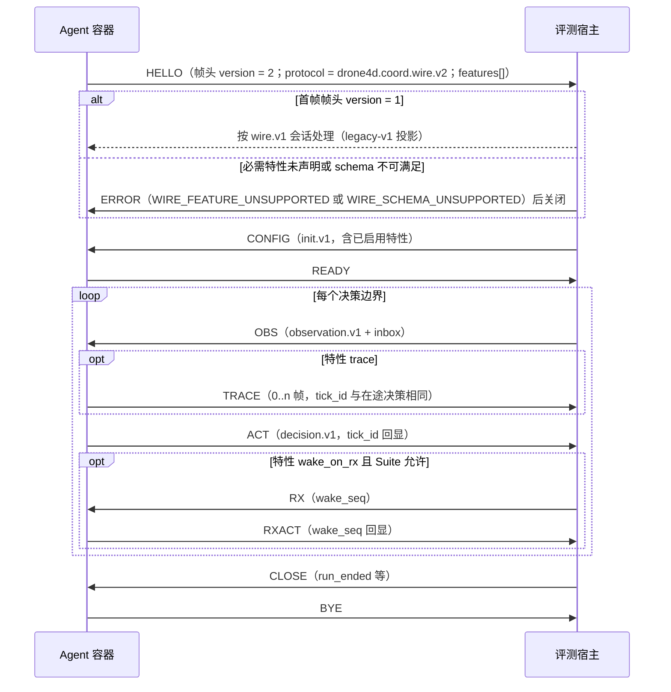

# D4 契约草案（D4 Contract Draft: `ct:coord/` and `ct:suite/`）

## 文档信息

| 项 | 内容 |
|---|---|
| 文档编号 | AWR-D4-CT |
| 标题 | D4 契约草案：`ct:coord/`（实验内核与 Agent 侧）与 `ct:suite/`（基准套件与排行榜侧）契约的字段表、约束、示例与 JSON Schema 2020-12 草案；与 `ct:bench/` v1 契约的关系（冻结、不破坏） |
| 版本 | v0.2.2（2026-10-25 命名同步：按 AWR-06 v0.4 XR-24 与 ADR-D4-36，产品名改为 ANet4D，研究者可见的包名、命令行、SDK 路径与文档站路径改为 `anet4d`；草案契约标识与域分隔常量保持现写法，在 WP-D4-01 契约定稿时改为 `anet4d` 前缀；其余内容不变）；v0.2.1（2026-10-18 文档集集成同步：按 AWR-06 v0.3 §0.5 统一裁定 XR-03、XR-09 修订 §0 第 6 条、§3.1 `message_id` 行、§4.1.3、§4.3.4、W2-10 与 §9.2 第 23 项；按 XR-11 把 AWR-06 调度规则 R-S1 至 R-S8 的引用改称 SR-1 至 SR-8） |
| 日期 | 2026-10-18（UTC） |
| 状态 | D4 设计评审稿。D4 处于深入调研与概念设计阶段，本文不构成实现承诺；契约文件在 D3 封板（G0）之后由 WP-D4-01（实验契约 RFC）定稿并合入 `packages/contracts/`，周次一律以"D3 封板后第 N 周"表述 |
| 上游文档 | [AWR-06 ANet4D 协同模拟基础设施概念设计](../06-D4-协同实验平台概念设计.md)（v0.2）：§3.4（B-01 至 B-10，尤其 B-06）、§4.1（不变量 I-01 至 I-06）、§4.2（接口草案）、§4.4（实验与 Suite 清单样例）、§4.5（Trace 格式）、§4.6（关键数据结构）、§4.7（契约 schema 草案与线协议版本化）、§5.2、§5.5、§5.6、§6.2、§6.7、§8.2–§8.10、§10.2（WP-D4-01、04、07、10、12）、ADR-D4-12、13、18、19、21、25、31；调研 [r03](../research/d4/r03-NS-2经验与排行榜规则.md)（R1、R10、R16–R24）、[n01](../research/d4/notes/n01-现有代码映射.md)、[n02](../research/d4/notes/n02-D3评测子系统泛化.md)（§6 契约变更草案）；负责人前期稿 design-r1、design-r2（`/data/projs/anet-drone-data/`） |
| 并行文档 | [M28 实验内核](../modules/M28-实验内核PRD.md)、[M29 交互网络](../modules/M29-交互网络PRD.md)、[M30 协同接口与基线](../modules/M30-协同接口与基线PRD.md)、[M31 基准套件](../modules/M31-基准套件PRD.md)（v0.2）、[M32 评测与统计](../modules/M32-评测与统计PRD.md)（v0.2）、[M33 Trace 与复现](../modules/M33-Trace与复现PRD.md)（v0.2）、[M34 研究者 SDK 与命令行](../modules/M34-研究者SDK与命令行PRD.md)、Suite 规格 [S1](suites/S1-TaskAlloc规格.md)、[S2](suites/S2-CoopSearch-Handoff规格.md)、[S3](suites/S3-InfoShare规格.md)、[X1](suites/X1-RobustCoord协议.md)、[协作智能排行榜规格](协作智能排行榜规格.md)（下称 LB）、[r04 首篇论文实验设计](../research/d4/r04-首篇论文实验设计.md)。并行文档向本文提出的字段需求中，已吸收者逐条列于 §9.1，本文作出命名裁决者列于 §9.2，尚未闭合者列于 §9.3 |
| 分工边界 | 本文定义契约的字段名、类型、必填性、取值约束、编码与版本规则；字段的业务语义与算法（如何计算 `U`、何时投递消息、如何派生随机键）以各模块 PRD 为准。本文与模块 PRD 的字段名冲突时，以本文为准并在 §9.2 登记，由模块 PRD 回改 |
| 编号约定 | 需求 R-CT-yy；验收 AC-CT-yy；事实 F-CT-yy；风险 RK-CT-yy；待决 Q-CT-yy；未决对齐项 U-CT-yy；对 AWR-06 的反馈 FB-CT-yy。引用 AWR-06 的工作包、决策、验收与规则时沿用 WP-D4-xx、ADR-D4-xx、AC-D4-xx、B-xx、I-xx；引用模块需求时写 R-M28-yy 等 |
| 引用约定 | 代码路径相对仓库根 `/data/projs/anet-drone`。前缀沿用 AWR-06：`py:` = `python/awr/`，`sdk:` = `tools/sdk/anet4d/src/anet4d/`，`ct:` = `packages/contracts/`。本文对现有契约与代码的陈述均于 2026-10-18 只读打开文件核对，以"文件 + 符号"为准，不引用行号。`ct:coord/`、`ct:suite/` 目前不存在，本文给出的全部契约均为新建设计 |
| Schema 草案 | §4、§5 的 JSON Schema 为完整草案（标"节选"者省略同构分支）。撰写时以生成脚本写出 16 份 schema 文件（14 份本文契约与共享定义，另有 `init.v1`、`observation.v1` 两个只用于解析 `$ref` 的占位文件），全部通过 `jsonschema` 4.10.3 与 4.26.0 的 `Draft202012Validator.check_schema` 元校验，`$id` 均满足 `tests/contracts/test_schemas.py` 的 `ID_RE`；以 `referencing` 注册表解析全部跨文件 `$ref`，并以 69 个实例（27 个正例、42 个反例，含 §5.1.5 的 `drone4d-event@1` 清单与 S3 形态清单）验证约束按预期生效。脚本与实例不入仓库，WP-D4-01 合入 schema 时以 `ct:coord/golden/`、`ct:suite/golden/` 重建 |
| 写作规范 | 中文、企业级与工业级行文；技术名词与字段名保留英文；不使用 emoji 与状态字形；下一大版本统一称 D4 |
| 修订记录 | v0.1（2026-10-18）：首版。v0.2（2026-10-18）：按评审意见 23 条修订，逐条核实结论与处理见 §12。主要变化：`instance.v1` 改为两层摘要并补齐 M31 §8.2 字段（§5.2）；`suite.v1` 补齐 M31 §8.1、M28 与 S3 的字段并给出 `drone4d-event@1` 清单样例（§5.1）；`board_row.v1` 引入 `attempt`、行键与有效行规则，墙钟与实测量移入 sidecar（§5.4）；`board.v2` 与 M32 v0.2 逐字段对齐并定义重算输入集（§5.3）；`run_manifest.v2` 吸收 M28 与 M33 的字段（§4.5）；`trace.v1` 的消息载荷只含正文摘要、层头按 R-M33-12（§4.4）；`TxReceipt` 改为两段校验次序（§4.1）；JCS 规则限定适用范围（§3.4）；固定 `seed_tag` 与承诺的字节编码并给出测试向量（§3.4.3）；原因码改为"码、名、细因"三层并规定登记时点（§3.8）；新增共享定义 `common.v1`、显式开放对象清单（§3.6）、性能与体积需求（R-CT-73 至 R-CT-75） |

---

## 0. 摘要

1. **范围**。本文起草 D4 的 14 份契约：`ct:coord/` 下的共享定义 `common.v1`、消息信封 `message.v1`（含 `info_class`）、决策 `decision.v1`、Trace 记录 `trace.v1`、运行清单 `run_manifest.v2`、线协议 `wire.v2`；`ct:suite/` 下的 Suite 清单 `suite.v1`、实例清单 `instance.v1`、评测器输出 `evaluation.v1`（最小字段集）、榜单 `board.v2`、榜单评测行 `board_row.v1` 及其 sidecar `board_row_sidecar.v1`（本文新增）、提交 `submission.v2`、评分定义 `score.v2`。另登记 AWR-06 §4.7 与并行文档提出的其余契约及消息、报告载荷 schema 目录的路径、`schema` 常量、归属模块与阶段（§2.1），其字段由归属模块 PRD 定义。
2. **与 `ct:bench/` 的关系**。`ct:bench/` 的 16 份 v1 契约原位冻结（B-06）：既有字段、枚举、帧表与 `additionalProperties: false` 一律不变，D3 契约 golden 进入 CI 作为回归项。D4 只新增命名空间，不修改任何 `ct:bench/` 文件；D3 运行（Suite `drone4d-event@1`）继续写出 `ct:bench/` v1 产物，D4 读取方经兼容视图读取，不改写旧运行目录（§2.3）。
3. **版本号规则**。D4 契约取代前驱、位于同一载体位置且同一读取方须在两版之间双向分派时，版本号在前驱上加一，故有 `run_manifest.v2`、`board.v2`、`submission.v2`、`score.v2`、`wire.v2`；其余自 v1 起，`evaluation` 定为 `drone4d.suite.evaluation.v1`（N-3，§2.2）。
4. **运行清单改为 `run_manifest.v2`**。`ct:bench/run_manifest.v1.schema.json` 为 `additionalProperties: false`，必填 `spec`（固定引用 `run_spec.v1`）与 `files`（必填三个 MCAP 摘要），`split` 只有 `dev`、`test`；AWR-06 §4.6 所述"经次版本增补"在该 schema 上不成立且与 B-06 冲突，本文新开 `drone4d.coord.run_manifest.v2`（FB-CT-01），并吸收 M28 §7.2.1 的五项增补请求与 M33 §7.5 的 trace 字段。
5. **两条编码原则**。(1) 平台消费的内容结构化：`EntityCommand.command`、`ReportRequest.report`、`BeliefSnapshot.payload` 为按 schema 校验的映射；(2) Agent 之间的载荷保持字节：`SendRequest.payload` 为不透明字节串，平台只计量与按登记 schema 校验；JSON 视图（trace）中消息正文只以 `payload_sha256` 与 `payload_size` 出现（R-M33-91）。
6. **身份由内核签发**。`decision.v1` 与 `SendRequest` 中不存在任何发送方或行为方身份字段（FB-CT-03）。`message_id` 形如 `<sender_id>#<tx_seq>`，序号上限为 10^15 − 1（R-M29-10），由 M28 内核签发；Agent 可见视图（收件箱、回执、`agents/` 层记录）中以不透明别名 `MessageRef` 呈现，别名映射只写真值层（AWR-06 v0.3 XR-03）。
7. **消息校验两段**。密封段（M28 `DecisionValidator`）依次判 `dst_unknown → bad_meta → ttl → too_large → sample_time`，受理段（M29 `submit`）依次判 `comm_off → schema_mismatch → payload_invalid →`（展开）`→ budget → queue_full`；部分受理以 `partial_reason` 报告（R-M29-11、R-M29-25，§4.1.3）。
8. **Trace 记录**。`trace.v1` 记录行固定 10 个字段，墙钟与实测资源量移入同层 sidecar；`msg.submit`、`msg.deliver` 只含正文摘要；层头按 R-M33-12，`inline_max_B = 16384` 为规范参数写入 `canon_params`（§4.4）。
9. **摘要与编码**。JCS 只用于 JSON 文档与承诺的规范化；内核与 trace 的二进制摘要链按各自定义豁免（§3.4.2）。`seed_tag`、种子集承诺与子集汇总的字节编码在 §3.4.3 固定并附测试向量；63 位整数与 `_unix_ns` 在 JSON 视图中一律为十进制字符串（`common.v1#/$defs/IntString`）。
10. **榜单侧**。`board.v2` 与 M32 v0.2 §7.3、LB §13 逐字段对齐；`board_row.v1` 每次尝试一行（`attempt` 自 0 起），有效行按 R-M32-92 选取，`rows_digest` 对去重并按 `(行键, attempt)` 排序的行计算，墙钟与实测量写入 `rows.sidecar.jsonl`；"由权威输入逐字节重算"以四个文件组成的重算输入集为对象（§5.3.4）。
11. **原因码**。原因以"数值码 `code`、登记名 `name`（`reasons.json` 大写）、细因 `why`（小写）"三层表达；D4 码段 700–899 在 WP-D4-01 退出前随 AWR-17 §8 登记，登记前线协议与清单只使用既有码 666、681、692 加 `why`（§3.8）。
12. **规模**。需求 79 条（R-CT-01 至 R-CT-79），验收 20 条（AC-CT-01 至 AC-CT-20），对 AWR-06 的反馈 20 条（§11），已吸收的并行文档请求 42 项（§9.1），本文命名裁决 27 项（§9.2），未决对齐项 15 项（§9.3），评审处理记录 23 条（§12）。

---

## 1. 背景与约束

### 1.1 约束本文的事实

| 编号 | 事实 | 对契约设计的含义 | 依据 |
|---|---|---|---|
| F-CT-01 | `ct:bench/` 现有 16 份 schema：`act`、`agent_config`、`board`、`evaluation`、`frame_index`、`frames`、`obs`、`obs_privileged`、`run_manifest`、`run_spec`、`score`、`session`、`submission`、`task`、`tracks`、`wire`，均为 v1 | D4 不得在 `ct:bench/` 下新增同名高版本文件；`tracks` 一名已被"机队轨迹头"占用（ADR-D4-31），D4 不使用 | `packages/contracts/bench/*.schema.json` |
| F-CT-02 | 契约自检要求每个 schema 的 `$schema` 为 2020-12、`$id` 匹配 `^https://schemas\.anet-drone\.dev/[a-z0-9_-]+/1/[A-Za-z0-9_.-]+\.schema\.json$`、通过元校验、全部 `$ref` 可解析、`$id` 唯一；跨命名空间引用的既有写法为相对路径（如 `../../world/1/common.schema.json`） | `ct:coord/`、`ct:suite/` 的 `$id` 形如 `https://schemas.anet-drone.dev/coord/1/decision.v1.schema.json`；`/1/` 为命名空间布局主版本而非契约版本；`ct:suite/` 引用共享定义写作 `../../coord/1/common.v1.schema.json#/$defs/<名>` | `tests/contracts/test_schemas.py` `ID_RE`、`test_schema_is_valid_2020_12`、`test_all_refs_resolve`、`test_ids_unique`；`tests/contracts/ctlib.py` `registry` |
| F-CT-03 | schema 文件经 `rglob("*.schema.json")` 发现（排除 `gen/`、`fixtures/`）；TypeScript 生成器遍历全部子目录（排除 `gen/`、`fixtures/`、`golden/`） | 新目录下的 schema 自动进入自检与代码生成；合入时须同步重新生成 `gen/ts` | `tools/contracts/contracts_lib.py` `schema_files`；`tools/contracts/gen.mjs` `schemaFiles` |
| F-CT-04 | `run_manifest.v1` 为 `additionalProperties: false`；必填 `spec`（`$ref run_spec.v1`）、`timing` 等 17 项；`files` 封闭且必填 `raw_mcap_sha256`、`truth_mcap_sha256`、`frames_idx_sha256`；`split ∈ {dev, test}`；`determinism_level ∈ {1b, 2, 3, none}` | D4 Episode 不能以该契约原位表达，须新开后继契约 | `ct:bench/run_manifest.v1.schema.json` |
| F-CT-05 | `wire.v1`：帧头 `u32le body_len \| u8 type \| u8 flags \| u16le version`，`version = 1`；`Hello` 封闭（`protocol`、`sdk_version`、`prefs`）；`x-awr-frames` 把 `CONFIG`、`OBS`、`ACT` 帧体固定为 `agent_config.v1`、`obs.v1`、`act.v1`；`Error` 为 `{code: 0..65535, why: ^[a-z0-9_]{1,32}$}`，二者必填；宿主实现对 `flags ≠ 0` 与未登记类型返回 `WireError(666, "frame")`，对版本不等返回 `WireError(666, "version")`；解码上限 `max_str_len` 4 KiB、`max_array_len` 2^20、`max_map_len` 4096 | `wire.v2` 必须是新主版本；v1 宿主遇到 v2 首帧以 666 拒绝（AC-D4-45 的既有行为）；v2 沿用同一解码上限 | `ct:bench/wire.v1.schema.json`；`py:agentsdk/wire.py` `PROTOCOL`、`VERSION`、`T`、`FRAME_MAX`、`WireSocket.recv`、`decode_body` |
| F-CT-06 | `obs.v1` 的 `Message` 为 `{src: string, seq: 0..2^32−1, topic: string ≤ 64, t_sent_ns, t_recv_ns, payload u8[≤65536]}`，`src` 无模式约束、`seq` 自 0 起；`act.v1` 顶层为 `schema`、`k`、`nav`、`gimbal`、`zoom`、`sensor_mode`、`msgs`、`report`、`tau_ms`，`OutMessage` 为 `{dst, topic ≤ 64, payload}`；`ActionGuard` 以 `dst == "*"` 表示广播；字节字段以 `x-awr-bin` 注记 | legacy-v1 投影与兼容视图的字段映射须覆盖 `"*"`、不满足 D4 模式的 `src` 与 `topic`、自 0 起的序号（§2.3） | `ct:bench/obs.v1.schema.json` `$defs/Message`；`ct:bench/act.v1.schema.json`；`py:agentsdk/env/guard.py` `ActionGuard.check` |
| F-CT-07 | `board.v1` 的 `tracks[].physics` 为 `const realistic`、`mode` 为 `const exogenous`，`lanes[].event_type` 为四值封闭枚举，`entries[].metrics` 固定 `ec/eu/ao/ce` 四键，`status ∈ {valid, invalid}`，参考行以布尔 `baseline` 标注 | 无法容纳多 Suite，须新开 `board.v2`（ADR-D4-19） | `ct:bench/board.v1.schema.json` |
| F-CT-08 | `score.v1` 的 `components` 枚举为 `ec/eu/ao/ce/g_hat/f_res`，`weights` 为 `null` 或固定四键对象；`submission.v1` 只有 `track`、`lanes[]`、`image_digest`、`entry{cmd, env}`，状态枚举 9 值，`reason.code ∈ [0, 999]` | `score.v2`、`submission.v2` 须新开；状态机与可见性语义沿用 | `ct:bench/score.v1.schema.json`；`ct:bench/submission.v1.schema.json` |
| F-CT-09 | `task.v1` 的 `event_type` 为四值封闭枚举，以 `x-agent-visible` 列出下发给 Agent 的字段 | `instance.v1` 以文件级 `view` 取代字段级可见性列表（R-M31-26） | `ct:bench/task.v1.schema.json` |
| F-CT-10 | 榜单评测行 `rows.jsonl` 无 schema；行字段只在模块文档字符串中说明；榜单版本目录另含 `config.json`（含秘密种子，仅服务端读取）、`board.json` 与 `details.json`；版本名正则 `^[A-Za-z0-9][A-Za-z0-9._-]{0,63}$`；`seed_set_commit` 为逗号拼接的行内 `seed` 的 SHA-256 | 权威输入缺少契约，D4 新增 `board_row.v1`；`config.json` 含秘密，不能作为第三方重算输入（§5.3.4） | `py:bench/boardstore.py` 模块文档字符串与 `_VERSION`；`py:bench/eval/aggregate.py` `build_board`；LB F4 |
| F-CT-11 | 提交标识为 `"sub-"` 加 16 位小写 base32；`ACTIVE_PER_TEAM = 3`；可撤回状态为 RECEIVED、SCANNING、VALIDATING | `submission.v2.submission_id` 沿用该格式；状态机不变 | `py:bench/submissions.py` `SubmissionStore.create`、`ACTIVE_PER_TEAM`、`WITHDRAWABLE` |
| F-CT-12 | 原因码表 `awr.reasons.v1` 共 257 项，最高码为 698；D2 使用 500–599，D3 使用 600–699；666 为 `AGENT_PROTOCOL_ERROR`，681 为 `RUN_QUOTA_EXCEEDED`，692 为 `SUBMISSION_REJECTED`；700 起未登记；`name` 的模式为 `^[A-Z][A-Z0-9_]*$`；文档注明"码值含义永不改变，只增不改"；`test_d3_reasons.py` 以 `g["from"] >= 600` 选取码段并断言其恰为 D3 六个子段 | D4 码段从 700 起分配；登记前任何契约字段不得使用 700 以上的码；登记时须同步把该测试的选取条件改为 600–699（§3.8） | `ct:rt/reasons.json`；`ct:rt/reasons.schema.json`；`tests/contracts/test_d3_reasons.py` |
| F-CT-13 | 现有扩展关键字：`x-awr-bin`（14 处）、`x-awr-frames`、`x-awr-header`、`x-awr-limits`、`x-rules`（`run_spec.v1` 顶层，规则项为 `{id, if, code, why, allow \| forbid \| require \| min \| exactly_one}`）、`x-agent-visible`（`task.v1`）；仓库内 schema 尚未使用 `contentEncoding` | D4 新增扩展关键字须在 §3.7 登记，避免同义多词；`x-rules` 是 schema 注记而非数据字段 | `ct:**/*.schema.json` 全文检索；`py:bench/spec_rules.py` `load_rules` |
| F-CT-14 | 契约包 `package.json` 的 `version` 为 `1.2.0`，而 `ct:bench/` 各 schema 的 `description` 标注 "contracts 1.3.0" | 契约包版本缺少单一来源；`suite.v1.requires.contracts` 的取值依赖该版本，须先统一（Q-CT-01） | `packages/contracts/package.json`；`ct:bench/*.schema.json` `description` |
| F-CT-15 | JCS 规范化实现位于 `py:sim/events/jcs.py`，其 `jcs_number` 对绝对值不小于 2^53 的整数抛出 `ValueError`；计数器随机数实现位于 `py:sim/sensors/cbrng.py`；动作守卫位于 `py:agentsdk/env/guard.py` `ActionGuard`（对非有限导航值判 663 `non_finite`，对不支持的模式判 663 `unsupported`）；声明式组合规则位于 `py:bench/spec_rules.py` | JSON 摘要统一使用该 JCS 实现；63 位整数不得以 JSON 数字进入 JCS；`DecisionValidator` 须覆盖有限值检查 | 各文件；M31 F-15；M28 F7 |
| F-CT-16 | M28 实测（CPython 3.12.3）：`jcs` 对一条 5 字段事件记录约 42 µs，定长二进制帧加载荷哈希的链式 SHA-256 约 2.4 µs；M28 据此规定逐事件 JCS 不进入内核预算 | "一切摘要先 JCS"与内核预算冲突，JCS 的适用范围须限定（§3.4.2） | M28 F18、R-M28-73 |
| F-CT-17 | 本工作区不是 git 工作树（外置 `GIT_DIR`） | 验收基线不能写作"某提交"，改用摘要清单文件（AC-CT-01） | 运行环境 |

### 1.2 目标

| 编号 | 目标 |
|---|---|
| G-1 | 为 D4 P0 所需的全部跨模块数据给出唯一的字段名、类型、必填性与约束，使 WP-D4-01 的 RFC 可直接据此生成 schema 文件与 golden 实例 |
| G-2 | 保证 `ct:bench/` v1 契约与 D3 运行目录字节级不变，D3 Agent 经 `wire.v1` 原样接入 D4 评测宿主 |
| G-3 | 使排名运行的每一项可复核产物（运行清单、trace、评测行、榜单）都有契约，第三方可只凭契约与公开数据复算 |
| G-4 | 把可在 schema 层表达的约束（枚举、模式、互斥、条件必填）全部写入 schema；其余约束列为语义校验规则并给出编号；不能封闭的对象逐一登记归属与收紧时点（§3.6） |

### 1.3 非目标

- 不定义 `init.v1`、`observation.v1`、`entity_obs.v1`、`experiment.v1`、`interaction.v1`、`network_profile.v1`、`ledger.v1`、`belief.v1`、`rng_domains.v1`、`fidelity_audit.v1`、`trace_digest.v1` 等契约的完整字段（归属模块见 §2.1）；本文只给出与本文契约交界处的约束。
- 不修改 `ct:bench/` 任何文件，不追溯修改 `board.v1` 已发布结果（AWR-06 §10.1）。
- 不规定 REST 端点路径（以 17 号说明书的 D4 增补节为准）。
- 不规定消息与报告载荷的业务 schema（`ct:coord/msg/`、`ct:coord/report/` 下的具体文件由 M30 与各 Suite 登记）。

### 1.4 术语

| 术语 | 定义 |
|---|---|
| 契约 | `packages/contracts/` 下的一份 JSON Schema 文件及其 `schema` 常量；本文以 `ct:<ns>/<name>.v<k>` 简写 |
| `schema` 常量 | 文档顶层 `schema` 字段的取值，形如 `drone4d.coord.decision.v1`；读取方据此分派解析器 |
| 谱系 | 同一类文档在不同命名空间中的前后继关系，如 `drone4d.bench.board.v1` → `drone4d.suite.board.v2` |
| 平台消费内容 | 由内核、评测器或审计工具解释其字段的内容（指令、报告、信念快照） |
| Agent 间载荷 | 只在 Agent 之间传递、平台只计量不解释的内容（消息载荷） |
| JSON 视图 | 契约对象在 JSON 文件（trace、清单、榜单）中的表示；与之相对的是 `wire.v2` 上的 msgpack 表示 |
| 语义校验 | JSON Schema 无法表达、由校验器代码执行的约束，编号 V-xx-yy |
| 密封段、受理段 | 消息的两段校验：密封段由 M28 `DecisionValidator` 在屏障返回后以 `t_sealed` 状态执行；受理段由 M29 `submit` 以 `t_apply` 状态执行（R-M29-11） |
| 行键 | `rows.jsonl` 中标识一个评测单元的字段组 `(entry_id, track, scenario_set, scenario_id, seed_index, repeat, intervention, perturbation)`；同一行键可有多次 `attempt` |
| 有效行 | 同一行键下 `failure.infra = false` 的最大 `attempt` 行（R-M32-92） |
| 重算输入集 | 由 `board.v2` 逐字节重算所需的全部公开输入（§5.3.4） |
| 开放对象 | schema 中未声明 `additionalProperties: false` 的对象节点；只允许 §3.6 清单中的条目 |

---

## 2. 契约总览

### 2.1 命名空间与契约登记表

"本文"列为"是"者在 §4、§5 给出字段表与 schema；"否"者只登记路径与归属，字段由归属模块定义。阶段指首次合入的阶段。

| `schema` 常量 | 路径 | 归属模块 | 本文 | 阶段 | 工作包 | `ct:bench/` 前驱 |
|---|---|---|---|---|---|---|
| —（只含 `$defs`） | `ct:coord/common.v1.schema.json` | 契约维护方 | 是（§3） | P0 | WP-D4-01 | — |
| `drone4d.coord.message.v1` | `ct:coord/message.v1.schema.json` | M29 | 是（§4.1） | P0 | WP-D4-05 | `obs.v1#/$defs/Message`、`act.v1#/$defs/OutMessage`（字段映射，非谱系） |
| `drone4d.coord.decision.v1` | `ct:coord/decision.v1.schema.json` | M30、M28 | 是（§4.3） | P0 | WP-D4-03、04 | `act.v1`（legacy 投影） |
| `drone4d.coord.trace.v1` | `ct:coord/trace.v1.schema.json` | M33 | 是（§4.4） | P0 | WP-D4-07 | 无（D3 `net/records.jsonl` 经兼容视图读取） |
| `drone4d.coord.run_manifest.v2` | `ct:coord/run_manifest.v2.schema.json` | M28 | 是（§4.5） | P0 | WP-D4-04 | `run_manifest.v1`（谱系） |
| `drone4d.coord.wire.v2` | `ct:coord/wire.v2.schema.json` | M28（宿主侧）、M34（Agent 侧） | 是（§4.6） | P0（`TRACE`、`RX`、`RXACT` 为 P1） | WP-D4-04 | `wire.v1`（谱系） |
| `drone4d.coord.experiment.v1` | `ct:coord/experiment.v1.schema.json` | M34 | 否 | P0 | WP-D4-08 | 与 `run_spec.v1` 并列 |
| `drone4d.coord.init.v1` | `ct:coord/init.v1.schema.json` | M28、M30 | 否（交界约束见 §4.6.5） | P0 | WP-D4-04 | `agent_config.v1`（legacy 投影） |
| `drone4d.coord.observation.v1` | `ct:coord/observation.v1.schema.json` | M28 | 否（交界约束见 §4.6.5） | P0 | WP-D4-03 | `obs.v1`（`body_schema` 内嵌） |
| `drone4d.coord.entity_obs.v1` | `ct:coord/entity_obs.v1.schema.json` | M28 | 否 | P0 | WP-D4-03 | — |
| `drone4d.coord.interaction.v1` | `ct:coord/interaction.v1.schema.json` | M29 | 否（`InteractionOp` 交界见 §4.3.4） | P0 | WP-D4-06 | — |
| `drone4d.coord.belief.v1` | `ct:coord/belief.v1.schema.json` | M33、M32 | 否 | P1 | WP-D4-29 | — |
| `drone4d.coord.network_profile.v1` | `ct:coord/network_profile.v1.schema.json` | M29 | 否 | P0 | WP-D4-05 | 取代 `run_spec.v1.comm.model` 自由字符串 |
| `drone4d.coord.ledger.v1` | `ct:coord/ledger.v1.schema.json` | M28、M32 | 否（清单与行中的汇总形态见 §4.5.3） | P0 | WP-D4-22 | — |
| `drone4d.coord.rng_domains.v1` | `ct:coord/rng_domains.v1.json`（数据文件） | M28 | 否 | P0 | WP-D4-02 | 与 `ct:rt/rng_streams.json` 并列 |
| `drone4d.coord.checkpoint.v1` | `ct:coord/checkpoint.v1.schema.json`（头部） | M28 | 否 | P0 | WP-D4-02 | — |
| 内核预登记事件载荷 `drone4d.coord.events.<type>.v1` | `ct:coord/events/<type>.v1.schema.json`（`$id` 段为 `coord-events`） | M28 | 否（R-M28-103 字段表为来源） | P0 | WP-D4-02 | — |
| `drone4d.coord.trace_index.v1`、`trace_digest.v1`、`replay_bundle.v1`、`leak_audit.v1` | `ct:coord/<name>.schema.json` | M33 | 否 | P0（`replay_bundle` 为 P1） | WP-D4-07、48 | — |
| `drone4d.coord.baseline_card.v1` | `ct:coord/baseline_card.v1.schema.json` | M30 | 否 | P0 | WP-D4-14 | — |
| 消息载荷 schema `<ns>.<name>.v<k>` | `ct:coord/msg/<ns>.<name>.v<k>.schema.json` | M30、各 Suite | 否（方言规则见 §4.2.3） | P0 | WP-D4-14 至 16 | — |
| 报告载荷 schema `<ns>.<name>.v<k>` | `ct:coord/report/<ns>.<name>.v<k>.schema.json`（`$id` 段为 `coord-report`） | 各 Suite | 否（方言同 §4.2.3，`x-awr-info-class` 不适用） | P0 | WP-D4-14 至 16 | `act.v1#report`（legacy 报告以名称 `drone4d.bench.act.v1#report` 引用） |
| `drone4d.coord.cli_result.v1`、`pack_lock.v1` | `ct:coord/<name>.schema.json` | M34 | 否 | P0、P1 | WP-D4-08、24 | — |
| `drone4d.suite.suite.v1` | `ct:suite/suite.v1.schema.json` | M31 | 是（§5.1） | P0 | WP-D4-10 | 无（D3 榜单整体登记为 `drone4d-event@1`） |
| `drone4d.suite.instance.v1` | `ct:suite/instance.v1.schema.json` | M31 | 是（§5.2） | P0 | WP-D4-10 | `task.v1`（泛化，非谱系） |
| `drone4d.suite.evaluation.v1` | `ct:suite/evaluation.v1.schema.json` | M31、M32 | 是（最小字段集，§5.4.4） | P0 | WP-D4-10 | `evaluation.v1`（谱系；版本号按 N-3 为 v1） |
| `drone4d.suite.regions.v1` | `ct:suite/regions.v1.schema.json` | M31 | 否（字段见 M31 §8.5） | P1 | WP-D4-10 | — |
| `drone4d.suite.check_report.v1` | `ct:suite/check_report.v1.schema.json` | M31 | 否（字段见 M31 §7.11.2） | P0 | WP-D4-10 | — |
| `drone4d.suite.cli.<command>.v1` | `ct:suite/cli/<command>.v1.schema.json`（`$id` 段为 `suite-cli`） | M31（输出）、M34（封装） | 否（M31 §7.11.1） | P0 | WP-D4-10 | — |
| `drone4d.suite.board.v2` | `ct:suite/board.v2.schema.json` | M32、LB | 是（§5.3） | P0 | WP-D4-12 | `board.v1`（谱系） |
| `drone4d.suite.board_row.v1` | `ct:suite/board_row.v1.schema.json` | M32 | 是（§5.4，本文新增） | P0 | WP-D4-12 | D3 `rows.jsonl`（无契约） |
| `drone4d.suite.board_row_sidecar.v1` | `ct:suite/board_row_sidecar.v1.schema.json` | M32 | 是（§5.4，本文新增） | P0 | WP-D4-12 | — |
| `drone4d.suite.entries_meta.v1`、`board_meta.v1` | `ct:suite/<name>.schema.json` | LB | 否（字段为 `board.v2` 对应字段的投影，见 §5.3.4） | P0 | WP-D4-12 | — |
| `drone4d.suite.submission.v2` | `ct:suite/submission.v2.schema.json` | LB | 是（§5.5） | P0 | WP-D4-12 | `submission.v1`（谱系） |
| `drone4d.suite.score.v2` | `ct:suite/score.v2.schema.json` | M32 | 是（§5.6） | P0 | WP-D4-12 | `score.v1`（谱系） |
| `drone4d.suite.fidelity_audit.v1` | `ct:suite/fidelity_audit.v1.schema.json` | M32 | 否 | P1 | WP-D4-27 | — |
| `drone4d.suite.perturbation.v1` | `ct:suite/perturbation.v1.schema.json` | M31、X1 | 否 | P1 | WP-D4-19 | — |
| `drone4d.suite.quota_policy.v1` | `ct:suite/quota_policy.v1.schema.json` | LB | 否（字段见 LB §8.3） | P0 | WP-D4-12 | 取代常量 `ACTIVE_PER_TEAM` |

不新建名为 `tracks.*` 的契约（ADR-D4-31）；赛道定义为 `suite.v1#/$defs/Track` 与 `board.v2#/$defs/BoardTrack` 的对象，不独立成文件。二级目录（`events/`、`report/`、`cli/`、`msg/`）的 `$id` 一律把目录并入命名空间段（如 `https://schemas.anet-drone.dev/coord-events/1/<type>.v1.schema.json`），与既有先例 `ct:sensor/v2/` → `.../sensor-v2/1/...` 一致（F-CT-02）。

`drone4d.suite.evaluation.v1` 的最小字段集为 `{schema, evaluator{id, version}, components{<metric_id>: number | null}, ranked, ranked_valid, invalid_reasons[], failure{policy, infra, infra_kind, code, why}}`，可选 `subset_results[]`、`reference_sha256`、`x1_times`、`diagnostics.<evaluator_id>`（M31 §8.3、M32 §7.2）；schema 见 §5.4.4。D3 的 `ec/eu/ao/ce`、`actors`、`safety` 在 `drone4d-event@1` 下进入 `components` 与 `diagnostics.drone4d-event`（AWR-06 §4.7）。

### 2.2 版本号与命名规则

| 编号 | 规则 |
|---|---|
| N-1 | `schema` 常量为 `drone4d.<ns>.<name>.v<k>`，`<ns> ∈ {coord, suite}`，与文件名 `<name>.v<k>.schema.json` 一一对应；数据文件（如 `rng_domains.v1.json`）的 `schema` 常量同样规则；只含 `$defs` 的共享定义文件（`common.v1`）没有 `schema` 常量 |
| N-2 | `$id = https://schemas.anet-drone.dev/<ns>/1/<name>.v<k>.schema.json`；路径中的 `/1/` 为命名空间布局主版本，与契约版本 `v<k>` 无关（F-CT-02） |
| N-3 | 谱系加一：D4 契约在同一载体位置（同名文件或同一接口资源，如运行目录的清单、榜单版本目录的 `board.json`、提交接口、Agent 会话）取代 `ct:bench/` 前驱，且同一读取方须按 `schema` 常量在两版之间双向分派时，`k` 取前驱版本加一（`run_manifest.v2`、`board.v2`、`submission.v2`、`score.v2`、`wire.v2`）；不满足者 `k = 1`。D4 评测器输出以 `board_row.v1.evaluation` 与 D4 运行目录的 `evaluation.json` 出现，由 D4 读取方解析；D3 的 `evaluation.json` 只由 D3 评测路径与兼容视图读取，二者不共用解析入口，故 `drone4d.suite.evaluation.v1` 取 v1 |
| N-4 | 同一命名空间内不得出现两个同名不同义的契约；跨命名空间同名者必须属于同一谱系 |
| N-5 | 线协议只有主版本：PROTOCOL 字符串与帧头 `version` 同时变化（ADR-D4-31） |
| N-6 | 次版本演进（新增可选字段、放宽上限、新增枚举值）不改 `v<k>`，以字段注记 `x-since: "<契约包版本>"` 标出引入版本；凡 `additionalProperties: false` 的对象新增字段、必填变化、语义变化、枚举值删除，一律视为主版本变化（新 `v<k+1>`） |
| N-7 | 新增枚举值对封闭枚举的严格读取方是破坏性的；本文对需要扩展的枚举（`info_class`、`kind`、`reason`）给出"读取方遇到未知值的处置"，凡未给出处置的枚举，新增值即主版本变化 |

### 2.3 与 `ct:bench/` v1 的关系

**冻结规则（B-06）**。下表各契约的既有字段、枚举、帧表与 `additionalProperties` 设置不变；`ct:bench/golden/` 与 D3 黄金运行的产物摘要进入 CI（B-07）。D4 的任何需求都通过新契约满足。

| `ct:bench/` 契约 | 状态 | D4 后继或并列 | D4 侧的读取与写出 |
|---|---|---|---|
| `wire.v1` | 冻结 | `coord/wire.v2` | 评测宿主同时监听两版会话；v1 会话按 legacy-v1 投影服务 D3 Agent，仅限控制恰好 1 个多旋翼实体的 Agent（AWR-06 §4.2），且只用于 `suite.v1.features.required` 为空的 Suite；不向 v1 `Hello` 添加任何字段 |
| `agent_config.v1`、`obs.v1`、`act.v1` | 冻结 | `coord/init.v1`、`observation.v1`、`decision.v1` | 只在 v1 会话中出现；`observation.v1.body_schema = drone4d.bench.obs.v1` 时 `body` 字节为原 `obs.v1` 帧体（AWR-06 §4.7） |
| `run_spec.v1` | 冻结 | `coord/experiment.v1`（并列） | `run_spec.v1` 经转换器表达为 `suite = drone4d-event@1` 的实验；不改写原规格 |
| `run_manifest.v1` | 冻结 | `coord/run_manifest.v2` | `drone4d-event@1` 运行继续写 v1；D4 内核只写 v2；读取方按 `schema` 常量分派 |
| `task.v1` | 冻结 | `suite/instance.v1`（泛化） | D3 事件任务登记为 `drone4d-event@1` 的固定实例族；`task.v1` 的公开投影进入 `brief.json`，`scored_event_types` 进入 `hidden/truth.json`（M31 §7.8） |
| `evaluation.v1` | 冻结 | `suite/evaluation.v1` | D3 评测器输出不变，D4 包装层另行写出 `drone4d.suite.evaluation.v1` |
| `board.v1` | 冻结、只读 | `suite/board.v2` | 已发布版本不追溯修改；WP-D4-09 以 `board.v2` 统计协议对 `board.v1` 的 `rows.jsonl` 做影子重算，结果作内部对照报告 |
| `score.v1` | 冻结 | `suite/score.v2` | `drone4d-event@1` 以 `score.v2` 重新声明（`rank_mode = per_metric`、`rank_key = null`、`components = [ec, eu, ao, ce]`、`weights = null`、`composite_scope = none`） |
| `submission.v1` | 冻结 | `suite/submission.v2` | D3 内部提交接口与 `board.v1` 响应不变；D4 提交只经新接口 |
| `frames.v1`、`frame_index.v1`、`obs_privileged.v1`、`session.v1`、`tracks.v1` | 冻结 | 无 | D4 不引用；`L2` 帧引用沿用 `frames_digest_ref` 字段语义（P1） |

**字段映射**。下表同时适用于两个场合：(a) legacy-v1 投影（D3 Agent 在 D4 宿主上运行，方向为 D4 → D3 观测与 D3 → D4 动作），其完整规则以 M30 §6.6.3 为准；(b) 兼容视图（D4 工具只读 D3 运行目录，方向为 D3 → D4）。

| D3 字段 | D4 字段 | 规则 |
|---|---|---|
| `obs.v1.Message.src` | `DeliveredMessage.sender_id` | (a) 由宿主按会话身份填写，恒满足 `AgentId`；(b) 满足 `common.v1#/$defs/AgentId` 时同值，否则改写为 `"legacy-" + hex(sha256(utf8(src)))[0:16]` 并在视图完整性报告中计数 `legacy_src_rewritten` |
| `obs.v1.Message.seq` | `DeliveredMessage.message_id` | (a) 投影器按发送方单调分配 `seq`（u32，自 0 起，M30 §6.6.3）；(b) `message_id = "<sender_id>#<seq + 1>"`，因 D3 自 0 起而 D4 自 1 起 |
| `obs.v1.Message.topic` | `DeliveredMessage.channel` | (a) 不满足 `message.v1#/$defs/Meta` 或以 `_` 开头的 `topic` 由投影器在提交前丢弃并记诊断 `legacy_topic_invalid`（M30 §6.6.3）；(b) 满足时同值，否则改写为 `"_legacy." + hex(sha256(utf8(topic)))[0:16]`（`_` 前缀为平台保留，表明由平台生成）；两种场合均 `schema = opaque`、`info_class = opaque`，M30 `/policy/legacy/topic_map` 可另行登记映射 |
| `obs.v1.Message.payload` | `DeliveredMessage.payload`；trace 中为 `payload_sha256`、`payload_size` | 同值；JSON 视图只出现摘要（R-M33-91） |
| `obs.v1.Message.t_sent_ns`、`t_recv_ns` | `submitted_at_ns`、`delivered_at_ns` | 同值 |
| `act.v1.OutMessage.dst` | `SendRequest.destinations` | `"*"` 映射为空数组（广播，内核展开为计费单播，R-M29-13）；其他值映射为单元素数组 |
| `act.v1.k` | `decision.v1.tick_id` | 同值，须回显 |
| `act.v1.nav` | `EntityCommand`（`goto_w`、`vel_w`、`hold`） | `nav.mode ∈ {goto, velocity, hover}` 分别映射；`takeoff`、`land` 在 `planar@1` 下转为 `hold` 并记 `legacy_nav_unsupported`；高保真档沿用 D3 实现（M30 §6.6.3） |
| `act.v1.gimbal`、`zoom`、`sensor_mode` | 见 U-CT-01 | M30 §6.6.3 写作"参数原样装入 `command` 字节"，与本文 §4.3.2 的结构化指令体不相容，待裁决（§9.3） |
| `act.v1.report` | `ReportRequest(report_schema = "drone4d.bench.act.v1#report", report, evidence_ids)` | `report` 为原报告项的 JSON 映射；`evidence_ids` 取 `participants[].evidence[]`（M30 §6.6.3）；该报告名须在 Suite 清单 `schemas.reports[]` 中登记 |
| `act.v1.tau_ms` | — | 忽略并记诊断 `legacy_tau_ignored`（M30 §6.6.3） |
| `run_manifest.v1.split = test` | `run_manifest.v2.split = holdout` | D3 的 `test` 划分在 `drone4d-event@1` 中登记为 `holdout` |
| `board.v1.lanes[].lane` | `board.v2.scenario_sets[].scenario_set`（`lane` 为兼容别名一个主版本） | ADR-D4-19 |
| `board.v1.entries[].baseline = true` | `board.v2.entries[].reference_kind = published`、`legacy_baseline = true` | 原 D3 基线行（M32 R-M32-100） |
| rows `event`、`seed` | `board_row.v1.scenario_id`、`seed_index` | D3 行内 `seed` 实为序号（D-1）；D3 行无 `attempt`，兼容路径按 0 处理（M32 §7.2） |

---

## 3. 通用约定

全部共享模式以 `ct:coord/common.v1.schema.json` 的 `$defs` 实现，各契约以 `$ref` 引用，不复制 `pattern`（R-CT-08、R-CT-69）。

### 3.1 标识模式

| 标识 | `common.v1` 定义 | 模式 | 示例 | 依据 |
|---|---|---|---|---|
| `agent_id`、`entity_id`、`sensor_id` | `AgentId` | `^[A-Za-z0-9][A-Za-z0-9._-]{0,63}$` | `uav-01`、`ugv.3`、`cam0` | 不含 `#`（`message_id` 分隔符）、`:`（trace 主体前缀分隔符）与 `‖`（M32 重采样种子拼接符） |
| `message_id` | `message.v1#/$defs/MessageId` | `^<agent_id>#[1-9][0-9]{0,14}$` | `uav-01#17` | R-M29-10：M28 内核签发，发送方从 1 起单调，被拒请求同样占号；序号 ≤ 10^15 − 1 < 2^53，保证 JSON 视图中可作安全整数处理；只用于真值层、网络层与 `packet` 随机域 |
| `MessageRef`（Agent 可见） | `message.v1#/$defs/MessageRef` | `^m[0-9a-f]{32}$` | `m3f2a9c01d4e5b6a73f2a9c01d4e5b6a7` | `"m" ‖ hex(HMAC-SHA256(k_msg, utf8(message_id)))[0:32]`，`k_msg = HMAC-SHA256(u64be(run_seed), "drone4d.coord.msgref.v1")`；Episode 内唯一，不暴露发送序号（AWR-06 v0.3 XR-03，M33 §13 第 13 条）；`DeliveredMessage.message_id` 与 `TxReceipt.message_id` 在 Agent 可见视图中取此形式，WP-D4-01 在 `message.v1` 中分设两个定义 |
| `group` 目的端 | `message.v1#/$defs/Destination` | `^group:[a-z0-9][a-z0-9_.-]{0,31}$` | `group:team-a` | R-M29-13 |
| `channel`、`flow_id` | `message.v1#/$defs/Meta` | `^[a-z0-9][a-z0-9_.:-]{0,31}$` | `alloc`、`cbba:round` | 以 `_` 开头者为平台保留，Agent 提交即 `bad_meta` |
| 消息与报告 schema 名 | `message.v1#/$defs/Schema` | `opaque` 或 `^[a-z][a-z0-9-]{0,31}(\.[a-z0-9_]{1,24}){1,3}\.v[1-9][0-9]{0,2}$`，≤ 32 字节；报告另允许 `drone4d.bench.act.v1#report` | `taskalloc.cbba.v1`、`common.cnp.quote_req.v1` | M30 §6.5.3 |
| `suite_id` | `SuiteId` | `^[a-z][a-z0-9-]{1,31}$`；外部引用 `<suite_id>@<major>` | `taskalloc@1` | R-M31-02 |
| Family id | `FamilyId` | `^[a-z][a-z0-9-]{0,31}$` | `ta-core` | OR-1 |
| `instance_id` | `InstanceId` | `^capl:<family>/<block>-<5 位序号>/d[0-4]/n<规模>@<rev>$` | `capl:ta-core/b01-00007/d1/n20@1` | M31 OR-1、OR-1a |
| `scenario_id` | `ScenarioId` | `^<instance_id>#(algorithm_isolated\|closed_loop)(\.(exogenous\|interactive))?$` | `capl:ta-core/h1-00003/d1/n20@1#closed_loop` | M31 术语表"`scenario_id = <instance_id>#<run_mode>`"与 OR-5；事件模式后缀只在 `event_mode = interactive` 时出现 |
| `scenario_set` | `ScenarioSetId` | `^[a-z0-9][a-z0-9.-]{0,63}$` | `ta-core.holdout.cl` | M31 §4.3 |
| 赛道 `track` | `TrackId` | `^[a-z0-9][a-z0-9-]{0,47}$`；P0 赛道另须满足 LB §3.2 语法 | `dc-l1-b1-radio` | 语义以赛道定义的结构化字段为准 |
| 网络档 | `NetworkProfile` | `^[a-z0-9-]{1,31}@[1-9][0-9]{0,2}$` | `abstract-radio@1` | AWR-06 §6.1 |
| `board_version` | `BoardVersion` | `^[A-Za-z0-9][A-Za-z0-9._-]{0,63}$` | `taskalloc-1.0-s1-bv01` | `py:bench/boardstore.py` `_VERSION`；LB §12.2 |
| `submission_id` | `SubmissionId` | `^sub-[a-z2-7]{16}$` | `sub-abcdefghijklmnop` | F-CT-11 |
| `episode_id` | `EpisodeId` | `^[0-9a-f]{16}$` | `3f2a9c01d4e5b6a7` | R-M34-21 |
| `attempt` | `Attempt` | 整数 `[0, 99]` | `1` | R-M32-92（自 0 起）；R-M28-90 只对 `host` 类故障重跑 |
| `run_id` | `RunId` | `^<episode_id>-a(0\|[1-9][0-9]?)$`，即 `episode_id + "-a" + attempt` | `3f2a9c01d4e5b6a7-a0` | M28 §7.2.1 |
| 指标 id | `MetricId` | `^[a-z][a-z0-9_]{0,47}$` | `u_ta`、`b_tx_ratio` | M32 §6.2.1 |
| 细因 `why` | `Why` | `^[a-z0-9_]{1,32}$` | `legacy_multi_entity` | 与 `wire.v1` `Error.why` 相同 |
| 登记名 `name` | `ReasonName` | `^[A-Z][A-Z0-9_]{0,63}$` | `LEGACY_MULTI_ENTITY` | `ct:rt/reasons.schema.json` |

### 3.2 时间与数值

| 项 | 规则 |
|---|---|
| 仿真时刻与时长 | int64 纳秒，字段后缀 `_ns`；契约值域 `[0, 2^53)`（`common.v1#/$defs/SimNs`，约 104 天），超出判内核故障 |
| 墙钟时刻 | 字段后缀 `_unix_ns`；JSON 视图中以十进制字符串表示（`UnixNs`，17 号 §1.3、M31 ENC-02），msgpack 中为 int64；只出现在 `wall` 节、sidecar、`build{}` 与审计字段，不进入任何摘要与结果 |
| 大整数 | 63 位种子（`agent_seed`、`instance_seed`、`exogenous_seed`）与 64 位键在 JSON 视图中一律以十进制字符串编码（`IntString`：`^(0\|[1-9][0-9]{0,18})$`，无前导零，数值 < 2^63，以 `x-awr-int-string: true` 注记；M31 ENC-01）；写出器在调用 `jcs` 之前做类型检查（M31 ENC-03），不依赖 `jcs_number` 的异常；`wire.v2` 上为 msgpack 整数 |
| 浮点 | IEEE 754 binary64；JSON 视图中按 JCS 数字格式；`-0.0` 编码为 `0`；契约字段不得出现非有限值（`DecisionValidator` 以 V-DC-07 执行，因 JSON Schema 的数值界限对 NaN 不生效）；trace 载荷的例外见 R-M33-09 |
| 单位后缀 | 物理量字段带单位后缀：`_m`、`_mps`、`_rad`、`_dbm`、`_B`（字节）、`_bps`、`_ms`（仅实例层与人工配置）、`_ns`；实例包内的量化后缀（`_mm`、`_mdeg`、`_ppm`、`_mm_s`、`_mm_s2`）以 M31 §7.3.3 为准；无后缀的数值字段为无量纲量或计数（17 号 §1.3） |

### 3.3 字节串与对象引用

| 表示 | 规则 |
|---|---|
| `wire.v2` | msgpack `bin`；schema 以 `x-awr-bin: "u8[<=N]"` 注记，不声明 JSON `type`（沿用 F-CT-06） |
| JSON 视图中的消息正文 | 不出现；`msg.submit`、`msg.deliver` 只含 `payload_sha256`（64 位小写十六进制）与 `payload_size`（字节），正文的权威副本在真值层 `decision` 记录中（R-M33-91） |
| JSON 视图中的其他字节字段 | 规范字节 ≤ `inline_max_B` 时内联为 `{"$b64": "<标准 base64，含填充>"}`（`common.v1#/$defs/Bytes`）；超过时改存内容寻址对象，记录中只存 `{"$obj": "<64 位小写十六进制>", "size": <int>, "media": "<type>"}`（`ObjectRef`），对象存于同层 `objects/<hex[0:2]>/<hex>`（trace）或实例包 `blobs/<hex>`（M31 PK-03） |
| `inline_max_B` | `= 16384`，为 `trace.v1` 的规范参数而非可调初值，写入层头 `canon_params` 并进入链初值；修改即为主版本变化（R-M33-10、R-M33-89） |
| 消息 schema 内的数值数组 | M30 方言 `x-awr-ndarray`：编码为 `{"dtype", "shape", "b64"}`，`b64` 为 base64url 无填充（M30 §6.5.1） |

内容寻址引用键采用 `$obj` 而非 `$ref`：`$ref` 在 JSON Schema 与 JSON Reference 中是保留关键字，数据中出现 `$ref` 键会被部分通用工具误解析。`$obj` 的取值为平台内部摘要，按 §3.4.1 不带 `sha256:` 前缀，与 M31 PK-03 一致（§9.2 第 10 项）。

### 3.4 摘要与规范化

#### 3.4.1 规范化与摘要串格式

| 项 | 规则 |
|---|---|
| JCS 适用范围 | JSON 文档、JSON 片段与承诺原文在求摘要前先经 RFC 8785 规范化，实现为 `py:sim/events/jcs.py` `jcs`；§3.4.2 所列二进制摘要链与键派生不经 JCS，按各自定义的定长或长度前缀帧计算 |
| 摘要串格式 | 平台内部产物的摘要与承诺（`*_sha256`、`*_digest`、`*_commit`、`seed_tag`、`$obj`）为 64 位小写十六进制、无前缀，与 `run_manifest.v1`、`board.v1.seed_set_commit` 一致；外部制品引用（`image_digest`、`platform_digest`）带 `sha256:` 前缀，与 OCI 惯例及 `board.v1.platform_digest` 一致 |
| 二进制拼接 | 字符串为 `LP(utf8(x)) = u32be(len) ‖ bytes`；序号与版本号为 `u32be`；63 位种子为 `u64be`；盐为原始 32 字节；多字段拼接以 `LP(<域分隔前缀>)` 开头（M31 ENC-05、R-M28-22） |

#### 3.4.2 摘要登记表

| 摘要 | 规范化与编码 | 定义处 |
|---|---|---|
| `suite_digest` | `hex(sha256(JCS(manifest)))`，manifest 为完整 `suite.v1` 文档 | M31 §7.9.1 |
| `suite_core_digest` | `hex(sha256(JCS(core)))`，`core` 的字段集合由 `suite.v1` 顶层 `x-awr-hash.suite_core_digest` 声明 | M31 §7.9.1；R-M31-65 |
| `suite_random_digest` | `hex(sha256(JCS(random_core)))`，`random_core = {"schema": "drone4d.suite.suite_random.v1", "suite_id", "major", "families": [{id, generator, converter}] 按 id 排序, "rng_domains": 按 name 排序, "perturbations": 排序}`，由 `x-awr-hash.random_core` 声明；随机键使用其原始 32 字节 | M31 §7.9.1；M28 R-M28-104（字段集合以本条为准，§9.2 第 7 项） |
| `instance_sha256` | `hex(sha256(JCS(content_core)))`，字段集合由 `instance.v1` 顶层 `x-awr-hash.content_core` 声明，`files[]` 按 `path` 排序 | R-M31-25 |
| `reference_sha256` | `hex(sha256(JCS({instance_sha256, reference_rev, reference_files[] 按 path 排序})))` | R-M31-81 |
| `run_manifest_sha256` | `hex(sha256(JCS(manifest.json)))` | §5.4 |
| `track_digest`、`scenario_set_digest`、`declared_digest` | 对象（去掉自身摘要字段）的 `hex(sha256(JCS(·)))` | LB §13.2、§13.4 |
| `trace_sha256` | `hex(sha256(JCS(trace_digest.v1 文档)))` | R-M33-49 |
| `rows_digest`、`sidecar_digest`、`entries_meta_digest` | 逐行 JCS 加 `0x0A` 的流式 SHA-256，行序见 §5.4.3 | §5.3.4、§5.4.3 |
| `pose_digest` | 豁免 JCS：链式二进制帧 `t_ns <i8 ‖ n_rows <u4 ‖ (entity_no <u4, x, y, vx, vy, ψ <f8)*` | M28 R-M28-55、R-M28-73 (2) |
| `decisions_digest[agent_id]` | 豁免 JCS 的链：`h_0 = SHA-256("drone4d.kernel.decision.v1\x00" ‖ agent_id)`，帧为该 Agent `decision` 记录的规范字节（该字节本身为记录行的 JCS，与写入 trace 的为同一份） | M28 R-M28-73 (2) |
| `order_digest` | 豁免 JCS：`struct(">qBBIqqH") ‖ payload_hash32` 的链式 SHA-256；只写诊断文件 `kernel_diag.json` | M28 R-M28-73 (4) |
| trace 全量链与核心链、`truth_digest` | 豁免 JCS 的链：`sha256-stream-u32len@1`，帧为记录行的 JCS 字节加长度前缀 | M33 §6.5、R-M33-12 |
| `trace_events_digest` | `SHA-256(truth.core ‖ net.core)`，两个链头的原始 32 字节拼接 | R-M33-49 |
| 随机键 `k_d` | 豁免：`BLAKE2b-128(LP(root_seed_u64be) ‖ LP(context_digest_raw32) ‖ LP(domain) ‖ LP(object_id) [‖ LP(salt)])` | R-M28-22 |
| `σ_dev`、`instance_seed` | 豁免：`SHA-256`/`HMAC-SHA256` 加 `LP`/`u32be` 拼接 | M31 §7.7.2 |
| `seed_tag`、承诺 | §3.4.3 | 本文；M31 §7.7.4 |

#### 3.4.3 `seed_tag` 与承诺的字节编码

```
dec(x)               = 十进制字符串（common.v1 IntString）
seed_set_commit      = hex(SHA-256(salt ‖ JCS([dec(ω) for ω in sorted_numeric(ranked_seeds)])))          （M31 R-M31-52）
reserve_seed_commit  = hex(SHA-256(salt ‖ JCS([dec(ω) for ω in sorted_numeric(reserve_seeds)])))
instance_set_commit  = hex(SHA-256(salt ‖ JCS(sort_by_instance_id([[instance_id, instance_sha256, dec(instance_seed)], ...]))))
划分级汇总            = hex(SHA-256(JCS(sorted([子集承诺, ...]))))      （不加盐；无轮换子集时即该划分的承诺本身，R-M31-89）
seed_tag             = hex(HMAC-SHA256(key = salt,
                         msg = LP("drone4d.board.seed_tag.v1") ‖ LP(utf8(episode_id)) ‖ LP(utf8(scenario_id))
                               ‖ u32be(seed_index) ‖ u64be(ω)))
```

| 符号 | 含义 |
|---|---|
| `salt` | 该场景所属轮换子集的 256 位盐（`stress` 为 `salt_stress`），以原始 32 字节参与拼接，赛季末或子集退役时以 64 位小写十六进制公开（M31 §7.7.3、ENC-04） |
| `ω` | 该 Episode 实际使用的排名外生种子值（63 位非负整数），不是序号 |
| `seed_index` | `ω` 在该场景 m 个排名外生种子按数值升序排列后的位置（0 起）；公开种子后任何人可由种子列表复算 |
| `sorted_numeric` | 按整数值升序后再编码为字符串（字符串序与数值序不同） |

测试向量（以现有 `py:sim/events/jcs.py` 与 Python 标准库 `hashlib`、`hmac` 计算；`salt = 00 01 02 … 1f`）：

| 编号 | 输入 | 期望输出 |
|---|---|---|
| TV-01 | 种子 `{4127730598810214311, 17, 9007199254740993}` 的 `seed_set_commit` | 承诺原文 `["17","9007199254740993","4127730598810214311"]`；`ba04b4ef2e5df4320fe0ac3cbd15cbe618649d6c40b5f1d9564319fe61b47ead`（与 M31 V-09 一致） |
| TV-02 | `episode_id = 3f2a9c01d4e5b6a7`，`scenario_id = capl:ta-core/h1-00003/d1/n20@1#closed_loop`，`seed_index = 2`，`ω = 4127730598810214311` 的 `seed_tag` | `e40e0e2ac670438be1555c4fa67a9899c6bbe03e8904c38e3a62234f37fda6df` |
| TV-03 | 同 TV-02，`ω = 17` | `cbc51b7c91fce2e661bb12a2679aa3634252fd18ee14a0d73471e1eaadf80b64` |
| TV-04 | 子集承诺 `ba04b4ef…7ead` 与 `fccab9a1…e762`（M31 V-10）的划分级汇总 | `4683a9e4a4918c70e5a1c5ffc11ad8ab9a2b55fd72e742c87347d7cbc9ea00c7` |

AWR-06 §8.7 的 `JCS(sorted(seeds))` 对不小于 2^53 的种子使 `jcs_number` 抛出异常（F-CT-15），按上式以十进制字符串编码（FB-CT-15）；M31 §7.7.3 与 M32 R-M32-69 的 `seed_tag` 写法未含域分隔前缀，按本节补齐（§9.2 第 19 项）。

### 3.5 可选字段与 null

可选字段缺省时省略，不写 `null`（沿用 `obs.v1` 的"Optional fields are absent rather than null"），schema 不使用 `default` 关键字。只有下表登记的字段可取 `null`，其含义如下；AC-CT-03 以该表为判据。

| 字段 | `null` 的含义 |
|---|---|
| `trace.v1.cause` | 无前驱（恒写出） |
| `run_manifest.v2.ranked_valid`、`evaluation.v1.ranked_valid` | 尚未评测 |
| `run_manifest.v2.perturbation`、`board_row.v1.perturbation` | 非 X1 运行 |
| `failure.infra_kind` | `failure.infra = false` |
| `failure.code` | 原因码尚未登记（§3.8）或无失败 |
| `run_manifest.v2.frames_digest_ref` | 无 `L2` 帧引用 |
| `suite.v1.reference_policies` | R-M31-13 的例外（`rank_mode = per_metric` 且全部 Family 为 `fixed`） |
| `suite.v1` `Block.params`、`Family.runtime` | 隐藏划分区块参数只以承诺出现；Family 不提供 `SuiteRuntime` |
| `Metric.range` 的上下界 | 无界 |
| `board.v2`、`board_row.v1` 中的 `submission_id`、`submission_digest`、`image_digest`、`reference_kind`、`declared_digest`、`previous_board_version`、`instance_set_commit`、`seed_set_commit`、`seed_tag`、`exec_record`、`training_artifact`、`control_of`、`gpu_model` | 参考行或提交行的另一方、首个版本、`dev` 划分、非干预运行、非训练条目、非对照赛道、无 GPU |
| 统计量（`value`、`ci95`、`rank`、`rank_ci95`、`tie_group`、`repeat_delta`、`d`、`p_raw`、`p_holm`、`dominance_tier`、`uncertain_group`、`rho_use`、`r_fb`、`invalid_threshold`、`stage2_selection`、`sensitivity.*`、`ladder_value`、`reported_value`） | 不可估计、不适用或未进入第二阶段；`n_a_reason` 给出原因时须同时给出 |
| `evaluation.v1.components.<id>` | 该指标声明 `nullable = true` 且本 Episode 不适用（如单机时的 `ce`） |
| `verification.report_ref`、`verified_unix_ns` | 尚未复核 |

### 3.6 对象封闭性与开放对象清单

全部契约对象为 `additionalProperties: false`，以下三类除外：(1) 以 `propertyNames` 约束键模式的映射（如 `board.v2.entries[].metrics`、`versions`、`attr_defaults`）；(2) 下表登记的开放对象，均注明归属模块与收紧时点，收紧须在该契约首发前完成；(3) 按判别字段分派到封闭定义的对象（`EntityCommand.command`、`trace.v1.payload`）。AC-CT-03 以下表为显式例外清单。

| 开放对象（契约与位置） | 归属 | 收紧方式与时点 | 泄露面处置 |
|---|---|---|---|
| `decision.v1` `ReportRequest.report`、`BeliefSnapshot.payload` | 各 Suite、M33 | 按 `report_schema`/`schema` 以登记的载荷 schema 校验（R-CT-26），规范字节 ≤ 16384 B | Agent 提交，不含平台秘密 |
| `decision.v1` `InteractionOp.params` | M29 | `interaction.v1` 按 `op_type` 分派，WP-D4-06 | 同上 |
| `trace.v1.payload`（`msg.*` 以外的 26 个平台 `kind` 与 Suite `kind`） | M33、M28、各 Suite | `$defs/payload_<kind>`，P0 `kind` 于 WP-D4-07 第 6 周前补齐（R-CT-32）；内核预登记类型以 `ct:coord/events/<type>.v1` 为来源 | 层投影规则见 R-M33-18 |
| `wire.v2` `TraceBody.entries[].data` | M33 | Agent 自报、非权威（R-M33-24），只受帧上限约束，不收紧 | 只进入该 Agent 层 |
| `run_manifest.v2.trace.digest_doc` | M33 | `trace_digest.v1`，WP-D4-07 | 只含计数与链头 |
| `suite.v1` `Block.params`、`Family.difficulty_presets.<d>`、`instance.v1.generator.params` | M31（各 Family 参数 schema） | 以 Family 登记的参数 schema 校验（M31 R-M31-14），WP-D4-10 | 隐藏划分 `params = null`，只给 `params_commit`（V-SU-05） |
| `suite.v1.tensor_profiles.<id>` | M34、M31 | R-M31-97 字段表，P1（WP-D4-24）前 | 不含秘密 |
| `evaluation.v1.diagnostics.<evaluator_id>` | 各评测器 | 评测器卡声明，统计层不读取 | 排名运行中不得含隐藏参数（V-BR-04） |
| `board.v2` `Entry.robust` | X1、M32 | X1 §12.5 字段表，WP-D4-19（P1） | 只含聚合统计量 |
| `submission.v2.declared.resources`、`precheck` | LB | LB §13.4、E-03、E-04，WP-D4-12 | 提交者声明；扫描结果只给引用 |

`ScenarioSet.exogenous_seeds` 已封闭为二选一结构：`dev` 为 `{public: k}`，隐藏划分只允许 `{count, reserve?, seed_set_commit, reserve_seed_commit?}`，schema 层即可拒绝明文种子（§5.1）。`board.v2.tracks[]`、`scenario_sets[]`、`subset_commits[]`、`entries[].ledger`、`quality`、`selection_record[]`，`board_row.v1.ledger_summary`、`exec_record`，`run_manifest.v2.physics`、`perturbation`、`ledger_summary`、`wall`，`submission.v2.quota`、`feedback`、`result` 在 v0.2 中均已给出封闭定义。

### 3.7 扩展关键字登记

| 关键字 | 位置 | 含义 | 状态 |
|---|---|---|---|
| `x-awr-bin` | 字段 | msgpack `bin` 字段及其长度上限 | 既有（F-CT-13） |
| `x-awr-frames`、`x-awr-header`、`x-awr-limits` | 线协议 schema 顶层 | 帧表、帧头布局、解码上限 | 既有；`wire.v2` 增 `phase` 列 |
| `x-awr-features` | `wire.v2` 顶层 | 可协商特性的登记表 | 新增 |
| `x-rules` | schema 顶层 | 声明式组合规则，作用对象为被该 schema 校验的文档本身，规则项与求值语义同 `py:bench/spec_rules.py` | 既有；`experiment.v1`、`suite.v1` 的 schema 顶层可沿用 |
| `x-awr-int-string` | 字段 | JSON 视图中以十进制字符串编码的大整数 | 新增（R-M33-09、M31 ENC-01） |
| `x-awr-hash` | schema 顶层 | 声明进入内容摘要的字段集合（`instance.v1` 的 `content_core`、`reference_core`；`suite.v1` 的 `suite_core_digest`、`random_core`） | 新增 |
| `x-awr-row-key` | schema 顶层 | 声明行键字段组（`board_row.v1`） | 新增 |
| `x-awr-encoding`、`x-awr-info-class`、`x-awr-max-bytes`、`x-awr-role`、`x-awr-ndarray`、`x-awr-len-class` | 消息与报告 schema（`ct:coord/msg/`、`ct:coord/report/`） | M30 §6.5.1 方言 | 新增 |
| `x-since` | 字段 | 引入该字段的契约包版本（N-6） | 新增 |

`suite.v1` 中的 Suite × 赛道 × 档位兼容矩阵是清单数据，不是 schema 注记，故以数据字段 `compat_rules[]` 表达（§5.1.2），不使用 `x-rules` 之名。

### 3.8 原因码

#### 3.8.1 三层表达

| 层 | 字段 | 形式 | 唯一性与来源 |
|---|---|---|---|
| 数值码 | `code` | 整数 0–999 | `ct:rt/reasons.json` 登记，一码一义，只增不改 |
| 登记名 | `name` | `^[A-Z][A-Z0-9_]{0,63}$` | 与 `code` 一一对应，登记于 `reasons.json`（F-CT-12） |
| 细因 | `why` | `^[a-z0-9_]{1,32}$` | 某一 `code` 下的细分原因，由归属模块登记（如 700 下的 `limit_expr`、`handler_unbound`，666 下的 `frame`、`version`）；无细分时取 `lower(name)` |

`TxReceipt.reason`、`msg.drop.reason`、`invalid_reasons[]`、`DecisionValidator` 回执原因属于各自契约的封闭枚举，不是原因码；需要原因码的位置（`wire.v2.ERROR`、`failure`、`submission.v2.reason`）同时给出 `code` 与 `why`，`submission.v2.reason` 另给出 `name`。

#### 3.8.2 码段

| 码段 | 归属 | 首批登记（名称；码值为提议） |
|---|---|---|
| 700–729 | M28 实验内核 | 以 M28 §7.3.1 为准，含 713 `DECISION_TICK_MISMATCH`、724 `LEGACY_MULTI_ENTITY`（M30 §12.2 第 3 条） |
| 730–749 | M29 交互网络 | 以 M29 原因表为准 |
| 750–769 | M30 协同接口与基线 | 以 M30 §7.7 为准（750–768） |
| 770–789 | M31 基准套件 | 以 M31 §7.11.3 为准 |
| 790–809 | M32 评测与统计 | `METRIC_SPEC_INVALID`、`LEDGER_MISMATCH`、`RESOURCE_MISALIGNED`、`GROUP_INCONSISTENT`（M32 §7.4） |
| 810–829 | M33 Trace 与复现 | 以 M33 §7.7 为准 |
| 830–849 | 排行榜与提交（LB） | `VALIDATION_QUOTA`、`HOLDOUT_QUOTA`、`PRECHECK_QUOTA`、`TRACK_FROZEN`、`SEASON_FROZEN`、`TOPOLOGY_MISMATCH`、`BUDGET_VIOLATION` |
| 850–869 | 契约与线协议 | 850 `WIRE_FEATURE_UNSUPPORTED`、851 `WIRE_SCHEMA_UNSUPPORTED`、852 `WIRE_SESSION_MIXED`、853 `CONTRACT_VERSION_UNSUPPORTED` |
| 870–879 | 保留 | — |
| 880–899 | M34 SDK 与命令行 | 以 M34 §7.6.4 为准 |

#### 3.8.3 登记时点与登记前的写法

| 编号 | 规则 |
|---|---|
| RC-1 | D4 码段与 P0 契约使用的全部码在 WP-D4-01 退出前随 AWR-17 §8 增补节一并登记进 `ct:rt/reasons.json`（`ranges[]` 增 700–899 的子段，`reasons[]` 增各码），登记是 WP-D4-01 的退出条件（R-CT-14） |
| RC-2 | 登记时同步修改 `tests/contracts/test_d3_reasons.py` 中码段选取条件为 `600 <= g["from"] <= 699`，否则其"D3 子段恰为六段"的断言会因新增码段失败；`reasons.schema.json` 的 `code` 上限 999 无须修改 |
| RC-3 | 登记前（开发构建与 WP-D4-01 期间的原型）：`wire.v2.ERROR` 的会话语义错误一律写 `{code: 666, why: <细因>}`（如 `legacy_multi_entity`、`wire_session_mixed`）；`run_manifest.v2.failure.code = null` 而 `why` 照写；`submission.v2.reason` 使用 692 `SUBMISSION_REJECTED` 或 681 `RUN_QUOTA_EXCEEDED` 加 `why`。任何契约字段不得出现未登记的码 |
| RC-4 | 帧级协议错误（`why ∈ {frame, decode, version}`）在 v1 与 v2 中始终使用 666；v1 会话中的 legacy 拒绝在登记后写 `ERROR{code: <LEGACY_MULTI_ENTITY>, why: "legacy_multi_entity"}`，`wire.v1` 的 `Error` 对码值与 `why` 均无枚举限制，无需修改 v1 契约 |

#### 3.8.4 共享定义 schema

```json
{
  "$schema": "https://json-schema.org/draft/2020-12/schema",
  "$id": "https://schemas.anet-drone.dev/coord/1/common.v1.schema.json",
  "title": "Shared definitions (drone4d.coord.common.v1)",
  "description": "CT §3. Definitions-only document shared by every ct:coord/ and ct:suite/ contract; it has no top-level document form.",
  "$defs": {
    "AgentId": {"type": "string", "pattern": "^[A-Za-z0-9][A-Za-z0-9._-]{0,63}$"},
    "Sha256Hex": {"type": "string", "pattern": "^[0-9a-f]{64}$"},
    "ImageDigest": {"type": "string", "pattern": "^sha256:[0-9a-f]{64}$"},
    "IntString": {"type": "string", "pattern": "^(0|[1-9][0-9]{0,18})$", "x-awr-int-string": true, "description": "Decimal string of a non-negative integer < 2^63 (ENC-01); no leading zeros"},
    "UnixNs": {"type": "string", "pattern": "^(0|[1-9][0-9]{0,18})$", "x-awr-int-string": true, "description": "Wall-clock UNIX time in ns; never enters a digest or a result"},
    "SimNs": {"type": "integer", "minimum": 0, "maximum": 9007199254740991},
    "Semver": {"type": "string", "pattern": "^(0|[1-9][0-9]{0,5})\\.(0|[1-9][0-9]{0,5})\\.(0|[1-9][0-9]{0,5})$"},
    "KernelVersion": {"type": "string", "pattern": "^(0|[1-9][0-9]{0,5})\\.(0|[1-9][0-9]{0,5})\\.(0|[1-9][0-9]{0,5})(-[0-9A-Za-z.]{1,32})?$"},
    "SuiteId": {"type": "string", "pattern": "^[a-z][a-z0-9-]{1,31}$"},
    "FamilyId": {"type": "string", "pattern": "^[a-z][a-z0-9-]{0,31}$"},
    "InstanceId": {"type": "string", "pattern": "^capl:[a-z][a-z0-9-]{0,31}/[a-z0-9]{1,16}-[0-9]{5}/d[0-4]/n[0-9]{1,4}@[1-9][0-9]{0,3}$"},
    "ScenarioId": {"type": "string", "pattern": "^capl:[a-z][a-z0-9-]{0,31}/[a-z0-9]{1,16}-[0-9]{5}/d[0-4]/n[0-9]{1,4}@[1-9][0-9]{0,3}#(algorithm_isolated|closed_loop)(\\.(exogenous|interactive))?$"},
    "ScenarioSetId": {"type": "string", "pattern": "^[a-z0-9][a-z0-9.-]{0,63}$"},
    "TrackId": {"type": "string", "pattern": "^[a-z0-9][a-z0-9-]{0,47}$"},
    "NetworkProfile": {"type": "string", "pattern": "^[a-z0-9-]{1,31}@[1-9][0-9]{0,2}$"},
    "BoardVersion": {"type": "string", "pattern": "^[A-Za-z0-9][A-Za-z0-9._-]{0,63}$"},
    "SubmissionId": {"type": "string", "pattern": "^sub-[a-z2-7]{16}$"},
    "EpisodeId": {"type": "string", "pattern": "^[0-9a-f]{16}$"},
    "RunId": {"type": "string", "pattern": "^[0-9a-f]{16}-a(0|[1-9][0-9]?)$"},
    "Attempt": {"type": "integer", "minimum": 0, "maximum": 99},
    "MetricId": {"type": "string", "pattern": "^[a-z][a-z0-9_]{0,47}$"},
    "Why": {"type": "string", "pattern": "^[a-z0-9_]{1,32}$"},
    "ReasonName": {"type": "string", "pattern": "^[A-Z][A-Z0-9_]{0,63}$"},
    "Split": {"enum": ["dev", "validation", "holdout", "stress"]},
    "Intervention": {"type": "string", "pattern": "^(none|cut|perm_full|perm_struct|perm_class:(raw_obs|detection|target_state|task_summary|intent|ack)|ind|central)$"},
    "Perturbation": {"type": "object", "additionalProperties": false, "properties": {"family": {"type": ["string", "null"], "pattern": "^[A-Z]$"}, "q": {"type": "integer", "minimum": 0, "maximum": 4}, "combined": {"type": "boolean"}}, "required": ["family", "q"], "allOf": [{"if": {"properties": {"q": {"const": 0}}}, "then": {"properties": {"family": {"type": "null"}}}, "else": {"properties": {"family": {"type": "string"}}}}], "description": "X1 perturbation coordinate {family, q}; q = 0 means unperturbed and family = null (X1 §12.5, M32 §7.2)"},
    "Ci95": {"oneOf": [{"type": "array", "items": {"type": "number"}, "minItems": 2, "maxItems": 2}, {"type": "null"}]},
    "FileRef": {"type": "object", "additionalProperties": false, "properties": {"path": {"type": "string", "pattern": "^(?!/)(?!.*\\.\\.)[A-Za-z0-9._/-]{1,160}$"}, "sha256": {"$ref": "#/$defs/Sha256Hex"}}, "required": ["path", "sha256"]},
    "Bytes": {"type": "object", "additionalProperties": false, "properties": {"$b64": {"type": "string", "maxLength": 22000, "contentEncoding": "base64"}}, "required": ["$b64"]},
    "ObjectRef": {"type": "object", "additionalProperties": false, "properties": {"$obj": {"$ref": "#/$defs/Sha256Hex"}, "size": {"type": "integer", "minimum": 0, "maximum": 9007199254740991}, "media": {"type": "string", "maxLength": 64}}, "required": ["$obj", "size", "media"]},
    "FailureKind": {"enum": ["deterministic", "host", null]}
  }
}
```

---

## 4. `ct:coord/` 契约

### 4.1 消息信封 `drone4d.coord.message.v1`

本契约定义三种对象：Agent 提交的 `SendRequest`、内核签发的 `DeliveredMessage` 与同步回执 `TxReceipt`。三者以 `$defs` 形式出现在一份 schema 中，由 `decision.v1`、`wire.v2` 与 `trace.v1` 引用；本契约没有顶层文档形态。

#### 4.1.1 `SendRequest`（Agent 提交）

| 字段 | 类型 | 必填 | 约束 | 示例 |
|---|---|---|---|---|
| `destinations` | string[] | 是 | 每项为 `agent_id` 或 `group:<id>`；去重；≤ 256 项；空数组表示广播，内核展开为除发送方外全部在册通信端点的计费单播（R-M29-13） | `[]`、`["uav-02", "group:west"]` |
| `channel` | string | 是 | §3.1 `channel` 模式；`_` 前缀保留 | `"alloc"` |
| `schema` | string | 是 | `opaque` 或已在 Suite 清单 `schemas.messages[]` 中登记的消息 schema 名 | `"taskalloc.cbba.v1"` |
| `info_class` | enum | 是 | §4.2；`schema ≠ opaque` 时须等于该 schema 的 `x-awr-info-class`，`schema = opaque` 时须为 `opaque` | `"intent"` |
| `payload` | bin | 是 | 契约上限 16,384 B，与网络档属性 `msg_max_B` 的上限一致；实际上限为 `msg_max_B`（`abstract-*` 缺省 4096 B，Suite 只能下调），比较对象为应用字节 `A`（R-M29-15） | — |
| `max_age_ns` | integer | 是 | `[−(2^53−1), 2^53−1]`；`0` 取网络档缺省 TTL；负值在密封段以 `ttl` 拒绝该条（R-M29-11）；有效 TTL 按 R-M29-16 | `2000000000` |
| `priority` | integer | 否 | 0（最高）至 7；缺省 4；映射为 DRR 类别；由固定头部承载，不计入 `A` | `4` |
| `flow_id` | string | 否 | §3.1 `flow_id` 模式；用于按协议实例分摊通信计量 | `"cbba"` |
| `source_sample_time_ns` | integer | 否 | 声明值；密封段核对其不晚于该 Agent 已收到样本的最晚采集时刻，否则 `sample_time`（R-M28-64） | `1180000000` |

不含 `sender_id`、`message_id` 与任何时间戳（I-02）。应用字节按 M29 §6.2.1 的纯函数 `app_bytes(req)` 计算：`A = len(payload) + len(channel) + len(schema) + len(flow_id or "") + 1（info_class）+ 8·1[source_sample_time_ns 给出]`；`priority` 不计入。本文不另写计费公式，以 M29 §6.2.1 为唯一定义。

#### 4.1.2 `DeliveredMessage`（内核签发）

| 字段 | 类型 | 必填 | 约束 |
|---|---|---|---|
| `message_id` | string | 是 | §3.1 |
| `sender_id` | string | 是 | 内核按会话身份填写 |
| `submitted_at_ns` | integer | 是 | `= t_apply`（M28 提交时刻） |
| `delivered_at_ns` | integer | 是 | `delivered_at_ns − submitted_at_ns ≥ 1 ms`（SR-2） |
| `wire_bytes` | integer | 是 | 该副本线上字节 `W`（含头部与分片开销） |
| `rssi_dbm` | number | 否 | 只在 `abstract-radio@1` 且 `rssi_mode ≠ off` 时给出；缺省为量化加噪值（R-M29-21）；不提供邻居表 |
| `channel`、`schema`、`info_class`、`payload`、`flow_id`、`source_sample_time_ns` | — | 前四项是 | 与对应 `SendRequest` 相同；`flow_id` 计入应用字节，故随投递交付接收方（M29 §14.1 第 26 条，AWR-06 v0.3 XR-21）；`priority` 由固定头部承载、不交付；`Δ_perm` 干预下 `payload` 被替换，其余字段不变（R-M29-24） |

`visible_tick` 与干预标记只出现在网络层 trace，不出现在 Agent 可见的 `DeliveredMessage` 与 Agent 层 trace 中（AWR-06 §8.5）。

#### 4.1.3 `TxReceipt`（同步回执）

| 字段 | 类型 | 必填 | 约束 |
|---|---|---|---|
| `message_id` | string | 是 | 被拒请求同样分配（R-M29-10）；密封段被拒者由 M28 签发并写出回执，不进入 M29 `submit`（XR-03、R-M28-64）；Agent 可见视图中为 `MessageRef`（§3.1） |
| `accepted` | boolean | 是 | 至少一个副本被受理时为真 |
| `charged_bytes` | integer | 是 | 全部被受理副本的 `W` 之和；`accepted = false` 时为 0 |
| `copies_total`、`copies_accepted` | integer | 是 | 展开后的副本数与受理数；密封段被拒时二者为 0 |
| `reason` | enum | 是 | `accepted = true` 时为空串；否则为下述次序中首个成立的原因 |
| `partial_reason` | enum | 是 | `""`、`budget`、`queue_full`；`accepted = true` 且有副本被拒时为首个被拒副本的原因，其余情形为空串（R-M29-25） |

校验次序（R-M29-11，§1.4 术语）：

| 段 | 执行者 | 次序 | 说明 |
|---|---|---|---|
| 密封段 | M28 `DecisionValidator`，`t_sealed` | `dst_unknown → bad_meta → ttl → too_large → sample_time` | `dst_unknown`：目的端文法不合、从未在本 Episode 端点表登记、为发送方自身、展开为空，不反映在线状态；`bad_meta`：元数据字符集、长度或枚举不合，`channel` 以 `_` 开头，`schema ≠ opaque` 而未在清单登记；`ttl`：`max_age_ns < 0`；`too_large`：`app_bytes(req) > msg_max_B` |
| 受理段 | M29 `submit`，`t_apply` | `comm_off → schema_mismatch → payload_invalid →`（目的端展开）`→ budget → queue_full` | `comm_off` 只表示档位为 `none@1` 或实验通信总开关关闭，不用于端点下线；`budget`、`queue_full` 按 R-M29-25 的受理事务逐副本判定 |

结构不合（载荷不是字节串、超过契约上限 16,384 B、字段类型不符）属于 `decision.v1` 的结构约束，整条决策按 schema 拒绝（R-M28-64 (1)），不进入回执；M29 §6.2.2 表中的 `schema`、`payload_type` 两行因此不出现在 `TxReceipt.reason` 中（§9.2 第 8 项）。示例：在 `none@1` 下发送应用字节超过 `msg_max_B` 的消息，判 `too_large`（密封段先于受理段）。TTL 到期发生在受理之后，只以 `msg.drop{reason: ttl}` 记录。读取方遇到未知 `reason` 值时按"拒绝，原因未知"处置，不中止会话。

#### 4.1.4 语义校验规则

| 编号 | 规则 | 执行段 | 违反时 |
|---|---|---|---|
| V-MS-01 | `destinations` 中的 `agent_id` 必须是本 Episode 在册通信端点且不是发送方自身，`group:<id>` 必须由 Suite 或实例声明，展开结果非空 | 密封段 | `dst_unknown`（R-M29-11） |
| V-MS-02 | `channel`、`flow_id` 符合模式且不以 `_` 开头；`schema ≠ opaque` 时在 Suite 清单 `schemas.messages[]` 中登记 | 密封段 | `bad_meta` |
| V-MS-03 | `max_age_ns ≥ 0` | 密封段 | `ttl` |
| V-MS-04 | `app_bytes(req) ≤ msg_max_B` | 密封段 | `too_large` |
| V-MS-05 | `source_sample_time_ns` 不晚于该 Agent 已收到样本的最晚采集时刻 | 密封段 | `sample_time` |
| V-MS-06 | `info_class` 与 schema 注记一致（§4.2） | 受理段 | `schema_mismatch` |
| V-MS-07 | 登记 schema 的载荷必须是该 schema 的合法 JCS 字节（M30 `msgschema.validate`） | 受理段 | `payload_invalid` |

#### 4.1.5 JSON Schema

```json
{
  "$schema": "https://json-schema.org/draft/2020-12/schema",
  "$id": "https://schemas.anet-drone.dev/coord/1/message.v1.schema.json",
  "title": "Experiment message envelope (drone4d.coord.message.v1)",
  "description": "CT §4.1. SendRequest is submitted by an agent; DeliveredMessage and TxReceipt are issued by the kernel. Identity and timestamps are never agent-supplied (I-02). payload is msgpack bin on wire.v2; JSON views carry only payload_sha256 and payload_size (R-M33-91).",
  "$defs": {
    "Destination": {"type": "string", "pattern": "^([A-Za-z0-9][A-Za-z0-9._-]{0,63}|group:[a-z0-9][a-z0-9_.-]{0,31})$"},
    "Meta": {"type": "string", "pattern": "^[a-z0-9][a-z0-9_.:-]{0,31}$"},
    "InfoClass": {"enum": ["raw_obs", "detection", "target_state", "task_summary", "intent", "ack", "opaque"]},
    "MessageId": {"type": "string", "pattern": "^[A-Za-z0-9][A-Za-z0-9._-]{0,63}#[1-9][0-9]{0,14}$"},
    "Schema": {"type": "string", "pattern": "^(opaque|[a-z][a-z0-9-]{0,31}(\\.[a-z0-9_]{1,24}){1,3}\\.v[1-9][0-9]{0,2})$", "maxLength": 32},
    "SendRequest": {"type": "object", "additionalProperties": false, "properties": {"destinations": {"type": "array", "items": {"$ref": "#/$defs/Destination"}, "maxItems": 256, "uniqueItems": true}, "channel": {"$ref": "#/$defs/Meta"}, "schema": {"$ref": "#/$defs/Schema"}, "info_class": {"$ref": "#/$defs/InfoClass"}, "payload": {"x-awr-bin": "u8[<=16384]", "description": "Application payload; contract cap equals the network profile cap of msg_max_B (16384); the effective limit msg_max_B applies to the application bytes A"}, "max_age_ns": {"type": "integer", "minimum": -9007199254740991, "maximum": 9007199254740991, "description": "0 = profile default TTL; negative values are rejected per message with TxReceipt.reason = ttl (sealed stage)"}, "priority": {"type": "integer", "minimum": 0, "maximum": 7}, "flow_id": {"$ref": "#/$defs/Meta"}, "source_sample_time_ns": {"$ref": "common.v1.schema.json#/$defs/SimNs"}}, "required": ["destinations", "channel", "schema", "info_class", "payload", "max_age_ns"]},
    "DeliveredMessage": {"type": "object", "additionalProperties": false, "properties": {"message_id": {"$ref": "#/$defs/MessageId"}, "sender_id": {"$ref": "common.v1.schema.json#/$defs/AgentId"}, "submitted_at_ns": {"$ref": "common.v1.schema.json#/$defs/SimNs"}, "delivered_at_ns": {"$ref": "common.v1.schema.json#/$defs/SimNs"}, "wire_bytes": {"type": "integer", "minimum": 0, "maximum": 9007199254740991}, "rssi_dbm": {"type": "number", "minimum": -200, "maximum": 50}, "channel": {"$ref": "#/$defs/Meta"}, "schema": {"$ref": "#/$defs/Schema"}, "info_class": {"$ref": "#/$defs/InfoClass"}, "payload": {"x-awr-bin": "u8[<=16384]"}, "flow_id": {"$ref": "#/$defs/Meta"}, "source_sample_time_ns": {"$ref": "common.v1.schema.json#/$defs/SimNs"}}, "required": ["message_id", "sender_id", "submitted_at_ns", "delivered_at_ns", "wire_bytes", "channel", "schema", "info_class", "payload"]},
    "TxReason": {"enum": ["", "dst_unknown", "bad_meta", "ttl", "too_large", "sample_time", "comm_off", "schema_mismatch", "payload_invalid", "budget", "queue_full"], "description": "Sealed stage (M28 DecisionValidator): dst_unknown, bad_meta, ttl, too_large, sample_time; admission stage (M29 submit): comm_off, schema_mismatch, payload_invalid, budget, queue_full (R-M29-11)"},
    "TxReceipt": {"type": "object", "additionalProperties": false, "properties": {"message_id": {"$ref": "#/$defs/MessageId"}, "accepted": {"type": "boolean"}, "charged_bytes": {"type": "integer", "minimum": 0, "maximum": 9007199254740991}, "copies_total": {"type": "integer", "minimum": 0, "maximum": 4096}, "copies_accepted": {"type": "integer", "minimum": 0, "maximum": 4096}, "reason": {"$ref": "#/$defs/TxReason"}, "partial_reason": {"enum": ["", "budget", "queue_full"]}}, "required": ["message_id", "accepted", "charged_bytes", "copies_total", "copies_accepted", "reason", "partial_reason"], "allOf": [{"if": {"properties": {"accepted": {"const": true}}}, "then": {"properties": {"reason": {"const": ""}, "copies_accepted": {"minimum": 1}}}, "else": {"properties": {"reason": {"not": {"const": ""}}, "partial_reason": {"const": ""}, "copies_accepted": {"const": 0}, "charged_bytes": {"const": 0}}}}]}
  }
}
```

### 4.2 `info_class`：信息类别

#### 4.2.1 枚举与定义

一条消息只有一个类别。判定按"该消息若被同 schema、同大小的另一条消息替换，接收方失去的是什么"；含多类内容时取优先次序最高者：`raw_obs > detection > target_state > task_summary > intent > ack`（M30 §6.5.2）。

| 取值 | 定义 | 典型内容 | 用途 |
|---|---|---|---|
| `raw_obs` | 未经检测的传感器级量测 | 量测向量、图像块、点云片段、帧引用 | 方向 B 的分类别内容敏感度 `Δ_perm^(raw_obs)` |
| `detection` | 离散检测结果，无时间融合 | 检测位置与协方差、类别、置信度 | S2 检测转发 |
| `target_state` | 经时间或多源融合的外部对象状态估计 | 航迹均值与协方差、来源集合 | S3 融合消息 |
| `task_summary` | 任务与环境进度摘要，及发送方自身资源状态 | 任务状态表、已搜栅格、自身位置与剩余能量 | S2 共享已搜区域、求解器状态报告 |
| `intent` | 承诺、出价、计划与声明 | CBBA 胜者表、拍卖出价、合同网报价与中标 | S1 全部分布式基线 |
| `ack` | 不含世界内容的协议控制 | 确认号、心跳、序号 | X1 心跳 |
| `opaque` | 未登记 schema 的载荷 | 学习型通信向量、自然语言、legacy 消息 | `schema = opaque` 的消息恒为此类 |

#### 4.2.2 规则

| 编号 | 规则 |
|---|---|
| IC-1 | 登记 schema 的消息，`info_class` 由 schema 顶层注记 `x-awr-info-class` 唯一决定，取值为上表除 `opaque` 外的六类之一；Agent 提交的 `info_class` 必须与之相同（V-MS-06） |
| IC-2 | 计量：应用字节、受理字节、`B_tx`、`B_rx` 按 `info_class` 与 `flow_id` 分解写入账本与 `msg.submit`/`msg.deliver` 记录（AWR-06 §6.2，R-M29-14） |
| IC-3 | 分类别置换 `perm_class:<c>` 只置换 `info_class = c` 的投递载荷（WP-D4-20）；`opaque` 类不参与分类别置换，`intervention` 模式中的 `<c>` 因此只取六个登记类别 |
| IC-4 | 枚举扩展属于 `message.v1` 主版本变化（N-7）；在新主版本发布前，读取方遇到未知类别按 `opaque` 计量与统计 |
| IC-5 | `info_class` 只描述载荷的信息性质，不影响网络服务（DRR 类别由 `priority` 决定） |

M30 §6.5.2 建议为"发送方自身状态"增设独立类别；本文维持 AWR-06 §4.2 的七类并把自身状态暂归 `task_summary`，增设与否提请 WP-D4-01 RFC 裁决（Q-CT-03）；若增设，须在 P0 首发前完成。

#### 4.2.3 消息与报告载荷 schema 的登记

| 项 | 规定 |
|---|---|
| 位置 | 消息：`ct:coord/msg/<namespace>.<name>.v<k>.schema.json`；报告：`ct:coord/report/<namespace>.<name>.v<k>.schema.json`；目录只有一级；`<namespace>` 为 Suite id 或 `common` |
| `$id` | `https://schemas.anet-drone.dev/coord-msg/1/<namespace>.<name>.v<k>.schema.json`（报告为 `coord-report`）。`ID_RE` 要求 `/1/` 之后不再含路径分隔符（F-CT-02），子目录以连字符并入命名空间段 |
| 名称 | `SendRequest.schema`、`ReportRequest.report_schema` 与 Suite 清单 `schemas.messages[]`、`schemas.reports[]` 的取值为 `<namespace>.<name>.v<k>`；schema 文件顶层另以 `title` 写出 `drone4d.coord.msg.<namespace>.<name>.v<k>`（报告为 `drone4d.coord.report.…`）供人阅读 |
| 方言 | M30 §6.5.1：`x-awr-encoding = jcs` 必填；消息 schema 的 `x-awr-info-class` 必填，报告 schema 不使用该注记；对象必须 `additionalProperties: false`；数组必须 `maxItems`；字符串必须 `maxLength`；禁止外部 `$ref`、`pattern`、`format`、组合关键字与 `null` 类型；嵌套深度 ≤ 6；报告载荷以 JSON 数字（binary64）书写数值数组，不使用 `x-awr-ndarray`（S3 §8.2） |
| 字段角色 | `x-awr-role ∈ {world_state, control}`，缺省 `control`；`perm_struct` 只置换 `world_state` 字段 |
| 元校验 | CI 以方言元 schema（`ct:coord/msg-dialect.v1.schema.json`，M30 起草）校验全部登记文件，并以 `test_schemas.py` 的通用检查覆盖 |

### 4.3 决策 `drone4d.coord.decision.v1`

`wire.v2` `ACT` 帧的帧体，亦为进程内 `Policy.step` 返回值的规范形态（AWR-06 §4.2 `Decision`）。

#### 4.3.1 顶层字段

| 字段 | 类型 | 必填 | 约束 | 示例 |
|---|---|---|---|---|
| `schema` | const | 是 | `drone4d.coord.decision.v1`；与 `act.v1` 一致保留常量，使读取方无需依赖帧类型即可分派 | — |
| `tick_id` | integer | 是 | `[0, 2^32−1]`；必须回显观测的 `tick_id`，否则本 tick 按空决策处理并记 `decision_tick_mismatch`（M28 713）；连续不匹配的处置以 M28 R-M28-102 为准 | `42` |
| `commands` | EntityCommand[] | 否 | ≤ 256；同一实体至多一条（`dup_entity_command`，R-M28-62） | §4.3.2 |
| `messages` | SendRequest[] | 否 | ≤ 256；Suite `limits.messages_per_decision_max` 可下调 | §4.1.1 |
| `interactions` | InteractionOp[] | 否 | ≤ 256 | §4.3.4 |
| `reports` | ReportRequest[] | 否 | ≤ 64；每条 `report` 规范字节 ≤ 16384 B | §4.3.5 |
| `beliefs` | BeliefSnapshot[] | 否 | ≤ 64；每条 `payload` 规范字节 ≤ 16384 B；只在 Suite `features.allowed` 含 `belief` 且会话协商 `belief` 特性时接受，否则整条忽略并记违规（P1） | §4.3.6 |
| `compute_units` | map<string, number> | 否 | 键 `^[a-z][a-z0-9_]{0,31}$`，≤ 16 个，值 ≥ 0；自报逻辑计算量，平台另行实测核对，不作为计量依据 | `{"candidate_evals": 128}` |

空决策为 `{"schema": "drone4d.coord.decision.v1", "tick_id": k}`；缺省字段的含义是"本 tick 不提交该类条目"，不撤销已生效的指令（指令过期规则见 §4.3.2 `valid_for_ns`）。

**帧体上限推导**。`ACT` 的 `max_body_B = 8 MiB` 须容纳各数组均取上限的决策（msgpack 编码，单位为字节）：

```
256 × (16384 + 256)    消息：载荷上限加元数据与键名的保守开销      = 4,259,840
256 × 7,168            指令：follow_path 256 个三维路点（每点 3 个 float64）= 1,835,008
256 × 512              交互请求                                    =   131,072
64 × 16384             报告                                        = 1,048,576
64 × 16384             信念快照（P1）                               = 1,048,576
                       顶层键、tick_id 与 compute_units             ≤     4,096
合计                                                               = 8,327,168 ≤ 8,388,608
```

因此 `messages` 上限由 v0.1 的 1024 下调为 256，`SendRequest.payload` 的契约上限由 65,536 B 下调为 16,384 B（与 `msg_max_B` 的上限一致）；任何上限上调须同时满足该不等式（R-CT-38）。

#### 4.3.2 `EntityCommand`

| 字段 | 类型 | 必填 | 约束 |
|---|---|---|---|
| `entity_id` | string | 是 | 该 Agent 当前持有有效 Assignment 的实体；否则 `no_assignment` |
| `assignment_epoch` | integer | 是 | `≥ 0`；小于当前 epoch 时拒绝并回执 `stale_epoch`（R-M28-62）；SDK 的 `EPOCH_CURRENT` 哨兵在发送前解析为具体值，不出现在线上 |
| `command_schema` | enum | 是 | `goto_w`、`vel_w`、`hold`、`follow_path`、`sensor_point`、`drive`；与 Assignment 的 `scope` 匹配（`SENSOR_GIMBAL` 只允许 `sensor_point`，`NAVIGATION` 允许运动类，`FULL` 皆可，R-M28-62） |
| `command` | object | 是 | 按 `command_schema` 分派到下表的封闭对象 |
| `valid_for_ns` | integer | 是 | `[1, 3.6 × 10^12]`；自生效时刻起计，过期后实体转 `hold`（R-M28-52） |

| `command_schema` | `command` 字段与契约值域 | 说明 |
|---|---|---|
| `goto_w` | `x_m`、`y_m` ∈ [−10^6, 10^6]（必填），`z_m` ∈ [−10^4, 10^5]、`speed_mps` ∈ (0, 300]（可选） | 世界系目标点；`planar@1` 下忽略 `z_m` |
| `vel_w` | `vx_mps`、`vy_mps` ∈ [−300, 300]（必填），`vz_mps`（可选，同域） | 世界系速度，按实体 `v_max` 截断 |
| `hold` | 无字段 | 悬停或停车 |
| `follow_path` | `points_m`：1–256 个 `[x, y]` 或 `[x, y, z]`，分量 ∈ [−10^6, 10^6]；`speed_mps`（可选） | 路点序列 |
| `sensor_point` | `sensor_id`（必填）；`heading_rad` ∈ [−π, π] 与 `target_m` 恰好其一 | 云台或指向 |
| `drive` | `speed_mps` ∈ [−300, 300]、`steer_rad` ∈ [−π/2, π/2] | 地面实体；P0 一律拒绝（`unsupported`），P2 随 UGV 实体开放 |

契约值域只排除明显错误的取值（千公里级坐标、超音速速度），不代替实例边界：目标点超出实例区域或包络时的处理由运动后端按 R-M28-52 执行，不在契约层判定。指令体字段采用单位后缀命名（17 号 §1.3）；M28 R-M28-52 的 `x`、`y`、`speed` 与本表 `x_m`、`y_m`、`speed_mps` 同义，由 M28 回改（§9.2 第 1 项）。

#### 4.3.3 结构化原则

指令、报告与信念快照由平台消费，定义为按 schema 校验的映射；AWR-06 §4.2 将三者写为 `bytes`（FB-CT-04）。理由：(1) 内核自含的 `DecisionValidator` 不依赖 jsonschema（ADR-D4-33），结构化映射可在一次 msgpack 解码后直接校验；(2) trace 中的 `decision` 记录可直接阅读与比对；(3) 泄露审计与报告守卫（承接 `ActionGuard` 的 `report_type`、`evidence_unknown` 检查）需要字段级访问。Agent 之间的消息载荷保持字节，因其由平台计量而不解释（AWR-06 §9.1 方向 C）。

#### 4.3.4 `InteractionOp`（交界定义，完整契约为 `interaction.v1`）

| 字段 | 类型 | 必填 | 约束 |
|---|---|---|---|
| `op_seq` | integer | 是 | 该 Agent 的交互请求序号，单调递增；内核据此生成 `op_id = "<agent_id>#op<op_seq>"`，仲裁顺序键为 `(t, priority, actor_id, op_seq)`（AWR-06 §6.7） |
| `op_type` | enum | 是 | `task.claim`、`task.release`、`commit.revoke`、`nest.dock.req`、`nest.undock.rel`、`handoff.offer`、`handoff.accept`、`lease.transfer` |
| `target_id` | string | 是 | 任务、机巢、交接对象或实体 id，形如 `task:t-0007`、`nest:n2` |
| `params` | object | 否 | 按 `op_type` 由 `interaction.v1` 定义（§3.6），如 `handoff.offer{target_ref, to}`、`lease.transfer{to, scope}` |

不含 `actor`：行为方由内核按会话身份填入 `interaction.op` trace 记录（FB-CT-03）。`InteractionEvent.status` 的取值集合按 AWR-06 v0.3 XR-09 定为 10 值：`GRANTED`（仲裁授予：机巢、交接接受、控制权移交）、`RECORDED`（任务承诺已登记，不表示仲裁通过）、`OFFERED`（交接要约送达）、`DENIED_BUSY`、`DENIED_DISTANCE`、`DENIED_CAPABILITY`、`DENIED_UNREACHABLE`（只用于 `lease.transfer`）、`DENIED_INVALID`（细因见 `detail`）、`PREEMPTED`、`EXPIRED`；S1 v0.2 已撤回 `DENIED_UNKNOWN`、`DENIED_CLOSED`，其语义以 `DENIED_INVALID` 加 `detail ∈ {unknown, not_arrived, closed}` 表达；交接不使用任何 `DENIED_*`（M29 R-M29-73）。

#### 4.3.5 `ReportRequest`

| 字段 | 类型 | 必填 | 约束 |
|---|---|---|---|
| `report_schema` | string | 是 | 已在 Suite 清单 `schemas.reports[]` 中登记的报告 schema 名（§4.2.3）；legacy 报告为 `drone4d.bench.act.v1#report` |
| `report` | object | 是 | 满足该报告 schema；规范字节 ≤ 16384 B |
| `evidence_ids` | string[] | 是 | ≤ 64，去重；每项必须是该 Agent 在报告时刻前确实收到的检测或帧（`evidence_unknown`） |

报告不是消息，不计入通信预算（M30 §6.5.3 末段）。

#### 4.3.6 `BeliefSnapshot`（P1）

| 字段 | 类型 | 必填 | 约束 |
|---|---|---|---|
| `schema` | string | 是 | `^belief\.[a-z0-9_]{1,24}\.v[1-9][0-9]{0,2}$`，在 `belief.v1` 中登记，如 `belief.target_gauss.v1` |
| `subject` | string | 是 | 信念对象 id |
| `valid_at_ns` | integer | 是 | 信念有效时刻 |
| `payload` | object | 是 | 满足登记的信念 schema；规范字节 ≤ 16384 B |

信念快照只进入真值层与该 Agent 层 trace，不回传给其他 Agent，不进入任务效用（I-05）。

#### 4.3.7 语义校验规则（`DecisionValidator`）

| 编号 | 规则 | 段 | 违反时 |
|---|---|---|---|
| V-DC-01 | `tick_id` 回显 | 密封 | `decision_tick_mismatch`（整条按空决策） |
| V-DC-02 | 指令实体有有效 Assignment 且 epoch 不过期、scope 匹配、实体具备所需能力且处于活动状态；`sensor_point.sensor_id` 为该实体声明的传感器；`command_schema` 为当前阶段支持的类型 | 生效 | `no_assignment`、`stale_epoch`、`scope`、`capability`、`entity_inactive`、`sensor_unknown`、`unsupported`（R-M28-62；`drive` 在 P0 恒为 `unsupported`） |
| V-DC-03 | 每实体至多一条指令；各数组条目数不超 Suite `limits` | 密封 | `dup_entity_command`、`too_many` |
| V-DC-04 | `messages[]` 每条按 V-MS-01 至 V-MS-07 校验；失败只影响该条（经 `TxReceipt` 回执），不影响同一决策的其他条目 | 密封、受理 | 回执原因 |
| V-DC-05 | `reports[]` 的 `report_schema` 已登记、`evidence_ids` 均已交付 | 密封 | `report_type`、`evidence_unknown` |
| V-DC-06 | legacy-v1 投影只对恰好控制 1 个多旋翼实体的 Agent 合法 | 握手 | 握手拒绝 `legacy_multi_entity`（M28 724）；运行中出现则 `failure.policy` |
| V-DC-07 | 全部数值字段为有限值（msgpack 可编码 NaN 与 ±Inf，JSON Schema 的数值界限对 NaN 不生效） | 密封 | 含非有限值的条目被拒，`non_finite`（沿用 `ActionGuard` 663 `non_finite` 的规则名） |
| V-DC-08 | `report`、`BeliefSnapshot.payload` 的规范字节 ≤ 16384 B 且满足登记 schema | 密封 | `report_type`（报告）、`belief_invalid`（信念） |
| V-DC-09 | 结构不合（不满足 `decision.v1` schema） | 密封 | 整条决策拒绝，`schema`（R-M28-64 (1)） |

规则名与 `ActionGuard` 的既有规则名一致者沿用其名，`DecisionValidator` 与 `ActionGuard` 在共享用例集的可映射子集上判定一致（AC-D4-10，M28 §7.3.2 列出不可映射路径）。

#### 4.3.8 JSON Schema（节选：指令体省略 `cmd_vel_w`、`cmd_follow_path`、`cmd_drive`，三者见 §4.3.2 字段表）

```json
{
  "$schema": "https://json-schema.org/draft/2020-12/schema",
  "$id": "https://schemas.anet-drone.dev/coord/1/decision.v1.schema.json",
  "title": "Agent decision (drone4d.coord.decision.v1)",
  "description": "CT §4.3. ACT frame body of wire.v2. tick_id must echo the observation; actor identity is filled by the kernel and never appears here (I-02). Platform-consumed content (commands, reports, beliefs) is structured; agent-to-agent payloads remain bytes.",
  "type": "object",
  "additionalProperties": false,
  "properties": {
    "schema": {"const": "drone4d.coord.decision.v1"},
    "tick_id": {"type": "integer", "minimum": 0, "maximum": 4294967295},
    "commands": {"type": "array", "items": {"$ref": "#/$defs/EntityCommand"}, "maxItems": 256},
    "messages": {"type": "array", "items": {"$ref": "message.v1.schema.json#/$defs/SendRequest"}, "maxItems": 256},
    "interactions": {"type": "array", "items": {"$ref": "#/$defs/InteractionOp"}, "maxItems": 256},
    "reports": {"type": "array", "items": {"$ref": "#/$defs/ReportRequest"}, "maxItems": 64},
    "beliefs": {"type": "array", "items": {"$ref": "#/$defs/BeliefSnapshot"}, "maxItems": 64},
    "compute_units": {"type": "object", "propertyNames": {"pattern": "^[a-z][a-z0-9_]{0,31}$"}, "additionalProperties": {"type": "number", "minimum": 0}, "maxProperties": 16}
  },
  "required": ["schema", "tick_id"],
  "$defs": {
    "EntityCommand": {"type": "object", "additionalProperties": false, "properties": {"entity_id": {"$ref": "common.v1.schema.json#/$defs/AgentId"}, "assignment_epoch": {"type": "integer", "minimum": 0, "maximum": 4294967295}, "command_schema": {"enum": ["goto_w", "vel_w", "hold", "follow_path", "sensor_point", "drive"]}, "command": {"type": "object"}, "valid_for_ns": {"type": "integer", "minimum": 1, "maximum": 3600000000000}}, "required": ["entity_id", "assignment_epoch", "command_schema", "command", "valid_for_ns"], "allOf": [{"if": {"properties": {"command_schema": {"const": "goto_w"}}}, "then": {"properties": {"command": {"$ref": "#/$defs/cmd_goto_w"}}}}, {"if": {"properties": {"command_schema": {"const": "vel_w"}}}, "then": {"properties": {"command": {"$ref": "#/$defs/cmd_vel_w"}}}}, {"if": {"properties": {"command_schema": {"const": "hold"}}}, "then": {"properties": {"command": {"$ref": "#/$defs/cmd_hold"}}}}, {"if": {"properties": {"command_schema": {"const": "follow_path"}}}, "then": {"properties": {"command": {"$ref": "#/$defs/cmd_follow_path"}}}}, {"if": {"properties": {"command_schema": {"const": "sensor_point"}}}, "then": {"properties": {"command": {"$ref": "#/$defs/cmd_sensor_point"}}}}, {"if": {"properties": {"command_schema": {"const": "drive"}}}, "then": {"properties": {"command": {"$ref": "#/$defs/cmd_drive"}}}}]},
    "cmd_goto_w": {"type": "object", "additionalProperties": false, "properties": {"x_m": {"type": "number", "minimum": -1000000.0, "maximum": 1000000.0}, "y_m": {"type": "number", "minimum": -1000000.0, "maximum": 1000000.0}, "z_m": {"type": "number", "minimum": -10000.0, "maximum": 100000.0}, "speed_mps": {"type": "number", "exclusiveMinimum": 0, "maximum": 300}}, "required": ["x_m", "y_m"]},
    "cmd_hold": {"type": "object", "additionalProperties": false, "properties": {}},
    "cmd_sensor_point": {"type": "object", "additionalProperties": false, "properties": {"sensor_id": {"$ref": "common.v1.schema.json#/$defs/AgentId"}, "heading_rad": {"type": "number", "minimum": -3.141592653589793, "maximum": 3.141592653589793}, "target_m": {"type": "array", "items": {"type": "number", "minimum": -1000000.0, "maximum": 1000000.0}, "minItems": 2, "maxItems": 3}}, "required": ["sensor_id"], "oneOf": [{"required": ["heading_rad"]}, {"required": ["target_m"]}]},
    "InteractionOp": {"type": "object", "additionalProperties": false, "properties": {"op_seq": {"type": "integer", "minimum": 0, "maximum": 4294967295}, "op_type": {"enum": ["task.claim", "task.release", "commit.revoke", "nest.dock.req", "nest.undock.rel", "handoff.offer", "handoff.accept", "lease.transfer"]}, "target_id": {"type": "string", "pattern": "^[A-Za-z0-9][A-Za-z0-9._:/-]{0,95}$"}, "params": {"type": "object", "maxProperties": 16, "description": "Validated per op_type by interaction.v1 (owner M29)"}}, "required": ["op_seq", "op_type", "target_id"]},
    "ReportRequest": {"type": "object", "additionalProperties": false, "properties": {"report_schema": {"type": "string", "pattern": "^([a-z][a-z0-9-]{0,31}(\\.[a-z0-9_]{1,24}){1,3}\\.v[1-9][0-9]{0,2}|drone4d\\.bench\\.act\\.v1#report)$", "maxLength": 32}, "report": {"type": "object", "description": "Validated against the registered report schema; canonical size <= 16384 B (V-DC-08)"}, "evidence_ids": {"type": "array", "items": {"type": "string", "pattern": "^[A-Za-z0-9][A-Za-z0-9._:#-]{0,95}$"}, "maxItems": 64, "uniqueItems": true}}, "required": ["report_schema", "report", "evidence_ids"]},
    "BeliefSnapshot": {"type": "object", "additionalProperties": false, "properties": {"schema": {"type": "string", "pattern": "^belief\\.[a-z0-9_]{1,24}\\.v[1-9][0-9]{0,2}$"}, "subject": {"type": "string", "pattern": "^[A-Za-z0-9][A-Za-z0-9._:-]{0,63}$"}, "valid_at_ns": {"$ref": "common.v1.schema.json#/$defs/SimNs"}, "payload": {"type": "object", "description": "Validated against the schema registered in belief.v1; canonical size <= 16384 B"}}, "required": ["schema", "subject", "valid_at_ns", "payload"]}
  }
}
```

#### 4.3.9 示例

```json
{
  "schema": "drone4d.coord.decision.v1",
  "tick_id": 42,
  "commands": [
    {"entity_id": "uav-01", "assignment_epoch": 0, "command_schema": "goto_w",
     "command": {"x_m": 120.5, "y_m": -33.0, "speed_mps": 8.0}, "valid_for_ns": 1000000000}
  ],
  "messages": [
    {"destinations": [], "channel": "alloc", "schema": "taskalloc.claim.v1", "info_class": "intent",
     "payload": "<bin: JCS bytes>", "max_age_ns": 0}
  ],
  "interactions": [{"op_seq": 3, "op_type": "task.claim", "target_id": "task:t-0007"}]
}
```

### 4.4 Trace 记录 `drone4d.coord.trace.v1`

#### 4.4.1 记录行字段

每条记录为一行 JCS 规范化 JSON（P0 承载为分块 gzip 或 zstd 的 JSONL，P1 起另有 MCAP 承载，ADR-D4-18）。记录内容与承载、压缩、trace 级别无关（R-M33-11、R-M33-91）。

| 字段 | 类型 | 必填 | 约束 | 示例 |
|---|---|---|---|---|
| `t_ns` | integer | 是 | `[0, 2^53)` | `1301000000` |
| `phase` | integer | 是 | `{0, 10, 20, 25, 30, 40, 50, 60, 70, 90, 99}`；`0`（`LIFECYCLE_BEGIN`）只用于 `run.begin`，`99`（`LIFECYCLE_END`，终止边界 `TRACE_FLUSH` 之后）只用于 `run.end`（M33 §6.3） | `40` |
| `producer` | string | 是 | `kernel`、`tape`、`net`、`arbiter`、`evaluator`、`entity:<id>`、`agent:<id>`、`compat[:<src>]` | `"net"` |
| `seq` | integer | 是 | 生产者内单调序号，`[0, 2^53)`；在级别过滤之前按全量发射流分配（R-M33-02），不得按 RPC 完成次序分配（SR-1） | `9123` |
| `id` | string | 是 | `= producer + ":" + seq`，≤ 96 字符 | `"net:9123"` |
| `cause` | string \| null | 是 | 已发射记录的 `id`；无前驱为 `null` | `"net:9001"` |
| `kind` | string | 是 | §4.4.2 的 29 个平台值之一，或 Suite 登记的 `suite.<suite_id>.<name>` | `"msg.deliver"` |
| `subject`、`object` | string | 否 | `<类别>:<id>`，类别 ∈ `agent`、`entity`、`task`、`link`、`nest`、`target`、`sensor`、`group`；链路写作 `link:<src>><dst>` | `"agent:uav-03"` |
| `payload` | object | 是 | 按 `kind` 分派的封闭载荷（§3.6 第 3 类）；字节以 `{"$b64"}`、大载荷以 `{"$obj"}` 表示（§3.3） | — |

记录行不含 `wall` 字段（FB-CT-07）。记录中不得出现 `run_id`、主机名、文件路径、进程号、UNIX 时刻与实测资源量（R-M33-07、R-M33-11）。

#### 4.4.2 `kind` 登记表

"层"：T 真值层、N 网络层、A Agent 层。"级别"为该 `kind` 进入的最低 trace 级别；Suite 可经 `minimal_extra[]` 把 `standard` 级 `kind` 提升到 `minimal`。载荷要点以 M33 §6.3 为准，本表只登记名称、层与级别。

| `kind` | 生产者 | 层 | 级别 | AWR-06 §5.3 事件类型 |
|---|---|---|---|---|
| `run.begin`、`run.end` | `kernel` | T、N、A | minimal | — |
| `state` | `kernel` | T | standard（决策边界，`at = boundary`）/ full（每物理步，`at = step`） | — |
| `tape.env_op` | `tape` | T | standard | `tape.env_op` |
| `fault` | `kernel` | T | minimal | `fault.inject` |
| `membership` | `kernel` | T | minimal | `membership.change` |
| `assignment` | `kernel` | T、A | minimal | `assignment.change` |
| `task.arrive`、`task.state` | `kernel` | T | minimal | `task.arrive`、`task.expire`（`state = expired`） |
| `interaction.op`、`interaction.event` | `arbiter` | T、A | minimal | `interaction.op` |
| `sensor.capture` | `entity:<id>` | T | full（Suite 声明 `ident` 通道时为 minimal） | `sensor.capture` |
| `msg.submit` | `net` | N、A（回执视图） | minimal | — |
| `msg.deliver`、`msg.drop` | `net` | N、A（投递视图；`msg.drop` 只进入 N） | minimal | `net.deliver`、`net.drop` |
| `link.change`、`topo.partition` | `net` | N | standard | `net.link_change` |
| `net.service`、`net.ge` | `net` | N | full | `net.service`（内部诊断） |
| `obs.seal` | `kernel` | T、A | standard（排名运行为 minimal） | `obs.seal`、`agent.wake_rx`（`trigger = rx`） |
| `decision` | `agent:<id>` | T、A | minimal | — |
| `cmd.commit` | `kernel` | T、A | minimal | `cmd.commit` |
| `report` | `agent:<id>` | T、A | minimal | — |
| `belief` | `agent:<id>` | T、A | standard | — |
| `agent.log` | `agent:<id>` | A | standard | — |
| `ledger`、`violation` | `kernel` | T、A | minimal | — |
| `safety` | `kernel` | T | minimal | — |
| `intervention` | `kernel` | T | minimal | — |

`net.service`、`net.ge` 为 M29 §7.4 提出的 `full` 级诊断记录，只在 `full` 级别写出且不进入核心摘要链（§9.2 第 11 项）。`msg.drop.reason` 取 `phy`、`burst`、`partition`、`ttl`、`queue_full`、`endpoint_down`、`inbox_overflow`、`intervention`，以及仅 `fspl-nlos@1` 使用的 `budget`（M29 §6.2.2）；干预阻断以 `reason = intervention` 加 `intervention = cut` 表示（§9.2 第 12 项）。读取方遇到未登记的 `kind` 时跳过该记录并在完整性检查中计数，不中止读取。

#### 4.4.3 消息记录载荷

| `kind` | 必填字段 | 可选字段 | 规则 |
|---|---|---|---|
| `msg.submit` | `message_id`、`channel`、`schema`、`info_class`、`priority`、`A`、`F`、`W`、`copies_total`、`copies_accepted`、`charged_bytes`、`reason`、`partial_reason`、`ttl_ns`、`payload_sha256`、`payload_size` | `flow_id`、`source_sample_time_ns` | 字段名以 M29 §7.4 为准，trace 增补 `source_sample_time_ns`、`payload_sha256`、`payload_size`；不含正文；`cause` 指向真值层 `decision` 记录（R-M33-76） |
| `msg.deliver` | `message_id`、`submitted_at_ns`、`delivered_at_ns`、`visible_tick`、`wire_bytes`、`payload_sha256`、`payload_size` | `rssi_dbm`、`channel`、`schema`、`info_class`、`source_sample_time_ns`、`intervention`、`perm{donor_episode_id, donor_message_id, original_sha256}` | `Δ_perm` 下 `payload_sha256` 为替换后正文的摘要；`intervention` 与 `perm` 只出现在网络层（R-M33-18），接收方 Agent 层投影不含二者；接收方由记录的 `object = agent:<id>` 表示 |
| `msg.drop` | `message_id`、`frag`、`reason`、`at_ns` | `detail`、`intervention` | `reason = intervention` 时 `intervention` 必填，否则不得出现 |

正文对象（键为 `payload_sha256`）只在级别 ≥ `standard` 时写入网络层与接收方 Agent 层的 `objects/`，同一层内同一正文只存一份（R-M33-91 (3)）。

#### 4.4.4 层头与 sidecar

| 文件 | 行格式 | 是否进入摘要链 |
|---|---|---|
| `<layer>/trace.jsonl.{gz,zst}` | 记录行（§4.4.1） | 是 |
| `<layer>/header.json` | `trace.v1#/$defs/LayerHeader`：`schema`、`layer`、`agent_id`（仅 Agent 层）、`trace_level`、`minimal_extra[]`、`kernel_version`、`suite_digest`、`run_id`、`episode_id`、`chain_alg = sha256-stream-u32len@1`、`canon_params{inline_max_B = 16384, jcs, frame}`、`created_unix_ns`（R-M33-12）；`canon_params` 进入链初值，文件本身不进入链 | 否 |
| `<layer>/wall.jsonl.gz` | `{id, wall{t_unix_ns, ...}}` | 否 |
| `<layer>/measured.jsonl.gz` | `{id, measured{...}}`（cgroup CPU、GPU 时间及由其判定的违规） | 否 |

层名为 `truth`、`net` 或 `agent:<agent_id>`；目录布局与摘要链算法以 M33 §6.4、§6.5 为准。层头不含承载格式，承载格式由运行清单 `trace.codec` 给出。

#### 4.4.5 JSON Schema（载荷 `$defs` 只列 `msg.submit`、`msg.deliver`、`msg.drop`，其余 `kind` 于 WP-D4-07 补齐）

```json
{
  "$schema": "https://json-schema.org/draft/2020-12/schema",
  "$id": "https://schemas.anet-drone.dev/coord/1/trace.v1.schema.json",
  "title": "Trace record (drone4d.coord.trace.v1)",
  "description": "CT §4.4. One JSONL line per record (JCS canonical; wall-clock and measured values live in sidecars). Payload per kind is dispatched via $defs/payload_<kind>; Suite kinds use the suite.<suite_id>. prefix and are declared in suite.v1 schemas.trace_kinds[]. Message bodies never appear in msg.* records (R-M33-91).",
  "type": "object",
  "additionalProperties": false,
  "properties": {
    "t_ns": {"$ref": "common.v1.schema.json#/$defs/SimNs"},
    "phase": {"enum": [0, 10, 20, 25, 30, 40, 50, 60, 70, 90, 99]},
    "producer": {"type": "string", "pattern": "^(kernel|tape|net|arbiter|evaluator|(entity|agent):[A-Za-z0-9][A-Za-z0-9._-]{0,63}|compat(:[a-z0-9_.-]{1,32})?)$"},
    "seq": {"$ref": "common.v1.schema.json#/$defs/SimNs"},
    "id": {"type": "string", "maxLength": 96},
    "cause": {"type": ["string", "null"], "maxLength": 96},
    "kind": {"anyOf": [{"enum": ["run.begin", "run.end", "state", "tape.env_op", "fault", "membership", "assignment", "task.arrive", "task.state", "interaction.op", "interaction.event", "sensor.capture", "msg.submit", "msg.deliver", "msg.drop", "link.change", "topo.partition", "net.service", "net.ge", "obs.seal", "decision", "cmd.commit", "report", "belief", "agent.log", "ledger", "violation", "safety", "intervention"]}, {"type": "string", "pattern": "^suite\\.[a-z][a-z0-9-]{0,31}\\.[a-z0-9_.]{1,32}$"}]},
    "subject": {"type": "string", "pattern": "^(agent|entity|task|link|nest|target|sensor|group):[A-Za-z0-9][A-Za-z0-9._:>-]{0,127}$"},
    "object": {"type": "string", "pattern": "^(agent|entity|task|link|nest|target|sensor|group):[A-Za-z0-9][A-Za-z0-9._:>-]{0,127}$"},
    "payload": {"type": "object"}
  },
  "required": ["t_ns", "phase", "producer", "seq", "id", "cause", "kind", "payload"],
  "allOf": [{"if": {"properties": {"kind": {"const": "msg.submit"}}}, "then": {"properties": {"payload": {"$ref": "#/$defs/payload_msg.submit"}}}}, {"if": {"properties": {"kind": {"const": "msg.deliver"}}}, "then": {"properties": {"payload": {"$ref": "#/$defs/payload_msg.deliver"}}}}, {"if": {"properties": {"kind": {"const": "msg.drop"}}}, "then": {"properties": {"payload": {"$ref": "#/$defs/payload_msg.drop"}}}}],
  "$defs": {
    "PayloadDigest": {"type": "object", "additionalProperties": false, "properties": {"payload_sha256": {"$ref": "common.v1.schema.json#/$defs/Sha256Hex"}, "payload_size": {"type": "integer", "minimum": 0, "maximum": 16384}}, "required": ["payload_sha256", "payload_size"]},
    "payload_msg.submit": {"type": "object", "additionalProperties": false, "properties": {"message_id": {"$ref": "message.v1.schema.json#/$defs/MessageId"}, "channel": {"$ref": "message.v1.schema.json#/$defs/Meta"}, "schema": {"$ref": "message.v1.schema.json#/$defs/Schema"}, "info_class": {"$ref": "message.v1.schema.json#/$defs/InfoClass"}, "flow_id": {"$ref": "message.v1.schema.json#/$defs/Meta"}, "priority": {"type": "integer", "minimum": 0, "maximum": 7}, "A": {"type": "integer", "minimum": 0, "maximum": 9007199254740991}, "F": {"type": "integer", "minimum": 0, "maximum": 4096}, "W": {"type": "integer", "minimum": 0, "maximum": 9007199254740991}, "copies_total": {"type": "integer", "minimum": 0, "maximum": 4096}, "copies_accepted": {"type": "integer", "minimum": 0, "maximum": 4096}, "charged_bytes": {"type": "integer", "minimum": 0, "maximum": 9007199254740991}, "reason": {"$ref": "message.v1.schema.json#/$defs/TxReason"}, "partial_reason": {"enum": ["", "budget", "queue_full"]}, "ttl_ns": {"$ref": "common.v1.schema.json#/$defs/SimNs"}, "source_sample_time_ns": {"$ref": "common.v1.schema.json#/$defs/SimNs"}, "payload_sha256": {"$ref": "common.v1.schema.json#/$defs/Sha256Hex"}, "payload_size": {"type": "integer", "minimum": 0, "maximum": 16384}}, "required": ["message_id", "channel", "schema", "info_class", "priority", "A", "F", "W", "copies_total", "copies_accepted", "charged_bytes", "reason", "partial_reason", "ttl_ns", "payload_sha256", "payload_size"]},
    "payload_msg.deliver": {"type": "object", "additionalProperties": false, "properties": {"message_id": {"$ref": "message.v1.schema.json#/$defs/MessageId"}, "submitted_at_ns": {"$ref": "common.v1.schema.json#/$defs/SimNs"}, "delivered_at_ns": {"$ref": "common.v1.schema.json#/$defs/SimNs"}, "visible_tick": {"type": "integer", "minimum": 0, "maximum": 4294967295}, "wire_bytes": {"type": "integer", "minimum": 0, "maximum": 9007199254740991}, "rssi_dbm": {"type": "number", "minimum": -200, "maximum": 50}, "channel": {"$ref": "message.v1.schema.json#/$defs/Meta"}, "schema": {"$ref": "message.v1.schema.json#/$defs/Schema"}, "info_class": {"$ref": "message.v1.schema.json#/$defs/InfoClass"}, "source_sample_time_ns": {"$ref": "common.v1.schema.json#/$defs/SimNs"}, "payload_sha256": {"$ref": "common.v1.schema.json#/$defs/Sha256Hex"}, "payload_size": {"type": "integer", "minimum": 0, "maximum": 16384}, "intervention": {"enum": ["perm_full", "perm_struct", "perm_class"]}, "perm": {"type": "object", "additionalProperties": false, "properties": {"donor_episode_id": {"$ref": "common.v1.schema.json#/$defs/EpisodeId"}, "donor_message_id": {"$ref": "message.v1.schema.json#/$defs/MessageId"}, "original_sha256": {"$ref": "common.v1.schema.json#/$defs/Sha256Hex"}}, "required": ["donor_episode_id", "donor_message_id", "original_sha256"]}}, "required": ["message_id", "submitted_at_ns", "delivered_at_ns", "visible_tick", "wire_bytes", "payload_sha256", "payload_size"]},
    "payload_msg.drop": {"type": "object", "additionalProperties": false, "properties": {"message_id": {"$ref": "message.v1.schema.json#/$defs/MessageId"}, "frag": {"type": "integer", "minimum": 0, "maximum": 4096}, "reason": {"enum": ["phy", "burst", "partition", "ttl", "queue_full", "endpoint_down", "inbox_overflow", "intervention", "budget"]}, "detail": {"type": "string", "pattern": "^[a-z0-9_]{1,32}$"}, "intervention": {"enum": ["cut", "perm_full", "perm_struct", "perm_class"]}, "at_ns": {"$ref": "common.v1.schema.json#/$defs/SimNs"}}, "required": ["message_id", "frag", "reason", "at_ns"], "allOf": [{"if": {"properties": {"reason": {"const": "intervention"}}}, "then": {"required": ["intervention"]}, "else": {"not": {"required": ["intervention"]}}}]},
    "LayerHeader": {"type": "object", "additionalProperties": false, "properties": {"schema": {"const": "drone4d.coord.trace.v1"}, "layer": {"type": "string", "pattern": "^(truth|net|agent:[A-Za-z0-9][A-Za-z0-9._-]{0,63})$"}, "agent_id": {"$ref": "common.v1.schema.json#/$defs/AgentId"}, "trace_level": {"enum": ["minimal", "standard", "full"]}, "minimal_extra": {"type": "array", "items": {"type": "string", "pattern": "^[a-z][a-z0-9_.-]{0,63}$"}, "uniqueItems": true}, "kernel_version": {"$ref": "common.v1.schema.json#/$defs/KernelVersion"}, "suite_digest": {"$ref": "common.v1.schema.json#/$defs/Sha256Hex"}, "run_id": {"$ref": "common.v1.schema.json#/$defs/RunId"}, "episode_id": {"$ref": "common.v1.schema.json#/$defs/EpisodeId"}, "chain_alg": {"const": "sha256-stream-u32len@1"}, "canon_params": {"type": "object", "additionalProperties": false, "properties": {"inline_max_B": {"const": 16384}, "jcs": {"const": "rfc8785@awr.sim.events.jcs"}, "frame": {"const": "u32be-len"}}, "required": ["inline_max_B", "jcs", "frame"]}, "created_unix_ns": {"$ref": "common.v1.schema.json#/$defs/UnixNs"}}, "required": ["schema", "layer", "trace_level", "minimal_extra", "kernel_version", "suite_digest", "run_id", "episode_id", "chain_alg", "canon_params", "created_unix_ns"], "allOf": [{"if": {"properties": {"layer": {"pattern": "^agent:"}}}, "then": {"required": ["agent_id"]}, "else": {"not": {"required": ["agent_id"]}}}]}
  }
}
```

### 4.5 运行清单 `drone4d.coord.run_manifest.v2`

#### 4.5.1 设计要点

- 由 `py:kernel/manifest.py` 在每个 Episode 结束时写出到 `run_<id>/manifest.json`（R-M28-72）；`drone4d-event@1` 的运行继续写 `ct:bench/run_manifest.v1`。
- 与 v1 同名的字段（`run_id`、`experiment_id`、`attempt`、`seed_commit`、`config_sha256`、`spec_sha256`、`run_hash`、`versions`、`determinism_level`、`split`、`ranked`、`ranked_valid`、`invalid_reasons`、`eval_ref`、`frames_digest_ref`）语义不变；`split` 扩为四值，`eval_ref.lane` 改为 `scenario_set`。
- 墙钟量只出现在 `wall` 节，不进入 `run_hash`、`config_sha256` 或任何结果（W-1、B-05）。
- 排名运行只含 `seed_commit`，禁止出现 `exogenous_seed`，且 `trace.level ≠ off`（RN-6、R-M33-46）；开发运行至少含其一。
- 本文同时吸收 M28 §7.2.1 的增补请求（`failure.infra_kind`、`rng_salts[]`、`workers_basis`、删除 `digests.events` 与 `digests.net`、`trace_level = off` 时的取值）与 M33 §7.5 的 trace 字段；二者的命名冲突按 §4.5.4 裁决。

#### 4.5.2 字段表

| 字段 | 类型 | 必填 | 约束与说明 | 入 `run_hash` | 来源 |
|---|---|---|---|---|---|
| `schema` | const | 是 | `drone4d.coord.run_manifest.v2` | — | — |
| `run_id`、`episode_id`、`experiment_id` | string | 是 | §3.1；`run_id = episode_id + "-a" + attempt` | 否 | M28 §7.2.1；R-M34-21 |
| `attempt`、`infra_retries` | integer | 是 | `[0, 99]`；`infra_retries` 只计 `host` 类重跑（R-M28-77、90） | 否 | M28 |
| `suite` | object | 是 | `{id, version, digest}` | 经 `spec_sha256` | 06 §4.6 |
| `instance` | object | 是 | `{id, sha256, family, difficulty, scale}` | 经 `spec_sha256` | 06 §4.6、M31 |
| `scenario_set` | string | 条件 | 排名运行必填 | 经 `spec_sha256` | LB |
| `scenario_id`、`seed_index`、`repeat` | string、int、int | 是 | Episode 坐标；`seed_index` 定义见 §3.4.3 | 经 `spec_sha256` | M32 §7.2 |
| `intervention` | string | 是 | `none`、`cut`、`perm_full`、`perm_struct`、`perm_class:<c>`（`<c>` 为六个登记类别之一）、`ind`、`central` | 经 `spec_sha256` | M32 |
| `perturbation` | object \| null | 否 | `common.v1#/$defs/Perturbation`：`{family, q, combined?}`；`q ∈ [0, 4]`，`q = 0` 时 `family = null`，`q > 0` 时 `family` 为扰动族字母；`combined = true` 只允许于非排名运行（X1 R-RC-01） | 经 `spec_sha256` | X1 §12.5；M32 §7.2 |
| `seed_commit` | string | 条件 | 排名运行必填 | 经 `spec_sha256` | v1 |
| `exogenous_seed` | string | 条件 | 仅 `ranked = false`；`IntString`（§3.2） | 经 `spec_sha256` | M28 R-M28-78 |
| `split` | enum | 是 | `dev`、`validation`、`holdout`、`stress` | 经 `spec_sha256` | 06 §8.7 |
| `track` | object | 是 | 赛道四元组 | 经 `spec_sha256` | ADR-D4-20 |
| `run_mode`、`mode`、`timing` | enum | 是 | `algorithm_isolated`/`closed_loop`；`exogenous`/`interactive`；`modeled`/`measured` | 经 `spec_sha256` | 06 §4.4 |
| `physics` | object | 是 | `{id ∈ {planar@1, kinematic, fast, realistic}, determinism_cap, params_digest}` | 经 `spec_sha256` | M28 §7.2.1 |
| `clock` | object | 是 | `{profile ∈ {d4_quick, d4_std, d3_compat}, dp_ns, dn_ns?, dd_ns, l_model_ns, l_model_effective_ns, tier_step_ns?}` | 经 `spec_sha256` | M28 |
| `network` | object | 是 | `{profile, params_ref, params_digest, label ∈ {synthetic-stress, calibrated, legacy}}` | 经 `spec_sha256` | 06 §6.2 |
| `policies[]` | object[] | 是 | `{agent_ids[], policy_ref, image_digest?, protocol ∈ {inproc, wire.v1, wire.v2}}` | 经 `spec_sha256` | 本文 |
| `kernel_version` | string | 是 | 语义化版本 | 经 `versions` | 06 §8.9 |
| `config_sha256`、`spec_sha256`、`run_hash` | string | 是 | 口径以 R-M28-33、R-M28-73 (5) 为准：`run_hash = sha256(spec_sha256 ‖ JCS(versions))`（`‖` 的字节布局见 U-CT-02） | — | v1、M28 |
| `attrs_digest`、`attrs_full_digest` | string | 前者是 | 前者只含 `affects_result = true` 的属性并计入 `config_sha256`；后者覆盖全部属性（R-M28-33） | 前者经 `config_sha256` | M28 |
| `versions` | map<string, string> | 是 | 内核、wheel、Python、numpy、组件版本、镜像摘要 | 是 | v1 |
| `hw_class` | object | 是 | `{id ∈ hwc-* \| unclassified, isa_features[], numpy_dispatch[], npy_disable_cpu_features, blas_threads}` | 否 | 06 §5.6、R-M28-76 |
| `workers_basis` | enum | 否 | `physical`、`logical`、`explicit`；只由 `hosts.batch` 写出 | 否 | R-M28-88 |
| `rng_salts[]` | object[] | 是 | `{domain, object_id, salt ∈ [1, 3]}`；无碰撞时为空数组 | 否（由配置确定，复算一致） | R-M28-25 |
| `determinism_level`、`determinism_reasons[]` | enum、string[] | 是 | 枚举沿用 v1 `{1b, 2, 3, none}`；判定规则 R-M28-74 | 否 | v1、M28 |
| `components` | map | 否 | 组件 id → `{version, determinism_cap}` | 经 `versions` | M28 |
| `ranked`、`ranked_valid`、`invalid_reasons[]` | — | 是 | `ranked_valid = null` 表示尚未评测 | `ranked` 经 `spec_sha256` | v1 |
| `measured_verdict` | boolean | 否 | 实测维违规判定已执行（R-M28-71） | 否 | M28 |
| `failure` | object | 是 | `{policy, infra, infra_kind, code, why}`；`infra = false` 时 `infra_kind = null`，否则取 `deterministic` 或 `host`；`code` 为已登记码或 `null`（§3.8.3 RC-3） | 否 | M28 R-M28-77 |
| `digests` | object | 是 | `{pose?, decisions{<agent_id>}}`：内核自有摘要（R-M28-73 (2)、(3)）；不含 `events`、`net` | 否 | M28 |
| `trace` | object | 是 | §4.5.4 | `level`、`minimal_extra` 经 `spec_sha256`；其余否 | M33 §7.5 |
| `ledger_summary` | object | 是 | `run_manifest.v2#/$defs/LedgerSummary`（§4.5.3） | 否 | M28 R-M28-109、M32 |
| `counters` | map<string, int> | 否 | `boundaries`、`decisions`、`events`、`max_cascade`、`max_queue`、`contact_enters`、`cmd_discarded` | 否 | M28 |
| `eval_ref` | object | 否 | `{submission_id, board_version, track, scenario_set}`；只由平台评测作业写入 | 否 | v1 |
| `frames_digest_ref` | string \| null | 否 | `L2` 帧摘要引用（P1） | 否 | v1 |
| `wall` | object | 否 | `{started_unix_ns, ended_unix_ns, wall_s, rtf?, phase_wall_ms{}?, trace_overhead{}?}`，键值均封闭或为数值映射 | 否 | M28 R-M28-110、M33 R-M33-47 |

"经 `spec_sha256`"指该字段取自已解析的实验规格 `experiment.resolved.json`，其摘要 `spec_sha256` 进入 `run_hash`；`spec_sha256` 的计算口径由 M28 R-M28-33 定义，本文只固定 trace 配置的归属：`trace.level` 与 `trace.minimal_extra` 计入，`trace.codec`、`trace.agent_layers` 与一切墙钟、宿主量不计入（M33 §7.5）。

#### 4.5.3 账本汇总 `LedgerSummary`

| 字段 | 说明 | 是否进入 `board_row.v1` |
|---|---|---|
| `ledger_sha256` | `ledger.json`（`ledger.v1`）的文件摘要 | 是 |
| `det{<agent_id>: {<dim>: int}}`、`team{<dim>: int}` | 确定性计量维的按 Agent 与团队汇总（M28 R-M28-109 (2)） | 是 |
| `budgets[]{dim, per, limit_expr?, limit, env_digest}` | 求值后的预算表（M28 R-M28-109 (1)；M32 `EvaluatedBudget` 的来源） | 是 |
| `measured{<agent_id>: {cpu_ms, gpu_ms}}`、`cpu_source` | 实测维读数与来源 | 否，进入 `rows.sidecar.jsonl` |
| `violations[]{dim, per, subject, limit, used, t_ns, source, policy}` | 违规表（M28 R-M28-109 (4)） | `source = deterministic` 者进入；`measured` 者以 `dim:subject` 形式进入 sidecar |

`ledger.v1` 与运行清单使用维度键 `dim`，Suite 清单 `budget.dims[]` 使用 `id`，二者取值相同（§9.3 U-CT-15）。

#### 4.5.4 `trace{}` 子对象与命名裁决

| 字段 | 必填 | 说明 |
|---|---|---|
| `level` | 是 | `off`、`minimal`、`standard`、`full`；`off` 只允许于训练与非排名运行（R-M33-46） |
| `minimal_extra[]`、`codec`、`trace_sha256`、`digest_doc`、`agent_layers` | `level ≠ off` 时是 | `codec ∈ {jsonl+gzip, jsonl+zstd, mcap}`；`digest_doc` 为 `trace_digest.v1` 文档（§3.6）；`agent_layers ∈ {inline, deferred, on_demand}`（R-M33-96） |
| `complete`、`problems[]?` | 是、否 | 完整性判定 |
| `truth_digest`、`trace_events_digest` | 是 | 即使 `level = off` 也必填，由 M33 的只计链、不落盘 Sink 产出（R-M28-73 (1)） |
| `files{<path>: sha256}` | 是 | `level = off` 时为空对象 |
| `leak_audit{status, report_sha256?}` | 否 | `level = off` 时不得出现 |

命名裁决：(1) 真值层与网络层核心链头的组合摘要统一命名为 `trace.trace_events_digest`（M33 v0.2 命名），v0.1 的 `trace.events_digest` 废止；(2) 运行清单不含名为 `events_digest` 的字段，M28 R-M28-73 (3) 所述 `digests.events` 同值镜像与 `digests.net` 删除；(3) 内核自有摘要只有 `digests.pose` 与 `digests.decisions{}`，`order_digest` 只写 `kernel_diag.json`；(4) 凡引用"M28 `events_digest` 与 `trace_events_digest` 并列判据"者（M33 §2.4 第 1 项、M34 R-M34-44、R-M34-76），并列判据改为 `digests.decisions{}` 与 `digests.pose`（§9.2 第 6 项）。`truth_digest` 采用 M33 §6.5 的核心摘要链（与 trace 级别和承载无关）。

#### 4.5.5 JSON Schema

```json
{
  "$schema": "https://json-schema.org/draft/2020-12/schema",
  "$id": "https://schemas.anet-drone.dev/coord/1/run_manifest.v2.schema.json",
  "title": "D4 run manifest (drone4d.coord.run_manifest.v2)",
  "description": "CT §4.5. Successor of ct:bench/run_manifest.v1 for D4 Episodes; drone4d-event@1 runs keep writing bench run_manifest.v1. Ranked runs carry seed_commit only. Wall-clock data lives under wall and never enters run_hash.",
  "type": "object",
  "additionalProperties": false,
  "properties": {
    "schema": {"const": "drone4d.coord.run_manifest.v2"},
    "run_id": {"$ref": "common.v1.schema.json#/$defs/RunId"},
    "episode_id": {"$ref": "common.v1.schema.json#/$defs/EpisodeId"},
    "experiment_id": {"$ref": "common.v1.schema.json#/$defs/AgentId"},
    "attempt": {"$ref": "common.v1.schema.json#/$defs/Attempt"},
    "infra_retries": {"type": "integer", "minimum": 0, "maximum": 99},
    "suite": {"type": "object", "additionalProperties": false, "properties": {"id": {"$ref": "common.v1.schema.json#/$defs/SuiteId"}, "version": {"$ref": "common.v1.schema.json#/$defs/Semver"}, "digest": {"$ref": "common.v1.schema.json#/$defs/Sha256Hex"}}, "required": ["id", "version", "digest"]},
    "instance": {"type": "object", "additionalProperties": false, "properties": {"id": {"$ref": "common.v1.schema.json#/$defs/InstanceId"}, "sha256": {"$ref": "common.v1.schema.json#/$defs/Sha256Hex"}, "family": {"$ref": "common.v1.schema.json#/$defs/FamilyId"}, "difficulty": {"type": "string", "pattern": "^d[0-4]$"}, "scale": {"type": "string", "pattern": "^n[0-9]{1,4}$"}}, "required": ["id", "sha256", "family", "difficulty", "scale"]},
    "scenario_set": {"$ref": "common.v1.schema.json#/$defs/ScenarioSetId"},
    "scenario_id": {"$ref": "common.v1.schema.json#/$defs/ScenarioId"},
    "seed_index": {"type": "integer", "minimum": 0, "maximum": 4294967295},
    "repeat": {"type": "integer", "minimum": 0, "maximum": 255},
    "intervention": {"$ref": "common.v1.schema.json#/$defs/Intervention"},
    "perturbation": {"oneOf": [{"type": "null"}, {"$ref": "common.v1.schema.json#/$defs/Perturbation"}]},
    "seed_commit": {"$ref": "common.v1.schema.json#/$defs/Sha256Hex"},
    "exogenous_seed": {"$ref": "common.v1.schema.json#/$defs/IntString"},
    "split": {"$ref": "common.v1.schema.json#/$defs/Split"},
    "track": {"type": "object", "additionalProperties": false, "properties": {"execution_topology": {"enum": ["decentralized", "centralized"]}, "observation_profile": {"enum": ["L0", "T0", "L1", "L2-shared", "L2-own"]}, "budget_profile": {"enum": ["B1", "B2", "B-LLM", "none"]}, "network_profile": {"$ref": "common.v1.schema.json#/$defs/NetworkProfile"}}, "required": ["execution_topology", "observation_profile", "budget_profile", "network_profile"]},
    "run_mode": {"enum": ["algorithm_isolated", "closed_loop"]},
    "mode": {"enum": ["exogenous", "interactive"]},
    "timing": {"enum": ["modeled", "measured"]},
    "physics": {"type": "object", "additionalProperties": false, "properties": {"id": {"enum": ["planar@1", "kinematic", "fast", "realistic"]}, "determinism_cap": {"enum": ["1b", "2", "3", "none"]}, "params_digest": {"$ref": "common.v1.schema.json#/$defs/Sha256Hex"}}, "required": ["id", "determinism_cap", "params_digest"]},
    "clock": {"type": "object", "additionalProperties": false, "properties": {"profile": {"enum": ["d4_quick", "d4_std", "d3_compat"]}, "dp_ns": {"$ref": "common.v1.schema.json#/$defs/SimNs"}, "dn_ns": {"$ref": "common.v1.schema.json#/$defs/SimNs"}, "dd_ns": {"$ref": "common.v1.schema.json#/$defs/SimNs"}, "l_model_ns": {"$ref": "common.v1.schema.json#/$defs/SimNs"}, "l_model_effective_ns": {"$ref": "common.v1.schema.json#/$defs/SimNs"}, "tier_step_ns": {"$ref": "common.v1.schema.json#/$defs/SimNs"}}, "required": ["profile", "dp_ns", "dd_ns", "l_model_ns", "l_model_effective_ns"]},
    "network": {"type": "object", "additionalProperties": false, "properties": {"profile": {"$ref": "common.v1.schema.json#/$defs/NetworkProfile"}, "params_ref": {"type": "string", "maxLength": 96}, "params_digest": {"$ref": "common.v1.schema.json#/$defs/Sha256Hex"}, "label": {"enum": ["synthetic-stress", "calibrated", "legacy"]}}, "required": ["profile", "params_ref", "params_digest", "label"]},
    "policies": {"type": "array", "items": {"type": "object", "additionalProperties": false, "properties": {"agent_ids": {"type": "array", "items": {"$ref": "common.v1.schema.json#/$defs/AgentId"}, "minItems": 1, "maxItems": 256, "uniqueItems": true}, "policy_ref": {"type": "string", "maxLength": 160}, "image_digest": {"$ref": "common.v1.schema.json#/$defs/ImageDigest"}, "protocol": {"enum": ["inproc", "wire.v1", "wire.v2"]}}, "required": ["agent_ids", "policy_ref", "protocol"]}, "minItems": 1},
    "kernel_version": {"$ref": "common.v1.schema.json#/$defs/KernelVersion"},
    "config_sha256": {"$ref": "common.v1.schema.json#/$defs/Sha256Hex"},
    "spec_sha256": {"$ref": "common.v1.schema.json#/$defs/Sha256Hex"},
    "run_hash": {"$ref": "common.v1.schema.json#/$defs/Sha256Hex"},
    "attrs_digest": {"$ref": "common.v1.schema.json#/$defs/Sha256Hex"},
    "attrs_full_digest": {"$ref": "common.v1.schema.json#/$defs/Sha256Hex"},
    "versions": {"type": "object", "propertyNames": {"pattern": "^[a-z][a-z0-9_.-]{0,47}$"}, "additionalProperties": {"type": "string", "maxLength": 96}, "maxProperties": 64},
    "hw_class": {"type": "object", "additionalProperties": false, "properties": {"id": {"type": "string", "pattern": "^(hwc-[a-z0-9-]{1,32}|unclassified)$"}, "isa_features": {"type": "array", "items": {"type": "string", "maxLength": 32}}, "numpy_dispatch": {"type": "array", "items": {"type": "string", "maxLength": 32}}, "npy_disable_cpu_features": {"type": "string", "maxLength": 256}, "blas_threads": {"type": "integer", "minimum": 1, "maximum": 1024}}, "required": ["id"]},
    "workers_basis": {"enum": ["physical", "logical", "explicit"]},
    "rng_salts": {"type": "array", "items": {"type": "object", "additionalProperties": false, "properties": {"domain": {"type": "string", "maxLength": 96}, "object_id": {"type": "string", "maxLength": 128}, "salt": {"type": "integer", "minimum": 1, "maximum": 3}}, "required": ["domain", "object_id", "salt"]}},
    "determinism_level": {"enum": ["1b", "2", "3", "none"]},
    "determinism_reasons": {"type": "array", "items": {"type": "string", "pattern": "^[a-z0-9_:.-]{1,48}$"}},
    "components": {"type": "object", "propertyNames": {"pattern": "^[a-z][a-z0-9_.-]{0,47}$"}, "additionalProperties": {"type": "object", "additionalProperties": false, "properties": {"version": {"type": "string", "maxLength": 64}, "determinism_cap": {"enum": ["1b", "2", "3", "none"]}}, "required": ["version", "determinism_cap"]}},
    "ranked": {"type": "boolean"},
    "ranked_valid": {"type": ["boolean", "null"]},
    "invalid_reasons": {"type": "array", "items": {"type": "string", "pattern": "^[a-z0-9_:.-]{1,64}$"}, "uniqueItems": true},
    "measured_verdict": {"type": "boolean"},
    "failure": {"type": "object", "additionalProperties": false, "properties": {"policy": {"type": "boolean"}, "infra": {"type": "boolean"}, "infra_kind": {"$ref": "common.v1.schema.json#/$defs/FailureKind"}, "code": {"type": ["integer", "null"], "minimum": 0, "maximum": 999}, "why": {"type": "string", "pattern": "^[a-z0-9_]{0,32}$"}}, "required": ["policy", "infra", "infra_kind", "code", "why"], "allOf": [{"if": {"properties": {"infra": {"const": false}}}, "then": {"properties": {"infra_kind": {"type": "null"}}}, "else": {"properties": {"infra_kind": {"enum": ["deterministic", "host"]}}}}]},
    "digests": {"type": "object", "additionalProperties": false, "properties": {"pose": {"$ref": "common.v1.schema.json#/$defs/Sha256Hex"}, "decisions": {"type": "object", "propertyNames": {"pattern": "^[A-Za-z0-9][A-Za-z0-9._-]{0,63}$"}, "additionalProperties": {"$ref": "common.v1.schema.json#/$defs/Sha256Hex"}}}, "required": ["decisions"]},
    "trace": {"type": "object", "additionalProperties": false, "properties": {"level": {"enum": ["off", "minimal", "standard", "full"]}, "minimal_extra": {"type": "array", "items": {"type": "string", "pattern": "^[a-z][a-z0-9_.-]{0,63}$"}, "uniqueItems": true}, "codec": {"enum": ["jsonl+gzip", "jsonl+zstd", "mcap"]}, "complete": {"type": "boolean"}, "problems": {"type": "array", "items": {"type": "string", "pattern": "^[a-z0-9_:.-]{1,64}$"}}, "truth_digest": {"$ref": "common.v1.schema.json#/$defs/Sha256Hex"}, "trace_events_digest": {"$ref": "common.v1.schema.json#/$defs/Sha256Hex"}, "trace_sha256": {"$ref": "common.v1.schema.json#/$defs/Sha256Hex"}, "digest_doc": {"type": "object", "description": "trace_digest.v1 document (owner M33, closed at WP-D4-07)"}, "agent_layers": {"enum": ["inline", "deferred", "on_demand"]}, "files": {"type": "object", "propertyNames": {"pattern": "^(?!/)(?!.*\\.\\.)[A-Za-z0-9._/:-]{1,160}$"}, "additionalProperties": {"$ref": "common.v1.schema.json#/$defs/Sha256Hex"}}, "leak_audit": {"type": "object", "additionalProperties": false, "properties": {"status": {"enum": ["pass", "fail", "skipped"]}, "report_sha256": {"$ref": "common.v1.schema.json#/$defs/Sha256Hex"}}, "required": ["status"]}}, "required": ["level", "complete", "truth_digest", "trace_events_digest", "files"], "allOf": [{"if": {"properties": {"level": {"const": "off"}}}, "then": {"properties": {"files": {"maxProperties": 0}, "codec": false, "trace_sha256": false, "digest_doc": false, "agent_layers": false, "leak_audit": false}}, "else": {"required": ["level", "minimal_extra", "codec", "complete", "truth_digest", "trace_events_digest", "trace_sha256", "digest_doc", "agent_layers", "files"]}}]},
    "ledger_summary": {"$ref": "#/$defs/LedgerSummary"},
    "counters": {"type": "object", "propertyNames": {"pattern": "^[a-z][a-z0-9_]{0,31}$"}, "additionalProperties": {"type": "integer", "minimum": 0, "maximum": 9007199254740991}, "maxProperties": 32},
    "eval_ref": {"type": "object", "additionalProperties": false, "properties": {"submission_id": {"$ref": "common.v1.schema.json#/$defs/SubmissionId"}, "board_version": {"$ref": "common.v1.schema.json#/$defs/BoardVersion"}, "track": {"$ref": "common.v1.schema.json#/$defs/TrackId"}, "scenario_set": {"$ref": "common.v1.schema.json#/$defs/ScenarioSetId"}}, "required": ["submission_id", "board_version", "track", "scenario_set"]},
    "frames_digest_ref": {"type": ["string", "null"], "maxLength": 128},
    "wall": {"type": "object", "additionalProperties": false, "properties": {"started_unix_ns": {"$ref": "common.v1.schema.json#/$defs/UnixNs"}, "ended_unix_ns": {"$ref": "common.v1.schema.json#/$defs/UnixNs"}, "wall_s": {"type": "number", "minimum": 0}, "rtf": {"type": "number", "minimum": 0}, "phase_wall_ms": {"type": "object", "propertyNames": {"pattern": "^[a-z0-9_]{1,32}$"}, "additionalProperties": {"type": "number", "minimum": 0}}, "trace_overhead": {"type": "object", "propertyNames": {"pattern": "^[a-z0-9_]{1,32}$"}, "additionalProperties": {"type": "number", "minimum": 0}}}, "required": ["started_unix_ns", "ended_unix_ns", "wall_s"], "description": "Wall-clock section; never part of run_hash or any result"}
  },
  "required": ["schema", "run_id", "episode_id", "experiment_id", "attempt", "infra_retries", "suite", "instance", "scenario_id", "seed_index", "repeat", "intervention", "split", "track", "run_mode", "mode", "timing", "physics", "clock", "network", "policies", "kernel_version", "config_sha256", "spec_sha256", "run_hash", "attrs_digest", "versions", "hw_class", "rng_salts", "determinism_level", "determinism_reasons", "ranked", "ranked_valid", "invalid_reasons", "failure", "digests", "trace", "ledger_summary"],
  "allOf": [{"if": {"properties": {"ranked": {"const": true}}}, "then": {"required": ["seed_commit", "scenario_set"], "properties": {"exogenous_seed": false, "trace": {"properties": {"level": {"not": {"const": "off"}}}}}}}, {"if": {"properties": {"ranked": {"const": false}}}, "then": {"anyOf": [{"required": ["exogenous_seed"]}, {"required": ["seed_commit"]}]}}],
  "$defs": {
    "LedgerSummaryDet": {"type": "object", "additionalProperties": false, "properties": {"ledger_sha256": {"$ref": "common.v1.schema.json#/$defs/Sha256Hex"}, "det": {"type": "object", "propertyNames": {"pattern": "^[A-Za-z0-9][A-Za-z0-9._-]{0,63}$"}, "additionalProperties": {"type": "object", "propertyNames": {"pattern": "^[a-z][a-z0-9_]{0,31}$"}, "additionalProperties": {"type": "integer", "minimum": 0, "maximum": 9007199254740991}}}, "team": {"type": "object", "propertyNames": {"pattern": "^[a-z][a-z0-9_]{0,31}$"}, "additionalProperties": {"type": "integer", "minimum": 0, "maximum": 9007199254740991}}, "budgets": {"type": "array", "items": {"type": "object", "additionalProperties": false, "properties": {"dim": {"type": "string", "pattern": "^[a-z][a-z0-9_]{0,31}$"}, "per": {"enum": ["agent", "team"]}, "limit_expr": {"type": "string", "maxLength": 128}, "limit": {"type": "integer", "minimum": 0, "maximum": 9007199254740991}, "env_digest": {"$ref": "common.v1.schema.json#/$defs/Sha256Hex"}}, "required": ["dim", "per", "limit", "env_digest"]}}, "violations": {"type": "array", "items": {"type": "object", "additionalProperties": false, "properties": {"dim": {"type": "string", "pattern": "^[a-z][a-z0-9_]{0,31}$"}, "per": {"enum": ["agent", "team"]}, "subject": {"type": "string", "maxLength": 72}, "limit": {"type": "integer", "minimum": 0, "maximum": 9007199254740991}, "used": {"type": "number", "minimum": 0}, "t_ns": {"$ref": "common.v1.schema.json#/$defs/SimNs"}, "source": {"const": "deterministic"}, "policy": {"enum": ["violation_invalidates", "violation_zero", "record"]}}, "required": ["dim", "per", "subject", "limit", "used", "t_ns", "source", "policy"]}}}, "required": ["ledger_sha256", "det", "team", "budgets", "violations"]},
    "LedgerSummary": {"type": "object", "additionalProperties": false, "properties": {"ledger_sha256": {"$ref": "common.v1.schema.json#/$defs/Sha256Hex"}, "det": {"type": "object", "propertyNames": {"pattern": "^[A-Za-z0-9][A-Za-z0-9._-]{0,63}$"}, "additionalProperties": {"type": "object", "propertyNames": {"pattern": "^[a-z][a-z0-9_]{0,31}$"}, "additionalProperties": {"type": "integer", "minimum": 0, "maximum": 9007199254740991}}}, "team": {"type": "object", "propertyNames": {"pattern": "^[a-z][a-z0-9_]{0,31}$"}, "additionalProperties": {"type": "integer", "minimum": 0, "maximum": 9007199254740991}}, "budgets": {"type": "array", "items": {"type": "object", "additionalProperties": false, "properties": {"dim": {"type": "string", "pattern": "^[a-z][a-z0-9_]{0,31}$"}, "per": {"enum": ["agent", "team"]}, "limit_expr": {"type": "string", "maxLength": 128}, "limit": {"type": "integer", "minimum": 0, "maximum": 9007199254740991}, "env_digest": {"$ref": "common.v1.schema.json#/$defs/Sha256Hex"}}, "required": ["dim", "per", "limit", "env_digest"]}}, "measured": {"type": "object", "propertyNames": {"pattern": "^[A-Za-z0-9][A-Za-z0-9._-]{0,63}$"}, "additionalProperties": {"type": "object", "additionalProperties": false, "properties": {"cpu_ms": {"type": "number", "minimum": 0}, "gpu_ms": {"type": "number", "minimum": 0}}, "required": ["cpu_ms", "gpu_ms"]}}, "cpu_source": {"enum": ["cgroup", "process_time", "none"]}, "violations": {"type": "array", "items": {"type": "object", "additionalProperties": false, "properties": {"dim": {"type": "string", "pattern": "^[a-z][a-z0-9_]{0,31}$"}, "per": {"enum": ["agent", "team"]}, "subject": {"type": "string", "maxLength": 72}, "limit": {"type": "integer", "minimum": 0, "maximum": 9007199254740991}, "used": {"type": "number", "minimum": 0}, "t_ns": {"$ref": "common.v1.schema.json#/$defs/SimNs"}, "source": {"enum": ["deterministic", "measured"]}, "policy": {"enum": ["violation_invalidates", "violation_zero", "record"]}}, "required": ["dim", "per", "subject", "limit", "used", "t_ns", "source", "policy"]}}}, "required": ["ledger_sha256", "det", "team", "budgets", "measured", "cpu_source", "violations"]}
  }
}
```

### 4.6 线协议 `drone4d.coord.wire.v2`

#### 4.6.1 帧头

| 偏移 | 字段 | 类型 | 取值 |
|---|---|---|---|
| 0 | `body_len` | u32le | 帧体字节数；WebSocket 二进制消息无此字段（与 v1 相同） |
| 4 | `type` | u8 | §4.6.2 |
| 5 | `flags` | u8 | 恒为 0；非零按 666 `frame` 处理 |
| 6 | `version` | u16le | 恒为 2 |
| 8 | 帧体 | msgpack | map 键为字符串，字节以 `bin` 携带 |

解码上限与 v1 相同：`max_str_len` 4 KiB、`max_array_len` 2^20、`max_map_len` 4096、嵌套深度 ≤ 16、`max_ext_len = 0`；`max_bin_len` 取该帧类型的 `max_body_B`（F-CT-05）。

#### 4.6.2 帧表

| 名称 | 类型号 | 方向 | 帧体 | `max_body_B` | 阶段 | 与 v1 的关系 |
|---|---|---|---|---|---|---|
| `HELLO` | 0x01 | A→E | `#/$defs/Hello` | 64 KiB | P0 | 同号，帧体新定义 |
| `CONFIG` | 0x02 | E→A | `init.v1` | 16 MiB | P0 | 同号，帧体换为 `init.v1` |
| `READY` | 0x03 | A→E | `Empty` | 64 KiB | P0 | 相同 |
| `OBS` | 0x10 | E→A | `{obs: observation.v1, inbox: DeliveredMessage[≤4096]}` | 128 MiB | P0 | 同号，帧体换型 |
| `ACT` | 0x11 | A→E | `decision.v1` | 8 MiB（推导见 §4.3.1） | P0 | 同号，帧体换为 `decision.v1` |
| `TRACE` | 0x12 | A→E | `{tick_id, entries[≤256]{level, topic, data}}` | 64 KiB | P1 | 新增；单向、不应答（M33 §7.6） |
| `RX` | 0x13 | E→A | `{wake_seq, now_ns, msg: DeliveredMessage}` | 1 MiB | P1 | 新增；`wake_on_rx` 唤醒 |
| `RXACT` | 0x14 | A→E | `{wake_seq, messages: SendRequest[≤64], interactions?: InteractionOp[≤16]}` | 2 MiB | P1 | 新增；只允许发送消息与改写已有承诺 |
| `CLOSE` | 0x20 | E→A | `{reason ∈ {run_ended, policy_failure, host_shutdown, protocol_error}}` | 4 KiB | P0 | 同号；`reason` 增 `policy_failure`、`protocol_error` |
| `BYE` | 0x21 | A→E | `Empty` | 4 KiB | P0 | 相同 |
| `ERROR` | 0x30 | 双向 | `{code, why}` | 4 KiB | P0 | 同号；v1 为 E→A，v2 允许 Agent 报告解码错误（处置见 W2-6） |
| `PING`、`PONG` | 0x40、0x41 | 双向（仅 WS） | `Empty` | 64 B | P0 | 相同 |

帧上限按与 §4.3.1 相同的方法核对：`OBS` 的 `inbox` 取上限时为 `4096 × (16384 + 320) ≈ 65.3 MiB`，其余为观测正文（`L2` 帧以引用传递），128 MiB 留有余量；`RXACT` 取上限时为 `64 × (16384 + 256) + 16 × 512 + 64 = 1,073,216` 字节，超过 v0.1 的 1 MiB，本版上调为 2 MiB；`RX` 只含一条消息，1 MiB 足够。`TRACE` 的 64 KiB 与 R-M33-24 的单次决策 `agent.log` 配额一致；同一决策内可发送多个 `TRACE` 帧，合计超过配额的部分截断并记 `agent_log_quota`。

#### 4.6.3 会话流程



| 编号 | 规则 |
|---|---|
| W2-1 | 会话选择：宿主读取首帧帧头 `version`；为 1 时整条会话按 `wire.v1` 与 legacy-v1 投影处理（仅限 `features.required` 为空的 Suite），为 2 时要求 `HELLO.protocol = drone4d.coord.wire.v2`；其他值以 `ERROR{666, "version"}` 拒绝。同一会话内任一后续帧的 `version` 与首帧不同，以 `ERROR{WIRE_SESSION_MIXED, "wire_session_mixed"}` 拒绝并关闭 |
| W2-2 | 特性协商：`HELLO.features[]` 为 Agent 支持的特性；宿主取其与 Suite `features.allowed` 及实验配置允许集合的交集，写入 `init.v1.features[]`；Agent 只可使用已启用特性的帧与字段。Suite `features.required` 中有 Agent 未声明者，宿主以 `ERROR{WIRE_FEATURE_UNSUPPORTED, "wire_feature_required"}` 拒绝并关闭，该 Episode 记 `failure{policy: true, infra: false, code: <WIRE_FEATURE_UNSUPPORTED>, why: "wire_feature_required"}`；排名评测中该情形由 LB 预检冒烟在评测前拦截并以提交拒绝处理 |
| W2-3 | schema 协商：`HELLO.accept{init[], observation[], decision[]}` 列出 Agent 可解析的帧体 schema；缺省视为只接受本版定义的 v1 帧体；宿主无可用交集时以 `ERROR{WIRE_SCHEMA_UNSUPPORTED, "wire_schema_unsupported"}` 拒绝 |
| W2-4 | 屏障语义：`ACT` 之前收到的 `TRACE` 归属当前 `tick_id`；`ACT` 的 `tick_id` 不回显按 V-DC-01 处理；墙钟 watchdog 只判失活（W-2），不转悬停、不沿用上一指令 |
| W2-5 | `RX` 只在 `features` 含 `wake_on_rx` 时出现；`RXACT` 必须回显 `wake_seq`；`RXACT` 中的运动类内容不存在（帧体不含 `commands`），满足"不允许推翻运动指令"（AWR-06 §5.4） |
| W2-6 | `ERROR` 不含自由文本；`code` 为已登记码，`why` 取 §3.1 细因模式；帧级错误沿用 666。宿主收到 Agent 发来的 `ERROR` 时：发送 `CLOSE{protocol_error}` 后关闭会话，该 Episode 记 `failure{policy: true, infra: false, code: 666, why: "agent_reported_error"}`，收到的 `{code, why}` 写入该 Agent 层的 `violation` 记录；发生在 `READY` 之前时按握手失败处理，分类相同 |
| W2-7 | 黄金向量：`ct:coord/golden/wire/*.hex` 覆盖 `HELLO`、`CONFIG`、`OBS`、`ACT`、`TRACE`、`ERROR` 至少各一帧；宿主侧与 Agent 侧共用一份编解码源码（R-M34-59），以黄金向量对拍 |

本节 `ERROR{<登记名>, why}` 的写法在原因码登记后取 `reasons.json` 中该名称的码值，登记前按 §3.8.3 RC-3 写 666。

#### 4.6.4 特性登记表（`x-awr-features`）

| 特性 | 含义 | 需要的帧或字段 | 可被 Suite 列为必需 | 阶段 |
|---|---|---|---|---|
| `trace` | Agent 自报日志 | `TRACE` 帧 | 否 | P1 |
| `wake_on_rx` | 消息到达唤醒 | `RX`、`RXACT` 帧 | 否 | P1 |
| `belief` | 自愿信念快照 | `decision.v1.beliefs[]` | 是 | P1 |
| `topology_hint` | 观测中提供邻居 id 列表 | `observation.v1` 可选字段（M29 反馈 7） | 否 | P1 |
| `frame_refs` | `L2` 帧引用 | `observation.v1.sensors` 中的 `FrameRef` | 否 | P1 |

新增特性为 `wire.v2` 的次版本演进：特性名追加到登记表，旧端未声明即不启用，不改变帧表与帧头。

#### 4.6.5 与 `init.v1`、`observation.v1` 的交界约束

| 编号 | 约束 |
|---|---|
| W2-8 | `init.v1` 必含 `agent_id`、`agent_seed`（63 位，JSON 视图中为 `IntString`）、`suite_id`、`suite_version`、`track`、`entities[]`、`peers[]`、`decision_period_ns`、`modeled_latency_ns`、`budgets`、`brief`、`supported_schemas`、`features[]`（W2-2 的启用集合）、`limits{msg_max_B, inbox_max, messages_per_decision_max}`；不得含 `run_id`、`run_seed`、实例 id、划分名与 `ranked` 标志（沿用 `agent_config.v1` 的不变量） |
| W2-9 | `observation.v1` 必含 `tick_id`，`decision.v1.tick_id` 回显该值；`receipts[]` 为上一决策各消息的 `TxReceipt`，按提交次序排列 |
| W2-10 | `OBS.inbox` 按 `(delivered_at_ns, sender_id, tx_seq 数值)` 排序（由 M29 `collect_inbox` 给出，R-M29-19、XR-03），项数不超过 `inbox_max` |

#### 4.6.6 JSON Schema

```json
{
  "$schema": "https://json-schema.org/draft/2020-12/schema",
  "$id": "https://schemas.anet-drone.dev/coord/1/wire.v2.schema.json",
  "title": "Agent wire protocol v2 (drone4d.coord.wire.v2)",
  "description": "CT §4.6. Frame header layout identical to drone4d.bench.wire.v1 with version = 2; the host selects the session by the first frame header version and HELLO.protocol and never mixes v1 and v2 in one session. wire.v1 stays frozen.",
  "x-awr-frames": [{"name": "HELLO", "type": 1, "dir": "A2E", "body": "#/$defs/Hello", "max_body_B": 65536, "phase": "P0"}, {"name": "CONFIG", "type": 2, "dir": "E2A", "body": "init.v1.schema.json", "max_body_B": 16777216, "phase": "P0"}, {"name": "READY", "type": 3, "dir": "A2E", "body": "#/$defs/Empty", "max_body_B": 65536, "phase": "P0"}, {"name": "OBS", "type": 16, "dir": "E2A", "body": "#/$defs/ObsBody", "max_body_B": 134217728, "phase": "P0"}, {"name": "ACT", "type": 17, "dir": "A2E", "body": "decision.v1.schema.json", "max_body_B": 8388608, "phase": "P0"}, {"name": "TRACE", "type": 18, "dir": "A2E", "body": "#/$defs/TraceBody", "max_body_B": 65536, "phase": "P1"}, {"name": "RX", "type": 19, "dir": "E2A", "body": "#/$defs/RxBody", "max_body_B": 1048576, "phase": "P1"}, {"name": "RXACT", "type": 20, "dir": "A2E", "body": "#/$defs/RxActBody", "max_body_B": 2097152, "phase": "P1"}, {"name": "CLOSE", "type": 32, "dir": "E2A", "body": "#/$defs/Close", "max_body_B": 4096, "phase": "P0"}, {"name": "BYE", "type": 33, "dir": "A2E", "body": "#/$defs/Empty", "max_body_B": 4096, "phase": "P0"}, {"name": "ERROR", "type": 48, "dir": "both", "body": "#/$defs/Error", "max_body_B": 4096, "phase": "P0"}, {"name": "PING", "type": 64, "dir": "both (WS only)", "body": "#/$defs/Empty", "max_body_B": 64, "phase": "P0"}, {"name": "PONG", "type": 65, "dir": "both (WS only)", "body": "#/$defs/Empty", "max_body_B": 64, "phase": "P0"}],
  "x-awr-header": {"bytes": 8, "fields": [["body_len", "u32le"], ["type", "u8"], ["flags", "u8"], ["version", "u16le"]], "version": 2, "flags": 0},
  "x-awr-limits": {"max_str_len": 4096, "max_array_len": 1048576, "max_map_len": 4096, "max_depth": 16},
  "x-awr-features": ["wake_on_rx", "belief", "trace", "topology_hint", "frame_refs"],
  "oneOf": [{"$ref": "#/$defs/Hello"}, {"$ref": "#/$defs/Close"}, {"$ref": "#/$defs/Error"}, {"$ref": "#/$defs/Empty"}],
  "$defs": {
    "Empty": {"type": "object", "additionalProperties": false, "properties": {}},
    "Hello": {"type": "object", "additionalProperties": false, "properties": {"protocol": {"const": "drone4d.coord.wire.v2"}, "sdk_version": {"type": "string", "maxLength": 64}, "features": {"type": "array", "items": {"enum": ["wake_on_rx", "belief", "trace", "topology_hint", "frame_refs"]}, "uniqueItems": true}, "accept": {"type": "object", "additionalProperties": false, "properties": {"init": {"type": "array", "items": {"const": "drone4d.coord.init.v1"}, "uniqueItems": true}, "observation": {"type": "array", "items": {"enum": ["drone4d.coord.observation.v1"]}, "uniqueItems": true}, "decision": {"type": "array", "items": {"const": "drone4d.coord.decision.v1"}, "uniqueItems": true}}}, "prefs": {"type": "object", "additionalProperties": false, "properties": {"camera": {"enum": ["latest", "all"]}, "lidar": {"enum": ["latest", "all"]}, "max_per_sensor": {"type": "integer", "minimum": 0, "maximum": 65535}}}}, "required": ["protocol", "sdk_version", "features"]},
    "ObsBody": {"type": "object", "additionalProperties": false, "properties": {"obs": {"$ref": "observation.v1.schema.json"}, "inbox": {"type": "array", "items": {"$ref": "message.v1.schema.json#/$defs/DeliveredMessage"}, "maxItems": 4096}}, "required": ["obs", "inbox"]},
    "TraceBody": {"type": "object", "additionalProperties": false, "properties": {"tick_id": {"type": "integer", "minimum": 0, "maximum": 4294967295}, "entries": {"type": "array", "items": {"type": "object", "additionalProperties": false, "properties": {"level": {"enum": ["info", "debug"]}, "topic": {"type": "string", "maxLength": 64}, "data": {"description": "msgpack bin or map; agent-authored, non-authoritative (R-M33-24); bounded by the frame cap"}}, "required": ["level", "topic", "data"]}, "maxItems": 256}}, "required": ["tick_id", "entries"]},
    "RxBody": {"type": "object", "additionalProperties": false, "properties": {"wake_seq": {"type": "integer", "minimum": 0, "maximum": 4294967295}, "now_ns": {"$ref": "common.v1.schema.json#/$defs/SimNs"}, "msg": {"$ref": "message.v1.schema.json#/$defs/DeliveredMessage"}}, "required": ["wake_seq", "now_ns", "msg"]},
    "RxActBody": {"type": "object", "additionalProperties": false, "properties": {"wake_seq": {"type": "integer", "minimum": 0, "maximum": 4294967295}, "messages": {"type": "array", "items": {"$ref": "message.v1.schema.json#/$defs/SendRequest"}, "maxItems": 64}, "interactions": {"type": "array", "items": {"$ref": "decision.v1.schema.json#/$defs/InteractionOp"}, "maxItems": 16}}, "required": ["wake_seq", "messages"]},
    "Close": {"type": "object", "additionalProperties": false, "properties": {"reason": {"enum": ["run_ended", "policy_failure", "host_shutdown", "protocol_error"]}}, "required": ["reason"]},
    "Error": {"type": "object", "additionalProperties": false, "properties": {"code": {"type": "integer", "minimum": 0, "maximum": 999}, "why": {"$ref": "common.v1.schema.json#/$defs/Why"}}, "required": ["code", "why"], "description": "No free text; code is a registered reasons.json code"}
  }
}
```

---

## 5. `ct:suite/` 契约

### 5.1 Suite 清单 `drone4d.suite.suite.v1`

服务端权威；`suite_digest = sha256(JCS(manifest))` 进入 Board Version 冻结项（AWR-06 §8.2、§8.9）。隐藏划分的参数与种子只以承诺出现。字段合并 AWR-06 §4.4/§4.6、M31 §8.1（v0.2）、M28 §7.2.1 同步请求、M32 §6.2.3、M34 §8.4、S3 §8.1 与 X1 的需求。

#### 5.1.1 顶层字段

| 字段 | 类型 | 必填 | 约束与说明 | 来源 |
|---|---|---|---|---|
| `schema` | const | 是 | `drone4d.suite.suite.v1` | — |
| `suite_id`、`version` | string | 是 | §3.1；语义化版本 | R-M31-02 |
| `tier` | enum | 是 | `core`、`contrib`、`community` | M31 |
| `lifecycle` | enum | 是 | `proposed`、`draft`、`pilot`、`frozen`、`active`、`deprecated`、`retired`（小写；M31 §7.10 的大写状态名为同一状态的文中写法）；正式榜单只接受 `active` | M31 §7.10 |
| `requires` | object | 是 | `{kernel, contracts, drone4d, extras[]?}` 版本区间与附加包 | M31 §8.1 |
| `families[]` | Family[] | 是 | §5.1.2 | R-M31-14 |
| `difficulty[]`、`scales[]` | Tier[] | 是 | `{id, status ∈ {frozen, preview, closed}, opened_in}`；`difficulty[].id` 为 `^d[0-4]$`，`scales[].id` 为 `^n[0-9]{1,4}$`；排名运行只允许 `frozen` 档 | R-M31-09 |
| `splits[]` | Split[] | 是 | §5.1.2 | M31 §8.1、R-M31-46、R-M31-89 |
| `scenario_sets[]` | ScenarioSet[] | 是 | §5.1.2 | M31 §4.3 |
| `tracks[]` | Track[] | 是 | §5.1.2 | 06 §8.3、LB §3.1 |
| `ranked_physics[]` | enum[] | 是 | `planar@1`、`kinematic`、`fast`、`realistic` 的非空子集 | 06 §4.4 |
| `ranked_clock` | enum | 是 | `d4_std`；`drone4d-event@1` 例外地取 D3 时钟档 `d1_250`（该 Suite 在 D3 `BenchEnv` 上运行，M31 §7.8；schema 以条件约束强制，FB-CT-16） | 06 §5.1 |
| `metrics[]` | Metric[] | 是 | §5.1.2；主指标唯一性按分析组视图判定（M32 R-M32-88、V-1） | 06 §4.2、M32 R-M32-01 |
| `budget` | object | 是 | `{policy ∈ {violation_invalidates, violation_zero, record}, dims[]{id, per, limit \| limit_expr, enforce?}}`；`record`（只记账、不判违规）只用于 `drone4d-event@1`；`limit_expr` 的文法见 V-SU-06 | 06 §4.4、R-M28-69、M32 R-M32-56 |
| `reference_policies` | object \| null | 是 | `{ind, central, random}`，取值为版本化参考策略引用；`null` 的条件见 R-M31-13 | 06 §7.0、R-M31-13 |
| `scoring` | object | 是 | §5.1.2 `Scoring` | 06 §4.4、M31、M32 §6.2.3 |
| `evaluation` | object | 否 | `{ci{method ∈ {cluster_bootstrap_t, seed_bootstrap_percentile}, level = 0.95, multiple_comparison = holm}}`（M32 §6.2.3） | 06 §4.4 |
| `limits` | object | 是 | `{inbox_max, tasks_max, msg_max_B?, messages_per_decision_max? ≤ 256, interactions_per_decision_max?, reports_per_decision_max?}`；`msg_max_B` 只能下调网络档缺省值 | 本文 |
| `features` | object | 是 | `{allowed[], required[]}`：`allowed` 为该 Suite 允许启用的特性（§4.6.4）；`required ⊆ allowed` 为 Agent 必须声明的特性，当前只允许 `belief`（W2-2） | 06 §5.4、§6.2 |
| `schemas` | object | 是 | `{messages[], reports[], beliefs[]?, trace_kinds[]?}`：本 Suite 登记的消息、报告、信念 schema 名与 Suite 专属 trace `kind` | 本文 |
| `network_overrides` | object | 否 | `{param_sets[], allowed[], inbox_max?, groups{<group>: [<agent_id>]}}`；`allowed[]` 只允许下调 `msg_max_B` 与预算类属性路径 | R-M31-95 |
| `replan` | object | 条件 | `{period_s, triggers[] ⊆ {task_arrival, observed_failure, assignment_change}}`；任一 Family 的 `modes` 含 `algorithm_isolated` 时必填（V-SU-10） | R-M31-96 |
| `attr_defaults` | map | 否 | Suite 级属性缺省：`AttrSpec` 路径 → 标量 | R-M31-94 |
| `rng_domains[]` | RngDomain[] | 是 | 运行期 Suite 域（`suite.<suite_id>.*`，须声明 `object_id_pattern`、`time_index_max`、`draw_max`）与生成器子域（`instance/<family>/<sub_domain>`）；可为空数组；进入 `suite_random_digest` | R-M31-98、R-M28-27 |
| `tensor_profiles`、`training_reward`、`state_spec` | map、enum、object | 否 | 训练适配字段（R-M31-97）：`training_reward ∈ {team_terminal_U, team_delta_U}`；`state_spec{dim, fields[]}`；`tensor_profiles` 的内部字段见 §3.6 | M34 §7.8 |
| `perturbations[]` | string[] | 否 | 适用的扰动协议引用 `<id>@<major>`（X1） | X1 |
| `validity_statement` | FileRef | 是 | `{path, sha256}`；以摘要锁定有效性声明，使其进入 `suite_digest` | M31 |
| `license` | object | 是 | `{code, data, references[]?}`（SPDX 标识；ADR-D4-32） | M31 |
| `compat_rules[]` | object[] | 否 | Suite × 赛道 × 档位兼容矩阵（§5.1.2） | 06 §4.4 |

清单 schema 顶层另以 `x-awr-hash` 声明 `suite_core_digest` 与 `random_core` 的字段集合（§3.4.2；M28 R-M28-104 请求的 `x-awr-hash.random_core`），并可以 `x-rules` 声明作用于清单本身的组合规则（§3.7）。

#### 5.1.2 子对象

| 对象 | 字段 | 约束 |
|---|---|---|
| Family | `id`、`kind ∈ {generated, fixed}`、`generator{id, version: int}`（`generated` 时必填）、`converter{id, version: int}` 与 `members{path, sha256}`（`fixed` 时必填）、`evaluator{id, version}`、`runtime`（`SuiteRuntime` 入口 `pkg.mod:obj` 或 `null`）、`world_kind ∈ {planar, mesh}`、`channels[]`、`modes[]`、`fidelity_support{observation[], physics[]}`、`numeric_profile ∈ {integer, float}`、`difficulty_presets{d<k>: {…}}`、`scale_rule{…}`、`blocks[]`、`anchors[]`（`generated`）、`golden_runs[]`（`fixed`）、`deps[]` | `generator` 与 `converter`/`members` 按 `kind` 互斥必填（schema `if/then/else`）；`channels` 取 `tasks`、`tape`、`ident`、`net`、`agent_state`、`belief`、`reports`、`interaction`、`ledger`；`evaluator.version` 为语义化版本，可带构建后缀（如 `1.0.0+d3-0.1.0`） |
| Block | `id`、`params`（对象或 `null`）、`params_commit?`、`region_ids[]?` | 隐藏划分的区块 `params = null` 并给出 `params_commit`；公开区块不得给出 `params_commit` |
| Split | `id ∈ {dev, validation, holdout, stress}`、`visibility ∈ {public, aggregate_only, hidden}`、`blocks[]`、`commit_scheme? ∈ {standard, d3-legacy}`、`instance_set_commit?`、`seed_set_commit?`、`reserve_seed_commit?`、`freeze_seq?`、`freeze_attempts?`、`frozen_unix_ns?`、`subsets[]?`、`protocol?`、`host_split?` | `dev` 恒为 `public` 且不含任何承诺；`hidden` 时须给出 `seed_set_commit` 与 `frozen_unix_ns` 或给出 `subsets[]`；`protocol` 与 `host_split = holdout` 只用于且必用于 `stress`（R-M31-87）；`commit_scheme = d3-legacy` 只用于 `drone4d-event@1` 的 `holdout`（Q-M31-03）；`freeze_attempts` 为该划分的冻结尝试次数（含作废尝试，U-CT-03） |
| Subset | `id`、`blocks[]`、`instance_set_commit`、`seed_set_commit`、`reserve_seed_commit`、`freeze_seq`、`frozen_unix_ns`、`status ∈ {active, retired}` | R-M31-89；划分级承诺为子集承诺的汇总（§3.4.3） |
| ScenarioSet | `id`、`family`、`split`、`run_mode`、`event_mode?`、`tiers[]{difficulty, scale, count ≥ 0}`、`blocks[]?`、`members?{path, sha256}`、`exogenous_seeds`、`estimand?`、`role ∈ {smoke, ranked, calibration, stress}` | `dev` 场景集必须给出 `members`，`exogenous_seeds = {public: k}`；隐藏划分不给 `members`，`exogenous_seeds = {count, reserve?, seed_set_commit, reserve_seed_commit?}`；`count = 0` 表示场景数由固定型成员登记表决定（M31 §8.4） |
| Track | `id`、`execution_topology`、`observation_profile ∈ {L0, T0, L1, L2-shared, L2-own}`、`budget_profile ∈ {B1, B2, B-LLM, d3-default}`、`network_profile`、`network_params_ref`、`timing ∈ {modeled, measured}`、`role ∈ {main, control, reference, research, audit}` | `L0`/`T0` 只用于非排名研究；`timing = measured` 的赛道 `role` 只能为 `research`（W-6）；`d3-default` 只用于 `drone4d-event@1`；物理档与时钟档由清单级 `ranked_physics`、`ranked_clock` 绑定，LB §13.2 的展开属性在 `board.v2.tracks[]` 中给出 |
| Metric | `id`、`kind`、`direction ∈ {max, min, target}`、`range?`、`target?`、`unit?`、`nullable?`、`primary?`、`tier?`、`aggregation? ∈ {mean, iqm, q10, fail_rate}`、`level? ∈ {episode, scenario}`、`epsilon?`、`scenario_sets[]?`、`penalty?`、`companions[]? ⊆ {iqm, q10}`、`precision? ∈ [0, 12]`、`supports_subset?`、`replay_tol?` | 字段与缺省值同 M32 §6.2.1 `MetricSpec`（`nullable`、`primary`、`tier`、`supports_subset` 缺省 `false`，`aggregation` 缺省 `mean`，`level` 缺省 `episode`，`precision` 缺省 6）；`direction = target` 时 `target` 必填，否则不得给出；其余组合约束为 M32 V-1 至 V-12 |
| Scoring | `estimand ∈ {family, fixed_set}`、`rank_mode? ∈ {primary, per_metric}`、`hierarchy?`、`n_boot? ∈ {auto, 整数}`、`n_boot_cap?`、`invalid_policy ∈ {zero, exclude}`、`invalid_reason?`、`invalid_threshold?`、`tie_rule? = group_head`、`rank_family? ∈ {head, all_pairs}`、`alpha?`、`holm?`（布尔或 `{families[] ⊆ {rank, dom, dom_ref, rob, fid}}`）、`epsilon_practical?`、`epsilon_resource?`、`epsilon_equiv?`、`dominance?{metrics_from = tier, tolerance = epsilon, scc_merge}`、`min_valid_seeds?`、`deviations[]?`（`D-<n>`） | `invalid_policy = exclude` 时 `invalid_reason` 与 `invalid_threshold ∈ (0, 1)` 必填，否则不得给出（AWR-06 §8.12 D-2；M32 §6.2.3）；`hierarchy` 只接受 `[scenario, seed, repeat]` 或 `[scenario_x_training_artifact, seed, repeat]` |
| RngDomain | `name`、`object_id_pattern?`、`time_index_max?`、`draw_max?`、`sources_max?` | `suite.<suite_id>.` 前缀的域三项必填；登记到 `rng_domains.v1` 时由登记器展开为 M28 §7.2.2 的完整项 |
| compat_rules 项 | `id`、`if{<路径>: [取值]}`、`reason`（登记名）、`why`、`allow{}` \| `forbid[]` \| `require[]` \| `min{}` \| `exactly_one[]` | 规则项结构与求值语义同 `py:bench/spec_rules.py`（`code` 改为登记名 `reason`）；求值对象为实验规格 `experiment.v1` 的已解析视图（`track.*`、`difficulty`、`scale`、`physics`、`clock`、`run_mode`、`observation_profile` 等路径），由 M34 实验校验在提交前执行；违反时以 `reason` 与 `why` 报告 |

#### 5.1.3 语义校验规则

| 编号 | 规则 |
|---|---|
| V-SU-01 | `metrics[]` 在每个分析组视图内满足 M32 V-1：`rank_mode = primary` 时恰有一个 `primary = true`，其 `range = [0, 1]`、`direction = max`；`rank_mode = per_metric` 只允许 `drone4d-event@1` |
| V-SU-02 | `scenario_sets[].family` 引用已声明的 Family；`tiers[]` 只引用已声明的难度档与规模档；`role = ranked` 的场景集只引用 `frozen` 档 |
| V-SU-03 | `tracks[]` 中 `role = main` 的赛道其 `network_profile` 不得为 `abstract-disk@1`、`ns3@1`、`ideal-unlimited@1`；`role = control` 的赛道须在 LB 中声明其主榜（`control_of`） |
| V-SU-04 | `schemas.messages[]`、`schemas.reports[]` 中每个名称对应 `ct:coord/msg/`、`ct:coord/report/` 下已登记的文件，且通过方言元校验；`drone4d.bench.act.v1#report` 只用于 `drone4d-event@1` |
| V-SU-05 | `visibility = hidden` 的划分，其区块的 `params` 为 `null` 且给出 `params_commit`；清单在任何对外接口中只以承诺暴露隐藏信息 |
| V-SU-06 | `budget.dims[].limit_expr` 采用受限文法（求值器唯一实现为 M28 `eval_limit_expr`，R-M28-69）：`expr := term (("+" \| "-") term)*`；`term := factor (("*" \| "/") factor)*`；`factor := 十进制非负数字面量 \| 变量 \| "(" expr ")" \| ("min" \| "max") "(" expr ("," expr)* ")"`；变量为登记变量 `n_agents`、`n_entities`、`n_tasks`、`duration_s`，或实例在公开简报中声明的数值变量（标识符 `^[a-z][a-z0-9_]{0,31}$`，与登记变量重名即拒绝，如 S3 的 `b_node_Bps`）；以有理数精确运算，结果向下取整为非负整数；除零、负结果、未知标识符与其他函数调用均拒绝（`limit_expr`） |
| V-SU-07 | 清单中不得出现 `run_seed`、盐、隐藏划分的明文种子或明文区块参数；隐藏划分的 `exogenous_seeds` 只含计数与承诺（schema 层已强制） |
| V-SU-08 | `features.required ⊆ features.allowed`；`required` 非空的 Suite 不接受 v1 会话（W2-1） |
| V-SU-09 | `ranked_clock = d1_250`、`budget.policy = record`、`budget_profile = d3-default`、`commit_scheme = d3-legacy`、`rank_mode = per_metric` 只用于 `suite_id = drone4d-event`（前两项 schema 层已强制） |
| V-SU-10 | 任一 Family 的 `modes` 含 `algorithm_isolated` 时 `replan` 必填（R-M31-96） |
| V-SU-11 | `rng_domains[].name` 的 `suite.` 前缀段等于本清单 `suite_id`，`instance/` 前缀段为已声明的 Family id；与平台域重名即拒绝（R-M28-27） |

#### 5.1.4 JSON Schema

```json
{
  "$schema": "https://json-schema.org/draft/2020-12/schema",
  "$id": "https://schemas.anet-drone.dev/suite/1/suite.v1.schema.json",
  "title": "Benchmark suite manifest (drone4d.suite.suite.v1)",
  "description": "CT §5.1. Server-authoritative; suite_digest = sha256(JCS(manifest)). Hidden split parameters appear only as commitments. x-awr-hash declares the field sets of suite_core_digest and suite_random_digest.",
  "type": "object",
  "additionalProperties": false,
  "properties": {
    "schema": {"const": "drone4d.suite.suite.v1"},
    "suite_id": {"$ref": "../../coord/1/common.v1.schema.json#/$defs/SuiteId"},
    "version": {"$ref": "../../coord/1/common.v1.schema.json#/$defs/Semver"},
    "tier": {"enum": ["core", "contrib", "community"]},
    "lifecycle": {"enum": ["proposed", "draft", "pilot", "frozen", "active", "deprecated", "retired"]},
    "requires": {"type": "object", "additionalProperties": false, "properties": {"kernel": {"type": "string", "maxLength": 32}, "contracts": {"type": "string", "maxLength": 32}, "drone4d": {"type": "string", "maxLength": 32}, "extras": {"type": "array", "items": {"type": "string", "pattern": "^[a-z][a-z0-9_-]{0,31}$"}, "uniqueItems": true}}, "required": ["kernel", "contracts", "drone4d"]},
    "families": {"type": "array", "items": {"$ref": "#/$defs/Family"}, "minItems": 1},
    "difficulty": {"type": "array", "items": {"type": "object", "additionalProperties": false, "properties": {"id": {"type": "string", "pattern": "^d[0-4]$"}, "status": {"enum": ["frozen", "preview", "closed"]}, "opened_in": {"$ref": "../../coord/1/common.v1.schema.json#/$defs/Semver"}}, "required": ["id", "status", "opened_in"]}, "minItems": 1},
    "scales": {"type": "array", "items": {"type": "object", "additionalProperties": false, "properties": {"id": {"type": "string", "pattern": "^n[0-9]{1,4}$"}, "status": {"enum": ["frozen", "preview", "closed"]}, "opened_in": {"$ref": "../../coord/1/common.v1.schema.json#/$defs/Semver"}}, "required": ["id", "status", "opened_in"]}, "minItems": 1},
    "splits": {"type": "array", "items": {"$ref": "#/$defs/Split"}, "minItems": 1},
    "scenario_sets": {"type": "array", "items": {"$ref": "#/$defs/ScenarioSet"}, "minItems": 1},
    "tracks": {"type": "array", "items": {"$ref": "#/$defs/Track"}, "minItems": 1},
    "ranked_physics": {"type": "array", "items": {"enum": ["planar@1", "kinematic", "fast", "realistic"]}, "minItems": 1, "uniqueItems": true},
    "ranked_clock": {"enum": ["d4_std", "d1_250"]},
    "metrics": {"type": "array", "items": {"$ref": "#/$defs/Metric"}, "minItems": 1},
    "budget": {"type": "object", "additionalProperties": false, "properties": {"policy": {"enum": ["violation_invalidates", "violation_zero", "record"]}, "dims": {"type": "array", "items": {"type": "object", "additionalProperties": false, "properties": {"id": {"type": "string", "pattern": "^[a-z][a-z0-9_]{0,31}$"}, "per": {"enum": ["team", "agent"]}, "limit": {"type": "number", "minimum": 0}, "limit_expr": {"type": "string", "maxLength": 128}, "enforce": {"enum": ["refuse", "violation"]}}, "required": ["id", "per"], "oneOf": [{"required": ["limit"]}, {"required": ["limit_expr"]}]}}}, "required": ["policy", "dims"]},
    "reference_policies": {"oneOf": [{"type": "null"}, {"type": "object", "additionalProperties": false, "properties": {"ind": {"type": "string", "maxLength": 96}, "central": {"type": "string", "maxLength": 96}, "random": {"type": "string", "maxLength": 96}}, "required": ["ind", "central", "random"]}]},
    "scoring": {"$ref": "#/$defs/Scoring"},
    "evaluation": {"type": "object", "additionalProperties": false, "properties": {"ci": {"type": "object", "additionalProperties": false, "properties": {"method": {"enum": ["cluster_bootstrap_t", "seed_bootstrap_percentile"]}, "level": {"const": 0.95}, "multiple_comparison": {"const": "holm"}}, "required": ["method"]}}},
    "limits": {"type": "object", "additionalProperties": false, "properties": {"inbox_max": {"type": "integer", "minimum": 1, "maximum": 4096}, "tasks_max": {"type": "integer", "minimum": 1, "maximum": 4096}, "msg_max_B": {"type": "integer", "minimum": 64, "maximum": 16384}, "messages_per_decision_max": {"type": "integer", "minimum": 0, "maximum": 256}, "interactions_per_decision_max": {"type": "integer", "minimum": 0, "maximum": 256}, "reports_per_decision_max": {"type": "integer", "minimum": 0, "maximum": 64}}, "required": ["inbox_max", "tasks_max"]},
    "features": {"type": "object", "additionalProperties": false, "properties": {"allowed": {"type": "array", "items": {"enum": ["wake_on_rx", "belief", "trace", "topology_hint", "frame_refs"]}, "uniqueItems": true}, "required": {"type": "array", "items": {"enum": ["belief"]}, "uniqueItems": true}}, "required": ["allowed", "required"]},
    "schemas": {"type": "object", "additionalProperties": false, "properties": {"messages": {"type": "array", "items": {"type": "string", "pattern": "^[a-z][a-z0-9-]{0,31}(\\.[a-z0-9_]{1,24}){1,3}\\.v[1-9][0-9]{0,2}$", "maxLength": 32}, "uniqueItems": true}, "reports": {"type": "array", "items": {"type": "string", "pattern": "^([a-z][a-z0-9-]{0,31}(\\.[a-z0-9_]{1,24}){1,3}\\.v[1-9][0-9]{0,2}|drone4d\\.bench\\.act\\.v1#report)$", "maxLength": 32}, "uniqueItems": true}, "beliefs": {"type": "array", "items": {"type": "string", "pattern": "^belief\\.[a-z0-9_]{1,24}\\.v[1-9][0-9]{0,2}$"}, "uniqueItems": true}, "trace_kinds": {"type": "array", "items": {"type": "string", "pattern": "^suite\\.[a-z][a-z0-9-]{0,31}\\.[a-z0-9_.]{1,32}$"}, "uniqueItems": true}}, "required": ["messages", "reports"]},
    "network_overrides": {"type": "object", "additionalProperties": false, "properties": {"param_sets": {"type": "array", "items": {"type": "string", "maxLength": 96}, "uniqueItems": true}, "allowed": {"type": "array", "items": {"type": "string", "pattern": "^/[a-z0-9_/.-]{1,127}$"}, "uniqueItems": true}, "inbox_max": {"type": "integer", "minimum": 1, "maximum": 4096}, "groups": {"type": "object", "propertyNames": {"pattern": "^[a-z0-9][a-z0-9_.-]{0,31}$"}, "additionalProperties": {"type": "array", "items": {"type": "string", "maxLength": 64}, "uniqueItems": true}}}},
    "replan": {"type": "object", "additionalProperties": false, "properties": {"period_s": {"type": "number", "exclusiveMinimum": 0}, "triggers": {"type": "array", "items": {"enum": ["task_arrival", "observed_failure", "assignment_change"]}, "uniqueItems": true}}, "required": ["period_s", "triggers"]},
    "attr_defaults": {"type": "object", "propertyNames": {"pattern": "^/[a-z0-9_/.-]{1,127}$"}, "additionalProperties": {"type": ["number", "integer", "string", "boolean"]}},
    "rng_domains": {"type": "array", "items": {"$ref": "#/$defs/RngDomain"}, "uniqueItems": true},
    "tensor_profiles": {"type": "object", "propertyNames": {"pattern": "^[a-z][a-z0-9_-]{0,31}$"}, "additionalProperties": {"type": "object"}},
    "training_reward": {"enum": ["team_terminal_U", "team_delta_U"]},
    "state_spec": {"type": "object", "additionalProperties": false, "properties": {"dim": {"type": "integer", "minimum": 1, "maximum": 1048576}, "fields": {"type": "array", "items": {"type": "string", "maxLength": 64}, "minItems": 1}}, "required": ["dim", "fields"]},
    "perturbations": {"type": "array", "items": {"type": "string", "pattern": "^[a-z0-9][a-z0-9_-]{0,31}@[1-9][0-9]{0,2}$"}, "uniqueItems": true},
    "validity_statement": {"$ref": "../../coord/1/common.v1.schema.json#/$defs/FileRef"},
    "license": {"type": "object", "additionalProperties": false, "properties": {"code": {"type": "string", "maxLength": 64}, "data": {"type": "string", "maxLength": 64}, "references": {"type": "array", "items": {"type": "string", "maxLength": 64}}}, "required": ["code", "data"]},
    "compat_rules": {"type": "array", "items": {"type": "object", "additionalProperties": false, "properties": {"id": {"type": "string", "pattern": "^[a-z][a-z0-9_]{0,47}$"}, "if": {"type": "object", "additionalProperties": {"type": "array"}}, "reason": {"$ref": "../../coord/1/common.v1.schema.json#/$defs/ReasonName"}, "why": {"$ref": "../../coord/1/common.v1.schema.json#/$defs/Why"}, "allow": {"type": "object"}, "forbid": {"type": "array", "items": {"type": "string", "maxLength": 96}}, "require": {"type": "array", "items": {"type": "string", "maxLength": 96}}, "min": {"type": "object"}, "exactly_one": {"type": "array", "items": {"type": "string", "maxLength": 96}}}, "required": ["id", "if", "reason", "why"], "minProperties": 5}}
  },
  "required": ["schema", "suite_id", "version", "tier", "lifecycle", "requires", "families", "difficulty", "scales", "splits", "scenario_sets", "tracks", "ranked_physics", "ranked_clock", "metrics", "budget", "reference_policies", "scoring", "limits", "features", "schemas", "rng_domains", "validity_statement", "license"],
  "allOf": [{"if": {"properties": {"suite_id": {"not": {"const": "drone4d-event"}}}}, "then": {"properties": {"ranked_clock": {"const": "d4_std"}, "budget": {"properties": {"policy": {"not": {"const": "record"}}}}}}}],
  "$defs": {
    "Gen": {"type": "object", "additionalProperties": false, "properties": {"id": {"type": "string", "pattern": "^[a-z][a-z0-9_]{0,31}/[a-z0-9_]{1,48}$"}, "version": {"type": "integer", "minimum": 1, "maximum": 999}}, "required": ["id", "version"]},
    "Converter": {"type": "object", "additionalProperties": false, "properties": {"id": {"type": "string", "pattern": "^[a-z][a-z0-9_]{0,47}$"}, "version": {"type": "integer", "minimum": 1, "maximum": 999}}, "required": ["id", "version"]},
    "Block": {"type": "object", "additionalProperties": false, "properties": {"id": {"type": "string", "pattern": "^[a-z0-9]{1,16}$"}, "params": {"type": ["object", "null"], "description": "Validated by the Family parameter schema (owner M31); null for hidden splits"}, "params_commit": {"$ref": "../../coord/1/common.v1.schema.json#/$defs/Sha256Hex"}, "region_ids": {"type": "array", "items": {"type": "string", "pattern": "^[a-z0-9][a-z0-9_-]{0,31}$"}, "uniqueItems": true}}, "required": ["id", "params"], "allOf": [{"if": {"properties": {"params": {"type": "null"}}}, "then": {}, "else": {"not": {"required": ["params_commit"]}}}]},
    "Family": {"type": "object", "additionalProperties": false, "properties": {"id": {"$ref": "../../coord/1/common.v1.schema.json#/$defs/FamilyId"}, "kind": {"enum": ["generated", "fixed"]}, "generator": {"$ref": "#/$defs/Gen"}, "converter": {"$ref": "#/$defs/Converter"}, "members": {"$ref": "../../coord/1/common.v1.schema.json#/$defs/FileRef"}, "evaluator": {"type": "object", "additionalProperties": false, "properties": {"id": {"type": "string", "pattern": "^[a-z][a-z0-9_-]{0,31}$"}, "version": {"type": "string", "pattern": "^(0|[1-9][0-9]{0,5})\\.(0|[1-9][0-9]{0,5})\\.(0|[1-9][0-9]{0,5})(\\+[0-9A-Za-z.-]{1,32})?$"}}, "required": ["id", "version"]}, "runtime": {"type": ["string", "null"], "pattern": "^[a-z_][a-z0-9_.]{0,95}:[A-Za-z_][A-Za-z0-9_]{0,63}$"}, "world_kind": {"enum": ["planar", "mesh"]}, "channels": {"type": "array", "items": {"enum": ["tasks", "tape", "ident", "net", "agent_state", "belief", "reports", "interaction", "ledger"]}, "minItems": 1, "uniqueItems": true}, "modes": {"type": "array", "items": {"enum": ["algorithm_isolated", "closed_loop"]}, "minItems": 1, "uniqueItems": true}, "fidelity_support": {"type": "object", "additionalProperties": false, "properties": {"observation": {"type": "array", "items": {"enum": ["L0", "T0", "L1", "L2", "L2-depth", "L2-shared", "L2-own"]}, "uniqueItems": true}, "physics": {"type": "array", "items": {"enum": ["planar@1", "kinematic", "fast", "realistic"]}, "uniqueItems": true}}, "required": ["observation", "physics"]}, "numeric_profile": {"enum": ["integer", "float"]}, "difficulty_presets": {"type": "object", "propertyNames": {"pattern": "^d[0-4]$"}, "additionalProperties": {"type": "object"}}, "scale_rule": {"type": "object", "propertyNames": {"pattern": "^[a-z][a-z0-9_]{0,31}$"}, "additionalProperties": {"type": "string", "maxLength": 128}}, "blocks": {"type": "array", "items": {"$ref": "#/$defs/Block"}, "minItems": 1}, "anchors": {"type": "array", "items": {"$ref": "../../coord/1/common.v1.schema.json#/$defs/InstanceId"}, "uniqueItems": true}, "golden_runs": {"type": "array", "items": {"$ref": "../../coord/1/common.v1.schema.json#/$defs/FileRef"}}, "deps": {"type": "array", "items": {"type": "string", "maxLength": 96}, "uniqueItems": true}}, "required": ["id", "kind", "evaluator", "runtime", "world_kind", "channels", "modes", "blocks"], "allOf": [{"if": {"properties": {"kind": {"const": "generated"}}}, "then": {"required": ["generator"], "not": {"anyOf": [{"required": ["converter"]}, {"required": ["members"]}]}}, "else": {"required": ["converter", "members"], "not": {"required": ["generator"]}}}]},
    "Subset": {"type": "object", "additionalProperties": false, "properties": {"id": {"type": "string", "pattern": "^[a-z0-9][a-z0-9_-]{0,31}$"}, "blocks": {"type": "array", "items": {"type": "string", "pattern": "^[a-z0-9]{1,16}$"}, "minItems": 1, "uniqueItems": true}, "instance_set_commit": {"$ref": "../../coord/1/common.v1.schema.json#/$defs/Sha256Hex"}, "seed_set_commit": {"$ref": "../../coord/1/common.v1.schema.json#/$defs/Sha256Hex"}, "reserve_seed_commit": {"$ref": "../../coord/1/common.v1.schema.json#/$defs/Sha256Hex"}, "freeze_seq": {"type": "integer", "minimum": 1, "maximum": 9999}, "frozen_unix_ns": {"$ref": "../../coord/1/common.v1.schema.json#/$defs/UnixNs"}, "status": {"enum": ["active", "retired"]}}, "required": ["id", "blocks", "instance_set_commit", "seed_set_commit", "reserve_seed_commit", "freeze_seq", "frozen_unix_ns", "status"]},
    "Split": {"type": "object", "additionalProperties": false, "properties": {"id": {"$ref": "../../coord/1/common.v1.schema.json#/$defs/Split"}, "visibility": {"enum": ["public", "aggregate_only", "hidden"]}, "blocks": {"type": "array", "items": {"type": "string", "pattern": "^[a-z0-9]{1,16}$"}, "uniqueItems": true}, "commit_scheme": {"enum": ["standard", "d3-legacy"]}, "instance_set_commit": {"$ref": "../../coord/1/common.v1.schema.json#/$defs/Sha256Hex"}, "seed_set_commit": {"$ref": "../../coord/1/common.v1.schema.json#/$defs/Sha256Hex"}, "reserve_seed_commit": {"$ref": "../../coord/1/common.v1.schema.json#/$defs/Sha256Hex"}, "freeze_seq": {"type": "integer", "minimum": 1, "maximum": 9999}, "freeze_attempts": {"type": "integer", "minimum": 1, "maximum": 9999}, "frozen_unix_ns": {"$ref": "../../coord/1/common.v1.schema.json#/$defs/UnixNs"}, "subsets": {"type": "array", "items": {"$ref": "#/$defs/Subset"}, "minItems": 1}, "protocol": {"type": "string", "pattern": "^[a-z0-9][a-z0-9_-]{0,31}@[1-9][0-9]{0,2}$"}, "host_split": {"const": "holdout"}}, "required": ["id", "visibility", "blocks"], "allOf": [{"if": {"properties": {"id": {"const": "dev"}}}, "then": {"properties": {"visibility": {"const": "public"}}, "not": {"anyOf": [{"required": ["instance_set_commit"]}, {"required": ["seed_set_commit"]}, {"required": ["reserve_seed_commit"]}, {"required": ["subsets"]}]}}}, {"if": {"properties": {"visibility": {"const": "hidden"}}}, "then": {"anyOf": [{"required": ["seed_set_commit", "frozen_unix_ns"]}, {"required": ["subsets"]}]}}, {"if": {"properties": {"id": {"const": "stress"}}}, "then": {"required": ["protocol", "host_split"]}, "else": {"not": {"anyOf": [{"required": ["protocol"]}, {"required": ["host_split"]}]}}}, {"if": {"properties": {"commit_scheme": {"const": "d3-legacy"}}, "required": ["commit_scheme"]}, "then": {"properties": {"id": {"const": "holdout"}}}}]},
    "ExoSeeds": {"oneOf": [{"type": "object", "additionalProperties": false, "properties": {"public": {"type": "integer", "minimum": 0, "maximum": 1000000}}, "required": ["public"]}, {"type": "object", "additionalProperties": false, "properties": {"count": {"type": "integer", "minimum": 0, "maximum": 1000000}, "reserve": {"type": "integer", "minimum": 0, "maximum": 1000000}, "seed_set_commit": {"$ref": "../../coord/1/common.v1.schema.json#/$defs/Sha256Hex"}, "reserve_seed_commit": {"$ref": "../../coord/1/common.v1.schema.json#/$defs/Sha256Hex"}}, "required": ["count", "seed_set_commit"]}], "description": "dev: {public: k} = public interval [0, k); hidden splits: commitments only (V-SU-07)"},
    "ScenarioSet": {"type": "object", "additionalProperties": false, "properties": {"id": {"$ref": "../../coord/1/common.v1.schema.json#/$defs/ScenarioSetId"}, "family": {"$ref": "../../coord/1/common.v1.schema.json#/$defs/FamilyId"}, "split": {"$ref": "../../coord/1/common.v1.schema.json#/$defs/Split"}, "run_mode": {"enum": ["algorithm_isolated", "closed_loop"]}, "event_mode": {"enum": ["exogenous", "interactive"]}, "tiers": {"type": "array", "items": {"type": "object", "additionalProperties": false, "properties": {"difficulty": {"type": "string", "pattern": "^d[0-4]$"}, "scale": {"type": "string", "pattern": "^n[0-9]{1,4}$"}, "count": {"type": "integer", "minimum": 0, "maximum": 100000}}, "required": ["difficulty", "scale", "count"]}, "minItems": 1}, "blocks": {"type": "array", "items": {"type": "string", "pattern": "^[a-z0-9]{1,16}$"}, "uniqueItems": true}, "members": {"$ref": "../../coord/1/common.v1.schema.json#/$defs/FileRef"}, "exogenous_seeds": {"$ref": "#/$defs/ExoSeeds"}, "estimand": {"enum": ["family", "fixed_set"]}, "role": {"enum": ["smoke", "ranked", "calibration", "stress"]}}, "required": ["id", "family", "split", "run_mode", "tiers", "exogenous_seeds", "role"], "allOf": [{"if": {"properties": {"split": {"const": "dev"}}}, "then": {"required": ["members"], "properties": {"exogenous_seeds": {"required": ["public"]}}}, "else": {"properties": {"exogenous_seeds": {"required": ["count"]}}}}]},
    "Track": {"type": "object", "additionalProperties": false, "properties": {"id": {"$ref": "../../coord/1/common.v1.schema.json#/$defs/TrackId"}, "execution_topology": {"enum": ["decentralized", "centralized"]}, "observation_profile": {"enum": ["L0", "T0", "L1", "L2-shared", "L2-own"]}, "budget_profile": {"enum": ["B1", "B2", "B-LLM", "d3-default"]}, "network_profile": {"$ref": "../../coord/1/common.v1.schema.json#/$defs/NetworkProfile"}, "network_params_ref": {"type": "string", "pattern": "^[a-z0-9][a-z0-9_./-]{0,63}@[1-9][0-9]{0,2}$"}, "timing": {"enum": ["modeled", "measured"]}, "role": {"enum": ["main", "control", "reference", "research", "audit"]}}, "required": ["id", "execution_topology", "observation_profile", "budget_profile", "network_profile", "network_params_ref", "timing", "role"]},
    "Metric": {"type": "object", "additionalProperties": false, "properties": {"id": {"$ref": "../../coord/1/common.v1.schema.json#/$defs/MetricId"}, "kind": {"enum": ["task", "coop", "resource", "safety", "robustness", "calibration"]}, "direction": {"enum": ["max", "min", "target"]}, "range": {"type": "array", "items": {"type": ["number", "null"]}, "minItems": 2, "maxItems": 2}, "target": {"type": "array", "items": {"type": "number"}, "minItems": 2, "maxItems": 2}, "unit": {"type": "string", "maxLength": 16}, "nullable": {"type": "boolean"}, "primary": {"type": "boolean"}, "tier": {"type": "boolean"}, "aggregation": {"enum": ["mean", "iqm", "q10", "fail_rate"]}, "level": {"enum": ["episode", "scenario"]}, "epsilon": {"type": "number", "exclusiveMinimum": 0}, "scenario_sets": {"type": "array", "items": {"$ref": "../../coord/1/common.v1.schema.json#/$defs/ScenarioSetId"}, "minItems": 1, "uniqueItems": true}, "penalty": {"type": "number"}, "companions": {"type": "array", "items": {"enum": ["iqm", "q10"]}, "uniqueItems": true}, "precision": {"type": "integer", "minimum": 0, "maximum": 12}, "supports_subset": {"type": "boolean"}, "replay_tol": {"type": "number", "minimum": 0}}, "required": ["id", "kind", "direction"], "allOf": [{"if": {"properties": {"direction": {"const": "target"}}, "required": ["direction"]}, "then": {"required": ["target"]}, "else": {"not": {"required": ["target"]}}}]},
    "Scoring": {"type": "object", "additionalProperties": false, "properties": {"estimand": {"enum": ["family", "fixed_set"]}, "rank_mode": {"enum": ["primary", "per_metric"]}, "hierarchy": {"oneOf": [{"const": ["scenario", "seed", "repeat"]}, {"const": ["scenario_x_training_artifact", "seed", "repeat"]}]}, "n_boot": {"oneOf": [{"const": "auto"}, {"type": "integer", "minimum": 1000, "maximum": 1000000}]}, "n_boot_cap": {"type": "integer", "minimum": 1000, "maximum": 1000000}, "invalid_policy": {"enum": ["zero", "exclude"]}, "invalid_reason": {"type": "string", "maxLength": 256}, "invalid_threshold": {"type": "number", "exclusiveMinimum": 0, "exclusiveMaximum": 1}, "tie_rule": {"const": "group_head"}, "rank_family": {"enum": ["head", "all_pairs"]}, "alpha": {"type": "number", "exclusiveMinimum": 0, "exclusiveMaximum": 0.5}, "holm": {"oneOf": [{"type": "boolean"}, {"type": "object", "additionalProperties": false, "properties": {"families": {"type": "array", "items": {"enum": ["rank", "dom", "dom_ref", "rob", "fid"]}, "minItems": 1, "uniqueItems": true}}, "required": ["families"]}]}, "epsilon_practical": {"type": "number", "minimum": 0, "maximum": 1}, "epsilon_resource": {"type": "number", "minimum": 0, "maximum": 1}, "epsilon_equiv": {"type": "number", "minimum": 0, "maximum": 1}, "dominance": {"type": "object", "additionalProperties": false, "properties": {"metrics_from": {"const": "tier"}, "tolerance": {"const": "epsilon"}, "scc_merge": {"type": "boolean"}}}, "min_valid_seeds": {"type": "integer", "minimum": 1, "maximum": 64}, "deviations": {"type": "array", "items": {"type": "string", "pattern": "^D-[0-9]{1,2}$"}, "uniqueItems": true}}, "required": ["estimand", "invalid_policy"], "allOf": [{"if": {"properties": {"invalid_policy": {"const": "exclude"}}}, "then": {"required": ["invalid_reason", "invalid_threshold"]}, "else": {"not": {"anyOf": [{"required": ["invalid_reason"]}, {"required": ["invalid_threshold"]}]}}}]},
    "RngDomain": {"type": "object", "additionalProperties": false, "properties": {"name": {"type": "string", "pattern": "^(suite\\.[a-z][a-z0-9-]{0,31}\\.[a-z0-9_.]{1,32}|instance/[a-z][a-z0-9-]{0,31}/[a-z0-9_]{1,32})$"}, "object_id_pattern": {"type": "string", "maxLength": 128}, "time_index_max": {"type": "integer", "minimum": 0, "maximum": 9007199254740991}, "draw_max": {"type": "integer", "minimum": 0, "maximum": 9007199254740991}, "sources_max": {"type": "integer", "minimum": 1, "maximum": 9007199254740991}}, "required": ["name"], "allOf": [{"if": {"properties": {"name": {"pattern": "^suite\\."}}}, "then": {"required": ["object_id_pattern", "time_index_max", "draw_max"]}}]}
  },
  "x-awr-hash": {"suite_digest": "whole document", "suite_core_digest": {"schema": "drone4d.suite.suite_core.v1", "fields": ["suite_id", "major(version)", "families[]{id, kind, generator, converter, members.sha256, evaluator{id, major}, world_kind, channels, modes, numeric_profile, difficulty_presets, scale_rule, blocks[]{id, params | params_commit}}", "metrics", "scoring", "budget", "reference_policies", "attr_defaults", "network_overrides", "replan", "rng_domains"]}, "random_core": {"schema": "drone4d.suite.suite_random.v1", "fields": ["suite_id", "major(version)", "families[]{id, generator, converter} sorted by id", "rng_domains sorted by name", "perturbations sorted"]}},
  "x-rules": []
}
```

#### 5.1.5 `drone4d-event@1` 清单样例

以下样例通过 §5.1.4 的 schema 校验（AC-CT-15）。与 M31 §8.4 样例的差异：`lifecycle` 小写；`tracks[]` 补齐 `network_params_ref`、`timing`、`role`；`budget.dims[]` 补齐 `per` 并把 `comm_B` 改为小写 `comm_b`（维度键模式 `^[a-z][a-z0-9_]{0,31}$`）；`scoring` 在 `invalid_policy = exclude` 下补齐 `invalid_reason` 与 `invalid_threshold = 0.2`（M32 §6.2.1）；补齐必填的 `limits`、`features`、`schemas`；`license.references` 为数组。这些差异登记于 §9.2 第 14 项，由 M31 回改。

```json
{
  "schema": "drone4d.suite.suite.v1",
  "suite_id": "drone4d-event",
  "version": "1.0.0",
  "tier": "core",
  "lifecycle": "active",
  "requires": {"kernel": ">=0,<1", "contracts": ">=1.4,<2", "drone4d": ">=0.4,<0.5", "extras": ["hifi"]},
  "families": [{"id": "rendezvous-handoff", "kind": "fixed", "converter": {"id": "d3_task_projection", "version": 1}, "members": {"path": "members/rendezvous-handoff.json", "sha256": "0000000000000000000000000000000000000000000000000000000000000000"}, "evaluator": {"id": "drone4d-event", "version": "1.0.0+d3-0.1.0"}, "runtime": null, "world_kind": "mesh", "channels": ["tape", "ident", "net", "agent_state"], "modes": ["closed_loop"], "fidelity_support": {"observation": ["L1", "L2", "L2-depth"], "physics": ["realistic", "fast"]}, "numeric_profile": "integer", "difficulty_presets": {}, "scale_rule": {}, "blocks": [{"id": "d3dev", "params": null}, {"id": "d3test", "params": null}], "anchors": [], "golden_runs": [{"path": "golden/rh-run-1.json", "sha256": "0000000000000000000000000000000000000000000000000000000000000000"}, {"path": "golden/rh-run-2.json", "sha256": "0000000000000000000000000000000000000000000000000000000000000000"}]}],
  "difficulty": [{"id": "d0", "status": "frozen", "opened_in": "1.0.0"}],
  "scales": [{"id": "n0", "status": "frozen", "opened_in": "1.0.0"}],
  "splits": [{"id": "dev", "visibility": "public", "blocks": ["d3dev"]}, {"id": "holdout", "visibility": "hidden", "blocks": ["d3test"], "commit_scheme": "d3-legacy", "seed_set_commit": "0000000000000000000000000000000000000000000000000000000000000000", "frozen_unix_ns": "1780000000000000000"}],
  "scenario_sets": [{"id": "rendezvous-handoff.dev.cl", "family": "rendezvous-handoff", "split": "dev", "run_mode": "closed_loop", "event_mode": "exogenous", "tiers": [{"difficulty": "d0", "scale": "n0", "count": 0}], "blocks": ["d3dev"], "members": {"path": "members/rendezvous-handoff.dev.json", "sha256": "0000000000000000000000000000000000000000000000000000000000000000"}, "exogenous_seeds": {"public": 3}, "estimand": "fixed_set", "role": "ranked"}, {"id": "rendezvous-handoff.holdout.cl", "family": "rendezvous-handoff", "split": "holdout", "run_mode": "closed_loop", "event_mode": "exogenous", "tiers": [{"difficulty": "d0", "scale": "n0", "count": 0}], "blocks": ["d3test"], "exogenous_seeds": {"count": 0, "seed_set_commit": "0000000000000000000000000000000000000000000000000000000000000000"}, "estimand": "fixed_set", "role": "ranked"}],
  "tracks": [{"id": "d3-l1", "execution_topology": "decentralized", "observation_profile": "L1", "budget_profile": "d3-default", "network_profile": "fspl-nlos@1", "network_params_ref": "net/fspl-nlos-d3@1", "timing": "modeled", "role": "main"}],
  "ranked_physics": ["realistic"],
  "ranked_clock": "d1_250",
  "metrics": [{"id": "ec", "kind": "task", "direction": "max", "range": [0, 1], "level": "episode", "primary": false}, {"id": "eu", "kind": "task", "direction": "max", "range": [0, 1], "level": "episode", "primary": false}, {"id": "ao", "kind": "task", "direction": "max", "range": [0, 1], "level": "episode", "primary": false}, {"id": "ce", "kind": "coop", "direction": "max", "range": [0, 1], "level": "episode", "primary": false, "nullable": true}],
  "budget": {"policy": "record", "dims": [{"id": "distance_m", "per": "agent", "limit_expr": "10000*n_agents"}, {"id": "comm_b", "per": "agent", "limit_expr": "2000000*n_agents"}]},
  "reference_policies": null,
  "scoring": {"rank_mode": "per_metric", "estimand": "fixed_set", "invalid_policy": "exclude", "invalid_reason": "D3 ranked_valid = false", "invalid_threshold": 0.2, "deviations": ["D-1", "D-2", "D-7"]},
  "limits": {"inbox_max": 256, "tasks_max": 64},
  "features": {"allowed": [], "required": []},
  "schemas": {"messages": [], "reports": ["drone4d.bench.act.v1#report"]},
  "rng_domains": [],
  "validity_statement": {"path": "docs/suites/drone4d-event/validity.md", "sha256": "0000000000000000000000000000000000000000000000000000000000000000"},
  "license": {"code": "Apache-2.0", "data": "CC-BY-4.0", "references": ["CC-BY-4.0"]}
}
```

S1、S2、S3 的 P0 清单以同一 schema 校验；S3 §8.1 草案需按 §9.2 第 24 项调整后通过（AC-CT-15）。

### 5.2 实例清单 `drone4d.suite.instance.v1`

实例包 `manifest.json` 的契约，采用 M31 §8.2 的"清单 + 文件 + 视图"形态：内容分文件存放，清单以 `files[]{path, sha256, bytes, view}` 登记，`view ∈ {brief, scheduled, truth}` 决定可见层级，`truth` 视图文件只位于 `hidden/` 子树并由序列化守卫剔除（R-M31-26）。摘要分两层：内容层 `instance_sha256` 只覆盖生成器的确定性产物，参考层 `reference_sha256` 覆盖参考解与锚点期望值；参考值刷新只递增 `reference_rev`、改变 `reference_sha256`，不改变 `instance_id`、`instance_sha256` 与承诺（R-M31-25、R-M31-81）。

| 字段 | 类型 | 必填 | 进入 `instance_sha256` | 约束与说明 |
|---|---|---|---|---|
| `schema` | const | 是 | 是 | `drone4d.suite.instance.v1` |
| `instance_id` | string | 是 | 是 | §3.1；与 `coordinates` 一致（V-I-06） |
| `suite` | object | 是 | 否 | `{suite_id, major}`；同一主版本的多个次版本可共用实例 |
| `family` | string | 是 | 是 | Suite 内 Family id |
| `coordinates` | object | 是 | 是 | `{family, block, index, difficulty, scale, rev}` |
| `generator` | object | `generated` 时是 | 是（`params_provenance` 除外） | `{id, version: int, params, params_provenance?}`；无 `digest` 字段，实现摘要 `impl_sha256` 在 `build{}` 中 |
| `converter`、`source_ref` | object、string | `fixed` 时是 | 是 | `{id, version: int}`；`source_ref` 如 D3 `event_ref = <event_id>@<version>` |
| `instance_seed_ref` | object | 是 | 否 | `{value: IntString}`（`dev`）或 `{commit_ref: <64 位十六进制>}`（隐藏划分），二者恰其一；固定型实例同样适用（R-M31-83）；不进入摘要，使留出集退役公开时摘要不变 |
| `difficulty` | map<string, number> | 是 | 是 | 客观难度量 |
| `world_kind` | enum | 是 | 是 | `planar`、`mesh` |
| `units` | map<string, string> | 是 | 是 | 字段路径 → 单位后缀（M31 §7.3.3） |
| `license` | object | 是 | 是 | `{spdx, source?}`；外部导入实例须含来源 |
| `files[]` | object[] | 是 | 是 | 内容文件 `{path, sha256, bytes, view}`；`path` 为相对路径，禁止 `..` 与绝对路径；`view = truth` 当且仅当 `path` 以 `hidden/` 开头；按 `path` 排序后进入摘要 |
| `reference_files[]` | object[] | 否 | 否 | 参考文件 `{path, sha256, bytes, view = truth}`，`path` 以 `hidden/reference/` 开头 |
| `reference_rev` | integer | 有参考文件时是 | 否 | 首次为 1，BKS 刷新递增 |
| `reference_sha256` | string | 有参考文件时是 | 否 | R-M31-81 |
| `distribution` | object | 部分包时是 | 否 | `{scope ∈ {full, public_inputs, agent_brief}, views[]}`（M31 §7.4.4、R-M31-82） |
| `build` | object | 是 | 否 | `{created_unix_ns, tool_version, host_class, impl_sha256, reference_built_unix_ns?}`；时刻为 `UnixNs` |

`generator` 与 `converter`、`source_ref` 以 `oneOf` 互斥必填；与 Family `kind` 的一致性由 V-I 规则核对（实例清单不复制 `kind`）。`x-awr-hash` 在 schema 顶层声明 `content_core`（字段集合、`generator` 的子字段 `{id, version, params}`、`files` 的排序键）、`reference_core` 与被排除字段，使两层摘要口径可由契约本身复算（R-M31-25）。

**JSON Schema**

```json
{
  "$schema": "https://json-schema.org/draft/2020-12/schema",
  "$id": "https://schemas.anet-drone.dev/suite/1/instance.v1.schema.json",
  "title": "Problem instance package manifest (drone4d.suite.instance.v1)",
  "description": "CT §5.2. manifest.json of an instance package. instance_sha256 = sha256(JCS(content_core)); reference_sha256 = sha256(JCS({instance_sha256, reference_rev, reference_files})) (R-M31-25, R-M31-81). Files with view = truth live only under hidden/.",
  "type": "object",
  "additionalProperties": false,
  "properties": {
    "schema": {"const": "drone4d.suite.instance.v1"},
    "instance_id": {"$ref": "../../coord/1/common.v1.schema.json#/$defs/InstanceId"},
    "suite": {"type": "object", "additionalProperties": false, "properties": {"suite_id": {"$ref": "../../coord/1/common.v1.schema.json#/$defs/SuiteId"}, "major": {"type": "integer", "minimum": 1, "maximum": 999}}, "required": ["suite_id", "major"]},
    "family": {"$ref": "../../coord/1/common.v1.schema.json#/$defs/FamilyId"},
    "coordinates": {"type": "object", "additionalProperties": false, "properties": {"family": {"$ref": "../../coord/1/common.v1.schema.json#/$defs/FamilyId"}, "block": {"type": "string", "pattern": "^[a-z0-9]{1,16}$"}, "index": {"type": "integer", "minimum": 0, "maximum": 99999}, "difficulty": {"type": "string", "pattern": "^d[0-4]$"}, "scale": {"type": "string", "pattern": "^n[0-9]{1,4}$"}, "rev": {"type": "integer", "minimum": 1, "maximum": 9999}}, "required": ["family", "block", "index", "difficulty", "scale", "rev"]},
    "generator": {"type": "object", "additionalProperties": false, "properties": {"id": {"type": "string", "pattern": "^[a-z][a-z0-9_]{0,31}/[a-z0-9_]{1,48}$"}, "version": {"type": "integer", "minimum": 1, "maximum": 999}, "params": {"type": "object", "description": "Validated by the Family parameter schema (owner M31)"}, "params_provenance": {"enum": ["preset", "block", "override"]}}, "required": ["id", "version", "params"]},
    "converter": {"type": "object", "additionalProperties": false, "properties": {"id": {"type": "string", "pattern": "^[a-z][a-z0-9_]{0,47}$"}, "version": {"type": "integer", "minimum": 1, "maximum": 999}}, "required": ["id", "version"]},
    "source_ref": {"type": "string", "maxLength": 160},
    "instance_seed_ref": {"type": "object", "additionalProperties": false, "properties": {"value": {"$ref": "../../coord/1/common.v1.schema.json#/$defs/IntString"}, "commit_ref": {"$ref": "../../coord/1/common.v1.schema.json#/$defs/Sha256Hex"}}, "oneOf": [{"required": ["value"]}, {"required": ["commit_ref"]}]},
    "difficulty": {"type": "object", "propertyNames": {"pattern": "^[a-z][a-z0-9_]{0,47}$"}, "additionalProperties": {"type": "number"}},
    "world_kind": {"enum": ["planar", "mesh"]},
    "units": {"type": "object", "propertyNames": {"pattern": "^[a-z][a-z0-9_./]{0,95}$"}, "additionalProperties": {"type": "string", "pattern": "^[a-z][a-z0-9_]{0,15}$"}, "description": "Field path -> unit suffix (M31 §7.3.3)"},
    "license": {"type": "object", "additionalProperties": false, "properties": {"spdx": {"type": "string", "maxLength": 64}, "source": {"type": "string", "maxLength": 256}}, "required": ["spdx"]},
    "files": {"type": "array", "items": {"type": "object", "additionalProperties": false, "properties": {"path": {"type": "string", "pattern": "^(?!/)(?!.*\\.\\.)[A-Za-z0-9._/-]{1,160}$"}, "sha256": {"$ref": "../../coord/1/common.v1.schema.json#/$defs/Sha256Hex"}, "bytes": {"type": "integer", "minimum": 0, "maximum": 9007199254740991}, "view": {"enum": ["brief", "scheduled", "truth"]}}, "required": ["path", "sha256", "bytes", "view"], "allOf": [{"if": {"properties": {"view": {"const": "truth"}}}, "then": {"properties": {"path": {"pattern": "^hidden/"}}}, "else": {"properties": {"path": {"not": {"pattern": "^hidden/"}}}}}]}, "minItems": 1},
    "reference_files": {"type": "array", "items": {"type": "object", "additionalProperties": false, "properties": {"path": {"type": "string", "pattern": "^hidden/reference/[A-Za-z0-9._/-]{1,140}$"}, "sha256": {"$ref": "../../coord/1/common.v1.schema.json#/$defs/Sha256Hex"}, "bytes": {"type": "integer", "minimum": 0, "maximum": 9007199254740991}, "view": {"const": "truth"}}, "required": ["path", "sha256", "bytes", "view"], "allOf": [{"if": {"properties": {"view": {"const": "truth"}}}, "then": {"properties": {"path": {"pattern": "^hidden/"}}}, "else": {"properties": {"path": {"not": {"pattern": "^hidden/"}}}}}]}, "minItems": 1},
    "reference_rev": {"type": "integer", "minimum": 1, "maximum": 9999},
    "reference_sha256": {"$ref": "../../coord/1/common.v1.schema.json#/$defs/Sha256Hex"},
    "distribution": {"type": "object", "additionalProperties": false, "properties": {"scope": {"enum": ["full", "public_inputs", "agent_brief"]}, "views": {"type": "array", "items": {"enum": ["brief", "scheduled", "truth"]}, "minItems": 1, "uniqueItems": true}}, "required": ["scope", "views"]},
    "build": {"type": "object", "additionalProperties": false, "properties": {"created_unix_ns": {"$ref": "../../coord/1/common.v1.schema.json#/$defs/UnixNs"}, "tool_version": {"type": "string", "maxLength": 64}, "host_class": {"type": "string", "maxLength": 64}, "impl_sha256": {"$ref": "../../coord/1/common.v1.schema.json#/$defs/Sha256Hex"}, "reference_built_unix_ns": {"$ref": "../../coord/1/common.v1.schema.json#/$defs/UnixNs"}}, "required": ["created_unix_ns", "tool_version", "host_class", "impl_sha256"]}
  },
  "required": ["schema", "instance_id", "suite", "family", "coordinates", "instance_seed_ref", "difficulty", "world_kind", "units", "license", "files", "build"],
  "oneOf": [{"required": ["generator"], "not": {"anyOf": [{"required": ["converter"]}, {"required": ["source_ref"]}]}}, {"required": ["converter", "source_ref"], "not": {"required": ["generator"]}}],
  "dependentRequired": {"reference_files": ["reference_rev", "reference_sha256"], "reference_rev": ["reference_files"], "reference_sha256": ["reference_files"]},
  "x-awr-hash": {"content_core": {"fields": ["schema", "instance_id", "family", "coordinates", "generator", "converter", "source_ref", "difficulty", "world_kind", "units", "license", "files"], "subfields": {"generator": ["id", "version", "params"]}, "sort": {"files": "path"}}, "reference_core": {"fields": ["instance_sha256", "reference_rev", "reference_files"], "sort": {"reference_files": "path"}}, "excluded": ["suite", "instance_seed_ref", "generator.params_provenance", "reference_files", "reference_rev", "reference_sha256", "distribution", "build"]}
}
```

### 5.3 榜单 `drone4d.suite.board.v2`

字段合并 AWR-06 §4.7、M32 v0.2 §7.3 与 LB §13.1–§13.3。与 M32 的命名以 M32 v0.2 为准逐字段对齐（§9.1）；本文对 LB"待 CT 确认"的字段逐项裁定如下。

#### 5.3.1 顶层字段

| 字段 | 类型 | 必填 | 约束与说明 | 来源 | 裁定 |
|---|---|---|---|---|---|
| `schema` | const | 是 | `drone4d.suite.board.v2` | 06 | — |
| `board_version`、`previous_board_version` | string、string \| null | 是 | §3.1 | 06、LB | 采纳 |
| `season`、`season_digest` | string | 是 | `pre<n>`、`s<n>` 或 `shadow`（影子重算） | 06、LB | 采纳；增 `shadow` |
| `suite_id`、`suite_version`、`suite_digest` | string | 是 | — | 06、LB | 采纳 |
| `kernel_version`、`score_version`、`evaluator_major`、`platform_digest` | — | 是 | 冻结项；`platform_digest` 带 `sha256:` 前缀（§3.4.1） | 06 | — |
| `instance_set_commit`、`seed_set_commit` | string \| null | 是 | `holdout`、`stress` 划分为子集承诺的汇总（§3.4.3 TV-04）；`dev` 为 `null` | 06、LB §9.2 | 采纳 |
| `subset_commits[]` | object[] | 否 | `{subset_id, seed_set_commit, reserve_seed_commit, instance_set_commit, status ∈ {active, retired}}` | LB | 采纳并封闭 |
| `golden_trace_digests[]` | object[] | 是 | `{instance_id, policy_ref, trace_events_digest}` | LB | 采纳；摘要名按 §4.5.4 |
| `rows_digest`、`sidecar_digest`、`entries_meta_digest` | string | 是 | §5.3.4 | M32、LB R-LB-61、本文 | 采纳并增补后两项 |
| `stats` | object | 是 | §5.3.3 | 06、M32 §6.2.1 | 采纳 |
| `metrics[]` | Metric[] | 是 | `$ref suite.v1#/$defs/Metric` | 06 | — |
| `tracks[]` | BoardTrack[] | 是 | LB §13.2：`track`、四元组、`network_profile{id, params_ref, params_digest, label}`、`physics`、`clock_profile`、`timing`、`determinism_required`、`role`、`control_of`、`ranked`、`budget{dims[]{id, per, limit}, gpu_model}`、`state ∈ {proposed, shadow, preseason, active, frozen, retired}`（LB §3.5）、`track_digest`；`role = control` 时 `control_of` 必为字符串，否则为 `null` | LB | 采纳并封闭 |
| `scenario_sets[]` | BoardScenarioSet[] | 是 | `{scenario_set, lane?, kind, split, estimand, run_mode, n_scenarios, seeds_per_scenario, repeats, scenario_set_digest}`；`lane` 为兼容别名一个主版本 | 06、LB | 采纳并封闭 |
| `entries[]` | Entry[] | 是 | §5.3.2 | 06 | — |
| `comparisons[]` | Comparison[] | 是 | `{family ∈ {rank, dom, dom_ref, rob, fid}, metric, a, b, d, ci90?, ci95, p_raw, p_holm, sidedness ∈ {one_sided, two_sided}, verdict ∈ {better, equivalent, undetermined}, equivalent, method}`（R-M32-26） | M32 | 采纳 |
| `labels[]` | enum[] | 是 | `synthetic-stress`、`calibrated`、`preseason`、`shadow`、`internal` | LB | 采纳；增 `internal`（ADR-D4-30） |
| `changelog_ref`、`published_unix_ns` | string | 是 | `published_unix_ns` 为 `UnixNs` 字符串（LB 写作 int，§9.2 第 20 项） | LB | 采纳 |

#### 5.3.2 `entries[]`

| 字段 | 类型 | 必填 | 约束与说明 | 来源 |
|---|---|---|---|---|
| `entry_id`、`team`、`display_name`、`track`、`scenario_set` | string | 是 | `entry_id` 沿用 D3 `<team>/<submission_id>` 形式；参考行为 `ref/<kind>` | 06、LB |
| `lane` | string | 否 | `scenario_set` 的兼容别名，一个主版本后移除 | 06 §8.2 |
| `algorithm` | object | 是 | `{name, version, method_family_tags[]?}` | LB |
| `submission_id`、`submission_digest`、`image_digest` | string \| null | 否 | 参考行为 `null` | LB |
| `metrics` | map<metric_id, MetricValue> | 是 | 键必须属于 `board.metrics[].id`（V-BO-01）；MetricValue = `{value, ci95, ci_method, ci_clipped?, n, rank?, rank_ci95?, tie_group?, repeat_delta?, companions?{iqm{value, ci95}, q10{value, ci95}}}`；`ci_method ∈ {bootstrap_t, percentile, fieller, ratio_percentile, normal, none}`；伴随统计量按 `MetricSpec.companions` 给出（R-M32-90），LB 的 `p10`、`iqm` 平铺字段不采用 | 06、M32 §7.3 |
| `composite` | object | 否 | `{value, ci95}`；只在 `score.v2.composite_scope ≠ none` 时出现（§5.6） | 本文 |
| `coop` | object | 否 | `delta_ind`、`delta_cut`、`delta_perm_struct`、`delta_perm_full`、`r_central`、`g`、`eta_comm`，各为 `{value, ci95, n_a_reason?}`；另含 `g_num_ci95`、`g_den_ci95`、`rho_use`、`r_fb`、`exempt_delivered`、`sensitivity{with_violations, without_violations}`、`audit_flag` | 06、M32 §7.3 |
| `robust` | object | 否 | 按扰动族的统计量（X1 §12.5、M32 §7.3）；开放对象，WP-D4-19 收紧（§3.6） | M32、X1 |
| `ledger` | object | 否 | `{dims{<dim>: {mean, p95, violation_ratio}}, refused_submissions?, cpu_source ∈ {cgroup, process_time, none, mixed}}` | M32 §7.3 |
| `quality` | object | 否 | `{invalid_ratio, failure_ratio, infra_missing, platform_rerun}` | M32 §7.3 |
| `reference_kind`、`legacy_baseline` | enum \| null、boolean | 是 | `ind`、`central`、`random`、`single`、`published`；提交条目为 `null`；`legacy_baseline` 标记 D3 基线行（R-M32-100） | 06 §8.11、M32 |
| `status` | enum | 是 | `valid`、`incomplete`、`invalid`（`invalid` 只在 `invalid_policy = exclude` 口径出现） | 06、M32 |
| `verification` | object | 是 | `{state ∈ {provisional, verified, under_review, revoked}, report_ref?, verified_unix_ns?}` | LB |
| `dominance_tier`、`uncertain_group` | integer \| null | 是 | — | 06 |
| `eval_count`、`query_counts{validation, holdout}` | — | 是 | 本赛季本 Suite 的评测与查询次数（§8.7） | 06 |
| `selection_record[]` | object[] | 否 | `{submission_id, validation_evals_before}` | LB |
| `selection_uncorrected` | const true | 是 | 选择未校正声明 | 06 |
| `declared_digest`、`notices[]`、`first_listed_unix_ns`、`last_evaluated_unix_ns` | — | 仅 `first_listed_unix_ns` 是 | `notices[]` 为公告标识 | LB |

Δ 族字段名由 AWR-06 §4.7 的 `delta_perm` 单键拆为 `delta_perm_struct`、`delta_perm_full` 两键（M32 §7.3 为嵌套对象 `delta_perm{struct, full}`）：拆键使每个 Δ 量具有相同的 `{value, ci95, n_a_reason}` 结构（§9.2 第 16 项）。

#### 5.3.3 `stats`

字段与 M32 §6.2.1 `Stats` 一一对应：`version`（如 `drone4d.eval.stats.v2@1`）、`method ∈ {cluster_bootstrap_t, seed_bootstrap_percentile}`（v0.1 的 `stratified_seed_percentile` 废止，M32 §6.2.3）、`estimand`、`alpha`、`n_boot`、`n_boot_cap`、`index_generator`、`resample_seed_rule`、`scenario_order`、`families{<rank|dom|dom_ref|rob|fid>: {size, sidedness, members_digest}}`、`rank_family`、`rank_family_converged`、`analytic_families{<族>: student_t | normal_closed_form}`（取代 v0.1 的 `normal_approx_families[]`）、`holm`、`epsilon`、`epsilon_resource`、`epsilon_equiv`、`ci_methods{<量>: bootstrap_t | percentile | fieller | ratio_percentile}`、`invalid_policy`、`invalid_threshold`、`dominance{tolerance, scc_merge, metrics[]}`、`dmath_version`、`stage2_selection`（`null` 或 `{k, rule, selected_digest}`，U-CT-13）；X1 宿主另含 `x1{estimand, n_boot, resample_seed_rule, variance_correction{m, nu, c}, p_value, tau_mono, epsilon, uncertain_halfwidth, holm_family}`（X1 §12.5）。

#### 5.3.4 重算输入集与语义校验

"同一输入逐字节一致"的输入是以下四个文件，均位于榜单版本目录并在发布时冻结；`config.json` 含秘密种子，只供服务端，不属于重算输入集（F-CT-10）。

| 文件 | 内容 | 摘要字段 |
|---|---|---|
| `rows.jsonl` | `board_row.v1` 行，全部 `attempt` 均保留，只追加 | `rows_digest` |
| `rows.sidecar.jsonl` | `board_row_sidecar.v1` 行：每次尝试的追加时刻与实测读数 | `sidecar_digest` |
| `entries_meta.jsonl` | `drone4d.suite.entries_meta.v1` 行，每条目一行，为 `Entry` 中不由统计产生的字段在发布时刻的投影：`entry_id`、`track`、`scenario_set`、`team`、`display_name`、`algorithm`、`submission_id`、`submission_digest`、`image_digest`、`reference_kind`、`legacy_baseline`、`verification`、`eval_count`、`query_counts`、`selection_record`、`declared_digest`、`notices`、`first_listed_unix_ns`、`last_evaluated_unix_ns`；来源为提交存储快照与公告日志 | `entries_meta_digest` |
| `board_meta.json` | `drone4d.suite.board_meta.v1`：`board_version`、`previous_board_version`、`season`、`season_digest`、`labels`、`changelog_ref`、`published_unix_ns`、`platform_digest`、`kernel_version`、`score_version`、`evaluator_major`、`golden_trace_digests`、`subset_commits`、`instance_set_commit`、`seed_set_commit` | `board.json` 中逐字段复制 |

加上以 `suite_digest` 锁定的 Suite 清单与以 `score_version` 锁定的 `score.v2` 定义，即可由公开数据逐字节重算 `board.json`。

| 编号 | 规则 |
|---|---|
| V-BO-01 | `entries[].metrics` 的键集合 ⊆ `metrics[].id`；分析组视图的主指标键必须出现 |
| V-BO-02 | 同一 `(track, scenario_set)` 内 `entry_id` 唯一；每个 `entries[].track`、`scenario_set` 均在 `tracks[]`、`scenario_sets[]` 中出现 |
| V-BO-03 | `rows_digest`、`sidecar_digest`、`entries_meta_digest` 与同目录文件按 §5.4.3 的规则重算一致；以重算输入集为输入，`anet4d suite verify` 重算的 `board.json` 与发布件逐字节一致 |
| V-BO-04 | `comparisons[]` 的条目对均出现在 `entries[]` 中；`verdict = better` 时 `p_holm` 不大于 `stats.alpha` 且方向化 `d > epsilon`；`equivalent = true` 当且仅当 `verdict = equivalent` |
| V-BO-05 | `labels[]` 含 `synthetic-stress` 当且仅当存在赛道的 `network_profile.label = synthetic-stress` |

#### 5.3.5 JSON Schema

```json
{
  "$schema": "https://json-schema.org/draft/2020-12/schema",
  "$id": "https://schemas.anet-drone.dev/suite/1/board.v2.schema.json",
  "title": "D4 leaderboard (drone4d.suite.board.v2)",
  "description": "CT §5.3. Recomputed from the recompute input set (rows.jsonl, rows.sidecar.jsonl, entries_meta.jsonl, board_meta.json; V-BO-03); identical input set yields byte-identical output. board.v1 stays frozen and read-only.",
  "type": "object",
  "additionalProperties": false,
  "properties": {
    "schema": {"const": "drone4d.suite.board.v2"},
    "board_version": {"$ref": "../../coord/1/common.v1.schema.json#/$defs/BoardVersion"},
    "previous_board_version": {"type": ["string", "null"], "pattern": "^[A-Za-z0-9][A-Za-z0-9._-]{0,63}$"},
    "season": {"type": "string", "pattern": "^(pre[0-9]{1,2}|s[0-9]{1,3}|shadow)$"},
    "season_digest": {"$ref": "../../coord/1/common.v1.schema.json#/$defs/Sha256Hex"},
    "suite_id": {"$ref": "../../coord/1/common.v1.schema.json#/$defs/SuiteId"},
    "suite_version": {"$ref": "../../coord/1/common.v1.schema.json#/$defs/Semver"},
    "suite_digest": {"$ref": "../../coord/1/common.v1.schema.json#/$defs/Sha256Hex"},
    "kernel_version": {"$ref": "../../coord/1/common.v1.schema.json#/$defs/KernelVersion"},
    "score_version": {"type": "string", "pattern": "^[a-z0-9][a-z0-9._-]{0,31}@[1-9][0-9]{0,2}$"},
    "evaluator_major": {"type": "integer", "minimum": 0, "maximum": 999},
    "platform_digest": {"$ref": "../../coord/1/common.v1.schema.json#/$defs/ImageDigest"},
    "instance_set_commit": {"type": ["string", "null"], "pattern": "^[0-9a-f]{64}$"},
    "seed_set_commit": {"type": ["string", "null"], "pattern": "^[0-9a-f]{64}$"},
    "subset_commits": {"type": "array", "items": {"type": "object", "additionalProperties": false, "properties": {"subset_id": {"type": "string", "pattern": "^[a-z0-9][a-z0-9_-]{0,31}$"}, "seed_set_commit": {"$ref": "../../coord/1/common.v1.schema.json#/$defs/Sha256Hex"}, "reserve_seed_commit": {"$ref": "../../coord/1/common.v1.schema.json#/$defs/Sha256Hex"}, "instance_set_commit": {"$ref": "../../coord/1/common.v1.schema.json#/$defs/Sha256Hex"}, "status": {"enum": ["active", "retired"]}}, "required": ["subset_id", "seed_set_commit", "reserve_seed_commit", "instance_set_commit", "status"]}},
    "golden_trace_digests": {"type": "array", "items": {"type": "object", "additionalProperties": false, "properties": {"instance_id": {"$ref": "../../coord/1/common.v1.schema.json#/$defs/InstanceId"}, "policy_ref": {"type": "string", "maxLength": 160}, "trace_events_digest": {"$ref": "../../coord/1/common.v1.schema.json#/$defs/Sha256Hex"}}, "required": ["instance_id", "policy_ref", "trace_events_digest"]}},
    "rows_digest": {"$ref": "../../coord/1/common.v1.schema.json#/$defs/Sha256Hex"},
    "sidecar_digest": {"$ref": "../../coord/1/common.v1.schema.json#/$defs/Sha256Hex"},
    "entries_meta_digest": {"$ref": "../../coord/1/common.v1.schema.json#/$defs/Sha256Hex"},
    "stats": {"$ref": "#/$defs/Stats"},
    "metrics": {"type": "array", "items": {"$ref": "suite.v1.schema.json#/$defs/Metric"}, "minItems": 1},
    "tracks": {"type": "array", "items": {"$ref": "#/$defs/BoardTrack"}, "minItems": 1},
    "scenario_sets": {"type": "array", "items": {"$ref": "#/$defs/BoardScenarioSet"}, "minItems": 1},
    "entries": {"type": "array", "items": {"$ref": "#/$defs/Entry"}},
    "comparisons": {"type": "array", "items": {"$ref": "#/$defs/Comparison"}},
    "labels": {"type": "array", "items": {"enum": ["synthetic-stress", "calibrated", "preseason", "shadow", "internal"]}, "uniqueItems": true},
    "changelog_ref": {"type": "string", "maxLength": 160},
    "published_unix_ns": {"$ref": "../../coord/1/common.v1.schema.json#/$defs/UnixNs"}
  },
  "required": ["schema", "board_version", "previous_board_version", "season", "season_digest", "suite_id", "suite_version", "suite_digest", "kernel_version", "score_version", "evaluator_major", "platform_digest", "instance_set_commit", "seed_set_commit", "golden_trace_digests", "rows_digest", "sidecar_digest", "entries_meta_digest", "stats", "metrics", "tracks", "scenario_sets", "entries", "comparisons", "labels", "changelog_ref", "published_unix_ns"],
  "$defs": {
    "MetricValue": {"type": "object", "additionalProperties": false, "properties": {"value": {"type": ["number", "null"]}, "ci95": {"$ref": "../../coord/1/common.v1.schema.json#/$defs/Ci95"}, "ci_method": {"enum": ["bootstrap_t", "percentile", "fieller", "ratio_percentile", "normal", "none"]}, "ci_clipped": {"type": "boolean"}, "n": {"type": "integer", "minimum": 0, "maximum": 9007199254740991}, "rank": {"type": ["integer", "null"], "minimum": 1}, "rank_ci95": {"oneOf": [{"type": "array", "items": {"type": "integer", "minimum": 1}, "minItems": 2, "maxItems": 2}, {"type": "null"}]}, "tie_group": {"type": ["integer", "null"], "minimum": 0}, "repeat_delta": {"type": ["number", "null"]}, "companions": {"type": "object", "additionalProperties": false, "properties": {"iqm": {"$ref": "#/$defs/Companion"}, "q10": {"$ref": "#/$defs/Companion"}}}}, "required": ["value", "ci95", "ci_method", "n"]},
    "Companion": {"type": "object", "additionalProperties": false, "properties": {"value": {"type": ["number", "null"]}, "ci95": {"$ref": "../../coord/1/common.v1.schema.json#/$defs/Ci95"}}, "required": ["value", "ci95"]},
    "DeltaValue": {"type": "object", "additionalProperties": false, "properties": {"value": {"type": ["number", "null"]}, "ci95": {"$ref": "../../coord/1/common.v1.schema.json#/$defs/Ci95"}, "n_a_reason": {"type": "string", "pattern": "^[a-z0-9_]{1,32}$"}}, "required": ["value", "ci95"]},
    "Coop": {"type": "object", "additionalProperties": false, "properties": {"delta_ind": {"type": "object", "additionalProperties": false, "properties": {"value": {"type": ["number", "null"]}, "ci95": {"$ref": "../../coord/1/common.v1.schema.json#/$defs/Ci95"}, "n_a_reason": {"type": "string", "pattern": "^[a-z0-9_]{1,32}$"}}, "required": ["value", "ci95"]}, "delta_cut": {"type": "object", "additionalProperties": false, "properties": {"value": {"type": ["number", "null"]}, "ci95": {"$ref": "../../coord/1/common.v1.schema.json#/$defs/Ci95"}, "n_a_reason": {"type": "string", "pattern": "^[a-z0-9_]{1,32}$"}}, "required": ["value", "ci95"]}, "delta_perm_struct": {"type": "object", "additionalProperties": false, "properties": {"value": {"type": ["number", "null"]}, "ci95": {"$ref": "../../coord/1/common.v1.schema.json#/$defs/Ci95"}, "n_a_reason": {"type": "string", "pattern": "^[a-z0-9_]{1,32}$"}}, "required": ["value", "ci95"]}, "delta_perm_full": {"type": "object", "additionalProperties": false, "properties": {"value": {"type": ["number", "null"]}, "ci95": {"$ref": "../../coord/1/common.v1.schema.json#/$defs/Ci95"}, "n_a_reason": {"type": "string", "pattern": "^[a-z0-9_]{1,32}$"}}, "required": ["value", "ci95"]}, "r_central": {"type": "object", "additionalProperties": false, "properties": {"value": {"type": ["number", "null"]}, "ci95": {"$ref": "../../coord/1/common.v1.schema.json#/$defs/Ci95"}, "n_a_reason": {"type": "string", "pattern": "^[a-z0-9_]{1,32}$"}}, "required": ["value", "ci95"]}, "g": {"type": "object", "additionalProperties": false, "properties": {"value": {"type": ["number", "null"]}, "ci95": {"$ref": "../../coord/1/common.v1.schema.json#/$defs/Ci95"}, "n_a_reason": {"type": "string", "pattern": "^[a-z0-9_]{1,32}$"}}, "required": ["value", "ci95"]}, "eta_comm": {"type": "object", "additionalProperties": false, "properties": {"value": {"type": ["number", "null"]}, "ci95": {"$ref": "../../coord/1/common.v1.schema.json#/$defs/Ci95"}, "n_a_reason": {"type": "string", "pattern": "^[a-z0-9_]{1,32}$"}}, "required": ["value", "ci95"]}, "g_num_ci95": {"$ref": "../../coord/1/common.v1.schema.json#/$defs/Ci95"}, "g_den_ci95": {"$ref": "../../coord/1/common.v1.schema.json#/$defs/Ci95"}, "rho_use": {"type": ["number", "null"]}, "r_fb": {"type": ["number", "null"]}, "exempt_delivered": {"type": "integer", "minimum": 0, "maximum": 9007199254740991}, "sensitivity": {"type": "object", "additionalProperties": false, "properties": {"with_violations": {"type": ["number", "null"]}, "without_violations": {"type": ["number", "null"]}}, "required": ["with_violations", "without_violations"]}, "audit_flag": {"type": "boolean"}}},
    "Ledger": {"type": "object", "additionalProperties": false, "properties": {"dims": {"type": "object", "propertyNames": {"pattern": "^[a-z][a-z0-9_]{0,31}$"}, "additionalProperties": {"type": "object", "additionalProperties": false, "properties": {"mean": {"type": "number", "minimum": 0}, "p95": {"type": "number", "minimum": 0}, "violation_ratio": {"type": "number", "minimum": 0, "maximum": 1}}, "required": ["mean", "p95", "violation_ratio"]}}, "refused_submissions": {"type": "integer", "minimum": 0, "maximum": 9007199254740991}, "cpu_source": {"enum": ["cgroup", "process_time", "none", "mixed"]}}, "required": ["dims", "cpu_source"]},
    "Quality": {"type": "object", "additionalProperties": false, "properties": {"invalid_ratio": {"type": "number", "minimum": 0, "maximum": 1}, "failure_ratio": {"type": "number", "minimum": 0, "maximum": 1}, "infra_missing": {"type": "integer", "minimum": 0, "maximum": 9007199254740991}, "platform_rerun": {"type": "integer", "minimum": 0, "maximum": 9007199254740991}}, "required": ["invalid_ratio", "failure_ratio", "infra_missing", "platform_rerun"]},
    "Comparison": {"type": "object", "additionalProperties": false, "properties": {"family": {"enum": ["rank", "dom", "dom_ref", "rob", "fid"]}, "metric": {"$ref": "../../coord/1/common.v1.schema.json#/$defs/MetricId"}, "a": {"type": "string", "maxLength": 96}, "b": {"type": "string", "maxLength": 96}, "d": {"type": ["number", "null"]}, "ci90": {"$ref": "../../coord/1/common.v1.schema.json#/$defs/Ci95"}, "ci95": {"$ref": "../../coord/1/common.v1.schema.json#/$defs/Ci95"}, "p_raw": {"type": ["number", "null"], "minimum": 0, "maximum": 1}, "p_holm": {"type": ["number", "null"], "minimum": 0, "maximum": 1}, "sidedness": {"enum": ["one_sided", "two_sided"]}, "verdict": {"enum": ["better", "equivalent", "undetermined"]}, "equivalent": {"type": "boolean"}, "method": {"enum": ["bootstrap_t", "percentile", "student_t", "normal_closed_form", "fieller", "ratio_percentile"]}}, "required": ["family", "metric", "a", "b", "d", "ci95", "p_raw", "p_holm", "sidedness", "verdict", "equivalent", "method"]},
    "Stats": {"type": "object", "additionalProperties": false, "properties": {"version": {"type": "string", "pattern": "^drone4d\\.eval\\.stats\\.v[1-9][0-9]{0,2}@[1-9][0-9]{0,2}$"}, "method": {"enum": ["cluster_bootstrap_t", "seed_bootstrap_percentile"]}, "estimand": {"enum": ["family", "fixed_set"]}, "alpha": {"type": "number", "exclusiveMinimum": 0, "exclusiveMaximum": 0.5}, "n_boot": {"type": "integer", "minimum": 1000, "maximum": 1000000}, "n_boot_cap": {"type": "integer", "minimum": 1000, "maximum": 1000000}, "index_generator": {"type": "string", "maxLength": 48}, "resample_seed_rule": {"type": "string", "maxLength": 160}, "scenario_order": {"type": "string", "maxLength": 160}, "families": {"type": "object", "propertyNames": {"enum": ["rank", "dom", "dom_ref", "rob", "fid"]}, "additionalProperties": {"type": "object", "additionalProperties": false, "properties": {"size": {"type": "integer", "minimum": 0, "maximum": 9007199254740991}, "sidedness": {"enum": ["one_sided", "two_sided"]}, "members_digest": {"$ref": "../../coord/1/common.v1.schema.json#/$defs/Sha256Hex"}}, "required": ["size", "sidedness", "members_digest"]}}, "rank_family": {"enum": ["head", "all_pairs"]}, "rank_family_converged": {"type": "boolean"}, "analytic_families": {"type": "object", "propertyNames": {"enum": ["rank", "dom", "dom_ref", "rob", "fid"]}, "additionalProperties": {"enum": ["student_t", "normal_closed_form"]}}, "holm": {"type": "boolean"}, "epsilon": {"type": "number", "minimum": 0, "maximum": 1}, "epsilon_resource": {"type": "number", "minimum": 0, "maximum": 1}, "epsilon_equiv": {"type": "number", "minimum": 0, "maximum": 1}, "ci_methods": {"type": "object", "propertyNames": {"pattern": "^[a-z][a-z0-9_]{0,47}$"}, "additionalProperties": {"enum": ["bootstrap_t", "percentile", "fieller", "ratio_percentile", "normal", "none"]}}, "invalid_policy": {"enum": ["zero", "exclude"]}, "invalid_threshold": {"type": ["number", "null"], "exclusiveMinimum": 0, "exclusiveMaximum": 1}, "dominance": {"type": "object", "additionalProperties": false, "properties": {"tolerance": {"const": "epsilon"}, "scc_merge": {"type": "boolean"}, "metrics": {"type": "array", "items": {"$ref": "../../coord/1/common.v1.schema.json#/$defs/MetricId"}, "uniqueItems": true}}, "required": ["tolerance", "scc_merge", "metrics"]}, "dmath_version": {"type": "string", "pattern": "^dmath@[1-9][0-9]{0,2}$"}, "stage2_selection": {"oneOf": [{"type": "null"}, {"type": "object", "additionalProperties": false, "properties": {"k": {"type": "integer", "minimum": 0, "maximum": 1000}, "rule": {"type": "string", "maxLength": 96}, "selected_digest": {"$ref": "../../coord/1/common.v1.schema.json#/$defs/Sha256Hex"}}, "required": ["k", "rule", "selected_digest"]}]}, "x1": {"type": "object", "additionalProperties": false, "properties": {"estimand": {"const": "fixed_set"}, "n_boot": {"type": "integer", "minimum": 1000, "maximum": 1000000}, "resample_seed_rule": {"type": "string", "maxLength": 160}, "variance_correction": {"type": "object", "additionalProperties": false, "properties": {"m": {"type": "integer", "minimum": 1, "maximum": 1000}, "nu": {"type": "number", "minimum": 0}, "c": {"type": "number", "minimum": 0}}, "required": ["m", "nu", "c"]}, "p_value": {"const": "two_sided"}, "tau_mono": {"type": "number", "minimum": 0}, "epsilon": {"type": "number", "minimum": 0, "maximum": 1}, "uncertain_halfwidth": {"type": "number", "minimum": 0, "maximum": 1}, "holm_family": {"const": "F_rob"}}, "required": ["estimand", "n_boot", "resample_seed_rule", "variance_correction", "p_value", "tau_mono", "epsilon", "uncertain_halfwidth", "holm_family"]}}, "required": ["version", "method", "estimand", "alpha", "n_boot", "n_boot_cap", "index_generator", "resample_seed_rule", "scenario_order", "families", "rank_family", "rank_family_converged", "analytic_families", "holm", "epsilon", "epsilon_resource", "epsilon_equiv", "ci_methods", "invalid_policy", "invalid_threshold", "dominance", "dmath_version", "stage2_selection"]},
    "BoardTrack": {"type": "object", "additionalProperties": false, "properties": {"track": {"$ref": "../../coord/1/common.v1.schema.json#/$defs/TrackId"}, "execution_topology": {"enum": ["decentralized", "centralized"]}, "observation_profile": {"enum": ["L0", "T0", "L1", "L2-shared", "L2-own"]}, "budget_profile": {"enum": ["B1", "B2", "B-LLM", "d3-default"]}, "network_profile": {"type": "object", "additionalProperties": false, "properties": {"id": {"$ref": "../../coord/1/common.v1.schema.json#/$defs/NetworkProfile"}, "params_ref": {"type": "string", "maxLength": 96}, "params_digest": {"$ref": "../../coord/1/common.v1.schema.json#/$defs/Sha256Hex"}, "label": {"enum": ["synthetic-stress", "calibrated", "legacy"]}}, "required": ["id", "params_ref", "params_digest", "label"]}, "physics": {"enum": ["planar@1", "kinematic", "fast", "realistic"]}, "clock_profile": {"enum": ["d4_std", "d1_250"]}, "timing": {"enum": ["modeled", "measured"]}, "determinism_required": {"enum": ["1b", "2", "3", "none"]}, "role": {"enum": ["main", "control", "reference", "research", "audit"]}, "control_of": {"type": ["string", "null"], "pattern": "^[a-z0-9][a-z0-9-]{0,47}$"}, "ranked": {"type": "boolean"}, "budget": {"type": "object", "additionalProperties": false, "properties": {"dims": {"type": "array", "items": {"type": "object", "additionalProperties": false, "properties": {"id": {"type": "string", "pattern": "^[a-z][a-z0-9_]{0,31}$"}, "per": {"enum": ["team", "agent"]}, "limit": {"type": "number", "minimum": 0}}, "required": ["id", "per", "limit"]}}, "gpu_model": {"type": ["string", "null"], "maxLength": 64}}, "required": ["dims", "gpu_model"]}, "state": {"enum": ["proposed", "shadow", "preseason", "active", "frozen", "retired"]}, "track_digest": {"$ref": "../../coord/1/common.v1.schema.json#/$defs/Sha256Hex"}}, "required": ["track", "execution_topology", "observation_profile", "budget_profile", "network_profile", "physics", "clock_profile", "timing", "determinism_required", "role", "control_of", "ranked", "budget", "state", "track_digest"], "allOf": [{"if": {"properties": {"role": {"const": "control"}}}, "then": {"properties": {"control_of": {"type": "string"}}}, "else": {"properties": {"control_of": {"type": "null"}}}}]},
    "BoardScenarioSet": {"type": "object", "additionalProperties": false, "properties": {"scenario_set": {"$ref": "../../coord/1/common.v1.schema.json#/$defs/ScenarioSetId"}, "lane": {"$ref": "../../coord/1/common.v1.schema.json#/$defs/ScenarioSetId"}, "kind": {"enum": ["smoke", "ranked", "calibration", "stress"]}, "split": {"$ref": "../../coord/1/common.v1.schema.json#/$defs/Split"}, "estimand": {"enum": ["family", "fixed_set"]}, "run_mode": {"enum": ["algorithm_isolated", "closed_loop"]}, "n_scenarios": {"type": "integer", "minimum": 0, "maximum": 100000}, "seeds_per_scenario": {"type": "integer", "minimum": 0, "maximum": 1000}, "repeats": {"type": "integer", "minimum": 1, "maximum": 255}, "scenario_set_digest": {"$ref": "../../coord/1/common.v1.schema.json#/$defs/Sha256Hex"}}, "required": ["scenario_set", "kind", "split", "estimand", "run_mode", "n_scenarios", "seeds_per_scenario", "repeats", "scenario_set_digest"]},
    "Entry": {"type": "object", "additionalProperties": false, "properties": {"entry_id": {"type": "string", "pattern": "^[A-Za-z0-9][A-Za-z0-9._/-]{0,95}$"}, "team": {"type": "string", "maxLength": 64}, "display_name": {"type": "string", "maxLength": 80}, "track": {"$ref": "../../coord/1/common.v1.schema.json#/$defs/TrackId"}, "scenario_set": {"$ref": "../../coord/1/common.v1.schema.json#/$defs/ScenarioSetId"}, "lane": {"$ref": "../../coord/1/common.v1.schema.json#/$defs/ScenarioSetId"}, "algorithm": {"type": "object", "additionalProperties": false, "properties": {"name": {"type": "string", "pattern": "^[a-z0-9][a-z0-9_.-]{0,47}$"}, "version": {"type": "string", "maxLength": 32}, "method_family_tags": {"type": "array", "items": {"enum": ["classical", "optimization", "marl", "llm", "hybrid", "learned_estimator", "other"]}, "uniqueItems": true}}, "required": ["name", "version"]}, "submission_id": {"type": ["string", "null"], "pattern": "^sub-[a-z2-7]{16}$"}, "submission_digest": {"type": ["string", "null"], "pattern": "^[0-9a-f]{64}$"}, "image_digest": {"type": ["string", "null"], "pattern": "^sha256:[0-9a-f]{64}$"}, "metrics": {"type": "object", "propertyNames": {"pattern": "^[a-z][a-z0-9_]{0,47}$"}, "additionalProperties": {"$ref": "#/$defs/MetricValue"}}, "composite": {"type": "object", "additionalProperties": false, "properties": {"value": {"type": ["number", "null"]}, "ci95": {"$ref": "../../coord/1/common.v1.schema.json#/$defs/Ci95"}}, "required": ["value", "ci95"]}, "coop": {"$ref": "#/$defs/Coop"}, "robust": {"type": "object", "description": "Per perturbation family (X1 §12.5); owner X1 and M32; closed at WP-D4-19 (P1)"}, "ledger": {"$ref": "#/$defs/Ledger"}, "quality": {"$ref": "#/$defs/Quality"}, "reference_kind": {"enum": ["ind", "central", "random", "single", "published", null]}, "legacy_baseline": {"type": "boolean"}, "status": {"enum": ["valid", "incomplete", "invalid"]}, "verification": {"type": "object", "additionalProperties": false, "properties": {"state": {"enum": ["provisional", "verified", "under_review", "revoked"]}, "report_ref": {"type": ["string", "null"], "maxLength": 160}, "verified_unix_ns": {"oneOf": [{"$ref": "../../coord/1/common.v1.schema.json#/$defs/UnixNs"}, {"type": "null"}]}}, "required": ["state"]}, "dominance_tier": {"type": ["integer", "null"], "minimum": 1}, "uncertain_group": {"type": ["integer", "null"], "minimum": 0}, "eval_count": {"type": "integer", "minimum": 0, "maximum": 9007199254740991}, "query_counts": {"type": "object", "additionalProperties": false, "properties": {"validation": {"type": "integer", "minimum": 0, "maximum": 9007199254740991}, "holdout": {"type": "integer", "minimum": 0, "maximum": 9007199254740991}}, "required": ["validation", "holdout"]}, "selection_record": {"type": "array", "items": {"type": "object", "additionalProperties": false, "properties": {"submission_id": {"$ref": "../../coord/1/common.v1.schema.json#/$defs/SubmissionId"}, "validation_evals_before": {"type": "integer", "minimum": 0, "maximum": 9007199254740991}}, "required": ["submission_id", "validation_evals_before"]}}, "selection_uncorrected": {"const": true}, "declared_digest": {"type": ["string", "null"], "pattern": "^[0-9a-f]{64}$"}, "notices": {"type": "array", "items": {"type": "string", "pattern": "^[A-Za-z0-9][A-Za-z0-9._:/-]{0,95}$"}, "uniqueItems": true}, "first_listed_unix_ns": {"$ref": "../../coord/1/common.v1.schema.json#/$defs/UnixNs"}, "last_evaluated_unix_ns": {"$ref": "../../coord/1/common.v1.schema.json#/$defs/UnixNs"}}, "required": ["entry_id", "team", "display_name", "track", "scenario_set", "algorithm", "metrics", "reference_kind", "legacy_baseline", "status", "verification", "dominance_tier", "uncertain_group", "eval_count", "query_counts", "selection_uncorrected", "first_listed_unix_ns"]}
  }
}
```

### 5.4 榜单评测行 `drone4d.suite.board_row.v1`（本文新增）

`rows.jsonl` 是榜单的权威输入（AWR-06 §8.9），D3 中无契约（F-CT-10）。D4 的每行对应一个 Episode 的一次评测尝试，承载统计所需字段（M32 §7.2）、资源对齐字段（R-M32-46）与承诺验证所需字段（AWR-06 §8.7、LB R-LB-61）。行中不得出现 `run_seed`、盐、墙钟时刻与实测读数。

#### 5.4.1 字段表

| 字段 | 类型 | 必填 | 约束与说明 | 来源 |
|---|---|---|---|---|
| `schema` | const | 是 | `drone4d.suite.board_row.v1`（M32 `Row.row_schema` 与示例名 `drone4d.suite.row.v1` 统一为本字段与本常量，§9.2 第 17 项） | 本文 |
| `board_version` | string | 是 | 该行所属 Board Version | 本文 |
| `entry_id`、`team`、`display_name` | string | 是 | 同 `board.v2` | D3 rows |
| `submission_id`、`submission_digest` | string \| null | 是 | 提交行为字符串，参考行为 `null`（schema 条件约束） | D3 rows、LB R-LB-61 |
| `reference_kind`、`legacy_baseline` | enum \| null、boolean | 是 | 取代 D3 的布尔 `baseline` | 06 §8.11、R-M32-100 |
| `track`、`scenario_set`、`scenario_id`、`split` | string | 是 | 取代 D3 的 `lane`、`event`；X1 行 `split = stress` | M32、X1 §12.5 |
| `seed_index`、`repeat` | integer | 是 | `seed_index` 定义见 §3.4.3，不是种子值 | M32 |
| `intervention` | string | 是 | 同 `run_manifest.v2` | M32 |
| `perturbation` | object \| null | 是 | `common.v1#/$defs/Perturbation`；行中不得出现 `combined` | X1、M32 |
| `attempt` | integer | 是 | 自 0 起，平台原因重跑每次加 1（R-M32-92） | M32 |
| `training_artifact` | string \| null | 否 | P1 交叉自助 | M32 |
| `episode_id` | string | 是 | §3.1 | 06 §8.7 |
| `seed_tag` | string \| null | 是 | §3.4.3；`split = dev` 的行为 `null`，其余为字符串（schema 条件约束；`seed_tag` 自 P1 留出集冻结起有实际值，LB R-LB-61） | 06 §8.7、ADR-D4-25 |
| `truth_digest`、`run_hash`、`run_manifest_sha256` | string | 是 | 真值层核心摘要链（§4.5.4）、运行清单的 `run_hash` 与清单摘要 | 06 §8.7、LB R-LB-61、本文 |
| `kernel_version`、`track_digest`、`attrs_digest`、`resource_digest`、`network_digest` | string | 是 | 资源对齐校验字段（R-M32-46）；M32 `Row.track_id` 以 `track` 与 `track_digest` 表达（U-CT-10） | M32 §7.2 |
| `evaluation` | object | 是 | `$ref evaluation.v1.schema.json`（§5.4.4） | 06 §4.7、M31 §8.3 |
| `ledger_summary` | object | 是 | `run_manifest.v2#/$defs/LedgerSummaryDet`：§4.5.3 中进入行的部分（不含实测读数） | M32 §7.2、M28 R-M28-109 |
| `exec_record` | object \| null | 是 | M29 干预执行记录摘要 `{intervention, blocked, permuted, fallback, fallback_blocked, exempt_delivered, donor_episode_id}`；非干预运行为 `null` | M32 §7.2 |
| `stage` | enum | 是 | `1`（全部提交）或 `2`（候选与前 k 名追加评测，AWR-06 §8.5） | 本文 |

#### 5.4.2 行键、有效行与 sidecar

| 编号 | 规则 |
|---|---|
| BR-1 | 行键为 `(entry_id, track, scenario_set, scenario_id, seed_index, repeat, intervention, perturbation)`，由 schema 顶层 `x-awr-row-key` 声明；`row_key_sha256 = hex(sha256(JCS([行键各字段按上列次序])))`。M32 §1.4 的行键未含 `track`，同一条目在多个赛道评测时会碰撞，本文增补（§9.2 第 17 项） |
| BR-2 | 每次评测尝试追加一行，所有尝试均保留在 `rows.jsonl`；不另设 `reruns.jsonl`（v0.1 的覆盖规则与 Q-CT-05 废止） |
| BR-3 | 有效行按 R-M32-92 (b) 选取：同一行键下 `evaluation.failure.infra = false` 的最大 `attempt`；全部尝试均为基础设施故障时该行键记缺失并计入 `quality.infra_missing`；同一行键同一 `attempt` 出现两行时，JCS 字节相同则去重，否则拒绝构建并返回 `duplicate_cell` |
| BR-4 | 墙钟追加时刻 `recorded_unix_ns`、实测读数 `measured{<agent_id>: {cpu_ms, gpu_ms}}`、`cpu_source` 与实测维违规 `measured_violations[]`（`<dim>:<subject>`）写入 `rows.sidecar.jsonl`，每次尝试一行，以 `(row_key_sha256, attempt)` 关联；实测判定对有效性的影响以 `evaluation.ranked_valid` 与 `invalid_reasons[]` 进入行 |
| BR-5 | 输出不变性：`build_board_v2` 的输出对行序、分块方式与重复的相同行不变（R-M32-92 (c)） |

#### 5.4.3 摘要计算

```
rows_digest         = hex(SHA-256( ‖_{r ∈ R} (JCS(r) ‖ 0x0A) ))
                      R = rows.jsonl 去除 JCS 字节相同的重复行后，按 (JCS(行键) 的 UTF-8 字节序, attempt) 升序排列
sidecar_digest      = 同式，行按 (row_key_sha256, attempt) 升序
entries_meta_digest = 同式，行按 (entry_id, track, scenario_set) 的 UTF-8 字节序升序
```

`rows_digest` 覆盖全部尝试而非只覆盖有效行：`quality.infra_missing`、`platform_rerun` 由非有效行导出，只覆盖有效行会使这两项失去摘要绑定；按 `(行键, attempt)` 排序并去重后，摘要与行序和重复写入无关，满足 BR-5。行内不含墙钟与实测读数，同一结果重评得到相同的行字节与相同摘要。

#### 5.4.4 语义校验规则

| 编号 | 规则 |
|---|---|
| V-BR-01 | 行通过 `board_row.v1` 校验后方可追加；`run_hash`、`run_manifest_sha256`、`truth_digest` 与该 Episode 运行清单一致 |
| V-BR-02 | `evaluation.components` 的键 ⊆ 该分析组视图的指标 id（M32 `unknown_metric`）；缺少统计所需字段返回 `missing_field`（R-M32-92 (a)） |
| V-BR-03 | 同一分析组内全部行的 `kernel_version`、`network_digest` 与时钟档一致，否则 `group_inconsistent`；对照与参考 Episode 的资源对齐字段与主评测 Episode 不一致时该对不可用（`resource_misaligned`，R-M32-46） |
| V-BR-04 | 排名行的 `evaluation.diagnostics` 与全部字段不得含隐藏划分的明文参数、种子或盐 |

#### 5.4.5 JSON Schema

`board_row.v1`：

```json
{
  "$schema": "https://json-schema.org/draft/2020-12/schema",
  "$id": "https://schemas.anet-drone.dev/suite/1/board_row.v1.schema.json",
  "title": "Leaderboard evaluation row (drone4d.suite.board_row.v1)",
  "description": "CT §5.4. One line of rows.jsonl, the authoritative event-sourced input of board.v2. Every attempt is kept; the effective row per row key is selected by M32 R-M32-92. Never carries run_seed, salt, wall-clock time or measured readings (those live in rows.sidecar.jsonl).",
  "type": "object",
  "additionalProperties": false,
  "properties": {
    "schema": {"const": "drone4d.suite.board_row.v1"},
    "board_version": {"$ref": "../../coord/1/common.v1.schema.json#/$defs/BoardVersion"},
    "entry_id": {"type": "string", "pattern": "^[A-Za-z0-9][A-Za-z0-9._/-]{0,95}$"},
    "team": {"type": "string", "maxLength": 64},
    "display_name": {"type": "string", "maxLength": 80},
    "submission_id": {"type": ["string", "null"], "pattern": "^sub-[a-z2-7]{16}$"},
    "submission_digest": {"type": ["string", "null"], "pattern": "^[0-9a-f]{64}$"},
    "reference_kind": {"enum": ["ind", "central", "random", "single", "published", null]},
    "legacy_baseline": {"type": "boolean"},
    "track": {"$ref": "../../coord/1/common.v1.schema.json#/$defs/TrackId"},
    "scenario_set": {"$ref": "../../coord/1/common.v1.schema.json#/$defs/ScenarioSetId"},
    "scenario_id": {"$ref": "../../coord/1/common.v1.schema.json#/$defs/ScenarioId"},
    "split": {"$ref": "../../coord/1/common.v1.schema.json#/$defs/Split"},
    "seed_index": {"type": "integer", "minimum": 0, "maximum": 4294967295},
    "repeat": {"type": "integer", "minimum": 0, "maximum": 255},
    "intervention": {"$ref": "../../coord/1/common.v1.schema.json#/$defs/Intervention"},
    "perturbation": {"oneOf": [{"type": "null"}, {"$ref": "../../coord/1/common.v1.schema.json#/$defs/Perturbation"}]},
    "attempt": {"$ref": "../../coord/1/common.v1.schema.json#/$defs/Attempt"},
    "training_artifact": {"type": ["string", "null"], "pattern": "^[0-9a-f]{64}$"},
    "episode_id": {"$ref": "../../coord/1/common.v1.schema.json#/$defs/EpisodeId"},
    "seed_tag": {"type": ["string", "null"], "pattern": "^[0-9a-f]{64}$"},
    "truth_digest": {"$ref": "../../coord/1/common.v1.schema.json#/$defs/Sha256Hex"},
    "run_hash": {"$ref": "../../coord/1/common.v1.schema.json#/$defs/Sha256Hex"},
    "run_manifest_sha256": {"$ref": "../../coord/1/common.v1.schema.json#/$defs/Sha256Hex"},
    "kernel_version": {"$ref": "../../coord/1/common.v1.schema.json#/$defs/KernelVersion"},
    "track_digest": {"$ref": "../../coord/1/common.v1.schema.json#/$defs/Sha256Hex"},
    "attrs_digest": {"$ref": "../../coord/1/common.v1.schema.json#/$defs/Sha256Hex"},
    "resource_digest": {"$ref": "../../coord/1/common.v1.schema.json#/$defs/Sha256Hex"},
    "network_digest": {"$ref": "../../coord/1/common.v1.schema.json#/$defs/Sha256Hex"},
    "evaluation": {"$ref": "evaluation.v1.schema.json"},
    "ledger_summary": {"$ref": "../../coord/1/run_manifest.v2.schema.json#/$defs/LedgerSummaryDet"},
    "exec_record": {"oneOf": [{"type": "null"}, {"type": "object", "additionalProperties": false, "properties": {"intervention": {"$ref": "../../coord/1/common.v1.schema.json#/$defs/Intervention"}, "blocked": {"type": "integer", "minimum": 0, "maximum": 9007199254740991}, "permuted": {"type": "integer", "minimum": 0, "maximum": 9007199254740991}, "fallback": {"type": "integer", "minimum": 0, "maximum": 9007199254740991}, "fallback_blocked": {"type": "integer", "minimum": 0, "maximum": 9007199254740991}, "exempt_delivered": {"type": "integer", "minimum": 0, "maximum": 9007199254740991}, "donor_episode_id": {"type": ["string", "null"], "pattern": "^[0-9a-f]{16}$"}}, "required": ["intervention", "blocked", "permuted", "fallback", "fallback_blocked", "exempt_delivered", "donor_episode_id"]}]},
    "stage": {"enum": [1, 2]}
  },
  "required": ["schema", "board_version", "entry_id", "team", "display_name", "submission_id", "submission_digest", "reference_kind", "legacy_baseline", "track", "scenario_set", "scenario_id", "split", "seed_index", "repeat", "intervention", "perturbation", "attempt", "episode_id", "seed_tag", "truth_digest", "run_hash", "run_manifest_sha256", "kernel_version", "track_digest", "attrs_digest", "resource_digest", "network_digest", "evaluation", "ledger_summary", "exec_record", "stage"],
  "allOf": [{"if": {"properties": {"reference_kind": {"type": "null"}}}, "then": {"properties": {"submission_id": {"type": "string"}, "submission_digest": {"type": "string"}}}, "else": {"properties": {"submission_id": {"type": "null"}, "submission_digest": {"type": "null"}}}}, {"if": {"properties": {"split": {"enum": ["dev"]}}}, "then": {"properties": {"seed_tag": {"type": "null"}}}, "else": {"properties": {"seed_tag": {"type": "string"}}}}, {"properties": {"perturbation": {"oneOf": [{"type": "null"}, {"not": {"required": ["combined"]}}]}}}],
  "x-awr-row-key": ["entry_id", "track", "scenario_set", "scenario_id", "seed_index", "repeat", "intervention", "perturbation"]
}
```

`board_row_sidecar.v1`：

```json
{
  "$schema": "https://json-schema.org/draft/2020-12/schema",
  "$id": "https://schemas.anet-drone.dev/suite/1/board_row_sidecar.v1.schema.json",
  "title": "Leaderboard row sidecar (drone4d.suite.board_row_sidecar.v1)",
  "description": "CT §5.4. One line of rows.sidecar.jsonl per board_row.v1 attempt: wall-clock and measured readings that must not enter rows_digest.",
  "type": "object",
  "additionalProperties": false,
  "properties": {
    "schema": {"const": "drone4d.suite.board_row_sidecar.v1"},
    "row_key_sha256": {"$ref": "../../coord/1/common.v1.schema.json#/$defs/Sha256Hex"},
    "attempt": {"$ref": "../../coord/1/common.v1.schema.json#/$defs/Attempt"},
    "recorded_unix_ns": {"$ref": "../../coord/1/common.v1.schema.json#/$defs/UnixNs"},
    "measured": {"type": "object", "propertyNames": {"pattern": "^[A-Za-z0-9][A-Za-z0-9._-]{0,63}$"}, "additionalProperties": {"type": "object", "additionalProperties": false, "properties": {"cpu_ms": {"type": "number", "minimum": 0}, "gpu_ms": {"type": "number", "minimum": 0}}, "required": ["cpu_ms", "gpu_ms"]}},
    "cpu_source": {"enum": ["cgroup", "process_time", "none"]},
    "measured_violations": {"type": "array", "items": {"type": "string", "pattern": "^[a-z0-9_]{1,32}:[A-Za-z0-9][A-Za-z0-9._-]{0,63}$"}, "uniqueItems": true}
  },
  "required": ["schema", "row_key_sha256", "attempt", "recorded_unix_ns", "measured", "cpu_source", "measured_violations"]
}
```

`evaluation.v1`（最小字段集，归属 M31、M32）：

```json
{
  "$schema": "https://json-schema.org/draft/2020-12/schema",
  "$id": "https://schemas.anet-drone.dev/suite/1/evaluation.v1.schema.json",
  "title": "Evaluator output (drone4d.suite.evaluation.v1)",
  "description": "CT §2.1 minimal field set. Owners M31 (evaluator) and M32 (row consumer). diagnostics.<evaluator_id> is evaluator-defined and never read by the statistics layer.",
  "type": "object",
  "additionalProperties": false,
  "properties": {
    "schema": {"const": "drone4d.suite.evaluation.v1"},
    "evaluator": {"type": "object", "additionalProperties": false, "properties": {"id": {"type": "string", "pattern": "^[a-z][a-z0-9_-]{0,31}$"}, "version": {"type": "string", "maxLength": 48}}, "required": ["id", "version"]},
    "components": {"type": "object", "propertyNames": {"pattern": "^[a-z][a-z0-9_]{0,47}$"}, "additionalProperties": {"type": ["number", "null"]}},
    "ranked": {"type": "boolean"},
    "ranked_valid": {"type": ["boolean", "null"]},
    "invalid_reasons": {"type": "array", "items": {"type": "string", "pattern": "^[a-z0-9_:.-]{1,64}$"}, "uniqueItems": true},
    "failure": {"type": "object", "additionalProperties": false, "properties": {"policy": {"type": "boolean"}, "infra": {"type": "boolean"}, "infra_kind": {"$ref": "../../coord/1/common.v1.schema.json#/$defs/FailureKind"}, "code": {"type": ["integer", "null"], "minimum": 0, "maximum": 999}, "why": {"type": "string", "pattern": "^[a-z0-9_]{0,32}$"}}, "required": ["policy", "infra", "infra_kind", "code", "why"]},
    "subset_results": {"type": "array", "items": {"type": "object", "additionalProperties": false, "properties": {"subset": {"type": "string", "maxLength": 64}, "components": {"type": "object", "propertyNames": {"pattern": "^[a-z][a-z0-9_]{0,47}$"}, "additionalProperties": {"type": ["number", "null"]}}}, "required": ["subset", "components"]}},
    "reference_sha256": {"$ref": "../../coord/1/common.v1.schema.json#/$defs/Sha256Hex"},
    "x1_times": {"type": "object", "additionalProperties": false, "properties": {"detect": {"type": "array", "items": {"type": "object", "additionalProperties": false, "properties": {"object_id": {"type": "string", "maxLength": 96}, "t": {"type": ["number", "null"]}, "censored": {"type": "boolean"}}, "required": ["object_id", "t", "censored"]}}, "recover": {"type": "object", "additionalProperties": false, "properties": {"t": {"type": ["number", "null"]}, "censored": {"type": "boolean"}, "floor": {"type": "number", "minimum": 0}}, "required": ["t", "censored", "floor"]}}, "required": ["detect", "recover"]},
    "diagnostics": {"type": "object", "propertyNames": {"pattern": "^[a-z][a-z0-9_-]{0,31}$"}, "additionalProperties": {"type": "object"}}
  },
  "required": ["schema", "evaluator", "components", "ranked", "ranked_valid", "invalid_reasons", "failure"]
}
```

### 5.5 提交 `drone4d.suite.submission.v2`

字段采纳 LB §13.4。请求部分由提交者填写，服务端部分由平台填写；状态机与可见性沿用 `submission.v1`（`py:bench/submissions.py`）：RECEIVED → SCANNING → VALIDATING → EVALUATING → SCORING → DONE，REJECTED、FAILED、WITHDRAWN 为终态，仅前三态可撤回。

| 字段 | 类型 | 必填 | 约束与说明 | 来源 |
|---|---|---|---|---|
| `schema` | const | 是 | `drone4d.suite.submission.v2` | 06 |
| `suite` | object | 是 | `{suite_id, major}`；LB 以字符串 `taskalloc@1` 表达，本文改为结构化对象（§9.2 第 20 项） | 06、LB |
| `track`、`also_tracks[]` | string | 前者是 | `also_tracks` 只能是 `track` 的对照赛道，≤ 4 | 06、LB |
| `split` | enum | 是 | `validation`、`holdout` | LB |
| `scenario_sets[]` | string[] | 是 | 非空、去重；取代 D3 `lanes[]` | 06 |
| `algorithm` | object | 是 | `{name, version}`；`name` 跨 Suite 关联协作画像 | LB |
| `entry` | object | 是 | `{image_digest, topology ∈ {single_container, per_agent}, protocol ∈ {wire.v1, wire.v2}, cmd[], env{}}`；分布式赛道 `topology = per_agent`（A-03）；`protocol = wire.v1` 只用于 `drone4d-event@1` 与 legacy 投影 | 06、LB；`protocol` 为本文增补 |
| `declared` | object | 是 | `{resources, external_data[], pretraining, human_tuning, scenario_specific_logic, training{seeds, artifacts[]?}, method_family_tags[], llm?}`；`method_family_tags` 含 `llm` 时 `llm{model_id, model_sha256, serving_version, temperature, top_p?, max_output_tokens?, prompt_sha256}` 必填；`resources` 为开放对象（§3.6） | 06 §8.10、LB |
| `license` | string | 是 | 提交物许可（SPDX） | LB |
| `source_ref`、`sbom_ref`、`notes` | string | 否 | `notes ≤ 2000` 字符 | 06、D3 |
| `signature` | object | P1 起是 | `{alg: ed25519, key_id, value}` | 06 |
| `submission_id`、`state`、`visibility`、`position` | — | 服务端 | 同 `submission.v1` | D3 |
| `board_version`、`season` | string | 服务端 | 提交时的目标版本 | LB |
| `quota` | object | 服务端 | `{unit_id, split ∈ {validation, holdout, research, precheck}, consumed_unix_ns, refunded_unix_ns?}` | LB §13.4 |
| `precheck` | object | 服务端 | 扫描与冒烟摘要引用（LB E-03、E-04）；开放对象（§3.6） | LB |
| `feedback` | object | 服务端 | `validation`：`{ladder_value, reported_value, updated, n_nominal}`；`holdout`：`{board_version, entry_id}`；二者恰其一 | LB §13.4 |
| `reason` | object | 服务端 | `{code, name, why, detail?}`：`code` 与 `name` 为已登记的码与登记名（登记前为 692 `SUBMISSION_REJECTED` 或 681 `RUN_QUOTA_EXCEEDED`），`why` 为细因（如 `validation_quota`、`topology_mismatch`、`track_frozen`），`detail` 为键值映射；AWR-06 §8.10 的终态原因名 `QUOTA_EXHAUSTED`、`BUDGET_VIOLATION` 作为登记名进入 830–849 段 | 06、LB |
| `result.scenario_sets[]` | object[] | 服务端 | `{scenario_set, track, metrics{<id>: MetricValue}, runs{total, valid, invalid, platform_rerun, infra_missing}, status, verification, dominance_tier}` | 06、LB |
| `submission_digest` | string | 服务端 | LB E-02 | LB |

**JSON Schema**

```json
{
  "$schema": "https://json-schema.org/draft/2020-12/schema",
  "$id": "https://schemas.anet-drone.dev/suite/1/submission.v2.schema.json",
  "title": "D4 submission (drone4d.suite.submission.v2)",
  "description": "CT §5.5. The request carries suite, track, split, scenario_sets, algorithm, entry, declared and license; the server adds the rest. State machine identical to drone4d.bench.submission.v1.",
  "type": "object",
  "additionalProperties": false,
  "properties": {
    "schema": {"const": "drone4d.suite.submission.v2"},
    "suite": {"type": "object", "additionalProperties": false, "properties": {"suite_id": {"$ref": "../../coord/1/common.v1.schema.json#/$defs/SuiteId"}, "major": {"type": "integer", "minimum": 1, "maximum": 999}}, "required": ["suite_id", "major"]},
    "track": {"$ref": "../../coord/1/common.v1.schema.json#/$defs/TrackId"},
    "also_tracks": {"type": "array", "items": {"$ref": "../../coord/1/common.v1.schema.json#/$defs/TrackId"}, "uniqueItems": true, "maxItems": 4},
    "split": {"enum": ["validation", "holdout"]},
    "scenario_sets": {"type": "array", "items": {"$ref": "../../coord/1/common.v1.schema.json#/$defs/ScenarioSetId"}, "minItems": 1, "uniqueItems": true},
    "algorithm": {"type": "object", "additionalProperties": false, "properties": {"name": {"type": "string", "pattern": "^[a-z0-9][a-z0-9_.-]{0,47}$"}, "version": {"type": "string", "maxLength": 32}}, "required": ["name", "version"]},
    "entry": {"type": "object", "additionalProperties": false, "properties": {"image_digest": {"$ref": "../../coord/1/common.v1.schema.json#/$defs/ImageDigest"}, "topology": {"enum": ["single_container", "per_agent"]}, "protocol": {"enum": ["wire.v1", "wire.v2"]}, "cmd": {"type": "array", "items": {"type": "string", "maxLength": 256}, "minItems": 1, "maxItems": 64}, "env": {"type": "object", "propertyNames": {"pattern": "^[A-Z_][A-Z0-9_]{0,63}$"}, "additionalProperties": {"type": "string", "maxLength": 1024}, "maxProperties": 64}}, "required": ["image_digest", "topology", "protocol", "cmd"]},
    "declared": {"type": "object", "additionalProperties": false, "properties": {"resources": {"type": "object", "description": "Declared resources (owner LB §13.4; closed at WP-D4-12)"}, "external_data": {"type": "array", "items": {"type": "string", "maxLength": 256}}, "pretraining": {"type": "string", "maxLength": 2000}, "human_tuning": {"type": "string", "maxLength": 2000}, "scenario_specific_logic": {"type": "boolean"}, "training": {"type": "object", "additionalProperties": false, "properties": {"seeds": {"type": "integer", "minimum": 0, "maximum": 1000000}, "artifacts": {"type": "array", "items": {"$ref": "../../coord/1/common.v1.schema.json#/$defs/Sha256Hex"}}}, "required": ["seeds"]}, "method_family_tags": {"type": "array", "items": {"enum": ["classical", "optimization", "marl", "llm", "hybrid", "learned_estimator", "other"]}, "minItems": 1, "uniqueItems": true}, "llm": {"type": "object", "additionalProperties": false, "properties": {"model_id": {"type": "string", "maxLength": 128}, "model_sha256": {"$ref": "../../coord/1/common.v1.schema.json#/$defs/Sha256Hex"}, "serving_version": {"type": "string", "maxLength": 64}, "temperature": {"type": "number", "minimum": 0}, "top_p": {"type": "number", "minimum": 0, "maximum": 1}, "max_output_tokens": {"type": "integer", "minimum": 1}, "prompt_sha256": {"$ref": "../../coord/1/common.v1.schema.json#/$defs/Sha256Hex"}}, "required": ["model_id", "model_sha256", "serving_version", "temperature", "prompt_sha256"]}}, "required": ["resources", "external_data", "pretraining", "human_tuning", "scenario_specific_logic", "training", "method_family_tags"]},
    "license": {"type": "string", "maxLength": 64},
    "source_ref": {"type": "string", "maxLength": 512},
    "sbom_ref": {"type": "string", "maxLength": 512},
    "notes": {"type": "string", "maxLength": 2000},
    "signature": {"type": "object", "additionalProperties": false, "properties": {"alg": {"enum": ["ed25519"]}, "key_id": {"type": "string", "maxLength": 128}, "value": {"type": "string", "maxLength": 256}}, "required": ["alg", "key_id", "value"]},
    "submission_id": {"$ref": "../../coord/1/common.v1.schema.json#/$defs/SubmissionId"},
    "state": {"enum": ["RECEIVED", "SCANNING", "VALIDATING", "EVALUATING", "SCORING", "DONE", "REJECTED", "FAILED", "WITHDRAWN"]},
    "visibility": {"enum": ["private", "board"]},
    "position": {"type": "integer", "minimum": 0},
    "board_version": {"$ref": "../../coord/1/common.v1.schema.json#/$defs/BoardVersion"},
    "season": {"type": "string", "pattern": "^(pre[0-9]{1,2}|s[0-9]{1,3}|shadow)$"},
    "quota": {"type": "object", "additionalProperties": false, "properties": {"unit_id": {"type": "string", "maxLength": 64}, "split": {"enum": ["validation", "holdout", "research", "precheck"]}, "consumed_unix_ns": {"$ref": "../../coord/1/common.v1.schema.json#/$defs/UnixNs"}, "refunded_unix_ns": {"$ref": "../../coord/1/common.v1.schema.json#/$defs/UnixNs"}}, "required": ["unit_id", "split", "consumed_unix_ns"]},
    "precheck": {"type": "object", "description": "Scan and smoke summary references (LB E-03, E-04); closed at WP-D4-12"},
    "reason": {"type": "object", "additionalProperties": false, "properties": {"code": {"type": "integer", "minimum": 0, "maximum": 999}, "name": {"$ref": "../../coord/1/common.v1.schema.json#/$defs/ReasonName"}, "why": {"$ref": "../../coord/1/common.v1.schema.json#/$defs/Why"}, "detail": {"type": "object", "propertyNames": {"pattern": "^[a-z][a-z0-9_]{0,31}$"}, "additionalProperties": {"type": ["string", "number", "integer", "boolean"]}, "maxProperties": 16}}, "required": ["code", "name", "why"]},
    "feedback": {"oneOf": [{"type": "object", "additionalProperties": false, "properties": {"validation": {"type": "object", "additionalProperties": false, "properties": {"ladder_value": {"type": ["number", "null"]}, "reported_value": {"type": ["number", "null"]}, "updated": {"type": "boolean"}, "n_nominal": {"type": "integer", "minimum": 0}}, "required": ["ladder_value", "reported_value", "updated", "n_nominal"]}}, "required": ["validation"]}, {"type": "object", "additionalProperties": false, "properties": {"holdout": {"type": "object", "additionalProperties": false, "properties": {"board_version": {"$ref": "../../coord/1/common.v1.schema.json#/$defs/BoardVersion"}, "entry_id": {"type": "string", "maxLength": 96}}, "required": ["board_version", "entry_id"]}}, "required": ["holdout"]}]},
    "result": {"type": "object", "additionalProperties": false, "properties": {"scenario_sets": {"type": "array", "items": {"type": "object", "additionalProperties": false, "properties": {"scenario_set": {"$ref": "../../coord/1/common.v1.schema.json#/$defs/ScenarioSetId"}, "track": {"$ref": "../../coord/1/common.v1.schema.json#/$defs/TrackId"}, "metrics": {"type": "object", "propertyNames": {"pattern": "^[a-z][a-z0-9_]{0,47}$"}, "additionalProperties": {"$ref": "board.v2.schema.json#/$defs/MetricValue"}}, "runs": {"type": "object", "additionalProperties": false, "properties": {"total": {"type": "integer", "minimum": 0}, "valid": {"type": "integer", "minimum": 0}, "invalid": {"type": "integer", "minimum": 0}, "platform_rerun": {"type": "integer", "minimum": 0}, "infra_missing": {"type": "integer", "minimum": 0}}, "required": ["total", "valid", "invalid", "platform_rerun", "infra_missing"]}, "status": {"enum": ["valid", "incomplete", "invalid"]}, "verification": {"enum": ["provisional", "verified", "under_review", "revoked"]}, "dominance_tier": {"type": ["integer", "null"], "minimum": 1}}, "required": ["scenario_set", "track", "metrics", "runs", "status", "verification", "dominance_tier"]}}}, "required": ["scenario_sets"]},
    "submission_digest": {"$ref": "../../coord/1/common.v1.schema.json#/$defs/Sha256Hex"}
  },
  "required": ["schema", "suite", "track", "split", "scenario_sets", "algorithm", "entry", "declared", "license"],
  "allOf": [{"if": {"properties": {"declared": {"properties": {"method_family_tags": {"contains": {"const": "llm"}}}}}}, "then": {"properties": {"declared": {"required": ["llm"]}}}}]
}
```

### 5.6 评分定义 `drone4d.suite.score.v2`

`score.v1` 同时承载评分定义与按赛道的结果（`lanes[]`、顶层 `s` 与 `ci95`）；D4 把结果统一放在 `board.v2`，`score.v2` 只是定义（FB-CT-09）。

| 字段 | 类型 | 必填 | 约束与说明 |
|---|---|---|---|
| `schema` | const | 是 | `drone4d.suite.score.v2` |
| `score_version` | string | 是 | `<name>@<major>`，如 `taskalloc-score@1`；进入 Board Version 冻结项 |
| `suite_id` | string | 是 | — |
| `rank_mode` | enum | 是 | `primary` 或 `per_metric`，与清单 `scoring.rank_mode` 一致 |
| `rank_key` | string \| null | 是 | `rank_mode = primary` 时为该 Suite 的主指标（ADR-D4-21）；`per_metric` 时为 `null` |
| `components[]` | string[] | 是 | 引用 `suite.v1.metrics[].id`；取代 `score.v1` 的封闭枚举 |
| `normalization` | map | 否 | 指标 id → `{kind ∈ {identity, range, reference}, lo?, hi?, reference? ∈ {ind, central}}` |
| `weights` | null \| map | 是 | `null` 表示不合成（缺省，延续 D3 ADR-191）；映射时值 ≥ 0、至少一项 |
| `composite_scope` | enum | 是 | `none`、`track`、`suite`；`weights = null` 时必须为 `none`；`weights` 非空时必须为 `track` 或 `suite`，并给出 `rationale_ref`（把 Q-D3-19 显式化） |
| `rationale_ref` | string | 条件 | 合成权重的依据文档引用 |

跨 Suite 合成不在 `score.v2` 中表达：`S_task` 只作条目卡与协作画像的摘要列，不是任何榜单的排序键（ADR-D4-21）。v0.1 的 R-CT-64 引用了 `rank_mode` 而字段表中没有该字段，本版补齐。

**JSON Schema**

```json
{
  "$schema": "https://json-schema.org/draft/2020-12/schema",
  "$id": "https://schemas.anet-drone.dev/suite/1/score.v2.schema.json",
  "title": "Score definition (drone4d.suite.score.v2)",
  "description": "CT §5.6. Definition only; results live in board.v2 entries. weights = null means no composite; composite_scope makes the cross-track question (Q-D3-19) explicit.",
  "type": "object",
  "additionalProperties": false,
  "properties": {
    "schema": {"const": "drone4d.suite.score.v2"},
    "score_version": {"type": "string", "pattern": "^[a-z0-9][a-z0-9._-]{0,31}@[1-9][0-9]{0,2}$"},
    "suite_id": {"$ref": "../../coord/1/common.v1.schema.json#/$defs/SuiteId"},
    "rank_mode": {"enum": ["primary", "per_metric"]},
    "rank_key": {"oneOf": [{"$ref": "../../coord/1/common.v1.schema.json#/$defs/MetricId"}, {"type": "null"}]},
    "components": {"type": "array", "items": {"$ref": "../../coord/1/common.v1.schema.json#/$defs/MetricId"}, "minItems": 1, "uniqueItems": true},
    "normalization": {"type": "object", "propertyNames": {"pattern": "^[a-z][a-z0-9_]{0,47}$"}, "additionalProperties": {"type": "object", "additionalProperties": false, "properties": {"kind": {"enum": ["identity", "range", "reference"]}, "lo": {"type": "number"}, "hi": {"type": "number"}, "reference": {"enum": ["ind", "central"]}}, "required": ["kind"]}},
    "weights": {"oneOf": [{"type": "null"}, {"type": "object", "propertyNames": {"pattern": "^[a-z][a-z0-9_]{0,47}$"}, "additionalProperties": {"type": "number", "minimum": 0}, "minProperties": 1}]},
    "composite_scope": {"enum": ["none", "track", "suite"]},
    "rationale_ref": {"type": "string", "maxLength": 160}
  },
  "required": ["schema", "score_version", "suite_id", "rank_mode", "rank_key", "components", "weights", "composite_scope"],
  "allOf": [{"if": {"properties": {"weights": {"type": "null"}}}, "then": {"properties": {"composite_scope": {"const": "none"}}}}, {"if": {"properties": {"weights": {"type": "object"}}}, "then": {"properties": {"composite_scope": {"enum": ["track", "suite"]}}, "required": ["rationale_ref"]}}, {"if": {"properties": {"rank_mode": {"const": "per_metric"}}}, "then": {"properties": {"rank_key": {"type": "null"}}}, "else": {"properties": {"rank_key": {"type": "string"}}}}]
}
```

---

## 6. 需求

级别："阻塞"指不满足即阻塞对应阶段门；"应交付"指须交付但可经负责人批准顺延。v0.2 保持 R-CT-01 至 R-CT-68 的编号，内容按评审修订者在依据列注明"v0.2"。

| 编号 | 需求描述 | 阶段 | 级别 | 验收 | 依据 |
|---|---|---|---|---|---|
| R-CT-01 | 新增 `packages/contracts/coord/` 与 `packages/contracts/suite/` 两个目录，契约文件按 §2.1 登记表命名；`ct:bench/` 下不新增、不修改任何文件 | P0 | 阻塞 | AC-CT-01 | ADR-D4-31；B-06 |
| R-CT-02 | 每个新契约的 `$schema` 为 2020-12，`$id` 按 N-2 构造并满足 `ID_RE`；子目录按 `<ns>-<sub>` 并入命名空间段 | P0 | 阻塞 | AC-CT-01 | F-CT-02 |
| R-CT-03 | `schema` 常量按 N-1，与文件名一一对应；同名跨命名空间者属于同一谱系（N-4） | P0 | 阻塞 | AC-CT-02 | §2.2 |
| R-CT-04 | 版本号按 N-3：`run_manifest.v2`、`board.v2`、`submission.v2`、`score.v2`、`wire.v2`，`evaluation` 为 `drone4d.suite.evaluation.v1`，其余新契约为 v1 | P0 | 阻塞 | AC-CT-02 | §2.2；v0.2 |
| R-CT-05 | 不新建名为 `tracks.*` 的契约 | P0 | 阻塞 | AC-CT-02 | ADR-D4-31 |
| R-CT-06 | 全部对象 `additionalProperties: false`；开放对象只允许 §3.6 清单中的条目，每条注明归属与收紧时点，并在各契约首发前收紧 | P0 | 阻塞 | AC-CT-03 | ADR-D4-31；v0.2 |
| R-CT-07 | 演进规则按 N-6、N-7；次版本字段以 `x-since` 注记 | P0 | 阻塞 | AC-CT-03 | ADR-D4-31 |
| R-CT-08 | 标识模式按 §3.1；同一标识在全部契约中以 `common.v1` 的同一 `$defs` 引用实现，不复制 `pattern` | P0 | 阻塞 | AC-CT-04 | I-06；v0.2 |
| R-CT-09 | 时间、大整数、浮点与单位后缀按 §3.2；JSON 视图中的整数不超出 `[−2^53, 2^53)`，63 位种子与 `_unix_ns` 以 `IntString`、`UnixNs` 表示 | P0 | 阻塞 | AC-CT-04 | 17 号 §1.3；R-M33-09；M31 ENC-01；v0.2 |
| R-CT-10 | 字节串按 §3.3：线上 `x-awr-bin`；JSON 视图中消息正文只以摘要出现，其余字节以 `{"$b64"}` 或 `{"$obj"}` 表示，`$obj` 不带前缀；`inline_max_B = 16384` 为规范参数 | P0 | 阻塞 | AC-CT-04 | R-M33-10、R-M33-91；M31 PK-03；v0.2 |
| R-CT-11 | 摘要串格式按 §3.4.1：平台内部摘要与对象引用为无前缀 64 位十六进制，外部制品引用带 `sha256:` 前缀 | P0 | 阻塞 | AC-CT-04 | `run_manifest.v1`；`board.v1` |
| R-CT-12 | JSON 文档、JSON 片段与承诺原文在求摘要前经 `py:sim/events/jcs.py` 规范化；§3.4.2 登记的二进制摘要链与键派生按各自定义计算，不经 JCS | P0 | 阻塞 | AC-CT-05 | F-CT-15、F-CT-16；v0.2 |
| R-CT-13 | 可选字段缺省省略；只有 §3.5 登记的字段可取 `null`；schema 不使用 `default` 关键字 | P0 | 阻塞 | AC-CT-03 | `obs.v1` 约定；v0.2 |
| R-CT-14 | 原因码按 §3.8：码、登记名、细因三层；D4 码段与 P0 契约使用的全部码在 WP-D4-01 退出前登记进 `ct:rt/reasons.json` 并同步修改 `test_d3_reasons.py` 的码段选取条件；登记前按 RC-3 只使用 666、681、692 | P0 | 阻塞 | AC-CT-06 | F-CT-12；v0.2 |
| R-CT-15 | 扩展关键字只使用 §3.7 登记的名称 | P0 | 阻塞 | AC-CT-03 | F-CT-13 |
| R-CT-16 | 每份本文契约至少附 3 个 golden 正例与 3 个反例（`ct:coord/golden/`、`ct:suite/golden/`），覆盖每条条件约束（`if/then/else`、`oneOf`、`anyOf`）的每个分支 | P0 | 阻塞 | AC-CT-07 | n02 §6；B-07 |
| R-CT-17 | `SendRequest` 字段与约束按 §4.1.1；不含发送方身份与时间戳；应用字节以 M29 §6.2.1 `app_bytes` 为唯一定义 | P0 | 阻塞 | AC-CT-08 | I-02；R-M29-12；v0.2 |
| R-CT-18 | `DeliveredMessage` 字段按 §4.1.2；`visible_tick` 与干预标记不进入 Agent 可见视图 | P0 | 阻塞 | AC-CT-08 | §8.5 防护 |
| R-CT-19 | `TxReceipt` 字段与原因枚举按 §4.1.3，含 `partial_reason`；校验次序为密封段 `dst_unknown → bad_meta → ttl → too_large → sample_time` 先于受理段 `comm_off → schema_mismatch → payload_invalid →`（展开）`→ budget → queue_full` | P0 | 阻塞 | AC-CT-08 | R-M29-11、R-M29-25、R-M28-64；v0.2 |
| R-CT-20 | `info_class` 枚举、判定与规则 IC-1 至 IC-5 按 §4.2 | P0 | 阻塞 | AC-CT-08 | 06 §4.2；M30 §6.5.2 |
| R-CT-21 | 消息与报告 schema 的登记位置、`$id` 与方言按 §4.2.3 | P0 | 阻塞 | AC-CT-09 | M30 §6.5.1；S3 §8.2；v0.2 |
| R-CT-22 | 语义校验 V-MS-01 至 V-MS-05 由 M28 `DecisionValidator` 在密封段执行，V-MS-06、V-MS-07 由 M29 在 `submit` 中执行；失败只影响该条消息 | P0 | 阻塞 | AC-CT-08 | R-M29-11；v0.2 |
| R-CT-23 | `decision.v1` 顶层字段与上限按 §4.3.1（`messages ≤ 256`）；`schema` 常量必填 | P0 | 阻塞 | AC-CT-10 | 06 §4.2；v0.2 |
| R-CT-24 | `EntityCommand` 按 §4.3.2：六种指令体为封闭映射，字段带单位后缀与契约值域 | P0 | 阻塞 | AC-CT-10 | R-M28-52；v0.2 |
| R-CT-25 | `InteractionOp` 不含行为方身份；`op_id` 由内核生成 | P0 | 阻塞 | AC-CT-10 | I-02 |
| R-CT-26 | `ReportRequest.report`、`BeliefSnapshot.payload` 为按登记 schema 校验的映射，规范字节 ≤ 16384 B | P0（Belief 为 P1） | 阻塞 | AC-CT-10 | §4.3.3；v0.2 |
| R-CT-27 | `DecisionValidator` 实现 V-DC-01 至 V-DC-09（含有限值、`sensor_unknown`、`unsupported`），规则名与 `ActionGuard` 同义者沿用 | P0 | 阻塞 | AC-CT-10 | AC-D4-10；R-M28-60、R-M28-62；v0.2 |
| R-CT-28 | `decision.v1` 的同一份 schema 同时用于进程内宿主与 `wire.v2` 会话的校验，二者对同一决策的判定一致 | P0 | 阻塞 | AC-CT-10 | ADR-D4-13 |
| R-CT-29 | `trace.v1` 记录行字段按 §4.4.1，不含墙钟、主机量与运行标识；`phase` 含 `0` 与 `99` | P0 | 阻塞 | AC-CT-11 | R-M33-07、11；M33 §6.3；v0.2 |
| R-CT-30 | `kind` 按 §4.4.2 登记；Suite 专属 `kind` 以 `suite.<suite_id>.` 为前缀并在清单 `schemas.trace_kinds[]` 中声明 | P0 | 阻塞 | AC-CT-11 | M28 Suite 事件前缀 |
| R-CT-31 | 层头按 R-M33-12 与 §4.4.4（含 `chain_alg`、`canon_params`）；层头、墙钟与实测 sidecar 均不进入摘要链 | P0 | 阻塞 | AC-CT-11 | M33 §6.4；R-M33-12；v0.2 |
| R-CT-32 | 每个 P0 `kind` 的载荷为封闭对象并在 `trace.v1` 的 `$defs/payload_<kind>` 中定义；`msg.submit`、`msg.deliver` 只含 `payload_sha256` 与 `payload_size`，`perm` 为 `{donor_episode_id, donor_message_id, original_sha256}` | P0 | 阻塞 | AC-CT-11 | M33 §6.3；R-M33-91；v0.2 |
| R-CT-33 | 读取方遇到未登记 `kind` 跳过并计数，不中止 | P0 | 阻塞 | AC-CT-11 | N-7 |
| R-CT-34 | 新开 `drone4d.coord.run_manifest.v2`，字段按 §4.5.2（含 `failure.infra_kind`、`rng_salts[]`、`workers_basis`、封闭的 `physics`、`perturbation`、`ledger_summary`、`wall`）；`drone4d-event@1` 运行继续写 `run_manifest.v1` | P0 | 阻塞 | AC-CT-12 | F-CT-04；M28 §7.2.1；v0.2 |
| R-CT-35 | 排名运行清单只含 `seed_commit`、禁止 `exogenous_seed`、`trace.level ≠ off`；开发运行至少含其一（schema 条件约束） | P0 | 阻塞 | AC-CT-12 | RN-6；R-M33-46；v0.2 |
| R-CT-36 | `wall` 节不进入 `run_hash`、`config_sha256` 或任何结果；`trace.level`、`minimal_extra` 经 `spec_sha256` 进入 `run_hash`，`trace.codec`、`agent_layers` 不进入 | P0 | 阻塞 | AC-CT-12 | W-1；B-05；M33 §7.5；v0.2 |
| R-CT-37 | `truth_digest` 采用 M33 核心摘要链定义；`trace_events_digest` 为唯一的组合摘要名；清单不含 `digests.events`、`digests.net`；`trace.level = off` 时二者仍必填 | P0 | 阻塞 | AC-CT-12 | §4.5.4；R-M28-73；v0.2 |
| R-CT-38 | `wire.v2` 帧头、帧表与解码上限按 §4.6.1、§4.6.2；PROTOCOL 为 `drone4d.coord.wire.v2`；各帧 `max_body_B` 满足 §4.3.1 与 §4.6.2 的上限推导，任何数组或载荷上限的上调须重新满足该不等式 | P0 | 阻塞 | AC-CT-13 | ADR-D4-31；v0.2 |
| R-CT-39 | 会话选择、特性与 schema 协商、屏障语义按 W2-1 至 W2-6 | P0 | 阻塞 | AC-CT-13 | AC-D4-45 |
| R-CT-40 | `TRACE`、`RX`、`RXACT` 帧只在协商对应特性后出现 | P1 | 阻塞 | AC-CT-14 | 06 §5.4；M33 §7.6 |
| R-CT-41 | 特性登记表按 §4.6.4；新增特性为次版本演进 | P0 | 阻塞 | AC-CT-13 | N-6 |
| R-CT-42 | `init.v1`、`observation.v1` 满足交界约束 W2-8 至 W2-10 | P0 | 阻塞 | AC-CT-13 | 06 §4.2 |
| R-CT-43 | `wire.v2` 黄金向量覆盖 W2-7 所列帧；宿主侧与 Agent 侧共用一份编解码源码 | P0 | 阻塞 | AC-CT-13 | R-M34-59 |
| R-CT-44 | `wire.v1` 帧表、`Hello`、`FRAME_MAX` 与帧头版本不变；v1 会话中的 legacy 拒绝以 `ERROR{<LEGACY_MULTI_ENTITY 的登记码>, legacy_multi_entity}` 发送（登记前为 666） | P0 | 阻塞 | AC-CT-13 | B-06；06 §4.2；M28 724；v0.2 |
| R-CT-45 | `suite.v1` 顶层与子对象字段按 §5.1（含 M31 §8.1 的 `rng_domains[]`、`network_overrides`、`replan`、`attr_defaults`、`requires.extras[]`、Split 的承诺与冻结字段、`subsets[]`、`protocol`、`host_split`、可空的 `reference_policies`） | P0 | 阻塞 | AC-CT-15 | 06 §4.4；M31 §8.1；v0.2 |
| R-CT-46 | `suite_digest = sha256(JCS(manifest))`，清单中不出现隐藏明文参数与种子（V-SU-05、V-SU-07） | P0 | 阻塞 | AC-CT-15 | 06 §8.2 |
| R-CT-47 | 语义校验 V-SU-01 至 V-SU-11 由 Suite 登记器执行 | P0 | 阻塞 | AC-CT-15 | M31；v0.2 |
| R-CT-48 | `ranked_clock` 为 `d4_std`；`drone4d-event@1` 为 `d1_250` | P0 | 阻塞 | AC-CT-15 | 06 §5.1；M31 §7.8；v0.2 |
| R-CT-49 | `instance.v1` 采用"清单 + 文件 + 视图"形态，字段按 §5.2（含 `converter`、`source_ref`、`reference_files[]`、`reference_rev`、`reference_sha256`、`distribution`、`build.impl_sha256`） | P0 | 阻塞 | AC-CT-15 | M31 §8.2；v0.2 |
| R-CT-50 | `instance_sha256` 的字段集合恰为 R-M31-25 所列并由 `x-awr-hash.content_core` 声明；`reference_sha256` 按 R-M31-81；`generator` 无 `digest`；`generator` 与 `converter` 互斥必填 | P0 | 阻塞 | AC-CT-15 | R-M31-25、R-M31-81；v0.2 |
| R-CT-51 | `truth` 视图文件只位于 `hidden/` 子树，参考文件只位于 `hidden/reference/`；`files[].path` 禁止 `..` 与绝对路径 | P0 | 阻塞 | AC-CT-15 | R-M31-26 |
| R-CT-52 | `board.v2` 字段按 §5.3 一次定齐，首发后新增字段即主版本变化 | P0 | 阻塞 | AC-CT-16 | LB §13 |
| R-CT-53 | `entries[].metrics` 为以指标 id 为键的映射，键集合受 V-BO-01 约束；伴随统计量以 `companions{iqm, q10}` 给出 | P0 | 阻塞 | AC-CT-16 | F-CT-07；R-M32-90；v0.2 |
| R-CT-54 | `comparisons[]`、`stats`、`coop`、`ledger`、`quality` 字段与枚举按 §5.3，与 M32 v0.2 §6.2.1、§7.3 逐字段一致 | P0 | 阻塞 | AC-CT-16 | M32 §7.3；v0.2 |
| R-CT-55 | `lane` 作为 `scenario_set` 的兼容别名保留一个主版本 | P0 | 应交付 | AC-CT-16 | ADR-D4-19 |
| R-CT-56 | 语义校验 V-BO-01 至 V-BO-05 在 `publish` 中执行 | P0 | 阻塞 | AC-CT-16 | 06 §8.9 |
| R-CT-57 | 新增 `drone4d.suite.board_row.v1` 与 `board_row_sidecar.v1`，`rows.jsonl` 每行通过校验与 V-BR-01 至 V-BR-04 后方可追加 | P0 | 阻塞 | AC-CT-17 | 06 §8.7、§8.9；v0.2 |
| R-CT-58 | 行中不出现 `run_seed`、盐、墙钟时刻与实测读数；行键、`attempt` 与有效行选取按 BR-1 至 BR-5 | P0 | 阻塞 | AC-CT-17 | RN-6；R-M32-92；v0.2 |
| R-CT-59 | `submission.v2` 字段按 §5.5；请求部分与服务端部分分别校验 | P0 | 阻塞 | AC-CT-18 | LB §13.4 |
| R-CT-60 | `entry.topology = per_agent` 为分布式赛道必填；`entry.protocol` 必填 | P0 | 阻塞 | AC-CT-18 | A-03 |
| R-CT-61 | `method_family_tags` 含 `llm` 时 `declared.llm` 必填（schema 条件约束） | P0（B-LLM 赛道为 P2） | 阻塞 | AC-CT-18 | 06 §8.3 |
| R-CT-62 | 状态机、可见性与可撤回规则与 `submission.v1` 相同 | P0 | 阻塞 | AC-CT-18 | F-CT-11 |
| R-CT-63 | `score.v2` 只含定义，`weights = null` 蕴含 `composite_scope = none`，`rank_mode = per_metric` 蕴含 `rank_key = null` | P0 | 阻塞 | AC-CT-18 | ADR-D4-21；v0.2 |
| R-CT-64 | `drone4d-event@1` 以 `score.v2` 重新声明（`rank_mode = per_metric`、`rank_key = null`、`components = [ec, eu, ao, ce]`、`weights = null`） | P0 | 应交付 | AC-CT-18 | §2.3 |
| R-CT-65 | `ct:bench/` 全部文件与 D3 黄金运行产物的摘要进入 CI；任何 PR 改变其摘要即失败 | P0 | 阻塞 | AC-CT-01、AC-CT-05 | B-06、B-07 |
| R-CT-66 | D3 运行目录经兼容视图读取，字段映射按 §2.3，不改写旧运行目录 | P0 | 阻塞 | AC-CT-05 | 06 §4.5 |
| R-CT-67 | 契约合入时同步重新生成 `gen/ts`，`test_codegen` 通过 | P0 | 阻塞 | AC-CT-01 | F-CT-03 |
| R-CT-68 | 契约包版本号统一为单一来源后，D4 契约随契约包次版本发布；`suite.v1.requires.contracts` 引用该版本 | P0 | 应交付 | AC-CT-06 | F-CT-14 |
| R-CT-69 | 新增共享定义 `ct:coord/common.v1.schema.json`（§3.8.4）；`ct:suite/` 契约以 `../../coord/1/common.v1.schema.json#/$defs/<名>` 引用 | P0 | 阻塞 | AC-CT-04 | F-CT-02；v0.2 新增 |
| R-CT-70 | `seed_tag`、种子集承诺、保留种子承诺、实例集承诺与划分级汇总按 §3.4.3 的字节编码计算，TV-01 至 TV-04 进入 golden | P1（编码与测试向量为 P0） | 阻塞 | AC-CT-20 | ADR-D4-25；R-M31-52；v0.2 新增 |
| R-CT-71 | `rows_digest`、`sidecar_digest`、`entries_meta_digest` 按 §5.4.3 计算；重算输入集按 §5.3.4 冻结并公开（`config.json` 除外） | P0 | 阻塞 | AC-CT-16 | 06 §8.9；v0.2 新增 |
| R-CT-72 | 兼容视图与 legacy-v1 投影对 `dst = "*"`、不满足 D4 模式的 `src` 与 `topic`、自 0 起的 `seq` 按 §2.3 映射；`act.v1` 各字段的映射以 M30 §6.6.3 为准 | P0 | 阻塞 | AC-CT-05 | F-CT-06；v0.2 新增 |
| R-CT-73 | 性能：`DecisionValidator` 对 S1 `d1/n20` 典型决策（20 条指令、20 条消息、2 条交互请求）的密封段校验 p95 ≤ 200 µs，对取上限的决策（§4.3.1）≤ 20 ms（以 M28 F18 的参考机测量）；内核热路径不调用 jsonschema（ADR-D4-33），逐记录不做第二次 JCS（F-CT-16） | P0 | 应交付 | AC-CT-19 | M28 F18；v0.2 新增 |
| R-CT-74 | 体积：`board_row.v1` 每行 JCS 字节 ≤ 32 KiB；`board.json` ≤ 16 MiB；每份契约的 golden 目录 ≤ 256 KiB；trace 体积以 M33 R-M33-78 的规模档上限为准，本文契约不得引入使其超限的必填字段 | P0 | 应交付 | AC-CT-19 | M33 R-M33-78；v0.2 新增 |
| R-CT-75 | 校验吞吐：CI 中以 jsonschema 对全部 golden 与参考提交产物做契约校验，`rows.jsonl` 校验吞吐 ≥ 2000 行/秒（单核），使 18,000 行的榜单版本在 10 s 内完成 | P0 | 应交付 | AC-CT-19 | v0.2 新增 |
| R-CT-76 | `suite.v1.features` 区分 `allowed` 与 `required`；`required ⊆ allowed`，当前只允许 `belief`；必需特性缺失按 W2-2 处置 | P0 | 阻塞 | AC-CT-13 | 06 §5.4；v0.2 新增 |
| R-CT-77 | `suite.v1` schema 顶层以 `x-awr-hash` 冻结 `suite_core_digest` 与 `suite_random_digest` 的字段集合（§3.4.2）；`random_core` 以 M31 §7.9.1 为准 | P0 | 阻塞 | AC-CT-15 | R-M28-104；M31 §7.9.1；v0.2 新增 |
| R-CT-78 | 宿主收到 Agent 发出的 `ERROR` 时按 W2-6 关闭会话并记 `failure.policy` | P0 | 阻塞 | AC-CT-13 | v0.2 新增 |
| R-CT-79 | `limit_expr` 文法与变量表按 V-SU-06，求值器唯一实现为 M28 `eval_limit_expr` | P0 | 阻塞 | AC-CT-15 | R-M28-69；S3 B3；v0.2 新增 |

---

## 7. 验收

| 编号 | 验收内容 | 方法 | 覆盖需求 | AWR-06 对应 |
|---|---|---|---|---|
| AC-CT-01 | 新契约全部通过 `tests/contracts/test_schemas.py` 的元校验、`ID_RE`、`$ref` 可解析与 `$id` 唯一检查；`gen/ts` 重新生成后 `test_codegen` 通过；`ct:bench/` 每个文件的 sha256 与 G0 封板时生成的摘要清单 `tests/d4/contracts/bench_freeze.sha256` 逐项一致（工作区不是 git 工作树，基线以清单文件而非提交表达，F-CT-17） | CI | R-CT-01、02、65、67 | AC-D4-02；WP-D4-01 验收 |
| AC-CT-02 | 登记表检查脚本：`schema` 常量与文件名一一对应；不存在 `tracks.*`；跨命名空间同名者在谱系表中登记；版本号与 N-3 一致 | 单元测试 | R-CT-03 至 05 | ADR-D4-31 |
| AC-CT-03 | 遍历全部新 schema 并断言：(a) 每个含 `properties` 或 `type: object` 的节点为 `additionalProperties: false`，或带 `propertyNames`，或其 JSON Pointer 列于 `tests/d4/contracts/open_objects.json`（即 §3.6 清单，含归属与收紧时点）；(b) 每个 `type` 含 `null` 或 `enum` 含 `null` 的节点，其 JSON Pointer 列于 `tests/d4/contracts/nullable.json`（即 §3.5 清单）；(c) 任何位置不出现 `default` 关键字；(d) 只出现 §3.7 登记的扩展关键字 | 单元测试 | R-CT-06、07、13、15 | — |
| AC-CT-04 | 标识、时间、字节与摘要格式的共享用例集：`common.v1` 每个模式至少 3 个正例与 3 个反例（含 `IntString` 的前导零与 20 位数字、`$obj` 带前缀）；各契约中无复制的标识 `pattern`；JSON 视图中不出现绝对值 ≥ 2^53 的数值整数 | 单元测试 | R-CT-08 至 11、69 | — |
| AC-CT-05 | D3 黄金运行经兼容视图读取后，`net/records.jsonl` 映射出的 `msg.deliver` 视图与原记录逐条对应（含 `"*"` 广播、`seq + 1`、改写的 `topic` 与 `src` 计数）；D3 产物摘要不变；JSON 摘要以 `jcs` 计算、§3.4.2 登记的二进制链不经 `jcs`（以代码检索与单元测试核对调用点） | CI | R-CT-12、65、66、72 | AC-D4-08、AC-D4-13；B-07 |
| AC-CT-06 | `ct:rt/reasons.json` 含 700–899 子段与 P0 契约使用的全部码，`test_d3_reasons.py` 与 `reasons.schema.json` 校验通过；AWR-17 §8 增补节评审通过；P0 契约 golden 中不出现未登记码；契约包版本单一来源检查通过 | CI、文档评审 | R-CT-14、68 | — |
| AC-CT-07 | 每份本文契约的 golden 正例全部通过、反例全部被拒，且每个条件分支被至少一个正例与一个反例覆盖。判定工具 `tools/contracts/branch_cov.py`（WP-D4-01 交付）：枚举 schema 中每个 `if` 的 `then`/`else` 与每个 `oneOf`/`anyOf` 的分项（以 JSON Pointer 标识）；对每个分支构造"该分支替换为 `false`"的变体 schema，若某正例在变体下失败则该正例覆盖此分支；构造"该分支替换为 `true`"的变体，若某反例在变体下通过则该反例覆盖此分支；阈值为全部分支 100% 双向覆盖 | CI | R-CT-16 | — |
| AC-CT-08 | 消息信封：`SendRequest` 含 `sender_id` 被拒；`TxReceipt` `accepted = true` 且 `reason ≠ ""` 被拒、`accepted = false` 且 `copies_accepted > 0` 被拒；在 `none@1` 下发送应用字节超过 `msg_max_B` 的消息得到 `too_large`；目的端为发送方自身得到 `dst_unknown`；`max_age_ns = −1` 得到 `ttl`；部分受理的广播给出 `partial_reason`；V-MS-01 至 V-MS-07 的 14 个正反例在 `ideal@1`、`abstract-disk@1`、`abstract-radio@1` 下给出相同回执 | 单元测试 | R-CT-17 至 20、22 | AC-D4-07（NV-9） |
| AC-CT-09 | 全部登记的消息与报告 schema 通过方言元校验与 `ID_RE`；消息 schema 的 `info_class` 注记缺失或为 `opaque` 的文件被拒 | CI | R-CT-21 | — |
| AC-CT-10 | `decision.v1`：含 `actor` 的交互请求被拒；`sensor_point` 同时给出 `heading_rad` 与 `target_m` 被拒；257 条消息被拒；坐标超出契约值域被拒；含 NaN 的指令得到 `non_finite`；`drive` 在 P0 得到 `unsupported`；`DecisionValidator` 与 `ActionGuard` 在共享用例集的可映射子集上判定一致；同一决策经进程内宿主与 `wire.v2` 会话的判定一致 | 单元测试 | R-CT-23 至 28 | AC-D4-10 |
| AC-CT-11 | `trace.v1`：S1 `d1/n20` 一次 Episode 的全部记录与三层层头通过校验；记录行中检索不到墙钟、主机名、路径与 `run_id`；`msg.submit`、`msg.deliver` 不含正文；接收方 Agent 层的 `msg.deliver` 不含 `intervention` 与 `perm`；层头 `inline_max_B ≠ 16384` 被拒；未登记 `kind` 被跳过并计数 | 集成测试 | R-CT-29 至 33 | AC-D4-08 |
| AC-CT-12 | `run_manifest.v2`：开发运行（含 `trace.level = off`）与排名运行各一份清单通过校验；排名清单含 `exogenous_seed` 或 `trace.level = off` 被拒；`failure.infra = true` 而 `infra_kind = null` 被拒；含 `digests.events` 被拒；只改 `wall` 节或 `trace.codec` 时 `run_hash` 不变，改 `trace.level` 时 `run_hash` 改变；同一 Episode 在 `minimal` 与 `standard` 级别下 `truth_digest` 与 `trace_events_digest` 相同 | 集成测试 | R-CT-34 至 37 | AC-D4-06 |
| AC-CT-13 | `wire.v2`：v1 与 v2 Agent 接入同一评测宿主并各自完成 Episode；v1 宿主遇 v2 首帧返回 `ERROR{666, version}`；会话中途版本变化返回 `ERROR{c(WIRE_SESSION_MIXED), wire_session_mixed}`；Suite 必需特性未声明返回 `ERROR{c(WIRE_FEATURE_UNSUPPORTED), wire_feature_required}` 且清单记 `failure.policy`；控制 2 个实体的 legacy Agent 在握手阶段收到 `ERROR{c(LEGACY_MULTI_ENTITY), legacy_multi_entity}`；Agent 发出 `ERROR` 后宿主发送 `CLOSE{protocol_error}` 并记 `agent_reported_error`；黄金向量在宿主侧与 Agent 侧一致。`c(<名>)` 为 `reasons.json` 中该登记名的码值（提议 852、850、724），由测试从 `reasons.json` 读取而非写死 | 集成测试 | R-CT-38、39、41 至 44、76、78 | AC-D4-45 |
| AC-CT-14 | `TRACE`：`tick_id` 不符的帧被丢弃并记 `trace_frame_tick`；超过 64 KiB 的部分截断并记 `agent_log_quota`；`wake_on_rx` 关闭时结果与不支持该特性的实现逐字节一致 | 集成测试 | R-CT-40 | AC-D4-31 |
| AC-CT-15 | `suite.v1`、`instance.v1`：§5.1.5 的 `drone4d-event@1` 清单、S1、S2、S3 的 P0 清单与 `dev` 实例全部通过校验与 V-SU、V-I 规则；非 `drone4d-event` 的 Suite 取 `ranked_clock = d1_250` 被拒；`difficulty[].id = n20` 被拒；隐藏划分区块含明文参数、隐藏场景集含 `public` 种子被拒；同时给出 `generator` 与 `converter` 被拒；修改 `build` 或 `reference_files` 不改变 `instance_sha256`，刷新参考文件使 `reference_rev` 递增、`reference_sha256` 改变；`limit_expr` 引用 `n_tasks`、`min`、`max` 与实例公开变量 `b_node_Bps` 时求值正确 | 集成测试 | R-CT-45 至 51、77、79 | AC-D4-17 至 19 |
| AC-CT-16 | `board.v2`：参考提交生成的 `board.json` 通过校验；`entries[].metrics` 含未声明指标或平铺 `p10` 被拒；对照赛道缺 `control_of` 被拒；以重算输入集（`rows.jsonl`、`rows.sidecar.jsonl`、`entries_meta.jsonl`、`board_meta.json` 加锁定的 Suite 清单与 `score.v2`）重算的 `board.json` 逐字节一致，三项摘要吻合；打乱 `rows.jsonl` 行序或重复写入相同行后摘要与输出不变 | 集成测试 | R-CT-52 至 56、71 | AC-D4-15 |
| AC-CT-17 | `board_row.v1`：参考提交的全部行通过校验；含 `run_seed`、`recorded_unix_ns` 或实测读数的行被拒；`q = 0` 且 `family ≠ null` 的行被拒；同一行键两次尝试（`attempt = 0` 为 `host` 类故障、`attempt = 1` 成功）时选取 `attempt = 1`；两次均为基础设施故障时计入 `infra_missing`；同键同 `attempt` 内容不同时拒绝构建并返回 `duplicate_cell` | 集成测试 | R-CT-57、58 | AC-D4-23 |
| AC-CT-18 | `submission.v2`、`score.v2`：分布式赛道 `topology = single_container` 的提交在 VALIDATING 前被拒；`llm` 标签缺 `declared.llm` 被拒；`weights` 非空而 `composite_scope = none` 被拒；`drone4d-event@1` 的 `score.v2` 声明通过校验 | 单元测试 | R-CT-59 至 64 | AC-D4-15 |
| AC-CT-19 | 性能与体积：以 `tests/perf/contracts/` 微基准在 M28 F18 参考机上测量 R-CT-73 的两项延迟与 R-CT-75 的校验吞吐；以参考提交的榜单版本核对 R-CT-74 的单行与 `board.json` 上限；各 golden 目录体积由 CI 核对 | 微基准、CI | R-CT-73 至 75 | — |
| AC-CT-20 | 编码与承诺：TV-01 至 TV-04 以 `py:sim/events/jcs.py` 与标准库复算一致；模拟赛季末公开盐与种子后，参考提交每行的 `seed_tag` 与划分级承诺可由公开数据复算 | 单元测试、集成测试 | R-CT-70 | AC-D4-23、AC-D4-42 |

---

## 8. 实施与工作包

| 阶段 | 内容 | 工作包 | 前置 |
|---|---|---|---|
| G0 之前 | 本文评审；与并行文档完成 §9.2 的回改与 §9.3 的裁决；FB-CT 各项提交负责人裁决 | — | — |
| 第 1 周 | WP-D4-01 RFC：冻结 §2.1 登记表、§2.2 命名规则、§3 通用约定；登记 D4 原因码段与 P0 码（§3.8.3 RC-1、RC-2）；合入 `common.v1` 与本文 14 份契约的 schema 初稿与 golden；交付 `branch_cov.py`、`open_objects.json`、`nullable.json` 与 `bench_freeze.sha256`（AC-CT-01 至 07） | WP-D4-01 | G0 |
| 第 1–5 周 | `message.v1` 随交互网络实现定稿；消息与报告 schema 方言元 schema 合入 | WP-D4-05、14 | 01 |
| 第 3–6 周 | `trace.v1` 载荷 `$defs` 补齐 P0 全部 `kind`；层头与 sidecar 定稿；`digest_doc` 收紧为 `trace_digest.v1` | WP-D4-07 | 02 |
| 第 4–6 周 | `suite.v1`、`instance.v1` 随 S1 先行定稿，S2、S3 清单跟进；Family 参数 schema 登记 | WP-D4-10、14 至 16 | 09 |
| 第 5–8 周 | `decision.v1` 与 `DecisionValidator` 对拍及微基准（AC-CT-19）；`run_manifest.v2` 写出者；`wire.v2` 宿主侧与黄金向量 | WP-D4-03、04 | 03、07 |
| 第 6–9 周 | `board.v2`、`board_row.v1`、sidecar、`entries_meta.v1`、`board_meta.v1`、`submission.v2`、`score.v2` 定稿；`declared.resources` 与 `precheck` 收紧；参考提交走通重算输入集 | WP-D4-12 | 04、10、11 |
| P1 | `wire.v2` 的 `TRACE`、`RX`、`RXACT`；`belief.v1`；`Entry.robust` 与 `tensor_profiles` 收紧；`seed_tag` 随留出集冻结启用 | WP-D4-19、24、28、29 | P0 门 |

契约文件的合入由契约维护方（M00 角色）执行；本文与各模块 PRD 的字段冲突在第 1 周 RFC 中一次性裁决，之后的字段变更按 N-6 计入契约包版本。

---

## 9. 与并行文档的字段对齐

本节分三部分：§9.1 列出并行文档向本文提出且本文已吸收的请求；§9.2 列出本文作出的命名与格式裁决及回改方；§9.3 列出尚未闭合的对齐项。v0.1 文首"已逐项吸收"的声明不成立（评审第 2 条），本版以下表为准。

### 9.1 已吸收的请求

| 序 | 来源 | 请求 | 本文落点 |
|---|---|---|---|
| 1 | M31 §13 第 10 项、F-22 | `reference` 移出 `content_core`，改为参考层 | §5.2 |
| 2 | 同上 | `generator` 去掉 `digest`，`impl_sha256` 移入 `build{}` | §5.2 |
| 3 | 同上 | 增补 `converter`、`source_ref`、`distribution`；`files[]` 只登记内容文件 | §5.2 |
| 4 | M31 R-M31-25、§8.2 | `content_core` 字段集合与 `x-awr-hash` 一致 | §5.2、§3.4.2 |
| 5 | M31 ENC-01 | `instance_seed_ref.value` 与 63 位整数的十进制字符串模式 | §3.2、`common.v1` `IntString` |
| 6 | M31 §13 第 11 项、§8.1 | `rng_domains[]`（必填，R-M31-98） | §5.1 |
| 7 | 同上 | `network_overrides`、`replan`（条件必填）、`attr_defaults` | §5.1、V-SU-10 |
| 8 | 同上 | `tensor_profiles`、`training_reward`、`state_spec` | §5.1 |
| 9 | 同上 | `requires.extras[]` | §5.1 |
| 10 | 同上 | Split 的 `commit_scheme`、`reserve_seed_commit`、`freeze_seq`、`freeze_attempts`、`subsets[]`、`protocol`、`host_split` | §5.1.2 |
| 11 | 同上 | `scenario_sets[].members{path, sha256}`（取代 `members_ref`） | §5.1.2 |
| 12 | 同上、R-M31-13 | `reference_policies` 可为 `null` | §5.1、§3.5 |
| 13 | 同上 | `suite_core_digest`、`suite_random_digest` 进入摘要表 | §3.4.2 |
| 14 | M31 §13 第 12 项、R-M31-92 | 登记 `regions.v1`、`check_report.v1`、`cli.*` | §2.1 |
| 15 | M31 R-M31-52、§7.7.4 | 承诺原文编码与测试向量 | §3.4.3 |
| 16 | M28 §7.2.1 CT 增补请求 | `failure.infra_kind` | §4.5.2 |
| 17 | 同上 | `rng_salts[]` | §4.5.2 |
| 18 | 同上 | `workers_basis` | §4.5.2 |
| 19 | 同上 | 删除 `digests.events`、`digests.net` | §4.5.4 |
| 20 | 同上 | `trace_level = off` 时 `trace{}` 的取值 | §4.5.4 |
| 21 | M28 §7.2.1 `physics` | `physics = {id, determinism_cap, params_digest}` | §4.5.2 |
| 22 | M28 同步请求、R-M28-64 | `TxReceipt.reason` 增 `sample_time` | §4.1.3 |
| 23 | M28 同步请求、R-M28-69 | `limit_expr` 增 `min`、`max`、`n_tasks` 与实例公开变量 | V-SU-06 |
| 24 | M28 同步请求、R-M28-103 | 登记 `ct:coord/events/<type>.v1` | §2.1 |
| 25 | M28 同步请求、R-M28-104 | `suite.v1` 增 `x-awr-hash.random_core` | §5.1、§3.4.2 |
| 26 | M33 §7.5 | `trace.trace_events_digest`、`digest_doc`、`agent_layers`；`level` 含 `off`；`level` 与 `minimal_extra` 入 `run_hash` | §4.5.2、§4.5.4 |
| 27 | M33 R-M33-12 | 层头字段 `agent_id`、`suite_digest`、`episode_id`、`chain_alg`、`canon_params`、`created_unix_ns` | §4.4.4 |
| 28 | M33 R-M33-10 | `inline_max_B = 16384` 为规范参数 | §3.3 |
| 29 | M33 R-M33-91、§6.3 | `msg.submit`、`msg.deliver` 只含正文摘要；`perm{donor_episode_id, donor_message_id, original_sha256}` | §4.4.3 |
| 30 | M33 §6.3 | `run.end` 的阶段 99 | §4.4.1 |
| 31 | M29 R-M29-11、§6.2.2 | 两段校验次序；`dst_unknown` 含"为发送方自身" | §4.1.3、V-MS-01 |
| 32 | M29 §6.2.2、R-M29-25 | `TxReceipt.partial_reason` | §4.1.3 |
| 33 | M29 §6.2.1、R-M29-12 | 应用字节含 `info_class` 1 B | §4.1.1 |
| 34 | M32 §7.2、R-M32-92 | 行内 `attempt`、有效行规则、`legacy_baseline`、`exec_record` | §5.4 |
| 35 | M32 §7.2、R-M32-46 | `kernel_version`、`attrs_digest`、`resource_digest`、`network_digest`、赛道摘要 | §5.4.1 |
| 36 | M32 §7.3、R-M32-90 | `companions{iqm, q10}` | §5.3.2 |
| 37 | M32 R-M32-26 | `comparisons[]` 的 `sidedness`、`equivalent` 与五个检验族 | §5.3.1 |
| 38 | M32 R-M32-01 | `MetricSpec` 的 `scenario_sets`、`penalty`、`companions`、`precision`、`supports_subset`、`replay_tol` | §5.1.2 |
| 39 | M32 §6.2.1、§7.3 | `Stats`、`coop`（`g_num_ci95`、`g_den_ci95`、`exempt_delivered`、`sensitivity`）、`ledger`、`quality` | §5.3 |
| 40 | LB R-LB-61、E-11 | 行内 `run_hash`、`submission_digest` | §5.4.1 |
| 41 | LB §13.2、§13.4 | `tracks[]` 封闭定义；`quota`、`feedback`、`result` 的字段 | §5.3.1、§5.5 |
| 42 | S3 B2、B3、§8.2；X1 §12.5 | `rng_domains`、`b_node_Bps` 变量、报告 schema 位置；`perturbation{family, q}` 与 `stats.x1` | §5.1、V-SU-06、§4.2.3、§5.3.3 |

### 9.2 本文的命名与格式裁决

"回改方"为须修改其文档的一方。

| 序 | 文档与位置 | 差异 | 本文处置 | 回改方 |
|---|---|---|---|---|
| 1 | M28 R-M28-52 | 指令体字段为 `x`、`y`、`speed` 等无单位后缀名 | 采用 `x_m`、`y_m`、`speed_mps` 等带后缀名（17 号 §1.3） | M28 |
| 2 | M28 R-M28-73 (1) | `truth_digest` 曾定义为"真值层规范记录流在压缩前的 SHA-256" | 采用 M33 §6.5 核心摘要链（M28 v0.2 已引用 M33，残留表述删除） | M28 |
| 3 | M28 R-M28-72；M33 §13 第 1 条 | 运行清单命名为 `run_manifest.v1` | `run_manifest.v2`（N-3） | M28、M33（已改） |
| 4 | M28 R-M28-60 | 消息语义校验次序写作 `comm_off → dst_unknown → …`，引自 CT v0.1 | 改为 §4.1.3 的两段次序；`dst_unknown`、`bad_meta`、`ttl`、`too_large`、`sample_time` 在密封段由内核判定 | M28 |
| 5 | M28 R-M28-64 (1) | `SendRequest.payload` 契约上限 65,536 B | 下调为 16,384 B（§4.3.1 帧体上限推导） | M28 |
| 6 | M28 R-M28-73 (1)(3)；M33 §2.4 第 1 项；M34 R-M34-44、R-M34-76 | `events_digest` 在 M28 中指 `SHA-256(truth.core ‖ net.core)`，在 M33 中指"M28 内核事件摘要"，二者同名不同义；M28 v0.2 实际不计算内核事件摘要 | 组合摘要统一为 `trace.trace_events_digest`；运行清单不设 `events_digest`；"并列判据"改为 `digests.decisions{}` 与 `digests.pose`（§4.5.4） | M28、M33、M34 |
| 7 | M28 R-M28-104 与 M31 §7.9.1 | `suite_random_digest` 的字段集合两处不同（M28 含 schema 常量与单个 `perturbation_protocol`，M31 含 `suite_id`、`major`、`converter` 与 `perturbation_protocols[]`） | 以 M31 §7.9.1 的字段集合为准，并加域分隔常量 `drone4d.suite.suite_random.v1`（§3.4.2） | M28 |
| 8 | M29 §6.2.2 | `TxReceipt.reason` 表含 `schema`、`payload_type` | 二者为整条决策的结构拒绝（R-M28-64 (1)），不进入回执 | M29 |
| 9 | M29 R-M29-20 | 元数据字符集 `[a-z0-9._:-]` 不含 `_` | 字符集为 `[a-z0-9_.:-]`，首字符不得为 `_`（平台保留） | M29 |
| 10 | M33 R-M33-10、§7.2 | 内容寻址对象引用为 `{"$ref": "sha256:<hex>"}` | 改为 `{"$obj": "<hex>"}`，不带前缀，与 M31 PK-03 一致 | M33 |
| 11 | M29 §7.4；M33 §6.3 | `net.service` 在 M33 中为不记录的内部事件 | 登记为 `full` 级可选 `kind`，不进入核心摘要链 | M33 |
| 12 | M29 §7.3；M33 §6.3 | 干预阻断的丢弃原因分别为 `intervention` 与 `cut` | `reason = intervention`，另以 `intervention = cut` 标注 | M33 |
| 13 | M30 §6.5.1、§7.3 | 消息 schema 的 `$id` 为非 URL 字符串，目录为两级 | `$id` 为 `https://schemas.anet-drone.dev/coord-msg/1/…`，目录一级（§4.2.3） | M30 |
| 14 | M31 §8.4 样例 | `lifecycle` 大写；`tracks[]` 缺 `network_params_ref`、`timing`、`role`；`budget.dims[]` 缺 `per` 且 `comm_B` 含大写；`exclude` 下缺 `invalid_reason`、`invalid_threshold`；缺 `limits`、`features`、`schemas`；`license.references` 为字符串 | 按 §5.1.5 样例改写 | M31 |
| 15 | M31 §8.2；`params_commit` 等 | 部分承诺值写作 `sha256:<hex>` | 平台内部承诺统一为无前缀十六进制（§3.4.1） | M31 |
| 16 | M32 §7.3 | `coop.delta_perm{struct, full}` 为嵌套对象 | 拆为 `delta_perm_struct`、`delta_perm_full` 两键 | M32 |
| 17 | M32 §6.2.1 `Row`、§7.2、§1.4 | 行格式字段名 `row_schema`、示例常量 `drone4d.suite.row.v1`、行键不含 `track`、`ledger_summary.violations` 为字符串 | 字段名为 `schema`、常量为 `drone4d.suite.board_row.v1`；行键含 `track`；违规为对象（确定性维进入行，实测维以 `dim:subject` 进入 sidecar） | M32 |
| 18 | CT v0.1 §5.3.3 | `stats.method = stratified_seed_percentile`、`normal_approx_families[]` | 采用 M32 的 `seed_bootstrap_percentile` 与 `analytic_families{}` | CT（本版已改） |
| 19 | M31 §7.7.3；M32 R-M32-69、F-40 | `seed_tag` 无域分隔前缀，字节编码未固定；`seed_set_commit = SHA-256(salt ‖ JCS(sorted(seeds)))` 对 63 位种子不可计算 | 按 §3.4.3 | M31、M32 |
| 20 | LB §13.1、§13.3、§13.4 | `suite_id` 为 `taskalloc@1` 字符串；`entry` 未声明线协议；主指标 `p10`、`iqm` 平铺；`published_unix_ns` 等为 int | 结构化 `suite{suite_id, major}`；增 `entry.protocol`；伴随统计量为 `companions.q10`、`companions.iqm`；`_unix_ns` 为 `UnixNs` 字符串 | LB |
| 21 | M33 §7.2 | `producer` 模式首字符可为 `.`、`-` | 与 `AgentId` 统一；增 `evaluator` 生产者 | M33 |
| 22 | M34 §8.2 | CLI 结果契约命名为 `drone4d.cli.result.v1` | 登记为 `drone4d.coord.cli_result.v1`（§2.1） | M34 |
| 23 | S1 反馈第 17 条；M29 §7.3 | `InteractionEvent.status` 增补值 | 已由 AWR-06 v0.3 XR-09 裁定为 10 值（§4.3.4），M29 R-M29-75 与 S1 §2.4 已同步 | M29、S1（已改） |
| 24 | S3 §8.1 | `holm.families` 用 `dominance`；`evaluator.version` 为整数；`rng_domains` 用 `object_id`、`draw_max` 缺省；`difficulty`、`scales` 写为字符串；承诺带 `sha256:` 前缀；`features` 缺失 | 族名为 `dom`；`evaluator.version` 为语义化版本；键名 `object_id_pattern`；档位为 `Tier` 对象；承诺无前缀；`features{allowed, required}` | S3 |
| 25 | X1 R-RC-01 | `perturbation.combined` 只在运行清单中出现 | 纳入共享 `Perturbation` 定义，`board_row.v1` 中禁止出现 | X1（无须修改） |
| 26 | M30 §12.2 第 3 条；CT v0.1 §3.8 | `legacy_multi_entity` 在 CT v0.1 中为 750，M28 为 724；`decision_tick_mismatch` 在 CT v0.1 中列入 M30 段 | 二者归 M28（724、713），从 M30 段删除 | CT（本版已改） |
| 27 | M29 R-M29-11、§6.2.2 `ttl` 行；CT v0.1 FB-CT-05 | CT v0.1 以 `max_age_ns ≥ 0` 的 schema 约束使 `ttl` 回执不可达，且未通报 M29 | 恢复 M29 的密封段 `ttl`（`max_age_ns < 0`），schema 允许负值，FB-CT-05 改写 | CT（本版已改） |

### 9.3 未决对齐项

| 编号 | 事项 | 现状 | 建议 | 责任方与时点 |
|---|---|---|---|---|
| U-CT-01 | legacy-v1 的 `gimbal`、`zoom`、`sensor_mode` 在 `decision.v1` 中的表达 | M30 §6.6.3 写作"参数原样装入 `command` 字节"，与 §4.3.2 结构化指令体不相容；云台俯仰与变焦无法以 `sensor_point` 表达 | legacy 会话的 `decision` 记录以 `body_schema = drone4d.bench.act.v1` 承载原 `act.v1` 帧体，不映射为 `EntityCommand` | M30、M28，WP-D4-04 |
| U-CT-02 | `run_hash = sha256(spec_sha256 ‖ JCS(versions))` 中 `‖` 的字节布局（十六进制 ASCII 或原始 32 字节） | M28 R-M28-73 (5) 未规定 | 取原始 32 字节，与 `trace_events_digest` 的拼接惯例一致 | M28，WP-D4-01 |
| U-CT-03 | `splits[].freeze_attempts` 的语义 | M31 §8.1 只列字段名 | 本文按"冻结尝试次数（含作废尝试）"定为整数 | M31 确认 |
| U-CT-04 | `tensor_profiles`、`state_spec` 的字段类型 | R-M31-97 只列字段名 | P1 前由 M34 给出字段表 | M34、M31，WP-D4-24 |
| U-CT-05 | `Entry.robust` 的封闭结构 | X1 §12.5 已给出字段，M32 §7.3 字段名不同（`u_q[]` 与 `u_curve[]` 等） | X1 与 M32 先统一字段名，再由本文收紧 | X1、M32，WP-D4-19 |
| U-CT-06 | `declared.resources`、`precheck` 的结构 | LB §13.4 只给出语义 | WP-D4-12 收紧 | LB |
| U-CT-07 | `trace_digest.v1` 文档结构 | M33 R-M33-49 只列内容 | WP-D4-07 定稿后 `digest_doc` 改为 `$ref` | M33 |
| U-CT-08 | `info_class` 是否增设"自身状态"类别 | Q-CT-03 | 不增设；若增设须在 P0 首发前 | WP-D4-01 |
| U-CT-09 | 契约包版本单一来源 | Q-CT-01 | 见 §10.2 | WP-D4-01 |
| U-CT-10 | M32 `Row.track_id` 与本文 `track`、`track_digest` 的对应 | M32 §6.2.1 同时有 `track` 与 `track_id` | `track_id` 以 `track_digest` 表达 | M32 确认 |
| U-CT-11 | `msg.*` 以外 26 个平台 `kind` 的载荷 `$defs` | 只有字段要点（M33 §6.3、M28 §6.3.3） | WP-D4-07 第 6 周前补齐 | M33、M28 |
| U-CT-12 | `coop.sensitivity` 两项的取值类型 | M32 §7.3 只列名称 | 本文定为数值或 `null`，待 M32 确认是否需要区间 | M32 |
| U-CT-13 | `stats.stage2_selection` 的结构 | M32 §6.2.1 为 `Mapping | None` | 本文定为 `{k, rule, selected_digest}` | M32 确认 |
| U-CT-14 | `BoardTrack.budget` 的展开字段 | LB §13.2 只写"含 GPU 型号与时长、token 额度" | 本文定为 `{dims[]{id, per, limit}, gpu_model}`，GPU 时长与 token 额度作为 `dims` 的维度 | LB 确认 |
| U-CT-15 | 预算维度键名 | `suite.v1.budget.dims[].id`（M31、S3 写法）与 `ledger.v1`、M32 `BudgetDim.dim` 不同 | 两处取值相同、键名各自保留，登记器做一对一映射 | M28、M32 确认 |

---

## 10. 风险与待决

### 10.1 风险

| 编号 | 风险 | 触发 | 缓解 |
|---|---|---|---|
| RK-CT-01 | 封闭对象首发后发现缺字段，被迫升主版本 | P0 实现期间出现新需求 | 首发前以三个 Suite 的端到端竖切（WP-D4-43）与参考提交（WP-D4-12）覆盖全部字段；§3.6 开放对象在首发前收紧；§9.3 未决项在第 1 周 RFC 中逐项关闭 |
| RK-CT-02 | 并行文档按旧字段名实现 | §9.2 的回改未完成即开工 | 第 1 周 RFC 以本文为准一次性裁决；CI 以 golden 实例约束实现 |
| RK-CT-03 | `wire.v2` 帧体为 msgpack、trace 为 JSON，两种视图的同一对象编码不一致 | 字节、整数与浮点的转换规则在实现中分叉 | §3.2、§3.3 规定唯一转换规则；黄金向量同时给出两种视图 |
| RK-CT-04 | 原因码登记延后，P0 实现长期使用 666 加细因 | WP-D4-01 退出条件被放宽 | 登记列为 WP-D4-01 退出条件（RC-1）；AC-CT-06 检查 golden 中无未登记码 |
| RK-CT-05 | 契约包版本号无单一来源，`requires.contracts` 失去意义 | F-CT-14 | Q-CT-01 先行裁决 |
| RK-CT-06 | 帧体上限与数组上限脱节，合法决策被帧层拒绝 | 某模块上调数组或载荷上限而未重算 | R-CT-38 要求任何上调重新满足 §4.3.1 的不等式；AC-CT-13 以取上限的决策做黄金向量 |

### 10.2 待决

| 编号 | 问题 | 建议 | 裁决时点 |
|---|---|---|---|
| Q-CT-01 | 契约包版本以 `package.json`（1.2.0）还是 schema `description`（1.3.0）为准；D4 契约随哪个版本发布 | 以 `package.json` 为单一来源，先补齐到 1.3.0，D4 契约随 1.4.0 发布（只新增命名空间，属次版本）；schema `description` 中的版本标注改由生成器写入 | WP-D4-01 |
| Q-CT-02 | `drone4d.suite.evaluation.v1` 是否改为 `v2` | 已裁决：保持 v1，N-3 按"同一载体位置且双向分派"改写（§2.2） | 本版关闭 |
| Q-CT-03 | `info_class` 是否增设"自身状态"类别 | 不增设；若增设须在 P0 首发前 | WP-D4-01 |
| Q-CT-04 | `board.v2.tracks[]` 与 `suite.v1.tracks[]` 是否合并为一个共享定义 | 保持两个定义：`suite.v1#/$defs/Track` 为结构化核心，`board.v2#/$defs/BoardTrack` 为 LB §13.2 的展开形态，二者以 `track_digest` 关联 | WP-D4-12 |
| Q-CT-05 | `rows.jsonl` 的重跑覆盖是否保留被覆盖行 | 已裁决：不覆盖，全部尝试保留在 `rows.jsonl`，有效行按 BR-3 选取（§5.4.2） | 本版关闭 |
| Q-CT-06 | legacy-v1 的云台与变焦指令在 D4 trace 中的表达（U-CT-01） | 以原帧体承载，不映射 | WP-D4-04 |

---

## 11. 对 AWR-06 的反馈

| 编号 | 位置 | 问题 | 建议 | 理由 |
|---|---|---|---|---|
| FB-CT-01 | §4.6 Run Manifest 行；§4.5 目录注释；WP-D4-04 与 AC-D4-06 | 称运行清单"沿用 `ct:bench/run_manifest.v1`，经次版本增补"，验收为"通过 `run_manifest.v1` 校验"。该 schema 为 `additionalProperties: false`，`spec` 固定引用 `run_spec.v1`，`files` 必填三个 MCAP 摘要，`split ∈ {dev, test}`（F-CT-04） | 改为新契约 `drone4d.coord.run_manifest.v2`（§4.5），沿用 v1 同名字段与 `determinism_level` 枚举；`drone4d-event@1` 继续写 v1；同步修改 §4.5、§4.6、§4.7 表、WP-D4-04 与 AC-D4-06 的措辞 | 次版本增补在现有 schema 上不成立，且与 B-06、ADR-D4-31 自相矛盾 |
| FB-CT-02 | §4.7 契约表；ADR-D4-31 | 后继契约的版本号取值（`board`、`submission`、`score` 取 v2，`evaluation` 取 v1）缺少成文规则 | 在 ADR-D4-31 中写明 N-3："同一载体位置取代前驱且同一读取方须双向分派时加一"；`drone4d.suite.evaluation.v1` 保持 v1，§4.7 无须改名 | 使读取方与审计者能由规则判断版本号，避免各文档对同一契约取不同版本 |
| FB-CT-03 | §4.2 `InteractionOp` | `actor: AgentId` 由 Agent 在决策中填写，与 I-02 冲突 | 从 Agent 提交的结构中移除 `actor`，由内核按会话身份填入 `interaction.op` 记录；以 `op_seq` 生成 `op_id` | 防止 Agent 以他人身份发起承诺、停靠或移交；与 `SendRequest` 不含 `sender_id` 的处理一致 |
| FB-CT-04 | §4.2 `EntityCommand.command`、`ReportRequest.report`、`BeliefSnapshot.payload` | 三者定义为 `bytes`，平台需要第二个解码器才能校验与审计 | 改为按登记 schema 校验的结构化映射；`SendRequest.payload` 保持字节 | `DecisionValidator` 不依赖 jsonschema（ADR-D4-33）；trace 可读、泄露审计可按字段执行 |
| FB-CT-05 | §4.2 `TxReceipt` | 回执未规定校验次序与分段；`reason` 枚举缺 `bad_meta`、`schema_mismatch`、`payload_invalid`、`sample_time`；无法表达部分受理的广播；`ttl` 的含义未说明 | 回执枚举为 `""`、`dst_unknown`、`bad_meta`、`ttl`、`too_large`、`sample_time`、`comm_off`、`schema_mismatch`、`payload_invalid`、`budget`、`queue_full`，按密封段与受理段两段定序（§4.1.3）；`ttl` 只表示 `max_age_ns < 0`，TTL 到期以 `msg.drop{reason: ttl}` 记录；增 `copies_total`、`copies_accepted`、`partial_reason` | 回执与丢弃记录各自只含可能发生的原因；与 M29 R-M29-11、R-M29-25 一致（v0.1 本条曾主张删除 `ttl`，与 M29 冲突，已撤回） |
| FB-CT-06 | §4.2 `InteractionEvent.status`；§6.7 任务承诺行 | 任务承诺"平台只记录，不仲裁"，但状态枚举中没有对应"已记录"的取值；也缺少对象未知、已关闭、不可达、请求非法等拒绝原因 | 增设 `RECORDED`，并采纳 M29 与 S1 提出的 `OFFERED`、`DENIED_UNREACHABLE`、`DENIED_INVALID`、`DENIED_UNKNOWN`、`DENIED_CLOSED` | 承诺请求需要确定的回执；区分策略缺陷与正常竞争 |
| FB-CT-07 | §4.5 记录结构表 | `wall` 列为记录字段；`run.end` 的阶段未规定 | 记录行不含 `wall`，墙钟与实测资源量写入同层 sidecar（R-M33-07）；`phase` 取值增 `0`（`run.begin`）与 `99`（`run.end`）；把 §5.3 事件类型与 §4.5 `kind` 的对应关系作为规范表发布（§4.4.2） | 保证 trace 记录对同一配置的重跑逐字节一致；消除 `net.deliver` 与 `msg.deliver` 两套命名的歧义 |
| FB-CT-08 | §4.7 契约表；§8.7、§8.9 | `rows.jsonl` 是榜单的权威输入，且须承载 `seed_tag` 与 `truth_digest`，但契约表中没有对应契约；平台原因重跑在行中如何表示未规定 | 新增 `drone4d.suite.board_row.v1` 与 sidecar（§5.4），行内含 `attempt`、`run_hash`、`run_manifest_sha256`、`submission_digest`，有效行按 R-M32-92 选取 | 第三方复算与赛季末承诺验证需要可校验的行格式；保留全部尝试才能复算 `infra_missing` |
| FB-CT-09 | §4.7 `score.v2` 行 | 未说明 `score.v2` 是否沿用 `score.v1` 同时承载评分定义与按赛道结果的做法 | `score.v2` 只含定义（`components`、`weights`、`composite_scope`、`rank_mode`、`rank_key`）；合成结果只出现在 `board.v2.entries[].composite` | 避免同一结果在两份契约中各存一份 |
| FB-CT-10 | §4.7 线协议段 | `TRACE` 帧类型号与 `max_body_B` 留待 RFC；`wake_on_rx` 需要的唤醒帧未出现；`HELLO.features[]` 的取值未登记 | 采纳 §4.6：`TRACE` = 0x12、64 KiB；`RX` = 0x13（1 MiB）、`RXACT` = 0x14（2 MiB）（P1）；特性登记表；`HELLO` 增 `accept{}` | 线协议只有主版本，帧表须在 `wire.v2` 首发前定齐 |
| FB-CT-11 | 全文；§10 | 未分配 D4 原因码段；M28 与 M34 已各自提出候选段；原因"码、名、细因"的关系未定义 | 采纳 §3.8：D4 使用 700–899，按模块分段；`code` 与 `name` 一一对应并登记于 `reasons.json`，`why` 为细因；登记为 WP-D4-01 的退出条件 | 防止各模块各自取号；避免在线协议中出现未登记的数值码 |
| FB-CT-12 | §4.4 Suite 清单样例、§4.6 Suite 行 | 摘要串格式不统一：样例中 `instance_set_commit: "sha256:..."` 带前缀，而 `board.v1.seed_set_commit` 与 `run_manifest.v1` 的摘要均为无前缀十六进制 | 采纳 §3.4.1：平台内部摘要、承诺与内容寻址引用为无前缀十六进制，外部制品引用带 `sha256:` 前缀 | 同一字段在不同契约中格式一致，复算脚本无需分支处理 |
| FB-CT-13 | §4.2 `AgentContext.agent_seed`；§4.5 `agents/<id>/config.json` | `agent_seed` 为 63 位整数，写入 JSON 视图时超出双精度安全整数范围 | 在 JSON 视图中以十进制字符串表示（`IntString`）；`wire.v2` 上保持 msgpack 整数（§3.2） | 避免 JavaScript 回放器与通用 JSON 工具截断种子 |
| FB-CT-14 | §4.6 Instance 行 | 实例以内联字段描述，而实例包目录行又以文件承载同一内容；`instance_seed_commit` 进入实例对象会使退役公开改变摘要；参考解进入实例摘要会使 BKS 刷新改变实例身份 | 统一为"清单 + 文件 + 视图"形态并采用两层摘要（§5.2，M31 §8.2）；`instance_seed_commit` 改为不进入摘要的 `instance_seed_ref` | 留出集退役与参考值刷新时实例身份 `(instance_id, instance_sha256)` 保持不变 |
| FB-CT-15 | §8.7 承诺公式 | `seed_set_commit = SHA-256(salt ‖ JCS(sorted(seeds)))` 对不小于 2^53 的 63 位种子不可计算（`jcs_number` 抛出异常，F-CT-15）；`seed_tag` 中 `‖` 的字节编码与 `ω` 的含义未规定 | 种子以十进制字符串按数值排序后编码；`seed_tag` 采用 §3.4.3 的域分隔与长度前缀编码，`ω` 为实际外生种子值；引用 TV-01 至 TV-04 | 现公式无法实现；未固定编码的承诺不可被第三方复算 |
| FB-CT-16 | §5.1"排名运行只使用 `d4_std`"；§4.4 `ranked_clock` | `drone4d-event@1` 在 D3 `BenchEnv` 上运行，时钟档为 `d1_250`，无法满足该约束 | 写明 `drone4d-event@1` 例外（`ranked_clock = d1_250`），其余 Suite 恒为 `d4_std` | 使 D3 榜单的 D4 登记可通过清单校验 |
| FB-CT-17 | §4.5、§4.6、AC-D4-05 | "trace 事件哈希"与 `events_digest` 在 M28、M33 中同名不同义 | AC-D4-05 的度量对象命名为 `trace_events_digest`；运行清单不设 `events_digest`（§4.5.4） | 消除同一验收的两种口径 |
| FB-CT-18 | §8.9"由 `rows.jsonl` 重算、逐字节一致" | 只有 `rows.jsonl` 无法重算 `board.json`：算法名、镜像摘要、复核状态、查询次数、公告、发布时刻等不在行中；行内若含墙钟字段则同一结果重评摘要不同 | 定义重算输入集（`rows.jsonl`、`rows.sidecar.jsonl`、`entries_meta.jsonl`、`board_meta.json`，§5.3.4），墙钟与实测量移入 sidecar | 使"可由公开数据逐字节复算"成为可验证的命题 |
| FB-CT-19 | §4.4 Suite 清单 `features` | 布尔开关只表达"允许"，无法表达 Suite 对某特性的强制要求，而 §5.4 与 W2-2 需要该语义 | `features{allowed[], required[]}`，`required ⊆ allowed` | 使必需特性的协商失败有确定的处置 |
| FB-CT-20 | §4.2 `Decision.messages`、`SendRequest.payload` | 数组与载荷上限与 `ACT` 帧上限未联立：1024 条 × 16 KiB = 16 MiB 超过 8 MiB | 消息数上限取 256、载荷契约上限取 16,384 B，并把帧体上限推导写入契约（§4.3.1） | 避免合法决策被帧层拒绝 |

---

## 12. 评审处理记录

v0.1 评审意见共 23 条，逐条打开所引文档与代码核实后处理如下。"核实"列为核实结论，"处理"列为本版的修改。

| 序 | 意见位置 | 严重度 | 核实 | 处理 | 涉及章节 |
|---|---|---|---|---|---|
| 1 | §5.2 `instance.v1` 与 §3.4 `instance_sha256` | high | 属实。M31 R-M31-25 的 `content_core` 不含 `reference` 与 `params_provenance`，§8.2 注明 `generator` 无 `digest`；R-M31-81 规定参考值刷新不改变 `instance_sha256`；v0.1 缺 `converter`、`source_ref`、`reference_files[]`、`reference_rev`、`reference_sha256`、`distribution`、`build.impl_sha256`、`reference_built_unix_ns`；M31 F-22 与 §13 第 10 项已提出 | 按 R-M31-25 与 §8.2 重写：两层摘要、`x-awr-hash` 重写、`generator` 与 `converter` 以 `oneOf` 互斥必填、`instance_seed_ref.value` 用 `IntString`；以固定型与生成型正例及 7 个反例验证 | §5.2、§3.4.2、R-CT-49、50、AC-CT-15 |
| 2 | §5.1 `suite.v1`、§0 第 12 条、§9 | high | 属实。M31 §8.1 的 `rng_domains[]`、`network_overrides`、`replan`、`attr_defaults`、`requires.extras[]`、Split 冻结字段与可空 `reference_policies` 均缺；M28 同步请求与 S3 B3 的 `limit_expr` 变量与 `random_core` 均缺；`commit_scheme` 缺使 `drone4d-event@1` 不可表达；另核实 M31 §8.4 样例本身与任何 CT 版本都不相容（大写 `lifecycle`、`ranked_clock = d1_250` 等） | 逐项补齐（§9.1 第 6 至 14、23、25 项）；V-SU-06 写出文法与变量表；增加 §5.1.5 `drone4d-event@1` 样例并实测通过；`ranked_clock` 允许 `drone4d-event@1` 取 `d1_250`；§0 与 §9 改写为已吸收、裁决、未决三表 | §0、§5.1、§9、R-CT-45、47、48、77、79、AC-CT-15、FB-CT-16 |
| 3 | §5.4 `perturbation` | high | 属实。X1 §12.5 与 M32 §6.2.1 `Row.perturbation` 均为 `(family, q)`、`q ∈ 0..4`、`q = 0` 时 `family = null` | 共享定义 `common.v1#/$defs/Perturbation`，`if/then/else` 约束 `q = 0` 与 `family`；`run_manifest.v2` 与 `board_row.v1` 共用；登记于 §9.1 第 42 项 | §3.8.4、§4.5.2、§5.4.1 |
| 4 | §5.4 重跑覆盖与缺失字段 | high | 属实。R-M32-92 采用 `attempt` 模型并要求行序不变；LB R-LB-61（阻塞）要求 `run_hash`、`submission_digest`；R-M32-46 的对齐字段缺失；M32 使用 `row_schema` 与 `legacy_baseline` | 增 `attempt`、`legacy_baseline`、`run_hash`、`submission_digest` 与对齐字段；全部尝试保留，有效行按 R-M32-92；命名以本文 `schema` 为准并登记 M32 回改。未完全采纳"`rows_digest` 只对有效行计算"：改为对去重后按 `(行键, attempt)` 排序的全部行计算，因 `infra_missing` 由非有效行导出，该做法同样与行序无关（§5.4.3） | §5.4、§9.2 第 17 项、R-CT-57、58、71、AC-CT-17、Q-CT-05 |
| 5 | §4.5 `run_manifest.v2` | high | 属实。M28 §7.2.1 的五项增补请求均未吸收，M28 因此写入 `kernel_diag.json`；M33 §7.5 的 `trace_events_digest`、`digest_doc`、`agent_layers` 与 `level = off` 缺失；`level` 与 `minimal_extra` 入 `run_hash` 未说明；`physics` 为开放对象。另核实 M28 与 M33 对 `events_digest` 的定义相互矛盾 | 吸收 M28 五项与 M33 字段；`physics`、`ledger_summary`、`wall` 封闭；`run_hash` 归属逐字段列出；命名裁决写入 §4.5.4 | §4.5、§9.1 第 16 至 21、26 项、§9.2 第 6 项、R-CT-34 至 37 |
| 6 | §4.4 `msg.deliver` 载荷与 `LayerHeader` | high | 属实。R-M33-91 规定 `msg.*` 只含 `payload_sha256` 与 `payload_size`；`perm` 字段名不同；R-M33-10 规定 `inline_max_B = 16384` 为规范参数；R-M33-12 的层头字段缺失；v0.1 §3.3 对 R-M33-10 的转述有误 | `msg.submit`、`msg.deliver`、`msg.drop` 载荷按 M33 §6.3 改写；`LayerHeader` 按 R-M33-12，`inline_max_B` 以常量移入 `canon_params`；§3.3 更正；另按 M33 §6.3 增 `run.end` 的阶段 99 | §3.3、§4.4、R-CT-29、31、32、AC-CT-11 |
| 7 | §4.1.3 `TxReceipt`、V-MS-05、§9 第 4 项 | high | 属实。R-M29-11 规定密封段先于受理段，"为发送方自身"判 `dst_unknown`；R-M28-64 要求增 `sample_time`；M29 §6.2.2 要求 `partial_reason`；v0.1 的 schema 使 `ttl` 分支变为整条决策拒绝而未通报 M29。意见所引"F19 写明 `bad_meta` 先于 `too_large`"出处有误（M29 F19 为微基准，该表述见 M30 §13 第 1 条），不影响结论 | 采用两段次序；枚举增 `sample_time`、字段增 `partial_reason`；V-MS 改为七条，"发送方自身"判 `dst_unknown`；`max_age_ns` 允许负值并以 `ttl` 回执，FB-CT-05 改写；`schema`、`payload_type` 两项登记为整条决策拒绝（§9.2 第 8 项） | §4.1、§9.2 第 4、8、27 项、R-CT-19、22、AC-CT-08、FB-CT-05 |
| 8 | §5.3 `board.v2`、§5.1 Metric 与 M32 的冲突 | high | 属实。`companions`、`ratio_percentile`、`sidedness`、`equivalent`、五个检验族、`MetricSpec` 增补字段、`coop` 增补字段、`Stats` 字段名均与 M32 v0.2 不一致；v0.1 `coop` 表列有 `sensitivity` 而 schema 无该属性 | 逐字段对齐 M32 v0.2，采用 `companions`（LB 的 `p10` 登记回改）；`Metric`、`Comparison`、`Coop`、`Stats` 补齐；`ledger`、`quality` 封闭；§9 第 14 项改写为实际结果（§9.1 第 36 至 39 项、§9.2 第 18 项） | §5.1.2、§5.3、R-CT-53、54、AC-CT-16 |
| 9 | §5.3 V-BO-03、AC-CT-16 字节级重算 | medium | 属实。`board.v2` 的多项字段不在行中；行内 `recorded_unix_ns` 进入 `rows_digest`；行内账本未分确定量与实测量；榜单目录另含 `config.json`（LB F4） | 定义重算输入集四个文件与三项摘要；`recorded_unix_ns` 与实测读数移入 `rows.sidecar.jsonl`；`config.json` 含秘密，明确不属输入集；AC-CT-16 改为对输入集验证 | §5.3.4、§5.4.2、§5.4.3、R-CT-71、FB-CT-18 |
| 10 | §3.4、R-CT-12：JCS 前置 | medium | 属实。R-M28-73 的 `pose_digest`、`decisions_digest`、`order_digest` 为二进制帧链，M28 F18 实测逐记录 JCS 约 42 µs；M33 链为 `sha256-stream-u32len@1` | R-CT-12 限定为 JSON 文档、片段与承诺原文；§3.4.2 列出豁免的二进制链与键派生及其定义处；AC-CT-05 相应调整 | §3.4、R-CT-12、AC-CT-05 |
| 11 | §5.4 `seed_tag`、§3.4 域分隔、AC-CT-17 | medium | 属实。`ω` 与 `‖` 的编码未定义；M31 R-M31-52 与 ENC-04、ENC-05 给出种子承诺编码；AWR-06 §8.7 公式对 63 位种子不可计算（M31 F-15）；汇总承诺无算法 | §3.4.3 固定全部承诺、汇总与 `seed_tag` 的字节编码，`seed_tag` 加域分隔前缀并定义 `ω` 与 `seed_index`；以现有 `jcs` 计算 TV-01 至 TV-04（TV-01 与 M31 V-09 一致）；新增 AC-CT-20 | §3.4.3、R-CT-70、AC-CT-20、FB-CT-15 |
| 12 | §3.8、R-CT-14、W2-1/W2-2、AC-CT-13 | medium | 属实。`reasons.json` 最高码为 698，`name` 为大写；`wire.v1` `Error` 的 `code` 必填；v0.1 在线协议与验收中使用未登记的 750、850、852；另核实 `test_d3_reasons.py` 的码段选取条件会被新增码段破坏，`legacy_multi_entity` 在 M28 中为 724 | 三层表达（§3.8.1）；登记列为 WP-D4-01 退出条件并规定登记前只用 666、681、692（RC-1 至 RC-4）；`legacy_multi_entity`、`decision_tick_mismatch` 归 M28；AC-CT-13 从 `reasons.json` 读取码值 | §3.8、§4.6.3、R-CT-14、44、AC-CT-06、13 |
| 13 | §4.6 W2-2 与 §5.1 `features` | medium | 属实。v0.1 的 `features` 只表示"允许"，W2-2 的"Suite 要求"无从执行 | `features{allowed[], required[]}`，`required ⊆ allowed` 且当前只允许 `belief`；W2-2 写明 `ERROR` 与 `failure` 分类；`required` 非空的 Suite 不接受 v1 会话 | §5.1、§4.6.3、V-SU-08、R-CT-76、FB-CT-19 |
| 14 | §3.6、R-CT-06、AC-CT-03 与各 schema 的开放对象 | medium | 属实。v0.1 中大量开放对象未注明归属；`exogenous_seeds` 开放构成泄露面；LB §13.2 已给出 `tracks[]` 字段 | `tracks[]`、`scenario_sets[]`、`subset_commits[]`、`exogenous_seeds`、`ledger`、`quality`、`physics`、`perturbation`、`ledger_summary`、`wall`、`quota`、`feedback`、`result` 等全部封闭；其余开放对象列入 §3.6 显式清单；AC-CT-03 以清单文件为判据 | §3.6、§4.5、§5.1、§5.3、§5.5、R-CT-06、AC-CT-03 |
| 15 | §5.1 `difficulty[]` 与 `scales[]` | low | 属实，v0.1 两者共用 `^(d[0-4]\|n[0-9]{1,4})$` | 分别改为 `^d[0-4]$` 与 `^n[0-9]{1,4}$`，以反例验证 | §5.1.1、AC-CT-15 |
| 16 | §3.3、§3.2 与 M31 的编码冲突 | medium | 属实。M31 PK-03 的 `$obj` 无前缀；ENC-01 的模式为 `^(0\|[1-9][0-9]{0,18})$` 且 < 2^63，v0.1 的 `^[0-9]{1,20}$` 允许前导零 | `$obj` 去前缀并登记 M33 回改；新增 `common.v1` 的 `IntString`、`UnixNs`，全部大整数与 `_unix_ns` 字段共用 | §3.2、§3.3、§3.8.4、R-CT-09、10、69 |
| 17 | §2.1 登记表、§2.3 兼容视图 | medium | 属实。`regions.v1`、`check_report.v1`、`events/<type>.v1` 未登记；`topic`、`src` 可能不满足 D4 模式；`ActionGuard` 以 `dst == "*"` 表示广播；`act.v1` 其余字段映射未给出。另核实 D3 `seq` 自 0 起而 D4 自 1 起 | 登记缺失契约（并按 S3 请求登记报告 schema 目录）；§2.3 映射表按投影与兼容视图两种场合给出改写规则、`"*"` 映射与 `seq + 1`；`act.v1` 映射引用 M30 §6.6.3，云台与变焦的不相容列为 U-CT-01 | §2.1、§2.3、§9.3、R-CT-72、AC-CT-05 |
| 18 | §4.3.7 V-DC 与 §4.3.2 | medium | 属实。M28 F7、R-M28-60、R-M28-62 含 `non_finite`、有限值校验、`sensor_unknown`；`unsupported` 未列入；数值无界；Agent 发送 `ERROR` 的处置未规定 | V-DC 增 V-DC-07 至 V-DC-09 并在 V-DC-02 增 `sensor_unknown`、`unsupported`；指令体设契约值域（实例边界仍由运动后端处理）；W2-6 规定宿主处置 | §4.3.2、§4.3.7、§4.6.3、R-CT-27、78、AC-CT-10、13 |
| 19 | §4.6.2 帧表、§4.1.1、§3.1 上限与性能预算 | medium | 属实。1024 × 16384 B = 16 MiB 超过 `ACT` 的 8 MiB；`MessageId` 允许 16 位序号；全文无性能与体积需求 | `messages` 上限 256、载荷契约上限 16,384 B，写出帧体上限推导；`RXACT` 上调为 2 MiB；序号限制为 15 位；新增 R-CT-73 至 R-CT-75 与 AC-CT-19，trace 体积引用 R-M33-78 | §3.1、§4.3.1、§4.6.2、R-CT-23、38、73 至 75、FB-CT-20 |
| 20 | §7 AC-CT-03、07、15、01 | low | 属实。仓库无分支覆盖工具；"无 null 缺省写法"不可机检；AC-CT-15 受 `suite.v1` 缺口影响；工作区非 git 工作树；`run_id` 模式宽于 §3.1 | AC-CT-07 给出 `branch_cov.py` 的判定方法与 100% 阈值；AC-CT-03 改为四项可机检断言；AC-CT-15 随第 2 条修复；AC-CT-01 改用摘要清单文件；`run_id` 与 `attempt` 上限统一为 `RunId`、`Attempt` | §3.1、§7、F-CT-17 |
| 21 | §4.1.1 应用字节 | low | 属实。M29 §6.2.1 的 `A` 含 `info_class` 1 B | 补入并直接引用 M29 的 `app_bytes` 公式，不再另写计费口径 | §4.1.1、R-CT-17 |
| 22 | §2.1 与 R-CT-04：`evaluation` 版本号 | low | 属实。N-3 与登记结果不一致；`board_row` 的跨文件 `$ref` 指向本文未定义的 schema，v0.1 的"含跨文件 `$ref` 验证"说法不成立 | 裁定为 v1 并改写 N-3；给出 `evaluation.v1` 最小字段集与 schema，`board_row.v1` 的 `$ref` 在实测中解析通过；Q-CT-02 关闭 | §2.1、§2.2、§5.4.5、R-CT-04、FB-CT-02 |
| 23 | §3.7 `x-rules` 与 §5.1 `suite.v1` | low | 属实。`py:bench/spec_rules.py` `load_rules` 读取 `run_spec.v1.schema.json` 顶层 `x-rules`，作用于被校验文档；v0.1 把同名键列为清单数据字段 | 清单数据字段改名为 `compat_rules[]`，定义规则项结构、求值对象与执行方；`x-rules` 只作 schema 顶层注记 | §3.7、§5.1.1、§5.1.2 |
