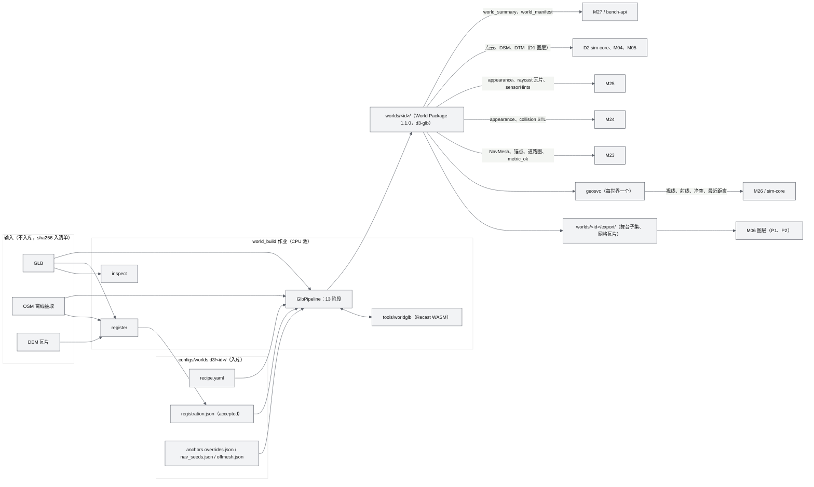
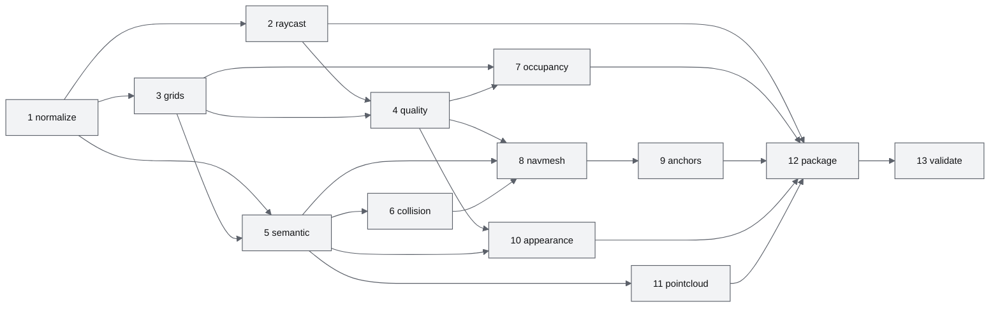
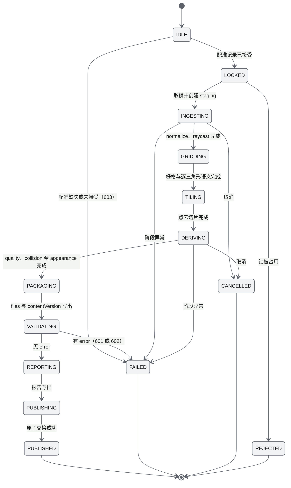
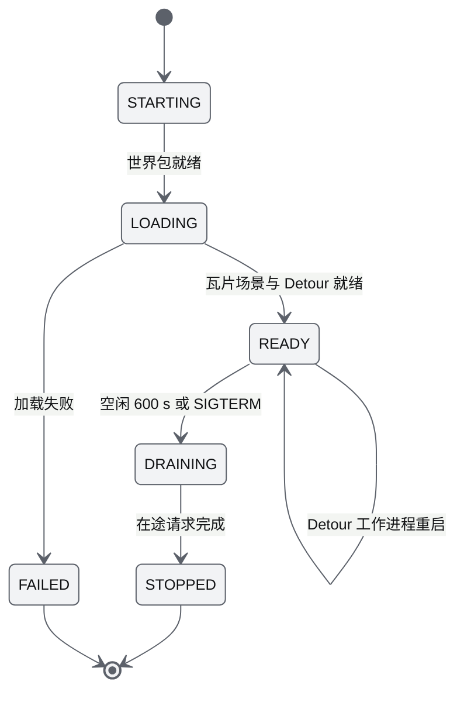
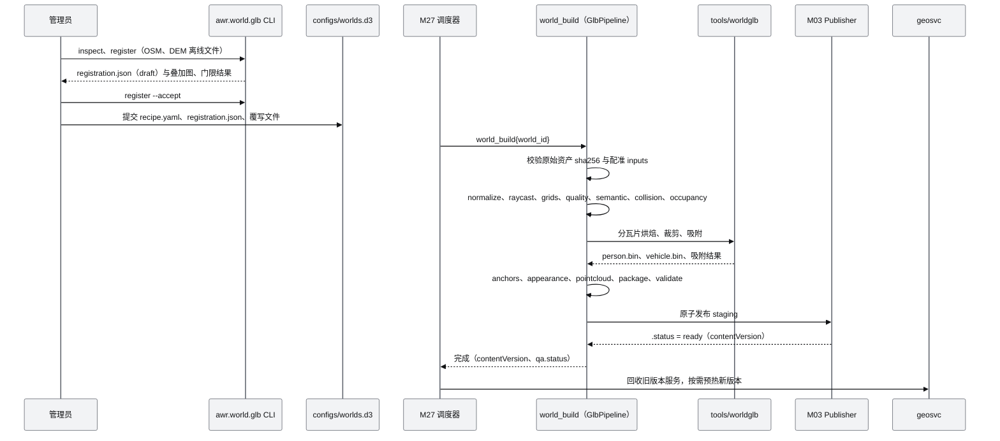
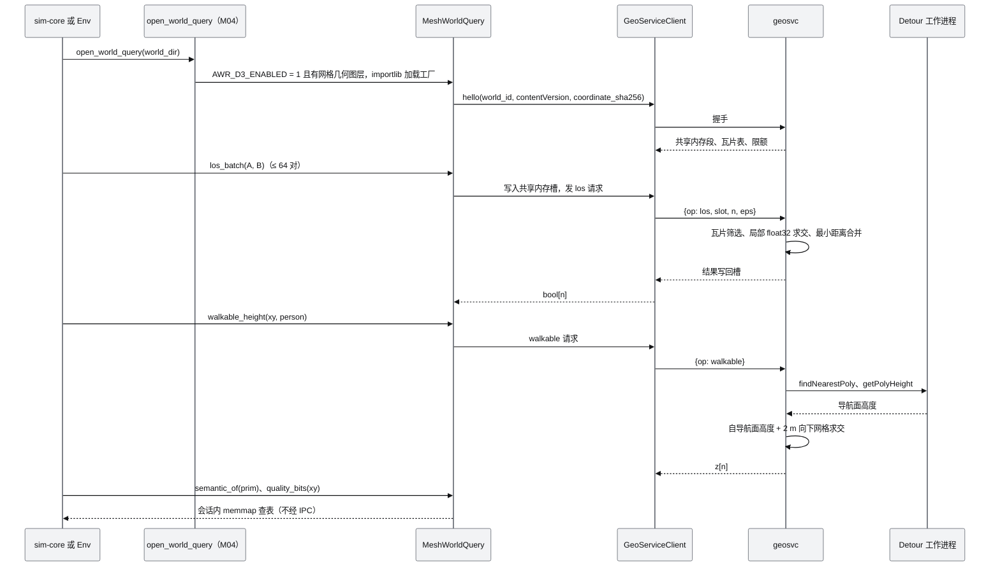

# M22 World 资产导入 PRD（World Asset Import）

| 项 | 内容 |
|---|---|
| 文档编号 | AWR-M22 |
| 标题 | World 资产导入（World Asset Import）PRD：GLB 到米制 World Package 1.1.0（`profile = d3-glb`）的尺度配准与调平、派生资产、`world.json` 加法式扩展、CLI 与作业、"不完整即未知"标注、MeshWorldQuery 与共享几何服务、浏览器分层，以及三份默认 GLB 的配置与验收 |
| 编号说明 | 模块号与文件名按 [AWR-05 §1.3、§5.0](../05-D3-设计增补与决策记录.md) 为 **M22**，需求前缀 `M22-`。研究笔记 r2 §5 所称"world.json v2"在本文一律指 `schemaVersion = "1.1.0"` 加 `profile = "d3-glb"`，不存在 2.x 主版本（§13 第 15 条） |
| 版本 | v1.3 |
| 日期 | 2026-10-12 |
| 状态 | 草案 v1.2（v1.1 按 AWR-05 v1.3 修订：P0a 只构建 crop，town 与 ESDF 移至 P0b，OSM 车道图前移到 P0b，`physics` 导出输入前移到 P0a，高斯外观层生成式来源的标注，修订内容汇总见 §14；v1.2 按 AWR-05 v1.4（ADR-187）并入 r11 结论：外观来源分档 `aerial`、`mesh_distilled`、`generative`，网格蒸馏构建阶段 `appearance.gs`，出处清单与按来源分档的入包验收，修订内容汇总见 §15；v1.3 按 AWR-05 v1.4 定稿（ADR-188、ADR-192）：高斯外观层定为结论 C0，`appearance.gs` 与高斯图层全部在 P3，新增高斯发布子阶段（splat-transform）、网页高斯制品与编辑记录入库，新增几何不完整人工标注（质量层覆写，P1），修订内容汇总见 §16） |
| 上游文档 | 用户 D3 需求原文、补充要求与 2026-10-12 决策 [inputs/D3-需求原文-2026-10-11.md](../inputs/D3-需求原文-2026-10-11.md)（R-D3-02、03、07、10、16、19、26、30、34；v1.1 增加 2026-10-12 交互式确认的 R-D3-42、44、48、49、51）；用户设计讨论 design-r1 第四节、第十节；[AWR-05](../05-D3-设计增补与决策记录.md) §1、§2.4、§4.5、§4.8、§5.1、§7.8、§8、§10–§15，ADR-128 至 ADR-132、ADR-136、ADR-141、ADR-151、ADR-154 至 ADR-156、ADR-158；[AWR-03](../03-设计基线与决策记录.md) §5.1、§5.5、§10.2，ADR-001 至 ADR-006、ADR-034、ADR-048；[AWR-04](../04-D2-设计增补与决策记录.md) §4.4；[16 World 数据规范](../16-World数据规范.md) §2–§7、§9、§17；[M03](M03-World模型与Ingest切片PRD.md)、[M04](M04-几何世界查询服务PRD.md)、[M05](M05-Web点云引擎PRD.md)、[M06](M06-Web视口与渲染后端PRD.md)；D3 研究 [00-index](../research/d3/00-index.md) §1.2、§2.1、§3.3、§4.2、§8，[r2](../research/d3/r2-glb-world.md) 全文，[r6](../research/d3/r6-event-runtime-benchmark.md) §3，[r7](../research/d3/r7-d2-code-audit.md) §3.9、§4.4、§8.3，[r3](../research/d3/r3-camera-render.md) §6，[r4](../research/d3/r4-mesh-lidar.md) §3；v1.2 增加 [r11](../research/d3/r11-skyfall-gs.md) §2、§4、§7（D3-SKY）与 AWR-05 §5.4.4、§6.4、ADR-187；v1.3 增加用户第二次交互式讨论确认的 R-D3-52、55、56，[r12](../research/d3/r12-supersplat.md) §2.6、§2.8、§3.1–§3.3、§4.1、§4.3、§4.6 与 AWR-05 §6.4.8、§6.5、ADR-188、ADR-189、ADR-192 |
| 下游文档 | M23（锚点、NavMesh、`metric_ok` 与 600）、M24（SDF 导出输入、Fast 档接触查询）、M25（`appearance`、`raycast` 瓦片、逐三角形语义与质量位、`sensorHints`）、M26（视线与净空查询）、M27（`world_build` 作业、`world_manifest.json`、`/api/bench/v1/worlds` 数据）、M03 与 M04 的 D3 增补节（扩展点 6、7）、M00（契约 1.3.0 中 world 目录的 schema）、M05 与 M06（Tier S 彩色点云、P1 舞台网格、P2 网格瓦片）、M15（`/lab/worlds`）、17 号文档（原因码 600–609）、`docs/impl/D3-*` |
| 适用版本范围 | V0.3（本期交付 D3，阶段 P-1 至 P3）至 V1.0 |

## 0. 摘要

1. M22 把三份 Sketchfab 摄影测量 GLB（及 P3 的真实航拍网格）转换为米制 World Package 1.1.0（`profile = d3-glb`）：先以 OSM 道路网 FFT 相似变换配准（或建筑轮廓、控制点、共帧继承）得到尺度、真北与平移，再以 DEM 回归与墙面竖直度两法调平，结果与证据写入 `coordinate.json` 与 `qa/report.json`，未通过标定的世界不能加载事件（600）。
2. 构建分 13 个阶段，以 M03 `BuildPipeline` 子类 `GlbPipeline` 实现，复用 staging、原子发布、`contentVersion` 与校验；全部内容文件由确定性 CPU 核生成，同一输入、同一镜像跨机器逐字节一致；dmax 单世界构建（不含配准）≤ 10 min。
3. 派生资产：瓦片局部坐标的求交网格、D1 同格式的 2 m DSM 与 10 m DTM、0.5 m 精细 DSM、质量位栅格与多边形、逐三角形语义、分块碰撞网格与 STL、四态稀疏体素与 ESDF、行人与车辆 NavMesh、OSM 道路图、稳定 id 的锚点、world 帧 `appearance.glb`、网格采样彩色点云、`sensorHints` 与烘焙太阳方位。
4. "不完整即未知"由 M22 提供数据：覆盖多边形、质量位、逐三角形质量码、`unknown` 体素与 `zones.border` 覆盖内缩，消费者按 AWR-05 §5.1.5 执行。
5. MeshWorldQuery 继承 D2 `DsmWorldQuery`：2.5D 方法保持 2 m 栅格语义，3D 方法经每世界一个的共享几何服务 `geosvc` 做网格精确求交；会话匿名内存增量 ≤ 20 MB。
6. 浏览器分层：P0a Tier S 彩色点云（M05 零改动），P1 事件舞台裁剪网格，P2 全世界 3D Tiles；网格类浏览器制品放在 `export/`，不改变 `contentVersion`。
7. **v1.1（§14）**：首个场景为 crop（R-D3-49），P0a 只构建 `oryahovo-crop1`；`smalltown-01` 与 ESDF 移至 P0b；车辆追踪事件所需的 OSM 车道图（车道、转向连通、限速、停止线）由 P1 前移到 P0b；gz-sim 为缺省后端，`export-gazebo` 的 `physics` 档输入在 P0a 提供；`gaussian` 阶段增加生成式来源（网格 → 3DGS → 扩散逐级细化，经 AWR-05 ADR-186 决策门）的标注与约束。
8. 需求：功能 73 条（P0 67 条；v1.1 新增 M22-FR-074 至 FR-078；v1.2 新增 M22-FR-079 至 FR-081）、非功能 12 条、验收 32 条（v1.1 新增 M22-AC-033 至 AC-035；v1.2 新增 M22-AC-036、AC-037），映射 D3-AC-01 至 05、21、24、26、31、39、41、47、54；对基线的反馈 18 条（§13），其中须基线裁决的有：600 的判定集合、契约扩展点 8 的文件范围、共享几何服务进程登记、浏览器网格制品的内容归属。
9. **v1.2（§15）**：按 AWR-05 v1.4 ADR-187 并入 r11（D3-SKY）结论：生成式高斯外观维持研究工具，产品构建流水线不运行扩散模型、发布构建拒绝 `generative` 图层；外观来源增加 `mesh_distilled`，新增网格蒸馏构建阶段 `appearance.gs`、出处清单 `provenance.json` 与外观瓦片划分（v1.3 定稿：P3）；对齐验收按来源分档。
10. **v1.3（§16）**：按 AWR-05 v1.4 定稿（ADR-188、ADR-192）：高斯外观层维持 P3（结论 C0），不采纳方案 C1；`gaussian` 阶段拆为以锁定版本 splat-transform 为执行器的高斯发布子阶段（体检、清理、对齐、瓦片、`spz@2` 与流式 SOG、体素、校验），出处清单增加 `pipeline`、`stats`、`edits` 段，网页高斯制品写入 `export/gaussian/`（P3）；新增几何不完整人工标注（`quality.overrides.json`，事件编辑器的网格选择交互产生提议，管理员提升后产生新的世界版本，P1）。需求增至功能 78 条、验收 35 条（v1.3 新增 M22-FR-082 至 FR-086、M22-AC-038 至 AC-040）。

---

## 1. 背景与目标

### 1.1 约束本模块的事实

| # | 事实 | 对设计的含义 | 依据 |
|---|---|---|---|
| F1 | 三份 GLB 不是米制；节点矩阵中的缩放不可信（town 根节点 ×2.5、crop ×1，二者共用同一 Metashape 局部坐标） | 尺度、真北与平移必须外部标定并留证据；crop 以共帧继承 town 的结果 | r2 §0、§1 第 3 条、§2.2；ADR-130 |
| F2 | 模型存在 1.1°–1.25° 系统倾斜，2.5 km 尺度上约 55 m 高差 | 导入时必须调平；公里级以 DEM 回归为主，墙面竖直度复核 | r2 §2.4；05 §5.1.2 |
| F3 | 三份 GLB 均为带烘焙光照的摄影测量三角网格（town、crop 为 `KHR_materials_unlit`，hill 为 specularFactor 0），不是 3DGS | 网格是几何真值，也是 P0–P2 的外观真值；只能估计太阳方位，不能重新打光 | r2 §3；R-D3-16、R-D3-26；ADR-141 |
| F4 | 城镇级网格粗：crop 边长中位数 1.88 m、纹素 19 cm；town 3.30 m、28 cm；hill 0.13 m、2.5 cm | 世界包发布 `sensorHints`（纹素、边长、纹理受限距离），数据集据此声明分辨率边界 | r2 §0、§3；R-D3-10 |
| F5 | 几何不完整：crop 扫描覆盖只占包围盒 61%，覆盖内另有约 3% 无数据格、147 个开放边界环、1.7% 面积拉伸三角形；7–9% 的竖向柱有多层表面 | 世界包必须携带质量层；全链路执行"不完整即未知" | r2 §4.5、§4.9；ADR-131 |
| F6 | D2 M04 写死 DSM 2 m、DTM 10 m（`geometry/query.py` 第 548–549 行）；D2 的 104 处 WorldQuery 调用中 93 处是 2.5D 语义 | GLB 世界照常输出 D1 同格式同格距的 `dsm_2m`、`dtm_10m`、`dsm_2m_n`，D2 消费者不改代码 | r2 §4.3；r7 §0 第 8 条 |
| F7 | 2 m DSM 视线与网格精确求交不一致 13.3–13.6%（几乎全为误判遮挡）；17.8% 的演员脚点低于 2 m DSM 0.5 m 以上 | 视线、射线、净空类 3D 查询改为网格求交；演员贴地取网格 | r7 §4.4（E4，正确尺度） |
| F8 | 3M 面世界的网格加 BVH 常驻约 300 MB；D2 沙盒每会话匿名页预算 140–155 MB | BVH 只在每个活跃世界一个的共享几何服务中常驻，会话经 IPC 提交射线 | r2 §4.2（E15）；AWR-04 §4.4.2 |
| F9 | Recast 会把树冠、屋顶、平静水面当作可走面；删除这些三角形会把街道网打碎（最大岛 1.13 km² 降到 0.23 km²）；车辆 NavMesh 碎成 2221 块 | 行人 NavMesh 用区域代价与 OSM 道路先验，不删几何；以种子洪泛裁剪；车辆 P0 用车辆 NavMesh 加锚点约束，P1 改用道路图 | r2 §4.6；ADR-132 |
| F10 | SwiftShader（Tier S）每秒约 0.6–0.7 M 三角形；原始 GLB 144–290 MB、16 张 4K 纹理上 GPU 约 1.4 GB | Tier S 显示网格采样彩色点云；网格类浏览器制品分阶段提供并压缩 | r2 §4.8（E08）；05 §7.8 |
| F11 | M03 构建框架支持适配器自带流水线子类（`build_world` 读取 `adapter.pipeline_cls`，`ArraysAdapter` 为先例），派生器以字符串路径懒加载 | M22 以 `GlbAdapter` + `GlbPipeline` 接入，不改 M03 文件（扩展点 6 除外） | `python/awr/world/package/build.py::build_world`；`world/ingest/arrays.py` |
| F12 | D2 校验规则 V-W-11 要求每个内容文件被图层 `href` 引用：目录 `href` 覆盖其下全部文件，文件 `href` 只覆盖同目录同主名的数据文件 | 多文件格式的图层 `href` 一律指向目录，目录内固定 sidecar 名 `index.json` | `world/package/validate.py::w11`、`_same_dir_sidecar` |
| F13 | Overpass 公共端点实测超时与 500；Docker 默认 DNS 在 dmax 无效 | 构建与配准期间不访问网络；OSM 用 Geofabrik 离线抽取，DEM 用本地瓦片，全部记录 sha256 | r2 §2.2；00-index §2.9；05 §13 第 21 条 |
| F14 | 世界最大水平半径约 2.7 km（town），float32 ULP 0.24 mm；Embree 与 numpy 的逐位一致只在同一 ISA 路径成立 | 内容文件的几何计算用 float64 与确定性核；求交在瓦片局部原点下以 float32 相对坐标进行 | r2 §2.5；05 §4.5、§5.1.6 |

### 1.2 目标

| # | 目标 | 度量 |
|---|---|---|
| G1 | 任何一份摄影测量 GLB 在不改 D2 代码的前提下成为米制、可查询、可导航的世界包 | crop 与 town 世界包 `scaleStatus = landmark`，尺度与 r2 差 ≤ 0.5%，V-GLB 全部通过，D2 sim-core 与 M05 加载其点云、DSM、DTM（D3-AC-02） |
| G2 | 世界包可复现 | 同一输入、同一镜像两次构建（含跨机器）`contentVersion` 相同；NavMesh 跨机器 sha256 相同（D3-AC-02、03） |
| G3 | 事件与世界之间只有锚点一个接口，且 id 跨重建稳定 | 锚点吸附中位距离 ≤ 1 m，> 3 m 的告警比例 ≤ 5%（D3-AC-03） |
| G4 | 几何真值统一来自网格，几何缺陷显式标注 | 质量层与覆盖多边形存在，覆盖外体素 100% 为 unknown（D3-AC-04） |
| G5 | 3D 查询精确且不挤占会话内存 | D2 `tests/world_query` 105 个用例在 MeshWorldQuery 下通过；逐射线距离差 p99 ≤ 1 mm；会话匿名内存增量 ≤ 20 MB（D3-AC-05） |
| G6 | 构建时间与资源可控 | dmax `--cpus 16` 单世界 ≤ 10 min、峰值 RSS ≤ 32 GB；本机 8 核 ≤ 30 min |

### 1.3 术语（本文新增，其余见 AWR-05 §1.2）

| 术语 | 定义 |
|---|---|
| glTF 场景帧 | 应用 GLB 全部节点矩阵之后的场景坐标（单位为"glTF 单位"，Y-up，右手）。`coordinate.source.T_world_source` 的源帧即此帧 |
| 世界帧 | World ENU、米、右手、+Z 上（16 §3.3）；原点 XY 取包围盒中心，Z 取 DTM 中位数 |
| 世界配方（recipe） | `configs/worlds.d3/<id>/recipe.yaml`：一个世界的全部构建输入与参数，入库；`world_build` 作业只读配方 |
| 配准记录 | `configs/worlds.d3/<id>/registration.json`：`register` 子命令的输出，经人工复核置为 `accepted` 后入库，是 `build` 的标定输入 |
| 瓦片局部坐标 | 求交网格按 512 m 方形瓦片划分，每瓦片有 float64 局部原点，顶点以 float32 局部坐标存储；CPU 与 GPU 求交使用同一组 float32 数值 |
| 覆盖多边形 | 网格竖向采样有命中的 2 m 格经闭运算后的外轮廓，即扫描覆盖范围 |
| 质量位 | 8 位位掩码，表达覆盖外、洞、拉伸面、低纹素、多层柱、水面、碎块、合成导航面（§7.3.6） |
| 米制可用 | `scaleStatus ≠ relative` 且标定证据完整；判定函数 `metric_ok()` 由 M22 提供，M23 据此返回 600（§13 第 2 条） |
| 共享几何服务（geosvc） | 每个活跃世界一个进程，常驻瓦片化 BVH 与 Detour 查询工作进程，经本地 IPC 服务全部会话的 3D 查询 |
| 浏览器层与导出层 | 浏览器层指 D1 必需的点云图层（内容文件）；导出层指 `export/` 下的网格类浏览器制品（舞台子集、3D Tiles），不进入 `contentVersion`（16 §17） |

---

## 2. 范围

### 2.1 D3 范围（按阶段）

v1.1 按 AWR-05 v1.3（ADR-175、ADR-181、ADR-186）重排；v1.0 的阶段对照见 §14.2。

| 阶段 | M22 交付 | 工作包 |
|---|---|---|
| P-1 | 契约草案：`world.schema.json` 1.1.0、`coordinate.schema.json` 与 `grid.schema.json`、`qa-report.schema.json` 的加法式修订、新格式 schema、`event/anchors.schema.json`（与 M23 共同起草）；扩展点 6、7、8 的变更请求；正确尺度下 CPU 与 GPU 逐射线差异的复测；本 PRD | WP-D3-01、02、03 |
| P0a（最小基准闭环） | town 配准（`register`，作为 crop 共帧继承的参照，不构建完整世界包）与 crop（`oryahovo-crop1`）世界包：标定与两法调平复核、13 个构建阶段（行人与车辆 NavMesh、occupancy；ESDF 移至 P0b）、OSM 锚点与道路图、碰撞分块（供 M24 `physics` 导出档）、彩色点云、`sensorHints`；跨 ISA 确定性；MeshWorldQuery 与 `geosvc`；CLI 与 `world_build` 作业入口；世界摘要（`/lab/worlds` 数据）；`export-gazebo` 的 `physics` 档输入 | WP-D3-04（P0a 6.5 人周） |
| P0b（基准 v1） | town（`smalltown-01`）世界包（含跨 ISA 复验）；ESDF；OSM 车道图（车道、转向连通、限速、停止线，供 M23 IDM 跟驰，由 P1 前移）；MeshLidar 所需的瓦片网格与逐三角形质量码的联调；公开站样例的浏览器层世界子集；`world_manifest.json` 数据；外观来源、出处清单与来源分档验收的契约（FR-076、077、080，v1.2） | WP-D3-04（P0b 2.0 人周）、WP-D3-32（车道图 1.0 人周）、WP-D3-25、27 协同 |
| P1 | hill（`hill-01`）世界包；锚点覆写与编辑器叠加数据；几何不完整人工标注（质量层覆写，FR-082，v1.3）；事件舞台裁剪网格导出；`export-gazebo` 的 `xval` 档输入；高斯外观图层不在 P1 交付（v1.3 定稿为结论 C0，AWR-05 ADR-188） | WP-D3-14、17、18 协同 |
| P2 | 全世界 3D Tiles 网格瓦片导出（M06 图层消费） | WP-D3-21 协同 |
| P3 | 真实航拍资产的世界包构建与 3DGS 外观层导入（含球谐系数旋转、与网格的配准验收）；高斯图层登记与网格蒸馏验证图层 `appearance.gs`（FR-079 至 081）；高斯发布子阶段、网页高斯制品与编辑记录入库（FR-083 至 086，v1.3） | WP-D3-22、WP-D3-39、WP-D3-40 |

### 2.2 不做

| 项 | 理由或去向 |
|---|---|
| 室内结构重建、自动补全缺失立面 | AWR-05 §2.3"不在 D3"；进入建筑只做状态切换 |
| 只以网格训练 3DGS（无扩散细化）用于产品观测 | ADR-141：上限即网格，低空掉 6–7 dB（r11 在正确尺度下复现：低空锐度约为网格的 72%）；v1.2：网格蒸馏 3DGS 只作外观层基础设施验证资产（`mesh_distilled`，非排名运行，ADR-187） |
| 在产品构建流水线中运行扩散模型生成外观（`generative`） | ADR-187 首轮裁决为结论 C：生成式外观维持研究工具；生成流程只存在于研究镜像（r11 的 D3-SKY 脚本），M22 只承担研究世界中生成式图层的登记、标注与入包验收，发布构建拒绝该来源（FR-076） |
| 运行期渲染与 LiDAR 扫描 | M25；M22 只提供资产与查询 |
| SDF 语义与 Gazebo 插件 | M24；M22 提供 `appearance.glb`、碰撞 STL 与坐标 |
| 事件编译与磁带生成 | M23；M22 提供 NavMesh、锚点、道路图与 `walkable_height` |
| 交通法规级车道模型 | AWR-05 §2.3；P0b 只提供 OSM 车道图的几何、连通、限速与停止线（v1.1） |
| D2 七个世界的任何变更 | ADR-129：D3 世界只用新 id，不改 D2 世界包与派生缓存 |

### 2.3 与其他模块的边界

| 模块 | 边界 |
|---|---|
| M03 | M22 以 `GlbAdapter`、`GlbPipeline` 复用 M03 的锁、staging、原子发布、`.status`、`contentVersion`、`files[]`、点云切片与 `validate_world`；M03 实施扩展点 6（`RawCloud.rgb`、`col.rgb = srgb`）；M22 不改 `world/package/cli.py` 与 `configs/worldpkg.yaml` |
| M04 | M04 实施扩展点 7：`open_world_query` 在开关打开且世界包有网格几何图层时，以字符串路径加载 M22 的工厂函数；M22 的 `MeshWorldQuery` 继承 `DsmWorldQuery`，2.5D 方法与派生缓存原样复用 |
| M02 | 经纬度与世界帧换算一律调用 `awr.world.georef.frames`，M22 不含椭球常量（AWR-03 §5.1 第 8 条） |
| M00 | 合入 world 目录 schema 的加法式修订与新格式 schema、原因码、`d3-world` 依赖组；M22 起草 |
| M23 | 消费 `nav.person`、`nav.vehicle`、`nav.graph`、`semantic.anchors`、`semantic.quality`、`walkable_height`、`metric_ok`；M23 的 Node 生成器与 M22 锁定同一 recast-navigation 版本（`tools/worldglb/RECAST_VERSION`） |
| M24 | 消费 `appearance.glb`、`mesh.collision` STL 与 `coordinate.json` 导出 SDF；Fast 档接触 stage 使用 MeshWorldQuery（含本文新增的 `closest_batch`） |
| M25 | 消费 `appearance`（含逐三角形语义与质量码）、`mesh.raycast` 瓦片、`sensorHints`、质量栅格；GPU 求交使用同一瓦片划分与 float32 局部坐标 |
| M26 | 经 MeshWorldQuery 做视线与净空；L1 档 `raycast = cpu` 时只经 `geosvc` 的 CPU 路径 |
| M27 | 以 `world_build` 作业调用 `awr.world.glb.jobs:run_world_build`；`/api/bench/v1/worlds` 与数据集 `world_manifest.json` 的内容由 M22 函数生成；负责启动与回收 `geosvc` |
| M05、M06 | Tier S 彩色点云走 M05 现有管线；P1 舞台网格与 P2 网格瓦片由 M06 图层加载 `export/` 制品 |
| M15 | `/lab/worlds` 页面展示 M22 世界摘要；P1 事件编辑器加载 NavMesh、锚点与质量叠加 |

---

## 3. 用户与用例

| 编号 | 角色 | 用例 | 涉及需求 |
|---|---|---|---|
| UC-01 | 管理员 | 登记一份新的 GLB 与 OSM、DEM 离线抽取，运行 `inspect`、`register`，复核叠加图后接受配准，提交配方 | FR-001 至 FR-016 |
| UC-02 | 管理员、M27 调度器 | 以 `world_build` 作业构建并原子发布世界包，失败时保留旧包 | FR-017 至 FR-042、FR-056 |
| UC-03 | 研究者 | 在 `/lab/worlds/:wid` 查看尺度、真北、两法调平差值、`sensorHints`、质量覆盖、许可与署名 | FR-063、FR-065 |
| UC-04 | M23 编译器 | 解析锚点、查询 NavMesh 路径与可行走高度，判定世界是否米制可用 | FR-016、FR-032 至 FR-036、FR-046 |
| UC-05 | M26 Env、M24 Fast 档 | 批量视线、射线、净空与最近距离查询 | FR-045 至 FR-053 |
| UC-06 | M25 Worker | 加载外观网格、逐三角形语义与质量码、瓦片求交网格 | FR-024、FR-029、FR-037 |
| UC-07 | 管理员（P1） | 在编辑器中确认或修正世界锚点，触发增量重建并产生新的世界版本；研究者的事件级锚点调整写入 M23 事件局部覆盖层，不改变世界版本（AWR-05 v1.2 ADR-168） | FR-036、FR-044、FR-058 |
| UC-08 | 公开站访客 | 以 Tier S 浏览 GLB 世界的彩色点云；P2 起在硬件 GPU 上查看网格瓦片 | FR-059 至 FR-062 |
| UC-09 | 管理员（P3） | 导入同一批航拍影像产出的网格与 3DGS，验证配准并构建新世界 | FR-072、FR-073 |

---

## 4. 功能需求

表头按 AWR-05 §1.2 与 AWR-03 §10.2：优先级 P0 为该阶段阻塞项、P1 为应交付（缺失须有豁免记录）、P2 为可延期；"阶段"取 P-1、P0a、P0b、P1、P2、P3；目标版本均为 V0.3（各阶段出口的小版本）。"依据"中不带文档名的 §x 指本文，"05 §x"指 AWR-05。

### 4.1 输入、配方与资产登记

| 编号 | 需求描述 | 优先级 | 阶段 | 目标版本 | 验收要点 | 依据 |
|---|---|---|---|---|---|---|
| M22-FR-001 | 原始资产登记：GLB、OSM 抽取、DEM 瓦片放在 `data/raw/d3-glb/<world_id>/`（不入库），清单 `data/raw/d3-glb/MANIFEST.json` 入库并逐文件记录 `{name, bytes, sha256, kind, source_url, license, author, title, retrieved}`；任一阶段读取前校验字节数与 sha256，不符时退出码 4（`RAW_CHECKSUM`），缺失时退出码 4（`RAW_MISSING`） | P0 | P0a | V0.3 | M22-AC-021 | 16 §10.4 同构；ADR-034 |
| M22-FR-002 | 世界配方：每个世界一份 `configs/worlds.d3/<id>/recipe.yaml`（字段见 §7.6.1），声明源文件、OSM 与 DEM、配准记录、构建参数、导航种子与 off-mesh 连接、锚点覆写、舞台定义与发布范围；`world_build` 作业只读配方，CLI 参数只用于开发期覆盖且覆盖项写入 `generator.params.d3.overrides` | P0 | P0a | V0.3 | M22-AC-021 | 本文设定：保证构建输入可审计、可复现 |
| M22-FR-003 | 外部数据离线化：`register` 与 `build` 不访问网络；OSM 取 Geofabrik 区域抽取，以 osmium 按世界包围盒外扩 2 km 裁剪为 `.osm`（XML）；DEM 取本地 SRTM 1″ 或 EU-DEM 瓦片；每个输入的 sha256 写入配方与 `dataset.derivedFrom[]`；检测到网络访问（测试中以无网络命名空间运行）即判失败 | P0 | P0a | V0.3 | M22-AC-021 | r2 §2.2（Overpass 不稳定）；05 §13 第 21 条；ADR-130 |
| M22-FR-004 | `inspect`：输出节点矩阵展平结果、上轴投票（面积加权法线 ±X/±Y/±Z 占比）、镜像检测（各节点 `det` 符号）、三角形、顶点、去重位置与图元数、索引类型、纹理数量与尺寸与总纹素、材质扩展、估算主存与 GPU 纹理显存、`asset.extras` 中的作者、来源与许可；`--json` 输出机器可读报告 | P0 | P-1 | V0.3 | M22-AC-001 | r2 §1、§6 |
| M22-FR-005 | GLB 安全解析：只接受 glTF 2.0 二进制；文件 ≤ 4 GiB、JSON 块 ≤ 64 MiB；全部 accessor 与 bufferView 越界检查；索引 < 顶点数；拒绝外部 URI；遇 `KHR_draco_mesh_compression`、`EXT_meshopt_compression` 时先经 gltf-transform 解压到 staging 再读取；任一镜像节点（`det < 0`）或整体镜像（`det(T) ≤ 0`）以退出码 2 拒绝 | P0 | P0a | V0.3 | M22-AC-001、021 | r2 §1（三份均 `det > 0`）；本文设定：防御异常资产 |

### 4.2 标定：尺度、真北、平移与调平

| 编号 | 需求描述 | 优先级 | 阶段 | 目标版本 | 验收要点 | 依据 |
|---|---|---|---|---|---|---|
| M22-FR-006 | `--method roads`：在 glTF 场景帧的水平面（E = x、N = −z）上生成纹理正射图与竖向 DSM，提取道路掩码；把 OSM 道路中心线投到以抽取包围盒中心为原点的局部 ENU（经 M02）；以（偏航、尺度）网格做 FFT 归一化互相关粗搜与细搜，再以道路掩码距离变换为代价精配（偏航、尺度、平移同时优化）；算法见 §6.6.2 | P0 | P0a | V0.3 | M22-AC-002 | r2 §2.2；05 §5.1.2 |
| M22-FR-007 | `--method footprints`：道路过少时以 OSM 建筑轮廓与网格屋顶掩码（nDSM > 2.5 单位等效高度且法线向上）做同一搜索与精配；hill 使用此法 | P0 | P1 | V0.3 | M22-AC-023 | r2 §2.2（hill 46 栋建筑） |
| M22-FR-008 | 控制点（`--method manual --control-points cp.json`）：给出 ≥ 2 组已知距离点对或 ≥ 3 个带经纬度的点；以 Umeyama 最小二乘求相似变换；输出逐点残差与 RMS；`registration.method = control-points`，`scaleStatus = landmark` | P0 | P0a | V0.3 | M22-AC-021 | r2 §2.6 第 1 条；05 §5.1.2 |
| M22-FR-009 | `--frame-of <other-id>`（共帧继承）：由两份 GLB 根节点矩阵求源到参照世界 glTF 场景帧的相似变换，复合参照世界已接受的配准结果；本世界重新取原点；以 5 万个本世界顶点到参照世界网格的距离（中位数 ≤ 0.5 m、p90 ≤ 1.0 m）验证共帧；另以 `roads` 独立配准一次作为交叉校验写入 qa（尺度差 ≤ 0.5%、偏航差 ≤ 0.3°） | P0 | P0a | V0.3 | M22-AC-003 | r2 §1 第 3 条（中位数 0.26 m、p90 0.80 m）；本文设定：交叉校验 |
| M22-FR-010 | 无 OSM 与控制点时的地物统计（`--method manual` 且不给控制点）：以车道宽 3.0–3.75 m、小汽车 4.2–4.8 m、门高 2.0–2.1 m、层高 2.8–3.2 m 的人工量测联合回归尺度，`scaleStatus = assumed`，`registration.method = manual`；世界摘要与 UI 显示"尺度未标定（估计值）"；该世界只能用于不排名的开发运行（§13 第 2 条建议） | P1 | P0a | V0.3 | M22-AC-008 | r2 §2.6 第 2 条 |
| M22-FR-011 | 配准接受门：`register` 输出 `registration.json`（`status = draft`）与叠加图（OSM 道路与建筑叠加在 0.25 m/像素正射图上）；自动门限（§6.7 表 R1–R6）任一不过则退出码 2 并给出 603 `WORLD_REGISTRATION_REJECTED`；通过后须由管理员执行 `register --accept` 写入 `status = accepted`、`accepted_by`；`build` 只接受 `accepted` 的配准记录且其 `inputs` 的 sha256 与当前原始资产一致 | P0 | P0a | V0.3 | M22-AC-002、021 | 本文设定：标定是事件与观测全部米制量的前提，须人工复核留痕 |
| M22-FR-012 | 调平：公里级世界（包围盒对角线 ≥ 1 km）以 DEM 回归为主估计（`h = k·z + gE·E + gN·N + c`，Huber IRLS），墙面竖直度（近竖直面法线 z 分量对水平朝向的回归）为独立复核；两法水平梯度向量之差折合角度 ≤ 0.5° 时采用 DEM 结果，超出时 qa 告警、`leveling.needsControlPoints = true`；小场景以墙面法为主，以两个独立墙面子集（按立面方位奇偶分组）的一致性（≤ 0.3°）复核；调平写成绕水平轴的小旋转，`T_world_source` 保持相似变换 | P0 | P0a | V0.3 | M22-AC-004、023 | r2 §2.4；05 §5.1.2、RV-23 |
| M22-FR-013 | 调平验收量（与方法无关）：调平后在 ≥ 3 个已知水平面（OSM 水体、广场，面积 ≥ 2,000 m²，自动从 OSM 生成并可在 `horizontal_planes.geojson` 中人工增补）上拟合平面，坡度 ≤ 0.2°；或 ≥ 20 个分散控制点的 AGL 残差 RMS ≤ 2 m；结果写入 qa 与世界摘要 | P0 | P0a | V0.3 | M22-AC-004 | 05 D3-AC-02 |
| M22-FR-014 | 世界帧合成：`T_world_source = [[R_level·Rz(yaw)·s·R_enu_gltf, t]; [0,0,0,1]]`，`R_enu_gltf = [[1,0,0],[0,0,−1],[0,1,0]]`；矩阵以 Python float 标量合成（复用 M03 `normalize.compose3`），点以 float64 逐元素变换；原点 XY 取变换后包围盒中心，Z 取 DTM 中位数；锚点 `kind = synthetic`、`georeferenced = false`、`label` 以 `illustrative:` 开头并写明配准方法与水平不确定度，`latDeg`、`lonDeg` 由 M02 换算，`hMslM` 取 DEM 在原点的值减世界 DTM 在原点的值，`uncertaintyM = {horizontal: 5, vertical: 5}`；`trueNorth = {0, verified, evidence}` | P0 | P0a | V0.3 | M22-AC-005、006 | r2 §2.1、§2.5；16 §3.3；AWR-03 §5.1 |
| M22-FR-015 | 证据留存：`coordinate.json` 写 `source.{kind = dataset, crs = LOCAL, upAxis = +y, handedness = right, unitsToMeters, yawDeg, leveledDeg, T_world_source, files[], evidence[]}` 与 `registration{method, T_world_map, rmseM, inliers}`；`qa/report.json` 的 `glb.registration` 段写全部门限量、两法调平估计、水平面与控制点残差；叠加图写入 `.cache/worldglb/<id>/`，不进入世界包 | P0 | P0a | V0.3 | M22-AC-006 | ADR-130；05 §5.1.2 |
| M22-FR-016 | 米制可用判定：提供 `metric_ok(world) -> MetricStatus{ok, scale_status, ranked_ok, reason}`；`ok = (scaleStatus ≠ relative) ∧ 标定证据完整`，`ranked_ok = ok ∧ scaleStatus ≠ assumed`；M23 在 `ok = false` 时返回 600 `WORLD_UNCALIBRATED`；基线修订前，对 GLB 世界本判定与 AWR-05 §5.1.2 的 `{landmark, assumed}` 口径等价（M22 只产出这两个取值） | P0 | P0a | V0.3 | M22-AC-008 | 05 §5.1.2、D3-AC-02；§13 第 2 条 |

### 4.3 构建流水线

| 编号 | 需求描述 | 优先级 | 阶段 | 目标版本 | 验收要点 | 依据 |
|---|---|---|---|---|---|---|
| M22-FR-017 | 13 个构建阶段（normalize、raycast、grids、quality、semantic、collision、occupancy、navmesh、anchors、appearance、pointcloud、package、validate）以 `GlbPipeline(BuildPipeline)` 实现，映射到 M03 状态 INGESTING 至 PUBLISHING（§6.3）；锁、staging（`worlds/.staging/<id>-<nonce>/`）、启动恢复、`renameat2` 原子发布与 `.status` 原样复用 M03 `build_world` | P0 | P0a | V0.3 | M22-AC-005、021 | 05 §5.1.3；F11 |
| M22-FR-018 | 阶段依赖与增量：阶段 DAG 见 §6.2；每个阶段在 `.work/stages/<name>.json` 记录输入哈希与产物哈希；`--steps a,b` 以已发布包为基底（硬链接复制）重跑指定阶段，若上游输入哈希变化而下游未列入则退出码 3 并列出需追加的阶段；`package` 与 `validate` 总是追加执行 | P0 | P0a | V0.3 | M22-AC-021 | 05 §5.1.3"每个阶段可单独重跑" |
| M22-FR-019 | 构建档：`full`（缺省，发布档）执行全部阶段；`fast`（开发档）跳过 ESDF、车辆 NavMesh 与外观导出，NavMesh 栅格放大一倍；`fast` 包写 `tags` 含 `dev-build`，M27 拒绝以其提交排名运行，公开站不同步 | P1 | P0a | V0.3 | M22-AC-021 | 本文设定：开发迭代 |
| M22-FR-020 | 确定性：内容文件的生成一律走确定性 CPU 路径——float64 几何、关闭 fastmath 的 numba 核、固定种子的计数器随机数、只按空间分块并行且块序拼接、禁止跨块浮点归约；Embree 与 Warp 不参与内容文件生成，只用于校验与运行期；JSON 输出不含时间戳与主机信息；`--gpu` 只加速校验，不改变内容文件 | P0 | P0a | V0.3 | M22-AC-005 | 05 §4.5 一级；F14；§13 第 7 条 |
| M22-FR-021 | 资源与生命周期：阶段间检查取消（`StageContext.check_cancel`）、上报进度与心跳；0.5 m 栅格与占据体素按 1024 × 1024 格块流式计算；构建进程以 `--memory 48g` 运行时峰值 RSS ≤ 32 GB；临时文件只写 staging | P0 | P0a | V0.3 | M22-AC-005 | r2 §4.3（未分块峰值 23.5 GB） |
| M22-FR-022 | `qa/report.json` 增加 `glb` 段：配准与调平证据、拓扑体检、每阶段耗时与峰值 RSS、质量统计、语义面积占比、NavMesh 连通性与岛统计、锚点吸附分布、`sensorHints` 计算过程、V-GLB 结果；`qa.status` 取 V-GLB 与 D2 规则的最严结果 | P0 | P0a | V0.3 | M22-AC-006 | 16 §9；ADR-130 |

### 4.4 派生资产

| 编号 | 需求描述 | 优先级 | 阶段 | 目标版本 | 验收要点 | 依据 |
|---|---|---|---|---|---|---|
| M22-FR-023 | normalize：展平节点并以 float64 施加 `T_world_source`；识别漂浮碎块（连通分量 < 100 面且与主分量最近距离 > 0.5 m），从外观与求交网格中同时移除并在质量位 bit6 标记；其余碎块保留 | P0 | P0a | V0.3 | M22-AC-018、020 | r2 §4.1、§4.4 第 3 条；本文设定：外观与几何一致 |
| M22-FR-024 | raycast：按 1 mm 网格哈希焊接位置（首次出现序，确定性）、去除退化面与重复面、统计边界边、非流形边与连通分量；按 512 m 方形瓦片（以世界原点对齐）划分，三角形按质心归属瓦片，瓦片局部原点为瓦片中心（Z 取该瓦片顶点 Z 中位数取整到 1 m），顶点以 float32 局部坐标存储；附逐三角形 `cls.u8`、`q.u8`、`src.u32`（外观三角形序号）；格式 `awr-trimesh@1`（§7.3.1）；加载时建 BVH，不序列化 | P0 | P0a | V0.3 | M22-AC-013、027 | 05 §5.1.3 第 2 行、§5.1.6；r2 §4.1 |
| M22-FR-025 | grids（D1 兼容）：以确定性竖向栅格化核（§6.6.6）生成 `dsm_2m`（每格 4 × 4 采样取最高命中，空格取格心 DTM 双线性值）、`dtm_10m`（最低命中经 M03 开运算与填补算法）、`dsm_2m_n`（每格有命中的采样数 0–16，uint8）；格式、格距、`originXY` 规则与 D1 完全相同 | P0 | P0a | V0.3 | M22-AC-006、007 | 05 §5.1.3 第 3 行；16 §6.3；F6 |
| M22-FR-026 | 精细栅格：`dsm_0p5m`（每格 2 × 2 采样取最高命中，`f32-grid@1`，与 `dsm_2m` 同 `originXY`），按 1024 × 1024 格块流式写盘；供 `geosvc` 与会话以只读 memmap 使用 | P0 | P0a | V0.3 | M22-AC-007、013 | 05 §5.1.6；r2 §4.3 第 3 条 |
| M22-FR-027 | quality：输出质量位栅格（城镇级 2 m、小场景 0.5 m，与 DSM 对齐，`grid.kind = quality`）与 `geojson/awr-quality@1` 多边形（扫描覆盖、无数据、洞、拉伸面、低纹素、多层柱、水面、碎块）；位定义与算法见 §6.6.7、§7.3.6；逐三角形质量码写入 `raycast` 与 `appearance` 的 `q.u8` | P0 | P0a | V0.3 | M22-AC-012 | 05 §5.1.3 第 4 行、§5.1.5；r2 §4.9 |
| M22-FR-028 | zones：以 M22 派生器替代 D2 的包围盒内缩规则写 `semantic/zones.geojson` 的 `border`：覆盖多边形最大连通分量按城镇级 20 m、小场景 5 m 内缩，去洞，Douglas–Peucker 简化到每环 ≤ 1024 顶点；`max_z_m = round(max(dsm_2m) + 50, 2)`；其余 zone 规则不变 | P0 | P0a | V0.3 | M22-AC-012 | 05 §5.1.4；16 §7；r2 §4.9 规则 1 |
| M22-FR-029 | semantic：逐三角形粗语义（地面、路面、低矮与中等与高植被、屋顶、立面、水面、未分类），以纹理颜色、法线、nDSM 与 OSM 先验（道路缓冲、建筑轮廓、水体）判定，结果按 `anet-classes@1` 索引写 `cls.u8`；规则见 §6.6.8 | P0 | P0a | V0.3 | M22-AC-017 | 05 §5.1.3 第 5 行；r2 §4.6 第 4 条（E13） |
| M22-FR-030 | collision：移除漂浮碎块后以 meshoptimizer `simplify`（单线程，确定性）减面到 10%；按质心 k-d 二分到每块 ≤ 50,000 面；输出 `awr-trimesh@1` 与每块二进制 STL（世界 ENU、米、Z 上，顶点为外观顶点的 float32 原值）；记录双向误差 p50、p95、p99 | P0 | P0a | V0.3 | M22-AC-018 | 05 §5.1.3 第 6 行；r2 §4.4 |
| M22-FR-031 | occupancy：16³ 稀疏砖块四态体素（0 unknown、1 free、2 occupied、3 below-surface），体素边长 crop 1 m、town 2 m、hill 0.25 m；覆盖外的柱一律 unknown；表面之下与洞一律不可视为空地；ESDF 为 f16、截断 20 m、只在 free 体素计算、以非 free 体素为障碍；格式 `awr-occ@1`（§7.3.2） | P0 | P0a（占据）、P0b（ESDF） | V0.3 | M22-AC-030 | 05 §5.1.3 第 7 行；r2 §4.5 |
| M22-FR-032 | 行人 NavMesh：Recast 分瓦片烘焙（Node，recast-navigation 低层 API 传入逐三角形 area id）→ 以种子洪泛裁剪 → 语义区域代价与 OSM 道路走廊代价 → 读入 `offmesh.json` 人工连接；导出 `detour-navmesh@1`（`person.bin` + `person.json`）；参数见 §6.8；随机 1,000 对路径 100% 可达、路径落在 OSM 道路走廊 ≥ 70%、经过植被 ≤ 5% | P0 | P0a | V0.3 | M22-AC-010 | 05 §5.1.3 第 8 行、D3-AC-03；ADR-132；r2 §4.6 |
| M22-FR-033 | 车辆 NavMesh（P0 允许"车辆 NavMesh + 锚点约束"）：独立参数烘焙，以道路走廊为种子裁剪，只保留与车辆锚点连通的岛；crop 必交（首发示例事件含 1 辆车，否则编译返回 616；AWR-05 v1.2 裁决 M23 §14 第 5 条），town 缺省不生成 | P0 | P0a | V0.3 | M22-AC-010 | ADR-132；r6 §3；00-index §3.3 |
| M22-FR-034 | OSM 道路图 `geojson/awr-navgraph@1`：覆盖内 `highway=*` 线段转世界帧，按节点切分为边，属性 `kind`、`agents`、`width_m`、`speed_mps`、`oneway`、`lanes`、`osm_id`、逐顶点贴地高度 `z_m`；P1 增补转向限制与车道级属性供 M23 跟驰模型 | P0 | P0a | V0.3 | M22-AC-010 | 05 §5.1.3 第 8 行、§2.3；r2 §4.6 第 3 条 |
| M22-FR-035 | 锚点播种与吸附：OSM 路口（≥ 2 条道路共享的节点）、建筑轮廓（`zone`）、建筑出入口（`door`，优先 OSM `entrance=*`，否则取与步行道或道路相距 ≤ 8 m 的轮廓边中点，每栋 ≤ 4 个）、POI（白名单类别）转世界帧并裁到覆盖多边形内；吸附到裁剪后的 NavMesh；吸附距离 > 3 m 的路口与 POI 沿关联 OSM 道路 ±15 m 搜索吸附距离 ≤ 1 m 的位置并记录 `relocatedM`；吸附中位距离 ≤ 1 m，> 3 m 告警比例 ≤ 5%（分母为点状锚点：路口、出入口、POI、人工点） | P0 | P0a | V0.3 | M22-AC-011 | 05 §5.1.3 第 9 行、D3-AC-03；r2 §4.7；§13 第 9 条 |
| M22-FR-036 | 锚点 id、状态与覆写：id 为来源的纯函数（`j-<node>`、`b-<way>`、`d-<way>-<k>`、`p-n<id>`/`p-w<id>`、人工 `m-<slug>`），跨重建稳定；状态 `auto`、`review`、`confirmed`、`deprecated`；`anchors.overrides.json` 的有序操作（add、move、confirm、deprecate、relabel、pair）在播种后施加；OSM 元素消失时置 `deprecated` 而不删除；每次构建输出与上一版本的差异（新增、废弃、移动 > 0.05 m）到 qa | P0 | P0a | V0.3 | M22-AC-011、031 | 05 §5.1.3 第 9 行"id 跨重建稳定"；ADR-132 |
| M22-FR-037 | appearance：写 world 帧米制 `appearance.glb`（顶点按 glTF Y-up 存储为 (E, U, −N)、float32；全部材质 `KHR_materials_unlit` 且 `doubleSided = true`；纹理沿用源图像字节，不重编码）；同目录 `index.json`（图元三角形偏移、纹理哈希、坐标轴约定）、`tri.cls.u8`、`tri.q.u8`（外观三角形序）；只供服务端渲染、`drone4d-camera` 离线模式与 SDF 导出，不下发浏览器 | P0 | P0a | V0.3 | M22-AC-020 | 05 §5.1.3 第 10 行、§5.4.3（unlit）；r2 §4.8 分层表 |
| M22-FR-038 | pointcloud：在外观网格上按面积采样目标 5,000,000 点（计数器随机数，键为三角形序号，与遍历顺序无关），颜色取纹理双线性采样的 sRGB 8 位值，法线取三角形法线，类别取三角形语义；经扩展点 6 写 `potree2/anet-q16@1`（`col.rgb = srgb`）与 `awr-pts@1`，`render.defaultColorMode = rgb` | P0 | P0a | V0.3 | M22-AC-019 | 05 §5.1.3 第 11 行、§7.8；r2 §4.8（E14） |
| M22-FR-039 | `sensorHints`：`texelM`（面积加权纹素中位数）、`meshEdgeP50M`、`textureLimitedRangeM`（按 §6.6.12 的四个相机档计算）、`multiLayerColumnFrac`、`bakedSunAzElDeg`、`bakedSunConfidence`、`captureSeason`（可空） | P0 | P0a | V0.3 | M22-AC-016 | 05 §5.1.2 第 4、5 行；r2 §3 |
| M22-FR-040 | 烘焙太阳方位估计：以正射亮度中的阴影掩码与 DSM 投影阴影的相关性在（方位、高度角）网格上搜索（§6.6.13）；置信不足时 `bakedSunAzElDeg = null`、`bakedSunConfidence = unknown` 并 qa 告警，M25 退回 M07 太阳位置 | P1 | P0a | V0.3 | M22-AC-016 | 05 §5.1.2 第 5 行；r3 §6 |
| M22-FR-041 | package：`world.json` 写 `schemaVersion = "1.1.0"`、`profile = "d3-glb"`、`tags`（`real`、`glb`、角色标签）、`sensorHints`、`dataset`（含 `derivedFrom[]`、`notice`）、`render.defaultColorMode = rgb`；`layers[]` 先按 D1 必需图层次序写出，再追加 D3 图层（§7.1.3）；`files[]` 与 `contentVersion` 按 16 §3.4 计算 | P0 | P0a | V0.3 | M22-AC-006 | 05 §5.1.4；16 §3.2、§3.4 |
| M22-FR-042 | validate：先执行 D2 `validate_world`（结构、语义、deep），再执行 V-GLB 规则组（§7.8，16 条）；error 级失败不发布（退出码 1），warn 级写入 `qa.messages` | P0 | P0a | V0.3 | M22-AC-006 | 05 §5.1.3 第 13 行 |

### 4.5 "不完整即未知"的数据面

| 编号 | 需求描述 | 优先级 | 阶段 | 目标版本 | 验收要点 | 依据 |
|---|---|---|---|---|---|---|
| M22-FR-043 | 为 AWR-05 §5.1.5 的每个环节提供数据与查询：占据体素覆盖外与表面之下为 unknown 或 below-surface；NavMesh 对无数据、洞、拉伸面、水面与屋顶置不可行走；`raycast` 与 `appearance` 的逐三角形质量码供 LiDAR `void` 标记与相机 `invalid_mask`；`quality_bits(xy)` 查询供评测剔除不可观测区；覆盖外锚点不发布、覆盖边缘 20 m 内的锚点置 `review` | P0 | P0a | V0.3 | M22-AC-012 | 05 §5.1.5、D3-AC-04；ADR-131 |
| M22-FR-044 | 编辑器叠加数据：`semantic.quality` 多边形按 kind 分层、`nav.person` 二进制与锚点可被浏览器 WASM 直接加载；提供 `GET` 可用的只读静态路径清单（由 M27 经 bench-api 暴露） | P1 | P1 | V0.3 | M22-AC-031 | 05 D3-AC-26；r2 §4.6 第 6 条 |

### 4.6 MeshWorldQuery 与共享几何服务

| 编号 | 需求描述 | 优先级 | 阶段 | 目标版本 | 验收要点 | 依据 |
|---|---|---|---|---|---|---|
| M22-FR-045 | `MeshWorldQuery(DsmWorldQuery)`：2.5D 方法（`height_dsm`、`ground_dtm`、`agl`、`column_max_within`、`clearance`、`contact_mask`、`heightmap_top_along`、`path_*`、`grid25` 等）原样继承 2 m 栅格语义与派生缓存；3D 方法（`ray_hit`、`ray_hit_iter`、`segment_los`、`segment_los_iter`、`los_batch`、`free_distance`）覆盖为网格精确求交，参数上限、校验与原因码与 D2 相同（`los_batch` ≤ 64 对、`free_distance` ≤ 16 条、`max_range_m` ≤ 5000 m），`Hit` 字段映射见 §7.5.2 | P0 | P0a | V0.3 | M22-AC-013 | 05 §5.1.6；r7 §8.3、E4 |
| M22-FR-046 | 新增方法：`raycast_batch`（≤ 1,048,576 条/调用，返回距离、全局三角形号、实例号）、`walkable_height`、`nav_path`、`semantic_of`、`quality_bits`、`tri_quality`、`closest_batch`（最近表面距离，供 M24 Fast 档接触）；签名与单位见 §7.5.1 | P0 | P0a | V0.3 | M22-AC-013、015 | 05 §5.1.6；§13 第 17 条 |
| M22-FR-047 | 分派工厂：提供 `awr.world.mesh.query:open_mesh_world_query`，M04 在扩展点 7 中以 `importlib` 按字符串加载（不得静态 import），条件为 `AWR_D3_ENABLED = 1` 且世界包存在 `role = geometry`、`type = mesh`、`format = awr-trimesh@1` 的图层；D2 七个世界与开关关闭时返回 `DsmWorldQuery`，行为逐位不变 | P0 | P0a | V0.3 | M22-AC-022 | 05 §12.3 第 7 处；ADR-129 import 方向 |
| M22-FR-048 | `geosvc` 进程：`python -m awr.world.mesh.geosvc --world <id>`；每个活跃世界、每台主机一个；加载 `raycast` 瓦片并为每瓦片建 Open3D `RaycastingScene`；托管一个 Node Detour 查询工作进程；空闲（无连接）600 s 退出；由 M27 调度器按需启动与回收，异常退出由调度器重启 | P0 | P0a | V0.3 | M22-AC-014 | 05 §5.1.6、ADR-131；§13 第 4 条 |
| M22-FR-049 | IPC：Unix 域套接字传控制消息，每连接一段 POSIX 共享内存（缺省 8 槽 × 16 MiB）传批量数组；握手校验 `(world_id, contentVersion, coordinate_sha256, proto)`，不一致返回 605 `GEOSVC_BINDING_MISMATCH`；协议见 §7.5.4 | P0 | P0a | V0.3 | M22-AC-014 | 本文设定：避免序列化大数组 |
| M22-FR-050 | 查询确定性：同一射线集合在不同批次切分、不同到达顺序、不同线程数下结果逐位相同；射线经瓦片包围盒筛选后在瓦片局部原点下以 float32 求交，多瓦片命中取最小距离，距离相同按（瓦片序号、三角形号）决胜；与 M25 Warp 使用同一瓦片与同一 float32 顶点 | P0 | P0a | V0.3 | M22-AC-014、027 | 05 §4.5 一级 b、§5.1.6 |
| M22-FR-051 | inproc 模式：`AWR_GEOSVC = inproc` 时在调用进程内建同一瓦片场景（测试、单进程工具与 `geosvc` 不可用时的开发运行），结果与 `geosvc` 逐位相同；`auto`（缺省）优先连接服务，连接失败在开发 profile 回退 inproc、在 `d3` 生产 profile 报 604 | P0 | P0a | V0.3 | M22-AC-014 | 本文设定 |
| M22-FR-052 | 0.5 m 栅格与逐三角形数组（`cls.u8`、`q.u8`）由会话以只读 memmap 直接打开世界包文件，`semantic_of`、`tri_quality`、`quality_bits` 在会话进程内完成，不经 IPC；会话内不持有 BVH | P0 | P0a | V0.3 | M22-AC-013 | 05 §5.1.6（只读 memmap、文件页不计） |
| M22-FR-053 | 故障处理：请求超时（缺省 2 s）或连接断开时客户端重连一次；仍失败抛 `GeoError(604 GEOSVC_UNAVAILABLE)`；`geosvc` 重启后客户端重新握手；不做静默降级到 DSM 求交 | P0 | P0a | V0.3 | M22-AC-014 | 本文设定：避免真值口径漂移 |

### 4.7 CLI 与作业

| 编号 | 需求描述 | 优先级 | 阶段 | 目标版本 | 验收要点 | 依据 |
|---|---|---|---|---|---|---|
| M22-FR-054 | CLI `python -m awr.world.glb`：`inspect`、`register`、`build`、`validate`、`status`、`anchors`、`export-gazebo`、`export-web`、`summary`；AWR-05 §5.1.7 的参数原样保留，增补项见 §7.7；`--json` 输出与 `--log-json` 结构化日志沿用 M03 约定 | P0 | P0a | V0.3 | M22-AC-021 | 05 §5.1.7 |
| M22-FR-055 | 退出码沿用 M03（0 成功、1 校验失败、2 门禁失败、3 参数或 IO 错误或锁占用、4 原始数据缺失或校验和不符）；作业失败原因以 601 `WORLD_BUILD_FAILED{stage, error_code}` 上报，许可字段缺失以 602，配准门不过以 603 | P0 | P0a | V0.3 | M22-AC-021 | 05 §8.4；`world/ingest/types.py` 异常与退出码 |
| M22-FR-056 | `world_build` 作业：`awr.world.glb.jobs:run_world_build(ctx, params)` 供 M27 注册（不进入 D2 `awr.jobs` 注册表，避免与 D2 `world_build` 重名）；参数 `{world_id, steps?, profile?, force?}`；只读配方；阶段进度经 `ctx.progress`；完成后通知 M27 回收旧 `geosvc` 并按需预热新版本 | P0 | P0a | V0.3 | M22-AC-021 | 05 §5.1.7、§5.6.2 |
| M22-FR-057 | `export-gazebo`：调用 M24 导出器（`awr.world.export.gz`），输入 world 帧 `appearance.glb`、`mesh.collision` STL 与 `coordinate.json`，输出到 `--out`；M22 保证视觉网格与碰撞 STL 同点偏差为 0（碰撞顶点取外观顶点 float32 原值） | P0 | P0a（`physics` 档）、P1（`xval` 档） | V0.3 | M22-AC-032 | 05 §5.3.4、D3-AC-31 |
| M22-FR-058 | `anchors` 子命令：`list`、`add`、`move`、`confirm`、`deprecate`、`import`、`export`、`diff`；只写 `configs/worlds.d3/<id>/anchors.overrides.json`，变更以 `build --steps anchors` 生效 | P0 | P0a | V0.3 | M22-AC-031 | 05 §5.1.7 |

### 4.8 浏览器分层与对外数据

| 编号 | 需求描述 | 优先级 | 阶段 | 目标版本 | 验收要点 | 依据 |
|---|---|---|---|---|---|---|
| M22-FR-059 | Tier S：彩色点云图层满足 D1 首屏规则（`lod.firstScreen`）且 M05、M06 零改动显示；`camera.home` 取覆盖多边形中心上方、俯角 45° 可见全世界 | P0 | P0a | V0.3 | M22-AC-019 | 05 §7.8；R-D3-19 |
| M22-FR-060 | 事件舞台裁剪子集（`export-web stage`）：按配方 `stages[]` 的多边形外扩 20 m 裁取外观三角形，按瓦片图集重排纹理（只拷贝用到的 UV 碎片矩形，页 ≤ 4096²），≤ 1,000,000 三角形，经 gltfpack（meshopt + KTX2）压缩，以单瓦片 `3dtiles@1.1` 包装写入 `export/mesh-stage/<stage>/`（非内容文件，`export.json` 记录 `source_content_version`） | P0 | P1 | V0.3 | M22-AC-024 | 05 §2.3、§7.8、D3-AC-39；§13 第 8 条 |
| M22-FR-061 | 全世界网格瓦片（`export-web tiles`）：XY 四叉树、叶瓦片边长 crop 256 m、town 512 m、hill 32 m，REPLACE 细化，每瓦片 ≤ 200,000 三角形与一张 ≤ 4096² KTX2 图集，几何误差按简化误差逐级递减；写入 `export/mesh-tiles/`（非内容文件） | P0 | P2 | V0.3 | M22-AC-025 | 05 §7.8、D3-AC-54；r2 §4.8 |
| M22-FR-062 | 公开站浏览器层子集：`summary --public-files` 列出公开站同步所需文件（`world.json`、`coordinate.json`、点云容器、`dtm_10m`、类别表、`zones.geojson`、`env.json`），校验单文件 ≤ 64 MB、合计体积写入清单；不含 `appearance`、`raycast`、NavMesh 与 `export/` 网格（P2 起舞台与瓦片按 M27 发布线另行同步） | P0 | P0b | V0.3 | M22-AC-029 | 05 §4.4、§7.9、Q-D3-02 |
| M22-FR-063 | 世界摘要：`awr.world.glb.manifest:world_summary(world_dir)` 输出 `/lab/worlds` 与 `GET /api/bench/v1/worlds/{wid}` 所需字段（标定证据、两法调平差值、`sensorHints`、质量统计、图层、许可与署名、`qa`）；字段见 §7.6.4 | P0 | P0a | V0.3 | M22-AC-028 | 05 §7.1、§8.2 |
| M22-FR-064 | 数据集世界清单：`world_manifest(world_dir)` 输出 M27 写入数据集的 `world_manifest.json`（世界 id、`contentVersion`、`coordinate_sha256`、尺度与坐标约定、网格与 NavMesh 与锚点 sha256、许可与署名全文） | P0 | P0a | V0.3 | M22-AC-028 | 05 §5.6.4、ADR-154 |

### 4.9 许可与署名

| 编号 | 需求描述 | 优先级 | 阶段 | 目标版本 | 验收要点 | 依据 |
|---|---|---|---|---|---|---|
| M22-FR-065 | `dataset`：`name`、`version`（Sketchfab 模型 uid 与源文件 sha256 前 12 位）、`url`、`citation`（作者、来源链接、CC-BY-4.0）、`license`、`redistribution = true`、`notice`（写明"经修改：米制标定、调平与派生资产；OSM 派生图层以 ODbL-1.0 提供"）、`sourceFiles[]`、`derivedFrom[]`（OSM 抽取与 DEM，各含 `license`、`use`、`sha256`、`attribution`）为必填；缺任一项 V-GLB 报 error 并以 602 失败 | P0 | P0a | V0.3 | M22-AC-009 | 05 §5.1.4、§14；ADR-154 |
| M22-FR-066 | ODbL 图层：`semantic.anchors`、`nav.graph`、`semantic.quality` 中由 OSM 派生的要素在文件头写 `license = "ODbL-1.0"` 与 `attribution = "OpenStreetMap contributors"`，图层 `note` 写同一声明 | P0 | P0a | V0.3 | M22-AC-009 | 05 §14；R-D3-34 |
| M22-FR-067 | 署名汇总：`summary --notice` 生成 NOTICE 与 THIRD_PARTY_NOTICES 所需的世界资产段落（原作者、来源、许可、修改说明、OSM 与 DEM 署名），供 M00 发布检查与 M27 数据集页面引用 | P0 | P0b | V0.3 | M22-AC-009 | 05 D3-AC-24 |

### 4.10 三份默认 GLB

| 编号 | 需求描述 | 优先级 | 阶段 | 目标版本 | 验收要点 | 依据 |
|---|---|---|---|---|---|---|
| M22-FR-068 | `oryahovo-crop1`（城镇级事件主场景）：按 §8.1 配方构建并发布；`scaleStatus = landmark`；生成行人与车辆 NavMesh、锚点、舞台定义（P1 导出） | P0 | P0a | V0.3 | M22-AC-002 至 020 | 05 §2.4；ADR-156 |
| M22-FR-069 | `smalltown-01`（大范围 LiDAR 探索、远景与 FAST-LIVO2 回归环线）：按 §8.1 配方构建并发布；行人 NavMesh 与锚点照常生成；占据体素 2 m | P0 | P0b | V0.3 | M22-AC-002 至 020 | 05 §2.4；ADR-156 |
| M22-FR-070 | `hill-01`（街巷级近距离与 Re-ID）：按 §8.1 配方构建并发布；建筑轮廓配准、墙面法调平加人工水平面复核；台阶与外环路以 off-mesh 连接接入主岛；纹理在浏览器制品中限制到 4096² | P0 | P1 | V0.3 | M22-AC-023 | 05 §2.4、WP-D3-14；r2 §2.4、§4.6 第 5 条 |
| M22-FR-071 | 世界角色登记：配方与 `world.json.tags` 写角色（`role-event-main`、`role-lidar-explore`、`role-close-range`）；世界摘要输出角色与推荐用途说明（企业级文案，经 copy-lint） | P1 | P0a | V0.3 | M22-AC-028 | 05 §2.4、§7.10 |

### 4.11 P3 真实航拍资产与 3DGS 外观层

| 编号 | 需求描述 | 优先级 | 阶段 | 目标版本 | 验收要点 | 依据 |
|---|---|---|---|---|---|---|
| M22-FR-072 | 真实航拍资产世界包：资产包由同一批影像产出网格与 3DGS（共享相机位姿）；网格按本文全流程构建，标定方法在 RTK 或 GNSS 位姿可用时取 `control-points`（`scaleStatus = rtk` 或 `gnss`），否则 OSM 配准；新世界 id 与配方单独登记 | P0 | P3 | V0.3 | M22-AC-026 | 05 §5.4.4、Q-D3-04、ADR-141 |
| M22-FR-073 | 3DGS 外观层导入：以与网格相同的 `T_world_source` 变换高斯（位置乘相似变换；旋转左乘 `R`；尺度乘 `s`；球谐系数按 `R` 做 Wigner D 旋转），按 512 m 瓦片切分并写 `visual/gaussian/`（`spz@2` 或 `KHR_gaussian_splatting`，图层 `type = gaussian`、`role = visual`）；构建时验证覆盖区内网格平面深度与 3DGS 期望深度残差中位数 ≤ 5 cm，不过则不发布该图层 | P0 | P3（v1.2：生成式来源按 ADR-187 不提前；`mesh_distilled` 的构建见 FR-079） | V0.3 | M22-AC-026 | 05 §5.4.4、D3-AC-41；ADR-141 |

---

## 5. 非功能需求

| 编号 | 需求描述 | 优先级 | 阶段 | 目标版本 | 验收要点 | 依据 |
|---|---|---|---|---|---|---|
| M22-NFR-001 | 构建时间：dmax CPU 池容器 `--cpus 16`，crop 与 town 全流程（不含配准）≤ 10 min，hill ≤ 5 min；NavMesh 按瓦片 16 线程并行后单世界 ≤ 60 s | P0 | P0a | V0.3 | M22-AC-005 | 05 D3-AC-02；r2 §7（单线程 NavMesh 约 4 min 为长板） |
| M22-NFR-002 | 构建内存：峰值 RSS ≤ 32 GB（容器 `--memory 48g`）；`register` ≤ 16 GB | P0 | P0a | V0.3 | M22-AC-005 | r2 §4.3；05 §4.6"每容器必须设 --memory" |
| M22-NFR-003 | 本机可构建：8 核无 GPU 开发机上 crop 全流程 ≤ 30 min，结果与 dmax 构建 `contentVersion` 相同 | P1 | P0a | V0.3 | M22-AC-005 | r2 §7（本机约 16–17 min）；05 §4.5 一级 |
| M22-NFR-004 | 世界包确定性：同一原始资产、配方与镜像，两次构建与两台不同 CPU 型号机器上的构建 `files[]` 逐项 sha256 相同、`contentVersion` 相同；NavMesh 二进制跨机器 sha256 相同 | P0 | P0a | V0.3 | M22-AC-005、010 | 05 §4.5 一级、D3-AC-02、03 |
| M22-NFR-005 | 内存占用：`geosvc` 每世界 RSS ≤ 700 MB（含 Detour 工作进程）；sim-core 或 Env 会话因 MeshWorldQuery 增加的匿名内存（或 PSS 中的匿名部分）≤ 20 MB，文件页不计 | P0 | P0a | V0.3 | M22-AC-013 | 05 D3-AC-05；r2 E15 |
| M22-NFR-006 | 查询吞吐：`geosvc` 在 dmax 16 线程下 crop 的 `raycast_batch` 持续 ≥ 12 M 射线/s（全向分布、tmax 200 m） | P1 | P0a | V0.3 | M22-AC-014 | r2 §4.2（单场景 18–33 M/s）；本文设定：瓦片分发开销预留 |
| M22-NFR-007 | 查询时延（含 IPC）：`los_batch`（64 对）p99 ≤ 2 ms；单条 `ray_hit` p99 ≤ 1 ms；`walkable_height`（1,000 点）p99 ≤ 20 ms；`nav_path`（crop，maxNodes 65535）p95 ≤ 20 ms | P0 | P0a | V0.3 | M22-AC-014、015 | r2 §4.6（平均 4.6 ms）；本文设定 |
| M22-NFR-008 | 体积：世界包 crop ≤ 1.3 GB、town ≤ 1.8 GB、hill ≤ 0.8 GB；公开站浏览器层子集单世界 ≤ 300 MB、单文件 ≤ 64 MB | P1 | P0a | V0.3 | M22-AC-029 | 05 §7.9、Q-D3-02；本文设定（按 §8.1 预估加 30% 余量） |
| M22-NFR-009 | 离线与安全：构建与配准无网络访问；世界包内不含绝对路径与主机信息；GLB 解析按 FR-005 限界 | P0 | P0a | V0.3 | M22-AC-021 | 16 §3.1 规则 1；F13 |
| M22-NFR-010 | 可观测：每阶段开始、结束、耗时、峰值 RSS 以结构化日志输出并进入 `qa/report.json`；`geosvc` 每 10 s 输出射线吞吐、请求队列深度、RSS 与连接数 | P0 | P0a | V0.3 | M22-AC-014、021 | 17 §3.6 日志约定 |
| M22-NFR-011 | D2 零影响：扩展点 6、7、8 在缺省条件下 D2 七个世界 `contentVersion` 不变、`tests/world_query` 105 个用例与 M03 全部测试通过、import 方向测试通过 | P0 | P-1 | V0.3 | M22-AC-022 | 05 D3-AC-01、§12.3 |
| M22-NFR-012 | 版本兼容：读者接受任意 `1.*`；本文新增字段全部可选；格式注册名带 `@1`，破坏性变更只能升到 `@2` 并并存；工具链版本（recast-navigation、meshoptimizer、Open3D、numba、Pillow）锁定并写入 `generator.params.d3.tools`，变更须重跑 M22-AC-005、010 | P0 | P0a | V0.3 | M22-AC-005 | 16 §16.1；r2 §5.1 |

---

## 6. 设计方案

### 6.1 组件与进程

| 组件 | 形态 | 主目录 | 职责 | 运行位置 |
|---|---|---|---|---|
| GLB 读取与体检 | 库 | `python/awr/world/glb/{reader,inspect}.py` | 解析、限界检查、节点展平、纹理解码 | 构建作业、CLI |
| 标定 | 库 + CLI `register` | `python/awr/world/glb/{osm,register,level,normalize}.py` | 道路或轮廓配准、控制点、共帧、两法调平、世界帧合成 | CPU 池、本机 |
| 构建流水线 | 库 + CLI `build` + 作业 | `python/awr/world/glb/{adapter,pipeline}.py`、`derive/**` | `GlbAdapter`、`GlbPipeline`、13 个阶段、派生器 | CPU 池（`world_build`） |
| NavMesh 与锚点吸附 | Node 脚本 | `tools/worldglb/*.mjs` | Recast 分瓦片烘焙、裁剪、吸附、Detour 查询工作进程 | 构建作业、`geosvc` |
| 校验 | 库 | `python/awr/world/glb/validate.py` | V-GLB 规则组 | 构建作业、CI |
| MeshWorldQuery | 库 | `python/awr/world/mesh/{query,client,fine}.py` | 2.5D 继承、3D 委托、会话内 memmap 查询 | sim-core、Env、M24、M23 编译期 |
| 共享几何服务 | 进程 `geosvc` | `python/awr/world/mesh/{geosvc,scene,protocol,nav}.py` | 瓦片 BVH、批量求交、Detour 代理 | dmax（每世界一个） |
| 对外数据 | 库 + CLI `summary` | `python/awr/world/glb/manifest.py` | 世界摘要、`world_manifest`、公开文件清单、署名段落 | bench-api、M27 导出 |
| 浏览器网格导出 | CLI `export-web`（P1、P2） | `python/awr/world/glb/derive/web.py`、`tools/worldglb/web/` | 舞台子集、3D Tiles | CPU 池 |



### 6.2 阶段 DAG 与产物

| # | 阶段 | 输入 | 产物（相对世界根） | 内容文件 | 依据 |
|---|---|---|---|---|---|
| 1 | normalize | GLB、`registration.json` | `.work/mesh64.npz`（float64 世界帧顶点、索引、UV、图元、碎块标记） | 否（中间物） | 05 §5.1.3 |
| 2 | raycast | 1 | `geometry/mesh/raycast/`（`index.json`、`xyz.f32`、`tri.u32`、`src.u32`；同目录的 `cls.u8` 由阶段 5、`q.u8` 由阶段 4 写入） | 是 | §7.3.1 |
| 3 | grids | 1 | `geometry/terrain/{dtm_10m,dsm_2m,dsm_2m_n,dsm_0p5m}.{json,f32\|u8}` | 是 | 16 §6.3 |
| 4 | quality | 1、2、3、OSM | `geometry/terrain/quality_<cell>.{json,u8}`、`semantic/quality.geojson`、`semantic/zones.geojson` | 是 | §6.6.7 |
| 5 | semantic | 1、3、OSM | `raycast/cls.u8` 与 `.work/tri_cls.u8`（外观三角形序） | 是 | §6.6.8 |
| 6 | collision | 1、5 | `geometry/collision/main/`（`index.json`、分块数组、`stl/*.stl`） | 是 | §6.6.9 |
| 7 | occupancy | 1、3、4 | `geometry/voxel/occ_<v>/`、`geometry/sdf/esdf_<v>/` | 是 | §6.6.10 |
| 8 | navmesh | 4、5、6（或 2）、OSM、种子、off-mesh | `geometry/nav/{person,vehicle}.{json,bin}`、`geometry/nav/graph.geojson` | 是 | §6.6.11 |
| 9 | anchors | 8、OSM、覆写 | `semantic/anchors.json` | 是 | §6.6.11 |
| 10 | appearance | 1、4、5 | `visual/mesh/appearance/`（`appearance.glb`、`index.json`、`tri.cls.u8`、`tri.q.u8`） | 是 | §7.3.7 |
| 11 | pointcloud | 1、5 | `visual/pointcloud/`、`geometry/pointcloud/source/`（经 M03 切片与写出） | 是 | 16 §4、§6.1 |
| 12 | package | 全部 | `world.json`（非内容）、`coordinate.json`、`environment/env.json`、`semantic/anet-classes@1.json`；`files[]`、`contentVersion` | 部分 | 16 §3.4 |
| 13 | validate | 12 | `qa/report.json`（非内容） | 否 | §7.8 |
| P1 | export-web stage | 10、配方舞台 | `export/mesh-stage/<stage>/` | 否（导出层） | §6.6.16 |
| P2 | export-web tiles | 10 | `export/mesh-tiles/` | 否（导出层） | §6.6.16 |



增量规则（FR-018）：阶段 k 的输入哈希 = sha256（上游产物哈希 ‖ 本阶段参数的规范 JSON ‖ 工具版本）。`--steps` 未列入的阶段若输入哈希与已发布包记录不一致，构建以退出码 3 结束并列出需追加的阶段。

### 6.3 构建状态机

`GlbPipeline` 复用 M03 `build_world` 的状态（16 §3.5），13 个阶段映射如下；任一状态失败时删除 staging（`--keep-staging` 除外），已发布的旧包保持不变。

| 状态 | 事件 | 守卫 | 动作 | 目标状态 |
|---|---|---|---|---|
| IDLE | 作业或 CLI 启动 | 配方与配准记录有效、`status = accepted` | 取锁（同世界串行） | LOCKED |
| IDLE | 启动 | 配准记录缺失或未接受 | 603 | FAILED |
| LOCKED | 取锁成功 | — | 启动恢复（清理残留 staging 与 `.trash`）、创建 staging | INGESTING |
| LOCKED | 锁被占用 | — | 退出码 3（`BUILD_IN_PROGRESS`） | REJECTED |
| INGESTING | 阶段 1、2 完成并采样点云输入 | 原始资产 sha256 一致；无镜像 | 写 `coordinate.json`、`raycast/` | GRIDDING |
| GRIDDING | 阶段 3 与阶段 5 完成 | `dsm_2m` 与 `dtm_10m` 格距为 2 m 与 10 m | 写栅格；逐三角形语义（点云类别所需）提前在本状态完成 | TILING |
| TILING | 阶段 11 完成 | 点数 ≤ 50,000,000 | M03 切片、写源点云 | DERIVING |
| DERIVING | 阶段 4、6–10 完成 | 每个阶段输入哈希一致 | 运行 `configs/worldpkg.d3.yaml` 登记的派生器 | PACKAGING |
| PACKAGING | 阶段 12 完成 | — | 写 `world.json`（1.1.0）、`files[]`、`contentVersion` | VALIDATING |
| VALIDATING | 阶段 13 完成 | 无 error 级结果 | — | REPORTING |
| VALIDATING | 存在 error | — | 写诊断报告；退出码 1；许可类 602 | FAILED |
| REPORTING | 报告写出 | — | 写 `qa/report.json` | PUBLISHING |
| PUBLISHING | `renameat2` 交换成功 | 取消检查点通过 | 写 `.status = ready`；通知 M27 刷新 `geosvc` | PUBLISHED |
| 任一运行态 | 取消 | — | 删除 staging，抛出取消 | CANCELLED |
| 任一运行态 | 阶段异常 | — | 601 `{stage, error_code}`；删除 staging | FAILED |



### 6.4 配准记录、锚点与 geosvc 的状态

**配准记录**（`registration.json.status`）

| 状态 | 事件 | 守卫 | 动作 | 目标状态 |
|---|---|---|---|---|
| — | `register` 完成 | 门限 R1–R6 全部通过 | 写记录与叠加图 | draft |
| — | `register` 完成 | 任一门限不过 | 603，不写记录 | — |
| draft | `register --accept` | 管理员角色；`inputs` sha256 与当前资产一致 | 写 `accepted_by`、`accepted_at` | accepted |
| draft | `register --reject` | — | 写拒绝理由 | rejected |
| accepted | 新的配准记录被接受 | — | 旧记录移入 `history/`，世界须全量重建（`contentVersion` 改变） | superseded |

**锚点**（`anchors[].status`）

| 状态 | 事件 | 守卫 | 动作 | 目标状态 |
|---|---|---|---|---|
| — | 自动播种 | 吸附距离（重定位后）≤ 3 m 且距覆盖边界 > 20 m | — | auto |
| — | 自动播种 | 吸附距离 > 3 m 或距覆盖边界 ≤ 20 m | qa 告警 | review |
| auto、review | 覆写 `confirm` 或 `move` | — | 记录操作者与理由 | confirmed |
| 任一 | OSM 元素消失或覆写 `deprecate` | — | 保留条目，不可被新事件引用 | deprecated |
| — | 覆写 `add` | id 以 `m-` 开头且未被占用 | — | confirmed |

M23 对 `auto` 与 `confirmed` 正常解析，对 `review` 解析但给出编译告警，对 `deprecated` 返回 611。

**geosvc**

| 状态 | 事件 | 守卫 | 动作 | 目标状态 |
|---|---|---|---|---|
| STARTING | 进程启动 | 世界包 `.status = ready` | 打开 `raycast` memmap | LOADING |
| LOADING | 全部瓦片场景建成、Detour 工作进程就绪 | — | 创建套接字、写就绪文件 | READY |
| LOADING | 加载失败 | — | 退出码 3，记录原因 | FAILED |
| READY | 连接数降为 0 持续 600 s，或 SIGTERM | — | 拒绝新连接，完成在途请求 | DRAINING |
| READY | Detour 工作进程退出 | 60 s 内 ≤ 2 次 | 重启工作进程，在途导航请求返回 604 | READY |
| DRAINING | 在途请求完成 | — | 删除套接字与共享内存 | STOPPED |



### 6.5 时序

**世界导入与发布**



**运行期 3D 查询**



### 6.6 算法

#### 6.6.1 GLB 读取与展平

```python
def load_scene(path) -> Scene:                       # python/awr/world/glb/reader.py（← r2 glbworld.py）
    hdr = read_header(path)                          # magic "glTF"、version == 2、length == 文件字节数
    J, BIN = read_chunks(path)                       # JSON ≤ 64 MiB；BIN 只读 memmap
    check_limits(J, BIN)                             # accessor/bufferView 越界、索引范围、外部 URI
    prims = []
    for node, M in walk(J, J.scenes[J.scene].nodes, I4):    # 深度优先，按 JSON 子节点顺序；M 为 float64 累乘
        if det(M[:3, :3]) <= 0: raise GateFailed("mirrored node")
        for p in mesh_of(node).primitives:
            P = accessor_f64(p.POSITION) @ M[:3, :3].T + M[:3, 3]
            F = accessor_u32(p.indices).reshape(-1, 3)
            UV = accessor_f32(p.TEXCOORD_0)
            prims.append(Prim(P, F, UV, material=p.material, texture=base_color_tex(p.material)))
    textures = [Texture(bytes=img_bytes(i), mime, w, h, sha256) for i in J.images]   # 不解码，按需解码（JDCT_ISLOW）
    return Scene(prims, textures, extras=J.asset.extras)
```

#### 6.6.2 OSM 道路配准（roads）

```python
def register_roads(scene, osm, prior_s=None) -> Registration:   # python/awr/world/glb/register.py（← r2 e03_*）
    Pu = (R_ENU_GLTF @ scene.V.T).T                 # glTF 单位：E = x, N = −z, U = y
    ext = max(ptp(Pu[:, 0]), ptp(Pu[:, 1]))
    rgb, top = vertical_raster(scene, Pu, px=ext / 1024)          # §6.6.6 核：最高命中的纹理色与高度
    rel = top - minimum_filter(top, size=round(6 / (ext / 1024)))
    road = (ptp_rgb(rgb) < 28) & (110 <= luma(rgb) <= 235) & (rel < 0.6) ; road = opening(road, 1)
    L = [enu(lla) for lla in osm.polyline_points(ROAD_KINDS)]     # M02：以抽取包围盒中心为原点的局部 ENU，米
    s0 = prior_s or sqrt(bbox_area(L) / bbox_area(road_pixels_in_units))
    peaks = []
    for yaw in arange(0, 360, 4.0):                                # 粗搜
        for s in geomspace(0.5 * s0, 2.0 * s0, step=1.015):
            R = rasterize(rot_z(-yaw) @ L / s, px=ext / 256, width_px=2)
            c, shift = ncc_fft(dist_weight(road, px=ext / 256), R)   # 归一化互相关峰值与平移
            peaks.push((c, yaw, s, shift))
    cand = top_k(peaks, 5)
    fine = [local_search(c, dyaw=±4 step 0.5, ds=±7% step 0.6%, px=ext / 512) for c in cand]
    best = argmax(fine)
    x = nelder_mead(lambda x: mean(minimum(DT(road)(inv_T(x) @ sample(L, 0.5 m)), 3 * px_fine)),
                    x0=best, step=(0.5, 0.005 * best.s, 2 * px_fine, 2 * px_fine), tol=1e-4)
    m = metrics(x)        # peak_ratio、chamfer 中位数与 p90（米）、建筑轮廓残差、尺度不确定度（20 次扰动重启的标准差）
    return Registration(method="osm-road-correlation", s=x.s, yaw=x.yaw, t_osm=(x.tE, x.tN), metrics=m)
```

`footprints` 方法把 `road` 换成屋顶掩码（`rel` 大于 2.5 m 等效单位且法线向上），把道路中心线换成建筑轮廓线，其余相同。

#### 6.6.3 共帧继承与控制点

```python
def register_frame_of(scene, ref_world) -> Registration:
    S_rel = root_matrix(ref_scene) ** -1 @ root_matrix(scene)      # 两份 GLB 根节点矩阵求本场景到参照场景帧的相似变换
    T = ref_registration.T_osm_from_gltf @ S_rel                   # 复合参照世界已接受的结果
    d = closest_distance(sample(scene.V, 50_000, key=vertex_index), ref_mesh)   # 验证（Embree，只写 qa）
    gate(median(d) <= 0.5 and p90(d) <= 1.0)                         # R6
    cross = register_roads(scene, osm, prior_s=T.s)                  # 独立交叉校验，只写 qa
    return Registration(method="inherit-frame", T=T, cross_check=cross)

def register_control_points(scene, cps) -> Registration:
    # cps：≥ 3 个 {gltf_xyz, lat, lon} 或 ≥ 2 组 {gltf_a, gltf_b, distance_m}
    s, R, t = umeyama(src=R_ENU_GLTF @ cps.gltf, dst=enu(cps.lla))  # 带尺度的最小二乘
    return Registration(method="control-points", s=s, R=R, t=t, residuals=...)
```

#### 6.6.4 调平

```python
def level(mesh_osm, dem, world_diag_m) -> Leveling:   # python/awr/world/glb/level.py（← r2 e03c、e03f）
    W = faces(mesh_osm, abs(n_z) < 0.35, area > 0.5, inside(osm_buildings, buffer=2.0) if osm_buildings else True)
    gw, ci = huber_irls(y=W.n_z, X=-W.n[:, :2], w=W.area), bootstrap(200, key="lvl")   # n_z ≈ −gE·n_x − gN·n_y
    if world_diag_m >= 1000 and dem is not None:
        S = stratified_sample(faces(cls in {road, ground}, n_z > 0.9), n=2000, key="dem")
        h = dem.bilinear(lla(S.E, S.N))
        k, gE, gN, c = huber_irls(y=h, X=[S.z, S.E, S.N, 1])
        gd = (gE / k, gN / k)
        delta = deg(atan(hypot(*(gd - gw))))
        g, primary = gd, "dem"
        needs_cp = delta > 0.5                       # L1：告警并要求控制点
    else:
        g, primary = gw, "wall"
        halves = [huber_irls(subset) for subset in split_by_facade_azimuth_parity(W)]
        delta = deg(atan(hypot(*(halves[0] - halves[1]))))
        needs_cp = delta > 0.3 or ci.half_width_deg > 0.3   # L2
    n_up = normalize((g[0], g[1], 1.0))
    R_level = rodrigues(n_up, (0, 0, 1))             # M03 normalize.rodrigues（标量实现）
    return Leveling(primary, g, gw, delta, ci, needs_cp, R_level, tilt_deg=deg(atan(hypot(*g))))
```

调平验收量（FR-013，L3、L4）在世界帧中计算：对 `horizontal_planes.geojson` 每个多边形内 `cls ∈ {water, road_surface, ground}` 的三角形按面积加权拟合平面，坡度 = `acos(n_z)`。

#### 6.6.5 世界帧、原点与锚点

```python
A = compose3(R_level, exact_rz(yaw), scale3(s, R_ENU_GLTF))     # Python float 标量合成（M03 normalize）
P = apply_linear(A, V_gltf)                                      # float64 逐元素乘加，不经 BLAS
P_osm = P + R_level @ (tE, tN, 0)                                # OSM 局部 ENU
c = (min(P_osm.xy) + max(P_osm.xy)) / 2                          # 原点 XY：包围盒中心
dtm = dtm_opening(vertical_raster_low(P_osm - (c, 0)), cell=10)  # M03 算法
z0 = median(dtm[covered])                                        # 原点 Z：DTM 中位数
t = R_level @ (tE, tN, 0) - (c.x, c.y, z0)
T_world_source = [[A, t], [0, 0, 0, 1]]                          # float64，落盘保留 1e-9
lat, lon = frames.enu_to_lla(c.x, c.y, 0.0, osm_anchor)          # M02 唯一实现
anchor = {kind: "synthetic", georeferenced: False, datum: "WGS84", latDeg: round(lat, 7), lonDeg: round(lon, 7),
          hMslM: round(dem(lat, lon) - dtm_world_at(0, 0), 1), hEllipsoidM: 同 hMslM,
          uncertaintyM: {horizontal: 5, vertical: 5},
          label: f"illustrative: origin from {method} registration to OpenStreetMap; horizontal uncertainty about 5 m; not for navigation"}
```

#### 6.6.6 确定性竖向栅格化核

DSM、DTM、观测数、0.5 m DSM、多层柱、正射图与配准栅格共用一个核。竖向射线命中等价于三角形在水平面上的覆盖测试，因此以栅格化代替 BVH 求交，保证跨机器逐位一致。

```python
@njit(cache=True, fastmath=False)                  # python/awr/world/glb/raster.py
def raster_block(V, F, x0, y0, cell, k, H, W, top, top_prim, low, cnt, layers, nlayers, K=8):
    # 采样点：x = x0 + (c + (a + 0.5) / k) * cell，y = y0 + (r + (b + 0.5) / k) * cell，a, b ∈ [0, k)
    for f in range(F.shape[0]):                    # 按三角形序号顺序
        p0, p1, p2 = V[F[f, 0]], V[F[f, 1]], V[F[f, 2]]
        A2 = (p1[0] - p0[0]) * (p2[1] - p0[1]) - (p2[0] - p0[0]) * (p1[1] - p0[1])
        if abs(A2) < 1e-12:                        # 竖直面或退化面：竖向射线不命中
            continue
        for (r, c, a, b, x, y) in samples_in_bbox(p0, p1, p2, block):
            w0, w1, w2 = edge_functions(p0, p1, p2, x, y, A2)       # float64
            if not inside_top_left(w0, w1, w2, A2):                 # top-left 规则：共边样本只归一个三角形
                continue
            z = (w0 * p0[2] + w1 * p1[2] + w2 * p2[2]) / A2
            i = sample_index(r, c, a, b)
            if z > top[i]: top[i] = z; top_prim[i] = f
            if z < low[i]: low[i] = z
            cnt[i] += 1
            insert_sorted_merge(layers, nlayers, i, z, K, merge_m=0.05)
# 并行：按 1024 × 1024 格块切分，三角形按包围盒分派到块（可重复分派），块内单线程；块结果按块序写入
```

| 产物 | k | 归约 | 空格 |
|---|---|---|---|
| `dsm_2m` | 4（16 采样/格） | 采样最高命中的最大值 | 格心 DTM 双线性值（16 §6.3） |
| `dsm_2m_n` | 4 | 有命中的采样数（0–16） | 0 |
| `dtm_10m` | 由 2 m 采样的最低命中作为点集 | M03 `dtm_opening`（10 m 最小、9 × 9 开运算、4 邻域填补） | 填补 |
| `dsm_0p5m` | 2（4 采样/格） | 最大值 | 格心 DTM 双线性值 |
| 多层柱 | 2（体素柱） | `layers` 中相隔 ≥ 2 m 的表面数 | — |

#### 6.6.7 质量位与覆盖多边形

```python
covered = dsm_2m_n > 0
cover = fill_holes(largest_component(binary_closing(covered, disk(2))))
footprint = simplify(marching_squares(cover), tol=1.0 if city else 0.25)          # 覆盖多边形（≤ 1024 顶点）
Q = zeros(quality_grid, u8)
Q[~cover | (cover & ~resample(covered, quality_cell))] |= BIT0_NODATA              # 覆盖外或覆盖内无竖向命中
loops = boundary_loops(raycast_topology) ; outer = argmax(length(loops))
Q[rasterize(polygons(loops - {outer}))] |= BIT1_HOLE                               # 开放边界环内部
tri_q[edge_max > max(p99_edge, 6 * median_edge) | aspect > 20] |= BIT2_STRETCHED
Q[majority(tri_q[top_prim] & BIT2)] |= BIT2_STRETCHED
Q[texel_size(top_prim) > 8 * median_texel] |= BIT3_LOW_TEXEL
Q[multilayer_count >= 2] |= BIT4_MULTILAYER
Q[rasterize(osm_water & cover) | majority(cls[top_prim] == water)] |= BIT5_WATER
Q[rasterize(removed_fragment_footprints)] |= BIT6_FRAGMENT
Q[rasterize(offmesh_and_manual_nav)] |= BIT7_SYNTHETIC_NAV
polygons_by_kind = {k: simplify(marching_squares(Q & bit_k)) for k in kinds}       # 写 geojson/awr-quality@1
border = inset(footprint, 20.0 if city else 5.0)                                    # zones.border
```

#### 6.6.8 逐三角形语义

```python
col = texture_at_uv_centroid(tri, reduce=4)        # 1/4 分辨率解码，确定性
nz = unit_normal(tri)[:, 2] ; ndsm = centroid_z - bilinear(dtm_10m, centroid_xy)
exg = (2g - r - b) / max(r + g + b, 1) ; sat = (max_rgb - min_rgb) / max(max_rgb, 1)
veg = (exg > 0.06) & (ndsm > 1.0)
cls = full(N, UNCLASSIFIED)
cls[(nz > 0.9) & (ndsm < 1.5)] = GROUND
cls[(exg > 0.06) & (ndsm <= 1.0)] = LOW_VEGETATION
cls[(sat < 0.18) & (max_rgb > 90) & (nz > 0.9) & (ndsm < 1.5) & in_osm_highway_buffer(+2 m)] = ROAD_SURFACE
cls[(ndsm > 2.5) & (nz > 0.35) & ~veg & in_osm_building(+2 m, 若有 OSM 建筑)] = BUILDING_ROOF
cls[(abs(nz) < 0.35) & ~veg] = BUILDING_FACADE
cls[veg] = where(ndsm > 3.0, HIGH_VEGETATION, MEDIUM_VEGETATION)
cls[in_osm_water & (nz > 0.95) & (ndsm < 1.0)] = WATER
# 赋值顺序即优先级（后者覆盖前者）；码值取 anet-classes@1 索引（16 §5）
```

#### 6.6.9 碰撞减面与分块

```python
F_c = meshopt.simplify(V32, F, target_index_count=round(0.10 * len(F)) * 3, target_error=1.0)   # 单线程；只折叠到原顶点
chunks = kd_split(F_c, key=centroid, max_tris=50_000)            # 轴选最长边，中位数按（坐标, 三角形号）排序决定
for ch in chunks: write_trimesh(ch) ; write_stl(ch, V32_world)   # STL 顶点为外观顶点的 float32 原值，Z 上
# 双向误差（o2s、s2o 的 p50/p95/p99）以 Open3D 计算，只写 qa/report.json，不写入内容文件
```

#### 6.6.10 占据体素与 ESDF

```python
origin = floor(bounds.min / v) * v ; dims = ceil((bounds.max - origin) / v)
occ_keys = unique(voxel_key(barycentric_lattice(tri, spacing=v / 3)))          # 表面体素
top, covered = raster(k=2 per voxel side) -> column_top_z, column_covered
for brick_column (bx, by):
    if not any(covered in column): top_brick[bx, by] = 0xFFFF ; continue         # 覆盖外：整柱 unknown（隐式）
    top_brick[bx, by] = brick_of(max(column_top_z) + v)
    for bz in 0..top_brick:
        state = where(z_center > column_top_z, FREE, where(occupied, OCCUPIED, BELOW_SURFACE))
        state[~column_covered] = UNKNOWN
        write_brick(state)                                                     # 全同值砖块写单字节
esdf = edt(free_mask, sampling=v, block=128, halo=ceil(20 / v)) ; esdf = minimum(esdf, 20.0).astype(f16)
```

#### 6.6.11 NavMesh、道路图与锚点

```python
area = full(N_nav, GROUND)                                       # Detour area id，见 §6.8
area[cls in {ROAD_SURFACE}] = PAVED
area[cls in {LOW/MEDIUM/HIGH_VEGETATION}] = VEGETATION
area[cls == BUILDING_FACADE] = STEEP
area[cls in {BUILDING_ROOF, WATER}] = NULL_AREA
area[q & (BIT0 | BIT1 | BIT2)] = NULL_AREA                       # 不完整区域默认不可行走
area[(area != NULL_AREA) & (dist2d(centroid, osm_walkable_lines) <= 5.0)] = ROAD_CORRIDOR
tiles = bake_tiles_parallel(nav_mesh_yup, area, params, offmesh)  # Node worker_threads，每瓦片独立、确定性
nav0 = assemble_in_tile_order(tiles)                              # (ty, tx) 升序
seeds = snap(osm_junctions_in_cover, nav0, ext=(2, 4, 2)) + recipe.seeds
nav = flood_fill_prune(nav0, seeds, traverse_offmesh=True)        # 不可达多边形 flags = 0；保留含种子的岛
graph = osm_highways_in_cover -> split_at_nodes -> drape_z(raster_top) -> navgraph.geojson
cands = junctions + buildings + doors + pois (clip to cover)
for a in cands:
    d, p = nearest_poly(nav, a.xyz, ext=(15, 10, 15))
    if a.kind in {point} and d > 3.0: d, p, s = relocate_along_osm_ways(a, nav, span=15.0, step=0.5, accept=1.0)
    a.navSnap, a.snapDistM, a.relocatedM = p, d, s
    a.status = "auto" if d <= 3.0 and dist_to_cover_edge(a) > 20.0 else "review"
anchors = apply_overrides(cands, recipe.anchors_overrides) ; diff_against(previous_package)
```

#### 6.6.12 `sensorHints`

```text
texel_m(t)           = sqrt( A_world(t) / (A_uv(t) · W_tex · H_tex) )
texelM               = 面积加权中位数(texel_m)
meshEdgeP50M         = raycast 边长中位数
IFOV_c(HFOV, W)      = 2 · tan(HFOV / 2) / W            （中心像素对应的角宽，弧度）
textureLimitedRangeM = { 720p_hfov60: texelM / IFOV_c(60°, 1280), 720p_hfov84: …(84°, 1280),
                         1080p_hfov84: …(84°, 1920),     4k_hfov84: …(84°, 3840) }
multiLayerColumnFrac = 覆盖内多层柱数 / 覆盖内柱数
```

斜距小于 `textureLimitedRangeM` 时，图像清晰度受纹理而非相机限制（r2 §3）。中心像素角宽是全幅最大值，因此本定义给出保守（较短）的距离；r2 §3 的 84° 数字按平均角宽计算，二者口径不同，验收以本文公式为准。

#### 6.6.13 烘焙太阳方位

```python
Y = luma(ortho_top_texture(px=0.25 if city else 0.05))
C = sample(pixels(cls in {ground, road_surface}, 3 m <= dist_to_facade <= 30 m), 200_000, key="sun")
dark = Y[C] < 0.6 * local_median(Y, class_mask, window=31)
def score(az, el): return mcc(horizon_shadow(dsm_0p5m, C, az, el, max_dist=60.0, step=0.5), dark)
best = argmax(score(az, el) for az in range(0, 360, 5) for el in range(15, 80, 5))
best = argmax(score around best ±5° step 1°)
second = max(score where angular_distance_az(az, best.az) > 30°)
if best.score >= 0.30 and best.score - second >= 0.05: hints.bakedSunAzElDeg = (az, el); confidence = "estimated"
else: hints.bakedSunAzElDeg = None; confidence = "unknown"; qa.warn("baked sun not resolved")
```

#### 6.6.14 彩色点云采样

```python
density = 5_000_000 / total_area(appearance)
for t in range(T):                                              # 外观三角形序
    m = area[t] * density
    n = floor(m) + (u01(cbrng(SEED, "pc", t, 0)) < m - floor(m))
    for j in range(n):
        r1, r2 = u01(cbrng(SEED, "pc", t, 1 + 2j)), u01(cbrng(SEED, "pc", t, 2 + 2j))
        b = (1 - sqrt(r1), sqrt(r1) * (1 - r2), sqrt(r1) * r2)
        emit(xyz=b @ V[t], rgb=bilinear_srgb(tex[t], b @ UV[t]), normal=n_t, cls=cls[t])
# cbrng 为 M13 awr.sim.sensors.cbrng 的 SplitMix64 逐级派生；结果与遍历并行度无关
```

#### 6.6.15 瓦片化求交与结果合并（geosvc）

```python
def cast(O: f64[n, 3], D: f64[n, 3], tmax: float):             # python/awr/world/mesh/scene.py
    D = D / norm(D) ; t = full(n, inf, f32) ; prim = full(n, NONE, u32)
    for tile in tiles:                                          # 按瓦片序号升序
        m = slab_hit(O, D, tile.aabb_expanded, tmax)            # 三角形可越出瓦片边界，包围盒按实际三角形扩展
        if not m.any(): continue
        o = (O[m] - tile.origin).astype(f32) ; d = D[m].astype(f32)
        r = tile.scene.cast_rays(concat(o, d))                  # Open3D RaycastingScene（Embree 4）
        better = r.t_hit < t[m]                                 # 严格小于：距离相同保留较小瓦片序号
        t[m] = where(better, r.t_hit, t[m]) ; prim[m] = where(better, tile.t0 + r.primitive_ids, prim[m])
    miss = t > tmax ; t[miss] = inf ; prim[miss] = NONE
    return t, prim, where(miss, NONE, 0)                        # 静态世界实例号为 0
```

`los_batch(A, B, eps)`：以 `A + eps·u` 为起点、`tmax = |B − A| − 2·eps` 投射，未命中即可见（与 D2 两端裁 eps 的语义一致）。`free_distance` 取 `min(t, max_m)`。`closest_batch` 在半径内逐瓦片调用 `compute_closest_points` 取最小距离，距离相同按瓦片序号决胜。

#### 6.6.16 舞台子集与全世界网格瓦片

```python
def export_stage(world, stage):                                  # P1
    T = tris_with_centroid_in(buffer(stage.polygon, 20.0))
    charts = uv_charts(T)                                        # 按共享 UV 边连通的碎片
    pages = skyline_pack(charts, page=4096, max_pages=4)         # 只拷贝用到的碎片矩形（Obj2Tiles 式）
    if overflow(pages): pages = pack(downscale(charts, factor=fit))
    if len(T) > 1_000_000: T = meshopt.simplify_with_attributes(T, uv, lock_border=True, target=1_000_000)
    glb = write_glb(T, pages, unlit=True) ; glb = gltfpack(glb, "-cc", "-tc", "-tl", "4096")
    write_tileset(root=glb, bounding_box=enu_box(T), refine="REPLACE")  # 世界帧，无 ECEF transform（synthetic 锚点）
    write_export_json(kind="mesh-stage", format="3dtiles@1.1", source_content_version=world.cv)

def export_tiles(world, leaf_m):                                 # P2
    quad = quadtree(world.bounds.xy, leaf=leaf_m)
    for node in post_order(quad):
        T = clip(world, node) if node.is_leaf else merge(children(node))
        T = simplify_to(T, max_tris=200_000, keep_uv=True)       # 只折叠到原顶点，UV 保持，图集可降采样复用
        page = repack_and_fit(T, 4096)
        node.geometric_error = simplify_error_m(T) if not node.is_leaf else 0.0
    write_tileset(quad, refine="REPLACE") ; validate_3d_tiles()
```

#### 6.6.17 3DGS 外观层的相似变换（P3）

```text
μ' = s · R · μ + t                       （位置，float64 计算）
q' = q_R ⊗ q                             （旋转四元数左乘）
log σ' = log σ + ln s                    （三轴尺度）
c'_l = D_l(R) · c_l，l = 1..3           （球谐系数按实 Wigner D 矩阵逐阶旋转；l = 0 不变）
α' = α                                   （不透明度不变）
配准验收：覆盖区内 64 个相机位姿（AGL 25–120 m，俯角 30–90°），网格平面深度与 3DGS 期望深度的逐像素残差中位数 ≤ 5 cm
```

v1.2：上式只适用于 `appearanceSource = aerial`（外部重建资产）。`mesh_distilled` 由 `appearance.gs` 以世界帧米制网格为输入训练，输出已在世界帧且为 SH0，不做相似变换与球谐旋转；其入包验收按来源分档（FR-077，AWR-05 §6.4.4）。

### 6.7 配准与调平门限

| 编号 | 量 | 门限 | 适用 | 依据 |
|---|---|---|---|---|
| R1 | 粗搜峰值比（最高峰 / 偏航差 > 20° 的次峰） | ≥ 1.10 | roads、footprints | r2 §2.2（town 0.357 / 0.309 = 1.16）；本文设定 |
| R2 | OSM 道路线到道路掩码的倒角距离 | 中位数 ≤ 2.5 m，p90 ≤ 6 m | roads | r2 §2.3 第 1 条（残差 1–2 m） |
| R3 | OSM 建筑轮廓边残差中位数 | 城镇级 ≤ 2.0 m；小场景 ≤ 1.0 m | 有 OSM 建筑时 | r2 §2.3 第 1 条 |
| R4 | DEM 竖向尺度比 k / s | [0.85, 1.15] | 公里级 | r2 §2.3 第 2 条（0.962） |
| R5 | 尺度不确定度（20 次扰动重启的标准差 / 均值） | ≤ 0.5%（`landmark`）；> 0.5% 时 603 | 全部 | 05 D3-AC-02（与 r2 差 ≤ 0.5%） |
| R6 | 共帧距离 | 中位数 ≤ 0.5 m，p90 ≤ 1.0 m | frame-of | r2 §1 第 3 条（0.26 m、0.80 m） |
| L1 | DEM 与墙面两法梯度差 | ≤ 0.5°，超出告警并要求控制点 | 公里级 | 05 §5.1.2；r2 §2.4（town 实测折合约 0.41°） |
| L2 | 墙面法两子集一致性与 CI95 半宽 | 均 ≤ 0.3° | 小场景 | 本文设定 |
| L3 | 已知水平面坡度 | ≥ 3 处 ≤ 0.2°（小场景 ≤ 0.5°） | 全部 | 05 D3-AC-02；小场景为本文设定 |
| L4 | 控制点 AGL 残差 RMS | ≥ 20 点 ≤ 2 m | 有控制点时 | 05 D3-AC-02 |

### 6.8 默认参数

| 参数 | 缺省值 | 单位 | 取值范围 | 依据 |
|---|---|---|---|---|
| 焊接网格 | 0.001 | m | 1e-4–0.01 | r2 §4.1 |
| 漂浮碎块判定 | < 100 面且距主分量 > 0.5 | 面、m | — | r2 §4.4 第 3 条；本文设定距离 |
| 求交瓦片边长 | 512（世界包围盒 ≤ 512 m 时单瓦片） | m | 256–1024 | 本文设定：局部半径约 362 m，float32 ULP ≤ 0.03 mm |
| 栅格化块 | 1024 × 1024 | 格 | — | r2 §4.3 第 3 条 |
| DSM、DTM 格距 | 2、10（固定） | m | — | 16 §6.3；F6 |
| DSM 采样 | 4 × 4（2 m）、2 × 2（0.5 m） | 采样/格 | — | r2 §4.3 |
| 质量栅格格距 | 城镇级 2.0；小场景（对角线 < 1 km）0.5 | m | — | r2 §4.9 |
| 覆盖闭运算半径 | 2 | 格 | 1–4 | 本文设定 |
| 覆盖多边形简化容差 | 城镇级 1.0；小场景 0.25 | m | — | r2 §4.9 规则 1 |
| `zones.border` 内缩 | 城镇级 20；小场景 5 | m | — | 05 §5.1.4 |
| 拉伸三角形 | 最长边 > max(p99, 6 × 中位数) 或长宽比 > 20 | — | — | r2 §4.9 |
| 低纹素 | 纹素 > 8 × 中位数 | — | — | r2 §4.9 |
| 多层柱 | 表面间隔 ≥ 2 | m | — | 本文设定 |
| 碰撞减面比例 | 0.10 | — | 0.02–0.5 | r2 §4.4 |
| 碰撞分块上限 | 50,000 | 面/块 | — | 05 §5.1.3 第 6 行 |
| 体素边长 | crop 1.0；town 2.0；hill 0.25 | m | 0.25、0.5、1、2 | r2 §4.5；本文设定 town |
| 体素砖块 | 16³ | 体素 | — | 05 §5.1.3 第 7 行 |
| ESDF 截断 | 20.0 | m | — | r2 §4.5 结论 1 |
| 行人代理 | 半径 0.3、高 1.8、可跨 0.4、坡度 35° | m、° | — | r2 §4.6 |
| 行人体素 cs / ch | crop 0.30 / 0.20；town 0.50 / 0.25；hill 0.15 / 0.10 | m | — | r2 §4.6 |
| 车辆代理 | 半径 1.2、高 2.0、可跨 0.3、坡度 20°；cs / ch 0.50 / 0.20 | m、° | — | r6 §3 |
| NavMesh 瓦片 | 128 格；detailSampleDist 3；detailSampleMaxError 0.4 | — | — | r2 §11 |
| NavMesh 输入 | 城镇级：碰撞网格（10%）；小场景：求交网格全分辨率 | — | — | r2 §4.6 |
| Detour 区域与代价 | 1 ROAD_CORRIDOR 1.0；2 PAVED 1.5；3 GROUND 3.0；4 VEGETATION 8.0；5 STEEP 6.0；6 OFFMESH 1.0；屋顶、水面、不完整区域为 NULL | — | 代价 ≥ 1 | r2 §4.6 第 4 条 |
| Detour 标志位 | WALK 1、DRIVE 2、DOOR 4、DISABLED 8 | — | — | 本文设定 |
| OSM 道路走廊半宽 | 5.0 | m | — | r2 §4.6 第 4 条 |
| 查询 maxNodes | 65535 | — | — | r2 §4.6 观察 1 |
| 吸附搜索半宽 | 初次 (2, 4, 2)；锚点 (15, 10, 15) | m（Recast Y 上） | — | r6 §3；本文设定 |
| 吸附告警阈值 | 3.0 | m | — | 05 V-GLB |
| 沿道路重定位 | ±15.0，步长 0.5，接受 ≤ 1.0 | m | — | 本文设定 |
| 出入口生成 | 轮廓边距步行道或道路 ≤ 8.0；每栋 ≤ 4 | m、个 | — | r6 §3（门锚点由 M22 生成） |
| 种子岛 | 含 ≥ 1 个种子的岛保留 | — | — | r2 §4.6；r6 §3 |
| 点云目标点数 | 5,000,000 | 点 | ≤ 50,000,000 | r2 §4.8（E14）；M03 NFR-017 |
| 点云随机种子 | 20261012 | — | — | 本文设定 |
| 纹理解码 | JDCT_ISLOW；语义判定按 1/4 分辨率 | — | — | 本文设定：确定性 |
| 太阳估计搜索 | 方位 5° 步、高度角 15–75° 5° 步；细化 ±5° 1° 步；MCC ≥ 0.30 | ° | — | 本文设定 |
| 相机档（`textureLimitedRangeM`） | 720p 60°、720p 84°、1080p 84°、4K 84° | — | — | r2 §3；05 §1.1 第 6 条 |
| geosvc 共享内存 | 8 槽 × 16 MiB / 连接 | — | 2–32 槽 | 本文设定 |
| geosvc 空闲退出 | 600 | s | — | 本文设定 |
| geosvc 请求超时 | 2.0 | s | — | 本文设定 |
| raycast_batch 上限 | 1,048,576 | 条/调用 | — | 本文设定 |
| 舞台外扩 | 20 | m | — | 本文设定 |
| 舞台三角形上限 | 1,000,000 | 面 | — | r2 §4.8（集显 0.5–1 M） |
| 浏览器纹理页 | ≤ 4096²，≤ 4 页（舞台） | 像素 | — | r2 §4.8、E11b |
| 网格瓦片叶边长 | crop 256；town 512；hill 32 | m | — | r2 §4.8 E11b |
| 网格瓦片三角形上限 | 200,000 | 面/瓦片 | — | 本文设定 |

---

## 7. 接口

线上字段大小写沿用 AWR-03 §5.6：`world.json`、`coordinate.json`、栅格 sidecar 为 camelCase；新格式 sidecar 与 GeoJSON properties 为 snake_case（与 16 §6.1、§7 一致）。长度单位一律米，角度一律度，时间一律 int64 纳秒（本模块不产生时间字段）。

### 7.1 `world.json` 1.1.0（只做加法）

#### 7.1.1 顶层字段增补

| 字段 | 类型 | 必填 | 单位或取值 | 说明 |
|---|---|---|---|---|
| `schemaVersion` | string | 是 | `"1.1.0"` | D3 世界包；读者接受任意 `1.*` |
| `profile` | enum | 否（D3 世界必写） | `d3-glb` | 新增可选字段 |
| `scaleStatus` | enum | 是（既有） | 七值之一；M22 只写 `landmark` 或 `assumed`（P3 可为 `rtk`、`gnss`） | 与 `coordinate.scaleStatus` 相同（V-W-04） |
| `sensorHints` | object | 否（D3 世界必写） | 见 §7.1.2 | 新增可选字段 |
| `dataset.derivedFrom` | object[] | 否（D3 世界必写） | 见 §7.1.4 | `dataset` 新增可选字段 |
| `tags` | string[] | 是（既有） | `real`、`glb`、`role-*`、`dev-build`（仅 fast 档） | 角色标签见 FR-071 |
| `render.defaultColorMode` | enum | 是（既有） | `rgb` | 彩色点云 |
| `generator.params.d3` | object | 否 | `{profile, tools{...}, recipeSha256, registrationSha256, overrides}` | 写入 `generator.params`（自由对象），不进入 `contentVersion` |
| `layers[].axes` | enum | 否 | `enu`、`gltf-y-up-enu`、`recast-y-up-enu` | 新增可选字段 |
| `layers[].note` | string | 否 | ≤ 256 字符 | 新增可选字段；ODbL 声明写此处 |
| `layers[].type` | enum | 是（既有） | 增加 `navmesh`、`navgraph`、`anchors`、`quality` | 闭合枚举加值 |

#### 7.1.2 `sensorHints`

| 字段 | 类型 | 单位 | 取值 | 说明 |
|---|---|---|---|---|
| `texelM` | number | m | > 0 | 面积加权纹素中位数 |
| `meshEdgeP50M` | number | m | > 0 | 求交网格边长中位数 |
| `textureLimitedRangeM` | object | m | 键 `720p_hfov60`、`720p_hfov84`、`1080p_hfov84`、`4k_hfov84` | §6.6.12 公式 |
| `multiLayerColumnFrac` | number | — | [0, 1] | 覆盖内多层柱比例 |
| `bakedSunAzElDeg` | [number, number] \| null | ° | 方位 [0, 360)（北为 0、顺时针），高度角 (0, 90) | null 表示未解出 |
| `bakedSunConfidence` | enum | — | `estimated`、`unknown` | — |
| `captureSeason` | enum \| null | — | `spring`、`summer`、`autumn`、`winter` | 人工登记，可空 |

#### 7.1.3 图层集合与次序

D1 必需图层按 16 §3.2 原次序写出（`pointcloud.visual`、`pointcloud.source`、`terrain.dtm`、`terrain.dsm`、`terrain.dsm-n`、`semantic.classes`、`semantic.zones`、`environment.config`），其后按下表追加：

| id | type | role | format | href | default | 阶段 |
|---|---|---|---|---|---|---|
| `terrain.dsm-fine` | terrain | geometry | `f32-grid@1` | `geometry/terrain/dsm_0p5m.json` | false | P0a |
| `quality.raster` | quality | semantic | `f32-grid@1`（dtype uint8，kind quality） | `geometry/terrain/quality_<cell>.json` | false | P0a |
| `mesh.raycast` | mesh | geometry | `awr-trimesh@1` | `geometry/mesh/raycast/` | false | P0a |
| `mesh.collision` | collision | geometry | `awr-trimesh@1` | `geometry/collision/main/` | false | P0a |
| `occupancy.voxels` | voxel | geometry | `awr-occ@1` | `geometry/voxel/occ_<v>/` | false | P0a |
| `occupancy.esdf` | sdf | geometry | `awr-occ@1` | `geometry/sdf/esdf_<v>/` | false | P0a |
| `nav.person` | navmesh | geometry | `detour-navmesh@1` | `geometry/nav/person.json` | false | P0a |
| `nav.vehicle` | navmesh | geometry | `detour-navmesh@1` | `geometry/nav/vehicle.json` | false | P0a（crop） |
| `nav.graph` | navgraph | geometry | `geojson/awr-navgraph@1` | `geometry/nav/graph.geojson` | false | P0a |
| `semantic.anchors` | anchors | semantic | `awr-anchors@1` | `semantic/anchors.json` | true | P0a |
| `semantic.quality` | quality | semantic | `geojson/awr-quality@1` | `semantic/quality.geojson` | false | P0a |
| `mesh.appearance` | mesh | visual | `gltf-glb@2` | `visual/mesh/appearance/` | false | P0a |
| `gaussian.appearance` | gaussian | visual | `spz@2` 或 `gltf-glb@2`（`KHR_gaussian_splatting`） | `visual/gaussian/`（含 `provenance.json`，v1.2） | false | P3（v1.3 定稿：全部来源） |

`<cell>` 写作 `2m` 或 `0p5m`，`<v>` 写作 `0p25m`、`1m`、`2m`。目录 `href` 的 sidecar 固定为 `<href>index.json`（F12）。M04 扩展点 7 的分派判据为"存在 `role = geometry`、`type = mesh`、`format = awr-trimesh@1` 的图层"，即 `mesh.raycast`。

#### 7.1.4 `dataset.derivedFrom[]`

| 字段 | 类型 | 必填 | 说明 |
|---|---|---|---|
| `name` | string | 是 | `OpenStreetMap`、`SRTM 1 arc-second`、`EU-DEM v1.1` 等 |
| `version` | string | 是 | 抽取日期或数据版本，例如 `geofabrik bulgaria-latest 2026-10-11` |
| `license` | string | 是 | `ODbL-1.0`、`public-domain`、按数据源条款 |
| `use` | string | 是 | `registration`、`anchors`、`navgraph`、`levelling`、`hMsl` 的逗号组合 |
| `sha256` | string | 是 | 输入文件 sha256 |
| `attribution` | string | 是 | 署名原文，例如 `OpenStreetMap contributors` |
| `url` | string | 否 | 来源地址 |

#### 7.1.5 示例（crop，节选）

```json
{ "schemaVersion": "1.1.0", "profile": "d3-glb", "id": "oryahovo-crop1",
  "name": "Oryahovo town centre (photogrammetry)", "nameZh": "奥里亚霍沃镇中心（摄影测量）",
  "tags": ["real", "glb", "role-event-main"],
  "dataset": { "name": "Sketchfab: oryahovo - crop #1 - metashape texture problems",
               "version": "sketchfab 979b09bd0b7744989d5786c2635f24ba, sha256 2798ed044471",
               "url": "https://sketchfab.com/3d-models/oryahovo-crop-1-metashape-texture-problems-979b09bd0b7744989d5786c2635f24ba",
               "citation": "Mitko (https://sketchfab.com/bg3d), CC-BY-4.0", "license": "CC-BY-4.0", "redistribution": true,
               "notice": "Modified from the original: metric calibration, levelling and derived assets. OpenStreetMap-derived layers are provided under ODbL-1.0.",
               "sourceFiles": [ { "name": "oryahovo_-_crop_1_-_metashape_texture_problems.glb", "bytes": 289706900,
                                  "sha256": "2798ed0444712af1df66219dcc79471e57bd55489828800ecba48ae4cb983a63" } ],
               "derivedFrom": [ { "name": "OpenStreetMap", "version": "geofabrik bulgaria-latest <date>", "license": "ODbL-1.0",
                                  "use": "registration,anchors,navgraph", "sha256": "<64 hex>", "attribution": "OpenStreetMap contributors" },
                                { "name": "SRTM 1 arc-second", "version": "v3", "license": "public-domain",
                                  "use": "levelling,hMsl", "sha256": "<64 hex>", "attribution": "NASA/USGS SRTM" } ] },
  "scaleStatus": "landmark",
  "sensorHints": { "texelM": 0.19, "meshEdgeP50M": 1.88,
                   "textureLimitedRangeM": { "720p_hfov60": 211, "720p_hfov84": 135, "1080p_hfov84": 203, "4k_hfov84": 405 },
                   "multiLayerColumnFrac": 0.094, "bakedSunAzElDeg": null, "bakedSunConfidence": "unknown", "captureSeason": "summer" },
  "render": { "defaultColorMode": "rgb", "zRangeM": [-60.0, 95.0] },
  "layers": [ "…D1 必需图层…",
    { "id": "mesh.raycast", "type": "mesh", "role": "geometry", "format": "awr-trimesh@1", "href": "geometry/mesh/raycast/",
      "status": "ready", "axes": "enu", "stats": { "triangles": 2878854, "tiles": 20 } },
    { "id": "semantic.anchors", "type": "anchors", "role": "semantic", "format": "awr-anchors@1", "href": "semantic/anchors.json",
      "status": "ready", "default": true, "note": "ODbL-1.0, OpenStreetMap contributors" } ] }
```

示例中的数值（`zRangeM`、三角形数、瓦片数、`textureLimitedRangeM`）为按 r2 实测推算的示意值，以构建产物为准。

### 7.2 `coordinate.json`（字段沿用 16 §3.3，D3 世界的写法）

| 字段 | D3 GLB 世界取值 | 说明 |
|---|---|---|
| `anchor.kind`、`georeferenced` | `synthetic`、`false` | 配准精度约 2–5 m，不用于导航；`label` 以 `illustrative:` 开头（V-C-12） |
| `anchor.latDeg`、`lonDeg`、`hMslM`、`hEllipsoidM` | M02 换算；`hEllipsoidM := hMslM` | 16 §3.3 synthetic 规则 |
| `anchor.uncertaintyM` | `{horizontal: 5, vertical: 5}` | r2 §2.5 |
| `trueNorth` | `{yawOffsetDeg: 0, confidence: "verified", evidence: [...]}` | 偏航已烘焙进 `T_world_source` |
| `scaleStatus` | `landmark`（OSM、控制点、共帧）或 `assumed`（地物统计） | FR-006 至 FR-010 |
| `source.kind`、`crs` | `dataset`、`LOCAL` | — |
| `source.upAxis`、`handedness` | `+y`、`right` | glTF 场景帧 |
| `source.unitsToMeters`、`yawDeg`、`leveledDeg` | 配准与调平结果 | V-C-04 |
| `source.T_world_source` | 4 × 4 行主序，含尺度 | §6.6.5 |
| `source.files[]` | GLB 的 `{name, bytes, sha256}` | 与 `dataset.sourceFiles` 一致 |
| `source.evidence[]` | ≤ 8 条摘要，例如 `"osm-road-correlation: s=8.374 m/u, yaw=168.04 deg, chamfer median 1.4 m"`、`"levelling dem 1.25 deg, wall 0.88 deg, delta 0.41 deg"` | 全文证据在 `qa/report.json` |
| `registration` | `{method, T_world_map: {s, q, t}, rmseM, inliers}`；`T_world_map` 等于 `T_world_source` 的相似变换表示 | `method` 取 `osm-road-correlation`、`osm-footprint-correlation`、`control-points`、`inherit-frame`、`manual`（前四个为加法式新增值，§7.4） |
| `ground` | `{type: "dtm", zM: 0.0, dtm: {href: "geometry/terrain/dtm_10m.json", cellM: 10}, reliefP1P99M}` | — |
| `precision` | 校验器复算；town `maxRadiusM` 约 2678、`float32UlpMm` 0.244 | V-C-09、V-C-10 |

### 7.3 新格式

#### 7.3.1 `awr-trimesh@1`（目录：`index.json` + 数组文件）

| `index.json` 字段 | 类型 | 单位 | 说明 |
|---|---|---|---|
| `schema`、`schema_version` | string | — | `awr.trimesh.v1`、`1.0.0` |
| `world_id`、`coordinate_sha256` | string | — | 绑定世界与坐标（V-GLB-10） |
| `role` | enum | — | `raycast`、`collision` |
| `frame`、`units` | const | — | `world`、`m` |
| `counts` | `{vertices, triangles, tiles}` | — | 全局计数 |
| `tiling` | `{kind: "grid" \| "kd", size_m?, max_triangles?}` | m | raycast 为 `grid`（512 m），collision 为 `kd`（≤ 50,000 面） |
| `tiles[]` | `{id, origin_m: [E,N,U] (f64), aabb_m: {min,max}, v0, nv, t0, nt}` | m | `origin_m` 为局部原点；`aabb_m` 为该瓦片三角形的实际包围盒（世界帧） |
| `streams[]` | `{name, href, dtype, components}` | — | `xyz`（float32，瓦片局部坐标，按瓦片拼接）、`tri`（uint32，瓦片内顶点下标）、`cls`（uint8，`anet-classes@1` 索引）、`q`（uint8，质量位）、`src`（uint32，外观三角形序号）；collision 另有 `stl[]`（每块一个 STL 文件名） |
| `stats` | object | — | 只含确定性统计：三角形数、边长 p50 与 p95、面积、边界边、非流形边、连通分量、移除的碎块数、重复面与退化面数 |

全局三角形号 = 该三角形在 `tri` 数组中的行号（`tile.t0 + 局部行号`），是 `raycast_batch` 返回的 `prim_id`。世界坐标 = `float64(origin_m) + float64(xyz)`。

#### 7.3.2 `awr-occ@1`（目录：`index.json`、`top.u16`、`bricks.idx`、`bricks.bin`）

| 字段 | 类型 | 单位 | 说明 |
|---|---|---|---|
| `schema` | string | — | `awr.occ.v1` |
| `kind` | enum | — | `occupancy`（u8 四态）或 `esdf`（f16，米） |
| `voxel_m`、`brick` | number、int | m、体素 | 体素边长；砖块边 16 |
| `origin_m`、`dims` | vec3、int[3] | m、体素 | 体素网格西南下角与尺寸 |
| `states` | object | — | `{0: unknown, 1: free, 2: occupied, 3: below_surface}` |
| `top` | `{href: "top.u16", width, height}` | 砖块 | 每个砖块柱的最高显式砖块序号；`0xFFFF` 表示整柱覆盖外（全部 unknown） |
| `bricks` | `{index: "bricks.idx", data: "bricks.bin", codec: "zstd"}` | — | `bricks.idx` 为按 Morton 键升序的 `(key u64, offset u64, length u32, flags u8)`；`flags & 1` 为全同值砖块（数据 1 字节） |
| `trunc_m` | number | m | ESDF 截断（20） |
| `implicit` | const | — | 砖块序号 > `top` 的砖块：该柱覆盖内为 free，覆盖外为 unknown |

#### 7.3.3 `detour-navmesh@1`（`<profile>.json` + `<profile>.bin`）

| 字段 | 类型 | 单位 | 说明 |
|---|---|---|---|
| `schema` | string | — | `awr.navmesh.v1` |
| `profile` | enum | — | `person`、`vehicle` |
| `agent` | `{radius_m, height_m, max_climb_m, max_slope_deg}` | m、° | §6.8 |
| `cs_m`、`ch_m`、`tile_size_cells` | number | m、格 | — |
| `axes` | const | — | `recast-y-up-enu`（输入为 (E, U, −N)） |
| `recast_version` | string | — | 与 `tools/worldglb/RECAST_VERSION` 相同（V-GLB-14） |
| `input` | enum | — | `collision@0.1`、`raycast` |
| `areas[]` | `{id, name, cost, walkable}` | — | §6.8 |
| `flags` | object | — | `{walk: 1, drive: 2, door: 4, disabled: 8}` |
| `seeds[]` | string[] | — | 种子锚点 id |
| `islands` | `{kept, dropped, walkable_area_m2}` | m² | — |
| `offmesh[]` | `{id, a: [E,N,U], b: [E,N,U], radius_m, bidir}` | m | 来自 `offmesh.json` |
| `bin` | `{href, bytes, sha256}` | — | `exportNavMesh` 字节 |

#### 7.3.4 `geojson/awr-navgraph@1`

FeatureCollection，坐标为世界帧 (E, N)。顶层 `awr`：`{schema: "awr.navgraph.v1", world_id, frame: "world", units: "m", coordinate_sha256, license: "ODbL-1.0", attribution: "OpenStreetMap contributors", source_sha256}`。每条边为 LineString，properties：

| 字段 | 类型 | 单位 | 说明 |
|---|---|---|---|
| `edge_id` | string | — | `e-<way>-<seq>` |
| `from_node`、`to_node` | string | — | `n-<osm node id>` |
| `kind` | enum | — | `road`、`service`、`footway`、`path`、`steps`、`cycleway` |
| `agents` | string[] | — | `person`、`vehicle` |
| `width_m`、`speed_mps` | number | m、m/s | OSM 标签或按 kind 缺省 |
| `oneway`、`lanes` | bool、int | — | P1 起增补 `turn_restrictions[]` |
| `osm_id` | string | — | `way/<id>` |
| `z_m` | number[] | m | 逐顶点贴地高度（最高命中面） |

#### 7.3.5 `awr-anchors@1`（`semantic/anchors.json`；与 `event/anchors.schema.json` 同一 schema）

顶层：`{schema: "awr.anchors.v1", schema_version, world_id, frame: "world", units: "m", coordinate_sha256, license, attribution, sources[{name, sha256}], anchors[]}`。

| 字段 | 类型 | 单位 | 取值 | 说明 |
|---|---|---|---|---|
| `id` | string | — | `^[a-z][a-z0-9-]{1,47}$` | 来源的纯函数（FR-036） |
| `kind` | enum | — | `point`、`zone`、`door`、`curb` | DSL 语义（05 §5.2.1） |
| `category` | string | — | `junction`、`building`、`entrance`、`poi:<osm 标签值>`、`plaza`、`manual` | 来源语义 |
| `profile` | enum | — | `person`、`vehicle` | — |
| `xy` | [number, number] | m | — | `point`、`door`、`curb` |
| `polygon` | [[number, number]] | m | 外环逆时针 | `zone` |
| `z` | number | m | — | 该点最高命中面高度 |
| `radius_m` | number | m | 缺省 point 3、door 1.5、curb 4 | — |
| `nav_snap` | `{person: [E,N,U] \| null, vehicle: [E,N,U] \| null}` | m | — | 吸附点 |
| `snap_dist_m` | `{person, vehicle}` | m | — | 水平距离 |
| `relocated_m` | number | m | ≥ 0 | 沿道路重定位量 |
| `building` | string \| null | — | 建筑锚点 id | `door` 必填 |
| `pair` | string \| null | — | 锚点 id | `curb` 与上下车站位点配对 |
| `seed` | bool | — | — | 是否为 NavMesh 裁剪种子 |
| `name`、`label_zh` | string | — | ≤ 64 字符 | UI 显示前经净化 |
| `source` | string | — | `osm:node/<id>`、`osm:way/<id>`、`manual`、`derived:door(osm:way/<id>)` | — |
| `status` | enum | — | `auto`、`review`、`confirmed`、`deprecated` | §6.4 |
| `quality` | `{in_coverage: bool, bits: int}` | — | — | 锚点处质量位 |

#### 7.3.6 质量位与 `geojson/awr-quality@1`

| 位 | 名称 | 含义 | 消费规则（05 §5.1.5） |
|---|---|---|---|
| 0 | `nodata` | 覆盖外，或覆盖内无竖向命中 | occupancy unknown；NavMesh 不可走；LiDAR `void`；相机 `invalid_mask`；评测剔除 |
| 1 | `hole` | 开放边界环内部 | 同 bit0 |
| 2 | `stretched` | 拉伸三角形（插值面） | NavMesh 不可走；LiDAR `void`；相机 `invalid_mask`；UI 标注"此处为插值面" |
| 3 | `low_texture` | 纹素低于中位数 1/8 | UI 标注；数据集分辨率说明 |
| 4 | `multilayer` | 多层表面柱（屋檐、拱、树冠） | 2.5D 查询保守处理；评测单列 |
| 5 | `water` | 水面 | NavMesh 不可走 |
| 6 | `fragment` | 已移除的漂浮碎块位置 | 记录 |
| 7 | `synthetic_nav` | 人工 off-mesh 连接或人工导航面 | 记录；事件真值报告注明 |

质量栅格 sidecar 为 `grid.schema.json`，`kind = quality`、`dtype = uint8`、`valueFrame = unitless`、`scale = 1`、`offset = 0`，`method` 写位定义。GeoJSON 顶层 `awr = {schema: "awr.quality.v1", world_id, frame, units, coordinate_sha256, cell_m, raster_href, license?, attribution?}`；要素 properties `{kind ∈ scan-footprint|nodata|hole|stretched|low-texture|multilayer|water|fragment|synthetic-nav, reasons_bits, area_m2}`。

#### 7.3.7 外观网格目录（`visual/mesh/appearance/`）

| 文件 | 内容 |
|---|---|
| `appearance.glb` | `gltf-glb@2`；顶点 float32 (E, U, −N)；全部材质 `KHR_materials_unlit`、`doubleSided = true`；图像沿用源字节；`asset.extras` 保留原署名并追加修改说明 |
| `index.json` | `{schema: "awr.appearance.v1", world_id, coordinate_sha256, axes: "gltf-y-up-enu", glb: {href, bytes, sha256}, triangles, primitives[{index, material, texture, tri_start, tri_count}], textures[{index, mime, width, height, sha256}], source_glb_sha256, removed_fragments}` |
| `tri.cls.u8` | 外观三角形序的 `anet-classes@1` 索引（M25 语义 MRT 以 `gl_PrimitiveID + tri_start` 查表） |
| `tri.q.u8` | 外观三角形序的质量位（M25 `invalid_mask`） |

#### 7.3.8 `qa/report.json` 的 `glb` 段

| 字段 | 内容 |
|---|---|
| `registration` | 方法、粗搜与细搜峰值、R1–R6 各量、尺度不确定度、交叉校验（frame-of 时） |
| `leveling` | 主方法、两法梯度与倾角、差值、CI95、水平面逐个坡度、控制点残差、`needs_control_points` |
| `topology` | 焊接前后顶点数、重复面、退化面、边界边与总长、非流形边、连通分量、碎块 |
| `stages[]` | `{name, seconds, peak_rss_mb, input_sha256, output_sha256}` |
| `quality` | 覆盖率、各位面积占比、覆盖多边形顶点数 |
| `semantic` | 各类面积占比 |
| `collision` | 双向误差 p50、p95、p99（m） |
| `navmesh` | 每个 profile 的岛统计、裁剪前后可走面积、随机路径可达率与走廊、植被占比 |
| `anchors` | 各类数量、吸附距离分位数、告警数、重定位数、与上一版本的差异 |
| `sensor_hints` | 纹素与边长分布、太阳估计得分曲面摘要 |
| `vglb` | V-GLB 每条规则的结果 |

### 7.4 契约变更清单（M22 起草，M00 合入契约 1.3.0）

| 文件（`packages/contracts/`） | 变更 | 性质 |
|---|---|---|
| `schemas/world/world.schema.json` | `layers[].type` 加 4 个值；`layers[]` 加 `axes`、`note`；顶层加 `profile`、`sensorHints`；`dataset` 加 `derivedFrom` | 扩展点 8（AWR-05 已列） |
| `schemas/world/coordinate.schema.json` | `registration.method` 加 `osm-road-correlation`、`osm-footprint-correlation`、`control-points`、`inherit-frame` | 加法式；须并入扩展点 8（§13 第 3 条） |
| `schemas/world/grid.schema.json` | `kind` 加 `quality` | 同上 |
| `schemas/world/qa-report.schema.json` | 加可选 `glb` 段 | 同上 |
| `schemas/world/{trimesh,occ,navmesh,navgraph,quality,appearance}.schema.json` | 新增 | 新文件 |
| `event/anchors.schema.json` | 新增（与 M23 共同起草，§7.3.5） | 新文件 |
| `schemas/world/glb-recipe.schema.json`、`glb-registration.schema.json` | 新增（输入文件） | 新文件 |
| `rt/reasons.json` | 600–602 已登记；本文提议 603–605（§7.9） | 加法式 |
| `python/requirements-d3.lock` | D3 依赖（open3d、meshoptimizer、Pillow、scikit-image、shapely）列入 D3 独立锁文件；`pyproject.toml` 与 D2 锁文件不变（AWR-05 v1.2 §4.8） | M00 文件（M27 起草） |

### 7.5 Python 接口

#### 7.5.1 MeshWorldQuery

```python
# python/awr/world/mesh/query.py
def open_mesh_world_query(world_dir: Path, cache_root: Path | None = None, params: GeoParams | None = None,
                          allow_derive: bool | None = None, *,
                          geosvc: Literal["auto", "service", "inproc"] = "auto") -> MeshWorldQuery: ...

class MeshWorldQuery(DsmWorldQuery):
    # D2 签名，3D 方法覆盖为网格精确求交；参数上限与原因码同 D2
    def ray_hit(self, origin, direction, max_range_m: float = 5000.0) -> Hit: ...
    def segment_los(self, a, b, eps_m: float = 0.5) -> bool: ...
    def los_batch(self, A: NDArray[f64, (N, 3)], B: NDArray[f64, (N, 3)], step_m: float = 1.0,
                  eps_m: float = 0.5) -> NDArray[bool_, (N,)]: ...            # N ≤ 64；step_m 保留签名，网格求交不使用
    def free_distance(self, origins: NDArray[f64, (N, 3)], dirs: NDArray[f64, (N, 3)], max_m: float) -> NDArray[f32, (N,)]: ...   # N ≤ 16
    # D3 新增（AWR-05 §5.1.6）
    def raycast_batch(self, o: NDArray[f64, (N, 3)], d: NDArray[f64, (N, 3)], tmax: float
                      ) -> tuple[NDArray[f32, (N,)], NDArray[u32, (N,)], NDArray[u32, (N,)]]: ...   # (t_m, prim_id, inst_id)
    def walkable_height(self, xy: NDArray[f64, (N, 2)], profile: Literal["person", "vehicle"] = "person"
                        ) -> NDArray[f32, (N,)]: ...                          # 无导航面时 NaN
    def nav_path(self, a: Vec3, b: Vec3, profile: Literal["person", "vehicle"] = "person") -> NavPath: ...
    def semantic_of(self, prim_id: NDArray[u32]) -> NDArray[u8]: ...           # anet-classes@1 索引；无效为 255
    # 本文增补
    def quality_bits(self, xy: NDArray[f64, (N, 2)]) -> NDArray[u8, (N,)]: ...  # 质量栅格查表，界外为 bit0
    def tri_quality(self, prim_id: NDArray[u32]) -> NDArray[u8]: ...
    def closest_batch(self, p: NDArray[f64, (N, 3)], max_m: float) -> tuple[NDArray[f32, (N,)], NDArray[u32, (N,)]]: ...   # 无表面时 inf

@dataclass(frozen=True, slots=True)
class NavPath:
    ok: bool                     # 起止点均吸附成功且路径完整
    partial: bool                # 达到 maxNodes 或终点不可达时为 True
    points: NDArray[f64, (K, 3)] # 世界帧，m；z 为贴网格高度
    length_m: float
    area_frac: dict[str, float]  # 各 Detour 区域长度占比
    snap_dist_m: tuple[float, float]
```

| 量 | 类型 | 单位 | 取值 | 说明 |
|---|---|---|---|---|
| `t_m` | float32 | m | [0, tmax] 或 `inf` | 未命中为 `inf` |
| `prim_id` | uint32 | — | [0, triangles) 或 `0xFFFFFFFF` | 全局三角形号（§7.3.1） |
| `inst_id` | uint32 | — | 0（静态世界）或 `0xFFFFFFFF` | 动态实体实例号由 M25 分配，不经本接口 |
| `tmax`、`max_m` | float | m | (0, 5000] | 与 D2 `MAX_RAY_M` 相同 |
| `raycast_batch` 的 N | int | — | ≤ 1,048,576 | 超出抛 `GeoError(110)` |

#### 7.5.2 `Hit` 字段映射

| 字段 | 网格求交下的取值 |
|---|---|
| `hit`、`dist_m`、`point_enu_m` | 由 `t_m` 与射线计算（float64） |
| `normal_enu` | 命中三角形单位法线，朝向射线起点一侧 |
| `hit_kind` | `top`（`normal_enu.z ≥ 0.5`）或 `side` |
| `surface` | 命中三角形语义 ∈ {ground, road_surface, water, low_vegetation} 时为 `dtm`，否则为 `dsm`；未命中为 `none` |
| `cell_rc` | 命中点所在 2 m DSM 格 |
| `ground_z_m`、`agl_m` | `ground_dtm(xy)`、`z − ground_z_m`（AWR-03 §5.5 高程规则） |
| `origin_inside` | 沿用 D2 的 2.5D 定义：起点 z 低于原始 DSM |

#### 7.5.3 库函数

| 函数 | 签名 | 调用方 |
|---|---|---|
| `metric_ok` | `metric_ok(world: Path \| dict) -> MetricStatus{ok: bool, scale_status: str, ranked_ok: bool, reason: str \| None}` | M23（600）、M27（排名运行准入） |
| `world_summary` | `world_summary(world_dir: Path, *, public: bool = False) -> dict` | bench-api、`/lab/worlds`、公开站只读制品 |
| `world_manifest` | `world_manifest(world_dir: Path) -> dict` | M27 数据集导出 |
| `public_files` | `public_files(world_dir: Path) -> list[FileRef]` | M27 公开站同步 |
| `notice_text` | `notice_text(world_dir: Path, lang: Literal["en", "zh"]) -> str` | M00 发布检查、M27 数据集页面 |
| `run_world_build` | `run_world_build(ctx: JobContext, params: {world_id, steps?, profile?, force?}) -> dict` | M27 `world_build` 作业 |
| `GlbAdapter` | `GlbAdapter(recipe: Recipe)`，属性 `pipeline_cls = GlbPipeline` | M03 `build_world` |

#### 7.5.4 geosvc 协议

| 项 | 规定 |
|---|---|
| 套接字 | `${AWR_D3_RUN_ROOT}/geosvc/<world_id>-<contentVersion>.sock`，权限 0600，属主为 D3 服务账户 |
| 帧格式 | 长度前缀（u32 小端）+ msgpack 映射 |
| 握手 | 请求 `{op: "hello", proto: 1, world_id, content_version, coordinate_sha256, pid}`；应答 `{ok, shm_name, slots, slot_bytes, tiles, limits}`；绑定不一致返回 `{ok: false, code: 605}` |
| 数据 | 每连接一段共享内存（`slots × slot_bytes`）；请求在槽内按 `float64` 写起点与方向（48 B/射线），应答在同一槽写 `t (f32)`、`prim (u32)` 或 `bool`、`z (f32)` |
| 操作 | `raycast{slot, n, tmax}`、`los{slot, n, eps}`、`free{slot, n, max}`、`closest{slot, n, max}`、`walkable{slot, n, profile}`、`nav_path{a, b, profile}`、`ping`、`stats` |
| 顺序 | 同一连接内请求按到达顺序处理；不同连接间公平轮转；结果与批次切分无关（FR-050） |
| 超时与错误 | 客户端 2 s 超时；错误应答 `{ok: false, code, detail}`；604 服务不可用，605 绑定不一致，110 参数越界（沿用 M04） |

### 7.6 输入文件

#### 7.6.1 `recipe.yaml`

```yaml
schema: awr.glb.recipe.v1
world_id: oryahovo-crop1
name: Oryahovo town centre (photogrammetry)
name_zh: 奥里亚霍沃镇中心（摄影测量）
role: event-main                          # event-main | lidar-explore | close-range
source:
  glb: {path: oryahovo-crop1/oryahovo_-_crop_1_-_metashape_texture_problems.glb, sha256: 2798ed04…a63}
  sketchfab: {uid: 979b09bd0b7744989d5786c2635f24ba, author: "Mitko (https://sketchfab.com/bg3d)", license: CC-BY-4.0}
osm: {path: oryahovo-crop1/osm/oryahovo.osm, sha256: <64 hex>, extract: "geofabrik bulgaria-latest <date>", bbox_margin_m: 2000}
dem: {path: oryahovo-crop1/dem/N43E023.hgt, sha256: <64 hex>, model: srtm30m}
registration: registration.json           # 相对本目录
build:
  profile: full
  tiling_m: 512
  quality_cell_m: 2.0
  voxel_m: 1.0
  collision: {ratio: 0.10, max_chunk_tris: 50000}
  border_inset_m: 20
  pointcloud: {target_points: 5000000, seed: 20261012}
  nav:
    person: {cs: 0.30, ch: 0.20, input: collision}
    vehicle: {cs: 0.50, ch: 0.20, input: collision}
anchors: {overrides: anchors.overrides.json, seeds: nav_seeds.json, offmesh: offmesh.json,
          poi_whitelist: [amenity, tourism, shop, public_transport, leisure, historic]}
levelling: {horizontal_planes: horizontal_planes.geojson, control_points: null}
stages: [{id: centre, polygon_m: [[…]]}]  # P1 舞台导出
publish: {public_browser_layer: true}
```

#### 7.6.2 `registration.json`

| 字段 | 类型 | 说明 |
|---|---|---|
| `schema`、`world_id`、`status` | string | `awr.glb.registration.v1`；`draft`、`accepted`、`rejected`、`superseded` |
| `accepted_by`、`accepted_at` | string | 接受人与 RFC 3339 时刻（输入文件，不进入世界包） |
| `inputs` | `{glb, osm, dem, control_points?}` 各含 `{name, sha256}` | `build` 校验 |
| `method`、`frame_of` | string | §7.2 枚举；共帧时为参照世界 id 与其配准 sha256 |
| `result` | `{units_to_meters, yaw_deg, t_osm_m: [E, N], leveling: {primary, g_dem, g_wall, delta_deg, ci95_deg, applied_g, tilt_deg, needs_control_points}, T_world_source, anchor: {lat_deg, lon_deg, h_msl_m}}` | 构建直接使用 |
| `metrics` | R1–R6、L1–L4 的值 | 门限复核 |
| `scale_status` | enum | `landmark` 或 `assumed` |

#### 7.6.3 其他输入

| 文件 | 内容 |
|---|---|
| `anchors.overrides.json` | `{schema: "awr.anchors.overrides.v1", ops: [{op: add\|move\|confirm\|deprecate\|relabel\|pair, id, fields?, by, reason}]}`，按数组顺序施加 |
| `nav_seeds.json` | `{seeds: [{id, xy, profile}]}`，补充 OSM 路口之外的裁剪种子 |
| `offmesh.json` | `{links: [{id, a: [E,N,U], b: [E,N,U], radius_m, bidir, profile}]}`，台阶、窄巷等人工连接 |
| `horizontal_planes.geojson` | 人工增补的已知水平面多边形（世界帧 E、N） |
| `control_points.json` | `{points: [{gltf_xyz, lat_deg, lon_deg, h_msl_m?}]}` 或 `{pairs: [{gltf_a, gltf_b, distance_m}]}` |

#### 7.6.4 世界摘要字段（`world_summary`）

`{id, name, nameZh, role, contentVersion, scaleStatus, metric{ok, rankedOk}, registration{method, unitsToMeters, yawDeg, leveledDeg, rmseM, leveling{primary, demDeg, wallDeg, deltaDeg, planesMaxSlopeDeg}}, trueNorth, anchor{latDeg, lonDeg, hMslM, uncertaintyM}, bounds, sensorHints, quality{coverageFrac, nodataFrac, holeFrac, stretchedFrac, multilayerFrac}, layers[{id, type, format, bytes}], anchorsCount{auto, review, confirmed}, license{dataset, citation, notice, derivedFrom[]}, qa{status, messages[]}, build{createdAt, generatorVersion, profile}}`；`public = true` 时去掉 `build` 与内部路径。

### 7.7 CLI

```text
python -m awr.world.glb inspect  <file.glb> [--json]
python -m awr.world.glb register <id> --glb <file> [--osm <file>] [--dem srtm30m|eudem25m|none] [--method roads|footprints|manual]
                                  [--control-points cp.json] [--frame-of <other-id>] [--scale-range LO:HI] [--accept|--reject REASON]
python -m awr.world.glb build    <id> [--glb <file>] [--registration registration.json] [--profile fast|full] [--steps <list>]
                                  [--gpu] [--jobs N] [--nav person,vehicle] [--osm <file>] [--voxel 0.25|1|2] [--keep-staging] [--log-json]
python -m awr.world.glb validate <id> [--deep] [--json]
python -m awr.world.glb status   [<id>] [--json]
python -m awr.world.glb anchors  {list|add|move|confirm|deprecate|import|export|diff} <id> ...
python -m awr.world.glb export-gazebo <id> [--collision-ratio 0.1] [--out dir]          # P1，调用 M24 导出器
python -m awr.world.glb export-web {stage|tiles} <id> [--stage <sid>]                   # P1 stage，P2 tiles
python -m awr.world.glb summary  <id> [--public] [--public-files] [--notice en|zh] [--json]
python -m awr.world.mesh.geosvc  --world <id> [--worlds-dir DIR] [--threads N] [--idle-timeout-s 600]
```

`register`、`build` 在配方存在时可省略 `--glb`、`--registration`、`--osm`；`--scale-range`、`--accept`、`--reject`、`validate`、`status`、`summary`、`export-web` 为本文对 AWR-05 §5.1.7 的增补。

### 7.8 V-GLB 规则组

| 规则 | 内容 | 级别 |
|---|---|---|
| V-GLB-01 | `unitsToMeters` 与 `T_world_source` 行列式立方根一致（相对 1e-4），且等于 `registration.T_world_map.s`（相对 1e-9） | E |
| V-GLB-02 | `scaleStatus ∈ {landmark, assumed, gnss, lidar, rtk, survey}` 时 `source.evidence[]` 非空、`registration.method` 与之相容（`assumed` 与 `manual` 相互对应），`qa.glb.registration` 存在 | E |
| V-GLB-03 | `mesh.raycast` 全部顶点（世界坐标）落在 `bounds` 内（容差 1 mm） | E |
| V-GLB-04 | 随机 10,000 个 2 m 格以 Embree 竖向重算（同一 16 个采样位置），与 `dsm_2m` 差 < 1 cm（全部） | E |
| V-GLB-05 | 每个 NavMesh 图层的种子所在岛面积 > 0，`islands.kept ≥ 1` | E |
| V-GLB-06 | 点状锚点 `snap_dist_m.person < 3 m`，否则逐条告警；告警比例 > 5% 时追加汇总告警 | W |
| V-GLB-07 | 覆盖多边形栅格化结果与 `dsm_2m_n > 0` 的闭运算结果 IoU ≥ 0.98 | E |
| V-GLB-08 | ODbL 派生层（锚点、道路图、质量多边形中的 OSM 要素）有 `license` 与 `attribution`；`dataset.license`、`citation`、`derivedFrom[]`（含 OSM 与 DEM，带 sha256）齐全；失败归 602 | E |
| V-GLB-09 | `awr-trimesh@1`：计数、字节数与 `index.json` 一致；局部坐标绝对值 ≤ 瓦片边长；`src` 全部在外观三角形范围内；`tri` 下标在瓦片顶点范围内 | E |
| V-GLB-10 | 全部 D3 sidecar 的 `coordinate_sha256` 等于 `world.coordinate.sha256` | E |
| V-GLB-11 | `appearance.glb` 全部材质 unlit 且双面；三角形数与 `index.json` 一致；变换后包围盒与 `bounds` 差 ≤ 1 cm；图像 sha256 与源 GLB 一致 | E |
| V-GLB-12 | `zones.border` 位于覆盖多边形内、每环 ≤ 1024 顶点、`max_z_m = round(max(dsm_2m) + 50, 2)` | E |
| V-GLB-13 | 占据体素：覆盖外抽样 10,000 个体素全部为 unknown；表面体素抽样 10,000 个全部为 occupied | E |
| V-GLB-14 | NavMesh `recast_version` 等于 `tools/worldglb/RECAST_VERSION`；`agent` 参数与配方一致 | E |
| V-GLB-15 | 调平：两法差 ≤ 0.5°（公里级）或子集一致性 ≤ 0.3°（小场景），且水平面或控制点验收量达标；否则告警并写 `needs_control_points` | W |
| V-GLB-16 | 点云 `col.rgb = srgb`，`render.defaultColorMode = rgb`；`world.json` 为 1.1.0 且 `profile = d3-glb` | E |

### 7.9 原因码（600–609，M22 子段）

| 码 | 名称 | 语义 | 状态 |
|---|---|---|---|
| 600 | `WORLD_UNCALIBRATED` | 世界不满足 `metric_ok`，不得加载事件 | 已登记（05 §8.4） |
| 601 | `WORLD_BUILD_FAILED` | 构建失败，`detail = {stage, error_code, exit_code}` | 已登记 |
| 602 | `WORLD_LICENSE_MISSING` | 许可、署名或派生来源字段缺失 | 已登记 |
| 603 | `WORLD_REGISTRATION_REJECTED` | 配准门限不过，或构建时配准记录缺失、未接受、输入哈希不符 | 本文提议，17 号文档登记后使用 |
| 604 | `GEOSVC_UNAVAILABLE` | 共享几何服务不可达或超时 | 本文提议 |
| 605 | `GEOSVC_BINDING_MISMATCH` | 客户端与服务的世界版本或坐标绑定不一致 | 本文提议 |

---

## 8. 三份默认 GLB 的配置与验收

### 8.1 配置

| 项 | `oryahovo-crop1` | `smalltown-01` | `hill-01` |
|---|---|---|---|
| 角色（ADR-156） | 城镇级事件主场景 | 大范围 LiDAR 探索、远景、FAST-LIVO2 回归环线（山地场景确定前兼作协同探索） | 街巷级近距离观测与 Re-ID |
| 阶段 | P0a | P0a | P1 |
| 源文件 | `oryahovo_-_crop_1_-_metashape_texture_problems.glb`，289,706,900 B，sha256 `2798ed0444712af1df66219dcc79471e57bd55489828800ecba48ae4cb983a63` | `an_entire_small_town_scanned_by_a_drone.glb`，230,581,656 B，sha256 `d1e3effce66add4e4a7b0239d1764bf030fb908b066831f9db75dae79a9085ec` | `anciolina_3d_hilltop_village_scan_snowy.glb`，143,818,396 B，sha256 `c374a461a23d2aa052e6b17c2956714cc9eafd3dbbe3303aa9af72fa5d93946e` |
| 署名（`asset.extras`） | Mitko（https://sketchfab.com/bg3d），CC-BY-4.0，模型 uid `979b09bd0b7744989d5786c2635f24ba` | Mitko（https://sketchfab.com/bg3d），CC-BY-4.0，uid `ebdd505832c745e081f03d8e29d17f84` | dok11（https://sketchfab.com/dok11），CC-BY-4.0，uid `64ede430838142f5929edfc7eb371efc` |
| 规模 | 2,879,110 面；16 × 4096² JPEG；`KHR_materials_unlit` | 1,996,759 面；16 × 4096² JPEG；unlit | 2,999,995 面；1 × 8192² JPEG；`KHR_materials_specular`（按 unlit 处理） |
| 配准方法 | `inherit-frame`（参照 `smalltown-01`），另以 `roads` 交叉校验 | `osm-road-correlation` | `osm-footprint-correlation`（46 栋建筑） |
| OSM | Geofabrik `bulgaria` 抽取，按包围盒外扩 2 km 裁剪 | 同左 | Geofabrik `italy/centro` 抽取，同样裁剪 |
| DEM | SRTM 1″（调平与 `hMslM`） | SRTM 1″ | EU-DEM v1.1 25 m（只用于 `hMslM`；小场景不做 DEM 调平） |
| 预期尺度 | 20.935 m/单位（±0.5%） | 8.374 m/单位（±0.5%） | 2.49–2.53 m/单位（±2%） |
| 预期真北偏航 | 168.04° | 168.04° | 316° |
| 预期倾斜 | DEM 约 1.25°；墙面约 0.88° | 同左 | 墙面约 1.12° |
| 预期世界包围盒（m） | [−1256, −850, −103] – [1256, 850, 138] | [−2287, −1393, −166] – [2287, 1393, 85] | [−61, −73, −19] – [61, 73, 27] |
| 预期锚点经纬度、`hMslM` | 43.7352474° N、23.9612838° E，约 115 m | 43.731199° N、23.962713° E，约 165 m | 43.594844° N、11.683000° E，约 896 m |
| 已知水平面（L3） | 多瑙河水面（OSM 河岸多边形，覆盖内分 ≥ 2 段）、镇中心广场 | 同左 | 人工指定的广场与台阶平台（`horizontal_planes.geojson`），坡度门限 0.5° |
| 求交瓦片 | 512 m（约 20 块） | 512 m（约 54 块） | 单瓦片 |
| 质量栅格 | 2 m | 2 m | 0.5 m |
| 体素 | 1.0 m | 2.0 m | 0.25 m |
| 行人 NavMesh | cs/ch 0.30/0.20，输入碰撞网格 10% | 0.50/0.25，碰撞网格 10% | 0.15/0.10，求交网格全分辨率；外环路与台阶以 off-mesh 连接 |
| 车辆 NavMesh | 生成（cs/ch 0.50/0.20） | 不生成 | 不生成 |
| `zones.border` 内缩 | 20 m | 20 m | 5 m |
| 点云目标 | 5,000,000 | 5,000,000 | 5,000,000 |
| 舞台导出（P1） | `centre`：600 m × 600 m（r6 stage1 范围换算到世界帧，r6 舞台未做 168° 偏航） | 不导出 | `all`：全世界单舞台（纹理限制到 4096²） |
| 网格瓦片叶边长（P2） | 256 m | 512 m | 32 m |

依据：r2 §0、§1、§2.2–§2.5、§4、§7；00-index §1.2、§2.1；05 §2.4。

### 8.2 预期派生结果（按 r2 实测，构建后以 `qa/report.json` 为准）

| 量 | crop | town | hill | 依据 |
|---|---|---|---|---|
| 边长 p50 / p95 | 1.88 / 4.10 m | 3.30 / 7.83 m | 0.13 / 0.26 m | r2 §4.1 |
| 纹素（`texelM`） | 0.19 m | 0.28 m | 0.025 m | r2 §3 |
| `textureLimitedRangeM.720p_hfov60` | 约 211 m | 约 310 m | 约 28 m | §6.6.12；05 §2.4（town 约 320 m，按 29 cm 纹素） |
| 2 m 覆盖率 | 61.9% | 59.7% | 74.8% | r2 §4.3 |
| 覆盖内无数据 / 洞 / 拉伸面 | 3.0% / 147 环 / 1.7% | 待测 | 0.1% / 1 环 / 2.1% | r2 §4.9 |
| 多层柱比例 | 9.4% | 待测 | 6.8% | r2 §4.5 |
| 碰撞 10% 后面数 / o2s p95 | 约 288k / 1.28 m | 约 199k / 2.05 m | 约 300k / 4.1 cm | r2 §4.4 |
| 行人 NavMesh 可走面积 / 主岛 | 1.755 km² / 1.127 km² | 4.38 km² / 待测 | 6,982 m² / 3,419 m²（未加 off-mesh） | r2 §4.6 |
| 锚点（路口 / 建筑 / POI） | 151 / 70 / 30 | 待测 | 待测（46 栋建筑） | r2 §4.7 |
| 构建时长（dmax，不含配准） | 约 6 min | 约 6 min | 约 3 min | r2 §7 |
| 世界包体积（估算） | ≤ 1.3 GB | ≤ 1.8 GB | ≤ 0.8 GB | NFR-008 |

### 8.3 逐世界验收

| 世界 | 阻塞验收 | 应交付验收 |
|---|---|---|
| `oryahovo-crop1` | M22-AC-003、004、005、006、007、008、009、010、011、012、013、014、018、019、020、021、022、028、030 | M22-AC-016、017、024（P1） |
| `smalltown-01` | M22-AC-002、004、005、006、007、009、010、011、012、018、019、020、028、030 | M22-AC-016、017、025（P2） |
| `hill-01` | D3-AC-55（P1，应交付；AWR-05 v1.2 增设，§13 第 10 条） | M22-AC-023、024 |

---

## 9. 实现指引

### 9.1 目录与文件

```text
python/awr/world/glb/                     # M22（05 §12.2）
├── __init__.py  __main__.py  cli.py      # python -m awr.world.glb
├── recipe.py                             # recipe.yaml、registration.json、覆写文件的读写与 schema 校验
├── reader.py  inspect.py                 # GLB 解析、限界、展平、纹理（← r2 glbworld.py、glb_inspect.py、e01_load.py）
├── osm.py                                # OSM XML 解析：道路、建筑、水体、POI、出入口（← r2 osm_parse.py）
├── register.py                           # roads、footprints、control-points、frame-of（← r2 e03_roadmask.py、e03_register.py、e03b_translate.py、e03d_hill_register.py）
├── level.py                              # DEM 回归、墙面竖直度、水平面与控制点验收（← r2 e03c_vertical.py、e03f_wall_tilt.py）
├── normalize.py                          # 世界帧合成、原点、锚点（← r2 worlds_cfg.py、e16_anchor.py；复用 M03 normalize、M02 frames）
├── weld.py  tiling.py  raster.py         # 哈希焊接与拓扑、瓦片划分、确定性竖向栅格化核（← r2 e05_pipeline.py，改写为 numba 核）
├── adapter.py  pipeline.py               # GlbAdapter、GlbPipeline（复用 M03 BuildPipeline、build_world）
├── derive/
│   ├── grids.py  quality.py  zones.py  semantic.py  collision.py  occupancy.py
│   ├── navmesh.py  anchors.py  navgraph.py  appearance.py  pointcloud.py  hints.py  sun.py
│   └── web.py（P1、P2）  gaussian.py（P3）
├── formats/                              # trimesh、occ、navmesh、navgraph、anchors、quality、appearance 的读写器
├── validate.py                           # V-GLB 规则组
├── manifest.py                           # world.json 1.1.0 补写、world_summary、world_manifest、public_files、notice_text、metric_ok
└── jobs.py                               # run_world_build（M27 注册）
python/awr/world/mesh/                    # M22
├── query.py                              # MeshWorldQuery、open_mesh_world_query（← r7 e4_mesh_worldquery.py 垫片）
├── scene.py                              # 瓦片化 Open3D 场景与合并（§6.6.15）
├── client.py  protocol.py  geosvc.py     # IPC 客户端、协议、服务进程
├── nav.py                                # Detour 工作进程管理与 JSON 行协议
└── fine.py                               # 0.5 m 栅格、质量栅格与逐三角形数组的只读 memmap
tools/worldglb/                           # M22（Node 22.12.0，独立 package.json 与锁文件）
├── RECAST_VERSION                        # 0.43.1（M23 tools/events 读取同一文件）
├── navmesh_bake.mjs                      # 低层 API 分瓦片烘焙、area 写入、worker_threads（← r2 navmesh_bake.mjs、r6 build_navmesh.mjs）
├── nav_prune.mjs  anchors_snap.mjs       # 种子洪泛裁剪、吸附与沿道路重定位（← r2 nav_prune_query.mjs、e12_anchors.py）
├── nav_query_worker.mjs                  # geosvc 的 Detour 查询工作进程
└── web/                                  # P1、P2：图集重排、gltfpack、3D Tiles 写出（← r2 e11b_uv_charts.py、web/bench.mjs）
configs/worldpkg.d3.yaml                  # D3 派生器登记与缺省参数（只由 D3 CLI 读取）
configs/worlds.d3/<id>/                   # recipe.yaml、registration.json、anchors.overrides.json、nav_seeds.json、offmesh.json、horizontal_planes.geojson
data/raw/d3-glb/MANIFEST.json             # 入库；同目录下的原始资产不入库
packages/contracts/schemas/world/*.schema.json、packages/contracts/event/anchors.schema.json   # M22 起草，M00 合入
tests/d3/world/、tests/d3/quality/        # 本模块测试
```

### 9.2 复用的 D1/D2 代码

| 复用对象 | 路径 | 用法 |
|---|---|---|
| 构建框架 | `python/awr/world/package/build.py`（`BuildPipeline`、`build_world`、`pipeline_cls` 机制） | `GlbPipeline` 覆盖 `run_ingest`、`run_grid`、`run_derive`、`run_package`、`run_validate`；锁、staging、恢复、原子发布不改 |
| 先例 | `world/ingest/arrays.py`（`ArraysAdapter`）、`world/package/arrays_build.py`（`ArraysPipeline`） | 适配器自带流水线、自写坐标与清单字段的范式 |
| 发布与状态 | `world/package/publish.py`（`Publisher`、`renameat2`、`.status`） | 原样 |
| 清单与版本 | `world/package/manifest.py`（`build_coordinate`、`build_world_json`、`scan_content_files`、`content_version`） | 生成后补写 1.1.0 字段 |
| 派生器 | `world/package/derivers.py`（`LayerSpec`、`DeriveContext`、`run_derivers(ctx, specs)`） | 以 `configs/worldpkg.d3.yaml` 的列表调用；`zones` 用 M22 派生器替代，类别表与 `env.json` 沿用 D2 派生器 |
| 栅格 | `world/terrain/grids.py`（`Grid`、`write_grid`、`bilinear_on_centres`）、`world/terrain/dtm.py`（`dtm_opening`） | 写 D1 同格式栅格；DTM 算法原样 |
| 点云 | `world/pointcloud/{tiler,writer,source}.py` | 经扩展点 6 写彩色点云 |
| 规范化标量 | `world/ingest/normalize.py`（`compose3`、`scale3`、`exact_rz`、`rodrigues`、`apply_linear`） | 世界帧合成与调平旋转，跨机器逐位一致 |
| 锚点与帧 | `world/ingest/anchor.py`（`t_ecef_world_json`）、`world/georef/frames.py`（`Anchor`、`lla_to_world`、`T_ecef_world`、`precision_report`） | 经纬度换算与 `T_ecef_world` |
| 校验 | `world/package/validate.py`（`validate_world`、规则注册） | 先跑 D2 全部规则，再跑 V-GLB |
| 报告 | `world/qa/report.py` | 增加 `glb` 段 |
| 异常与退出码 | `world/ingest/types.py`（`WorldpkgError` 族、`StageContext`） | 原样 |
| 查询 | `world/geometry/query.py`（`DsmWorldQuery`、`GeoError`、限额常量）、`world/geometry/types.py`（`Hit`） | `MeshWorldQuery` 继承；限额与码值复用 |
| 计数器随机数 | `sim/sensors/cbrng.py`（SplitMix64） | 点云采样、语义与太阳估计的抽样 |
| 作业上下文 | `awr/jobs/context.py`（`JobContext`） | `run_world_build` 的进度、取消与心跳 |

### 9.3 原型迁移

| 原型（`.cache/research/d3/…`） | 去向 | 迁移要点 |
|---|---|---|
| `r2-glb-world/scripts/glbworld.py`、`glb_inspect.py`、`e01_load.py` | `glb/reader.py`、`inspect.py` | 增加限界检查、镜像拒绝、按需解码 |
| `r2-glb-world/scripts/e03_roadmask.py`、`e03_register.py`、`e03b_translate.py`、`e03d_hill_register.py`、`osm_parse.py` | `glb/register.py`、`osm.py` | 正射与 DSM 改用确定性栅格化核；Overpass 与 OSM API 访问改为本地文件；增加 R1–R6 指标 |
| `r2-glb-world/scripts/e03c_vertical.py`、`e03f_wall_tilt.py`、`worlds_cfg.py`、`e16_anchor.py` | `glb/level.py`、`normalize.py` | opentopodata 在线查询改为本地 DEM；增加 bootstrap 与子集一致性 |
| `r2-glb-world/scripts/e05_pipeline.py` | `glb/weld.py`、`raster.py`、`derive/grids.py` | `np.unique` 焊接改哈希焊接；Open3D 竖向射线改栅格化核；0.5 m 分块流式 |
| `r2-glb-world/scripts/e09_incomplete.py`、`e09b_facade.py` | `derive/quality.py`、`zones.py` | 位定义按 §7.3.6；覆盖多边形按 §6.6.7 |
| `r2-glb-world/scripts/e13_tri_semantic.py`、`e13c_cost_route_osm.py` | `derive/semantic.py`、`navmesh.py` | 碰撞网格语义转移改为顶点多数（不经 Embree）；Dijkstra 代价改为 Detour area |
| `r2-glb-world/scripts/e06_decimate.py` | `derive/collision.py` | 只保留 meshopt `simplify`；误差只写 qa |
| `r2-glb-world/scripts/e07_voxel.py` | `derive/occupancy.py` | 稠密改稀疏砖块；ESDF 分块 |
| `r2-glb-world/scripts/navmesh_bake.mjs`、`nav_prune_query.mjs`、`path_demo.mjs`；`r6-event-benchmark/node/build_navmesh.mjs` | `tools/worldglb/` | 改低层 API 写 area；worker_threads 分瓦片；区域代价写入查询过滤器 |
| `r2-glb-world/scripts/e12_anchors.py` | `derive/anchors.py`、`tools/worldglb/anchors_snap.mjs` | 稳定 id、出入口生成、沿道路重定位、覆写与差异 |
| `r2-glb-world/scripts/e14_mesh2points.py` | `derive/pointcloud.py` | 计数器随机数；经扩展点 6 写出 |
| `r2-glb-world/scripts/e10_gpu_raycast.py`、`e15_bvh_mem.py` | `tools/bench/d3/geo_raycast.py`（M16 目录，M22 提供用例） | P-1 的 CPU 与 GPU 逐射线差异复测（瓦片局部 float32） |
| `r2-glb-world/scripts/e11b_uv_charts.py`、`web/index.html`、`web/bench.mjs` | `tools/worldglb/web/`（P1、P2） | 图集重排与浏览器基准 |
| `r7-d2-audit/scripts/e4_mesh_worldquery.py` | `world/mesh/query.py`、`tests/d3/world/test_mesh_query.py` | 垫片转正式类；接入 geosvc |

### 9.4 跨所有权变更请求

| # | 文件 | 所有者 | 改动 | 对应 |
|---|---|---|---|---|
| 1 | `world/ingest/types.py`、`world/pointcloud/writer.py`、`world/package/build.py` | M03 | `RawCloud.rgb`、`NormalizedCloud.rgb` 可选；有 rgb 时写 `col.rgb = srgb` | 扩展点 6 |
| 2 | `world/geometry/query.py` | M04 | `open_world_query` 拆出不分派的 `open_dsm_world_query`；分派按 §7.1.3 判据与 `AWR_D3_ENABLED`，以 `importlib` 加载 `awr.world.mesh.query:open_mesh_world_query` | 扩展点 7 |
| 3 | `packages/contracts/schemas/world/{world,coordinate,grid,qa-report}.schema.json` | M00 | §7.4 的加法式修订 | 扩展点 8（建议扩大范围，§13 第 3 条） |
| 4 | `configs/runtime.yaml`（`d3` profile） | M11 | 声明 `geosvc` 进程模板与 `AWR_D3_RUN_ROOT` | 扩展点 12（§13 第 4 条） |
| 5 | `python/requirements-d3.lock` | M00 | 列入 D3 世界构建依赖（不改 `pyproject.toml`） | WP-D3-01 |
| 6 | M27 作业注册表 | M27 | 以 `world_build` 注册 `awr.world.glb.jobs:run_world_build`；`geosvc` 的启动、引用计数与回收 | WP-D3-09 |
| 7 | `tools/deploy/dmax/images/bench/**` | M27 | 镜像包含 Node 22.12.0、`tools/worldglb` 依赖、osmium-tool、gltfpack 1.3、KTX-Software 4.4.2（P1）与 `d3-world` 依赖组 | WP-D3-12 |

### 9.5 工作分解与排期（WP-D3-04 共 8.5 人周，按 AWR-05 §10.7 关键路径）

> v1.1 说明：本节为 v1.0 排期；v1.1 起 WP-D3-04 分为 P0a 6.5 人周（town 配准与 crop 世界包）与 P0b 2.0 人周（town 世界包、ESDF），OSM 车道图 1.0 人周计入 WP-D3-32（P0b），周次以 AWR-05 v1.3 §10.7 为准（§14.2）。

| 条目 | 内容 | 人周 | 周次（4 人排期） | 完成定义 |
|---|---|---|---|---|
| W1 | reader、inspect、osm、register（roads、frame-of、control-points）、level、normalize、配准接受门；crop 与 town 的 `registration.json` 接受并入库 | 2.0 | 第 4–5 周 | M22-AC-001 至 004 通过 |
| W3a | weld、tiling、raster、raycast 与 grids 阶段、`GlbAdapter`、`GlbPipeline` 骨架（INGESTING 至 GRIDDING） | 0.5 | 第 6 周 | M22-AC-007；MeshLidar 可取瓦片网格（P0b 第 10 周依赖） |
| W3b | quality、zones、semantic | 1.0 | 第 6–7 周 | M22-AC-012、017 |
| W3c | collision、occupancy、ESDF | 0.75 | 第 7 周 | M22-AC-018、030 |
| W4 | navmesh（行人、车辆）、navgraph、Node 分瓦片并行 | 1.5 | 第 6–7 周 | M22-AC-010 |
| W5 | anchors（播种、吸附、重定位、稳定 id、覆写、差异）、`anchors` 子命令 | 0.5 | 第 8 周 | M22-AC-011、031（P0a 部分） |
| W3d | appearance、pointcloud、hints、sun、package、validate、summary、manifest、jobs | 0.75 | 第 8 周 | M22-AC-005、006、009、016、019、020、021、028 |
| W6 | MeshWorldQuery、scene、geosvc、client、nav 工作进程、inproc 模式 | 1.5 | 第 8–10 周 | M22-AC-013、014、015、022 |
| P0b | 公开站浏览器层子集、`notice_text`、与 M25 MeshLidar 联调 | 0.25（计入 WP-D3-27） | 第 18–20 周 | M22-AC-029 |
| P1 | hill 世界包（WP-D3-14）、舞台导出、锚点覆写接口支持、道路图车道属性、`export-gazebo` 输入 | 2.0（AWR-05 只计 hill 部分，§13 第 13 条） | 第 24–30 周 | M22-AC-023、024、031、032 |
| P2 | 全世界网格瓦片导出 | 1.5（AWR-05 未计，§13 第 13 条） | 第 33–39 周 | M22-AC-025 |
| P3 | 真实航拍世界包与 3DGS 外观层导入（WP-D3-22 的 M22 部分） | 1.5 | 第 38–45 周 | M22-AC-026 |

关键路径：W1（第 4–5 周）→ W3a（第 6 周）→ W4（第 6–7 周）→ M23 E1 门 2 几何预检集成（第 8 周）。W3a 完成后 M25 可用真实 `raycast` 与 `appearance` 联调；W6 在第 10 周前交付以支撑 M26 Env 集成（第 12 周）。

### 9.6 开发约定

1. **import 方向**：`awr.world.glb`、`awr.world.mesh` 只依赖 D2 包与契约；D2 包不得 import 二者，M04 分派只用字符串路径（import 方向测试覆盖）。
2. **确定性**：内容文件生成代码禁止调用 Open3D、Embree、Warp 与多线程浮点归约；numba 核一律 `fastmath=False`；随机数只用计数器式（`cbrng`）；JSON 以固定键序写出，数值格式固定（坐标 1e-6 m、角度 1e-9°）；CI 以"两次构建 + 跨机器构建"对拍（M22-AC-005）。
3. **离线**：构建测试在无网络命名空间（`unshare -n`）中运行。
4. **内容与证据分离**：随 ISA 或第三方实现变化的量（误差统计、Embree 复核、叠加图）只写 `qa/report.json` 与 `.cache/`，不写内容文件。
5. **文案**：CLI 帮助、错误信息与世界摘要中的用户可见字符串遵循 AWR-05 §7.10，经 copy-lint。
6. **路径**：`href` 一律相对路径；多文件格式用目录 `href` 加 `index.json`（F12）。

---

## 10. 测试与验收

### 10.1 测试布局

| 层 | 路径 | 内容 |
|---|---|---|
| 单测 | `tests/d3/world/test_{reader,osm,register,level,normalize,weld,raster,tiling,formats,recipe}.py` | 合成小网格与合成 OSM 夹具（已知尺度、偏航、倾斜的人工城镇） |
| 派生 | `tests/d3/world/test_{grids,semantic,collision,occupancy,navmesh,anchors,appearance,pointcloud,hints}.py`、`tests/d3/quality/` | 夹具世界 + crop 子区域（600 m × 600 m）缓存 |
| 查询 | `tests/d3/world/test_mesh_query.py`、`test_geosvc.py`、`test_world_query_suite.py` | D2 `tests/world_query` 以 DSM 柱体网格夹具参数化重跑；Open3D 参考对拍；IPC 与故障注入 |
| 构建端到端 | `tests/d3/world/test_build_e2e.py`（标记 `d3_world_full`） | crop、town 全量构建，dmax CPU 池 |
| D2 加载 | `tests/d3/world/test_d2_load.py`、Playwright `lab/world-pointcloud` | `AWR_D3_ENABLED = 0` 时 D2 sim-core 与 M05 加载 GLB 世界 |
| 性能 | `tools/bench/d3/{world_build,geo_raycast,geo_latency}.py`（M16 目录） | NFR-001、005 至 007 |

### 10.2 验收

| 编号 | 优先级 | 阶段 | 度量与阈值 | 方法 | 环境 | D3-AC |
|---|---|---|---|---|---|---|
| M22-AC-001 | P0 | P-1 | 三份 GLB 的 `inspect` 报告：面数、纹理数与尺寸、材质扩展、`asset.extras` 署名与 r2 §1 一致；全部节点 `det > 0`；构造镜像与越界样例分别以退出码 2 与 3 拒绝 | `tests/d3/world/test_reader.py` | 本机 | 02 |
| M22-AC-002 | P0 | P0a | town：`unitsToMeters` 与 8.374 差 ≤ 0.5%；偏航与 168.04° 差 ≤ 0.3°；R1–R5 全部通过；`registration.json` 为 `accepted` 且 `inputs` 哈希与原始资产一致；构造"尺度偏 2 倍"的 OSM 输入时返回 603 | `python -m awr.world.glb register`、`tests/d3/world/test_register.py` | dmax CPU 池 | 02 |
| M22-AC-003 | P0 | P0a | crop：共帧继承得到 20.935 m/单位（差 ≤ 0.5%）；5 万顶点到 town 网格距离中位数 ≤ 0.5 m、p90 ≤ 1.0 m；`roads` 交叉校验尺度差 ≤ 0.5%、偏航差 ≤ 0.3° | 同上 | dmax CPU 池 | 02 |
| M22-AC-004 | P0 | P0a | crop、town：DEM 与墙面两法差 ≤ 0.5°；调平后 ≥ 3 处已知水平面坡度 ≤ 0.2°，或 ≥ 20 个控制点 AGL 残差 RMS ≤ 2 m；构造两法差 1° 的夹具时 qa 告警且 `needs_control_points = true` | `tests/d3/world/test_level.py`、构建 qa | dmax CPU 池 | 02 |
| M22-AC-005 | P0 | P0a | crop、town 各构建两次，并在第二台不同 CPU 型号的机器（同一镜像）各构建一次：`files[]` 逐项 sha256 与 `contentVersion` 全部相同；dmax `--cpus 16` 单世界（不含配准）≤ 10 min、峰值 RSS ≤ 32 GB；本机 crop ≤ 30 min 且 `contentVersion` 与 dmax 相同 | `tests/d3/world/test_build_e2e.py`、`tools/bench/d3/world_build.py` | dmax CPU 池、本机 | 02 |
| M22-AC-006 | P0 | P0a | `world.json` 与 `coordinate.json` 通过契约 1.3.0 schema；D2 规则与 V-GLB 全部无 error；D1 必需图层齐全；`AWR_D3_ENABLED = 0` 时 D2 `open_world_query` 返回 `DsmWorldQuery` 并加载 DSM、DTM、zones，D2 批处理 sim-core 在该世界运行 60 s 单机起飞、航点与降落无错误；M05 在 Tier S 以 rgb 模式完成首屏 | `make validate`、`tests/d3/world/test_d2_load.py`、Playwright `lab/world-pointcloud` | dmax、本机 Tier S | 02 |
| M22-AC-007 | P0 | P0a | 随机 10,000 个 2 m 格的 Embree 复算与 `dsm_2m` 差全部 < 1 cm；`dsm_2m_n` 与复算命中数一致；`dsm_0p5m` 随机 10,000 格同口径 < 1 cm；栅格 sidecar 格距、`originXY` 与 D1 规则一致 | V-GLB-04、`tests/d3/world/test_grids.py` | dmax | 02 |
| M22-AC-008 | P0 | P0a | 把夹具世界的 `scaleStatus` 改为 `relative` 后 `metric_ok.ok = false`，M23 编译返回 600；`assumed` 世界 `ok = true`、`ranked_ok = false`；crop、town 为 `ok = true`、`ranked_ok = true` | `tests/d3/world/test_metric_ok.py`、M23 联调用例 | 本机 | 02 |
| M22-AC-009 | P0 | P0a | `dataset.license`、`citation`、`notice`、`sourceFiles`、`derivedFrom[]`（OSM ODbL 与 DEM，均含 sha256 与署名）齐全；逐项删除后 validate 以 602 失败；锚点、道路图文件头含 ODbL 声明；`notice_text` 输出含原作者、来源、许可与修改说明 | `tests/d3/world/test_license.py` | 本机 | 02、24 |
| M22-AC-010 | P0 | P0a | 行人 NavMesh：裁剪后随机 1,000 对路径 100% 可达；路径长度中落在 OSM 道路走廊（5 m）的比例 ≥ 70%，经过植被 ≤ 5%；两台机器烘焙的 `person.bin` sha256 相同；NavMesh 阶段 16 线程 ≤ 60 s；crop 车辆 NavMesh 存在且只含与车辆锚点连通的岛；道路图要素全部位于覆盖多边形内 | `tests/d3/world/test_navmesh.py` | 本机与 dmax | 03 |
| M22-AC-011 | P0 | P0a | 点状锚点吸附中位距离 ≤ 1 m，> 3 m 的比例 ≤ 5%；对同一输入重建两次 id 集合与内容逐字节相同；对配准平移扰动 0.5 m 后重建，id 集合不变且差异报告列出全部移动；覆写操作按顺序生效；OSM 元素删除后对应锚点为 `deprecated` | `tests/d3/world/test_anchors.py` | 本机与 dmax | 03 |
| M22-AC-012 | P0 | P0a | 质量栅格与 `semantic.quality` 存在；覆盖多边形与 `dsm_2m_n > 0` 闭运算 IoU ≥ 0.98；夹具中人为挖洞、拉伸面、水面与碎块分别出现在对应位与多边形；`zones.border` 位于覆盖多边形内且 ≤ 1024 顶点；覆盖外锚点不发布 | `tests/d3/quality/test_quality.py` | 本机 | 04 |
| M22-AC-013 | P0 | P0a | D2 `tests/world_query` 105 个用例以 DSM 柱体网格夹具在 MeshWorldQuery 下全部通过；crop 上 `los_batch`、`ray_hit`、`free_distance`、`raycast_batch` 与 Open3D 单场景参考（瓦片局部 float32）逐射线距离差 p99 ≤ 1 mm、最大 ≤ 1 cm，命中判定不一致 ≤ 1e-4；sim-core 会话打开 MeshWorldQuery 并完成 10,000 次查询后匿名内存（或 PSS 匿名部分）增量 ≤ 20 MB | `tests/d3/world/test_world_query_suite.py`、`test_mesh_query.py` | 本机 | 05 |
| M22-AC-014 | P0 | P0a | 同一 100 万条射线按 1、7、64、4096 条分批、乱序到达、2 与 16 线程下结果逐位相同；`geosvc` 与 inproc 结果逐位相同；绑定不一致返回 605；kill -9 `geosvc` 后客户端在 2 s 内报 604，调度器重启后自动恢复；`geosvc` RSS ≤ 700 MB；吞吐 ≥ 12 M 射线/s（P1 优先级）；`los_batch`（64 对）p99 ≤ 2 ms、`ray_hit` p99 ≤ 1 ms | `tests/d3/world/test_geosvc.py`、`tools/bench/d3/geo_latency.py` | dmax | 05 |
| M22-AC-015 | P0 | P0a | `walkable_height` 与"自导航面高度 + 2 m 向下网格求交"的参考差 ≤ 2 cm；`nav_path` 与 Node Detour 参考路径点逐点一致；crop 上 `nav_path` p95 ≤ 20 ms；`walkable_height`（1,000 点）p99 ≤ 20 ms | `tests/d3/world/test_nav_query.py` | dmax | 03、05 |
| M22-AC-016 | P1 | P0a | `texelM`、`meshEdgeP50M` 与 r2 实测差 ≤ 10%；`textureLimitedRangeM` 与 §6.6.12 公式差 ≤ 1 m；太阳估计：以 5 处人工量测的建筑阴影向量为参照，方位差 ≤ 10°、高度角差 ≤ 10°，或为 null 且 qa 告警 | `tests/d3/world/test_hints.py`、人工量测记录 | 本机 | 09（间接） |
| M22-AC-017 | P1 | P0a | 每个世界分层抽样 600 个三角形人工标注：地面与路面、植被、建筑（屋顶与立面）、水面四个大类准确率 ≥ 85% | 标注记录、`tests/d3/world/test_semantic.py` | 本机 | — |
| M22-AC-018 | P0 | P0a | 碰撞网格每块 ≤ 50,000 面；o2s p95：crop ≤ 1.5 m、town ≤ 2.2 m、hill ≤ 5 cm；STL 顶点是外观顶点 float32 原值的子集（同点偏差 0）；漂浮碎块从外观与求交网格同时移除并记入 bit6 | `tests/d3/world/test_collision.py` | dmax | 31（间接） |
| M22-AC-019 | P0 | P0a | 点云点数与目标差 ≤ 1%；随机 1,000 点颜色等于纹理双线性采样值（逐字节）；`col.rgb = srgb`；`lod.firstScreen` 满足 D1 规则 G；Tier S 首屏指标不劣于 D2 同规模世界 | `tests/d3/world/test_pointcloud.py`、Playwright | 本机 Tier S | 02 |
| M22-AC-020 | P0 | P0a | `appearance.glb`：材质全部 unlit 且双面；三角形数、图元偏移与 `index.json` 一致；变换后包围盒与 `bounds` 差 ≤ 1 cm；图像 sha256 与源 GLB 一致；`tri.cls.u8` 与 `raycast.cls` 经 `src` 映射逐项一致 | V-GLB-11、`tests/d3/world/test_appearance.py` | 本机 | 09（间接） |
| M22-AC-021 | P0 | P0a | CLI 全部子命令可用；退出码 0–4 与原因码 601–603 按 FR-055；`--steps anchors` 只重跑锚点、打包与校验且新包 `contentVersion` 改变；上游输入变化而未列入下游阶段时退出码 3；构建中途 kill -9 后旧包保持可用、重启恢复清理 staging；同世界并发构建第二个返回退出码 3；无网络命名空间下全流程成功；原始资产 sha256 不符返回退出码 4 | `tests/d3/world/test_cli.py`、`test_build_e2e.py` | 本机 | 02 |
| M22-AC-022 | P0 | P-1 | 扩展点 6、7、8 合入后：D2 七个世界 `contentVersion` 不变；`AWR_D3_ENABLED = 1` 时 D2 世界仍返回 `DsmWorldQuery`；M03、M04 全部测试与 import 方向测试通过 | `tests/d3/regress_gate/`（M16） | 本机 | 01 |
| M22-AC-023 | P1 | P1 | hill：尺度落在 2.49–2.53 m/单位，建筑轮廓残差中位数 ≤ 1.0 m；墙面法两子集差 ≤ 0.3°、CI95 半宽 ≤ 0.3°，≥ 3 处人工水平面坡度 ≤ 0.5°；外环路经 off-mesh 连接后随机 200 对路径 100% 可达；构建 ≤ 5 min | 构建 qa、`tests/d3/world/test_hill.py` | dmax CPU 池 | 55 |
| M22-AC-024 | P0 | P1 | crop `centre` 舞台导出：≤ 1,000,000 面、纹理页 ≤ 4096² 且 ≤ 4 页、文件 ≤ 40 MB；`export.json` 的 `source_content_version` 等于当前世界；导出不改变 `contentVersion`；与 M25 同位姿渲染的建筑轮廓偏差 ≤ 2 px（与 M06 联合验收帧率） | `tests/d3/world/test_export_web.py`、M06 Playwright | 本机 Tier B、dmax | 39 |
| M22-AC-025 | P0 | P2 | crop、town 网格瓦片：3d-tiles-validator 0 错误；每瓦片 ≤ 200,000 面、≤ 4096²；几何误差逐级严格递减；导出不改变 `contentVersion`（与 M06 联合验收 `m06.gpu-limits`） | `tests/d3/world/test_export_tiles.py` | dmax | 54 |
| M22-AC-026 | P0 | P3 | 真实航拍资产：世界包 V-GLB 全部通过；3DGS 图层变换后在 64 个检验位姿上网格平面深度与 3DGS 期望深度残差中位数 ≤ 5 cm；球谐旋转单测（随机旋转后视角相关颜色与解析值差 ≤ 1e-5）通过 | `tests/d3/gs/test_import.py` | 独占 A40 | 41 |
| M22-AC-027 | P0 | P-1 | 正确尺度复测报告入库：crop 与 town 上 1,000 万条（竖向、全向、类 LiDAR）射线，Open3D CPU 与 Warp GPU 在 512 m 瓦片局部 float32 下的逐射线距离差 p50、p99、最大与命中不一致率 | `tools/bench/d3/geo_raycast.py` | dmax（单卡绑定） | 47 |
| M22-AC-028 | P0 | P0a | `world_summary` 与 `world_manifest` 输出通过 schema；字段与世界包一致；`public = true` 时不含内部路径与构建信息；`/api/bench/v1/worlds/{wid}` 返回该摘要（与 M27 联调） | `tests/d3/world/test_manifest.py` | 本机 | 51（间接） |
| M22-AC-029 | P0 | P0b | `public_files` 清单：单文件 ≤ 64 MB；单世界合计 ≤ 300 MB；不含 `appearance`、`raycast`、NavMesh 与真值类文件；按清单同步到 emax 后公开站 `/lab/worlds` 以 Tier S 显示该世界 | `tests/d3/world/test_public_files.py`、Playwright `lab/public` | emax（或 cgroup 模拟） | 21 |
| M22-AC-030 | P0 | P0a | 占据体素：覆盖外抽样 10,000 体素全为 unknown；表面抽样 10,000 体素全为 occupied；夹具中屋檐下与树冠下体素为 below-surface；ESDF 在 free 体素上与暴力最近障碍距离差 ≤ 半个体素，截断值为 20 m | `tests/d3/quality/test_occupancy.py` | 本机 | 04 |
| M22-AC-031 | P0 | P0a（命令行）、P1（编辑器） | `anchors add/move/confirm/deprecate` 只改覆写文件；`build --steps anchors` 后新锚点可被 M23 解析；P1：编辑器经 bench-api 写入覆写后触发增量构建，锚点、NavMesh 与质量叠加在编辑器中加载 ≤ 3 s（crop，内部工作区） | `tests/d3/world/test_anchor_overrides.py`、Playwright `lab/event-editor` | 本机、dmax | 03、26 |
| M22-AC-032 | P0 | P1 | `export-gazebo` 产出的 SDF 通过 `gz sdf -k`；视觉网格（`appearance.glb`，roll = +π/2）与碰撞 STL 同点偏差 ≤ 1 cm；探针渲染深度与 DSM 差值中位数 < 1 cm（与 M24 联合） | `tests/d3/gz/test_export.py` | dmax（单卡绑定） | 31 |

---

## 11. 风险与待决

### 11.1 风险

| # | 风险 | 影响 | 缓解 | 依据 |
|---|---|---|---|---|
| 1 | 粗搜峰值比余量小（town 1.16 对门限 1.10），或 OSM 覆盖不足 | 配准落入错误尺度或偏航 | 细搜与精配后以 R2–R5 复核；人工接受门与叠加图；crop 以 `roads` 交叉校验；不足时改用建筑轮廓或控制点 | r2 §2.2、§2.6 |
| 2 | 两法调平差接近门限（town 折合约 0.41°），水面平面检查受水面纹理噪声影响 | 调平验收不稳定 | 水平面用面积加权拟合并取 ≥ 2,000 m² 的区域；不足时补广场；仍不足时采集控制点（`control_points.json`） | r2 §2.4；05 D3-AC-02 |
| 3 | 点状锚点吸附 > 3 m 的比例超过 5%（r2 路口实测 8% 在 3 m 外） | D3-AC-03 不过 | 沿 OSM 道路重定位；覆盖边缘锚点置 `review`；验收前以覆写文件人工处理剩余项 | r2 §4.7；§13 第 9 条 |
| 4 | 第三方实现变化破坏逐字节一致（Pillow 解码、numba 代码生成、meshoptimizer、recast WASM） | `contentVersion` 漂移，磁带被判 615 | 版本锁定并写入 `generator.params.d3.tools`；跨机器对拍进入 CI；升级须重跑 M22-AC-005、010 | 05 §4.5 |
| 5 | 树冠、屋顶连片导致路径穿越植被或屋顶 | 演员"走在树顶" | 区域代价、OSM 走廊、屋顶不可走；`nav_path.area_frac` 供 M23 告警；off-mesh 与覆写人工修正 | r2 §4.6 |
| 6 | 粗语义误分类 | NavMesh 代价与数据集语义标签偏差 | M22-AC-017 抽检；数据集说明标注"粗语义"；误差大的区域以 OSM 先验约束 | r2 §4.6 第 4 条 |
| 7 | 漂浮碎块判据误删真实小物体（灯杆、孤立树木） | 外观缺失 | 判据要求与主分量距离 > 0.5 m；qa 列出全部移除碎块的尺寸与位置；配方支持 `keep_fragments` 白名单 | 本文设定 |
| 8 | `geosvc` 单点故障或绑定错误 | 查询中断或口径错误 | 握手绑定校验（605）、调度器重启、客户端重连；生产 profile 不静默降级 | 本文设定 |
| 9 | ESDF 与体素体积超出预估 | 世界包膨胀、构建变慢 | 全同值砖块单字节；town 采用 2 m；按需关闭 ESDF（`fast` 档） | r2 §4.5 |
| 10 | 契约扩展点 8 的范围未获批准 | `registration.method`、质量栅格 `kind`、qa `glb` 段无法写入 | 回退写法：`registration = null` 且方法写入 `source.evidence`；质量栅格改为 `semantic/quality/` 目录内的自有 sidecar；`glb` 段写入 `qa/glb.json`（非内容） | §13 第 3 条 |
| 11 | ODbL 共享义务与 EU-DEM 署名遗漏 | 对外发布合规风险 | V-GLB-08、`notice_text`；ODbL 图层单独标注并以 ODbL 提供 | 05 §14 |
| 12 | P0–P1 浏览器点云与服务端网格视角观感不一致 | 用户误读 | P1 舞台网格（M22-AC-024）；点云图层说明文案 | 05 §7.8、RV-51 |

### 11.2 待决问题

| 编号 | 问题 | 默认决策（未答复时执行） |
|---|---|---|
| Q-M22-01 | GLB 世界的 `anchor.kind` 是否新增 `map`（地图配准，r2 §2.5 建议） | 保持 `synthetic`（`georeferenced = false`，标签注明配准方法与不确定度），不改 `coordinate.schema.json` 的 `anchor`；P3 RTK 资产按 `rtk` 写入 |
| Q-M22-02 | `registration.method` 的四个新取值是否进入契约 1.3.0 | 进入（§7.4）；被否决时按 §11.1 第 10 条回退 |
| Q-M22-03 | `geosvc` 的容器形态 | 每台主机一个 `d3-geosvc` 容器（`d3.slice`，`--memory 4g`），容器内每个活跃世界一个进程；由 M27 调度器管理 |
| Q-M22-04 | town 体素 2 m 是否满足大范围 LiDAR 探索的评测 | 缺省 2 m；M27 评测提出需求时以配方改为 1 m 重建 |
| Q-M22-05 | crop 车辆 NavMesh 在 P1 道路图上线后是否保留 | 保留到 P1 出口，M23 车辆全部改用道路图后删除该图层（世界包新版本） |
| Q-M22-06 | hill 的阻塞级验收是否进入 AWR-05 | 未答复时 M22-AC-023 以 P1 优先级执行，作为 P1 出口的应交付项 |
| Q-M22-07 | 舞台网格是否在 P1 同步到公开站 | P1 只用于内部工作区；P2 起全世界网格瓦片按 AWR-05 §7.9 进入公开站，受 Q-D3-02 磁盘预算约束 |

---

## 12. 追溯

| 来源 | 落实位置 | 验收 |
|---|---|---|
| R-D3-02（固定世界） | §4.3、FR-020、NFR-004 | M22-AC-005 |
| R-D3-03（经由建筑与位置移动） | FR-032 至 FR-036、§6.6.11 | M22-AC-010、011 |
| R-D3-07（3DGS + mesh 沙盘结构） | FR-037、FR-072、FR-073 | M22-AC-020、026 |
| R-D3-10（取决于沙盘精细程度） | FR-039、§6.6.12 | M22-AC-016 |
| R-D3-16（三份 GLB 作为默认沙盘） | §8、FR-068 至 FR-070 | M22-AC-002 至 023 |
| R-D3-19（彩色点云作为沙盘环境） | FR-038、FR-059 至 FR-061 | M22-AC-019、024、025 |
| R-D3-26（网格为主，P3 3DGS） | FR-037、FR-073 | M22-AC-020、026 |
| R-D3-30（场景分工） | FR-071、§8.1 | M22-AC-028 |
| R-D3-34（OSM 单独标注 ODbL） | FR-065 至 FR-067 | M22-AC-009 |
| ADR-129（D2 零影响） | FR-047、NFR-011、§9.4、§9.6 | M22-AC-022 |
| ADR-130（强制标定、1.1.0 加法式扩展） | §4.2、§7.1、§7.2 | M22-AC-002 至 009 |
| ADR-131（网格真值、不完整即未知、MeshWorldQuery） | §4.5、§4.6、§6.6.15 | M22-AC-012 至 015、030 |
| ADR-132（NavMesh、道路图、锚点） | FR-032 至 FR-036 | M22-AC-010、011、031 |
| ADR-136（确定性三级） | FR-020、FR-050、NFR-004 | M22-AC-005、014 |
| ADR-141（3DGS 外观层） | FR-072、FR-073、§6.6.17 | M22-AC-026 |
| ADR-154（许可与署名） | §4.9 | M22-AC-009 |
| ADR-156（默认沙盘分工） | §8 | M22-AC-028 |
| ADR-158（路径所有权） | §9.1、§9.4 | 文档评审 |
| AWR-05 §5.1.1–§5.1.8 | §4–§7 全部 | — |
| 研究 r2 | §0 → §1.1；§2 → §6.6.2–§6.6.5、§6.7；§3 → §6.6.12、§6.6.13；§4.1–§4.9 → §6.6.6–§6.6.11、§6.6.16；§5 → §7.1、§7.3；§6 → §7.7；§7 → NFR-001；§10 → §9.3 | — |
| 研究 r6 §3、r7 §3.9、§4.4、§8.3、r3 §6、r4 §3、00-index §1.2、§2.1、§3.3、§4.2、§8 | §6.6.11、§4.6、§6.6.13、FR-050、§8 | — |

---

## 13. 对基线的反馈

**基线裁决（AWR-05 v1.2 §18）**：18 条均已裁决。第 12 条部分采纳：锚点与构建接口以 17 §18.4 登记，世界锚点覆写（BN-13）只对管理员开放，事件编辑器的锚点拖放写入 M23 事件局部覆盖层（M23 §14 第 11 条）；第 6 条按本文定义（512 m）裁决，M25 PRD 已同步；第 10 条采纳为新增 D3-AC-55（P1，应交付，引用 M22-AC-023）；其余 15 条按建议采纳（落点见 AWR-05 §5.1、ADR-130、ADR-131、ADR-167）。

| # | 位置 | 问题 | 建议 | 本文处置 |
|---|---|---|---|---|
| 1 | 05 §5.1.4 第 1 条、ADR-130 | "顶层增加可选 `scaleStatus`"与"layer 增加可选字段 `stats`"：`scaleStatus` 在 `world.json` 1.0 已是必填字段（16 §3.2、V-W-04），`layers[].stats` 在 schema 中已存在 | 改为"顶层增加可选 `profile`、`sensorHints`，`dataset` 增加 `derivedFrom`，layer 增加可选 `axes`、`note`" | §7.1.1 按此写法 |
| 2 | 05 §5.1.2 末段、§5.2.1 `world` 行、D3-AC-02 | 600 的判定写作"`scaleStatus` 缺失或为 `unknown`"与"`∈ {landmark, assumed}`"：`unknown` 不是 `scaleStatus` 枚举值（七值为 relative 至 survey）；更强的 `gnss`、`lidar`、`rtk`、`survey`（P3 RTK 资产，Q-D3-04）会被误拒 | 判定改为"`scaleStatus ≠ relative` 且标定证据完整"，由 M22 `metric_ok()` 统一实现；另建议排名运行要求 `scaleStatus ≠ assumed` | FR-016；当前 GLB 世界两种口径等价 |
| 3 | 05 §8.1、§12.3 第 8 处 | 只列 `world.schema.json`；M22 还需要 `coordinate.schema.json`（`registration.method` 四个新值）、`grid.schema.json`（`kind = quality`）、`qa-report.schema.json`（`glb` 段，`additionalProperties: false`）的加法式修订，`dataset.derivedFrom` 也因 `dataset` 为闭合对象而须改 schema | 第 8 处扩大为 `schemas/world/{world,coordinate,grid,qa-report}.schema.json`，所有者与"只增枚举与可选字段"的证明方法不变 | §7.4；回退方案见 §11.1 第 10 条 |
| 4 | 05 §4.8 进程清单、§12.3 第 12 处、§4.6 资源 | 共享几何服务（§5.1.6、ADR-131）未出现在 D3 进程清单、`runtime.yaml` 的 `d3` profile 与 `d3.slice` 内存核算中 | 增加 `geosvc`（每活跃世界一个，约 0.7 GB），由 bench-scheduler 管理；容器 `d3-geosvc` | FR-048、§9.4 第 4 项、Q-M22-03 |
| 5 | 05 §4.8、§5.1.6、§12.3 第 7 处、D3-AC-05 | "世界包有 `geometry.mesh` 图层"与 r2 图层 id（`mesh.raycast`）不一致；分派需要加载 D3 代码而 D2 包不得 import D3；D2 105 个查询用例针对无网格的夹具世界 | 判据写作"`role = geometry`、`type = mesh`、`format = awr-trimesh@1` 的图层"；M04 以 `importlib` 字符串加载并拆出不分派的 `open_dsm_world_query`；D3-AC-05 注明"以 DSM 柱体网格夹具重跑" | FR-047、§7.1.3、§9.4 第 2 项、M22-AC-013 |
| 6 | 05 §5.1.3 第 1 行与 §5.1.6 | "float64 计算，float32 落盘"与"世界坐标以 float64 保存、瓦片局部原点 float32 求交"并列，未规定瓦片划分由谁定义 | 明确瓦片划分（512 m、局部原点规则）是 `awr-trimesh@1` 格式的一部分，由 M22 定义、M25 MeshLidar 共用 | §7.3.1、FR-024、FR-050 |
| 7 | 05 §4.5 一级与一级 b | 世界包派生要求跨机器逐字节一致，而 Embree 与 numpy 的一致性只在同一 ISA 成立；r2 原型的 DSM 由 Embree 竖向射线生成 | 在 §4.5 注明：世界包内容文件只由确定性 CPU 核生成，Embree 与 Warp 只用于运行期与校验；`--gpu` 构建不改变内容文件 | FR-020、§6.6.6、§9.6 第 2 条 |
| 8 | 05 §5.1.3 第 10 行、§7.8 | 舞台裁剪子集（P1）与 3D Tiles（P2）若作为内容文件，每次重新导出都会改变 `contentVersion`，进而使该世界上全部磁带被判 615 | 网格类浏览器制品放在 `export/`（16 §17 的非内容导出），以 `export.json.source_content_version` 绑定 | FR-060、FR-061 |
| 9 | 05 D3-AC-03 | "> 3 m 的告警比例 ≤ 5%"未定义分母；r2 实测路口 92% 在 3 m 内（即 8% 超出），建筑质心中位距离 4.1 m | 分母定义为点状锚点（路口、出入口、POI、人工点），建筑多边形不计；允许沿 OSM 道路自动重定位；风险登记 | FR-035、§11.1 第 3 条 |
| 10 | 05 §10.4、§11.4、WP-D3-14 | hill 世界包在 P1 交付但无对应验收；D3-AC-02 的两法调平与水平面口径对 hill 不适用（DEM 回归在 145 m 场景无意义，r2 §2.4） | 增设 P1 验收（或引用 M22-AC-023）：墙面法子集一致性与人工水平面口径 | M22-AC-023、Q-M22-06 |
| 11 | 05 §5.1.8、§12.2 | 路径所有权缺少构建输入与测试目录 | 增加 `configs/worlds.d3/**`、`data/raw/d3-glb/**`（清单入库、资产不入库）、`tests/d3/world/**`、`tests/d3/quality/**` 归 M22 | §9.1 |
| 12 | 05 §8.2 | 缺少 P1"编辑器锚点修正"（§2.3）与世界构建所需的接口 | 增加 `GET /api/bench/v1/worlds/{wid}/anchors`、`POST /api/bench/v1/worlds/{wid}/anchors/overrides`（研究者及以上，触发 `world_build{steps: anchors}`）、`POST /api/bench/v1/worlds/{wid}/builds`（管理员） | FR-044、M22-AC-031 |
| 13 | 05 §12.1 | P1 的舞台导出、锚点覆写支持与道路图车道属性，P2 的网格瓦片生成侧（WP-D3-21 只列 F4 前端）未计工作量 | P1 增加约 1.5 人周（WP-D3-14 或 WP-D3-17），P2 增加约 1.5 人周（WP-D3-21） | §9.5 |
| 14 | 05 §5.1.6 与 §5.1.3 第 3 行 | §5.1.6 写"0.5 m DSM/DTM"，构建阶段只列 `dsm_0p5m` | 统一为只产出 `dsm_0p5m`；精细地面高度由 `walkable_height`（NavMesh 加网格向下求交）提供 | FR-026 |
| 15 | 任务表述与 r2 §5 标题 | "World Package v2 / world.json v2"的说法与基线 1.1.0 并存，若实现中写出 `schemaVersion 2.x`，`worldpkg --missing` 会判 `schema_major` 并触发重建，D2 读者也只接受 `1.*` | 在 05 §1.2 术语中注明"不存在 2.x 主版本，D3 世界包即 1.1.0 + `d3-glb`" | 文首编号说明 |
| 16 | 05 §5.1.7、§14 | `register --dem` 只列 `srtm30m` 与 `none` 两个取值；hill 的 `hMslM` 取 EU-DEM 25 m（r2 §2.5），§14 未登记 EU-DEM（Copernicus）署名 | `--dem` 增加 `eudem25m`；§14 增加 EU-DEM 行（按数据源条款署名） | §7.7、§8.1、FR-065 |
| 17 | 05 §5.1.6、§5.3.5 | MeshWorldQuery 接口无最近表面距离查询，而 M24 Fast 档"网格接触 stage"需要（射线只能近似） | 接口增加 `closest_batch`；M24 PRD 确认其用法与预算 | FR-046、§7.5.1 |
| 18 | 05 §5.2.1 `anchors_ref` 与 r2 §5.3 | 锚点字段两套写法：r6 为 `{id, kind ∈ door/point/zone/curb, profile, xy 或 polygon, radius_m, building?, pair?}`，r2 为 `{kind: "poi:museum", navSnap, entrances, …}` | 以 `kind`（DSL 语义）加 `category`（来源语义）合并，`event/anchors.schema.json` 由 M22 与 M23 按 §7.3.5 共同起草 | §7.3.5 |

---

## 14. D3-REV 修订（v1.1，依据 AWR-05 v1.3）

### 14.1 修订依据与摘要

依据用户 2026-10-12 交互式确认的设计决定 R-D3-49（首个场景为 crop 小镇）、R-D3-48（最小基准闭环）、R-D3-42（第一批四类事件，含车辆追踪）、R-D3-44（gz-sim 为 P0 缺省后端）与 R-D3-51（高斯外观层评估，几何真值恒取网格），以及 AWR-05 v1.3 的 ADR-175、ADR-176、ADR-181、ADR-186。本节与 §0、§2.1、§4 阶段列的同步修订一起构成 v1.1。

### 14.2 阶段对照（v1.0 → v1.1）

| 范围 | v1.0 | v1.1 |
|---|---|---|
| `smalltown-01` 世界包（FR-069） | P0a | P0b（town 的 `register` 仍在 P0a，作为 crop 共帧继承的参照） |
| ESDF（FR-031 的 ESDF 部分） | P0a | P0b |
| OSM 车道图（车道、转向连通、限速、停止线；新增 FR-074） | P1（车道属性） | P0b |
| `export-gazebo` 输入（FR-057） | P1 | P0a（`physics` 档）、P1（`xval` 档） |
| 3DGS 外观层导入（FR-073）与生成式来源（新增 FR-076、077） | P3 | P3（决策门通过时生成式来源 P1；v1.2 按 ADR-187 修订，见 §15.2） |

验收的阶段：M22-AC-002（town 配准）保持 P0a；M22-AC-004、005 中 town 的条款与 M22-AC-030 中的 ESDF 条款在 P0b 验收；M22-AC-032（`export-gazebo`）的 `physics` 档条款在 P0a 验收。

### 14.3 新增功能需求

| 编号 | 需求描述 | 优先级 | 阶段 | 目标版本 | 验收要点 | 依据 |
|---|---|---|---|---|---|---|
| M22-FR-074 | OSM 车道图 `geojson/awr-navgraph@1` 的车道扩展（只增）：每条道路按 `lanes`、`oneway`、`turn:lanes` 生成车道中心线（缺省车道宽 3.2 m，缺失标签时按道路等级取 1 或 2 车道）、路口转向连通（冲突区多边形）、限速（`maxspeed` 或按道路等级缺省）与停止线（次路进入主路处）；车道几何吸附到车辆 NavMesh，越出道路走廊的段标记并告警 | P0 | P0b | V0.3 | M22-AC-033 | ADR-181、ADR-132 v1.3 |
| M22-FR-075 | 车道图查询库：`lane_route(a, b) -> LaneRoute`（最短路，代价为长度除以限速）、`conflict_zones(intersection)`、`stop_line(lane)`；Python 实现为确定性 CPU 路径，M23 生成器的 JS 实现以 golden 逐位对拍 | P0 | P0b | V0.3 | M22-AC-033 | ADR-181 |
| M22-FR-076 | `gaussian` 阶段的外观来源：图层元数据增加 `appearanceSource ∈ {aerial, mesh_distilled, generative}`（v1.2 增加 `mesh_distilled`）、生成或训练流程版本与参数 sha256；任何来源的图层只登记为外观层，不参与任何几何派生（raycast、grids、occupancy、NavMesh、碰撞）；`world.json` 的 `dataset.derivedFrom[]` 登记源网格、训练器与（生成式时）扩散模型及 Skyfall-GS 组件的版本与许可。v1.2：`generative` 图层只用于研究世界，发布到 dmax 世界目录与分发渠道的世界包遇到该来源时拒绝（601，`detail.why = appearance_generative_forbidden`）（ADR-187） | P0 | P0b（契约）；`mesh_distilled` 自 P1（方案 C1）或 P3；`generative` 只用于研究 | V0.3 | M22-AC-034、037 | ADR-186、ADR-187 |
| M22-FR-077 | 外观层与网格的对齐验收（v1.2 按来源分档，AWR-05 §6.4.4 G-3DGS v2 的 G1）：`aerial` 残差中位数 ≤ 5 cm（与 FR-073 一致）、边缘 F 值 ≥ 0.80；`mesh_distilled` 与 `generative` 期望深度相对残差中位数中空（AGL 40–150 m）≤ 0.5%、低空（AGL 8–40 m）≤ 1.5%，中空边缘 F 值 ≥ 0.80、低空 ≥ 同瓦片产物 A 的 90%，`generative` 的残差另须 ≤ 同瓦片 `mesh_distilled` 的 1.1 倍；天空方向不透明度 > 0.5 的像素占比 ≤ 0.1%；不通过时不入包（601，`detail.why = appearance_alignment`）。v1.1 的"残差中位数 ≤ 5 cm 适用于全部来源"作废：首轮评估中网格派生外观的残差中位数为 0.18–0.25 m（相对 0.2–1.1%），该门限只对厘米级 GSD 的实拍重建有意义（r11 §7.5） | P0 | P1（方案 C1）或 P3 | V0.3 | M22-AC-034、036、037 | ADR-186、ADR-187 |
| M22-FR-078 | town 配准独立交付：`register smalltown-01` 的 `registration.json` 在 P0a 发布并作为 `oryahovo-crop1` 的 `--frame-of` 参照；完整 town 世界包在 P0b 构建，构建时复用同一 `registration.json` | P0 | P0a | V0.3 | M22-AC-035 | ADR-175、R-D3-49 |

### 14.4 新增验收

| 编号 | 优先级 | 阶段 | 度量与阈值 | 方法 | 环境 | D3-AC |
|---|---|---|---|---|---|---|
| M22-AC-033 | P0 | P0b | crop 车道图：OSM 道路走廊内车道段占比 ≥ 99%；转向连通与冲突区覆盖全部路口；`lane_route` 随机 500 对可达且 Python 与 JS 结果逐位一致；限速与停止线字段齐全 | `tests/d3/world/test_lanes.py` | 本机 | 33、62 |
| M22-AC-034 | P0 | P0b（契约）、P3 | 外观图层登记 `appearanceSource`（`aerial`、`mesh_distilled` 或 `generative`）且不改变 `raycast`、grids、occupancy、NavMesh 与碰撞文件的 sha256；对齐验收按 FR-077（v1.2 按来源分档）；许可登记齐全 | `tests/d3/world/test_gaussian_layer.py` | dmax | 41、64 |
| M22-AC-035 | P0 | P0a | town `registration.json` 先于 crop 构建发布；crop 以共帧继承得到 20.935 m/单位（M22-AC-003）；P0b 构建 town 世界包时复用同一配准记录，`T_world_source` 逐位一致 | `tests/d3/world/test_frame_of.py` | dmax CPU 池 | 02 |

### 14.5 D3-AC 映射变更

| D3-AC | v1.0 中 M22 的阶段 | v1.1 | 说明 |
|---|---|---|---|
| D3-AC-02 | P0a（crop 与 town） | P0a（crop）、P0b（town 复验） | town 配准仍在 P0a |
| D3-AC-33 | P1 | P0b | 车道图前移 |
| D3-AC-56 | — | P0a | 最小基准闭环中的 crop 世界包 |
| D3-AC-64 | — | P0b | 高斯外观层评估的图层登记与对齐验收支持 |

---

## 15. D3-SKY 修订（v1.2，依据 AWR-05 v1.4）

> v1.3 定稿说明：本节中"方案 C1 确认时 P1"与"D3-AC-66"的陈述只作追溯；用户确认结论 C0、方案 C1 未采纳后的有效条款见 §16。

### 15.1 修订依据与摘要

依据 AWR-05 v1.4 并入的研究单元 r11（[r11-skyfall-gs.md](../research/d3/r11-skyfall-gs.md)，Skyfall-GS 研读与"网格 → 3DGS → 扩散逐级细化"实验）与 ADR-187（高斯外观层决策门首轮裁决）。结论对本模块的影响：

1. 生成式高斯外观（`generative`）首轮裁决为结论 C，不提前到 P1，维持研究工具；M22 不在产品构建流水线中运行扩散模型，只承担研究世界中生成式图层的登记、标注与入包验收，发布构建拒绝该来源（FR-076）。
2. 外观来源增加 `mesh_distilled`（以网格多高度渲染图直接训练的 3DGS，r11 产物 A）：与网格一致性 33 dB、期望深度残差中位数 0.20–0.25 m，但低空锐度约为网格的 72%，只作外观层基础设施验证资产，不宣称更真实。方案 C1 经用户确认后在 P1 交付其构建阶段 `appearance.gs`（FR-079），否则随 P3。
3. 入包对齐验收按来源分档（FR-077）：`aerial` 维持残差中位数 ≤ 5 cm，网格派生来源改用相对残差。
4. 外观层出处清单 `visual/gaussian/provenance.json`（FR-080）与外观瓦片划分（FR-081）。

### 15.2 条款修订

| 条款 | v1.1 | v1.2 | 依据 |
|---|---|---|---|
| §2.1 P1 行 | 决策门通过时的生成式高斯外观图层 | 方案 C1 确认时的网格蒸馏高斯外观图层；生成式不在 P1 交付 | ADR-187 |
| §2.2 不做 | 只以网格训练 3DGS 用于产品观测 | 保留；增加"在产品构建流水线中运行扩散模型" | ADR-187 |
| FR-076 | `appearanceSource ∈ {aerial, generative}`；阶段 P0b（契约）、P1（按决策门） | 增加 `mesh_distilled`；`generative` 只用于研究世界，发布构建拒绝（601，`appearance_generative_forbidden`） | ADR-187 |
| FR-077 | 全部来源残差中位数 ≤ 5 cm、边缘 F ≥ 0.80 | 按来源分档（G-3DGS v2）；增加天空不透明度检查 | AWR-05 §6.4.4 |
| M22-AC-034 | 生成式图层登记与对齐验收 | 三类来源的登记与分档验收 | ADR-187 |
| §6.6.17 | 相似变换与 ≤ 5 cm 配准验收 | 只适用于 `aerial`；`mesh_distilled` 输出已在世界帧且为 SH0 | ADR-187 |
| §7.1.3 `gaussian.appearance` | `visual/gaussian/`，P3 | 增加 `provenance.json`；方案 C1 时 `mesh_distilled` 自 P1 | ADR-187 |

### 15.3 新增功能需求

| 编号 | 需求描述 | 优先级 | 阶段 | 目标版本 | 验收要点 | 依据 |
|---|---|---|---|---|---|---|
| M22-FR-079 | 可选构建阶段 `appearance.gs`（网格蒸馏，`appearanceSource = mesh_distilled`）：输入为世界帧米制 `appearance.glb` 与 `raycast` 网格；训练视图由 M25 `render_offline`（EGL）渲染，覆盖 AGL 8–150 m、俯角 15–90°（每个训练瓦片约 480 张 1280 × 720，高中空与低空各半，固定种子生成）；网格表面按面积采样面元初始化（颜色取纹理）；gsplat MCMC（SH0、`scene_scale = 10`、30k 步、每训练瓦片上限 4M），损失含 L1、SSIM 与期望深度对网格平面深度的相对 L1（λ = 0.1）；输出已在世界帧，不做相似变换与球谐旋转；在训练窗口内运行（AWR-05 §4.7）；阶段失败不阻断其余图层发布；训练器版本、超参与种子写入出处清单 | P1 | P3（v1.3 定稿） | V0.3 | M22-AC-036 | ADR-187；r11 §2.3、§2.4、§4.2 |
| M22-FR-080 | 外观层出处清单 `visual/gaussian/provenance.json`：`appearance_source`；`source_mesh`（`contentVersion`、`T_world_source`、源 GLB sha256 与 CC-BY-4.0 署名）；`trainer`（gsplat 版本、策略与超参、种子、训练视图集合哈希）；`generator`（仅 `generative`：模型名、版本与权重 sha256、许可标识、提示词与负向提示词、条件模式与权重、各级强度、样本数、种子表、频带分离与几何锁定标志）；`metrics`（入包时的 G1–G3、G6 快照与验收工具版本）；`tiles`；schema 由本模块起草、M00 合入契约 1.3.0（只增） | P0 | P0b（契约）；随图层交付 | V0.3 | M22-AC-037 | ADR-187；r11 §7.3 |
| M22-FR-081 | 外观瓦片划分：外观瓦片与 512 m 求交瓦片对齐，内部再分 128–256 m 子瓦片（缺省 128 m，即每个求交瓦片 4 × 4 块），训练区为子瓦片外扩 ≥ 15 m（相邻重叠 ≥ 30 m），评估掩膜只取子瓦片内；每子瓦片高斯数上限 4M；发布编码 `spz@2`（`KHR_gaussian_splatting` 为可选）；`tiles[]` 记录编号、包围盒、重叠宽度、高斯数与编码 | P1 | P3（v1.3 定稿） | V0.3 | M22-AC-036 | ADR-187；r11 §2.1、§7.4 |

### 15.4 新增验收

| 编号 | 优先级 | 阶段 | 度量与阈值 | 方法 | 环境 | D3-AC |
|---|---|---|---|---|---|---|
| M22-AC-036 | P1 | P3（v1.3 定稿） | crop 事件舞台（600 m × 600 m）`appearance.gs` 构建：产出 `visual/gaussian/` 全部子瓦片与 `provenance.json`；舞台合计训练 ≤ 10 GPU·h（A40），`spz@2` 编码后参数 ≤ 1 GB；期望深度相对残差中位数中空 ≤ 0.5%、低空 ≤ 1.5%；几何图层文件 sha256 不变；人为注入训练失败时其余图层照常发布且 `qa/report.json` 记录失败阶段 | `tests/d3/world/test_gaussian_build.py` | dmax（训练窗口） | 69、41 |
| M22-AC-037 | P0 | P0b（契约）、随图层交付 | 来源分档的入包验收：构造 `aerial` 残差 6 cm、`mesh_distilled` 低空相对残差 2%、`generative` 残差为同瓦片 `mesh_distilled` 1.2 倍、天空不透明像素 0.5% 的四个夹具均被拒绝（601，`appearance_alignment`）；`provenance.json` 通过 schema 校验，缺字段拒绝；发布构建中出现 `generative` 图层返回 601（`appearance_generative_forbidden`） | `tests/d3/world/test_gaussian_layer.py` | 本机 | 64、41 |

### 15.5 阶段对照（v1.1 → v1.2）

| 范围 | v1.1 | v1.2（方案 C0，确认前缺省） | v1.2（方案 C1，用户确认后） |
|---|---|---|---|
| `generative` 图层 | P1（按决策门） | 只用于研究世界 | 只用于研究世界 |
| `mesh_distilled` 构建阶段与图层（FR-079、081） | — | P3 | P1 |
| 出处清单与分档验收（FR-077、080） | P1（按决策门） | P0b（契约）、P3（实施） | P0b（契约）、P1（实施） |
| 真实航拍资产导入（FR-072、073） | P3 | P3 | P3 |

M22 在方案 C1 下的工作量为 WP-D3-22（P1 部分）中的 1.5 人周（FR-079、081 新增 1.0；图层登记与几何派生隔离由 P3 前移 0.5），P3 部分相应减少 0.5 人周（AWR-05 §6.4.3）。

### 15.6 D3-AC 映射变更

| D3-AC | v1.1 | v1.2 | 说明 |
|---|---|---|---|
| D3-AC-41 | P3 | P3 | 来源分档的对齐验收（FR-077） |
| D3-AC-64 | P0b | P0b | 首轮证据为 r11；本模块提供图层登记与对齐验收的契约 |
| D3-AC-66（方案 C1 确认后登记） | — | P1 | 网格蒸馏外观层构建与入包（M22-AC-036） |

## 16. D3-FINAL 修订（v1.3，依据 AWR-05 v1.4 定稿）

### 16.1 修订依据与摘要

依据用户 2026-10-12 第二次交互式讨论确认的设计决定 R-D3-52（高斯外观层维持 P3，结论 C0，不采纳方案 C1）、R-D3-55（真实航拍参照集只用公开数据集）与 R-D3-56（SuperSplat 系采纳项随高斯外观层移至 P3，网格选择交互复用于事件编辑器），以及 AWR-05 v1.4 的 ADR-188、ADR-189、ADR-192 与研究单元 [r12](../research/d3/r12-supersplat.md)。对本模块的影响：

1. 高斯外观图层（三类来源）、网格蒸馏构建阶段 `appearance.gs`（FR-079、081）与对齐验收的实施全部在 P3；P1 不含任何高斯外观工作。
2. `gaussian` 阶段的入包拆为高斯发布子阶段，执行器为锁定版本的 splat-transform（FR-083 至 FR-086）；服务端制品 `spz@2` 供 M25，网页制品为流式 SOG（`sog-lod@1`），写入非内容导出目录 `export/gaussian/`。
3. 新增几何不完整人工标注（FR-082）：事件编辑器以网格选择交互产生质量标注提议，管理员审核后写入 `quality.overrides.json`，`build --steps quality` 后产生新的世界版本（P1）。
4. 公开参照集（AWR-05 §6.4.8）中的 UrbanScene3D 真实场景、Mill 19、GauU-Scene V2 用于 P3 的外部资产入库配方试点，只在内部研究目录中构建，不发布（FR-086 的约束）。

### 16.2 条款修订

| 条款 | v1.2 | v1.3 | 依据 |
|---|---|---|---|
| §2.1 P1 行 | 方案 C1 确认时的网格蒸馏高斯外观图层 | 删除；增加几何不完整人工标注 | ADR-188、ADR-192 |
| §2.1 P3 行 | 方案 C0 下另含高斯图层登记与 `appearance.gs` | 高斯图层、`appearance.gs`、高斯发布子阶段、网页制品与编辑记录入库 | ADR-188、ADR-192 |
| FR-079、FR-081、M22-AC-034、M22-AC-036 的阶段 | P1（方案 C1）或 P3 | P3 | ADR-188 |
| M22-AC-036 的 D3-AC 映射 | 66、41 | 69、41（D3-AC-66 作废） | AWR-05 §11.7 |
| §7.1.3 `gaussian.appearance` | 方案 C1 时 `mesh_distilled` 自 P1 | 全部来源 P3；网页制品见 FR-086 | ADR-192 |
| FR-073 的 `spz@2` 写出 | 自研编码 | 由 `gs.encode.server`（splat-transform）写出，读回位置误差 p99 ≤ 1 mm | ADR-192 |

### 16.3 新增功能需求

| 编号 | 需求描述 | 优先级 | 阶段 | 目标版本 | 验收要点 | 依据 |
|---|---|---|---|---|---|---|
| M22-FR-082 | 几何不完整人工标注：配方增加 `quality.overrides.json`（`{schema: "awr.quality.overrides.v1", ops: [{op: add \| deprecate, id, kind ∈ {hole, stretched, fragment, other}, polygon (world 帧 E、N，3–64 顶点，简单多边形), note, by, reason}]}`），按数组顺序在自动派生之后施加；人工条目写入 `geojson/awr-quality@1`（`source = manual`）并按 kind 置质量位；每次构建输出与上一版本的差异；`python -m awr.world.glb quality {list\|add\|deprecate\|import\|export}` 只改覆写文件，`build --steps quality` 生效并产生新的 `contentVersion`；bench-api 的 BN-31（管理员）写入覆写并排入 `world_build{steps: quality}` | P1 | P1 | V0.3 | M22-AC-038 | AWR-05 §5.1.5、§6.5.5；ADR-192 |
| M22-FR-083 | 高斯发布子阶段：`gs.inspect`（统计与 `fillRatio`，NaN 或 Inf 与无效 `fillRatio` 拒绝 601）、`gs.clean`（NaN 过滤、不透明度 ≥ 0.004、覆盖外包盒裁剪，可选浮点过滤与连通簇保留）、`gs.align`（`aerial` 相似变换与球谐旋转，沿用 FR-073）、`gs.tile`（与 FR-081 一致）、`gs.encode.server`（`spz@2`）、`gs.encode.web`（LOD 1–3 抽稀与流式 SOG）、`gs.voxel`（可选，0.25 m）、`gs.validate`（固定视角渲染对比与出处完整性）；执行器为锁定版本的 splat-transform（随世界构建镜像，`tools/worldglb/splat-transform/`），由 `python/awr/world/glb/gaussian/` 封装；CLI `python -m awr.world.glb gaussian {inspect\|publish\|validate} <wid> --src <file> --source {aerial,mesh_distilled,generative} [--registration reg.json] [--floaters] [--lod 50,25,10] [--chunk-extent 32] [--voxel 0.25] [--gpu N\|cpu]` | P1 | P3 | V0.3 | M22-AC-039 | AWR-05 §6.5.1；r12 §4.1 |
| M22-FR-084 | 坐标换算：封装统一计算世界 ENU 到 splat-transform 引擎空间（PLY 存储空间绕 Z 轴 180°）与网页坐标（x = E − Ec，y = U，z = −(N − Nc)）的变换，禁止手写 `-t`、`-r`、`-B` 参数；输出逐点回读校验（残差为 0）；`export.json` 记录 `T_web_world` | P1 | P3 | V0.3 | M22-AC-039 | r12 §0 第 6 条、§3.2 |
| M22-FR-085 | 出处清单增补（只增）：`pipeline[]`（工具、版本、命令行、输入输出 sha256、耗时）、`stats.before` 与 `stats.after`（数量、`fillRatio`）、`edits[]`（`.ssproj` sha256、编辑器版本、操作者、删除数量与包围盒）；含 FLUX.1 [dev] 生成器的图层在发布构建中拒绝（601，`appearance_generator_forbidden`），研究构建中 `scope = internal_research` | P1 | P3 | V0.3 | M22-AC-039、040 | AWR-05 §6.4.9、§6.5.1 |
| M22-FR-086 | 网页高斯制品与编辑记录入库：流式 SOG 写入 `export/gaussian/<tileset>/`（`lod-meta.json` 与块文件、`viewer-settings.base.json`），以 `export.json.source_content_version` 绑定，不改变 `contentVersion`；格式注册 `sog@1`、`sog-lod@1`、`ssproj@1`、`svo-voxel@1.1` 由本模块起草（在 16 号文档登记后使用）；BN-33 上传的 `.ssproj` 与 PLY 经 `gs.inspect`、`gs.clean`（只做校验）与 `gs.validate` 后产生新的外观层版本，`appearanceSource` 不变，含颜色分级操作的工程拒绝；BN-34（管理员）排入 `world_build{steps: gaussian}`；`generative` 与以公开参照集试点产出的图层只写研究目录 | P1 | P3 | V0.3 | M22-AC-040 | AWR-05 §6.5.2、§6.5.3；r12 §4.6 |

### 16.4 新增验收

| 编号 | 优先级 | 阶段 | 度量与阈值 | 方法 | 环境 | D3-AC |
|---|---|---|---|---|---|---|
| M22-AC-038 | P1 | P1 | 质量层覆写：`quality add` 与 `deprecate` 只改覆写文件；`build --steps quality` 后人工条目出现在 `awr-quality@1`（`source = manual`）与质量位栅格，`contentVersion` 改变而 `raycast`、NavMesh 与锚点文件 sha256 不变；自相交或顶点数 > 64 的多边形被拒绝；BN-31 以研究者身份调用返回 403 | `tests/d3/world/test_quality_overrides.py` | 本机 | 26 |
| M22-AC-039 | P1 | P3 | 高斯发布子阶段：NaN 或 Inf、无效 `fillRatio` 的夹具被拒绝（601）；坐标换算回读残差为 0；清理后对"只裁剪"版本的渲染 PSNR ≥ 50 dB（暂定）；`spz@2` 读回位置误差 p99 ≤ 1 mm；同一输入与镜像两次发布的内容文件 sha256 相同；出处清单含 `pipeline[]` 与 `stats` 且通过 schema 校验；含 FLUX.1 [dev] 生成器的图层在发布构建中返回 601 | `tests/d3/world/test_gaussian_publish.py` | dmax | 69、68 |
| M22-AC-040 | P1 | P3 | 网页制品与编辑记录：流式 SOG 的 LOD 0 对清理版本的渲染 PSNR ≥ 48 dB；`export/` 写出后世界 `contentVersion` 不变；上传的编辑工程产生新的外观层版本且 `edits[]` 完整、`appearanceSource` 不变；含颜色分级操作的工程被拒绝 | `tests/d3/world/test_gaussian_web.py` | dmax | 69、70 |

### 16.5 阶段对照（v1.2 → v1.3）

| 范围 | v1.2（方案 C0 / C1） | v1.3 |
|---|---|---|
| `mesh_distilled` 构建阶段与图层（FR-079、081） | P3 / P1 | P3 |
| 出处清单与分档验收（FR-077、080） | P0b（契约）、P3 或 P1（实施） | P0b（契约）、P3（实施） |
| 高斯发布子阶段、网页制品与编辑记录（FR-083 至 086） | — | P3 |
| 几何不完整人工标注（FR-082） | — | P1 |
| 真实航拍资产导入（FR-072、073） | P3 | P3 |

本模块的工作量：WP-D3-39（2.5 人周，本模块为所有者）；WP-D3-22 中网格蒸馏验证图层的训练阶段 0.5 人周（AWR-05 §12.1）；质量层覆写的后端部分随 WP-D3-17 的 0.75 人周增量交付（与 WP-D3-14 的锚点覆写接口同批）。

### 16.6 D3-AC 映射变更

| D3-AC | v1.2 | v1.3 | 说明 |
|---|---|---|---|
| D3-AC-26 | P1 | P1 | 增加质量层覆写（M22-AC-038） |
| D3-AC-66 | P1（方案 C1 确认后登记） | 作废 | 度量并入 D3-AC-69（M22-AC-036、039） |
| D3-AC-68 | — | P3 | 公开参照集试点与生成器许可拒绝（M22-AC-039） |
| D3-AC-69 | — | P3 | 高斯发布子阶段与网格蒸馏验证图层（M22-AC-036、039、040） |
| D3-AC-70 | — | P3 | 编辑记录入库（M22-AC-040） |
