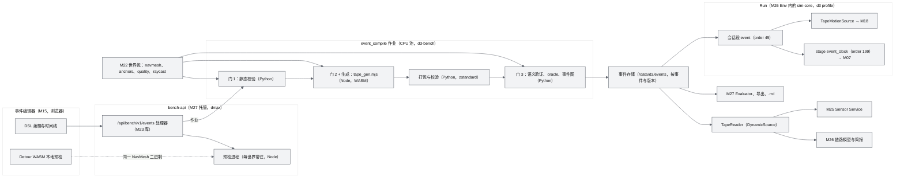
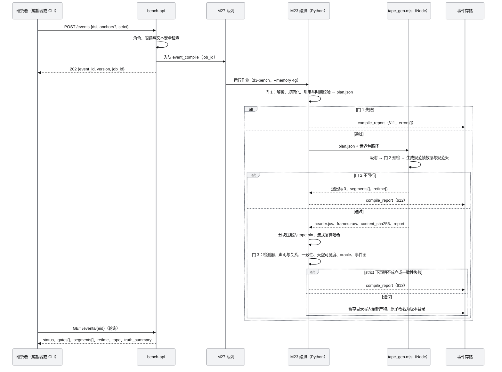
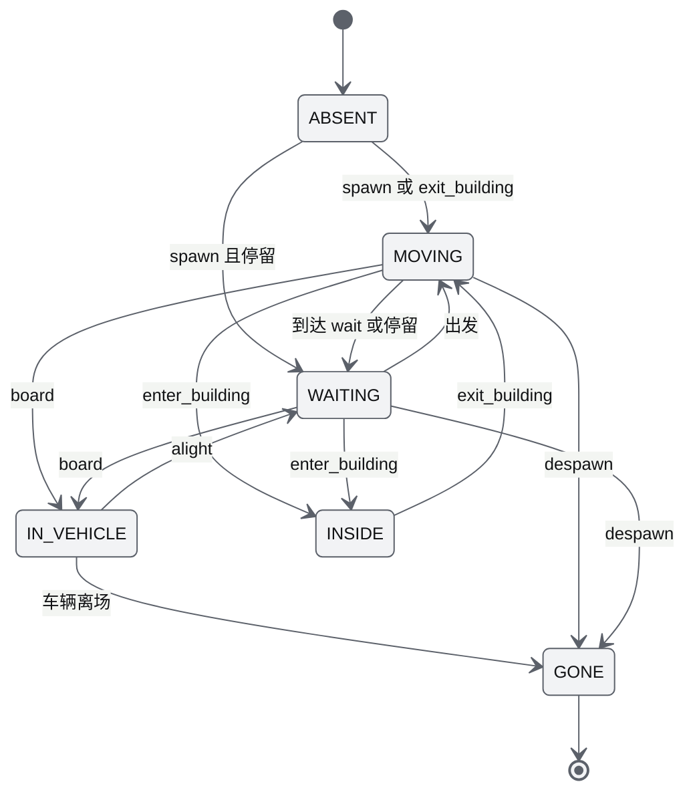
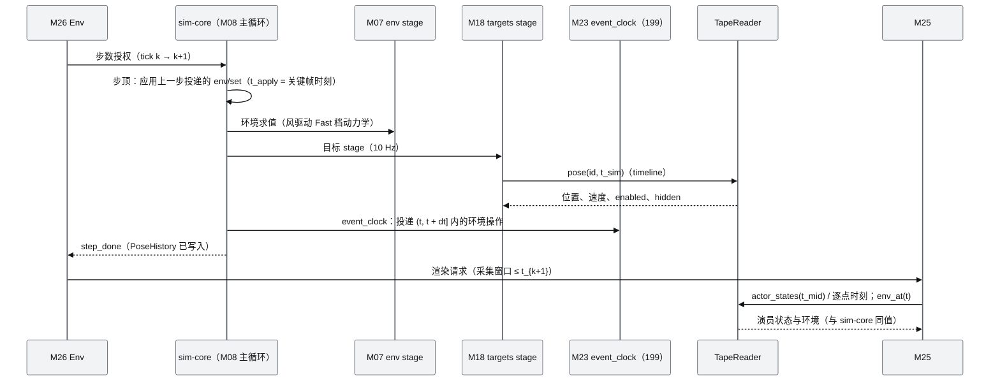
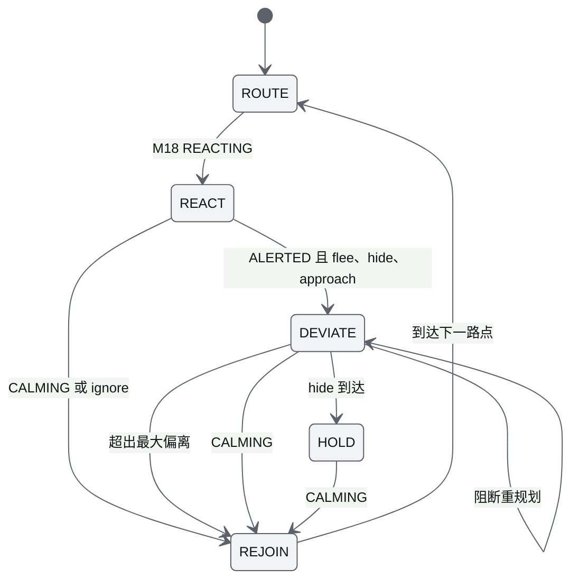
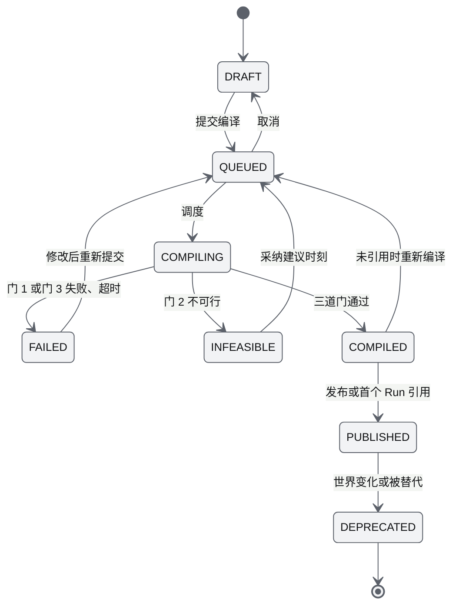
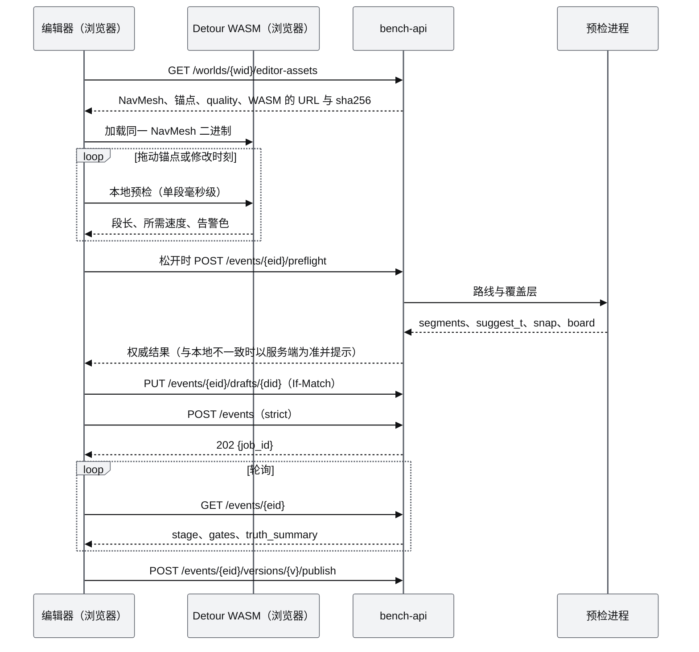

# M23 事件运行时 PRD（Event Runtime）

| 项 | 内容 |
|---|---|
| 文档编号 | AWR-M23 |
| 标题 | 事件运行时 |
| 版本 | v1.2 |
| 日期 | 2026-10-12 |
| 状态 | 草案 v1.1（按 AWR-05 v1.3 修订：第一批四类事件、首个固定事件、车道图与驾驶行为及骨骼动画前移、搜索先验与 test 变体；修订内容汇总见 §15；v1.2 按 AWR-05 v1.4 同步：事件类型与排行榜赛道的对应、事件编辑器网格选择交互的区域与几何不完整标注提议，见 §16） |
| 上游文档 | 用户 D3 需求原文、补充要求与 2026-10-12 决策 [inputs/D3-需求原文-2026-10-11.md](../inputs/D3-需求原文-2026-10-11.md)（R-D3-01 至 04、06、11、19、21、27、30、38；v1.1 增加 2026-10-12 交互式确认的 R-D3-42、47、48、49）；用户设计讨论 design-r1（`/data/projs/anet-drone-data/design-r1.md` §五、§九）；[AWR-05](../05-D3-设计增补与决策记录.md)（§1.2、§2.3、§4.1、§4.3、§4.4、§4.5、§4.8、§5.0、§5.1.3 至 §5.1.6、§5.2、§5.4.1、§5.5.4、§5.5.5、§5.6.1 至 §5.6.6、§6.1.3、§7.1、§7.2、§7.8、§7.9、§7.11、§8、§10、§11、§12、§13；ADR-128 至 ADR-136、ADR-152、ADR-155、ADR-156、ADR-158、ADR-159、ADR-161）；[AWR-04](../04-D2-设计增补与决策记录.md)（ADR-099、ADR-110）；[AWR-03](../03-设计基线与决策记录.md)（ADR-047、ADR-049、§10.2）；[M07](M07-环境引擎PRD.md)、[M08](M08-仿真内核与飞行器适配PRD.md)、[M12](M12-时间轴录制与回放PRD.md)、[M18-M19](M18-M19-识别物与感知对抗PRD.md)；D3 研究 [00-index](../research/d3/00-index.md) §2.7、§3.3、§4.3，[r6](../research/d3/r6-event-runtime-benchmark.md) §3 至 §8、§11、§12.4、§14 至 §16，[r7](../research/d3/r7-d2-code-audit.md) §3.1、§4.2、§4.3、§8.2，[r2](../research/d3/r2-glb-world.md) §4，[r8](../research/d3/r8-rerun.md) §6 |
| 下游文档 | M22（NavMesh、锚点与 `walkable_height` 的确定性实现）、M25（`DynamicSource` 消费者）、M26（通信区、任务简报、L1 观测的演员来源）、M27（`event_compile` 作业、真值、评测、数据集与 Rerun 派生）、M24（Realistic 档磁带回放与环境表）、M18（扩展点 2、3、4）、M07（环境轨）、M12（扩展点 11）、M15 与 M06（事件编辑器、事件回放、前端磁带解码器）、[17](../17-接口与实时协议规范.md)（原因码 610–629、topic、REST）、[18](../18-性能与测试方案.md) |
| 适用版本范围 | V0.3（即本期交付 D3）至 V1.0 |

## 0. 摘要

1. M23 以 `drone4d.event.v1` 描述固定世界中的事件（脚本演员、背景人群、环境关键帧、通信干扰区、语义注释与关系），经静态校验、几何预检、生成后语义验证三道门编译为 Canonical Event Tape（`drone4d.tape.v1`），使"同一世界 + 同一事件"在全部 Run 之间逐字节相同（ADR-133、ADR-134）。
2. 脚本演员沿 NavMesh 按到达时刻做运动学推进（到达误差 ≤ 1 mm），背景人群以 DetourCrowd 推进并避让脚本演员；背景密度变化不改变脚本演员列的哈希（r6 §5.1）。
3. 磁带每帧每演员 22 B（毫米定点），按演员分列、差分、zstd 分块存储；内容哈希覆盖 JCS 规范头与解压后的规范帧数据，与压缩实现无关；演员贴地高度采用跨语言逐位一致的确定性求值，满足一级确定性（§6.7、§6.6.5）。
4. 语义验证器从磁带与网格重新计算相遇、上下车、进出建筑、区域经过、空中遮挡等事件，strict 模式下声明不成立即失败（613），未声明的显著事件以 `declared: false` 写入真值；同时产出事件图与参考相机可观测性 oracle。
5. 运行期，磁带经扩展点 3 作为 M18 的运动源（`motion.mode = timeline`），环境轨经确定性调度 stage 以 M07 `env/set` 在关键帧时刻生效；M25 与 M26 直接读取磁带，不经 sim-core 实体表（ADR-128）。
6. Exogenous 为首个 Benchmark 的主模式；Interactive 模式在 P2 交付，每次运行产出实现磁带并报告事件偏离度（ADR-135）。
7. **v1.1（§15）**：第一批事件纳入四类：跨遮挡身份保持（Re-ID）、多人交汇与交接、车辆追踪、未知位置目标搜索（AWR-05 ADR-181）；DSL 增加 `event_type`、外观库引用、热成像参数、驾驶行为与搜索先验；门 1 校验类型必备配置与外观可区分性，门 3 按类型产出关键事件；OSM 车道图与 IDM 跟驰、物品携带与 `object_handover`、动画相位侧车由 P1 前移到 P0b；首个固定事件 `crop-handoff-001` 在 P0a 交付；每类 ≥ 1 个 dev 与 ≥ 2 个 test 事件由模板变体生成（P0b）。
8. 事件编辑器后端提供异步编译、实时预检与自动排时、草稿与版本、编辑资源下载与真值对照；验收 36 条（P0 33 条），对应 D3-AC-03、04、06、07、08、10、19、26、29、33、37；对基线反馈 16 条（§14）。

---

## 1. 背景与目标

### 1.1 背景

用户 D3 需求的第一句是"我们真实想要模拟的是事件，而非 drone 采集的图像"，并以"ABC 三个人，经由地图上的建筑、位置，从 X 走到 Y 走到 Z，其间有视觉的遮挡，风速变化、下雨"为例（R-D3-01 至 R-D3-04）。D2 的 M18 识别物只有无时刻的 `path` 航点、局部 DSM 绕行与观察者驱动的反应：实测中一架机悬停就使 A 偏离 53.9 m、晚到 38.5 s，挡墙时永久卡住，随机数以主时钟 tick 取键，换时钟档即分叉（r7 E2）。因此 D3 需要一个与无人机无关、可编译、可验证、可逐字节复现的事件权威。r6 已在 crop 世界的 600 m × 600 m 舞台上完成 DSL、三道门、运动学磁带、语义验证、事件图与 6 种策略的闭环原型；AWR-05 §5.2 与 ADR-133 至 ADR-136 给出了基线。本文把它们落成可直接实现的模块设计，并修补实现中会遇到的缺口（§14）。

### 1.2 目标

| 编号 | 目标 | 可度量表述 | 首次达成 |
|---|---|---|---|
| G-M23-1 | 事件是一等对象 | 示例事件（3 名脚本演员 + 1 辆车 + ≥ 40 名背景行人，360 s，风雨与通信干扰区）经三道门编译通过，4 类关键事件全部验证成立（D3-AC-06） | P0a |
| G-M23-2 | 同一事件逐字节相同 | 同一输入在同一机器 3 次、两种 CPU 型号各 1 次生成，`content_sha256` 相同；背景 0 / 40 / 200 / 1,000 人时脚本演员列哈希相同（D3-AC-07） | P0a |
| G-M23-3 | 事件不受观察者影响 | ≥ 5 种机队策略下，sim-core 中脚本演员的实现轨迹与磁带逐毫米一致，"被发现"照常计数（D3-AC-08） | P0a |
| G-M23-4 | 事件真值不凭声明成立 | 声明不成立时 strict 编译失败；未声明的显著事件写入真值；事件发生在几何不完整区域时单独标记（D3-AC-04、06） | P0a |
| G-M23-5 | 作者在编辑阶段得到可行性反馈 | 拖动锚点后 ≤ 200 ms 给出预检结果与建议时刻，一键采纳后编译通过（D3-AC-26） | P1 |
| G-M23-6 | 交互式事件可复现、可度量 | Interactive 运行可经输入日志逐位重放，实现磁带单独验证并输出事件偏离度（D3-AC-37） | P2 |
| G-M23-7 | 第一批四类事件可正式评分（v1.1） | 四类各 ≥ 1 个 dev 与 ≥ 2 个 test 事件 strict 编译通过，类型验证器产出关键事件，Evaluator 可按赛道计算四项指标与置信区间（D3-AC-62；v1.2） | P0b |

### 1.3 对基线与研究原型的继承、修正与增强

| 项 | 来源 | 本文处理 |
|---|---|---|
| DSL 字段、三道门、运动学磁带、DetourCrowd 背景、语义验证、事件图、可观测性 oracle | AWR-05 §5.2；r6 §4 至 §7 | 继承；补全字段类型、单位、缺省值、取值范围与限额（§6.2、§6.16） |
| 磁带 22 B 记录、JCS 规范头、贴地 z、状态切换阶跃 | AWR-05 §5.2.3（v1.1 评审 RV-24、RV-28） | 继承；明确哈希对象为解压后的规范帧数据（§6.7.4），阶跃规则只用于可见性或容器变化（§6.8） |
| 贴地 z "与 MeshWorldQuery `walkable_height` 同一实现" | AWR-05 §5.2.3 | 增强：规定 float64 重心坐标求值与二维三角形网格索引，JS 与 Python 逐位一致，使贴地结果满足一级确定性（§6.6.5，§14 第 4 条） |
| r6 原型的 Chaikin 平滑 | r6 §5.1 | 修正：Chaikin 会在拐点内侧切入障碍；改为受限圆角并以 Detour raycast 校验（§6.6.2） |
| r6 原型的计数器随机数（mix32） | r6 `tape_gen.mjs` | 修正：改为与 `cbrng.py` 相同的 SplitMix64 逐级派生（BigInt 实现），流 19 并登记通道（§6.15） |
| 环境轨"编译为 M07 定时操作" | AWR-05 §5.2.5 | 增强：M07 `env/set` 无定时字段、无线性插值、时长 ≤ 600 s、降雨受云量门控；本文规定调度 stage、插值语义与云量补全（§6.11，§14 第 1 条） |
| 磁带头 `event_sha256` 与"只改注释不改磁带"的版本规则 | AWR-05 §5.2.3 | 修正：头中只放影响磁带的规范子集哈希，全文另记 `dsl_sha256`，真值另设修订号（§6.7.5，§14 第 2 条） |
| 锚点编辑 | AWR-05 §7.2 | 增强：事件局部锚点覆盖层，不修改世界包（§6.3，§14 第 11 条） |
| Interactive 模式 | AWR-05 §5.2.4；r6 §8 | 增强：反应在 M23 运动源中按 M18 只读状态计算，不新增 M18 运动改动；背景人群采用局部偏离模型（§6.13，§14 第 6 条） |

### 1.4 设计原则

1. **事件与观察者无关**：Exogenous 模式下，任何 Agent 动作都不能改变磁带及其派生真值；观察者效应只作为度量（"被发现"）记录。
2. **只信世界状态**：语义事件一律由磁带与网格计算，声明只是待验证的意图。
3. **一次生成，多次播放**：磁带离线生成并以内容哈希寻址，运行期不在线抽样、不在线寻路（Interactive 除外）。
4. **确定性优先于便利**：规范帧数据只含整数（毫米、厘米每秒、百分之一度），plan 与规范头中的时刻一律为整数毫秒；其余浮点数按 JCS（ECMAScript 数字格式）序列化；参与生成的浮点运算只在确定性路径（WASM 单线程、显式运算次序的 float64）中进行。
5. **最小侵入 D2**：只经 AWR-05 §12.3 的扩展点 1、2、3、4、9、10、11、12、13 接入；D2 包不 import `awr.sim.events`。
6. **传感器不读实体表**：M25 按曝光中点或逐点时刻直接查询磁带，与 sim-core stage 次序和时钟档无关（AWR-05 §4.3 规则 1）。

---

## 2. 范围

### 2.1 P0a（v1.1：最小基准闭环，WP-D3-05）

- DSL 与契约（`event.v1`、`tape.v1`、`truth.v1`、`graph.v1`），P-1 起草、P0a 第 6 周前冻结。
- 锚点解析与吸附（世界锚点与事件局部覆盖层）。
- 门 1 静态校验；门 2 几何预检与自动排时（服务端）；运动学脚本演员、DetourCrowd 背景、贴地 z、状态切换。
- 磁带格式、编码、哈希、读取器（Python）与 golden 向量；前端解码器的格式规范与 golden（实现属 M06）。
- 门 3 语义验证、一致性检查、天空可见度、参考相机 oracle、事件图、`truth.mcap`、任务简报。
- 运行期接入：会话段 `event`、`TapeMotionSource`、环境轨调度 stage、`event/status`、批处理输出 `event_run`、回放磁带演员源库函数。
- 事件存储、版本与发布；`/api/bench/v1/events` 的编译、状态与预检接口。
- 支持的演员类别：`person`、`vehicle`（车辆 NavMesh 加锚点约束）、`dog`（行人 NavMesh）、`machine` 与 `object`（静止）。
- v1.1：DSL 的 `event_type` 字段与类型注册表（只实现 `rendezvous_handoff`）；首个固定事件 `crop-handoff-001`（沿用 r6 原型：3 名脚本演员 + 1 辆车 + ≥ 40 名背景行人，360 s，交汇、上车交接、进入建筑与车辆经过）。

### 2.2 P0b（v1.1：基准 v1）

- v1.1 前移与新增（§15）：第一批四类事件的类型验证器、关键事件与 report 类型、简报（参考外观图、搜索先验）；外观库引用与可区分性校验；OSM 车道图上的 IDM 跟驰与路口让行（原 P1）；`object` 携带与 `object_handover` 检测器（原 P1）；动画相位侧车（原 P1）；热成像实体参数与车辆发动机状态侧车；事件模板与 test 变体生成；每类 ≥ 1 个 dev 与 ≥ 2 个 test 事件。

- Rerun 真值层导出辅助（`/truth/actors`、`/truth/events`、`/truth/env`），供 M27 的 `.rrd` 派生（WP-D3-25）。
- 公开站只读回放的磁带制品筛选规则（只同步 dev 事件，WP-D3-27）。

### 2.3 P1（WP-D3-14、WP-D3-17 后端部分）

- 背景 `actor` 实体种类（扩展点 13）与 `actor/state` topic；背景总数上限提高到 2,000。
- （v1.1 前移到 P0b：OSM 车道图与 IDM、动画相位侧车、相遇站位模板、`object` 携带与 `object_handover` 检测器。）
- `uav` 类演员（三维航点）。
- 事件编辑器后端：编辑资源、草稿与版本、编译结果对照、制品下载、版本差异；检测器 `follow`、`loiter`、`run`。

### 2.4 P2（WP-D3-21）

- Interactive 模式：在线运动源、反应沿 NavMesh、实现磁带、事件偏离度、输入日志重放。
- 混合模式：脚本演员 Exogenous、背景人群局部偏离（应交付）。

### 2.5 P3（WP-D3-22、WP-D3-23）

- 事件族采样器（Scenic 式分布）与 test 留出变体。
- ASAM OpenLABEL 映射（导出器实现属 M27）。
- 3DGS 新世界的示例事件重写。

### 2.6 不做

- 交通法规级车辆仿真（信号灯、车道变换规则）；室内结构与室内行走；骨骼动画的物理驱动；演员与无人机的物理碰撞（最小间距由 M27 评测，AWR-05 §5.3.1 第 4 条）；LLM 驱动的演员行为。

### 2.7 职责边界

| 模块 | 与 M23 的分工 |
|---|---|
| M22 | 提供米制世界包、`navmesh`（person、vehicle）、`navgraph`、`anchors`、`quality`、raycast 网格与确定性 `walkable_height`；M23 不修改世界包 |
| M18 | 承载 ≤ 30 名脚本演员的实体行与判据、状态机；M23 经扩展点 2、3、4 提供运动源与反应策略；M18 不感知磁带格式 |
| M07 | 执行环境轨（`env/set`、日历）；M23 只负责编译与按时刻投递，并以 M07 库函数离线求值 |
| M25 | 经 `DynamicSource` 读取演员状态与环境；M23 不渲染、不做传感器噪声 |
| M26 | 解释通信干扰区、消费任务简报、L1 观测读取演员；M23 不实现链路模型 |
| M27 | 调度 `event_compile` 作业、托管 bench-api、评测、数据集与 `.rrd` 派生；M23 提供库函数与处理器 |
| M12 | 实施扩展点 11（回放磁带演员源）；M23 提供 `tape_target_rows()` |
| M15、M06 | 事件编辑器界面、时间线、前端磁带解码器（`engine/actors/tape/`）；M23 提供接口、格式规范与 golden |
| M24 | Realistic 档在 `Drone4DClock` 中回放同一磁带；M23 提供 C++ 可读的磁带规范与环境表导出 |

---

## 3. 用户与用例

### 3.1 调用方

| 调用方 | 方式 | 用途 |
|---|---|---|
| 研究者（事件作者） | D3 工作区事件编辑器（P1）、CLI、`POST /api/bench/v1/events` | 编写、预检、编译、发布事件 |
| M27 调度器 | 作业 `event_compile`；Run 准备阶段读取磁带 | 编译与 Run 资产校验 |
| sim-core（`d3` profile） | 会话段 `event`、stage `event_clock`、查询 `event/status` | 运行期驱动 M18 与 M07 |
| M25 Sensor Service | `TapeReader`（`DynamicSource`） | 曝光中点或逐点时刻的演员与环境 |
| M26 Env | `TapeReader.comm_zones_at`、`brief.json`、`actor_states`（L1） | 链路、简报、检测级观测 |
| M27 Evaluator 与导出器 | `event_truth.json`、`event_graph.json`、`observability.npz`、`TapeReader` | 评分、数据集、`.rrd` |
| M12 replay-worker、前端 | `tape_target_rows()`；前端解码器 | 回放补出演员 |
| 公开站访客 | `/lab/` 静态回放（dev 事件） | 只读浏览 |

### 3.2 用例

| 编号 | 用例 | 主流程 | 结果 |
|---|---|---|---|
| UC-1 | 编写 ABC 事件 | 选择 crop 世界 → 放置锚点 → 为 A、B、C 写路线与时刻 → 预检提示 5 段不可行 → 一键采纳建议时刻 → 编译 | 磁带与真值发布为 `abc-crossing-001@v1` |
| UC-2 | 声明与世界不符 | 作者声明"A 在 0–300 s 被遮挡 ≥ 3 s"→ 门 3 计算天空可见度无持续区间 | strict 返回 613 并给出实算区间；lenient 记告警 |
| UC-3 | 同一事件多策略采集 | M27 以同一 `tape_content_sha256` 提交 6 种策略 × 12 种子 | 脚本演员轨迹在全部 Run 中相同 |
| UC-4 | 背景密度对照 | 同一事件把背景从 40 改为 1,000 人，`version + 1` | 脚本演员列哈希不变，真值重算 |
| UC-5 | 世界包重建 | M22 重建 crop 导致 NavMesh 哈希变化 | 旧版本标记 DEPRECATED，旧 Run 评分不与新磁带混排 |
| UC-6 | 只改注释 | 修改注释显示名或新增一条声明 | 磁带不变，真值修订号 + 1 |
| UC-7 | 交互式追逃（P2） | Interactive 模式下无人机低空接近 B | B 沿 NavMesh 逃离，实现磁带与偏离度写入 Run |

### 3.3 本模块术语

| 术语 | 定义 |
|---|---|
| 脚本演员 | `actors[]` 中的演员，按"锚点 + 到达时刻"运动学推进，是事件的定义 |
| 背景演员 | `background[]` 展开的行人或车辆，由 DetourCrowd 推进，是环境 |
| 规范帧数据 | 解压后按 tick 主序、演员次序排列的 22 B 记录序列，是磁带内容哈希的对象 |
| 规范头 | 以 RFC 8785（JCS）规范化的磁带头 JSON 字节，原样存储 |
| 磁带输入子集 | 影响磁带内容的规范化 DSL 字段（世界、锚点坐标、演员、背景、种子、时长、模式、环境、通信区），其哈希为 `event_sha256` |
| 真值修订号 | `truth_rev`：同一磁带下注释、关系或检测参数变化时递增 |
| 实现磁带 | Interactive 运行中按实际发生记录的磁带，`mode = interactive` |
| 段 | 相邻两个路点之间的移动区间 |
| 等待窗口 | 车辆在路点上的停留区间 `[到达, 出发]`，用于上下车判定 |

---

## 4. 功能需求

优先级 P0、P1、P2 沿用 AWR-03 §10.2；"阶段"列取 P-1、P0a、P0b、P1、P2、P3（AWR-05 §1.2）。目标版本全部为 V0.3（D3 各阶段出口均为 V0.3 小版本）。

| 编号 | 需求描述 | 优先级 | 目标版本 | 阶段 | 验收要点 | 依据 |
|---|---|---|---|---|---|---|
| **DSL 与契约** | | | | | | |
| M23-FR-001 | `drone4d.event.v1` JSON Schema（draft 2020-12，`additionalProperties: false`）提交到 `packages/contracts/event/event.v1.schema.json`；输入接受 YAML 与 JSON；字段、类型、单位、缺省值与范围按 §6.2 | P0 | V0.3 | P-1（草案）、P0a | M23-AC-001 | AWR-05 §5.2.1、§8.1；r6 §4.1 |
| M23-FR-002 | 规范化：秒转整数毫秒、米转整数毫米（`floor(x·1000 + 0.5)`），角度保留浮点；拒绝 NaN、Inf 与 −0；输出 `plan.json`（JCS），计算 `dsl_sha256`（全文）与 `event_sha256`（磁带输入子集，§6.7.5） | P0 | V0.3 | P0a | M23-AC-001、029 | ADR-136；本文设定 |
| M23-FR-003 | 演员类别支持矩阵按 §6.2.3：P0a 支持 `person`、`vehicle`、`dog` 移动与 `machine`、`object` 静止；`uav` 与 `object` 携带为 P1；不支持的组合返回 611（`E-CLASS-UNSUPPORTED`） | P0 | V0.3 | P0a、P1 | M23-AC-002 | AWR-05 §5.2.1；r6 §4.2 |
| M23-FR-004 | 路点语义：`t` 为到达时刻；出发时刻 = max(上一路点实际到达, 上一路点 t) + `dwell_s`；首个路点必须为 `spawn` 或 `exit_building`；`via` 只约束路径；`tol_s` 只用于 Interactive 与验证；`board`、`alight` 的 `target` 必须是车辆且处于等待窗口内、水平距离 < 8 m | P0 | V0.3 | P0a | M23-AC-002、005、010 | AWR-05 §5.2.1；r6 §4.2 |
| M23-FR-005 | 背景规格 `{class, count, zone, speed_mps, pause_s, stream, appearance?}`：`zone` 为 zone 锚点或多边形；P0a 支持 `person` 与 `vehicle`；单事件背景总数 ≤ 1,000（P1 起 ≤ 2,000） | P0 | V0.3 | P0a | M23-AC-008、011 | r6 §5.3；AWR-05 §2.3 |
| M23-FR-006 | 环境关键帧 `{t, wind_mps, wind_dir_deg, gust_sigma_mps, rain_mm_h, visibility_m, fog?, cloud?}` 与插值方式 `smooth`（缺省）、`step`、`linear`；按 §6.11 映射到 M07 EnvScalars 并编译为环境轨 | P0 | V0.3 | P0a | M23-AC-023 | AWR-05 §5.2.1；M07 §6.2.1 |
| M23-FR-007 | 通信干扰区 `{id, polygon, t[from,to], extra_loss, extra_latency_ms, bandwidth_scale}` 原样进入规范头，由 M26 解释；多边形必须简单（不自交）、顶点 ≤ 64 | P0 | V0.3 | P0a | M23-AC-001 | AWR-05 §5.2.1、§5.5.5 |
| M23-FR-008 | 注释 `{id, type, participants, window, params, salience, label_zh, label_en}` 与关系 `{src, rel ∈ before/after/during/overlaps/causes/enables, dst}`；注释类型按 §6.9.1 | P0 | V0.3 | P0a | M23-AC-015、016 | AWR-05 §5.2.1；r6 §6 |
| M23-FR-009 | 任务简报段 `brief{public_anchors[], targets[{actor, description_zh, description_en}], task_area}` 编译为 `brief.json`（非真值）；简报只能引用作者标记为公开的锚点与外观描述，不得含时刻与路线 | P0 | V0.3 | P0a | M23-AC-035 | AWR-05 §5.5.4；§14 第 8 条 |
| M23-FR-010 | `interactive{reactions, replan_on_block, max_deviation_m, background}`：`mode = exogenous` 时只读取 `background`（混合模式开关），其余字段忽略；P2 之前 `mode = interactive` 或 `background = local_deviation` 返回 619 | P0 | V0.3 | P0a、P2 | M23-AC-032 | ADR-135 |
| M23-FR-011 | 限额按 §6.16：脚本演员 ≤ 30、单路线路点 ≤ 64、时长 ≤ 3,600 s、磁带频率 10 Hz、DSL 文本 ≤ 1 MiB；超限返回 618 | P0 | V0.3 | P0a | M23-AC-002 | AWR-05 §5.2.5；M18 `MAX_PATH` |
| **锚点** | | | | | | |
| M23-FR-012 | `anchors_ref` 取 `world`（世界包 `anchors` 图层）或 `event:<file>`（事件局部 `awr-anchors@1` 覆盖层，可 `extends: world` 并增补或覆盖坐标）；解析结果的 sha256 写入 plan 与规范头 | P0 | V0.3 | P0a | M23-AC-004 | ADR-132；§14 第 11 条 |
| M23-FR-013 | 吸附：按锚点 `profile` 在对应 NavMesh 上取最近点（halfExtents 2 m、4 m、2 m），只接受种子洪泛主岛；吸附距离 ≤ 3 m 通过、3–8 m 告警 `W-SNAP`、> 8 m 或落在孤岛返回 611（`E-ANCHOR-UNSNAPPED`） | P0 | V0.3 | P0a | M23-AC-004 | AWR-05 §5.1.3 V-GLB；r6 §3.2 |
| **门 1 静态校验** | | | | | | |
| M23-FR-014 | 门 1 一次报出全部错误：schema、id 唯一、锚点与演员引用、时间严格递增、首末路点动作、类别与锚点 profile、上下车目标与窗口（静态部分）、注释参与者、关系引用、限额；失败返回 611，`errors[]` 逐条含 JSON 指针、错误码与中文说明，CLI 退出码 2 | P0 | V0.3 | P0a | M23-AC-002 | AWR-05 §5.2.2；r6 §4.3 |
| M23-FR-015 | 世界检查：`scaleStatus ∉ {landmark, assumed}` 返回 600；所需 `navmesh` 图层缺失返回 616；`package_sha256` 与 `contentVersion` 由编译器填写 | P0 | V0.3 | P0a | M23-AC-003 | AWR-05 §5.1.2；ADR-130 |
| **门 2 几何预检** | | | | | | |
| M23-FR-016 | 逐段计算 NavMesh 实际行进路径长度、可用时间、所需峰值速度（含加速度约束），判定可行、过慢、不可行、不连通；车辆按 0.7 × 上限判定；上下车按车辆等待窗口判定；不可行返回 612 与 `segments[]`，过慢记 `W-SLOW` 并延后出发 | P0 | V0.3 | P0a | M23-AC-005 | AWR-05 §5.2.2；r6 §4.4 |
| M23-FR-017 | 自动排时两种模式：`minimal`（只推迟必要的时刻，缺省）与 `median`（按步态中值重排）；输出逐演员建议时刻与因上下车约束建议的车辆停留延长量 | P0 | V0.3 | P0a | M23-AC-005 | r6 §4.4；本文设定 |
| M23-FR-018 | 预检服务：每个活跃世界常驻预检进程，加载与浏览器相同的 Detour 二进制与 WASM；单路线（≤ 8 段）服务端 p95 ≤ 100 ms；结果与浏览器本地预检逐字段一致 | P0 | V0.3 | P0a（服务端）、P1（编辑器） | M23-AC-006 | AWR-05 §7.2；D3-AC-26 |
| **磁带生成** | | | | | | |
| M23-FR-019 | 脚本演员运动学：Detour 直线路径 → 受限圆角 → 弧长参数化 → 梯形速度；先排车辆、后排行人；到达误差 ≤ 1 mm；多人共用 zone 锚点分配环形站位并面向圆心 | P0 | V0.3 | P0a | M23-AC-007 | AWR-05 §5.2.3；r6 §5.1、§5.2 |
| M23-FR-020 | 状态切换：`spawn`、`wait`、`board`、`alight`、`enter_building`、`exit_building`、`despawn` 按 §6.6.3 转移；乘客随车，车辆离场时乘客一并离场；进入建筑后位置保持在门锚点吸附点 | P0 | V0.3 | P0a | M23-AC-010 | AWR-05 §5.1.5；r6 §5.2 |
| M23-FR-021 | 背景演员：DetourCrowd 推进，每名脚本演员在人群中设代理障碍（人 0.4 m、车 2.2 m）；目标点、速度、停留与外观以流 19 计数器随机数抽样；背景演员与脚本演员最小水平距离 ≥ 0.5 m | P0 | V0.3 | P0a | M23-AC-008、017 | ADR-134；r6 §5.1 |
| M23-FR-022 | 贴地：全部演员 z 由确定性 `ground_z` 求值（§6.6.5），与 M22 `walkable_height` 同一算法；门 3 检查 \|z_tape − z_mesh\| ≤ 2 cm | P0 | V0.3 | P0a | M23-AC-009 | AWR-05 §5.2.3；§14 第 4 条 |
| M23-FR-023 | 生成器确定性：WASM 单线程（禁用 relaxed SIMD）、无 `Math.random` 与墙钟、稳定排序、整数定点；Node 版本、recast-navigation 版本与 WASM sha256 只写 `provenance` | P0 | V0.3 | P0a | M23-AC-008 | AWR-05 §4.5；r6 §7.2 |
| M23-FR-024 | 生成性能：43 名演员 360 s ≤ 10 s；背景 1,000 人 360 s 在 dmax CPU 池 ≤ 120 s | P0 | V0.3 | P0a | M23-AC-011 | D3-AC-07；r6 §5.3 |
| **磁带格式** | | | | | | |
| M23-FR-025 | 规范头字段按 §6.7.1（JCS，原样存储）：schema、事件标识与版本、`event_sha256`、种子、模式、频率、tick 数、记录布局、演员表（含外观与尺寸）、世界 `contentVersion`、raycast 网格与 NavMesh sha256、锚点 sha256、环境关键帧与编译后的环境轨、通信区、动画侧车引用 | P0 | V0.3 | P0a | M23-AC-012 | AWR-05 §5.2.3 |
| M23-FR-026 | 记录布局 22 B（§6.7.2）：`x_mm, y_mm, z_mm`（i32）、`yaw_cdeg`（i16）、`vx_cmps, vy_cmps, vz_cmps`（i16）、`state`（u8）、`container`（u8）；演员表脚本演员在前 | P0 | V0.3 | P0a | M23-AC-012、013 | AWR-05 §5.2.3 |
| M23-FR-027 | 容器 `tape.bin`：魔数、规范头、块索引、按 10 s 分块的"分列 + 差分 + zstd"块，每块拆为脚本演员与背景演员两个子块（§6.7.3）；存储 ≤ 25 B/演员/s；`tape.json` 为清单（哈希、头副本、出处、生成报告） | P0 | V0.3 | P0a | M23-AC-011、012 | AWR-05 §5.2.3；r6 §7.4 |
| M23-FR-028 | 哈希：`content_sha256 = sha256(规范头字节 ‖ 规范帧数据)`，`body_sha256 = sha256(规范帧数据)`，另记 `file_sha256` 仅作传输校验；校验方不重新序列化；不一致返回 614 | P0 | V0.3 | P0a | M23-AC-012 | AWR-05 §5.2.3；§14 第 3 条 |
| M23-FR-029 | 版本规则按 §6.7.5；已发布版本不可变，修改影响磁带的字段而未递增版本返回 617 | P0 | V0.3 | P0a | M23-AC-029 | AWR-05 §5.2.3 |
| M23-FR-030 | golden 向量（`packages/contracts/event/golden/`）：至少 3 条磁带（含上下车、进出建筑、背景 200 人）；Python、TS 解码器对 golden 解出的规范帧数据逐字节一致 | P0 | V0.3 | P0a | M23-AC-013 | AWR-05 §5.2.5；D3-AC-19 |
| **读取** | | | | | | |
| M23-FR-031 | `TapeReader.open` 流式校验哈希（常量内存）与世界一致性（615）；`actor_states(t_ns, ids)` 以存储速度做三次 Hermite（复用 D2 `hermite`）、航向最短弧插值；可见性或容器变化处取阶跃；按块懒解码（脚本演员与背景演员子块分开），常驻 ≤ 3 块 | P0 | V0.3 | P0a | M23-AC-014 | AWR-05 §5.2.3；r7 E3 |
| M23-FR-032 | `TapeReader` 实现 M25 的 `DynamicSource`：`actor_states`、`env_at`（以 M07 库函数对环境轨求值，与 sim-core 一致）；另提供 `comm_zones_at` 供 M26 | P0 | V0.3 | P0a | M23-AC-023、024 | AWR-05 §5.4.1 |
| M23-FR-033 | 时间基准：事件 t = 0 对齐 Run 回合零点；t < 0 时演员为缺席，t > 时长时保持末帧；查询时刻为整数纳秒 | P0 | V0.3 | P0a | M23-AC-014 | AWR-05 §4.3；本文设定 |
| **语义验证与真值** | | | | | | |
| M23-FR-034 | P0 检测器：`proximity_encounter`、`board_vehicle`、`alight_vehicle`、`enter_building`、`exit_building`、`zone_enter`、`zone_exit`、`zone_pass`、`aerial_occlusion`，参数缺省见 §6.9.1 | P0 | V0.3 | P0a | M23-AC-015 | r6 §6.1 |
| M23-FR-035 | 声明匹配：同类型、参与者包含声明参与者、区间与声明窗口相交即成立；strict（缺省）下任一声明不成立返回 613；lenient 记告警且事件标记 `strict = false`；未声明且显著性 ≥ 0.3 的事件以 `declared: false` 写入真值 | P0 | V0.3 | P0a | M23-AC-015 | ADR-133；r6 §6.2 |
| M23-FR-036 | 关系验证：`before`、`after`、`during`、`overlaps` 按区间判定；`causes`、`enables` 只检查时序前提（原因开始不晚于结果开始），只作标签 | P0 | V0.3 | P0a | M23-AC-016 | AWR-05 §5.2.1 |
| M23-FR-037 | 一致性检查（门 3）：脚本演员在 NavMesh 上（水平偏离 ≤ 0.1 m）、贴地误差、到达误差、脚本演员两两间距 ≥ 0.5 m（同乘除外）、背景与脚本演员间距 ≥ 0.5 m、容器引用合法；任一失败返回 613 | P0 | V0.3 | P0a | M23-AC-017 | D3-AC-07、29；本文设定 |
| M23-FR-038 | 发生点落在 `quality` 不完整区域的语义事件标记 `in_incomplete_region = true`，供 M27 从分母中剔除并单列 | P0 | V0.3 | P0a | M23-AC-018 | ADR-131；D3-AC-04 |
| M23-FR-039 | 天空可见度（脚本行人，1 Hz）写入 `event_truth.json`；参考相机可观测性 oracle 写入 `observability.npz`（§6.10.3） | P0 | V0.3 | P0a | M23-AC-019 | r6 §6.2、§6.3 |
| M23-FR-040 | 事件图 `drone4d.event_graph.v1`：实体、事件、`participates_in` 与通过验证的关系；节点 id 与注释 id 一致，未声明事件按确定性次序编号 `e###` | P0 | V0.3 | P0a | M23-AC-020 | r6 §6.4 |
| M23-FR-041 | `truth.mcap`：`/event/actors`（10 Hz，全部演员）与 `/event/semantic`（事件起止）；供 M27 回放与 `.rrd` 派生 | P0 | V0.3 | P0a | M23-AC-020 | AWR-05 §5.2.6 |
| M23-FR-042 | P1 检测器：`object_handover`、`follow`、`loiter`、`run` | P0 | V0.3 | P0b（`object_handover`）、P1（其余） | M23-AC-015 | r6 schema |
| M23-FR-043 | 门 3 性能：43 名演员 360 s 事件在 dmax CPU 池（`--cpus 16`）≤ 60 s；整条编译流水线 p95 ≤ 90 s | P0 | V0.3 | P0a | M23-AC-019 | r6 §6.2；本文设定 |
| **运行期接入** | | | | | | |
| M23-FR-044 | 插件只登记在 `D3_PLUGINS`；会话段 `event`（order 45）校验磁带（614、615），以 `target/add` 写入脚本演员（`motion.mode = timeline`、`reaction_policy = 磁带模式`），挂接运动源；`event` 与 `targets` 同时出现时拒绝重复 id | P0 | V0.3 | P0a | M23-AC-021 | AWR-05 §5.2.5；r7 §8.2 |
| M23-FR-045 | `TapeMotionSource.pose(id, t_ns)` 返回位置、航向、速度、`enabled`、`hidden`（§6.12.2）；在磁带 tick 时刻返回值与磁带记录逐毫米相同；不取随机数 | P0 | V0.3 | P0a | M23-AC-021 | 扩展点 3 |
| M23-FR-046 | stage `event_clock`（order 199，AWR-05 ADR-169 的 D3 区段分配）在关键帧时刻经 `CommandEngine.submit_internal` 投递 `env/set`，并在会话装配时以日历操作设置 `time_origin_utc`；sim-core 的 M07 环境与 `TapeReader.env_at` 在全部磁带 tick 上逐位一致 | P0 | V0.3 | P0a | M23-AC-023 | §14 第 1 条 |
| M23-FR-047 | 查询 `event/status`、1 Hz 慢任务发布 `event/status`（真值类 topic，§7.4）、批处理输出 `event_run.json`（磁带哈希、脚本演员实现轨迹哈希、被发现计数、已投递环境操作） | P0 | V0.3 | P0a | M23-AC-021、035 | AWR-05 §5.2.5、§8.3 |
| M23-FR-048 | sim-core 内 M23 合计每 tick p99 ≤ 0.05 ms（30 名脚本演员）；sim-core 只解码脚本演员子块，每 10 s 仿真时间解码一次，单次 ≤ 0.5 ms | P0 | V0.3 | P0a | M23-AC-025 | ADR-139；本文设定 |
| M23-FR-049 | 回放库函数 `tape_target_rows(reader, t_ns)` 产出 TargetLite32 行，供 M12 扩展点 11；内部回放演员与磁带位置差 ≤ 5 cm | P0 | V0.3 | P0a | M23-AC-026 | D3-AC-19 |
| M23-FR-050 | Exogenous：M18 反应覆盖不生效、不广播；判据与状态机照常运行，"被发现"按演员与机体计数写入 `event_run.json` | P0 | V0.3 | P0a | M23-AC-021 | ADR-135；r7 E2 |
| **Interactive（P2）** | | | | | | |
| M23-FR-051 | `InteractiveMotionSource`：基础路线取自 Exogenous 磁带，按 M18 只读状态执行 freeze、look_at、flee、hide、approach、return、ignore；flee、hide 目标点在 NavMesh 上；偏离受 `max_deviation_m` 约束；`replan_on_block` 时重规划；路线动作在反应结束后恢复 | P0 | V0.3 | P2 | M23-AC-032 | ADR-135；r6 §8 |
| M23-FR-052 | 实现磁带：每个 Run 以同一格式写出（`mode = interactive`，头中记基础磁带哈希、`run_id`、`attempt`、输入日志哈希），经门 3 单独验证；输出事件偏离度（逐演员位置偏差、到达延迟、语义事件集合 Jaccard） | P0 | V0.3 | P2 | M23-AC-032 | ADR-135 |
| M23-FR-053 | 复现：Interactive 运行经 M08 输入日志与 resim 逐位重放，实现磁带 `content_sha256` 相同 | P0 | V0.3 | P2 | M23-AC-032 | D3-AC-37 |
| M23-FR-054 | 混合模式：脚本演员 Exogenous，背景演员按局部偏离模型躲避低空无人机（§6.13.4） | P1 | V0.3 | P2 | M23-AC-033 | AWR-05 §5.2.4 |
| **P1 扩展** | | | | | | |
| M23-FR-055 | 背景 `actor` 实体种类（扩展点 13）：stage 按磁带写入背景行，发布 `actor/state`；容量 ≥ 2,048；`target` 容量 32 的 D2 行为不变 | P1 | V0.3 | P1 | M23-AC-030 | D3-AC-29 |
| M23-FR-056 | 车辆沿 OSM 车道图运动：IDM 跟驰、弯道限速、路口先到先行；路段 100% 在道路走廊内；车辆之间无穿越 | P0 | V0.3 | P0b | M23-AC-031 | ADR-132；D3-AC-33 |
| M23-FR-057 | 动画侧车 `tape.anim`（片段 id、相位 u16），其 sha256 写入规范头，供 M25 做 LBS | P0 | V0.3 | P0b | M23-AC-012 | AWR-05 §5.2.3 |
| M23-FR-058 | 相遇站位模板（面对面 1.2 m、并排 0.8 m）与朝向对方；`uav` 类演员三维航点；`object` 携带（`pickup`、`drop`） | P0 | V0.3 | P0b（站位模板、`object` 携带）、P1（`uav` 类演员） | M23-AC-007、010 | r6 §5.2 |
| **事件编辑器后端** | | | | | | |
| M23-FR-059 | 异步编译与状态：`POST /events`（202）、`GET /events/{eid}`（门结果、段、建议时刻、磁带摘要、真值摘要），状态机按 §6.14 | P0 | V0.3 | P0a | M23-AC-027 | AWR-05 §8.2 |
| M23-FR-060 | 预检：`POST /events/{eid}/preflight` 返回逐段结果、吸附与建议时刻 | P0 | V0.3 | P0a | M23-AC-006、027 | AWR-05 §8.2 |
| M23-FR-061 | 编辑资源：NavMesh 二进制、锚点、quality 多边形的只读下载；事件局部锚点覆盖层保存 | P1 | V0.3 | P1 | M23-AC-027、028 | AWR-05 §7.2；§14 第 9 条 |
| M23-FR-062 | 草稿与版本：草稿以 ETag 乐观并发保存（冲突 621），版本列表、发布、弃用；版本差异（逐演员最大位置偏差、语义事件差异） | P1 | V0.3 | P1 | M23-AC-027、029 | §14 第 9 条 |
| M23-FR-063 | 制品下载按角色与划分控制：dev 事件的磁带对研究者开放；test 事件的磁带与真值只对评测员与管理员开放（691） | P0 | V0.3 | P0a | M23-AC-027、036 | AWR-05 §5.6.6、§7.11 |
| **存储、导出与发布** | | | | | | |
| M23-FR-064 | 事件存储 `/data/d3/events/<event_id>/v<N>/`，暂存目录加原子改名发布；被 Run 引用的版本自动冻结并标记 `pinned` | P0 | V0.3 | P0a | M23-AC-029 | ADR-163 |
| M23-FR-065 | 数据集钩子：为 M27 导出 `event/` 与 `truth/` 两层；公开站同步只包含 dev 事件的 `tape.bin`、`tape.json` 与 `brief.json` | P0 | V0.3 | P0a、P0b | M23-AC-036 | AWR-05 §5.6.4、§7.9 |
| M23-FR-066 | Rerun 真值层辅助：`/truth/actors/<actor>`（50 Hz Transform3D 与静态形体）、`/truth/events/<event_id>`、`/truth/env/<field>` | P0 | V0.3 | P0b | M23-AC-020 | AWR-05 §6.1.3 |
| M23-FR-067 | OpenLABEL 映射规范与参考转换函数（导出器属 M27） | P1 | V0.3 | P3 | M23-AC-020 | r6 §6.4 |
| M23-FR-068 | 事件族采样器 `drone4d.event_family.v1`：锚点、时刻、背景密度与种子的分布加约束拒绝采样，生成确定性变体，并标记 test 留出变体 | P0 | V0.3 | P3 | M23-AC-034 | AWR-05 §5.6.6；r6 §4.5 |
| M23-FR-069 | CLI `python -m awr.sim.events` 子命令按 §7.2，退出码：2 门 1 失败、3 不可行、4 语义不一致、5 哈希或世界不一致 | P0 | V0.3 | P0a | M23-AC-002 | AWR-05 §5.2.2 |

---

## 5. 非功能需求

| 编号 | 需求描述 | 优先级 | 目标版本 | 阶段 | 验收要点 | 依据 |
|---|---|---|---|---|---|---|
| M23-NFR-001 | 确定性：磁带与规范头为一级（跨机器逐字节）；`event_truth.json`、`observability.npz` 为一级 b（同镜像、同 CPU ISA 逐字节）；Interactive 实现磁带为一级 b（同镜像经输入日志重放） | P0 | V0.3 | P0a | M23-AC-008、019、032 | AWR-05 §4.5、ADR-136 |
| M23-NFR-002 | 编译流水线（43 名演员 360 s）在 dmax CPU 池 p95 ≤ 90 s；门 1 ≤ 1 s；单作业内存 ≤ 4 GB（`--memory 4g`），背景 1,000 人时 ≤ 8 GB | P0 | V0.3 | P0a | M23-AC-011、019 | r6 §5.3；本文设定 |
| M23-NFR-003 | 预检延迟：服务端 p95 ≤ 100 ms，编辑器端到端 ≤ 200 ms | P0 | V0.3 | P0a、P1 | M23-AC-006、028 | D3-AC-26 |
| M23-NFR-004 | sim-core 预算：每 tick p99 ≤ 0.05 ms、`budget_core` ≤ 0.001；每会话 M23 常驻内存 ≤ 16 MB | P0 | V0.3 | P0a | M23-AC-025 | ADR-139 |
| M23-NFR-005 | `TapeReader`：打开并校验 1,003 名演员 360 s 磁带 ≤ 2 s；`actor_states` 30 名演员 ≤ 50 µs、1,000 名 ≤ 1 ms；常驻内存 ≤ 16 MB（30 名）或 ≤ 64 MB（1,000 名） | P0 | V0.3 | P0a | M23-AC-014 | r7 E3；本文设定 |
| M23-NFR-006 | 依赖方向：`awr.sim.events` 只依赖 D2 包、M22 只读接口与契约；D2 包不得 import 本包；本包不 import `awr.agentsdk`、`awr.bench`（反向由 M27 调用） | P0 | V0.3 | P0a | import 方向测试（D3-AC-01） | AWR-05 §4.8 |
| M23-NFR-007 | 隔离：Agent 容器不挂载事件存储；Agent principal 不能订阅 `event/status` 与 `actor/*`；`TapeReader` 不得被 M26 序列化进 `bench/obs.v1` | P0 | V0.3 | P0a | M23-AC-035 | ADR-145、ADR-161 |
| M23-NFR-008 | 输入安全：YAML 以安全加载器解析并拒绝锚点别名展开；节点数 ≤ 100,000；字符串 ≤ 4 KiB；文本 ≤ 1 MiB；全部错误消息不回显作者输入以外的内部路径 | P0 | V0.3 | P0a | M23-AC-002 | 本文设定 |
| M23-NFR-009 | 文案：错误与告警的中文与英文说明遵循 AWR-05 §7.10，i18n 键前缀 `lab.event.*`，原因码附处置建议 | P0 | V0.3 | P0a | D3-AC-23 | ADR-153 |
| M23-NFR-010 | 许可：recast-navigation（MIT，上游 recastnavigation Zlib）、zstandard（BSD）、rfc8785（Apache-2.0）登记 THIRD_PARTY_NOTICES；OSM 派生锚点坐标在数据集中按 ODbL 标注 | P0 | V0.3 | P0a | D3-AC-24 | ADR-154 |
| M23-NFR-011 | 可观测性：每次编译写 `compile_report.json`（各门耗时、告警、出处、资源峰值）；作业日志按 `event_id@vN` 归档 | P1 | V0.3 | P0a | M23-AC-027 | 本文设定 |

---
## 6. 设计方案

### 6.1 组件与进程落点



| 组件 | 进程或作业 | 语言 | 目录 |
|---|---|---|---|
| DSL 解析、门 1、编排 | `event_compile` 作业 | Python | `python/awr/sim/events/dsl/`、`compile/` |
| 门 2、生成器、预检进程 | 作业内子进程；bench-api 旁常驻进程 | Node 22（WASM） | `tools/events/` |
| 打包、校验、读取 | 作业；sim-core；M25、M26、M27 进程 | Python | `python/awr/sim/events/tape/` |
| 门 3、真值、oracle | 作业 | Python（Open3D 经 M22 `MeshWorldQuery`） | `python/awr/sim/events/validate/` |
| 运行期插件 | sim-core（`D3_PLUGINS`） | Python | `python/awr/sim/events/runtime/` |
| REST 处理器 | bench-api 挂载 | Python | `python/awr/sim/events/api/`（路由注册在 `awr/bench/api/`，M27） |

### 6.2 DSL `drone4d.event.v1`

#### 6.2.1 顶层字段

| 字段 | 类型 | 单位 | 缺省 | 范围或取值 | 说明 |
|---|---|---|---|---|---|
| `schema` | string | — | 必填 | `drone4d.event.v1` | |
| `event_id` | string | — | 必填 | `^[a-z0-9][a-z0-9-]{0,63}$` | 事件标识；版本寻址写作 `<event_id>@v<N>` |
| `version` | int | — | 1 | [1, 65535] | 影响磁带的字段变化必须递增（§6.7.5） |
| `world` | object | — | 必填 | `{id, region?, package_sha256?}` | `id` 为 M22 世界包 id；`package_sha256` 由编译器填写，作者填写时必须一致 |
| `anchors_ref` | string | — | `world` | `world` 或 `event:<相对路径>` | §6.3 |
| `seed` | int | — | 必填 | [0, 2³² − 1] | 只影响背景演员与外观抽样，不影响脚本演员 |
| `duration_s` | number | s | 必填 | (0, 3600] | 规范化为毫秒，须为 100 ms 的整数倍 |
| `tick_hz` | int | Hz | 10 | P0–P3 只接受 10 | 20、30 保留 |
| `mode` | string | — | `exogenous` | `exogenous`、`interactive` | P2 之前 `interactive` 返回 619 |
| `time_origin_utc` | string | — | `2026-06-15T09:00:00Z` | RFC 3339 | 事件 t = 0 对应的仿真日历，交 M07 |
| `actors` | array | — | 必填 | 1–30 项 | §6.2.2 |
| `background` | array | — | `[]` | ≤ 8 组，合计 ≤ 1,000 人（P1 ≤ 2,000） | §6.2.4 |
| `environment` | object | — | 静稳天气 | §6.2.5 | |
| `comms` | object | — | `{zones: []}` | ≤ 32 区 | §6.2.6 |
| `annotations` | array | — | `[]` | ≤ 256 | §6.2.6 |
| `relations` | array | — | `[]` | ≤ 512 | §6.2.6 |
| `brief` | object | — | 无 | §6.2.6 | 任务简报（本文增补，§14 第 8 条） |
| `interactive` | object | — | 见 §6.13 | | `exogenous` 时只读取 `background`（混合模式） |
| `labels` | object | — | `{}` | `{zh, en}` | 显示名，不进磁带 |

#### 6.2.2 脚本演员

| 字段 | 类型 | 单位 | 缺省 | 范围 | 说明 |
|---|---|---|---|---|---|
| `id` | string | — | 必填 | `^[A-Za-z0-9_][A-Za-z0-9_-]{0,47}$` | 事件内唯一，进入 M18 实体表 |
| `class` | string | — | 必填 | 见 §6.2.3 | |
| `appearance.preset` | string | — | 按类别 | 资产库预设 id | P0 预设映射到 Khronos 样例（`CesiumMan`、`CesiumMilkTruck`、`Fox`，ADR-156） |
| `appearance.asset` | string | — | 无 | `assets/actors/**` 中的资产 id | 覆盖 `preset` |
| `appearance.{top_rgb, bottom_rgb, body_rgb}` | int[3] | sRGB 0–255 | 预设值 | [0, 255] | 着色 |
| `appearance.height_m` / `length_m` | number | m | 类别模板 | 人 [1.2, 2.1]；车 [2.5, 12] | 写入头中的 `size_mm` |
| `appearance.accessories` | string[] | — | `[]` | ≤ 8 | 外观描述 |
| `gait.speed_mps` | number[2] | m/s | 按类别（§6.16） | 0 < lo ≤ hi ≤ 40 | 速度上下限 |
| `gait.accel_mps2` | number | m/s² | 按类别 | (0, 10] | 梯形速度的加减速度 |
| `route` | array | — | 必填 | 1–64 个路点 | |
| `route[].t` | number | s | 必填 | [0, duration_s] | **到达时刻** |
| `route[].at` | string | — | 必填 | 锚点 id | |
| `route[].do` | string | — | `pass` | `spawn`、`pass`、`wait`、`enter_building`、`exit_building`、`board`、`alight`、`despawn`、`pickup`（P1）、`drop`（P1） | |
| `route[].dwell_s` | number | s | 0 | [0, duration_s] | 到达后停留 |
| `route[].via` | string[] | — | `[]` | ≤ 8 个锚点 | 只约束路径 |
| `route[].target` | string | — | 无 | 演员 id | `board`、`alight` 为车辆；`pickup`、`drop` 为 `object` |
| `route[].tol_s` | number | s | 3 | [0, 60] | Interactive 与验证用到达容差 |
| `route[].alt_agl_m` | number | m | 无 | [0, 500] | 只用于 `uav` 类（P1） |
| `reaction` | object | — | M18 类别模板 | M18 `reaction.schema.json` | 只在 Interactive 生效 |

#### 6.2.3 演员类别支持矩阵

| 类别 | 推进方式 | NavMesh profile | 允许动作 | 阶段 | 尺寸缺省（l × w × h，m） |
|---|---|---|---|---|---|
| `person` | 运动学 | person | 全部（`pickup`、`drop` 为 P1） | P0a | 0.5 × 0.3 × 1.75 |
| `vehicle` | 运动学；P1 起车道图 + IDM | vehicle（P0）；navgraph（P1） | `spawn`、`pass`、`wait`、`despawn` | P0a | 4.5 × 1.8 × 1.5 |
| `dog` | 运动学 | person（半径按 0.3 m 腐蚀） | `spawn`、`pass`、`wait`、`despawn` | P0a | 0.9 × 0.3 × 0.6 |
| `machine` | 静止 | 无 | `spawn`、`despawn` | P0a | 1.0 × 0.7 × 0.8 |
| `object` | 静止；P1 起可被携带 | 无 | `spawn`、`despawn`；被 `pickup`、`drop` | P0a、P1 | 0.6 × 0.4 × 0.4 |
| `uav` | 三维直线段运动学 | 无 | `spawn`、`pass`、`wait`、`despawn` | P1 | 0.35 × 0.35 × 0.1 |

尺寸缺省取自 `packages/contracts/target/class_defaults.json`；`dog` 只能使用 person profile 中经额外腐蚀仍连通的区域，否则门 2 返回不连通。

#### 6.2.4 背景

| 字段 | 类型 | 单位 | 缺省 | 范围 | 说明 |
|---|---|---|---|---|---|
| `class` | string | — | 必填 | `person`、`vehicle`；`dog` 为 P1 | |
| `count` | int | — | 必填 | [0, 1000] | 各组合计受 §6.16 限额 |
| `zone` | string 或 number[K][2] | — / m | 必填 | zone 锚点 id，或 world 帧多边形（3–64 顶点） | 出生点与目标点的抽样区域 |
| `speed_mps` | number[2] | m/s | 人 [0.8, 1.6]；车 [4, 11] | | 每个目标点抽样一次 |
| `pause_s` | number[2] | s | [0, 20] | | 到达目标点后的停留 |
| `stream` | int | — | 组序号 | [0, 255] | 计数器随机数的子流，进入 `actor_no` 派生 |
| `appearance.distractor_frac` | number | — | 0.1 | [0, 0.5] | 着色接近脚本演员的干扰者比例（r6 §12.2） |

#### 6.2.5 环境

| 字段 | 类型 | 单位 | 缺省 | 范围 | M07 映射（§6.11） |
|---|---|---|---|---|---|
| `interpolation` | string | — | `smooth` | `smooth`、`step`、`linear` | |
| `keyframes[].t` | number | s | 必填 | [0, duration_s]，严格递增，首帧须为 0 | |
| `wind_mps` | number | m/s | 3 | [0, 40] | `wind.speed_ref_mps` |
| `wind_dir_deg` | number | ° | 270 | [0, 360) | `wind.dir_from_deg`（气象来向，真北顺时针） |
| `gust_sigma_mps` | number | m/s | 0.5 | [0, 8] | `wind.turb_sigma_u_ref_mps` |
| `rain_mm_h` | number | mm/h | 0 | [0, 150] | `precip.rain_mmh` |
| `visibility_m` | number | m | 30,000 | [1, 50,000] | `atmosphere.mor_bg_m`（不含降水的背景能见度） |
| `fog` | number | m AGL | 0 | [0, 500] | `atmosphere.fog_top_agl_m` |
| `cloud` | number | 1 | 0.05；有降雨时自动补为 0.9 | [0, 1] | `cloud.cover` |

#### 6.2.6 通信区、注释、关系、简报与交互参数

| 对象 | 字段 | 类型与单位 | 缺省 | 说明 |
|---|---|---|---|---|
| `comms.zones[]` | `id` | string | 必填 | |
| | `polygon` | number[K][2]，world 帧 m | 必填 | 3–64 顶点，简单多边形 |
| | `t` | number[2]，s | `[0, duration_s]` | 生效区间 |
| | `extra_loss` | number，[0, 1] | 0 | 与链路 PER 合成（AWR-05 §5.5.5） |
| | `extra_latency_ms` | number，[0, 5000] | 0 | |
| | `bandwidth_scale` | number，(0, 1] | 1 | |
| `annotations[]` | `id` | string | 必填 | 与事件图节点 id 一致 |
| | `type` | string | 必填 | §6.9.1 |
| | `participants` | string[] | 必填 | 演员 id 或锚点 id（按类型） |
| | `window` | number[2]，s | 必填 | 声明窗口 |
| | `params` | object | 类型缺省 | 覆盖检测器参数 |
| | `salience` | number，[0, 1] | 1 | 作者给出的显著性 |
| | `label_zh`、`label_en` | string | 无 | 显示名，不进磁带 |
| `relations[]` | `src`、`rel`、`dst` | string | 必填 | `rel ∈ before、after、during、overlaps、causes、enables` |
| `brief` | `public_anchors` | string[] | `[]` | 允许出现在简报中的锚点 id |
| | `targets[]` | `{actor, description_zh, description_en}` | `[]` | 外观描述（不含时刻、路线） |
| | `task_area` | number[K][2]，m | 世界覆盖多边形 | 任务区 |
| `interactive` | `reactions` | bool | true | |
| | `replan_on_block` | bool | true | |
| | `max_deviation_m` | number，m | 150 | 相对基础路线的最大水平偏离 |
| | `background` | string | `exogenous` | `exogenous`、`local_deviation`（混合模式） |

#### 6.2.7 示例（节选，r6 最终版加简报）

```yaml
schema: drone4d.event.v1
event_id: abc-crossing-001
version: 1
world: {id: oryahovo-crop1}
anchors_ref: event:anchors.abc.json
seed: 20261011
duration_s: 360
mode: exogenous
time_origin_utc: "2026-06-15T09:00:00Z"
actors:
  - id: person_A
    class: person
    appearance: {preset: civilian, top_rgb: [42, 93, 176], bottom_rgb: [40, 40, 40], height_m: 1.76, accessories: [backpack]}
    gait: {speed_mps: [0.9, 1.8], accel_mps2: 1.0}
    route:
      - {t: 0,   at: building_X_exit, do: spawn}
      - {t: 95,  at: north_street}
      - {t: 215, at: plaza, dwell_s: 20, do: wait}
      - {t: 300, at: building_Z_entrance, do: enter_building}
  - id: person_B
    class: person
    route:
      - {t: 60,  at: building_Y_exit, do: spawn}
      - {t: 120, at: east_street}
      - {t: 210, at: plaza, dwell_s: 12, do: wait}
      - {t: 250, at: plaza_curb, do: board, target: vehicle_C}
  - id: vehicle_C
    class: vehicle
    gait: {speed_mps: [2.0, 11.0], accel_mps2: 2.5}
    route:
      - {t: 150, at: road_west, do: spawn}
      - {t: 235, at: plaza_curb_road, dwell_s: 30, do: wait}
      - {t: 330, at: road_east, do: despawn}
background:
  - {class: person, count: 40, zone: town_center, speed_mps: [0.8, 1.6], pause_s: [0, 20], stream: 1}
environment:
  interpolation: smooth
  keyframes:
    - {t: 0,   wind_mps: 2.0, wind_dir_deg: 270, gust_sigma_mps: 0.5, rain_mm_h: 0, visibility_m: 20000}
    - {t: 180, wind_mps: 7.0, wind_dir_deg: 300, gust_sigma_mps: 2.0, rain_mm_h: 4, visibility_m: 6000}
    - {t: 300, wind_mps: 3.0, wind_dir_deg: 280, gust_sigma_mps: 0.8, rain_mm_h: 0, visibility_m: 15000}
comms:
  zones:
    - {id: plaza_jam, polygon: [[60, -140], [150, -140], [150, -60], [60, -60]], t: [180, 260], extra_loss: 0.4}
annotations:
  - {id: encounter_AB, type: proximity_encounter, participants: [person_A, person_B], window: [195, 250]}
  - {id: board_BC, type: board_vehicle, participants: [person_B, vehicle_C], window: [240, 275]}
  - {id: enter_AZ, type: enter_building, participants: [person_A], window: [290, 320], params: {anchor: building_Z_entrance}}
  - {id: cross_C, type: zone_pass, participants: [vehicle_C], window: [200, 290], params: {zone: plaza, buffer_m: 25}}
relations:
  - {src: encounter_AB, rel: before, dst: board_BC}
  - {src: board_BC, rel: before, dst: enter_AZ}
brief:
  public_anchors: [plaza, building_Z_entrance]
  targets:
    - {actor: person_A, description_zh: "蓝色上衣、深色裤装、背包，身高约 1.76 m", description_en: "Blue top, dark trousers, backpack, approx. 1.76 m"}
```

### 6.3 锚点解析与吸附

**解析**：`anchors_ref = world` 时读取世界包 `anchors` 图层（`awr-anchors@1`，M22 产出，id 跨重建稳定）。`anchors_ref = event:<file>` 时读取事件目录中的覆盖层：

```json
{"schema": "awr.anchors.v1", "extends": "world", "world_id": "oryahovo-crop1",
 "anchors": [{"id": "plaza_curb", "kind": "curb", "profile": "person", "xy": [128.0, -112.0], "radius_m": 3, "pair": "plaza_curb_road", "public": false}],
 "remove": []}
```

覆盖层同 id 覆盖世界锚点，`remove` 删除引用，新增锚点 id 须以 `ev_` 或事件内唯一前缀开头以免与世界锚点冲突；解析后的锚点集合按 id 排序后以 JCS 求 `anchors_sha256`。锚点修正提升为世界锚点须经 M22 CLI `anchors add`（管理员，P1），提升后世界 `contentVersion` 变化，按 §6.7.5 处理。

**锚点字段**：`{id, kind ∈ door、point、zone、curb, profile ∈ person、vehicle, xy | polygon, radius_m, building?, pair?, seed?, public?}`；zone 锚点的多边形用于背景抽样与 `zone_*` 检测，其代表点为多边形质心吸附点。

**吸附算法**：

```text
function snap(anchor):
  q = navmesh_query[anchor.profile]                     # person 或 vehicle
  c = anchor.xy 或 centroid(anchor.polygon)；z0 = DSM(c)
  r = q.findClosestPoint((c.x, z0, −c.y), halfExtents = (2, 4, 2) m)   # Recast 轴：y 上
  若 r 失败：在 halfExtents ×2、×4 再试；仍失败 → E-ANCHOR-UNSNAPPED
  若 r.polyRef 不在主岛集合 → E-ANCHOR-UNSNAPPED（why = island）
  d = |r.xy − c|
  d ≤ 3 m → ok；3 m < d ≤ 8 m → W-SNAP；d > 8 m → E-ANCHOR-UNSNAPPED
  return {id, p = r.point（float32 → float64 原值）, poly = r.polyRef, d}
```

主岛集合由 M22 的种子洪泛结果提供（`seed: true` 的锚点所在岛）；M23 不再剪裁 NavMesh。门 2 与浏览器预检使用同一吸附函数。

### 6.4 编译流水线与错误目录



**错误与告警目录**（`errors[].code`；原因码见 §7.6）

| 门 | 代码 | 级别 | 触发 | 原因码 |
|---|---|---|---|---|
| 1 | `E-SCHEMA` | 错误 | JSON Schema 不通过（附 JSON 指针） | 611 |
| 1 | `E-DUP-ID` | 错误 | 演员、注释、锚点覆盖层 id 重复 | 611 |
| 1 | `E-ANCHOR-UNKNOWN` | 错误 | 路点、`via`、背景 `zone`、注释参数引用未知锚点 | 611 |
| 1 | `E-TIME-ORDER` | 错误 | 路点 `t` 不严格递增；`t` 超出时长；关键帧时刻不递增 | 611 |
| 1 | `E-FIRST-WAYPOINT` | 错误 | 首个路点不是 `spawn` 或 `exit_building`；`despawn`、`enter_building` 之后仍有路点 | 611 |
| 1 | `E-CLASS-PROFILE` | 错误 | 锚点 profile 与类别不符（例如车辆使用 person 锚点） | 611 |
| 1 | `E-CLASS-UNSUPPORTED` | 错误 | 类别或动作在当前阶段不支持 | 611 |
| 1 | `E-BOARD-TARGET` | 错误 | `board`、`alight` 的目标不是车辆，或车辆在声明时刻没有 `wait` 路点覆盖（静态检查） | 611 |
| 1 | `E-PARTICIPANT-UNKNOWN` | 错误 | 注释参与者未知 | 611 |
| 1 | `E-RELATION-REF` | 错误 | 关系引用未知注释 | 611 |
| 1 | `E-LIMIT` | 错误 | 超出 §6.16 限额 | 618 |
| 1 | `E-WORLD` | 错误 | 世界未标定（600）、NavMesh 缺失（616）、`package_sha256` 不一致（615） | 600、615、616 |
| 1 | `E-MODE` | 错误 | P2 之前 `mode = interactive` | 619 |
| 2 | `E-ANCHOR-UNSNAPPED` | 错误 | 吸附失败、> 8 m 或在孤岛 | 611 |
| 2 | `I-SPEED` | 不可行 | 所需峰值速度 > 步态上限（车辆 0.7 × 上限），或加速度约束下时间不足 | 612 |
| 2 | `I-DISCONNECTED` | 不可行 | 两路点之间无 NavMesh 路径 | 612 |
| 2 | `I-BOARD` | 不可行 | 乘客上车时刻不在车辆等待窗口内或距离 ≥ 8 m | 612 |
| 2 | `W-SNAP` | 告警 | 吸附距离 3–8 m | — |
| 2 | `W-SLOW` | 告警 | 所需速度 < 步态下限，生成时延后出发 | — |
| 2 | `W-QUALITY` | 告警 | 路径穿过 `quality` 标记区域（低纹素、拉伸面） | — |
| 2 | `W-ENV-CLOUD` | 告警 | 有降雨而云量 < 0.85，编译器已补为 0.9 | — |
| 2 | `W-BG-DENSITY` | 告警 | 背景密度 > 0.5 人/m²（按 zone 可走面积） | — |
| 3 | `S-MISMATCH` | 错误（strict）或告警 | 声明未被验证 | 613 |
| 3 | `S-RELATION` | 错误（strict）或告警 | 时序关系不成立 | 613 |
| 3 | `S-OFFMESH`、`S-ZGROUND`、`S-ARRIVAL`、`S-OVERLAP`、`S-CONTAINER` | 错误 | 一致性检查失败（§6.9.4） | 613 |
| 3 | `W-UNDECLARED` | 告警 | 发现未声明的显著事件（已写入真值） | — |

### 6.5 门 2：几何预检与自动排时

段的时间模型：段长 L（受限圆角后的实际路径长度），加速度 a，峰值速度上限 v_hi（车辆取 0.7 × 上限），中值速度 v_med（人 1.35 m/s，车 0.6 × 上限）。

```text
T_min(L, a, v) = L / v + v / a        若 L ≥ v² / a       # 梯形
               = 2 · sqrt(L / a)       否则                # 三角形
v_peak(L, T, a) = (a·T − sqrt(a²T² − 4aL)) / 2   若 a·T² ≥ 4L，否则 +∞

function preflight(actor, route, mode ∈ {minimal, median}):
  t_arr = route[0].t；out = []；sug = [route[0].t]
  for i in 0 .. n−2:
    t_dep = max(t_arr, route[i].t) + route[i].dwell_s
    path = nav_path(snap(route[i].at, slot), snap(route[i+1].at, slot), via = route[i+1].via, profile)
    if path 不存在: out += {i, feasible: false, why: disconnected}；t_arr = route[i+1].t；continue
    L = rounded_length(path)；T = route[i+1].t − t_dep
    v = v_peak(L, T, a)
    if v > v_hi: feasible = false, why = speed
    elif v < v_lo: feasible = true, warn = W-SLOW                 # 生成时延后出发，按 v_med 行进
    else: feasible = true
    out += {i, len_m: L, avail_s: T, need_mps: L / T, peak_mps: v, feasible, why}
    # 建议时刻
    if mode == minimal:
      t_dep' = max(sug[i], route[i].t) + route[i].dwell_s
      t' = max(route[i+1].t, t_dep' + T_min(L, a, v_hi))           # 只推迟必要的时刻
    else:
      t_dep' = sug[i] + route[i].dwell_s
      t' = t_dep' + T_min(L, a, v_med)                              # 按步态中值重排
    sug += ceil_to_tick(t')                                        # 100 ms 网格
    t_arr = route[i+1].t if feasible else t_dep + T_min(L, a, v_hi)
  return out, sug

function preflight_event(plan):
  for V in 车辆（按 id 排序）: 计算车辆段与等待窗口 W_V = [arrive_k, depart_k]
  for P in 非车辆脚本演员（按 id 排序）: preflight(P)
  for 每个 board / alight:
    t_b = max(arrive_P, W_V.start)
    if t_b > W_V.end 或 dist(P 吸附点, V 等待位置) ≥ 8 m:
      I-BOARD；建议①车辆停留延长 Δ = t_b − W_V.end + 5 s；建议②乘客到达时刻提前到 W_V.end − 5 s 所需的时刻（若可行）
```

规则：

1. 车辆先排（上车需要车辆的等待窗口），行人后排；同类按 id 字典序，结果与输入次序无关。
2. 建议时刻落在 100 ms 网格上；`minimal` 只推迟必要的时刻，`median` 重排全部时刻；两者都保留首个路点时刻。
3. `W-SLOW` 不判不可行：生成时以到达时刻为准，出发时刻延后为 `t_arr − T_min(L, a, v_med)`，期间演员保持等待状态。
4. 预检与生成调用同一路径函数（同一 WASM、同一吸附、同一圆角），预检的 `len_m` 与生成的段长逐位相同。

### 6.6 磁带生成

#### 6.6.1 主流程

```text
function generate(plan, world):
  load navmesh[person, vehicle]（校验 sha256 = plan.world.navmesh_sha256）
  load ground index（raycast 网格的事件舞台子集，§6.6.5）
  anchors = snap_all(plan.anchors)
  scripted = order(plan.actors)            # 车辆在前，其余按 id；演员表 idx 0..n_s−1
  timelines = schedule_kinematic(scripted) # §6.6.2、§6.6.3，失败即门 2 不可行
  bg = expand_background(plan.background)  # idx n_s..n−1，按 (组序, k) 排序
  crowdP, crowdV = DetourCrowd(person), DetourCrowd(vehicle)
  for A in bg: spawn A at sample_point(A, goal_n = 0)；target = sample_point(A, 1)
  frames = zeros(n_ticks, n, 22 B)
  for k in 0 .. n_ticks−1:
    t = k · 100 ms
    for A in scripted: rec[A] = eval_kinematic(A, t)；update proxy obstacle（teleport + 速度）
    for A in bg: advance_goal_state(A, t)    # 到达目标点 → 停留 → 新目标（流 19）
    crowdV.update(0.1)；crowdP.update(0.1)
    for A in bg: rec[A] = from_agent(A)
    for A in 乘客: rec[A] = rec[container(A)]（state = 3）
    for A in all: rec[A].z = ground_z(rec[A].xy, z_hint = rec[A].z_nav)；quantize(rec[A])
    frames[k] = rec
  finalize_vz(frames)                       # §6.6.6
  header = build_header(plan, world, actors_table, env_track, comms)
  return jcs(header), frames, sha256(jcs(header) ‖ frames)
```

#### 6.6.2 脚本演员运动学

```text
function schedule_kinematic(A):
  q = navmesh[A.profile]；segs = []；waits = []；t_arr = A.route[0].t
  for i in 0 .. n−2:
    t_dep = max(t_arr, A.route[i].t) + A.route[i].dwell_s
    P = q.straight_path(slot(A, i), slot(A, i+1), via)        # Detour findPath + findStraightPath
    P = round_corners(P, q)                                   # 受限圆角
    L = arclength(P)；T = A.route[i+1].t − t_dep
    if v_peak(L, T, a) < v_lo: t_dep = A.route[i+1].t − T_min(L, a, v_med)；T = T_min(L, a, v_med)
    v = v_peak(L, T, a)                                       # 门 2 已保证 v ≤ v_hi
    segs += {t0: t_dep, t1: t_dep + T, P, cum = 累积弧长, L, v, a}
    waits += [t_arr, t_dep, A.route[i].at]
    t_arr = t_dep + T                                         # 等于 A.route[i+1].t（W-SLOW 时亦然）
  return segs, waits

function round_corners(P, q):
  for 每个内部拐点 p_j（相邻段 u、w）:
    c = min(0.5 m, |u| / 4, |w| / 4)
    a = p_j − c·û，b = p_j + c·ŵ
    if q.raycast(a, b) 无阻挡: 以 a、b 为端点插入二次 Bézier 的 4 等分点替换 p_j
  return P

function eval_kinematic(A, t):
  if t < spawn_time: 缺席（state 0），位置 = 出生吸附点
  若在段 s 内：τ = t − s.t0；ta = min(s.v / s.a, T / 2)
    d = 0.5·a·τ²                       τ < ta
      = 0.5·a·ta² + v·(τ − ta)         ta ≤ τ ≤ T − ta
      = L − 0.5·a·(T − τ)²             τ > T − ta
    位置 = P(d)（沿 cum 线性），速度向量 = 速度标量 × 当前折线段单位方向，state = 1
  若在等待：位置 = 段终点，速度 0，state = 2，航向保持（zone 站位面向圆心）
  末路点动作按 §6.6.3
```

`slot(A, i)`：同一 zone 锚点被 m ≥ 2 名脚本演员使用时，第 k 名（按 id 排序）取半径 0.8 m 圆周上角度 2πk/m 的点并吸附到 NavMesh；车辆不参与站位。

#### 6.6.3 演员状态与转移

状态码：0 缺席（ABSENT）、1 移动（MOVING）、2 等待（WAITING）、3 在车内（IN_VEHICLE，P1 起也表示"被携带"）、4 在建筑内（INSIDE）、5 离场（GONE）。

| 状态 | 事件 | 守卫 | 动作 | 目标状态 |
|---|---|---|---|---|
| ABSENT | t ≥ 首路点 t，动作 `spawn` | — | 出现于吸附点 | WAITING（有停留）或 MOVING |
| ABSENT | t ≥ 首路点 t，动作 `exit_building` | 首路点为门锚点 | 出现于门吸附点 | WAITING 或 MOVING |
| MOVING | 到达路点 | 动作 `pass` 且无停留 | — | MOVING |
| MOVING | 到达路点 | 动作 `wait` 或停留 > 0 | 速度置 0 | WAITING |
| WAITING | t ≥ 出发时刻 | 后续还有路点 | 沿下一段出发 | MOVING |
| MOVING / WAITING | 到达 `board` 路点 | 车辆处于等待窗口且距离 < 8 m | `container = 车辆 idx`，位置、速度、航向随车 | IN_VEHICLE |
| IN_VEHICLE | 车辆在 `alight` 路点等待 | 乘客的 `alight` 时刻在窗口内 | 出现于配对 curb 锚点吸附点，`container = 255` | WAITING 或 MOVING |
| IN_VEHICLE | 车辆进入 GONE | — | — | GONE |
| MOVING / WAITING | 到达 `enter_building` 路点 | 门锚点 | 位置保持门吸附点，速度 0 | INSIDE |
| INSIDE | t ≥ 下一路点 `exit_building` 的 t | — | 出现于该门吸附点 | WAITING 或 MOVING |
| 任意可见状态 | 到达 `despawn` 路点 | — | 位置保持 | GONE |



可见性：状态 1、2 对传感器可见；0、3、4、5 不可见（M25 不渲染、LiDAR 不求交）。车辆外观不随乘客上下车变化，处于 IN_VEHICLE 的乘客不单独渲染。

#### 6.6.4 背景演员

| 项 | 规定 | 依据 |
|---|---|---|
| 展开次序 | 按 `background[]` 组序，组内 k = 0..count−1；演员 id 为 `bg<组序>_<k>`，`actor_no = n_s + 组内偏移` | 本文设定 |
| 抽样点 | zone 内 NavMesh 多边形按面积加权抽样，候选点吸附后须在主岛；第 g 个目标点用流 19 通道 0–1（三角形选择、重心坐标） | r6 `tape_gen.mjs` |
| 速度与停留 | 每个目标点抽一次：速度 = lo + u·(hi − lo)（通道 2），停留 = lo + u·(hi − lo)（通道 3） | r6 §5.2 |
| 外观 | 预设、着色、身高（通道 4–7）；`distractor_frac` 比例的演员着色取脚本演员颜色 ±20 的扰动 | r6 §12.2 |
| 人群参数 | 行人：radius 0.35、height 1.8、maxAcceleration 1.0、collisionQueryRange 3.0、pathOptimizationRange 12、separationWeight 1.5；车辆：radius 1.2、height 2.0、CQR 8.0、POR 30、separationWeight 0.5 | r6 `tape_gen.mjs` |
| 代理障碍 | 每名可见的脚本演员在对应人群中有一个代理（人 0.4 m、车 2.2 m，`updateFlags = 0`），每 tick 传送到脚本演员位置并设置其速度；脚本车辆另在行人人群中设代理 | r6 §5.1 |
| 到达判定 | 距目标 < 1.0 m（行人）或 < 3.0 m（车辆）即到达，进入停留 | r6 |
| 解耦 | 脚本演员的轨迹只由 plan 决定，不读取人群状态；因此背景人数变化不改变脚本演员列 | r6 §5.1、§7.2 |

#### 6.6.5 确定性贴地 `ground_z`

依据：AWR-05 §5.2.3 要求演员 z 由网格向下求交贴地，且与 MeshWorldQuery `walkable_height` 同一实现；而 Open3D/Embree 的求交结果只在同一 CPU ISA 下逐位一致（AWR-05 §4.5 一级 b），不足以支撑磁带的一级确定性。因此以显式运算次序的 float64 重心坐标求值作为唯一实现，JS 与 Python 各实现一份并以 golden 对拍。

```text
build_index(mesh, region):                           # mesh：awr-trimesh@1，f32 顶点按值转为 f64
  tris = 与 region（事件舞台包围盒外扩 50 m）相交的三角形，按三角形 id 升序
  cell = 2.0 m；对每个三角形的二维包围盒覆盖的格子登记 id（格内保持升序）

ground_z(x, y, z_hint):
  best = None
  for id in grid[floor(x / cell)][floor(y / cell)]:
    (x1,y1,z1),(x2,y2,z2),(x3,y3,z3) = V[F[id]]
    d  = (y2 − y3)·(x1 − x3) + (x3 − x2)·(y1 − y3)
    if |d| < 1e−12: continue                          # 竖直面
    l1 = ((y2 − y3)·(x − x3) + (x3 − x2)·(y − y3)) / d
    l2 = ((y3 − y1)·(x − x3) + (x1 − x3)·(y − y3)) / d
    l3 = 1 − l1 − l2
    if l1 < −1e−9 or l2 < −1e−9 or l3 < −1e−9: continue
    z = l1·z1 + l2·z2 + l3·z3                         # 自左向右求值，禁止 FMA 合并
    if z > z_hint + 1.0 or z < z_hint − 2.0: continue
    key = (|z − z_hint|, id)
    if best is None or key < best.key: best = (key, z)
  return best.z if best else None                     # None → 保留 z_hint，并记 S-ZGROUND 候选
```

规则：

1. `z_hint` 为 Detour 细节网格高度（行人与车辆）或人群代理位置高度。候选窗口 [z_hint − 2.0, z_hint + 1.0] m 用于在桥下、廊下等多层表面中选取演员所在层（Recast `ch 0.2`、`detailSampleMaxError 0.4` 时 NavMesh 与网格表面可差约 0.4 m，AWR-05 §5.2.3）。
2. Python 侧只用标量 float 或逐元素 numpy 运算（numpy 的逐元素乘加不做 FMA 合并），JS 侧用 Number（V8 不做 FMA 合并）；golden：10⁵ 个随机点在两种实现中结果逐位相同（M23-AC-009）。
3. M22 `MeshWorldQuery.walkable_height` 必须调用同一 Python 实现（§14 第 4 条）。

#### 6.6.6 定点化与速度终算

| 量 | 编码 | 规则 |
|---|---|---|
| 位置 | `x_mm, y_mm, z_mm` i32 | `floor(v·1000 + 0.5)`，world 帧 ENU |
| 航向 | `yaw_cdeg` i16 | ENU 自东逆时针，`floor(deg·100 + 0.5)` 后折叠到 [−18000, 18000)；静止时保持上一值，首帧取首段方向 |
| 水平速度 | `vx_cmps, vy_cmps` i16 | 脚本演员取解析速度、背景取人群速度，`floor(v·100 + 0.5)` |
| 竖直速度 | `vz_cmps` i16 | 由定点 z 中心差分的整数运算：`vz = floor((z_{k+1} − z_{k−1}) / 2 + 0.5)`（单位换算：Δmm / 0.2 s = Δmm/2 cm/s）；端点单侧差分；非可见状态为 0 |
| 乘客 | 全部字段 | 复制容器演员该帧记录，`state = 3`、`container = 容器 idx` |

JS 与 Python 的 `floor(v·k + 0.5)` 在 float64 上同式计算；不得使用 JS `Math.round` 或 Python `round`（二者对 .5 的处理不同）。

### 6.7 Canonical Event Tape 格式

#### 6.7.1 规范头（JCS，原样存储）

| 字段 | 类型 | 说明 |
|---|---|---|
| `schema` | string | `drone4d.tape.v1` |
| `event_id`、`event_version` | string、int | |
| `event_sha256` | hex | 磁带输入子集的 JCS 哈希（§6.7.5） |
| `mode` | string | `exogenous`、`interactive` |
| `seed` | int | |
| `tick_hz`、`n_ticks`、`duration_ms` | int | `n_ticks = duration_ms / 100`（帧时刻 0、0.1 s……时长 − 0.1 s；360 s 为 3,600 帧，r6 §5.1） |
| `record` | object | `{bytes: 22, endian: "le", fields: [["x_mm","i32"],["y_mm","i32"],["z_mm","i32"],["yaw_cdeg","i16"],["vx_cmps","i16"],["vy_cmps","i16"],["vz_cmps","i16"],["state","u8"],["container","u8"]], states: {"0":"absent","1":"moving","2":"waiting","3":"in_vehicle","4":"inside","5":"gone"}, frame: "world-enu"}` |
| `codec` | object | `{name: "col-delta-zstd@1", block_ticks: 100}`（描述性，不影响规范帧数据） |
| `actors` | array | `{idx, id, class, scripted, profile, size_mm: [l, w, h], appearance: {asset, tint_rgb?, top_rgb?, bottom_rgb?, body_rgb?, height_mm?}}`；脚本演员在前 |
| `world` | object | `{id, content_version, raycast_sha256, navmesh_sha256: {person, vehicle?}, navgraph_sha256?, anchors_sha256}` |
| `environment` | object | 规范化后的关键帧（展示与审计用） |
| `env_track` | array | 编译后的 M07 操作序列 `{t_ms, op: {kind, patch?, d2?, mode, duration_s}}`（§6.11），环境的唯一权威 |
| `comms` | object | 规范化后的通信区（时刻为毫秒） |
| `anim` | object 或 null | P1：`{sha256, codec: "anim-u16@1"}`，侧车 `tape.anim` |
| `realized` | object 或 null | Interactive：`{base_content_sha256, run_id, attempt, inputlog_sha256}` |

出处（生成器名与版本、recast-navigation 版本与 WASM sha256、Node 版本、主机、耗时、内存）不进入规范头，只写 `tape.json`。

#### 6.7.2 记录布局

每帧每演员 22 B，小端：`x_mm i32 | y_mm i32 | z_mm i32 | yaw_cdeg i16 | vx_cmps i16 | vy_cmps i16 | vz_cmps i16 | state u8 | container u8`。`container = 255` 表示无容器；容器只能是脚本演员（idx ≤ 29），因此 u8 足够。规范帧数据 = 对 k = 0..n_ticks−1、i = 0..n−1 依次拼接记录（tick 主序）。

#### 6.7.3 容器文件 `tape.bin`

```text
offset  size        内容
0       8           魔数 "D4DTAPE" + 0x01
8       4           u32 header_len
12      header_len  规范头 JCS 字节（UTF-8）
...     4           u32 n_blocks
...     n_blocks×40 块索引：u64 off_S、u32 comp_S、u32 raw_S、u64 off_B、u32 comp_B、u32 raw_B、u32 tick0、u16 n_ticks、u16 reserved(0)
...                 块数据（每块两个 zstd 帧：S 帧为脚本演员，B 帧为背景演员；无背景时 comp_B = raw_B = 0）
```

块编码 `col-delta-zstd@1`：块 b 覆盖 tick [100b, min(100b + 100, n_ticks))，按演员拆为 S（idx < n_s）与 B（idx ≥ n_s）两个子块。子块原文按字段次序（x、y、z、yaw、vx、vy、vz、state、container）→ 演员次序 → tick 次序排列；每个演员在块内的首个值为绝对值，其余为与前一 tick 的差（按字段位宽二进制补码回绕，yaw 先折叠）；各以 zstd 压缩（级别 19、带内容校验、无字典、单帧）。拆分的目的是让 sim-core 只解码脚本演员（30 名演员一个 S 子块原文约 66 KB），M25 与 M27 按需读取 B 子块。打包由 Python `zstandard` 完成；压缩级别、库版本与拆分方式不改变规范帧数据与内容哈希，只改变 `file_sha256`。

#### 6.7.4 哈希与校验

```text
content_sha256 = SHA-256(header_bytes ‖ F)          # F：规范帧数据（tick 主序）
body_sha256    = SHA-256(F)
header_sha256  = SHA-256(header_bytes)
file_sha256    = SHA-256(tape.bin 全文件)            # 只作传输校验

verify(tape.bin):                                    # 常量内存
  h = SHA-256()；h.update(header_bytes)              # 存储的原始字节，不重新序列化
  for b in blocks（按 tick0 升序）: S = undelta(zstd_decode(b.S))；B = undelta(zstd_decode(b.B))；校验 raw_len
                                    h.update(interleave_tick_major(S, B))     # 每个 tick 先 S 后 B，按 idx 次序
  return h.hexdigest() == manifest.content_sha256 == 请求方给出的 tape_content_sha256
```

不一致返回 614；规范头中的 `world.content_version`、`raycast_sha256`、`navmesh_sha256` 与运行时加载的世界包不一致返回 615。

#### 6.7.5 版本规则与哈希子集

**磁带输入子集**（`event_sha256` 的对象）：`world.id`、解析后锚点坐标集合的哈希、`seed`、`duration_ms`、`tick_hz`、`mode`、`actors`（含外观与步态）、`background`、`environment`、`comms`、`interactive`。不含：`annotations`、`relations`、`labels`、`brief`、`version`。`dsl_sha256` 覆盖规范化后的完整 DSL。

| 变化 | 处理 | 哈希 |
|---|---|---|
| 磁带输入子集任一字段 | `version + 1`，重新编译；未递增即提交返回 617 | `event_sha256`、`content_sha256` 变化 |
| 世界几何、NavMesh、锚点（世界层）变化 | 旧版本 DEPRECATED；须以新 `version` 重新编译；旧 Run 的评分不与新磁带混排 | 615 阻止旧磁带在新世界上加载 |
| 只改注释、关系、显示名、简报 | 磁带不变，`truth_rev + 1`，重算真值与 `brief.json` | `dsl_sha256`、`truth_sha256` 变化，`content_sha256` 不变 |
| 检测器参数缺省值变化（M23 升级） | 对受影响版本 `truth_rev + 1` | 同上 |
| 生成器、recast-navigation、Node 升级 | 重新生成并比较 `content_sha256`；相同只更新出处；不同则视为新版本并记录最大位置偏差 | — |
| 压缩级别或 zstd 版本变化 | 无需处理 | 只有 `file_sha256` 变化 |

M27 的 `evaluation.json` 记录 `tape_content_sha256` 与 `truth_sha256`；排行榜只在同一 `truth_sha256` 下比较（§14 第 2 条）。

#### 6.7.6 清单 `tape.json`

`{schema: "drone4d.tape_manifest.v1", content_sha256, body_sha256, header_sha256, file_sha256, bytes, n_actors, n_ticks, header（规范头的解析副本，只供阅读）, provenance{generator, generator_version, recast_navigation, wasm_sha256, node, host, wall_ms, rss_mb, created_at}, report{arrivals[{actor, at, t_plan_s, t_arrive_s, late_s}], boards[], warnings[], min_dist_m{scripted_scripted, bg_scripted}}}`。清单不参与内容哈希，以 `tape.bin` 中的规范头为准。

### 6.8 读取与插值 `TapeReader`

```text
actor_states(t_ns, ids = 全部):
  k = floor(t_ns / 100 ms)；u = (t_ns − k·100 ms) / 100 ms
  若 k ≥ n_ticks − 1: 返回第 n_ticks − 1 帧（t 超过末帧时保持末帧）；若 t_ns < 0: 返回第 0 帧且 state = 0
  r0 = frame(k)，r1 = frame(k + 1)                     # 懒解码，按需只解 S 或 B 子块，块缓存 LRU ≤ 3
  for i in ids:
    if visible(r0.state) != visible(r1.state) or r0.container != r1.container:
      取阶跃：用 r0（u ∈ [0, 1)；t 到达 t_{k+1} 时 k 已前进而取到 r1）   # 出现、上下车、进出建筑、离场不产生滑移
    elif r0.state ∈ {1, 2} and r1.state ∈ {1, 2}:
      (p, v) = hermite(t0, t1, p0, p1, v0, v1, t)       # 复用 awr.sim.fleet.stages.kinematic.hermite（按行向量化）
      yaw = yaw0 + wrap(yaw1 − yaw0)·u                  # 最短弧
      state = r0.state
    else:
      p = p0，v = 0，yaw = yaw0，state = r0.state       # 不可见状态保持
  return ActorStates（SoA）
```

依据：r7 E3 实测带速度的 Hermite 在 10 Hz 下误差远小于 1 Hz 时的 4.47 cm，每样点 0.4–3.6 µs。阶跃规则只用于可见性或容器变化（移动与等待之间的切换正常插值），见 §14 第 13 条。M25、M12 回放、前端解码器与 M27 导出一律调用同一插值定义（Python 实现与 TS 实现以 golden 对拍）。

### 6.9 语义事件验证器

#### 6.9.1 检测器

| 类型 | 参与者 | 判据（缺省参数） | 区间 | 阶段 | 依据 |
|---|---|---|---|---|---|
| `proximity_encounter` | 两名脚本行人 | 两者状态均为 1 或 2，水平距离 < `dist_m`（3 m），持续 ≥ `min_dur_s`（5 s） | 持续区间 | P0a | r6 §6.1 |
| `board_vehicle` | 行人、车辆 | 行人状态转为 3 且 `container` 为该车辆 | 瞬时 | P0a | r6 §6.1 |
| `alight_vehicle` | 行人、车辆 | 行人状态由 3 转为 1 或 2，转移前容器为该车辆 | 瞬时 | P0a | 本文设定 |
| `enter_building` | 行人 | 状态转为 4，发生点距 door 锚点 < 10 m（`params.anchor` 指定时须为该锚点） | 瞬时 | P0a | r6 §6.1 |
| `exit_building` | 行人 | 状态由 4（或 0，首路点为 `exit_building`）转为 1 或 2，距 door 锚点 < 10 m | 瞬时 | P0a | 本文设定 |
| `zone_enter`、`zone_exit` | 任一脚本演员 | 进入或离开 zone（半径或多边形 + `buffer_m`，缺省 25 m） | 瞬时 | P0a | r6 §6.1 |
| `zone_pass` | 任一脚本演员 | 在 zone 缓冲区内的可见区间，持续 ≥ 1 s | 持续区间 | P0a | r6 §6.1 |
| `aerial_occlusion` | 脚本行人 | 躯干点（离地 1.0 m）向仰角 ≥ 25° 的 64 个等立体角方向发射射线，未被网格遮挡的比例（天空可见度）< `sky_vis_max`（0.35），持续 ≥ 3 s，1 Hz 采样 | 持续区间 | P0a | r6 §6.1 |
| `object_handover` | 两名行人、物体 | 物体容器由一人变为另一人，转移时两人距离 < 2 m | 瞬时 | P1 | r6 schema |
| `follow` | 两名脚本演员 | 跟随者与被跟随者距离 ∈ [2, 30] m、航向差 < 45°、持续 ≥ 20 s | 持续区间 | P1 | 本文设定 |
| `loiter` | 脚本行人 | 60 s 内位移包络半径 < 15 m 且移动占比 > 50% | 持续区间 | P1 | 本文设定 |
| `run` | 脚本行人 | 速度 > 2.5 m/s 持续 ≥ 3 s | 持续区间 | P1 | 本文设定 |

`mutual_occlusion`（视点相关）不作为事件真值，放在观测侧评价（r6 §6.1）。背景演员不产生语义事件，只作为遮挡物与干扰者。

#### 6.9.2 声明匹配、关系与显著性

```text
truth = detect_all(tape, anchors, mesh)                # 按 (start_ms, type, participants) 排序
for an in annotations:
  cands = [x ∈ truth | x.type == an.type 且 set(an.participants) ⊆ set(x.participants)]
  hits  = [x ∈ cands | overlap(x.interval, an.window) ≥ 0]        # 瞬时事件区间为 [t, t]
  check = {id: an.id, verified: hits ≠ ∅, computed: hits[:5].interval, n_candidates: |cands|}
  for x in hits: x.annotation = an.id；x.declared = true
for x in truth 且 x.declared 未置: x.declared = false；x.salience = salience(x)
undeclared = [x | x.declared == false 且 x.salience ≥ 0.3]     # 写入真值并告警 W-UNDECLARED
truth = [x | x.declared 或 x.salience ≥ 0.3]                    # 显著性不足的未声明事件只计入 compile_report 统计
for r in relations:
  a = 首个命中区间(r.src)；b = 首个命中区间(r.dst)
  before: a.end ≤ b.start；after: a.start ≥ b.end；during: b.start ≤ a.start 且 a.end ≤ b.end
  overlaps: overlap(a, b) > 0；causes / enables: a.start ≤ b.start（只检查时序前提）
strict 且（任一 check 未验证 或 任一关系不成立 或 一致性失败）→ 613
```

显著性 `salience(x)`：状态转移类事件（上下车、进出建筑、交接）为 1.0；`proximity_encounter` 为 `min(1, 持续/20 s)`；`aerial_occlusion` 为 `min(1, 持续/10 s)`；`zone_*` 为 0.5；作者声明的 `salience` 覆盖计算值。未声明事件按 (start_ms, type, participants) 次序编号 `e001`、`e002`……（本文设定；r6 §6.2 记录了未声明遮挡的实例）。

#### 6.9.3 几何不完整区域

事件发生点（瞬时事件取发生位置，区间事件取区间中点时参与者质心）落在 M22 `quality` 图层的不完整多边形内，或天空可见度计算中 `void` 射线占比 > 50% 时，事件标记 `in_incomplete_region = true`；M27 Evaluator 将其从 EC 与 AO 的分母中剔除并在报告中单列（ADR-131，D3-AC-04）。

#### 6.9.4 一致性检查

| 检查 | 对象 | 阈值 | 代码 |
|---|---|---|---|
| 离网 | 脚本演员可见帧 | 到 NavMesh 的水平距离 ≤ 0.1 m（车辆在 P1 车道图下改为到车道中心线 ≤ 车道半宽） | `S-OFFMESH` |
| 贴地 | 全部演员可见帧 | \|z_tape − ground_z(x, y)\| ≤ 2 cm | `S-ZGROUND` |
| 到达 | 脚本演员每个路点 | \|实际到达 − 计划到达\| ≤ 1 mm 对应的时间（运动学下为 0） | `S-ARRIVAL` |
| 间距 | 脚本演员两两（同乘、同一 zone 站位相遇除外） | ≥ 0.5 m | `S-OVERLAP` |
| 间距 | 背景与脚本演员 | ≥ 0.5 m（D3-AC-29） | `S-OVERLAP` |
| 容器 | 状态 3 的演员 | `container` 指向状态 1 或 2 的车辆（或 P1 的携带者），且该帧位置相同 | `S-CONTAINER` |

### 6.10 真值产物

#### 6.10.1 `event_truth.json`（`drone4d.event_truth.v1`）

| 字段 | 类型 | 说明 |
|---|---|---|
| `schema`、`event_id`、`event_version`、`truth_rev` | — | |
| `tape_content_sha256`、`dsl_sha256` | hex | |
| `strict` | bool | 编译模式 |
| `detector_params` | object | 实际使用的全部检测器参数（含缺省） |
| `events[]` | array | `{id, type, participants[], interval_ms: [a, b], declared, annotation?, salience, in_incomplete_region, evidence{min_dist_m?, door?, door_dist_m?, sky_vis_min?, zone?}}` |
| `annotation_checks[]` | array | `{id, type, window_ms, verified, computed_ms[], n_candidates}` |
| `relation_checks[]` | array | `{src, rel, dst, verified}` |
| `skyvis_1hz` | object | `{actor_id: [number 或 null]}`，保留 3 位小数 |
| `consistency` | object | §6.9.4 各项的统计与最差值 |
| `perf` | object | 射线数、耗时；**不参与** `truth_sha256` |

`truth_sha256` = 去掉 `perf` 后的 JCS 哈希。

#### 6.10.2 `event_graph.json`（`drone4d.event_graph.v1`）

节点：实体 `{id, kind: "entity", class, scripted}`、事件 `{id, kind: "event", type, interval_ms, declared}`；边：`{src, rel: "participates_in", dst}` 与通过验证的关系边。OpenLABEL 映射（P3）：演员 → `objects`；区间事件 → `actions`（`frame_intervals` 按 10 Hz 帧号）；瞬时事件 → `events`；关系 → `relations`（`rdf_subjects`、`rdf_objects`）；`declared` 与 `salience` 写入 `attributes`。

#### 6.10.3 `observability.npz`（参考相机 oracle）

对每个已验证且显著性 ≥ 0.5 的人员类关键事件取开始、中点、结束三个时刻，在事件舞台（参与者包围盒外扩 300 m）的 10 m 网格 × {40, 70, 100} m AGL 候选视点上计算 `q = LOS 比例 × min(1, f·h / R / 30)`：参考相机 HFOV 40°、宽 1920 px（f = 2638 px），人体有效尺寸 h = 1.6 m 达到 30 px 记为 1；LOS 以参与者 5 个身体点（离地 0.3、0.9、1.6 m 与 1.0 m 处 ±0.2 m）对静态网格与磁带中全部车辆（按包围盒）求交。数组键 `"<event_id>@<t_ms>@<alt_m>"`（float32），另含 `grid_x_m`、`grid_y_m`、`meta_json`（相机参数、网格范围、射线数）。该 oracle 用于相机无关的 AO_pos_LOS 与编辑器反馈；AO_real 的 oracle 由 M27 按每次 Run 的机队相机计算（AWR-05 §5.6.5）。依据：r6 §6.3（加入像素因子后最优区域收缩到参与者周围约 140 m）。

#### 6.10.4 `truth.mcap`

| 通道 | 编码 | 频率 | 内容 |
|---|---|---|---|
| `/event/actors` | `awr.event.actors.v1`（SoA：`t_ns`、`idx[]`、`pos_mm[]`、`yaw_cdeg[]`、`vel_cmps[]`、`state[]`、`container[]`） | 10 Hz | 全部演员（与磁带同值） |
| `/event/semantic` | json `{t_ns, id, type, phase: "start" 或 "end", participants}` | 事件驱动 | 语义事件起止 |
| 附件 | `tape.json`、`event_truth.json` | — | 便于外部工具独立读取 |

### 6.11 环境轨与通信区

**映射与补全**（M07 EnvScalars，M07 §6.2.1）

| DSL | M07 字段 | 规则 |
|---|---|---|
| `wind_mps` | `wind.speed_ref_mps` | `z_ref` 处入流风速 |
| `wind_dir_deg` | `wind.dir_from_deg` | 气象来向，真北顺时针（M22 标定后网格北即真北） |
| `gust_sigma_mps` | `wind.turb_sigma_u_ref_mps` | 10 m 高度纵向湍流 rms |
| `rain_mm_h` | `precip.rain_mmh` | M07 实际雨强 `rain_eff = rain·gate(cover)`，`gate = smoothstep(0.6, 0.85, cover)`；因此 `rain_mm_h > 0` 且未给出 `cloud` 时编译器把 `cloud.cover` 补为 0.9 并告警 `W-ENV-CLOUD`；作者显式给出 < 0.85 的云量时保留并告警 |
| `visibility_m` | `atmosphere.mor_bg_m` | 背景能见度，不含降水消光 |
| `fog` | `atmosphere.fog_top_agl_m` | 平顶雾层顶高 |
| `cloud` | `cloud.cover` | |
| `time_origin_utc` | 日历操作 `EnvOp(kind = "calendar")` | 会话装配时执行一次 |

**编译**：

```text
compile_env_track(env, duration_ms):
  ops = [{t_ms: 0, op: set(patch(K0), mode = step, duration_s = 0)}]
  for i in 1 .. n−1:
    Δ = K_i.t − K_{i−1}.t
    if interpolation == step:   ops += {t_ms: K_i.t, op: set(patch(K_i), step, 0)}
    if interpolation == smooth: 按 ≤ 600 s 切分 [K_{i−1}.t, K_i.t]，子段终点值按线性内插，
                                每个子段 {t_ms: 子段起点, op: set(patch(子段终点), smooth, 子段时长)}
    if interpolation == linear: 按 1 s 切分，同上（smoothstep 子段对线性的最大偏差为 0.0962 × 每秒变化量）
  return ops                                         # 写入规范头 env_track
```

依据：M07 `env/set` 的时长范围为 [0, 600] s，模式只有 smooth（分段 smoothstep、按组窗口）、step 与 exp（M07-FR-004、M07-FR-025），且操作在接受后的下一个步边界生效，没有定时字段。同一 `t_ms` 上的多个操作（例如 t = 0 的初始 step 与随后的 smooth）按 `env_track` 次序投递，M07 在同一步边界按接受次序应用，后者的起点值等于前者生效后的值。

**投递与求值**：运行期 stage `event_clock`（order 199，每个主 tick 执行；位于 M24 `mesh_contact` 195 与 `pose_history` 198 之后，只投递 `env/set`，在下一步边界生效，次序不影响物理结果）在 `t_now < op.t_ms ≤ t_now + dt` 时经 `CommandEngine.submit_internal({"cid": "m23e:<i>", "op": "env/set", "args": op}, principal = event:<event_id>)` 投递，使操作恰在 `op.t_ms` 的步边界生效（关键帧时刻在 100 ms 网格上，是全部 D2 时钟档主 tick 的整数倍）。`TapeReader.env_at(t_ns)` 以世界包 `env.json` 初始化 M07 `KeyframeManager`（库调用，不经 sim-core），按 `env_track` 依次 `apply` 并 `eval_env`，返回 `EnvSample{wind_speed_ref_mps, wind_dir_from_deg, turb_sigma_mps, rain_mmh, rain_eff_mmh, mor_bg_m, fog_top_agl_m, cloud_cover}`。两条路径共用 M07 代码，M23-AC-023 在全部磁带 tick 上对拍。Realistic 档的 C++ 插件不能调用 M07，M23 提供 `export_env_table(tape, hz = 10)` 生成按 tick 取样的环境表（不进磁带哈希），供 M24 驱动 WindEffects。

**通信区**：`comm_zones_at(t_ns)` 返回 `t ∈ [from, to)` 的区列表 `{id, polygon_m (K, 2) f64, extra_loss, extra_latency_ms, bandwidth_scale}`；M26 链路模型对两端点的连线与多边形求交（任一端在区内或连线穿过区即生效）。通信区不进入 sim-core。

### 6.12 运行期接入

#### 6.12.1 插件

```python
# python/awr/sim/events/runtime/plugin.py（M23，只出现在 D3_PLUGINS）
from awr.sim.fleet.stages import registry as R

def install() -> None:
    R.register_session_loader("event", load_event, owner="M23", order=45)    # vehicles(40) 之后、targets(50) 之前
    R.register_query("event/status", query_status)
    R.register_slow_task("m23.publish", publish_status, period_wall_s=1.0)   # 只发布，不影响仿真
    R.register_batch_output("event_run", write_event_run)
    R.register_stage("event_clock", every=1, order=199, owner="M23", budget_core=0.0005)(event_clock)

def load_event(items: dict, api) -> list[dict]:
    spec = EventSection.parse(items)                      # {event_id, version, tape_uri, tape_content_sha256, mode}
    reader = TapeReader.open(spec.tape_uri, expect_sha256=spec.tape_content_sha256,
                             subset="scripted")             # 装配时全量校验（614）；之后只解码 S 子块
    reader.check_world(api.world)                         # 615
    src = TapeMotionSource(reader) if spec.mode == "exogenous" else InteractiveMotionSource(reader, api)
    m18_runtime().set_motion_source(src)                  # 扩展点 3
    for a in reader.scripted_actors():                    # ≤ 30
        api.submit("target/add", {"target": {"id": a.id, "class": a.cls, "pos": a.pos0_enu_m,
                    "size_m": a.size_m, "motion": {"mode": "timeline"},
                    "reaction_policy": spec.mode, "enabled": False}})
    api.submit("env/calendar", calendar_op(reader.header))
    _STATE.bind(reader, env_ops=reader.header["env_track"])
    return []
```

#### 6.12.2 运动源与 M18 列的对应

| 磁带状态 | M18 `enabled` | M18 `hidden` | 位置与速度 | 判据与状态机 |
|---|---|---|---|---|
| 0 缺席、5 离场 | 0 | 0 | 保持 | 不运行（M18 `enabled = false` 语义：不运动、不判定、不被感知） |
| 1 移动、2 等待 | 1 | 0 | `TapeReader` 插值 | 运行；Exogenous 下反应不覆盖运动、不广播 |
| 3 在车内 | 0 | 0 | 随车 | 不运行 |
| 4 在建筑内 | 0 | 0 | 门吸附点 | 不运行 |

`TapeMotionSource.pose(id, t_ns) -> (pos_enu_m, yaw_rad, vel_enu_mps, enabled, hidden)`；M18 在 `timeline` 下跳过 `step_motion` 与行为覆盖、不取流 17 随机数（扩展点 3）。M18 目标 stage 在磁带 tick 时刻取值时，Hermite 在节点上返回节点值，因此 M18 位置与磁带记录逐毫米相同（M23-AC-021）。

#### 6.12.3 一个 tick 的时序



#### 6.12.4 状态发布与批处理输出

- `event/status`（1 Hz，`lab-gateway` 承载）：`{event_id, version, t_ms, mode, env: EnvSample, comms_active: [zone_id], phase?: [{id, type, state: active}]}`；`phase` 字段只在评测员与管理员会话中填写；Agent principal 与公开 viewer 不得订阅（§7.4）。
- `event_run.json`：`{tape_content_sha256, mode, scripted_track_sha256（sim-core 中脚本演员在磁带 tick 上的毫米定点轨迹哈希）, discovered: [{actor, uav, t_ms, criterion}], discovered_count{actor: n}, env_ops_applied: [{t_ms, cid}], realized?: {tape_content_sha256, deviation{}}}`。

### 6.13 Exogenous 与 Interactive

#### 6.13.1 对照

| 项 | Exogenous（P0a） | Interactive（P2） | 混合（P2，应交付） |
|---|---|---|---|
| 脚本演员推进 | 读磁带 | `InteractiveMotionSource` 在线推进 | 读磁带 |
| 背景演员推进 | 读磁带 | 读磁带；`background = local_deviation` 时同混合模式 | 磁带 + 局部偏离 |
| 事件真值 | 磁带 + 离线验证，所有 Run 共用 | 每个 Run 的实现磁带单独验证 | 沿用磁带真值（脚本演员不变）；背景偏离影响观测与遮挡，不影响语义真值 |
| 公平比较 | 同一磁带直接比较 | 同一初始条件下的结果分布（≥ 10 种子） | 同一磁带直接比较 |
| 复现 | 磁带哈希 + 运行种子 | DSL 哈希 + 种子 + 输入日志 | 磁带哈希 + 运行种子 + 输入日志 |
| 附加度量 | 被发现次数 | 被发现次数、事件偏离度 | 被发现次数、背景偏离统计 |

#### 6.13.2 Interactive 演员反应状态机

反应由 M18 的判据与状态机决定（`reaction_policy = interactive`）；M23 运动源每 tick 读取 M18 只读状态（`state1(id)` 的 aware 状态与 `config(id).reaction`，取上一 tick 的值，确定性地滞后一个 M18 周期），在 NavMesh 上执行响应。不新增 M18 运动代码。

| 状态 | 事件 | 守卫 | 动作 | 目标状态 |
|---|---|---|---|---|
| ROUTE | M18 进入 REACTING | `reactions = true`；当前不在路线动作中 | onset：freeze 置速度 0；look_at 只改航向 | REACT |
| REACT | onset 时长结束且 M18 进入 ALERTED | 响应为 flee、hide、approach | 计算 NavMesh 目标点与路径 | DEVIATE |
| REACT | M18 进入 CALMING 或响应为 ignore | — | — | REJOIN |
| DEVIATE | 到达目标点 | 响应为 hide | 速度 0 | HOLD |
| DEVIATE | 偏离基础路线 > `max_deviation_m` | — | 截停于当前位置 | REJOIN |
| DEVIATE | 路径被阻断 | `replan_on_block` | 以当前位置重算目标点 | DEVIATE |
| DEVIATE、HOLD | M18 进入 CALMING | — | 计算到下一脚本路点的路径 | REJOIN |
| REJOIN | 到达下一脚本路点 | — | 后续路点按累计延迟顺延，可用停留时间先吸收延迟 | ROUTE |
| ROUTE | 执行 board、enter_building 等动作 | — | 动作不可打断 | ROUTE |



目标点：

```text
flee_target(p, uav_xy, d = reaction.dist_m（人缺省 100 m）):
  for θ in [0, +30°, −30°, +60°, −60°, +90°, −90°]（按序）:
    c = p + d · rot(normalize(p − uav_xy), θ)
    r = nearest_walkable(c, profile)；path = nav_path(p, r)
    if path 且 len(path) ≤ 1.5·d 且 dist(r, base_route(t)) ≤ max_deviation_m: return r
  return p（原地 freeze）
hide_target(p): 50 m 内按路径长度升序遍历 NavMesh 候选点（2 m 网格），取首个天空可见度 < 0.35 的点
approach_target(p, uav_xy): 沿 p → uav_xy 方向前进 reaction.dist_m（狗缺省 20 m）后吸附
```

`nav_path`、`nearest_walkable` 使用 M22 的 Python NavMesh 接口（`MeshWorldQuery.nav_path`）；速度取 `reaction.speed_mps`（人 2.5 m/s），受步态上限约束。目标点计算（尤其 hide 的候选点天空可见度射线）不在 stage 内同步执行，而作为固定延迟作业提交，沿用 D2 `BatchCtl.lat_ticks` 的"固定延迟生效、未到即阻塞"规则（缺省 500 ms 仿真时间），期间演员保持 onset 行为；因此结果与墙钟无关，且不占用每 tick 预算。

#### 6.13.3 实现磁带与事件偏离度

- 写出：每个磁带 tick（10 Hz）记录全部演员（脚本演员取 Interactive 运动源，背景取原磁带），按 §6.7 格式、Python 写出规范头（`rfc8785`），`realized` 段记基础磁带哈希、`run_id`、`attempt`、输入日志哈希；M25 在 Interactive 下的 `DynamicSource` 为写入中的实现磁带（只读取已推进的 tick，采集窗口不晚于当前 tick，满足 AWR-05 §4.3 规则 4）。
- 验证：Run 结束后对实现磁带执行门 3（同一检测器参数），得到实现真值；事件偏离度 `deviation = {per_actor: {id: {mean_m, p95_m, max_m}}, arrival_delay_s: {id: [...]}, event_set: {jaccard, missing: [...], added: [...]}}`，其中事件匹配按（类型、参与者、区间相交）一对一。
- 复现：M08 输入日志与 resim 重放，实现磁带 `content_sha256` 相同（一级 b）。

#### 6.13.4 混合模式的局部偏离模型

混合模式下 sim-core 为每个 Run 写出实现磁带（脚本演员列与原磁带逐字节相同，背景列为实际位置），M25 读取该实现磁带，因此背景偏离同时影响观测与遮挡。背景行人沿磁带位置推进；当某架无人机水平距离 < 30 m 且 AGL < 40 m 时，在 NavMesh 上取远离方向 15 m 的点，以 1.5 倍原速前往并停留 10 s，然后以 1.3 倍原速沿 NavMesh 返回磁带当前位置并重新跟随磁带；偏离期间不与其他背景演员互避，事后以 §6.9.4 的间距检查统计重叠并写入 Run 报告。依据：Python 侧没有 DetourCrowd 绑定，sim-core 不能调用 Node 生成器（§14 第 6 条）。

### 6.14 事件版本生命周期

| 状态 | 事件 | 守卫 | 动作 | 目标状态 |
|---|---|---|---|---|
| DRAFT | 提交编译 | 角色 ≥ 研究者；限额与文本检查通过 | 入队 `event_compile` | QUEUED |
| QUEUED | 调度器选中 | CPU 池配额满足 | 启动作业 | COMPILING |
| QUEUED | 取消 | — | 释放票据 | DRAFT |
| COMPILING | 门 1 失败 | — | 写 compile_report（611、618、600、615、616、619） | FAILED |
| COMPILING | 门 2 不可行 | — | 写 segments 与 retime（612） | INFEASIBLE |
| COMPILING | 门 3 失败 | strict | 写对照（613） | FAILED |
| COMPILING | 全部通过 | — | 暂存目录原子发布为 v<N> | COMPILED |
| COMPILING | 作业超时或异常 | 超过 15 min 或进程异常 | 保留日志 | FAILED |
| FAILED、INFEASIBLE | 修改后重新提交 | — | 同一 `version` 号重新编译（未发布不占号） | QUEUED |
| COMPILED | 发布 | 角色 ≥ 研究者 | 冻结、写 `pinned` | PUBLISHED |
| COMPILED | 首个 Run 引用 | — | 自动冻结 | PUBLISHED |
| COMPILED | 重新编译同一版本 | 未被引用 | 覆盖 | QUEUED |
| PUBLISHED | 世界 `contentVersion` 或 NavMesh 变化 | — | 标记弃用，禁止新 Run 引用（615） | DEPRECATED |
| PUBLISHED | 新版本发布 | 作者选择替代 | 标记被替代，旧 Run 仍可回放 | DEPRECATED |



COMPILING 的子阶段（`gate1`、`gate2`、`generating`、`packing`、`gate3`、`publishing`）在 `GET /events/{eid}` 的 `stage` 字段中报告。排名运行只能引用 strict 编译且 PUBLISHED 的版本（§14 第 15 条）。

### 6.15 随机流与通道

流 19 `event_runtime`（M23 所有，AWR-05 §8.5）：键 `(seed, 19, actor_no, goal_n, ch)`，按 `cbrng.key` 的 SplitMix64 逐级派生；Node 生成器以 BigInt 实现同一 `sm` 与 `key`，并以 golden（10⁴ 组键的 u64 结果）与 Python 对拍。均匀数取 `(k >> 11) · 2⁻⁵³`；正态只在 Python 侧使用（Interactive），生成器不使用超越函数抽样，避免跨引擎差异。

| 通道 | 用途 | `goal_n` 含义 |
|---|---|---|
| 0–1 | 背景目标点：三角形选择、重心坐标 | 第几个目标点（出生点为 0） |
| 2 | 背景速度 | 同上 |
| 3 | 背景停留 | 同上 |
| 4–7 | 背景外观：4 预设、5 着色扰动（同一 64 位键分三段取 R、G、B）、6 身高、7 是否干扰者 | 0 |
| 8 | 背景出生时刻相位（[0, 2] s 错开） | 0 |
| 9–15 | 保留 | — |
| 16–19 | Interactive：反应候选次序扰动、hide 候选平局裁决 | 第几次反应 |
| 20–23 | 混合模式局部偏离：方向扰动、停留抖动 | 第几次偏离 |

`actor_no` 为演员表 idx（背景组 `stream` 已体现在展开次序中）。通道区间登记到 `cbrng.CHANNELS`（流 19）并由 `check_channels()` 校验。

### 6.16 默认参数

| 参数 | 缺省 | 范围 | 单位 | 依据 |
|---|---|---|---|---|
| 磁带频率 | 10 | 10 | Hz | AWR-05 §5.2.1 |
| 块长度 | 100 | — | tick | AWR-05 §5.2.3 |
| zstd 级别 | 19 | 3–22 | — | 本文设定（只影响文件体积） |
| 事件时长上限 | 3,600 | — | s | 本文设定（1,000 名演员约 75 MB） |
| 脚本演员上限 | 30 | — | 名 | AWR-05 §5.2.5；M18 会话上限 30 |
| 背景演员上限 | 1,000（P1：2,000） | — | 名 | r6 §5.3；AWR-05 §2.3 |
| 单路线路点上限 | 64 | — | 个 | M18 `MAX_PATH`；r6 schema |
| 注释、关系、通信区、关键帧上限 | 256、512、32、256 | — | 个 | 本文设定 |
| DSL 文本上限 | 1 | — | MiB | 本文设定 |
| 行人步态 | [0.9, 1.8]，加速度 1.0，中值 1.35 | — | m/s、m/s² | r6 §4.2、§4.4 |
| 车辆步态 | [2.0, 11.0]，加速度 2.5；可行判定 0.7 × 上限；建议 0.6 × 上限 | — | m/s | r6 §4.4 |
| 狗步态 | [0.8, 3.0]，加速度 1.5，中值 1.4 | — | m/s | 本文设定 |
| 到达容差 `tol_s` | 3 | [0, 60] | s | r6 §4.2 |
| 吸附 halfExtents | (2, 4, 2) | — | m | r6 `tape_gen.mjs` |
| 吸附阈值 | 通过 ≤ 3；告警 ≤ 8；错误 > 8 | — | m | AWR-05 §5.1.3 V-GLB；本文设定 |
| zone 站位半径 | 0.8 | — | m | r6 §5.2 |
| 圆角最大切距 | min(0.5, 段长/4) | — | m | 本文设定 |
| 上下车距离 | < 8 | — | m | AWR-05 §5.2.1 |
| 代理障碍半径 | 人 0.4、车 2.2 | — | m | r6 §5.1 |
| 背景速度、停留 | 人 [0.8, 1.6]、车 [4, 11]；停留 [0, 20] | — | m/s、s | r6 示例；本文设定（车） |
| 相遇判据 | 3 m，≥ 5 s | — | — | r6 §6.1 |
| 门距离 | 10 | — | m | r6 §6.1 |
| zone 缓冲 | 25；`zone_pass` ≥ 1 s | — | m | r6 §6.1 |
| 空中遮挡 | 躯干 1.0 m、仰角 ≥ 25°、64 方向、`sky_vis_max` 0.35、≥ 3 s、1 Hz | — | — | r6 §6.1 |
| 未声明事件显著性阈值 | 0.3 | [0, 1] | — | 本文设定 |
| 贴地容差 | 2 | — | cm | AWR-05 §5.2.3 |
| 演员最小间距 | 0.5 | — | m | D3-AC-29；本文设定 |
| oracle | 10 m 网格、{40, 70, 100} m AGL、HFOV 40°、1920 px、1.6 m → 30 px、5 个身体点、舞台外扩 300 m | — | — | r6 §6.3 |
| 环境子段 | smooth ≤ 600 s；linear 1 s | — | s | M07-FR-025；本文设定 |
| 降雨云量补全 | 0.9 | — | — | M07 §6.2.1 |
| Interactive 最大偏离 | 150 | [0, 1000] | m | 本文设定 |
| 局部偏离 | 触发 30 m 水平、AGL < 40 m；15 m；停留 10 s | — | — | 本文设定 |
| 预检进程 | 每世界 2 个 | 1–8 | 个 | 本文设定 |
| 编译作业 | `--memory 4g`（背景 > 200 时 8g）、超时 15 min、每研究者并发 2 | — | — | 本文设定 |
| `TapeReader` 块缓存 | 3 | 2–16 | 块 | 本文设定 |

### 6.17 确定性与跨语言一致性清单

| 环节 | 实现 | 保证 | 测试 |
|---|---|---|---|
| plan 规范化与 `event_sha256` | Python `rfc8785` | 一级 | Python 与 Node JCS 对 plan fixtures 输出逐字节一致（M23-AC-001） |
| 吸附、路径、人群 | recast-navigation 0.43.1 WASM，单线程，禁用 relaxed SIMD | 一级 | 两种 CPU 型号生成对拍（M23-AC-008） |
| 运动学与定点化 | JS Number，`floor(x·k + 0.5)` | 一级 | 同上 |
| 贴地 | JS 与 Python 同式 float64 | 一级 | 10⁵ 点逐位对拍（M23-AC-009） |
| 随机数 | BigInt SplitMix64 = `cbrng.key` | 一级 | 10⁴ 组键对拍（M23-AC-008） |
| 规范头 | Node JCS（ES 数字格式、UTF-16 键序） | 一级 | Python 只对存储字节求哈希 |
| 压缩 | Python zstandard | 与哈希无关 | 级别 3 与 19 内容哈希相同（M23-AC-012） |
| 解码与插值 | Python、TS 各一份 | 解码逐字节；插值误差 ≤ 1e−9 m | golden（M23-AC-013） |
| 语义验证与 oracle | numpy、Open3D（经 M22） | 一级 b | 同镜像同 ISA 两次 `truth_sha256` 相同（M23-AC-019） |
| 环境求值 | M07 库 | 一级 b | sim-core 与 `env_at` 对拍（M23-AC-023） |
| Interactive | Python 运动源 + 输入日志 | 一级 b | resim 重放（M23-AC-032） |

---
## 7. 接口

### 7.1 进程内接口（Python）

```python
# python/awr/sim/events/__init__.py —— 公共 API；M25、M26、M27、M12 只经此处导入
@dataclass(frozen=True)
class WorldRef:
    id: str; content_version: str; root: Path                     # 世界包根目录（M22）

@dataclass(frozen=True)
class CompileOptions:
    strict: bool = True                                           # False = lenient（S-MISMATCH 降为告警）
    retime_mode: Literal["minimal", "median"] = "minimal"
    anchors_overlay: Path | None = None                           # event:<file>
    out: Path | None = None                                       # 缺省 = 事件存储暂存目录
    jobs: int = 16                                                # 门 3 射线并行度

@dataclass(frozen=True)
class Issue:
    code: str                    # E-*、I-*、W-*、S-*（§6.4）
    reason: int | None           # 600、611–621（§7.6）；告警为 None
    path: str                    # JSON 指针，例如 /actors/1/route/2/t
    message_zh: str; message_en: str
    detail: Mapping[str, Any]

@dataclass(frozen=True)
class SegmentReport:
    actor: str; index: int; from_anchor: str; to_anchor: str
    len_m: float                 # 实际行进路径长度（受限圆角后）
    avail_s: float               # 可用时间
    need_mps: float              # len_m / avail_s
    peak_mps: float              # 梯形速度峰值；不可行时为 +inf
    feasible: bool
    why: Literal["speed", "disconnected", "board", "slow", None]

@dataclass(frozen=True)
class GateResult:
    gate: Literal[1, 2, 3]; status: Literal["pass", "fail", "warn", "skipped"]
    errors: tuple[Issue, ...]; warnings: tuple[Issue, ...]; duration_ms: int

@dataclass(frozen=True)
class TapeRef:
    path: Path; content_sha256: str; body_sha256: str; file_sha256: str
    n_actors: int; n_ticks: int; bytes: int

@dataclass(frozen=True)
class TruthBundle:
    event_truth: Path; event_graph: Path; observability: Path; truth_mcap: Path; brief: Path
    truth_sha256: str; truth_rev: int

@dataclass(frozen=True)
class CompileResult:
    event_id: str; version: int
    status: Literal["compiled", "failed", "infeasible"]
    reason: int | None
    gates: tuple[GateResult, ...]
    segments: tuple[SegmentReport, ...]
    retime: Mapping[str, tuple[float, ...]]                       # actor_id -> 建议到达时刻（s）
    vehicle_dwell_ext_s: Mapping[str, float]                      # 车辆 id -> 建议停留延长量（s）
    plan: Path | None; tape: TapeRef | None; truth: TruthBundle | None

def compile_event(event_doc: Path | str, world: WorldRef, *, opts: CompileOptions = CompileOptions()) -> CompileResult
def preflight(event_doc: Path | str, world: WorldRef, *, actor: str | None = None,
              mode: Literal["minimal", "median"] = "minimal") -> CompileResult          # 只执行门 1、门 2，不生成磁带
def generate_tape(plan: Path, world: WorldRef, *, out: Path) -> TapeRef
def validate_semantics(tape: TapeRef, plan: Path, world: WorldRef, *, strict: bool = True) -> TruthBundle

@dataclass(frozen=True)
class ActorInfo:
    idx: int; id: str; cls: str; scripted: bool; profile: str
    size_m: tuple[float, float, float]; appearance: Mapping[str, Any]; pos0_enu_m: tuple[float, float, float]

@dataclass
class ActorStates:                                                # SoA；N = 请求的演员数
    t_ns: int
    idx: NDArray[np.int32]                                        # (N,)
    pos_enu_m: NDArray[np.float64]                                # (N, 3) world 帧 ENU，米
    yaw_rad: NDArray[np.float64]                                  # (N,) ENU 自东逆时针
    vel_enu_mps: NDArray[np.float64]                              # (N, 3)
    state: NDArray[np.uint8]                                      # (N,) 0–5（§6.6.3）
    container: NDArray[np.int16]                                  # (N,) −1 = 无
    visible: NDArray[np.bool_]                                    # state ∈ {1, 2}
    anim_clip: NDArray[np.uint16] | None = None                   # P1
    anim_phase: NDArray[np.float32] | None = None                 # P1，[0, 1)

@dataclass(frozen=True)
class EnvSample:
    t_ns: int; wind_speed_ref_mps: float; wind_dir_from_deg: float; turb_sigma_mps: float
    rain_mmh: float; rain_eff_mmh: float; mor_bg_m: float; fog_top_agl_m: float; cloud_cover: float

@dataclass(frozen=True)
class CommZone:
    id: str; polygon_m: NDArray[np.float64]                       # (K, 2)
    extra_loss: float; extra_latency_ms: float; bandwidth_scale: float; t_from_ns: int; t_to_ns: int

class TapeReader:                                                 # 实现 M25 DynamicSource（AWR-05 §5.4.1）
    @classmethod
    def open(cls, path: Path | str, *, expect_sha256: str | None = None, verify: bool = True,
             subset: Literal["all", "scripted"] = "all", cache_blocks: int = 3) -> "TapeReader": ...   # 614
    header: Mapping[str, Any]; content_sha256: str; n_actors: int; n_ticks: int; tick_ns: int   # 100_000_000
    def check_world(self, world: WorldRef) -> None: ...           # 615
    def actors(self) -> Sequence[ActorInfo]: ...
    def scripted_actors(self) -> Sequence[ActorInfo]: ...
    def frame(self, k: int) -> NDArray: ...                       # 结构化 (n_actors,)，22 B 记录
    def actor_states(self, t_ns: int, ids: Sequence[int] | None = None) -> ActorStates: ...
    def env_at(self, t_ns: int) -> EnvSample: ...
    def comm_zones_at(self, t_ns: int) -> list[CommZone]: ...
    def close(self) -> None: ...

@dataclass(frozen=True)
class MotionSample:
    pos_enu_m: tuple[float, float, float]; yaw_rad: float; vel_enu_mps: tuple[float, float, float]
    enabled: bool; hidden: bool

class MotionSource(Protocol):                                     # M18 扩展点 3 的钩子协议（M18 定义，M23 实现）
    def pose(self, target_id: str, t_ns: int) -> MotionSample: ...

def tape_target_rows(reader: TapeReader, t_ns: int, *, ids: Sequence[int] | None = None) -> bytes   # TargetLite32，M12 扩展点 11
def export_env_table(reader: TapeReader, *, hz: int = 10) -> NDArray                               # M24 Realistic 档
def rerun_truth_rows(reader: TapeReader, truth: TruthBundle, *, hz: int = 50) -> Iterator[RerunRow]  # P0b，M27 导出器调用
def to_openlabel(graph: Path, truth: Path, header: Mapping[str, Any]) -> dict                       # P3

class RealizedTapeWriter:                                         # P2
    def __init__(self, base: TapeReader, *, run_id: str, attempt: int, out: Path): ...
    def push(self, k: int, states: ActorStates) -> None: ...      # 每个磁带 tick 一次，k 严格递增
    def close(self, *, inputlog_sha256: str) -> TapeRef: ...
def deviation(base: TapeReader, realized: TapeReader, base_truth: Path, realized_truth: Path) -> dict  # P2
def sample_family(family_doc: Path, *, n: int, seed: int, holdout_frac: float = 0.2) -> list[Path]  # P3
```

### 7.2 命令行

```text
python -m awr.sim.events compile  <event.yaml> --world <wid> [--anchors <file>] [--lenient]
                                   [--retime minimal|median] [--out <dir>] [--json]          # 退出码 0/2/3/4/5
python -m awr.sim.events preflight <event.yaml> --world <wid> [--actor <id>] [--retime minimal|median] [--json]
python -m awr.sim.events verify   <tape.bin> [--world <wid>] [--expect <sha256>]            # 614、615
python -m awr.sim.events inspect  <tape.bin> [--header] [--stats] [--actor <id>] [--t <s>]
python -m awr.sim.events validate <tape.bin> --plan <plan.json> --world <wid> [--lenient]   # 只执行门 3
python -m awr.sim.events diff     <a.bin> <b.bin>                                           # 逐演员最大与平均位置偏差
python -m awr.sim.events publish  <event_id>@v<N>
python -m awr.sim.events export-openlabel <event_dir> [--out <file>]                        # P3
python -m awr.sim.events family-sample <family.yaml> --n <k> --seed <s> [--out <dir>]       # P3
node tools/events/tape_gen.mjs --plan <plan.json> --world <dir> --out <prefix>              # 内部；退出码 0/2/3/4
node tools/events/preflight_worker.mjs --world <dir>                                        # 常驻；stdio 上的 JSON Lines
```

### 7.3 REST（bench-api 挂载，`/api/bench/v1`）

处理器位于 `python/awr/sim/events/api/`，路由由 M27 在 `awr/bench/api/` 中注册（AWR-05 §5.6.8）；全部接口在 OpenAPI 快照中以 `x-d3-role` 标注最低角色，越权返回 403 并审计（ADR-166）。编译类失败不以 HTTP 错误返回，而以状态载荷中的 `reason` 返回（202 + 轮询，沿用 D2 风格）。

| 方法与路径 | 最低角色 | 请求 | 响应 | 登记状态 | 阶段 |
|---|---|---|---|---|---|
| `POST /events` | 研究者 | `{dsl: string（≤ 1 MiB）, format: "yaml" 或 "json", anchors?: awr-anchors@1, strict = true, retime_mode = "minimal", draft_id?}` | `202 {event_id, version, job_id}`；413（618）；400（文本解析失败） | AWR-05 §8.2 已登记 | P0a |
| `GET /events` | 研究者 | `?world=&status=&owner=&q=&cursor=` | `{items: [{event_id, version, status, world, duration_s, n_scripted, n_background, strict, tape_content_sha256?, updated_at}], next}` | 已登记 | P0a |
| `GET /events/{eid}` | 研究者 | `?version=`（缺省最新） | §7.3.1 | 已登记 | P0a |
| `POST /events/{eid}/preflight` | 研究者 | §7.3.2 | §7.3.2 | 已登记 | P0a |
| `DELETE /events/{eid}/jobs/{job_id}` | 研究者（本人） | — | 204（只对 QUEUED）；409 | 建议增补 | P0a |
| `POST /events/{eid}/versions/{v}/publish` | 研究者（本人）、管理员 | — | `200 {status: "published"}`；409（617） | 建议增补 | P0a |
| `GET /events/{eid}/versions` | 研究者 | — | `[{version, status, strict, content_sha256, truth_rev, truth_sha256, runs, created_at}]` | 建议增补 | P1 |
| `GET /events/{eid}/versions/{v}/artifacts/{name}` | 按 §7.3.3 | — | 文件流，`ETag = sha256`，支持 Range | 建议增补 | P0a |
| `PUT /events/{eid}/drafts/{did}` | 研究者 | DSL 文本；`If-Match: <etag>` | `200 {etag}`；409（621） | 建议增补 | P1 |
| `GET /events/{eid}/drafts/{did}` | 研究者 | — | DSL 文本，`ETag` | 建议增补 | P1 |
| `GET /events/{eid}/diff` | 研究者 | `?a=<v>&b=<v>` | `{per_actor: {id: {max_m, mean_m}}, events: {added[], removed[], changed[]}}` | 建议增补 | P1 |
| `GET /worlds/{wid}/editor-assets` | 研究者 | — | `{navmesh: {person, vehicle}: {url, sha256, bytes}, anchors: {url, sha256}, quality: {url, sha256}, wasm: {url, sha256}}` | 建议增补 | P1 |

#### 7.3.1 编译状态载荷

| 字段 | 类型 | 说明 |
|---|---|---|
| `event_id`、`version` | string、int | |
| `status` | string | `draft`、`queued`、`compiling`、`compiled`、`infeasible`、`failed`、`published`、`deprecated` |
| `stage` | string | `gate1`、`gate2`、`generating`、`packing`、`gate3`、`publishing`（`compiling` 时） |
| `strict` | bool | |
| `reason` | `{code, name, detail}` 或 null | 600、611–621 |
| `gates[]` | `{gate, status, errors[Issue], warnings[Issue], duration_ms}` | |
| `segments[]` | SegmentReport | 单位：`len_m` 米、`avail_s` 秒、`need_mps`、`peak_mps` 米每秒 |
| `retime` | `{mode, actors: {id: [t_s]}, vehicle_dwell_ext_s: {id: s}}` | 建议时刻，100 ms 网格 |
| `tape` | `{content_sha256, body_sha256, n_actors, n_ticks, bytes, bytes_per_actor_s}` 或 null | |
| `truth_summary` | `{truth_rev, truth_sha256, n_events, declared_verified, declared_failed, undeclared, checks: [{id, verified, computed_s[]}], relations: [{src, rel, dst, verified}], incomplete_region: n}` 或 null | 声明与实算对照（编辑器展示） |
| `provenance` | object | 生成器与依赖版本、耗时 |
| `links` | `{artifacts: {name: url}}` | 按角色过滤 |

#### 7.3.2 预检

请求：`{actor: {id, class, gait?: {speed_mps, accel_mps2}}, route: [waypoint], anchors?: awr-anchors@1 覆盖层, retime_mode = "minimal", context?: {vehicles: [{id, route}]}}`（`context` 用于上下车窗口判定）。

响应：`{segments: [SegmentReport], suggest_t: [s], snap: [{anchor, dist_m, status: "ok" | "warn" | "error"}], board: [{waypoint, vehicle, t_board_s, window_s: [a, b], feasible, dwell_ext_s?}], warnings: [Issue], elapsed_ms}`。服务端 p95 ≤ 100 ms（单路线 ≤ 8 段）；浏览器本地预检以同一 WASM 与 NavMesh 得到相同结果，服务端结果为准。

#### 7.3.3 制品与访问控制

| 制品 | dev 事件 | test 事件 | 说明 |
|---|---|---|---|
| `brief.json` | 研究者 | 研究者 | 非真值 |
| `event.yaml`、`plan.json`、`anchors.json` | 研究者 | 评测员、管理员 | test 事件的路线即真值 |
| `tape.bin`、`tape.json`、`truth.mcap` | 研究者 | 评测员、管理员（越权返回 691） | |
| `event_truth.json`、`event_graph.json`、`observability.npz` | 研究者 | 评测员、管理员（691） | |
| `compile_report.json` | 研究者 | 评测员、管理员 | 含路线诊断 |

公开站只经静态制品同步获得 dev 事件的 `tape.bin`、`tape.json` 与 `brief.json`（M23-FR-065），不访问上述接口。

### 7.4 实时 topic 与 MCAP 通道（只新增）

| 名称 | 方向 | 频率 | 载荷 | 作用域 |
|---|---|---|---|---|
| `event/status` | 服务端 → 工作区 | 1 Hz | §6.12.4 | 研究者（不含 `phase`）、评测员与管理员（含 `phase`）；Agent principal 与公开 viewer 不得订阅 |
| `actor/state`（P1） | 服务端 → 工作区 | 10 Hz | 演员状态块（背景演员） | 同上；属真值类 |
| `truth.mcap: /event/actors` | 文件 | 10 Hz | `awr.event.actors.v1` | 真值文件 |
| `truth.mcap: /event/semantic` | 文件 | 事件驱动 | json | 真值文件 |

### 7.5 契约文件（M23 起草，M00 合入）

| 文件 | 内容 | 阶段 |
|---|---|---|
| `packages/contracts/event/event.v1.schema.json` | DSL | P-1 草案，P0a 第 6 周冻结 |
| `packages/contracts/event/tape.v1.schema.json` | 规范头 schema、记录布局与状态枚举 | 同上 |
| `packages/contracts/event/tape_manifest.v1.schema.json` | `tape.json` | P0a |
| `packages/contracts/event/truth.v1.schema.json`、`graph.v1.schema.json`、`brief.v1.schema.json` | 真值、事件图、简报 | P0a |
| `packages/contracts/event/family.v1.schema.json` | 事件族 | P3 |
| `packages/contracts/event/golden/` | 磁带 golden（3 条）、cbrng 流 19 键值表、`ground_z` 点集、JCS fixtures | P0a |
| `packages/contracts/event/anchors.schema.json` | `awr-anchors@1`（M22 起草，M23 增补 `extends`、`remove`、`public`） | P0a |
| `rt/rng_streams.json` | 流 19（扩展点 4） | P-1 |
| `rt/reasons.json` | 611–621 | P-1 |
| `rt/topics.json`、`rec/mcap_channels.json` | §7.4（扩展点 10） | P-1 |
| `sandbox/snapshot.schema.json` | 可选段 `event`：`{event_id, version, tape_uri, tape_content_sha256, mode, truth_rev?}`（扩展点 9） | P-1 |

### 7.6 原因码（610–629，M23 所有；600 为 M22 所有、由 M23 编译返回）

| 码 | 名称 | 触发 | 处置建议（`remedy`） | 状态 |
|---|---|---|---|---|
| 600 | `WORLD_UNCALIBRATED` | 世界包 `scaleStatus` 缺失或为 unknown | 先完成 M22 标定 | AWR-05 §8.4 已登记 |
| 611 | `EVENT_COMPILE_FAILED` | 门 1 或吸附失败 | 按 `errors[]` 修改 DSL | 已登记 |
| 612 | `EVENT_INFEASIBLE` | 门 2 不可行 | 采纳建议时刻或调整锚点 | 已登记 |
| 613 | `EVENT_SEMANTIC_MISMATCH` | strict 下声明或关系不成立、一致性失败 | 查看声明与实算对照 | 已登记 |
| 614 | `TAPE_HASH_MISMATCH` | 磁带内容哈希与期望不一致 | 重新获取磁带或重新编译 | 已登记 |
| 615 | `TAPE_WORLD_MISMATCH` | 磁带引用的世界版本、网格或 NavMesh 与当前世界包不一致 | 以新版本重新编译 | 已登记 |
| 616 | `EVENT_NAVMESH_UNAVAILABLE` | 世界包缺少所需 profile 的 NavMesh | 以 `--nav person,vehicle` 重建世界包 | 建议登记 |
| 617 | `EVENT_VERSION_FROZEN` | 修改已发布或已被引用的版本 | 递增 `version` | 建议登记 |
| 618 | `EVENT_LIMIT_EXCEEDED` | 超出 §6.16 限额 | 减少演员、时长或文本体积 | 建议登记 |
| 619 | `EVENT_FEATURE_UNAVAILABLE` | 当前阶段不支持的模式、类别或动作 | 见阶段计划 | 建议登记 |
| 620 | `TAPE_FORMAT_UNSUPPORTED` | 魔数、schema 或编解码版本不受支持 | 升级读取端 | 建议登记 |
| 621 | `EVENT_DRAFT_CONFLICT` | 草稿 ETag 不一致 | 重新加载草稿后合并 | 建议登记 |

### 7.7 与其他模块的接口

| 模块 | 接口 | 方向 | 说明 |
|---|---|---|---|
| M22 | 世界包图层 `navmesh`（person、vehicle）、`navgraph`（P1）、`anchors`、`quality`、raycast 网格、`env.json`；`MeshWorldQuery.walkable_height`、`raycast_batch`、`nav_path`、`nearest_walkable`（P2）；`awr.world.mesh.ground.ground_z` | M22 → M23 | `ground_z` 的 Python 实现归 M22，M23 的 JS 实现以其 golden 对拍 |
| M18 | `set_motion_source(MotionSource)`、`motion.mode = timeline`、`reaction_policy`；只读 `state1(id)`、`config(id)` | 双向 | 扩展点 2、3、4 |
| M07 | `env/set`、`env/calendar`；`KeyframeManager`、`eval_env` 库函数 | M23 → M07 | §6.11 |
| M08 | `register_session_loader`、`register_stage`（order 199）、`register_query`、`register_slow_task`、`register_batch_output`、`CommandEngine.submit_internal`、`register_entity_block("actor")`（P1，扩展点 13）、输入日志与 resim（P2） | M23 → M08 | |
| M25 | `TapeReader`（`DynamicSource`）；外观与尺寸取自规范头 `actors[]` | M23 → M25 | 曝光中点或逐点时刻查询 |
| M26 | `TapeReader.comm_zones_at`、`actor_states`（L1）、`brief.json` | M23 → M26 | Agent 进程不得获得 `TapeReader` |
| M27 | `compile_event`（作业 `event_compile`）、`TapeReader.open`（Run 准备，614、615）、真值文件、`rerun_truth_rows`、`to_openlabel`、`deviation`、`sample_family` | M23 → M27 | 排名运行只引用 strict 且 PUBLISHED 的版本 |
| M12 | `tape_target_rows` | M23 → M12 | 扩展点 11 |
| M24 | 磁带规范（C++ 读取 `tape.bin`）、`export_env_table` | M23 → M24 | Realistic 档 `Drone4DClock` 回放 |
| M15、M06 | REST（§7.3）、`event/status`、格式规范与 golden | M23 → 前端 | 前端磁带解码器位于 `engine/actors/tape/`（M06） |

---

## 8. UI 与交互（后端视角）

事件编辑器界面属 M15（AWR-05 §7.2），本节只规定后端交互次序与文案约束。



- 时间线泳道的状态色带直接取磁带 `state`（移动、等待、在车内、在建筑内）；环境轨、通信区与注释轨取规范头；播放头与 M12 Timeline 共用。
- 声明与实算对照：每条声明显示声明窗口与实算区间；`declared: false` 的事件单列，可一键转为声明（生成注释片段）。
- 文案：错误与告警使用 §6.4 代码对应的规范中文与英文说明（i18n 键 `lab.event.issue.<code>`），例如"路段所需速度 2.43 m/s 超过步态上限 1.8 m/s。可采纳建议时刻 307.0 s。"；不得使用口语化表述（AWR-05 §7.10）。
- 编辑器只在研究者及以上角色可用；公开站的事件回放为只读静态页（AWR-05 §7.9）。

---

## 9. 实现指引

### 9.1 目录与文件

```text
python/awr/sim/events/                    # M23
├── __init__.py                           # §7.1 公共 API
├── __main__.py                           # §7.2 CLI
├── dsl/{schema.py, model.py, normalize.py, jcs.py, yaml_safe.py}
├── anchors.py                            # 解析、覆盖层、anchors_sha256
├── compile/{pipeline.py, gate1.py, gate2.py, errors.py, brief.py, store.py}
├── tape/{format.py, codec.py, reader.py, verify.py, writer.py, targetlite.py, golden.py}
├── env_track.py                          # §6.11 编译与 env_at
├── comms.py
├── validate/{pipeline.py, detectors.py, salience.py, skyvis.py, oracle.py, checks.py, graph.py, truth_mcap.py}
├── runtime/{plugin.py, section.py, motion_source.py, clock_stage.py, status.py, batch_output.py}
├── interactive/{source.py, reactions.py, realized.py, deviation.py, local_deviation.py}     # P2
├── export/{rerun_truth.py, openlabel.py, dataset.py}                                       # P0b、P3
├── families/{model.py, sampler.py}                                                         # P3
└── api/{service.py, schemas.py, artifacts.py}
tools/events/                             # M23（Node 22，recast-navigation 0.43.1）
├── package.json、package-lock.json
├── tape_gen.mjs                          # 门 2 + 生成
├── preflight_worker.mjs                  # 常驻预检
├── lib/{cbrng.mjs, jcs.mjs, snap.mjs, path.mjs, kinematic.mjs, crowd.mjs, ground_z.mjs, quantize.mjs, header.mjs, preflight.mjs}
└── test/{cbrng.golden.test.mjs, ground_z.golden.test.mjs, jcs.golden.test.mjs, determinism.test.mjs}
events/                                   # M23，入 git
├── crop/{abc-crossing-001.yaml, anchors.abc.json, abc-first-draft.yaml, bad-001.yaml, hidden-a.yaml, board-miss.yaml}
└── town/loop-bg-200.yaml
packages/contracts/event/**               # M23 起草，M00 合入（§7.5）
tests/d3/events/{test_dsl.py, test_gate1.py, test_preflight.py, test_generate.py, test_tape_determinism.py,
                 test_tape_codec.py, test_reader.py, test_semantics.py, test_env_track.py, test_exogenous.py,
                 test_runtime_budget.py, test_api_events.py, test_vehicle.py, test_interactive.py, test_family.py}
tests/d3/actors/                          # P1（D3-AC-29）
```

存储（dmax，不入 git）：`/data/d3/events/<event_id>/v<N>/{event.yaml, anchors.json, plan.json, tape.bin, tape.json, brief.json, compile_report.json, truth/r<rev>/{event_truth.json, event_graph.json, observability.npz, truth.mcap}}`、`/data/d3/events/<event_id>/drafts/<did>.yaml`、`/data/d3/events/.staging/`。

### 9.2 复用的 D1、D2 代码

| 文件 | 复用方式 |
|---|---|
| `python/awr/sim/fleet/stages/kinematic.py`（`Track`、`hermite`、`slerp`） | `TapeReader` 插值直接调用 `hermite`（按行向量化）；r7 E3 已验证误差 |
| `python/awr/sim/sensors/cbrng.py`（`sm`、`key`、`CHANNELS`、`check_channels`） | 流 19 的 Python 参考实现与通道登记；Node 移植以其 golden 对拍 |
| `python/awr/sim/fleet/stages/registry.py` | `register_session_loader`（order 45）、`register_stage`、`register_query`、`register_slow_task`、`register_batch_output`、`register_entity_block`（P1） |
| `python/awr/sim/runtime/session_cfg.py`（`SECTION_ORDER`、`api.submit`） | 会话段装配与 `target/add`、`env/calendar` 提交 |
| `python/awr/sim/core/command.py`（`submit_internal`） | `event_clock` 投递 `env/set`（与 M20 executor 同一路径） |
| `python/awr/environment/keyframe.py`（`EnvOp`、`KeyframeManager`）与 `eval_env` | 环境轨的离线求值与运行期投递 |
| `python/awr/sim/targets/{model.py, motion.py, runtime.py, behavior.py}` | 扩展点 2、3、4 的落点；`state1`、`config` 只读接口供 Interactive；`tgt_enabled`、`tgt_hidden` 列 |
| `packages/contracts/target/class_defaults.json` | 类别尺寸与反应缺省 |
| `python/awr/sim/runtime/{inputlog.py, resim.py}` | Interactive 复现（P2） |
| `python/awr/recorder/replay.py` | 扩展点 11 的宿主（M12 实施） |
| `python/awr/sim/runtime/batch.py` | 批处理输出 `event_run.json` 的写出时机 |
| `apps/web/src/engine/targets/`（`TargetsOverlay`、`model.ts`、`decode.ts`） | P0 回放复用（M06 侧），M23 只提供数据 |

### 9.3 复用的研究原型

| 原型（`.cache/research/d3/`） | 目标 | 改动 |
|---|---|---|
| `r6-event-benchmark/schema/event.v1.schema.json` | `packages/contracts/event/event.v1.schema.json` | 增补 `brief`、`labels`、`anchors_ref` 取值、`interpolation = smooth`、限额；关系枚举去掉 `same_actor` |
| `r6-event-benchmark/events/{abc-crossing-001.yaml, anchors.stage1.json, bad-001.yaml}` | `events/crop/` | 坐标改为 crop 世界包 world 帧（r6 舞台未做 168° 真北配准，须经 M22 坐标变换重写） |
| `r6-event-benchmark/scripts/event_compile.py` | `compile/gate1.py` | 错误码目录、JSON 指针、整数毫秒规范化、JCS |
| `r6-event-benchmark/node/tape_gen.mjs` | `tools/events/tape_gen.mjs` 与 `lib/` | 计数器随机数改 SplitMix64；Chaikin 改受限圆角；记录改 22 B；贴地改 `ground_z`；规范头改 JCS 且移出出处；只产出规范帧数据（打包在 Python） |
| `r6-event-benchmark/node/build_navmesh.mjs` | 参考（NavMesh 烘焙属 M22 `tools/worldglb/`） | — |
| `r6-event-benchmark/scripts/tape.py` | `tape/reader.py` | 分块解码、流式哈希、Hermite、阶跃规则 |
| `r6-event-benchmark/scripts/semantics.py` | `validate/` | 新增 alight、exit、zone_enter/exit、显著性、一致性检查、不完整区域标记；oracle 纳入全部车辆 |
| `r6-event-benchmark/scripts/export_dataset.py` | `export/dataset.py`（M27 调用） | 与 AWR-05 §5.6.4 目录对齐 |
| `r7-d2-audit/scripts/e3_tape_interp.py` | `tests/d3/events/test_reader.py` 的参照 | — |
| `r7-d2-audit/scripts/e2_exogenous.py` | `tests/d3/events/test_exogenous.py` 的台架参照 | 改用真实磁带与扩展点 |

### 9.4 依赖与镜像

| 依赖 | 版本 | 许可 | 用途 |
|---|---|---|---|
| `recast-navigation`（npm） | 0.43.1（锁定，与 M22 相同） | MIT（上游 recastnavigation 为 Zlib） | NavMesh 查询、DetourCrowd |
| Node | 22.x（与仓库 `engines` 一致） | MIT | 生成器与预检进程 |
| `rfc8785`（PyPI） | 新增，锁定 | Apache-2.0 | Python 侧 JCS |
| `zstandard`、`jsonschema`、`pyyaml`、`numpy`、`mcap` | 沿用 `pyproject.toml` 锁定版本 | BSD、MIT 等 | 打包、校验、解析、真值 |

镜像 `d3-bench`（M27）包含 Node 22 与 `tools/events/node_modules`（构建时安装并归档；dmax 容器内 npm 无法解析域名，r6 附录 A），容器使用 `--dns 223.5.5.5` 或 host 网络（AWR-05 §4.6）。

### 9.5 实施顺序与工作包

> v1.1 说明：本节周次与阶段为 v1.0 排期；v1.1 起阶段归属以 §2 与 §15 为准（四类事件、车道图与 IDM、动画侧车在 P0b），周次以 AWR-05 v1.3 §10.7 与本文 §12 为准。


| 周（4 人排期） | 条目 | 工作量（人周） | 依赖 |
|---|---|---|---|
| P-1 第 1–3 周 | 契约草案（`event/`、流 19、原因码、snapshot `event` 段）；本 PRD | 计入 WP-D3-01、02 | — |
| 第 4–7 周 | E1a 门 1、DSL 规范化、JCS；E5a 检测器与真值（以 r6 磁带与合成 NavMesh 夹具并行开发） | 1.5 | WP-D3-01 |
| 第 6 周 | 契约冻结 | — | — |
| 第 8 周 | E1b 门 2 与预检进程（接入 M22 的 crop NavMesh） | 1.0 | M22 W4 |
| 第 9–10 周 | E2 生成器（22 B、`ground_z`、SplitMix64）、打包、`TapeReader`、golden | 1.5 | E1b、M22 W3 |
| 第 10–11 周 | E3 运行期接入（会话段、运动源、`event_clock`、`event/status`、`event_run`） | 1.5 | E2、扩展点 1–4 |
| 第 11–12 周 | E5b oracle、事件图、`truth.mcap`、一致性检查；REST 处理器与事件存储 | 1.5 | E2 |
| 第 12 周 | 与 M26 Env、M25 联调（A1） | — | WP-D3-08 |
| 第 14–16 周 | 端到端联调；P0a 验收用例 | — | — |
| 第 15–16 周 | Rerun 真值辅助（P0b，配合 WP-D3-25） | 计入 WP-D3-25 | — |
| 第 24–30 周 | WP-D3-14：`actor` 实体种类、车道图与 IDM、动画侧车、`uav` 类、编辑器后端接口 | 3.5 | P0a |
| 第 33–39 周 | WP-D3-21 中的 E7：Interactive、实现磁带、偏离度、混合模式 | 2.0（WP-D3-21 的一部分） | P1 |
| 第 38–45 周 | WP-D3-23 中的 X1：事件族采样器；OpenLABEL 映射；WP-D3-22 新世界示例事件 | 1.5 | P2 |

WP-D3-05 合计 7.0 人周（E1 2.5、E2 1.5、E3 1.5、E5 1.5），与 AWR-05 §12.1 一致；每个条目合入前通过 D3-AC-01 回归门。

---

## 10. 测试与验收

环境约定沿用 AWR-05 §11："本机"为 8 核无 GPU 开发机；"dmax CPU 池"为 `d3.slice` 内 `--cpus 16` 容器；性能用例按 ADR-033 运行协议（排他锁、负载前置条件、3 次取中位）。

| 编号 | 优先级 | 阶段 | 场景 | 度量与阈值 | 方法 | 环境 | D3-AC |
|---|---|---|---|---|---|---|---|
| M23-AC-001 | P0 | P0a | DSL 与规范化 | 合法与非法 fixtures 各 ≥ 20 条按预期通过或拒绝；时间与长度全部为整数毫秒与毫米；拒绝 NaN、Inf、−0；Python `rfc8785` 与 Node JCS 对 50 个 plan fixtures 输出逐字节一致 | `tests/d3/events/test_dsl.py`、`tools/events/test/jcs.golden.test.mjs` | 本机 | 06 |
| M23-AC-002 | P0 | P0a | 门 1 错误目录 | `events/crop/bad-001.yaml` 一次报出未知锚点、时间不单调、上车窗口、类别与 profile 不符、未知参与者 5 类错误，原因码 611，CLI 退出码 2；超限 618；不支持的类别 619；YAML 别名展开与 > 1 MiB 文本被拒绝 | `test_gate1.py` | 本机 | 06 |
| M23-AC-003 | P0 | P0a | 世界检查 | 对 `scaleStatus = unknown` 的世界包编译返回 600；缺少 vehicle NavMesh 且事件含车辆返回 616；`package_sha256` 不一致返回 615 | `test_gate1.py` | 本机 | 02 |
| M23-AC-004 | P0 | P0a | 锚点吸附与覆盖层 | 吸附 ≤ 3 m 通过、3–8 m 告警、> 8 m 或孤岛错误；覆盖层 `extends`、覆盖、`remove` 生效，`anchors_sha256` 与锚点次序无关 | `test_preflight.py` | 本机 | 03 |
| M23-AC-005 | P0 | P0a | 门 2 与自动排时 | `abc-first-draft.yaml`（r6 首版锚点与时刻）判定 8 段中 5 段不可行或不连通（所需速度最大 7.27 m/s 量级，按正确尺度复测值为准）；采纳 `minimal` 建议后编译通过；`median` 建议的每段速度等于步态中值 ± 1%；`board-miss.yaml` 返回 I-BOARD 与车辆停留延长建议，采纳后通过 | `test_preflight.py` | 本机 | 06 |
| M23-AC-006 | P0 | P0a | 预检性能与一致性 | 服务端单路线（8 段）p95 ≤ 100 ms；浏览器 WASM 预检与服务端 `len_m` 逐位相同（Node 端模拟浏览器加载路径） | `test_api_events.py`、`tools/events/test/` | dmax CPU 池 | 26 |
| M23-AC-007 | P0 | P0a | 运动学生成 | 脚本演员到达误差 ≤ 1 mm；可见帧到 NavMesh 水平距离 ≤ 0.1 m；受限圆角弦全部通过 Detour raycast；同一 zone 的站位两两 ≥ 0.6 m；P1：面对面模板间距 1.2 m ± 1 cm | `test_generate.py` | 本机 | 07 |
| M23-AC-008 | P0 | P0a | 磁带确定性 | 同一输入在同一机器连续生成 3 次、在两种不同 CPU 型号机器上各 1 次，`content_sha256` 全部相同；背景 0 / 40 / 200 / 1,000 人时脚本演员列（演员 idx < n_s 的记录）哈希相同；流 19 的 Node 与 Python 键值 10⁴ 组逐位相同 | `test_tape_determinism.py`、`cbrng.golden.test.mjs` | 本机与 dmax | 07 |
| M23-AC-009 | P0 | P0a | 贴地 | 全部演员可见帧 \|z_tape − z_mesh\| ≤ 2 cm；`ground_z` 的 JS 与 Python（M22）实现对 10⁵ 个随机点（含多层表面与三角形边上的点）结果逐位相同 | `test_generate.py`、`ground_z.golden.test.mjs` | 本机 | 07 |
| M23-AC-010 | P0 | P0a | 状态切换 | 构造上车、下车、进入建筑、离开建筑、离场用例：转移帧前后无滑移（相邻帧插值不跨越可见性变化）；乘客与车辆同帧位置相同；车辆离场时乘客状态为 5 | `test_reader.py`、`test_generate.py` | 本机 | 07 |
| M23-AC-011 | P0 | P0a | 体积与生成耗时 | 43 名演员 360 s 存储 ≤ 25 B/演员/s 且生成 ≤ 10 s；背景 1,000 人 360 s 在 dmax 生成 ≤ 120 s、作业内存 ≤ 8 GB；整条编译流水线 p95 ≤ 90 s | `test_tape_codec.py`、`tools/bench/d3/event_compile.py` | 本机与 dmax CPU 池 | 07、47 |
| M23-AC-012 | P0 | P0a | 哈希与容器 | 篡改 `tape.bin` 任一块 1 字节返回 614；世界 `content_version` 或 NavMesh 不一致返回 615；以 zstd 级别 3 与 19 打包，`content_sha256` 相同、`file_sha256` 不同；未知魔数返回 620；校验内存峰值与磁带长度无关（≤ 64 MB） | `test_tape_codec.py` | 本机 | 07 |
| M23-AC-013 | P0 | P0a | 跨语言解码 | Python 与 TS 解码器对 3 条 golden 磁带解出的规范帧数据逐字节相同；对 10⁴ 个随机时刻的插值结果差 ≤ 1e−9 m | `test_reader.py`、M06 前端单测 | 本机 | 19 |
| M23-AC-014 | P0 | P0a | 读取精度与性能 | 以生成器 100 Hz 调试输出为参照，10 Hz 磁带插值的水平误差 p99 ≤ 1 cm；`actor_states` 30 名演员 ≤ 50 µs、1,000 名 ≤ 1 ms；打开并校验 1,003 名演员 360 s 磁带 ≤ 2 s；常驻内存满足 M23-NFR-005 | `test_reader.py` | 本机 | 10 |
| M23-AC-015 | P0 | P0a | 语义检测与声明 | 示例事件的相遇、上车、进入建筑、车辆经过 4 条声明全部验证成立；`hidden-a.yaml`（r6 的 `hidden_A`）strict 返回 613、lenient 记 `S-MISMATCH` 告警并标记 `strict = false`；未声明的显著遮挡以 `declared: false` 写入；P1 检测器各有正反用例 | `test_semantics.py` | 本机 | 06 |
| M23-AC-016 | P0 | P0a | 关系 | `before`、`after`、`during`、`overlaps` 正反用例各 ≥ 2；`causes` 的时序前提违反时 strict 返回 613 | `test_semantics.py` | 本机 | 06 |
| M23-AC-017 | P0 | P0a | 一致性检查 | 注入脚本演员重叠、离网、z 偏移 5 cm、容器指向非车辆，分别返回 `S-OVERLAP`、`S-OFFMESH`、`S-ZGROUND`、`S-CONTAINER`；背景 1,000 人时背景与脚本演员最小距离 ≥ 0.5 m | `test_semantics.py` | 本机 | 07、29 |
| M23-AC-018 | P0 | P0a | 不完整区域 | 构造发生在 quality 洞内的进入建筑事件，`in_incomplete_region = true`，M27 的 EC 分母剔除该事件并单列 | `tests/d3/quality/`（与 M22、M27 共用） | dmax | 04 |
| M23-AC-019 | P0 | P0a | 天空可见度、oracle 与门 3 性能 | 门 3（43 名演员 360 s）在 dmax CPU 池 ≤ 60 s；同镜像同 ISA 两次运行 `truth_sha256` 与 `observability.npz` 逐字节相同；oracle 最优区域落在参与者周围 ≤ 200 m 内 | `test_semantics.py` | dmax CPU 池 | 06 |
| M23-AC-020 | P0 | P0a、P0b、P3 | 真值产物 | `event_truth.json`、`event_graph.json` 通过 schema；`truth.mcap` 可被 `mcap` 库与 Foxglove 读取，`/event/actors` 与磁带逐值相同；P0b：`rerun_truth_rows` 输出通过实体路径校验器；P3：OpenLABEL 导出可被参考解析器读取 | `test_semantics.py`、`tests/d3/bench/` | 本机 | 20 |
| M23-AC-021 | P0 | P0a | Exogenous 运行期 | 同一磁带、≥ 5 种机队策略（含悬停于演员出发点 10 m 内、盘旋、跟踪）：sim-core 中 3 名脚本演员在磁带 tick 上的毫米定点轨迹哈希（`scripted_track_sha256`）与磁带一致；"被发现"照常计数并写入 `event_run.json`；会话段 `event` 与 `targets` 重复 id 被拒绝 | `test_exogenous.py` | 本机 | 08 |
| M23-AC-022 | P0 | P0a | D2 零影响 | 公开 profile 与缺省 profile 不加载 M23 插件；`AWR_D3_ENABLED = 1` 但不加载事件时 D2 对拍逐字节一致 | `tests/d3/regress_gate/` | 本机 | 01 |
| M23-AC-023 | P0 | P0a | 环境轨 | 示例事件的 sim-core M07 环境（`EnvScalars` 21 维）与 `TapeReader.env_at` 在全部磁带 tick 上逐位相同；环境操作在关键帧时刻的步边界生效（误差 0 tick）；有降雨而未给云量时 `cloud.cover = 0.9` 且 `rain_eff > 0`；> 600 s 的过渡被切分 | `test_env_track.py` | 本机 | 06、09 |
| M23-AC-024 | P0 | P0a | 跨传感器时间一致 | 改变 sim-core stage 次序或时钟档（`sandbox100` 与 `d1_250`）时，M25 经 `TapeReader` 读到的演员状态逐位不变；同一 `t_ns` 的相机与 LiDAR 查询结果相同 | `tests/d3/sensors/test_time_consistency.py`（与 M25 共用） | dmax | 10 |
| M23-AC-025 | P0 | P0a | sim-core 预算 | 30 名脚本演员、`d1_250`，M23 stage 与运动源合计每 tick p99 ≤ 0.05 ms；sim-core 内只解码脚本演员子块（以计数器断言 B 子块解码次数为 0），块边界单次解码 ≤ 0.5 ms | `test_runtime_budget.py` | 本机 | 01 |
| M23-AC-026 | P0 | P0a | 回放 | 内部回放（扩展点 11）演员与磁带位置差 ≤ 5 cm；前端解码器的脚本演员位置与内部回放差 ≤ 5 cm | `test_reader.py`、Playwright `lab/replay` | 本机 Tier S | 19 |
| M23-AC-027 | P0 | P0a、P1 | REST | 编译状态按 §6.14 流转并报告子阶段；预检字段与单位符合 §7.3.2；角色越权 403 并审计；test 事件磁带对研究者返回 691；已发布版本修改返回 617；P1：草稿 ETag 冲突返回 621，版本差异接口输出逐演员偏差 | `test_api_events.py` | 本机 | 51 |
| M23-AC-028 | P0 | P1 | 编辑器端到端（与 M15） | 显示 NavMesh、锚点与 quality；拖动锚点后 ≤ 200 ms 给出预检结果与建议时刻；一键采纳后编译通过；时间线与播放头同步 | Playwright `lab/event-editor` | 本机 Tier B | 26 |
| M23-AC-029 | P0 | P0a | 版本规则 | 只改注释：`content_sha256` 不变、`truth_rev + 1`、`truth_sha256` 变化；改背景人数未递增版本返回 617；递增后 `event_sha256` 与 `content_sha256` 变化；被 Run 引用的 COMPILED 版本自动 PUBLISHED；世界重建后旧版本 DEPRECATED 且新 Run 引用返回 615 | `test_api_events.py` | 本机 | 07 |
| M23-AC-030 | P1 | P1 | 背景 actor 实体种类 | ≥ 200 名背景演员以 `actor` 种类进入 sim-core 并发布 `actor/state`；`target` 容量 32 的 D2 行为不变；Tier S 下演员图层 + 200 人 + 10 架满足 D1-AC-03b | `tests/d3/actors/`、Playwright | 本机 Tier S | 29 |
| M23-AC-031 | P0 | P0b | 车道图与车辆（v1.1 前移） | 车辆路段 100% 落在道路走廊内；IDM 跟驰下车辆之间无穿越；示例事件改用车道图后语义验证仍全部成立 | `test_vehicle.py` | 本机 | 33 |
| M23-AC-032 | P0 | P2 | Interactive | flee、hide 目标点 100% 在 NavMesh 上；偏离不超过 `max_deviation_m`；实现磁带经输入日志重放 `content_sha256` 相同；实现磁带单独通过门 3；输出事件偏离度；P2 之前提交 `interactive` 返回 619 | `test_interactive.py` | 本机 | 37 |
| M23-AC-033 | P1 | P2 | 混合模式 | 低空无人机接近时背景行人偏离并在 ≤ 30 s 内回到磁带位置；脚本演员列与 Exogenous 逐字节相同 | `test_interactive.py` | 本机 | 37 |
| M23-AC-034 | P0 | P3 | 事件族 | 同一事件族与种子两次采样得到的 DSL 与磁带哈希相同；变体全部通过三道门；留出变体比例与配置一致并只出现在 test 清单 | `test_family.py` | dmax CPU 池 | 42、43 |
| M23-AC-035 | P0 | P0a | 隔离 | Agent 容器挂载点中无事件存储路径；Agent principal 订阅 `event/status`、`actor/*` 被拒；`brief.json` 不含时刻、路线与非公开锚点（以红队检索验证） | `tests/d3/leak_redteam/`（与 M26 共用） | dmax | 16 |
| M23-AC-036 | P0 | P0b | 公开站制品 | 公开静态目录中只有 dev 事件的 `tape.bin`、`tape.json`、`brief.json`；test 事件制品数为 0；公开站事件回放只发起静态 GET | 发布检查脚本、Playwright `lab/public` | emax（或 cgroup 模拟） | 21 |

---

## 11. 风险与对策

| # | 风险 | 影响 | 对策 | 来源 |
|---|---|---|---|---|
| 1 | 摄影测量 NavMesh 缺陷（屋顶与院落孤岛、树冠下无地面、车辆 NavMesh 碎片化） | 锚点吸附失败、路线不连通 | 只接受主岛；吸附阈值与告警；事件局部锚点覆盖层；M22 人工 off-mesh 连接；P1 车道图 | r2 §4.6、§4.7；r6 §3.2 |
| 2 | WASM、Node 或 recast-navigation 升级改变结果 | 磁带哈希变化，旧 Run 不可比 | 版本锁定、WASM sha256 入出处；升级须重新生成并比较哈希，不同即新版本 | r6 §7.3 |
| 3 | 贴地求值在两种语言中不一致 | 跨机或跨语言哈希不一致 | 单一算法、显式运算次序、10⁵ 点 golden；M22 共用同一 Python 实现 | 本文 §6.6.5 |
| 4 | 脚本演员之间不互相避让 | 两名演员穿越彼此 | 门 3 `S-OVERLAP`；zone 站位；作者按建议调整 `via` | r6 §5.1 |
| 5 | 背景人群高密度拥堵或卡住 | 背景演员长期静止、与脚本演员距离过近 | `W-BG-DENSITY`；静止超过 30 s 且不在停留期时重新抽取目标点（流 19 通道 0–1，`goal_n` 递增）；门 3 间距检查 | r6 §5.3 |
| 6 | 环境插值语义与 M07 不一致（smoothstep、降雨云量门控、600 s 上限） | 物理档的风与传感器的雨雾不一致，或下雨不生效 | 环境轨唯一权威、`env_at` 调用 M07 库、云量补全与告警、对拍验收 | M07 §6.2.1；§14 第 1 条 |
| 7 | 检测器阈值与场景不匹配（例如相遇 3 m） | 真值漏检或误检 | 注释可覆盖参数；参数全部写入真值；阈值调整以 `truth_rev` 记录 | r6 §6.1 |
| 8 | 磁带、DSL 或简报泄漏真值 | Benchmark 失真 | 制品按划分与角色控制；Agent 容器不挂载事件存储；topic 作用域；简报只含公开锚点与外观描述；红队检索 | ADR-145、ADR-161 |
| 9 | Interactive 依赖 M22 Python NavMesh 接口的性能 | sim-core 超预算 | 反应只对 ≤ 30 名脚本演员；目标点计算放在反应触发时（非每 tick）；P2 前实测 | 本文设定 |
| 10 | P0 车辆在 NavMesh 上走捷径（穿越广场铺装区） | 车辆行为不真实 | 以 `via` 锚点约束；P1 车道图与 IDM | r6 §3.2；ADR-132 |
| 11 | 动态资产缺少骨骼动画 | 动作类事件在 L2 图像中不可辨 | P0 用 Khronos 样例；P1 动画侧车与资产库 | ADR-156；AWR-05 §13 第 18 条 |
| 12 | r6 原型数字来自未做真北配准的舞台 | 示例事件坐标与世界包不一致 | P0a 以 M22 坐标变换重写示例事件与锚点，门 2 结果以正确尺度复测值为准 | 00-index §1.2 |

---

## 12. 里程碑

| 里程碑 | 时间（4 人排期） | 交付 | 退出条件 |
|---|---|---|---|
| M23-0 契约 | P-1 第 3 周 | `event/` 契约草案、流 19、原因码、snapshot `event` 段；本 PRD | 契约评审通过 |
| M23-1 编译器 | P0a 第 8 周 | 门 1、门 2、预检进程 | M23-AC-001 至 006 |
| M23-2 磁带 | P0a 第 10 周 | 生成器、打包、`TapeReader`、golden | M23-AC-007 至 014 |
| M23-3 运行期 | P0a 第 11 周 | 会话段、运动源、`event_clock`、`event/status`、`event_run` | M23-AC-021 至 025 |
| M23-4 真值 | P0a 第 12 周 | 门 3、oracle、事件图、`truth.mcap`、REST 与存储 | M23-AC-015 至 020、026、027、029、035 |
| P0a 出口（v1.1：最小基准闭环） | 第 20 周 | 与 M22、M24、M25、M26、M27 闭环；`crop-handoff-001` | D3-AC-02 至 08、10、19、56 中 M23 部分通过 |
| P0b 出口（v1.1：基准 v1） | 第 34 周 | 四类事件、车道图与 IDM、`object_handover`、动画侧车、热成像实体参数、test 变体；Rerun 真值辅助、公开样例制品筛选 | M23-AC-020（P0b 部分）、031、036、037 至 043 |
| P1 出口 | 第 42 周 | `actor` 种类、编辑器后端、`uav` 类演员 | M23-AC-027（P1 部分）、028、030 |
| P2 出口 | 第 48 周 | Interactive 与混合模式 | M23-AC-032、033 |
| P3 出口 | 第 51 周 | 事件族、OpenLABEL、新世界示例事件 | M23-AC-020（P3 部分）、034 |

---

## 13. 研究依据索引与追溯

### 13.1 研究依据

| 依据 | 用于 |
|---|---|
| r6 §3.2（Recast 两套 profile、种子剪裁、跨机哈希） | 吸附、主岛、车辆 profile |
| r6 §4.1–§4.4（DSL、编译流水线、几何预检实测） | §6.2、§6.4、§6.5 |
| r6 §5.1–§5.3（运动学与人群对照、行为要素、生成性能） | §6.6、NFR-002、AC-011 |
| r6 §6.1–§6.4（检测器、验证结果、oracle、事件图） | §6.9、§6.10 |
| r6 §7.1–§7.5（磁带内容、确定性、版本、体积、随机流） | §6.7、§6.15 |
| r6 §8（两种模式） | §6.13 |
| r6 §12.2、§12.4（干扰者、指标陷阱） | 背景外观、显著性、不完整区域 |
| r7 §3.1、E2（M18 现状与反应对事件的改写）、E3（Track/hermite 精度）、§8.2（接入方式） | §6.8、§6.12、AC-021 |
| r2 §4.6、§4.7、§4.9（NavMesh 缺陷、锚点、几何不完整） | §6.3、§6.9.3、风险 1 |
| r8 §6、AWR-05 §6.1.3（实体路径） | M23-FR-066 |
| 00-index §2.7、§3.3、§4.3 | 关键数字与裁决 |
| M07 §6.2.1、M07-FR-004、M07-FR-025 | §6.11 |
| design-r1 §五、§九 | 事件独立于观察者、事件图、Canonical Event Tape |

### 13.2 追溯

| 用户需求 | ADR | 本文条款 | 验收 |
|---|---|---|---|
| R-D3-01 事件为一等对象 | 128、133、134 | FR-001 至 011、034 至 041；§6.2、§6.9、§6.10 | AC-001、002、015、016、020；D3-AC-06 |
| R-D3-02 固定沙盘内事件固定 | 134、135、136 | FR-019 至 031、044、045、050；§6.6、§6.7、§6.12 | AC-008、012、021；D3-AC-07、08 |
| R-D3-03 ABC 三人经由建筑与位置从 X 到 Y 到 Z | 132、133 | FR-004、012、013、016 至 020；§6.3、§6.5、§6.6 | AC-004、005、007、010；D3-AC-03、06 |
| R-D3-04 视觉遮挡、风速变化、下雨 | 133、146 | FR-006、007、034（`aerial_occlusion`）、039、046；§6.9.1、§6.11 | AC-015、019、023；D3-AC-06、09 |
| R-D3-06 反复针对同一事件采集 | 134、136 | FR-028、029、064；§6.7.5、§6.14 | AC-008、029；D3-AC-07 |
| R-D3-11 每机只有自己的视野 | 145、161 | FR-009、063、NFR-007；§7.3.3、§7.4 | AC-027、035；D3-AC-16 |
| R-D3-19 GLB 作为沙盘环境 | 130、131 | FR-015、022、038；§6.6.5、§6.9.3 | AC-003、009、018；D3-AC-02、04 |
| R-D3-21 企业级文案 | 153 | NFR-009；§8 | D3-AC-23 |
| R-D3-27 公开站只读 | 151 | FR-065；§7.3.3 | AC-036；D3-AC-21 |
| R-D3-30 crop 为事件主场景 | 156 | §2.1、§9.1（`events/crop/`） | AC-005、015 |
| R-D3-38 P0 用 Khronos 样例动态资产 | 156 | §6.2.2 `appearance.preset` | D3-AC-09 |
| R-D3-14 结合 D2 实际代码设计 | 129 | §1.4 第 5 条、§7.7、§9.2 | AC-022；D3-AC-01 |
| R1a 分模块 PRD（继承） | AWR-03 §10.1 | 本文 | 文档评审 |
| R2c 严禁 emoji（继承） | ADR-030 | 全文、NFR-009 | `make lint`（no-emoji） |

本文引用条款：AWR-05 §1.2、§2.3、§4.1、§4.3、§4.5、§4.8、§5.0、§5.1.2、§5.1.3、§5.1.5、§5.1.6、§5.2、§5.3.1、§5.4.1、§5.5.4、§5.5.5、§5.6.1 至 §5.6.6、§6.1.3、§7.1、§7.2、§7.9 至 §7.11、§8.1 至 §8.5、§10.2、§10.7、§11、§12；ADR-128 至 ADR-136、ADR-145、ADR-152、ADR-153、ADR-155、ADR-156、ADR-158、ADR-159、ADR-161、ADR-163、ADR-166；AWR-03 §10.2、ADR-033、ADR-047、ADR-049；M07 §6.2.1；M18-M19 PRD §6.3。

---

## 14. 对基线的反馈

**基线裁决（AWR-05 v1.2 §18）**：16 条均已裁决。第 16 条部分采纳：snapshot `event` 段由本模块起草；D3 stage 区段按 M24 方案分配为 195 `mesh_contact`、198 `pose_history`、199 `event_clock`（196–197 保留），本文已把 `event_clock` 的 order 由 195 改为 199（FR-046、§6.11、§6.12、§7）；第 11 条采纳，世界锚点覆写只对管理员开放（17 §18.4 BN-13 已同步）；其余 14 条按建议采纳（落点见 AWR-05 §5.2、ADR-168）。

1. **环境轨"编译为 M07 定时操作"不可直接实现**（AWR-05 §5.2.5 代码示例与 §4.4）：M07 `env/set` 在接受后的下一个步边界生效，没有定时字段；示例在会话装配时一次性提交全部操作，会使全部关键帧在 t = 0 生效。另外 M07 只有 smooth（分段 smoothstep、按组窗口）、step、exp 三种模式且单次时长 ≤ 600 s，DSL 原型的 `linear` 无对应；降雨实际强度受云量门控（`rain_eff = rain·smoothstep(0.6, 0.85, cover)`），缺省云量 0.05 时 4 mm/h 的雨不生效。建议：§5.2.5 改为"由 stage `event_clock`（D3 区段 order 195）在关键帧时刻经 `submit_internal` 投递"；§5.2.1 环境行增加插值取值 `smooth`（缺省）、`step`、`linear` 与"有降雨时云量缺省补为 0.9"；并写明 `TapeReader.env_at` 以 M07 库函数对编译后的环境轨求值，作为 M25 与物理档的共同来源（本文 §6.11）。
2. **磁带头 `event_sha256` 与版本规则冲突**（§5.2.3）：规范头含 `event_sha256`，若其覆盖完整 DSL，则"只改注释、关系、显示名 → 不改磁带"不成立。建议规定头中的 `event_sha256` 只覆盖磁带输入子集，另设 `dsl_sha256`（全文）与 `truth_rev`、`truth_sha256`；M27 的 `evaluation.json` 记录 `truth_sha256`，排行榜只在同一真值哈希下比较（本文 §6.7.5）。
3. **"帧数据"的哈希对象需明确**（§5.2.3、D3-AC-07）：磁带以 zstd 分块存储，若对压缩字节求哈希，压缩级别或库版本变化即改变内容哈希。建议明确 `content_sha256` 覆盖"解压后、tick 主序的规范帧数据"，另设 `file_sha256` 只作传输校验；D3-AC-07 的"Python TapeReader 与 Node 生成器结果一致"改写为"Node 生成器写出的规范帧数据与 Python、TS 解码结果逐字节一致"（本文 §6.7.4）。
4. **贴地 z 与一级确定性的矛盾**（§5.2.3 与 §4.5）：基线要求 z 由网格向下求交且与 `walkable_height` 同一实现，而 Open3D/Embree 的结果只承诺同 ISA 一致（一级 b），磁带却要求跨机逐字节（一级）。建议在 §5.1.6 与 M22 PRD 中规定 `walkable_height` 以确定性 float64 重心坐标求值（二维三角形网格索引、显式运算次序、禁止 FMA 合并），Python 实现归 M22，生成器的 JS 实现以 golden 对拍（本文 §6.6.5）。
5. **P0a 车辆 NavMesh 的交付缺口**（§2.3、§5.1.3 第 8 阶段与 ADR-132）：ADR-132 允许 P0 以"车辆 NavMesh + 锚点约束"推进车辆，首发事件（ADR-159）也包含 1 辆车；但 §2.3 P0a 世界层与 §5.1.3 第 8 阶段只列出行人 NavMesh 与"车辆用 OSM 道路图"。建议 §2.3 与 §5.1.3 明确 M22 在 P0a 交付 vehicle profile NavMesh（r6 参数：半径 1.2 m、坡度 20°、爬升 0.3 m），否则 P0a 的示例事件无法编译（本文返回 616）。
6. **Interactive 模式的落地方式需裁决**（§5.2.4、D3-AC-37）：(a) "背景人群在线 crowd"需要 Python 侧 DetourCrowd，而规划中只有 Node（WASM）生成器，sim-core 不能调用 Node；本文以局部偏离模型实现混合模式（§6.13.4），请确认或另行立项 Python 绑定。(b) "flee、hide 目标点落在 NavMesh 上"若由 M18 实现，需要 17 处扩展点之外的 M18 运动改动；本文改为在 M23 运动源中按 M18 只读状态执行反应，M18 不新增运动代码，建议在 §12.3 扩展点 3 的说明中注明"运动源可读取 `state1`、`config`"。
7. **脚本演员数量上限不一致**：r6 schema 允许 64 名脚本演员，§5.2.5 规定 ≤ 30 名经 M18 实体表；磁带 `container` 为 u8，也依赖"容器只能是脚本演员"。建议 §5.2.1 明确 P0–P3 脚本演员 ≤ 30（与 M18 会话上限一致），背景演员不能作为容器。
8. **任务简报没有生产者**（§5.5.4）：M26 的信息权限表把"公开锚点、目标外观描述、任务区"列为 Agent 可获取的简报，但 DSL 与 M23 产物中没有简报。建议在 §5.2.1 增加可选字段 `brief`，由 M23 编译为非真值的 `brief.json`，并在 §8.1 增补 `event/brief.v1.schema.json`（本文 §6.2.6、M23-FR-009）。
9. **事件编辑器所需接口未登记**（§8.2）：编辑器需要 NavMesh、锚点与 quality 的下载、草稿保存（乐观并发）、版本列表与发布、制品下载与版本差异、编译作业取消；§8.2 只有编译、状态与预检。建议按本文 §7.3 增补并标注 `x-d3-role`。
10. **原因码段需补登**（§8.4）：建议登记 616 `EVENT_NAVMESH_UNAVAILABLE`、617 `EVENT_VERSION_FROZEN`、618 `EVENT_LIMIT_EXCEEDED`、619 `EVENT_FEATURE_UNAVAILABLE`、620 `TAPE_FORMAT_UNSUPPORTED`、621 `EVENT_DRAFT_CONFLICT`。
11. **锚点编辑会使世界包版本变化**（§7.2"拖放锚点"）：锚点属于世界包，直接修改会改变 `contentVersion` 并使全部磁带失效（615）。建议 §5.2.1 的 `anchors_ref` 明确支持事件局部覆盖层（`extends: world`），提升为世界锚点只经 M22 CLI 并由管理员执行（本文 §6.3）。
12. **`event/status` 的数据级别未定义**（§8.3）：该 topic 含事件阶段（即语义真值）、环境轨与通信区，而 §8.3 只禁止 Agent principal 订阅 `actor/*`。建议把 `event/status` 列为真值类 topic，并按角色裁剪字段（研究者不含 `phase`），或拆分为 `event/clock`（环境与通信区）与 `event/status`（事件阶段，评测员及以上）。
13. **状态切换阶跃规则过宽**（§5.2.3 读取行）："相邻两帧 state 或 container 不同时取阶跃"会把移动与等待之间的切换也变为阶跃，导致出发与到达时刻产生最多一个 tick 的位移跳变（人 1.8 m/s 时约 18 cm）。建议改为"可见性变化（{1, 2} 与 {0, 3, 4, 5} 之间）或容器变化时取阶跃"（本文 §6.8）。
14. **磁带在数据集目录与公开站中的级别**：§5.2.6 列出事件级 `truth.mcap`，§5.6.4 数据集目录的 `truth/` 下未列出；§7.9 的公开站"事件磁带回放"未限定 dev 事件，而 test 事件的磁带、DSL 与 plan 即真值（§5.6.6）。建议 §5.6.4 在 `truth/` 下补 `event.mcap`，§7.9 注明只同步 dev 事件的磁带。
15. **排名运行对事件编译模式的要求未写明**（§5.6.1）：lenient 编译允许声明不成立的事件进入磁带。建议 Run 规格校验增加"排名运行只引用 strict 编译且已发布的版本，否则 682"（本文 §6.14）。
16. **会话段与 stage 区段的归属**：§8.1 把 snapshot 可选段 `event` 的起草方写为 M26，而装配该段的是 M23 会话段（order 45）；扩展点 1 把 195–199 整体分给 M23 与 M24，未划分次序，而 `pose_history` 应在全部物理之后。建议 `event` 段由 M23 起草（字段见本文 §7.5），195–199 的分配写为 195 M23 `event_clock`、196–197 M24 接触 stage、199 M24 `pose_history`，以 M08 PRD 的 D3 增补为准。

---

## 15. D3-REV 修订（v1.1，依据 AWR-05 v1.3）

### 15.1 修订依据与摘要

依据用户 2026-10-12 交互式确认的设计决定 R-D3-42（第一批事件四类全部纳入）、R-D3-47（热成像基于实体温度与发射率）、R-D3-48（最小基准闭环只含 1 个固定事件）与 R-D3-49（首个场景 crop），以及 AWR-05 v1.3 的 ADR-175、ADR-180、ADR-181。本节与 §0、§1.2、§2、§4 的阶段列与 §12 里程碑的同步修订一起构成 v1.1。

1. 首个里程碑（P0a）只实现 `rendezvous_handoff` 类的固定事件 `crop-handoff-001`（沿用 r6 原型），其余类型与配套在 P0b。
2. 四类事件共用 DSL、三道门、磁带格式与评测指标定义；类型只决定必备配置、门 3 验证器、关键事件集合、允许的 report 类型与简报内容（AWR-05 §5.2.8）。
3. 车道图与 IDM、`object` 携带与 `object_handover`、动画相位侧车由 P1 前移到 P0b。
4. test 事件由事件模板的参数化变体生成（P0b），分布式事件族仍在 P3（FR-068）。

### 15.2 DSL 增补（只增，`drone4d.event.v1`）

| 字段 | 类型 | 规则 | 阶段 |
|---|---|---|---|
| `event_type` | enum | `reid_occlusion`、`rendezvous_handoff`（缺省）、`vehicle_track`、`target_search` | P0a（字段）、P0b（四类） |
| `actors[].appearance_ref` | string | `appearance_lib@1` 中的外观 id；缺省按类别取样例资产；Re-ID 类事件的目标与干扰者必须给出 | P0b |
| `actors[].roles` | list | `target`、`distractor`、`participant`、`background_vehicle`；类型验证器据此确定参与者 | P0b |
| `actors[].thermal` | object | `{surface_temp_c?, emissivity?, profile?}`；缺省取 M25 `thermal_table_v1` 的类别值 | P0b |
| `actors[].drive` | object | `{profile ∈ {urban, cautious, aggressive}, idm{v0_mps?, T_s?, s0_m?, a_mps2?, b_mps2?}, lane_route[]?}`；只对 `vehicle` | P0b |
| `search` | object | `{target, prior{type: gmm \| grid, components[{anchor \| xy, sigma_m, weight}] \| grid_ref}, area_polygon, motion ∈ {static, wander(radius_m)}, window_s（缺省 60）}`；只对 `target_search` | P0b |
| `environment.keyframes[].air_temp_c`、`rh_pct` | number | 缺省 15 °C、60%；供热成像 | P0b |
| `template`（事件模板文件） | object | `drone4d.event_template.v1`：基础 DSL 加参数域（锚点集合、时刻偏移、外观分配、先验样本），由 FR-080 展开为变体 | P0b |

### 15.3 类型注册表、验证器与关键事件

| 类型 | 门 1 必备配置检查 | 门 3 验证器与关键事件（`event_truth.json.key_events[]`） | 允许的 report 类型（写入 `bench/task.v1.report_types`） |
|---|---|---|---|
| `reid_occlusion` | 1 名 `target`、≥ 3 名 `distractor`，均有 `appearance_ref`；目标与每名干扰者的外观属性距离 ≥ 2 且至少共享 1 个属性；目标路线经过 ≥ 2 处遮挡设施（建筑出入口对、树冠或廊下、上下车） | 以参考相机可观测性 oracle 判定遮挡区间（目标在全部参考视点中不可见且持续 ≥ 5 s）；每次遮挡结束产出 `target_reacquire`；另产出 `enter_building`、`exit_building`、`board`、`alight` | `reacquire`、`identity_link`、`enter_building`、`exit_building`、`board`、`alight` |
| `rendezvous_handoff` | ≥ 2 名 `participant`；P0b 起至少 1 件 `object` 与 `pickup`/`drop` 动作 | `meet`（≥ 2 人间距 ≤ 2 m 持续 ≥ 5 s）、`handover`（物品容器在交汇窗口内由 A 变为 B）、`disperse`、`board`、`alight`、`enter_building`、关系边（`before`、`during`、`causes`） | `meet`、`handover`、`disperse`、`board`、`alight`、`enter_building`、`relation` |
| `vehicle_track` | 1 辆 `target` 车辆、≥ 2 辆 `distractor` 车辆（外观相似：同类型或同色），全部车辆有 `drive` 且路线可在车道图上解析 | `depart`、`turn{intersection}`、`stop`、`park`、`enter_zone`、`exit_zone`、`target_reacquire`（车辆被建筑或其他车辆遮挡 ≥ 3 s 后重新可见） | `vehicle_event`、`identity_link` |
| `target_search` | `search` 段完整；目标类别为 `person`、`vehicle` 或 `object`；先验支撑集与 `area_polygon` 相交面积 ≥ 90% | 目标实际位置由先验按事件种子抽样（流 19 的 `search` 通道，确定性）并写入磁带；把目标在场区间按 `window_s` 切分为关键事件 `target_window_k`（参与者为目标） | `found` |

规则：
1. 关键事件、参与者与区间全部由门 3 从磁带与网格计算，作者声明只作核对；验证器参数写入 `event_truth.json.validator_params` 并进入 `truth_sha256`。
2. 目标搜索类的先验写入 `brief.json`；实际位置只在磁带与真值中（test 事件的磁带即真值）；简报泄漏扫描对实际位置坐标 0 命中。
3. 外观可区分性只用属性向量判定（门 1）；外观嵌入距离写入编译报告作为诊断。
4. `target_search` 另产出单个 `target_present` 事件（目标在场区间）作为 EU 的真值，`found` 报告与之匹配；其余类型的 report 到关键事件的映射见 AWR-05 §5.2.8 规则 5，映射表写入 `event_truth.json.report_map`。

### 15.4 车道图上的车辆驾驶行为（P0b，由 P1 前移）

- 路线：`lane_route[]` 为车道图节点序列或锚点序列（由车道图最短路径展开）；生成器沿车道中心线做弧长参数化。
- 跟驰：IDM，`a_IDM = a · [1 − (v/v0)^4 − (s*/s)^2]`，`s* = s0 + v·T + v·Δv / (2√(a·b))`；缺省 `v0` 按道路等级（居住区 8.3 m/s、次干道 11.1 m/s、主干道 13.9 m/s）、`T = 1.5 s`、`s0 = 2 m`、`a = 1.5 m/s²`、`b = 2.0 m/s²`；弯道限速 `v ≤ √(a_lat · R)`，`a_lat = 2.0 m/s²`。
- 路口：按车道图冲突区与道路等级让行（次路让主路，同级先到先行，时间相同时按车辆 idx），无信号灯；`stop` 动作在停止线前减速至 0 并停留 `dwell_s`。
- 泊车：`park` 动作在锚点处减速停车并置发动机关闭标志。
- 确定性：只用整数毫秒步进与 float64 显式运算次序，不用随机数（背景车流的出发时刻与目的地取流 19 的 `vehicle` 通道）；生成结果进入 `content_sha256`。

### 15.5 磁带侧车（只增）

| 侧车 | 内容 | 规则 |
|---|---|---|
| `tape.anim`（由 FR-057 前移到 P0b） | 每帧每演员动画片段 id（u8）与相位（u16） | sha256 写入规范头；只影响外观，不影响位置 |
| `tape.flags`（v1.1 新增） | 每帧每演员标志位 u8：bit0 `engine_on`（车辆行驶中或停车后 120 s 内为 1，`park` 后为 0），bit1 `carrying_object` | sha256 写入规范头；供 M25 热成像与评测诊断 |

### 15.6 新增功能需求

| 编号 | 需求描述 | 优先级 | 目标版本 | 阶段 | 验收要点 | 依据 |
|---|---|---|---|---|---|---|
| M23-FR-070 | `event_type` 字段与类型注册表：每个类型登记必备配置检查、验证器、关键事件定义、允许的 report 类型与简报生成器；未登记类型返回 611 | P0 | V0.3 | P0a（字段与 `rendezvous_handoff`）、P0b（其余三类） | M23-AC-037 | ADR-181 |
| M23-FR-071 | 门 1 类型检查：按 §15.3 第 2 列校验，失败一次报出全部错误（611，`detail.why = type_requirement`） | P0 | V0.3 | P0b | M23-AC-037 | ADR-181 |
| M23-FR-072 | 外观引用与可区分性：`appearance_ref` 解析到 `appearance_lib@1`（无法解析时 611，`detail.why = appearance_unresolved`）；Re-ID 类事件的属性距离与难负样本约束不满足时返回 611 | P0 | V0.3 | P0b | M23-AC-038 | ADR-181 |
| M23-FR-073 | Re-ID 验证器：以参考相机可观测性 oracle 计算遮挡区间并产出 `target_reacquire`；遮挡少于 2 处或均短于 5 s 时 strict 编译失败（613） | P0 | V0.3 | P0b | M23-AC-039 | ADR-181 |
| M23-FR-074 | 交汇与交接验证器：`meet`、`handover`、`disperse` 与关系边；事件图增加 `handover` 节点与 `object` 实体 | P0 | V0.3 | P0b | M23-AC-039 | ADR-181 |
| M23-FR-075 | 车辆追踪：车道图路线解析、IDM 跟驰、弯道限速、路口让行、`stop` 与 `park`；验证器产出 `turn`、`stop`、`park`、`enter_zone`、`exit_zone`、`target_reacquire` | P0 | V0.3 | P0b | M23-AC-040 | ADR-181、ADR-132 v1.3 |
| M23-FR-076 | 目标搜索：先验解析（GMM 或栅格）、按事件种子确定性抽样实际位置、`motion = wander` 时以 DetourCrowd 在半径内游走；关键事件 `target_window_k`；`brief.json` 只含先验 | P0 | V0.3 | P0b | M23-AC-041 | ADR-181 |
| M23-FR-077 | 关键事件清单：`event_truth.json.key_events[]{id, type, participants, interval, window_s?, params}` 与 `validator_params`，供 M27 计分 | P0 | V0.3 | P0a（交汇与交接类）、P0b | M23-AC-039 | ADR-182 |
| M23-FR-078 | report 类型白名单：按类型写入 `bench/task.v1.report_types`，M26 动作守卫据此校验 `report.type` | P0 | V0.3 | P0a、P0b | M23-AC-037 | ADR-181 |
| M23-FR-079 | 热成像参数与 `tape.flags` 侧车：`actors[].thermal`、环境 `air_temp_c` 与 `rh_pct`、`engine_on` 与 `carrying_object` 标志 | P0 | V0.3 | P0b | M23-AC-042 | ADR-180 |
| M23-FR-080 | 事件模板与 test 变体：`drone4d.event_template.v1` 按参数域确定性展开 N 个变体（变体 id 为参数 sha256 前 12 位），每个变体独立编译并由管理员登记为 dev 或 test（M27 `splits.json`）；同一模板的 dev 与 test 变体参数不重复 | P0 | V0.3 | P0b | M23-AC-043 | ADR-147 v1.3、ADR-181 |
| M23-FR-081 | 首个固定事件 `crop-handoff-001`：`events/d3/handoff/crop-handoff-001.yaml`（r6 原型最终版加简报），strict 编译通过；磁带与真值进入 golden 与样例包 | P0 | V0.3 | P0a | M23-AC-037 | ADR-175 |
| M23-FR-082 | 第一批事件集：四类各 ≥ 1 个 dev 与 ≥ 2 个 test 事件（crop）；dev 事件入 git（`events/d3/{reid,handoff,vehicle,search}/`），test 事件只存 `/data/d3/hidden/` | P0 | V0.3 | P0b | M23-AC-043 | ADR-181 |
| M23-FR-083 | 简报内容：参考外观图（M25 渲染）与由属性向量生成的规范描述文本（中文与英文），目标搜索类附先验图层（PNG 与参数）；不得含演员 id、路线、时刻与实际位置 | P0 | V0.3 | P0b | M23-AC-041 | ADR-181、ADR-161 |

### 15.7 新增验收

| 编号 | 优先级 | 阶段 | 场景 | 度量与阈值 | 方法 | 环境 | D3-AC |
|---|---|---|---|---|---|---|---|
| M23-AC-037 | P0 | P0a、P0b | 类型注册与门 1 | P0a：`crop-handoff-001` 以 `event_type = rendezvous_handoff` strict 编译通过；P0b：四类各 1 个缺少必备配置的事件一次报出全部类型错误（611）；`report_types` 写入任务契约 | `tests/d3/events/test_types.py` | 本机 | 06、56、62 |
| M23-AC-038 | P0 | P0b | 外观可区分性 | 构造属性距离 1 的干扰者被拒绝；无法解析的外观引用返回 611（`appearance_unresolved`）；24 个外观两两属性距离统计写入编译报告 | `tests/d3/events/test_appearance.py` | 本机 | 62 |
| M23-AC-039 | P0 | P0b | Re-ID 与交汇交接验证器 | 构造 2 处 6 s 遮挡的路线产出 2 个 `target_reacquire`；构造交接用例产出 `handover` 且物品容器转移与磁带一致；关系边与事件图一致 | `tests/d3/events/test_validators_types.py` | 本机 | 62 |
| M23-AC-040 | P0 | P0b | 车辆追踪 | D3-AC-33 全部条款；`turn`、`stop`、`park` 关键事件与磁带一致；两台机器生成的 `content_sha256` 相同 | `tests/d3/events/test_vehicle.py` | 本机与 dmax | 33、62 |
| M23-AC-041 | P0 | P0b | 目标搜索 | 同一事件种子两次抽样得到相同位置；不同 test 变体位置服从先验（1,000 次抽样的卡方检验 p ≥ 0.01）；`brief.json` 与任务契约中实际位置坐标检索 0 命中；60 s 窗口关键事件计数正确 | `tests/d3/events/test_search.py` | 本机 | 62、16 |
| M23-AC-042 | P0 | P0b | 热成像参数与标志侧车 | `tape.flags` 中 `engine_on` 在行驶、停车 120 s 内与 `park` 后取值正确；侧车 sha256 写入规范头；缺省热参数与 M25 参数表版本一致 | `tests/d3/events/test_flags.py` | 本机 | 61 |
| M23-AC-043 | P0 | P0b | 模板变体与事件集 | 同一模板两次展开的变体 DSL 与磁带哈希相同；dev 与 test 变体参数集交集为空；四类事件集齐全并登记划分 | `tests/d3/events/test_template.py` | 本机 | 62 |

### 15.8 D3-AC 映射变更

| D3-AC | v1.0 中 M23 的阶段 | v1.1 | 说明 |
|---|---|---|---|
| D3-AC-33 | P1（应交付） | P0b（阻塞） | 车辆追踪类事件所需 |
| D3-AC-56 | — | P0a | 首个固定事件 `crop-handoff-001` |
| D3-AC-62 | — | P0b | 第一批四类事件 |

## 16. v1.2 同步（依据 AWR-05 v1.4）

### 16.1 修订依据与摘要

依据用户 2026-10-12 第二次交互式讨论确认的设计决定 R-D3-54（排行榜拆分为多个赛道，各赛道分别报告四项指标，合成主得分待定）与 R-D3-56（基于网格的选择交互复用于事件编辑器的区域、锚点与几何不完整标注），以及 AWR-05 v1.4 的 ADR-191、ADR-192。对本模块的影响限于赛道归属与编辑器后端，事件 DSL、编译门、磁带格式与哈希规则不变。

1. 赛道归属：排行榜的事件类型赛道与 `event_type` 一一对应：`reid` 对应 `reid_occlusion`、`handoff` 对应 `rendezvous_handoff`、`vehicle` 对应 `vehicle_track`、`search` 对应 `target_search`；榜单版本按 `event_type` 把 test 事件登记到同名赛道（AWR-05 §5.6.9）。每个事件只有一个 `event_type`（门 1 已校验），因此每个 test 事件只属于一个事件类型赛道。
2. 编辑器区域：背景人群 `zone`、通信干扰区与目标搜索的任务区由事件编辑器以多边形、套索、盒体三种方式绘制（命中测试对象为网格或 `dsm_2m`，不在高斯上进行），写入 DSL 时一律为 3–64 顶点的简单多边形，校验规则不变（M23-FR-005、007）。
3. 几何不完整标注提议：事件草稿增加可选段 `quality_proposals[]`，只用于提交管理员审核（经 M22 质量层覆写产生新的世界版本），不进入编译输入、磁带与任何哈希。

### 16.2 条款修订

| 条款 | v1.1 | v1.2 | 依据 |
|---|---|---|---|
| G-M23-7 | Evaluator 可计算主得分 | Evaluator 可按赛道计算四项指标与置信区间 | ADR-191 |
| M23-FR-061 编辑资源 | NavMesh、锚点、quality 多边形的只读下载 | 另含质量层人工条目（`source = manual`）与网格选择交互所需的舞台网格引用 | ADR-192 |
| M23-FR-062 草稿与版本 | 草稿以 ETag 乐观并发保存 | 草稿可携带 `quality_proposals[]`（不参与编译） | ADR-192 |

### 16.3 新增功能需求与验收

| 编号 | 需求描述 | 优先级 | 目标版本 | 阶段 | 验收要点 | 依据 |
|---|---|---|---|---|---|---|
| M23-FR-084 | 赛道归属：`event_truth.json` 与 `bench/task.v1` 输出 `event_type`，M27 据此把 test 事件登记到同名事件类型赛道；研究任务赛道引用的事件组合由榜单版本登记，不改变事件本身 | P0 | V0.3 | P0a（`handoff`）、P0b（四类） | M23-AC-044 | ADR-191 |
| M23-FR-085 | 草稿的质量标注提议：`quality_proposals[]{kind ∈ {hole, stretched, fragment, other}, polygon (world 帧 E、N，3–64 顶点), note, author}` 随草稿保存与版本化；编译时忽略，不进入规范头、`content_sha256` 与 `truth_sha256`；管理员在世界侧提升（M22-FR-082） | P1 | V0.3 | P1 | M23-AC-044 | ADR-192 |

| 编号 | 优先级 | 阶段 | 场景 | 度量与阈值 | 方法 | 环境 | D3-AC |
|---|---|---|---|---|---|---|---|
| M23-AC-044 | P1 | P0b、P1 | 赛道归属与草稿提议 | 四类 test 事件的 `event_type` 与赛道一一对应；同一草稿在有无 `quality_proposals[]` 时编译得到的 `content_sha256` 与 `truth_sha256` 相同；套索与盒体绘制的区域写入 DSL 后为简单多边形且顶点数 ≤ 64 | `tests/d3/events/test_lane_map.py`、`test_draft_proposals.py` | 本机 | 26、57、62 |
