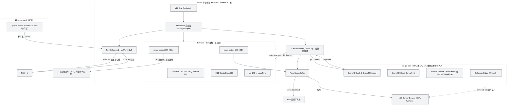
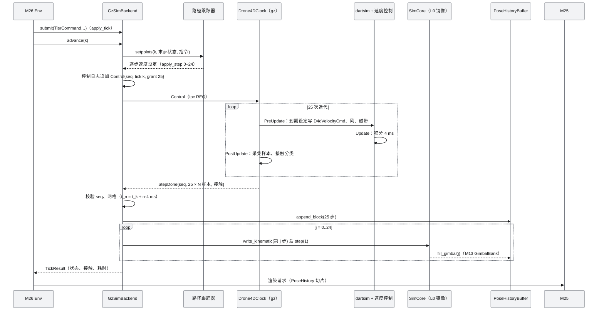
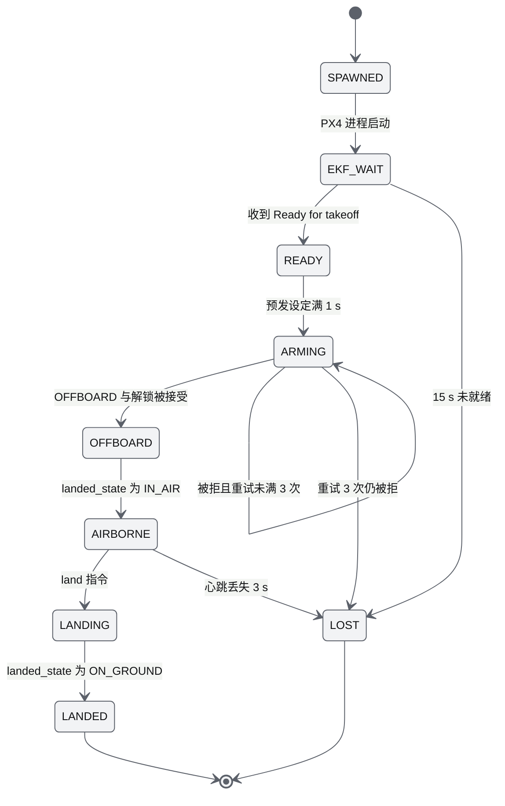
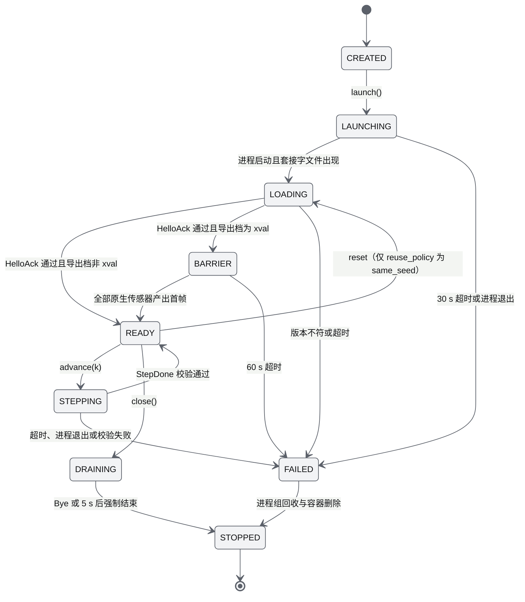
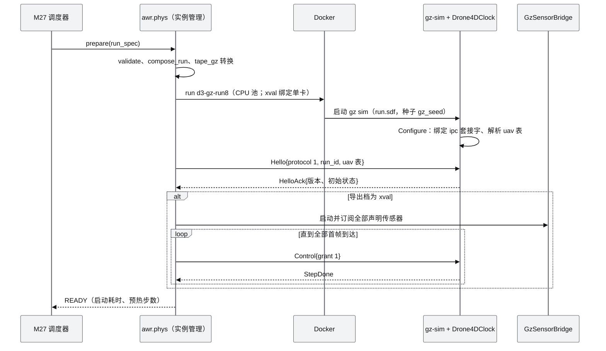

# M24 物理后端档位 PRD（Physics Backends）

| 项 | 内容 |
|---|---|
| 文档编号 | AWR-M24 |
| 标题 | 物理后端档位（Physics Backends）PRD：Fast、Realistic（Gazebo Sim）、SITL 三档；统一 PhysicsTier 与 DroneAdapter；PoseHistory；gz-sim 锁步插件、PoseTap 与 Sensor Bridge；World Package → SDF 导出；部署与确定性策略 |
| 文件说明 | 模块编号 **M24**，需求前缀 `M24-`；AWR-05 v1.2 §1.3、§5.0 已按本文件名 `M24-物理后端PRD.md` 登记（§13 第 3 条） |
| 版本 | v1.1 |
| 日期 | 2026-10-12 |
| 状态 | 草案 v1.1（按 AWR-05 v1.3 修订：Realistic 档提前为 P0 缺省档与正式成绩来源；修订内容汇总见 §14） |
| 上游文档 | 用户 D3 需求原文、补充要求与 2026-10-12 决策 [inputs/D3-需求原文-2026-10-11.md](../inputs/D3-需求原文-2026-10-11.md)（R-D3-08、R-D3-20、R-D3-23、R-D3-24、R-D3-28、R-D3-31、R-D3-37；v1.1 增加 2026-10-12 交互式确认的 R-D3-44、R-D3-48）；[AWR-05](../05-D3-设计增补与决策记录.md)（§1.2、§2.3、§4.1–§4.8、§5.0、§5.3、§5.4.1、§5.4.6、§5.4.7、§5.6.1–§5.6.3、§6.2、§6.3、§8.1、§8.4、§8.5、§10–§13；ADR-128、129、136、137、138、144、151、155、158、160、161、162）；[AWR-04](../04-D2-设计增补与决策记录.md)（ADR-090、095、096、110）；[AWR-03](../03-设计基线与决策记录.md)（§10.2，ADR-020、021、045、048、049、050）；[M08](M08-仿真内核与飞行器适配PRD.md)（§6.4、§6.5、§6.11，M08-FR-013、FR-068、FR-076、FR-201–FR-213）；[M07](M07-环境引擎PRD.md)（§6.3.8–§6.3.9）；[M13](M13-传感器仿真PRD.md)（§6.5.2 云台）；[AWR-20](../20-机型与传感器目录.md)（§3）；研究 [00-index](../research/d3/00-index.md) §2.5、§4.4、§8，[r5](../research/d3/r5-gazebo-realistic-backend.md)，[r9](../research/d3/r9-gz-sim.md)，[r7](../research/d3/r7-d2-code-audit.md) §0、§4、§7，[r10](../research/d3/r10-rotorpy-camera-sensor.md) §2.2、§4.1；用户设计讨论 design-r1（§三"关于 Gazebo"、§四"GLB 能否直接交给 Gazebo"、§九、§十） |
| 下游文档 | M25（PoseHistory 消费、`GzNativeSensorBackend`、IMU 合成的比力口径）；M26（Env 经 `PhysicsTier` 推进与下发指令）；M27（`realistic_run` 作业、资源估算、录制通道、运行清单）；M22（`export-gazebo` 子命令调用本模块导出器）；M23（`tape_gz.bin` 转换输入、Interactive 实现磁带）；M08 D3 增补节（扩展点 1 的区段、预算与字段授权）；M16（`tools/bench/d3/gz_lockstep.py`、对照 harness）；[17](../17-接口与实时协议规范.md) D3 增补（原因码 630–639、事件）；[19](../19-部署与运维说明书.md) D3 增补（gz 镜像与容器）；`docs/impl/D3-*` |
| 适用版本范围 | V0.3（本期交付 D3）至 V1.0 |

## 0. 摘要

1. M24 是 D3 的**物理权威**（AWR-05 §4.1，ADR-128）：唯一写入机体状态（实际位姿、速度、角速度、比力、接触与坠毁、云台角采样），不生成观测、不决定事件。三档为 Realistic（gz-sim Harmonic 锁步，**v1.1 起为 P0a 缺省档与排行榜正式成绩的唯一来源**）、Fast（FleetSim，快速档，P0b，用于开发、训练与大规模搜索，不产生正式成绩）、SITL（PX4 + gz-sim，P2，`ranked = false`）（ADR-137、ADR-138、ADR-176）。
2. 三档对上统一为 `PhysicsTier`（档位级）与 D2 `SimBackend`/`DroneAdapter`（机体级），指令语义统一为世界系速度加偏航角速度、按物理步生效；三档都把逐物理步的无损 PoseHistory 交给同一个 M25，Fast 与 Realistic 的观测差异只来自动力学（R-D3-31，ADR-160）。
3. Fast 档在 sim-core 中新增两个 D3 stage：`mesh_contact`（order 195，50 Hz，ESDF 门控 + MeshWorldQuery CPU 求交，坠毁语义与 D2 `COLLISION_WORLD` 一致）与 `pose_history`（order 198，逐物理步）。为满足"SLAM 与 L2 IMU 要求物理 ≥ 200 Hz"，Fast 档缺省 `FleetConfig.l1_every = 1`（d1_250 下物理 250 Hz，M08-FR-076 已有 SIH 回归），基线中"`d1_250` 即 ≥ 200 Hz"的表述有误（§13 第 1 条）。
4. Realistic 档由 C++ 插件 `Drone4DClock`（PreUpdate 门控、逐步采集、磁带回放）、`Drone4DControl`（单 ZeroMQ 套接字上的"指令集 + 步数授权"与携带 25 步状态的 `step_done`）、`Drone4DVelocityControl`（`commandFrame = world`）与宿主侧 `GzSimBackend`、`PoseTap`、路径跟踪器组成；缺省 `physics` 导出档不加载渲染传感器，因此不占 GPU、启动 < 5 s（r9 §3.3.1），gz 原生传感器只在 `xval` 交叉验证档使用。
5. World Package → SDF 导出器（`python/awr/world/export/gz.py`）以 world 帧米制 `appearance.glb` 为视觉、只加 roll = +π/2，碰撞取 M22 分块 STL，写 `spherical_coordinates`、重力 9.80665、dartsim + bullet，并自动验收（`gz sdf -k`、同点偏差 ≤ 1 cm、深度与 DSM 中位差 < 1 cm、actor 与磁带中位差 < 0.6 m）。
6. 确定性：Fast 档为一级 b（同镜像同 CPU ISA 逐字节）；Realistic `physics` 档为同镜像、同 CPU ISA、同 `--seed` 逐位（v1.1：P0a 验证，并由平台复现审计持续核对，ADR-177），`xval` 帧为二级；SITL 不承诺。种子由 run_seed 派生且对 Agent 保密，控制消息逐条存档以支持重放恢复。
7. v1.1（D3-REV，§14）：阶段按 AWR-05 ADR-175 重排（Realistic 锁步、`physics` 导出与插件产品化 P0a；Fast 档与两档一致性、gz 健壮性与复现审计 P0b；`xval` 与 Jetty P1；SITL P2）；新增正式成绩约束、每实例资源预算、两档一致性用例集与平台复现审计（M24-FR-076 至 FR-083、M24-AC-025 至 AC-029）。
8. 需求：功能 75 条（v1.1 增至 83 条）、非功能 12 条、验收 24 条（v1.1 增至 29 条）；新增原因码 634–639、事件 4 个、MCAP 通道 3 个（其中真值 2 个）待 17 号文档与 M27 登记。对基线的反馈 22 条（§13），须裁决的有：物理频率与 `d1_250` 的矛盾、`caps.schema.json` 不允许新后端与新字段、M24 写 M08 字段的授权、gz 实例资源归属、PoseHistory 存档通道、Realistic 镜像机不受 M09 管理导致的档间行为差异。

---

## 1. 背景与目标

### 1.1 约束本模块的事实

| # | 事实 | 对设计的含义 | 依据 |
|---|---|---|---|
| F1 | D2 `SimBackend`（attach、spawn、despawn、dispatch_batch、step、snapshot、restore）、`DroneAdapter`、`ClockCaps.mode ∈ {lockstep, slaved_realtime, free_running, live}` 已冻结；能力声明从 `packages/contracts/rt/caps/<backend>.json` 加载 | Realistic 与 SITL 档原样实现 D2 协议；三种同步方式直接对应三个 `mode` 取值 | `python/awr/sim/backends/base.py`；r5 §0 第 4 条 |
| F2 | `caps.schema.json` 为 `additionalProperties: false`，`backend` 枚举只有 `mock`、`replay`、`px4_sih`、`prometheus` | 基线规定的 `caps/gz.json`（含 `pose_history_hz`）与 `caps/px4_gz.json`（含 `ranked`）在现行 schema 下校验失败，须扩展契约 | `packages/contracts/rt/caps.schema.json`；§13 第 2 条 |
| F3 | `d1_250` 主时钟 250 Hz，但多旋翼 L1 物理与控制 `l1_every = 2`，即 125 Hz；`FleetConfig.l1_every` 可配置，M08-FR-076 以 `l1_every ∈ {1, 2}` 对 PX4 SIH 黄金轨迹做回归 | 物理 ≥ 200 Hz 不能靠选 `d1_250` 获得，须以 `l1_every = 1`（250 Hz）获得，且无需改 D2 代码 | `python/awr/sim/runtime/clock_profile.py`；`fleet/fleet.py` `FleetConfig`；M08-FR-076 |
| F4 | sim-core stage 区段 195–199 空闲，D2 的 `contact`（order 090）以 2 m DSM 最近格判定地表、撞墙与硬着陆；90–110 之间无空闲区段 | Fast 档网格接触只能在 195–199 内，晚于 M09 guard（110–124）与 tap（140）一个 tick 被看到 | `fleet/stages/budgets.py`；`fleet/fleet.py::build_pipeline`；r7 §4 |
| F5 | `write_kinematic(S, slots, …)` 只接受带 `FW` 或 `L0` 位的 slot，同一 tick 每 slot 只允许写一次；M09 不管理 L0 幽灵机，M13 sensors stage 的掩码为 ALL | Realistic 机体在 sim-core 中以 L0 镜像存在，由 PoseTap 每 tick 写入；M09 自主失效保护对其不生效，须在档位一致性中处理 | `fleet/kinematic_write.py`；`sim/safety/service.py:131`；`sim/sensors/plugin.py` |
| F6 | FleetSim 内部为 NED/FRD，`EnuViews` 与 `kernels_tap.enu_convert` 给出 ENU/FLU 换算；`a_meas` 为合加速度；重力常量 `G = 9.80665` | PoseSample 一律 ENU/FLU；比力以物理步末速度差分计算，与接触后的速度一致 | `fleet/state.py`、`fleet/kernels_tap.py`、`fleet/params_px4.py` |
| F7 | gz-sim 进程内 C++ `Drone4DClock` 门控锁步 3 机 RTF 0.95（gz 原生 Ogre2 传感器下），纯物理 8.26；进程外 gz-transport 锁步 0.37–0.46；Python `gz.transport` 的 `request()` 持有 GIL 会丢应答 | 门控与采集放在 gz 进程内 C++；宿主侧不使用 `gz.transport` Python 绑定 | r9 §2.9、§3.3.3、§3.4；r5 §2.6 |
| F8 | 无渲染传感器时 gz 单实例常驻内存 0.2 GB、视觉网格不加载，启动至锁步服务可用 0.7–0.9 s；有渲染传感器时首帧 13–16 s、显存约 2 GB | Realistic 缺省导出档不含渲染传感器与视觉网格，实例放在 CPU 池；GPU 只用于交叉验证档 | r9 §3.3.1 |
| F9 | 碰撞网格从 2 万到 200 万面，10 架 x500 每步 1.75–1.97 ms，只影响内存（0.42 → 1.16 GB）；x500 每步约 0.7 + 0.12·N ms，单进程 250 Hz 实时上限约 25 架 | 碰撞网格规模可按一致性需要选择；`max_vehicles = 8` 留有余量 | r5 §2.3.2 |
| F10 | gz 不做 glTF Y-up → Z-up 转换，节点矩阵照常应用；加 roll = +π/2 后深度与 DSM 中位差 0.6 mm；不支持 Draco、meshopt、KTX2 | 导出器只加 roll，不缩放；视觉资产须规范化 | r5 §2.1、§2.2；r9 §2.3 |
| F11 | actor 不参与物理（20 kg 箱体被穿过只移动 0.010 m）、不受重力；`<loop>false</loop>` 加任意渲染传感器会卡死首帧；actor `<pose>` 必须为单位位姿；蒙皮根节点前移 0.66 m | 事件真值只来自磁带；导出器规避两个缺陷；actor 只在交叉验证档出现 | r5 §2.4；r9 §2.6 |
| F12 | 上游 `MulticopterVelocityControl` 按完整机体姿态解释线速度，机动掉高 23–87 m；分叉 `commandFrame = world` 后定高误差 +1.4 m 以内 | 采用分叉版本并保留 Apache-2.0 头 | r9 §2.8、§3.4 |
| F13 | gz 的 `--seed` 同时决定风噪声与传感器噪声且运行时不可修改；同镜像同型号 GPU 两次运行位姿逐位一致；有无渲染传感器不改变物理轨迹 | 换种子即重启实例；`physics` 与 `xval` 两档的物理轨迹可逐位对拍 | r9 §2.12、§3.3.2 |
| F14 | PX4 以 gz `/clock` 为时间源，gz 不等待 PX4；1–10 架在 9–11 s 内就绪，需 GCS 心跳与平整起降垫；世界级写入 `<plugin>` 时 gz 不再加载 PX4 的 `server.config` | SITL 只能 `slaved_realtime`；SITL 导出档须显式列出 PX4 所需系统 | r5 §2.9；r9 §2.8 |
| F15 | WindEffects 为全场均匀风加一阶滤波、正弦与高斯噪声，力为 `m·k·(v_wind − v_link)`，缺省 k = 1 会使机体失控偏离；M07 湍流为共享冻结 von Kármán 空间场 | 缺省沿用 WindEffects 并标定 k；为档间对照提供逐机注入 M07 风场的选项 | r9 §2.7；r5 §2.8；M07 §6.3.8 |
| F16 | M13 `GimbalBank` 在 sim-core 中以 50 Hz、90°/s 推进两列云台，状态存于 `payload` 块 `g_az`、`g_el`、`g_mode` | 两档共用同一云台模型，M24 只逐物理步采样 | `sim/sensors/gimbal.py`、`block.py` |

### 1.2 目标

| # | 目标 | 度量 | 依据 |
|---|---|---|---|
| G1 | 三档统一接入：同一 Run 规格只改 `physics` 字段即可在 Fast 与 Realistic 两档运行 | D3-AC-35 "两档都能运行" | R-D3-20、R-D3-23；ADR-137 |
| G2 | 传感器位姿无损：PoseHistory 覆盖每个物理步，M25 不外推、不对插值位姿求导 | 网格误差 0 ns；样本与 FleetState 或 gz 状态逐位一致 | ADR-160；D3-AC-09、13 |
| G3 | Fast 档补齐三维网格接触，且不降低 Benchmark 吞吐与确定性 | 一级 b 逐字节；NFR-001、NFR-002 | AWR-05 §5.3.1；00-index §4.4 |
| G4 | Realistic 档锁步可复现、可归因，并作为 P0a 缺省档与排行榜正式成绩的唯一来源（v1.1） | 3 机纯物理 RTF ≥ 3.0、含 M25 标准轨按 GPU 份额；位姿逐位一致；有无传感器物理轨迹逐位一致；故障重放逐位一致 | D3-AC-34、17；ADR-176、177 |
| G5 | gz-sim 资产链路在 P0a 即投入正式运行（`physics` 导出档），`xval` 交叉验证在 P1 补齐 | crop 与 town 导出自动验收通过；交叉验证深度差中位数 ≤ 1 cm | D3-AC-31、34、40 |
| G6 | SITL 档可用于飞控交互验证，不污染排行榜 | 10 架 15 s 内就绪；排名提交返回 633 | D3-AC-36 |

### 1.3 设计原则

1. **换动力学，不换观测**：物理档只产出状态，观测一律由 M25 按 PoseHistory 生成；gz 原生传感器只作交叉验证与 ROS 2 生态出口（R-D3-31，ADR-138）。
2. **时钟只有一个**：Drone4D 持有 `t_sim_ns` 与 tick，gz 只在被授予步数时推进；所有时刻为整数纳秒，物理步网格 `t_n = t_0 + n·dt` 严格成立。
3. **一致性优先于功能堆叠**：档间共享的输入（磁带、M07 环境、M13 云台、M21 限幅、指令生效步）必须相同；无法相同之处（气动模型、旋翼模型、湍流实现）在对照报告中逐项列出。
4. **不改 D2 文件**：Fast 档只经 M08 登记表接入，D2 文件的改动只限 AWR-05 §12.3 扩展点及本文 §9.4 提出的变更请求。
5. **故障可恢复、现场可追溯**：控制消息、版本与种子逐条存档；实例故障以"重启实例 + 从回合起点重放"恢复（ADR-138）。

### 1.4 术语（本文新增，其余见 AWR-05 §1.2）

| 术语 | 定义 |
|---|---|
| PhysicsTier | 档位级接口（§7.1）：M26 Env 经它下发指令、推进 tick、取得 PoseHistory 与状态 |
| TierCaps | 档位能力声明：D2 `BackendCaps` 加 D3 字段（`physics_hz`、`pose_history_hz`、`ranked_allowed`、确定性等级等） |
| 物理步 | 物理档的一次积分：Fast 为一次 L1 调用（`l1_every` 个主时钟 tick），Realistic 与 SITL 为 gz 的一次迭代（`max_step_size`） |
| 导出档（gz profile） | 同一世界的三种 SDF 组合：`physics`（缺省，仅碰撞与动力学）、`xval`（加视觉网格、actor、渲染传感器，用于交叉验证）、`sitl`（PX4 所需系统与起降垫） |
| 镜像机 | Realistic 与 SITL 档的机体在 sim-core FleetState 中的 L0 slot，由 PoseTap 写入，供网关、录制、云台与识别物度量使用 |
| `d3phys` 块 | M24 在 FleetState 中登记的状态块（§6.3.3） |
| 控制日志 | 宿主发给 gz 的全部控制消息的无损记录，用于重放恢复与问题追溯 |

---

## 2. 范围

### 2.1 按阶段交付

v1.1 按 AWR-05 v1.3（ADR-175、ADR-176）重排；v1.0 的阶段对照见 §14.2。

| 阶段 | 交付 | 工作包 |
|---|---|---|
| P-1 | Fast 档 PoseHistory 采集的原型命令 `capture-fast`；gz 锁步链路 spike（r9 原型加逐步状态输出、ZeroMQ 控制、3 机 RTF 与同种子位姿逐位一致）与 `physics` 实例资源实测；`clock_profile` 字段语义与 `caps` 契约草案 | WP-D3-03、WP-D3-01 |
| P0a（最小基准闭环） | Realistic 档（缺省）：`Drone4DClock`、`Drone4DControl`（逐物理步状态）、`Drone4DVelocityControl`、`PoseTap` 产品化；`GzSimBackend` 与 `caps/gz.json`；路径跟踪器；uniform 风与接触判定；`physics` 导出档 SDF 导出与自动验收；每 Run 重启生命周期；PoseHistory（含云台采样）与真值存档；控制日志；确定性与版本记录；资源估算；`d3-gz` 镜像与容器规格 | WP-D3-20（P0a 部分） |
| P0b（基准 v1） | Fast 档：`PhysicsTier` 与 TierCaps、`l1_every = 1` 时钟档、`mesh_contact` 与 `pose_history` stage、`d3phys` 块、净空真值；DroneAdapter 一致性用例集与两档采样一致性；field 风模式；gz 看门狗与重启重放、平台复现审计、同种子 reset 复用验证；浸泡测试 | WP-D3-31、WP-D3-20（P0b 部分） |
| P1 | `xval` 导出档（视觉、actor、Sensors）与 gz 原生相机交叉验证、最小 `GzSensorBridge`；Jetty 评估；FleetSim 与 RotorPy 动力学对拍 | WP-D3-18、WP-D3-24（M24 部分） |
| P2 | PX4 SITL 档与 `caps/px4_gz.json`；风系数标定与动力学对照报告；Interactive 实现磁带下发；自由运行预览；车辆碰撞（不排名） | WP-D3-36、WP-D3-21（M24 部分） |
| P3 | 无新增功能 | — |

### 2.2 不做

- 百架级 Realistic；L2 气动力矩与下洗地效（M08 V0.4 interaction stage 的范围）；固定翼与 VTOL 的 Realistic、SITL 档（返回 630）。
- gz 原生传感器作为 Agent 观测来源；gz 粒子雨雾（雨雾统一由 M25 实现，r5 §2.8）。
- 室内结构、可破坏物体、无人机与行人的物理碰撞（最小间距由 M27 评测，AWR-05 §5.3.1 第 4 条）。
- M08 规划中的 SITL-EXT（FleetSim HIL lockstep，V0.4）不由本模块交付；D3 的 SITL 档是 PX4 + gz 的独立路径，两者并存。

### 2.3 与其他模块的边界

| 模块 | M24 提供 | M24 使用 | 不负责 |
|---|---|---|---|
| M08 | Fast 档 D3 stage、`d3phys` 块、会话段 `phys` | SimCore 与 FleetSim 组装、登记表、`write_kinematic`、`topp_lite_nb`、`params_px4`、`kernels_tap.enu_convert`、`kernels_contact` 常量 | 修改 D2 内核 |
| M22 | SDF 导出器（`export-gazebo` 子命令的实现） | 世界包 `appearance.glb`、`collision` 分块 STL、`raycast` 网格、`dsm_2m`、`occupancy`（ESDF）、`quality`、坐标与地理配准、MeshWorldQuery 与共享几何服务 | 世界构建与标定 |
| M23 | `tape_gz.bin` 的 C++ 读取与插值 | `TapeReader`、Interactive 实现磁带帧 | 事件推进与语义 |
| M25 | PoseHistoryBuffer 与切片接口；`GzSensorBridge` 帧流 | `GzNativeSensorBackend`（M25 实现）消费 bridge 输出 | 任何观测与真值帧的生成 |
| M26 | `PhysicsTier`（submit、advance、status） | Env 的 tick、决策时延换算后的 `apply_tick`、悬停保持窗口调度 | 观测过滤、动作合法性与限幅（M26 经 CommandEngine 与 TrustedGuard 完成） |
| M27 | 资源估算、`realistic_run` 的实例管理、控制日志与 PoseHistory 存档数据、运行清单字段 | Run 规格、队列与准入、写入器、重试策略 | 编排、录制与评测 |
| M21 | — | 机型参数（质量、惯量、轴距、`collision_r`、限幅档、云台范围） | 机型目录维护 |
| M07 | — | `EnvironmentService.query`（field 风模式）、磁带环境关键帧经 M23 编译的定时操作 | 环境模型 |

---

## 3. 用户与用例

### 3.1 调用方

| 调用方 | 入口 | 说明 |
|---|---|---|
| M26 Env（bench 作业内） | `awr.phys.open_tier(run_spec, …) -> PhysicsTier` | 唯一的运行期调用方；Agent 进程无法访问本模块任何接口 |
| M27 调度器 | `awr.phys.estimate(run_spec) -> PhysResourceEstimate`；`awr.phys.gz.instance` 的生命周期回调 | 准入、排队与故障重试 |
| M22 构建作业 | `python -m awr.world.glb export-gazebo <id>` → `awr.world.export.gz.export_world` | 世界级导出与验收，结果缓存在世界包导出目录 |
| 研究者（内部工作区） | `python -m awr.phys …` 命令行；`/lab/compare` 对照视图（M15） | 标定、对照报告、交叉验证 |
| CI 与验收 | `tests/d3/phys/**`、`tests/d3/gz/**`、`tools/bench/d3/gz_lockstep.py` | 验收 §10 |

### 3.2 用例

| 编号 | 用例 | 主流程 | 涉及需求 |
|---|---|---|---|
| UC-1 | 开发、训练与大规模搜索运行（Fast，v1.1 起为快速档，不产生正式成绩） | M27 选中 Run → Env 以 `physics = fast` 打开档位 → 每 tick 下发动作、推进 25 个主时钟 tick → PoseHistory 交 M25 → 录制 | FR-001–FR-024 |
| UC-2 | SLAM 轨道数据生成 | 同 UC-1，`clock_profile.l1_hz = 250`，输出含 `imu`、`lidar`、`bag`；准入校验物理 ≥ 200 Hz | FR-009、FR-016–FR-022 |
| UC-3 | 正式评测与缺省运行（Realistic，v1.1 起为缺省档与正式成绩的唯一来源） | Run 规格缺省 `physics = realistic` → M27 启动 gz 实例（physics 导出档，每 Run 重启）→ 锁步推进 → 同一 M25 | FR-035–FR-051、FR-076–FR-083 |
| UC-4 | 档间对照 | 同一磁带与机队在两档各运行 N 个种子 → 采样一致性检查与动力学对照报告写入数据集 | FR-061–FR-063 |
| UC-5 | 资产链路交叉验证 | 导出 crop、town 的 xval 档 → 探针位姿下 gz 原生相机与 M25 相机深度比对 | FR-025–FR-034、FR-057 |
| UC-6 | 飞控交互验证（SITL） | 导出 sitl 档 → 启动 gz 与 N 个 PX4 → offboard 速度设定 → 状态与 PoseHistory 进入预览与录制，不进入排名 | FR-052–FR-056 |
| UC-7 | 实例故障恢复 | gz 进程异常退出 → 638 → M27 重启实例并按控制日志从回合起点重放 | FR-042、FR-045、FR-068 |
| UC-8 | 内部预览 | 内部工作区以 ×1–×10（Fast）或 ≤ ×1（Realistic 自由运行）观看，不产生排名数据 | FR-014、FR-041 |

---

## 4. 功能需求

优先级沿用 AWR-03 §10.2（P0 阻塞、P1 应交付、P2 可延期）；"阶段"列取 P-1、P0a、P0b、P1、P2、P3（AWR-05 §1.2）；目标版本均为 V0.3。

| 编号 | 需求描述 | 优先级 | 阶段 | 目标版本 | 验收要点 | 依据 |
|---|---|---|---|---|---|---|
| **档位与统一接口** | | | | | | |
| M24-FR-001 | 提供三档 `physics ∈ {fast, realistic, sitl}`，在 `awr.phys.tiers` 登记；每档实现 `PhysicsTier`（§7.1），其机体视图实现 D2 `DroneAdapter`；Realistic 与 SITL 的后端类实现 D2 `SimBackend`；请求未启用、未交付或镜像缺失的档位返回 630 `PHYSICS_TIER_UNAVAILABLE` | P0 | P0a（Realistic）、P0b（Fast）、P2（SITL） | V0.3 | M24-AC-001 | ADR-137；AWR-05 §5.3.1、§5.3.2 |
| M24-FR-002 | 每档给出 TierCaps（§7.3）：`tier`、D2 `BackendCaps`、`physics_hz`、`pose_history_hz`、`steps_per_tick`、`clock_mode`、`ranked_allowed`、`determinism`、`requires_gpu`、`max_vehicles`、`frame_kinds`、指令集；Fast 由 `caps/mock.json` 与时钟档在运行期合成，Realistic 与 SITL 读 `caps/gz.json`、`caps/px4_gz.json` | P0 | P0a（Realistic）、P0b（Fast）、P2（SITL） | V0.3 | M24-AC-001 | ADR-137；r9 §4.5 |
| M24-FR-003 | 指令语义统一为世界系 ENU 速度（m/s）加偏航角速度（rad/s）；`goto`、`follow_path`、`orbit`、`takeoff`、`land`、`hover` 在 Fast 档由 FleetSim L1 原生执行，在 Realistic 与 SITL 档由同一个宿主侧路径跟踪器（FR-050）换算为速度；每条指令带 `apply_tick`（主时钟 tick，4 ms 网格），三档在同一物理步生效；不支持的指令返回 D2 `109 BACKEND_UNSUPPORTED` | P0 | P0a（Realistic）、P0b（Fast）、P2（SITL） | V0.3 | M24-AC-002 | AWR-05 §5.3.1 第 2 条；ADR-145 决策时延 |
| M24-FR-004 | 机体状态以同一函数 `derive_status()` 从档位中立的信号（`landed`、`in_air`、`crash_cause`、`cmd_mode`、`link_ok`）派生为 `VehicleStatus ∈ {GROUNDED, AIRBORNE, LANDING, CRASHED, LOST}`（§6.3.4）；Fast 的信号取 FleetState，Realistic 取 `Drone4DClock` 接触分类，SITL 取 MAVLink | P0 | P0a（Realistic）、P0b（Fast）、P2（SITL） | V0.3 | M24-AC-003 | AWR-05 §5.3.2（`derive_state` 同一派生逻辑）；§13 第 11 条 |
| M24-FR-005 | 准入校验（M27 PREPARING 阶段调用 `awr.phys.validate`）：时钟档与输出的相容性（Run 输出含 `imu`、`lidar`、`bag` 或属于 SLAM 轨道时 `physics_hz ≥ 200`）、tick 周期为物理步长整数倍、机型构型受支持、机数 ≤ `max_vehicles`；违反时返回 637 `PHYS_CLOCK_INVALID` 或 630，并附违反项清单 | P0 | P0a | V0.3 | M24-AC-001 | ADR-160 决策 (4)；AWR-05 §5.6.1 |
| M24-FR-006 | 物理档不向 M26 交付任何观测；Benchmark 运行（含排名运行）中 gz 原生传感器、`GzSensorBridge` 与 `xval` 导出档不得启用，`ranked = true` 的 Run 请求 `xval` 时返回 630 | P0 | P0a | V0.3 | M24-AC-024 | R-D3-31；ADR-138、ADR-161 |
| M24-FR-007 | 档位一致性：同一 Run 规格在各档共用同一磁带、同一 M07 环境时间线、同一 M13 云台模型、同一 M21 限幅档、同一指令生效步与同一 PoseHistory 采样分辨率；不可共用的部分（气动与旋翼模型、湍流实现、碰撞网格分辨率、M09 自主失效保护）在对照报告中逐项列明 | P0 | P0b | V0.3 | M24-AC-016 | R-D3-31；ADR-137 后果 |
| **Fast 档** | | | | | | |
| M24-FR-008 | Fast 档复用 D2 SimCore 与 FleetSim 的批处理组装（M26 Env 实例化）；D3 插件 `awr.phys.fast.plugin.install()` 只出现在 `D3_PLUGINS`，登记 stage `mesh_contact`（order 195）与 `pose_history`（order 198）、状态块 `d3phys`、会话段 `phys`（loader order 42）与批处理输出 `phys_run`；D2 组合根不加载 | P0 | P0b | V0.3 | M24-AC-009 | ADR-129；AWR-05 §12.3 第 1 处 |
| M24-FR-009 | Fast 档时钟档：缺省 `{name: d1_250, main_hz: 250, physics_hz: 250, l1_hz: 250}`，即 `FleetConfig.l1_every = 1`；允许 `l1_hz = 125`（`l1_every = 2`，只用于不含 IMU、LiDAR、bag 输出且 tick 周期为 8 ms 整数倍的 L1 运行）与 `sandbox100`（100 Hz，只用于不排名的开发运行）；`clock_profile` 纳入运行哈希 | P0 | P0b | V0.3 | M24-AC-004 | ADR-160；M08-FR-076；§13 第 1 条 |
| M24-FR-010 | `mesh_contact` stage：50 Hz（`hz = 50`、`phase_slot = 0`），只处理空中的 L1 多旋翼 slot；以 M22 ESDF 做门控，门控未排除的机体经共享几何服务的 CPU 路径做线段求交与最近点查询（§6.4.4）；侧向或上方接触判为坠毁，响应与 D2 `contact` 的撞墙分支一致（`crash_sub = COLLISION_WORLD`、`ctrl_mode = KILLED`、推力 0、`mode_evt |= E_COLLISION`、位置回退到最近一次无碰撞检查点），并发出 D2 事件 `sim.contact.collision{kind: COLLISION_WORLD}` 与 D3 事件 `phys.contact.mesh`；朝下接触（最近点在机体下方 45° 锥内）交由 D2 `contact` 按地表处理；不得使用 GPU 求交 | P0 | P0b | V0.3 | M24-AC-007 | AWR-05 §5.3.1 Fast 行；ADR-136 一级 b |
| M24-FR-011 | 静态网格净空真值：对每架空中机体以 10 Hz 记录到网格的最小距离 `clear_m`（> 50 m 记 50 m），写入 `d3phys.clear_m` 与运行层通道 `/phys/clearance`（真值，不进入 Agent），供 M27 安全指标使用 | P1 | P0a（Realistic）、P0b（Fast） | V0.3 | M24-AC-008 | AWR-05 §5.6.5（安全间距）；本文设定 |
| M24-FR-012 | 不完整与悬挑：机体位于 `quality` 层的扫描覆盖外或洞区时置 `d3phys.in_unknown = 1` 并发出一次 `phys.coverage.exit`，碰撞检查照常对现存网格执行；D2 `contact` 以 DSM 判地表，因此 Fast 档不支持在桥下、树冠下与骑楼下飞行，该限制写入 TierCaps 的 `limitations` 与数据集说明 | P0 | P0b | V0.3 | M24-AC-007 | ADR-131；F4 |
| M24-FR-013 | 湍流强度：两档均取 `σ_turb = max(磁带关键帧 gust_sigma_mps, 噪声档物理湍流 σ)`（clean 0、realistic 0.3 m/s、harsh 1.0 m/s）；Fast 档经 M07 `env/set` 写入，Realistic 档写入 WindEffects 噪声参数（uniform）或由 M07 场计算（field） | P1 | P0a（Realistic）、P0b（Fast） | V0.3 | M24-AC-017 | AWR-05 §5.4.6 噪声档参数表"湍流（物理档）"行 |
| M24-FR-014 | 内部预览：Fast 档可在 D2 sim-core 主循环中以 ×1–×10 运行（`caps/mock.json` 的 `max_speed`），D3 stage 行为与批处理相同；预览运行 `ranked = false` | P1 | P0b | V0.3 | M24-AC-024 | ADR-152；AWR-05 §7.11 |
| M24-FR-015 | P-1 采集工具 `python -m awr.phys capture-fast`：给定世界包、机型与航线（如 town 883 m 环线、30 m AGL、6 m/s），以 `l1_every = 1` 运行 FleetSim 并导出 250 Hz PoseHistory（`pose_history.v1` 编码与 TUM 文本），供 D3-AC-47 的 RPE100 基线复测 | P0 | P-1 | V0.3 | M24-AC-004 | D3-AC-14、47；ADR-160 决策 (6) |
| **PoseHistory** | | | | | | |
| M24-FR-016 | PoseSample 定义（§6.3.1）：`t_ns`（int64，仿真纳秒）、`pos_enu_m`（f64×3）、`q_ws_xyzw`（f64×4，WORLD←FLU）、`vel_enu_mps`（f64×3）、`omega_b_rps`（f64×3，FLU）、`f_b_mps2`（f64×3，FLU，机体原点处比力 `R_wbᵀ((v_n − v_{n−1})/dt − g_w)`，`g_w = (0, 0, −9.80665)`）；杆臂项由 M25 按挂载外参计算 | P0 | P0a | V0.3 | M24-AC-005 | ADR-160；AWR-05 §5.4.1、§5.4.6 |
| M24-FR-017 | Fast 档采集：`pose_history` stage 每个物理步执行一次（`hz = physics_hz`），位于全部写机体状态的 stage（L1 030–080、`contact` 090、`mesh_contact` 195）之后，读取接触处理后的状态，经 ENU/FLU 换算写入 PoseHistoryBuffer；不经 StateRing | P0 | P0b | V0.3 | M24-AC-005 | ADR-160 决策 (1)；F4、F6 |
| M24-FR-018 | 云台采样：每个物理步对每机最多 2 列云台记录 `az_rad`、`el_rad`、`mode`（取 M13 `payload` 块 `g_az`、`g_el`、`g_mode`）；Realistic 与 SITL 档的镜像机同样由 M13 `GimbalBank` 推进并按同一方式采样 | P0 | P0a（Realistic 镜像机）、P0b（Fast） | V0.3 | M24-AC-006 | AWR-05 §4.3 规则 2；F16 |
| M24-FR-019 | Realistic 档采集：`Drone4DClock` 在每次迭代的 PostUpdate 读取各机 `base_link` 的世界位姿、线速度与角速度，按 FR-016 的同一公式计算比力，`step_done` 携带本 tick 全部物理步（25 步 × 机数）；宿主按网格校验后追加到同一 PoseHistoryBuffer；`caps/gz.json` 声明 `pose_history_hz = 250` | P0 | P0a | V0.3 | M24-AC-015 | ADR-160；r9 §4.3 第 5 条 |
| M24-FR-020 | SITL 档采集：`Drone4DClock` 以非门控模式运行，每 25 步经发布套接字推送一批样本；宿主检查网格连续性，出现缺口返回 635 并终止运行 | P1 | P2 | V0.3 | M24-AC-019 | F14 |
| M24-FR-021 | 网格与查询契约：样本时刻严格满足 `t_n = t_0 + n·dt_ns`，无重复、无缺口；`slice(uav, t_from, t_to)` 返回覆盖区间且含两端外侧相邻样本的切片；请求晚于最新样本的时刻抛出 `PoseHistoryRangeError`，不做外推；M25 在相邻样本间以 lerp 与 slerp 求位姿 | P0 | P0a | V0.3 | M24-AC-005 | AWR-05 §4.3 规则 2、4；D3-AC-09 |
| M24-FR-022 | 无损缓冲：每机环形缓冲容量缺省 2.0 s（250 Hz 时 500 样本）；写入前检查消费水位，若将覆盖未释放样本则返回 634 `POSE_HISTORY_OVERFLOW` 并使运行失败，不得丢弃样本；Benchmark 锁步下 Env 每 tick 释放已完成渲染窗口之前的样本 | P0 | P0a | V0.3 | M24-AC-005 | ADR-162 |
| M24-FR-023 | 存档：每 tick 每机把本 tick 的样本以 `pose_history.v1` 编码（§7.5）交给 M27 写入真值文件通道 `/truth/phys/{uav}/pose_history`，供 `render_offline`、SLAM 真值侧车与档间对照重放；该通道不进入 Agent 与公开发布包 | P0 | P0a | V0.3 | M24-AC-023 | ADR-148、ADR-161；§13 第 5 条 |
| M24-FR-024 | 出生与静止窗口：地面出生的机体自回合零点起保持静止直至首条起飞指令（静止窗口长度由 M26 调度，缺省 2 s）；`start: pose`（空中出生）时以 HOLD 模式、零速度出生，Realistic 档出生时把旋翼角速度初始化为悬停值以避免首段下坠；SITL 档不支持空中出生（630） | P0 | P0a | V0.3 | M24-AC-005 | AWR-05 §5.4.6 初始化；ADR-160 决策 (5) |
| **World Package → SDF 导出** | | | | | | |
| M24-FR-025 | 导出器 `awr.world.export.gz.export_world(world_ref, profile, opts) -> GzExport` 与命令 `python -m awr.world.glb export-gazebo <id> --profile physics\|xval\|sitl`；世界级产物写入 `worlds/<id>/export/gz/<contentVersion>-<exporter_version>/<profile>/`，运行级组合（机队、actor、系统参数）在 PREPARING 阶段生成到 `runs/<run_id>/phys/`；同一输入与导出器版本产物逐字节相同（不写时间戳） | P0 | P0a（`physics`）、P1（`xval`）、P2（`sitl`） | V0.3 | M24-AC-011 | ADR-138；AWR-05 §5.1.7、§5.3.4 |
| M24-FR-026 | 视觉映射（仅 `xval`）：导出对象为 world 帧米制 `appearance.glb`（glTF Y-up 存储为 (E, U, −N)）；解压 Draco 与 meshopt、把 KTX2 与 WebP 纹理转 JPEG（不透明）或 PNG（含 alpha）、单块 ≤ 256 MB；SDF `<pose>` 只加 roll = +π/2，`<scale>` 恒为 1；不导出原始 GLB | P0 | P1 | V0.3 | M24-AC-011 | F10；RV-33 |
| M24-FR-027 | 碰撞映射：缺省取 M22 `collision` 层分块 STL（每块 ≤ 5 万面、总计 10 万–50 万面）作为同一静态模型的多个 `<collision>`；选项 `collision_source = raycast` 取全分辨率焊接网格分块（用于档间对照，§13 第 14 条）；物理引擎 dartsim，碰撞检测器 bullet | P0 | P0a | V0.3 | M24-AC-011 | F9；AWR-05 §5.1.3 第 6 阶段 |
| M24-FR-028 | 世界参数：`<spherical_coordinates>` 取世界包地理配准原点（无配准的世界写标称原点并在清单中标注 `georef = nominal`）；`<gravity>0 0 −9.80665</gravity>`；`<physics type="dart">` 的 `max_step_size = 0.004`、锁步与 `physics` 档 `real_time_factor = 0`、SITL 档 `real_time_factor = 1`；`physics` 与 `xval` 档省略 SceneBroadcaster 与 GUI | P0 | P0a | V0.3 | M24-AC-011 | r9 §2.2、§2.12；F6 |
| M24-FR-029 | 事件实体（`xval` 档；`physics` 档仅在 `vehicle_collision = true` 或 Interactive 模式下加入车辆）：人为无脚本 `<actor>`（蒙皮、单位位姿、按根节点偏移补偿；不生成 `<script>`）；车为带碰撞体（选项）的运动学模型；每个实体挂 `Label`，磁带演员 idx 与 gz 实体名、标签号的映射写入运行清单；磁带经 `tape_gz.bin`（§7.6）由 `Drone4DClock` 按仿真时间纯函数回放 | P0 | P1 | V0.3 | M24-AC-011 | F11；r5 §2.4 |
| M24-FR-030 | 机队模板：M21 多旋翼机型映射为四旋翼模板 `d4d_quad`（以 x500 为基础，按机型质量、惯量、轴距、电机常数、最大转速参数化），附 `Drone4DVelocityControl`；出生位姿取 Run 规格的锚点、机巢或位姿，高度贴 `dsm_2m`；固定翼与 VTOL 返回 630 | P0 | P0a、P2 | V0.3 | M24-AC-011 | AWR-05 §5.3.4 机队行；AWR-20 §3 |
| M24-FR-031 | 系统清单按导出档生成：`physics` 为 Physics、UserCommands、Drone4DClock、WindEffects（uniform）或 Drone4DWindDrag（field）；`xval` 另加 Sensors（ogre2）、Label、Contact；`sitl` 显式列出 PX4 `server.config` 的全部系统（Physics、UserCommands、SceneBroadcaster、Contact、Imu、AirPressure、AirSpeed、ApplyLinkWrench、NavSat、Magnetometer、Sensors 与 PX4 自定义系统）加非门控的 Drone4DClock | P0 | P0a（`physics`）、P1（`xval`）、P2（`sitl`） | V0.3 | M24-AC-011、019 | F14；r5 §2.9 |
| M24-FR-032 | 导出自动验收（§6.7.4）：`gz sdf -k` 通过；视觉与碰撞同点偏差 ≤ 1 cm；探针渲染深度与 `dsm_0p5m` 中位差 < 1 cm（`xval` 档，在 GPU Worker 上执行一次并缓存）；actor 与磁带中位差 < 0.6 m（样例事件）；落地探测（单机下降触地高度与 DSM 之差 ≤ 0.3 m）；任一失败返回 636 `GZ_EXPORT_INVALID`，导出目录不发布 | P0 | P0a（`physics`）、P1（`xval`） | V0.3 | M24-AC-011 | D3-AC-31；r5 §2.2、§2.3.2 |
| M24-FR-033 | `gz_manifest.json`（§7.6）：gz 发行版与各库版本、插件版本与构建提交、导出器版本、导出档、物理参数、资产 sha256 与面数、球面坐标、变换、验收结果 | P0 | P0a | V0.3 | M24-AC-011 | AWR-05 §5.3.4 |
| M24-FR-034 | 已知缺陷规避：actor 不生成 `<script>`，任何情况下不生成 `<loop>false</loop>`（生成脚本时必须 `loop = true` 并加 86400 s 驻留路点）；actor `<pose>` 恒为单位位姿；不可见状态的 actor 停放在 z = −500 m；`xval` 镜像包含 `/usr/share/glvnd/egl_vendor.d/10_nvidia.json`；每项规避都有回归用例，升级 gz 版本时复测 | P0 | P0a、P1 | V0.3 | M24-AC-011 | F11；r5 §5 第 1 条；风险 17 |
| **gz 插件与锁步** | | | | | | |
| M24-FR-035 | `Drone4DClock`（世界级 System，priority −200）：锁步模式在 PreUpdate 入口步数预算为 0 时先回复上一批 `step_done`、再阻塞接收下一条控制消息；按控制消息把指令写入各机 `D4dVelocityCmd` 组件、更新风种子或逐机风、写 actor 与运动学车辆位姿；PostUpdate 采集每步状态；全部 ECM 写入发生在仿真线程 | P0 | P0a | V0.3 | M24-AC-015 | ADR-138；r9 §3.1 |
| M24-FR-036 | `Drone4DControl` 协议 `drone4d.gz.v1`（§7.4）：单个 ZeroMQ REQ/REP 套接字（容器内 `ipc://` 路径）上依次交换 Hello、Control、StepDone、Shutdown；`seq` 严格递增；同一 `seq` 重发时回放缓存的 StepDone（幂等）；版本或负载校验失败返回 635 `PHYS_PROTOCOL_ERROR` | P0 | P0a | V0.3 | M24-AC-013 | ADR-138；r9 §4.3 第 5 条 |
| M24-FR-037 | `Drone4DVelocityControl`：上游 `MulticopterVelocityControl` 分叉（保留 Apache-2.0 头），`<commandFrame>world\|heading\|body</commandFrame>`，缺省 world；指令从 `D4dVelocityCmd` 组件同步读取（不订阅话题）；逐步把世界系指令换算为当前机体系；机动中世界系定高误差 ≤ 2 m | P0 | P0a | V0.3 | M24-AC-015 | F12；D3-AC-34 |
| M24-FR-038 | `PoseTap`（宿主侧）：把每个物理步样本按主时钟 tick 经 `write_kinematic` 写入镜像机（L0 slot），使 D2 tap、StateRing、网关、录制、M13 云台与 M18 隐蔽度量不改代码即可工作；末步状态同时作为 `DroneAdapter.pose()` 的来源 | P0 | P0a | V0.3 | M24-AC-015 | AWR-05 §5.3.3 PoseTap 行；F5 |
| M24-FR-039 | `GzSensorBridge`（C++ 独立进程，只在 `xval` 档）：启动即订阅全部声明的 gz 原生传感器，按 tick 汇齐、写共享内存、生成 `drone4d.frame.v1` 交 M25 `GzNativeSensorBackend`；P1 交付探针模式最小版本，P2 交付按 tick 汇齐版本；ROS 2 出口经 `ros_gz_bridge`，不进入主链路 | P1 | P1 | V0.3 | M24-AC-012 | AWR-05 §5.3.3；r9 §4.4 |
| M24-FR-040 | 就绪屏障：`physics` 与 `sitl` 档以收到 Hello 与初始状态为就绪；`xval` 档另须全部声明传感器各产出首帧；屏障之后的第一个 tick 为回合零点；超时返回 631 `GZ_NOT_READY` | P0 | P0a（`physics`）、P1（`xval`）、P2（`sitl`） | V0.3 | M24-AC-013 | F8、F13；r9 §3.4 |
| M24-FR-041 | 自由运行模式（`clock_mode = free_running`）：`real_time_factor = 0` 不门控，样本经发布套接字按批推送，指令在下一个 PreUpdate 生效；只用于内部预览，`ranked = false` | P2 | P2 | V0.3 | M24-AC-024 | AWR-05 §5.3.1 Realistic 行；r5 §4.3 |
| M24-FR-042 | 超时与故障：单 tick 等待 `step_done` 超过 `gz_step_timeout_s` 返回 632 `GZ_STEP_TIMEOUT`；gz 或 PX4 进程异常退出返回 638 `GZ_INSTANCE_EXITED`；两者都按进程组回收并删除容器，交 M27 按重试策略处理 | P0 | P0a | V0.3 | M24-AC-013 | AWR-05 §5.6.2 运行状态机 |
| **Realistic 档运行** | | | | | | |
| M24-FR-043 | `GzSimBackend` 实现 D2 `SimBackend`：`attach` 启动实例并等待就绪屏障；`spawn` 只接受导出时预置的机位（运行期新增经 `/world/<w>/create`，P2 可延期）；`dispatch_batch` 经路径跟踪器换算后缓存到下一条控制消息；`step` 授予 `tick_period / dt` 步并等待 `step_done`；`snapshot` 只记录运行清单、tick 与控制日志偏移；`restore` 为重启实例并按控制日志重放 | P0 | P0a | V0.3 | M24-AC-015 | AWR-05 §5.3.2 |
| M24-FR-044 | tick 推进流程（§6.5.5）：tick 周期为 4 ms 的整数倍（缺省 100 ms = 25 步）；一个 tick 内依次完成指令编码、授权、等待、样本网格校验、PoseHistory 追加、逐主时钟 tick 镜像写入与 SimCore 推进；`step_done` 中的样本时刻与 tick 时刻之差为 0 | P0 | P0a | V0.3 | M24-AC-015 | D3-AC-34 |
| M24-FR-045 | 实例生命周期（§6.8.1）：每个 Run（即每个种子）启动一个实例；`reuse_policy = same_seed` 只有在 FR-060 验证通过后才可启用，缺省 `per_run`；启动开销计入 M27 的排队与产能估算（FR-074） | P0 | P0a（每 Run 重启）、P0b（同种子复用验证） | V0.3 | M24-AC-014、020 | F13；AWR-05 §5.3.5；RV-09 |
| M24-FR-046 | 风：缺省 `wind_mode = uniform`，`Drone4DClock` 每步把磁带环境关键帧插值得到的平均风写入风实体 `WorldLinearVelocitySeed`，WindEffects 系数 k 取标定值（FR-061），噪声取 FR-013 的 σ；选项 `wind_mode = field`（P2 应交付）：宿主按 M07 `EnvironmentService.query` 在每 20 ms 子区间的预测位置采样各机风矢量，经控制消息下发，由 `Drone4DWindDrag` 逐机施加阻力（力律 `linear`：`F = m·k·(v_wind − v_link)`；或 `composite`：与 FleetSim `aero = composite` 同式，参数取 M21）；使用 linear 力律而机型未标定 k 时返回 630 | P0 | P0a（uniform）、P0b（field） | V0.3 | M24-AC-017 | F15；AWR-05 §5.3.1 第 3 条 |
| M24-FR-047 | 接触与坠毁判定：`Drone4DClock` 读取 `base_link` 的接触数据，按与 Fast 档相同的阈值分类（朝下 45° 锥内且竖直速度 ≤ 3 m/s 为触地，静止满 0.5 s 为落地；其余为坠毁）；坠毁后关闭该机速度控制与电机，接触事件随 `step_done` 返回并映射为 `phys.contact.mesh{detector: gz}` 与 D2 事件 | P0 | P0a | V0.3 | M24-AC-017 | D2 `ContactCfg`；本文设定 |
| M24-FR-048 | 无人机与事件实体之间缺省不做物理碰撞（`vehicle_collision = false`），与 Fast 档一致；`true` 只允许用于不排名运行，车辆以带碰撞体的运动学模型加入 `physics` 档 | P1 | P2 | V0.3 | M24-AC-017 | AWR-05 §5.3.1 第 4 条；§13 第 18 条 |
| M24-FR-049 | Interactive 模式：控制消息携带 M23 计算的下一 tick 实现磁带帧（22 B 记录），`Drone4DClock` 按与 `tape_gz.bin` 相同的插值规则回放；Exogenous 模式不下发 | P1 | P2 | V0.3 | M24-AC-018 | AWR-05 §6.2 事件行；D3-AC-37 |
| M24-FR-050 | 路径跟踪器 `awr.phys.tracker`（Realistic 与 SITL 共用）：以 FleetSim 的 `topp_lite_nb` 做航点时间参数化，限幅取 M21 限幅档，增益取 `params_px4` 中 PX4 位置环缺省值；每 tick 以 tick 起点状态做位置反馈，逐物理步输出速度设定与偏航角速度（§6.5.7） | P0 | P0a | V0.3 | M24-AC-002 | AWR-05 §5.3.1 第 2 条；§13 第 12 条 |
| M24-FR-051 | 容量与排名声明：每实例 ≤ 8 架；`physics` 档不申请 GPU；只有 Realistic 锁步档（`physics` 导出档）的 TierCaps 声明 `ranked_allowed = true`，Fast 与 SITL 为 `false`，正式成绩只取 Realistic（v1.1，AWR-05 ADR-176；榜单口径由 M27 决定） | P0 | P0a | V0.3 | M24-AC-001 | AWR-05 §5.3.2 caps；ADR-159 |
| **SITL 档** | | | | | | |
| M24-FR-052 | `Px4GzBackend`：以官方 PX4 镜像启动 gz（`sitl` 导出档，`real_time_factor = 1`）与 N 个 PX4 实例（`PX4_SYS_AUTOSTART = 4001`、`PX4_SIM_MODEL = gz_x500`、`PX4_GZ_STANDALONE = 1`）；每个出生点放置 1.6 m × 1.6 m 起降垫；向每个实例的 GCS 端口发 1 Hz 心跳；1–10 架 15 s 内就绪 | P1 | P2 | V0.3 | M24-AC-019 | F14；D3-AC-36 |
| M24-FR-053 | SITL 指令：路径跟踪器输出以 20 Hz（墙钟）经 pymavlink 发送 `SET_POSITION_TARGET_LOCAL_NED`（速度与偏航角速度，ENU → NED 换算）；按"预发设定 ≥ 1 s → OFFBOARD → 解锁"顺序进入外部控制；起飞与降落经同一跟踪器 | P1 | P2 | V0.3 | M24-AC-019 | r5 §2.9 |
| M24-FR-054 | SITL 状态：`HEARTBEAT`（解锁、模式）、`EXTENDED_SYS_STATE`（`landed_state`）映射到 FR-004 的信号；心跳丢失 3 s 返回 639 `SITL_LINK_LOST`，机体状态为 LOST | P1 | P2 | V0.3 | M24-AC-019 | 本文设定 |
| M24-FR-055 | SITL 运行 `ranked = false`、确定性等级 `none`；排名或 test 集提交返回 633 `SITL_NOT_RANKED` | P0 | P2 | V0.3 | M24-AC-019 | ADR-137；D3-AC-36 |
| M24-FR-056 | SITL 网络隔离：gz 与 PX4 在同一容器内，容器接入每个 Run 独立的内部网络 `d3-sitl-<run8>`（`--internal`），bench 容器在运行期间加入该网络；MAVLink 端口沿用 PX4 缺省（每实例 14540 + k、18570 + k） | P1 | P2 | V0.3 | M24-AC-019 | AWR-05 §4.6 隔离与命名 |
| **交叉验证、标定与评估** | | | | | | |
| M24-FR-057 | 交叉验证（P1，探针模式）：对 crop 与 town 的 `xval` 导出，在 ≥ 20 个探针位姿下以 gz 原生深度相机与 M25 相机比较静态像素深度，中位差 ≤ 1 cm；结果写入 `qa/xval_report.json` | P0 | P1 | V0.3 | M24-AC-012 | D3-AC-31 |
| M24-FR-058 | Jetty 评估（P1）：按 §6.10.3 的评估矩阵比较 Harmonic 与 Jetty 的插件 ABI 与 API 改动量、锁步性能、确定性、已知缺陷复测、批量射线与 CPU LiDAR；按决策规则形成迁移或维持结论，提交基线以 ADR 记录 | P0 | P1 | V0.3 | M24-AC-014 | R-D3-37；D3-AC-40 |
| M24-FR-059 | 锁步链路实测（P1）：以原型插件实测 Env → ZeroMQ → `Drone4DClock` → `PoseTap` → M25 链路下 3 机（720p RGB + MID-360 类 LiDAR，10 Hz，传感器由 M25 生成）的 RTF 与 tick 耗时分解，结果替换 AWR-05 §5.3.5 吞吐行的依据 | P0 | P-1（spike）、P0a（产品化复测） | V0.3 | M24-AC-014 | RV-09；D3-AC-40 |
| M24-FR-060 | 同种子 reset 验证（P1）：同一实例经 `/world/<w>/control reset` 后重跑 300 tick 与新实例的位姿逐位比对；一致才允许 `reuse_policy = same_seed`，否则实例生命周期定为每 Run 重启 | P0 | P0b | V0.3 | M24-AC-014 | AWR-05 §5.3.5 实例生命周期行 |
| M24-FR-061 | 风系数标定（P2）：对每个 Realistic 可用机型，在恒定风 {2, 4, 6, 8, 10} m/s 下比较 gz 与 Fast 档悬停稳态倾角，求 k 使各风速倾角差 ≤ 0.5°，线性力律无法满足时以参考风速 8 m/s 标定并报告各风速残差；结果写入 `configs/phys/gz_wind_k.json` 并纳入版本记录 | P0 | P2 | V0.3 | M24-AC-017 | F15；AWR-20 VH-3（P600 8 m/s 倾角 7.43°） |
| M24-FR-062 | 动力学对照报告（P2）：标准机动集（速度阶跃、偏航阶跃、恒风悬停、50 m 方形航线 6 m/s、爬升与下降）在两档各运行，报告上升时间、超调、位置 RMS、到达时刻差与倾角差，并随数据集发布 `phys_compare.json` | P1 | P2 | V0.3 | M24-AC-016 | AWR-05 §5.3.1 Realistic 用途；D3-AC-35 |
| M24-FR-063 | 两档采样一致性（D3-AC-35 的 M24 部分）：以 Fast 档 `pose_history` stage 的采集结果为参考轨迹，Realistic 侧以运动学注入复现并由 `Drone4DClock` 采集（§6.10.7）；两侧经同一 M25 后 LiDAR 逐点位姿差 ≤ 1 mm、IMU 合成输出差在重采样容差内 | P0 | P0b | V0.3 | M24-AC-016 | D3-AC-35 |
| M24-FR-064 | RotorPy 动力学对拍（D3-AC-48 的 M24 部分）：同一速度指令序列下 RotorPy `Multirotor`（按 M21 机型参数）与 FleetSim 的位置 RMS 差写入报告，暂定 ≤ 0.5 m / 60 s；RotorPy 只作测试依赖 | P1 | P1 | V0.3 | M24-AC-022 | ADR-144；r10 §4.1 |
| **确定性与复现** | | | | | | |
| M24-FR-065 | 运行清单写入物理档的确定性等级：Fast `1b`（同镜像、同 CPU ISA）、Realistic `physics` 档 `pose_bitwise`（同镜像、同 CPU ISA、同 `--seed`）、`xval` 帧 `2`（同镜像、同型号 GPU）、SITL `none` | P0 | P0a（Realistic）、P0b（Fast）、P2（SITL） | V0.3 | M24-AC-009、015 | ADR-136；§13 第 9 条 |
| M24-FR-066 | 种子：`gz_seed = (SplitMix64(run_seed ⊕ 0x4D32345F475A) mod (2³¹ − 1)) + 1`（常量为 ASCII "M24_GZ"），复用 `cbrng.py` 的 SplitMix64；M24 不使用其他随机源；`gz_seed` 只写入真值侧运行清单，不进入 Agent 可见的任何消息、错误与日志回显 | P0 | P0a | V0.3 | M24-AC-023 | ADR-161；AWR-05 §8.5 |
| M24-FR-067 | 版本记录（并入 Run 规格 `versions`）：gz 发行版与 gz-sim、sdformat、gz-physics 版本，插件构建提交，镜像摘要，CPU ISA，导出器版本与 `gz_manifest` sha256，物理参数（步长、引擎、检测器、重力），风模式与 k 值，跟踪器参数，`clock_profile`，`mesh_contact` 参数 | P0 | P0a | V0.3 | M24-AC-023 | ADR-136；AWR-05 §5.6.1 `versions` |
| M24-FR-068 | 控制日志：Realistic 与 SITL 档逐条记录发出的控制消息（seq、tick、授权步数、指令、风、实现磁带帧），写入 `runs/<run_id>/phys/control.bin` 并在运行清单登记 sha256；`restore` 与故障重试按日志重放 | P0 | P0a | V0.3 | M24-AC-023 | ADR-138（重启 + 重放） |
| M24-FR-069 | 运行哈希输入增加：`physics`、`clock_profile`、`physics_opts`（§7.2）、`mesh_contact` 参数、导出 `gz_manifest` sha256、k 值表版本 | P0 | P0a | V0.3 | M24-AC-009 | ADR-136；D3-AC-17 |
| **部署与运维** | | | | | | |
| M24-FR-070 | 镜像：`d3-gz`（Ubuntu 24.04 + Gazebo Harmonic + `native/gz` 插件与 bridge，含 EGL vendor 文件）与 `d3-px4gz`（官方 PX4 镜像按摘要固定，叠加以相同 gz-sim 8.x 构建的插件）；经 `mk/gz.mk` 构建，镜像摘要写入版本记录 | P0 | P0a（`d3-gz`）、P2（`d3-px4gz`） | V0.3 | M24-AC-020 | AWR-05 §5.3.5；F14 |
| M24-FR-071 | 容器规格（§8.2）：命名 `d3-gz-<run8>`、`d3-px4gz-<run8>`；标签 `d3.run_id`、`d3.attempt`；`GZ_PARTITION = <run_id>-<attempt>`、`GZ_IP = 127.0.0.1`；`physics` 与 `xval` 档 `--network none`，控制套接字经唯一可写的绑定目录 `/run/d4d`（世界包与导出目录只读挂载）；必须设 `--memory` 与 `--cpus`；只有 `xval` 档挂载 GPU 且只绑定一张卡；进入 `d3.slice` | P0 | P0a、P2 | V0.3 | M24-AC-020 | AWR-05 §4.6、§4.7；D3-AC-22 |
| M24-FR-072 | 生命周期与清理：实例进程以独立进程组运行，关闭时先发 Shutdown、5 s 后按进程组强制结束并 `docker rm -f`；回收作业每 60 s 删除标签所指运行已不在 RUNNING 的残留容器 | P0 | P0a、P2 | V0.3 | M24-AC-020 | r5 §5 第 13 条；r9 §3.4 |
| M24-FR-073 | 可观测性：每 tick 记录耗时分解（编码、物理、等待、解码、镜像、追加）、gz 自报 RTF、实例 RSS 与 CPU、重试次数；1 Hz 汇总写入运行层通道 `/phys/tick_stats` 与运行日志 | P1 | P0a | V0.3 | M24-AC-020 | r9 §4.6 可观测性行 |
| M24-FR-074 | 资源估算 `awr.phys.estimate(run_spec)`：返回 CPU 核、内存、GPU 份额（只有 `xval`）、启动开销与预计墙钟（按 P1 实测 RTF 校准），供 M27 准入与排队 | P0 | P0a | V0.3 | M24-AC-020 | AWR-05 §4.7、§5.6.2 |
| M24-FR-075 | 许可：分叉文件保留 OSRF Apache-2.0 版权头并在 `native/gz/THIRD_PARTY.md` 列出改动；THIRD_PARTY_NOTICES 登记 gz 系列（Apache-2.0）、Ogre-Next（MIT）、Assimp（BSD）、PX4（BSD-3-Clause）、libzmq（MPL-2.0，动态链接）、protobuf（BSD-3-Clause）、pymavlink（LGPL-3.0，进程内动态导入，不随数据集发布） | P0 | P0a | V0.3 | M24-AC-021 | ADR-154；AWR-05 §6.2 许可行 |

## 5. 非功能需求

| 编号 | 需求描述 | 优先级 | 阶段 | 目标版本 | 验收要点 | 依据 |
|---|---|---|---|---|---|---|
| M24-NFR-001 | Fast 档开销：N = 60、`l1_hz = 250` 时 `pose_history` stage 单次 p99 ≤ 40 µs，`mesh_contact` 单次 p99 ≤ 1.5 ms（含共享几何服务往返）；60 架 360 s L1 运行中 M24 两个 stage 合计 ≤ 3 s 单核 | P0 | P0b | V0.3 | M24-AC-010 | 本文设定（不超过 D3-AC-28 单核 120 s 预算的 2.5%） |
| M24-NFR-002 | Fast 档内存：M24 使会话匿名页（或 PSS）增量 ≤ 10 MB（N = 60、缓冲 2 s）；ESDF 以只读 memmap 访问，不计入匿名页 | P0 | P0b | V0.3 | M24-AC-010 | D3-AC-05 的口径；AWR-05 §5.1.6 |
| M24-NFR-003 | 登记预算：`mesh_contact` `budget_core = 0.020`、`pose_history` `budget_core = 0.006`（N = 1000、RTF = 1 的 d1_250 口径），加入后 Σbudget 仍 ≤ 0.40 | P0 | P0b | V0.3 | M24-AC-009 | M08-FR-012；`budgets.py` |
| M24-NFR-004 | Realistic 锁步：3 架 x500（720p RGB + MID-360 类 LiDAR，10 Hz，M25 生成）RTF ≥ 0.9（独占 A40，ADR-033 协议）；纯物理 `physics` 档 3 架 RTF ≥ 5 | P0 | P0a（纯物理与锁步协议）、P0b（含 M25 标准轨，独占 A40） | V0.3 | M24-AC-015 | D3-AC-34；r9 §3.3.3（纯物理 8.26） |
| M24-NFR-005 | 控制往返：8 架时每 tick 除物理计算外的协议开销（编码、套接字往返、解码、网格校验）p95 ≤ 2 ms | P1 | P0a | V0.3 | M24-AC-015 | r9 §3.3.3（RPC 与同步 2–3 ms） |
| M24-NFR-006 | 实例启动：`physics` 档至 READY p95 ≤ 5 s、常驻内存 ≤ 1.5 GB（town，50 万面碰撞）；`xval` 档至 READY p95 ≤ 30 s、常驻内存 ≤ 4 GB、显存 ≤ 2.5 GB | P0 | P0a（`physics`）、P1（`xval`） | V0.3 | M24-AC-014 | r9 §3.3.1；r5 §2.1 |
| M24-NFR-007 | SITL：1 / 3 / 5 / 10 架 15 s 内就绪；≤ 5 架 RTF ≥ 0.95 | P1 | P2 | V0.3 | M24-AC-019 | D3-AC-36；r5 §2.9 |
| M24-NFR-008 | 确定性：Fast 档同一 Run 规格两次运行 PoseHistory 存档 sha256 相同（同机与同 ISA 第二台机器）；Realistic `physics` 档同镜像同 ISA 两次运行逐位相同；`physics` 与 `xval` 两档物理轨迹逐位相同 | P0 | P0a（Realistic）、P0b（Fast） | V0.3 | M24-AC-009、015 | ADR-136；F13 |
| M24-NFR-009 | 健壮性：100 次连续 Realistic 运行（含 10 次注入故障：`kill -9`、步进超时、套接字关闭）后宿主无残留 gz 或 PX4 进程与容器 | P0 | P0b | V0.3 | M24-AC-020 | r5 §1.3（残留进程） |
| M24-NFR-010 | D2 零影响：D3 包安装但开关关闭、开关打开但不加载事件两种条件下，D3-AC-01 回归门全部通过；`awr.phys` 不被任何 D2 包 import | P0 | P0a | V0.3 | M24-AC-009 | ADR-129；D3-AC-01 |
| M24-NFR-011 | 导出耗时：crop、town 的 `physics` 档导出 ≤ 3 min（dmax CPU 池 16 核）；`xval` 探针验收 ≤ 2 min（单卡） | P1 | P0a（`physics`）、P1（`xval`） | V0.3 | M24-AC-011 | 本文设定（与 M22 单世界构建 3–6 分钟同量级） |
| M24-NFR-012 | 隔离：Agent 容器与 Agent principal 无法访问控制套接字、gz 分区、PoseHistory 与控制日志；gz 容器对世界包与导出目录只读挂载 | P0 | P0a | V0.3 | M24-AC-024 | ADR-145、ADR-161 |

---

## 6. 设计方案

### 6.1 组件与进程落点



| 组件 | 语言 | 进程 | 所有者路径 | 阶段 |
|---|---|---|---|---|
| `awr.phys.adapter`、`awr.phys.tiers`、`awr.phys.pose_history` | Python | bench 作业（Env 进程内） | `python/awr/phys/` | P0a |
| Fast 档插件（`mesh_contact`、`pose_history`、`d3phys`、会话段 `phys`） | Python + numba | 同上（SimCore） | `python/awr/phys/fast/` | P0a |
| `GzSimBackend`、`PoseTap`、实例管理、协议、跟踪器、风 | Python（pyzmq） | 同上 | `python/awr/phys/gz/` | P2（实例管理与协议原型 P1） |
| `Px4GzBackend`、MAVLink 驱动 | Python（pymavlink） | 同上 | `python/awr/phys/sitl/` | P2 |
| `Drone4DClock`、`Drone4DControl`、`Drone4DVelocityControl`、`Drone4DWindDrag`、`TapeGz` | C++17 | gz 进程内 System | `native/gz/src/` | P1 原型、P2 产品化 |
| `GzSensorBridge` | C++17 | `d3-gz` 容器内独立进程 | `native/gz/bridge/` | P1 最小版、P2 |
| SDF 导出器 | Python（+ Node `gltf-transform` 规范化） | M22 构建作业（CPU 池），探针验收在 GPU Worker | `python/awr/world/export/gz.py`、`python/awr/phys/gz/export/` | P1 |

### 6.2 档位、时钟档与能力

**档位总表**（AWR-05 §5.3.1 的细化）

| 档位 | 飞行权威 | 网格接触 | `clock_mode` | `physics_hz` | `pose_history_hz` | 每 tick 物理步（tick 100 ms） | 每实例机数 | GPU | 确定性 | 排名 |
|---|---|---|---|---|---|---|---|---|---|---|
| Fast | FleetSim L1（PX4-lite） | D2 DSM `contact` + D3 `mesh_contact` | lockstep / 倍速（≤ ×10） | 250（缺省）或 125 | = physics_hz | 25（`l1_hz` 250）；`l1_hz` 125 时 tick 周期须为 8 ms 的整数倍 | 数十至数百 | 否 | 1b | 允许 |
| Realistic | gz-sim dartsim + bullet、x500 旋翼模型、`Drone4DVelocityControl` | 碰撞 STL（10 万–50 万面或全分辨率） | lockstep；free_running（预览） | 250 | 250 | 25 | ≤ 8 | `physics` 否；`xval` 单卡 | `pose_bitwise`；`xval` 帧 2 | 允许（与 Fast 分榜） |
| SITL | PX4 + gz-sim | 同 Realistic | slaved_realtime | 250 | 250 | — | ≤ 10 | 否（无相机时） | none | 不允许（633） |

**时钟档组合**（`clock_profile = {name, main_hz, physics_hz, l1_hz}`；`l1_hz` 定义为机体飞控内环频率）

| 组合 | 档位 | `FleetConfig.l1_every` | 允许的输出 | 用途 | 依据 |
|---|---|---|---|---|---|
| `{d1_250, 250, 250, 250}` | Fast（缺省）、Realistic、SITL | 1 | 全部 | Benchmark、SLAM 轨道、档间对照 | ADR-160；M08-FR-076 |
| `{d1_250, 250, 125, 125}` | Fast | 2 | 不含 `imu`、`lidar`、`bag`，不属于 SLAM 轨道；tick 周期须为 8 ms 的整数倍（100 ms tick 不可用） | L1 大规模吞吐运行 | F3；D3-AC-28 |
| `{sandbox100, 100, 100, 100}` | Fast | 1 | 同上，且 `ranked = false` | 与 D2 沙盒对拍的开发运行 | AWR-04 ADR-090 |

规则：Realistic 与 SITL 的 gz 步长恒为 4 ms，因此只接受 `d1_250`；tick 周期必须是物理步长（`l1_every × 4 ms`）的整数倍，否则 tick 边界处没有样本，M25 在边界结束的采集窗口无法不外推地求位姿；Fast 档 `l1_every = main_hz / l1_hz` 必须为整数。违反任一条返回 637。

### 6.3 数据结构

#### 6.3.1 PoseSample 与 PoseHistory

```python
# python/awr/phys/pose_history.py（契约：packages/contracts/sensor/v2/pose_history.v1.schema.json，M24 与 M25 共同起草）
G_W = np.array([0.0, 0.0, -9.80665])                      # 世界系重力，ENU（与 params_px4.G 一致）

@dataclass(frozen=True)
class PoseSample:                                          # 一个物理步末的无损状态（ADR-160）
    t_ns: int                                              # 仿真纳秒，严格位于网格 t_0 + n·dt_ns
    pos_enu_m: Vec3                                        # f64，world 帧
    q_ws_xyzw: Quat                                        # f64，WORLD←FLU，单位四元数（不做半球规范化，保持与源状态逐位相同）
    vel_enu_mps: Vec3                                      # f64
    omega_b_rps: Vec3                                      # f64，FLU 机体系
    f_b_mps2: Vec3                                         # f64，FLU，机体原点比力 R_wbᵀ((v_n − v_{n−1})/dt − g_w)

@dataclass(frozen=True)
class GimbalSample:
    t_ns: int; col: int                                    # col ∈ {0, 1}（M13 N_GIMBAL = 2）
    az_rad: float; el_rad: float; mode: int                # M13 payload 块 g_az、g_el、g_mode

@dataclass(frozen=True)
class PoseHistory:                                         # M25 SensorRequest.poses 的类型（AWR-05 §5.4.1）
    uav: str; hz: int; dt_ns: int
    samples: Sequence[PoseSample]; gimbal: Sequence[GimbalSample]
    flags: int                                             # bit0 imu_valid（FW 与 fw_kin 驱动的 slot 为 0）

class PoseHistoryRangeError(LookupError): ...              # 请求晚于最新样本或早于已释放水位
```

| 字段 | 类型 | 单位 | 坐标系 | 取值范围 | 说明 |
|---|---|---|---|---|---|
| `t_ns` | int64 | ns | 仿真时钟 | ≥ 0，网格对齐 | 回合零点为 0；Realistic 档为 gz 时间减去就绪屏障时刻 |
| `pos_enu_m` | f64×3 | m | world ENU | 世界包 `bounds` 内 | Fast 由 NED 换算 `(p_e, p_n, −p_d)` |
| `q_ws_xyzw` | f64×4 | — | WORLD←FLU | ‖q‖ = 1 ± 1e-12 | Fast 由 `enu_convert` 同式换算 |
| `vel_enu_mps` | f64×3 | m/s | world ENU | ‖v‖ ≤ 60 | 接触处理后的速度 |
| `omega_b_rps` | f64×3 | rad/s | FLU | ‖ω‖ ≤ 20 | Fast 为速率环输出（FRD → FLU：`(p, −q, −r)`） |
| `f_b_mps2` | f64×3 | m/s² | FLU | ‖f‖ ≤ 300 | 静止或悬停时约为 `(0, 0, +9.80665)`；触地冲击保留，不截断 |

#### 6.3.2 PoseHistoryBuffer

| 项 | 规定 |
|---|---|
| 布局 | 每机一个环形 SoA：`t_ns[i64, C]`、`state[f64, C, 16]`（pos 3、q 4、vel 3、omega 3、f_b 3）、`gimbal[f64, C, 2, 2]`、`gmode[u8, C, 2]`；C = ⌈capacity_s × physics_hz⌉，缺省 500 |
| 写入 | Fast：`pose_history` stage 每步 `append`；Realistic：`append_block`（25 步）后由镜像推进逐步 `fill_gimbal`；SITL：按批 `append_block` |
| 释放 | `release_before(t_ns)`：Env 在 tick 放行时把水位推进到"本 tick 全部已渲染请求的最早采集窗口起点 − 1 个样本" |
| 溢出 | 写入位置等于未释放的最早样本时返回 634，运行失败；不覆盖 |
| 查询 | `slice(uav, t_from, t_to)`：二分定位，返回含两端外侧相邻样本的只读视图；`t_to > latest` 抛 `PoseHistoryRangeError` |
| 存档 | `drain_chunk(uav, k) -> bytes`：本 tick 样本的 `pose_history.v1` 编码，交 M27 写入器 |
| 线程 | 单写者（Env 线程）；M25 请求序列化的是切片拷贝，不跨进程共享缓冲 |

#### 6.3.3 `d3phys` 状态块（FleetState，M24 登记，参与 checkpoint）

| 字段 | dtype | 形状 | 单位 | 说明 |
|---|---|---|---|---|
| `p_safe` | f64 | (3,) | m（NED） | 最近一次 `mesh_contact` 检查无碰撞时的位置 |
| `clear_m` | f32 | () | m | 到静态网格的最小距离，> 50 m 记 50 |
| `clear_tick` | i64 | () | tick | `clear_m` 的更新时刻 |
| `in_unknown` | u8 | () | — | 1 表示位于扫描覆盖外或洞区 |
| `mesh_crash` | u8 | () | — | 1 表示由 `mesh_contact` 判定坠毁 |
| `v_prev_enu` | f64 | (3,) | m/s | 上一物理步速度（比力差分用） |
| `ph_init` | u8 | () | — | 已写入首样本 |

#### 6.3.4 VehicleStatus 统一派生

`derive_status(sig) -> VehicleStatus`，同一函数用于三档；信号表：

| 信号 | Fast 来源 | Realistic 来源 | SITL 来源 |
|---|---|---|---|
| `crash_cause ∈ {none, world, impact, uav, mesh}` | `crash_sub`、`d3phys.mesh_crash` | `step_done.contacts` 分类 | 非门控 `Drone4DClock` 随样本批推送的接触分类（与 Realistic 同一规则） |
| `landed` | `S.landed` | 接触分类（朝下锥内、静止满 0.5 s） | `landed_state == ON_GROUND` |
| `in_air` | `S.in_air` | 非 landed 且非 crashed | `landed_state ∈ {IN_AIR, TAKEOFF, LANDING}` |
| `cmd_mode` | `S.ctrl_mode` | 跟踪器当前指令种类 | 跟踪器当前指令种类 |
| `link_ok` | 恒真 | 实例存活 | 3 s 内收到心跳 |

| 优先级 | 条件 | 状态 |
|---|---|---|
| 1 | `link_ok = false` | LOST |
| 2 | `crash_cause ≠ none` | CRASHED |
| 3 | `landed` | GROUNDED |
| 4 | `in_air` 且 `cmd_mode ∈ {LAND, ELAND, DESCENT}` | LANDING |
| 5 | `in_air` | AIRBORNE |

#### 6.3.5 TierCommand 与 TickResult

```python
@dataclass(frozen=True)
class TierCommand:                                         # M26 动作映射之后、经 M26 ActionGuard 与 CommandEngine 校验之后（AWR-05 ADR-170）
    uav: str
    kind: Literal["velocity", "goto", "follow_path", "orbit", "hover", "takeoff", "land", "kill"]
    apply_tick: int                                        # 生效的主时钟 tick（4 ms 网格，含决策时延）
    vel_enu_mps: Vec3 | None = None                        # velocity
    yaw_rate_rps: float | None = None                      # velocity、hover；None 为保持航向
    target_enu_m: Vec3 | None = None                       # goto
    path_enu_m: NDArray[f64, (K, 3)] | None = None         # follow_path，K ≤ 256
    speed_mps: float | None = None                         # goto、follow_path、orbit 巡航速度
    orbit: OrbitSpec | None = None                         # center_enu_m、radius_m（1–1000）、cw、turns
    alt_m: float | None = None                             # takeoff 相对起飞点高度

@dataclass(frozen=True)
class ContactEvent:
    uav: str; t_ns: int
    kind: Literal["TOUCHDOWN", "LIFTOFF", "COLLISION_WORLD", "IMPACT", "COLLISION_UAV"]
    detector: Literal["dsm", "mesh", "gz", "px4"]
    pos_enu_m: Vec3; normal_enu: Vec3 | None; speed_mps: float; prim_id: int | None; semantic: int | None

@dataclass(frozen=True)
class TickResult:
    k: int; t_start_ns: int; t_end_ns: int; n_steps: int
    contacts: tuple[ContactEvent, ...]
    status: Mapping[str, VehicleStatus]
    timing: TickTiming                                     # 墙钟 ns：encode、physics、wait、decode、mirror、append
```

### 6.4 Fast 档

#### 6.4.1 组合与 stage 次序

Fast 档在 M26 Env 组装的 SimCore 中运行。D2 组合根不变；D3 组合根在 D2 缺省插件之后安装 `D3_PLUGINS`（M23 事件、M24 物理）。与 M24 相关的 stage 次序（d1_250，`l1_every = 1`）：

| order | stage | 所有者 | every / 频率 | 与 M24 的关系 |
|---|---|---|---|---|
| 000 | `clock` | M08 | 1 / 250 Hz | `t_ns = tick × 4 ms` |
| 020 | `env` | M07 | 5 / 50 Hz | 风与湍流写入 `S.wind`（零阶保持） |
| 030 | `l1` | M08 | 1 / 250 Hz | 积分到 `t_ns` |
| 090 | `contact` | M08 | 1 / 250 Hz | DSM 地表、撞墙、硬着陆、触地 |
| 091 | `collide` | M08 | 10 / 25 Hz | 机间碰撞 |
| 100 | `sensors` | M13 | 5 / 50 Hz | 云台推进（D3 中 M13 观测不交给 Agent） |
| 110–124 | `guard` 等 | M09 | — | 在下一 tick 看到 `mesh_contact` 的坠毁 |
| 140 | `tap` | M08 | 2 / 125 Hz | StateRing |
| 195 | `mesh_contact` | M24 | 5 / 50 Hz（phase 0） | §6.4.4 |
| 198 | `pose_history` | M24 | `l1_every` / physics_hz（phase 0） | §6.4.3；只处理 L1、L2、FW slot，跳过 L0 镜像机 |

区段：M24 使用 195–198，199 留给 M23（§13 第 8 条）。两个 stage 都以 `hz` 声明并显式给出 `budget_core`（NFR-003）；`pose_history` 只声明 `reads`；`mesh_contact` 声明 `writes = ("d3phys.*",)`，其对 M08 字段的写入属于扩展点 1 授权的例外（§9.4 第 1 条）。

#### 6.4.2 时钟档的实现

1. Env 调用 `awr.phys.fast.tier.fleet_config(clock_profile) -> FleetConfig`，只覆盖 `l1_every`（`main_hz / l1_hz`）与 `clock_profile` 两个字段，其余取 D2 缺省；不修改 `clock_profile.py` 与 `rates.py`。
2. `l1_every = 1` 时 `l1`、`kinematic`、`contact`、`fsm_min` 均以 250 Hz 运行（它们以 `c.l1_every` 登记），`tap` 仍为 125 Hz。M08-FR-076 已在 `l1_every ∈ {1, 2}` 下对 PX4 SIH 黄金轨迹回归，D3 不另做控制律验证，只在 M24-AC-004 中复跑。
3. 运行哈希包含 `clock_profile` 四个字段（FR-069），因此 125 Hz 与 250 Hz 的运行不会混为同一配置。

#### 6.4.3 `pose_history` 采集算法

```python
# python/awr/phys/fast/capture.py（stage pose_history，order 198，hz = physics_hz，phase_slot 0）
def pose_history_stage(S: FleetState, ctx: StageCtx) -> None:
    idx = capture_slots(S)                                   # 活动且 fidelity ∩ {L1, L2, FW} ≠ ∅；升序
    if idx.size == 0:
        return
    blk = S.blocks["d3phys"]
    dt = ctx.profile.tick_ns * L1_EVERY * 1e-9               # 物理步长（s）
    pos, vel, q, om = KPH.enu_state(idx, S.p, S.v, S.q, S.omega)   # 与 kernels_tap.enu_convert 同式（numba）
    first = blk["ph_init"][idx] == 0
    a_w = np.where(first[:, None], 0.0, (vel - blk["v_prev_enu"][idx]) / dt)
    f_b = KPH.rotate_inv(q, a_w - G_W)                       # R_wbᵀ · (a_w − g_w)
    blk["v_prev_enu"][idx] = vel
    blk["ph_init"][idx] = 1
    gaz, gel, gmode = gimbal_of(S, idx)                      # M13 payload 块；无云台的列填 NaN 与 0
    BUF.append(ctx.t_ns, S.ids_of(idx), pos, q, vel, om, f_b, gaz, gel, gmode)   # 水位检查失败 → 634
```

要点：

- 比力取接触处理后的速度差分，因此地面静止时恒为 `(0, 0, +g)`，触地冲击以单步尖峰出现；不使用 `a_meas`（它不含 `contact` 的夹持）。
- 带 FW 位的 slot 由 M21 `fw_kin` 以 50 Hz 写入，样本在两次写入之间保持，`flags.imu_valid = 0`；准入拒绝为此类机体输出 IMU（637）。
- 首样本：会话段 `phys` 的 loader 在回合零点写入每机出生状态（`t_ns = 0`，比力取 `(0, 0, +g)`），同时置 `ph_init = 1`、`v_prev_enu` 为出生速度、`p_safe` 为出生位置，保证 `slice` 自 0 起可用；运行中加入的机体由 stage 的 `first` 分支处理。

#### 6.4.4 `mesh_contact` 算法

```python
# python/awr/phys/fast/contact.py（stage mesh_contact，order 195，hz = 50，phase_slot 0）
COS_NADIR = cos(radians(45.0)); MARGIN_M = 0.5; CLEAR_CAP_M = 50.0

def mesh_contact_stage(S: FleetState, ctx: StageCtx) -> None:
    idx = air_l1_slots(S)                                     # 活动、L1/L2、非 FW、in_air、crash_sub == 0，升序
    if idx.size == 0:
        return
    blk = S.blocks["d3phys"]
    p   = ned_to_enu(S.p[idx]);  p0 = ned_to_enu(blk["p_safe"][idx])
    seg = p - p0;  L = norm(seg)
    r   = ctx.profiles.collision_r[S.profile_id[idx]]        # M21 机型碰撞半径
    d_e, known = ESDF.sample(p)                               # 只读 memmap，三线性；unknown 与 below-surface 记 known = False
    need = ~known | (d_e - C_VOX < r + L + MARGIN_M)          # C_VOX = 体素边长 × √3 / 2
    refresh = (ctx.tick // 5) % 5 == 0                        # 10 Hz：全部空中机体刷新净空
    J = np.flatnonzero(need | refresh)
    crash = np.zeros(idx.size, bool)
    if J.size:
        t_hit, prim_h = GEO.raycast_batch(p0[J], unit(seg[J]), tmax=L[J] + r[J])          # 线段求交（防穿越）
        d, c, prim_c  = GEO.closest_batch(p[J], max_d=CLEAR_CAP_M)                         # 最近点
        n_hit = GEO.normal_of(prim_h)                                                       # 命中三角形法向（ENU）
        down_hit = (seg[J][:, 2] < 0) & (n_hit[:, 2] >= COS_NADIR)                          # 下降撞到朝上表面：地表
        dirc = (c - p[J]) / np.maximum(d, 1e-9)[:, None]
        down_cl = -dirc[:, 2] >= COS_NADIR                                                  # 最近点在机体下方 45° 锥内
        hit = (t_hit <= L[J]) & ~down_hit                                                   # 侧向或上方穿越
        near = (d < r[J]) & ~down_cl                                                        # 侧向或上方贴近
        crash[J] = (hit | near) & need[J]
        blk["clear_m"][idx[J]] = np.minimum(d, CLEAR_CAP_M); blk["clear_tick"][idx[J]] = ctx.tick
    for s in idx[crash]:
        apply_crash(S, s, p_revert_ned=blk["p_safe"][s])      # 见下表；同 tick 内按 slot 升序
        emit(ctx, "sim.contact.collision", kind="COLLISION_WORLD", ...)                     # D2 事件，字段不变
        emit(ctx, "phys.contact.mesh", detector="mesh", prim_id=..., semantic=GEO.semantic_of(prim), ...)
    ok = idx[~crash]
    blk["p_safe"][ok] = S.p[ok]
    blk["in_unknown"][idx] = QUALITY.unknown_at(p)            # 0→1 跳变时发 phys.coverage.exit
```

坠毁响应 `apply_crash`（与 D2 `contact_numpy` 撞墙分支对齐，差异是机体不被瞬移到地表，而是在原地失去推力下落，由 D2 `contact` 的"已坠毁落地"分支停在地表）：

| 字段 | 写入值 | 与 D2 撞墙分支 |
|---|---|---|
| `S.p` | `p_safe`（≤ 一个检查周期的位移，20 m/s 时 ≤ 0.4 m） | D2 回退到 `p_prev` 并贴 DSM |
| `S.v` | 水平分量置 0，竖直分量只保留下降分量（NED 下 `v_d ← max(v_d, 0)`） | D2 不改 v（随后被夹持） |
| `S.omega`、`S.thrust`、`S.thr_sp` | 0 | 相同 |
| `S.ctrl_mode` | `M_KILLED` | 相同 |
| `S.crash_sub` | `CRASH_COLLISION_WORLD` | 相同 |
| `S.mode_evt` | `|= E_COLLISION` | 相同 |
| `d3phys.mesh_crash` | 1 | D3 新增 |

门控的正确性：ESDF 为占据体素中心的距离，真实网格距离 ≥ `d_e − C_VOX`；一个检查周期内机体位移 ≤ L，因此 `d_e − C_VOX ≥ r + L + MARGIN` 时本周期不可能接触。未知或地下体素一律进入精查。全部求交走共享几何服务的 Open3D/Embree CPU 路径，在瓦片局部原点下以 float32 相对坐标求交（AWR-05 §5.1.6），满足一级 b 确定性；服务不可用时 stage 阻塞重试至 2 s 后返回 683 并使运行失败，不降级为跳过检查。

#### 6.4.5 风与湍流（Fast）

沿用 M07 相对空速风模型与冻结 von Kármán 湍流盒，磁带环境关键帧经 M23 编译为 M07 定时操作；M24 只在会话段 `phys` 加载时按 FR-013 提交一次 `env/set`（湍流强度下限），不新增风模型。

### 6.5 Realistic 档

#### 6.5.1 导出档与运行组合

| 导出档 | 内容 | 用途 | 资源 |
|---|---|---|---|
| `physics`（缺省） | 碰撞模型、机队模板、Physics、UserCommands、Drone4DClock（锁步）、WindEffects 或 Drone4DWindDrag；车辆仅在 `vehicle_collision = true` 或 Interactive 时加入；无视觉网格、无 actor、无渲染传感器 | Benchmark、档间对照、标定 | CPU 2 核、内存 2 GB、无 GPU |
| `xval` | `physics` + 视觉网格、actor、Label、Sensors（ogre2）、探针或机载原生传感器、`GzSensorBridge` | 交叉验证、ROS 2 生态出口、导出验收探针 | CPU 4 核、内存 6 GB、单卡 GPU（约 2 GB 显存、10% GPU 时间） |
| `sitl` | PX4 `server.config` 全部系统 + 非门控 Drone4DClock + 起降垫；`real_time_factor = 1` | SITL 档 | CPU 1 + 0.35·N 核、内存 2 + 0.1·N GB |

运行级 `run.sdf` 在 PREPARING 阶段由 `awr.phys.gz.compose(run_spec, export)` 生成：`<include>` 世界级 `world_static.sdf`，加入机队模型（按 `fleet[]` 顺序编号 `uav_index`）、`Drone4DClock` 参数（套接字路径、步长、`uav_index → 模型名` 表、磁带路径、风模式）与种子；生成耗时 < 1 s。

#### 6.5.2 `Drone4DClock`（gz 进程内）

```cpp
// native/gz/src/Drone4DClock.cc（世界级 System；gz:system_priority = -200，先于 Drone4DVelocityControl）
void Drone4DClock::PreUpdate(const UpdateInfo& info, EntityComponentManager& ecm) {
  if (info.paused) return;
  if (mode_ == Mode::Lockstep && budget_ == 0) {
    if (pending_) { rep_.send(encode(StepDone{seq_, tick_, samples_, contacts_})); pending_ = false; }
    for (;;) {                                               // REP：严格收一条、回一条
      Msg m = rep_.recv(recv_poll_ms_);                      // 轮询只为检查关闭标志
      if (m.is_hello())    { rep_.send(encode(helloAck(ecm))); continue; }   // 版本、uav 表、初始样本
      if (m.is_shutdown()) { rep_.send(encode(Bye{})); shutdown_ = true; return; }
      if (m.is_control() && m.seq == seq_) { rep_.send(cached_); continue; }  // 同 seq 重发：幂等回放
      Control c = validate(m);                               // seq == seq_ + 1、n_steps ≥ 1、索引与长度；否则回 Error（635）
      stage(c); budget_ = c.grant_steps; step_in_batch_ = 0; samples_.clear(); contacts_.clear();
      seq_ = c.seq; tick_ = c.tick; break;
    }
  }
  if (mode_ == Mode::Lockstep) --budget_;
  applyDueCommands(step_in_batch_, ecm);                     // apply_step == step_in_batch_ 的设定写入 D4dVelocityCmd
  applyWind(info.simTime, step_in_batch_, ecm);              // uniform：风实体种子；field：逐机 D4dWind 组件
  applyTape(info.simTime, ecm);                              // xval actor、运动学车辆、Interactive 实现磁带
  ++step_in_batch_;
}

void Drone4DClock::PostUpdate(const UpdateInfo& info, const EntityComponentManager& ecm) {
  if (info.paused) return;
  const int64_t t = toNs(info.simTime);                      // gz 原始仿真时刻；回合零点对齐由宿主完成
  for (auto& u : uavs_) {                                    // 按 uav_index 升序
    Pose3d P = worldPose(u.link, ecm); Vector3d v = worldLinVel(u.link, ecm); Vector3d w = bodyAngVel(u.link, ecm);
    Vector3d a = u.first ? Vector3d::Zero : (v - u.v_prev) / dt_;
    Vector3d fb = P.Rot().Inverse().RotateVector(a - kGravityEnu);    // kGravityEnu = (0, 0, -9.80665)
    samples_.push(t, P, v, w, fb); u.v_prev = v; u.first = false;
    classifyContacts(u, ecm, t, contacts_);                  // §6.5.9
  }
  pending_ = true;
}
```

- 速度与角速度组件在 Configure 时以 `Link::EnableVelocityChecks(ecm, true)` 启用；接触数据经 `Contact` 系统与 `base_link` 上的接触传感器取得。
- 非门控模式（SITL、free_running）不阻塞，每 25 步把样本批经 PUB 套接字推送，指令从 PULL 套接字读取并在下一个 PreUpdate 生效。
- 测试专用的运动学注入模式（`inject = true`，只在测试构建中启用）：注入机体关闭重力、碰撞与速度控制，按参考 PoseHistory 每步写 `WorldPoseCmd`，采集时速度、角速度与比力取参考值，用于 FR-063。

#### 6.5.3 一个 Realistic tick 的时序



#### 6.5.4 `Drone4DVelocityControl`

| 项 | 规定 |
|---|---|
| 来源 | 上游 `MulticopterVelocityControl` 与 `LeeVelocityController` 分叉（r9 原型），保留 OSRF 版权头 |
| 指令入口 | 读取模型实体上的 `D4dVelocityCmd{v_enu, yaw_rate, enabled}` 组件（`Drone4DClock` 在同一迭代的更早优先级写入）；删除话题订阅与服务 |
| 坐标系 | `commandFrame = world`（缺省）每步把世界系速度换算到当前机体系，使 `R · v_cmd` 等于期望速度；`heading`、`body` 保留供测试 |
| 限幅 | 速度、加速度、偏航角速度上限取 M21 限幅档，由导出器写入 SDF 参数 |
| 失能 | `enabled = false`（坠毁、落地待机）时输出零转速 |
| 出生 | `init_hover = true` 时首步把四个旋翼关节速度与 `Actuators` 初始化为悬停值（空中出生） |

#### 6.5.5 宿主侧推进算法

```python
# python/awr/phys/gz/backend.py
def advance(self, k: int) -> TickResult:
    n = self.steps_per_tick                                       # 25
    sp = self.tracker.setpoints(k, self.last, self.pending)       # §6.5.7；按 uav_index、apply_step 排序
    wind = self.wind.for_tick(k, self.last) if self.opts.wind_mode == "field" else ()
    frames = self.interactive.frames_for(k) if self.mode == "interactive" else ()
    msg = Control(seq=self.seq + 1, tick=k, grant_steps=n, setpoints=sp, wind=wind, actor_frames=frames)
    self.ctl_log.append(msg)                                      # 先落日志再发送（FR-068）
    self.sock.send(msg.encode())
    raw = self.sock.recv(timeout_s=self.opts.step_timeout_s)      # 超时 632；实例退出 638
    sd = StepDone.decode(raw)
    expect_t = self.t_k_ns + self.dt_ns * np.arange(1, n + 1, dtype=np.int64)    # 回合时刻
    t_rel = sd.t_ns - self.t0_gz_ns                               # t0_gz_ns：就绪屏障时的 gz 时刻（physics 档为 0）
    if sd.seq != msg.seq or sd.tick != k or not np.array_equal(t_rel, expect_t) or sd.n_uav != self.n_uav:
        raise PhysError(635)
    self.phb.append_block(t_rel, self.uav_ids, sd.state)         # state: f64[n, n_uav, 16]
    for j in range(n):
        self.pose_tap.write(j, sd)                                # write_kinematic(L0 镜像机, 第 j 步)
        self.simcore.step(1)
        self.phb.fill_gimbal(j, self.simcore.S)
    self.last = sd.last_state(); self.seq = msg.seq; self.t_k_ns = int(expect_t[-1])
    self.status = {u: derive_status(sig) for u, sig in self.signals(sd).items()}
    return TickResult(k, int(expect_t[0] - self.dt_ns), self.t_k_ns, n, self.map_contacts(sd), self.status, self.timer.close())
```

#### 6.5.6 PoseTap 与镜像机

1. `attach` 时为每架机在 SimCore FleetState 中以 `fidelity = L0` 加入一个 slot（与 D2 `ReplayBackend` 相同的加入方式），`ctrl_mode = KINEMATIC`；镜像机没有轨迹，D2 `kinematic` stage 不处理它们。
2. 每个主时钟 tick 之前调用一次 `write_kinematic(S, slots, p_enu, v_enu, q_xyzw, omega_flu, acc_enu, pos_ref_enu)`，其中 `acc_enu = f_w + g_w`、`pos_ref_enu = p_enu`；同一 tick 每 slot 只写一次，满足 D2 检查。
3. D2 tap 以 125 Hz 把镜像状态写入 StateRing，网关、录制、M12 回放与前端不改代码；M13 云台、M18 隐蔽度量照常读取镜像位置。
4. `GzDroneView.pose()` 读 StateRing 中该 slot 的最新值（AWR-05 §5.3.2）；`frames()` 返回 None；`derive_state()` 返回 §6.3.4 的统一派生结果。
5. M09 不管理 L0 slot（F5），M07 env stage 不处理 L0 slot；Realistic 档的风由 gz 侧施加（§6.5.8），M09 自主失效保护的档间差异见 §13 第 6 条。

#### 6.5.7 路径跟踪器

```python
# python/awr/phys/tracker.py（Realistic 与 SITL 共用；坐标在本模块内做 ENU 与 NED 的相互换算后调用 FleetSim 核）
def setpoints(self, k, last, pending) -> list[VelSp]:
    out = []
    for u in self.uavs:                                           # uav_index 升序
        for j in range(self.n):
            t_j = self.t_tick(k) + j * self.dt_ns
            if pending.due(u, k * self.n + j):                     # apply_tick 到期
                self.ref[u] = build_reference(pending.pop(u), last[u], self.lim[u])
                # goto / follow_path：topp_lite_nb(waypoints, v_start = last.v, v_c, a, vz_up, vz_dn, d_acc)
                # orbit：入圈直线段 + 解析圆；takeoff：1 s 怠速 + 垂直爬升；land：setpoint.land_speed(agl) 下降至触地
            ref = self.ref[u]
            if ref.kind == "velocity":
                v, r = ref.v, ref.yaw_rate
            else:
                x_r, v_r = ref.sample(t_j)                         # 参考位置与速度
                e = ref.sample(self.t_tick(k))[0] - last[u].pos    # tick 起点位置误差（每 tick 一次反馈）
                v = sat(v_r + K_POS * e, self.lim[u])              # K_POS = (0.95, 0.95, 1.0) s⁻¹
                r = heading_rate(ref, t_j, last[u].yaw, self.lim[u].yaw_rate)
            out.append(VelSp(uav_index=u, apply_step=j, v_enu=v, yaw_rate=r))
    return compress(out)                                           # 与前一步相同的设定省略，接收端零阶保持
```

与 FleetSim 的关系：航点时间参数化（`topp_lite_nb`）、PX4 位置环增益（`params_px4`）、降落速度剖面（`setpoint.land_speed`）与限幅档共用；FleetSim 的 refgen 融合在 L1 核内、以物理频率闭环，而跟踪器以 tick 频率做位置反馈，二者的差异计入动力学对照报告（§13 第 12 条）。

#### 6.5.8 风

| 模式 | 实现 | 输入一致性 | 状态 |
|---|---|---|---|
| `uniform`（缺省） | `Drone4DClock` 每步把磁带关键帧插值的平均风（与 M07 同一插值规则）写入风实体 `WorldLinearVelocitySeed`；WindEffects 力 `m·k·(v_wind − v_link)`，k 取 `configs/phys/gz_wind_k.json`；湍流以 WindEffects 噪声近似（σ 按 FR-013），由 `gz_seed` 决定 | 平均风一致；阵风实现不同（时间高斯噪声 vs 空间冻结场） | P2 阻塞 |
| `field` | 宿主每 tick 以 tick 起点状态预测各机在 5 个 20 ms 子区间中点的位置 `p_k + v_k·Δt`，调用 M07 `EnvironmentService.query` 取风矢量，经控制消息下发；`Drone4DWindDrag` 逐机施加阻力，力律 `linear`（k 标定）或 `composite`（与 FleetSim `aero = composite` 同式，参数取 M21 `CdA`、`c_rd`） | 风输入函数与 Fast 档相同（同一 M07 场、同为 50 Hz 零阶保持），差异只剩位置预测误差 | P2 应交付 |

档间对照运行（FR-062、FR-063）使用 `field` 模式或 σ_turb = 0。

#### 6.5.9 接触与坠毁（gz）

| 判定 | 条件 | 动作 | 事件 |
|---|---|---|---|
| 触地 | 接触法向与 +Z 夹角 ≤ 45°，竖直速度 ≤ 3 m/s | 记 `in_contact` | — |
| 落地 | 触地且 ‖v‖ < 0.25 m/s 持续 0.5 s（LAND 类指令）或 1.0 s（其他） | `landed = true`，速度控制失能 | `TOUCHDOWN` |
| 硬着陆 | 触地且竖直速度 > 3 m/s | 坠毁，电机零转速 | `IMPACT` |
| 撞击 | 接触法向与 +Z 夹角 > 45°，或与其他无人机接触 | 坠毁，电机零转速 | `COLLISION_WORLD` 或 `COLLISION_UAV` |

阈值与 D2 `ContactCfg`（`impact_vz_mps = 3.0`、`land_detect_land_s = 0.5`、`land_detect_s = 1.0`）一致。

#### 6.5.10 磁带、actor 与 Interactive

- `tape_gz.bin`（§7.6）由宿主在 PREPARING 阶段经 M23 `TapeReader` 从 `tape.bin` 转换，规范头记录源 `content_sha256`；C++ `TapeGz` 以与 `TapeReader.actor_states` 相同的规则插值（位置三次 Hermite、切线取帧内速度，`state` 或 `container` 变化时取阶跃），一致性由 M24-AC-011 以 ≤ 1e-6 m 对拍。
- actor（仅 `xval`）：`TrajectoryPose = 磁带位置 − 0.66 m × 航向单位向量`（根节点补偿），`AnimationTime = 累计路程 / 动画 x 速度`；不可见状态停放到 z = −500 m。
- 运动学车辆：每步写 `WorldPoseCmd`；无碰撞体（缺省）时只在 `xval` 中出现。
- Interactive：控制消息的 `actor_frames` 为下一 tick 的实现磁带帧（22 B 记录，与 `drone4d.tape.v1` 同布局），`TapeGz` 追加后按同一规则回放。

### 6.6 SITL 档

| 项 | 规定 |
|---|---|
| 容器 | `d3-px4gz-run8`：官方 PX4 镜像（摘要固定）+ 以同版本 gz-sim 构建的 `Drone4DClock`；接入 Run 内部网络 |
| 启动 | `gz sim -s -r <run.sdf>`（`sitl` 导出档）；N 个 `px4 -i k`（`PX4_GZ_STANDALONE = 1`、`PX4_SYS_AUTOSTART = 4001`、`PX4_SIM_MODEL = gz_x500`、`PX4_GZ_WORLD`、`PX4_GZ_MODEL_POSE`）；每实例工作目录 `/tmp/px4_k` |
| 心跳 | 宿主向 `UDP 18570 + k` 发 1 Hz `HEARTBEAT`（GCS） |
| 进入外部控制 | 预发零速设定 ≥ 1 s → `MAV_CMD_DO_SET_MODE` OFFBOARD → `MAV_CMD_COMPONENT_ARM_DISARM`；被拒时间隔 1 s 重试 ≤ 3 次，仍失败则该机 LOST 并记 639 |
| 设定 | 跟踪器以 20 Hz（墙钟）发送 `SET_POSITION_TARGET_LOCAL_NED`（`MAV_FRAME_LOCAL_NED`，只用速度与偏航角速度位），ENU → NED：`(v_n, v_e, −v_u)`、偏航角速度取负；PX4 局部原点为该机出生点，宿主保存偏移 |
| PoseHistory | gz 真值（非门控 `Drone4DClock` 批推送），不使用 PX4 估计值；网格缺口返回 635 |
| 时间 | Env 以 gz 时钟为准（`slaved_realtime`），Agent 决策按墙钟异步；不支持暂停、单步与倍速 |
| 状态 | §6.3.4；心跳丢失 3 s 为 LOST |
| 排名 | `ranked = false`；确定性 `none`；结果以分布报告 |



| 状态 | 事件 | 守卫 | 动作 | 目标状态 |
|---|---|---|---|---|
| SPAWNED | PX4 进程启动 | — | 开始 GCS 心跳 | EKF_WAIT |
| EKF_WAIT | 日志出现 "Ready for takeoff" | ≤ 15 s | 记录就绪耗时 | READY |
| EKF_WAIT | 超时 | > 15 s | 记 631 | LOST |
| READY | 预发零速设定满 1 s | — | 请求 OFFBOARD 与解锁 | ARMING |
| ARMING | 命令被接受 | — | 开始跟踪器设定流 | OFFBOARD |
| ARMING | 命令被拒 | 重试 < 3 | 1 s 后重试 | ARMING |
| ARMING | 命令被拒 | 重试 = 3 | 记 639 | LOST |
| OFFBOARD | `landed_state = IN_AIR` | — | — | AIRBORNE |
| AIRBORNE | land 指令 | — | 跟踪器下降剖面 | LANDING |
| LANDING | `landed_state = ON_GROUND` | — | 上锁 | LANDED |
| AIRBORNE | 心跳丢失 | ≥ 3 s | 记 639 | LOST |

### 6.7 World Package → SDF 导出

#### 6.7.1 映射

| 世界包资产（M22） | SDF 映射 | 导出档 | 规范化 |
|---|---|---|---|
| `coordinate.json` 地理配准原点 | `<spherical_coordinates>`（`EARTH_WGS84`、`ENU`、纬度、经度、椭球高、`heading_deg = 0`） | 全部 | 无配准时写标称原点，清单记 `georef = nominal`，SITL 的 GNSS 只作相对使用 |
| `appearance.glb`（world 帧米制，存储为 (E, U, −N)） | 静态模型 `world_visual` 的 `<visual><mesh>`，`<pose>0 0 0 1.5707963267948966 0 0</pose>`，`<scale>1 1 1</scale>` | xval | Node `gltf-transform` 解压 Draco 与 meshopt、纹理转 JPEG（质量 92）或 PNG（含 alpha）、去除 `KHR_texture_basisu` 与 `EXT_texture_webp`；单块 ≤ 256 MB，超出按 3D 网格瓦片边界切分；记录每块 sha256 |
| `collision`（`awr-trimesh@1` 分块 STL，world ENU） | 静态模型 `world_collision` 的多个 `<collision>`（单位位姿） | physics、xval、sitl | 每块 ≤ 5 万面；`collision_source = raycast` 时改用焊接后的全分辨率网格按同一分块规则切分 |
| `dsm_2m`、`dsm_0p5m` | 不导出 | — | 用于出生高度、起降垫放置与验收 |
| `quality` | 不导出 | — | 起降垫与出生点不得落在不完整区域（导出时检查） |
| 磁带（人） | 无脚本 `<actor>`：`<skin>` 与 `<animation>` 来自 M25 动态资产、单位位姿、`Label`；不生成 `<script>`（若因工具需要生成，必须 `loop = true` 并在末尾加 86400 s 驻留路点） | xval | 由 `TapeGz` 写 `TrajectoryPose` 与 `AnimationTime` |
| 磁带（车） | 运动学模型（`<gravity>false</gravity>`；碰撞体只在 `vehicle_collision = true` 时加入）、`Label` | xval；physics（`vehicle_collision` 或 Interactive） | 由 `TapeGz` 写 `WorldPoseCmd` |
| 机队（M21 机型） | `<include>` `d4d_quad` 模板 + 参数（质量、惯量、轴距、电机常数、最大转速、限幅）+ `Drone4DVelocityControl`；xval 另挂原生传感器 | 全部（sitl 用 PX4 的 `x500` 模型） | 出生点贴 `dsm_2m` 并加起落架高度；SITL 出生点放 1.6 m × 1.6 m 起降垫 |
| 环境 | `<gravity>0 0 -9.80665</gravity>`；`<physics type="dart">`（`max_step_size 0.004`，bullet 检测器）；`<wind>` 与 WindEffects 或 `Drone4DWindDrag`；`<magnetic_field>` 取 WMM 在原点的值（sitl） | 全部 | 雨、雾不导出 |
| 系统清单 | 见 FR-031 | 按档 | 省略 SceneBroadcaster 与 GUI（sitl 保留 SceneBroadcaster 以兼容 PX4 工具） |

#### 6.7.2 变换推导

- 视觉：glTF 顶点 `(x_g, y_g, z_g) = (E, U, −N)`；gz 不做 Y-up 转换，绕 X 轴转 +π/2：`R_x(π/2)·(x, y, z) = (x, −z, y) = (E, N, U)`，即 world ENU；节点矩阵已由 M22 烘焙为单位，尺度、真北偏航、调平与平移不在 SDF 中出现（RV-33）。
- 碰撞：STL 顶点即 world ENU，单位位姿；meshopt 减面只保留原有顶点位置，因此碰撞顶点是视觉顶点的子集，二者的"同点偏差"只反映坐标链路误差（验收 ≤ 1 cm）。
- 机体：出生位姿 `(E, N, dsm(E, N) + h_gear, 0, 0, yaw_enu)`；`yaw_enu` 由 Run 规格或锚点朝向给出（ENU 下以 +E 为 0、逆时针为正，与 D2 `EntitySpec.yaw_rad` 同口径）。
- 精度：town 4.6 km 范围内 float32 顶点的量化步长约 0.25 mm（距原点 2.3 km），满足 1 cm 验收；物理以 double 计算。

#### 6.7.3 导出流程

```python
# python/awr/world/export/gz.py
def export_world(world: WorldRef, profile: Literal["physics", "xval", "sitl"], opts: ExportOpts) -> GzExport:
    pkg = load_package(world)                                     # 校验 scaleStatus ∈ {landmark, assumed}，否则 600
    out = staging_dir(world, profile, EXPORTER_VERSION)            # worlds/<id>/export/gz/<cv>-<ver>/<profile>.staging-<nonce>
    col = export_collision(pkg, source=opts.collision_source, max_faces_per_chunk=50_000)
    vis = export_visual(pkg) if profile == "xval" else None        # gltf-transform 规范化与切分
    sph = spherical_from(pkg.coordinate)
    sdf = render_world_static(profile, col, vis, sph, physics=PHYSICS_PARAMS, systems=SYSTEMS[profile])
    write_bytes(out / "world_static.sdf", sdf)                     # 确定性序列化：属性与元素顺序固定、浮点以 repr 写出
    qa = accept(out, pkg, profile, opts)                           # §6.7.4；任一项失败 → 636，不发布
    write_json(out / "gz_manifest.json", manifest(pkg, profile, col, vis, sph, qa))
    return atomic_publish(out)                                     # 沿用 M03 的 staging → 原子改名

def compose_run(run: RunSpec, exp: GzExport, tape: TapeRef | None) -> RunComposition:   # PREPARING 阶段
    fleet = [quad_template(v.vehicle_ref, M21) for v in run.fleet]                        # 构型不支持 → 630
    tg = convert_tape(tape) if needs_tape(run, exp.profile) else None                     # tape_gz.bin
    return write_run_sdf(run, exp, fleet, tg, seed=gz_seed(run.run_seed), wind=run.physics_opts.wind_mode)
```

#### 6.7.4 自动验收

| # | 检查 | 方法 | 阈值 | 导出档 | 依据 |
|---|---|---|---|---|---|
| A1 | SDF 合法 | `gz sdf -k world_static.sdf` 与 `run.sdf`（样例 Run） | 退出码 0 | 全部 | ADR-138 |
| A2 | 视觉与碰撞同点偏差 | 均匀抽样 10,000 个碰撞顶点，在施加 SDF 变换后的视觉顶点集中做最近邻（KD 树，搜索半径 5 cm） | 最大偏差 ≤ 1 cm；未匹配率 ≤ 0.1% | xval（physics 档以视觉资产离线计算） | D3-AC-31；RV-33 |
| A3 | 深度与 DSM | 在 GPU Worker 上以 `xval` 运行探针：每 500 m × 500 m 瓦片一个 600 m 高正射深度相机，反算地面高程与 `dsm_0p5m` 逐像素比较，排除立面与树冠像素（`quality` 与坡度 > 45° 掩膜） | 中位差 < 1 cm | xval | r5 §2.2（0.6 mm） |
| A4 | actor 与磁带 | 样例事件 60 s：2D 包围框中心反投影到地面，与同时刻磁带位置（脚底 + 0.9 m）比较 | 中位差 < 0.6 m | xval | r5 §2.4 |
| A5 | 落地探测 | 单机在平坦处（3.5 m 窗口起伏 < 0.4 m）上方 15 m 以 2 m/s 下降 | 静止高度与 DSM + 起落架高度之差 ≤ 0.3 m；不穿透 | physics | r5 §2.3.2 |
| A6 | 磁带插值一致 | `TapeGz` 与 `TapeReader.actor_states` 在 10,000 个随机时刻对拍 | ≤ 1e-6 m、≤ 1e-6 rad；状态与容器逐位相同 | xval | FR-029 |
| A7 | 幂等 | 同一输入重复导出 | 全部产物 sha256 相同 | 全部 | FR-025 |

### 6.8 状态机

#### 6.8.1 gz 实例



| 状态 | 事件 | 守卫 | 动作 | 目标状态 |
|---|---|---|---|---|
| CREATED | `launch()` | 资源已由 M27 预留 | `docker run`（§8.2），新进程组，开始启动计时 | LAUNCHING |
| LAUNCHING | 套接字文件出现 | ≤ 30 s | 建立 REQ 套接字 | LOADING |
| LAUNCHING | 超时或进程退出 | — | 记 631 或 638 | FAILED |
| LOADING | 收到 HelloAck | 协议版本、插件版本、`uav_index` 表与运行清单一致 | 写入初始样本（`t_ns = 0`，非 xval） | READY |
| LOADING | 收到 HelloAck | 同上，导出档为 xval | 以单步授权推进预热（每次 1 步，记预热步数 W） | BARRIER |
| LOADING | 版本不符 | — | 记 635 | FAILED |
| LOADING | 超时 | physics、sitl > 10 s；xval > 60 s | 记 631 | FAILED |
| BARRIER | 全部声明传感器首帧到达 `GzSensorBridge` | ≤ 60 s | 回合零点 `t0 = 当前 gz 时间`，写初始样本 | READY |
| BARRIER | 超时 | > 60 s | 记 631 | FAILED |
| READY | `advance(k)` | — | 记日志、发送 Control | STEPPING |
| STEPPING | 收到 StepDone | seq、tick、时刻网格、机数校验通过 | 追加 PoseHistory、镜像推进 | READY |
| STEPPING | 等待超时 | > `step_timeout_s` | 记 632 | FAILED |
| STEPPING | 进程退出 | — | 记 638 | FAILED |
| STEPPING | 校验失败 | — | 记 635 | FAILED |
| READY | `reset()` | `reuse_policy = same_seed` 且 FR-060 已通过 | 发送 Reset，清空缓冲与日志偏移 | LOADING |
| READY | `close()` | — | 发送 Shutdown | DRAINING |
| DRAINING | 收到 Bye 且进程退出 | ≤ 5 s | `docker rm` | STOPPED |
| DRAINING | 超时 | > 5 s | 按进程组 SIGKILL，`docker rm -f` | STOPPED |
| FAILED | 清理 | — | 进程组回收、`docker rm -f`、保留日志与控制日志 | STOPPED |

`physics` 与 `xval` 两档的物理轨迹对拍要求两档使用相同的预热步数 W（`physics` 档以 `warmup_steps = W` 运行）。

#### 6.8.2 运行期与 M27 状态机的对应

| M27 状态 | M24 行为 |
|---|---|
| QUEUED | `estimate()` 已给出资源与启动开销 |
| PREPARING | `validate()`；`compose_run()`；Fast 档装配 SimCore 插件；Realistic、SITL 档实例自 CREATED 推进到 READY |
| RUNNING | 每 tick `advance()`；PoseHistory 存档块与 `/phys/tick_stats` 交写入器 |
| RUNNING → PREPARING（可重试故障） | 实例进入 FAILED → STOPPED；按控制日志从回合起点重放到故障前 tick，再继续运行 |
| FINALIZING | `close()`；控制日志与 `phys_run` 批处理输出落盘，sha256 写入运行清单 |

### 6.9 实例启动时序



### 6.10 交叉验证、标定与评估

#### 6.10.1 交叉验证（P1，FR-057）

1. 对 crop 与 town 各取 ≥ 20 个探针位姿（高度 30–150 m、俯仰 −30° 至 −90°、覆盖道路、屋顶、立面与植被）。
2. `xval` 档以单步授权放置探针深度相机（640 × 480，与 M25 同内参）；M25 以相同位姿、内参渲染 f32 深度（无畸变、无噪声）。
3. 静态像素掩膜：排除 actor、天空、深度 > 300 m 与深度梯度 > 1 m/px 的像素。
4. 报告每位姿深度差中位数与 p90；验收为全体中位数 ≤ 1 cm（D3-AC-31）。gz 深度为沿光轴的平面深度（r5 §2.2），与 M25 口径一致。

#### 6.10.2 风系数标定（P2，FR-061）

```python
def calibrate_k(vehicle_ref: str, speeds=(2, 4, 6, 8, 10), u_ref=8.0) -> WindCal:
    theta_fast = {U: hover_tilt_fast(vehicle_ref, wind=U, sigma=0, settle_s=10, avg_s=10) for U in speeds}
    def J(k): return sum((hover_tilt_gz(vehicle_ref, wind=U, k=k) - theta_fast[U]) ** 2 for U in speeds)
    k_star = golden_section(J, lo=0.01, hi=2.0, tol=1e-3)                  # 倾角对 k 单调
    resid = {U: hover_tilt_gz(vehicle_ref, U, k_star) - theta_fast[U] for U in speeds}
    if max(abs(r) for r in resid.values()) > 0.5:                            # WindEffects 为线性阻力，FleetSim composite 含二次项
        k_star = solve_k_at(u_ref, theta_fast[u_ref])                        # 以参考风速 8 m/s 为准，残差写入报告
    return WindCal(vehicle_ref, k_star, resid, method="hover_tilt_v1")
```

结果写入 `configs/phys/gz_wind_k.json`（版本化）；P600 在 8 m/s 时 Fast 档倾角应为 7.43°（AWR-20 VH-3），作为标定前的自检。`field` 模式的 `composite` 力律直接使用 M21 参数，不需要 k。

#### 6.10.3 Jetty 评估矩阵（P1，FR-058）

| 维度 | 方法 | 判定 |
|---|---|---|
| 插件 ABI 与 API | 在 Jetty（gz-sim 10）镜像中编译 `native/gz` 全部目标，统计改动行数与弃用接口 | 编译通过且改动 ≤ 300 行（必须） |
| 锁步性能 | `gz_lockstep.py`：physics 档 3 / 8 机纯物理 RTF，xval 档 3 机原生传感器 RTF | 不低于 Harmonic 的 95%（必须） |
| 确定性 | 同镜像同 ISA 300 tick 两次运行位姿逐位比较 | 逐位一致（必须） |
| 已知缺陷 | 复测 `loop = false` 首帧阻塞、`TrajectoryPose` 与 `<pose>` 相乘、Python `request()` GIL | 记录 |
| 新能力 | 批量射线 `RaycastData`、`CpuLidar` 在 MID-360 射线表下的可行性与耗时 | 记录（只作交叉验证参考） |
| 维护周期 | Harmonic 2028 年停止维护，Jetty LTS 周期 | 记录 |

决策规则：三项"必须"全部满足且 P2 工期内迁移工作量 ≤ 1 人周时迁移到 Jetty；否则 P2 维持 Harmonic，并在 P3 结束前复评。结论提交基线以 ADR 记录（编号由 AWR-05 维护者续编）。

#### 6.10.4 锁步链路实测（P1，FR-059）

以 P1 原型插件（产品化前版本）组建完整链路：M26 Env 骨架 → `GzSimBackend` 原型 → ipc → `Drone4DClock` → `PoseTap` → M25（720p RGB + MID-360 类 LiDAR，10 Hz）。3 机运行 300 tick，按 ADR-033 协议取 3 次中位，报告：RTF、tick 墙钟 p50 与 p95，以及 `encode`、`physics`、`wait`、`decode`、`mirror`、`append`、`M25 等待` 的分解。结论替换 AWR-05 §5.3.5 吞吐行的依据。若宿主侧 Python 开销使 RTF < 0.9，把协议编解码与 PoseTap 换为 C++ 扩展模块 `awr.phys.gz._ctl`（pybind11），不改变协议。

#### 6.10.5 同种子 reset 验证（P1，FR-060）

同一 `gz_seed`：实例 A 运行 300 tick 记录 PoseHistory；对 A 发送 `/world/<w>/control reset` 后再运行 300 tick；新实例 B 运行 300 tick。三份 PoseHistory 的 sha256 全部相同则允许 `reuse_policy = same_seed`，否则在运行清单与 M27 产能模型中固定为每 Run 重启。

#### 6.10.6 动力学对照报告（P2，FR-062）

| 机动 | 设定 | 指标 | 初始容差（本文设定，P2 以首轮实测冻结） |
|---|---|---|---|
| 速度阶跃 | 悬停 → 5 m/s 水平 | 10–90% 上升时间、超调 | 上升时间差 ≤ 0.3 s；超调差 ≤ 10% |
| 偏航阶跃 | 0 → 0.5 rad/s | 达到 90% 的时间 | ≤ 0.2 s |
| 恒风悬停 | 8 m/s 平均风，σ = 0 | 倾角、位置 RMS | 倾角差 ≤ 0.5°；位置 RMS ≤ 0.5 m |
| 方形航线 | 50 m × 50 m，6 m/s，30 m AGL | 位置 RMS、到达各航点时刻差 | 位置 RMS ≤ 1.5 m；时刻差 ≤ 1.0 s / 100 m |
| 爬升与下降 | 0 → 30 m → 0，按限幅 | 到达时刻差、触地竖直速度 | ≤ 1.0 s；触地速度差 ≤ 0.3 m/s |

报告 `phys_compare.json` 写入运行目录并随数据集发布，字段含机型、时钟档、风模式、碰撞源、k 值、每项指标与是否在容差内。

#### 6.10.7 两档采样一致性（P2，FR-063）

1. 参考轨迹：一次 Fast 档运行的 PoseHistory（250 Hz，含机动与触地）。
2. Realistic 侧使用测试构建的注入模式：注入机体关闭重力、碰撞与速度控制，PreUpdate 以 `WorldPoseCmd` 写入参考位姿，PostUpdate 照常采集位姿；速度、角速度与比力取注入组件中的参考值。该用例只验证采集、传输、网格校验与编码链路，不验证动力学。Fast 侧直接使用参考 PoseHistory。
3. 两侧 PoseHistory 逐样本比较：时刻逐位相同，位置差 ≤ 1e-6 m、姿态差 ≤ 1e-9 rad（gz 位姿往返的双精度舍入），速度、角速度与比力逐位相同。
4. 两侧送入同一 M25：LiDAR 逐点位姿差 ≤ 1 mm、IMU 合成输出差在重采样容差内（D3-AC-35）；给定完全相同的 PoseHistory 字节时 M25 输出逐字节相同（M25 负责）。

#### 6.10.8 RotorPy 对拍（P1，FR-064）

同一 60 s 速度指令序列（阶跃、斜坡、正弦组合）分别驱动 RotorPy `Multirotor`（单机 RK45，参数由 M21 机型映射：质量、惯量、`k_eta`、`k_m`、`k_d`、`c_D`）与 FleetSim（`l1_every = 1`）；以 RotorPy 的 SE3 控制与 FleetSim 的 L1 各自跟踪同一速度序列，报告位置 RMS 差（暂定 ≤ 0.5 m / 60 s）与逐轴分解。RotorPy 只在 `tests/d3/rotorpy/` 中作为测试依赖。

### 6.11 确定性与复现策略

| 档位或产物 | 等级 | 条件 | 保证手段 | 验证 |
|---|---|---|---|---|
| Fast 档 PoseHistory、接触事件 | 1b | 同镜像、同 CPU ISA | FleetSim 内核确定（ADR-049）；`mesh_contact` 只走 CPU Embree、批内按 slot 升序；无墙钟、无 RNG | M24-AC-009 |
| Realistic `physics` 档位姿 | `pose_bitwise` | 同镜像、同 CPU ISA、同 `gz_seed` | 单线程 dartsim；指令只经 ECM 组件同步写入、按 `uav_index` 与 `apply_step` 排序；无异步话题；每 Run 新实例 | M24-AC-015 |
| Realistic `xval` 帧 | 2 | 同镜像、同型号 GPU、同 `gz_seed` | r9 §3.3.2 | M24-AC-012 |
| `physics` 与 `xval` 的物理轨迹 | 逐位相同 | 相同预热步数 W | 渲染不扰动物理（r9 §3.3.2） | M24-AC-015 |
| SITL | none | — | 结果以"种子 × 重复"分布报告 | — |
| 导出产物 | 一级（逐字节） | 同输入、同导出器版本 | 确定性序列化、无时间戳 | M24-AC-011 |

运行清单（`run_manifest.json` 的 `versions` 与 `physics` 段）记录：`physics`、`clock_profile`、`physics_opts`、确定性等级、CPU ISA、镜像摘要、gz 与插件版本、导出器版本、`gz_manifest` sha256、k 值表版本、跟踪器参数版本、`mesh_contact` 参数、控制日志 sha256、PoseHistory 存档 sha256。`gz_seed` 只写入真值侧清单（FR-066）。

### 6.12 默认参数

| 参数 | 缺省值 | 范围 | 依据 |
|---|---|---|---|
| Fast `clock_profile` | `{d1_250, 250, 250, 250}`（`l1_every = 1`） | 见 §6.2 | ADR-160；M08-FR-076 |
| `mesh_contact` 频率 / order | 50 Hz / 195 | 25–250 Hz | 本文设定（与 M09 guard 同频） |
| `pose_history` order | 198 | — | 本文设定 |
| 碰撞半径 `r` | M21 机型 `collision_r`；缺省 0.45 m | 0.1–2.0 m | M08 `profiles.collision_r` |
| 门控余量 `MARGIN_M` | 0.5 m | 0–2 m | 本文设定 |
| 朝下锥半角 | 45° | 30°–60° | 本文设定 |
| 净空上限、刷新 | 50 m、10 Hz | — | 本文设定 |
| 硬着陆竖直速度 | 3.0 m/s | — | D2 `ContactCfg.impact_vz_mps` |
| 落地静止时长 | 0.5 s（LAND 类）、1.0 s（其他） | — | D2 `ContactCfg` |
| PoseHistory 缓冲 | 2.0 s / 机 | 1–10 s | 本文设定（LiDAR 窗口 100 ms、曝光 ≤ 33 ms 的 10 倍以上） |
| 重力 | 9.80665 m/s² | — | `params_px4.G` |
| gz `max_step_size` | 0.004 s | 固定 | r9 §3.2 |
| tick 周期 | 100 ms（25 步） | 4 ms 的整数倍 | AWR-05 §4.3 规则 3 |
| 每实例最大机数 | 8 | 1–8 | AWR-05 §5.3.2 caps |
| 物理引擎 / 碰撞检测 | dartsim / bullet | ode（仅评估） | r5 §2.3.2 |
| 碰撞源 | `collision`（M22 分块，10 万–50 万面） | `raycast` | AWR-05 §5.3.4；§13 第 14 条 |
| 导出档 | `physics` | `xval`、`sitl` | 本文设定 |
| 风模式 | `uniform` | `field` | AWR-05 §5.3.1 第 3 条 |
| WindEffects k | 机型标定值；未标定时不可用（630） | 0.01–2.0 | F15 |
| 车辆碰撞 | false | true（仅不排名） | AWR-05 §5.3.1 第 4 条 |
| 实例复用 | `per_run` | `same_seed`（FR-060 通过后） | RV-09 |
| 启动超时 | 启动 30 s；physics / sitl 就绪 10 s；xval 屏障 60 s | — | r9 §3.3.1 |
| 单 tick 超时 `step_timeout_s` | physics 5 s；xval 10 s | 1–60 s | 本文设定（正常 tick < 0.2 s） |
| 关闭等待 | 5 s 后强制结束 | — | 本文设定 |
| 跟踪器位置增益 | (0.95, 0.95, 1.0) s⁻¹ | — | PX4 `MPC_XY_P`、`MPC_Z_P` 缺省（`params_px4`） |
| SITL 设定流 / 心跳 / 失联 | 20 Hz / 1 Hz / 3 s | — | r5 §2.9；本文设定 |
| SITL 起降垫 | 1.6 m × 1.6 m | — | r5 §2.9 |
| 标定风速 / 参考风速 / 倾角容差 | {2, 4, 6, 8, 10} m/s / 8 m/s / 0.5° | — | AWR-20 VH-3；本文设定 |
| 回收作业周期 | 60 s | — | 本文设定 |

---

## 7. 接口

### 7.1 Python API

```python
# python/awr/phys/adapter.py
class PhysicsTier(Protocol):
    name: Literal["fast", "realistic", "sitl"]
    caps: TierCaps
    def open(self, run: RunSpec, world: WorldRef, simcore: SimCoreHandle, phb: PoseHistoryBuffer,
             *, tape: TapeRef | None, env: EnvironmentService) -> OpenReport: ...     # PREPARING；失败抛 PhysError(code)
    def vehicles(self) -> Mapping[str, UnifiedDroneAdapter]: ...                       # uav_id → 机体视图
    def submit(self, cmds: Sequence[TierCommand]) -> list[DispatchResult]: ...        # 不推进；按 apply_tick 生效
    def advance(self, k: int) -> TickResult: ...                                       # 推进一个 Env tick
    def status(self) -> Mapping[str, VehicleStatus]: ...
    def snapshot(self) -> bytes: ...                                                   # 运行清单、tick、控制日志偏移
    def close(self) -> CloseReport: ...                                                # 落盘控制日志与 phys_run

class UnifiedDroneAdapter(DroneAdapter, Protocol):                                     # D2 DroneAdapter + D3 扩展
    tier: str; uav_index: int
    def status(self) -> VehicleStatus: ...
    def last_sample(self) -> PoseSample: ...

def open_tier(run: RunSpec, **kw) -> PhysicsTier: ...                                  # awr.phys.__init__
def validate(run: RunSpec) -> list[Violation]: ...                                     # 637 / 630 明细
def estimate(run: RunSpec) -> PhysResourceEstimate: ...                                # cores、mem_gb、gpu_share、startup_s、wall_s
def tier_caps(physics: str, clock_profile: ClockProfileSpec) -> TierCaps: ...

# python/awr/phys/gz/backend.py
class GzSimBackend(SimBackend):                                                        # D2 协议原样实现
    name = "gz_sim"
    def attach(self, world, clock, bus, ring) -> None: ...
    def spawn(self, spec: EntitySpec) -> GzDroneView: ...
    def despawn(self, entity_id: str) -> None: ...
    def dispatch_batch(self, cmds: Sequence[Any]) -> list[DispatchResult]: ...
    def step(self, tick: int) -> None: ...
    def snapshot(self) -> bytes: ...
    def restore(self, blob: bytes) -> None: ...

# python/awr/world/export/gz.py
def export_world(world: WorldRef, profile: Literal["physics", "xval", "sitl"], opts: ExportOpts = ExportOpts()) -> GzExport: ...
def compose_run(run: RunSpec, exp: GzExport, tape: TapeRef | None) -> RunComposition: ...
```

`DispatchResult` 沿用 D2（`entity_id, ok, code, native_ack, detail`）；`code` 取 D2 原因码（`109` 等）或 630–639。

### 7.2 Run 规格字段

M24 读取 `bench/run_spec.v1`（M27 所有）的下列字段；`physics_opts` 为本文提出的可选新增字段（§13 第 16 条），缺省值使行为与基线一致。

| 字段 | 类型 | 单位 | 缺省 | 范围 | M24 用途 |
|---|---|---|---|---|---|
| `physics` | enum | — | M27 定义 | `fast \| realistic \| sitl` | 档位选择 |
| `clock_profile.name` | enum | — | `d1_250`（M24 建议） | `d1_250 \| sandbox100` | 主时钟 |
| `clock_profile.main_hz` | int | Hz | 250 | 100、250 | 主时钟频率 |
| `clock_profile.physics_hz` | int | Hz | 250 | 100、125、250 | 物理与 PoseHistory 频率 |
| `clock_profile.l1_hz` | int | Hz | 250 | = `physics_hz` | 飞控内环频率（Fast 为 L1；gz 为速度控制；SITL 名义值） |
| `fleet[].vehicle_ref` | string | — | — | M21 目录 | 模板参数、`collision_r`、限幅 |
| `fleet[].start` | object | — | — | `anchor \| nest \| pose` | 出生位姿；SITL 不接受 `pose` |
| `mode` | enum | — | M27 定义 | `exogenous \| interactive` | 是否下发实现磁带 |
| `noise` | enum | — | M27 定义 | `clean \| realistic \| harsh` | 湍流强度（FR-013） |
| `outputs` | set | — | — | — | 时钟档相容性校验 |
| `ranked` | bool | — | — | SITL 恒 false | 拒绝 `xval`、free_running、SITL |
| `physics_opts.gz_profile` | enum | — | `physics` | `physics \| xval` | 导出档（ranked 只允许 `physics`） |
| `physics_opts.wind_mode` | enum | — | `uniform` | `uniform \| field` | §6.5.8 |
| `physics_opts.drag_law` | enum | — | `linear` | `linear \| composite` | field 模式力律 |
| `physics_opts.collision_source` | enum | — | `collision` | `collision \| raycast` | 碰撞网格分辨率 |
| `physics_opts.vehicle_collision` | bool | — | false | ranked 时只能 false | 车辆是否带碰撞体 |
| `physics_opts.reuse_policy` | enum | — | `per_run` | `per_run \| same_seed` | 实例复用 |
| `physics_opts.step_timeout_s` | float | s | 5 | 1–60 | 单 tick 超时 |
| Env tick 周期（M26 参数，M24 只读） | int | ms | 100 | 4 的整数倍 | 每 tick 物理步数换算与相容性校验 |

### 7.3 能力声明

`packages/contracts/rt/caps/gz.json`（P1 起草，P2 生效；须先扩展 `caps.schema.json`，§9.4 第 2 条）：

```json
{
  "backend": "gz_sim",
  "version": 1,
  "kinds": ["uav", "vehicle", "human"],
  "max_vehicles": 8,
  "clock": {"mode": "lockstep", "pausable": true, "max_speed": 1.0, "steppable": true},
  "cmd": {
    "velocity": "native",
    "hover": "native",
    "goto": {"impl": "emulated", "via": "velocity"},
    "follow_path": {"impl": "emulated", "via": "velocity"},
    "orbit": {"impl": "emulated", "via": "velocity"},
    "takeoff": {"impl": "emulated", "via": "velocity"},
    "land": {"impl": "emulated", "via": "velocity"},
    "kill": "native"
  },
  "ack": {"native": true, "timeout_s": 5.0, "retries": 0},
  "trust_ceiling": 3,
  "truth": true,
  "physics_hz": 250,
  "pose_history_hz": 250,
  "ranked": true
}
```

`packages/contracts/rt/caps/px4_gz.json`：`backend = "px4_gz"`、`kinds = ["uav"]`、`max_vehicles = 10`、`clock = {mode: "slaved_realtime", pausable: false, max_speed: 1.0, steppable: false}`、`cmd` 中 `velocity`、`hover`、`takeoff`、`land` 为 `native`（经 MAVLink offboard 或 PX4 命令），`goto`、`follow_path`、`orbit` 为 `emulated via velocity`、`kill` 为 `native`；`ack = {native: true, timeout_s: 1.0, retries: 3, readback: ["HEARTBEAT", "EXTENDED_SYS_STATE"]}`、`trust_ceiling = 2`、`truth = true`（真值取 gz）、`physics_hz = 250`、`pose_history_hz = 250`、`ranked = false`。

**TierCaps**（`awr.phys.tiers.TierCaps`，运行期合成，不入契约）

| 字段 | 类型 | Fast | Realistic | SITL |
|---|---|---|---|---|
| `tier` | str | `fast` | `realistic` | `sitl` |
| `backend` | BackendCaps | `caps/mock.json` | `caps/gz.json` | `caps/px4_gz.json` |
| `physics_hz`、`pose_history_hz` | int | 由 `clock_profile` 计算 | 250 | 250 |
| `steps_per_tick` | int | `tick_ms × physics_hz / 1000` | 同左 | — |
| `clock_mode` | str | `lockstep` | `lockstep`（预览 `free_running`） | `slaved_realtime` |
| `ranked_allowed` | bool | false（v1.1：Fast 为快速档，不产生正式成绩） | true（只 `physics` 导出档且 `clock_mode = lockstep`） | false |
| `board_key` | str | —（v1.1） | `realistic` | — |
| `determinism` | str | `1b` | `pose_bitwise` | `none` |
| `requires_gpu` | bool | false | `xval` 时 true | false |
| `frame_kinds` | set | 多旋翼、固定翼、VTOL（IMU 输出只限多旋翼） | 多旋翼 | 多旋翼（x500） |
| `limitations` | list | `no_overhang_flight` | `uniform_wind_gust_model`（uniform 时） | `nondeterministic` |

### 7.4 控制协议 `drone4d.gz.v1`

传输：ZeroMQ REQ（宿主，`GzSimBackend`）/ REP（`Drone4DClock`），端点 `ipc:///run/d4d/ctl.sock`（容器内路径，对应宿主 `/data/d3/run/<run_id>/<attempt>/sock/`）；非门控模式另有 PUB（样本批）与 PULL（指令）端点 `ipc:///run/d4d/pub.sock`、`ipc:///run/d4d/cmd.sock`。消息为 protobuf，所有数值小端；`samples` 为打包的 f64 数组以避免逐字段开销。

```protobuf
// native/gz/proto/drone4d_gz.proto
syntax = "proto3";
package drone4d.gz.v1;

message Envelope { uint32 protocol = 1; oneof body { Hello hello = 2; HelloAck hello_ack = 3; Control control = 4;
                   StepDone step_done = 5; Reset reset = 6; Shutdown shutdown = 7; Bye bye = 8; Error error = 9; } }

message Hello    { string run_id = 1; uint32 attempt = 2; repeated string uav_models = 3;   // 下标即 uav_index
                   uint32 step_ns = 4; uint32 tick_steps = 5; string manifest_sha256 = 6; }
message HelloAck { string gz_sim_version = 1; string plugin_build = 2; uint32 n_uav = 3;
                   bytes initial_state = 4; }                                               // f64[n_uav][16]，同 StepDone 布局
message VelSp    { uint32 uav_index = 1; uint32 apply_step = 2; double vx = 3; double vy = 4; double vz = 5;  // ENU m/s
                   double yaw_rate = 6;                                                     // rad/s，逆时针为正
                   bool enabled = 7; }                                                      // false：电机零转速（kill、待机）
message WindSp   { uint32 uav_index = 1; uint32 apply_step = 2; double wx = 3; double wy = 4; double wz = 5; }   // field 模式，ENU m/s
message Control  { uint64 seq = 1; uint64 tick = 2; uint32 grant_steps = 3; repeated VelSp setpoints = 4;
                   repeated WindSp wind = 5; double mean_wind_x = 6; double mean_wind_y = 7; double mean_wind_z = 8;   // uniform 模式
                   bytes actor_frames = 9; }                                                // Interactive：22 B 记录 × 演员 × 帧
message Contact  { uint32 uav_index = 1; uint32 step = 2; uint32 kind = 3;                 // 1 TOUCHDOWN 2 LIFTOFF 3 WORLD 4 IMPACT 5 UAV
                   double px = 4; double py = 5; double pz = 6; double nx = 7; double ny = 8; double nz = 9; double speed = 10; }
message StepDone { uint64 seq = 1; uint64 tick = 2; uint32 n_steps = 3; uint32 n_uav = 4;
                   repeated sfixed64 t_ns = 5;                                              // n_steps 个，gz 原始仿真时刻；宿主减去就绪屏障时刻
                   bytes samples = 6;                                                       // f64[n_steps][n_uav][16]
                   repeated Contact contacts = 7; float gz_rtf = 8; }
message Reset    { uint64 seed_check = 1; }
message Shutdown {}
message Bye      { uint64 iterations = 1; }
message Error    { uint32 code = 1; string detail = 2; }                                    // 635 等
```

| 规则 | 说明 |
|---|---|
| 交替 | REQ/REP 严格一问一答；Hello 先于第一条 Control |
| 序号 | `Control.seq` 从 1 起每条加 1；重发同一 `seq` 时 REP 回放缓存的 StepDone，不重复推进 |
| 生效 | `VelSp`、`WindSp` 在批内第 `apply_step` 次迭代的 PreUpdate 生效并保持到被替换（零阶保持） |
| 样本布局 | 每样本 16 个 f64：`px py pz qx qy qz qw vx vy vz wx wy wz fx fy fz`（ENU / FLU） |
| 网格 | `t_ns[j] − t0_gz = t_k + (j + 1) · step_ns`（`t0_gz` 为就绪屏障时的 gz 时刻，physics 档为 0），宿主逐项相等校验 |
| 体积 | 3 机每 tick 约 10 KB（25 × 3 × 128 B + 时刻与接触），与 ADR-160 后果一致 |
| 错误 | 版本不符、越界索引、长度不符时回 Error{635}，宿主据此使运行失败 |

### 7.5 `pose_history.v1` 编码

契约 `packages/contracts/sensor/v2/pose_history.v1.schema.json` 描述块头（JSON，JCS 规范化），块体为二进制：

| 部分 | 内容 |
|---|---|
| 块头 | `schema = drone4d.pose_history.v1`、`run_id`、`uav`、`tier`、`hz`、`dt_ns`、`t_first_ns`、`n`、`gimbal_cols`、`flags`、`layout = "t_ns:i64,state:f64x16,gimbal:f64x2x2,gmode:u8x2,pad:u8x6"`、`body_sha256` |
| 块体 | 每样本 176 B：`t_ns`（i64）、`state`（16 × f64）、`gimbal`（2 列 × (az, el) f64）、`gmode`（2 × u8）、6 B 填充 |
| 分块 | 每 tick 每机一块（25 样本，约 4.4 KB）；MCAP 通道 `/truth/phys/{uav}/pose_history`，消息编码 `awr.phys.pose_history.v1`，写入真值文件 |
| 体积 | 250 Hz 时约 44 KB/s/机；3 机 360 s 约 47 MB（zstd 前），占 L2 运行持久体积（6.5–7.3 GB）的 1% 以下 |

### 7.6 `tape_gz.bin` 与 `gz_manifest.json`

`tape_gz.bin`（运行级，`runs/<run_id>/phys/`）：JCS 规范头（`schema = drone4d.tape_gz.v1`、源 `content_sha256`、`tick_hz = 10`、`n_ticks`、演员表 `{idx, id, class, gz_name, label, root_offset_m, anim_x_vel}`）+ 未压缩帧数据（与 `drone4d.tape.v1` 相同的 22 B 记录，按帧主序）；体积约 22 B × 演员数 × 帧数（43 名演员 360 s 约 3.4 MB）。

`gz_manifest.json`（世界级导出目录）：

| 字段 | 类型 | 说明 |
|---|---|---|
| `schema` | string | `drone4d.gz_manifest.v1` |
| `world_id`、`contentVersion` | string | 世界包标识 |
| `profile` | enum | `physics \| xval \| sitl` |
| `exporter_version` | semver | `awr.world.export.gz` 版本 |
| `gz` | object | `distribution`（`harmonic`）、`gz_sim`、`sdformat`、`gz_physics`、`gz_rendering` 版本 |
| `plugins` | object | 各插件版本与构建提交 |
| `physics` | object | `engine = dartsim`、`collision_detector = bullet`、`max_step_size_s = 0.004`、`gravity = [0, 0, -9.80665]` |
| `spherical_coordinates` | object | `lat_deg`、`lon_deg`、`elev_m`、`heading_deg`、`georef ∈ {registered, nominal}` |
| `transforms` | object | `visual_pose = [0, 0, 0, 1.5707963267948966, 0, 0]`、`collision_pose = [0, 0, 0, 0, 0, 0]` |
| `assets[]` | array | `{path, sha256, bytes, faces?, role ∈ {visual, collision, texture}}` |
| `collision_source` | enum | `collision \| raycast` |
| `acceptance` | object | A1–A7 的度量值与是否通过（§6.7.4） |
| `license` | object | 继承世界包 `dataset.license` 与署名 |

### 7.7 命令行

```text
python -m awr.world.glb export-gazebo <world_id> --profile physics|xval|sitl [--collision-source collision|raycast] [--out <dir>]
python -m awr.phys capture-fast  --world <id> --vehicle <ref> --route <route.json> --clock d1_250 --l1-hz 250 --out <dir>     # P-1
python -m awr.phys xval          --world <id> --poses <poses.json> --out qa/xval_report.json                                   # P1
python -m awr.phys gz-bench      --world <id> --uav 3 --ticks 300 [--with-m25]                                                 # P1，供 tools/bench/d3/gz_lockstep.py 调用
python -m awr.phys reset-check   --world <id> --ticks 300                                                                       # P1
python -m awr.phys calibrate-wind --vehicle <ref> [--speeds 2,4,6,8,10]                                                        # P2
python -m awr.phys compare       --run-fast <rid> --run-realistic <rid> --out phys_compare.json                                # P2
python -m awr.phys reap                                                                                                         # 残留实例回收（亦由定时作业调用）
```

### 7.8 事件、通道与批处理输出

| 名称 | 类型 | 字段 | 层 | 登记 |
|---|---|---|---|---|
| `sim.contact.collision` | D2 事件（复用） | `kind`、`pos_enu_m`、`speed_mps`（字段不变） | 运行 | 已有 |
| `phys.contact.mesh` | D3 事件 | `uav`、`t_sim_ns`、`detector ∈ {mesh, gz}`、`pos_enu_m`、`normal_enu`、`speed_mps`、`prim_id`、`semantic` | 运行 | 17 号文档 D3 增补 |
| `phys.coverage.exit` | D3 事件 | `uav`、`t_sim_ns`、`pos_enu_m`、`reason ∈ {outside_coverage, hole}` | 运行 | 同上 |
| `phys.instance` | D3 事件 | `run_id`、`state`、`reason?`、`startup_s?`、`warmup_steps?` | 运行 | 同上 |
| `phys.sitl.vehicle` | D3 事件 | `uav`、`state`、`reason?` | 运行 | 同上 |
| `/truth/phys/{uav}/pose_history` | MCAP 通道 | §7.5 | **真值**（单独文件） | M27 `rec/mcap_channels.json`（扩展点 10） |
| `/phys/clearance` | MCAP 通道 | `{t_ns, uav, clear_m}`（10 Hz） | **真值** | 同上 |
| `/phys/tick_stats` | MCAP 通道 | 1 Hz：tick 耗时分解 p50 与 p95、`gz_rtf`、RSS、重试数 | 运行 | 同上 |
| `phys_run.json` | 批处理输出 | 档位、时钟档、确定性等级、接触与坠毁统计、`mesh_contact` 精查比例、控制日志与存档 sha256 | 运行 | `register_batch_output` |

Agent principal 不得订阅以上任何事件与通道（ADR-161）；`lab-gateway` 只向研究者与评测员角色转发 `phys.*` 事件。

### 7.9 原因码（630–639，M24 子段）

| 码 | 名称 | 触发 | HTTP（bench-api 透传时） | 状态 |
|---|---|---|---|---|
| 630 | `PHYSICS_TIER_UNAVAILABLE` | 档位未启用或未交付、镜像缺失、构型不支持、机数超限、k 未标定、ranked 请求 xval | 422 | 已登记 |
| 631 | `GZ_NOT_READY` | 启动、就绪或传感器屏障超时 | 503 | 已登记 |
| 632 | `GZ_STEP_TIMEOUT` | 单 tick 等待超时 | 504 | 已登记 |
| 633 | `SITL_NOT_RANKED` | SITL 运行进入排名或 test 集提交 | 422 | 已登记 |
| 634 | `POSE_HISTORY_OVERFLOW` | 无损缓冲将覆盖未释放样本 | 500 | 新增，待 17 号文档登记 |
| 635 | `PHYS_PROTOCOL_ERROR` | 协议版本、序号、时刻网格或负载校验失败；SITL 样本缺口 | 500 | 新增，待登记 |
| 636 | `GZ_EXPORT_INVALID` | 导出自动验收未通过 | 422 | 新增，待登记 |
| 637 | `PHYS_CLOCK_INVALID` | 时钟档与输出不相容、tick 周期不是物理步长整数倍、FW 机体请求 IMU | 422 | 新增，待登记 |
| 638 | `GZ_INSTANCE_EXITED` | gz 或 PX4 进程异常退出 | 500 | 新增，待登记 |
| 639 | `SITL_LINK_LOST` | MAVLink 心跳丢失或进入外部控制失败 | 503 | 新增，待登记 |

### 7.10 对外表述

档位的用户可见名称与描述遵循 AWR-05 §7.10：

| 位置 | 中文 | English |
|---|---|---|
| 档位名称 | 快速仿真（Fast）、高保真仿真（Realistic，Gazebo Sim）、飞控在环（SITL） | Fast simulation、High-fidelity simulation (Gazebo Sim)、Software-in-the-loop (PX4) |
| 能力描述 | 高保真仿真档由 Gazebo Sim 提供刚体动力学与旋翼模型，在 Drone4D 权威时钟下逐步推进，同一实验条件下可逐位复现。 | The high-fidelity tier uses Gazebo Sim for rigid-body and rotor dynamics, advanced step by step under the Drone4D authoritative clock and reproducible bit for bit under identical conditions. |
| 限制说明 | 快速仿真档不支持在桥梁、树冠等悬挑结构下方飞行。 | The fast tier does not support flight beneath overhanging structures such as bridges or tree canopies. |
| 性能数值 | 一律注明硬件、机数、传感器组合与测量条件 | Always state hardware, fleet size, sensor configuration and measurement conditions. |

---

## 8. 部署与运维

### 8.1 镜像

| 镜像 | 基础 | 内容 | 构建 | 用途 |
|---|---|---|---|---|
| `d3-gz:<ver>` | Ubuntu 24.04 + ROS 2 Jazzy vendor 包 Gazebo Harmonic（gz-sim 8.x，与 r5、r9 原型同源） | `native/gz` 插件（`libDrone4DClock.so`、`libDrone4DVelocityControl.so`、`libDrone4DWindDrag.so`）、`GzSensorBridge`、`d4d_quad` 模板、`/usr/share/glvnd/egl_vendor.d/10_nvidia.json`；约 3.5 GB | `make -f mk/gz.mk image-gz`（多阶段：builder 编译、runtime 只含运行库） | physics、xval 导出档 |
| `d3-px4gz:<ver>` | `px4io/px4-sitl-gazebo`（按摘要固定） | 以同一 gz-sim 8 次版本的头文件构建的 `libDrone4DClock.so`；EGL vendor 文件 | `make -f mk/gz.mk image-px4gz`；构建后执行插件加载自检 | sitl 导出档 |
| Jetty 评估镜像 | Ubuntu 24.04 + Gazebo Jetty | 同上插件的 Jetty 构建 | `make -f mk/gz.mk image-gz-jetty` | 只用于 FR-058 |

镜像摘要、gz 各库版本与插件构建提交写入运行清单（FR-067）；镜像只在 dmax 内部仓库使用，不对外发布。

### 8.2 容器规格

| 项 | physics | xval | sitl |
|---|---|---|---|
| 名称 | `d3-gz-<run8>` | `d3-gz-<run8>` | `d3-px4gz-<run8>` |
| 标签 | `d3.component=gz`、`d3.run_id`、`d3.attempt`、`d3.profile` | 同左 | 同左（`d3.component=px4gz`） |
| cgroup | `d3.slice` | `d3.slice` | `d3.slice` |
| CPU / 内存 | `--cpus 2 --memory 2g` | `--cpus 4 --memory 6g` | `--cpus (1 + 0.35·N) --memory (2 + 0.1·N)g` |
| GPU | 不挂载 | `--gpus '"device=<G>"'`（单卡；开发期 2 或 3，独占期为独占卡） | 不挂载（无相机时） |
| 网络 | `--network none` | `--network none` | Run 内部网络 `d3-sitl-<run8>`（`--internal`） |
| 环境变量 | `GZ_PARTITION=<run_id>-<attempt>`、`GZ_IP=127.0.0.1`、`GZ_SIM_SYSTEM_PLUGIN_PATH`、`GZ_SIM_RESOURCE_PATH` | 同左，另 `NVIDIA_DRIVER_CAPABILITIES=all` | 同左，另 PX4 变量（§6.6） |
| 挂载 | 世界导出目录（只读）、`runs/<run_id>/phys/`（只读）、`/run/d4d`（可写，套接字） | 同左，另 `/dev/shm` 8 GB（bridge 共享内存） | 同左 |
| 入口 | `gz sim -s -r --headless-rendering run.sdf --seed <gz_seed>`（physics 档无渲染系统，`--headless-rendering` 无副作用） | 同左 | 启动脚本依次拉起 gz 与 N 个 PX4 |
| DNS | 不需要 | 不需要 | 不需要（`--internal`） |

bench 作业容器以同一 `/data/d3/run/<run_id>/<attempt>/sock/` 绑定到 `/run/d4d`，通过 `ipc://` 端点与实例通信；Agent 容器不挂载该目录（NFR-012）。

### 8.3 资源模型（供 M27 准入）

| 档位 | CPU 核 | 内存 | GPU | 启动开销 | 墙钟估算 |
|---|---|---|---|---|---|
| Fast（M24 部分） | 计入 bench 作业；M24 两 stage 在 60 架时约 0.01 核 | ≤ 10 MB 匿名页 | 0 | 0 | 计入 L1 / L2 运行模型 |
| Realistic `physics` | 2 | 2 GB | 0 | p95 ≤ 5 s（P-1 实测后冻结） | `startup + T_sim / RTF_eff`，`RTF_eff` 取 P-1 链路 spike 与 P0a 复测值；正式 Run 的合计预算见 §14.4 |
| Realistic `xval` | 4 | 6 GB | 显存 2.5 GB、GPU 时间 10% | 13–16 s（r9），上限 60 s | 同上 |
| SITL | 1 + 0.35·N | 2 + 0.1·N GB | 0 | 9–11 s（r5），上限 15 s | `startup + T_sim`（RTF ≈ 1） |

AWR-05 §4.7 混合负载模型中"每个 gz 实例按 2 GB 显存与 10% GPU 时间计"只适用于 `xval` 档（§13 第 4 条）。

### 8.4 生命周期管理与回收

1. 实例由 `awr.phys.gz.instance.GzInstance` 管理：以独立进程组运行 `docker run`，`atexit` 与 `finally` 双重回收。
2. 关闭：Shutdown → 等待 Bye 与容器退出 5 s → `docker kill` → `docker rm -f`。
3. 回收作业（`python -m awr.phys reap`，每 60 s，由 M27 调度器的定时任务调用）：列出带 `d3.component ∈ {gz, px4gz}` 标签的容器，标签所指 `run_id/attempt` 不在 RUNNING 或 PREPARING 时删除并发出 `phys.instance{state: reaped}`。
4. 套接字目录在 STOPPED 后删除；控制日志与实例日志保留到运行目录。

### 8.5 可观测性

| 指标 | 来源 | 粒度 | 告警（内部工作区） |
|---|---|---|---|
| tick 耗时分解 | `TickTiming` | 每 tick，1 Hz 汇总 | p95 > 预算 2 倍持续 60 s |
| `gz_rtf` | StepDone | 每 tick | < 0.8 持续 60 s（锁步运行） |
| 实例 RSS、CPU | `docker stats` | 10 s | RSS > 限额 90% |
| `mesh_contact` 精查比例 | stage 计数 | 运行汇总 | > 20%（门控失效迹象） |
| 重试与失败原因码 | 运行清单 | 每运行 | 631、632、638 单日 ≥ 3 次 |
| 残留实例 | 回收作业 | 60 s | 任何一次回收 |

### 8.6 配置

`configs/phys/phys.yaml`（M24 所有，§9.4 第 7 条）：§6.12 的全部缺省参数，按 `physics_opts` 覆盖；`configs/phys/gz_wind_k.json`：标定结果（机型 → k、残差、方法版本）；`configs/phys/quad_templates.yaml`：M21 机型到 `d4d_quad` 模板参数的映射。三者的 sha256 写入运行清单。

---

## 9. 实现指引

### 9.1 目录与文件（M24 所有）

```text
python/awr/phys/
  __init__.py                 open_tier、validate、estimate、tier_caps
  __main__.py                 命令行（§7.7）
  adapter.py                  PhysicsTier、UnifiedDroneAdapter、TierCommand、TickResult、ContactEvent、VehicleStatus、derive_status
  tiers.py                    档位登记、TierCaps 合成、时钟档相容性规则（§6.2）
  pose_history.py             PoseSample、GimbalSample、PoseHistory、PoseHistoryBuffer、pose_history.v1 编解码
  seeds.py                    gz_seed 派生（复用 awr.sim.sensors.cbrng 的 SplitMix64）
  tracker.py                  路径跟踪器（Realistic 与 SITL 共用）
  errors.py                   PhysError（630–639）
  fast/
    tier.py                   FastTier、fleet_config(clock_profile)
    plugin.py                 install()：register_stage ×2、register_state_block("d3phys")、register_session_loader("phys", order=42)、register_batch_output("phys_run")
    capture.py                pose_history stage
    contact.py                mesh_contact stage、apply_crash
    esdf.py                   M22 occupancy/ESDF 只读 memmap 采样
    kernels_ph.py             numba：enu_state、rotate_inv、esdf_trilinear（numba 只出现在 kernels_*.py）
  gz/
    backend.py                GzSimBackend、GzDroneView、RealisticTier
    instance.py               GzInstance（容器、进程组、就绪屏障、关闭、reap）
    protocol.py               drone4d.gz.v1 编解码（pyzmq；_proto/ 为 protoc 生成物，提交入库）
    mirror.py                 PoseTap（write_kinematic 镜像、fill_gimbal）
    compose.py                compose_run、tape_gz 转换
    wind.py                   uniform 平均风插值、field 模式采样
    calib.py                  风系数标定、动力学对照报告
    xval.py                   交叉验证驱动
    bench.py                  锁步链路实测与 reset 验证库（供 tools/bench/d3/gz_lockstep.py）
    export/                   导出器辅助：collision.py、visual.py（调用 Node gltf-transform）、sdf_writer.py、accept.py
  sitl/
    backend.py                Px4GzBackend、SitlTier
    mavlink.py                心跳、offboard 设定流、模式与解锁、遥测解析（pymavlink）
    launcher.py               容器与 PX4 实例启动、Run 内部网络
python/awr/world/export/gz.py export_world、compose_run 的公开入口（ADR-048 规划路径）
native/gz/
  CMakeLists.txt
  proto/drone4d_gz.proto
  src/Drone4DClock.{cc,hh}            门控、采集、指令写入、风、磁带
  src/Drone4DControlServer.{cc,hh}    ZeroMQ REP/PUB/PULL 与 protobuf 编解码
  src/Drone4DVelocityControl.{cc,hh}  分叉（Apache-2.0 头）
  src/LeeVelocityController.{cc,hh}   分叉（Apache-2.0 头）
  src/Drone4DWindDrag.{cc,hh}         field 模式逐机风力
  src/TapeGz.{cc,hh}                  tape_gz.bin 读取与插值
  src/Components.hh                   D4dVelocityCmd、D4dWind 组件
  bridge/GzSensorBridge.cc
  test/                               gtest：协议、门控、插值、比力公式
  THIRD_PARTY.md                      分叉来源、上游提交与改动清单
mk/gz.mk                              插件、镜像与测试目标
packages/contracts/rt/caps/{gz,px4_gz}.json（起草）
packages/contracts/sensor/v2/pose_history.v1.schema.json（与 M25 共同起草）
tools/deploy/dmax/images/gz/{Dockerfile, Dockerfile.px4gz, Dockerfile.jetty, egl/10_nvidia.json, entrypoint.sh}
configs/phys/{phys.yaml, gz_wind_k.json, quad_templates.yaml}
tests/d3/phys/**、tests/d3/gz/**、tests/d3/rotorpy/test_dyn_parity.py
```

### 9.2 复用的 D1/D2 代码

| 代码 | 用途 | 方式 |
|---|---|---|
| `awr.sim.backends.base`（`SimBackend`、`DroneAdapter`、`BackendCaps`、`ClockCaps`、`Pose`、`EntitySpec`、`DispatchResult`、`load_caps`） | 后端协议与能力加载 | import，原样实现 |
| `awr.sim.backends.mock.MockDroneView` | Fast 档机体视图 | 包装 |
| `awr.sim.backends.replay`（L0 加入方式） | 镜像机加入 FleetState | 参照其 `fleet.add(..., fidelity=L0)` 写法 |
| `awr.sim.fleet.fleet.FleetConfig`、`FleetSim` | Fast 档；`l1_every` 覆盖 | 构造参数 |
| `awr.sim.fleet.kinematic_write.write_kinematic` | PoseTap 镜像 | 调用 |
| `awr.sim.fleet.stages.registry`（`register_stage`、`register_state_block`、`register_session_loader`、`register_batch_output`） | 插件接入 | 调用 |
| `awr.sim.fleet.kernels_tap.enu_convert` | NED/FRD → ENU/FLU 公式 | 同式实现于 `kernels_ph.py` 并对拍 |
| `awr.sim.fleet.kernels_contact`（`CRASH_COLLISION_WORLD`、`EV_WORLD`）、`stages.contact.ContactCfg` | 坠毁语义与阈值 | 常量引用 |
| `awr.sim.fleet.kernels_path.topp_lite_nb`、`setpoint.land_speed`、`params_px4` | 路径跟踪器 | 调用 |
| `awr.sim.runtime.clock_profile`、`awr.sim.runtime.batch`（SimCore 批处理组装） | 时钟档与 Env 组装 | 只读使用（Env 由 M26 组装） |
| `awr.sim.sensors.cbrng`（SplitMix64） | 种子派生 | 调用 |
| `awr.sim.sensors.block`（`payload` 块 `g_az`、`g_el`、`g_mode`） | 云台采样 | 只读 |
| `awr.world.mesh.query.MeshWorldQuery` 与共享几何服务客户端（M22） | 线段求交、最近点、法向、语义 | 调用（CPU 路径） |
| M23 `TapeReader` | `tape_gz.bin` 转换与插值对拍 | 调用 |
| M07 `EnvironmentService.query` | field 风模式 | 调用 |
| `tests/sim/backends/fake_px4.py`、`tools/vehicles/regen_sih_golden/sih_probe.py`（pymavlink 2.4.50） | SITL MAVLink 测试替身与参考 | 测试复用 |
| M17 进程管理库（spawn、cgroup、接管） | 实例进程组 | 经 M27 调度器复用 |

### 9.3 研究原型的去向

| 原型（`.cache/research/d3/…`） | 去向 | 改造要点 |
|---|---|---|
| `r9-gz-sim/plugin/src/Drone4DClock.cc` | `native/gz/src/Drone4DClock.cc` | gz-transport 服务改为 ZeroMQ REP；`step_done` 由末步位姿改为逐步 16 维样本；CSV 磁带改为 `tape_gz.bin` 与 Hermite 插值；增加回合零点偏移、接触分类、风两模式 |
| `r9-gz-sim/plugin/src/Drone4DVelocityControl.cc`、`LeeVelocityController.cc`、`Common.cc` | `native/gz/src/` 同名文件 | 话题与服务入口改为 ECM 组件；保留 `commandFrame`；增加 `init_hover`、`enabled` |
| `r9-gz-sim/scripts/d4d_lockstep.py`、`compare_runs.py`、`run.sh` | `python/awr/phys/gz/bench.py`、`tests/d3/gz/` | 改用 `drone4d.gz.v1`；比较对象改为 PoseHistory 存档 sha256 |
| `r9-gz-sim/scripts/gen_world.py`、`r5-gazebo/scripts/gen_world.py` | `python/awr/phys/gz/export/sdf_writer.py` | 输入改为 M22 世界包（world 帧 `appearance.glb`、分块 STL）；去除缩放，只保留 roll |
| `r5-gazebo/scripts/tape2sdf.py`、`tape_system.py` | `python/awr/phys/gz/compose.py` 与 `native/gz/src/TapeGz.cc` | 进程内驱动改为 C++；根节点补偿、停放、`loop = true` 规则保留 |
| `r5-gazebo/scripts/mk_collision.py`、`e2_dsm_err.py` | M22 collision 阶段（已归 M22）；M24 只复用误差评估于 A5 | — |
| `r5-gazebo/scripts/e1_align.py` | `python/awr/phys/gz/export/accept.py`（A3） | 改为按瓦片与掩膜统计 |
| `r5-gazebo/scripts/e8_mkworld.py`、`e8_px4.py`、`mavlite.py` | `python/awr/phys/sitl/` | 心跳改用 pymavlink；增加 offboard 设定流与状态机 |
| `r5-gazebo/scripts/gzutil.py`、`runsim.py` | `python/awr/phys/gz/instance.py`、测试工具 | 进程组与分区隔离逻辑保留；不使用 `gz.transport` 请求 |
| `r5-gazebo/docker/Dockerfile`、`r9-gz-sim/docker/Dockerfile` | `tools/deploy/dmax/images/gz/Dockerfile` | 多阶段构建；固定 vendor 包版本 |
| `r10-rotorpy/scripts/*`（动力学参数映射部分） | `tests/d3/rotorpy/test_dyn_parity.py` | 只作测试依赖 |

### 9.4 跨所有权变更请求

| # | 对象（所有者） | 内容 | 缺省不变的证明 | 阶段 |
|---|---|---|---|---|
| 1 | `python/awr/sim/fleet/stages/budgets.py`（M08，扩展点 1） | `ORDER_RANGES["M24"] = ((195, 198),)`、`ORDER_RANGES["M23"] = ((199, 199),)`；`PACKAGE_OWNER` 加 `("awr.phys", "M24")`；`BUDGET_CORE` 加 `mesh_contact 0.020`、`pose_history 0.006`；M08 D3 增补节写明 `mesh_contact` 对 `p`、`v`、`omega`、`thrust`、`thr_sp`、`ctrl_mode`、`crash_sub`、`mode_evt` 的写入是 M08 授权的例外，语义与 `contact` 撞墙分支一致 | D2 组合根不登记 D3 stage；`tests/sim` 构建用例 | P-1（WP-D3-00） |
| 2 | `packages/contracts/rt/caps.schema.json`（M00，新增扩展点） | `backend` 枚举加 `gz_sim`、`px4_gz`；可选属性 `physics_hz`、`pose_history_hz`、`ranked` | 只增枚举与可选属性；`make test-contracts`；现有四个 caps 文件校验结果不变 | P1（WP-D3-18） |
| 3 | `bench/run_spec.v1.schema.json`（M27） | 可选对象 `physics_opts`（§7.2），纳入运行哈希 | 缺省值等于基线行为 | P0a（WP-D3-01） |
| 4 | `rec/mcap_channels.json`（M00，扩展点 10）与 M27 写入器 | 通道 `/truth/phys/{uav}/pose_history`（真值文件）、`/phys/clearance`（真值）、`/phys/tick_stats`（运行） | 只增 | P0a |
| 5 | 17 号文档（M00） | 原因码 634–639；事件 `phys.contact.mesh`、`phys.coverage.exit`、`phys.instance`、`phys.sitl.vehicle` | 只增 | P0a（634、635、637）、P1–P2（其余） |
| 6 | `tools/bench/d3/gz_lockstep.py`（M16） | 薄封装，调用 `awr.phys.gz.bench` | 新文件 | P1 |
| 7 | AWR-05 §12.2 路径所有权 | 增加 `configs/phys/**`、`tests/d3/phys/**`、`tests/d3/gz/**`、`native/gz/proto/**` 归 M24 | 新路径 | P-1 |
| 8 | M21 机型目录 | 多旋翼机型补齐 gz 模板所需参数（惯量、电机常数 `k_f`、`k_m`、时间常数、`CdA`、`c_rd`）；缺失时该机型在 Realistic 档返回 630 | 只增字段 | P1 |

### 9.5 实施顺序与工作量

> v1.1 说明：本节周次与阶段为 v1.0 排期；v1.1 起阶段归属以 §2.1 与 §14.2 为准（Realistic 锁步与 `physics` 导出在 P0a 第 4–10 周、Fast 档在 P0b），周次以 AWR-05 v1.3 §10.7 为准。


工作量为 AWR-05 §12.1 工作包内 M24 部分的建议拆分，不改变基线总量。

| 顺序 | 条目 | 周（4 人排期） | 人周 | 工作包 | 依赖 |
|---|---|---|---|---|---|
| 1 | `capture-fast` 原型（PoseHistory 导出） | 第 2–3 周 | 0.3 | WP-D3-03 | — |
| 2 | `adapter`、`tiers`、`pose_history`（含编码）、`fleet_config` | 第 6–9 周 | 1.0 | WP-D3-08 | WP-D3-01 契约草案 |
| 3 | `mesh_contact`、ESDF 门控、`d3phys` | 第 8–11 周 | 1.2 | WP-D3-08 | M22 W3 raycast 与 occupancy（第 6 周）、共享几何服务 |
| 4 | Env 集成、PoseHistory 交 M25（A1 最晚第 15 周） | 第 12–15 周 | 0.5 | WP-D3-08 | M26 Env 骨架 |
| 5 | SDF 导出器与验收 A1–A7 | 第 24–26 周 | 1.2 | WP-D3-18 | M22 collision、appearance |
| 6 | 交叉验证探针与最小 `GzSensorBridge` | 第 26–27 周 | 0.6 | WP-D3-18 | M25 相机 |
| 7 | 锁步链路实测、reset 验证、Jetty 评估 | 第 27–30 周 | 1.2 | WP-D3-18 | 原型插件 |
| 8 | RotorPy 对拍 | 第 28–29 周 | 0.3 | WP-D3-24 | — |
| 9 | 插件产品化（Clock、ControlServer、VelocityControl、TapeGz、WindDrag）与 gtest | 第 33–35 周 | 2.0 | WP-D3-20 | 第 7 条结论 |
| 10 | `GzSimBackend`、PoseTap、跟踪器、`caps/gz.json` | 第 35–37 周 | 1.5 | WP-D3-20 | 第 9 条 |
| 11 | 接触判定、风两模式、标定、对照报告 | 第 37–38 周 | 1.0 | WP-D3-20 | 第 10 条 |
| 12 | SITL 档 | 第 37–39 周 | 1.5 | WP-D3-20 | 第 9 条 |
| 13 | P2 验收与加固 | 第 40–41 周 | — | — | — |

---

## 10. 测试与验收

### 10.1 测试布局

| 路径 | 内容 | 环境 |
|---|---|---|
| `tests/d3/phys/test_tiers.py` | 档位登记、TierCaps、准入规则、630 与 637 | 本机 CPU |
| `tests/d3/phys/test_fast_clock.py` | `l1_every = 1` 网格、SIH 回归复跑、运行哈希 | 本机 CPU |
| `tests/d3/phys/test_pose_history.py` | 网格、无损、比力、切片与不外推、溢出、编码往返 | 本机 CPU |
| `tests/d3/phys/test_mesh_contact.py` | 合成世界与 crop 上的接触、门控、确定性、CPU 断言 | 本机 CPU、dmax CPU 池 |
| `tests/d3/phys/test_status.py` | 统一状态派生（三档信号表驱动） | 本机 CPU |
| `tests/d3/phys/test_tracker.py` | 跟踪器对 goto、follow_path、orbit、takeoff、land 的到达与限幅 | 本机 CPU |
| `tests/d3/gz/test_export.py` | 导出与验收 A1–A7（D3-AC-31） | dmax（单卡绑定） |
| `tests/d3/gz/test_protocol.py`、`native/gz/test/` | 协议、幂等重发、错误路径、模糊测试 | dmax CPU 池 |
| `tests/d3/gz/test_realistic.py` | 锁步、逐位、physics 与 xval 对拍、定高 | 独占 A40 / dmax |
| `tests/d3/gz/test_tier_compare.py` | 采样一致性与对照报告（D3-AC-35） | 独占 A40 |
| `tests/d3/gz/test_sitl.py` | SITL 就绪、RTF、排名拒绝、状态机（D3-AC-36） | dmax |
| `tests/d3/gz/test_deploy.py` | 容器规格、GPU 绑定、网络、回收、浸泡 | dmax |
| `tests/d3/rotorpy/test_dyn_parity.py` | RotorPy 与 FleetSim 对拍（D3-AC-48） | dmax CPU 池 |
| `tools/bench/d3/gz_lockstep.py`（M16） | 锁步链路实测、reset 验证（D3-AC-40） | dmax |

### 10.2 验收

| 编号 | 优先级 | 场景 | 度量与阈值 | 方法 | 环境 | D3-AC |
|---|---|---|---|---|---|---|
| M24-AC-001 | P0 | 档位登记与准入 | 三档 TierCaps 字段齐全；`caps/gz.json`、`caps/px4_gz.json` 通过扩展后的 schema 与 `load_caps`；未启用档位、FW 机型请求 Realistic、机数 9 返回 630；`outputs ∋ imu` 且 `l1_hz = 125` 返回 637；tick 100 ms 与 `l1_hz = 125` 组合返回 637 | `tests/d3/phys/test_tiers.py` | 本机 CPU | 34（部分） |
| M24-AC-002 | P0 | 指令语义与生效步 | 三档对同一 `apply_tick` 的速度指令在同一物理步生效（PoseHistory 中速度设定开始变化的样本序号相同）；跟踪器 goto 100 m 到达误差 ≤ 1.0 m、到达时刻与 TOPP-lite 参考差 ≤ 0.5 s；orbit 半径误差 ≤ 1.0 m；不支持指令返回 109 | `tests/d3/phys/test_tracker.py`、`tests/d3/gz/test_realistic.py` | 本机 CPU、dmax | 17（决策时延部分） |
| M24-AC-003 | P0 | 状态派生 | 信号表全部组合按 §6.3.4 优先级得到唯一状态；Fast 档撞墙、硬着陆、降落三类用例的状态序列与 D2 FSM 事件一致 | `tests/d3/phys/test_status.py` | 本机 CPU | — |
| M24-AC-004 | P0 | Fast 时钟档 | `l1_every = 1` 时 PoseHistory 相邻样本间隔恒为 4,000,000 ns；M08-AC-005 的 SIH 17 项在 `l1_every = 1` 下全部在容差内；`l1_hz` 由 250 改为 125 时运行哈希改变；`capture-fast` 在 town 883 m 环线输出 250 Hz PoseHistory 与 TUM 文件 | `tests/d3/phys/test_fast_clock.py`、`make regress-sih` | 本机 CPU | 14、17、47 |
| M24-AC-005 | P0 | PoseHistory 正确性 | 样本与同一时刻 FleetState 的 ENU 换算逐位相同；网格无缺口无重复；地面静止 `f_b = (0, 0, 9.80665) ± 1e-9`；空中悬停 60 s `f_b` 均值与 `(0, 0, g)` 差 ≤ 1e-3 m/s²；`Σ R_wb f_b dt + g dt` 复现速度差（≤ 1e-9 m/s）；请求晚于最新样本抛 `PoseHistoryRangeError`；人为不释放水位时第 501 个样本返回 634；编码往返逐字节相同 | `tests/d3/phys/test_pose_history.py` | 本机 CPU | 09（不外推）、13 |
| M24-AC-006 | P0 | 云台采样 | 每个物理步的 `az`、`el`、`mode` 与 M13 `payload` 块逐位相同；LOOK_AT 跟踪场景下 Fast 与 Realistic 镜像机的云台采样序列在相同机体轨迹注入下逐位相同 | `tests/d3/phys/test_pose_history.py`、`tests/d3/gz/test_tier_compare.py` | 本机 CPU、dmax | 35（部分） |
| M24-AC-007 | P0 | 网格接触 | 合成世界（10 m 立方楼、0.5 m 厚墙、悬挑平台）：以 2–15 m/s 撞向立面与薄墙全部在 ≤ 20 ms 仿真时间内判为 `COLLISION_WORLD`，字段与 D2 撞墙一致、`d3phys.mesh_crash = 1`；屋顶与地面 1000 次降落误判 0 次；crop 上 30 m AGL 巡航时门控跳过比例 ≥ 95%；覆盖外飞行发出一次 `phys.coverage.exit`；断言全部求交走 CPU 路径 | `tests/d3/phys/test_mesh_contact.py` | 本机 CPU、dmax CPU 池 | 17 |
| M24-AC-008 | P1 | 净空真值 | 1000 个随机空中位置（50 m 内）`clear_m` 与 Open3D 暴力最近点距离差 ≤ 1 cm；> 50 m 记 50；10 Hz 写入 `/phys/clearance` | `tests/d3/phys/test_mesh_contact.py` | dmax CPU 池 | 18（安全指标输入） |
| M24-AC-009 | P0 | Fast 确定性与 D2 零影响 | 同一 Run 规格（L1、`raycast = cpu`）两次运行 PoseHistory 存档与接触事件 sha256 相同，同 ISA 第二台机器复测相同；D3 插件未加载与加载但无事件两种条件下 D3-AC-01 回归门通过；import 方向测试通过；Σbudget ≤ 0.40 | `tests/d3/phys/`、`tests/d3/regress_gate/` | 本机 CPU、dmax | 01、17 |
| M24-AC-010 | P0 | Fast 性能 | N = 60、250 Hz：`pose_history` 单次 p99 ≤ 40 µs，`mesh_contact` 单次 p99 ≤ 1.5 ms；60 架 360 s 两 stage 合计 ≤ 3 s 单核；会话匿名页增量 ≤ 10 MB | `tools/bench/d3/fleet_scale.py --phys-only`（ADR-033 协议） | dmax CPU 池 | 28（份额） |
| M24-AC-011 | P0 | 导出与自动验收 | crop、town 的 physics 与 xval 档：A1–A7 全部通过（`gz sdf -k`、同点偏差 ≤ 1 cm、深度与 DSM 中位差 < 1 cm、actor 与磁带中位差 < 0.6 m、落地误差 ≤ 0.3 m、`TapeGz` 插值 ≤ 1e-6 m、重复导出逐字节相同）；SDF 只含 roll = +π/2、无缩放；故意错误的变换使 A2 或 A3 失败并返回 636；`<loop>false</loop>` 与非单位 actor 位姿不出现 | `tests/d3/gz/test_export.py` | dmax（单卡绑定） | 31 |
| M24-AC-012 | P0 | 交叉验证 | crop、town 各 ≥ 20 个探针位姿，gz 原生深度与 M25 深度在静态像素上的中位差 ≤ 1 cm；`xval` 帧同镜像同型号 GPU 两次逐字节相同 | `python -m awr.phys xval`；`tests/d3/gz/test_export.py` | dmax（单卡绑定） | 31 |
| M24-AC-013 | P0 | 控制协议健壮性 | 重发同一 `seq` 不重复推进（gz 迭代计数不变）；乱序、越界索引、长度不符返回 635；`kill -9` gz 进程在 ≤ 1 s 内识别为 638；步进挂起时 632 按 `step_timeout_s` 触发；故障后按控制日志重放到故障前 tick 的 PoseHistory 与原运行逐位相同；10 万条随机消息模糊测试无崩溃 | `tests/d3/gz/test_protocol.py`、`native/gz/test` | dmax CPU 池 | 40（部分） |
| M24-AC-014 | P0 | gz 评估（v1.1：Jetty 部分 P1；链路实测 P-1 与 P0a；reset 验证 P0b） | Jetty 评估矩阵六项结论成文并提交 ADR；Env → ZeroMQ → `Drone4DClock` → `PoseTap` → M25 链路 3 机 RTF 与分解入库并替换 AWR-05 §5.3.5 依据；同种子 reset 与新实例 300 tick PoseHistory sha256 比较结论成文；physics 档就绪 p95 ≤ 5 s、RSS ≤ 1.5 GB | `tools/bench/d3/gz_lockstep.py`、`python -m awr.phys reset-check`、评估报告 | dmax | 40 |
| M24-AC-015 | P0 | Realistic 锁步（v1.1：P0a 纯物理与协议，P0b 含 M25 标准轨） | 3 架 x500（720p RGB + MID-360 类 LiDAR，10 Hz，M25 生成）RTF ≥ 0.9；`pose_history_hz` 声明 250 且实测相邻样本间隔恒为 4 ms；同镜像同 ISA 两次运行 PoseHistory sha256 相同；physics 与 xval 档（相同预热步数）物理轨迹逐位相同；方形航线机动中世界系定高误差 ≤ 2 m；StepDone 时刻与 tick 网格之差为 0；控制往返开销 p95 ≤ 2 ms（8 架） | `tests/d3/gz/test_realistic.py`、`tools/bench/d3/gz_lockstep.py` | 独占 A40 | 34 |
| M24-AC-016 | P0 | 两档对照（v1.1：P0b） | 同一磁带与 Run 规格在 Fast 与 Realistic 都能运行；注入模式下两侧 PoseHistory 时刻逐位相同、位置差 ≤ 1e-6 m、姿态差 ≤ 1e-9 rad、比力逐位相同，经 M25 后 LiDAR 逐点位姿差 ≤ 1 mm、IMU 输出差在重采样容差内；`phys_compare.json` 生成并含 §6.10.6 全部机动与容差判定 | `tests/d3/gz/test_tier_compare.py`、Playwright `lab/compare` | 独占 A40、本机 Tier B | 35 |
| M24-AC-017 | P0 | 风与接触（v1.1：接触与 uniform 风 P0a，field 风 P0b，标定 P2） | 标定后各风速倾角差 ≤ 0.5°（或按参考风速标定并报告残差）；P600 8 m/s Fast 档倾角 7.43° ± 0.2°；uniform 模式平均风与磁带关键帧插值逐位一致；field 模式下发风矢量与 M07 查询逐位一致；gz 侧撞墙、硬着陆、落地三类判定与阈值表一致；`vehicle_collision = true` 的 ranked 运行被拒 | `tests/d3/gz/test_realistic.py`、`python -m awr.phys calibrate-wind` | dmax | 35（部分） |
| M24-AC-018 | P1 | Interactive 下发（P2） | Interactive 运行中 gz 侧回放的演员位置与 M23 实现磁带的 `TapeReader` 插值差 ≤ 1e-6 m；控制日志重放后实现磁带逐字节相同 | `tests/d3/gz/test_realistic.py` | dmax | 37（支撑） |
| M24-AC-019 | P1 | SITL（P2） | 1 / 3 / 5 / 10 架 15 s 内全部到 READY；≤ 5 架 RTF ≥ 0.95；offboard 速度阶跃跟踪 5 s 内速度误差 ≤ 0.5 m/s；`ranked = false`，提交排名返回 633；心跳中断 3 s 后状态为 LOST 并记 639；PoseHistory 网格无缺口 | `tests/d3/gz/test_sitl.py` | dmax | 36 |
| M24-AC-020 | P0 | 部署与清理 | 全部 gz 与 px4gz 容器带标签、`--memory`、`--cpus`；physics 与 sitl 容器无 GPU 设备，xval 容器只见一张 GPU；physics 与 xval 容器无网络接口（除 lo）；分区名唯一；100 次连续运行（含 10 次注入故障）后无残留进程与容器；回收作业删除人为遗留容器；`estimate()` 与实测启动开销相差 ≤ 30% | `tests/d3/gz/test_deploy.py`、运行清单审计 | dmax | 22 |
| M24-AC-021 | P0 | 许可 | 分叉文件保留 OSRF Apache-2.0 版权头；`native/gz/THIRD_PARTY.md` 与 THIRD_PARTY_NOTICES 含 FR-075 列出的全部条目 | `tools/lint/check-release.mjs`（扩展） | 本机 | 24 |
| M24-AC-022 | P1 | RotorPy 对拍 | 同一 60 s 速度指令序列下 RotorPy `Multirotor` 与 FleetSim 位置 RMS 差 ≤ 0.5 m（暂定）并写入报告 | `tests/d3/rotorpy/test_dyn_parity.py` | dmax CPU 池 | 48 |
| M24-AC-023 | P0 | 存档与复现 | 每 Run 的 `/truth/phys/{uav}/pose_history` 覆盖全部物理步且只在真值文件中；控制日志与存档 sha256 写入运行清单；`gz_seed` 不出现在 obs 层、Agent 日志与错误回显（泄漏红队用例检索为 0 命中）；版本记录字段齐全 | `tests/d3/phys/test_pose_history.py`、`tests/d3/leak_redteam/`（M26） | dmax | 16、17 |
| M24-AC-024 | P0 | 观测出口约束 | ranked 运行请求 xval 或 free_running 返回 630；Benchmark 运行中 `GzSensorBridge` 未启动；M26 收到的 ObsFrame 全部来自 M25（`backend ≠ gz`）；Agent 容器无法访问 `/run/d4d` 与 gz 分区；预览运行 `ranked = false` | `tests/d3/gz/test_realistic.py`、`tests/d3/leak_redteam/` | dmax | 16 |

---

## 11. 风险与待决

### 11.1 风险

| # | 风险 | 影响 | 缓解 | 来源 |
|---|---|---|---|---|
| 1 | 物理 250 Hz 使 Fast 档 L1 成本翻倍 | 60 架 L1 运行逼近 D3-AC-28 预算 | M24 两 stage 份额 ≤ 3 s；L1 吞吐运行可选 `l1_hz = 125`（tick 8 ms 整数倍）；P0a 中期实测后由 M26、M27 决定缺省 | F3；NFR-001 |
| 2 | ESDF 门控遗漏薄结构（体素 > 结构厚度） | 漏检撞击 | 门控阈值含体素对角半长与 0.5 m 余量；未知与地下体素一律精查；精查比例监控 | §6.4.4 |
| 3 | 共享几何服务 IPC 停顿 | Fast 档墙钟变慢 | 批量请求；2 s 重试后 683 失败，不降级；服务与 Env 同机 | AWR-05 §5.1.6 |
| 4 | `mesh_contact` 晚于 M09 与 tap 一个 tick | 坠毁在 4 ms 后被 FSM 与 StateRing 看到 | 记录为已知时序；PoseHistory 与评测以 stage 写入时刻为准 | F4 |
| 5 | 宿主侧 Python 协议开销使 RTF < 0.9 | D3-AC-34 不通过 | P-1 spike 与 P0a 复测（FR-059）；必要时编解码与 PoseTap 改为 C++ 扩展，协议不变 | r9 §2.11；ADR-138 |
| 6 | PX4 镜像与自建插件 ABI 不一致 | SITL 无法加载 Drone4DClock | 以同一 gz-sim 次版本构建并做加载自检；失败时 SITL 档改以 gz 位姿话题经 C++ 订阅进程采集 | F14 |
| 7 | WindEffects 线性阻力与 FleetSim 二次阻力不一致 | 不同风速下倾角差 > 0.5° | 以参考风速标定并报告残差；对照运行用 field + composite | F15 |
| 8 | 碰撞网格分辨率与 Fast 档求交网格不同 | 立面附近坠毁判定不一致，差异不能完全归因于动力学 | `collision_source = raycast` 选项；对照报告列明碰撞源 | F9；§13 第 14 条 |
| 9 | Realistic 镜像机不受 M09 管理 | 电量返航、围栏等自主行为只在 Fast 档发生 | 档位一致性规则与对照报告列明；请基线裁决（§13 第 6 条） | F5 |
| 10 | gz 上游缺陷与版本更替 | 首帧阻塞、actor 位姿错误、插件 ABI 变化 | 导出器规避与回归用例；Jetty 评估；分叉以补丁管理 | r5 §5、r9 §5；AWR-05 风险 17 |
| 11 | 实例泄漏占用 CPU 配额 | 后续运行排队 | 进程组回收、`docker rm -f`、60 s 回收作业、浸泡测试 | r5 §1.3 |
| 12 | `xval` 档预热步数 W 不固定 | physics 与 xval 逐位对拍失败 | W 写入运行清单，对拍时 physics 档使用相同 W | §6.8.1 |

### 11.2 待决问题

| 编号 | 问题 | 默认决策（未答复时执行） | 裁决方 |
|---|---|---|---|
| Q-M24-01 | Run 规格是否增加 `physics_opts` | 增加（§7.2），缺省值等于基线行为 | M27、基线 |
| Q-M24-02 | Benchmark 组合中 M09 的自主失效保护是否对 Fast 档生效 | 两档都不启用改变轨迹的 M09 自主动作，围栏与限幅由 M26 动作映射统一执行 | M26、M09、基线 |
| Q-M24-03 | 档间对照与 Realistic 排名运行的碰撞源 | 对照运行 `raycast`；排名运行 `collision`，P0a 实测内存与步长后复核并写入榜单版本 | 基线 |
| Q-M24-04 | Realistic 结果是否进入排行榜 | 已裁决（AWR-05 v1.3 ADR-176）：正式成绩只取 Realistic 锁步档，Fast 不进入排行榜 | 基线 |
| Q-M24-05 | Realistic 排名运行的风模式 | `uniform`（基线）；P0b 两档对照结果显示 field 显著降低档间差异时，在新榜单版本中改为 field | 基线 |
| Q-M24-06 | Fast 档缺省 `l1_hz` | 250（全部运行一致）；若 D3-AC-28 在 P1 中期不达标，L1 吞吐运行改用 125 并以 200 ms tick 运行 | M26、M27 |

---

## 12. 追溯

| 来源 | 落实 | 本文条款 |
|---|---|---|
| R-D3-08（物理引擎确定空间位置、视角） | 三档物理、逐物理步 PoseHistory、云台采样、不外推 | §6.3、§6.4.3、FR-016–FR-024 |
| R-D3-20、R-D3-23（gz-sim 必须使用；Gazebo 作为计算后端） | Realistic 档、锁步插件、SDF 导出、交叉验证 | §6.5、§6.7、§6.10.1、FR-025–FR-051、FR-057 |
| R-D3-24（RotorPy） | 动力学对拍 | §6.10.8、FR-064 |
| R-D3-28（GPU 分配） | physics 档不占 GPU，xval 单卡绑定，独占卡验收 | §8.2、§8.3、FR-071 |
| R-D3-31（Realistic 共用 M25） | 物理档不出观测；gz 原生传感器只作交叉验证 | §1.3 第 1 条、FR-006、M24-AC-024 |
| R-D3-37（Harmonic，P2 前评估 Jetty） | Jetty 评估矩阵与决策规则 | §6.10.3、FR-058 |
| R-D3-21（企业级文案） | 档位对外表述 | §7.10 |
| R2（禁 emoji，AWR-03 §2.4） | 全文与对外文案 | 全文 |
| ADR-128 | 物理权威的读写边界 | §0 第 1 条、§2.3 |
| ADR-129 | 只新增包、`D3_PLUGINS`、回归门 | FR-008、NFR-010、M24-AC-009 |
| ADR-136 | 确定性等级、种子与哈希 | §6.11、FR-065–FR-069 |
| ADR-137 | 三档与统一接口 | §6.2、FR-001–FR-007 |
| ADR-138 | 插件、协议、导出、实例生命周期 | §6.5、§6.7、§6.8、§7.4 |
| ADR-144 | RotorPy 定位 | FR-064 |
| ADR-151 | 部署与资源 | §8 |
| ADR-155 | 原因码段 630–639 | §7.9 |
| ADR-158 | 路径所有权 | §9.1、§9.4 |
| ADR-160 | PoseHistory、比力、物理 ≥ 200 Hz | §6.3.1、§6.4.2、§6.4.3、FR-009、FR-016 |
| ADR-161 | 种子保密、真值不出 Agent | FR-023、FR-066、M24-AC-023 |
| ADR-162 | 锁步背压下的无损缓冲 | FR-022 |
| D3-AC | 09、13、14、16、17、18、22、24、28、31、34、35、36、37、40、47、48 | §10.2 |
| 研究依据 | r5 §0、§2.1–§2.9、§3、§4、§5；r9 §0、§2.3–§2.13、§3、§4；r7 §0、§4、§7；r10 §2.2、§4.1；00-index §2.5、§4.4、§8 | §1.1、§6、§9.3 |
| D2 代码依据 | `sim/backends/base.py`、`fleet/fleet.py`、`fleet/stages/{budgets,registry,contact,kinematic}.py`、`fleet/kinematic_write.py`、`runtime/clock_profile.py`、`safety/service.py`、`sensors/{gimbal,block}.py`、`rt/caps.schema.json` | §1.1、§9.2 |

---

## 13. 对基线的反馈

**基线裁决（AWR-05 v1.2 §18）**：22 条均已裁决。第 2 条部分采纳：`caps.schema.json` 的加法式修订并入扩展点 4（P-1 契约草案），不新增扩展点；第 8 条按本条方案（195 `mesh_contact`、198 `pose_history`、199 M23 `event_clock`）裁决，M23 PRD 已同步；第 1 条（阻塞）采纳，时钟档四元组 `{d1_250, 250, 250, 250}` 写入 AWR-05 §4.3、§5.6.1 与 ADR-169，M27 PRD 的 Q-M27-01 已同步；第 6 条采纳方案一，M26 FR-043 已同步；其余 18 条按建议采纳（落点见 AWR-05 §5.3、ADR-169）。

| # | 级别 | 基线位置 | 问题 | 建议处置 |
|---|---|---|---|---|
| 1 | 阻塞 | AWR-05 §4.3 规则 3、§5.4.6 重采样、§5.6.1 `clock_profile`、ADR-160 决策 (4)、D3-AC-14、D3-AC-47 | 基线写"SLAM 轨道与 L2 IMU 输出要求物理频率 ≥ 200 Hz（`clock_profile = d1_250`）"，但 `d1_250` 的多旋翼 L1 物理为 125 Hz（`l1_every = 2`，`clock_profile.py`），选用 `d1_250` 不能满足 ≥ 200 Hz；ADR-160 背景本身也写明"FleetSim L1 为 125 Hz" | 改为"Fast 档 `clock_profile = {d1_250, 250, 250, 250}`，即 `FleetConfig.l1_every = 1`"；该配置无需改 D2 代码，且 M08-FR-076 已对 `l1_every ∈ {1, 2}` 做 SIH 回归；同时写明 tick 周期须为物理步长整数倍（`l1_hz = 125` 时 100 ms tick 不可用），D3-AC-14、47 的复测在 `l1_every = 1` 下进行 |
| 2 | 主要 | §8.1 `rt/caps/gz.json`、`rt/caps/px4_gz.json`；§12.3 | `caps.schema.json` 为 `additionalProperties: false`，`backend` 枚举不含 `gz_sim`、`px4_gz`，基线要求的 `pose_history_hz`、`ranked` 字段无法通过校验；该文件不在 17 处扩展点内 | 增设扩展点（M00 所有）：`backend` 枚举加 `gz_sim`、`px4_gz`，可选属性 `physics_hz`、`pose_history_hz`、`ranked`；P1 由 WP-D3-18 发起（§9.4 第 2 条） |
| 3 | 主要 | §1.3、§5.0 | 登记的文件名为 `modules/M24-物理后端档位PRD.md`，本次派工为 `M24-物理后端PRD.md` | 统一为一个文件名（建议采用基线登记名并在 §1.3 更新链接），本文按派工路径交付 |
| 4 | 主要 | §4.6 部署视图、§4.7 混合负载、§5.3.1 规模列、§5.3.5 单实例与实例生命周期、§5.6.2 `realistic_run` | 基线把每个 gz 实例计为 GPU Worker 负载（约 2 GB 显存、10% GPU 时间、首帧 13–16 s）；而 Realistic 缺省使用 M25 传感器，gz 内无渲染传感器时视觉网格不加载、常驻 0.2 GB、0.7–0.9 s 即可锁步（r9 §3.3.1） | 区分导出档：`physics` 档实例放 CPU 池、不计 GPU 份额、启动 < 5 s；只有 `xval` 档按 2 GB 显存与 10% GPU 时间计；相应修订 §4.6 图、§4.7 与 `realistic_run` 的启动开销 |
| 5 | 主要 | §5.6.3 MCAP 通道表、§4.4 | 通道表没有无损 PoseHistory；`/uav/{id}/state` 为 10–50 Hz 有损真值，无法支撑 `render_offline`、SLAM 真值侧车（`gt_imu.tum` 等）、D3-AC-35 的"给定相同 PoseHistory"与故障重放 | 增加真值通道 `/truth/phys/{uav}/pose_history`（`pose_history.v1`，约 44 KB/s/机，L2 3 机 360 s 约 47 MB），只写真值文件；并增加 `/phys/clearance`、`/phys/tick_stats` |
| 6 | 主要 | §5.3.1 共同规则、§5.3.2、ADR-137 后果 | Realistic 机体在 sim-core 中只能以 L0 镜像存在（`write_kinematic` 只接受 FW 或 L0），而 M09 不管理 L0（`safety/service.py:131`），电量返航、围栏等自主失效保护只在 Fast 档发生；"观测差异只来自动力学"的前提因此不成立 | 裁决 Q-M24-02：Benchmark 组合中两档都不启用改变轨迹的 M09 自主动作，约束由 M26 动作映射统一执行；或在 ADR-137 后果中把 M09 行为列为已知档间差异 |
| 7 | 主要 | §12.3 第 1 处、§5.3.5 路径段 | 扩展点 1 只分配了 order 区段；Fast 网格接触 stage 必须写 M08 所有的 FleetState 字段（`p`、`v`、`ctrl_mode`、`crash_sub` 等）才能产生与 D2 一致的坠毁语义，违反"一字段一写者"的所有权约定；且 195–199 晚于 M09 guard 与 tap，坠毁晚一个 tick 被看到 | 在扩展点 1 的变更内容与 M08 D3 增补节中明确授权该例外并列出字段；接受一个 tick（4 ms）的可见延迟并写入 M08 D3 增补节 |
| 8 | 次要 | §12.3 第 1 处、ADR-160 决策 (1) | 195–199 由 M23 与 M24 共用，未给出子区段；M23 P0 无 stage | M24 195–198（`mesh_contact` 195、`pose_history` 198），M23 199 |
| 9 | 次要 | §4.5 二级行、§5.3.1 可复现列 | gz 锁步位姿被归入"同镜像、同型号 GPU"二级；`physics` 档不涉及 GPU，位姿确定性的条件应为同镜像、同 CPU ISA、同 `--seed`；GPU 条件只适用于 `xval` 帧 | §4.5 拆为"gz 位姿：同镜像同 CPU ISA 同种子"与"gz 原生帧：同镜像同型号 GPU"两行，P1 以 FR-060 的实测确认 |
| 10 | 次要 | ADR-138 决策"核心链路一律 C++" | 原问题是 `gz.transport` Python 绑定 `request()` 持有 GIL；宿主侧以 pyzmq（阻塞调用释放 GIL）实现自定义协议不受此影响 | 把约束限定为"gz 进程内组件为 C++，宿主侧不使用 `gz.transport` Python 绑定"；若 P1 实测开销超标再改 C++ 扩展（§6.10.4） |
| 11 | 次要 | §5.3.2 "`derive_state()` 与 Fast 档同一派生逻辑" | Fast 档的 `derive_state` 读 M09 FSM 块，gz 与 SITL 没有 M09 FSM，无法共用同一实现 | 改为"三档以同一函数从档位中立信号派生 `VehicleStatus`"（§6.3.4） |
| 12 | 次要 | §5.3.1 第 2 条 | "高层指令由同一个路径跟踪器换算（与 FleetSim 共用实现）"：FleetSim 的 refgen 融合在 L1 numba 核内并以物理频率闭环，不能原样用于以 tick 为周期下发速度的 gz | 改为"与 FleetSim 共用航点时间参数化（`topp_lite_nb`）、PX4 位置环参数与 M21 限幅；位置反馈以 tick 频率进行，差异计入对照报告" |
| 13 | 次要 | §5.3.1 第 3 条 | WindEffects 是全场均匀风加时间噪声，M07 是冻结 von Kármán 空间场，阵风实现不同；WindEffects 为线性阻力而 FleetSim `composite` 含二次项，单一 k 无法在全风速段匹配 | 保留 WindEffects 为缺省，增加 `field` 模式（逐机注入 M07 风、`composite` 力律）作为对照运行的配置；D3-AC-35 的对照运行使用 field 或 σ_turb = 0 |
| 14 | 次要 | §5.3.4 碰撞行、§5.1.3 第 6 阶段 | 碰撞网格为 10% 减面（p95 误差 1.28 m），而 Fast 档 `mesh_contact` 对全分辨率网格求交，立面附近的坠毁判定在两档不同；r5 实测碰撞网格规模几乎不影响步长（200 万面 1.87 ms/步，内存 1.16 GB） | 增加 `collision_source = raycast` 选项，对照运行使用；P1 实测后决定排名运行的缺省 |
| 15 | 次要 | §5.3.4 环境与系统行 | 未规定重力常量；SDF 缺省 `0 0 -9.8` 与 FleetSim 的 9.80665 不同，会在比力与悬停推力上造成系统差 | 导出器显式写 `<gravity>0 0 -9.80665</gravity>`（FR-028） |
| 16 | 次要 | §5.6.1 Run 规格 | 缺少物理档选项（导出档、风模式、力律、碰撞源、车辆碰撞、实例复用、步进超时、tick 周期），这些选项影响结果却不在运行哈希中 | 增加可选对象 `physics_opts`（§7.2）并纳入运行哈希 |
| 17 | 次要 | §8.4 原因码表 | M24 子段只登记 630–633；本文需要 634–639；另需 4 个 `phys.*` 事件 | 在 17 号文档登记后使用（AWR-03 §10.2 第 9 条） |
| 18 | 次要 | §5.3.1 第 4 条 | "需要物理交互的车辆用带碰撞体的运动学模型"与"无人机与演员之间不做物理碰撞"并列，缺省行为不明确 | 缺省不做碰撞（与 Fast 档一致）；`vehicle_collision = true` 只用于不排名运行 |
| 19 | 次要 | §2.3 物理行、§5.3.1 | 未说明固定翼与 VTOL 在各档的支持范围；Fast 档 FW slot 由 `fw_kin` 以 50 Hz 写入，比力差分不可用于 IMU | Realistic 与 SITL 只支持多旋翼；Fast 档 FW 机体不得输出 IMU（637） |
| 20 | 次要 | §10.1 P-1、D3-AC-47 | P-1 的 FAST-LIVO2 RPE100 基线复测需要 Fast 档 250 Hz 轨迹，而 `pose_history` stage 在 P0a 才交付 | P-1 由 M24 提供 `capture-fast` 原型（0.3 人周，计入 WP-D3-03） |
| 21 | 次要 | §5.3.1 SITL 行、§6.2 | SITL 世界写入任何世界级 `<plugin>`（含 Drone4DClock）后 gz 不再加载 PX4 的 `server.config`；官方镜像与自建插件存在 ABI 风险 | `sitl` 导出档显式列出 PX4 所需系统；插件以同一 gz-sim 次版本构建并做加载自检（FR-031、FR-070） |
| 22 | 次要 | D3-AC-22 "全部 D3 容器带 `--memory` 与 GPU 绑定" | CPU 池容器（含 `physics` 档 gz 实例）不挂载 GPU，字面要求不适用 | 改为"GPU 容器只绑定一张卡；CPU 池容器不挂载 GPU；全部容器设 `--memory`" |

---

## 14. D3-REV 修订（v1.1，依据 AWR-05 v1.3）

### 14.1 修订依据与摘要

依据用户 2026-10-12 交互式确认的设计决定 R-D3-44（gz-sim 提前为 P0 缺省后端，FleetSim 保留为快速档，正式成绩只在 gz-sim 锁步档产生，两档共用同一传感器服务与接口）与 R-D3-48（首个里程碑为最小基准闭环），以及 AWR-05 v1.3 的 ADR-175 至 ADR-178。本节与 §2.1、§4、§5 的"阶段"列、§7.3 能力表、§8.3 资源表的同步修订一起构成 v1.1；v1.0 其余条文中以"P1 导出、P2 锁步"表述的排期，一律以 §2.1 与本节为准。

1. **缺省档与正式成绩**：Run 规格缺省 `physics = realistic`、`physics_opts.export = physics`；只有 Realistic 锁步档（`physics` 导出档）可产生排行榜正式成绩；Fast 档 `ranked_allowed = false`。
2. **阶段**：锁步插件、`GzSimBackend`、`physics` 导出档与 PoseHistory 在 P0a；Fast 档、两档一致性、gz 健壮性与平台复现审计在 P0b；`xval` 与 Jetty 在 P1；SITL 在 P2。
3. **确定性**：Realistic `physics` 档的位姿逐位一致在 P0a 验证，并由平台复现审计持续核对；故障恢复采用"重启实例 + 从回合起点按控制日志重放"，重放与无故障运行逐位一致（AWR-05 ADR-177）。
4. **资源**：每实例与每个正式 Run 的预算见 §14.4（AWR-05 ADR-178）。
5. **工期**：M24 相关工作量相对 v1.0 增加 3.5 人周（WP-D3-20 健壮性、复现审计与验收加固 2.5，WP-D3-31 一致性用例 1.0），另有 P-1 链路 spike 0.5 人周计入 WP-D3-03、gz 实例容量与准入 1.0 人周计入 WP-D3-12，合计 5.0 人周（AWR-05 §10、§19.4）。

### 14.2 阶段对照（v1.0 → v1.1）

| 范围 | v1.0 | v1.1 |
|---|---|---|
| `Drone4DClock`、`Drone4DControl`、`Drone4DVelocityControl`、`PoseTap`、`GzSimBackend`、`caps/gz.json`、路径跟踪器 | P2 | P0a |
| `physics` 导出档 SDF 导出与自动验收、`gz_manifest` | P1 | P0a |
| 锁步链路实测（FR-059） | P1 | P-1 spike、P0a 复测 |
| 同种子 reset 验证（FR-060） | P1 | P0b |
| Fast 档（FR-008 至 FR-014、FR-017、NFR-001 至 003） | P0a | P0b |
| 两档采样一致性（FR-063）、DroneAdapter 一致性用例（新增 FR-081） | P2 | P0b |
| field 风模式 | P2 | P0b |
| `xval` 导出档、交叉验证、`GzSensorBridge`、Jetty 评估 | P1 | P1（不变） |
| SITL、风系数标定、动力学对照报告、Interactive、自由运行 | P2 | P2（不变） |

### 14.3 新增功能需求

| 编号 | 需求描述 | 优先级 | 阶段 | 目标版本 | 验收要点 | 依据 |
|---|---|---|---|---|---|---|
| M24-FR-076 | 缺省与排名约束：Run 规格缺省 `physics = realistic`、`physics_opts.export = physics`、`clock_mode = lockstep`；`awr.phys.validate` 对 `ranked = true` 的 Run 执行"只允许 Realistic 锁步 `physics` 导出档"约束，不满足时返回校验失败（M27 以 682、`why = ranked_requires_realistic` 发出） | P0 | P0a | V0.3 | M24-AC-025 | ADR-176 |
| M24-FR-077 | 平台摘要：Realistic TierCaps 输出 `platform_digest`（`d3-gz` 镜像摘要、插件构建提交、导出器版本、物理参数、gz 发行版），供 M27 写入榜单版本并在每个正式 Run 校验一致；不一致时拒绝启动（630，`why = platform_mismatch`） | P0 | P0a | V0.3 | M24-AC-025 | ADR-177 |
| M24-FR-078 | 故障恢复重放：gz 进程异常退出或步进超时后，重启实例并按控制日志从回合起点重放到故障 tick，逐步比对重放样本与已存样本，逐位一致后继续；不一致时返回 638 并由 M27 判为平台失败整体重跑（不计入提交方） | P0 | P0b | V0.3 | M24-AC-027 | ADR-177 |
| M24-FR-079 | 看门狗：单 tick 等待 `step_done` 超过 `gz_step_timeout_s`（缺省 5 s 墙钟）触发 FR-078；同一 Run 连续触发 3 次即失败（632） | P0 | P0b | V0.3 | M24-AC-027 | 本文设定 |
| M24-FR-080 | 平台复现审计：`awr.phys.audit.replay(run_manifest)` 以存档的控制日志与同一 `platform_digest` 重放，比对 PoseHistory 存档 sha256；供 M27 每日审计作业调用 | P0 | P0b | V0.3 | M24-AC-029 | ADR-177 |
| M24-FR-081 | DroneAdapter 一致性用例集 `tests/d3/phys/conformance/`：同一组用例（起降、悬停、速度阶跃、航点、环绕、接触与坠毁、恒风扰动）在 Realistic 与 Fast 两档运行，断言接口层行为一致（`VehicleStatus` 序列、指令生效步、限幅回执、PoseHistory 网格），动力学差异只以容差报告 `tier_compare.json` 给出 | P0 | P0b | V0.3 | M24-AC-028 | ADR-176 |
| M24-FR-082 | 每实例资源：`physics` 实例 `--cpus 2`、`--memory 2g`、不挂载 GPU；`awr.phys.estimate` 按 §14.4 返回 CPU、内存、显存（只有 `xval`）与启动开销；`/phys/tick_stats` 增加实例 CPU 与 RSS 的 1 Hz 采样 | P0 | P0a | V0.3 | M24-AC-026 | ADR-178 |
| M24-FR-083 | 标准基准机型：`p600_bench`（AWR-20 §15.16）映射为 `d4d_quad` 模板参数（质量、惯量、轴距、电机常数与限幅取 M21 同一来源），Realistic 与 Fast 两档使用同一参数源 | P0 | P0a | V0.3 | M24-AC-026 | AWR-20 §15.16 |

### 14.4 每实例与每个正式 Run 的资源预算

| 组件 | CPU | 内存 | GPU | 启动 | 说明 |
|---|---|---|---|---|---|
| gz `physics` 实例（≤ 8 机） | `--cpus 2`（3 机锁步估约 1.2 核，P-1 实测冻结） | `--memory 2g`（常驻约 0.2–0.5 GB） | 0 | ≤ 5 s | 每个正式 Run 一个实例，Run 结束即回收 |
| gz `xval` 实例（P1） | `--cpus 4` | `--memory 6g` | 显存 ≤ 2.5 GB、GPU 时间按 10% 计 | 13–16 s | 只用于交叉验证 |
| gz `sitl` 实例（P2） | 1 + 0.34·N | 1 GB + 0.3 GB·N | 0 | 9–11 s | — |
| 标准轨正式 Run 合计（3 机 L2，M24 之外的组件由 M25、M26、M27 计入） | 10 核（gz 2、Env 与写入器 2、Agent 6） | 约 30 GB | M25 会话 ≤ 1.2 GB 显存 | — | AWR-05 §4.7；`d3.slice` 40 核下正式评测并发 ≤ 3 |

### 14.5 确定性与平台复现审计

- 正式成绩的物理部分为二级 a：同一 `platform_digest`、同一 CPU ISA 等级、同一 `gz_seed`，PoseHistory 存档逐位一致；有无 M25 负载不影响物理（NFR-008）。
- 平台复现审计（M27 `platform_audit`）每日对每个 test 事件至少 1 个基线运行调用 FR-080；不一致时 M27 冻结当前榜单版本的新评测并通知 M24 所有者调查。
- 故障恢复（FR-078）保证重试后的正式 Run 与无故障运行逐位一致；不能保证时整体重跑。

### 14.6 新增验收

| 编号 | 优先级 | 场景 | 度量与阈值 | 方法 | 环境 | D3-AC |
|---|---|---|---|---|---|---|
| M24-AC-025 | P0 | 缺省档与排名约束（P0a） | 未指定 `physics` 的 Run 规格解析为 `realistic` + `physics` 导出档；`ranked = true` 且 `physics = fast` 或 `sitl` 或 `xval` 的 Run 校验失败；`platform_digest` 与榜单版本不一致时拒绝启动 | `tests/d3/phys/test_tiers.py` | 本机 | 34 |
| M24-AC-026 | P0 | 每 Run 重启与资源（P0a） | `physics` 实例启动 p95 ≤ 5 s；3 机 360 s 锁步中实例 CPU p95 ≤ 2 核、RSS ≤ 2 GB、无 GPU 设备；3 个正式 Run 并发时各自 PoseHistory 与单独运行逐位一致；`p600_bench` 参数在两档相同 | `tests/d3/gz/test_realistic.py`、`tools/bench/d3/gz_lockstep.py` | dmax | 34 |
| M24-AC-027 | P0 | 故障恢复重放（P0b） | 在第 1,000 tick 注入 `kill -9` 与步进超时各 10 次：每次在重放后继续，最终 PoseHistory 存档与无故障运行 sha256 相同；连续 3 次超时的运行失败（632） | `tests/d3/gz/test_recovery.py` | dmax | 17、35 |
| M24-AC-028 | P0 | 两档一致性用例集（P0b） | 一致性用例在两档全部通过；`tier_compare.json` 字段齐全且位置 RMS、到达时刻差在报告容差内 | `tests/d3/phys/conformance/` | dmax | 35 |
| M24-AC-029 | P0 | 平台复现审计（P0b） | 审计重放 30 个抽样 Run 全部一致；人为替换插件构建后审计检出 `platform_digest` 不一致并发出冻结信号 | `tests/d3/phys/test_audit.py` | dmax | 17 |

### 14.7 D3-AC 映射变更

| D3-AC | v1.0 中 M24 的阶段 | v1.1 | 说明 |
|---|---|---|---|
| D3-AC-17 | P0a（Fast CPU 档） | P0a（正式成绩配置） | Fast 档 CPU 确定性移入 D3-AC-35 |
| D3-AC-34 | P2 | P0a | Realistic 缺省档的锁步、导出与资源 |
| D3-AC-35 | P2 | P0b | 两档一致性与 gz 健壮性 |
| D3-AC-40 | P1 | P1 | 只含 Jetty 评估；链路实测与 reset 验证前移 |
| D3-AC-47 | P-1 | P-1 | 增加 gz 链路 spike 与实例资源实测；RPE100 基线在 gz 锁步与 Fast 两种轨迹上各报一组 |
