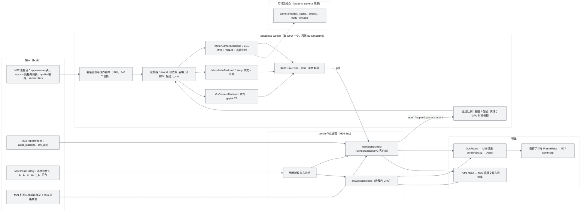
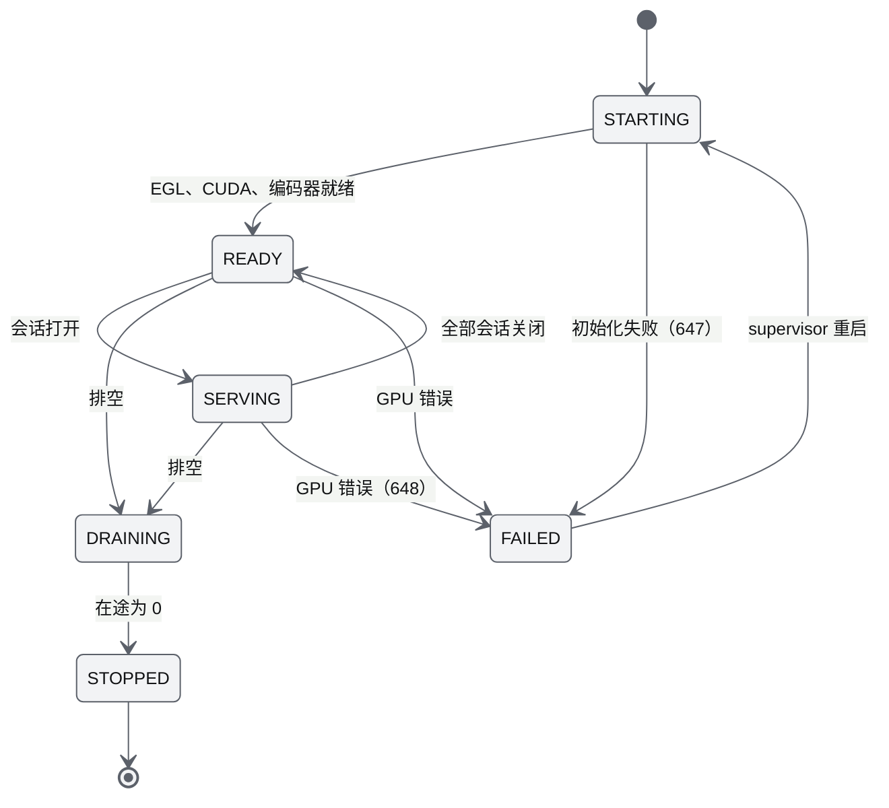
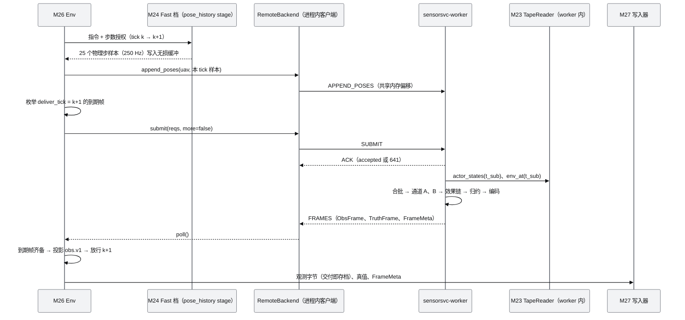
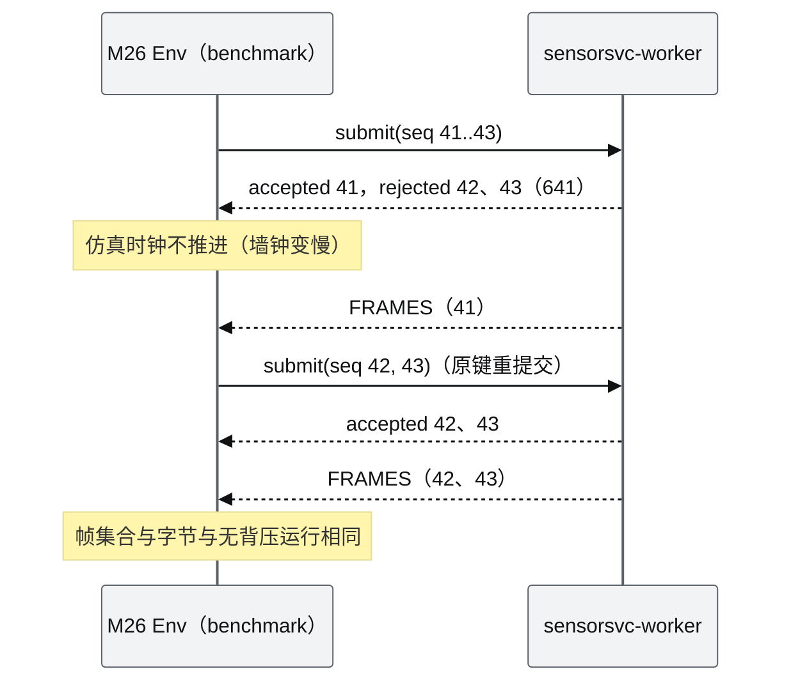
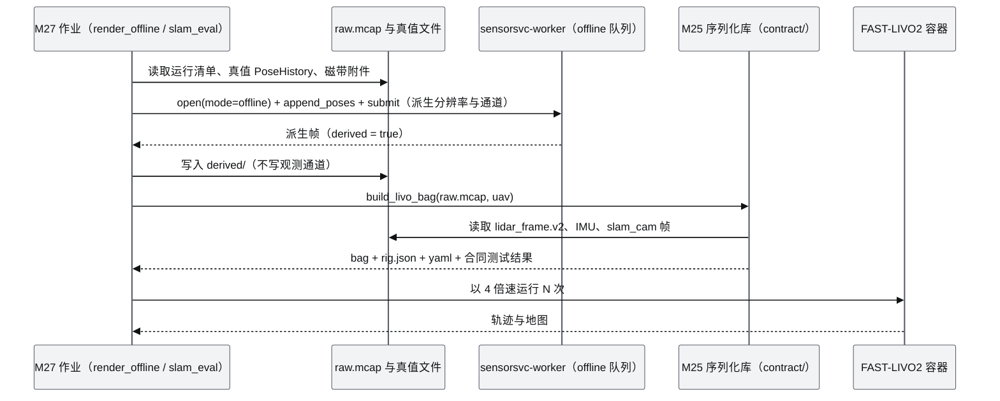

# M25 传感器生成服务 PRD（Sensor Generation Service）

| 项 | 内容 |
|---|---|
| 文档编号 | AWR-M25 |
| 标题 | 传感器生成服务（Sensor Generation Service） |
| 版本 | v1.3 |
| 日期 | 2026-10-12 |
| 状态 | 草案 v1.2（P-1，WP-D3-02；v1.1 按 AWR-05 v1.3 修订：卷帘快门、1080p 多机输出、热成像、相机档位吞吐、外观库与骨骼动画、高斯外观层决策门，修订内容汇总见 §15；v1.2 按 AWR-05 v1.4（ADR-187）并入 r11 结论：C3-G 合成、外观来源 `mesh_distilled`、评估工具 G-3DGS v2、3DGS 外观层工程的阶段按方案 C0 或 C1，修订内容汇总见 §16；v1.3 按 AWR-05 v1.4 定稿：结论 C0，外观层工程全部在 P3，P3 入口门以公开参照集计算 KID，FLUX.1 [dev] 只在研究镜像内部复测，gsplat 运行期不变并借用 SPZ 格式与 `fillRatio` 发布门，修订内容汇总见 §17） |
| 上游文档 | 用户 D3 需求原文、补充要求与 2026-10-12 决策 [inputs/D3-需求原文-2026-10-11.md](../inputs/D3-需求原文-2026-10-11.md)（R-D3-04、07 至 12、25、26、28、29、31、38、40；v1.1 增加 2026-10-12 交互式确认的 R-D3-42、44、47、48、51）；[AWR-05](../05-D3-设计增补与决策记录.md)（§1.2、§2.3、§4.1 至 §4.7、§5.4、§5.5.3、§5.5.4、§5.6.1 至 §5.6.4、§6.1.3、§6.2、§6.3、§8、§10、§11、§12；ADR-128、136、139 至 144、151、154、156、157、160 至 163、165）；[AWR-03](../03-设计基线与决策记录.md)（§5.1 至 §5.5、§10.2，ADR-033、048、049）；[AWR-04](../04-D2-设计增补与决策记录.md)；[AWR-20](../20-机型与传感器目录.md)；[M13](M13-传感器仿真PRD.md)（D1/D2 传感器约定、计数器 RNG、MID-360 花样）；D3 研究 [00-index](../research/d3/00-index.md)、[r1](../research/d3/r1-fast-livo2.md)、[r3](../research/d3/r3-camera-render.md)、[r4](../research/d3/r4-mesh-lidar.md)、[r7](../research/d3/r7-d2-code-audit.md)、[r9](../research/d3/r9-gz-sim.md)、[r10](../research/d3/r10-rotorpy-camera-sensor.md)，旁及 [r2](../research/d3/r2-glb-world.md)、[r5](../research/d3/r5-gazebo-realistic-backend.md)、[r6](../research/d3/r6-event-runtime-benchmark.md)、[r8](../research/d3/r8-rerun.md)；研究 [r04](../research/r04-livox-driver-calib.md) §3.1；v1.2 增加 [r11](../research/d3/r11-skyfall-gs.md)（D3-SKY）与 AWR-05 §5.4.4、§6.4、ADR-187 |
| 下游文档 | M26（`bench/obs.v1` 白名单投影、Env 阻塞与到期帧枚举）、M27（运行清单、无损写入、`render_offline`、`slam_eval`、`.rrd` 派生、准入与产能）、M24（PoseHistory 生产、`pose_history_hz`、gz 交叉验证）、M22（外观层、raycast 网格侧表、瓦片定义、`sensorHints`）、M23（`TapeReader`、环境轨、实现磁带）、M21 与 AWR-20（`p600_mid360_inv`、长量程型号、MID-360 内置 IMU 字段）、M00（契约 `sensor/v2/**`、原因码、随机流）、M16（`tools/bench/d3/**` harness）、[17](../17-接口与实时协议规范.md)（原因码 640–659、MCAP 通道载荷） |
| 适用版本范围 | V0.3（本期交付 D3）至 V1.0 |
| 修订记录 | v1.0（2026-10-12）：首版。需求 M25-FR-001 至 M25-FR-181，验收 M25-AC-001 至 M25-AC-045，对基线反馈 24 条（§14）；同日按 AWR-05 v1.2 §18 裁决同步：求交瓦片取 M22 的 512 m、harsh 振动频率取机型桨叶通过频率、`cam0` 取 `eo` 槽位（GX40）参数与曝光规则、导出导航解与云台读数纯函数库。v1.1（2026-10-12）：按 AWR-05 v1.3 修订（§15）：`rgb1080-rs` 逐顶点卷帘与 1080p GPU 编码进入 P0a；网格 LiDAR 与 IMU 合成由 P0b 前移到 P0a；热成像模型（P0b）；相机档位吞吐目标；外观库与 LBS 由 P1 前移到 P0b；gz 适配由 P2 前移到 P0a；高斯外观层评估协议与决策门；新增 M25-FR-182 至 FR-197、M25-AC-046 至 AC-053。v1.2（2026-10-12）：按 AWR-05 v1.4（ADR-187）并入 r11 结论（§16）：生成式高斯外观首轮裁决为结论 C，维持研究工具；`appearance_source` 增加 `mesh_distilled`；C3 合成补充为 C3-G；`gs_eval` 按 G-3DGS v2 实现并增加幻觉目标审计与 KID 流程；3DGS 外观层工程（FR-150 至 153）在方案 C1 确认时提前到 P1；`visual/gaussian/` 目录名与 M22 统一；新增 M25-FR-198 至 FR-201、M25-AC-054、AC-055。v1.3（2026-10-12）：按 AWR-05 v1.4 定稿（ADR-188 至 ADR-190、ADR-192，§17）：结论 C0，FR-150 至 153、198、199 定为 P3；KID 流程以公开参照集在 P3 入口门启用；外观层使用范围与研究模型隔离；服务端只读 `spz@2`；CI 金标准缩略图；新增 M25-FR-202 至 FR-206、M25-AC-056、AC-057 |

## 0. 摘要

1. **定位**：M25 是 D3 全部物理档共用的观测生成服务，是世界、事件与位姿的纯函数：`O = Render(World, Tape(t), PoseHistory(t), Rig, Env(t), run_seed, 触发网格)`。它按每架机每个传感器的实际位姿生成相机（RGB、平面深度、实例、语义、可见度）、网格 LiDAR、IMU、GNSS 与导航解，以及对应的隐藏真值；不读 Agent 状态，不改变世界与事件（ADR-128、ADR-139）。
2. **统一相机契约**：`CameraModel`、`CameraFrame` 与 `drone4d.frame.v1`（`agent_view`、`ground_truth`、`internal` 三分区）沿用 D2 M13 的 ENU、FLU、RDF、`[x, y, z, w]`、像素中心 0.5、整数纳秒与平面深度约定；绝对触发网格按有理数帧率计算，时间戳为中间行曝光中点，位姿一律取自已推进的 PoseHistory，不外推（ADR-140、ADR-160）。
3. **快速照片级相机**：OpenGL on EGL 一遍 MRT 输出线性颜色、R32F 平面深度、R16UI 实例、R8UI 语义与质量位；reversed-Z + `DEPTH32F`；效果链顺序固定（雾雨、曝光与运动模糊、统一畸变映射、渐晕、Poisson-Gaussian 噪声、ISP、编码）；Agent 收到的字节即存档字节。吞吐阈值按相机档位在 P-1 实测后冻结（D3-AC-11）：`rgb720-gs` 晴天档 ≥ 120、最坏档 ≥ 80 帧/s；v1.1 增加 `rgb1080-rs`（1920 × 1080，卷帘读出 20 ms，逐顶点行时刻投影）晴天档 ≥ 60、最坏档 ≥ 40 帧/s 与 `therm512`（640 × 512 长波红外）≥ 300 帧/s；1080p 在线路径只用 GPU 编码。同一渲染核心以 `drone4d-camera` 包与镜像对外交付（P1，ADR-165）。
4. **3DGS 外观层**：真实航拍重建资产在 P3 启用；v1.1 增加生成式高斯外观（网格 → 3DGS → 扩散逐级细化，参照 Skyfall-GS）的评估项与决策门（AWR-05 ADR-186、§6.4）；v1.2：首轮评估（r11）裁决为结论 C，生成式外观维持研究工具，不提前到 P1；外观来源增加 `mesh_distilled`（网格蒸馏 3DGS，只作外观层工程的验证资产与非排名运行）；v1.3 定稿为结论 C0，`GsCameraBackend` 与 C3-G 在 P3（AWR-05 ADR-187、ADR-188）；两类来源均采用 C3 合成，3DGS 只替换静态像素颜色，深度、实例、语义、遮挡与可见度一律来自网格，切换外观层不改变任何真值字节（ADR-141）。
5. **网格 LiDAR**：Warp 逐射线求交，MID-360 非重复花样在 GPU 生成，逐点时刻（K = 11 个位姿节点）、动态实体（实例化或 refit）、语义反射率表与烘焙阴影补偿、905 nm 雨雾消光与近场假回波；输出 `lidar_frame.v2`、隐藏真值 `lidar_gt.v1` 与 Livox 兼容格式；按用户决策提前到 P0：v1.1 起采集在 P0a（最小基准闭环）交付，SLAM 合同与重建对比在 P0b 出口验收（ADR-142、ADR-175）。
6. **IMU、GNSS 与导航解**：IMU 由物理档逐物理步的机体系比力与角速度合成（M25 计算杆臂项，80 Hz 一阶抗混叠，线性重采样到 200 Hz 绝对网格），不对插值位姿求导；GNSS 为 Gauss-Markov 加白噪声；导航解为确定性误差模型。三档噪声参数与离散化方法在 §6.10 给出完整定义（ADR-160、ADR-162）。
7. **FAST-LIVO2 输入合同**：`/livox/lidar`（每帧 20,000 点、无回波零点占位）、`/livox/imu`（g 单位）、`/left_camera/image/compressed`（专用全局快门 `slam_cam`）、`rig.json` 与配置生成、真值侧车与合同测试（含负向用例），冻结为 SLAM 轨道的输入（ADR-143）。
8. **服务化**：每块 GPU 一个 `sensorsvc-worker`，会话制、三级队列、按 GPU 时间份额准入；Benchmark 锁步下超限只阻塞仿真时钟，不降频、不转离线；有状态传感器过程按完整触发网格递推（ADR-162）。宿主适配覆盖 FleetSim（Env）、gz-sim（PoseTap，原生传感器只作交叉验证）、RotorPy 与 Gymnasium。
9. **热成像（v1.1）**：同一光栅管线增加热成像输出族：静态表面温度按语义类别、太阳与日照可见度、云量与降雨计算，动态实体按类别与 DSL 参数，发射率按类别，反射环境辐射、大气透过、微测辐射热计时间常数、NETD 与固定图案噪声；Agent 侧交付辐射测温 u16（0.01 K）（AWR-05 §5.4.10、ADR-180）。
10. **验收**：45 条（P0 级 39 条；v1.1 增至 53 条；v1.2 增至 55 条），覆盖 D3-AC-04、09 至 17、19、22 至 24、31、32、35、41、47 至 49 中属于 M25 的部分。对基线反馈 24 条（§14），其中 4 条影响契约登记（触发网格公式、M25 随机流、演员语义码、合批键）。

---

## 1. 背景与目标

### 1.1 背景

D3 的核心命题是"同一世界 + 同一事件 + 不同机队策略 → 不同观测"（AWR-05 §2.1）。观测必须由每架机在其实际位姿下"拍到"或"扫到"，而不是从全局真值中查出（R-D3-11），且同一时刻的 RGB、深度、实例、LiDAR 必须对应同一世界状态（design-r1 §六）。D2 的传感器层不能直接承担这项工作：

| D2 现状（r7 §3.3） | D3 需要 |
|---|---|
| `SensorBackend` v1 只有静态世界、单一机体位姿、无逐传感器触发，全仓没有生产实现 | 动态世界（磁带演员）、时间窗内多个位姿、逐传感器触发与云台、类型化帧契约 |
| `scan_rt.py` 为 2 m DSM 柱体扫描，与网格测距差中位约 1 m，街道低空 41% 射线命中判定错误，每会话 1 机、≤ 2 Hz、整帧单一位姿 | 网格逐射线求交、逐点时刻、多机 10 Hz |
| M19 的 Johnson/TTPF 判据给出检测概率而非图像 | 照片级图像、像素级可见度真值 |
| IMU、GNSS 以主时钟 tick 取键，换时钟档即分叉 | 以帧序号或采样序号取键，跨档可比 |

D3 研究已经给出全部关键部件的实测依据：EGL/OpenGL MRT 720p 光栅化与读回 1.37–1.59 ms（r3 §3）；照片级相机原型的时间语义、效果链与宿主适配（r10 §4）；Warp MeshLidar 单卡实时约 500 架 MID-360（r4 §4.4）；模拟 MID-360 + IMU + 相机驱动 FAST-LIVO2 的闭环与输入合同陷阱（r1 §2.10、§4）；SensorBackend v2 原型（r7 E5）。

### 1.2 目标

| 编号 | 目标 | 度量（验收） |
|---|---|---|
| G1 | 每机私有、物理一致的多模态观测 | 同一磁带上不同机队配置的帧摘要两两不交；跨传感器演员位置误差 ≤ 1 mm（M25-AC-007、008） |
| G2 | 快速照片级相机 | 720p 全输出晴天档 ≥ 120 帧/s、最坏档 ≥ 80 帧/s（暂定，P-1 冻结；M25-AC-014） |
| G3 | 可用于 SLAM 的 LiDAR 与 IMU | FAST-LIVO2 RPE100 落在 P-1 冻结区间；输入合同测试全部通过（M25-AC-026 至 030、032） |
| G4 | 可复现 | 同镜像同型号 GPU 逐字节一致；背压、合批大小、提交顺序不改变字节（M25-AC-012） |
| G5 | 观测与真值物理隔离 | ObsFrame 不含任何真值字段；run_seed 不出 worker 与评测库（M25-AC-017） |
| G6 | 所有物理档共用 | 给定相同 PoseHistory 时 Fast 与 Realistic 档输出逐字节相同（M25-AC-040） |
| G7 | 对外可用的相机 | `drone4d-camera` 在干净 GPU 主机 15 min 内运行示例，与服务逐字节一致（M25-AC-034） |

### 1.3 对基线与研究的继承、修正与增强

| 来源 | 本文处置 |
|---|---|
| AWR-05 §5.4 全部条款 | 原样采纳；§14 列出需要基线修订或登记的 24 处 |
| r3 §8.3 请求与帧契约草案 | 采纳为 `render_req.v1` 与 `frame.v1` 的起点；`T_world_sensor` 按 ADR-161 移入 `ground_truth`；`agent_view` 的深度改为只在 L2-depth 子档出现且经传感器模型 |
| r3 §5 的 C1 两遍合成 | 产品路径改为同一 z-buffer 联合渲染（静态与动态同一 MRT 通道），另以"只渲染演员"通道求无遮挡掩膜；C1 只作为验收参照 |
| r10 §4.4 至 §4.10 的相机原型 | 时间语义、效果链、宿主适配沿用；渲染器由 nvdiffrast 改为 EGL/OpenGL（许可）；效果链改为 GLSL 计算着色器，避免产品依赖 torch |
| r10 §4.10 的背压"降低相机频率或进入离线模式" | 按 ADR-162 只适用于交互预览；Benchmark 锁步下阻塞仿真时钟 |
| r4 §4 MeshLidar 原型 | 采纳；随机数由 Warp `rand_init` 改为与 D2 `cbrng` 同算法的计数器式散列，使 GPU 与 CPU 回退逐值一致；反射率由"纹理亮度近似"改为语义表 + 纹理调制 + 阴影补偿（AWR-05 RV-31） |
| r1 §4.2 的 IMU 由"相邻姿态差分" | 按 ADR-160 改为物理档比力与角速度合成，杆臂项由 M25 计算 |
| r1 §4.2 相机时刻"LiDAR 帧首 + 50 ms" | 按 AWR-05 §4.3 规则 4，`slam_cam` 采集窗口结束于 tick 边界；对 RPE100 基线的影响由 P-1 复测吸收（D3-AC-14、47），并在 §14 提出可选相位参数 |
| D2 M13 `cbrng`、`gm`、`frames`、`camera`、`lidar/pattern`、`lidar/frame` | 原样复用算法与约定，不改 D2 文件；M25 自有通道登记表（§6.17） |

### 1.4 设计原则

1. **纯函数与单一位姿来源**：输出只取决于 §6.17 列出的输入集合；位姿只取 PoseHistory，不读 StateRing，不外推。
2. **观测与真值分离**：同一次渲染同时产生 ObsFrame 与 TruthFrame，二者在类型层面分离；ObsFrame 的字段集合由 `bench/obs.v1` 白名单的上游需要决定，不含任何真值。
3. **几何真值唯一**：深度、实例、语义、可见度、遮挡与 LiDAR 命中一律来自网格；外观层（`mesh` 或 `3dgs`）只影响静态像素颜色。
4. **交付即存档**：Agent 收到的观测字节与写入 `raw.mcap` 的字节相同；离线重渲染只用于派生，不替代 Agent 所见帧。
5. **集合由规格决定**：`(uav, sensor, seq)` 集合只由 Run 规格与触发网格决定，与墙钟负载、合批、背压无关。
6. **可打包边界**：渲染核心（相机后端与效果链）不依赖服务进程、sim-core、bench 与 torch，可单独打包为 `drone4d-camera`。
7. **不改 D2**：只新增 `python/awr/sensorsvc/**` 等新路径；对 D2 的唯一依赖改动是扩展点 5（`Raycast` 字面量加 `mesh`、`render`）。

---

## 2. 范围

### 2.1 分阶段范围

v1.1 按 AWR-05 v1.3（ADR-175、ADR-179、ADR-180、ADR-186）重排；v1.0 的阶段对照见 §15.2。

| 阶段 | 交付（M25 部分） | 工作包 | 出口验收 |
|---|---|---|---|
| P-1 | 契约草案 `sensor/v2/{frame.v1, render_req.v1, pose_history.v1}`（含卷帘与热成像只增字段）；720p 完整链路吞吐 spike；`rgb1080-rs` 逐顶点卷帘与 `therm512` 吞吐 spike、1080p nvJPEG 单帧体积；标准轨会话显存与 GPU 时间；正确尺度下 CPU 与 GPU 逐射线差异分布；逐点位姿与单一位姿 ATE 比值；噪声档参数表复测口径 | WP-D3-01、WP-D3-03 | D3-AC-47 |
| P0a（最小基准闭环） | SensorBackend v2 与 PoseHistory 接入（Realistic 档 `PoseTap` 与后续 Fast 档共用）、触发网格；`RasterCameraBackend`（RGB、深度、实例、语义、可见度；reversed-Z；统一畸变映射；接触阴影）、`rgb1080-rs` 逐顶点卷帘与 GPU 编码、基础效果链（雾、噪声、ISP）；`MeshLidarBackend`（倒装 MID-360、逐点时刻、动态实体）与 `lidar_frame.v2`、`lidar_gt.v1`；IMU 合成、GNSS 与导航解；GPU Worker、会话、Benchmark 锁步阻塞；`V1Adapter`；动态实体样例资产 | WP-D3-06（P0a 5.5 人周）、WP-D3-07（P0a 3.0 人周） | D3-AC-09、10、17（帧部分）、19（部分）、56、60 |
| P0b（基准 v1） | 热成像输出族（`thermal_table_v1`、`thermal_bake`、NETD 与固定图案噪声、u16 编码与真值）；雨与 2048² 投影阴影、自动曝光、交互预览队列与降频；外观库 `appearance_lib@1` 与 LBS 骨骼动画、参考外观图；LiDAR 天气与语义反射率完善、噪声档参数冻结；Livox 输出、`slam_cam`、`rig.json` 与合同测试；相机档位吞吐与 LiDAR 并发正式验收；高斯外观层评估协议（WP-D3-37） | WP-D3-06（P0b 2.0）、WP-D3-07（P0b 2.0）、WP-D3-33、WP-D3-34、WP-D3-37 | D3-AC-11、12、13、14（与 M27 共担）、15（与 M27 共担）、16（部分）、22、61、62（外观部分）、64 |
| P1 | `drone4d-camera` 包与镜像（含卷帘；热成像为可选组件）；RotorPy 与 Gym 适配、T0 特征档；长量程 LiDAR 型号；gz 原生相机交叉验证；性能应交付目标；高斯外观工作不在 P1（v1.3 定稿为结论 C0，ADR-188） | WP-D3-24、WP-D3-19、WP-D3-18（交叉验证部分） | D3-AC-31（交叉验证条款）、32、48、49 |
| P2 | Fast 与 Realistic 对照扩展；Interactive 模式实现磁带作为动态源；热成像识别阈值标定支持 | WP-D3-21 | D3-AC-37（部分）、38（部分） |
| P3 | P3 入口门的 `gs_eval`（G1 至 G8，KID 以公开参照集计算，FR-202）；`GsCameraBackend`（C3-G 合成）、外观层切换、瓦片驻留、配准验收工具，先以网格蒸馏验证图层验证，再接入真实航拍资产（v1.3 定稿）；外观层使用范围、服务端格式与 CI 缩略图（FR-203 至 206） | WP-D3-22（与 M22 共担）、WP-D3-42 | D3-AC-41、68、69 |

### 2.2 不做

| 不做 | 原因或替代 |
|---|---|
| 雷达波；主动照明成像 | 不在 D3（AWR-05 §2.3）；v1.1：热成像不再列为"不做"，按 §15 交付简化物理模型 |
| 以 3DGS 期望深度判定遮挡（C2） | 假可见像素 14.3%（r3 §5.2） |
| 只以网格训练 3DGS（无扩散细化）用于产品观测 | 上限即网格（R-D3-26，ADR-141；r11 在正确尺度下复现）；v1.2：网格蒸馏 3DGS 只作外观层基础设施验证与非排名运行（`mesh_distilled`）；生成式细化路线经首轮评估维持研究工具（ADR-187），扩散模型不进入本模块镜像 |
| gz 原生传感器作为 Realistic 档缺省观测 | 吞吐与 MID-360 保真度不足（R-D3-31） |
| D2 `scan_rt.py` 用于数据集 | 只保留给公开站 2 Hz 预览（ADR-142） |
| 在 emax 运行任何 M25 负载 | 公开站只读样例（R-D3-46） |
| 昼夜与真实雨天光照 | 摄影测量贴图烘焙了拍摄时刻光照，只做全局变暗与去饱和（AWR-05 风险 3） |
| 植被穿透与多径 | 摄影测量树冠为实心壳（r4 §5.3）；多回波只作选项 |

### 2.3 职责边界

| 相邻模块 | M25 负责 | 对方负责 |
|---|---|---|
| M24 物理档 | 消费 PoseHistory；声明所需 `pose_history_hz`；杆臂项与 IMU 合成 | 逐物理步写入 PoseHistory（位置、姿态、世界系速度、机体系角速度、机体系比力，及云台角）；`caps.pose_history_hz` |
| M23 事件运行时 | 按任意时刻查询演员状态与环境；按 `content_sha256` 校验 | `TapeReader.actor_states(t_ns)`、`env_at(t_ns)`；Interactive 模式的实现磁带 |
| M22 世界导入 | 加载 `appearance.glb`、raycast 网格与侧表、质量栅格、`sensorHints`；预计算缓存（反射率阴影掩膜等） | 世界包与派生资产；瓦片定义；逐三角形语义与质量（§14 第 7、8 条） |
| M26 Env 与 SDK | 生成 ObsFrame（含白名单所需全部字段）与 TruthFrame；返回 641 时的语义 | 到期帧枚举、阻塞与放行、`bench/obs.v1` 逐字段投影、L1 检测级观测、链路模型 |
| M27 基准运行时 | 帧载荷编码、FrameMeta、`payload_sha256`、容量估算接口、Livox 与 `rig.json` 序列化库、`.rrd` 映射辅助函数 | 运行编排、无损写入、真值文件、`render_offline` 与 `slam_eval` 作业、`.rrd` 导出、准入 |
| M13 D2 传感器 | 复用其约定与纯函数库 | v1 协议与 `scan_rt.py` 不变 |
| M21 与 AWR-20 | 读取机型与传感器型号；提出 `p600_mid360_inv`、长量程型号、MID-360 内置 IMU 字段需求 | 目录条目与取值 |
| M15、M06 | 提供预览帧流与帧载荷 | 多机观测墙、LiDAR 对比视图 |

---

## 3. 用户与用例

### 3.1 调用方

| 调用方 | 方式 | 目的 |
|---|---|---|
| M26 Env（bench 作业进程） | `RemoteBackend` 客户端经 worker IPC；L1 运行中 IMU、GNSS、导航解为进程内后端 | 在线闭环观测 |
| M27 作业（`render_offline`、`export`、`slam_eval`） | 离线队列；序列化库调用 | 数据集派生、补充标签、bag 生成 |
| `lab-gateway`（经 M26 预览请求） | 预览队列 | 内部工作区实时预览 |
| 外部研究者 | `drone4d-camera`、RotorPy 与 Gym 适配 | 视觉算法开发与测试 |
| M24 gz 交叉验证脚本 | `GzNativeSensorBackend` 与同位姿渲染 | Realistic 档资产链路核对 |
| 测试与基准 | 进程内后端；`tools/bench/d3/{camera_throughput, lidar_concurrency, gs_throughput}.py` | 验收 |

### 3.2 用例

| 编号 | 用例 | 主流程 | 关联验收 |
|---|---|---|---|
| UC-1 | L2 Benchmark 运行中，3 架机各一台 720p 相机 10 Hz | Env 每 tick 推送 PoseHistory 增量 → 枚举到期帧 → `submit` → worker 合批渲染 → `poll` 得 ObsFrame 与 TruthFrame → Env 投影 obs.v1 放行下一步；M27 写入 | M25-AC-007、012、013、014 |
| UC-2 | 负载高峰触发背压 | `submit` 返回 641 → Env 阻塞仿真时钟、稍后重提交 → 帧字节与无背压运行相同 | M25-AC-015 |
| UC-3 | P0b SLAM 轨道 | 3 架 `p600_mid360_inv` 以 `{d1_250, 250, 250, 250}` 时钟档（`l1_every = 1`）飞行 → LiDAR、MID-360 IMU、`slam_cam` 写入 `raw.mcap` → `slam_eval` 调用 M25 序列化库生成 bag 与 `rig.json` → FAST-LIVO2 | M25-AC-026 至 033 |
| UC-4 | 数据集派生 | `render_offline` 按同一位姿以 1080p 补渲染、补 `gt_depth` | M25-AC-013 |
| UC-5 | Realistic 档 | gz `step_done` 携带 25 个物理步 → PoseTap 写 PoseHistory → 与 UC-1 同一路径 | M25-AC-040 |
| UC-6 | gz 资产链路交叉验证 | 同一 tick 的 gz 原生相机帧与 M25 同位姿零曝光帧逐像素比对 | M25-AC-037 |
| UC-7 | RotorPy 中开发视觉策略 | `simulate_batch(camera=BatchedPhotorealCamera(...))` | M25-AC-035 |
| UC-8 | 外部研究者离线渲染 | `pip install drone4d-camera` → 加载公开外观层 → `render(poses, t_ns)` | M25-AC-034 |
| UC-9 | P3 外观层切换 | 同一 Run 规格只改 `appearance = 3dgs`，真值逐字节不变 | M25-AC-042 |
| UC-10 | 交互预览 | 内部工作区多机观测墙请求 480×270 预览流，超限降频 | M25-AC-015 |

### 3.3 本模块术语（其余见 AWR-05 §1.2、AWR-03 §11）

| 术语 | 定义 |
|---|---|
| 触发网格 | 传感器采集窗口结束时刻的绝对序列 `t_end,k`（§6.2.2），只由 `t0`、帧率决定 |
| 采集窗口 | 一帧全部像素（或全部射线）的曝光或扫描时间区间 |
| 子帧 | 运动模糊在曝光窗内的位姿采样；数量 `blur_subframes` |
| 行带 | 卷帘快门下按行分组的渲染单元；数量 `rs_bands` |
| 位姿节点 | LiDAR 一帧内用于逐点插值的位姿样本，缺省 K = 11 |
| 会话 | 一个 Run（或一次离线作业）在一个 worker 上的上下文：世界、rig、动态源、run_seed、`t0` 与模式 |
| 动态源 | `DynamicSource` 的实现：Exogenous 模式为磁带，Interactive 模式为实现磁带 |
| 在线闭环 / 离线重渲染 / 交互预览 | 三种请求质量 `online`、`offline`、`preview`，分属三级队列 |
| 等效帧 | 容量单位：720p 最坏档全输出的一帧（§6.21） |
| `d3-semantic@1` | 相机语义图与 LiDAR 真值的类别码（§6.4.6） |

---
## 4. 功能需求

优先级 P0、P1、P2 分别对应 AWR-05 的"阻塞"、"应交付"、"可延期"；"阶段"为首次交付的阶段。

| 编号 | 需求描述 | 优先级 | 阶段 | 验收要点 | 依据 |
|---|---|---|---|---|---|
| **A. 契约、边界与类型** | | | | | |
| M25-FR-001 | 实现 `SensorBackendV2` 协议（`caps`、`open`、`submit`、`poll`、`close`），与 D2 `SensorBackend` v1 并列；`submit` 非阻塞，超过在途上限返回 `641 SENSOR_BACKPRESSURE`；全部后端（光栅相机、MeshLidar、CPU LiDAR、IMU/GNSS、3DGS、gz 原生）实现同一协议 | P0 | P0a | M25-AC-001 | ADR-139；AWR-05 §5.4.1 |
| M25-FR-002 | 输出只取决于（世界 `contentVersion`、动态源内容哈希、PoseHistory、Rig、环境时间线、run_seed、触发网格、后端版本集合）；不读 Agent 状态，不写世界、事件与机体状态 | P0 | P0a | M25-AC-012 | ADR-128、ADR-162 |
| M25-FR-003 | `ObsFrame`、`TruthFrame`、`SensorRequest`、`PoseHistory`、`FrameMeta` 为 M25、M26、M27 的内部类型；`ObsFrame` 载荷不含实例、语义、可见度、`invalid_mask`、真值位姿与真值外参、run_seed、磁带与事件哈希、后端内部元数据；真值只进入 `TruthFrame` | P0 | P0a | M25-AC-017；D3-AC-16 | ADR-161 |
| M25-FR-004 | 起草 `packages/contracts/sensor/v2/{frame.v1, render_req.v1, pose_history.v1}.schema.json`（字段见 §7.2），由 M00 合入契约 1.3.0；`frame.v1` 分 `agent_view`、`ground_truth`、`internal` 三分区 | P0 | P-1 | M25-AC-001 | ADR-155；AWR-05 §8.1 |
| M25-FR-005 | 起草 `sensor/v2/{lidar_frame.v2, lidar_gt.v1}.schema.json`：`lidar_frame.v2` 保持 v1 的 20 B/点 SoA 布局，点数上限放宽到 2,000,000；`lidar_gt.v1` 为全槽位 3 B/点 | P0 | P0a | M25-AC-026、031 | ADR-142；r4 §9.1 |
| M25-FR-006 | 坐标与时间约定沿用 M13：世界 ENU（m）、机体 FLU、光学帧 RDF、四元数 `[x, y, z, w]`（WORLD←FLU）、像素中心 0.5（COLMAP）、整数纳秒、相机深度为平面深度、LiDAR 为斜距；导出到 vikit 与 ROS `CameraInfo` 时主点减 0.5 | P0 | P0a | M25-AC-004 | AWR-05 §5.4.2；r3 §4 |
| M25-FR-007 | `RigSpec` 由 M21 机型目录与 Run 规格覆盖构建（§6.3.3）：相机交付分辨率由 Run 规格给出，内参按 §6.2.4 自目录原生分辨率换算；校验失败返回 `649 SENSOR_RIG_INVALID`（曝光与读出之和超过帧周期、`slam_cam` 非全局快门或带云台、SLAM 运行使用正装前倾挂载、型号未知） | P0 | P0a | M25-AC-002 | AWR-05 §5.4.5、§5.4.6 |
| M25-FR-008 | 相机语义图与 LiDAR 真值使用 `d3-semantic@1` 码（§6.4.6）：0–15 为 `anet-classes@1` 静态类，32–37 为演员类别，255 为天空或无几何；码表经 M00 登记后生效 | P0 | P0a | M25-AC-009 | §14 第 3 条 |
| M25-FR-009 | `BackendCapsV2` 声明后端标识、射线与渲染方式、输出集合、确定性级别与版本集合；`FrameMeta` 记录版本集合、编码器、GPU 型号与驱动、各载荷 `sha256` | P0 | P0a | M25-AC-012、013 | ADR-136；AWR-05 §5.6.1 `versions` |
| M25-FR-010 | `V1Adapter`：把任一 v2 后端装到 D2 v1 调用点（`open`、`request`、`poll`），单一位姿退化为长度为 1 的 PoseHistory、曝光为 0；`SensorFrame.payload` 携带帧记录 | P1 | P0a | M25-AC-018 | ADR-139 |
| **B. 位姿、时间与触发** | | | | | |
| M25-FR-020 | PoseHistory 为唯一位姿来源；任意时刻按相邻两物理步线性插值位置、球面插值姿态；请求时刻早于首样本或晚于末样本返回 `646 SENSOR_POSE_UNAVAILABLE`，不外推 | P0 | P0a | M25-AC-002；D3-AC-09 | ADR-160；AWR-05 §4.3 规则 2、4 |
| M25-FR-021 | 传感器位姿按 `T_world_sensor = T_world_base · T_base_mount · R_gimbal(az, el)` 计算（复用 `awr.sim.sensors.frames`），云台角与变焦取 PoseHistory 的云台样本插值 | P0 | P0a | M25-AC-004 | M13 §6.3 |
| M25-FR-022 | 绝对触发网格：帧率以有理数表示，`t_end,k = t0 + ⌊k · 10⁹ · q / p⌋`（帧率 p/q）；第 k 帧在首个 `t_b ≥ t_end,k` 的 tick 交付；不得以 `round(1e9/fps)` 累加 | P0 | P0a | M25-AC-003 | AWR-05 §5.4.3 时间行；§14 第 1 条 |
| M25-FR-023 | 时间戳为中间行曝光中点 `t_mid,k = t_end,k − ⌊(e + T_ro) / 2⌋`；第 i 行曝光中点按 §6.2.3；运动模糊子帧与卷帘行带分别参数化；位姿一律取自已推进的 PoseHistory | P0 | P0a | M25-AC-003 | ADR-140 |
| M25-FR-024 | LiDAR 帧窗口 `[t_s, t_s + 100 ms)`，`t_s + 100 ms` 落在 tick 边界并在该 tick 交付；`timebase = header.stamp = t_s`；`offset_time = i · 5000 ns` | P0 | P0a | M25-AC-026 | AWR-05 §5.4.5 帧时序 |
| M25-FR-025 | IMU 输出于 200 Hz 绝对网格 `t0 + j · 5 ms`；GNSS 与导航解输出于 10 Hz 网格 `t0 + j · 100 ms`；每 tick 交付窗口 `(t_{b−1}, t_b]` 内的全部样本 | P0 | P0a | M25-AC-020、027 | ADR-160 |
| M25-FR-026 | 跨传感器时间一致：同一时刻的演员状态由同一 `DynamicSource` 时刻函数给出；不经 sim-core 实体表，不受 stage 次序与时钟档影响 | P0 | P0a | M25-AC-008；D3-AC-10 | AWR-05 §4.3 规则 1 |
| **C. 相机：几何与光栅化** | | | | | |
| M25-FR-030 | `RasterCameraBackend` 以 OpenGL on EGL 一遍 MRT 输出 RGBA16F 线性颜色、R32F 平面深度、R16UI 实例、R8UI 语义、R8UI 质量位；动态实体与静态场景同一 z-buffer | P0 | P0a | M25-AC-004、005 | ADR-140；r3 §3、§5 |
| M25-FR-031 | 深度缓冲 reversed-Z + `DEPTH32F`（`glClipControl(GL_LOWER_LEFT, GL_ZERO_TO_ONE)`，清除 0，比较 `GREATER`），near 0.3 m、far 3000 m；演员片元深度测试使用 1 cm 朝向相机的偏置，R32F 平面深度写入无偏置值 | P0 | P0a | M25-AC-005 | ADR-140；r3 §5.2 |
| M25-FR-032 | 世界外观按瓦片局部原点上传（顶点 float32 相对坐标，模型视图矩阵以 float64 计算后转换）；材质一律 unlit；纹理以 sRGB 解码到线性；三线性 mip 与 16× 各向异性过滤 | P0 | P0a | M25-AC-004 | r3 §2.1、§4.2 |
| M25-FR-033 | 逐三角形语义与质量位以 `gl_PrimitiveID` 查表写入语义与质量附件；天空像素语义写 255 | P0 | P0a | M25-AC-009、010 | r3 §5.1 |
| M25-FR-034 | 动态实体：P0 使用 Khronos 样例（CesiumMan、CesiumMilkTruck、Fox）按类别尺寸归一化；按 `sensorHints.bakedSunAzElDeg` 做 Lambert 着色；P1 起按磁带动画片段与相位在顶点着色器做 LBS | P0（P1 部分为 P1） | P0a（样例资产）、P0b（外观库与 LBS） | M25-AC-019、038 | R-D3-38；ADR-156；r3 §2.3、§5.4 |
| M25-FR-035 | 接地阴影缺省 `shadow = contact`（沿太阳方向的贴地椭圆衰减贴花），`shadow = map` 为 2048² 投影阴影图，只用于离线高质量档或显式开启 | P0 | P0a（`contact`）、P0b（`map`） | M25-AC-011 | ADR-140 |
| M25-FR-036 | 畸变：在含裕量的无畸变域渲染（像素比上限 1.35，超出时等比降低渲染焦距），随后对全部输出施加同一重映射：RGB 双线性，深度、实例、语义、质量位最近邻；`K` 与 `dist` 描述交付图像 | P0 | P0a | M25-AC-006；D3-AC-09 | AWR-05 RV-30；r10 §4.6 |
| M25-FR-037 | （v1.1：卷帘缺省实现改为逐顶点行时刻投影，行带方法保留为参照实现，见 FR-182）运动模糊子帧与卷帘行带机制：子帧时刻与行带时刻按 §6.2.3；真值层在 `t_mid`（卷帘时为各行带中心时刻）单独渲染一遍；在线闭环缺省 `blur_subframes = 1`、`rs_bands = 1` | P0 | P0a | M25-AC-003、011 | ADR-140 |
| M25-FR-038 | 变焦改变交付 `K`（fx、fy 按焦距比例缩放，主点不变），逐帧写入；`slam_cam` 内参与外参在运行中恒定 | P0 | P0a | M25-AC-004、029 | AWR-05 §5.4.6 |
| M25-FR-039 | 无几何的下视像素（仰角 < 0）以远景雾色填充并置 `invalid_mask` 位 0；无几何的上视像素按天空渐变着色 | P0 | P0a | M25-AC-010 | ADR-131 |
| **D. 相机：效果链与 ISP** | | | | | |
| M25-FR-045 | 效果链顺序固定（§6.5.1），实现版本记为 `fx_version` 并写入 FrameMeta 与运行清单 | P0 | P0a | M25-AC-011 | AWR-05 §5.4.3 效果链行 |
| M25-FR-046 | 雾按 Koschmieder 模型、雨按消光 + 雨线 + 湿润模型；参数取 `DynamicSource.env_at(t)`，与 LiDAR 使用同一环境时间线 | P0 | P0a（雾）、P0b（雨） | M25-AC-011 | r3 §6 |
| M25-FR-047 | 自动曝光（`isp.ae ∈ {auto, fixed}`）以整数直方图测光，按完整触发网格顺序递推；噪声档的曝光误差以确定性调制叠加 | P0 | P0b | M25-AC-011、012 | ADR-162 |
| M25-FR-048 | Poisson-Gaussian 噪声在线性域施加，随机数键为 `(run_seed, uav, sensor, frame_index, 像素, 通道)` | P0 | P0a | M25-AC-011、012 | ADR-136 |
| M25-FR-049 | ISP：增益、渐晕、sRGB 编码曲线、可选色调曲线、8 位量化（`floor(x · 255 + 0.5)`） | P0 | P0a | M25-AC-011 | r10 §4.8 |
| M25-FR-050 | L2-depth 深度传感器模型：在交付（畸变后）平面深度上按噪声档施加量程截断与 `σ(d)`，越界与天空写 0；不是渲染真值深度 | P0 | P0a | M25-AC-011 | AWR-05 §5.4.6 深度行 |
| **E. 相机真值** | | | | | |
| M25-FR-055 | 每帧每演员输出 `objects[]`：`inst`、`actor`、`class`、`px_visible`、`px_unoccluded`、`h_px_unocc`、`h_px_visible`、`visible_ratio`、`bbox_xywh`、`bbox_unocc_xywh`、`occluder_sem_px`；以"只渲染演员"通道求无遮挡掩膜；统计在交付图像坐标中进行；植被遮挡在 `occluder_sem_px` 中单列 | P0 | P0a | M25-AC-009 | AWR-05 §5.4.2；r3 §5.3 |
| M25-FR-056 | `invalid_mask` 按位标记无几何下视、拉伸面、覆盖区外、洞缘、水面（§6.6.2）；可见度统计排除被标记像素 | P0 | P0a | M25-AC-010；D3-AC-04 | ADR-131 |
| M25-FR-057 | 真值层另含 `T_world_sensor`（ENU←RDF）、真实云台角与可选 `gt_depth`（R32F 平面深度，`outputs` 含 `gt_depth` 时） | P0 | P0a | M25-AC-017 | ADR-161 |
| M25-FR-058 | T0 特征 `features`（由深度与位姿派生，RotorPy 语义）只在不排名的开发运行中生成；排名会话请求时拒绝（`662 OBS_LEVEL_FORBIDDEN`，M26 定义） | P1 | P1 | M25-AC-035 | ADR-144、ADR-161 |
| **F. 编码与交付** | | | | | |
| M25-FR-060 | RGB 缺省以 nvJPEG（经 nvImageCodec，质量 90，4:2:0）编码一次，交付字节即存档字节；`rgb_codec = raw` 时交付原始 sRGB 数组并由 M27 以 zstd 无损存档；各载荷 `sha256` 写入 FrameMeta | P0 | P0a | M25-AC-013；D3-AC-19 | ADR-148、ADR-163 |
| M25-FR-061 | L2-depth 深度以 f32 交付，存档为 f32 + 字节重排 + zstd；真值实例 u16、语义 u8、质量位 u8 以 zstd 压缩；f16、u16 与对数编码只用于预览与派生 | P0 | P0a | M25-AC-013 | ADR-163 |
| M25-FR-062 | 预览质量：480×270（可配）RGB、JPEG 质量 75，不含真值与深度；只经 `lab-gateway` 发往内部工作区 | P1 | P0b | M25-AC-015 | AWR-05 §7.4 |
| M25-FR-063 | 编码器名称与版本写入 FrameMeta 并属于确定性键；CPU 回退编码器（libjpeg-turbo）只用于 CI 与 `drone4d-camera` 的 CPU 模式 | P0 | P0a | M25-AC-012 | ADR-136 |
| **G. 网格 LiDAR** | | | | | |
| M25-FR-070 | `MeshLidarBackend` 以 NVIDIA Warp `mesh_query_ray` 求交，无 GPU 时以 Open3D `RaycastingScene` 回退；两者在瓦片局部原点下以 float32 相对坐标求交 | P0 | P0a | M25-AC-021；D3-AC-12 | ADR-142；r4 §3 |
| M25-FR-071 | MID-360 非重复花样在 GPU 上按 `awr.sim.sensors.lidar.pattern` 同式生成（每帧以 float64 约化三个相位标量），20,000 射线/帧、10 Hz；与 CPU 花样角度差 ≤ 0.03° | P0 | P0a | M25-AC-021 | r4 §4.1、§4.2；M13 §6.5.10 |
| M25-FR-072 | 逐点时刻：每帧取 K 个位姿节点（缺省 11，可选 `native` 取帧内全部物理步样本），逐点线性插值位置、归一化线性插值姿态；输出点为点时刻的传感器系坐标 | P0 | P0a | M25-AC-023 | AWR-05 §5.4.5；§14 第 12 条 |
| M25-FR-073 | 动态实体：≤ 64 个近邻实体以局部系网格加包围球剔除实例化，超过 64 或带骨骼动画时以合并网格 refit；实体位姿与可见性取自动态源在位姿节点时刻的状态，状态为缺席、在车内、在建筑内、离场时不可被击中 | P0 | P0a | M25-AC-023、008 | r4 §4.1、§4.3 |
| M25-FR-074 | 反射率 `reflectance_model = sem_table_v1`：按语义类别取 905 nm 反射率，纹理亮度经烘焙阴影补偿后只作调制，乘入射角余弦与两程大气衰减，按 Livox 漫反射口径编码到 0–150 | P0 | P0a（基础）、P0b（阴影补偿与演员分布化完善） | M25-AC-025 | AWR-05 RV-31；r4 §5.1 |
| M25-FR-075 | 检测概率为逻辑斯蒂模型；盲区 0.1 m；测距噪声与角度噪声（角度噪声扰动求交方向，报告名义方向）；虚警按每射线概率 | P0 | P0a | M25-AC-024、028 | r04 §3.1.4；r1 §4.2 |
| M25-FR-076 | 天气：905 nm 雾（Kim 模型）与雨消光，近场假回波（`tag` bit[1:0] = 01）；参数取同一环境时间线，帧内取帧首常数 | P0 | P0a（基础）、P0b（完善） | M25-AC-024 | r4 §5.4 |
| M25-FR-077 | 射线打到无数据区或拉伸面时在 `lidar_gt.v1` 中置 `void` 位；观测帧按传感器语义输出（无回波或有回波） | P0 | P0a | M25-AC-031；D3-AC-04 | ADR-131 |
| M25-FR-078 | 输出 `lidar_frame.v2`（只含有效点，`offset_time` 为槽位 i 的 `i · 5000 ns`）与 `lidar_gt.v1`（全部 20,000 槽位）；`tag` 为 Livox 语义，不含"命中识别物"位 | P0 | P0a | M25-AC-026、031；D3-AC-16 | ADR-142、ADR-161 |
| M25-FR-079 | 建图任务缺省挂载为 `p600_mid360_inv`；SLAM 运行（`slam_eval` 或 `outputs` 含 `bag`）使用正装前倾 20° 挂载时返回 649 | P0 | P0b | M25-AC-033 | ADR-157 |
| M25-FR-080 | 型号参数化：花样（非重复表驱动或重复扫描表）、量程模型、视场、点频与回波模式由型号文件给出，长量程型号以同一后端接入；多回波为选项（缺省关闭） | P1 | P1 | M25-AC-036；D3-AC-32 | ADR-157；r4 §5.3 |
| M25-FR-081 | D2 `scan_rt.py` 保持不变，只用于公开站预览；M25 的任何输出路径不得以 DSM 扫描替代网格求交 | P0 | P0a | M25-AC-021 | ADR-142 |
| **H. IMU、GNSS 与导航解** | | | | | |
| M25-FR-090 | IMU 合成：取 PoseHistory 逐物理步的机体系比力 `f_b` 与角速度 `ω_b`，由 M25 加 IMU 杆臂项 `ω̇ × r + ω × (ω × r)` 并旋转到 IMU 帧；物理频率上一阶 80 Hz 抗混叠；线性插值到 200 Hz 绝对网格；不对插值位姿求导，不断言 C2 连续 | P0 | P0a | M25-AC-027；D3-AC-13 | ADR-160；§14 第 13 条 |
| M25-FR-091 | IMU 噪声按噪声档：白噪声、偏置随机游走（MID-360 内置 IMU）或 Gauss-Markov 偏置（飞控 IMU）、上电偏置、振动（harsh）；按型号量程饱和；单位由型号声明（`/livox/imu` 加速度为 g） | P0 | P0a | M25-AC-027、028 | AWR-05 §5.4.6 |
| M25-FR-092 | SLAM 导出前对 PoseHistory 断言 `|ω| < 5 rad/s`、`|a| < 30 m/s²`；违例时 bag 生成返回 642 并在报告中标注时间段 | P0 | P0b | M25-AC-027 | r1 §4.6 |
| M25-FR-093 | GNSS：Gauss-Markov（精确离散）加白噪声、天线杆臂、速度白噪声；缺省 `single` 档，`rtk_fixed` 为显式选项；harsh 档叠加多路径跳变 | P0 | P0a | M25-AC-028 | AWR-05 §5.4.6 GNSS |
| M25-FR-094 | 导航解（NavSolution）10 Hz：位置、速度、姿态与标称不确定度，误差模型见 §6.9.4；L1 与 L2 运行共用，以进程内 CPU 后端生成 | P0 | P0a | M25-AC-020 | ADR-161 第 2 条；§14 第 10 条 |
| M25-FR-095 | 有状态过程（自动曝光、IMU 偏置、GNSS 与导航解 Gauss-Markov、多路径保持）按完整触发网格或采样网格顺序递推，与帧是否交付、何时交付无关 | P0 | P0a | M25-AC-012 | ADR-162 |
| M25-FR-096 | IMU 初始化窗口：地面起飞静止窗口由 Env 保证（缺省 2 s、合同下限 0.5 s），空中出生时 2 s 悬停保持窗口；M25 在 SLAM 导出前校验窗口并写入 `rig.json` 的 `gravity_align_en` | P0 | P0a | M25-AC-027 | AWR-05 §5.4.6 初始化 |
| **I. 噪声档** | | | | | |
| M25-FR-100 | 提供 `clean`、`realistic`、`harsh` 三档逐传感器参数与离散化方法（§6.10），以 `noise_table_version` 版本化；数值在 P-1 以 Fast 档复测后以 ADR 冻结 | P0 | P0a（基础档）、P0b（参数冻结与热成像档） | M25-AC-028 | AWR-05 §5.4.6 参数表 |
| M25-FR-101 | 开发运行可按项覆盖噪声参数并记入运行清单；排名运行禁止覆盖（649） | P1 | P1 | M25-AC-028 | ADR-161 |
| **J. SLAM 导出合同（FAST-LIVO2 输入）** | | | | | |
| M25-FR-105 | Livox `CustomMsg` ROS1 序列化（md5 `e4d6829bdfe657cb6c21a746c86b21a6`）：每帧 20,000 点，无回波槽位写 `(0, 0, 0)`、反射率 0、`tag` 0，`line = i & 3`，`offset_time = i · 5000 ns` 单调；ROS2 CDR 为选项 | P0 | P0b | M25-AC-026；D3-AC-13 | r1 §2.10；r4 §6 |
| M25-FR-106 | `/livox/imu` 为 `sensor_msgs/Imu`，200 Hz，加速度单位 g，`orientation_covariance[0] = −1`，MID-360 内置 IMU 参数，与 LiDAR 同一时基 | P0 | P0b | M25-AC-027 | AWR-05 §5.4.6 |
| M25-FR-107 | `/left_camera/image/compressed` 由 `slam_cam`（机体固连、全局快门、固定内参）生成，10 Hz，JPEG；相机时刻落在 LiDAR 帧覆盖内 | P0 | P0b | M25-AC-029 | AWR-05 §5.4.6 |
| M25-FR-108 | `rig.json` 与 FAST-LIVO2、FAST-LIO 配置生成：`extrinsic_T/R`（LiDAR → IMU）、`Rcl/Pcl`（LiDAR → 相机）、`exposure_time_init = 0`、`img_time_offset = 0`、vikit 内参 `cx − 0.5`、`cy − 0.5`、`lidar_type = 1`、`scan_line = 4` | P0 | P0b | M25-AC-029 | AWR-05 §5.4.6；r1 §2.8 |
| M25-FR-109 | 真值侧车 `gt_imu.tum`、`gt_cam.tum`、`gt_lidar_world.ply`、GT 深度只写真值文件，按真值规则发布 | P0 | P0b | M25-AC-031 | ADR-161 |
| M25-FR-110 | 合同测试库：md5、点数、时间单调、零点占位、IMU 单位与静止或悬停窗口、IMU 与 PoseHistory 一致性、clean 档 5 s 纯惯导回代、`exposure_time_init` 与 `img_time_offset`、内参换算、`slam_cam` 全局快门与恒定内外参、噪声参数与参数表一致；负向用例：删除无回波点的 bag 被拒绝（642） | P0 | P0b | M25-AC-026、027、029、030 | AWR-05 §5.4.6 |
| M25-FR-111 | bag 时基 = 事件 `time_origin_utc` + 仿真时间；三路消息同一时基 | P0 | P0b | M25-AC-026 | r1 §4.2 |
| **K. 服务化与调度** | | | | | |
| M25-FR-120 | `sensorsvc-worker`：每块 GPU 一个进程，渲染与编码、读回使用两路并行流水；常驻 2–3 个世界；容器层单卡绑定 | P0 | P0a | M25-AC-016 | AWR-05 §5.4.7 |
| M25-FR-121 | 会话协议：`open`（世界、rig、动态源、run_seed、`t0`、模式、`ranked`）→ `append_poses` → `submit` / `poll` → `close`；状态机见 §6.18.2 | P0 | P0a | M25-AC-016 | §7.3 |
| M25-FR-122 | 合批键 `(world, dynamic_source_id, backend, 分辨率, 输出集合, t_ns)`；只有采样时刻精确到纳秒相同的帧共享一次实体状态更新；流式提交未满批时最多等待 20 ms，锁步一次性提交不等待 | P0 | P0a | M25-AC-008、014 | AWR-05 §5.4.7；§14 第 4 条 |
| M25-FR-123 | 三级队列（交互预览 > 在线闭环 > 离线重渲染）与每 Run 在途上限；生产窗口内按 GPU 时间份额（预览 ≤ 10%、在线 ≤ 60%、离线 ≤ 30%）在 worker 运行时执行 | P0 | P0a | M25-AC-015 | AWR-05 §4.7 |
| M25-FR-124 | 背压：Benchmark 锁步会话的 641 只使 Env 阻塞仿真时钟后重提交，禁止降频与转离线；交互预览会话的 641 使预览频率减半，连续 5 s 无 641 后逐级恢复 | P0 | P0a | M25-AC-015；D3-AC-17、22 | ADR-162 |
| M25-FR-125 | 在线闭环只渲染 Agent 需要的通道与真值；离线重渲染用于高分辨率、补充标签与金标准；Agent 所见帧原样存档，不得以重渲染替代 | P0 | P0a | M25-AC-013 | AWR-05 §5.4.7 两种模式 |
| M25-FR-126 | 容量估算接口 `estimate(run_spec)` 返回 GPU 时间份额、显存、写速率与 CPU 核数，供 M27 准入 | P0 | P0a | M25-AC-015 | AWR-05 §4.7 |
| M25-FR-127 | 故障语义：世界加载失败 645、GPU 不可用 647、worker 失联 648、动态源不一致 650；故障由 M27 按运行状态机重试 | P0 | P0a | M25-AC-016 | AWR-05 §5.6.2 |
| M25-FR-128 | 运行指标与结构化日志（队列深度、各级 GPU 时间、帧率、时延分位数、641 计数、显存、世界缓存命中）；日志、指标与错误消息不得含 run_seed | P0 | P0a | M25-AC-017 | ADR-161 |
| M25-FR-129 | 交互预览帧经 `lab-gateway` 发布到 `uav/{id}/sensor/{name}/preview` | P1 | P0b | M25-AC-015 | AWR-05 §8.3 |
| **L. 宿主适配** | | | | | |
| M25-FR-140 | FleetSim 与 Env 适配：PoseHistory 增量推送、到期帧枚举、Benchmark 等待全部到期帧、交互预览非阻塞并在下一步顶部锁存最新就绪帧 | P0 | P0a | M25-AC-014 | AWR-05 §5.4.7 宿主适配行 |
| M25-FR-141 | （v1.1：Realistic 档为缺省档，本条在 P0a 交付）gz-sim 适配：Realistic 档由 `PoseTap` 写入 PoseHistory（250 Hz），M25 不使用 gz 渲染 | P0 | P0a | M25-AC-040；D3-AC-35 | R-D3-31；ADR-138 |
| M25-FR-142 | `GzNativeSensorBackend`：订阅 `GzSensorBridge` 帧，按同一位姿与 M25 逐像素比对；同时作为 ROS 2 生态出口的说明对象，不进主链路 | P1 | P1 | M25-AC-037；D3-AC-31 | AWR-05 §6.2 |
| M25-FR-143 | RotorPy 适配：`BatchedPhotorealCamera` 与 `BatchedPinholeCamera` 同签名，可作为 `simulate_batch(camera=...)`；只依赖 `render(worlds, states)`、`measurement`、`frame_rate` 三个约定 | P1 | P1 | M25-AC-035；D3-AC-48 | ADR-144 |
| M25-FR-144 | Gymnasium 向量环境观测包装，返回 `(B, H, W, 3)` uint8 | P1 | P1 | M25-AC-035 | r10 §4.9 |
| M25-FR-145 | Interactive 模式动态源：读取 M23 正在写入的实现磁带，只允许查询已写入区间 | P1 | P2 | M25-AC-041 | ADR-135 |
| **M. 3DGS 外观层** | | | | | |
| M25-FR-150 | `GsCameraBackend`（gsplat）采用 C3：网格通道照常输出深度、实例、语义、质量位与可见度；3DGS 只替换静态像素颜色（v1.2 补充规则见 FR-198） | P0 | P3（v1.3 定稿：验证资产为 `mesh_distilled`；生成式来源不提前） | M25-AC-042；D3-AC-41 | ADR-141 |
| M25-FR-151 | `appearance ∈ {mesh, 3dgs}` 由 Run 规格切换（`3dgs` 另带 `appearance_source`，v1.2）；切换不改变深度、实例、语义、可见度、热成像与 LiDAR 字节；世界无对应来源的 3DGS 层时返回 `643 APPEARANCE_UNAVAILABLE` | P0 | P3（v1.3 定稿） | M25-AC-042 | ADR-141 |
| M25-FR-152 | 3DGS 瓦片驻留：视锥内与相邻瓦片同时驻留，worker 显存预算内按 LRU 换入换出 | P1 | P3（v1.3 定稿） | M25-AC-042 | r3 §7.3 |
| M25-FR-153 | 配准验收工具：覆盖区内网格平面深度与 3DGS 期望深度残差中位数 ≤ 5 cm，供 M22 入包（v1.2：按来源分档，§6.12） | P0 | P3（v1.3 定稿） | M25-AC-042 | AWR-05 §5.4.4 |
| **N. `drone4d-camera` 独立包** | | | | | |
| M25-FR-160 | 发布 Python 包（wheel，Linux x86_64）与容器镜像；渲染核心与 `RasterCameraBackend` 同源构建；类型由 `sensor/v2` 生成 | P0 | P1 | M25-AC-034；D3-AC-49 | ADR-165 |
| M25-FR-161 | 离线模式读取公开世界包外观层（world 帧 `appearance.glb` 或事件舞台裁剪子集）与可选磁带，按调用方位姿与时刻渲染；不依赖 dmax、bench-api 与 sim-core | P0 | P1 | M25-AC-034 | AWR-05 §5.4.9 |
| M25-FR-162 | 最低硬件：NVIDIA GPU（EGL，驱动 ≥ 535）、显存 ≥ 8 GB；无 GPU 时只支持 llvmpipe 软件光栅用于 CI，不作性能承诺 | P0 | P1 | M25-AC-034 | AWR-05 §5.4.9 |
| M25-FR-163 | 语义化版本；1.x 内 `CameraModel`、`CameraFrame`、`render(poses, t_ns)` 与 RotorPy 适配签名兼容；废弃接口至少保留一个 minor 版本 | P0 | P1 | M25-AC-034 | AWR-05 §5.4.9 |
| M25-FR-164 | 示例（RotorPy、Gymnasium、离线位姿序列）与中英文文档，通过 copy-lint；包内附 CC-BY 署名与许可文件 | P0 | P1 | M25-AC-034 | ADR-153、ADR-154 |
| M25-FR-165 | 同镜像同型号 GPU 与 M25 服务输出逐字节一致；跨型号满足三级容差 | P0 | P1 | M25-AC-034 | ADR-136 |
| **O. 确定性与保密** | | | | | |
| M25-FR-170 | 全部随机量使用与 D2 `cbrng` 同算法的计数器式随机数（SplitMix64 逐级派生），M25 使用独立流号与通道登记表（§6.17.2）；GPU 着色器、Warp 内核与 CPU 参考实现对同一键给出同一 64 位整数 | P0 | P0a | M25-AC-012 | ADR-136；§14 第 2 条 |
| M25-FR-171 | 二级确定性：同镜像同型号 GPU 逐字节一致；绘制顺序固定，归约只用整数原子或确定性前缀和；合批大小、提交顺序、背压不改变任何输出字节 | P0 | P0a | M25-AC-012；D3-AC-17 | AWR-05 §4.5 |
| M25-FR-172 | 三级容差：f32 原始深度 p90 ≤ 1 mm、像素偏移 ≤ 0.1 px、LiDAR 逐射线距离差 p99 ≤ 1 mm 且最大 ≤ 1 cm、命中判定不一致 ≤ 1e-4；解码后 RGB PSNR ≥ 40 dB、每演员实例 IoU ≥ 0.98 | P0 | P0a | M25-AC-012 | AWR-05 §4.5；r3 §4.3；§14 第 19 条 |
| M25-FR-173 | run_seed 只存在于 worker 进程内存（`FrameMeta` 不携带）；不出现在 ObsFrame、日志、指标、错误消息与预览流 | P0 | P0a | M25-AC-017；D3-AC-16 | ADR-161 |
| M25-FR-174 | 向运行清单提供版本集合：`renderer_version`、`fx_version`、`lidar_model_version`、`reflectance_model`、`noise_table_version`、编码器、Warp 与驱动版本、GPU 型号 | P0 | P0a | M25-AC-012 | AWR-05 §5.6.1 |
| **P. 资产与许可** | | | | | |
| M25-FR-180 | `assets/actors/**` 的每个动态实体资产在 `LICENSES.md` 与 `manifest.json` 中登记来源、许可、类别与归一化参数；未登记资产拒绝加载（651） | P0 | P0a | M25-AC-019；D3-AC-24 | ADR-154 |
| M25-FR-181 | 产品镜像不含 nvdiffrast；nvdiffrast 与 Blender 只用于研究镜像中的对拍与金标准 | P0 | P0a | M25-AC-019；D3-AC-24 | ADR-140 |

---

## 5. 非功能需求

| 编号 | 类别 | 要求 | 验收 |
|---|---|---|---|
| M25-NFR-01 | 相机吞吐 | 独占 A40、单 worker、crop 世界、720p 全输出（RGB8、平面深度、实例、语义、可见度），RGB 经 nvJPEG，按 §6.7 落盘：晴天档 10 min 持续 ≥ 120 帧/s，最坏档 ≥ 80 帧/s（阻塞，暂定）；应交付目标 ≥ 200 与 ≥ 120 帧/s | M25-AC-014、039；D3-AC-11 |
| M25-NFR-02 | 在线时延 | 在线闭环队列单帧时延（`submit` 至可 `poll`）p99 ≤ 50 ms；3 机 × 10 Hz × 720p 最坏档 L2 Run 实时因子 ≥ 1.0 | M25-AC-014 |
| M25-NFR-03 | LiDAR 并发 | MID-360 每帧 20,000 射线、10 Hz、K = 11、语义反射率、32 个动态实体、天气开：每 0.1 s tick 100 架 p95 ≤ 30 ms；应交付 400 架 p95 ≤ 80 ms | M25-AC-022；D3-AC-12 |
| M25-NFR-04 | IMU、GNSS、导航解成本 | 进程内 CPU 后端每架机每仿真秒 ≤ 0.5 ms（单核） | M25-AC-020 |
| M25-NFR-05 | 显存 | worker ≤ 24 GB（3 个世界约 6 GB 加批缓冲）；单世界 GL 路径约 1.5 GB、Warp 网格约 0.6 GB | M25-AC-016 |
| M25-NFR-06 | CPU 与内存 | worker 容器 `--cpus ≤ 16`，必须设 `--memory`（缺省 32 GB）；编码与压缩每帧 CPU ≤ 6 ms | M25-AC-016 |
| M25-NFR-07 | 确定性 | 二级（同镜像同型号 GPU 逐字节）与三级容差；IMU、GNSS、导航解为一级 b（同镜像同 CPU ISA 逐字节） | M25-AC-012 |
| M25-NFR-08 | 保密 | run_seed、真值字段、内部元数据不进入 Agent 可达的任何字节流 | M25-AC-017 |
| M25-NFR-09 | 可靠性 | worker 失联在 5 s 内检出并以 648 上报；世界加载失败不影响同 worker 其他会话 | M25-AC-016 |
| M25-NFR-10 | 可移植 | 渲染核心可在 llvmpipe 下运行全部功能测试（不计性能） | M25-AC-034 |
| M25-NFR-11 | 许可 | 产品镜像不含研究限定许可组件；新增第三方组件合入前登记 AWR-05 §14 | M25-AC-019 |
| M25-NFR-12 | 文案 | 用户可见的错误描述、包文档与 CLI 帮助遵循 AWR-05 §7.10；原因码描述使用正式中文与英文 | M25-AC-034、044 |

---
## 6. 设计方案

### 6.1 组件与进程落点



| 组件 | 进程 | 说明 |
|---|---|---|
| `RemoteBackend` | bench 作业（Env 所在进程） | 实现 `SensorBackendV2`；把 PoseHistory 增量与请求经 IPC 送到 worker；按会话维护在途计数 |
| `ImuGnssBackend` | bench 作业（进程内） | IMU、GNSS、导航解；纯 CPU、一级 b 确定性；L1 运行只用它 |
| `sensorsvc-worker` | `d3-sensorsvc` 容器，每 GPU 一个 | EGL 上下文、Warp 设备、世界缓存、队列、编码；不访问网络，不持有 Agent 连接 |
| `MeshLidarBackend`（CPU 回退） | worker 或测试进程 | Open3D 实现，持 GIL，放在独立进程（r4 §3.3） |
| 可打包核心 | 库 | `awr.sensorsvc.camera` 子包，不依赖服务、sim-core、bench、torch |

进程与容器约束：worker 容器只绑定一张 GPU（`--gpus '"device=N"'`，EGL 固定使用可见设备 0）；与 bench 作业容器共享 IPC 命名空间（共享内存与 Unix 套接字），Agent 容器不共享（`--network none`、独立 IPC 命名空间）；容器名 `d3-sensorsvc-gpu<N>`；`--cpus 16`、`--memory 32g`；镜像见 §9.1。

### 6.2 坐标、时间与触发

#### 6.2.1 约定

| 项 | 约定 | 来源 |
|---|---|---|
| 世界帧 | ENU，米；位置以 float64 保存，GPU 内以瓦片局部原点 float32 相对坐标计算 | AWR-03 §5.1；ADR-131 |
| 机体帧 | FLU；`q_ws_xyzw` 为 WORLD←FLU | M13 §6.3 |
| 传感器帧 | FLU，x 为光轴（相机）或雷达系 FLU（LiDAR） | `frames.py` |
| 光学帧 | RDF：`x_opt = −y_s`、`y_opt = −z_s`、`z_opt = x_s`（`R_FLU_OPT`） | `frames.py` |
| 挂载 | `R_base_mount = Rz(yaw)·Ry(pitch)·Rx(roll)`；pitch 为正时光轴下俯 | `frames.mount_R` |
| 云台 | `R_gimbal(az, el) = Rz(az)·Ry(−el)`，el 向上为正 | `frames.gimbal_R` |
| 像素 | `u = fx·x/z + cx`，像素 i 的中心在 `i + 0.5`；行 0 为图像顶部 | COLMAP；r3 §4 |
| 深度 | 相机：光轴 z（平面深度，米）；LiDAR：斜距 | r3 §4.1 |
| 时间 | 仿真时钟整数纳秒（i64）；`t0` 为回合零点（M26 在 `reset` 时给出） | AWR-03 §5.2 |
| 物理量单位 | 加速度 m/s²（`/livox/imu` 输出时为 g，1 g = 9.80665 m/s²）、角速度 rad/s、角度在接口中以度表示的字段名带 `_deg` 后缀 | AWR-03 §5.4 |

#### 6.2.2 触发网格与交付

帧率以十进制字符串解析为有理数 `f = p / q`（如 `"15"` → 15/1，`"12.5"` → 25/2）。对窗口型传感器（相机、LiDAR）：

```text
t_end,k = t0 + floor(k · 10^9 · q / p)            k = 1, 2, ...（整数运算，无累积误差）
deliver_tick(k) = ceil((t_end,k − t0) / T_tick)   T_tick = 100 000 000 ns（10 Hz 控制步）
```

- 第 k 帧在观测步 `b = deliver_tick(k)` 随 `obs{b}` 交付；`t_end,k` 恰为 tick 边界时在该 tick 交付（10 Hz 相机与 LiDAR 均如此）。
- 例：15 Hz 相机 `t_end` 为 66,666,666、133,333,333、200,000,000 ns，分别在 100、200、200 ms 的 tick 交付；按 `round(1e9/15)` 累加时第 3 帧为 200,000,001 ns，会推迟一个 tick 交付（§14 第 1 条）。
- 约束：`e + T_ro ≤ 10^9 · q / p`（曝光与读出不超过帧周期），否则 649。
- 采样型传感器（IMU、GNSS、导航解）：`t_j = t0 + j · Δ`（IMU Δ = 5 ms，GNSS 与导航解 Δ = 100 ms），j ≥ 0；观测步 b 交付 `t_j ∈ (t0 + (b−1)·T_tick, t0 + b·T_tick]` 的样本，`j = 0` 随 `reset` 观测交付。

#### 6.2.3 曝光、卷帘与子帧

记曝光时长 e、卷帘读出时长 `T_ro`、行数 H、子帧数 S（`blur_subframes`）、行带数 B（`rs_bands`）：

```text
t_mid       = t_end − floor((e + T_ro) / 2)                         帧时间戳（中间行曝光中点）
t_row(i)    = t_mid + (i − (H − 1)/2) · T_ro / H                    第 i 行曝光中点，0 ≤ i < H
行 i 曝光区间 = [t_row(i) − e/2, t_row(i) + e/2]
全部行的并集 ⊂ [t_end − e − T_ro, t_end]                              （首行起点晚 T_ro/(2H)，末行终点早 T_ro/(2H)）
行带 b 覆盖行 [⌊b·H/B⌋, ⌊(b+1)·H/B⌋)，中心时刻 t_band(b) = t_row(行带中心行)
子帧 j 的采样时刻 t_sub(b, j) = t_band(b) − e/2 + (j + 0.5) · e / S，j = 0..S−1
真值层采样时刻：全局快门为 t_mid；卷帘时第 b 行带为 t_band(b)
```

- 全局快门（`T_ro = 0`）时 B 恒为 1，`t_mid = t_end − ⌊e/2⌋`。
- 每个 `(b, j)` 的机体位姿、云台角与演员状态各自在该时刻求值；RGB 在线性域对 S 个子帧取平均；子帧时刻以 float64 计算后取整到纳秒。
- 渲染次数为 `B · S`（颜色）加 `B`（真值层，S 为偶数或 S > 1 时单独一遍）；行带以 scissor 限定行范围。
- 在线闭环缺省 S = 1、B = 1；离线高质量档缺省 S = 4，`T_ro > 0` 时 B = 8。
- v1.1：`rs_method = vertex`（缺省）时不按行带分次绘制，B 只用于真值层的采样时刻登记与 `bands` 参照实现；逐顶点行时刻投影的算法见 §15.4（M25-FR-182）。

依据：r10 §3.2（RotorPy 取步末瞬时位姿使 30 Hz 实得 25 Hz）、§4.5；AWR-05 §5.4.3 时间行与 RV-26。

#### 6.2.4 交付内参的确定

目录相机以原生分辨率给出内参（如 P600 `camera.yaml` 为 6000×4000，fx = 5196.152，HFOV 60°）。交付分辨率 `W × H` 由 Run 规格给出（缺省 1280×720）时：

```text
s   = W / W_native
fx' = fx · s，fy' = fy · s，cx' = cx · s
cy' = cy · s − (H_native · s − H) / 2           纵横比不同时居中裁剪（要求 H_native · s ≥ H，否则返回 649，不支持留边）
dist' = dist（畸变系数作用于归一化坐标，与缩放无关）
```

例：6000×4000 → 1280×720：s = 0.21333，fx' = 1108.51，cx' = 640，cy' = 426.67 − 66.67 = 360。变焦时 `fx = fy = f_mm / pixel_mm · s`，主点不变。

#### 6.2.5 PoseHistory 查询与传感器位姿

```python
def pose_at(H: PoseHistory, t_ns: int) -> tuple[Vec3d, Quatd]:
    if t_ns < H.samples[0].t_ns or t_ns > H.samples[-1].t_ns:
        raise SensorError(646, "SENSOR_POSE_UNAVAILABLE", t_ns=t_ns)          # 不外推
    n = bisect_right(H.t, t_ns) - 1                                          # t_n ≤ t < t_{n+1}
    if H.t[n] == t_ns:
        return H.p[n], H.q[n]
    u = (t_ns - H.t[n]) / (H.t[n + 1] - H.t[n])                              # float64
    p = (1 - u) * H.p[n] + u * H.p[n + 1]                                    # 半隐式 Euler 下位置在步内线性，插值精确
    q1 = H.q[n + 1] if dot(H.q[n], H.q[n + 1]) >= 0 else -H.q[n + 1]         # 同半球
    return p, slerp(H.q[n], q1, u)

def sensor_pose(H, rig_sensor, t_ns) -> tuple[Vec3d, Mat3d]:
    p_b, q_b = pose_at(H, t_ns)
    az, el, zoom = gimbal_at(H, rig_sensor.sensor_no, t_ns)                   # 线性插值；无云台时为挂载常量
    R_wb = quat_to_R(q_b)                                                     # awr.sim.sensors.frames
    pos = p_b + R_wb @ rig_sensor.mount_t
    R_ws = R_wb @ rig_sensor.mount_R @ gimbal_R(az, el)
    return pos, R_ws                                                          # 光学帧 R_wo = R_ws @ R_FLU_OPT
```

PoseSample 语义（与 M24 约定，见 §7.2.3）：`t_n` 时刻的位置与姿态为该物理步末状态；`vel_enu_mps`、`omega_b_rps`、`f_b_mps2` 为作用于 `(t_{n−1}, t_n]` 区间的步内常值（Fast 档半隐式 Euler 的 `(v_n − v_{n−1})/dt` 与速率环输出）。保留窗口：Env 与 worker 会话各保留最近 `pose_retention_s`（缺省 2 s）的样本；`t0` 时刻的初始样本由 M24 在 `reset` 时写入。

### 6.3 数据模型

#### 6.3.1 位姿与动态源

```python
# python/awr/sensorsvc/types.py（与 AWR-05 §5.4.1 一致，补全字段）
@dataclass(frozen=True)
class PoseSample:                     # 一个物理步（ADR-160）
    t_ns: int
    pos_enu_m: Vec3d                  # float64
    q_ws_xyzw: Quatd                  # WORLD←FLU，单位四元数
    vel_enu_mps: Vec3f                # 步内常值，世界系
    omega_b_rps: Vec3f                # 步内常值，机体系
    f_b_mps2: Vec3f                   # 机体原点处比力 R_wbᵀ(a_w − g_w)，g_w = (0, 0, −9.80665)

@dataclass(frozen=True)
class GimbalSample:
    t_ns: int; sensor_no: int; az_rad: float; el_rad: float; zoom_f_mm: float | None

@dataclass(frozen=True)
class PoseHistory:
    uav: str; hz: int                 # hz 取物理档 caps.pose_history_hz
    samples: Sequence[PoseSample]     # 运行中为只读视图（SoA 环形缓冲），跨 IPC 时为增量
    gimbal: Sequence[GimbalSample]

class DynamicSource(Protocol):        # Exogenous：TapeReader；Interactive：RealizedTapeSource（P2）
    source_id: str                    # 磁带 content_sha256，或实现磁带 id；参与合批键
    def actor_states(self, t_ns: int) -> ActorStates: ...   # SoA：idx、id、class、pos_enu_m、yaw、vel、state、container、anim?
    def env_at(self, t_ns: int) -> EnvSample: ...           # wind_enu_mps、gust_sigma_mps、rain_mm_h、visibility_m、fog、cloud
```

#### 6.3.2 相机模型

```python
# python/awr/sensorsvc/camera/model.py（可打包核心）
@dataclass(frozen=True)
class IspConfig:
    ae: Literal["auto", "fixed"] = "fixed"
    ev: float = 0.0                       # 固定增益 2^ev
    ae_target: float = 0.18               # 线性中灰
    ae_alpha: float = 0.3                 # 每帧调整强度
    ae_gain_range: tuple[float, float] = (0.5, 2.0)
    ae_error_amp: float = 0.0             # 噪声档的曝光误差幅度（realistic 0.2，harsh 0.4）
    ae_error_period_s: float = 17.0
    vignette_k: float = 0.3
    tone: Literal["none", "filmic_v1"] = "none"
    jpeg_quality: int = 90

@dataclass(frozen=True)
class NoiseConfig:
    read_sigma_dn: float = 0.0            # 线性域，满量程 255
    shot_k_dn: float = 0.0                # σ² = shot_k·x + read_sigma²

@dataclass(frozen=True)
class CameraModel:                        # AWR-05 §5.4.2 字段，语义不变
    width: int; height: int
    fx: float; fy: float; cx: float; cy: float          # 像素中心 0.5 约定
    dist: tuple[float, float, float, float, float] = (0, 0, 0, 0, 0)   # OpenCV k1 k2 p1 p2 k3，描述交付图像
    near_m: float = 0.3; far_m: float = 3000.0
    fps: str = "10"                       # 有理数帧率的十进制字符串（§6.2.2）
    exposure_s: float = 0.008
    readout_s: float = 0.0                # 0 = 全局快门（slam_cam 必须为 0）
    blur_subframes: int = 1
    rs_bands: int = 1
    shadow: Literal["contact", "map"] = "contact"
    isp: IspConfig = IspConfig()
    noise: NoiseConfig = NoiseConfig()

    @staticmethod
    def from_hfov(w: int, h: int, hfov_deg: float, **kw) -> "CameraModel": ...
    @staticmethod
    def from_catalog(spec: "SensorSpec", w: int, h: int, **kw) -> "CameraModel": ...   # §6.2.4
```

说明：基线 `CameraModel.fps` 为 float；本文以字符串承载有理数以保证触发网格精确，`float` 输入按最短十进制表示转换（§14 第 1 条）。

#### 6.3.3 Rig

```python
@dataclass(frozen=True)
class RigSensor:
    sensor_id: str                         # 如 cam0、slam_cam、lidar0、lidar0_imu、imu0、gnss0、nav
    sensor_no: int                         # 计数器随机数键中的传感器号（rig 内稳定）
    kind: Literal["camera", "depth", "lidar", "imu", "gnss", "nav"]
    model_ref: str                         # M21 型号与版本，如 mid360@2.0.0
    mount_t: Vec3d; mount_R: Mat3d         # 标称挂载（P0 真值外参 = 标称挂载 × 真实云台角）
    gimbal: GimbalSpec | None              # 复用 awr.sim.sensors.spec.GimbalSpec
    camera: CameraModel | None
    lidar: LidarModel | None               # §6.8.1
    imu: ImuModel | None                   # §6.9.1
    gnss: GnssModel | None
    role: Literal["agent", "slam"] = "agent"

@dataclass(frozen=True)
class RigSpec:
    uav: str; vehicle_ref: str             # 如 p600_mid360_inv
    sensors: tuple[RigSensor, ...]
    noise_tier: Literal["clean", "realistic", "harsh"]
    noise_table_version: str
```

构建规则：先由 `awr.sim.sensors.spec` 读取 M21 目录得到 `SensorSpec`，再按 Run 规格 `fleet[].sensors[]` 的覆盖项（分辨率、帧率、挂载预设、`role`）生成 `RigSensor`；未在目录中的型号或越权覆盖返回 649。

#### 6.3.4 请求与帧

```python
@dataclass(frozen=True)
class SensorRequest:                       # 内部类型（AWR-05 §5.4.1）
    run_id: str; uav: str; sensor: str; seq: int        # (uav, sensor, seq) 同时为计数器随机数键的一部分
    t_trigger_ns: int                      # 本文定义为采集窗口结束时刻 t_end,k（触发网格格点）
    exposure_ns: int; readout_ns: int      # LiDAR：exposure_ns = 100 ms；IMU/GNSS：交付窗口长度
    poses: PoseHistory                     # 进程内为视图；IPC 时以会话内已推送的历史为准
    outputs: frozenset[str]                # rgb、depth、gt_depth、seg、vis、lidar、imu、gnss、nav、features
    quality: Literal["preview", "online", "offline"]

@dataclass
class FrameMeta:                           # 内部字段，进入 frame.v1 的 internal 分区
    world_content_version: str; dynamic_source_id: str
    backend: str; renderer_version: str; fx_version: str
    lidar_model_version: str | None; reflectance_model: str | None
    appearance: Literal["mesh", "3dgs"]; noise_tier: str; noise_table_version: str
    appearance_source: Literal["mesh", "aerial", "mesh_distilled", "generative"]  # v1.2，FR-194
    appearance_version: str | None         # v1.2：外观层 provenance.json 的 sha256；appearance = mesh 时为 None
    encoder: str | None; gpu_model: str | None; driver: str | None
    payload_sha256: dict[str, str]         # 每个载荷字段的 sha256（交付字节）
    render_ms: float; queue_ms: float      # 只用于指标，不参与确定性比较

@dataclass
class ObsFrame:   request: SensorRequest; meta: FrameMeta; payload: CameraObsInt | LidarObsInt | ImuObsInt | GnssObsInt | NavObsInt
@dataclass
class TruthFrame: request: SensorRequest; meta: FrameMeta; payload: CameraTruth | LidarTruth | ImuTruth
```

载荷类型字段见 §7.1.2。`ObsFrame.payload` 的字段集合是 `bench/obs.v1` 白名单所需字段的超集，但不含任何真值；`request` 与 `meta` 只在 M25、M26、M27 之间流动，M26 投影时丢弃（ADR-161）。

### 6.4 相机：网格光栅化管线

#### 6.4.1 世界加载

| 步骤 | 内容 | 产物（GPU） | 依据 |
|---|---|---|---|
| 1 | 读取 world 帧米制 `appearance.glb`（glTF Y-up 存储为 (E, U, −N)，加载时转为 ENU） | — | AWR-05 §5.1.3 阶段 10 |
| 2 | 按 raycast 层元数据中的 M22 瓦片表切分（512 m 方形瓦片，以世界原点对齐，三角形按质心归属，局部原点为瓦片中心），顶点转为瓦片局部 float32；按材质分组 | 每瓦片每材质一个 VBO/IBO | ADR-131、AWR-05 ADR-167；§14 第 7 条 |
| 3 | 纹理：16 张 4096² JPEG 按 `GL_SRGB8_ALPHA8` 上传并生成 mip；不拼图集（GL 路径按材质绑定） | 纹理数组 | r3 §3.2（16 次 draw） |
| 4 | 逐三角形语义与质量位：按外观网格三角形顺序生成 `R8UI` 纹理缓冲（TBO），索引 = 绘制基址 + `gl_PrimitiveID` | 两个 TBO | §14 第 8 条 |
| 5 | 动态实体资产：按类别加载 `assets/actors/<class>/*.glb`，归一化为 z-up、底面中心原点、类别尺寸（人 1.75 m、车 2.6 m、狗 0.6 m） | 每类一个 VBO 与纹理 | r3 §2.3 |
| 6 | 着色器编译与常量：`bakedSunAzElDeg`、天空色、远景雾色 | 程序对象 | — |

单世界 GL 路径常驻约 1.5 GB（r3 §8.5 估算）；加载耗时目标 ≤ 15 s（JPEG 解码约 6 s，可缓存为 KTX2 或原始 mip 以缩短到约 2 s）。

#### 6.4.2 投影与深度

光学帧坐标 `(x, y, z)`（RDF，z 前向）到裁剪空间：

```text
clip = P · [x, y, z, 1]ᵀ
P = | 2fx_r/W_r   0           2cx_r/W_r − 1    0               |
    | 0           2fy_r/H_r   2cy_r/H_r − 1    0               |
    | 0           0           −n/(f − n)       n·f/(f − n)     |
    | 0           0           1                0               |
ndc.z = −n/(f−n) + n·f/((f−n)·z)：z = n 时为 1，z = f 时为 0（reversed-Z）
```

- `glClipControl(GL_LOWER_LEFT, GL_ZERO_TO_ONE)`，深度清除值 0，比较 `GL_GREATER`，深度格式 `GL_DEPTH_COMPONENT32F`。`y_ndc = 2v/H − 1`，`glReadPixels` 返回的第 0 行即图像顶部，无需翻转；绕序反转，关闭背面剔除（摄影测量网格为双面）。
- `fx_r, fy_r, cx_r, cy_r, W_r, H_r` 为含裕量的渲染相机（§6.5.7）；无畸变时等于交付内参。
- 平面深度附件写入片元的 `z`（float32，米），不由深度缓冲反算。
- 精度：reversed-Z 浮点深度在 z 处的分辨率约 `z · 2⁻²³`，300 m 处约 0.04 mm、1 km 处约 0.12 mm；24 位定点深度在同距离分别约 2 cm 与 20 cm（AWR-05 §5.4.3）。
- 模型视图矩阵：`MV_tile = [R_wo, p_cam]⁻¹ · T(tile_origin)`，以 float64 计算后转为 float32，使顶点变换在相机附近保持毫米以下精度。

#### 6.4.3 单帧渲染流程

```python
def render_camera_frame(ctx, sess, req) -> tuple[CameraObsInt, CameraTruth]:
    rs = sess.rig[req.uav].sensor(req.sensor)                 # RigSensor
    cm = rs.camera
    H = sess.pose[req.uav]                                     # 会话内 PoseHistory
    grid = schedule(cm, req)                                   # §6.2.3：行带、子帧时刻与真值时刻
    acc = ctx.rgba32f_accum.clear()
    for band in grid.bands:
        ctx.scissor(band.rows)
        for t_sub in band.subframe_times:
            cam = sensor_pose(H, rs, t_sub)                    # §6.2.5，不外推
            act = sess.dyn.actor_states(t_sub)                 # 只在 t_ns 精确相同的帧之间共享（§6.14.3）
            pass_A(ctx, cam, act, color_only=True)             # MRT 颜色 + 平面深度（深度供雾雨）
            sky_pass(ctx, cam)
            fog_rain_extinction(ctx, sess.dyn.env_at(t_sub), cam)   # 逐子帧，依赖该子帧深度（§6.5.2）
            accumulate(acc, ctx.color, weight=1 / len(band.subframe_times))
        cam_t = sensor_pose(H, rs, band.truth_time)            # t_mid 或行带中心时刻
        act_t = sess.dyn.actor_states(band.truth_time)
        pass_A(ctx, cam_t, act_t, color_only=False)            # 深度、实例、语义、质量位
        sky_pass(ctx, cam_t)
        pass_B_actors_only(ctx, cam_t, act_t)                  # 无遮挡实例图（只渲染演员）
    env_mid, act_mid = sess.dyn.env_at(grid.t_mid), sess.dyn.actor_states(grid.t_mid)
    rain_streaks(ctx, acc, env_mid, frame_key(req, "cam_rain"))     # 每帧一次（§6.5.2）
    wetness(ctx, acc, env_mid)
    shadows(ctx, acc, act_mid, mode=cm.shadow)                 # contact 或 map（§6.4.5）
    g = exposure_gain(sess.ae_state[req.uav, req.sensor], req.seq, grid.t_mid, cm.isp)   # §6.5.3
    scale(ctx, acc, g)
    meter = luminance_histogram(ctx, acc)                      # 线性域整数直方图，供下一帧自动曝光
    sess.ae_state[req.uav, req.sensor].push(req.seq, meter)    # 按 seq 顺序推进
    remap(ctx, cm.remap, rgb="bilinear", others="nearest")     # 统一畸变映射（§6.5.7）
    vignette(ctx, cm.isp.vignette_k)
    noise(ctx, frame_key(req, "cam_noise"), cm.noise)          # §6.5.4
    isp(ctx, cm.isp)                                           # §6.5.5，8 位量化
    objects = visibility_reduce(ctx)                           # §6.6.1，交付图像坐标
    depth_obs = depth_sensor_model(ctx, frame_key(req, "depth_noise")) if "depth" in req.outputs else None   # §6.5.6
    gimbal_reading = gimbal_encoder(H, rs, grid.t_mid, frame_key(req, "cam_gimbal"))
    return encode(ctx, req, objects, depth_obs, gimbal_reading)    # §6.7
```

通道与附件：

| 通道 | 附件 | 内容 | 读回 |
|---|---|---|---|
| A（联合） | `RGBA16F` 颜色、`R32F` 平面深度、`R16UI` 实例、`R8UI` 语义、`R8UI` 质量位、`DEPTH32F` | 静态场景与演员同一 z-buffer | 实例、语义、质量位经重映射后读回；颜色在 GPU 内继续处理 |
| 天空 | 写入深度为清除值（0）的像素 | 上视天空渐变；下视远景雾色并置质量位 0 | — |
| B（只演员） | `R16UI` 无遮挡实例、独立 `DEPTH32F` | 只绘制演员，演员之间按深度遮挡 | 只在 GPU 内归约 |
| 计算 | SSBO | 可见度归约、直方图测光 | 归约结果（数 KB） |

#### 6.4.4 动态实体

| 项 | 规定 |
|---|---|
| 位姿 | 位置取 `ActorStates.pos_enu_m`（z 已由磁带按网格贴地），偏航取 `yaw`；俯仰与横滚为 0 |
| 可见性 | `state ∈ {1 移动, 2 等待}` 时绘制；`0 缺席`、`3 在车内`、`4 在建筑内`、`5 离场` 时不绘制 |
| 实例号 | 演员磁带序号 idx + 1（u16，1..65533）；0 为静态场景；65534、65535 保留 |
| 语义 | `d3-semantic@1` 的演员类别码（§6.4.6） |
| 着色 | `c = albedo · (k_amb + k_dif · max(0, n · L_sun))`，`L_sun` 由 `bakedSunAzElDeg` 给出，`k_amb = 0.55`、`k_dif = 0.45`（使朝阳面与背景贴图的晴天亮度相当，P0a 以样张评审标定） |
| 深度偏置 | 演员片元参与深度测试的值朝相机偏置 1 cm，消除脚底与地面的深度并列；平面深度附件写无偏置值 |
| 骨骼动画（P1） | 磁带侧车给出动画片段与相位，顶点着色器 LBS（人约 5k 顶点 × 20 关节，每帧微秒级）；LiDAR 侧以合并网格 refit 跟随（§6.8.3） |
| 外观域差 | 演员纹理按与背景同等有效 GSD 施加 mip 偏置（`lod_bias = log2(texel_bg / texel_actor)`，上限 2），减少"过于锐利"的域差（r3 §5.4） |
| 资产 | P0 为 CesiumMan、CesiumMilkTruck、Fox（CC-BY-4.0 或 CC0，逐项登记）；P0b 起（v1.1 由 P1 前移）使用外观库 `appearance_lib@1` 中带骨骼动画、外观可区分的人物与车辆（§15.7）（Q-D3-08） |

#### 6.4.5 接地阴影

| 模式 | 算法 | 代价（720p） |
|---|---|---|
| `contact`（缺省） | 对视野内至多 64 个演员，在全屏通道中由深度重建每个静态像素的世界坐标 `X`；对每个演员计算沿太阳方位的椭圆坐标：中心 `c = p_actor + (h/2)·cot(el_sun)·d_sun_xy`，长半轴 `a = max(w, h·cot(el_sun)) / 2`，短半轴 `b = w / 2 · 1.2`，衰减 `s = 1 − 0.45 · exp(−(ξ²/a² + η²/b²))`；只作用于离地高差 < 0.3 m 的像素；乘入线性颜色 | 估计约 0.2 ms（P-1 实测） |
| `map` | 太阳方向 2048² 正交阴影图（只含演员），背景像素反投影查表，阴影内乘 0.55 | 4.0–4.7 ms（r3 §6） |

#### 6.4.6 语义码表 `d3-semantic@1`

| 码 | 类别 | 来源 | 905 nm 反射率（`sem_table_v1`） |
|---|---|---|---|
| 0–15 | `anet-classes@1` 静态类（0 未分类、1 地面、2–4 植被、5 建筑屋顶、6 建筑立面、7 低矮物、8 水面、9 路面、10 桥面、11 电力线、12 输电塔、13 动态物或伪影、14 噪点、15 保留） | M22 逐三角形语义 | 取 `anet-classes@1.pseudoReflectance`（如地面 0.25、屋顶 0.60、立面 0.45、水面 0.05、路面 0.20、高植被 0.35） |
| 16–31 | 保留 | — | — |
| 32 | person | M23 演员类别 | 0.30 |
| 33 | vehicle | 同上 | 0.20 |
| 34 | dog | 同上 | 0.25 |
| 35 | uav | 同上 | 0.15 |
| 36 | machine | 同上 | 0.35 |
| 37 | object | 同上 | 0.30 |
| 255 | 天空或无几何（相机）；LiDAR 真值不使用 | — | — |

演员反射率为本文设定（置信度 C），可被演员资产清单中的 `reflect_905` 覆盖。码表需经 M00 在 16 号文档登记（§14 第 3 条）。

#### 6.4.7 单帧 GPU 预算（720p，估算，P-1 实测后冻结）

| 环节 | 晴天档 | 最坏档 | 依据 |
|---|---|---|---|
| 通道 A（颜色与真值两遍，渲染像素比 ≤ 1.27） | 1.2 ms | 1.2 ms | r3 §3.2：draw 0.34–0.38 ms，含三附件读回 1.37–1.59 ms |
| 通道 B（只演员） | 0.1 ms | 0.1 ms | 演员三角形数万级 |
| 雾（逐子帧） | 0.3 ms | 0.3 ms | r3 §6 |
| 雨（消光、雨线、湿润） | — | 2.4 ms | r3 §6 |
| 阴影 | 0.2 ms（contact） | 4.7 ms（map） | r3 §6；本文估计 |
| 畸变重映射（5 个输出） | 0.3 ms | 0.3 ms | r10 §3.5 |
| 渐晕、噪声、ISP、直方图 | 0.6 ms | 0.6 ms | r10 §3.5（`isp` 与 `raw` 之差约 1.5 ms，含畸变与雾） |
| 可见度归约 | 0.2 ms | 0.2 ms | 本文估计 |
| nvJPEG 编码 | 1.0 ms | 1.0 ms | r10 §3.5 |
| 合计 | 约 3.9 ms（约 255 帧/s 上限） | 约 10.8 ms（约 92 帧/s 上限） | 阈值 ≥ 120 与 ≥ 80 帧/s 留有余量（AWR-05 §5.4.3） |

### 6.5 相机：效果链与 ISP

#### 6.5.1 顺序

```text
[无畸变域、线性、逐子帧]  雾与雨消光（依赖该子帧深度）
[无畸变域、线性、每帧]    子帧平均（运动模糊）→ 雨线层（每帧一次，深度测试）→ 湿润 → 接地阴影 → 曝光增益（自动曝光）
[交付域]                 统一畸变重映射（RGB 双线性；深度、实例、语义、质量位、无遮挡实例最近邻）
[交付域、线性]            渐晕 → Poisson-Gaussian 噪声
[交付域]                 ISP（sRGB 编码曲线、可选色调曲线）→ 8 位量化 → 编码
```

与 AWR-05 §5.4.3 的顺序一致；补充两点：雨线在子帧平均之后按曝光窗内位移解析生成一次（避免 S 个子帧重复生成雨滴），阴影在曝光增益之前施加（阴影是场景属性）。

#### 6.5.2 雾与雨

```text
视线距离 d = z · sqrt(x_n² + y_n² + 1)，x_n = (u − cx_r)/fx_r，y_n = (v − cy_r)/fy_r；天空像素 d = 3000 m
β_vis = 3.912 / V_m + 1.076 · R^0.67 / 1000                 （1/m；V 能见度 m，R 雨强 mm/h；r3 §6）
t = exp(−β_vis · d)；I ← I · t + A · (1 − t)                A 为天空水平方向颜色（线性）
湿润：w = min(1, R / 25)；I ← I · (1 − 0.18·w)；饱和度 ← (1 − 0.15·w)
雨线（rain_v1，每帧）：
  雨滴数 N = round(n_0 · R · V_frustum(0.5–30 m))，n_0 = 40 /(m³·mm/h)（视觉经验值，版本化）
  第 m 个雨滴的位置与终速 v_t（在 [5.5, 7.5] m/s 内均匀抽样）由计数器随机数（键见 §6.17）生成；速度 = 风 + (0, 0, −v_t)
  在曝光窗 [t_mid − e/2, t_mid + e/2] 内的位移投影为线段，16 个采样点散射写入，
  每个采样点与该像素场景深度比较（雨滴在表面之前才可见），亮度 ∝ 1/距离，限幅
```

LiDAR 使用同一 `env_at(t)` 的 V 与 R，按 905 nm 换算（§6.8.5）。雨线数量与亮度为视觉经验参数，以 `rain_model = rain_v1` 版本化（r3 §6 注意事项）。

#### 6.5.3 自动曝光

```python
def exposure_gain(state, k, t_mid_s, isp, tier):
    if isp.ae == "fixed":
        g = 2.0 ** isp.ev
    else:
        m = state.meter_prev                                   # 上一帧（k−1）的整数直方图测光结果；k = 1 时取 ae_target
        g_prev = state.gain_prev if k > 1 else 1.0
        g = clip(g_prev * (isp.ae_target / max(m, 1e-4)) ** isp.ae_alpha, *isp.ae_gain_range)
    phi = uniform01(key(run_seed, STREAM_M25, uav_no, 0, CH_CAM_AE_BASE + sensor_no)) * 2π   # 每传感器一个相位，与帧无关
    err = 1.0 + isp.ae_error_amp * sin(2π * t_mid_s / isp.ae_error_period_s + phi)
    state.gain_prev = g
    return g * err
```

- 测光：交付前线性亮度 `Y = 0.2126R + 0.7152G + 0.0722B` 在 1/8 降采样上取中心加权（中心 50% 区域权重 2）的 64 档对数直方图（`atomicAdd` 于 uint 计数），`m` 取加权均值的直方图重建值；整数计数保证二级确定性。
- 递推按完整触发网格进行：Benchmark 中每帧都渲染，因此递推自然完整；离线重渲染若改变分辨率或通道，按自身网格重新递推，不与 Agent 所见帧比较（ADR-162）。
- 噪声档：`clean` 为 `fixed`、`ev = 0`；`realistic` 为 `auto`、`ae_error_amp = 0.2`；`harsh` 为 `auto`、`ae_error_amp = 0.4`（AWR-05 §5.4.6 相机行"自动曝光误差 ±20% / ±40%"；周期 17 s 沿用 r1 §4.2 的口径）。

#### 6.5.4 噪声

```text
x = 255 · clamp(I_lin, 0, 1)                          线性域 DN（满量程 255）
σ²(x) = shot_k · x + read_sigma²
x' = x + σ(x) · n，n = BoxMuller(h64(K_frame ⊕ (pix · 3 + c)))      c ∈ {0, 1, 2}（RGB 通道）
K_frame = key(run_seed, STREAM_M25, uav_no, frame_index, CH_CAM_NOISE_BASE + sensor_no)   CPU 计算后作为 uniform 传入
```

`h64` 为 SplitMix64 终混（与 `cbrng.sm` 同式），在 GLSL 中以 `GL_ARB_gpu_shader_int64` 实现；Box–Muller 在 GPU 内以 float32 计算，参考实现（numpy float32 路径）逐值一致。参数：`clean` 0/0；`realistic` 读出 2 DN、`shot_k = 0.2`；`harsh` 读出 4 DN、`shot_k = 0.4`（`shot_k` 为本文设定，P-1 标定）。

#### 6.5.5 渐晕与 ISP

```text
渐晕：I ← I · (1 − k_v · (1 − cos⁴θ))，θ 为该交付像素的光线与光轴夹角（由去畸变归一化坐标计算），k_v = 0.3
ISP：I_srgb = OETF_sRGB(x' / 255)；tone = none 时不施加色调曲线；q = floor(255 · clamp(I_srgb, 0, 1) + 0.5)，u8
```

贴图本身为已曝光的照片，增益为 1、无效果时 ISP 往返为恒等变换（量化误差 ≤ 0.5 DN）。

#### 6.5.6 深度传感器模型（L2-depth）

```text
d = 交付域平面深度（最近邻重映射后的 R32F）
if invalid 位 0 置位 或 天空 或 d < d_min 或 d > d_max: out = 0
else: out = d + σ(d) · n，σ(d) = a·(0.005·d + 0.0005·d²)，n 键 = key(run_seed, STREAM_M25, uav_no, frame_index, CH_DEPTH_BASE + sensor_no) ⊕ pix
clean：a = 0，[0.3, 200] m；realistic：a = 1，[0.3, 60] m；harsh：a = 2，[0.3, 40] m（AWR-05 §5.4.6 深度行，暂定，P1 标定）
```

#### 6.5.7 畸变重映射

```python
def build_remap(cm: CameraModel, max_ratio=1.35):
    # 1. 交付像素中心 (i+0.5, j+0.5) → 畸变归一化坐标 → 迭代去畸变（OpenCV 模型，牛顿迭代 ≤ 20 次，残差 < 1e-9）
    xd = (i + 0.5 - cm.cx) / cm.fx; yd = (j + 0.5 - cm.cy) / cm.fy
    xu, yu = undistort(xd, yd, cm.dist)
    # 2. 渲染相机：保持 fx_r = cm.fx，覆盖 (xu, yu) 的外接框；像素比超过 max_ratio 时等比降低 fx_r、fy_r
    W_r, H_r, fx_r, fy_r, cx_r, cy_r = cover(xu, yu, cm, max_ratio)
    # 3. 映射表（RG32F）：(u_r, v_r) = (fx_r·xu + cx_r, fy_r·yu + cy_r)
    return RemapTable(W_r, H_r, fx_r, fy_r, cx_r, cy_r, map=(u_r, v_r))
```

`dist` 全零时不建表，渲染相机等于交付相机，重映射为恒等（直接读回）。映射表按 `CameraModel` 哈希缓存。验收：已知三维点经 `cv2.projectPoints(K, dist)`（主点换算到 OpenCV 约定后）投影位置与实例质心之差 ≤ 0.5 px，RGB 与深度、实例、语义的边缘对齐误差 ≤ 0.5 px（M25-AC-006）。

### 6.6 相机真值

#### 6.6.1 可见度归约

```text
输入（交付域，最近邻重映射后）：inst_vis(u16)、inst_unocc(u16)、sem(u8)、qual(u8)
对每个像素（计算着色器，一线程一像素）：
  if qual != 0: continue                                       # 被 invalid_mask 标记的像素不计入
  iu = inst_unocc[p]; iv = inst_vis[p]
  if iu > 0: atomicAdd(cnt_unocc[iu], 1); atomicMin/Max(bbox_unocc[iu], x, y)
  if iv > 0: atomicAdd(cnt_vis[iv], 1);   atomicMin/Max(bbox_vis[iv], x, y)
  if iu > 0 and iv != iu: atomicAdd(occ_hist[iu][sem[p]], 1)  # sem 为前景表面类别（静态类或另一演员的类别）
输出 objects[]（px_unoccluded > 0 的演员）：
  px_visible = cnt_vis；px_unoccluded = cnt_unocc；visible_ratio = px_visible / px_unoccluded
  h_px_unocc = bbox_unocc.ymax − bbox_unocc.ymin + 1；h_px_visible 同理（不可见时为 0）
  bbox_xywh = 可见掩膜外接框（不可见时为 [0, 0, 0, 0]）；bbox_unocc_xywh = 无遮挡掩膜外接框
  occluder_sem_px = {码: 像素数}；植被（码 2–4）自然单列
```

- "无遮挡"按 r3 §5.3 定义为只渲染演员时的像素集合，因此演员之间的相互遮挡同时计入 `px_unoccluded` 与 `px_visible`，`visible_ratio` 只反映静态场景造成的遮挡；演员间遮挡另由 `occluder_sem_px` 中的演员类别码给出（§14 第 22 条）。
- 全部为整数原子运算，结果与线程调度无关（二级确定性）。
- `h_px_unocc` 是 L2 识别判据的量纲（AWR-05 §5.6.5）；被画幅截断的演员按截断后的掩膜计（`bbox_unocc` 触及画幅边缘时在 `objects[].flags` 置 `truncated`）。

#### 6.6.2 `invalid_mask` 位定义

| 位 | 名称 | 判定 |
|---|---|---|
| 0 | `void_below_horizon` | 无几何且光线仰角 < 0 |
| 1 | `stretched` | 前景静态三角形质量位含"拉伸面" |
| 2 | `outside_coverage` | 前景表面的世界 xy 落在扫描覆盖多边形之外 |
| 3 | `hole_edge` | 前景三角形质量位含"洞缘"（邻接开放边界环） |
| 4 | `water` | 前景静态类别为水面（码 8） |
| 5–7 | 保留 | — |

质量位来源：M22 quality 阶段输出的逐三角形质量位（§14 第 8 条）；覆盖多边形判定在加载时烘焙进逐三角形质量位（三角形重心在多边形外即置位），运行期只查表。演员像素不置位。

### 6.7 编码与交付

| 载荷 | 交付给 M26（Agent 侧） | 存档（M27 写入） | 编码 | sha256 |
|---|---|---|---|---|
| RGB | JPEG 字节（缺省）或原始 sRGB u8 数组 | 同一字节写入 `foxglove.CompressedImage` 或 `foxglove.RawImage`（zstd） | nvImageCodec JPEG，质量 90，4:2:0，基线 | 对交付字节 |
| L2-depth 深度 | f32 小端行优先数组（米，0 为无效） | f32 + 4 字节平面重排 + zstd（级别 3），解压后与交付字节逐字节相同 | — | 对交付字节 |
| 实例、无遮挡实例 | 不交付 | 真值文件，u16 + zstd | zstd 级别 3 | 对未压缩字节 |
| 语义、质量位 | 不交付 | 真值文件，u8 + zstd | 同上 | 同上 |
| `gt_depth`（可选） | 不交付 | 真值文件，f32 + 重排 + zstd | 同上 | 同上 |
| `objects[]`、`T_world_sensor` | 不交付 | 真值文件，JSON（RFC 8785 规范化） | — | 同上 |

- 读回：PBO 异步拷贝到固定页内存，与下一帧渲染重叠；JPEG 编码在第二路流上执行。
- CPU 侧：zstd 与重排在 worker 的编码线程池（≤ 4 线程）执行；720p 每帧 CPU 约 3–5 ms（实例 1.8 MB、语义与质量位各 0.9 MB，静态像素为 0，压缩率高）。
- 编码器身份（`nvimgcodec-<ver>/jpeg/q90/420`）写入 `FrameMeta.encoder`；同一像素数组在同镜像同型号 GPU 上产生同一字节。
- 预览：480×270 RGB，JPEG 质量 75，不含深度与真值，不写入 `raw.mcap`。

### 6.8 网格 LiDAR

#### 6.8.1 型号参数（`LidarModel`）

由 M21 型号文件（`vehicles/sensor_models/<model>.yaml`，结构 `awr.sensor.lidar_livox.v1`）与 M25 扩展字段构成：

| 字段 | MID-360 取值 | 单位 | 来源 |
|---|---|---|---|
| `pattern.mode` | `non_repetitive`（表驱动参数化花样） | — | `mid360.yaml`；`pattern.py` |
| `pattern.point_rate_hz`、`frame_rate_hz` | 200,000、10 | Hz | 同上 |
| `slots_per_frame`、`point_dt_ns` | 20,000、5,000 | 个、ns | `pattern.NPF`、`POINT_DT_NS` |
| `fov` | 水平 360°，竖直 −7.2° 至 +52.2°（传感器系） | 度 | `mid360.yaml` |
| `range` | 盲区 0.1；`r_max(ρ) = min(100, 40·(ρ/0.1)^0.269)` | m | `mid360.yaml`；r04 §3.1.4 |
| `noise` | 近程 σ 0.03（< 20 m）、远程 0.02；角度 σ 0.1°；虚警 1e-4 | m、度、每射线 | `mid360.yaml`（realistic 档基准） |
| `detection` | 逻辑斯蒂，宽度 `0.05·r_max` | — | r04 §3.1.4 |
| `return_mode` | `first`（单回波） | — | r4 §5.3 |
| `pose_nodes` | 11（可选 `native`） | 个 | AWR-05 §5.4.5 |
| `imu` | 200 Hz，加速度 g，`lidar_in_imu.t = [−0.011, −0.02329, 0.04412]` m，R = I | — | `mid360.yaml` |
| 挂载（建图缺省） | `p600_mid360_inv`：xyz [0, 0, −0.08] m，rpy [180, 0, 0]° | — | ADR-157；`mount_presets.inverted_mapping` |

长量程型号（P1，Avia 或 Mid-70 类）以同一结构给出：花样表（重复扫描时为固定射线表，按帧循环）、点频、视场、量程模型与回波模式；`slots_per_frame` 可达 24,000（Avia 240 kHz × 0.1 s），`lidar_frame.v2` 上限放宽后容纳（ADR-157）。

#### 6.8.2 GPU 场景

| 项 | 规定 |
|---|---|
| 静态网格 | M22 `raycast` 网格（`awr-trimesh@1`）按瓦片建 Warp `Mesh`（BVH `cubql`，town 约 0.26 s）；顶点为瓦片局部 float32 |
| 侧表 | 每面：材质号 u16、三个角点 UV（float32）、语义码 u8、质量位 u8（M22 提供，§14 第 8 条） |
| 反射率纹理 | 每材质由 RGB 预计算线性亮度 L（u8）与烘焙阴影掩膜，缓存键 `(contentVersion, reflectance_model)`（§6.8.4） |
| 动态实体 | 每类一个局部系 Warp `Mesh`（与相机共用资产）；≤ 64 个近邻实例化；> 64 个或带骨骼动画时使用合并网格并每 10 ms 切片 refit（256 个实体 0.27 ms，r4 §4.3） |
| 显存 | town 静态网格约 0.6 GB（`cubql`），每世界加反射率纹理约 0.3 GB |

#### 6.8.3 单帧求交内核

一线程一射线，`tid = f · 20000 + i`（f 为本批"机 × 帧"序号）。CPU 侧每帧准备：帧首相位标量 `(cos θ0, sin θ0, az0)`（float64 约化，`pattern.mid360_pattern` 同式）；K 个位姿节点（传感器位姿，float64 计算后转为瓦片局部 float32）；节点时刻的演员状态与可见性；环境参数（帧首常数）；随机数帧键 `K_f = key(run_seed, STREAM_M25, uav_no, frame_index, CH_LIDAR_BASE + sensor_no)`。

```python
@wp.kernel
def k_mesh_lidar(...):
    tid = wp.tid(); f = tid // N; i = tid % N
    t_rel = i * 5000                                            # ns，相对帧首
    m, u = node_segment(t_rel, K)                               # 节点段与段内比例
    p_s = lerp(node_p[f, m], node_p[f, m + 1], u)               # 传感器原点（瓦片局部）
    q_s = nlerp(node_q[f, m], node_q[f, m + 1], u)              # 同半球；段长 10 ms 时与 slerp 的差 < 1e-6 rad
    d_nom = pattern_dir(f, i)                                   # 雷达系 FLU 名义方向
    d_true = perturb(d_nom, sigma_ang, h64(K_f[f] ^ (i * 8 + CH_ANG)))    # 角度噪声：扰动求交方向
    o = p_s; d = rotate(q_s, d_true)
    best = r_hard; hit_face = -1; inst = 0
    for tile in tiles_on_ray(o, d, best):                       # 至多 4 个
        q = wp.mesh_query_ray(tile.mesh, o - tile.offset, d, best)
        if q.result and q.t < best: best = q.t; hit_face = q.face; hit_tile = tile; uv = q.u, q.v
    for e in actor_candidates(f):                               # 实例化路径：包围球剔除
        if not visible_at(e, t_rel): continue
        c, yaw = actor_pose_at(e, m, u)                         # 节点线性插值（10 ms 内误差 < 0.02 mm）
        if sphere_reject(o, d, c, e.r, best): continue
        ql = wp.mesh_query_ray(e.mesh, rotz(-yaw) * (o - c), rotz(-yaw) * d, best)
        if ql.result and ql.t < best: best = ql.t; inst = e.idx + 1; hit_face = -2
    # 回波物理（§6.8.4、§6.8.5）
    ret, r_meas, refl, tag, sem, void, spur = echo_model(best, hit_face, inst, uv, d, env, K_f[f], i)   # spur：假回波或虚警
    # 输出：传感器系名义方向 × 测得距离（点时刻传感器系，即真实运动畸变）
    out_xyz[tid] = d_nom * r_meas if ret else (0, 0, 0)
    out_refl[tid] = refl; out_tag[tid] = tag; gt_inst[tid] = inst_code(ret, inst); gt_flags[tid] = sem | void << 6 | spur << 7
```

随后以 GPU 前缀和压缩有效点（Warp `array_scan`，确定性），只把有效点与真值槽位数组拷回（r4 §4.4）。

位姿节点：K = 11 时节点时刻为 `t_s + 10 ms · m`（m = 0..10），每个节点的位姿按 §6.2.5 由 PoseHistory 以 slerp 求得；`pose_nodes = native` 时节点为帧内全部物理步样本加两端插值点（250 Hz 时 27 个）。

#### 6.8.4 回波模型与反射率（`sem_table_v1`）

```text
命中静态面：cls = face_class[hit_face]；L = 双线性(反射率亮度纹理, uv)；sh = 阴影掩膜(uv)
命中演员：  cls = 演员类别码；L = 演员资产平均亮度；sh = 0
阴影补偿：  L_c = L / k_sh[cls] if sh else L            k_sh[cls] 为该类在阴影区与受光区的亮度中位数之比（加载时由 100 万个表面采样点估计）
调制：      ρ = ρ_sem[cls] · clip((L_c / L̄[cls])^0.5, 0.5, 1.5)        L̄[cls] 为该类受光区亮度中位数
有效反射率：ρ_eff = ρ · max(|n · d|, 0.05) · exp(−2 · β_905 · r)
量程：      r_max = min(r_hard, 40 · (ρ_eff / 0.1)^0.269)
检测：      P_det = 1 / (1 + exp((r − r_max) / (0.05 · r_max)))；u_det = U01(h64(K_f ^ (i·8 + CH_DET)))
            ret = (r ≥ blind) and (u_det < P_det)
测距：      r_meas = r + σ_r(r) · (1 + k_β · β_905 · r) · N(h64(K_f ^ (i·8 + CH_RANGE)))，σ_r = 噪声档（§6.10）
反射率输出：refl = clamp(round(150 · ρ_eff), 0, 150)（Livox 漫反射口径，151–255 留给回反射体）
```

- 阴影掩膜：加载时对每材质纹理的每个纹素（降采样到 1024²）以纹素对应表面点向 `bakedSunAzElDeg` 方向投射一条射线（起点沿法向偏移 5 cm，`tmax` 500 m），被遮挡即为阴影；town 约 1,600 万射线，Warp 约 0.1 s，结果缓存（AWR-05 RV-31）。
- `ρ_sem` 见 §6.4.6；置信度 C，待真机标定；模型名 `reflectance_model = sem_table_v1` 写入 Run 规格 `versions` 与 D3-AC-14 报告。

#### 6.8.5 天气（905 nm）

```text
雾（Kim）：β_fog = 3.912 / V · (905 / 550)^(−q)，q = 1.6（V > 50 km）、1.3（6–50 km）、0.16·V_km + 0.34（1–6 km）、V_km − 0.5（0.5–1 km）、0（< 0.5 km）
雨：      β_rain = 1.076 · R^0.67 / (4.343 · 1000)          （dB/km 换算为 1/m；10 mm/h 时 1.16e-3 /m）
β_905 = β_fog + β_rain（帧首常数，取 env_at(t_s)）
近场假回波：p_ghost = min(0.3, 1e-3 · R)；u_g = U01(h64(K_f ^ (i·8 + CH_GHOST)))
          if u_g < p_ghost：r_g = clamp(Exp(1.5 m)，0.1, 10)；若 r_g < r_meas 或无回波，则本槽位输出假回波：
          refl = clamp(round(150 · 0.05), 0, 150)，tag bit[1:0] = 01，真值 inst = 65534（spurious）
虚警：    u_fa < 1e-4 时在 [blind, r_max(0.1)] 均匀取距离，tag bit[1:0] = 01，inst = 65534
```

消光（量程缩短与回波减弱）属于环境效应，三档均生效；近场假回波属于噪声档内容，只在 harsh 档生效（AWR-05 §5.4.6 参数表 LiDAR 行）；相机的雾、雨与湿润同样属于环境效应，与噪声档无关。依据：r4 §5.4（10 mm/h 量程约降 3%，V = 200 m 浓雾约降 30%）；r04 §3.1.4。天气参数为经验值（置信度 C）。

#### 6.8.6 `void` 标记

| 情形 | 观测帧 | `lidar_gt.v1` |
|---|---|---|
| 命中质量位为拉伸面或洞缘的三角形 | 按回波模型输出 | `void = 1`，`inst = 0`，`sem` 为命中面类别 |
| 未命中且射线仰角 < 0，且射线起点 xy 在覆盖多边形内 | 无回波（零点） | `void = 1`，`inst = 65535` |
| 未命中且射线仰角 ≥ 0 | 无回波 | `void = 0`，`inst = 65535` |
| 命中覆盖多边形外的面 | 按回波模型输出 | `void = 1` |

#### 6.8.7 输出

| 输出 | 内容 | 体积（MID-360，每帧） |
|---|---|---|
| `lidar_frame.v2`（观测） | 有效点 SoA：x、y、z（f32，点时刻传感器系，m）、`offset_time`（u32，ns，= i·5000）、`reflectivity` u8、`tag` u8、`line` u8（= i & 3）、pad u8；头含 `timebase_ns`、`frame_seq`、`point_dt_ns`、`pattern_id`、`return_mode`、`sync_type = sim` | 约 0.6–1.0 万有效点，约 0.2 MB（zstd 前） |
| `lidar_gt.v1`（真值） | 全部 20,000 槽位：`inst` u16（0 静态、1..65533 演员 idx+1、65534 假回波或虚警、65535 无回波）、`flags` u8（bit0–5 语义码、bit6 void、bit7 spurious） | 60 kB（未压缩） |
| 真值点（派生） | 由真值位姿、名义花样、`r_true = |xyz| − n_r`（同键重算噪声）在导出时重建世界系去畸变点；不在线存储 | — |

`offset_time = i · 5000` 使槽位号可由有效点恢复，Livox 全点流在导出时补零重建（§6.11.2）。

### 6.9 IMU、GNSS 与导航解

#### 6.9.1 IMU 合成

```python
def synth_imu(H: PoseHistory, imu: ImuModel, mount: Mount, t_from_ns, t_to_ns, tier, key_base):
    # 1. 物理频率上的 IMU 帧真值（逐物理步，float64）
    R_bi = mount.R                                      # 机体 → IMU 帧（倒装 MID-360 时含 roll 180°）
    r = mount.t_imu                                     # IMU 原点在机体系中的位置（挂载 + lidar_in_imu 换算）
    for n in steps(H):
        w = H.omega_b[n]
        wdot = (H.omega_b[n] - H.omega_b[n - 1]) / (H.t[n] - H.t[n - 1]) * 1e9    # 后向差分，与步内常值一致
        f_lever = np.cross(wdot, r) + np.cross(w, np.cross(w, r))
        f_imu[n] = R_bi.T @ (H.f_b[n] + f_lever)
        w_imu[n] = R_bi.T @ w
    # 2. 一阶抗混叠（每轴，状态按物理步递推，初值取首样本）
    a = 1 - exp(-2π · imu.aa_cutoff_hz · dt)            # 250 Hz、80 Hz 时 a = 0.86609
    y[n] = y[n-1] + a · (x[n] − y[n-1])
    # 3. 线性插值到 200 Hz 绝对网格 t_j = t0 + j·5 ms（取包围 t_j 的两个物理步）
    # 4. 噪声：白噪声 + 偏置 + 上电偏置 + 振动（§6.9.2）；按量程饱和
    # 5. 单位：imu.acc_unit == "g" 时除以 9.80665
```

- 不对插值位姿求导，不要求轨迹 C2 连续；杆臂项由 M25 计算（PoseHistory 只给机体原点量）。
- 角加速度 `ω̇` 为后向差分；Fast 档角速度为速率环输出的步内常值，后向差分给出与积分器一致的阶跃值。
- 一致性判据：参考实现（同一算法，float64，`tests/d3/slam/imu_reference.py`）与 M25 输出（`clean` 档、单位换算前）之差 ≤ 1e-6（m/s² 或 rad/s）；参考实现与未滤波 PoseHistory 线性插值之差作为"抗混叠理论误差"另行报告（AWR-05 §5.4.6 合同测试）。
- 滤波群时延约 `1/(2π·80 Hz) ≈ 2 ms`，与真实 MEMS 数字低通同量级，不做补偿；clean 档 5 s 纯惯导回代在悬停或匀速航段执行。

#### 6.9.2 IMU 噪声离散化

```text
每样本（Δt = 5 ms）：
  ω̃_j = ω_j + b_g0 + b_g(j) + σ_g · n_{j,0..2}
  ã_j = a_j + b_a0 + b_a(j) + σ_a · n_{j,3..5} + v_j
上电偏置：b_0 = turn_on_sigma · n（每 (run_seed, uav, sensor) 抽一次，j = 0 通道）
偏置：
  MID-360 内置 IMU（纯随机游走）：b(j+1) = b(j) + rw · sqrt(Δt) · n
  飞控 IMU（Gauss-Markov，复用 awr.sim.sensors.gm）：z ← φ·z + sqrt(1 − φ²)·n，φ = exp(−Δt/τ)，b = σ_b · z，σ_b = rw · sqrt(τ/2)
白噪声 σ：MID-360 以"每样本 σ（200 Hz）"给出；飞控 IMU 以噪声密度 ND 给出，σ = ND · sqrt(200)（与 D2 imu.py 一致）
振动（harsh）：v_j,axis = A · sin(2π · f_v · t_j + φ_axis)，f_v = 机型 `acoustic.bpf_hz`（P600 150 Hz、Q9 120 Hz，AWR-20 §15.6.5），A = 1.5 m/s²（三轴），φ_axis 每 (run_seed, uav, sensor) 抽一次；在抗混叠与重采样之后按输出采样时刻叠加（含采样混叠）
饱和：|ã| ≤ 32 g、|ω̃| ≤ 2000 °/s（ICM-40609 量程，置信度 C），饱和样本 flags bit0 置位
随机数：n 键 = key(run_seed, STREAM_M25, uav_no, j, CH_IMU_BASE + sensor_no · 32 + c)，c 为通道（0–5 白噪声、6–11 偏置步进、12–17 上电偏置（只用 j = 0）、18–20 振动相位（只用 j = 0））
```

#### 6.9.3 GNSS

```text
10 Hz，t_j = t0 + j · 100 ms
p_ant = p(t_j) + R_wb(t_j) · r_ant                        r_ant 取 gnss.yaml antenna（P600 [−0.10, 0, 0.20] m）
误差（档 single）：e_h = σ_h · z_h + w_h · n，e_v = σ_v · z_v + w_v · n；z 为归一化 GM，φ = exp(−0.1/τ) = 0.998335（τ = 60 s），初值 z_0 取 N(0, 1) 抽样
输出：pos_enu_m = p_ant + e；lla 由世界包 coordinate.json 的大地参考换算；vel_enu_mps = v(t_j) + 白噪声（single：0.10 / 0.15 m/s）
fix 固定为配置档（不运行 D2 的 fix 状态机）；sats、hdop 取档内常数；eph、epv 取 σ_h、σ_v 的标称值
多路径跳变（harsh）：每样本以 p = 0.1 s / 60 s 触发；触发时水平偏移 N(0, 3²) m（每轴）、竖直 N(0, 4.5²) m，保持 U(3, 15) s 后撤除；保持期间不再触发
随机数：key(run_seed, STREAM_M25, uav_no, j, CH_GNSS_BASE + sensor_no · 16 + c)，c 为通道（0–2 位置白噪声、3–5 GM、6–8 速度白噪声、9 多路径触发、10–12 多路径偏移、13 保持时长）
```

#### 6.9.4 导航解（NavSolution）

导航解代表"飞控 IMU 与 GNSS 融合后的状态估计"，以确定性误差模型生成，不运行滤波器：

```text
10 Hz，与 GNSS 同网格
pos = p_body(t_j) + e_gm_gnss(t_j) + w_pos · n          e_gm_gnss 为同一运行中 GNSS 误差的 Gauss-Markov 分量（同一实现，不含白噪声与多路径）
vel = v(t_j) + w_vel · n
att = q(t_j) ⊗ δq(roll_err, pitch_err, yaw_err)，各角误差为归一化 GM（roll、pitch 共用 σ_rp、τ_rp；yaw 为 σ_y、τ_y）
pos_sigma_m、att_sigma_deg 输出标称值（不随实现变化，避免泄漏误差实现）
```

| 参数 | clean | realistic | harsh |
|---|---|---|---|
| `w_pos`（水平 / 竖直） | 0 | 0.05 / 0.10 m | 0.10 / 0.20 m |
| `w_vel`（水平 / 竖直） | 0 | 0.05 / 0.08 m/s | 0.10 / 0.16 m/s |
| `σ_rp`、`τ_rp` | 0 | 0.2°、30 s | 0.4°、30 s |
| `σ_y`、`τ_y` | 0 | 1.0°、60 s | 2.0°、60 s |

数值为本文设定（置信度 D），P1 以 PX4 EKF2 日志标定后以 ADR 冻结；GNSS 档为 `rtk_fixed` 时 `e_gm_gnss` 随之缩小。电量不由 M25 生成（M09、M26）。

### 6.10 噪声档参数表（完整参数与离散化）

本表在 AWR-05 §5.4.6 冻结口径的基础上补全单位、离散化与 M25 设定项；标"本文设定"的数值在 P-1 以 Fast 档复测后与基线数值一同以 ADR 冻结（`noise_table_version = d3-noise-1`）。

| 传感器 | 参数 | clean | realistic | harsh | 单位与离散化 | 来源 |
|---|---|---|---|---|---|---|
| IMU（`/livox/imu`，MID-360 内置） | 加速度白噪声 σ | 0 | 1e-3 | 1e-3 | g，每样本（200 Hz）；等效密度 7.07e-5 g/√Hz | AWR-05；r04 §3.1.5 |
| | 陀螺白噪声 σ | 0 | 7e-4 | 7e-4 | rad/s，每样本；等效密度 4.95e-5 rad/s/√Hz | 同上 |
| | 偏置随机游走 rw（加速度 / 陀螺） | 0 | 1e-5 / 1e-5 | 1e-5 / 1e-5 | g/√s、rad/s/√s；纯随机游走 | 同上 |
| | 上电偏置 σ（加速度 / 陀螺） | 0 | 0.196 m/s² / 0.5 °/s | 同 realistic | 每轴，每运行抽一次 | AWR-05；`imu.yaml` |
| | 振动 | 无 | 无 | 机型 `acoustic.bpf_hz`，1.5 m/s²，三轴 | 抗混叠后叠加 | AWR-20 §15.6.5；本文定义轴与相位（AWR-05 v1.2 裁决） |
| | 抗混叠截止 | 80 Hz | 80 Hz | 80 Hz | 一阶，物理频率上递推 | ADR-160 |
| 飞控 IMU（导航解用） | 全部参数 | 0 | `vehicles/p600/sensors/imu.yaml` | realistic + 振动 | 噪声密度与 GM 偏置，同 D2 `imu.py` | M21 |
| GNSS | GM σ_h / σ_v、τ | 0 | 1.2 / 2.0 m、60 s | 同 realistic | 精确离散 GM | `gnss.yaml` |
| | 白噪声 w_h / w_v | 0 | 0.2 / 0.4 m | 同 realistic | 每样本 | 同上 |
| | 速度白噪声 | 0 | 0.10 / 0.15 m/s | 同 realistic | 每样本 | D2 `nav_pub.VEL_SIGMA` |
| | 多路径跳变 | 无 | 无 | 水平 σ 3 m、竖直 σ 4.5 m，平均每 60 s 一次，保持 3–15 s | Poisson 触发 | AWR-05；保持时长与竖直分量为本文设定 |
| 导航解 | 见 §6.9.4 | 0 | §6.9.4 | §6.9.4 | GM 与白噪声 | 本文设定 |
| LiDAR | 测距 σ（< 20 m / ≥ 20 m） | 3 mm / 2 mm | 3 cm / 2 cm | 同 realistic | 每回波；天气放大 `(1 + k_β·β·r)`，k_β = 10 m | AWR-05；`mid360.yaml` |
| | 角度 σ | 0 | 0.1° | 0.1° | 扰动求交方向 | 同上 |
| | 虚警 | 0 | 1e-4 | 1e-4 | 每射线 | 同上 |
| | 雨雾假回波 | 关 | 关 | 按环境时间线（§6.8.5） | — | AWR-05 |
| 相机 | 读出噪声 σ | 0 | 2 DN | 4 DN | 线性域，满量程 255 | AWR-05 |
| | 散粒系数 `shot_k` | 0 | 0.2 | 0.4 | σ² = shot_k·x + σ_read² | 本文设定 |
| | 自动曝光 | `fixed` | `auto`，误差 ±20% | `auto`，误差 ±40% | 正弦调制，周期 17 s，相位按种子 | AWR-05；r1 §4.2 |
| | 云台编码器噪声 σ | 0 | 0.05° | 0.2° | 每帧白噪声，进入 `gimbal_reading` | 本文设定 |
| 深度（L2-depth） | σ(d)、量程 | 0、0.3–200 m | 0.005·d + 0.0005·d²、0.3–60 m | σ × 2、0.3–40 m | 越界为 0 | AWR-05（暂定，P1 标定） |
| 湍流（物理档） | 带限湍流 | 无 | 0.3 m | 1.0 m | 由 M24 实现 | AWR-05；r1 §2 |

### 6.11 SLAM 导出合同（FAST-LIVO2 输入）

#### 6.11.1 话题与格式（冻结）

| 话题 | 类型 | 频率 | 规则 |
|---|---|---|---|
| `/livox/lidar` | `livox_ros_driver/CustomMsg`（md5 `e4d6829bdfe657cb6c21a746c86b21a6`，与 driver2 定义相同；`bag_retype` 可改写类型名） | 10 Hz | `header.stamp = timebase = 帧首`；每帧 20,000 点；无回波槽位 `(0, 0, 0)`、反射率 0、`tag` 0；`line = i & 3`；`offset_time = i · 5000 ns` 单调 |
| `/livox/imu` | `sensor_msgs/Imu` | 200 Hz | 加速度 g；角速度 rad/s；`orientation_covariance[0] = −1`；`frame_id = livox_frame`；MID-360 内置 IMU 参数 |
| `/left_camera/image/compressed` | `sensor_msgs/CompressedImage`（`format = jpeg`） | 10 Hz | 由 `slam_cam` 生成；`header.stamp` = 曝光中点；落在 LiDAR 帧覆盖内 |

时基：`stamp = time_origin_utc_ns + (t_sim − t_event0)`，三路同一时基；`md5` 与消息定义以 `rosbags` 类型库计算值为准，合同测试逐一断言。

#### 6.11.2 从 `raw.mcap` 生成 bag

```python
def build_livo_bag(mcap, run, uav, out_path, mode="livo"):
    rig = load_rig(run, uav); check_slam_rig(rig)                     # 649：挂载、slam_cam 全局快门与无云台
    ph = load_truth_pose_history(run, uav); assert_dynamics(ph)       # |ω| < 5 rad/s、|a| < 30 m/s²，违例 642 并标注
    with BagWriter(out_path) as w:
        for fr in iter_lidar_frames(mcap, uav, "lidar0"):             # lidar_frame.v2
            slots = zeros(20000, CUSTOM_POINT_DTYPE)                  # 19 B/点
            slots["offset_time"] = arange(20000) * 5000
            slots["line"] = arange(20000) & 3
            i = fr.offset_time // 5000                                # 槽位恢复（断言整除）
            slots[i] = fr.points                                      # 有效点与假回波写回原槽位
            w.write("/livox/lidar", custom_msg_ros1(fr.timebase_ns, slots), stamp(fr.timebase_ns))
        for s in iter_imu(mcap, uav, "lidar0_imu"): w.write("/livox/imu", imu_msg(s), stamp(s.t_ns))
        if mode == "livo":
            for c in iter_camera(mcap, uav, "slam_cam"): w.write("/left_camera/image/compressed", jpeg_msg(c), stamp(c.t_mid_ns))
    write_rig_json(rig, out_path.with_suffix(".rig.json")); gen_livo_yaml(rig); gen_fastlio_yaml(rig)
    run_contract_checks(out_path)                                     # §6.11.4，失败返回 642
```

ROS1 字节拼装沿用 r4 `custom_msg_ros1_fast`（2 万点 1.0 ms，与 `rosbags` 序列化逐字节一致）；ROS2 CDR 为选项。

#### 6.11.3 `rig.json` 与配置生成

```json
{
  "schema": "drone4d.rig.v1",
  "uav": "uav-01",
  "vehicle_ref": "p600_mid360_inv",
  "lidar": {"sensor_id": "lidar0", "model": "mid360@2.0.0",
            "T_base_lidar": {"xyz_m": [0.0, 0.0, -0.08], "rpy_deg": [180.0, 0.0, 0.0]},
            "scan_line": 4, "livo_blind_m": 0.5, "sensor_blind_m": 0.1, "point_dt_ns": 5000},
  "imu": {"sensor_id": "lidar0_imu", "acc_unit": "g", "rate_hz": 200,
          "T_imu_lidar": {"t_m": [-0.011, -0.02329, 0.04412], "R": [[1,0,0],[0,1,0],[0,0,1]]},
          "gravity_align_en": false},
  "camera": {"sensor_id": "slam_cam", "model": "pinhole", "width": 640, "height": 512,
             "fx": 381.36, "fy": 381.36, "cx": 320.0, "cy": 256.0, "dist": [0, 0, 0, 0, 0],
             "pixel_convention": "colmap_center_0.5", "shutter": "global", "exposure_ns": 8000000,
             "T_base_cam": {"xyz_m": [0.12, 0.0, -0.08], "rpy_deg": [0.0, 45.0, 0.0], "convention": "mount_zyx_flu"},
             "optical_frame": "RDF = R_base_cam · R_FLU_OPT"},
  "time": {"stamp": "exposure_mid", "img_time_offset": 0.0, "exposure_time_init": 0.0},
  "noise": {"tier": "realistic", "noise_table_version": "d3-noise-1"},
  "livo_params_version": "r1-2026-10"
}
```

| 生成项 | 规则 |
|---|---|
| FAST-LIVO2 `extrin_calib.extrinsic_T/R` | LiDAR → IMU（`p_I = R·p_L + T`），取 `T_imu_lidar` |
| `Rcl`、`Pcl` | LiDAR → 相机光学帧：`T_C_L = T_C_B · T_B_L` |
| vikit 相机 yaml | `cam_cx = cx − 0.5`、`cam_cy = cy − 0.5`；`d0..d3 = k1 k2 p1 p2` |
| `img_time_offset`、`exposure_time_init` | 均为 0（M25 时间戳已为曝光中点，避免 `LIVMapper.cpp:953` 重复平移） |
| `gravity_align_en` | 空中出生（`start: pose`）时为 true |
| 预处理与地图参数 | 固定为 r1 口径（`lidar_type 1`、`scan_line 4`、`blind 0.5`、`filter_size_surf 0.3`、`voxel_size 1.0`、`imu_int_frame 30`、`acc_cov 0.5`、`gyr_cov 0.3`），不随噪声档变化，以 `livo_params_version` 版本化 |
| FAST-LIO yaml | 同一外参与预处理参数 |

#### 6.11.4 合同测试（`tests/d3/slam/test_contract.py`，D3-AC-13）

| 编号 | 断言 |
|---|---|
| C1 | `/livox/lidar` 连接 md5 等于 `e4d6829bdfe657cb6c21a746c86b21a6` |
| C2 | 每帧 `point_num = 20000`；无回波槽位为零点、反射率 0、`tag` 0 |
| C3 | `offset_time` 帧内非递减且等于 `i · 5000`；`timebase` 对齐 100 ms 网格 |
| C4 | IMU 200 Hz、加速度单位 g（悬停窗口均值模长 1 ± 0.01 g）、`orientation_covariance[0] = −1` |
| C5 | 起飞前静止窗口 ≥ 0.5 s（缺省 2 s）；空中出生时 2 s 悬停保持窗口且 `gravity_align_en = true` |
| C6 | IMU 与 PoseHistory 比力、角速度一致（§6.9.1 判据） |
| C7 | clean 档（零偏置、零噪声）5 s 纯惯导回代位置误差 < 5 cm |
| C8 | `|ω| < 5 rad/s`、`|a| < 30 m/s²` |
| C9 | `exposure_time_init = 0`、`img_time_offset = 0`；vikit 内参为 `cx − 0.5`、`cy − 0.5`；外参与 `rig.json` 一致 |
| C10 | `slam_cam` 为全局快门、无云台，运行中内参与外参恒定；相机时刻落在 LiDAR 覆盖内 |
| C11 | 噪声参数与 `noise_table_version` 对应的参数表逐项一致 |
| N1（负向） | 删除无回波点的 bag 被拒绝（642，原因"livox_zero_points_missing"） |
| N2（负向） | IMU 加速度改为 m/s² 的 bag 被拒绝（642） |

### 6.12 3DGS 外观层（P3；v1.2 按 ADR-187 修订；v1.3 定稿为结论 C0）

| 项 | 规定 |
|---|---|
| 适用 | 来源 `appearance_source`：`aerial`（真实航拍重建资产，同一批影像同时产出网格与 3DGS，共享相机位姿；唯一可经榜单版本登记进入排名运行的 3DGS 来源）；`mesh_distilled`（网格蒸馏 3DGS，只作外观层基础设施验证与非排名运行，不宣称更真实）；`generative`（研究工具，只在研究世界中出现，ADR-187）。不从 GLB 网格训练 3DGS 用于产品观测 |
| 资产 | 世界包可选层 `visual/gaussian/`（v1.2 与 M22 统一目录名；`spz@2` 或 `KHR_gaussian_splatting`），按 M22-FR-081 的外观瓦片组织，带瓦片包围盒、`scene_scale` 与出处清单 `provenance.json` |
| 渲染 | 网格通道照常执行（深度、实例、语义、质量位、无遮挡实例、可见度）；另以 gsplat `rasterization(..., render_mode="RGB")` 渲染静态背景颜色（批量 B = 8 最优，r10 §3.6） |
| 合成（C3-G，v1.2） | 实例 ≠ 0 的像素取网格演员颜色；实例 = 0 且有静态几何的像素在 3DGS 累计不透明度 ≥ 0.5 且位于外观层覆盖多边形内时取 3DGS 颜色，否则回退网格颜色并在 `FrameMeta` 计数；天空像素在 3DGS 不透明度 ≥ 0.5 时取 3DGS 颜色，否则取背景色；演员轮廓 1 px 内按 3DGS alpha 与网格覆盖率混合；动态实体阴影在 3DGS 颜色上按网格深度衰减；3DGS 期望深度不参与遮挡、可见度与标签；LiDAR 与热成像不读 3DGS（M25-FR-198） |
| 后续效果链 | 与网格外观完全相同（§6.5），因此切换 `appearance` 只改变 RGB 字节 |
| 互操作 | GL 颜色与 gsplat 输出经 CUDA-GL 互操作共享（不经主机内存）；无互操作时退回读回路径并记录 |
| 瓦片驻留 | 视锥内瓦片与其 8 邻接瓦片同时驻留；worker 内 3DGS 显存预算缺省 8 GB，LRU 换入；训练窗口外不训练。v1.2 估算：每 128–150 m 子瓦片 4M 高斯（SH0 约 0.26 GB），AGL 60 m 斜视约 9–16 个子瓦片同时驻留，约 2.3–4.1 GB（r11 §7.4，M25-FR-199） |
| 配准验收工具 | `python -m awr.sensorsvc.gs.register_check <world>`：在覆盖区随机 1,000 个视点渲染网格平面深度与 3DGS 期望深度；v1.2 按来源分档判定（M22-FR-077、AWR-05 §6.4.4）：`aerial` 残差中位数 ≤ 5 cm（ADR-141），`mesh_distilled` 与 `generative` 相对残差中位数中空 ≤ 0.5%、低空 ≤ 1.5%；另检查天空方向不透明度 > 0.5 的像素占比 ≤ 0.1% |
| 缺失 | Run 规格 `appearance = 3dgs` 而世界无 3DGS 层时，会话打开失败（643） |
| 吞吐 | 720p 混合着色 ≥ 150 帧/s（≤ 8M 高斯，D3-AC-41），v1.2 增加 1080p 卷帘 ≥ 60 帧/s，口径为"C3-G + 卷帘 + ISP"全链路；依据 r10 §3.6（4M 高斯 184 帧/s，以期望深度判遮挡的原型）与 r11 §4.5（gsplat 单视角 4M 高斯 720p 291 帧/s、1080p 225 帧/s，未含网格遍与 ISP） |

### 6.13 T0 特征级（P1，不排名开发运行）

```text
输入：已渲染帧的交付深度（真值）、T_world_cam、invalid_mask
关键点：在 16 px 网格上取点（可选 Shi-Tomasi 角点，最多 2,000 个），丢弃深度为 0 或 invalid 的点
反投影：X_w = T_world_cam · (z · K⁻¹ · [u, v, 1]ᵀ)（去畸变后）
输出 FeatureTrack：keypoints (M, 2)（COLMAP 0.5 约定）、keypoint_depths (M,)、visible_features (M, 3)（世界坐标）、
       feature_ids (M,)（世界点按 1 cm 量化后的哈希，跨帧稳定）、descriptors (M, 32)（由 feature_ids 派生的单位向量）
```

语义与 RotorPy `keypoints`、`keypoint_depths`、`visible_features` 同义，但图像为照片级；只在会话 `ranked = false` 时生成（ADR-161）。

### 6.14 服务化：GPU Worker、会话与调度

#### 6.14.1 Worker

| 项 | 规定 |
|---|---|
| 进程 | `python -m awr.sensorsvc worker --gpu-index 0 --sock /run/d3/sensorsvc-gpu<N>.sock`（容器内可见 GPU 恒为 0）；`runtime.yaml` 的 `d3` profile 以 `sensorsvc-worker` 名称声明 |
| 上下文 | 一个 EGL 上下文（moderngl 独立上下文，`backend="egl"`）、一个 Warp CUDA 设备、一个 nvImageCodec 编码器实例；渲染与编码、读回两路流水 |
| 世界缓存 | 常驻上限 3 个世界（GL 外观 + Warp 网格 + 反射率纹理，单世界约 2.1 GB）；有活动会话的世界钉住，其余按 LRU 驱逐；显存上限 24 GB（`sensorsvc.vram_cap_gb`），超过时新会话排队（不驱逐活动世界） |
| 线程 | 主调度线程（GL 上下文所有者）；编码线程池 ≤ 4；IPC 线程 1 |
| 健康 | 每 1 s 心跳；GPU 错误（Xid、EGL 上下文丢失、CUDA 错误）使 worker 进入 FAILED 并退出，由 supervisor 重启；在途会话收到 648 |
| 资源 | 容器 `d3-sensorsvc-gpu<N>`、`--cpus 16`、`--memory 32g`、单卡绑定；开发期 GPU 2 或 3 之一，生产期独占卡（AWR-05 §4.7） |

#### 6.14.2 会话

| 字段（`open`） | 说明 |
|---|---|
| `session_id` | `run_id` + attempt + worker 序号 |
| `mode` | `benchmark`（锁步）、`preview`（交互预览）、`offline`（离线重渲染） |
| `ranked` | 排名运行标志（控制 T0、噪声覆盖与日志脱敏） |
| `world` | `{id, contentVersion}`；世界包路径由 worker 配置的世界根目录解析 |
| `dynamic_source` | `{kind: tape, path, content_sha256}` 或 `{kind: realized, stream}`；打开时校验哈希与世界 `contentVersion`（不一致 650） |
| `rigs` | 每机 `RigSpec`（§6.3.3）；校验失败 649 |
| `run_seed` | 64 位整数，只在内存中保存；不回显 |
| `t0_ns` | 回合零点 |
| `appearance` | `mesh` 或 `3dgs`（643）；`3dgs` 另带 `appearance_source ∈ {aerial, mesh_distilled, generative}`；`ranked = true` 时只接受 `mesh`，P3 起经榜单版本登记可接受 `aerial`（v1.2，ADR-187） |
| `outputs` | 每传感器输出集合 |

会话只引用世界与动态源，不复制；同一 worker 上多个会话共享同一世界的 GPU 资源。

#### 6.14.3 合批

```text
合批键 = (world_content_version, dynamic_source_id, backend, appearance, appearance_source, appearance_version, W×H, outputs, t_ns)（v1.2 增加外观来源与版本）
  t_ns 为采样时刻（全局快门为 t_mid；运动模糊为子帧时刻；卷帘为行带时刻）
同键请求共享一次演员状态求值与上传（骨骼蒙皮、实例变换）；不同 t_ns 一律不共享
GL 路径：同一上下文内按批顺序绘制到纹理数组的不同层，效果链与读回对整批执行
批上限：720p 16 帧、≤ 640×480 32 帧；LiDAR 一次内核启动覆盖本批全部"机 × 帧"
等待：请求以 more = true 流式提交且批未满时最多等待 20 ms；锁步一次性提交（more = false）不等待
```

基线合批键不含动态源标识，两个不同事件的 Run 在同一世界、同一 `t_ns` 上会错误共享演员状态，本文增加 `dynamic_source_id` 与 `appearance`（§14 第 4 条）。

#### 6.14.4 队列、份额与背压

```python
class Scheduler:
    classes = ("preview", "online", "offline")              # 优先级从高到低
    share = {"preview": 0.10, "online": 0.60, "offline": 0.30}   # 生产窗口内 GPU 时间份额上限（AWR-05 §4.7）

    def submit(self, sess, reqs, more=False) -> SubmitResult:
        cap = sess.inflight_cap                               # 在线：2 个 tick 的到期帧数；预览：2 × 预览帧率；离线：2 s 产能
        accepted, rejected = [], []
        for r in reqs:                                        # 按 (uav, sensor, seq) 有序
            if sess.inflight >= cap: rejected.append((r, 641)); continue
            validate(r)                                       # 642 / 646 / 649
            self.q[sess.cls].push(r); sess.inflight += 1; accepted.append(r)
        return SubmitResult(accepted, rejected)

    def next_batch(self):
        # 加权亏损轮转：以各级已用 GPU 时间（GL 计时查询与 CUDA 事件实测）对份额的亏损选级；同级内按会话公平轮转
        cls = argmax_deficit(self.used_ms, self.share, nonempty=self.q)
        return form_batch(self.q[cls])                        # §6.14.3
```

| 会话模式 | 收到 641 后的行为（调用方，M26 实现） | 观测集合 |
|---|---|---|
| `benchmark` | 阻塞仿真时钟，等待在途帧完成后按原 `(uav, sensor, seq)` 重提交；不降频、不转离线 | 只由 Run 规格决定（ADR-162） |
| `preview` | 预览帧率减半（下限 0.5 Hz），连续 5 s 无 641 后每 5 s 恢复一级 | 可变（不记录） |
| `offline` | 调用方等待 `poll` 后再提交 | 由作业规格决定 |

同级内会话公平：同一 worker 上多个 Benchmark 会话按轮转取批，单个会话的在途上限防止独占。份额只在生产窗口执行；验收窗口内只运行被验收基准（AWR-05 §4.7）。

#### 6.14.5 交付与等待（与 M26 的约定）

- Env 在第 b 步放行前，对每个 `(uav, sensor)` 枚举 `deliver_tick(k) = b` 的全部帧（§6.2.2），全部 `poll` 到才投影 `obs{b}`；M25 不判断"是否该放行"。
- `poll` 按完成顺序返回；同一 `(uav, sensor)` 的帧由 worker 按 seq 顺序处理（自动曝光依赖上一帧测光）。
- 看门狗：Benchmark 会话中单帧在途超过 `sensorsvc.frame_watchdog_s`（缺省 60 s，远大于正常时延）时 worker 记录并以 648 结束会话，由 M27 按运行状态机重试。

#### 6.14.6 两种生成模式

| 模式 | 输入 | 输出 | 约束 |
|---|---|---|---|
| 在线闭环（`benchmark`） | Env 实时推送的 PoseHistory 与请求 | Agent 所见帧（交付即存档）与真值 | 只渲染 Agent 需要的通道与评测所需真值 |
| 离线重渲染（`offline`，`render_offline` 作业） | `raw.mcap` 中的运行清单与真值文件中的 PoseHistory、磁带 | 派生帧（高分辨率、补充标签、`gt_depth`、离线高质量档） | 派生帧标注 `derived = true`，不得写入观测通道，不得替代 Agent 所见帧（AWR-05 §5.4.7）；几何真值（`gt_depth`、实例、语义）不依赖有状态过程，同镜像同型号 GPU、同分辨率下与在线渲染逐字节一致 |

### 6.15 宿主适配

| 宿主 | 文件 | 机制 | 阶段 |
|---|---|---|---|
| FleetSim 与 Env | `adapters/fleetsim.py` | Env 每 tick 从 `pose_history` stage 的无损缓冲取本 tick 全部物理步样本，`append_poses` 增量推送；枚举到期帧并 `submit`；Benchmark 等待全部到期帧；交互预览非阻塞、下一步顶部锁存最新就绪帧 | P0a |
| gz-sim（Realistic） | `adapters/gz.py` | `PoseTap` 把 `step_done` 携带的 25 个物理步（250 Hz）写入同一 PoseHistory 缓冲；M25 路径与 Fast 档完全相同，不使用 gz 渲染 | P2 |
| gz 原生传感器（交叉验证） | `adapters/gz.py` 中 `GzNativeSensorBackend` | 读取 `GzSensorBridge` 共享内存帧（`drone4d.frame.v1`，`backend = gz:ogre2`）；对每帧取 gz 帧时间戳（等于 tick 时刻）与 `step_done` 位姿，M25 以零曝光、无效果链渲染同一位姿，逐像素比对静态像素深度与实例轮廓 | P1 |
| RotorPy | `adapters/rotorpy.py` | `BatchedPhotorealCamera(world, model, mount, outputs, tape=None, rotorpy_compat=True)`：`render(worlds, states)` 读取 `states["x"]`、`states["q"]`（xyzw），经 `T_world_rotorpy`（缺省单位阵）换算到 ENU；`frame_rate` 属性供 `simulate_batch` 抽帧；`measurement` 返回 RotorPy 合并函数要求的键（逐特征键为空数组，深度图另存 `depth_map`）；RotorPy 以步末瞬时位姿调用时按零曝光处理 | P1 |
| Gymnasium | `adapters/gym.py` | `PhotorealObservationWrapper(venv, camera, every_k_steps)`：每 k 个物理步调用一次 `render`，观测增加 `image (B, H, W, 3) uint8`；可选 DLPack 张量（存在 torch 时） | P1 |
| D2 v1 调用点 | `adapters/v1.py` | `V1Adapter(backend_v2, rig)`：`request(slots, poses_enu, t_sim_ns)` 构造长度为 1 的 PoseHistory 与零曝光请求；`poll` 返回 `SensorFrame(payload={"frame": ...})`；`caps.raycast` 为 `mesh` 或 `render`（扩展点 5） | P0a |

RotorPy 适配只依赖 `render(worlds, states)`、`measurement`、`frame_rate` 三个约定（ADR-144）；上游缺陷（共享世界无方块时全部不可见、帧率量化、全局 `np.random`）不影响适配，因为相机不使用 RotorPy 的世界特征与随机数。

### 6.16 `drone4d-camera` 独立包

| 项 | 规定 |
|---|---|
| 包名与导入名 | 发布名 `drone4d-camera`，导入名 `drone4d_camera` |
| 构建 | `tools/sdk/drone4d-camera/build.py` 从 `python/awr/sensorsvc/camera/**` 与契约生成物组装 wheel；所需的 D2 纯函数模块（`awr/sim/sensors/{frames, cbrng}.py`）以构建时拷贝方式放入 `drone4d_camera/_vendor/` 并校验 sha256，仓库内保持单一来源 |
| 依赖 | numpy、moderngl、glcontext、zstandard、nvidia-nvimgcodec（GPU 模式）、PyTurboJPEG（CPU 模式）；不依赖 torch、Warp、msgpack、awr.sim 运行时、bench |
| 边界测试 | `tests/d3/camera_pkg/test_boundary.py`：导入 `awr.sensorsvc.camera` 时不得加载上述排除模块 |
| 公共 API（1.x） | `World.open(path)`；`CameraModel`、`CameraFrame`；`PhotorealCamera(world, model, mount=None, outputs=..., tape=None, noise_tier="clean", seed=0)`；`PhotorealCamera.render(poses, t_ns) -> list[CameraFrame]`（`poses` 为 `(B, 7)` 机体位姿 ENU + xyzw；`mount` 缺省为光轴沿机体 x 轴）；`BatchedPhotorealCamera`；`PhotorealObservationWrapper` |
| CLI | `drone4d-camera render --world <dir> --poses poses.csv --model cam.json --out <dir>`；`drone4d-camera info` 输出版本、EGL 设备与许可信息 |
| 镜像 | `drone4d-camera:<version>`（CUDA 运行时 + EGL vendor 文件 + 包）；`tools/deploy/dmax/images/sensorsvc/` 的同一基础层 |
| 世界数据 | 读取公开世界包中的 world 帧 `appearance.glb` 或事件舞台裁剪子集、`coordinate.json`、语义与质量侧表；随包示例下载脚本附 CC-BY-4.0 署名与许可文件 |
| 一致性 | 同镜像同型号 GPU 与服务输出逐字节一致（同一核心代码、同一编码器）；跨型号满足三级容差 |
| 版本 | 语义化版本；1.x 兼容；废弃接口保留至少一个 minor 版本并在 release notes 说明 |
| 文档 | 中英文，遵循 AWR-05 §7.10；性能数字注明 GPU 型号、分辨率、输出集合与测量方法 |

### 6.17 确定性、随机数与保密

#### 6.17.1 确定性级别

| 输出 | 级别 | 条件 | 主要措施 |
|---|---|---|---|
| 相机帧（GPU） | 二级 | 同镜像、同型号 GPU、同驱动 | 绘制顺序按（瓦片、材质、演员 idx）固定；归约只用整数原子；直方图测光；量化 `floor(x + 0.5)`；编码器固定 |
| LiDAR 帧（Warp） | 二级 | 同上 | 内核无浮点原子；前缀和压缩确定；实体循环顺序固定 |
| LiDAR（Open3D CPU 回退） | 一级 b | 同镜像同 CPU ISA | 同一 wheel；随机数与 GPU 同算法 |
| IMU、GNSS、导航解 | 一级 b | 同镜像同 CPU ISA | numpy float64；计数器随机数 |
| 跨 GPU 型号或驱动 | 三级 | — | 容差见 M25-FR-172 |

"合批大小、提交顺序与背压不改变字节"由以下性质保证：每帧的全部随机数只取决于 `(run_seed, uav, sensor, frame_index, 元素, 通道)`；每帧渲染使用独立的帧缓冲层且不读其他帧的中间结果；自动曝光状态按 seq 顺序推进。

#### 6.17.2 计数器随机数

M25 复用 `awr.sim.sensors.cbrng` 的 SplitMix64 逐级派生（`key(seed, stream, agent, tick, ch)`），映射如下：

| `cbrng.key` 参数 | M25 取值 |
|---|---|
| `seed` | run_seed |
| `stream` | `STREAM_M25 = 22`（提议登记为 `sensor_gen`，所有者 M25；§14 第 2 条） |
| `agent` | `uav_no`（Run 规格机队表中的序号，0 起） |
| `tick` | 帧序号 `frame_index`（相机、LiDAR）或采样序号 `j`（IMU、GNSS、导航解） |
| `ch` | 通道基址 + 传感器号偏移（下表）；逐元素量（像素、射线）在帧键之后以 `h64(K ⊕ 元素序号 · m + c)` 派生 |

| 通道名 | 区间 | 用途 |
|---|---|---|
| `cam_noise` | 0x1000–0x10FF | 相机像素噪声帧键（+ sensor_no） |
| `cam_ae` | 0x1100–0x11FF | 自动曝光误差相位（frame_index = 0） |
| `cam_rain` | 0x1200–0x12FF | 雨滴生成 |
| `cam_gimbal` | 0x1300–0x13FF | 云台编码器噪声 |
| `depth_noise` | 0x1400–0x14FF | L2-depth 深度噪声 |
| `lidar` | 0x2000–0x20FF | LiDAR 帧键；逐射线子通道 CH_ANG 0–1、CH_DET 2、CH_RANGE 3、CH_GHOST 4–5、CH_FA 6–7 |
| `imu` | 0x3000–0x37FF | sensor_no · 32 + c（c 见 §6.9.2） |
| `gnss` | 0x3800–0x3FFF | sensor_no · 16 + c（c 见 §6.9.3） |
| `nav` | 0x4000–0x40FF | 导航解误差：sensor_no · 16 + c（0–2 位置白噪声、3–5 速度白噪声、6–8 姿态 GM） |

- 登记表 `awr.sensorsvc.rng.CHANNELS_V2` 与 D2 的 `cbrng.check_channels()` 同一校验逻辑，在 CI 中校验区间不重叠；不修改 D2 `cbrng.py`。
- GPU 实现：GLSL（`GL_ARB_gpu_shader_int64`）与 Warp（`wp.uint64`）各实现一份 `h64`；`tests/d3/sensors/test_rng_golden.py` 对 10⁶ 个键比较 CPU、GLSL、Warp 三者输出逐位一致。
- 键里只用"谁、第几个、哪一帧"，不用调用次数，不用主时钟 tick（ADR-136）。

#### 6.17.3 保密

| 对象 | 规则 |
|---|---|
| run_seed | 经 `open` 传入，只存于 worker 进程内存；`FrameMeta` 不携带种子，`frame.v1` 的 `internal.run_seed` 由 M27 在写评测库时填写；日志、指标、错误消息、预览流、`ObsFrame` 均不含；日志中的会话以 `session_id` 标识 |
| 真值 | 实例、语义、质量位、`objects[]`、`T_world_sensor`、真实云台角、`gt_depth`、`lidar_gt.v1`、真值 PoseHistory 只在 `TruthFrame` |
| 内部元数据 | `FrameMeta`（世界与磁带哈希、后端与版本、编码器、GPU）只在 M25、M26、M27 之间流动 |
| 进程隔离 | worker 与 Agent 容器不共享 IPC 命名空间与网络；Agent 容器无法访问 worker 套接字与共享内存 |
| 错误消息 | 原因码 detail 只含字段名、会话 id 与时间，不含种子、坐标与哈希值 |

### 6.18 状态机

#### 6.18.1 Worker

| 状态 | 事件 | 守卫 | 动作 | 目标状态 |
|---|---|---|---|---|
| STARTING | 初始化完成 | EGL、CUDA、编码器可用，GPU 型号与驱动记录完成 | 打开 IPC 套接字 | READY |
| STARTING | 初始化失败 | — | 记录 647 | FAILED |
| READY | 首个会话打开 | — | — | SERVING |
| SERVING | 全部会话关闭 | — | 保留世界缓存 | READY |
| SERVING、READY | 收到排空指令 | — | 拒绝新会话（647），等待在途完成 | DRAINING |
| DRAINING | 在途为 0 | — | 释放资源 | STOPPED |
| 任意 | GPU 错误、上下文丢失 | — | 向全部会话发送 648，退出进程 | FAILED |
| FAILED | supervisor 重启 | 重启次数 < 3 / 10 min | 新进程 | STARTING |



#### 6.18.2 会话

| 状态 | 事件 | 守卫 | 动作 | 目标状态 |
|---|---|---|---|---|
| OPENING | 世界与动态源就绪 | 哈希与 `contentVersion` 一致、rig 校验通过、显存足够 | 钉住世界；初始化自动曝光与有状态过程 | ACTIVE |
| OPENING | 校验失败 | — | 返回 645、649、650 或 643 | CLOSED |
| OPENING | 显存不足 | — | 排队等待（不超过 `open_timeout_s`，缺省 120 s，超时 647） | OPENING |
| ACTIVE | `submit` / `append_poses` / `poll` | — | 正常处理 | ACTIVE |
| ACTIVE | `close` | — | 停止接收，完成在途 | CLOSING |
| ACTIVE | 空闲超时（`idle_timeout_s`，缺省 300 s） | 非 Benchmark 会话 | 关闭 | CLOSING |
| ACTIVE | worker 失联 | — | 客户端得到 648 | LOST |
| CLOSING | 在途为 0 | — | 解钉世界，清除 run_seed | CLOSED |

#### 6.18.3 请求

| 状态 | 事件 | 目标状态 |
|---|---|---|
| SUBMITTED | 校验通过且在途未超限 | QUEUED |
| SUBMITTED | 在途超限 | REJECTED（641，调用方重提交） |
| SUBMITTED | 校验失败 | FAILED（642、646、649） |
| QUEUED | 被合批 | BATCHED |
| BATCHED | 内核与通道执行 | RENDERING |
| RENDERING | 读回与编码 | ENCODING |
| ENCODING | 载荷与 FrameMeta 就绪 | READY |
| READY | `poll` 取走 | DELIVERED |
| 任意未终态 | 会话关闭或 worker 失联 | ABORTED（648） |

### 6.19 时序

#### 6.19.1 L2 锁步 tick（Fast 档）



#### 6.19.2 背压



#### 6.19.3 离线重渲染与 SLAM 导出



### 6.20 默认参数

| 类别 | 参数 | 缺省值 | 单位 | 依据 |
|---|---|---|---|---|
| 相机 `cam0` | 分辨率、HFOV | `rgb720-gs` 档 1280 × 720、60.23°（机型 `eo` 槽位 GX40，4.8 mm；fx = fy = 1103.45，cx = 640，cy = 360）；v1.1 标准轨为 `rgb1080-rs` 档 1920 × 1080（fx = fy = 1655.17，cx = 960，cy = 540） | px、度 | AWR-20 §15.6.1、§15.16；AWR-05 §5.4.2（v1.3） |
| | 帧率、曝光、读出 | 10；目录相机按事件起点照度取 1 ms（日间）或 33.3 ms（夜间），运行内恒定，无目录相机（`from_hfov`）缺省 8 ms；读出：`rgb720-gs` 0（全局快门），`rgb1080-rs` 0.020 s（`rs_method = vertex`） | Hz、s | AWR-20 §15.6.2、§15.16；AWR-05 §5.4.2（v1.3） |
| | near、far | 0.3、3000 | m | ADR-140 |
| | 子帧、行带 | 1、1（离线高质量档 4、8） | — | 本文设定 |
| | 阴影 | `contact` | — | ADR-140 |
| | 畸变 | 无；渲染像素比上限 1.35 | — | r10 §4.6 |
| | JPEG | nvImageCodec，质量 90，4:2:0 | — | AWR-05 §5.4.3 |
| | 自动曝光 | 目标 0.18，α 0.3，增益 [0.5, 2.0]，周期 17 s | — | 本文设定；r1 §4.2 |
| | 渐晕 `k_v` | 0.3 | — | 本文设定 |
| | 演员深度偏置 | 0.01 | m | r3 §5.2 |
| | 演员着色 `k_amb`、`k_dif` | 0.55、0.45 | — | 本文设定 |
| 相机 `slam_cam` | 分辨率、HFOV、内参 | 640 × 512、80°（fx = fy = 381.36，cx = 320，cy = 256） | px | r1 §4.2 |
| | 挂载、帧率、曝光 | xyz [0.12, 0, −0.08] m、rpy [0, 45, 0]°；10 Hz；8 ms；全局快门；无云台 | — | r1 §4.2；AWR-05 §5.4.6 |
| 预览 | 分辨率、帧率、JPEG 质量 | 480 × 270、2 Hz（可配 ≤ 5 Hz）、75 | — | 本文设定 |
| 雨 | 雨滴密度系数 `n_0`、近远 | 40 /(m³·mm/h)、0.5–30 m | — | r3 §6（视觉经验值） |
| | 湿润变暗、去饱和（R ≥ 25 mm/h） | 18%、15% | — | r3 §6 |
| LiDAR | 型号、挂载 | `mid360@2.0.0`、`p600_mid360_inv` | — | ADR-157 |
| | 位姿节点 K | 11 | 个 | AWR-05 §5.4.5 |
| | 实例化上限 | 64 | 个 | r4 §4.3 |
| | 反射率模型 | `sem_table_v1`，调制指数 0.5，范围 [0.5, 1.5] | — | 本文设定 |
| | 假回波系数、尺度 | 1e-3 /(mm/h)，上限 0.3；1.5 m，截断 [0.1, 10] m | — | r4 §5.4 |
| | 天气测距放大 `k_β` | 10 | m | r4 §4.1 |
| | 瓦片边长 | 512（M22 瓦片表，AWR-05 ADR-167） | m | §14 第 7 条（v1.2 裁决） |
| IMU | 频率、抗混叠 | 200 Hz、80 Hz 一阶 | Hz | ADR-160 |
| | 量程 | ±32 g、±2000 °/s | — | ICM-40609（置信度 C） |
| GNSS、导航解 | 频率、档 | 10 Hz、`single` | — | AWR-05 §5.4.6 |
| 调度 | 批上限 | 720p 16；≤ 640×480 32 | 帧 | r10 §4.10 |
| | 流式合批等待 | 20 | ms | AWR-05 §5.4.7 |
| | 份额（预览 / 在线 / 离线） | 10% / 60% / 30% | GPU 时间 | AWR-05 §4.7 |
| | 在途上限（在线） | 2 个 tick 的到期帧 | 帧 | 本文设定 |
| | 预览降频恢复 | 减半，5 s 无 641 后每 5 s 恢复一级 | — | 本文设定 |
| | 帧看门狗 | 60 | s | 本文设定 |
| Worker | 世界缓存、显存上限 | 3 个、24 GB | — | AWR-05 §4.7 |
| | 会话打开超时、空闲超时 | 120 s、300 s | s | 本文设定 |
| | PoseHistory 保留 | 2 | s | 本文设定 |
| | 心跳、失联判定 | 1 s、5 s | s | M25-NFR-09 |

### 6.21 容量与成本模型

M27 准入以"等效帧"为单位（720p 最坏档全输出一帧）。M25 提供 `estimate(run_spec)`：

```text
cam_cost(W, H, profile, S, B) = (W·H / 921600) · k_profile · (S·B + B) / 2      颜色 S·B 遍加真值 B 遍，以在线缺省 2 遍归一；k_profile：最坏档 1.0、晴天档 0.67
lidar_cost(model) = 0.01 · slots_per_frame / 20000                                           r4：每机每帧约 0.11 ms，最坏档相机帧约 12.5 ms
gs_cost = 实测（P3）
GPU 份额 = Σ_sensors rate_hz · cost / C                                                      C 为 P-1 实测的单卡等效帧/s（暂定 80）
显存 = 世界常驻（每世界约 2.1 GB）+ 批缓冲（720p 16 帧约 0.6 GB）+ 3DGS 驻留（P3）
写速率（MB/s）= Σ 相机 rate · 0.33（JPEG）+ L2-depth rate · 1.8 + LiDAR rate · 0.2 + 真值（相机 rate · 0.03 + LiDAR rate · 0.06）
CPU 核 = Σ 相机 rate · 0.005 + LiDAR rate · 0.001 + 0.5（IPC 与调度）
```

算例（最坏档，C = 80）：3 机 × 1 台 720p × 10 Hz 约 0.38 卡、在线份额以内；在线闭环上限约 8 机 × 10 Hz（与 AWR-05 §5.4.3 一致）；离线 300 s、10 架、15 Hz、720p 共 45,000 帧约 9.4 分钟/卡。各系数在 P-1 实测后与 D3-AC-11 一同冻结。

---
## 7. 接口

### 7.1 进程内 Python 接口（`awr.sensorsvc`）

#### 7.1.1 后端协议

```python
# python/awr/sensorsvc/api.py
@dataclass(frozen=True)
class BackendCapsV2:
    backend: Literal["raster-glb", "warp-mesh", "open3d-cpu", "imu-gnss", "gs-c3", "gz-native"]
    raycast: Literal["gpu", "cpu", "none"]
    render: Literal["raster-glb", "gs", "gz", "none"]
    outputs: frozenset[str]
    determinism: Literal["2", "1b", "3"]                     # 本后端在同镜像条件下承诺的级别
    versions: Mapping[str, str]                              # renderer_version、fx_version、lidar_model_version、reflectance_model、noise_table_version、encoder、warp、driver
    device: Mapping[str, str]                                # gpu_model、driver、cuda、cpu_isa

@dataclass(frozen=True)
class SubmitResult:
    accepted: tuple[tuple[str, str, int], ...]               # (uav, sensor, seq)
    rejected: tuple[tuple[tuple[str, str, int], int, str], ...]   # (键, 原因码, detail)

class SensorBackendV2(Protocol):
    def caps(self) -> BackendCapsV2: ...
    def open(self, world: WorldRef, rigs: Mapping[str, RigSpec], dynamic: DynamicSource, *,
             session: SessionSpec) -> None: ...             # SessionSpec：mode、ranked、run_seed、t0_ns、appearance、outputs
    def append_poses(self, uav: str, samples: PoseSampleBlock, gimbal: GimbalSampleBlock) -> None: ...
    def submit(self, reqs: Sequence[SensorRequest], *, more: bool = False) -> SubmitResult: ...   # 非阻塞
    def poll(self, timeout_s: float = 0.0) -> Sequence[tuple[ObsFrame, TruthFrame | None]]: ...
    def close(self) -> None: ...
```

`append_poses` 为 AWR-05 §5.4.1 协议的补充：进程内后端直接引用 `SensorRequest.poses` 视图，此方法为空操作；`RemoteBackend` 用它把增量推送到 worker（§14 第 15 条）。

#### 7.1.2 载荷类型

| 类型 | 字段 | 类型与单位 | 去向 |
|---|---|---|---|
| `CameraObsInt` | `sensor_id`、`seq`、`t_mid_ns`、`exposure_ns`、`readout_ns` | str、int、i64 ns | Agent（投影后） |
| | `width`、`height`、`K`（3×3）、`dist`（5） | int、float64 | Agent |
| | `mount_nominal`（`xyz_m`、`rpy_deg`） | float64 | Agent |
| | `gimbal_reading`（`az_deg`、`el_deg`、`zoom_f_mm`） | float32，含编码器噪声 | Agent |
| | `rgb`（`codec ∈ {jpeg, raw}`、`bytes`、`sha256`） | bytes | Agent |
| | `depth`（L2-depth：`dtype = f32`、`unit = m`、`type = planar_z`、`range_m`、`bytes`） | bytes | Agent（仅 L2-depth） |
| | `features`（T0） | `FeatureTrack` | 仅不排名开发运行 |
| `CameraTruth` | `T_world_sensor`（`pos_enu_m` f64[3]、`q_ws_xyzw` f64[4]，ENU←RDF） | — | 评测库 |
| | `gimbal_true`（`az_deg`、`el_deg`、`zoom_f_mm`） | float64 | 评测库 |
| | `instance`（u16）、`instance_unocc`（u16）、`semantic`（u8，`d3-semantic@1`）、`invalid_mask`（u8 位） | zstd 字节 | 真值文件 |
| | `objects[]` | 见 §6.6.1 | 真值文件 |
| | `gt_depth`（可选，f32） | zstd 字节 | 真值文件 |
| `LidarObsInt` | `sensor_id`、`seq`、`t_start_ns`（= timebase）、`point_dt_ns`、`mount_nominal` | — | Agent |
| | `points`（SoA：x、y、z f32 m 点时刻传感器系；`reflectivity` u8；`tag` u8；`offset_time` u32 ns；`line` u8） | `lidar_frame.v2` 字节 | Agent |
| `LidarTruth` | `lidar_gt.v1` 字节（`inst` u16、`flags` u8 × 槽位）；位姿节点（真值） | — | 真值文件 |
| `ImuObsInt` | `sensor_id`、`seq`、`t_ns` i64[n]、`acc`（f32[n, 3]，单位由 `acc_unit` 声明）、`gyro`（f32[n, 3]，rad/s）、`flags` u8[n]（bit0 饱和） | — | Agent |
| `ImuTruth` | 同网格的无噪声 `acc`、`gyro`、偏置实现 | — | 真值文件 |
| `GnssObsInt` | `t_ns`、`pos_enu_m` f64[3]、`lla`（`lat_deg`、`lon_deg`、`h_m`）、`vel_enu_mps` f32[3]、`fix`、`eph_m`、`epv_m`、`sats`、`hdop` | — | Agent |
| `NavObsInt` | `t_ns`、`pos_enu_m` f64[3]、`vel_enu_mps` f32[3]、`q_ws_xyzw` f32[4]、`pos_sigma_m`（水平、竖直）、`att_sigma_deg`（横滚俯仰、偏航） | — | Agent |

`bench/obs.v1` 的字段（CameraObs、LidarObs、ImuObs、GnssObs、NavSolution）由 M26 从上表逐字段投影；表中标"Agent"的字段是投影的来源集合，M26 可以只取其子集，但不得取标"评测库"或"真值文件"的字段（ADR-161）。

#### 7.1.3 Env 侧辅助（`adapters/fleetsim.py`）

```python
def due_requests(rig: RigSpec, t0_ns: int, tick: int, quality: str, run_id: str) -> list[SensorRequest]: ...
    # 枚举 deliver_tick(k) == tick 的全部帧与采样窗口（§6.2.2），按 (uav, sensor, seq) 排序
def pose_block_from_stage(buf, uav, t_from_ns, t_to_ns) -> PoseSampleBlock: ...
def wait_all(backend: SensorBackendV2, keys: set, *, on_backpressure: Callable) -> dict: ...
    # Benchmark：循环 poll 直至 keys 全部就绪；rejected 的键在在途降低后按原键重提交

# 纯函数库（P0a 导出，供 M26 Env 在 L1 与 L2 中直接调用；AWR-05 ADR-171：导航解与云台读数只有本模块一份实现，随机流 22）
def gnss_error(run_seed: int, uav_no: int, sensor_no: int, t_ns: int) -> GnssError: ...        # GM 分量、白噪声分量与多路径分量分别给出
def nav_solution(run_seed: int, uav_no: int, truth: PoseSample, t_ns: int, tier: str) -> NavObsInt: ...   # §6.9.4
def gimbal_reading(run_seed: int, uav_no: int, sensor_no: int, seq: int, gimbal_true: Gimbal, tier: str) -> Gimbal: ...
```

#### 7.1.4 容量估算（供 M27）

```python
def estimate(run_spec: RunSpec, *, C_eq_fps: float | None = None) -> Estimate:
    """返回 gpu_share（单卡份额）、vram_gb、write_mb_s、cpu_cores、per_sensor 明细；系数见 §6.21。"""
```

#### 7.1.5 合同与导出库（`contract/`）

| 函数 | 说明 |
|---|---|
| `custom_msg_ros1(timebase_ns, slots) -> bytes` | ROS1 `CustomMsg` 字节拼装（19 B/点） |
| `imu_msg_ros1(sample, acc_unit) -> bytes`、`compressed_image_ros1(t_ns, jpeg) -> bytes` | 标准消息 |
| `build_livo_bag(mcap_path, truth_path, run_id, uav, out_path, mode)` | §6.11.2 |
| `write_rig_json(rig, path)`、`gen_livo_yaml(rig) -> str`、`gen_fastlio_yaml(rig) -> str`、`gen_vikit_camera_yaml(rig) -> str` | §6.11.3 |
| `check_bag(path) -> ContractReport` | §6.11.4 全部断言，失败项给出原因码 642 与 detail |
| `write_gt_sidecars(truth_path, run_id, uav, out_dir)` | `gt_imu.tum`、`gt_cam.tum`、`gt_lidar_world.ply`、GT 深度 |
| `rerun_pinhole(cm) -> dict`、`depth_u16_linear(depth, far_m) -> (u16, meter)` | 供 M27 `.rrd` 导出：内参按 Rerun 约定换算主点，深度 `meter = floor(65535 / far_m)`、越界写 0（AWR-05 §6.1.3） |

### 7.2 契约文件（`packages/contracts/sensor/v2/`，M25 起草、M00 合入）

#### 7.2.1 `drone4d.frame.v1`（相机帧记录）

| 字段 | 类型 | 单位 | 分区 | 说明 |
|---|---|---|---|---|
| `schema` | const `drone4d.frame.v1` | — | 顶层 | — |
| `frame_id` | string | — | 顶层 | `<run_id>/<uav>/<sensor>/<seq>`（内部标识，不进入 obs.v1） |
| `kind` | `camera` | — | 顶层 | 本版只定义相机；LiDAR 用 `lidar_frame.v2` |
| `agent_view.sensor_id`、`seq` | string、integer | — | agent_view | — |
| `agent_view.t_mid_ns`、`exposure_ns`、`readout_ns` | integer | ns | agent_view | 中间行曝光中点 |
| `agent_view.width`、`height` | integer | px | agent_view | 交付图像 |
| `agent_view.K` | number[9] | px | agent_view | 行优先，像素中心 0.5 |
| `agent_view.dist` | number[5] | — | agent_view | OpenCV k1 k2 p1 p2 k3，描述交付图像 |
| `agent_view.pixel_convention` | const `colmap_center_0.5` | — | agent_view | — |
| `agent_view.mount_nominal` | `{xyz_m: number[3], rpy_deg: number[3]}` | m、度 | agent_view | 标称挂载（ZYX，FLU） |
| `agent_view.gimbal_reading` | `{az_deg, el_deg, zoom_f_mm?}` | 度、mm | agent_view | 带编码器噪声 |
| `agent_view.rgb` | `{codec: jpeg \| raw, quality?, ref, sha256}` | — | agent_view | `ref` 指向载荷块 |
| `agent_view.depth` | `{dtype: f32, unit: m, type: planar_z, range_m: [min, max], ref, sha256}` | m | agent_view | 仅 L2-depth |
| `ground_truth.T_world_sensor` | `{pos_enu_m: number[3], q_ws_xyzw: number[4], frame: "ENU<-RDF"}` | m | ground_truth | 真值外参（ADR-161） |
| `ground_truth.gimbal_true` | `{az_deg, el_deg, zoom_f_mm?}` | 度 | ground_truth | — |
| `ground_truth.instance`、`instance_unocc` | `{dtype: u16, codec: zstd, ref}` | — | ground_truth | 0 静态，idx + 1 演员 |
| `ground_truth.semantic` | `{dtype: u8, codec: zstd, code_table: "d3-semantic@1", ref}` | — | ground_truth | — |
| `ground_truth.invalid_mask` | `{dtype: u8, bits: [...], codec: zstd, ref}` | — | ground_truth | §6.6.2 |
| `ground_truth.gt_depth` | `{dtype: f32, unit: m, ref}` | m | ground_truth | 可选 |
| `ground_truth.objects[]` | `{inst, actor, class, px_visible, px_unoccluded, h_px_unocc, h_px_visible, visible_ratio, bbox_xywh, bbox_unocc_xywh, occluder_sem_px, flags}` | px | ground_truth | §6.6.1 |
| `ground_truth.timing` | `{t_truth_ns[], blur_subframes, rs_bands}` | ns | ground_truth | 真值层采样时刻 |
| `internal.run_id`、`session_id` | string | — | internal | — |
| `internal.world_content_version`、`dynamic_source_id` | string | — | internal | — |
| `internal.backend`、`renderer_version`、`fx_version`、`appearance`、`noise_tier`、`noise_table_version`、`encoder`、`gpu_model`、`driver` | string | — | internal | — |
| `internal.run_seed` | integer | — | internal | 由 M27 在写入评测库时填写（M25 的 FrameMeta 不携带种子）；排名运行对 Agent 保密 |
| `internal.derived` | boolean | — | internal | 离线重渲染为 true |

所有对象 `additionalProperties: false`；载荷块（`ref`）在 MCAP 中为同一消息的附加二进制段，在文件导出中为相对路径。

#### 7.2.2 `drone4d.render_req.v1`

| 字段 | 类型 | 单位 | 说明 |
|---|---|---|---|
| `schema`、`run_id`、`session_id` | string | — | — |
| `uav`、`sensor`、`seq` | string、string、integer | — | 计数器随机数键的组成部分 |
| `t_trigger_ns` | integer | ns | 采集窗口结束时刻 `t_end,k` |
| `exposure_ns`、`readout_ns` | integer | ns | LiDAR：exposure = 100 ms |
| `quality` | `preview \| online \| offline` | — | — |
| `outputs` | string[] | — | `rgb`、`depth`、`gt_depth`、`seg`、`vis`、`lidar`、`imu`、`gnss`、`nav`、`features` |
| `pose_window` | `{t_from_ns, t_to_ns}` | ns | 会话内 PoseHistory 的引用区间 |
| `pose_samples` | object（可选） | — | 离线或跨主机时内嵌 `pose_history.v1` 片段 |
| `dynamic_ref` | `{kind: tape \| realized, id}` | — | `id` 为 `content_sha256` 或实现磁带 id |
| `rig_ref` | `{vehicle_ref, sensor_no, model_ref}` | — | — |

#### 7.2.3 `drone4d.pose_history.v1`

| 字段 | 类型 | 单位 | 说明 |
|---|---|---|---|
| `schema`、`uav` | string | — | — |
| `hz` | integer | Hz | 等于物理档 `caps.pose_history_hz`（Fast `d1_250` 与 gz 均为 250） |
| `frame` | const `ENU<-FLU` | — | — |
| `t_ns` | i64[n] | ns | 物理步末时刻，严格递增 |
| `pos_enu_m` | f64[n, 3] | m | 步末位置 |
| `q_ws_xyzw` | f64[n, 4] | — | 步末姿态，单位四元数 |
| `vel_enu_mps` | f32[n, 3] | m/s | 作用于 `(t_{n−1}, t_n]` 的步内常值 |
| `omega_b_rps` | f32[n, 3] | rad/s | 同上，机体系 |
| `f_b_mps2` | f32[n, 3] | m/s² | 同上，机体原点处比力 `R_wbᵀ(a_w − g_w)` |
| `gimbal` | `{t_ns i64[m], sensor_no u16[m], az_rad f32[m], el_rad f32[m], zoom_f_mm f32[m]}` | — | 云台状态变化时刻的样本 |

编码：MCAP 与 IPC 中为 SoA 小端二进制段加 JSON 头；`f_b` 与速度的"步内常值"语义需 M24 确认（§14 第 13 条）。

#### 7.2.4 `awr.sensor.lidar_frame.v2`

| 部分 | 字段 | 说明 |
|---|---|---|
| JSON 头 | `schema`、`sensor_id`、`frame_id`（`uavNN/<sensor>`）、`frame_seq`、`timebase_ns`、`raw_timebase_ns`、`sync_type = sim`、`point_dt_ns`、`slots`、`point_count`、`pattern_id`（如 `mid360@2.0.0/param`）、`return_mode`、`model_version`、`units = {xyz: m_sensor_flu_at_point_time, offset_time: ns}` | `point_count ≤ 2,000,000` |
| SoA 载荷 | x、y、z（f32）、`offset_time`（u32）、`reflectivity`（u8）、`tag`（u8）、`line`（u8）、pad（u8） | 与 v1 相同的 20 B/点布局（复用 `lidar/frame.py` 的流顺序） |
| 校验规则 | v1 规则 ①②③④ 保留；⑦ 改为 `point_count ≤ 2,000,000`；新增 ⑧ `offset_time % point_dt_ns == 0` 且 `offset_time / point_dt_ns < slots`；⑨ `tag & 0x0C == 0`（不使用强度噪声位） | — |

#### 7.2.5 `awr.sensor.lidar_gt.v1`

| 部分 | 字段 | 说明 |
|---|---|---|
| JSON 头 | `schema`、`sensor_id`、`frame_seq`、`slots`、`code_table = d3-semantic@1` | 与观测帧以 `(sensor_id, frame_seq)` 一一对应 |
| SoA 载荷 | `inst` u16[slots]、`flags` u8[slots] | `inst`：0 静态、1..65533 演员 idx + 1、65534 假回波或虚警、65535 无回波；`flags`：bit0–5 语义码、bit6 void、bit7 spurious |

### 7.3 Worker IPC 协议

传输：ZeroMQ，worker 为 `ROUTER`（`ipc:///run/d3/sensorsvc-gpu<N>.sock`），每个会话一个 `DEALER`；控制帧为 msgpack，批量数据经会话共享内存环（`/dev/shm/d3-sensorsvc/<session_id>`，缺省 512 MB）传递偏移，无共享内存时内联。

| 消息 | 方向 | 字段 | 应答 |
|---|---|---|---|
| `HELLO` | 客户端 → worker | `client_version` | `CAPS{caps[], worker_version, gpu}` |
| `OPEN` | → | `SessionSpec`、`world`、`dynamic_source`、`rigs` | `OPENED{session_id}` 或 `ERROR{code}` |
| `APPEND_POSES` | → | `uav`、`shm_offset`、`n`、`gimbal_n` | 无（顺序保证） |
| `SUBMIT` | → | `reqs[]`（`render_req.v1` 精简形）、`more` | `ACK{accepted[], rejected[]}` |
| `FRAMES` | worker → | `frames[]{key, obs_meta, obs_payload_refs, truth_meta?, truth_payload_refs?}` | 客户端释放共享内存段（`RELEASE{refs}`） |
| `STATS` | 双向 | 指标快照（§8） | — |
| `CLOSE` | → | `session_id` | `CLOSED` |
| `HEARTBEAT` | 双向 | `t_wall` | — |
| `ERROR` | worker → | `code`、`detail`（不含种子与坐标） | — |

协议版本 `sensorsvc-ipc/1`；不兼容的客户端在 `HELLO` 阶段被拒绝（642）。

### 7.4 MCAP 通道载荷（与 M27 的分工）

| 通道（AWR-05 §5.6.3） | M25 提供 | M27 负责 |
|---|---|---|
| `/uav/{id}/camera/{name}/image` | JPEG 字节（`foxglove.CompressedImage.data`）或原始 sRGB（`foxglove.RawImage`）；`frame_id`、时间戳 = `t_mid_ns` | 通道登记、写入、索引 `frames.idx` |
| `/uav/{id}/camera/{name}/depth` | L2-depth f32 字节（M27 以重排 + zstd 块压缩存储） | 同上 |
| `/uav/{id}/lidar/{name}` | `lidar_frame.v2` 字节 | 同上 |
| `/uav/{id}/imu/{name}`、`/uav/{id}/gnss/{name}`、`/uav/{id}/obs/nav` | msgpack 编码的 `ImuObsInt`、`GnssObsInt`、`NavObsInt`（Agent 投影所用同一字段子集） | 同上 |
| `/eval/hidden/*`（真值文件） | `CameraTruth`、`LidarTruth`、`ImuTruth`、`FrameMeta.internal` | 单独文件 `truth/run_<id>.mcap` |

### 7.5 原因码（640–659，M25 子段）

| 码 | 名称 | 含义 | 处置 | 状态 |
|---|---|---|---|---|
| 640 | `SENSOR_SESSION_INVALID` | 会话不存在、已关闭或协议版本不兼容 | 调用方重新打开会话 | 提议 |
| 641 | `SENSOR_BACKPRESSURE` | 在途超限 | Benchmark：阻塞仿真时钟后重提交；预览：降频 | 已登记 |
| 642 | `SENSOR_CONTRACT_VIOLATION` | 请求或输出违反契约（含 SLAM 合同测试失败、动力学断言违例） | 记录并失败当前请求或导出作业 | 已登记 |
| 643 | `APPEARANCE_UNAVAILABLE` | 请求的外观层不存在或资产未通过配准验收 | 会话打开失败 | 已登记 |
| 644 | `OBS_SCHEMA_VIOLATION` | obs.v1 投影失败（由 M26 序列化器检出） | M26 处置 | 已登记（§14 第 5 条） |
| 645 | `SENSOR_WORLD_LOAD_FAILED` | 世界包缺失、损坏或缺少 M25 所需侧表 | 会话打开失败；Run 进入 FAILED | 提议 |
| 646 | `SENSOR_POSE_UNAVAILABLE` | 请求时刻超出已推进的 PoseHistory（禁止外推） | 调用方缺陷，请求失败 | 提议 |
| 647 | `SENSOR_GPU_UNAVAILABLE` | 无可用 GPU、显存不足超时或 worker 排空中 | 排队或重调度 | 提议 |
| 648 | `SENSOR_WORKER_LOST` | worker 失联、崩溃或帧看门狗超时 | M27 按运行状态机重试 | 提议 |
| 649 | `SENSOR_RIG_INVALID` | rig 或输出组合不合法（曝光超过周期、SLAM 挂载、排名运行覆盖噪声等） | 提交前拒绝 | 提议 |
| 650 | `SENSOR_DYNAMIC_SOURCE_MISMATCH` | 磁带哈希或世界 `contentVersion` 与会话声明不一致 | 会话打开失败 | 提议 |
| 651 | `SENSOR_ASSET_LICENSE_MISSING` | 动态实体资产无许可登记 | 加载失败 | 提议 |
| 652 | `SENSOR_DETERMINISM_MISMATCH` | 复核运行中帧摘要与基准不一致 | 记录并告警（验收与回归用） | 提议 |

"提议"码按 AWR-03 §10.2 第 9 条先在 17 号文档登记再使用。

### 7.6 配置

`python/awr/sensorsvc/defaults.yaml`（包内缺省，§6.20 全部参数）；部署覆盖文件 `tools/deploy/dmax/images/sensorsvc/sensorsvc.yaml`：

```yaml
sensorsvc:
  worlds_root: /data/d3/worlds
  vram_cap_gb: 24
  world_cache_max: 3
  ipc: {socket_dir: /run/d3, shm_dir: /dev/shm/d3-sensorsvc, shm_session_mb: 512}
  shares: {preview: 0.10, online: 0.60, offline: 0.30}
  batch: {max_720p: 16, max_small: 32, stream_wait_ms: 20}
  timeouts: {open_s: 120, idle_s: 300, frame_watchdog_s: 60, heartbeat_s: 1, lost_s: 5}
  encoder: {jpeg: nvimgcodec, quality: 90, subsampling: "420", cpu_fallback: turbojpeg}
  logging: {redact: [run_seed], level: info}
```

---

## 8. 可观测性与运维

| 指标 | 类型 | 说明 |
|---|---|---|
| `sensorsvc_queue_depth{class}` | gauge | 三级队列深度 |
| `sensorsvc_gpu_ms_total{class}` | counter | 各级实测 GPU 时间（计时查询与 CUDA 事件） |
| `sensorsvc_frames_total{backend, quality}` | counter | 完成帧数 |
| `sensorsvc_latency_ms{quality}` | histogram | `submit` 至可 `poll`；p50、p99 |
| `sensorsvc_backpressure_total{mode}` | counter | 641 次数 |
| `sensorsvc_vram_used_gb`、`sensorsvc_world_cache_hits_total` | gauge、counter | 显存与世界缓存 |
| `sensorsvc_stage_ms{stage}` | histogram | 通道 A、B、雾雨、阴影、重映射、ISP、归约、编码、LiDAR 扫描、压缩、回传 |
| `sensorsvc_gs_fallback_px_total` | counter | 3DGS 不透明度不足回退网格颜色的像素数（P3） |

- 指标经 `STATS` 消息汇总到 M27 的运行清单 `resources` 段与内部工作区资源页；不对公网暴露。
- 日志为 JSON 行，字段 `session_id`、`run_id`、`uav`、`sensor`、`seq`、`code`；`run_seed` 在日志处理器中强制脱敏，测试以 canary 种子检索（M25-AC-017）。
- 性能验收按 ADR-033 运行协议（排他锁、负载前置条件、3 次取中位），报告记录同卡其他进程（AWR-05 §4.7）。

---
## 9. 实现指引

本节为实现阶段的指引；D3 设计阶段不修改任何代码。

### 9.1 目录与文件

```text
python/awr/sensorsvc/                       # M25 所有（AWR-05 §12.2）
├── __init__.py
├── __main__.py                             # CLI：worker、bench、contract-check、gs-register-check
├── api.py                                  # SensorBackendV2、BackendCapsV2、SubmitResult、SessionSpec
├── types.py                                # PoseSample、GimbalSample、PoseHistory、DynamicSource、FrameMeta、ObsFrame、TruthFrame
├── rng.py                                  # STREAM_M25、CHANNELS_V2、frame_key()、h64() CPU 参考
├── defaults.yaml                           # §6.20 缺省参数（包内数据）
├── pose/
│   ├── history.py                          # 环形 SoA 缓冲、pose_at()、gimbal_at()、保留窗口
│   └── trigger.py                          # 有理数触发网格、deliver_tick()、子帧与行带时刻
├── rig/
│   ├── spec.py                             # RigSpec、RigSensor；由 awr.sim.sensors.spec 构建；校验（649）
│   └── intrinsics.py                       # 目录内参换算（§6.2.4）
├── camera/                                 # 可打包核心（drone4d-camera 同源）
│   ├── model.py                            # CameraModel、IspConfig、NoiseConfig
│   ├── frame.py                            # CameraFrame、CameraObsInt、CameraTruth、FeatureTrack
│   ├── raster/
│   │   ├── context.py                      # EGL 上下文、设备检查、glClipControl
│   │   ├── scene.py                        # 世界外观上传、瓦片、材质、TBO 语义与质量位
│   │   ├── actors.py                       # 演员资产、实例变换、LBS（P1）
│   │   ├── passes.py                       # 通道 A、天空、通道 B
│   │   └── shaders/                        # *.vert、*.frag、*.comp
│   ├── effects/                            # fog.py、rain.py、shadow.py、remap.py、vignette.py、noise.py、isp.py、ae.py（含 GLSL）
│   ├── truth.py                            # 可见度归约、invalid_mask
│   ├── depth_sensor.py                     # L2-depth 深度传感器模型
│   ├── encode.py                           # nvImageCodec、turbojpeg、zstd、字节重排
│   ├── features.py                         # T0（P1）
│   └── backend.py                          # RasterCameraBackend
├── lidar/
│   ├── model.py                            # LidarModel（型号文件 + 扩展字段）
│   ├── scene.py                            # Warp 瓦片网格、侧表、演员网格、refit
│   ├── kernel.py                           # k_mesh_lidar、压缩
│   ├── reflectance.py                      # sem_table_v1、阴影掩膜预计算与缓存
│   ├── weather.py                          # Kim 雾、雨消光、假回波
│   ├── frames.py                           # lidar_frame.v2、lidar_gt.v1 编解码与校验
│   ├── cpu_ref.py                          # Open3D 回退（独立进程）
│   └── backend.py                          # MeshLidarBackend
├── imu/
│   ├── synth.py                            # IMU 合成（杆臂、抗混叠、重采样、噪声、饱和）
│   ├── gnss.py                             # GNSS GM、多路径
│   ├── nav.py                              # 导航解误差模型
│   └── backend.py                          # ImuGnssBackend（进程内）
├── gs/                                     # P3
│   ├── backend.py                          # GsCameraBackend（C3）
│   ├── tiles.py                            # 瓦片驻留
│   └── register_check.py                   # 配准验收工具
├── sched/
│   ├── worker.py                           # sensorsvc-worker 主循环与状态机
│   ├── session.py                          # 会话状态机、世界缓存
│   ├── queue.py                            # 三级队列、份额、合批
│   ├── ipc.py                              # ZeroMQ 与共享内存
│   ├── client.py                           # RemoteBackend
│   └── capacity.py                         # estimate()
├── adapters/
│   ├── fleetsim.py                         # Env 辅助：due_requests、pose_block_from_stage、wait_all
│   ├── gz.py                               # PoseTap 对接、GzNativeSensorBackend、交叉验证
│   ├── rotorpy.py                          # BatchedPhotorealCamera
│   ├── gym.py                              # PhotorealObservationWrapper
│   └── v1.py                               # V1Adapter
└── contract/
    ├── livox.py                            # CustomMsg、Imu、CompressedImage ROS1 字节；bag 写入
    ├── rig_json.py                         # rig.json、FAST-LIVO2、FAST-LIO、vikit 配置生成
    ├── checks.py                           # 合同测试断言库
    ├── sidecars.py                         # 真值侧车
    └── rerun_map.py                        # Pinhole 与深度换算辅助
packages/contracts/sensor/v2/                # M25 起草、M00 合入
├── frame.v1.schema.json  render_req.v1.schema.json  pose_history.v1.schema.json
└── lidar_frame.v2.schema.json  lidar_gt.v1.schema.json
assets/actors/                              # M25 所有
├── manifest.json  LICENSES.md
└── person/  vehicle/  dog/                 # P0：Khronos 样例；P1：采购或制作
tools/sdk/drone4d-camera/                   # M25 所有：build.py、pyproject 模板、examples/、docs/{zh,en}/
tools/deploy/dmax/images/sensorsvc/         # M25 所有：Dockerfile、sensorsvc.yaml、10_nvidia.json
tools/bench/d3/{camera_throughput,lidar_concurrency,gs_throughput}.py   # M25 起草，M16 harness（§14 第 6 条）
tests/d3/{sensors,lidar,slam,camera_pkg,rotorpy,gs}/                    # 测试（§9.6）
```

### 9.2 复用的 D1/D2 代码（只导入，不修改）

| D2 文件 | 复用内容 | M25 用途 |
|---|---|---|
| `python/awr/sim/sensors/frames.py` | `quat_to_R`、`mount_R`、`gimbal_R`、`R_FLU_OPT`、`R_to_quat_xyzw` | 传感器位姿链与光学帧（唯一实现） |
| `python/awr/sim/sensors/camera.py` | `project`、`world_pose`、`CameraGeom` | 投影对拍的参照实现（M25-AC-004） |
| `python/awr/sim/sensors/cbrng.py` | `sm`、`key`、`normal_elem`、`uniform_elem`、`check_channels` 逻辑 | 计数器随机数（§6.17.2） |
| `python/awr/sim/sensors/gm.py` | `phi`、`sigma_from_rw`、`step` | GNSS、飞控 IMU 偏置、导航解的 GM 离散 |
| `python/awr/sim/sensors/imu.py` | `specific_force`、`G0`、`imu_table` 的参数约定 | IMU 参数读取与比力定义 |
| `python/awr/sim/sensors/gnss.py`、`kernels_gnss.py` | `gnss_table` 参数读取 | GNSS 档参数 |
| `python/awr/sim/sensors/nav_pub.py` | `VEL_SIGMA` | GNSS 速度白噪声 |
| `python/awr/sim/sensors/spec.py` | `SensorSpec`、`Intrinsics`、`GimbalSpec`、目录加载与 schema 注册表 | RigSpec 构建 |
| `python/awr/sim/sensors/lidar/pattern.py` | 花样常量表、`mid360_pattern`、`offset_time_ns`、`directions_flu` | GPU 花样常量上传与 CPU 参考 |
| `python/awr/sim/sensors/lidar/frame.py` | 20 B/点流顺序、编解码、规则 ①–④ | `lidar_frame.v2` 编解码（新文件，沿用布局） |
| `python/awr/sim/sensors/backends/base.py` | `SensorBackend` v1、`SensorFrame`、`FakeBackend` | `V1Adapter` 目标协议；位姿公式对拍 |
| `python/awr/sim/sensors/models.py` | `SensorCaps`、`Raycast`（扩展点 5 加 `mesh`、`render`） | `V1Adapter.caps` |
| `vehicles/p600/sensors/{camera,mid360,imu,gnss}.yaml`、`vehicles/sensor_models/mid360.yaml` | 目录参数 | Rig 与噪声档 realistic 基准 |
| `packages/contracts/classes/anet-classes-v1.json` | 静态类别与 `pseudoReflectance` | `d3-semantic@1` 0–15、`sem_table_v1` |
| `python/awr/world/mesh/query.py`（M22 新增） | 瓦片定义、raycast 网格加载 | LiDAR 静态场景与 CPU 参考同源 |
| `python/awr/sim/events/` 的 `TapeReader`（M23 新增） | `actor_states`、`env_at` | 动态源 |

### 9.3 复用的研究原型（`.cache/research/d3/`）

| 原型 | 内容 | 迁入位置与改动 |
|---|---|---|
| `r3-camera-render/common.py` | GLB 解析、Y-up → ENU、`Cam` 投影矩阵（GL、nvdiffrast、Blender） | `camera/raster/scene.py`、`context.py`；投影改为 reversed-Z |
| `r3-camera-render/exp3_gl_bench.py` | moderngl MRT（RGB8 + R32F + R16UI，一次 draw） | `camera/raster/passes.py`；颜色改 RGBA16F，加语义与质量位附件 |
| `r3-camera-render/fx.py` | 雾、雨（消光、雨线、湿润）、阴影图、传感器噪声（torch） | `camera/effects/*`，改写为 GLSL 计算着色器；随机数改计数器式 |
| `r3-camera-render/exp6_composite.py` | C1、C2、C3 合成与可见度标签、遮挡物类别 | `camera/truth.py` 的参照实现；`tests/d3/sensors/test_multiview.py` 的 IoU 基准 |
| `r3-camera-render/actors.py`、`actors_town.json` | 动态实体归一化 | `camera/raster/actors.py`、`assets/actors/manifest.json` |
| `r3-camera-render/exp5_gs_train.py`、`exp5b_gs_eval.py` | 3DGS 训练与评估 | P3 研究对照；产品资产来自真实航拍 |
| `r3-camera-render/nvr.py` | nvdiffrast 渲染 | 只在研究镜像中做回归对拍 |
| `r10-rotorpy/scripts/d4cam.py` | 相机模型、触发时钟、位姿插值、畸变重映射、效果链、宿主适配 | `camera/model.py`、`pose/trigger.py`、`effects/remap.py`、`adapters/rotorpy.py`；触发网格改为有理数整数运算 |
| `r10-rotorpy/scripts/exp2_photocam.py`、`exp3_breakdown.py`、`exp4_rerun.py` | 吞吐、分阶段耗时、Rerun 记录 | `tools/bench/d3/camera_throughput.py`；`contract/rerun_map.py` |
| `r4-mesh-lidar/scripts/warp_lidar.py` | GPU 花样、逐点位姿、实体实例化、纹理反射率、天气、β 函数 | `lidar/kernel.py`、`weather.py`；随机数改 `h64`；反射率改 `sem_table_v1` |
| `r4-mesh-lidar/scripts/lidar_io.py`、`make_bag.py` | CustomMsg ROS1 字节拼装、PCD、PLY、bag 写入 | `contract/livox.py` |
| `r4-mesh-lidar/scripts/sustain.py`、`bench_backends.py` | 多机持续吞吐、后端对比 | `tools/bench/d3/lidar_concurrency.py` |
| `r4-mesh-lidar/scripts/distortion.py`、`multiecho.py` | 运动畸变与多回波实验 | `tests/d3/lidar/` 参照 |
| `r7-d2-audit/scripts/sensor_backend_v2.py`、`e5_mesh_lidar_backend.py` | v2 协议原型、`V1Adapter`、磁带动态源 | `api.py`、`types.py`、`adapters/v1.py` |
| `r1-fast-livo2/scripts/sim_livo_bag.py` | IMU 模型、相机与 LiDAR bag、`rig` 与 yaml 生成 | `contract/rig_json.py`；IMU 改为 PoseHistory 比力合成 |
| `r1-fast-livo2/scripts/check_imu_consistency.py` | 5 s 纯惯导回代 | `contract/checks.py` 的 C7 |
| `r1-fast-livo2/scripts/bag_retype.py` | driver2 类型名改写 | `contract/livox.py` 选项 |
| `r8-rerun/scripts/d3rr.py` | 实体路径约定 | `contract/rerun_map.py` 与 M27 导出器对齐 |
| 镜像 `d3-r3-camera-render:v1`、`d3-r4-lidar:0.3`、`d3-r10-rotorpy:0.1`（dmax） | 依赖组合 | 生产镜像改为项目自有流水线构建（`tools/deploy/dmax/images/sensorsvc/`） |

### 9.4 依赖与许可

| 依赖 | 许可 | 用途 | 进入 |
|---|---|---|---|
| moderngl、glcontext | MIT | EGL/OpenGL 渲染 | 产品镜像、`drone4d-camera` |
| NVIDIA Warp | 以锁定版本 LICENSE 为准，进入产品镜像前复核（AWR-05 §14） | MeshLidar | 产品镜像 |
| Open3D | MIT | CPU LiDAR 回退 | 产品镜像 |
| nvidia-nvimgcodec | Apache-2.0 | GPU JPEG | 产品镜像、`drone4d-camera` |
| PyTurboJPEG、libjpeg-turbo | MIT、BSD 类 | CPU JPEG | 同上 |
| zstandard | BSD | 压缩 | 同上 |
| pyzmq、msgpack | BSD、Apache-2.0 | IPC | 产品镜像 |
| rosbags | Apache-2.0 | bag 写入与类型库 | 产品镜像 |
| gsplat | Apache-2.0 | 3DGS（P3） | 产品镜像（P3） |
| nvdiffrast | NVIDIA Source Code License（研究与评估） | 对拍 | 只在研究镜像（D3-AC-24 扫描） |
| Khronos glTF 样例资产 | 逐项登记 | P0 动态实体 | `assets/actors/LICENSES.md` |

镜像：Ubuntu 22.04 + CUDA 12.x 运行时 + Python 3.11 + 上述依赖，补 `/usr/share/glvnd/egl_vendor.d/10_nvidia.json`；`rerun analytics` 不涉及（M25 不运行 Rerun 服务）。

### 9.5 实施顺序与工作包

> v1.1 说明：本节周次与阶段为 v1.0 排期；v1.1 起阶段归属以 §2.1 与 §15.2 为准（卷帘、1080p、网格 LiDAR 与 IMU 在 P0a；热成像、外观库与 LBS 在 P0b），周次以 AWR-05 v1.3 §10.7 为准。


| 条目 | 内容 | 人周 | 周次（4 人排期） | 依赖 | 工作包 |
|---|---|---|---|---|---|
| S0 | 契约草案三件、P-1 相机吞吐 spike、CPU 与 GPU 逐射线差异、逐点位姿 ATE 比值 | 计入 WP-D3-01、03 | 第 1–3 周 | r3、r4、r10 原型 | WP-D3-01、03 |
| S1 | `api.py`、`types.py`、`pose/`、`rig/`、`rng.py`、`V1Adapter`、`ImuGnssBackend` 的 GNSS 与导航解 | 1.5 | 第 5–6 周 | 契约 | WP-D3-06 |
| S2 | `RasterCameraBackend`：场景、通道 A/B、reversed-Z、重映射、效果链、ISP、编码 | 3.0 | 第 5–9 周 | S1；M22 W3（第 6 周） | WP-D3-06 |
| S3 | `sched/`：worker、会话、队列、份额、IPC、`RemoteBackend`、容量估算；Env 辅助 | 1.0 | 第 9–10 周 | S2 | WP-D3-06 |
| S4 | 可见度归约、`invalid_mask`、动态实体资产与许可清单、L2-depth 模型 | 1.0 | 第 10–11 周 | S2；M23 E2（第 10 周） | WP-D3-06 |
| S5 | `MeshLidarBackend`：静态网格（第 10–11 周）、动态实体与天气（第 12 周）、反射率与阴影补偿 | 2.5 | 第 10–12 周 | M22 W3；M23 E2 | WP-D3-07 |
| S6 | IMU 合成、噪声档、Livox 输出、`slam_cam`、`rig.json`、合同测试 | 2.5 | 第 13–14 周 | M24 A1 PoseHistory（最晚第 15 周） | WP-D3-07（与 M21 共担） |
| S7 | `drone4d-camera`、RotorPy 与 Gym 适配、T0；gz 交叉验证；LBS；长量程型号 | 计入 WP-D3-24（2.5，与 M24 共担）、WP-D3-19、WP-D3-18 | P1 | P0a、P0b | WP-D3-24、19、18 |
| S8 | Realistic 档接入与对照 | 计入 WP-D3-20 | P2 | M24 G1 | WP-D3-20 |
| S9 | `GsCameraBackend`、瓦片驻留、配准工具 | 计入 WP-D3-22（5.5，与 M22 共担） | P3 | 资产（Q-D3-04） | WP-D3-22 |

合计与 AWR-05 §12.1 一致：WP-D3-06 6.5 人周（S1–S4）、WP-D3-07 5.0 人周（S5–S6）。并行支线：相机自第 5 周起（关键路径外，浮动约 2 周）；LiDAR 支线最晚第 15 周接入 PoseHistory（AWR-05 §10.7）。

### 9.6 测试布局

| 目录 | 内容 | 对应验收 |
|---|---|---|
| `tests/d3/sensors/` | 契约、触发网格、位姿查询、投影、遮挡与远距离 IoU、畸变对齐、多视角、时间一致、效果链、噪声统计、随机数 golden、确定性与背压、交付即存档、可见度、`invalid_mask`、保密 | M25-AC-001 至 013、017 至 020 |
| `tests/d3/lidar/` | 几何一致、逐点时刻、实体、天气、反射率、`void`、帧格式 | M25-AC-021、023 至 025、031 |
| `tests/d3/slam/` | 合同测试、IMU 参考实现、负向用例、多机 | M25-AC-026 至 030、033 |
| `tests/d3/camera_pkg/` | 安装演练、边界、API 兼容、逐字节一致 | M25-AC-034 |
| `tests/d3/rotorpy/` | `simulate_batch` 接入、Gym 包装、T0 一致性 | M25-AC-035 |
| `tests/d3/gs/` | C3 合成、外观切换不变量、配准工具 | M25-AC-042 |
| `tests/d3/gz/test_tier_compare.py`（与 M24 共有） | Fast 与 Realistic 对照 | M25-AC-040 |
| `tools/bench/d3/` | 吞吐与并发基准 | M25-AC-014、022、039 |

---
## 10. 测试与验收

环境约定沿用 AWR-05 §11："独占 A40"指数据集生产与性能验收期独占的一张 A40，容器 `--cpus 16`、设 `--memory`，按 ADR-033 运行协议，报告记录同卡其他进程为 0，独占卡未到位时按 AWR-05 §4.7 条件通过并登记豁免；"dmax（单卡绑定）"指开发期 GPU 2 或 3 之一；"本机"为 8 核无 GPU 开发机（只运行 CPU 与 llvmpipe 用例）。标"暂定"的阈值在所述实测完成后以 ADR 冻结，冻结前不得放宽。

| 编号 | 优先级 | 阶段 | 场景 | 度量与阈值 | 方法 | 环境 | D3-AC |
|---|---|---|---|---|---|---|---|
| M25-AC-001 | P0 | P-1、P0a | 契约 | `frame.v1`、`render_req.v1`、`pose_history.v1`（P0b 加 `lidar_frame.v2`、`lidar_gt.v1`）schema 通过 `make test-contracts`；全部对象 `additionalProperties: false`；样例帧往返编解码逐字节一致；`SensorBackendV2` 的五个后端通过同一协议一致性用例 | `tests/d3/sensors/test_contracts.py` | 本机 | 16（部分） |
| M25-AC-002 | P0 | P0a | Rig 与位姿查询 | 请求时刻早于首样本或晚于末样本返回 646（不外推，断言覆盖全部后端）；曝光与读出之和超过帧周期、`slam_cam` 带云台或非全局快门、未知型号返回 649；`pose_at` 与解析轨迹（匀速直线、匀角速度）比较位置误差 ≤ 1e-9 m、姿态误差 ≤ 1e-9 rad | `tests/d3/sensors/test_pose.py` | 本机 | 09 |
| M25-AC-003 | P0 | P0a | 触发网格与时间戳 | 帧率 10、12.5、15、20、30 Hz 对 10 Hz tick：1 h 仿真内 `t_end,k` 与有理数公式逐纳秒一致（第 `f·3600` 帧恰为 `t0 + 3600 s`），交付 tick 正确；`t_mid` 为整数纳秒且等于公式值；卷帘行时刻与子帧时刻与 §6.2.3 一致（≤ 1 ns 取整误差）；帧时间戳与触发网格误差为 0 | `tests/d3/sensors/test_trigger.py` | 本机 | 09 |
| M25-AC-004 | P0 | P0a | 投影几何 | 无遮挡、无截断的构造视角下，演员网格三维质心投影与只渲染该演员一遍的掩膜质心之差 ≤ 1 px（720p）；已知标记顶点在实例图中的像素位置误差 ≤ 1 px；标记掩膜亚像素质心与 D2 `CameraGeom.project` 之差 ≤ 0.1 px；变焦帧的交付 `K` 与渲染一致 | `tests/d3/sensors/test_multiview.py` | dmax（单卡绑定） | 09 |
| M25-AC-005 | P0 | P0a | 遮挡与深度精度 | 60 个视角 × 5 个演员（r3 §5.2 配置）：联合 z-buffer 与两遍合成参照的实例 IoU 均值 ≥ 0.999；斜距 ≥ 300 m 时人与地面、人与贴墙立面的实例 IoU ≥ 0.99；1 km 处相距 2 cm 的两平面遮挡次序 100% 正确；平面深度与解析平面的差 p90 ≤ 1 mm（≤ 300 m） | `tests/d3/sensors/test_occlusion.py` | dmax（单卡绑定） | 09 |
| M25-AC-006 | P0 | P0a | 畸变对齐 | `dist = (−0.12, 0.03, 0, 0, 0)` 时 RGB 与深度、实例、语义的边缘对齐误差 ≤ 0.5 px；已知三维点经 `cv2.projectPoints(K, dist)`（主点换算到 OpenCV 约定）的投影与实例质心之差 ≤ 0.5 px；`dist = 0` 时不建表且输出与无畸变路径逐字节一致 | `tests/d3/sensors/test_distortion.py` | dmax（单卡绑定） | 09 |
| M25-AC-007 | P0 | P0a | 多机多视角 | 同一磁带上 1 / 3 / 5 架三种机队配置（悬停、扫描、跟踪）产出的 RGB、深度、实例、语义帧摘要集合两两交集为空（起飞前地面帧除外）；渲染所用位姿全部取自已推进的 PoseHistory（不外推断言计数为 0） | `tests/d3/sensors/test_multiview.py` | dmax（单卡绑定） | 09 |
| M25-AC-008 | P0 | P0a | 跨传感器时间一致与合批 | 构造穿越路口的演员：相机曝光中点与 LiDAR 逐点时刻所用的演员位置与 `TapeReader.actor_states(t)` 之差 ≤ 1 mm；合批计数器显示只有 `t_ns` 完全相同的帧共享实体状态；动态源不同的两个会话在同一世界、同一 `t_ns` 上从不合批；改变 sim-core stage 次序或时钟档不改变传感器读到的演员状态 | `tests/d3/sensors/test_time_consistency.py` | dmax | 10 |
| M25-AC-009 | P0 | P0a | 可见度真值 | 与逐演员单独渲染的暴力参照比较：`px_visible`、`px_unoccluded`、`h_px_unocc`、`h_px_visible`、`bbox` 完全相等；`Σ occluder_sem_px = px_unoccluded − px_visible`；植被遮挡单列；被 `invalid_mask` 标记的像素不计入 | `tests/d3/sensors/test_visibility.py` | dmax（单卡绑定） | 18、30（支撑） |
| M25-AC-010 | P0 | P0a | 不完整即未知 | 覆盖区外表面置位 2、无几何下视置位 0、拉伸面置位 1、水面置位 4；可见度统计排除被标记像素；构造站在洞缘的演员，其被标记区域的像素不计入可见度 | `tests/d3/quality/test_camera_invalid.py` | dmax | 04 |
| M25-AC-011 | P0 | P0a | 效果链 | 等深平面上雾透过率与 `exp(−β·d)` 的差 ≤ 1 DN（5 个距离）；雨线数量与雨强成正比（误差 ≤ 5%，100 帧）；噪声残差标准差与 `σ(x)` 的相对误差 ≤ 2%（3 个亮度级，KS p > 0.01）；`fixed` 曝光增益恒为 `2^ev`；曝光误差调制幅度为 ±20% / ±40%；深度传感器模型 σ(d) 在 10、30、50 m 处相对误差 ≤ 3%，越界为 0；效果链顺序由合成输入单元测试固定；`fx_version` 写入 FrameMeta | `tests/d3/sensors/test_effects.py` | dmax（单卡绑定） | 09 |
| M25-AC-012 | P0 | P0a | 确定性 | 同镜像同型号 GPU 两次运行相机帧与 LiDAR 帧逐字节一致；批大小 1 与 16、提交顺序打乱、注入背压（在途上限 1、人为延迟 50 ms）三种条件下帧字节与基准逐一一致；CPU、GLSL、Warp 三种 `h64` 实现对 10⁶ 个键逐位一致；IMU、GNSS、导航解同镜像同 ISA 两机逐字节一致；跨 GPU 型号或驱动满足三级容差（f32 深度 p90 ≤ 1 mm、像素偏移 ≤ 0.1 px、解码 RGB PSNR ≥ 40 dB、每演员实例 IoU ≥ 0.98）；运行清单含 §6.17 版本集合 | `tests/d3/sensors/test_determinism.py`、`test_rng_golden.py` | dmax（GPU 2 与 GPU 3）、本机 | 17 |
| M25-AC-013 | P0 | P0a | 交付即存档 | Agent 收到的 RGB 字节与 `raw.mcap` 中的字节 sha256 一致；L2-depth 存档解压后与交付字节逐字节一致；离线重渲染帧带 `derived = true` 且不出现在观测通道 | `tests/d3/bench/test_recorder.py`（与 M27 共有） | dmax | 19 |
| M25-AC-014 | P0 | P0a | 相机吞吐与时延 | 单 worker、crop 世界、720p 全输出（RGB8、平面深度、实例、语义、可见度），RGB 经 nvJPEG：晴天档（畸变、雾、噪声、ISP、接触阴影）10 min 持续 ≥ 120 帧/s，最坏档（再加雨与 2048² 投影阴影图）≥ 80 帧/s（暂定）；在线闭环单帧时延 p99 ≤ 50 ms；3 机 × 10 Hz × 720p 最坏档 L2 Run 实时因子 ≥ 1.0 | `tools/bench/d3/camera_throughput.py` | 独占 A40 | 11 |
| M25-AC-015 | P0 | P0a | 背压与份额 | Benchmark 会话：641 时仿真时钟阻塞、帧集合不变、无降频与转离线；预览会话：641 时预览帧率减半，负载回落后按 §6.14.4 恢复；三级饱和负载下各级实测 GPU 时间与份额上限之差 ≤ 5 个百分点；`estimate()` 的 GPU 份额与实测之差 ≤ 20% | `tests/d3/deploy/test_sensorsvc_queue.py` | dmax | 17、22 |
| M25-AC-016 | P0 | P0a | Worker 与会话生命周期 | 杀死 worker 后客户端 ≤ 5 s 收到 648，supervisor 重启后新会话可用；世界加载失败返回 645 且不影响同 worker 其他会话；显存超过上限时新会话排队、120 s 后 647；容器只见一张 GPU、设 `--memory`、命名符合 `d3-sensorsvc-gpu<N>` | `tests/d3/deploy/test_sensorsvc_worker.py` | dmax | 22 |
| M25-AC-017 | P0 | P0a | 保密 | 以 canary 种子运行：worker 与客户端日志、指标、错误消息、预览帧、全部 `ObsFrame` 载荷中检索 run_seed（十进制、十六进制、小端 8 字节）命中 0；`ObsFrame` 载荷类型不含 §7.1.2 中标"评测库"或"真值文件"的字段（类型内省）；M26 以 ObsFrame 投影的 obs.v1 消息未知字段 0 | `tests/d3/leak_redteam/test_sensorsvc.py`（与 M26 共有） | dmax | 16 |
| M25-AC-018 | P1 | P0a | `V1Adapter` | 装到 D2 v1 调用点时传感器位姿与 `FakeBackend.pose` 差 ≤ 1e-12；`poll` 返回 `SensorFrame` 且 `payload.frame` 通过 `frame.v1` 校验；`caps.raycast ∈ {mesh, render}` | `tests/d3/sensors/test_v1_adapter.py` | 本机（llvmpipe） | — |
| M25-AC-019 | P0 | P0a | 资产与许可 | `assets/actors/manifest.json` 与 `LICENSES.md` 逐项对应；删除某资产的许可登记后加载返回 651；产品镜像清单中无 nvdiffrast | `tests/d3/sensors/test_assets.py`、镜像清单扫描 | 本机、dmax | 24 |
| M25-AC-020 | P0 | P0a | GNSS 与导航解 | 10⁵ 个样本：GM σ 与 τ（自相关拟合）相对误差 ≤ 5%，白噪声 σ ≤ 3%；harsh 多路径触发率与 1/60 s⁻¹ 相对误差 ≤ 20%；导航解误差统计与 §6.9.4 一致（≤ 5%）；`clean` 档误差恒为 0；每架机每仿真秒 CPU ≤ 0.5 ms | `tests/d3/sensors/test_gnss_nav.py` | 本机 | — |
| M25-AC-021 | P0 | P0b | LiDAR 几何一致 | Warp 与 Open3D CPU 参考（均为瓦片局部原点 float32 求交，同一批射线）逐射线距离差 p99 ≤ 1 mm、最大 ≤ 1 cm，命中判定不一致 ≤ 1e-4；GPU 花样与 `pattern.py` 角度差 ≤ 0.03°；同键下 GPU 与 CPU 的噪声抽样逐值一致 | `tests/d3/lidar/test_consistency.py` | dmax（单卡绑定） | 12 |
| M25-AC-022 | P0 | P0b | LiDAR 并发 | MID-360 每帧 20,000 射线、10 Hz、K = 11、语义反射率、32 个动态实体、天气开：每 0.1 s tick（扫描 + GPU 压缩 + 回传有效点）100 架 p95 ≤ 30 ms；应交付 400 架 p95 ≤ 80 ms | `tools/bench/d3/lidar_concurrency.py` | 独占 A40 | 12 |
| M25-AC-023 | P0 | P0b | 逐点时刻与动态实体 | 匀速与匀角速度解析轨迹：逐点位姿与解析值之差 ≤ 0.1 mm、≤ 1e-5 rad；以真值逐点位姿去畸变后的点云与静止扫描之差 ≤ 1 mm；10 m/s 车辆的点云拉长量与 `v · Δt` 相对误差 ≤ 5%；演员进入建筑的时刻之后 10 ms 起无命中；≤ 64 与 > 64 实体两种路径的命中结果一致 | `tests/d3/lidar/test_per_point.py` | dmax | 10、12 |
| M25-AC-024 | P0 | P0b | 天气与虚警 | `β_905` 与公式一致；10 mm/h 时假回波槽位比例 1% ± 0.2%（绝对）；假回波与虚警 `tag` bit[1:0] = 01；虚警率 1e-4 ± 20%；ρ = 0.2 时 10 mm/h 量程下降 3% ± 1%、V = 200 m 浓雾下降 30% ± 5%（r4 §5.4） | `tests/d3/lidar/test_weather.py` | dmax | 12 |
| M25-AC-025 | P0 | P0b | 反射率模型 | 同一类别受光区与阴影区反射率输出中位数之比在补偿后位于 [0.9, 1.1]（同时报告未补偿比值）；输出范围 0–150；`reflectance_model` 写入运行清单 | `tests/d3/lidar/test_reflectance.py` | dmax | 14（报告） |
| M25-AC-026 | P0 | P0b | Livox 输出合同 | §6.11.4 C1–C3：md5 一致；每帧 20,000 点；无回波零点占位；`offset_time = i · 5000` 单调；`timebase` 为帧首且对齐 100 ms 网格；三路同一时基 | `tests/d3/slam/test_contract.py` | dmax CPU 池 | 13 |
| M25-AC-027 | P0 | P0b | IMU 合同 | §6.11.4 C4–C8：200 Hz、单位 g、`orientation_covariance[0] = −1`；静止或悬停窗口；IMU 与 PoseHistory 比力、角速度一致（参考实现差 ≤ 1e-6）；clean 档 5 s 纯惯导回代 < 5 cm；动力学断言 | `tests/d3/slam/test_contract.py` | dmax CPU 池 | 13 |
| M25-AC-028 | P0 | P0b | 噪声档 | §6.11.4 C11 参数逐项一致；IMU 白噪声 σ 相对误差 ≤ 3%；Allan 偏差在 τ = 100 s 处与随机游走理论值相对误差 ≤ 15%；上电偏置样本分布 KS p > 0.01；harsh 振动频谱峰位于 97 ± 0.5 Hz、幅度误差 ≤ 2% | `tests/d3/slam/test_noise_tiers.py` | 本机 | 13 |
| M25-AC-029 | P0 | P0b | `rig.json` 与 `slam_cam` | §6.11.4 C9–C10：外参与 `rig.json` 一致；`exposure_time_init = 0`、`img_time_offset = 0`；vikit 内参 `cx − 0.5`、`cy − 0.5`；`slam_cam` 全局快门、无云台、运行中内外参恒定；相机时刻落在 LiDAR 覆盖内 | `tests/d3/slam/test_contract.py` | dmax CPU 池 | 13 |
| M25-AC-030 | P0 | P0b | 负向用例 | 删除无回波点的 bag 与加速度改为 m/s² 的 bag 被合同测试拒绝（642） | `tests/d3/slam/test_contract.py` | dmax CPU 池 | 13 |
| M25-AC-031 | P0 | P0b | LiDAR 真值与隔离 | `lidar_gt.v1` 槽位数等于 `slots`、与观测帧以 `(sensor_id, frame_seq)` 对应；`inst` 与 `flags` 编码符合 §7.2.5；覆盖区外与拉伸面置 `void`；观测帧 `tag` 不含识别物位，Agent 侧 `LidarObs` 不含实例 | `tests/d3/lidar/test_truth.py` | dmax | 04、16 |
| M25-AC-032 | P0 | P0b | FAST-LIVO2 RPE 区间（与 M27 共担） | 按 D3-AC-14 执行；M25 负责数据合同与报告中的反射率模型、噪声表版本 | `slam_eval`、`eval_sim` | dmax CPU 池 | 14 |
| M25-AC-033 | P0 | P0b | 多机 LiDAR 采集（与 M27 共担） | 按 D3-AC-15 执行，M25 产出 3 架 `p600_mid360_inv` 的私有 LiDAR 数据；SLAM 运行请求正装前倾 20° 挂载返回 649 | `tests/d3/slam/test_multi_uav.py` | dmax | 15 |
| M25-AC-034 | P0 | P1 | `drone4d-camera` | 干净 GPU 主机上 `pip install drone4d-camera` 或拉取镜像后 15 min 内运行离线示例；参考消费级 GPU 上 720p RGB + 深度 ≥ 100 帧/s（暂定）；同镜像同型号 GPU 与 M25 服务逐字节一致；跨型号满足三级容差；导入边界测试通过；包内附 CC-BY 署名；1.x API 兼容性测试通过；llvmpipe 模式功能测试通过；文档通过 copy-lint | `tests/d3/camera_pkg/`、安装演练记录 | 干净 GPU 主机、dmax、本机 | 49 |
| M25-AC-035 | P1 | P1 | RotorPy、Gym 与 T0 | `simulate_batch(camera=BatchedPhotorealCamera(...))` 8 架 10 Hz 通过，输出形状 `(T, 8, H, W, 3)`；Gymnasium 包装返回 `(B, H, W, 3)`；T0 特征点与 M25 深度一致（重投影误差中位数 ≤ 0.5 px）；排名会话请求 T0 被拒绝（662） | `tests/d3/rotorpy/` | dmax | 48 |
| M25-AC-036 | P1 | P1 | 长量程型号 | 型号参数与厂商规格逐项一致并标注置信度；town 90 m AGL 航线每帧有效点 ≥ 10,000 且有效点率 ≥ 50%（暂定，HKisland03 对照后冻结）；`rig.json` 按型号生成 | `tools/bench/d3/longrange.py`（与 M21 共有） | dmax | 32 |
| M25-AC-037 | P0 | P1 | gz 交叉验证 | 同一位姿下 gz 原生相机与 M25 零曝光帧在静态像素上的深度差中位数 ≤ 1 cm；演员轮廓 IoU ≥ 0.95（报告） | `tests/d3/gz/test_export.py`（与 M24 共有） | dmax（单卡绑定） | 31 |
| M25-AC-038 | P1 | P1 | 骨骼动画 | 磁带相位驱动的 LBS 姿态与参照实现关节变换差 ≤ 1e-5；LiDAR 命中演员的点投影后 ≥ 99% 落在相机实例掩膜膨胀 2 px 内 | `tests/d3/sensors/test_skinning.py` | dmax | 09 |
| M25-AC-039 | P1 | P1 | 性能应交付目标 | M25-AC-014 条件下晴天档 ≥ 200 帧/s、最坏档 ≥ 120 帧/s | `tools/bench/d3/camera_throughput.py` | 独占 A40 | 11 |
| M25-AC-040 | P0 | P2 | Fast 与 Realistic 对照 | 给定相同 PoseHistory 时 M25 输出逐字节相同；同一条轨迹分别经两档的 PoseHistory（均为 250 Hz）采样，LiDAR 逐点位姿差 ≤ 1 mm、IMU 输出差在重采样容差内 | `tests/d3/gz/test_tier_compare.py`（与 M24 共有） | 独占 A40 | 35 |
| M25-AC-041 | P1 | P2 | Interactive 动态源 | 实现磁带作为动态源时，查询已写入区间外的时刻返回 646；帧中演员位置与实现磁带一致（≤ 1 mm） | `tests/d3/events/test_interactive.py`（与 M23 共有） | 本机 | 37（部分） |
| M25-AC-042 | P0（资产到位为前提） | P3 | 3DGS 外观层 | 同一 Run 规格只改 `appearance` 时深度、实例、语义、可见度与 LiDAR 输出逐字节不变；实例掩膜与网格真值 IoU ≥ 0.999；配准工具残差中位数 ≤ 5 cm；720p 混合着色 ≥ 150 帧/s（≤ 8M 高斯）；无 3DGS 层时 643 | `tests/d3/gs/`、`tools/bench/d3/gs_throughput.py` | 独占 A40 | 41 |
| M25-AC-043 | P0 | P-1 | P-1 实测（M25 部分） | 报告入库：720p 完整链路晴天档与最坏档吞吐（注明是否独占）；正确尺度下 CPU 与 GPU 逐射线距离差 p50、p99、最大；逐点位姿与单一位姿 ATE 比值；§6.21 成本系数初值 | `tools/bench/d3/`、`slam_eval` | dmax | 47 |
| M25-AC-044 | P0 | P0b | 文案 | 原因码中英文描述、CLI 帮助、`drone4d-camera` 文档与示例注释通过 copy-lint 中英文规则集；性能数字均注明条件 | `make lint` | 本机 | 23 |
| M25-AC-045 | P0 | P0a | 进程隔离 | 从 Agent 容器连接 worker 套接字与访问 `/dev/shm/d3-sensorsvc/` 均失败；worker 容器不与 Agent 容器共享 IPC 与网络命名空间 | `tests/d3/leak_redteam/test_isolation.py`（与 M26 共有） | dmax | 16 |

合计 45 条：P0 级 39 条，P1 级 6 条。

---

## 11. 风险与对策

| # | 风险 | 影响 | 对策 | 来源 |
|---|---|---|---|---|
| 1 | moderngl 的 Python 调用开销使完整链路达不到阈值 | D3-AC-11 不通过 | P-1 spike 先测完整链路；批内多帧共享状态；必要时以原生 C++ EGL 或 Vulkan 替换 `raster/`，接口不变 | ADR-140；r10 §3.7 |
| 2 | GLSL 64 位整数扩展或 Warp 64 位运算在某些驱动或版本上不可用、行为不一 | 随机数不可复现 | 锁定驱动与 Warp 版本；以两路 32 位乘法实现 `h64` 作为后备，同一 golden 测试 | ADR-136 |
| 3 | nvImageCodec 版本或硬件路径变化导致 JPEG 字节变化 | 二级确定性失效 | 编码器身份进入 FrameMeta 与确定性键；版本锁定；跨版本只按三级容差比较解码图像 | ADR-136 |
| 4 | 大坐标下 float32 精度 | 远距离深度与命中误差 | 瓦片局部原点与相机相对渲染；矩阵以 float64 计算；与 M22 共用瓦片定义（§14 第 7 条） | ADR-131 |
| 5 | 语义反射率表与阴影补偿为经验模型（置信度 C） | LiDAR 强度分布与真机不符 | 模型版本化；P1 以 HKisland03（Avia）与自采 P600 数据标定；报告注明模型版本 | AWR-05 RV-31 |
| 6 | 自动曝光为有状态过程，离线重渲染与在线帧的曝光不同 | 派生帧与 Agent 所见帧亮度不同 | 派生帧标注 `derived`；Agent 所见帧为唯一观测；需要逐帧复现时离线作业按完整网格重新递推 | ADR-162 |
| 7 | 开发期 GPU 争用 | 性能数字不可复现 | 性能验收只在独占卡；争用条件下的数字只作参考并注明 | AWR-05 §4.7 |
| 8 | Worker IPC（ZeroMQ、Python）在 120 帧/s 时成为瓶颈 | 时延与吞吐不达标 | 共享内存传大块数据；批量消息；P-1 测 IPC 开销，必要时改为同进程托管（Env 与 worker 同容器） | 本文 |
| 9 | CG 演员与摄影测量背景的外观域差 | 检测器学到伪特征 | mip 偏置、同一太阳方向着色、统一噪声与 JPEG；P1 资产；数据集说明合成方式 | r3 §5.4 |
| 10 | 摄影测量网格缺陷（实心树冠、洞、拉伸面） | 可见度偏保守、LiDAR 穿洞 | `invalid_mask` 与 `void`；植被遮挡单列；评测只在可观测区计分 | ADR-131 |
| 11 | `slam_cam` 采集窗口结束于 tick 边界，与 r1 基线（帧首 + 50 ms）不同 | RPE100 基线可比性 | P-1 以 Fast 档复测并冻结区间；评估可选相位参数（§14 第 17 条） | ADR-160；r1 §4.2 |
| 12 | 容器内 EGL 设备选择 | 渲染落在错误 GPU 或软件栅格 | 容器层单卡绑定；启动时断言 `GL_RENDERER` 为 NVIDIA 且非 llvmpipe（生产模式） | AWR-05 §4.6 |
| 13 | 3DGS 与 GL 的 CUDA 互操作不稳定 | P3 吞吐下降 | 读回后备路径；按瓦片缓存 | r10 §4.6 |
| 14 | Warp 版本演进改变 BVH 或求交行为 | 跨版本结果差异 | 锁定版本；升级时以 M25-AC-021 与 golden 数据回归 | r4 §10 |
| 15 | 噪声与时序参数不当使 SLAM 结果"好得不真实"或"差得不真实" | SLAM 轨道失真 | 冻结合同、负向用例、HKisland03 回归；参数表版本化 | r1 §2.10；AWR-05 风险 5 |

## 12. 待决问题（本模块）

| 编号 | 问题 | 默认决策（未答复时执行） |
|---|---|---|
| Q-M25-01 | 演员着色系数与 mip 偏置的标定方式 | P0a 以 crop 世界 20 张样张评审标定，结果写入 `defaults.yaml` 并版本化 |
| Q-M25-02 | `shot_k`、云台编码器噪声、导航解误差参数的取值 | 按 §6.10、§6.9.4 暂定值执行；P-1 与 P1 分别以实测与 PX4 EKF2 日志标定后以 ADR 冻结 |
| Q-M25-03 | SLAM 运行的 LiDAR 位姿节点是否改为 `native` | 缺省 K = 11；P-1 对比 K = 11 与 `native` 的 RPE100，差异超过种子间标准差时改为 `native` |
| Q-M25-04 | `slam_cam` 是否需要触发相位参数 | 缺省按基线（窗口结束于 tick）；P-1 测两种相位的 RPE100 后决定是否开放 `trigger_phase_ns` |
| Q-M25-05 | Rerun `Pinhole` 主点约定的换算 | P0b 由导出器 CI 以投影对拍确认后写入 `contract/rerun_map.py` |
| Q-M25-06 | 长量程型号（Avia 或 Mid-70）的最终选择 | 随 AWR-20 与 M21 在 P1 确定；M25 以型号参数化接入，不依赖选择结果 |

## 13. 追溯

### 13.1 研究依据

| 主题 | 依据 |
|---|---|
| 渲染器选型与帧契约约定 | r3 §3、§4、§8；r10 §3.5、§3.7、§4.4 至 §4.6 |
| 动态前景合成、可见度与遮挡物类别 | r3 §5 |
| 天气与成像效果 | r3 §6；r10 §4.8 |
| 3DGS 路径与 C3 | r3 §7、§5.2；r10 §3.6、§4.7 |
| 时间语义与宿主适配 | r10 §2.3、§3.2、§4.5、§4.9、§4.10 |
| MeshLidar | r4 §0 至 §7、§9 |
| FAST-LIVO2 输入合同与陷阱 | r1 §2.7 至 §2.10、§4.2 至 §4.6 |
| SensorBackend v2 与 D2 缺口 | r7 §3.3、§4.5、§8.4 |
| gz 帧回传与原生传感器 | r9 §2.5、§4.4 |
| Rerun 实体路径 | r8 §9；AWR-05 §6.1.3 |
| MID-360 物理模型与 IMU 缺省值 | r04 §3.1.3 至 §3.1.7 |

### 13.2 需求追溯

| 用户需求 | ADR | M25 需求 | M25 验收 | D3-AC |
|---|---|---|---|---|
| R-D3-04（遮挡、风、雨） | 139、140、142 | FR-026、030、031、046、076 | AC-005、008、011、024 | 09、10、12 |
| R-D3-07、R-D3-09（3DGS + mesh，真实视角截图） | 139、140、141 | FR-020 至 023、030 至 039、060、150、151 | AC-003 至 007、013、042 | 09、11、41 |
| R-D3-08（物理引擎确定位置与视角） | 137、160 | FR-020、021、140、141 | AC-002、040 | 09、34、35 |
| R-D3-10（大量数据集） | 163 | FR-060、061、125、126 | AC-013、015 | 18、22 |
| R-D3-11（每机私有视野） | 145、161 | FR-003、057、173 | AC-017、031、045 | 16 |
| R-D3-12、R-D3-29（LiDAR 在 P0、重建与采集） | 142、143、160 | FR-070 至 081、090 至 096、105 至 111 | AC-021 至 033 | 12 至 15 |
| R-D3-13（FAST-LIVO2） | 143 | FR-105 至 111 | AC-026 至 030、032 | 13、14 |
| R-D3-20、R-D3-23、R-D3-31（gz-sim 后端、共用 M25） | 137、138 | FR-141、142 | AC-037、040 | 31、35 |
| R-D3-21（企业级文案） | 153 | NFR-12、FR-164 | AC-044 | 23 |
| R-D3-22（Rerun） | 149 | §7.1.5 `rerun_map` | M27 验收（D3-AC-20） | 20 |
| R-D3-24、R-D3-25（RotorPy、快速照片级相机） | 144、165 | FR-143、144、058、160 至 165 | AC-034、035 | 48、49 |
| R-D3-26（网格为主、P3 真 3DGS） | 140、141 | FR-030、150 至 153 | AC-014、042 | 11、41 |
| R-D3-28（独占 A40） | 151 | FR-120、123、NFR-01、03 | AC-014、016、022 | 11、12、22 |
| R-D3-38（P0 样例动态资产） | 156 | FR-034、180 | AC-019 | 09、24 |
| R-D3-40（长量程雷达） | 157 | FR-080 | AC-036 | 32 |

---

## 14. 对基线的反馈

以下条目需要 AWR-05 修订、登记或相邻模块确认；在处置前，本文按"本文处置"一列执行。

**基线裁决（AWR-05 v1.2 §18）**：24 条均已裁决。第 7 条部分采纳：瓦片表由 M22 定义，边长取 512 m（AWR-05 ADR-167）；第 14 条部分采纳：轴向、相位与叠加位置按本条，频率取机型 `acoustic.bpf_hz`（AWR-20 §15.14 F-D3-03）；其余 22 条按建议采纳。第 10 条的裁决为导航解、GNSS 误差与云台读数只由本模块实现（流 22），以纯函数库在 P0a 导出（§7.1.3），M26 调用。本文已按裁决同步 §6.4.1、§6.9.2、§6.10、§6.20 与 §7.1.3。

| # | 位置 | 问题 | 建议 | 本文处置 |
|---|---|---|---|---|
| 1 | AWR-05 §5.4.3 时间行；§5.4.2 `CameraModel.fps: float` | `t_end,k = t0 + k · round(1e9/fps)` 对周期不是整数纳秒的帧率（15 Hz、30 Hz）会累积漂移：15 Hz 第 3 帧为 200,000,001 ns，晚于 200 ms 的 tick 1 ns，推迟一个 tick 交付；"落在 tick 边界"只在帧周期整除或被 tick 周期整除时成立 | 改为 `t_end,k = t0 + ⌊k · 10⁹ · q / p⌋`（帧率 p/q），交付规则写为"在首个 `t_b ≥ t_end,k` 的 tick 交付"；`fps` 以有理数（十进制字符串）承载 | §6.2.2、§6.3.2、M25-FR-022 |
| 2 | AWR-05 §8.5、ADR-136 | 只登记了流 19–21；M25 的噪声键 `(run_seed, uav, sensor, frame_index)` 要映射到 `cbrng.key` 的五级结构，需要一个流号与通道登记，否则与 D2 流 3 的通道语义（以 tick 为键）可能重叠 | 登记流 22 `sensor_gen`（所有者 M25），通道表见 §6.17.2；扩展点 4 的 `rt/rng_streams.json` 一并增补；D2 `cbrng.CHANNELS` 不改，M25 自有登记表 | §6.17.2、M25-FR-170 |
| 3 | AWR-05 §5.4.2 `semantic: anet-classes@1 码` | `anet-classes@1` 只有 16 个静态类（0–15），没有人、车、狗等演员类别，语义图无法表达演员 | 定义 `d3-semantic@1`：0–15 沿用 `anet-classes@1`，32–37 为演员类别，255 为天空或无几何；由 M00 在 16 号文档登记 | §6.4.6、M25-FR-008 |
| 4 | AWR-05 §5.4.7 合批行 | 合批键 `(world, backend, 分辨率, 输出集合, t_ns)` 不含动态源标识；同一 worker 上两个不同事件的 Run 在同一世界、同一 `t_ns` 会错误共享演员状态；外观层不同的会话也不应同批 | 合批键增加 `dynamic_source_id`（磁带 `content_sha256` 或实现磁带 id）与 `appearance` | §6.14.3、M25-FR-122 |
| 5 | AWR-05 §8.4 | `644 OBS_SCHEMA_VIOLATION` 位于 M25 子段（640–659），但由 M26 的 obs.v1 序列化器检出与处置 | 注明 644 的检出方为 M26，或移入 660–679 | §7.5 保留原码并注明 |
| 6 | AWR-05 §5.4.8 与 §12.2 | §5.4.8 把 `tools/bench/d3/{camera_throughput, lidar_concurrency}.py` 列为 M25 路径，§12.2 把 `tools/bench/d3/**` 整体划给 M16 | 在 §12.2 按文件注明：上述两个文件与 `gs_throughput.py` 由 M25 起草维护，M16 提供 harness 与回归门接入 | §9.1 按此执行 |
| 7 | AWR-05 §4.5、§5.1.6、§5.4.5 | "瓦片局部原点下以 float32 相对坐标求交"未定义瓦片的大小、原点与重叠，MeshWorldQuery（M22）与 MeshLidar（M25）若各自定义，CPU 与 GPU 命中一致性无法保证 | 由 M22 在世界包 `raycast` 层元数据中发布瓦片表（缺省边长 1024 m、原点为瓦片中心、三角形按重心归属并在边界复制），M22 与 M25 共用 | §6.4.1、§6.8.2 按 1024 m 暂定 |
| 8 | AWR-05 §5.1.3 阶段 2、4、5、10 | M25 需要的世界资产未在 M22 产物中明示：raycast 网格的逐面 UV、材质号、语义、质量位侧表；与 `appearance.glb` 三角形顺序对齐的逐三角形语义与质量位；覆盖多边形烘焙进质量位 | 在 M22 PRD 的阶段 2、4、5、10 产物中列出上述侧表及其对齐规则 | §6.4.1、§6.6.2、§6.8.2 |
| 9 | AWR-05 §5.4.6 噪声档参数表 IMU 行 | "白噪声 acc 1e-3 g、gyro 7e-4 rad/s"与"偏置随机游走 1e-5/√s"未注明是每样本标准差还是噪声密度，也未注明单位 | 注明为 200 Hz 每样本标准差（r04 §3.1.5），等效密度 7.07e-5 g/√Hz 与 4.95e-5 rad/s/√Hz；随机游走单位为 g/√s 与 rad/s/√s | §6.10 |
| 10 | AWR-05 §5.5.4 第 2 条 | "带噪导航解（飞控 IMU 与 GNSS 按噪声档融合）"未指定生产模块与误差模型 | 由 M25 的 `ImuGnssBackend` 以确定性误差模型生成（§6.9.4），L1 与 L2 共用；请 M26 确认 | §6.9.4、M25-FR-094 |
| 11 | AWR-05 §5.4.1 `SensorRequest.t_trigger_ns` | 字段名为"触发时刻"，但时间行以采集窗口结束时刻定义触发网格，语义不明确 | 注明 `t_trigger_ns` 为采集窗口结束时刻 `t_end,k`（触发网格格点），或更名为 `t_grid_ns` | §6.3.4 |
| 12 | AWR-05 §5.4.5 逐点时刻行 | K = 11（10 ms 间隔）来自 r4 的 10 ms 位姿采样；PoseHistory 为 250 Hz（4 ms），以 10 ms 节点二次插值会丢弃物理步分辨率（高角加速度时在远距离产生毫米到厘米级差异） | 增加 `pose_nodes = native` 选项（帧内全部物理步样本），P-1 对比 RPE100 后决定 SLAM 运行的缺省 | M25-FR-072、Q-M25-03 |
| 13 | AWR-05 §5.4.6、ADR-160 | 文字"PoseHistory 中逐物理步的机体系比力（含 IMU 杆臂项）"把每传感器的杆臂项归到每机体的 PoseHistory，二者粒度不符；PoseSample 中速度与比力是步末瞬时值还是步内常值也未定义 | 写明 PoseHistory 只给机体原点量，杆臂项（需要 `ω̇`，由 M25 以后向差分计算）由 M25 加；`vel`、`omega`、`f_b` 定义为作用于 `(t_{n−1}, t_n]` 的步内常值；请 M24 确认 | §6.2.5、§7.2.3、M25-FR-090 |
| 14 | AWR-05 §5.4.6 参数表 harsh IMU | "97 Hz 桨叶振动 1.5 m/s²"未定义轴向、相位与施加位置（抗混叠前或后） | 定义为三轴各 1.5 m/s² 正弦、相位按种子、在抗混叠与重采样之后叠加；P-1 核对 r1 `sim_livo_bag.py` 的实现后冻结 | §6.9.2 |
| 15 | AWR-05 §5.4.1 协议 | `SensorRequest.poses: PoseHistory` 在跨进程（Env 与 GPU worker）时每个请求携带位姿历史会重复传输 | 协议增加 `append_poses`（会话内增量推送），请求以时间区间引用；进程内后端为空操作 | §7.1.1、§7.3 |
| 16 | AWR-05 §5.4.2 `CameraFrame.depth` | 同一字段同时承担"渲染真值深度"与"L2-depth 传感器深度"两种含义 | 拆分为观测侧 `depth`（经传感器模型，仅 L2-depth）与真值侧 `gt_depth`（可选） | §7.1.2、§7.2.1 |
| 17 | AWR-05 §4.3 规则 4 与 §5.4.6 时间条款 | `slam_cam` 采集窗口结束于 tick 边界，即位于 LiDAR 帧末尾；r1 的 RPE100 基线使用帧首 + 50 ms 的相机时刻 | 保持基线规则，P-1 测两种相位的 RPE100；必要时为 `slam_cam` 开放 `trigger_phase_ns` 参数（不影响 Agent 相机） | Q-M25-04 |
| 18 | AWR-05 §5.4.6 参数表 | 云台编码器噪声（"带噪云台读数"，ADR-161）、导航解误差、相机散粒噪声、GNSS fix 状态机在 D3 中的取舍未出现在参数表 | 纳入参数表（本文 §6.10 给出暂定值）；GNSS 在 D3 中 fix 固定为配置档，不运行 D2 的 fix 状态机 | §6.9.3、§6.10 |
| 19 | AWR-05 §4.5 三级容差 | 三级容差只覆盖深度、像素偏移与 LiDAR，未覆盖 RGB 与实例掩膜 | 增加"解码 RGB PSNR ≥ 40 dB、每演员实例 IoU ≥ 0.98"（r3 §4.3） | M25-FR-172、M25-AC-012 |
| 20 | ADR-165 后果 | "渲染核心需保持不依赖服务进程的可打包边界"未说明对 D2 纯函数模块（`frames`、`cbrng`）的依赖方式 | 构建时拷贝到 `drone4d_camera/_vendor/` 并校验 sha256，仓库内单一来源；以导入边界测试固定 | §6.16 |
| 21 | AWR-05 §11 D3-AC-13 | "IMU 读数与 PoseHistory 一致（重采样误差 ≤ 抗混叠滤波的理论误差 + 1e-6）"中的"理论误差"未定义，不能直接判定 | 改为"与同算法 float64 参考实现之差 ≤ 1e-6（m/s²、rad/s）"，参考实现与未滤波插值之差另行报告 | §6.9.1、M25-AC-027 |
| 22 | AWR-05 §5.4.2 `objects[]` | `px_unoccluded` 未说明其他演员是否算遮挡物 | 按 r3 §5.3 定义为"只渲染演员时的像素集合"（演员间遮挡同时计入分子分母），演员间遮挡另由 `occluder_sem_px` 中的演员类别码给出 | §6.6.1 |
| 23 | AWR-05 §5.4.2 `frame.v1` | 为满足可见度与审计需要，`ground_truth` 需增加 `instance_unocc`、`bbox_unocc_xywh`、`objects[].flags`（截断）与 `timing`（真值采样时刻），`internal` 需增加 `derived` | 契约 1.3.0 采纳上述只增字段 | §7.2.1 |
| 24 | AWR-05 §5.4.7 合批行 | "不满批时最多等待 20 ms"若用于锁步一次性提交，会给每个 tick 增加 20 ms 墙钟 | 注明等待只适用于流式提交（`more = true`）；锁步一次性提交立即成批 | §6.14.3 |

---

## 15. D3-REV 修订（v1.1，依据 AWR-05 v1.3）

### 15.1 修订依据与摘要

依据用户 2026-10-12 交互式确认的设计决定 R-D3-47（相机第一阶段增加卷帘快门、热成像与 1080p 多机输出）、R-D3-42（第一批四类事件，含可区分外观的人物外观库）、R-D3-44（gz-sim 为 P0 缺省档，两档共用传感器服务）、R-D3-48（最小基准闭环）与 R-D3-51（高斯外观层评估），以及 AWR-05 v1.3 的 ADR-175、ADR-179、ADR-180、ADR-181、ADR-186。本节与 §0、§2、§4 的"阶段"列、§6.2.3 与 §6.20 的同步修订一起构成 v1.1。

### 15.2 阶段对照（v1.0 → v1.1）

| 范围 | v1.0 | v1.1 |
|---|---|---|
| 网格 LiDAR、`lidar_frame.v2`、IMU 合成与噪声（FR-005、024、025、070 至 078、081、090、091、096） | P0b | P0a |
| gz-sim 适配（FR-141） | P2 | P0a |
| 卷帘快门逐顶点实现、1080p GPU 编码（新增 FR-182 至 184） | — | P0a |
| 雨、投影阴影图、自动曝光、交互预览（FR-035、046、047、062、129 的相应部分） | P0a | P0b |
| 热成像（新增 FR-185 至 190） | 不做 | P0b |
| 外观库与 LBS（FR-034 的 P1 部分、新增 FR-191、192） | P1 | P0b |
| 3DGS 外观层（FR-150 至 153） | P3 | P3（决策门通过时 P1；v1.2 按 ADR-187 修订，见 §16.4） |
| 高斯外观层评估工具（新增 FR-193、194） | — | P0b |

### 15.3 相机档位与吞吐目标

| 档位 | 分辨率与快门 | 用途 | 晴天档 | 最坏档 | 应交付目标 | 会话显存（每机） |
|---|---|---|---|---|---|---|
| `rgb720-gs` | 1280 × 720，全局快门 | 开发运行、Fast 档、交互预览参考 | ≥ 120 帧/s | ≥ 80 帧/s | ≥ 200 / ≥ 120 帧/s | ≤ 0.15 GB |
| `rgb1080-rs` | 1920 × 1080，卷帘读出 20 ms，`rs_method = vertex` | 标准轨 Agent 相机 | ≥ 60 帧/s | ≥ 40 帧/s | ≥ 90 / ≥ 60 帧/s | ≤ 0.25 GB |
| `therm512` | 640 × 512，长波红外，辐射测温 | 标准轨热成像 | ≥ 300 帧/s（单档） | — | ≥ 500 帧/s | ≤ 0.06 GB |

测量条件：独占 A40、单 Worker、crop 世界、全输出含真值与可见度、编码与落盘，10 min 持续；数值为暂定，P-1 由 WP-D3-03 实测后以 ADR 冻结（D3-AC-11）。标准轨会话（3 机 × `rgb1080-rs` + 3 × `therm512` + 3 × MID-360）显存 ≤ 1.2 GB，最坏档 GPU 时间约 0.85 GPU·s/仿真 s。

### 15.4 卷帘快门：逐顶点行时刻投影（M25-FR-182）

```text
输入：读出窗口 [t_mid − T_ro/2, t_mid + T_ro/2] 内相机位姿节点 N_c = 9 个（由 PoseHistory 与云台采样插值，lerp + slerp，uniform 数组）；
      每个演员在窗口首末两个时刻的位姿（实例缓冲，线性插值）；行时刻函数 t_row(y) = t_mid + (y − (H − 1)/2) · T_ro / H
顶点着色器（每顶点，静态网格演员同理，演员先按其时刻插值得到世界坐标）：
  t ← t_mid
  for it in 1..2:                         # 2 次不动点迭代
      P ← camera_pose(t)                  # 节点表插值
      (x, y) ← project(P, X_world)        # 无畸变域像素坐标
      t ← t_row(clamp(y, 0, H − 1))
  输出 clip = project_clip(camera_pose(t), X_world)，并把 t 写入插值变量供真值层记录
片元着色器：深度、实例、语义与颜色同一遍写出；reversed-Z 不变
```

- 适用条件与误差：恒速平移与恒角速度下 2 次迭代后的行时刻误差 < 1 µs；三角形内部按屏幕空间仿射插值，单个三角形跨越的行数受网格边长与距离限制，验收以 Warp 逐行射线参照衡量（D3-AC-60：8 m/s 平移叠加 90°/s 偏航、读出 20 ms，1080p 重投影误差 p99 ≤ 0.5 px）。
- 运动模糊：子帧 j 的时刻偏移叠加在每行时刻上（`t_sub = t_row + Δ_j`），子帧数为 S 时绘制 S 次。
- 参照实现 `rs_method = bands`：按 §6.2.3 以 B 条行带逐带绘制，只用于回归对拍。
- 真值：实例、语义与可见度来自同一遍输出，与交付 RGB 的几何一致；`ground_truth.timing` 记录 `rs_method`、`N_c` 与每帧读出窗口。
- 畸变：卷帘几何在无畸变域生成，随后与其他输出共用同一畸变映射（FR-036）。

### 15.5 1080p 多机输出：编码与存储（M25-FR-183、184）

- `rgb1080-rs` 的 RGB 一律经 nvImageCodec / nvJPEG 在 GPU 编码（质量 90，4:2:0），渲染与编码两条 CUDA 流重叠；在线路径禁止 CPU 编码，CPU 回退编码器只用于 CI。
- 读回采用固定页内存异步拷贝；每会话预分配 2 组读回缓冲（双缓冲），避免多机同 tick 的缓冲争用。
- 体积口径（估，P-1 实测冻结）：单帧 0.6–0.8 MB，每机·分钟 @ 10 Hz 约 360–480 MB；评测运行的帧字节交付后只保留逐帧摘要（M27 `ranked_eval`），M25 为每帧提供 `delivered_sha256` 与字节数。

### 15.6 热成像（M25-FR-185 至 190；AWR-05 §5.4.10）

**数据模型**

```python
@dataclass(frozen=True)
class ThermalModel:                      # python/awr/sensorsvc/thermal/model.py（可打包核心）
    width: int = 640; height: int = 512
    fx: float; fy: float; cx: float; cy: float
    band_um: tuple[float, float] = (8.0, 14.0)
    fps: str = "10"
    tau_bolometer_s: float = 0.010       # 微测辐射热计时间常数
    lag_subframes: int = 4               # 帧窗口内加权子帧数
    optics_sigma_px: float = 0.6
    netd_mk_300k: float = 50.0           # 标称 NETD（300 K，F1.0）；数值以 AWR-20 §15.6.5 为单一真源
    fpn_offset_k: float = 0.10; fpn_gain_frac: float = 0.005
    quant_k: float = 0.01                # u16 输出量化步长
    codec: Literal["radiometric_u16", "agc_jpeg"] = "radiometric_u16"
```

**管线**（单独一遍 640 × 512 MRT，几何与实例缓冲与可见光共用）

1. 光栅化输出：表面温度与发射率（RG16F）、平面深度（R32F）、实例（R16UI）、语义（R8UI）、法向竖直分量（R8 SNORM，由片元导数求平面法向）。
2. 静态表面温度：`T_s = T_air + ΔT_base(c) + s · ΔT_sun(c) · max(0, sin h) + (1 − cloud) · ΔT_night(c) · [h < 0] − wet · ΔT_wet(c)`；c 为三角形语义类别（`gl_PrimitiveID` 查表），s 为 `thermal_static.npz` 中该三角形的日照可见度。
3. 动态实体：每个实例一组 uniform（温度、发射率；外观库带材质分区时按分区取值），车辆发动机与排气分区的温度由磁带状态推导的 `engine_on` 与熄火时长按 τ = 600 s 指数回落计算。
4. 辐射换算（后处理计算着色器）：`L_obj = ε·B(T_s) + (1 − ε)·[w_sky·B(T_sky) + (1 − w_sky)·B(T_air)]`，`w_sky = clamp(n_z, 0, 1)`；无几何像素取 `B(T_sky)`；`L_sensor = τ(d)·L_obj + (1 − τ(d))·B(T_air)`；B 为 8–14 µm 波段积分 Planck 辐亮度查找表（200–400 K，0.01 K 步长，float32，构建期生成并记录 sha256）。
5. 探测器：帧窗口内 S = 4 个子帧按 `w_j ∝ exp(−(t_end − t_j)/τ_b)` 加权（子帧各自取机体、云台与演员位姿）；高斯光学模糊 σ = 0.6 px；表观温度 `T_app = B⁻¹(L_sensor)`；时间噪声 `σ_T(T) = NETD_300 · (dB/dT|300 K)/(dB/dT|T)`；固定图案噪声偏置与增益按 `(run_seed, uav, sensor)` 抽样、运行内固定；量化到 0.01 K 写入 u16（`temp_ck = round(T_app[K] × 100)`，饱和于 [0, 65535]）。
6. 真值：`objects[]` 增加 `dT_app_k`（实体可见像素表观温度中位数减去其外接 3 px 环带的中位数）；实例与语义同可见光规则；表面温度与发射率真值图只在 `render_offline` 中输出。

**参数表 `thermal_table_v1`**（置信度 D，P0b 核对后冻结；数值单位 K，相对 `T_air`）

| 类别（`d3-semantic@1`） | ΔT_base | ΔT_sun | ΔT_night | ΔT_wet | ε |
|---|---|---|---|---|---|
| 路面 | +1.0 | +12.0 | −1.0 | 1.0 | 0.95 |
| 地面 | +0.5 | +8.0 | −2.0 | 0.8 | 0.93 |
| 建筑立面 | +0.5 | +6.0（乘入射余弦） | −1.0 | 0.5 | 0.92 |
| 屋顶 | +1.0 | +15.0 | −4.0 | 1.5 | 0.90 |
| 植被 | −1.5 | +3.0 | −2.0 | 0.5 | 0.98 |
| 水体 | −2.0 | 0.0 | +1.0 | 0.0 | 0.96 |
| 其他与未知 | 0.0 | +4.0 | −1.5 | 0.5 | 0.93 |

**大气消光**：`β = β_clear(rh) + β_fog + β_rain`（km⁻¹）；暂定 `β_clear = 0.02 + 0.06 · rh`，`β_fog = 0.5 · 3.912 / V_km`（V 为能见度），`β_rain = 0.25 · R^0.63`（R 为雨强 mm/h）；系数在 P0b 以文献值核定后冻结，形式不变。

**`thermal_bake` 作业**：按（世界 `contentVersion`、事件 `content_sha256`）以 Warp 对静态网格逐三角形质心向事件起点太阳方向（M07 太阳位置）求交，输出 `thermal_static.npz`（u8 日照可见度，0–255）；事件时长 ≤ 1 h 时只计算一次；产物 sha256 写入运行清单；同镜像同型号 GPU 逐字节一致。

**随机流**：流 22 `sensor_gen` 增加通道 `therm_temporal`（键 `(run_seed, 22, uav_no, frame_index, ch)`）与 `therm_fpn`（键 `(run_seed, 22, uav_no, 0, ch)`，每像素以像素序号作为子键）。

### 15.7 外观库与骨骼动画（M25-FR-191、192）

- 外观库 `appearance_lib@1` 的人物与车辆资产以 glTF 2.0 入库，附骨骼与动画片段（行走、站立、交接动作、上下车；车辆的车轮旋转与转向），材质按可见光与热成像分区（皮肤、衣物、发动机、排气、车身）。
- 渲染：磁带动画侧车给出每个演员的片段与相位，顶点着色器做线性混合蒙皮（LBS，每顶点 ≤ 4 骨骼，骨骼矩阵经 SSBO 传入）；卷帘逐顶点投影对蒙皮后的世界坐标执行；LiDAR 对带动画实体以合并网格 refit（FR-073）。
- 参考外观图：每个外观以标准姿态、标准光照与 3 个视角（正面、侧面、俯视 45°）离线渲染为 256 × 512 图，作为任务简报的非真值内容（M23、M26）；外观嵌入只用于门 1 的可区分性校验与评测诊断，不下发 Agent。

### 15.8 高斯外观层评估支持（M25-FR-193、194；AWR-05 §6.4）

- 评估工具 `tools/bench/d3/gs_eval.py`：对给定世界与外观层，在指定视角集上计算 G1（期望深度与网格深度残差、边缘 F 值）、G2（相邻帧网格深度重投影光度误差与亮度方差）、G3（语义分割 mIoU 降幅，分割模型由评估配置指定）、G5（`ref_det_v1` 在演员合成于两种背景上的 AP 差）与 G6（C3 合成吞吐，含卷帘与 ISP）；G4（KID）与 G7、G8 由评估报告引用并行实验的结果。
- C3 合成与卷帘：3DGS 颜色按与网格相同的读出窗口取 N_c 个相机节点，以行带近似（16 带）或逐像素时刻查表合成，二者在评估中都给出吞吐与误差；结论写入决策备忘。
- 外观来源标注：`FrameMeta.appearance_source ∈ {mesh, aerial, mesh_distilled, generative}`（v1.2 增加 `mesh_distilled`），进入运行清单与数据集元数据。

### 15.9 新增功能需求

| 编号 | 需求描述 | 优先级 | 阶段 | 验收要点 | 依据 |
|---|---|---|---|---|---|
| M25-FR-182 | 卷帘快门缺省 `rs_method = vertex`：逐顶点行时刻投影（2 次不动点迭代，相机位姿 9 节点，演员位姿首末线性插值），颜色、深度、实例、语义同一遍输出；`bands` 为参照实现；验收以 Warp 逐行射线参照衡量 | P0 | P0a | M25-AC-046 | ADR-179 |
| M25-FR-183 | `rgb1080-rs` 档：1920 × 1080，读出 20 ms，在线路径 GPU 编码（nvJPEG 质量 90），双缓冲读回；交付字节即存档字节，并为每帧提供 `delivered_sha256` 与字节数 | P0 | P0a | M25-AC-047 | ADR-179 |
| M25-FR-184 | 相机档位登记：`BackendCapsV2.profiles` 声明 `rgb720-gs`、`rgb1080-rs`、`therm512` 的分辨率、快门与吞吐等效系数，`estimate()` 按档位折算 GPU 时间与显存（§15.3） | P0 | P0a | M25-AC-047 | ADR-178 |
| M25-FR-185 | 热成像输出族：`ThermalModel`、单独一遍 MRT、静态表面温度、动态实体温度、发射率、反射环境辐射、大气透过、探测器时间常数、光学模糊、NETD 时间噪声与固定图案噪声、u16 量化（§15.6） | P0 | P0b | M25-AC-048 | ADR-180 |
| M25-FR-186 | `thermal_table_v1` 与大气消光参数版本化，版本号写入 FrameMeta、运行清单与榜单版本；修改即新版本 | P0 | P0b | M25-AC-048 | ADR-180 |
| M25-FR-187 | `thermal_bake` 作业生成 `thermal_static.npz`，按（世界版本、事件版本）缓存，sha256 进入运行清单 | P0 | P0b | M25-AC-048 | ADR-180 |
| M25-FR-188 | 热成像真值：`objects[].dT_app_k`、实例与语义；表面温度与发射率真值图只由 `render_offline` 输出 | P0 | P0b | M25-AC-049 | ADR-180 |
| M25-FR-189 | 热成像交付：`ThermalObs.temp_ck`（u16 + zstd，交付字节即存档字节）；`therm_codec = agc_jpeg` 只用于开发运行与预览；排名运行只允许 `radiometric_u16` | P0 | P0b | M25-AC-049 | ADR-161 |
| M25-FR-190 | 热成像确定性：同镜像同型号 GPU 逐字节一致；随机数取流 22 的 `therm_temporal` 与 `therm_fpn` 通道 | P0 | P0b | M25-AC-048 | ADR-171 |
| M25-FR-191 | 外观库渲染：glTF 骨骼资产、LBS（≤ 4 骨骼/顶点）、材质分区（可见光与热成像）、动画相位取自磁带侧车 | P0 | P0b | M25-AC-050 | ADR-181 |
| M25-FR-192 | 参考外观图：每个外观 3 个视角、256 × 512、标准姿态与光照的离线渲染，产物进入事件简报（非真值）；外观嵌入只用于门 1 与评测诊断 | P0 | P0b | M25-AC-050 | ADR-181 |
| M25-FR-193 | 高斯外观层评估工具 `gs_eval.py` 计算 G1、G2、G3、G5、G6（§15.8；v1.2 按 G-3DGS v2 实现，见 FR-200） | P1 | P0b | M25-AC-051、055 | ADR-186、ADR-187 |
| M25-FR-194 | 外观来源标注 `appearance_source ∈ {mesh, aerial, mesh_distilled, generative}`（v1.2 增加 `mesh_distilled`）写入 FrameMeta、运行清单与数据集元数据；`mesh_distilled` 与生成式来源的帧不得标注为真实影像 | P0 | P0b | M25-AC-051 | ADR-186、ADR-187 |
| M25-FR-195 | Realistic 档为缺省：`PoseTap` 写入的 PoseHistory（250 Hz）为 P0a 的主要位姿来源，Fast 档在 P0b 以同一会话协议接入；同一 PoseHistory 在两档下的 M25 输出逐字节相同 | P0 | P0a、P0b | M25-AC-052 | ADR-176 |
| M25-FR-196 | 评测运行支持：会话 `open` 增加 `ranked_eval = true` 标志；此时 M25 不额外保留帧副本，只向写入器交付帧与 `delivered_sha256`，真值层按 M27 `truth_min` 规则输出（`objects[]` 全量，实例图只在 M27 请求的证据帧上按 `render_offline` 重建） | P0 | P0b | M25-AC-053 | ADR-163 v1.3 |
| M25-FR-197 | 会话显存预算：标准轨会话 ≤ 1.2 GB，超出时 `open` 返回 647 `SENSOR_GPU_UNAVAILABLE` 并由 M27 排队；显存占用写入 `/phys/tick_stats` 的 M25 分项 | P0 | P0a | M25-AC-047 | ADR-178 |

### 15.10 新增非功能需求

| 编号 | 需求 | 验收 | 说明 |
|---|---|---|---|
| M25-NFR-13 | `rgb1080-rs` 晴天档 ≥ 60、最坏档 ≥ 40 帧/s；`therm512` ≥ 300 帧/s（暂定，P-1 实测冻结）；在线闭环 1080p 单帧时延 p99 ≤ 80 ms | M25-AC-047、048；D3-AC-11 | 相机档位吞吐 |
| M25-NFR-14 | 标准轨单 Run（最坏档）在 Worker 独占时传感器实时因子 ≥ 1.0；3 个并发正式 Run 各 ≥ 0.35 | M25-AC-047 | 标准轨产能 |
| M25-NFR-15 | 热成像辐射换算往返误差 ≤ 0.01 K；无噪声表观温度误差 ≤ 0.05 K（构造平板） | M25-AC-048 | 热成像精度 |
| M25-NFR-16 | 外观库 LBS 每帧额外开销 ≤ 0.5 ms（720p，≤ 64 个带骨骼实体） | M25-AC-050 | 动画开销 |

### 15.11 新增验收

| 编号 | 阶段 | 场景 | 度量与阈值 | 方法 | 环境 | D3-AC |
|---|---|---|---|---|---|---|
| M25-AC-046 | P0a | 卷帘几何 | 8 m/s 平移叠加 90°/s 偏航、读出 20 ms、1080p：逐顶点方法的标记顶点像素位置相对 Warp 逐行射线参照 p99 ≤ 0.5 px，行带方法（16 带）≤ 1.5 px；静止机体时卷帘与全局快门输出逐字节一致；深度、实例、语义与 RGB 边缘对齐 ≤ 0.5 px | `tests/d3/sensors/test_rolling_shutter.py` | dmax（单卡） | 60 |
| M25-AC-047 | P0a | 1080p 与相机档位 | 3 机 × 1080p @ 10 Hz：在线路径无 CPU 编码调用，交付与存档 sha256 一致；会话显存 ≤ 1.2 GB；`estimate()` 按档位折算误差 ≤ 15%；`rgb1080-rs` 吞吐在共享卡上测量并登记（正式验收在 P0b 独占卡） | `tests/d3/sensors/test_1080p.py`、`camera_throughput.py` | dmax | 11、60 |
| M25-AC-048 | P0b | 热成像物理与噪声 | D3-AC-61 的辐射、发射率、透过、NETD、固定图案噪声与动态实体用例全部通过；`thermal_bake` 同镜像同型号 GPU 两次逐字节一致；参数表版本写入清单 | `tests/d3/sensors/test_thermal.py` | dmax | 61 |
| M25-AC-049 | P0b | 热成像交付与真值 | `ThermalObs` 通过 `bench/obs.v1` 校验；交付字节即存档字节；`dT_app_k` 与解析构造值差 ≤ 0.1 K；排名运行请求 `agc_jpeg` 被拒绝 | `tests/d3/sensors/test_thermal_obs.py` | dmax | 61、16 |
| M25-AC-050 | P0b | 外观库与 LBS | 24 个人物外观与 8 个车辆外观可渲染；行走动画的足部与 NavMesh 贴地误差 ≤ 3 cm；参考外观图生成并进入简报；LBS 开销达标 | `tests/d3/sensors/test_appearance.py` | dmax | 62 |
| M25-AC-051 | P0b | 高斯外观层评估工具 | `gs_eval.py` 对网格外观自身运行时 G1 残差 0、G2 比值 1.0；对样例 3DGS 外观输出全部指标并写入报告；`appearance_source` 正确标注 | `tests/d3/gs/test_gs_eval.py` | dmax | 64 |
| M25-AC-052 | P0a、P0b | 两档共用 | P0a：Realistic 档 PoseHistory 驱动的 3 机输出满足 D3-AC-09、10；P0b：同一 PoseHistory 分别经两档会话协议送入时输出逐字节相同 | `tests/d3/sensors/test_tiers.py` | dmax | 35 |
| M25-AC-053 | P0b | 评测运行支持 | `ranked_eval` 会话不产生额外帧副本；证据帧实例图重建与原实时输出逐字节一致（同镜像同型号 GPU） | `tests/d3/sensors/test_ranked_eval.py` | dmax | 22 |

### 15.12 D3-AC 映射变更

| D3-AC | v1.0 中 M25 的阶段 | v1.1 | 说明 |
|---|---|---|---|
| D3-AC-11 | P0a | P0b | 按相机档位分列阈值 |
| D3-AC-12、13 | P0b | P0b | LiDAR 采集已在 P0a 交付，并发与合同在 P0b 验收 |
| D3-AC-56、60 | — | P0a | 最小基准闭环中的相机与 LiDAR；卷帘与 1080p |
| D3-AC-61、62（外观部分）、64 | — | P0b | 热成像；外观库；高斯外观层评估 |

---

## 16. D3-SKY 修订（v1.2，依据 AWR-05 v1.4）

> v1.3 定稿说明：本节中"方案 C1 确认时 P1"、"WP-D3-38"与"D3-AC-66、67"的陈述只作追溯；用户确认结论 C0、方案 C1 未采纳后的有效条款见 §17。

### 16.1 修订依据与摘要

依据 AWR-05 v1.4 并入的研究单元 r11（[r11-skyfall-gs.md](../research/d3/r11-skyfall-gs.md)）与 ADR-187。对本模块的影响：

1. 生成式高斯外观首轮裁决为结论 C，维持研究工具：扩散模型与 Skyfall-GS 组件不进入 `sensorsvc` 镜像；`GsCameraBackend` 只需支持外观来源的标注与切换，不承担生成。
2. 外观来源增加 `mesh_distilled`（网格蒸馏 3DGS）。方案 C1 经用户确认后，`GsCameraBackend`、C3-G 合成、瓦片驻留与外观切换（FR-150 至 153、198、199）以 `mesh_distilled` 为验证资产提前到 P1，真实航拍资产仍在 P3；方案 C0 下全部留在 P3。
3. 合成规则 C3 补充为 C3-G（FR-198）；评估工具 `gs_eval` 按 G-3DGS v2 实现，增加航拍域幻觉目标审计与 KID 流程（FR-200）；外观来源与版本进入 FrameMeta、会话与合批键（FR-194、201）。
4. 目录名统一：世界包高斯图层为 `visual/gaussian/`（v1.1 §6.12 误写为 `visual/mesh/gaussian/`）。

### 16.2 新增功能需求

| 编号 | 需求描述 | 优先级 | 阶段 | 验收要点 | 依据 |
|---|---|---|---|---|---|
| M25-FR-198 | C3-G 合成补充规则：静态像素只有在 3DGS 累计不透明度 ≥ 0.5 且位于外观层覆盖多边形内时取 3DGS 颜色，否则回退网格颜色并计数 `sensorsvc_gs_fallback_px_total`；天空像素不透明度 < 0.5 时取背景色；动态实体阴影在 3DGS 颜色上按网格深度衰减；3DGS 期望深度不参与遮挡、可见度与标签；LiDAR 反射率与热成像不读 3DGS；卷帘时 3DGS 颜色按行带（16 带）合成，逐像素时刻查表为可选实现，二者的误差与吞吐写入评估报告 | P0 | P3（v1.3 定稿） | M25-AC-054 | ADR-187；r11 §2.7 |
| M25-FR-199 | 3DGS 驻留预算与容量估算：`estimate()` 按每子瓦片 4M 高斯（SH0 约 0.26 GB）与视锥覆盖的子瓦片数（AGL 60 m 斜视约 9–16 个）折算显存，超出 8 GB 缺省预算时 `open` 返回 647 并由 M27 排队；驻留与换入次数写入 `/phys/tick_stats` 的 M25 分项 | P1 | P3（v1.3 定稿） | M25-AC-054 | ADR-187；r11 §7.4 |
| M25-FR-200 | `gs_eval` 按 G-3DGS v2（AWR-05 §6.4.4）实现：G1 按来源分档（绝对残差、相对残差、边缘 F 值）；G2 以同瓦片产物 A 为参照并输出绝对门限；G3 支持配置航拍域分割模型或以网格语义层投影为参照；G5 输出 `ref_det_v1` 的 AP 差与航拍域检测器的幻觉目标审计（相对网格渲染的每帧新增人与车辆检测数）；G4 在给定真实航拍参照集时计算 KID（特征提取器版本、子集大小与重采样种子固定）；G6 以"C3-G + 卷帘 + ISP"全链路计时；r11 的 `s4_eval.py`、`s5_gate.py` 为参照实现 | P1 | P0b（G4 的 KID 流程在参照集到位时启用） | M25-AC-055 | ADR-187；r11 §3.4、§7.5 |
| M25-FR-201 | 外观来源与版本贯通：会话 `appearance_source` 与 `appearance_version`（外观层 `provenance.json` 的 sha256）进入 FrameMeta、运行清单与合批键；`ranked = true` 的会话只接受 `appearance = mesh`，P3 起经榜单版本登记可接受 `aerial`，其余返回 682（`why = ranked_appearance`，由 M27 校验，本模块在 `open` 时复核） | P0 | P0b（契约）；随 FR-150 交付 | M25-AC-054 | ADR-187 |

### 16.3 新增验收

| 编号 | 阶段 | 场景 | 度量与阈值 | 方法 | 环境 | D3-AC |
|---|---|---|---|---|---|---|
| M25-AC-054 | P3（v1.3 定稿） | C3-G 合成与外观切换 | 以 `mesh_distilled` 外观层（crop 事件舞台）运行：同一 Run 规格只改 `appearance` 时深度、实例、语义、可见度、热成像与 LiDAR 输出逐字节不变；实例掩膜与网格真值 IoU ≥ 0.999；天空方向不透明度 > 0.5 的像素占比 ≤ 0.1%；AGL 60 m 斜视飞越舞台全程回退像素占比 ≤ 1%（暂定）且驻留显存 ≤ 8 GB；"C3-G + 卷帘 + ISP" 720p ≥ 150 帧/s、1080p ≥ 60 帧/s（独占 A40）；FrameMeta 的 `appearance_source`、`appearance_version` 正确；`ranked = true` 会话请求 `mesh_distilled` 被拒绝（682） | `tests/d3/gs/test_c3g.py`、`tools/bench/d3/gs_throughput.py` | 独占 A40 | 41、66 |
| M25-AC-055 | P0b | `gs_eval` v2 | 对网格外观自身运行时 G1 残差 0、G2 比值 1.0、幻觉目标审计新增检测 0；在 r11 保留的产物 A 与 b4 checkpoint 上复现 r11 §4.5 的 G1、G2、G6 指标（相对偏差 ≤ 5%）；给定参照集样本时 KID 流程同输入同种子两次结果一致 | `tests/d3/gs/test_gs_eval.py` | dmax | 64 |

### 16.4 阶段对照（v1.1 → v1.2）

| 范围 | v1.1 | v1.2（方案 C0，确认前缺省） | v1.2（方案 C1，用户确认后） |
|---|---|---|---|
| 生成式外观（`generative`） | P1（决策门通过时） | 研究工具，不进入本模块镜像 | 同左 |
| `GsCameraBackend`、C3-G、驻留、切换、配准工具（FR-150 至 153、198、199） | P3（决策门通过时 P1） | P3 | P1（验证资产 `mesh_distilled`）；P3 只增加真实航拍资产的接入与配准验收 |
| `gs_eval` 与外观来源标注（FR-193、194、200、201） | P0b | P0b | P0b；KID 流程随 WP-D3-38 参照集在 P1 启用 |

M25 在方案 C1 下的工作量为 WP-D3-22（P1 部分）中的 2.0 人周（由 P3 前移）与 WP-D3-38 中 KID 流程的部分（AWR-05 §6.4.3）；方案 C0 下工作量与阶段不变。

### 16.5 D3-AC 映射变更

| D3-AC | v1.1 | v1.2 | 说明 |
|---|---|---|---|
| D3-AC-41 | P3 | P3 | C3-G 规则；外观来源三类 |
| D3-AC-64 | P0b | P0b | `gs_eval` v2 与 G5 补测（M25-AC-055） |
| D3-AC-66（方案 C1 确认后登记） | — | P1 | 网格蒸馏外观层的合成、切换、驻留与吞吐（M25-AC-054） |
| D3-AC-67（方案 C1 确认后登记） | — | P1 | 真实航拍参照集的 KID 流程（M25-FR-200） |

## 17. D3-FINAL 修订（v1.3，依据 AWR-05 v1.4 定稿）

### 17.1 修订依据与摘要

依据用户 2026-10-12 第二次交互式讨论确认的设计决定 R-D3-52（高斯外观层维持 P3，结论 C0，不采纳方案 C1）、R-D3-53（FLUX.1 [dev] 允许在内部研究中使用，许可解释由用户负责）、R-D3-55（真实航拍参照集只用公开数据集）与 R-D3-56（SuperSplat 系采纳项随高斯外观层移至 P3；M25 继续以 gsplat 为高斯渲染后端），以及 AWR-05 v1.4 的 ADR-188 至 ADR-190、ADR-192 与研究单元 [r12](../research/d3/r12-supersplat.md)。对本模块的影响：

1. `GsCameraBackend`、C3-G 合成、瓦片驻留与外观切换、配准验收工具（FR-150 至 153、198、199）全部在 P3，P3 内先以网格蒸馏验证图层（`mesh_distilled`）验证，不等待真实航拍资产；P1 不含高斯外观工作。
2. P3 入口门（AWR-05 §6.4.8）：`gs_eval` 按 G-3DGS v2 对网格蒸馏变体、b4、Skyfall-GS 原版细化（FlowEdit + FLUX.1 [dev]，内部复测）与已到位的 `aerial` 资产测量 G1 至 G8；G4 的 KID 以公开参照集计算（FR-202）。
3. FLUX.1 [dev] 只在研究镜像 `d3-sky` 中运行；`sensorsvc` 镜像与 M25 Worker 不挂载研究模型目录；出处标注 `scope = internal_research` 的外观层只能在非排名运行中加载（FR-203）。
4. 运行期继续采用 gsplat 与 C3-G，不引入 PlayCanvas 引擎；服务端只读取 `spz@2`，网页格式（SOG）不用于服务端；借用 splat-transform 的格式实现、`fillRatio` 发布门与 PlayCanvas 的流式驻留策略；splat-transform 光栅化器只用于无 CUDA 的 CI 金标准缩略图（FR-204 至 206）。

### 17.2 条款修订

| 条款 | v1.2 | v1.3 | 依据 |
|---|---|---|---|
| §2 P1 行 | 方案 C1 确认时的 `GsCameraBackend`、C3-G、驻留与切换及 KID 流程 | 删除；高斯外观工作不在 P1 | ADR-188 |
| §2 P3 行 | 方案 C0 或 C1 | 外观层工程与真实航拍资产均在 P3；网格蒸馏验证图层先行；P3 入口门 | ADR-188 |
| FR-150 至 153、198、199 的阶段 | P3（方案 C1 确认时 P1） | P3 | ADR-188 |
| FR-200 的 KID 流程 | 参照集到位时启用（方案 C1 为 P600 参照集） | 以公开参照集在 P3 入口门启用（FR-202） | ADR-189 |
| §6.12 标题 | P3；方案 C1 确认时 P1 | P3 | ADR-188 |
| M25-AC-054 的阶段与映射 | P3（方案 C1 确认时 P1）；D3-AC-66 | P3；D3-AC-69（D3-AC-66 作废） | AWR-05 §11.7 |

### 17.3 新增功能需求

| 编号 | 需求描述 | 优先级 | 阶段 | 验收要点 | 依据 |
|---|---|---|---|---|---|
| M25-FR-202 | KID 流程（`gs_eval kid`）：读取 `configs/refsets.d3/` 登记的公开参照集子集；按参照影像的高度档（低空 AGL ≤ 60 m、中空 AGL 80–150 m）与俯角分布生成网格渲染与 3DGS 渲染视角；特征提取器版本、子集大小与重采样种子固定；输出 KID 的均值与区间、参照集版本与子集 sha256；只在研究镜像中运行 | P1 | P3（入口门） | M25-AC-056 | AWR-05 §6.4.8、ADR-189 |
| M25-FR-203 | 外观层使用范围：外观层出处清单 `scope = internal_research`（含非白名单生成器，如 FLUX.1 [dev]）的图层只能在 `ranked = false` 的会话中加载，否则 `open` 返回 643（`why = appearance_scope`）；`sensorsvc` 镜像与 Worker 容器的挂载清单不含研究模型目录 | P0 | P3 | M25-AC-056 | ADR-190 |
| M25-FR-204 | 服务端格式：只读取 `spz@2`（解析与 splat-transform 的格式实现一致，读回位置误差 p99 ≤ 1 mm）；会话请求网页格式（`sog@1`、`sog-lod@1`）时 `open` 返回 643（`why = web_format`） | P1 | P3 | M25-AC-057 | ADR-192；r12 §3.3、§4.4 |
| M25-FR-205 | CI 金标准缩略图：外观层版本变化时，以 splat-transform 光栅化器在无 CUDA 环境中按固定视角集渲染缩略图并与上一版本比较，结果写入 `qa/report.json` 的外观层段；不用于运行期 | P2 | P3 | M25-AC-057 | ADR-192；r12 §3.10 |
| M25-FR-206 | 驻留优先级：瓦片 LRU 的换入优先级参照 PlayCanvas 的流式驻留策略（按相机距离选级、相机后方降权、预算分配），在 8 GB 缺省驻留预算内；不改变 FR-199 的容量估算 | P2 | P3 | M25-AC-057 | ADR-192；r12 §2.7、§4.4 |

### 17.4 新增验收

| 编号 | 阶段 | 场景 | 度量与阈值 | 方法 | 环境 | D3-AC |
|---|---|---|---|---|---|---|
| M25-AC-056 | P3 | 入口门工具与使用范围 | `gs_eval kid` 对同一输入两次运行结果一致，输出含参照集版本与子集 sha256；低空档与中空档各输出网格渲染与网格蒸馏变体的 KID；`scope = internal_research` 的外观层在排名会话中 `open` 返回 643；`sensorsvc` 镜像与 Worker 的挂载清单扫描中研究模型目录为 0 | `tests/d3/gs/test_kid.py`、`test_scope.py`、挂载清单扫描 | dmax | 68 |
| M25-AC-057 | P3 | 格式与 CI 对拍 | `spz@2` 读回位置误差 p99 ≤ 1 mm；请求 SOG 的会话返回 643（`why = web_format`）；外观层版本变化时 CI 生成缩略图对比报告；驻留预算下 AGL 60 m 斜视飞越的回退像素占比 ≤ 1%（暂定，与 M25-AC-054 同口径） | `tests/d3/gs/test_formats.py`、CI 任务 | dmax、无 CUDA 的 CI 主机 | 69 |

### 17.5 阶段对照（v1.2 → v1.3）

| 范围 | v1.2（方案 C0 / C1） | v1.3 |
|---|---|---|
| `GsCameraBackend`、C3-G、驻留、切换、配准工具（FR-150 至 153、198、199） | P3 / P1 | P3（网格蒸馏验证图层先行） |
| `gs_eval` 与外观来源标注（FR-193、194、200、201） | P0b | P0b；KID 流程在 P3 入口门以公开参照集启用（FR-202） |
| 使用范围、格式、CI 缩略图与驻留优先级（FR-203 至 206） | — | P3 |

本模块的工作量：WP-D3-22 中 `GsCameraBackend` 与 C3-G 等 2.0 人周维持在 P3；WP-D3-42 中 KID 流程与复测的部分（AWR-05 §12.1）；FR-203 至 206 计入 WP-D3-22 与 WP-D3-39 的范围，不另计。

### 17.6 D3-AC 映射变更

| D3-AC | v1.2 | v1.3 | 说明 |
|---|---|---|---|
| D3-AC-41 | P3 | P3 | 入包经高斯发布子阶段（M22-FR-083） |
| D3-AC-64 | P0b | P0b | 裁决定稿为结论 C0；G4 移至 P3 入口门 |
| D3-AC-66、67 | P1（方案 C1 确认后登记） | 作废 | 度量分别并入 D3-AC-69 与 D3-AC-68 |
| D3-AC-68 | — | P3 | P3 入口门（M25-AC-055、056） |
| D3-AC-69 | — | P3 | 网格蒸馏验证图层的合成、切换、驻留与吞吐（M25-AC-054、057） |
