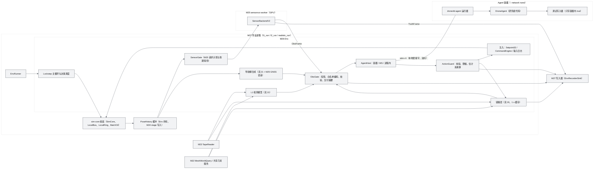
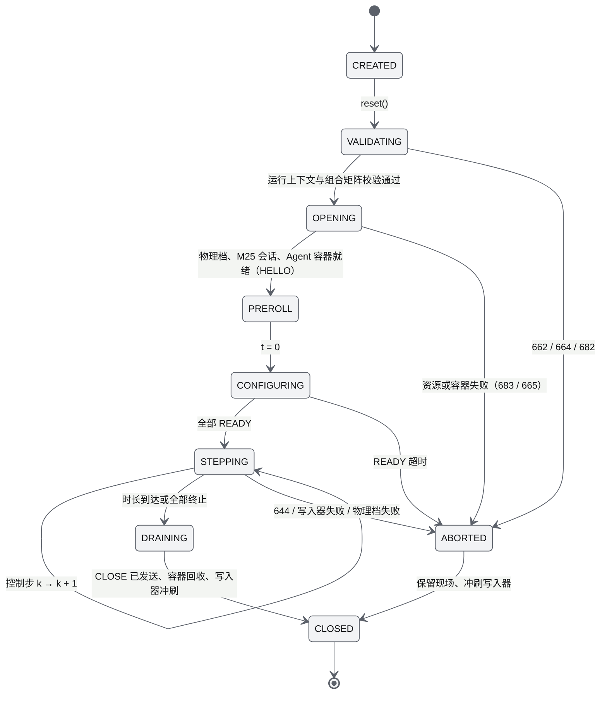
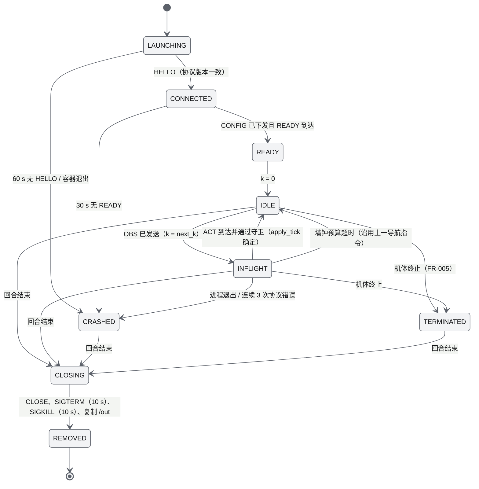
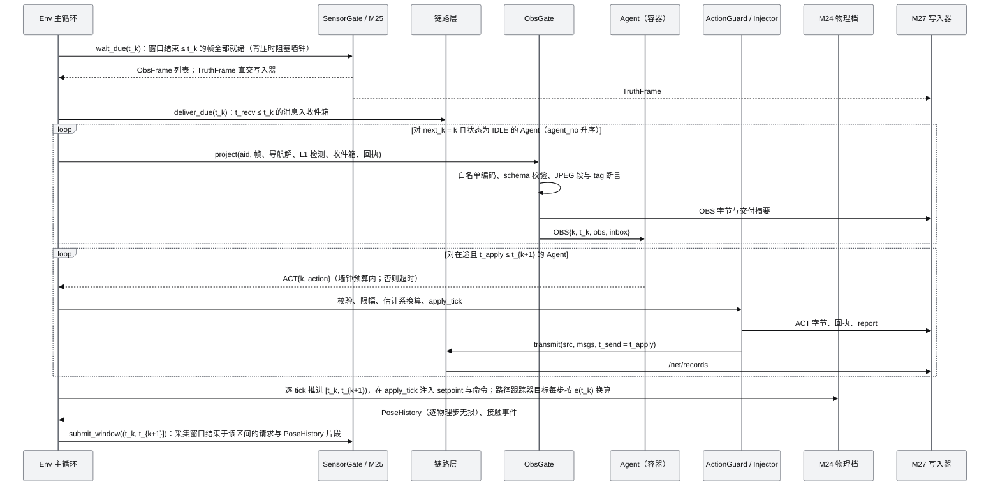
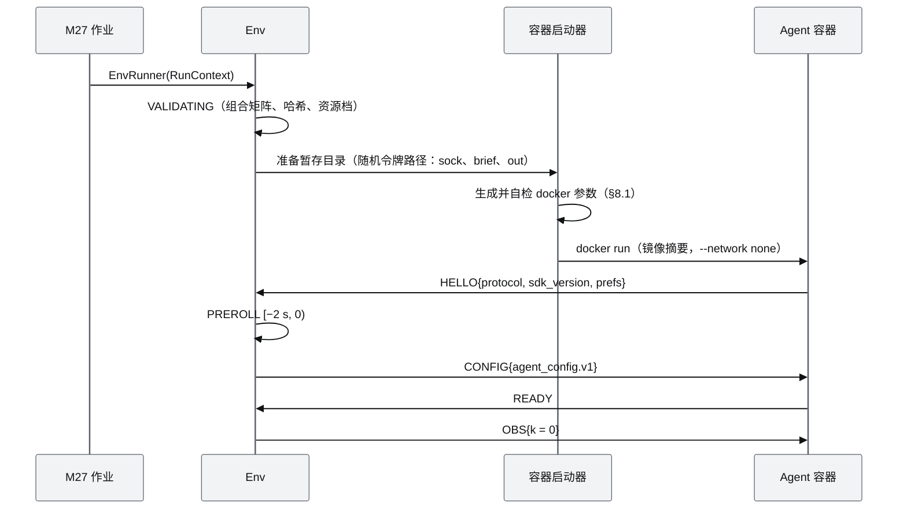

# M26 智能体观测 SDK PRD（Agent Observation SDK）

| 项 | 内容 |
|---|---|
| 文档编号 | AWR-M26 |
| 标题 | 智能体观测 SDK（Agent Observation SDK）PRD：唯一观测出口、L0–L3 观测分级与 `bench/obs.v1` 白名单、lockstep Env 与决策时延、动作空间与动作守卫、通信链路模型、Agent 隔离容器与远程协议、私有地图助手、与 M14 ANet 及 D2 沙盒接口的接合、真值泄漏审计 |
| 编号说明 | 模块号 M26（[AWR-05](../05-D3-设计增补与决策记录.md) §5.0），需求前缀 `M26-FR-`、`M26-NFR-`，验收前缀 `M26-AC-`，验收要点引用 D3-AC；文件名与 AWR-05 §1.3 登记一致 |
| 版本 | v1.1 |
| 日期 | 2026-10-12 |
| 状态 | 草案 v1.1（P-1，WP-D3-02；按 AWR-05 v1.3 修订：Python SDK 与 3 个基线策略、Realistic 缺省档、`ThermalObs`、内部与受邀提交的隔离、大模型指挥层与推理网关（P1）；修订内容汇总见 §14） |
| 上游文档 | 用户 D3 需求原文、补充要求与 2026-10-12 决策 [inputs/D3-需求原文-2026-10-11.md](../inputs/D3-需求原文-2026-10-11.md)（R-D3-04、05、11、12、14、24、29、32；v1.1 增加 2026-10-12 交互式确认的 R-D3-43、44、45、47、48）；用户设计讨论 design-r1 §七、§九；[AWR-05](../05-D3-设计增补与决策记录.md) §2、§4.1–§4.5、§5.0、§5.4.1、§5.4.2、§5.4.6、§5.5、§5.6.1、§5.6.5–§5.6.7、§7.11、§8、§10–§13，ADR-128、129、136、137、145、146、155、158、159、160、161、162、164；[AWR-04](../04-D2-设计增补与决策记录.md) ADR-093、099、110、123；[AWR-03](../03-设计基线与决策记录.md) ADR-016、027、036、047、049、050；研究 [00-index](../research/d3/00-index.md) §2.7、§3、§4.6、§6，[r6](../research/d3/r6-event-runtime-benchmark.md) §8–§10、§12、§14、§16，[r7](../research/d3/r7-d2-code-audit.md) §0、§3.2、§3.5–§3.7、§3.10、§3.11、§5、§8.5，[r4](../research/d3/r4-mesh-lidar.md) §8，[r8](../research/d3/r8-rerun.md) §10.8；并行模块 [M14](M14-智能体运行时与ANet-PRD.md) §6.2、§6.8、§6.12–§6.14，[M17](M17-沙盒会话与开放接口PRD.md) §7.7，[M18-M19](M18-M19-识别物与感知对抗PRD.md)，[M27](M27-基准运行时与数据集PRD.md)（并行起草） |
| 下游文档 | M27 PRD（Run 规格中 `policy`、`decision`、`localization`、资源档字段；`EnvRecorderSink` 实现；容器调度）；M24、M25 PRD（PoseHistory 缓冲、路径跟踪器输入、GNSS 误差函数、JPEG 段白名单）；M08、M09 D3 增补节（Bench 注入通道与安全档）；M14 D3 增补节（`AgentNetwork` 链路适配）；17 号说明书 D3 增补节（原因码 660–679、随机流 20、21 的通道）；`docs/impl/D3-*` |
| 适用版本范围 | V0.3（本期交付 D3）至 V1.0 |
| 写作规范 | 沿用 AWR-03 §10.2：中文、技术名词英文、需求编号、依据、mermaid、可测试验收、严禁 emoji 与状态字形；对外文案（SDK 文档、错误提示）另受 AWR-05 §7.10 约束 |
| 裁决 | 与 AWR-05 冲突时以 AWR-05 为准。本文在基线未规定或规定不足之处给出设计，相关条目同时列入 §13"对基线的反馈"，基线裁决与本文不同时按裁决修订本文 |

## 0. 摘要

1. **定位**：M26 是 D3 中 Agent 的唯一观测出口与唯一动作入口。它以 lockstep Env 组织一次运行中全部 Agent 的交互：按观测档生成或投影本机观测，经 `bench/obs.v1` 白名单序列化后下发；接收动作，经仿真时间动作守卫与估计系换算后注入物理档；在 Env 内唯一实现机间通信的链路层；在正式评测中把每个 Agent 放进独立的无网络容器（ADR-145、ADR-161）。
2. **接口**：研究者只实现 `DroneAgent.reset(config)` 与 `step(obs, inbox) -> Action`；本地开发经 `drone4d.bench.make(...)` 得到对齐 PettingZoo Parallel API 的 Env；托管运行由 M27 作业驱动，Agent 经本地套接字或开发用 WS 交换 `drone4d.bench.wire.v1` 帧。观测与动作的全部字段、单位与取值范围见 §7.3–§7.6。
3. **lockstep 与决策时延**：控制步 10 Hz；决策 τ 按 `apply_tick = request_tick + max(1, ⌈τ / tick⌉)` 生效，沿用 D2 批处理"固定延迟生效、未到即阻塞"的规则；τ 大于控制周期时 Agent 处于在途状态，仿真继续推进，只在生效时刻阻塞。排名运行只接受声明的 τ，墙钟预算为 `max(2 s, τ × 1.0)`，超时沿用上一动作并计数（§6.6.1）。
4. **观测分级**：L1 检测级（M26 自有的网格视线模型，随机流 21）、L2 渲染级（M25 帧投影）、L2-depth 子档、L3 SITL（不排名）；L0 Oracle 与 T0 特征档只以独立的特权 schema 存在，排名运行请求即返回 662。导航解由 M25 的 GNSS 误差实现与 M26 的姿态、速度误差合成，与原始 GNSS 观测同源，`clean` 档等于真值。
5. **估计系语义**：航点、环绕与云台 look-at 等含位置的指令一律解释在本机导航解坐标系中，由 Env 每个控制步减去当前导航误差后交 M24 路径跟踪器；否则航点收敛后 Agent 即可得到本机真值位姿（§6.6.5，§13 第 2 条）。
6. **通信**：链路层参数沿用 AWR-05 §5.5.5（2.4 GHz 自由空间、非视距 +20 dB、逻辑斯蒂丢包、速率与时延、125 KB/s 上行令牌桶、事件干扰区、1 s 对称缓存、`/net/records`）；随机数以 `(seed, 20, src_no, dst_no, msg_seq, ch)` 取键，与处理次序无关。M14 ANet 的委派与黑板在 P1 经 `AgentNetwork` 适配器运行在链路层之上，应用层时延 U(0.9, 1.1) s 叠加在链路时延之上，M14 代码不变。
7. **隔离**：排名运行要求 `policy.kind = image`；容器 `--network none`、`--cap-drop ALL`、只读根文件系统、资源档 `std`（2 核、8 GB），挂载路径、主机名与环境变量不携带任何运行、事件或划分标识（§8.1）。进程内与 WS 接入只用于不排名的开发运行。
8. **真值泄漏审计**：登记 24 条泄漏通道及其措施与用例（§8.2），红队方法分结构化检索、高熵字节检索、种子与噪声反演、行为攻击四类（§8.3），每个运行另有在线审计摘要；对应 D3-AC-16。
9. **与 D2 的关系**：Env 骨架复用 D2 批处理组装方式而不改 `sim/runtime/batch.py`；D2 沙盒 REST/WS 与 `tools/sdk/awr_sandbox.py` 不变、不用于评测；M14 TrustedGuard 不在 Bench 动作路径上，其策略语义以仿真时间形式在动作守卫中复用；沙盒快照可选段 `event`、`agents` 由本文起草（扩展点 9）。
10. **v1.1（§14）**：智能体接入顺序为 Python 研究算法优先：P0a 交付 `drone4d` SDK（reset/step）、3 个基线策略（`static_guard`、`coverage_scan`、`track_share`）与 L2 参考检测器 `ref_det_v1`；大模型指挥层（推理网关 `infer-gw`、分层接口、`llm-std3-l2` 分轨）与 ANet 多智能体委派在 P1；Env 缺省接 Realistic 档（gz 锁步），Fast 档在 P0b；LiDAR、IMU、GNSS 观测前移到 P0a，`ThermalObs` 在 P0b；正式评测容器加固适用于内部与受邀成员（AWR-05 ADR-183、ADR-185）。
11. **规模**：功能需求 91 条（P0 72 条；v1.1 新增 M26-FR-120 至 FR-131），非功能需求 14 条，验收 30 条，映射 D3-AC-01、09、11、13、16、17、18、19、23、27、28、30、34、35、36、37、38、43、44、52；新增原因码建议 3 个；对基线的反馈 24 条（§13），其中须基线裁决的有：TrustedGuard 不适用于 Bench 动作路径、位置类指令的估计系语义、排名运行中"运行时测得"的决策时延、L0 私有地图与真值位姿保密的冲突、静态世界属于公开先验、GNSS 误差实现的阶段与所有权。

---

## 1. 背景与目标

### 1.1 约束本模块的事实

| # | 事实 | 对设计的含义 | 依据 |
|---|---|---|---|
| F1 | D2 存在多条真值通道：M19 感知帧逐项带真值 id 与 `n_in_fov`、航迹按 `target_no` 融合全队量测、LiDAR `tag bit0` 为"命中识别物"、沙盒 token 可读全部识别物状态、WS 只有角色级权限、M20 快照的禁入体来自识别物真值、M14 `SimBridge` 读取全队 StateRing | 不能在 D2 接口上加权限来实现隔离；必须新建唯一出口，并逐条登记通道 | r7 §0 第 9、12 条，§5 C3、C6、C7、C13；ADR-145 |
| F2 | r6 原型以字段名前缀 `_truth`、`_vis`、`_ident` 剥离真值；v1.0 的 ObsFrame 内嵌真值位姿窗口与 seed | 黑名单剥离无法证明无泄漏；出口按 schema 生成的白名单逐字段构造 | `.cache/research/d3/r6-event-benchmark/scripts/bench.py` `Env._obs`；AWR-05 §17 RV-13；ADR-161 |
| F3 | r6 原型把 `ground_hint` 作为函数对象 `World.ground_max` 下发 | 进程内模式下 Agent 可经对象引用取得 `World` 与网格；观测必须是纯数据，不得含可调用对象或对象引用 | `bench.py` `Env._obs` |
| F4 | 计数器式随机数实现公开；D2 有 16 处随机数以主时钟 tick 为键，只换时钟档即分叉（120 s 内平均偏差 13.9 m） | M26 新随机流以"谁、第几个、哪一帧"取键；排名运行种子保密 | r7 §0 第 6 条；ADR-136、ADR-161 |
| F5 | D2 批处理以 `SimCore + LocalBus + LocalRing + BatchCtl` 组装，规划结果按 `apply_tick = request_tick + lat_ticks` 生效、到期未返回即阻塞，1 h 两次运行逐字节一致 | Env 骨架与决策时延规则直接复用；不修改 `batch.py` | `python/awr/sim/runtime/batch.py` 文档串与 `BatchCtl.lat_ticks`；D2-FX-R2；r7 §8.5 |
| F6 | D2 契约中 `velocity` 的 `agent` 标记为 `no`、类别 `nav_stream`；M14 TrustedGuard 的限流为墙钟（合计 20/s、每 AID 5/s），A1 要求命令属于活动委派，转发失败按墙钟重试 1 s × 3 | TrustedGuard 不能原样承担 10 Hz lockstep 动作；M26 以仿真时间动作守卫复用其策略语义（§6.6.5） | `packages/contracts/rt/commands.json`；`python/awr/agent/guard/pipeline.py` 文档串 |
| F7 | D2 契约中 `env/query`、`tasking/plan` 对 agent 开放；`velocity` 的 `keepout_guard` 沙盒缺省 `clamp`；M20 禁入体来自识别物真值 | Bench 动作集合不含环境查询与 M20 规划；与演员相关的在线限幅与告警一律关闭，安全间距只在评测端计算 | `commands.json`；r7 §3.6；AWR-05 §5.3.1 规则 4、§5.6.5 |
| F8 | M24 规定航点、跟随、环绕等高层指令由 Drone4D 侧路径跟踪器换算为世界系速度，跟踪器以真值状态闭环 | 位置类指令若按真值系执行，航点收敛后"指令目标 = 本机真值位置"，Agent 即得本机真值位姿；必须按导航解坐标系解释 | AWR-05 §5.3.1 规则 2；ADR-161 第 (2) 项 |
| F9 | M21 `vehicles/p600/sensors/gnss.yaml` 的 `fix_type` 缺省为 `rtk_fixed`（σ_h 1 cm）；AWR-05 §5.4.6 规定 D3 缺省为 `single`（σ_h 1.2 m、τ 60 s） | 排名运行按噪声档覆盖定位档；红队以声明的定位档为标称值 | `vehicles/p600/sensors/gnss.yaml`；AWR-05 §5.4.6 |
| F10 | r6 原型 L1 Env：单次 360 s 仿真 4.2–7.7 s（47–86 倍实时）；6 种策略 × 12 种子 EC 0.25–1.00；N = 1/3/10/30/60 时 4.3/9.1/29.3/78.4/194.4 s；投递次数约 370–410 × N²；1 s 链路缓存使 N = 30 耗时降 39% | L1 模型与链路模型的缺省参数与性能目标以此为基线 | r6 §10.4、§12.3 |
| F11 | 世界包在 dev 与 test 划分中均公开（只隐藏 test 集真值与磁带） | 静态世界几何是公开先验，提交的容器可以内置；需要保密的是动态真值、本机真值位姿、种子与 test 磁带 | AWR-05 §5.6.6；§13 第 5 条 |
| F12 | M14 agent-runtime 以 `RingClockDriver` 读 StateRing 推进、`SimBridge` 读全队状态、`MockRelay` 以流 5 键控时延 U(0.9, 1.1) s | M14 进程不能进入 Bench；只复用其库层（黑板、合同网、`AgentNetwork` 协议、`latency_s`） | M14 §6.12、§6.13；`python/awr/agent/anet_mock/relay.py` |
| F13 | r4 私有地图原型：稀疏 8³ 块 32–43 MB/机（3 机 60 s），稠密 831 MB/机；按帧位姿积分在 8 m/s 时中位误差 0.47 m；原型基于 Warp GPU | P1 地图助手采用稀疏块与逐点位姿积分，并提供 CPU 实现（公开提交容器无 GPU） | r4 §8；`.cache/research/d3/r4-mesh-lidar/scripts/recon.py`；AWR-05 §5.6.7 |
| F14 | Benchmark 锁步下 M25 超限只阻塞仿真时钟，`(uav, sensor, seq)` 集合只由 Run 规格决定 | Env 不得降频、不得转离线；观测放行以到期帧全部就绪为条件 | ADR-162 |
| F15 | 容器内 `/proc/self/mountinfo` 显示宿主挂载源路径；Docker 缺省主机名为容器 id | 挂载源路径、主机名与环境变量若含事件或划分标识即构成泄漏；须使用中性暂存路径 | Linux procfs 语义；§8.1 |
| F16 | D1 时钟档 `d1_250` 主时钟 250 Hz，多旋翼物理每 2 个 tick 执行一次（125 Hz）；`sandbox100` 为 100 Hz | 生效时刻按主时钟 tick 量化；物理步粒度由 `clock_profile` 决定，M26 不假设物理频率 | `python/awr/sim/runtime/clock_profile.py`；M27 PRD F14 |

### 1.2 目标

| # | 目标 | 度量 |
|---|---|---|
| G1 | 唯一观测出口：Agent 的全部输入只经 M26，且只含白名单字段 | 红队全部用例 0 命中；白名单校验未知字段 0（D3-AC-16） |
| G2 | 公平、可复现：同一 Run 规格结果可复现，快慢策略在仿真时间上可比 | CPU 档 L1 观测与动作流同 ISA 逐字节；声明 2 s 时延的动作在 t + 2 s 生效，误差 0 tick（D3-AC-17） |
| G3 | 接入成本低 | 研究者实现两个方法；PettingZoo `parallel_api_test` 通过；按 README 在本机 15 min 内运行 L1 示例 |
| G4 | 通信是可控的实验变量 | 丢包、时延、带宽、干扰区可配置，干扰区内丢包率 ≥ 区外 2 倍，成本计入 CE（D3-AC-28、30） |
| G5 | 规模 | L1 3 机 360 s ≤ 10 s；60 机 360 s 单核 ≤ 120 s（P1，D3-AC-28）；L2 3 机 720p 最坏档实时因子 ≥ 1.0（D3-AC-11） |
| G6 | 隔离 | 正式评测 Agent 容器对一切网络目标的连接失败；容器元数据不含标识（D3-AC-16） |
| G7 | D2 零影响 | D3-AC-01 回归门持续通过；`batch.py`、`awr_sandbox.py`、M14 文件不改 |

### 1.3 术语（本文新增，其余见 AWR-05 §1.2）

| 术语 | 定义 |
|---|---|
| Env | 一次运行的交互权威：持有物理档、M25 会话、链路模型与全部 Agent 会话，按 lockstep 推进 |
| 控制步 k、控制周期 Δ | Env 调用 Agent 的时间网格，`t_k = k · Δ`，Δ = 100 ms（10 Hz）；`t = 0` 为事件零点 |
| 主时钟 tick | sim-core 的主时钟步（`d1_250` 为 4 ms，`sandbox100` 为 10 ms）；动作生效时刻按 tick 量化 |
| 决策时延 τ | 动作从观测时刻到生效时刻的仿真时长；`apply_tick = request_tick + max(1, ⌈τ / tick⌉)` |
| 在途决策 | 已下发观测、尚未生效的决策；在途期间 Env 不再调用该 Agent |
| 观测门（ObsGate） | Env 中唯一向 Agent 发送字节的组件；负责投影、白名单序列化、校验与交付摘要 |
| 投影 | 由内部类型（ObsFrame、PoseHistory、磁带）逐字段构造白名单类型的过程；只复制白名单字段 |
| 估计系、导航误差 e(t) | 以本机导航解表达的世界 ENU 坐标；`e(t) = p_nav(t) − p_true(t)` |
| 动作守卫（ActionGuard） | 以仿真时间执行的动作校验、限幅与换算组件，取代 Bench 路径上的 M14 TrustedGuard |
| 排名运行、开发运行、特权运行 | `ranked = true` 为排名运行；`ranked = false` 为开发运行；开发运行中声明 `privileged = true` 的为特权运行（可用 L0、T0、训练奖励） |
| 任务简报（brief） | Agent 可见的任务信息（公开锚点、目标外观、任务区、静态禁入区、公开地图档）；为 M27 任务契约的投影 |
| 公开先验 | 不经 M26 下发、但依许可公开的信息（世界包、dev 磁带、本文与契约）；Agent 可以内置 |
| 链路层、会话层 | 链路层为 Env 唯一实现的投递模型；会话层为 SDK 中可选的可靠传输与主题库 |
| GCS 节点 | 不对应机体的地面站 Agent，参与链路模型，位置固定（P1） |
| 定位轨道 | `estimated`（缺省，导航解带噪）与 `oracle`（导航解等于真值，只用于开发运行或单列分组） |
| 资源档 | Agent 容器的计算配额：`std`（2 核、8 GB，排名运行唯一允许）与 `large`（8 核、32 GB，可选 GPU，只用于开发运行） |
| 交付摘要（DeliveryDigest） | 每个下发帧的 `(aid, k, sensor_id, seq, sha256)`，供 M27 核对存档字节 |

---

## 2. 范围

### 2.1 分阶段范围

v1.1 按 AWR-05 v1.3（ADR-175、ADR-176、ADR-183、ADR-185）重排；v1.0 的阶段对照见 §14.2。

| 能力 | P0a（最小基准闭环） | P0b（基准 v1） | P1 | P2 | P3 | 不在 D3 |
|---|---|---|---|---|---|---|
| Env 与 lockstep | Realistic 档（gz 锁步，缺省）Env、托管与本地两种驱动、PettingZoo 兼容、决策时延（fixed、per_step）、预滚窗口、运行统计、背压阻塞 | Fast 档 Env 接入与两档一致性；IMU 静止与悬停预滚窗口接入 SLAM 合同 | `measured` 时延模式（开发运行）、`paced` 节拍、`agent_seed` | SITL 档接入、Interactive 模式兼容 | — | 自由运行的实时 Bench 模式 |
| 观测 | L1、L2、L2-depth 的 `bench/obs.v1`；CameraObs（含 `readout_ns`）、LidarObs、ImuObs、GnssObs、Detection、NavSolution、VehicleStatus；特权 schema（L0）；白名单生成序列化 | `ThermalObs`；`slam_eval` 中 `cam0` 锁定 | T0 特征档（开发运行） | L3 SITL 观测（导航解取自 PX4 EKF） | — | 原始 RAW 传感器数据（拜耳阵列） |
| L1 模型 | 网格视线模型（随机流 21）、匿名 `det_id`、隐藏映射 | 热成像通道的 L1 检测（表观温差判据） | M19 适配器（开发运行）；虚警模型 | L1 与 L2 一致性标定（D3-AC-38） | — | — |
| 导航解 | GNSS 误差同源合成、姿态与速度误差、`clean` 等于真值 | — | `oracle` 定位轨道 | PX4 EKF 导航解（L3） | — | 视觉惯性定位作为导航解 |
| 动作 | velocity、goto、hover、takeoff、land；gimbal（角度、look-at）；zoom；sensor_mode；消息；report（按事件类型的 report 白名单）；估计系换算；动作守卫 | 四类事件的 report 类型；`slam_cam` 与锁定 `cam0` 拒绝（663） | orbit、path、rtl；指挥层高层任务 | SITL 动作映射 | — | 姿态与推力级控制 |
| 链路 | 链路层全部公式、令牌桶、干扰区、1 s 缓存、`/net/records` | — | 空间剔除与射线批量化（D3-AC-28）、GCS 节点、会话层库 | — | — | ns-3 在线联合仿真 |
| 隔离与协议 | 容器启动与基础加固（内部成员提交）、本地套接字线协议、开发用 WS、进程内开发模式、Agent 调试写入器 | gVisor 或 seccomp 加固、受邀成员提交的隔离与负向用例（与 M27 共同交付） | `large` 资源档、开发运行中的 Agent GPU；推理网关本地套接字转发 | — | — | 多主机 Agent 分布；公网提交 |
| SDK 与策略 | `drone4d` 包（reset/step）、3 个基线策略与参考检测器 `ref_det_v1`、6 种参考策略（评测口径校核）、M20 特权基线（L0） | 基线策略扩展到四类事件与热成像通道（`ref_thermal_blob_v1`） | 大模型指挥层（`drone4d.bench.commander`）、私有地图助手（CPU 缺省、GPU 可选）、ANet 适配器 | Frontier 协同探索参考策略（WP-D3-28） | — | 大模型本身的训练 |
| 审计 | 泄漏通道登记、红队四类用例的实现与在线审计摘要 | 红队全集验收（受邀成员开放前）、LiDAR、IMU 与热成像通道用例、反射率可分性检验、搜索先验泄漏用例 | ANet 消息与推理网关路径用例 | L3 通道用例 | — | — |

### 2.2 与其他模块的边界

| 模块 | M26 提供 | M26 使用 | 边界规则 |
|---|---|---|---|
| M08 | Bench 注入通道（setpoint、命令）与输入日志 | `SimCore`、`LocalBus`、`LocalRing`、`CommandEngine.handle`、`ClockProfile`、`inputlog` | 不改 `sim/runtime/batch.py`、`main.py`；Env 以库方式组装 |
| M24 | 估计系目标的真值系换算结果；步数授权 | `SimBackend`、`DroneAdapter`、路径跟踪器、`pose_history` stage 写入的 PoseHistory 缓冲、接触事件 | PoseHistory 缓冲由 Env 持有，M24 写入；M26 不读 StateRing 计算观测 |
| M25 | SensorRequest 计划（由 Run 规格派生）、PoseHistory 片段 | `SensorBackendV2.open/submit/poll`、ObsFrame、TruthFrame、GNSS 误差函数 | ObsFrame 只在 Env 内存中；投影后才可出 Env；TruthFrame 直交 M27 写入器 |
| M23 | — | `TapeReader`（演员状态、环境时间线、通信干扰区）、`DynamicSource` | Env 可读磁带；磁带内容不得进入任何投影 |
| M22 | — | `MeshWorldQuery.los_batch`、`ray_hit`、共享几何服务、公开 DSM 与 DTM | L1 视线与链路非视距判定走网格求交 |
| M27 | 观测与动作字节、消息记录、report、交付摘要、运行统计、L1 隐藏真值、Agent 调试 `.rrd` | Run 规格、运行上下文（`run_seed` 只进 Env 进程）、任务契约、写入器接口、容器调度配额 | M27 不直接向 Agent 发送任何数据；Env 不写 MCAP 文件 |
| M14 | 链路层投递服务（经适配器） | 黑板、合同网、`AgentNetwork` 协议、`latency_s` | 不启动 agent-runtime 进程；M14 文件不改 |
| M19 | — | `perception_level`、`feasible_view`（L1 标定与 P1 适配器） | M19 输出只在开发运行经匿名化使用 |
| M20 | 集中式策略插槽（GCS 节点） | `Allocator` 协议 | M20 原样只作为 L0 特权基线 |
| M21 | — | 机型目录（限幅、传感器、挂载、云台、变焦） | 限幅与挂载以目录为唯一来源 |
| M09 | Bench 安全档配置 | 电池模型、故障 FSM | 演员相关禁入与 C2 链路失效保护在 Bench 中关闭（§4.5） |
| M17 | 沙盒快照可选段 `event`、`agents` 的 schema 草案 | — | 沙盒池、token 与 REST 不变 |
| M11 | — | `d3` profile 进程声明（M27 起草） | Agent principal 不订阅任何 lab-gateway topic |
| M00 | `bench/{obs,act,agent_config,wire,obs_privileged}` 契约草案、原因码草案 | 契约生成器、copy-lint | 契约只增不改（ADR-155） |
| M16 | `tools/bench/d3/{fleet_scale,env_overhead}.py` | harness 框架 | 按文件分属 |

### 2.3 "Agent 输入"的判定范围

唯一出口约束覆盖 Agent 进程能够读取的全部信息源。下表之外的任何信息源出现在 Agent 进程中即视为违规（664）。

| # | 信息源 | 允许内容 | 控制点 |
|---|---|---|---|
| I1 | CONFIG 帧（reset） | `bench/agent_config.v1` 白名单字段 | ObsGate |
| I2 | OBS 帧 | `bench/obs.v1` 白名单字段与送达消息 | ObsGate |
| I3 | ERROR、CLOSE 帧 | 原因码与枚举 `why`，不含自由文本 | ObsGate |
| I4 | 容器只读挂载 `/brief` | 任务简报的公开地图栅格（若任务声明） | 容器暂存（§8.1） |
| I5 | 容器元数据 | 中性主机名 `agent`、白名单环境变量、中性挂载路径 | 容器启动器 |
| I6 | 镜像内容 | 提交者自带的代码与公开先验 | 不受控；公开先验之外的信息由 dmax 隔离保证不可得 |
| I7 | 墙钟与时序 | 观测到达的墙钟时刻 | 观测按控制步统一放行（§8.2 L-22） |
| I8 | 其他 Agent 的消息 | 经链路层送达的字节 | 链路层（发送方内容不受控，属于 Agent 权威） |

---

## 3. 用户与用例

| 角色 | 说明 | 接入方式 |
|---|---|---|
| 策略研究者 | 实现 `DroneAgent`，在 dev 事件上开发与比较策略 | 本地 `drone4d.bench.make`（L1 本机，L2 需 GPU）；内部工作区提交托管运行（镜像或开发用 WS） |
| 评测员 | 复核排名运行、执行红队用例 | 内部工作区；`tests/d3/leak_redteam/` |
| 受邀成员（v1.1，取代公开参赛者） | 提交 Agent 容器到 test 集 | 内部提交（M27），只能为 `image`，P0b 起 |
| 内置参考策略 | 6 种 r6 策略、覆盖扫描、M20 特权基线、P2 Frontier | Env 进程内（开发运行）或参考策略镜像（排名运行） |
| M27 作业 | `l1_run`、`l2_run`、`realistic_run` | `EnvRunner` |

| 编号 | 用例 | 主路径 | 关联 |
|---|---|---|---|
| UC-01 | 本地开发 L1 策略 | `pip install drone4d` → 下载 dev 世界包与磁带 → `make(..., obs_level="L1")` → 循环 `step` → `close()` 得到本地运行目录 | FR-002、FR-006、FR-080；M26-AC-001 |
| UC-02 | 托管排名运行 | 研究者构建镜像（基于 `drone4d-agent-base`）→ 提交 Run 规格（`policy.kind = image`、`ranked = true`）→ M27 准入 → Env 启动容器、下发 CONFIG → lockstep 至回合结束 → 写入器收尾 → 离线评测 | FR-070 至 FR-073；M26-AC-002、010 |
| UC-03 | LLM 慢决策 | Run 规格声明 `decision.mode = fixed, tau_ms = 2000` → Agent 每 2 s 被调用一次，期间机体执行上一指令；墙钟预算 2 s | FR-012、FR-013；M26-AC-004 |
| UC-04 | 共享目击与协同 | Agent 在 `msgs` 中广播目击 → 链路层按距离、视距、干扰区投递 → 其他 Agent 在 `inbox` 收到 | FR-060 至 FR-065；M26-AC-014 |
| UC-05 | L2 视觉策略 | Agent 收到 `cam0` JPEG 与 LiDAR 点云，自行检测与跟踪，以证据帧提交 `report` | FR-021、FR-026、FR-056；M26-AC-013 |
| UC-06 | 开发调试 | 开发用 WS 接入正在运行的开发 Run；Agent 调试写入器写 `agent.<uav>.rrd` | FR-074、FR-076；M26-AC-019 |
| UC-07 | 红队审计 | 评测员对排名配置运行 `tests/d3/leak_redteam/`，生成审计报告 | §8.3；M26-AC-007、008、010 |
| UC-08 | ANet 协同策略（P1） | Agent 内部持有 `ANetOverLink`，委派与黑板单元作为消息经链路层投递 | FR-090、FR-091；M26-AC-016 |
| UC-09 | 协同探索（P1–P2） | 每机以私有地图助手积分 LiDAR、提取 Frontier、经消息交换增量 | FR-082、FR-084；M26-AC-017 |
| UC-10 | 由 D2 沙盒配置机队 | 在交互沙盒摆放机队 → 导出快照（含 `agents` 段）→ 转换为 Run 规格的 `fleet[]` | FR-094；M26-AC-029 |

---

## 4. 功能需求

表头沿用 AWR-03 §10.2，另设"阶段"列（AWR-05 §1.2）。"依据"中的 §x 不带文档名时指 AWR-05。

### 4.1 Env 与生命周期

| 编号 | 需求描述 | 优先级 | 阶段 | 验收要点 | 依据 |
|---|---|---|---|---|---|
| M26-FR-001 | 一个 Run 对应一个 Env 实例。Env 以 D2 批处理的组装方式（`SimCore + LocalBus + LocalRing + BatchCtl` 同构对象）装配 sim-core，经 M24 `SimBackend`/`DroneAdapter` 接入物理档（v1.1：P0a Realistic（缺省）；P0b Fast；P2 SITL），不修改 `sim/runtime/batch.py` 与 `main.py` | P0 | P0a | M26-AC-001、002 | §5.5.1；r7 §8.5 |
| M26-FR-002 | 两种驱动方式共用 Env 核心：托管（M27 作业调用 `EnvRunner.run()`，Agent 经容器或开发用 WS）与本地开发（`drone4d.bench.make(...)` 返回 Env，Agent 为研究者进程内对象）。本地开发强制 `ranked = false`，请求排名时返回 664 `why = inproc_ranked` | P0 | P0a | M26-AC-001、009 | §5.5.7 |
| M26-FR-003 | `reset()` 按序执行：校验运行上下文（世界包 `contentVersion`、磁带 `content_sha256`、机型、传感器、`obs_level` 与 `ranked`、`privileged` 的组合，§7.11 矩阵）→ 打开物理档与 M25 会话 → 预滚（FR-004）→ 向每个 Agent 下发 CONFIG 并等待 READY → 生成 k = 0 观测。任一校验失败返回 662、664 或 682（M27）且不启动 Agent | P0 | P0a | M26-AC-001、009 | §5.6.2 |
| M26-FR-004 | 预滚窗口放在事件零点之前 `[−t_pre, 0)`（缺省 2 s）：地面起飞为静止窗口，空中出生为悬停保持窗口。预滚期间物理、PoseHistory 与 IMU 正常推进（满足 SLAM 合同），磁带与环境取 t = 0 的状态，不向 Agent 请求动作、不交付观测；`rig.json` 的 `gravity_align_en` 由 M25 按出生方式设置 | P0 | P0a | M26-AC-022 | §5.4.6 初始化条款；§13 第 11 条 |
| M26-FR-005 | 回合结束：仿真时间达到 `episode.duration_s` 时全部 Agent `truncated = true`；单机在以下情形 `terminated = true`：降落后处于地面且最近一次导航指令为 `land`、电量耗尽、与静态网格接触后处于失效状态、离开世界包边界。终止后机体保持当前状态（地面）或执行 M09 失效保护，Agent 不再被调用 | P0 | P0a | M26-AC-001 | 本文设定 |
| M26-FR-006 | PettingZoo Parallel API 兼容：`possible_agents`、`agents`、`observation_space(aid)`、`action_space(aid)`、`reset(seed=None, options=None)`、`step(actions)` 返回 `(obs, rewards, terms, truncs, infos)`；`infos[aid]` 含 `inbox`、`acks`、`comm`；Benchmark 中 `rewards` 恒为 0（评分只由离线 Evaluator 给出）；通过 `pettingzoo.test.parallel_api_test` | P0 | P0a | M26-AC-001 | §5.5.1；r6 §9.3 |
| M26-FR-007 | 训练奖励：只在特权运行中可选启用由真值派生的稠密奖励（`options.reward = "event_visibility"` 等）；排名运行、test 划分或非特权运行请求时返回 662 `why = reward_privileged` | P2 | P1 | M26-AC-009 | §8.2 L-19 |
| M26-FR-008 | `close()` 冲刷写入器接口、按 §6.4 停止 Agent、回收预滚与 M25 会话，返回 `RunResult{run_id, env_stats, delivery_digest_sha256, audit}`；本地开发模式另写本地运行目录（`run_manifest.json`、`raw.mcap`），格式与 M27 一致 | P0 | P0a | M26-AC-020 | §5.6.3 |
| M26-FR-009 | 运行统计 `env_stats`（每 Agent）：调用次数、超时次数、在途最大步数、动作拒绝与限幅次数（按 `why`）、消息发送、投递、丢失、预算丢弃字节数、累积上限丢弃帧数、墙钟阻塞时长（M25 背压与 Agent 等待分列）；写入运行清单（经 M27） | P0 | P0a | M26-AC-020 | §5.5.2 |

### 4.2 lockstep 与决策时延

| 编号 | 需求描述 | 优先级 | 阶段 | 验收要点 | 依据 |
|---|---|---|---|---|---|
| M26-FR-010 | 控制周期 Δ = 100 ms（10 Hz，与磁带同频），须为主时钟 tick 的整数倍；`clock_profile` 由 Run 规格给出（L1 缺省 `sandbox100`，L2 与 SLAM 轨道缺省 `{d1_250, 250, 250, 250}`，即 `l1_every = 1`，AWR-05 ADR-169）；传感器按 M25 绝对触发网格产出，不受控制周期约束 | P0 | P0a | M26-AC-005 | §4.3 规则 3 |
| M26-FR-011 | lockstep：仿真时间只在 Env 推进主循环时前进，从不随墙钟推进；同一控制步内多个 Agent 的观测发送、动作处理、消息发送一律按 `agent_no` 升序，结果与动作到达的墙钟次序无关 | P0 | P0a | M26-AC-002 | ADR-145 |
| M26-FR-012 | 决策时延：`decision.mode ∈ {fixed, per_step, measured}`。`fixed` 为 Run 规格声明的常量 τ（缺省 0）；`per_step` 允许 Agent 在 `act.tau_ms` 中逐次声明，下限为 Run 规格的 `tau_min_ms`；`measured` 以墙钟实测耗时 × `measured_scale` 作为 τ，只用于开发运行。生效 `apply_tick = request_tick + max(1, ⌈τ / tick⌉)`；在途期间机体执行上一指令，Agent 不被再次调用；下次调用的控制步 `k' = ⌈t_apply / Δ⌉` | P0 | P0a（fixed、per_step）；P1（measured） | M26-AC-004 | §5.5.2；§13 第 3 条 |
| M26-FR-013 | 墙钟预算：每次调用的墙钟上限自观测发送起计；`fixed` 模式为 `max(step_budget_s, τ × wall_ratio)`（缺省 2 s、1.0）；`per_step` 模式为 `max(step_budget_s, tau_max_ms × wall_ratio)`，且动作到达时若墙钟耗时 w 超过 `step_budget_s`，生效 τ 取 `max(声明值, (w − step_budget_s) / wall_ratio)` 并向上量化到控制周期，运行标记 `wallclock_dependent = true`（防止少报时延换取计算时间）。超时：上一导航指令继续有效（FR-055 的保持规则），其余动作项为空，计数 `agent_timeouts`，Agent 在下一控制步重新被调用；迟到的动作以 `ack.result = late` 丢弃。排名运行中超时率超过 `timeout_flag_ratio`（缺省 0.01）时在运行统计中标记 `wallclock_dependent = true`，由 M27 决定是否判无效 | P0 | P0a | M26-AC-004 | §5.5.2 |
| M26-FR-014 | 观测累积：一次调用的观测包含该传感器自上次调用以来采集窗口结束于 `(t_last, t_k]` 的全部帧，按 Agent 在 HELLO 中声明的偏好保留：相机与 LiDAR 缺省只保留最新 1 帧，IMU、GNSS、检测缺省全部保留；单次观测总字节超过 `obs_bytes_max` 时按"同一传感器先丢最旧帧、传感器按 sensor_id 字典序"确定性截断，丢弃数写入 `obs.dropped` | P0 | P0a | M26-AC-004 | 本文设定 |
| M26-FR-015 | 背压：M25 返回 641 或到期帧未就绪时，Env 阻塞仿真时钟等待（墙钟变慢、仿真不变），不降频、不转离线、不跳过帧；阻塞时长计入 `env_stats` | P0 | P0a | M26-AC-003 | ADR-162 |
| M26-FR-016 | 节拍：`pace ∈ {lockstep, paced}`。`paced` 在 lockstep 之上把墙钟推进速度限制在 ≤ ×1，用于内部工作区实时观看，结果与 `lockstep` 逐字节相同；不提供自由运行的实时模式，实时交互仍经 D2 交互沙盒 | P2 | P1 | M26-AC-002 | §5.5.2 实时模式行 |
| M26-FR-017 | 确定性：Env 内全部随机量只来自流 20（链路）与流 21（L1 检测）及 M25 的传感器噪声（流 22，含导航解与云台编码器读数，AWR-05 ADR-171），键中不含主时钟 tick、调用次数或墙钟；遍历一律按排序后的键；同一运行上下文两次运行观测与动作流逐字节一致（CPU 档 L1；GPU 档按 §4.5 二级） | P0 | P0a | M26-AC-002、003 | ADR-136 |

### 4.3 观测分级与 `bench/obs.v1` 出口

| 编号 | 需求描述 | 优先级 | 阶段 | 验收要点 | 依据 |
|---|---|---|---|---|---|
| M26-FR-020 | 观测档取值 `L0、T0、L1、L2、L2-depth、L3`。排名运行只允许 L1、L2、L2-depth；L3 恒为 `ranked = false`；L0 与 T0 只允许特权运行，其余组合返回 662（组合矩阵见 §7.11） | P0 | P0a | M26-AC-009 | §5.5.3；ADR-159 |
| M26-FR-021 | 各档观测内容：L1 为 `nav`、`status`、`ground_hint`、`sensors.detections`；L2 为 `nav`、`status`、`ground_hint`、相机 `CameraObs`（RGB）、LiDAR、IMU、GNSS；L2-depth 为 L2 加相机 `depth`（经传感器模型的深度）；L3 同 L2，导航解来自 PX4 EKF（P2） | P0 | P0a（L1、L2 相机、LiDAR、IMU、GNSS）；P0b（热成像）；P2（L3） | M26-AC-006 | §5.5.3 |
| M26-FR-022 | 白名单序列化：Agent 侧类型与编码器由 `packages/contracts/bench/obs.v1.schema.json` 生成（`additionalProperties: false`）；投影函数逐字段从内部类型构造白名单对象，不复制内部对象、不按字段名剥离。排名运行中每条下发消息在发送前按 schema 校验，失败则不发送并以 644 结束运行（失败即关闭） | P0 | P0a | M26-AC-006 | ADR-161 |
| M26-FR-023 | 唯一出口：Agent 进程能收到的字节只经 `ObsGate.emit()`（CONFIG、OBS、ERROR、CLOSE 四类帧）。`awr.agentsdk.wire` 与 `awr.agentsdk.filter.gate` 只允许 import 生成类型与本模块投影函数，不得 import `awr.sensorsvc` 内部类型以外的路径（import 方向测试） | P0 | P0a | M26-AC-006 | ADR-145 |
| M26-FR-024 | 观测时间口径：第 k 次调用只包含采集窗口结束时刻 ≤ t_k 的帧；时间戳沿用 M25（相机为中间行曝光中点、LiDAR 为帧首、IMU 为采样时刻）；Env 不做位姿外推，不向 M25 提交位姿尚未推进到的请求 | P0 | P0a | M26-AC-005 | §4.3 规则 4 |
| M26-FR-025 | 外参与云台：CameraObs、LidarObs、ImuObs 只给 M21 目录的标称挂载 `mount_nominal` 与带噪云台编码器读数 `gimbal_reading`；不得给出 `T_world_cam`、`T_world_sensor`、PoseHistory、SensorRequest、FrameMeta | P0 | P0a | M26-AC-007 | ADR-161 第 (2) 项 |
| M26-FR-026 | RGB 透传：`rgb.data` 与 M25 `agent_view` 的字节逐字节相同（sha256 一致），并与存档字节相同；JPEG 只允许 SOI、APP0（JFIF）、DQT、SOF0、DHT、DRI、SOS、RSTn、EOI 段，出现其他 APPn 或 COM 段时以 644 结束运行；L2-depth 深度为 f32 小端原始数组，0 表示无效 | P0 | P0a | M26-AC-006、020 | §5.4.3 编码行 |
| M26-FR-027 | LiDAR 观测：只含有效回波点（传感器系 xyz、反射率、`tag`、`offset_time`），点序与 M25 输出一致；发送前断言 `tag` 的保留位为 0（§7.3），不含 `void` 标记与实例；`tag` 不得携带任何与演员相关的语义 | P0 | P0a | M26-AC-007 | §5.4.5 输出行；r7 C7 |
| M26-FR-028 | IMU 与 GNSS 观测：SI 单位（m/s²、rad/s、m），IMU 为传感器系；GNSS 为世界 ENU 带噪位置与速度，`pos_std_m` 为标称值；与导航解同源（FR-040） | P0 | P0a | M26-AC-012 | §5.4.6 |
| M26-FR-029 | 特权观测：L0（`oracle` 演员表、本机真值位姿）与 T0（`features`）只由独立 schema `bench/obs_privileged.v1` 的独立编码器生成；该编码器在 `ranked = true` 或 `split = test` 时不能实例化（构造函数抛出 662） | P0 | P0a（L0）；P1（T0） | M26-AC-009 | §5.5.3 |
| M26-FR-030 | 投影对照表 `filter/mapping.yaml` 列出每个白名单字段的来源（内部类型字段或 Env 计算量）与变换；契约测试保证 schema 字段集合与对照表一致，新增内部字段不改变 Agent 字节 | P0 | P0a | M26-AC-006 | ADR-161 |

### 4.4 L1 检测级观测模型

| 编号 | 需求描述 | 优先级 | 阶段 | 验收要点 | 依据 |
|---|---|---|---|---|---|
| M26-FR-031 | L1 缺省模型 `l1_model = mesh_los`：按 M21 相机模型与云台位姿，在 L1 触发网格（`clock_profile.l1_hz`，缺省 5 Hz）上对磁带演员做视锥裁剪、网格视线（人 5 点、车辆包围盒遮挡）、像素尺寸、雨雾透过率与键控抽样，算法见 §6.6.3；视线经 M22 MeshWorldQuery，后端由 Run 规格 `raycast ∈ {cpu, gpu}` 选择 | P0 | P0a | M26-AC-011 | §5.5.3；r6 §9.1 |
| M26-FR-032 | 匿名检测 id：每条检测的 `det_id` 由流 21 按 `(seed, 21, uav_no, actor_no, frame_seq, ch = DET_ID)` 生成 64 位值，以 16 位十六进制串下发；同一帧内检测列表按 `det_id` 升序排列；`det_id → actor` 映射只写入 L1 隐藏真值 | P0 | P0a | M26-AC-011 | ADR-161 第 (5) 项 |
| M26-FR-033 | 检测地面位置以本机导航误差为参照：`ground_xy_noisy = xy_actor_true + e_xy(t) + n_meas`，其中 `e_xy(t)` 为本机导航解的水平误差，`n_meas ~ N(0, (0.4 + 0.008 R)²)`；斜距按噪声档加相对误差；外观描述只在达到识别级时给出 | P0 | P0a | M26-AC-008、011 | §8.2 L-10 |
| M26-FR-034 | L1 隐藏真值：每帧每条检测写入 `{det_id, actor_id, h_px_unocc, visible_ratio, ident}`，另写被视锥覆盖但未被检测的演员（漏检）记录；经写入器进入真值文件，供 EC、EU 与 L1/L2 标定使用 | P0 | P0a | M26-AC-011 | §5.6.5 |
| M26-FR-035 | M19 适配器 `l1_model = m19`：把 M19 感知帧去真值 id、去 `n_in_fov`、航迹按机私有后作为 L1 观测；因 M19 使用以 tick 取键的流 18 与 2.5D 视线，只允许开发运行 | P2 | P1 | M26-AC-009 | r7 C3、C4、C5；§13 第 6 条 |
| M26-FR-036 | 虚警模型：realistic 与 harsh 档按每帧泊松率 λ_fp 在视锥内地面随机位置生成 `person` 类虚警检测（键控），隐藏真值记 `actor_id = null` | P1 | P1 | M26-AC-011 | 本文设定 |
| M26-FR-037 | L1 与 L2 一致性标定：以 L2 实例分割统计的 `h_px_unocc` 与 `visible_ratio` 标定 L1 像素阈值与检测概率曲线，一致率 ≥ 90%，标定结果以 ADR 修订本文 §6.7 参数 | P1 | P2 | M26-AC-026 | D3-AC-38 |

### 4.5 导航解、车辆状态与公开先验

| 编号 | 需求描述 | 优先级 | 阶段 | 验收要点 | 依据 |
|---|---|---|---|---|---|
| M26-FR-040 | 导航解：由 M25 纯函数 `nav_solution` 生成（位置误差 = 同一 GNSS 误差实现的 Gauss-Markov 分量 + 导航白噪声，速度与姿态误差按 AWR-20 §15.6.5，流 22），M26 只组装与投影为 `NavSolution`，不另行生成误差（AWR-05 ADR-171，§6.6.4）；导航解频率等于控制频率；`clean` 档导航解等于真值；`localization = oracle` 时导航解等于真值且运行只能为开发运行或单列分组 | P0 | P0a | M26-AC-012 | §5.5.4 出口规则 2；§13 第 7 条 |
| M26-FR-041 | 定位档覆盖：排名运行的 GNSS 定位档取噪声档参数表（realistic 为 `single`），覆盖 M21 `gnss.yaml` 缺省的 `rtk_fixed`；任务声明 RTK 时在简报中给出标称 σ；红队以声明的定位档为标称值 | P0 | P0a | M26-AC-012 | F9 |
| M26-FR-042 | 车辆状态 `status`：飞行模式、当前导航指令、`goto_reached`（按导航解判定）、本控制步与静态网格接触标志、安全状态（只含电量与失效保护，不含地理围栏与禁入告警） | P0 | P0a | M26-AC-007 | §8.2 L-13、L-14 |
| M26-FR-043 | Bench 安全档：与演员相关的禁入体与 `keepout_guard` 关闭；地理围栏不做在线限幅与告警（越界由 Evaluator 计入安全指标）；C2 链路失效保护关闭（Agent 视为机载）；电量返航等改变轨迹的 M09 自主动作在全部物理档关闭，电量低于储备计入安全指标（AWR-05 ADR-170，使 Fast 与 Realistic 的差异只来自动力学）；M24 网格接触保持开启；任务声明的静态禁入区由动作守卫按导航解执行（FR-054） | P0 | P0a | M26-AC-008 | F7；§5.6.5 安全行 |
| M26-FR-044 | 地形提示与公开地图：每次观测给出本机导航解水平位置处的公开 2 m DSM 与 10 m DTM 高度；任务声明 `maps.dsm = raster` 时，容器 `/brief/` 只读挂载公开 DSM 与 DTM 栅格；不下发网格、occupancy 与 quality 层 | P0 | P0a | M26-AC-006 | §5.5.4 `ground_hint` 行；F3 |
| M26-FR-045 | 任务简报投影：由 M27 任务契约（M27 PRD 起草的 `bench/task.v1`）投影出 Agent 可见子集 `brief`；只含标注为公开的锚点、目标外观描述、任务区、静态禁入区、报告词表、公开地图档与标称噪声；Env 审计简报锚点与磁带脚本演员路线锚点的交集，交集非空时在运行统计中告警（任务可显式声明允许） | P0 | P0a | M26-AC-007 | §5.5.4；§8.2 L-16 |
| M26-FR-046 | `agent_seed`：CONFIG 中下发 `agent_seed = HMAC-SHA256(run_seed, "agent-seed" ‖ uav_id)` 的前 8 字节，供 Agent 内部随机数复现；该值不可反推 `run_seed`，红队将其列为候选种子 | P1 | P1 | M26-AC-008 | 本文设定 |

### 4.6 动作空间与动作守卫

| 编号 | 需求描述 | 优先级 | 阶段 | 验收要点 | 依据 |
|---|---|---|---|---|---|
| M26-FR-050 | 动作契约 `bench/act.v1`（`additionalProperties: false`）：每次调用回复一个 Action，`k` 必须等于观测的 `k`；各项可缺省，缺省的导航项表示保持上一导航指令 | P0 | P0a | M26-AC-013 | §5.5.4 动作段 |
| M26-FR-051 | 导航指令：`velocity`（语义与 D2 VelSetpoint16 一致：NaN 表示不控制该轴、`yaw_rate` 为 NaN 表示保持航向，`frame ∈ {world, body}`）、`goto`、`hover`、`takeoff`、`land`（P0a）；`orbit`、`path`（≤ 64 点）、`rtl`（P1） | P0 | P0a；P1 | M26-AC-013 | §5.5.4；`layouts.json` VelSetpoint16 |
| M26-FR-052 | 估计系换算：`goto`、`orbit`、`path`、`rtl` 的位置与 `gimbal.look_at` 目标解释在本机导航解坐标系中；Env 在每个控制步以 `p_true_target = p_cmd − e(t_k)` 换算后交 M24 路径跟踪器（`look_at` 以导航位置与导航姿态计算云台角）；`velocity` 原样执行 | P0 | P0a | M26-AC-008 | F8；§13 第 2 条 |
| M26-FR-053 | 载荷指令：`gimbal`（角度或 look-at）、`zoom`、`sensor_mode`，经 `CommandEngine` 以 principal `bench:<run_id>/<uav_id>` 下发对应 D2 op（`gimbal`、`zoom`、`sensor/mode`），参数按 `commands.json` 校验；`slam_cam` 不受控，`slam_eval` 运行中锁定 `cam0` 的云台与变焦，相应指令返回 663 `why = sensor_locked` | P0 | P0a；P0b（锁定） | M26-AC-013 | §5.4.6 SLAM 相机条款 |
| M26-FR-054 | 动作守卫按仿真时间确定性执行：schema 与有限值检查；按 M21 限幅档对速度、加速度、偏航角速度限幅（限幅不拒绝，回执 `clamped`）；云台角与变焦范围检查；任务静态禁入区按导航解判定（指向禁入区的速度分量置零并回执 `clamped why = keepout_static`）；不使用墙钟限流 | P0 | P0a | M26-AC-013 | F6；§13 第 1 条 |
| M26-FR-055 | 注入：速度设定在 `apply_tick` 以 `awr.bus.Setpoint32.v1` 经 Env 的 LocalBus 注入（`t_client_sim_ns = t_apply`），载荷指令与 `takeoff`、`land` 以 `CommandEngine.handle` 注入；Env 在 reset 时为每机取得租约；全部注入写入 M08 输入日志以支持 `--resim`。速度设定保持规则：最近一次导航指令在 `t_apply_next_expected + nav_hold_s`（缺省 1 s）后仍无更新时转为 `hover` 并回执 | P0 | P0a | M26-AC-002、013 | r7 §8.5 |
| M26-FR-056 | 事件声明 `report`：字段见 §7.5；每名参与者至少 1 条证据；证据引用的 `(uav, sensor, frame_seq)` 须在本运行中已采集（或为 L1 `det_id`），否则该证据以 663 `why = evidence_unknown_frame` 拒绝；`t_submit_ns = t_apply`；原样交写入器 | P0 | P0a | M26-AC-013 | §5.6.5 EU 行 |
| M26-FR-057 | 动作中不可表达的操作：环境设置与查询（`env/*`）、任务与规划（`task/*`、`tasking/*`）、时钟（`sim/*`）、实体增删（`target/*`、`nest/*`、`fleet/*`）、安全锁（`kill`、`escalate`、`safety_stop`）、录制（`rec/*`）、席位（`seat/*`）；schema 中不存在这些项 | P0 | P0a | M26-AC-013 | F7 |
| M26-FR-058 | 回执：上一决策各项的处理结果以 `acks[]` 在下一次观测中返回（`applied`、`clamped`、`rejected`、`dropped`、`late`、`timeout`），只含原因码与枚举 `why` | P0 | P0a | M26-AC-013 | 本文设定 |

### 4.7 通信链路模型

| 编号 | 需求描述 | 优先级 | 阶段 | 验收要点 | 依据 |
|---|---|---|---|---|---|
| M26-FR-060 | 链路层只在 Env 中实现一份：路径损耗、链路余量、丢包、速率、时延按 §6.6.6 与 §6.7 参数计算；非视距由 MeshWorldQuery 对两机真值位置连线判定；Agent 之间不存在任何旁路 | P0 | P0a | M26-AC-014 | §5.5.5；ADR-146 |
| M26-FR-061 | 随机数：丢包与时延抖动以流 20 键 `(seed, 20, src_no, dst_no, msg_seq, ch)` 抽样，`msg_seq` 按 (src, dst) 计数；结果与处理次序、广播展开次序无关 | P0 | P0a | M26-AC-014 | §8.5 |
| M26-FR-062 | 令牌桶：每机上行 125,000 B/s、容量 125,000 B，按仿真时间连续补充；消息计费 = 载荷字节 + 32 B 头；广播按一次发送计费；余额不足时整条丢弃并计数，回执 `dropped why = budget` | P0 | P0a | M26-AC-014 | §5.5.5 带宽行 |
| M26-FR-063 | 通信干扰区：磁带 `comms.zones` 中多边形与时间窗内，任一端点在区内的链路按 `1 − (1 − PER)(1 − extra_loss)` 合成丢包 | P0 | P0a | M26-AC-014 | §5.5.5 丢包行 |
| M26-FR-064 | 投递：消息在 `t_apply` 发出，`t_recv = t_apply + latency`；收件方在 `t_recv ≤ t_k` 的第一次调用中收到；每次调用的收件箱上限 1,024 条，溢出时按 `(t_recv, src, seq)` 丢最早并计数；收件条目含 `src`、`seq`、`topic`、`t_sent_ns`、`t_recv_ns`、`payload` | P0 | P0a | M26-AC-014 | 本文设定 |
| M26-FR-065 | 记录：每次投递尝试写 `{t, src, dst, ok, lat_ms, los, bytes, why}` 到 `/net/records`（经写入器）；Agent 只得到本机计数（已发、预算丢弃、拒绝），不得到 RSSI、余量与他机的投递结果 | P0 | P0a | M26-AC-014 | §5.5.5 记录行；§8.2 L-21 |
| M26-FR-066 | 复杂度控制：P0a 链路状态按 `(min(a, b), max(a, b), ⌊t⌋)` 缓存 1 s；P1 增加距离剔除（自由空间余量低于 −20 dB 的链路不发射线，直接判丢且仍消耗随机数键以保持确定性）、每个缓存纪元一次批量射线、L1 传感射线跨机批量化；60 机 L1 360 s 单核 ≤ 120 s | P0（缓存）；P1（剔除与批量） | P0a；P1 | M26-AC-015 | §5.5.5 复杂度行；D3-AC-28 |
| M26-FR-067 | GCS 节点：`fleet[].kind = gcs` 的 Agent 不对应机体，位置固定（机巢或锚点），参与链路模型，观测只含 `t_ns`、`comm` 与收件箱 | P1 | P1 | M26-AC-023 | §5.5.8 M20 行 |
| M26-FR-068 | 会话层库（SDK 可选）：主题、可靠传输（确认与重传）、分片；全部字节经链路层计费，成本进入 CE | P1 | P1 | M26-AC-016 | §5.5.5 分层 |
| M26-FR-069 | `comm.enabled = false` 时 `msgs` 一律以 667 `why = comm_disabled` 拒绝，CONFIG 中 `peers` 为空 | P0 | P0a | M26-AC-014 | r6 `track3_nocomm` |

### 4.8 隔离容器与远程协议

| 编号 | 需求描述 | 优先级 | 阶段 | 验收要点 | 依据 |
|---|---|---|---|---|---|
| M26-FR-070 | 排名运行要求每个 Agent 为 `policy.kind ∈ {image, reference}`（镜像按摘要引用；参考策略以同一 Agent 基础镜像在隔离容器中运行，名称白名单由本模块维护，AWR-05 ADR-170），在独立容器中运行；`sdk`（WS 端点）与进程内模式只允许开发运行，排名请求返回 664 | P0 | P0a | M26-AC-009、010 | §5.5.7；§13 第 16 条 |
| M26-FR-071 | 容器加固按 §8.1：`--network none`、`--cap-drop ALL`、`no-new-privileges`、只读根文件系统、`/tmp` tmpfs、非 root 用户、`--pids-limit`、资源档配额、无 GPU（`std`）；启动前由启动器自检参数，偏离即 664 | P0 | P0a | M26-AC-010 | §5.5.7；§5.6.7 加固行 |
| M26-FR-072 | 元数据中性化：主机名固定 `agent`；环境变量只含 `DRONE4D_SOCK`、`DRONE4D_PROTOCOL`；挂载源为 `/run/d3/agents/<随机令牌>/{sock,brief,out}` 的暂存目录，路径不含运行、事件、世界、划分标识；简报文件为复制件 | P0 | P0a | M26-AC-010 | F15 |
| M26-FR-073 | 本地套接字线协议 `drone4d.bench.wire.v1`（§7.7）：帧长度上限（OBS 128 MiB、ACT 8 MiB、HELLO 与 READY 64 KiB），msgpack 解码设置长度上限，未知帧类型、超长、解码失败按 666 处理；连续 3 次协议错误终止该 Agent | P0 | P0a | M26-AC-019 | 本文设定 |
| M26-FR-074 | 开发用 WS：`WS /api/bench/v1/runs/{rid}/agents/{aid}`（bench-api 挂载，M26 提供传输适配），帧与本地套接字相同（去掉 4 字节长度前缀）；以会话派生的 10 min 短期令牌鉴权；断线后 30 s 宽限期内可重连，超时视为崩溃 | P0 | P0a | M26-AC-019 | §8.2；§7.11 |
| M26-FR-075 | 容器生命周期按 §6.4：HELLO 超时 60 s、READY 超时 30 s；运行中退出视为崩溃（665），机体执行 `hover` 后 `land`，排名运行中不重启；回合结束发送 CLOSE，10 s 后 SIGTERM，再 10 s 后 SIGKILL | P0 | P0a | M26-AC-010 | 本文设定 |
| M26-FR-076 | Agent 调试写入器：SDK 提供 `drone4d.debug`，在容器内只写 `/out/agent.<uav>.rrd`（检测、信念地图、规划、收发消息）；`/out` 为 2 GiB tmpfs，回合结束由启动器复制并交 M27 注册到 `agent.<uav>` 层；写入器不能读取真值 | P1 | P0a | M26-AC-019 | §6.1.2 ③；r8 §10.8 |
| M26-FR-077 | 资源档：排名运行只允许 `std`（2 核、8 GB、无 GPU）；`large`（8 核、32 GB，可选单卡 GPU，计入 M27 份额）只用于开发运行 | P1 | P0a（std）；P1（large） | M26-AC-010 | §13 第 17 条 |
| M26-FR-078 | （v1.1 修订：公开提交取消，本条加固要求适用于内部与受邀成员的全部正式评测，每步墙钟预算 L2 0.5 s、L1 0.25 s，见 §14）公开提交容器（P3）：在 FR-071 之上使用 gVisor（`runsc`）或 seccomp 缺省档、无 GPU、墙钟上限 = 仿真时长 × 3 + 10 min，镜像扫描由 M27 执行；Env 侧行为与内部排名运行一致 | P0 | P0b（适用于内部与受邀成员的正式评测） | M26-AC-028 | §5.6.7；ADR-164 |

### 4.9 SDK、参考策略与私有地图

| 编号 | 需求描述 | 优先级 | 阶段 | 验收要点 | 依据 |
|---|---|---|---|---|---|
| M26-FR-080 | Python SDK `drone4d`（`tools/sdk/drone4d/`，独立 wheel，不依赖 `awr`）：`DroneAgent` 基类、`drone4d.bench.make`、容器内运行器 `drone4d-agent run module:Class`、生成类型、JPEG 解码与点云视图工具、PettingZoo 与 Gymnasium 包装、示例、中英文文档；Python 3.11–3.13 | P0 | P0a | M26-AC-030 | §5.5.8 路径 |
| M26-FR-081 | （v1.1 增补：另交付 3 个基线策略作为排行榜参考行，见 M26-FR-120 至 FR-123）参考策略：r6 的 6 种机队策略（`hover1_plaza`、`hover3_anchors`、`lawn3_cover`、`track3_nocomm`、`track3_share`、`track5_share`）以 L1 运行与 r6 指标同一量级；另提供基于 M10 `lawnmower` 生成器的覆盖扫描与 M20 特权基线（只在 L0 特权运行） | P0 | P0a | M26-AC-018 | D3-AC-18；r6 §12.3 |
| M26-FR-082 | 私有地图助手（SDK 库，在 Agent 进程内运行）：稀疏 8³ 块哈希 log-odds 占据（体素 0.25 m）、可选 TSDF；`integrate(points, per_point_poses)`、`frontiers(min_cluster)`（聚类与可达性过滤）、`export_delta(since)`、`merge(delta)`（log-odds 相加并截断）；一律按逐点位姿积分；CPU 实现为缺省，GPU（Warp）为可选 | P1 | P1 | M26-AC-017 | §5.5.6；F13 |
| M26-FR-083 | 定位轨道：`localization = estimated`（缺省）时地图助手使用导航解与逐点时刻插值的位姿；`oracle` 时导航解等于真值，只用于开发运行或单列分组；D3-AC-27 的 ≤ 0.2 m 指标在 `oracle` 下验收，`estimated` 下单独报告 | P1 | P1 | M26-AC-017 | §13 第 4 条 |
| M26-FR-084 | Frontier 协同探索参考策略：基于地图助手与消息交换增量，供 town 协同探索演示（≥ 5 机） | P1 | P2 | M26-AC-018 | D3-AC-52 |
| M26-FR-085 | SDK 文档与错误提示遵循企业级文案规范，通过 copy-lint 中英文规则集 | P0 | P0a | M26-AC-030 | §7.10 |

### 4.10 与 M14 ANet、D2 沙盒接口的接合

| 编号 | 需求描述 | 优先级 | 阶段 | 验收要点 | 依据 |
|---|---|---|---|---|---|
| M26-FR-090 | `ANetOverLink`：实现 M14 `AgentNetwork` 协议，把 find、委派请求、报价、结果流与回执序列化为主题 `anet/*` 的 M26 消息，经链路层投递；应用层时延按 M14 `latency_s(world_seed, key)`（流 5 语义）叠加在链路时延之上；丢包时委派按 M14 既有超时语义失败 | P1 | P1 | M26-AC-016 | ADR-146；M14 §6.12 |
| M26-FR-091 | 黑板与合同网作为 Agent 内部库复用（`awr.agent.runtime.blackboard`、`coordinator`、`scoring`），由 SDK 以可选依赖打包；Bench 运行不启动 agent-runtime 进程；ADR-036"协作平面不是控制平面"保持不变：控制只经 Action，ANet 消息不得携带 setpoint | P1 | P1 | M26-AC-016 | ADR-036；F12 |
| M26-FR-092 | 集中式策略：GCS 节点可装载 M20 `Allocator` 协议的实现，只能使用简报与收到的消息，分配结果以消息下发给各机 | P2 | P1 | M26-AC-023 | §5.5.8 M20 行 |
| M26-FR-093 | D2 沙盒 REST/WS、沙盒 token 与 `tools/sdk/awr_sandbox.py` 不变，不用于评测；Agent 容器无网络因而不可达；D3 不提供以沙盒 API 驱动 `DroneAgent` 的适配器 | P0 | P0a | M26-AC-010、029 | ADR-093；r7 C6 |
| M26-FR-094 | 沙盒快照可选段（扩展点 9）：`event{event_id, version, mode}` 与 `agents[]{uav_id, policy{kind, ref}, obs_level}`；SDK 提供快照与 Run 规格 `fleet[]` 的双向转换；缺省快照与 D2 行为逐字节不变 | P1 | P0a | M26-AC-029 | §8.1；§12.3 第 9 处 |

### 4.11 真值泄漏审计

| 编号 | 需求描述 | 优先级 | 阶段 | 验收要点 | 依据 |
|---|---|---|---|---|---|
| M26-FR-100 | 维护泄漏通道登记表（§8.2）；每条通道有措施、负责组件与至少一个自动化用例；新增观测字段或动作项须同步登记 | P0 | P0a | M26-AC-007 | ADR-145 |
| M26-FR-101 | 结构化检索：解码 Agent 收到的全部帧，对数值字段与真值量做容差比对，对字符串字段与真值标识做精确比对（§8.3 R1） | P0 | P0a（实现）；P0b（全集验收） | M26-AC-007 | D3-AC-16 |
| M26-FR-102 | 高熵字节检索：对全部字节检索 `run_seed`、`agent_seed` 以外的种子派生值、磁带与事件哈希、演员 id 串、运行 id（§8.3 R2） | P0 | P0a | M26-AC-007 | D3-AC-16 |
| M26-FR-103 | 种子与噪声反演：以收到的全部整数作为候选种子重算 GNSS、导航、L1 噪声；以真值核对是否复现；另以统计估计器检验反演误差不优于标称（§8.3 R3） | P0 | P0a | M26-AC-008 | D3-AC-16 |
| M26-FR-104 | 行为攻击：航点收敛、天底检测、`det_id` 跨帧关联、列表次序、禁入限幅、接触、链路时延测距、时序侧信道（§8.3 R4） | P0 | P0a | M26-AC-008 | 本文设定 |
| M26-FR-105 | 在线审计摘要：每个运行统计 schema 校验通过数、JPEG 段违规数、`tag` 违规数、简报锚点交集、超时率、特权编码器实例化次数（排名运行恒为 0），写入运行统计 | P0 | P0a | M26-AC-020 | 本文设定 |
| M26-FR-106 | 反射率可分性检验：仅以 LiDAR 反射率区分演员点与静态点的分类器 AUC ≤ 0.75，超出时向 M25 提出反射率模型修订 | P1 | P0b | M26-AC-007 | §8.2 L-12 |

### 4.12 录制接口

| 编号 | 需求描述 | 优先级 | 阶段 | 验收要点 | 依据 |
|---|---|---|---|---|---|
| M26-FR-110 | `EnvRecorderSink`（M27 实现）：Env 把每个下发帧的原始字节与交付摘要、每个动作帧的原始字节、消息记录、report、导航解、运行统计、L1 隐藏真值、真值位姿交写入器；写入器满时 Env 阻塞（不丢弃） | P0 | P0a | M26-AC-020 | §5.6.3 |
| M26-FR-111 | 输入日志：Env 注入 sim-core 的全部 setpoint 与命令写入 M08 输入日志，`--resim` 可在无 Agent 的情况下重放物理轨迹并逐位一致 | P0 | P0a | M26-AC-002 | ADR-049 |
| M26-FR-112 | 本地开发模式（FR-002）的录制使用同一写入器库，输出目录结构与托管运行一致，便于以同一工具检视 | P1 | P0a | M26-AC-001 | 本文设定 |

---

## 5. 非功能需求

| 编号 | 需求 | 指标 | 优先级 | 阶段 | 验收 |
|---|---|---|---|---|---|
| M26-NFR-001 | Env 每控制步开销（不含 M25 渲染、物理积分与 Agent 计算） | L2：p99 ≤ 1.5 ms + 0.15 ms × N（N ≤ 10）；L1：见 NFR-002 | P0 | P0a | M26-AC-021 |
| M26-NFR-002 | L1 吞吐（dmax CPU 池单进程，`raycast = cpu`） | 3 机 360 s ≤ 10 s；30 机 ≤ 80 s（P0a）；60 机 ≤ 120 s（P1，D3-AC-28 暂定值） | P0 | P0a；P1 | M26-AC-011、015 |
| M26-NFR-003 | L2 实时因子 | 3 机 × 10 Hz × 720p 全输出（最坏档）+ 参考策略，实时因子 ≥ 1.0（独占 A40，与 D3-AC-11 同条件） | P0 | P0a | M26-AC-021 |
| M26-NFR-004 | 本地套接字传输 | 1 MiB OBS 帧发送到 Agent 解码完成 p99 ≤ 3 ms；ACT 往返（空动作）p99 ≤ 0.5 ms | P0 | P0a | M26-AC-021 |
| M26-NFR-005 | 内存 | Env 进程（不含 sim-core 共享段与 M25）≤ 1.5 GB + 64 MB × N | P1 | P0a | M26-AC-021 |
| M26-NFR-006 | 确定性 | CPU 档 L1 同 ISA 逐字节；GPU 档同镜像同型号逐字节；跨环境按 AWR-05 §4.5 三级容差；背压不改变观测集合 | P0 | P0a | M26-AC-002、003 |
| M26-NFR-007 | 隔离 | 排名运行 Agent 容器网络出口 0；元数据标识 0 | P0 | P0a | M26-AC-010 |
| M26-NFR-008 | 健壮性 | 线协议模糊测试 10⁵ 例（随机截断、超长、错类型、恶意 msgpack 嵌套）Env 不崩溃、内存增量 ≤ 64 MB，按 666 处置 | P0 | P0a | M26-AC-019 |
| M26-NFR-009 | 校验开销 | 排名运行逐条 schema 校验（不含图像载荷）每条观测 ≤ 0.3 ms | P1 | P0a | M26-AC-021 |
| M26-NFR-010 | 容器启动 | 镜像已缓存时单容器 HELLO ≤ 10 s；N 个容器并行启动 | P1 | P0a | M26-AC-010 |
| M26-NFR-011 | 兼容性 | SDK 支持 Python 3.11、3.12、3.13；PettingZoo ≥ 1.24、Gymnasium ≥ 1.0 | P0 | P0a | M26-AC-030 |
| M26-NFR-012 | D2 零影响 | `batch.py`、`awr_sandbox.py`、M14 文件零改动；D3-AC-01 回归门通过 | P0 | P0a | M26-AC-029 |
| M26-NFR-013 | 可观测性 | Env 日志为 JSON 行，不含真值（真值只经写入器进入真值文件）；指标以运行统计输出 | P1 | P0a | M26-AC-020 |
| M26-NFR-014 | 文案 | SDK 文档、错误提示、README 通过 copy-lint 中英文规则集 | P0 | P0a | M26-AC-030 |

---

## 6. 设计方案

### 6.1 组件与进程落点



| 组件 | 位置 | 职责 | 依据 |
|---|---|---|---|
| `EnvRunner` | `awr/agentsdk/env/runner.py` | 托管模式入口：由 M27 作业以运行上下文构造 Env，驱动到回合结束，返回 `RunResult` | FR-002 |
| `Env` | `awr/agentsdk/env/core.py` | reset、step、close；持有全部子组件；PettingZoo 适配在 `env/pz.py` | FR-001 至 FR-009 |
| `DecisionScheduler` | `awr/agentsdk/env/decision.py` | τ 计算、`apply_tick`、在途状态、下次调用步、墙钟预算 | FR-012、FR-013 |
| `SensorGate` | `awr/agentsdk/env/sensors.py` | 由 Run 规格生成 `(uav, sensor, seq)` 计划；按窗口提交 SensorRequest；等待到期帧；背压阻塞 | FR-015、FR-024 |
| `L1Model` | `awr/agentsdk/filter/l1.py` | §6.6.3 | FR-031 至 FR-036 |
| `NavSynth` | `awr/agentsdk/nav/solution.py` | §6.6.4 | FR-040、FR-041 |
| `ObsGate` | `awr/agentsdk/filter/gate.py`、`project.py` | 投影、编码、校验、发送、交付摘要；特权编码器在 `privileged.py` | FR-022 至 FR-030 |
| `ActionGuard` | `awr/agentsdk/action/guard.py`、`mapper.py` | §6.6.5 | FR-050 至 FR-058 |
| `Injector` | `awr/agentsdk/action/inject.py` | setpoint 与命令按 tick 注入、租约、输入日志 | FR-055、FR-111 |
| `LinkModel` | `awr/agentsdk/link/` | §6.6.6 | FR-060 至 FR-069 |
| `AgentHost` | `awr/agentsdk/wire/`、`container/` | 三种传输；容器启动、加固自检、生命周期、调试输出回收 | FR-070 至 FR-078 |
| `drone4d` SDK | `tools/sdk/drone4d/` | 研究者侧类型、运行器、包装、地图助手、会话层、调试写入器 | FR-080 至 FR-085 |

### 6.2 核心数据结构

```python
# python/awr/agentsdk/env/model.py（Env 内部类型；不进入 Agent 进程）
from dataclasses import dataclass, field
from enum import Enum

class ObsLevel(str, Enum): L0 = "L0"; T0 = "T0"; L1 = "L1"; L2 = "L2"; L2_DEPTH = "L2-depth"; L3 = "L3"

@dataclass(frozen=True)
class RunContext:                       # 由 M27 构造；run_seed 只存在于 Env 进程内存
    run_id: str; ranked: bool; privileged: bool; split: str             # split ∈ {dev, test, adhoc}
    run_seed: int                        # 排名运行由 M27 以 CSPRNG 生成；不出现在任何投影、日志、错误中
    world: "WorldRef"; tape: "TapeRef"; clock_profile: "ClockProfile"
    obs_level: ObsLevel; noise: str; physics: str; mode: str          # mode ∈ {exogenous, interactive}
    localization: str                    # estimated | oracle
    comm: "CommCfg"; decision: "DecisionCfg"; fleet: tuple["FleetEntry", ...]
    task: "TaskSpec"                     # M27 任务契约；brief 为其投影
    outputs: frozenset[str]; rgb_codec: str; raycast: str; resources_class: str

@dataclass(frozen=True)
class DecisionCfg:
    mode: str = "fixed"                  # fixed | per_step | measured（measured 只用于开发运行）
    tau_ms: int = 0; tau_min_ms: int = 0; tau_max_ms: int = 30_000
    step_budget_s: float = 2.0; wall_ratio: float = 1.0; measured_scale: float = 1.0

@dataclass
class Inflight:
    k_obs: int; t_obs_ns: int; tau_ns: int; t_wall_sent: float; deadline_wall: float
    apply_tick: int | None = None        # 收到动作后确定

@dataclass
class AgentSession:
    aid: str; agent_no: int; uav_no: int | None; kind: str               # kind ∈ {uav, gcs}
    state: str                           # 见 §6.4
    next_k: int = 0; last_obs_t_ns: int = -1
    inflight: Inflight | None = None
    nav_cmd: "NavCmdInt | None" = None; nav_cmd_valid_until_ns: int = 0
    prefs: "ObsPrefs" = field(default_factory=lambda: ObsPrefs())
    acks_pending: list["ActionAck"] = field(default_factory=list)
    inbox: list["InboxMsg"] = field(default_factory=list)
    stats: "AgentStats" = field(default_factory=lambda: AgentStats())

@dataclass(frozen=True)
class NavSample:                          # 导航解内部表示（与真值同时刻）
    t_ns: int; p_true: "Vec3d"; p_nav: "Vec3d"; e: "Vec3d"                 # e = p_nav − p_true
    v_nav: "Vec3f"; q_nav: "Quatf"; omega_nav: "Vec3f"; battery_soc: float; fix: str

@dataclass(frozen=True)
class LinkRecord:
    t_ns: int; src: str; dst: str; ok: bool; lat_ms: float | None; los: bool; bytes: int; why: str | None

@dataclass(frozen=True)
class DeliveryDigest:                     # 交 M27 核对存档字节
    aid: str; k: int; kind: str; sensor_id: str | None; seq: int | None; sha256: bytes; nbytes: int
```

```python
# tools/sdk/drone4d/drone4d/agent.py（研究者侧；类型由契约生成，字段见 §7.3–§7.5）
class DroneAgent:
    def reset(self, config: "AgentConfig") -> None: ...
    def step(self, obs: "Observation", inbox: list["Message"]) -> "Action": ...
    def hello(self) -> "Hello":           # 可选覆盖：观测累积偏好
        return Hello()
```

### 6.3 Env 运行状态机



| 状态 | 进入动作 | 退出条件 | 失败处置 |
|---|---|---|---|
| VALIDATING | 校验 §7.11 组合矩阵、世界与磁带哈希、机型与传感器、资源档、`policy.kind` | 全部通过 | 返回原因码；不启动任何进程 |
| OPENING | 组装 sim-core、打开物理档（Fast 档注册 `pose_history` 与接触 stage）、`SensorBackendV2.open`、启动 Agent 容器并等待 HELLO | 全部 HELLO 在 60 s 内到达 | 665（容器）、683（资源），M27 按状态机重试 |
| PREROLL | 推进 `[−t_pre, 0)`，向 M25 提交 SLAM 合同所需的预滚帧（不交付 Agent） | t = 0 | 物理档失败按 630 段处理 |
| CONFIGURING | 下发 CONFIG，等待 READY（30 s） | 全部 READY | 超时 Agent 计 665 `why = ready_timeout`；排名运行整体中止 |
| STEPPING | §6.6.1 主循环 | 回合结束条件（FR-005） | 644 立即中止；单 Agent 崩溃不中止运行（FR-075） |
| DRAINING | 发送 CLOSE；停止容器；复制 `/out`；冲刷写入器；输出运行统计与审计摘要 | 完成 | 写入器失败交 M27 |

### 6.4 Agent 会话状态机



崩溃处置：机体执行 `hover`，`crash_hover_s`（缺省 10 s）后执行 `land`；排名运行不重启 Agent，开发运行可由 Run 规格 `restart_on_crash = true` 允许重启一次（重启后从当前控制步继续，运行标记 `restarted`）。

### 6.5 时序

**一个控制步（含决策时延与链路）**



**容器启动与 reset**



### 6.6 算法

#### 6.6.1 lockstep 主循环与决策时延调度

```python
# python/awr/agentsdk/env/core.py（节选）
def run_episode(self) -> RunResult:
    self._validate(); self._open(); self._preroll(); self._configure()
    dt = self.ctl_period_ns                                    # 100 ms
    k = 0
    while not self._episode_done(k):
        t_k = k * dt
        frames = self.sensors.wait_due(t_k)                    # 阻塞墙钟直到窗口结束 ≤ t_k 的帧全部就绪（ADR-162）
        self.link.deliver_due(t_k, self.sessions)              # t_recv ≤ t_k 的消息进入各自收件箱
        for s in self._by_agent_no():                          # 1. 发送观测
            if s.state == "IDLE" and s.next_k == k:
                obs = self.gate.project(s, k, t_k, frames)     # §6.6.2
                s.inflight = self.sched.begin(s, k, t_k)        # 计算 τ 与墙钟截止时刻
                self.gate.send_obs(s, obs)
                s.state = "INFLIGHT"
        for s in self._by_agent_no():                          # 2. 收取到期决策
            fl = s.inflight
            if s.state == "INFLIGHT" and self.sched.t_apply_upper(fl) <= t_k + dt:
                act = self.host.recv_act(s, deadline=fl.deadline_wall)   # 超时返回 None
                self._settle(s, act, t_k)                       # 守卫、换算、入注入队列、发送消息、回执
        self._advance(t_k, t_k + dt)                           # 逐 tick 推进并在 apply_tick 注入
        self.sensors.submit_window(t_k, t_k + dt)              # PoseHistory 已覆盖 (t_k, t_{k+1}]
        k += 1
    return self._drain()

def begin(self, s, k, t_k) -> Inflight:                        # DecisionScheduler
    if self.cfg.mode == "fixed":
        tau = self.cfg.tau_ms * 1_000_000
        budget = max(self.cfg.step_budget_s, tau / 1e9 * self.cfg.wall_ratio)
    else:                                                      # per_step：τ 在收到动作后确定；measured 只用于开发运行
        tau = None
        budget = max(self.cfg.step_budget_s, self.cfg.tau_max_ms / 1e3 * self.cfg.wall_ratio)
    now = monotonic()
    return Inflight(k_obs=k, t_obs_ns=t_k, tau_ns=tau, t_wall_sent=now, deadline_wall=now + budget)

def t_apply_upper(self, fl) -> int:                            # 尚未知 τ 时取下限，保证不晚于生效时刻阻塞
    tau = fl.tau_ns if fl.tau_ns is not None else self.cfg.tau_min_ms * 1_000_000
    return tick_ns * (tick_of(fl.t_obs_ns) + max(1, ceil_div(tau, tick_ns)))

def _settle(self, s, act, t_k):
    fl = s.inflight
    if act is None:                                            # 超时：上一导航指令继续，在下一控制步重新调用
        s.stats.timeouts += 1; s.acks_pending.append(ack_timeout(fl.k_obs))
        s.next_k = t_k // self.ctl_period_ns + 1; s.state = "IDLE"; s.inflight = None; return
    if fl.tau_ns is not None:
        tau = fl.tau_ns                                        # fixed
    else:                                                      # per_step：max(声明, tau_min)；超出免费预算的墙钟耗时计入 τ
        tau = max(act.tau_ms or 0, self.cfg.tau_min_ms) * 1_000_000
        over = (act.t_wall_recv - fl.t_wall_sent) - self.cfg.step_budget_s
        if over > 0:
            tau = max(tau, ceil_to(over / self.cfg.wall_ratio * 1e9, self.ctl_period_ns)); self.stats.wallclock_dependent = True
    fl.apply_tick = tick_of(fl.t_obs_ns) + max(1, ceil_div(tau, tick_ns))
    t_apply = fl.apply_tick * tick_ns
    items = self.guard.check(s, act, t_apply)                  # §6.6.5：返回待注入项与回执
    self.injector.schedule(s, items.nav, items.payload, fl.apply_tick)
    self.link.transmit(s, items.msgs, t_send=t_apply)
    self.recorder.on_act(s.aid, fl.k_obs, act.raw_bytes, items.acks, items.reports)
    s.acks_pending.extend(items.acks)
    s.next_k = ceil_div(t_apply, self.ctl_period_ns)           # 在途期间不再调用
    s.nav_cmd_valid_until_ns = t_apply + max(self.ctl_period_ns, tau) + self.nav_hold_ns
    s.state = "IDLE"; s.inflight = None
```

说明：

1. `per_step` 模式在收到动作前 τ 未知，阻塞点取 `tau_min_ms` 对应的生效时刻，因此 Env 不会越过任何可能的生效时刻；`tau_min_ms` 由 Run 规格给出（缺省 0）。
2. 迟到的 ACT（`k` 小于当前在途 `k_obs`）丢弃，回执 `late`；`k` 大于当前在途值或重复的 ACT 计协议错误（666）。
3. 动作生效时刻按主时钟 tick 量化；物理步粒度由 `clock_profile` 决定（缺省 `{d1_250, 250, 250, 250}` 每 tick 一步；`l1_hz = 125` 的吞吐档每 2 tick 一步），setpoint 在其后第一个物理步生效，规则与 D2 批处理相同（F16）。
4. 确定性边界：`fixed` 模式下只要 Agent 不超时，τ 与生效时刻与墙钟无关；`per_step` 模式只有在墙钟耗时超过 `step_budget_s` 时才引入墙钟依赖，此时运行被标记，M27 据此决定排名有效性。

#### 6.6.2 观测投影与白名单编码

```python
# python/awr/agentsdk/filter/project.py（节选）：只按白名单字段构造；不复制内部对象
def project(self, s, k, t_k, frames) -> obs_v1.Observation:
    nav = self.nav.at(s.uav_no, t_k)                                   # §6.6.4
    sensors: dict[str, list] = {}
    for f in frames.for_uav(s.uav_no, since_ns=s.last_obs_t_ns, until_ns=t_k):   # 窗口结束 ∈ (t_last, t_k]
        kind = f.request.kind
        if kind == "camera":   sensors.setdefault(f.request.sensor, []).append(self._camera(f, s))
        elif kind == "lidar":  sensors.setdefault(f.request.sensor, []).append(self._lidar(f, s))
        elif kind == "imu":    sensors.setdefault(f.request.sensor, []).append(self._imu(f, s))
        elif kind == "gnss":   sensors.setdefault(f.request.sensor, []).append(self._gnss(f, s))
    if self.ctx.obs_level is ObsLevel.L1:
        sensors["detections"] = self.l1.detections(s.uav_no, since_ns=s.last_obs_t_ns, until_ns=t_k)
    sensors, dropped = apply_prefs(sensors, s.prefs, self.obs_bytes_max)  # 确定性截断（FR-014）
    s.last_obs_t_ns = t_k
    return obs_v1.Observation(schema="drone4d.bench.obs.v1", k=k, t_ns=t_k,
        nav=obs_v1.NavSolution(t_ns=nav.t_ns, pos_enu_m=nav.p_nav, vel_enu_mps=nav.v_nav, q_wb_xyzw=nav.q_nav,
                               omega_b_rps=nav.omega_nav, pos_std_m=self.nominal.pos_std_m, fix=nav.fix,
                               battery_soc=round(nav.battery_soc, 2)),
        status=self._status(s), ground_hint=self._ground_hint(nav), sensors=sensors,
        acks=take(s.acks_pending), comm=self.link.own_status(s), dropped=dropped, term=self._term(s))

def _camera(self, f, s) -> obs_v1.CameraObs:
    p = f.payload                                                       # CameraObsInt（M25 内部类型）
    return obs_v1.CameraObs(sensor_id=f.request.sensor, seq=f.request.seq, t_mid_ns=p.t_mid_ns,
        exposure_ns=f.request.exposure_ns, readout_ns=f.request.readout_ns, width=p.width, height=p.height,
        K=tuple(float(x) for x in p.K.ravel()), dist=tuple(p.dist), mount_nominal=self.rig.mount(s.uav_no, f.request.sensor),
        gimbal_reading=p.gimbal_reading,                                # M25 生成的带噪编码器读数（流 22，AWR-05 ADR-171）
        rgb=obs_v1.Image(codec=p.codec, data=assert_jpeg_segments(p.rgb_bytes) if p.codec == "jpeg" else p.rgb_bytes),
        depth=obs_v1.DepthImage(encoding="f32le", data=p.sensor_depth_f32) if self.ctx.obs_level is ObsLevel.L2_DEPTH else None)

def send_obs(self, s, obs):
    body = obs_v1.encode({"obs": obs, "inbox": take(s.inbox)})          # 由 schema 生成的编码器
    if self.ctx.ranked: obs_v1.validate_bytes(body)                     # 失败抛 ObsSchemaViolation → 644，运行中止
    self.recorder.on_obs(s.aid, obs.k, body, digests(obs))             # 存档字节即交付字节
    self.host.send(s, FRAME_OBS, body)
```

`assert_jpeg_segments` 逐段扫描 JPEG 标记，只允许 §7.3 列出的段；`gimbal_true` 只用于计算编码器读数，读数 = 真值角 + N(0, σ_enc)。

#### 6.6.3 L1 检测模型

```python
# python/awr/agentsdk/filter/l1.py（节选；参数见 §6.7；r6 bench.py Env._sense 的产品化）
def frame(self, uav_no, sensor, seq, t_mid_ns) -> list[Detection]:
    cam = self.rig.camera(uav_no, sensor)                                  # M21 内参、变焦、挂载
    T_wc = self.pose.camera_pose(uav_no, sensor, t_mid_ns)                 # PoseHistory 插值 + 云台链（真值，只在 Env 内）
    A = self.tape.actor_states(t_mid_ns)                                   # 磁带：位置、朝向、类别、状态（在车内或建筑内不可见）
    env = self.tape.env_at(t_mid_ns)                                       # 能见度 V、雨强 r
    cand = frustum_cull(A.visible(), T_wc, cam, margin_px=20, z_min=1.0, r_max=self.r_max)
    pts = sample_points(cand)                                              # 人：0.30H、0.55H、0.90H 与 ±0.35L 两侧 0.5H；车：盒心与 8 角
    vis = self.mwq.los_batch(origin=T_wc.t, targets=pts)                   # 网格精确求交（cpu/gpu 由 Run 规格选择）
    vis &= ~vehicle_box_block(T_wc.t, pts, A.vehicles())                    # 车辆包围盒遮挡
    e_xy = self.nav.error_xy(uav_no, t_mid_ns)                             # 本机导航水平误差（§6.6.4）
    out = []
    for a, fv in grouped_fraction(cand, vis):                              # fv = 可见点比例
        if fv < self.fv_min: continue
        R = dist(T_wc.t, a.center)
        h_unocc = cam.fy * a.extent_along_image_vertical(T_wc) / R         # 无遮挡投影高度（像素）
        h_vis = h_unocc * fv
        tau_atm = exp(-3.912 * R / max(env.visibility_m, 1.0)) * (1 - 0.02 * env.rain_mm_h)
        p_det = logistic((h_vis - self.px_mid) / self.px_scale) * clip((tau_atm - 0.2) / 0.3, 0, 1)
        key = (self.seed, 21, uav_no, a.actor_no, seq)
        if u01(*key, CH_DET) >= p_det: self.truth.miss(a, seq, h_unocc, fv); continue
        ident = h_unocc >= self.ident_px and fv >= self.ident_vis
        sig = 0.4 + 0.008 * R
        g = a.center_xy + e_xy + sig * normal2(*key, CH_GXY)               # 以本机导航误差为参照（FR-033）
        det = Detection(det_id=hex64(u64(*key, CH_DETID)), sensor_id=sensor, seq=seq, t_mid_ns=t_mid_ns,
                        cls=a.cls_public, bbox_xywh=project_bbox(a, T_wc, cam, vis_mask=fv),
                        h_px=round(h_vis, 1), slant_range_m=round(R * (1 + self.rng_rel * normal(*key, CH_RANGE)), 1),
                        ground_xy_noisy=g,
                        appearance=noisy_appearance(a, key) if ident else None)
        out.append(det); self.truth.hit(det.det_id, a, h_unocc, fv, ident)
    out += self.false_alarms(uav_no, sensor, seq, T_wc, cam)               # P1（FR-036）
    return sorted(out, key=lambda d: d.det_id)                             # 次序不携带演员序号
```

#### 6.6.4 导航解合成

```python
# python/awr/agentsdk/nav/solution.py（节选）
def at(self, uav_no, t_ns) -> NavSample:
    s = self.pose_history.sample(uav_no, t_ns)                    # 真值：lerp + slerp（ADR-160）
    if self.ctx.localization == "oracle" or self.ctx.noise == "clean":
        return NavSample(t_ns, s.p, s.p, ZERO3, s.v, s.q, s.omega, self.battery(uav_no, t_ns), self.fix)
    n = sensorsvc.nav_solution(self.ctx.run_seed, uav_no, s, t_ns, self.ctx.noise)   # M25 唯一实现（流 22，AWR-05 ADR-171）
    return NavSample(t_ns, s.p, n.pos_enu_m, n.pos_enu_m - s.p, n.vel_enu_mps, n.q_ws_xyzw, n.omega_b_rps,
                     self.battery(uav_no, t_ns), self.fix)
```

规则：

1. GM 过程由 M25 按完整导航采样网格顺序递推，与 Agent 是否被调用无关（ADR-162 有状态过程条款）；Env 每个控制步都调用 `nav_solution`，不因 Agent 在途而跳过。
2. `nav_solution` 与 `gnss_error` 是 M25 导出的纯函数（同一 `(run_seed, uav, sensor, sample_index)` 键，流 22），GnssObs 的位置 = 真值 + GM 分量 + 白噪声分量；导航解位置 = 真值 + 同一 GM 分量 + 导航白噪声（数值见 AWR-20 §15.6.5）。因此导航解与原始 GNSS 的误差相关，联合使用不能把误差降到 GM 标称值以下（§8.3 R3）。
3. 电量为 M08 电池模型真值按 1% 量化（本机状态，允许）。

#### 6.6.5 动作守卫与估计系换算

```python
# python/awr/agentsdk/action/guard.py（节选）
def check(self, s, act, t_apply) -> GuardResult:
    r = GuardResult()
    if act.k != s.inflight.k_obs: return r.protocol_error("k_mismatch")         # 666
    if act.nav is not None:
        n = act.nav
        if not finite(n): r.reject("nav", 663, "non_finite")
        elif n.mode == "velocity":
            v, clamped = clamp_velocity(n.vel_mps, n.yaw_rate_rps, self.limits(s))  # M21 限幅档；NaN 轴不控制
            v, kept = self.static_keepout.filter_velocity(v, self.nav_of(s, t_apply))  # 任务静态禁入区，按导航解判定
            r.nav = NavInt("velocity", v=v, frame=n.frame, hold_alt=n.hold_alt)
            r.ack("nav", "clamped" if (clamped or not kept) else "applied", why="limit" if clamped else ("keepout_static" if not kept else None))
        elif n.mode in ("goto", "orbit", "path", "rtl"):
            if self.static_keepout.contains_target(n): r.reject("nav", 663, "keepout_static")
            else: r.nav = NavInt(n.mode, target_est=n, speed=min(n.speed_mps or self.cruise(s), self.vmax(s)))
        elif n.mode in ("hover", "takeoff", "land"): r.nav = NavInt(n.mode, alt_agl=getattr(n, "alt_agl_m", None))
    if act.gimbal is not None:
        if self.locked(s, act.gimbal.sensor_id): r.reject("gimbal", 663, "sensor_locked")
        else: r.payload.append(self.map_gimbal(s, act.gimbal))                   # look_at：以导航解计算角度
    for z in act.zoom or []:
        r.payload.append(self.map_zoom(s, z)) if not self.locked(s, z.sensor_id) else r.reject("zoom", 663, "sensor_locked")
    for m in act.sensor_mode or []: r.payload.append(self.map_sensor_mode(s, m))
    r.msgs = self.check_msgs(s, act.msgs)                                         # 大小、主题长度、目的方（667）
    r.reports = self.check_reports(s, act.report, t_apply)                         # 证据存在性（663 evidence_*）
    return r

def truth_target(self, s, nav_int, t_k):                                          # 每个控制步调用，交 M24 路径跟踪器
    e = self.nav.at(s.uav_no, t_k).e                                               # e = p_nav − p_true
    return nav_int.target_est.position - e                                         # 估计系目标 → 真值系目标
```

注入规则：`velocity` 在 `apply_tick` 以 `Setpoint32` 注入，此后每个控制步重发同一设定（保持规则 FR-055）；`goto/orbit/path/rtl` 在 `apply_tick` 以真值系目标启动 M24 路径跟踪器，此后每个控制步以 `truth_target` 更新目标（变化 ≥ 5 cm 时）；`takeoff`、`land`、`gimbal`、`zoom`、`sensor_mode` 以 `CommandEngine.handle` 注入，principal `bench:<run_id>/<uav_id>`，命令参数按 `commands.json` 的 `args_schema` 校验。

#### 6.6.6 链路模型

```python
# python/awr/agentsdk/link/model.py（节选；参数见 §6.7，公式见 AWR-05 §5.5.5）
def link_state(self, a, b, t_ns) -> tuple[float, float, bool]:        # (丢包率, 速率 bps, 视距)
    key = (min(a, b), max(a, b), t_ns // 1_000_000_000)                  # 1 s 对称缓存
    if key in self.cache: return self.cache[key]
    pa, pb = self.true_pos(a, t_ns), self.true_pos(b, t_ns)
    d = max(norm(pa - pb), 1.0)
    pl_fs = 20 * log10(d) + 20 * log10(self.f_mhz) - 27.55
    if self.cull and self.tx_dbm - pl_fs - self.sens_dbm < self.cull_margin_db:   # P1：自由空间余量已低于阈值
        st = (1.0, self.rate_min_bps, False)
    else:
        los = self.mwq.segment_clear(pa, pb)                             # 网格射线（P1 按纪元批量）
        margin = self.tx_dbm - (pl_fs + (0 if los else self.nlos_db)) - self.sens_dbm   # 20 − PL + 90
        per = 1 / (1 + exp((margin - self.per_mid_db) / self.per_scale_db))
        extra = self.zone_extra(pa, pb, t_ns)                            # 磁带 comms.zones，任一端在区内
        per = 1 - (1 - per) * (1 - extra)
        rate = self.rate_max_bps * clip(margin / self.margin_full_db, self.rate_min_ratio, 1.0)
        st = (per, rate, los)
    self.cache[key] = st
    return st

def transmit(self, s, msgs, t_send):
    self.bucket.refill(s, t_send)                                         # 125 KB/s，容量 125 KB，仿真时间
    for m in msgs:                                                        # 已按动作中的次序
        n = len(m.payload) + HDR_B
        if not self.bucket.take(s, n): s.stats.dropped_budget += 1; s.acks_pending.append(ack_dropped(m, "budget")); continue
        dsts = sorted(self.peers(s)) if m.dst == "*" else [m.dst]
        for d in dsts:
            seq = self.seq.next(s.aid, d)
            per, rate, los = self.link_state(s.aid, d, t_send)
            if u01(self.seed, 20, s.no, self.no(d), seq, CH_LOSS) < per:
                self.rec(t_send, s.aid, d, False, None, los, n, "loss"); continue
            lat = self.lat_base_s + n * 8 / rate + self.lat_jitter_s * u01(self.seed, 20, s.no, self.no(d), seq, CH_JIT)
            self.pending.push(t_send + sec_to_ns(lat), s.aid, d, seq, m)
            self.rec(t_send, s.aid, d, True, lat * 1e3, los, n, None)
```

参考值（视距、1,024 B 载荷 + 32 B 头，确定性部分不含 U(0, 20) ms 抖动；用于 M26-AC-014 对拍）：

| 距离 | 路径损耗 | 余量 | 丢包率 PER | 速率 | 时延确定性部分 |
|---|---|---|---|---|---|
| 100 m | 80.05 dB | 29.95 dB | 4.67e-5 | 0.998 Mbps | 18.5 ms |
| 300 m | 89.60 dB | 20.40 dB | 5.47e-3 | 0.680 Mbps | 22.4 ms |
| 1,000 m | 100.05 dB | 9.95 dB | 0.507 | 0.332 Mbps | 35.5 ms |
| 100 m，非视距 | 100.05 dB | 9.95 dB | 0.507 | 0.332 Mbps | 35.5 ms |
| 3,000 m | 109.60 dB | 0.40 dB | 0.992 | 0.050 Mbps | 179.0 ms |

#### 6.6.7 私有地图助手（P1）

```python
# tools/sdk/drone4d/drone4d/maps/sparse.py（源自 awr.agentsdk.maps，打包时复制；Agent 进程内运行）
class SparseOccupancy:                      # 8³ 体素块哈希；log-odds int8 定点（0.1 步长）
    def __init__(self, voxel_m=0.25, max_range_m=60.0, l_hit=0.85, l_miss=-0.4, l_min=-2.0, l_max=3.5): ...
    def integrate(self, xyz_sensor, offset_time_ns, t_start_ns, pose_fn):
        # 逐点位姿：pose_fn(t) 在相邻导航解（estimated）或真值（oracle）之间 lerp + slerp；不按帧位姿积分
        for chunk in split_by_time(xyz_sensor, offset_time_ns, step_ns=5_000_000):
            T = pose_fn(t_start_ns + chunk.t_mid) @ self.T_body_sensor
            pw = T.apply(chunk.xyz); free_space_dda(self, T.t, pw, self.max_range_m); mark_hits(self, pw)
    def frontiers(self, min_cluster=20, reachable_from=None) -> list["Frontier"]:
        # 自由体素且 6 邻域含未知体素；26 连通聚类；按簇大小过滤；可选以自由空间 BFS 判定可达
        ...
    def export_delta(self, since_version: int) -> bytes:   # 变化块：键 12 B + 512 B 量化 log-odds，zstd
        ...
    def merge(self, delta: bytes) -> None:                 # log-odds 相加后截断到 [l_min, l_max]
        ...
```

依据：r4 §8 原型（稀疏块 32–43 MB/机、合并覆盖 63%）；CPU 实现为 numpy 与 numba，Warp 版本在 `large` 资源档可选。地图增量须经链路层计费（125 KB/s 上行），策略需自行压缩与节流。

#### 6.6.8 泄漏红队算法

见 §8.3。

### 6.7 默认参数

| 类别 | 参数 | 缺省值 | 单位 | 依据 |
|---|---|---|---|---|
| 时钟 | 控制周期 Δ | 100 | ms | §5.5.2 |
| 时钟 | `clock_profile`（L1 / L2 与 SLAM） | `sandbox100` / `d1_250` | — | §4.3 规则 3；M27 F14 |
| 时钟 | 预滚 `t_pre` | 2.0 | s | §5.4.6 |
| 决策 | `decision.mode` / `tau_ms` / `tau_min_ms` / `tau_max_ms` | fixed / 0 / 0 / 30,000 | ms | 本文设定 |
| 决策 | `step_budget_s` / `wall_ratio` | 2.0 / 1.0 | s / — | §5.5.2 |
| 决策 | `timeout_flag_ratio` | 0.01 | — | 本文设定 |
| 决策 | `nav_hold_s` | 1.0 | s | 本文设定（参照 PX4 offboard 失联保护量级） |
| 决策 | `crash_hover_s` | 10 | s | 本文设定 |
| 观测 | 累积偏好（相机、LiDAR / IMU、GNSS、检测） | 最新 1 帧 / 全部 | — | FR-014 |
| 观测 | `obs_bytes_max` | 64 | MiB | 本文设定 |
| 观测 | 收件箱上限 | 1,024 | 条/调用 | 本文设定 |
| 观测 | 云台编码器噪声 σ（clean / realistic / harsh） | 0 / 0.05 / 0.2 | ° | AWR-20 §15.6.5（单一真源，M25 生成） |
| 导航 | 位置误差 | GNSS GM 分量（realistic：σ_h 1.2 m、σ_v 2.0 m、τ 60 s）+ 导航白噪声 0.05 / 0.10 m | m | AWR-20 §15.6.5（M25 生成） |
| 导航 | 速度白噪声（水平 / 竖直，realistic） | 0.05 / 0.08 | m/s | 同上 |
| 导航 | 横滚俯仰误差 GM σ、τ（realistic） | 0.2°、30 s | — | 同上 |
| 导航 | 航向误差 GM σ、τ（realistic） | 1.0°、60 s | — | 同上 |
| 导航 | harsh 档 | 见 AWR-20 §15.6.5 | — | 同上 |
| L1 | `l1_hz` | 5 | Hz | r6 §12.3；M19 |
| L1 | 最大斜距 `r_max` / 最近深度 / 视锥裕量 | 400 m / 1 m / 20 px | — | r6 `Env._sense` |
| L1 | 人体尺寸（L×W×H）/ 车辆尺寸 | 0.5 × 0.35 × 1.75 m / 4.5 × 1.8 × 1.5 m | m | r6 |
| L1 | 可见点比例下限 `fv_min` | 0.2 | — | r6 |
| L1 | 检测概率中点 / 斜率 | 8 / 2 | px | r6 |
| L1 | 识别级 | `h_px_unocc` ≥ 16 且可见比例 ≥ 0.5 | — | §5.6.5 |
| L1 | 地面位置噪声 σ | 0.4 + 0.008 R | m | r6 |
| L1 | 斜距相对误差 σ（clean / realistic / harsh） | 0 / 0.02 / 0.04 | — | 本文设定 |
| L1 | 外观颜色噪声 σ | 12 | DN | r6 |
| L1 | 虚警率 λ_fp（realistic / harsh，P1） | 0.02 / 0.05 | 次/帧 | 本文设定 |
| 链路 | 频率 / 发射功率 / 灵敏度 | 2,400 MHz / 20 dBm / −90 dBm | — | §5.5.5 |
| 链路 | 非视距附加损耗 | 20 | dB | §5.5.5 |
| 链路 | 丢包逻辑斯蒂中点 / 尺度 | 10 / 2 | dB | §5.5.5 |
| 链路 | 最大速率 / 满速余量 / 最低速率比 | 1 Mbps / 30 dB / 0.05 | — | §5.5.5 |
| 链路 | 基础时延 / 抖动 | 10 / U(0, 20) | ms | §5.5.5 |
| 链路 | 上行令牌桶速率 / 容量 | 125,000 B/s / 125,000 B | — | §5.5.5 |
| 链路 | 消息上限 / 头开销 / 主题长度 | 65,536 B / 32 B / 64 字符 | — | 本文设定 |
| 链路 | 链路缓存 | 1 s，对称 | — | §5.5.5 |
| 链路 | 距离剔除阈值（P1） | 自由空间余量 < −20 dB | dB | 本文设定 |
| ANet | 应用层时延 | U(0.9, 1.1) s，流 5 键控 | s | M14 §6.12.3 |
| 容器 | `std` 资源档 | 2 核、8 GB、`--pids-limit 256`、无 GPU | — | §5.6.7 |
| 容器 | `large` 资源档（开发运行） | 8 核、32 GB、可选 1 张 GPU | — | 本文设定 |
| 容器 | `/tmp` / `/out` | tmpfs 1 GiB / tmpfs 2 GiB | — | §5.6.7；本文设定 |
| 容器 | HELLO / READY 超时 | 60 / 30 | s | 本文设定 |
| 协议 | OBS / ACT / HELLO 帧上限 | 128 MiB / 8 MiB / 64 KiB | — | 本文设定 |
| 协议 | WS 重连宽限 / 心跳 | 30 / 10 | s | 本文设定 |
| 红队 | 统计样本数 / 置信度 / 通过比 | ≥ 200 / 95% / 下界 ≥ 0.9 | — | §8.3 |
| 地图（P1） | 体素 / 深度上限 / log-odds | 0.25 m / 60 m / +0.85、−0.4、[−2.0, 3.5] | — | r4 §8；§5.5.6 |

---

## 7. 接口

### 7.1 通用约定

| 项 | 约定 | 依据 |
|---|---|---|
| 坐标 | 世界 ENU（世界包局部原点，米）；机体 FLU；相机光学帧 RDF；四元数 `[x, y, z, w]`；像素中心 0.5（COLMAP） | AWR-05 §5.4.2；M13 |
| 时间 | 整数纳秒；`t = 0` 为事件零点；相机时间戳为中间行曝光中点，LiDAR 为帧首，IMU 为采样时刻 | §4.3；§5.4.3 |
| 单位 | 字段名带单位后缀（`_m`、`_mps`、`_rps`、`_deg`、`_ns`、`_px`、`_B`）；角度在动作中用度，在观测姿态中用四元数 | 17 §1.3 |
| 编码 | 线协议 msgpack；二进制数组为小端原始字节（`bin`），形状由同对象中的计数字段给出 | §7.7 |
| 白名单 | 全部 Agent 侧对象 `additionalProperties: false`；可选字段缺省即不存在，不以 null 占位（`appearance`、`depth` 除外，按 schema 定义） | ADR-161 |
| 契约文件 | `packages/contracts/bench/{obs.v1, act.v1, agent_config.v1, wire.v1, obs_privileged.v1}.schema.json`（M26 起草，M00 合入）；任务契约 `bench/task.v1` 由 M27 起草 | §8.1；§13 第 8 条 |

### 7.2 Python API

```python
import drone4d

class MyAgent(drone4d.DroneAgent):
    def reset(self, config: drone4d.AgentConfig) -> None: ...
    def step(self, obs: drone4d.Observation, inbox: list[drone4d.Message]) -> drone4d.Action:
        return drone4d.Action(k=obs.k, nav=drone4d.Velocity(vel_mps=(2.0, 0.0, float("nan")), yaw_rate_rps=0.0))

# 本地开发（开发运行，ranked 恒为 False）
env = drone4d.bench.make(world="oryahovo-crop1", event="abc-crossing-001@v1", fleet=fleet_cfg,
                         obs_level="L1", comm=drone4d.CommCfg(), mode="exogenous", physics="fast",
                         noise="realistic", seed=7, decision=drone4d.DecisionCfg(mode="fixed", tau_ms=0))
agents = {aid: MyAgent() for aid in env.possible_agents}
obs, infos = env.reset()                         # 内部完成预滚并对每个 agent 调用 reset(config)
while env.agents:
    actions = {aid: agents[aid].step(obs[aid], infos[aid]["inbox"]) for aid in env.agents if aid in obs}
    obs, rewards, terms, truncs, infos = env.step(actions)     # 只返回本步被调用的 agent 的观测
run = env.close()                                # RunResult；本地运行目录含 run_manifest.json 与 raw.mcap

# 容器内运行（托管运行）：镜像入口
#   drone4d-agent run my_pkg.agent:MyAgent
```

规则：`env.step(actions)` 只需包含本步被调用的 Agent（在途 Agent 不出现在 `obs` 中，其动作不得提交）；提交不在本步观测中的 Agent 的动作返回 `ValueError`（PettingZoo 兼容层中对应 `infos[aid]["inflight"] = True`）。

### 7.3 `bench/obs.v1`（Env → Agent）

**Observation**

| 字段 | 类型 | 单位或取值 | 档 | 说明 |
|---|---|---|---|---|
| `schema` | string | 常量 `drone4d.bench.obs.v1` | 全部 | — |
| `k` | u32 | 控制步 | 全部 | 本次调用的控制步 |
| `t_ns` | i64 | ns | 全部 | `k · Δ`，自事件零点 |
| `nav` | NavSolution | — | 全部 | 带噪导航解 |
| `status` | VehicleStatus | — | 全部 | — |
| `ground_hint` | GroundHint | — | 全部 | — |
| `sensors` | map<string, list> | — | L1、L2、L2-depth、L3 | 键为 `sensor_id`（值为该传感器的帧列表，按 `seq` 升序）；L1 另有键 `detections`（Detection 列表） |
| `acks` | list<ActionAck> | — | 全部 | 上一决策各项的处理结果 |
| `comm` | CommStatus | — | 全部 | 本机通信计数 |
| `dropped` | map<string, u32> | 帧 | 全部 | 因累积偏好或字节上限丢弃的帧数 |
| `term` | TermInfo | — | 全部 | 终止与截断标志 |

OBS 帧体为 `{obs: Observation, inbox: list<Message>}`。

**NavSolution**

| 字段 | 类型 | 单位 | 说明 |
|---|---|---|---|
| `t_ns` | i64 | ns | 等于 `Observation.t_ns` |
| `pos_enu_m` | f64[3] | m | 带噪位置 |
| `vel_enu_mps` | f32[3] | m/s | 带噪速度 |
| `q_wb_xyzw` | f32[4] | — | 机体 FLU 到世界 ENU 的姿态（带误差） |
| `omega_b_rps` | f32[3] | rad/s | 机体系角速度（带噪） |
| `pos_std_m` | f32[3] | m | 标称标准差（噪声档参数，不是误差实现值） |
| `fix` | enum | `none`、`single`、`rtk_float`、`rtk_fixed` | 定位档 |
| `battery_soc` | f32 | [0, 1]，0.01 量化 | 电量 |

**VehicleStatus**

| 字段 | 类型 | 取值 | 说明 |
|---|---|---|---|
| `mode` | enum | `landed`、`takeoff`、`airborne`、`landing`、`failsafe` | 飞行模式 |
| `nav_cmd` | enum | `velocity`、`goto`、`orbit`、`path`、`rtl`、`hover`、`takeoff`、`land` | 当前生效的导航指令 |
| `goto_reached` | bool | — | 以导航解判定，距离 ≤ `accept_m` |
| `contact` | bool | — | 本控制周期内与静态网格接触 |
| `safety` | enum | `normal`、`low_battery`、`critical_battery`、`failsafe_land` | 只含电量与失效保护 |
| `locked_sensors` | list<string> | — | 被 `slam_eval` 锁定的传感器 |

**GroundHint**：`dsm_m`（f32，公开 2 m DSM 在导航解水平位置处的高度）、`dtm_m`（f32，公开 10 m DTM 高度）。

**CameraObs**

| 字段 | 类型 | 单位 | 说明 |
|---|---|---|---|
| `sensor_id` | string | — | — |
| `seq` | u32 | 帧序号 | 与 M25 `(uav, sensor, seq)` 一致 |
| `t_mid_ns` | i64 | ns | 中间行曝光中点 |
| `exposure_ns`、`readout_ns` | u32 | ns | 曝光时长、卷帘读出时长（0 为全局快门）；`readout_ns` 为本文增补 |
| `width`、`height` | u16 | px | — |
| `K` | f64[9] | px | 行主序内参（按当前变焦），像素中心 0.5 |
| `dist` | f64[5] | — | OpenCV k1 k2 p1 p2 k3，描述交付图像 |
| `mount_nominal` | Mount | — | 标称挂载（云台零位） |
| `gimbal_reading` | Gimbal | ° | 带噪编码器读数 |
| `rgb` | Image | — | `codec ∈ {jpeg, raw_rgb8}`，`data` 为字节；`codec` 为本文增补 |
| `depth` | DepthImage? | m | 只在 L2-depth：`encoding = f32le`，`data` 长度 `4·W·H`，0 为无效 |

JPEG 允许段：SOI（FFD8）、APP0 JFIF（FFE0）、DQT（FFDB）、SOF0（FFC0）、DHT（FFC4）、DRI（FFDD）、SOS（FFDA）、RST0–RST7（FFD0–FFD7）、EOI（FFD9）。

**Mount**：`t_bs_m` f32[3]（传感器原点在机体系的位置）、`q_bs_xyzw` f32[4]（传感器系到机体系）。**Gimbal**：`roll_deg`、`pitch_deg`、`yaw_deg`（f32，相对挂载零位）。

**LidarObs**（P0b）

| 字段 | 类型 | 单位 | 说明 |
|---|---|---|---|
| `sensor_id`、`seq` | string、u32 | — | — |
| `t_start_ns` | i64 | ns | 帧首（帧窗口 `[t_start, t_start + 100 ms]`） |
| `mount_nominal` | Mount | — | — |
| `n` | u32 | 点 | 有效回波数（≤ 每帧射线数） |
| `xyz_m` | bin（f32le × 3n） | m | 传感器系 |
| `reflectivity` | bin（u8 × n） | 0–255 | Livox 口径 |
| `tag` | bin（u8 × n） | 位域 | Livox 定义：bit[1:0] 空间置信、bit[3:2] 强度置信、bit[5:4] 回波序号；保留位 bit[7:6] 必须为 0（Env 断言 `tag & 0xC0 == 0`）；不得出现 D2 `LidarScan8` 的"命中识别物"语义，`tag` 与逐点实例的相关性由红队检验（§8.3 R4） |
| `offset_time_ns` | bin（u32le × n） | ns | 相对帧首 |

**ImuObs**（P0b）：`sensor_id`、`seq`（首个样本序号，u32）、`t0_ns`（i64）、`dt_ns`（u32，缺省 5,000,000）、`n`（u16）、`acc_mps2`（bin f32le × 3n，传感器系比力）、`gyro_rps`（bin f32le × 3n）、`mount_nominal`。

**GnssObs**（P0b）：`sensor_id`、`seq`（u32）、`t_ns`（i64）、`pos_enu_m`（f64[3]）、`vel_enu_mps`（f32[3]）、`fix`（enum）、`pos_std_m`（f32[3]，标称）。

**Detection**（L1）

| 字段 | 类型 | 单位 | 说明 |
|---|---|---|---|
| `det_id` | string | 16 位十六进制 | 每帧随机，不可跨帧关联到演员 |
| `sensor_id`、`seq` | string、u32 | — | 产生检测的成像传感器与帧序号 |
| `t_mid_ns` | i64 | ns | 本文增补 |
| `class` | enum | `person`、`vehicle` | — |
| `bbox_xywh` | f32[4] | px | 可见部分包围盒 |
| `h_px` | f32 | px | 可见部分投影高度 |
| `slant_range_m` | f32 | m | 带噪斜距 |
| `ground_xy_noisy` | f64[2] | m | 以本机导航误差为参照的带噪地面位置 |
| `appearance` | object? | — | 识别级时给出：`top_rgb` u8[3]、`bottom_rgb` u8[3]（可选） |

**ActionAck**：`k`（u32）、`item`（enum `nav`、`gimbal`、`zoom`、`sensor_mode`、`msg`、`report`、`act`）、`index`（u16）、`result`（enum `applied`、`clamped`、`rejected`、`dropped`、`late`、`timeout`）、`code`（u16，原因码，0 表示无）、`why`（enum，§7.9）。

**CommStatus**：`enabled`（bool）、`bucket_B`（u32，当前余额）、`sent`、`dropped_budget`、`rejected`（u32，自回合开始累计）。

**TermInfo**：`terminated`、`truncated`（bool）、`reason`（enum `none`、`landed`、`battery`、`contact`、`out_of_bounds`、`agent_crash`、`time_limit`）。

**Message（收件）**：`src`（string，uav_id 或 gcs id）、`seq`（u32）、`topic`（string ≤ 64）、`t_sent_ns`、`t_recv_ns`（i64）、`payload`（bin ≤ 65,536 B）。

### 7.4 CONFIG：`bench/agent_config.v1` 与任务简报

| 字段 | 类型 | 说明 |
|---|---|---|
| `schema` | string | 常量 `drone4d.bench.agent_config.v1` |
| `uav_id` | string | 本机标识（如 `uav-01`）；GCS 节点为 `gcs-01` |
| `kind` | enum | `uav`、`gcs` |
| `peers` | list<string> | 可通信的其他节点；`comm.enabled = false` 时为空 |
| `vehicle` | object | `ref`（M21 机型 id）、`limits{vmax_h_mps, vup_mps, vdown_mps, yaw_rate_max_rps, acc_h_mps2}`、`endurance_s` |
| `sensors` | list<SensorSpec> | `sensor_id`、`kind`（`camera`、`lidar`、`imu`、`gnss`）、`model_ref`、`rate_hz`、`mount_nominal`；相机另含 `width`、`height`、`K`、`dist`、`exposure_s`、`readout_s`、`zoom_range`、`gimbal{pitch_range_deg, yaw_range_deg, rate_max_dps}`、`controllable`；LiDAR 另含 `pattern`、`rays_per_frame`、`range_m`；GNSS 另含 `fix` |
| `start` | object | `kind`（`anchor`、`nest`、`pose`）、`state`（`landed`、`airborne`）、`nav_pos_enu_m`（带噪） |
| `obs_level` | enum | §7.11 |
| `control_hz` | u16 | 10 |
| `decision` | object | `mode`、`tau_ms`、`tau_min_ms`、`step_budget_s`、`wall_ratio` |
| `comm` | object | `enabled`、`bucket_Bps`、`burst_B`、`msg_max_B`、`model`（模型标识，如 `fspl24_v1`） |
| `episode` | object | `duration_s` |
| `world` | object | `id`、`content_version`、`origin{lat_deg, lon_deg, alt_m}`（均为公开信息） |
| `brief` | Brief | 见下 |
| `agent_seed` | u64? | P1（FR-046） |
| `protocol` | string | `drone4d.bench.wire.v1` |

不含：`run_id`、`run_seed`、事件 id 与版本、磁带哈希、划分、`ranked` 标志、后端与渲染器版本。

**Brief**（M27 `bench/task.v1` 的 Agent 可见投影）

| 字段 | 类型 | 说明 |
|---|---|---|
| `task` | object | `type`（`event_capture`、`event_understanding`、`explore`、`track`）、`description`（规范文案） |
| `area` | object | `polygon_enu_m`（f64[][2]）、`alt_agl_range_m`（f32[2]） |
| `keepouts` | list | 静态禁入区 `{polygon_enu_m, z_range_m}` |
| `anchors` | list | 公开锚点 `{id, kind, name, pos_enu_m}` |
| `targets` | list | 目标外观描述 `{label, class, appearance{top_rgb?, bottom_rgb?, text?}}` |
| `report_vocab` | list<string> | 允许的事件类型 |
| `maps` | object | `dsm ∈ {point, raster}`；`raster` 时给出 `/brief/` 下的文件名 |
| `known_targets` | list? | 只在声明"已知目标"的任务中给出（M20 类任务） |
| `nominal_noise` | object | GNSS、导航、相机、LiDAR 的标称参数（噪声档参数表的公开子集） |

### 7.5 `bench/act.v1`（Agent → Env）

**Action**

| 字段 | 类型 | 说明 |
|---|---|---|
| `schema` | string | 常量 `drone4d.bench.act.v1` |
| `k` | u32 | 必须等于本次观测的 `k` |
| `nav` | NavCmd? | 缺省表示保持上一导航指令 |
| `gimbal` | GimbalCmd? | — |
| `zoom` | list<ZoomCmd>? | — |
| `sensor_mode` | list<SensorModeCmd>? | — |
| `msgs` | list<OutMessage>? | — |
| `report` | list<Report>? | — |
| `tau_ms` | u32? | 只在 `decision.mode = per_step` 时有效，下限 `tau_min_ms` |

**NavCmd**（按 `mode` 区分；位置一律为估计系）

| `mode` | 字段 | 单位 | 阶段 | 说明 |
|---|---|---|---|---|
| `velocity` | `vel_mps` f32[3]、`yaw_rate_rps` f32、`frame ∈ {world, body}`、`hold_alt` bool（缺省 true） | m/s、rad/s | P0a | NaN 表示不控制该轴；`yaw_rate` 为 NaN 表示保持航向；与 VelSetpoint16 一致 |
| `goto` | `pos_enu_m` f64[3]、`speed_mps` f32?、`yaw_deg` f32?、`accept_m` f32（缺省 1.0） | m、m/s、° | P0a | — |
| `hover` | — | — | P0a | — |
| `takeoff` | `alt_agl_m` f32 | m | P0a | — |
| `land` | — | — | P0a | — |
| `orbit` | `center_enu_m` f64[2]、`alt_m` f32、`radius_m` f32、`speed_mps` f32、`cw` bool | m、m/s | P1 | — |
| `path` | `waypoints_enu_m` f64[≤ 64][3]、`speed_mps` f32 | m、m/s | P1 | — |
| `rtl` | — | — | P1 | 返回起点（估计系）并降落 |

**GimbalCmd**：`sensor_id`；`mode = angles` 时 `pitch_deg`、`yaw_deg`（相对机体，按 M21 范围）；`mode = look_at` 时 `target_enu_m` f64[3]（估计系）。**ZoomCmd**：`sensor_id`、`zoom_x`（f32，按 M21 范围）。**SensorModeCmd**：`sensor_id`、`mode`（M13/M19 `sensor/mode` 枚举）、`active`（bool）。

**OutMessage**：`dst`（string，节点 id 或 `*`）、`topic`（string ≤ 64）、`payload`（bin ≤ 65,536 B）。

**Report**

| 字段 | 类型 | 说明 |
|---|---|---|
| `type` | string | 属于 `brief.report_vocab` |
| `participants` | list | `{track_id: string, appearance?: object, evidence: list ≥ 1}` |
| `evidence[]` | object | `uav`、`sensor`、`frame_seq`，以及 `bbox_xywh`（f32[4]）、`point_xy`（f32[2]）、`det_id`（string）三者之一 |
| `window` | object | `t_start_ns`、`t_end_ns` |
| `position_enu_m` | f64[2] 或 f64[3] | 估计系位置 |
| `confidence` | f32 | [0, 1] |

### 7.6 观测空间与动作空间（Gymnasium 映射）

`env.observation_space(aid)` 与 `env.action_space(aid)` 返回 Gymnasium 空间；原始接口使用 §7.3、§7.5 的对象，`drone4d.wrappers.FlatRL` 提供定长空间供强化学习使用。

| 空间 | 元素 | Gymnasium 类型 | 形状与范围 |
|---|---|---|---|
| 观测 | `nav.pos_enu_m` | `Box(float64)` | (3,)，无界 |
| 观测 | `nav.vel_enu_mps`、`nav.omega_b_rps` | `Box(float32)` | (3,) |
| 观测 | `nav.q_wb_xyzw` | `Box(float32)` | (4,)，[−1, 1] |
| 观测 | `nav.battery_soc` | `Box(float32)` | (1,)，[0, 1] |
| 观测 | 相机最新帧（解码后） | `Box(uint8)` | (H, W, 3)，[0, 255] |
| 观测 | L2-depth 深度 | `Box(float32)` | (H, W)，[0, far] |
| 观测 | LiDAR 最新帧 | `Box(float32)` + 掩码 | (rays_per_frame, 4)：xyz、reflectivity；无效点为 0 |
| 观测 | L1 检测 | `Sequence(Dict)` | 每项：class `Discrete(2)`、bbox `Box(4)`、h_px、slant_range、ground_xy `Box(2)` |
| 动作（FlatRL） | 导航模式 | `Discrete(5)` | velocity、goto、hover、takeoff、land |
| 动作（FlatRL） | 速度 | `Box(float32)` | (3,)，[−vmax_h, vmax_h] × 2、[−vdown, vup] |
| 动作（FlatRL） | 偏航角速度 | `Box(float32)` | (1,)，[−yaw_rate_max, yaw_rate_max] |
| 动作（FlatRL） | goto 目标 | `Box(float64)` | (3,)，任务区包围盒 |
| 动作（FlatRL） | 云台 | `Box(float32)` | (2,)，M21 俯仰与偏航范围 |
| 动作（FlatRL） | 变焦 | `Box(float32)` | (1,)，M21 变焦范围 |

消息与 report 不进入 FlatRL 动作空间，由包装器的 `send(msg)`、`report(rep)` 方法在同一步提交。

### 7.7 线协议 `drone4d.bench.wire.v1`

帧格式（本地套接字）：`u32le body_len | u8 type | u8 flags | u16le version(=1) | body(msgpack)`；WS 每条二进制消息为一帧，去掉 `body_len`。

| 类型 | 值 | 方向 | 体 | 上限 |
|---|---|---|---|---|
| HELLO | 0x01 | A → E | `{protocol, sdk_version, prefs{camera: latest/all, lidar: latest/all, max_per_sensor}}` | 64 KiB |
| CONFIG | 0x02 | E → A | `agent_config.v1` | 16 MiB |
| READY | 0x03 | A → E | `{}` | 64 KiB |
| OBS | 0x10 | E → A | `{obs, inbox}` | 128 MiB |
| ACT | 0x11 | A → E | `act.v1` | 8 MiB |
| CLOSE | 0x20 | E → A | `{reason}`（枚举） | 4 KiB |
| BYE | 0x21 | A → E | `{}` | 4 KiB |
| ERROR | 0x30 | E → A | `{code, why}`（不含自由文本） | 4 KiB |
| PING / PONG | 0x40 / 0x41 | 双向（只 WS） | `{}` | 64 B |

解码约束：msgpack `max_bin_len` 不超过对应帧上限、`max_str_len` 4 KiB、`max_array_len` 2²⁰、`max_map_len` 4,096、嵌套深度 ≤ 16；违反即 666。

### 7.8 内部接口

| 对象 | 方向 | 接口 | 说明 |
|---|---|---|---|
| M25 | Env → M25 | `SensorBackendV2.open(world, rigs, dynamic)`、`submit(reqs)`、`poll()` | SensorGate 按 Run 规格生成 `(uav, sensor, seq)` 计划；`submit` 返回 641 时阻塞重试 |
| M25 | Env ← M25 | `awr.sensorsvc` 纯函数库：`gnss_error`、`nav_solution`、`gimbal_reading`（M25 §7.1.3） | 导航解与云台读数的唯一实现（P0a 需要，§13 第 7 条；AWR-05 ADR-171） |
| M24 | Env → M24 | `SimBackend.step`、`DroneAdapter`、`PathTracker.set_target_true(uav, mode, params)` | 位置类指令以真值系目标驱动跟踪器 |
| M24 | Env ← M24 | `PoseHistoryBuffer`（Env 持有、`pose_history` stage 写入）、`contact` 事件 | 逐物理步无损 |
| M23 | Env ← M23 | `TapeReader.actor_states(t)`、`env_at(t)`、`comm_zones()` | 只在 Env 内使用 |
| M22 | Env ← M22 | `MeshWorldQuery.los_batch`、`segment_clear`、`dsm_at`、`dtm_at` | 共享几何服务（只读 memmap） |
| M08 | Env → M08 | `CommandEngine.handle(msg)`、LocalBus `ctl/sim-core/setpoint`（`Setpoint32`）、`inputlog` | principal `bench:<run_id>/<uav_id>` |
| M27 | Env → M27 | `EnvRecorderSink.on_obs(aid, k, bytes, digests)`、`on_act(aid, k, bytes, acks, reports)`、`on_link(rec)`、`on_nav(aid, sample)`、`on_truth(kind, payload)`、`on_stats(stats)`、`on_agent_debug(aid, path)` | 写入器满时阻塞 |
| M27 | M27 → Env | `RunContext`、`EnvRunner.run() -> RunResult` | `run_seed` 只进 Env 进程 |

### 7.9 原因码（660–679，M26 段）

| 码 | 名称 | 场景 | `why` 枚举（节选） | 状态 |
|---|---|---|---|---|
| 661 | `AGENT_TIMEOUT` | 墙钟预算超时（回执与运行统计） | `wall_budget` | 已登记（§8.4） |
| 662 | `OBS_LEVEL_FORBIDDEN` | 排名运行或 test 划分请求 L0、T0、训练奖励；L3 排名 | `l0_ranked`、`t0_ranked`、`reward_privileged`、`l3_ranked` | 已登记 |
| 663 | `ACTION_REJECTED` | 动作项被拒 | `schema`、`non_finite`、`op_forbidden`、`sensor_locked`、`gimbal_range`、`zoom_range`、`keepout_static`、`evidence_missing`、`evidence_unknown_frame`、`report_vocab`、`landed_state` | 已登记 |
| 664 | `AGENT_ISOLATION_VIOLATION` | 隔离条件不满足 | `inproc_ranked`、`sdk_ranked`、`container_flags`、`mount_leak`、`env_leak`、`resources_class` | 已登记 |
| 644 | `OBS_SCHEMA_VIOLATION` | 下发前白名单校验失败、JPEG 段或 `tag` 违规 | `schema`、`jpeg_segment`、`lidar_tag` | 已登记（M25 子段，由 M26 发出，§13 第 10 条） |
| 665 | `AGENT_CRASHED` | 容器退出、HELLO 或 READY 超时、WS 宽限期满 | `exit`、`hello_timeout`、`ready_timeout`、`ws_lost` | 本文建议 |
| 666 | `AGENT_PROTOCOL_ERROR` | 帧格式、长度、解码、`k` 不一致 | `frame`、`too_large`、`decode`、`k_mismatch`、`unexpected_type` | 本文建议 |
| 667 | `COMM_MESSAGE_REJECTED` | 消息超长、主题超长、目的方不存在、通信关闭 | `too_large`、`topic`、`unknown_dst`、`comm_disabled` | 本文建议 |

预算丢弃（`dropped why = budget`）与限幅（`clamped why = limit`）不使用原因码（`code = 0`）。

### 7.10 随机流通道登记

| 流 | 键 | 通道 | 用途 |
|---|---|---|---|
| 20 `comm_link` | `(seed, 20, src_no, dst_no, msg_seq, ch)` | 0 丢包抽样；1 时延抖动 | 链路层 |
| 21 `obs_fast` | `(seed, 21, uav_no, actor_no, frame_seq, ch)` | 0 检测抽样；1–2 地面位置噪声；3 斜距噪声；4–9 外观噪声；10 `det_id`；11–14 虚警（`actor_no = 0xFFFD`） | L1 |
| 21 `obs_fast` | 通道 16–24、32 起保留 | — | v1.2 起导航解与云台编码器读数由 M25 以流 22 生成（AWR-05 ADR-171），本流不再使用这些通道 |

通道表登记在 `awr/agentsdk/rng.py` 的 `CHANNELS`，沿用 `cbrng.check_channels` 的不重叠校验；流号由 `rt/rng_streams.json`（扩展点 4）登记，不修改 `cbrng.py`。

### 7.11 观测档与运行类型组合矩阵；特权 schema

| 观测档 | 排名运行 | 开发运行 | 特权运行 | schema | 来源 |
|---|---|---|---|---|---|
| L0 | 662 | 662 | 允许 | `obs_privileged.v1` | 磁带真值、本机真值位姿 |
| T0 | 662 | 662 | 允许（P1） | `obs_privileged.v1` | M25 `features` |
| L1 | 允许 | 允许 | 允许 | `obs.v1` | M26 L1 模型 |
| L2 | 允许 | 允许 | 允许 | `obs.v1` | M25 |
| L2-depth | 允许（单独分组） | 允许 | 允许 | `obs.v1` | M25 |
| L3 | 662 | 允许（P2） | 允许 | `obs.v1` | M24 SITL + M25 |

另：`policy.kind ∈ {sdk, inproc}` 与 `ranked = true` 组合返回 664；`localization = oracle` 与 `ranked = true` 组合只允许进入单列分组（由 M27 排行榜分组决定，Env 只在运行统计中标注）。

`bench/obs_privileged.v1` = `obs.v1` 的全部字段 + `oracle{actors[]{actor_id, class, pos_enu_m, vel_enu_mps, yaw_rad, state}, true_pose{pos_enu_m, q_wb_xyzw}}` + `features`（T0：`{sensor_id, seq, uv_px f32[n×2], xyz_cam_m f32[n×3], ids u32[n]}`）。特权编码器类 `PrivilegedObsEncoder` 的构造函数检查运行上下文，`ranked = true` 或 `split = test` 时抛出 662。

### 7.12 沙盒快照可选段（扩展点 9，M26 起草）

```json
{
  "event": {"type": "object", "additionalProperties": false, "required": ["event_id", "version", "mode"],
            "properties": {"event_id": {"type": "string"}, "version": {"type": "string"},
                           "mode": {"enum": ["exogenous", "interactive"]}}},
  "agents": {"type": "array", "maxItems": 64, "items": {"type": "object", "additionalProperties": false,
             "required": ["uav_id", "policy", "obs_level"],
             "properties": {"uav_id": {"type": "string"},
                            "policy": {"type": "object", "additionalProperties": false, "required": ["kind", "ref"],
                                       "properties": {"kind": {"enum": ["reference", "image", "sdk"]}, "ref": {"type": "string"}}},
                            "obs_level": {"enum": ["L1", "L2", "L2-depth"]}}}}
}
```

D2 沙盒加载器忽略这两个段（只增可选属性）；SDK `drone4d.fleet.from_snapshot()` 与 `to_snapshot()` 完成与 Run 规格 `fleet[]`、`policy` 的转换。

---

## 8. 隔离与真值泄漏审计

### 8.1 Agent 容器规格

| 项 | 规定 | 目的 |
|---|---|---|
| 镜像 | 按摘要引用（`image@sha256:…`）；基础镜像 `drone4d-agent-base`（Python 3.11、`drone4d` SDK、运行器入口），研究者镜像 `FROM` 该镜像 | 可复现、可审计 |
| 网络 | `--network none` | 无任何网络出口（含 dmax 内网、公网、bench-api、catalog、沙盒 API、lab-gateway） |
| 权限 | `--cap-drop ALL`、`--security-opt no-new-privileges`、`--user 65534:65534`、不挂载 docker 套接字、无 `--privileged`、无设备 | 最小权限 |
| 文件系统 | `--read-only`；`/tmp` 为 tmpfs 1 GiB（`nosuid,nodev`）；`/out` 为宿主侧按 Agent 创建的 2 GiB tmpfs（或 XFS 项目配额目录），以绑定挂载提供 | 不可写镜像层；输出有界 |
| 挂载 | 只有三处：`/run/d3/agents/<令牌>/sock → /run/drone4d`（目录内只有 `agent.sock`）、`/run/d3/agents/<令牌>/brief → /brief:ro`（简报复制件）、`/run/d3/agents/<令牌>/out → /out`；`<令牌>` 为 128 位随机数，路径不含运行、事件、世界、划分标识 | 唯一入口；挂载信息中性（F15） |
| 元数据 | `--hostname agent`；环境变量只有 `DRONE4D_SOCK=/run/drone4d/agent.sock`、`DRONE4D_PROTOCOL=drone4d.bench.wire.v1`；不继承宿主环境；容器名 `d3-agent-<run_id>-<aid>` 与标签只在宿主可见 | 元数据中性 |
| 资源（`std`） | `--cpus 2`、`--memory 8g`、`--memory-swap 8g`、`--pids-limit 256`、`--ulimit nofile=1024:1024`、无 GPU | 排名公平、主机安全 |
| 资源（`large`，开发运行） | `--cpus 8`、`--memory 32g`、可选 `--gpus '"device=N"'`（按 AWR-05 §4.7 单卡绑定并计入 M27 份额） | 研究开发 |
| 系统调用 | 开发运行使用 Docker 缺省 seccomp；正式评测（内部与受邀成员，v1.1 起 P0b）使用 gVisor（`--runtime runsc`）或 seccomp 缺省档 | ADR-164、ADR-183 |
| 日志 | stdout 与 stderr 写入 `/out/agent.log`（上限 64 MiB，超出截断），不进入 Env 日志 | 不形成回流通道 |
| 停止 | `--stop-timeout 10`；回合结束发送 CLOSE，10 s 后 SIGTERM，再 10 s 后 SIGKILL | 有界回收 |
| 自检 | 启动器在 `docker create` 后、`start` 前以 `docker inspect` 核对 `NetworkMode`、`CapDrop`、`ReadonlyRootfs`、`User`、`Mounts`（恰为 3 处）、`Env`（恰为白名单）、`Hostname`、`NanoCpus`、`Memory`、`PidsLimit`、`DeviceRequests`，任一不符即 664 `why = container_flags` | 配置漂移防护 |

### 8.2 泄漏通道登记表

| 编号 | 通道 | 风险 | 措施 | 用例（`tests/d3/leak_redteam/`） | 阶段 |
|---|---|---|---|---|---|
| L-01 | 内部帧对象（ObsFrame 内的 SensorRequest 真值位姿窗口、FrameMeta 中的 seed 与磁带哈希） | 真值位姿、种子直接外泄 | 投影白名单；内部对象不出 Env；变异测试 | `test_projection_mutation.py` | P0a |
| L-02 | 真值外参 `T_world_cam`、`T_world_sensor` | 本机真值位姿 | 只给标称挂载与带噪编码器读数 | `test_extrinsics.py` | P0a |
| L-03 | 实例、语义、可见度、逐点实例 | 演员身份与位置 | 只进 TruthFrame 与真值文件 | `test_struct_scan.py` | P0a、P0b |
| L-04 | L1 检测真值 id、`n_in_fov`（D2 M19 C3） | 理想数据关联 | 匿名 `det_id`；无 `n_in_fov`；映射只入评测库 | `test_detid.py` | P0a |
| L-05 | L1 列表次序 | 次序即演员序号 | 按 `det_id` 排序 | `test_detid.py::order` | P0a |
| L-06 | LiDAR `tag` 的识别物语义（D2 C7） | 逐点演员标记 | Livox 语义、保留位断言、互信息检验 | `test_lidar_tag.py` | P0b |
| L-07 | 排名运行种子与派生值 | 噪声可反演 | 种子只在 Env 内存；`agent_seed` 经 HMAC；R2、R3 检索与反演 | `test_seed_scan.py`、`test_inversion.py` | P0a |
| L-08 | 磁带与事件哈希、事件 id、划分 | test 变体识别 | CONFIG 不含；R2 检索 | `test_seed_scan.py` | P0a |
| L-09 | 航点收敛（真值系跟踪） | 本机真值位姿 | 估计系换算（FR-052） | `test_attack_goto.py` | P0a |
| L-10 | 天底检测（地面位置以真值为参照） | 本机真值位置 | 以本机导航误差为参照（FR-033） | `test_attack_nadir.py` | P0a |
| L-11 | 导航解与原始 GNSS 误差独立 | 联合估计优于标称 | 同源 GM（FR-040） | `test_nav_gnss_coherence.py` | P0b |
| L-12 | LiDAR 反射率按类别取值 | 演员点可单独分离 | AUC 检验；M25 分布化反射率 | `test_reflectivity_auc.py` | P0b |
| L-13 | 演员相关在线限幅与禁入告警 | 演员位置 | Bench 安全档关闭（FR-043） | `test_attack_keepout.py` | P0a |
| L-14 | 地理围栏按真值告警 | 本机真值位置约束 | 不在线告警，离线计分 | `test_status_fields.py` | P0a |
| L-15 | 拒绝与错误消息中的自由文本或内部 id | 任意内部信息 | 只有原因码与枚举 `why` | `test_error_frames.py` | P0a |
| L-16 | 简报锚点与脚本路线重合 | 事件路线 | 公开标注与交集审计（FR-045） | `test_brief_audit.py` | P0a |
| L-17 | `env/query`、`tasking/plan` 等 D2 agent 可用操作 | 环境真值、M20 真值规划 | schema 中不可表达（FR-057） | `test_action_surface.py` | P0a |
| L-18 | 沙盒 REST/WS、bench-api、catalog、lab-gateway | 全部真值 | 无网络；WS 只用于开发运行；Agent principal 无 topic | `test_container_probe.py` | P0a |
| L-19 | 训练奖励 | 真值派生信号 | 只在特权运行（FR-007） | `test_matrix.py` | P1 |
| L-20 | 容器元数据（挂载源路径、主机名、环境变量） | 运行、事件、划分标识 | 中性化（§8.1） | `test_container_probe.py` | P0a |
| L-21 | RSSI、链路余量、他机投递结果 | 他机真值位置 | 不下发；只给本机计数。消息时延与成败所反映的机间距离属于物理固有信息，允许 | `test_struct_scan.py` | P0a |
| L-22 | 观测到达的墙钟时序 | 渲染耗时与可见演员数相关 | 全部 Agent 在到期帧全部就绪后统一放行；相关性检验为应交付；P2 可选放行量化 | `test_timing_channel.py` | P0a |
| L-23 | 进程内模式的对象引用（r6 `ground_hint` 函数） | 经反射取得世界与磁带 | 观测纯数据；进程内只用于开发运行 | `test_pure_data.py` | P0a |
| L-24 | JPEG 元数据段 | 编码器写入的内部信息 | 段白名单（FR-026） | `test_jpeg_segments.py` | P0a |

不属于泄漏的信息：世界包、dev 磁带与真值、本文与契约、噪声模型与计数器随机数的实现（公开先验，F11）；Agent 以本机传感器与公开先验进行的定位、建图与识别属于被评测的能力。

### 8.3 红队方法

红队在排名配置上运行：观测档 L1、L2、L2-depth；噪声档 realistic 与 harsh（clean 档视为 `oracle` 定位，不在此列）；3 机、360 s、每配置 2 个种子；示例事件（crop，3 名脚本演员、1 辆车、≥ 40 名背景行人）。

| 类 | 方法 | 判据 |
|---|---|---|
| R1 结构化检索 | 以 schema 解码 Agent 收到的全部帧；对每个浮点字段与同时间窗（±1 s）内的真值量比对：全部演员位置、本机真值位置与姿态、真值外参、真值云台角；位置容差 1 mm、角度容差 1e-4 rad；对字符串字段与演员 id、事件 id、世界划分标签精确比对；整数字段中 schema 标为计数器（`k`、`seq`、`n`、计数）者除外 | 本机真值位姿与外参命中 0；演员位置命中数不显著高于时间错位 ±60 s 的基线（单侧 p ≥ 0.01）；字符串命中 0 |
| R2 高熵字节检索 | 对全部帧原始字节（含图像载荷）检索：`run_seed` 的 u64 小端与大端、十进制与十六进制文本、SplitMix64 第一级派生键；磁带 `content_sha256` 与事件哈希的原始 32 字节与十六进制；`run_id`；事件 id；划分名；长度 ≥ 6 的演员 id 串 | 命中 0（8 字节随机匹配在 10¹⁰ 字节内的概率约 5e-10） |
| R3 种子与噪声反演 | 候选集 = 收到的全部整数字段值、非图像载荷中的全部 4 与 8 字节窗口、`agent_seed`、[0, 2²⁰) 的小整数、`run_id` 的 base32 解码值；对每个候选重算 GNSS GM、导航误差、L1 地面位置噪声，与真实噪声实现比对；并以"导航解减去候选噪声"估计本机位置 | 全部候选的噪声复现相关系数 ≤ 0.5；修正后位置误差 RMS 与标称 σ 之比的 95% 置信下界 ≥ 0.9（样本 ≥ 200） |
| R4 行为攻击 | 攻击 Agent 库：A1 航点收敛后以指令点估计本机位置；A2 悬停于演员上方以检测地面位置估计本机位置；A3 跨帧比较 `det_id` 与比特统计；A4 列表次序与演员序号的秩相关；A5 逼近演员观察限幅回执；A6 撞向演员观察接触标志；A7 读取链路相关字段；A8 测量观测到达间隔与可见演员数的相关；A9 `tag` 与逐点实例的互信息；A10 反射率分类器；A11 容器内探测网络、挂载信息、主机名、环境变量、`/proc/1/cmdline` | A1、A2 估计误差 RMS / σ_h 下界 ≥ 0.9；A3 跨帧关联率 0、比特与 `actor_no` 卡方 p ≥ 0.01；A4 秩相关绝对值 ≤ 0.05；A5、A6 与演员相关的限幅与接触事件 0；A7 字段不存在；A8 绝对值 ≤ 0.3（应交付）；A9 ≤ 0.01 bit/点；A10 AUC ≤ 0.75（应交付）；A11 连接全部失败、标识 0 |

输出 `leak_audit_report.json`：配置、用例、判据、统计量、置信区间、命中明细（真值值只写在评测库副本中，报告正文只写命中计数与字段路径）。

### 8.4 在线审计摘要

每个运行在运行统计中输出 `audit{schema_checked, schema_violations, jpeg_segment_violations, lidar_tag_violations, privileged_encoder_instances, brief_anchor_overlap[], timeout_ratio, wallclock_dependent, container_selfcheck}`；排名运行中 `schema_violations`、`jpeg_segment_violations`、`lidar_tag_violations`、`privileged_encoder_instances` 必须为 0（否则运行已以 644 或 662 中止）。

---

## 9. 实现指引

### 9.1 目录与文件（M26 所有）

| 路径 | 内容 |
|---|---|
| `python/awr/agentsdk/__init__.py` | 包入口；只导出 Env、EnvRunner 与类型 |
| `python/awr/agentsdk/env/{core,runner,model,decision,sensors,preroll,stats,local,pz}.py` | Env 核心、托管入口、内部类型、决策调度、SensorGate、预滚、运行统计、本地开发 `make`、PettingZoo 适配 |
| `python/awr/agentsdk/filter/{gate,project,privileged,l1,jpeg,mapping}.py`、`filter/mapping.yaml` | ObsGate、投影、特权编码器、L1 模型、JPEG 段检查、投影对照表 |
| `python/awr/agentsdk/nav/solution.py` | 导航解组装与投影（误差取 M25 `nav_solution`） |
| `python/awr/agentsdk/action/{guard,mapper,inject,keepout}.py` | 动作守卫、估计系换算与 op 映射、注入与输入日志、静态禁入区 |
| `python/awr/agentsdk/link/{model,bucket,cache,records,cull}.py` | 链路层（`cull` 为 P1 距离剔除与批量射线） |
| `python/awr/agentsdk/wire/{frame,codec,unix_server,ws_adapter}.py` | 线协议、带上限的 msgpack 编解码、本地套接字服务端、WS 传输适配（由 bench-api 挂载） |
| `python/awr/agentsdk/container/{spec,launcher,lifecycle,staging,selfcheck}.py` | 容器参数、启动、生命周期、暂存目录、`docker inspect` 自检 |
| `python/awr/agentsdk/maps/{sparse,frontier,delta,tsdf}.py` | 私有地图助手源码（P1；打包时复制到 SDK） |
| `python/awr/agentsdk/anet/{over_link,gcs}.py` | `ANetOverLink` 与 GCS 节点（P1） |
| `python/awr/agentsdk/policies/{hover,lawnmower,tracker,coverage,privileged_m20,frontier}.py` | 参考策略（`frontier` 为 P2） |
| `python/awr/agentsdk/audit/{online,scan,invert,attacks}.py` | 在线审计与红队库 |
| `python/awr/agentsdk/rng.py` | 流 20、21 的通道表与键函数 |
| `tools/sdk/drone4d/{pyproject.toml, README.md, README.zh-CN.md}` | 独立 SDK 包 |
| `tools/sdk/drone4d/drone4d/{__init__,agent,bench,runner,wire,debug,fleet}.py`、`types/`（生成）、`wrappers/{pettingzoo,gymnasium}.py`、`maps/`（复制）、`session/`（P1） | SDK 模块 |
| `tools/sdk/drone4d/examples/{01_hover_l1.py, 02_tracker_share.py, 03_l2_camera.py, 04_container/Dockerfile}` | 示例 |
| `packages/contracts/bench/{obs.v1, act.v1, agent_config.v1, wire.v1, obs_privileged.v1}.schema.json` | 起草（M00 合入） |
| `tests/d3/env/**`、`tests/d3/l1/**`、`tests/d3/link/**`、`tests/d3/action/**`、`tests/d3/wire/**`、`tests/d3/container/**`、`tests/d3/maps/**`、`tests/d3/leak_redteam/**`、`tests/d3/agentsdk_pkg/**` | 测试（路径所有权见 §13 第 23 条） |
| `tools/bench/d3/{fleet_scale,env_overhead}.py` | 性能 harness（与 M16 按文件分属） |

### 9.2 复用的 D1、D2 代码（以库调用方式，不修改原文件）

| 复用对象 | 位置 | 用法 |
|---|---|---|
| 批处理组装与固定延迟规则 | `python/awr/sim/runtime/batch.py`：`run_batch` 的 `SimCore`、`LocalBus.open`、`LocalRing.open_or_create` 装配段，`BatchCtl.lat_ticks`，`WALL_FIELDS` | Env 同构组装；`apply_tick` 规则；墙钟诊断量置空的做法用于运行统计 |
| 时钟档、输入日志、重放 | `sim/runtime/clock_profile.py`、`inputlog.py`、`resim.py` | tick 量化；注入记录；M26-AC-002 的重放校验 |
| 命令准入 | `sim/core/command.py` `CommandEngine.handle`；`packages/contracts/rt/commands.json`（`gimbal`、`zoom`、`sensor/mode`、`takeoff`、`land` 的 `args_schema`）；`rt/layouts.json`（`awr.VelSetpoint16.v1`、`awr.bus.Setpoint32.v1`） | 载荷与起降命令注入；速度设定语义 |
| 守卫策略语义 | `agent/guard/policy.py` `GuardPolicy`；`agent/guard/pipeline.py` 的 G0、A3、A4 检查语义 | ActionGuard 以仿真时间实现同等语义，不调用 `TrustedGuard` |
| 计数器随机数 | `sim/sensors/cbrng.py` `key`、`normal`、`uniform`、`check_channels` | 流 20、21 |
| 机型目录 | `sim/catalog/loader.py`；`vehicles/*/params.yaml` 的 `limits_profiles`；`vehicles/*/sensors/*.yaml` | 限幅、挂载、云台、变焦、GNSS 参数 |
| 覆盖与路径生成 | `sim/mission/generators/{lawnmower,orbit,follow_path}.py`；`sim/mission/tracker.py`（经 M24 统一路径跟踪器） | 参考策略；估计系换算后的跟踪 |
| 集群算法 | `python/awr/swarm/{allocation,coverage,deconflict,formation}/` | 参考策略分工 |
| 集中式分配 | `python/awr/tasking/allocator.py` `Allocator` 协议、`greedy.py` | GCS 节点（P1） |
| ANet 库 | `agent/runtime/network.py` `AgentNetwork`、`AgentView`；`agent/runtime/{blackboard,coordinator,scoring}.py`；`agent/anet_mock/relay.py` `latency_s` | `ANetOverLink`（P1） |
| 感知判据 | `sim/perception/level.py` `perception_level`；`sim/perception/feasibility.py` `feasible_view` | M19 适配器（P1）；L1 标定参照（P2） |
| 世界查询协议 | `world/geometry/query.py` `WorldQuery`（M22 `MeshWorldQuery` 同签名） | L1 视线、链路非视距、DSM 与 DTM 提示 |
| principal 与令牌 | `runtime/principal.py` `derive_key`、`sign_principal`、`encode_token` | `bench:` principal 签名；WS 短期令牌（与 M27 会话） |
| 进程与 cgroup 工具 | `runtime/procutil.py`、`runtime/cgroup.py` | 辅助进程回收；`large` 档 GPU 绑定核对 |
| SDK 组织方式 | `tools/sdk/awr_sandbox.py`、`tools/sdk/examples/`、`tools/sdk/README.md` | 示例与文档组织（文件不改） |

### 9.3 复用的 D3 研究原型

| 原型 | 位置（`.cache/research/d3/`） | 产品化去向 |
|---|---|---|
| Env 主循环、`DroneAgent`、Hover、Lawnmower、Tracker | `r6-event-benchmark/scripts/bench.py`（`Env.run`、`Env.reset`、`DroneAgent`、`Base`、`Hover`、`Lawnmower`、`Tracker`） | `env/core.py`、`policies/*` |
| L1 传感（视锥、5 点视线、车辆盒遮挡、像素与透过率、键控抽样） | `bench.py` `Env._sense`、`ray_obb_block`、`World.los` | `filter/l1.py`（地面位置改为以导航误差为参照、列表按 `det_id` 排序） |
| 链路层 | `bench.py` `Env._link`、`_link_eval`、`_send`（`LINK_CACHE`） | `link/model.py` |
| 观测与剥离（反例） | `bench.py` `Env._obs`（前缀剥离、函数对象 `ground_hint`） | 由 ObsGate 白名单取代；作为红队 L-01、L-23 的回归样例 |
| 参考指标与规模基线 | `r6-event-benchmark/out/sweep_dmax_v3/aggregate.json`、`out/scale_v3/{cache,nocache}_N/results.json` | M26-AC-011、015、018 的对照基线 |
| 磁带读取 | `r6-event-benchmark/scripts/tape.py` | 开发期夹具（产品使用 M23 `TapeReader`） |
| SensorBackend v2 草案 | `r7-d2-audit/scripts/sensor_backend_v2.py`（`ObsFrame`、`TruthFrame`、`SensorRequest`） | `env/sensors.py` 的夹具与契约对照 |
| Exogenous 隔离实验 | `r7-d2-audit/scripts/e2_exogenous.py` | M26-AC-027 的对照用例 |
| MeshWorldQuery 垫片 | `r7-d2-audit/scripts/e4_mesh_worldquery.py` | L1 与链路在 M22 交付前的夹具 |
| 私有地图（log-odds、TSDF、Frontier） | `r4-mesh-lidar/scripts/recon.py`（`k_integrate`、`k_frontier`、`k_tsdf_field`）、`results/recon.jsonl` | `maps/*`（稀疏块化、CPU 实现） |
| Rerun Agent 层约定 | `r8-rerun/scripts/d3rr.py`（实体路径 `/agents/<uav>/*`） | `drone4d.debug` |

### 9.4 跨所有权变更请求

| 文件或接口 | 所有者 | 变更 | 工作包 |
|---|---|---|---|
| `packages/contracts/bench/**` | M00 | 合入 §7 五个 schema 与生成物 | WP-D3-01 |
| `packages/contracts/sandbox/snapshot.schema.json` | M00 | 扩展点 9：`event`、`agents` 可选段（§7.12） | WP-D3-00 |
| `packages/contracts/rt/rng_streams.json` | M00 | 扩展点 4：流 20、21 登记（通道表在 M26） | WP-D3-00 |
| `packages/contracts/rt/reasons.json`、17 §8 | M00、M11 | 登记 665、666、667；644 的发出方注明 M26 | WP-D3-01 |
| M24 路径跟踪器接口 | M24 | `PathTracker.set_target_true(uav, mode, params)` 可在每个控制步更新目标且不重置轨迹相位；`pose_history` stage 写入 Env 提供的缓冲 | WP-D3-08（M24 部分） |
| M25 导出函数与编码合同 | M25 | P0a 导出 `gnss_error(run_seed, uav, sensor, t_ns)`；JPEG 段白名单写入编码合同 | WP-D3-06 |
| M27 Run 规格与写入器 | M27 | `policy.decision`、`localization`、`resources_class`、`privileged`、`restart_on_crash` 字段；`EnvRecorderSink` 实现；`bench/task.v1` 的公开标注字段 | WP-D3-09 |
| M09 D3 增补节 | M09 | Bench 安全档（演员相关禁入关闭、围栏离线计分、C2 链路失效保护关闭） | WP-D3-08 |
| `tools/deploy/dmax/images/agent-base/**` | M00 | 基础镜像构建（M26 起草 Dockerfile） | WP-D3-08 |
| bench-api WS 路由 | M27、M11 | 挂载 `wire/ws_adapter.py` 到 `WS /api/bench/v1/runs/{rid}/agents/{aid}` | WP-D3-11 |

### 9.5 实施顺序

> v1.1 说明：本节周次与阶段为 v1.0 排期；v1.1 起阶段归属以 §2.1 与 §14.2 为准（LiDAR、IMU、GNSS 观测与基线策略在 P0a，`ThermalObs` 与加固在 P0b，大模型指挥层在 P1），周次以 AWR-05 v1.3 §10.7 为准。


| 周（4 人排期） | 内容 | 出口 |
|---|---|---|
| P-1（第 1–3 周） | 本 PRD；五个 schema 草案；流 20、21 与原因码草案；r6 原型在 dmax 复跑作为基线 | 契约评审通过 |
| 第 6–7 周 | Env 骨架（以 r6 原型磁带与 M22 垫片为夹具）、L1 模型移植、链路层、6 种参考策略移植、`rng.py` | L1 同机两次逐字节一致 |
| 第 8–9 周 | ObsGate（生成编码器、校验、对照表、变异测试）、ActionGuard 与注入（Fast 档、输入日志）、导航解（GNSS 误差先用 M25 夹具） | M26-AC-006、013 预跑 |
| 第 10–11 周 | 线协议、本地套接字、容器启动器与自检、WS 适配（与 bench-api 联调）、调试写入器 | M26-AC-010、019 预跑 |
| 第 12 周 | 真实磁带集成（A1）、M25 L2 相机接入、背压与 PoseHistory 联调 | M26-AC-003、005 预跑 |
| 第 13–14 周 | 红队 R1–R4 首版、在线审计、写入器接口联调（M27） | M26-AC-007、008、020 预跑 |
| 第 15–16 周 | 端到端、性能、SDK 打包与文档、PettingZoo 测试 | P0a 联调完成 |
| 第 17–18 周 | P0a 验收与加固 | D3-AC-16、17 等通过 |
| 第 13–19 周（P0b 支线） | LidarObs、ImuObs、GnssObs 投影；`slam_eval` 锁定；预滚接入 SLAM 合同；L-06、L-11、L-12 用例 | M26-AC-007（P0b 部分）、012、022 |
| 第 24–30 周（P1） | 链路剔除与批量化、`ANetOverLink`、GCS 节点、会话层库、地图助手、`agent_seed`、M19 适配器、orbit、path、rtl、`measured` 模式 | M26-AC-015、016、017、023 |
| 第 33–39 周（P2） | Realistic 与 SITL 接入、L1/L2 标定、Frontier 参考策略、Interactive 兼容 | M26-AC-024 至 027 |
| P0b（v1.1） | 正式评测容器加固（内部与受邀成员，与 M27） | M26-AC-028 |

---

## 10. 测试与验收

### 10.1 测试布局

| 层 | 路径 | 内容 |
|---|---|---|
| 单元 | `tests/d3/env/test_{decision,preroll,prefs,stats}.py`、`tests/d3/l1/test_{model,detid,curves}.py`、`tests/d3/link/test_{formulas,bucket,zones,order}.py`、`tests/d3/action/test_{guard,mapper,inject}.py`、`tests/d3/wire/test_{codec,fuzz}.py` | 纯逻辑，注入时钟与夹具 |
| 契约 | `tests/d3/env/test_schema_mapping.py`、`tests/contracts/test_bench_schemas.py` | schema 与对照表一致、生成物一致 |
| 集成 | `tests/d3/env/test_{determinism,backpressure,latency,timing}.py` | Fast 档 + 磁带 + M25（GPU 用例只在 dmax） |
| 容器 | `tests/d3/container/test_{selfcheck,lifecycle,probe}.py` | 真实 docker；只在 dmax |
| 红队 | `tests/d3/leak_redteam/**` | §8.2 用例与 §8.3 方法 |
| SDK | `tests/d3/agentsdk_pkg/test_{install,pettingzoo,gymnasium,examples}.py` | 干净虚拟环境安装与示例 |
| 性能 | `tools/bench/d3/{fleet_scale,env_overhead}.py` | NFR-001 至 005 |

### 10.2 验收

| 编号 | 阶段 | 度量与阈值 | 方法 | 环境 | D3-AC |
|---|---|---|---|---|---|
| M26-AC-001 | P0a | 本地 `make` 在 crop dev 事件上完成 3 机 L1 360 s 运行并输出本地运行目录；`pettingzoo.test.parallel_api_test(env, num_cycles=100)` 通过；reset 校验失败用例返回正确原因码；回合结束 5 类构造用例的 `terms` 与 `truncs` 正确 | `tests/d3/env/`、`tests/d3/agentsdk_pkg/` | 本机 | 09（部分） |
| M26-AC-002 | P0a | 同一 Run 规格（L1、`raycast = cpu`、3 种参考策略、3 机、360 s）两次运行的 OBS 与 ACT 字节流 sha256 相同，同 ISA 第二台机器复测相同；对动作到达注入 0–200 ms 随机墙钟延迟后字节相同；`--resim` 以输入日志重放物理轨迹逐位一致；`paced` 与 `lockstep` 字节相同 | `tests/d3/env/test_determinism.py` | dmax CPU 池、第二台同 ISA 主机 | 17 |
| M26-AC-003 | P0a | L2 3 机 720p 同镜像同型号 GPU 两次运行 OBS 字节相同；M25 在途上限 1 且人为延迟 50 ms 时，`(uav, sensor, seq)` 集合与 OBS 字节与无背压运行逐一相同，运行统计记录背压阻塞时长 > 0 | `tests/d3/env/test_backpressure.py` | dmax（单卡绑定） | 17 |
| M26-AC-004 | P0a | `fixed` τ = 2 s：动作在 t + 2 s 对应 tick 生效（误差 0 tick），其间该 Agent 未被调用，下次观测含累积帧与 `dropped`；构造墙钟耗时 1.5 s 的 Agent 时其余 Agent 的推进在生效时刻前不被阻塞；τ = 0 且睡眠 3 s 的 Agent 超时、沿用上一指令、计数、迟到动作回执 `late`；`per_step` 声明 0 而耗时 4 s 时生效 τ ≥ 2 s 且运行标记 `wallclock_dependent`；无新指令 1 s 后转 `hover` | `tests/d3/env/test_latency.py` | 本机 | 17 |
| M26-AC-005 | P0a | 每个下发帧的窗口结束时刻 ≤ t_k；`(t_last, t_k]` 内的计划帧集合 = 已下发帧 ∪ `dropped` 计数；全部渲染请求的 PoseHistory 片段末端 ≥ 窗口结束（不外推断言）；控制周期为主时钟 tick 整数倍 | `tests/d3/env/test_timing.py` | dmax | 09 |
| M26-AC-006 | P0a | 全部 CONFIG 与 OBS 帧通过 schema 校验（未知字段 0）；向 ObsFrame、FrameMeta、CameraObsInt 注入 20 个随机字段与真值字段后 Agent 字节不变；对照表与 schema 字段集合一致；import 方向测试通过；RGB 字节与 M25 `agent_view` 及存档 sha256 一致；含 APP1 或 COM 段的 JPEG 使运行以 644 中止；`ground_hint` 与公开 DSM、DTM 查询一致；观测对象中可调用对象与对象引用 0 | `tests/d3/env/test_schema_mapping.py`、`tests/d3/leak_redteam/test_projection_mutation.py` | 本机、dmax | 16、19 |
| M26-AC-007 | P0a、P0b | §8.3 R1、R2 在全部排名配置上 0 命中；`T_world_*` 字段不存在；`status` 不含围栏与禁入告警；简报锚点交集审计输出；`tag` 保留位违规 0、`tag` 与逐点实例互信息 ≤ 0.01 bit/点（P0b）；反射率 AUC ≤ 0.75（P0b，应交付） | `tests/d3/leak_redteam/` | dmax | 16 |
| M26-AC-008 | P0a | R3：全部候选种子的噪声复现相关系数 ≤ 0.5（真种子对照为 1.0），修正后 GNSS 水平误差与 L1 地面位置误差的 RMS / 标称 σ 95% 置信下界 ≥ 0.9；R4：A1、A2 本机位置估计 RMS / σ_h 下界 ≥ 0.9，A3 跨帧关联率 0 且卡方 p ≥ 0.01，A4 秩相关绝对值 ≤ 0.05，A5、A6 与演员相关事件 0；`agent_seed` 列入候选且不复现噪声（P1） | `tests/d3/leak_redteam/test_{inversion,attack_*}.py` | dmax | 16 |
| M26-AC-009 | P0a | §7.11 组合矩阵逐项：排名请求 L0、T0、L3、训练奖励返回 662；进程内或 SDK 端点排名返回 664；特权编码器在 `ranked` 或 `split = test` 上下文中不可实例化；M19 适配器排名返回 662（P1） | `tests/d3/env/test_matrix.py` | 本机 | 16 |
| M26-AC-010 | P0a | `docker inspect` 与 §8.1 一致，篡改任一参数返回 664；A11 探测：对 dmax 内网、公网、bench-api、catalog、沙盒 API、lab-gateway、docker 套接字的连接全部失败；挂载信息、主机名、环境变量、`/proc/1/cmdline` 中运行 id、事件 id、世界 id、划分标识 0；镜像已缓存时 HELLO ≤ 10 s；崩溃用例机体 `hover` 后 `land`、排名运行不重启；`std` 档 `cpu.max`、`memory.max`、`pids.max` 生效 | `tests/d3/container/` | dmax | 16、43 |
| M26-AC-011 | P0a | 6 种参考策略 × 12 种子（L1）的 EC 均值与 r6 §12.3 差 ≤ 0.1（与 M27 联合）；检测概率曲线对拍误差 ≤ 1e-6；`det_id` 每帧唯一且列表按 `det_id` 升序；隐藏映射条数 = 检测条数；构造常量导航偏移 e 时地面位置均值偏移 = e（误差 ≤ 1 cm）；3 机 360 s ≤ 10 s、30 机 ≤ 80 s；虚警率统计在 ±20% 内（P1） | `tests/d3/l1/`、`tools/bench/d3/fleet_scale.py` | dmax CPU 池 | 18、28 |
| M26-AC-012 | P0a、P0b | 导航位置误差的 GM 分量与 GnssObs 的 GM 分量逐样本相同，且与 M25 `nav_solution` 输出逐位一致；σ 在标称 ±10%、τ 在 ±20%（≥ 50 τ 时长）；clean 档导航解与真值逐位相同；排名运行定位档为 `single`；ImuObs、GnssObs 单位与 schema 正确；导航解与 GNSS 联合估计 RMS / σ_GM 下界 ≥ 0.9 | `tests/d3/env/test_nav.py`、`test_nav_gnss_coherence.py` | dmax | 13（单位）、16 |
| M26-AC-013 | P0a、P0b | `act.v1` 拒绝用例 20 项各返回正确 `why`；超速截断到 M21 限值并回执 `clamped`；静态禁入区速度分量置零；`slam_eval` 锁定 `cam0` 时 `gimbal`、`zoom` 返回 663 `sensor_locked`（P0b）；证据引用不存在的帧返回 `evidence_unknown_frame`；schema 中不存在 FR-057 所列操作；回执在下一次观测中出现且 `k` 正确；速度设定 NaN 语义与 VelSetpoint16 一致（8 种轴组合）；`takeoff`、`land` 状态迁移正确 | `tests/d3/action/` | 本机 | 13（锁定）、30（证据） |
| M26-AC-014 | P0a | §6.6.6 参考值表 5 行逐项相对误差 ≤ 1e-6；打乱广播展开与 Agent 处理次序后投递记录逐字节相同；令牌桶突发 200 KB 用例丢弃字节数精确；r6 场景 12 种子干扰区窗口内丢包率 ≥ 窗口外 2 倍；`/net/records` 条目数 = 投递尝试数；通信关闭时 667；收件箱溢出确定性 | `tests/d3/link/` | 本机、dmax | 28（干扰区） |
| M26-AC-015 | P1 | 60 机 L1 360 s 单核 ≤ 120 s（暂定，P1 中期以 ADR 冻结）；N = 30 时 1 s 缓存相对不缓存耗时降 ≥ 30%；剔除与批量化前后投递记录逐字节相同 | `tools/bench/d3/fleet_scale.py` | dmax CPU 池 | 28 |
| M26-AC-016 | P1 | `ANetOverLink` 的每次 find、委派、报价、结果、回执在 `/net/records` 中有对应投递；端到端时延 = 链路时延 + `latency_s(key)`（误差 0）；干扰区断链时委派按 M14 超时语义失败；会话层可靠传输在 30% 丢包下送达率 100% 且计费含重传 | `tests/d3/link/test_anet.py` | 本机 | 28、30（成本） |
| M26-AC-017 | P1 | `oracle` 定位下 3 机在线私有地图两两 Jaccard ≤ 0.3、合并覆盖率 ≥ 最佳单机 1.5 倍、稀疏块 ≤ 50 MB/机·分钟、合并占据体素中位距真值 ≤ 0.2 m；`estimated` 定位下同一指标单独报告；`std` 档容器内 CPU 实现积分一帧 MID-360 p95 ≤ 50 ms；逐点位姿与帧位姿积分对照（8 m/s）报告 | `tests/d3/maps/` | dmax | 27 |
| M26-AC-018 | P0a、P2 | 6 种参考策略以镜像在排名配置下完成运行，动作流与进程内版本逐字节一致，EC 与 r6 差 ≤ 0.1；P2：Frontier 策略 ≥ 5 机 town 探索产出 ≥ 3 策略 × 3 种子的公开 Run 集（与 M27、M15） | `tests/d3/env/test_reference.py`、`tools/bench/d3/explore_demo.py` | dmax | 18、52 |
| M26-AC-019 | P0a | wire.v1 编解码往返；模糊测试 10⁵ 例 Env 不崩溃、内存增量 ≤ 64 MB、按 666 处置、连续 3 次终止该 Agent；开发用 WS：往返、令牌过期拒绝、30 s 内重连恢复、超时视为崩溃；调试写入器产出 `agent.<uav>.rrd` 并注册到 `agent` 层 | `tests/d3/wire/`、`tests/d3/container/test_lifecycle.py` | 本机、dmax | — |
| M26-AC-020 | P0a | 每个下发帧的交付摘要与 MCAP 存档字节 sha256 一致；ACT 原始字节、消息记录、report 全部入档；注入写入器阻塞时 Env 阻塞且丢帧 0；运行统计与在线审计字段齐全，排名运行特权编码器实例化 0 | `tests/d3/env/test_recording.py`（与 M27） | dmax | 19 |
| M26-AC-021 | P0a | Env 每步开销 p99 ≤ 1.5 ms + 0.15 ms × N（N = 3、10）；1 MiB OBS 帧 p99 ≤ 3 ms、空 ACT 往返 p99 ≤ 0.5 ms；Env 内存 ≤ 1.5 GB + 64 MB × N；L2 3 机 720p 最坏档 + 参考策略实时因子 ≥ 1.0；schema 校验 ≤ 0.3 ms/条 | `tools/bench/d3/env_overhead.py` | 独占 A40（未到位时按 AWR-05 §4.7 条件通过）、dmax | 11 |
| M26-AC-022 | P0a、P0b | 地面起飞静止窗口与空中出生悬停窗口均位于 t < 0；预滚期间 Agent 收到帧 0、被请求动作 0；预滚 IMU 与 LiDAR 帧进入 SLAM bag 而不进入 OBS；k = 0 观测时间为 0；悬停窗口末速度 ≤ 0.1 m/s | `tests/d3/env/test_preroll.py` | dmax | 13（静止窗口） |
| M26-AC-023 | P1 | GCS 节点参与链路模型，观测只含 `t_ns`、`comm`、收件箱；GCS 节点装载 `Allocator` 实现只用简报与消息完成分配；计费与投递记录正确 | `tests/d3/link/test_gcs.py` | 本机 | — |
| M26-AC-024 | P2 | Realistic 档：步数授权与 `step_done` 对齐（帧时间戳与 tick 差 0）；估计系换算经路径跟踪器生效；`pose_history_hz` ≥ 200；两档下观测 schema 与字段集合一致 | `tests/d3/gz/test_env_realistic.py` | 独占 A40 | 34、35 |
| M26-AC-025 | P2 | L3 运行 `ranked = false`；导航解取自 PX4 EKF；动作映射到 PX4 offboard 速度设定；提交排行榜返回 633 | `tests/d3/gz/test_sitl_obs.py` | dmax（单卡绑定） | 36 |
| M26-AC-026 | P2 | 同一运行 L1 与 L2 识别判定一致率 ≥ 90%；标定参数入库并以 ADR 修订 §6.7 | `tests/d3/bench/test_l1_l2.py`（与 M27） | dmax | 38 |
| M26-AC-027 | P2 | Interactive 模式下 Env 输入日志逐位重放；观测 schema 不变；Interactive 配置下 R1 0 命中 | `tests/d3/events/test_interactive.py`（与 M23） | 本机 | 37 |
| M26-AC-028 | P0b | 正式评测容器（v1.1：内部与受邀成员，取代公开提交）在 gVisor 或 seccomp 下运行、无 GPU、墙钟上限生效；恶意镜像用例（越权系统调用、联网、fork 炸弹、写满 `/tmp` 与 `/out`）被阻断且 Env 与其他 Agent 不受影响 | `tests/d3/submit/`（与 M27） | dmax | 43、44 |
| M26-AC-029 | P0a | D3-AC-01 回归门通过；`sim/runtime/batch.py`、`tools/sdk/awr_sandbox.py`、`python/awr/agent/**` 相对 D2 标签零改动；含 `event`、`agents` 段的快照在 D2 加载器下行为不变，缺省快照逐字节不变；快照与 Run 规格双向转换往返一致 | `tests/d3/regress_gate/`、`tests/d3/agentsdk_pkg/test_snapshot.py` | 本机 | 01 |
| M26-AC-030 | P0a | 干净主机上 Python 3.11、3.12、3.13 `pip install drone4d` 后按 README 15 min 内运行 L1 示例；基础镜像构建示例通过；copy-lint 中英文通过；API 参考与 §7 一致 | `tests/d3/agentsdk_pkg/` | 本机 | 23（文案） |

---

## 11. 风险与待决

| 风险 | 影响 | 对策 |
|---|---|---|
| 决策时延被少报以换取计算时间 | 快慢策略不可比 | 排名缺省 `fixed`；`per_step` 超出免费预算时抬高 τ 并标记（FR-013） |
| 墙钟超时引入不确定性 | 排名运行不可复现 | 超时率标记；参考策略不触发超时；M27 以阈值判定有效性 |
| M24 路径跟踪器不支持逐步更新目标 | 估计系换算无法实现 | §9.4 变更请求，第 8 周前联调；回退方案为 Env 侧以导航解闭环生成速度设定 |
| 白名单 schema 演进引入新通道 | 泄漏 | 契约只增不改；新字段须先登记 §8.2 并补红队用例 |
| 时序侧信道 | 弱相关信息 | 统一放行；相关性检验；P2 可选放行量化 |
| 容器启动开销与镜像体积 | 批量吞吐下降 | 基础镜像预拉取、按摘要缓存、并行启动；L1 批量允许参考策略进程内运行于开发运行 |
| L2 实时因子不足 | 墙钟变长 | 背压阻塞不影响结果；M27 按估算排队 |
| 链路模型与真实无线差异 | 结论外推受限 | 参数与公式公开、版本化；ns-3 离线对照保留为选项 |
| 公开先验使 Agent 可内置世界几何 | 与"无全局视野"直觉不一致 | 明确保密对象为动态真值与本机真值位姿；静态先验为公开条件（§13 第 5 条） |
| M14 库接口演进 | ANet 适配器失效 | 适配器只依赖 `AgentNetwork` 协议与 `latency_s`，契约测试锁定 |
| 恶意镜像影响 dmax | 共享主机风险 | §8.1 加固；P3 gVisor；资源档上限 |

| 编号 | 待决问题 | 默认决策 |
|---|---|---|
| Q-M26-01 | 排名运行是否允许 `per_step` 时延模式 | 缺省只允许 `fixed`；`per_step` 用于开发运行与单列分组 |
| Q-M26-02 | `clean` 噪声档能否用于排名 | 视为 `oracle` 定位，只进单列分组 |
| Q-M26-03 | 内部排名运行是否允许 Agent 使用 GPU | 不允许（`std`）；开发运行可用 `large` |
| Q-M26-04 | 公开 DSM 栅格是否缺省下发 | 由任务声明；首个 Benchmark 缺省 `point` |
| Q-M26-05 | report 证据能否引用他机帧 | 允许（经消息获知）；只拒绝本运行中不存在的帧 |
| Q-M26-06 | 超时率的判无效阈值 | M26 在 1% 时标记；建议 M27 在 5% 时判 `ranked_valid = false` |
| Q-M26-07 | 航向误差是否作用于 world 系速度指令 | P0a 不作用；P1 评估后以 ADR 决定 |
| Q-M26-08 | Agent 日志（`/out/agent.log`）是否随数据集分发 | 不分发；开发运行保留 14 天供提交者调试 |

---

## 12. 追溯

| 需求或依据 | 本文条款 |
|---|---|
| R-D3-04（遮挡、风雨；通信干扰区） | FR-031、FR-063；§6.6.3、§6.6.6 |
| R-D3-05（机队、策略、协同策略可变） | FR-002、FR-050 至 FR-058、FR-060 至 FR-069、FR-094 |
| R-D3-11（每机无全局视野） | §4.3、§4.5、§4.11、§8 全文 |
| R-D3-12、R-D3-29（LiDAR 与私有重建） | FR-027、FR-028、FR-082、FR-083 |
| R-D3-14（design-r1 §七 的采纳与修正） | §2.2、FR-093（沙盒 REST/WS 不用于评测）、§4.10 |
| R-D3-24（RotorPy，T0 特征档） | FR-029（T0 只用于特权运行） |
| R-D3-32（首个 Benchmark L1 + L2） | FR-020、FR-021、§7.11 |
| ADR-128 | §2.2 边界、§6.1 |
| ADR-136 | FR-017、FR-061、§7.10 |
| ADR-145 | FR-011 至 FR-013、FR-022、FR-023、FR-070 |
| ADR-146 | FR-060 至 FR-069、FR-090、FR-091 |
| ADR-159 | FR-020、§7.11 |
| ADR-160 | FR-024、§6.6.4 |
| ADR-161 | FR-022、FR-025、FR-029、FR-032、FR-046、§8 |
| ADR-162 | FR-015、§6.6.1 |
| ADR-164 | FR-078、§8.1 |
| AWR-04 ADR-093（沙盒 token） | FR-093 |
| AWR-03 ADR-036（协作平面） | FR-091 |
| AWR-03 ADR-049（输入日志与确定性） | FR-055、FR-111 |
| r6 §9、§10、§12 | §6.6.3、§6.6.6、FR-081 |
| r7 §3.2、§3.5、§3.11、§5、§8.5 | F1、F5、F12、FR-001、FR-035 |
| r4 §8 | FR-082、§6.6.7 |
| r8 §10.8 | FR-076 |

---

## 13. 对基线的反馈

**基线裁决（AWR-05 v1.2 §18）**：24 条均已裁决。第 16 条部分采纳：排名运行允许 `policy.kind ∈ {image, reference}`（参考策略为平台自有代码，在同一隔离容器中运行），FR-070 已同步；第 7 条与 M25 第 10 条合并裁决：导航解、GNSS 误差与云台编码器读数只由 M25 实现（流 22），本文 FR-017、FR-040、§6.6.4、默认参数与流 21 通道表已同步，数值以 AWR-20 §15.6.5 为准；第 12 条与 M24 第 6 条合并裁决：Bench 安全档在全部物理档关闭电量返航等改变轨迹的自主动作，FR-043 已同步；其余条目按建议采纳（落点见 AWR-05 §5.5、ADR-170、ADR-171）。

| # | 问题 | 建议 |
|---|---|---|
| 1 | §5.5.4 规定动作"一律经 CommandEngine 与 TrustedGuard"。TrustedGuard 面向 agent-runtime 的异步委派：`velocity` 在 `commands.json` 中 `agent: no`；限流为墙钟（每 AID 5/s，低于 10 Hz 控制）；A1 要求命令属于活动委派；转发按墙钟重试 | 改为"经 M26 ActionGuard（仿真时间；复用 GuardPolicy 的限幅与包络语义）与 CommandEngine"；ADR-145 决策条款同步修订（本文 FR-054、FR-055） |
| 2 | 位置类指令（航点、环绕、look-at）的坐标系未规定；M24 §5.3.1 规则 2 的路径跟踪器以真值闭环，航点收敛后"指令点 = 本机真值位置"，违反 ADR-161 第 (2) 项 | §5.5.4 与 §5.3.1 规则 2 增补：位置类指令解释在导航解坐标系，由 Env 每个控制步减去导航误差后交路径跟踪器；ADR-161 增加对应条款（本文 FR-052） |
| 3 | §5.5.2"Agent 声明或由运行时测得决策耗时 τ"：测得值依赖墙钟，与 D3-AC-17 的逐字节确定性矛盾 | 排名运行只用声明值（`fixed` 缺省）；`measured` 限开发运行；墙钟预算与 τ 挂钩，`per_step` 少报时抬高并标记（本文 FR-012、FR-013） |
| 4 | §5.5.6 L0 轨道使用"真值位姿或真值加 GNSS 噪声"，若在线提供给 Agent 即与 ADR-161 冲突；D3-AC-27 的"占据体素中位距真值 ≤ 0.2 m"在 GNSS σ_h 1.2 m 的导航解下不可达；GPU 地图助手与公开提交容器无 GPU 冲突 | 引入 `localization ∈ {estimated, oracle}`；D3-AC-27 在 `oracle` 下验收、`estimated` 单独报告；地图助手为 Agent 进程内的 SDK 库，CPU 实现为缺省（本文 FR-082、FR-083） |
| 5 | §5.5.4 将"全局网格与 occupancy"列为不可获取，但世界包在 dev 与 test 中均公开，提交的容器可以内置；以本机传感器与公开地图配准定位属于正当能力 | 表述改为"运行期不经 M26 下发；静态世界为公开先验"；保密对象限定为动态真值、本机真值位姿与外参、种子、test 磁带；D3-AC-16 的反演判据只针对种子与噪声实现 |
| 6 | §5.5.3 L1 允许"M19 判据经匿名化与按机私有化"；M19 使用以 tick 取键的流 18 与 2 m DSM 视线（误判 13.3–13.6%），不满足 ADR-136 与网格真值口径 | 排名 L1 只用网格视线模型（流 21）；M19 适配器限开发运行（本文 FR-035） |
| 7 | 导航解需要 GNSS 误差实现，但 M25 的 GNSS 在 P0b（WP-D3-07 S6）交付；M21 `gnss.yaml` 缺省 `fix_type: rtk_fixed`（σ 1 cm） | M25 在 P0a（WP-D3-06 S1）导出 `gnss_error` 纯函数；§5.4.6 噪声档参数表注明 Bench 定位档覆盖 M21 缺省；导航解与 GnssObs 同源（本文 FR-040、FR-041） |
| 8 | §8.1 契约清单缺少 Agent 侧 CONFIG（含简报投影）、线协议、特权观测（L0、T0）三个 schema；Run 规格缺 `policy.decision`、`localization`、`resources_class`、`privileged`、`restart_on_crash`；任务简报契约缺失（M27 PRD 同样指出） | 增补 `bench/agent_config.v1`、`bench/wire.v1`、`bench/obs_privileged.v1`；Run 规格增补上述字段；任务契约以 M27 起草的 `bench/task.v1` 为准，Agent 可见部分由 M26 投影 |
| 9 | §5.5.4 白名单字段不足以实现：ImuObs、GnssObs、NavSolution 未给字段；CameraObs 缺 `readout_ns`、`codec`；Detection 缺 `t_mid_ns`；观测缺 `status`、`acks`、`comm`、`dropped`、`term`；`sensors` 每传感器只有单帧，无法表达 τ > Δ 时的累积 | 以本文 §7.3 为准写入契约 |
| 10 | 644 `OBS_SCHEMA_VIOLATION` 登记在 M25 子段，实际由 M26 Env 发出；缺少 Agent 崩溃、协议错误、消息拒绝的原因码 | 644 注明发出方为 M26（或迁入 66x）；新增 665 `AGENT_CRASHED`、666 `AGENT_PROTOCOL_ERROR`、667 `COMM_MESSAGE_REJECTED`，先在 17 号登记 |
| 11 | §5.4.6"空中出生时 Env 先执行 2 s 悬停保持窗口（期间 Agent 动作不生效并记录）"：窗口占用事件时间，且要求记录无效动作 | 预滚放在 t < 0，期间不调用 Agent、不交付观测（本文 FR-004） |
| 12 | 在线限幅与告警构成泄漏：D2 `velocity.keepout_guard` 沙盒缺省 `clamp`；M20 禁入体来自识别物真值；M09 地理围栏按真值告警 | M09 D3 增补节定义 Bench 安全档：演员相关禁入与 C2 链路失效保护关闭、围栏离线计分；§5.5.4 增补（本文 FR-043） |
| 13 | `commands.json` 中 `env/query`、`tasking/plan` 的 `agent` 标记为 `yes` | §5.5.4 动作清单明确排除环境查询与 M20 规划（本文 FR-057） |
| 14 | §5.0 M14 行"代码不变"只在库层成立：agent-runtime 进程经 `SimBridge` 读全队 StateRing，不能进入 Bench；ANet 消息需经 `AgentNetwork` 适配器走链路层 | WP-D3-15 计入 `ANetOverLink`（约 0.5 人周）；§5.0 M14 行注明"只复用库层，Bench 不启动 agent-runtime" |
| 15 | 容器元数据泄漏（`/proc/self/mountinfo` 显示宿主路径、主机名、环境变量）与 JPEG APPn、COM 段未在基线覆盖 | §5.5.7、§5.6.7 增补中性暂存路径与元数据白名单；M25 编码合同增补 JPEG 段白名单（本文 §8.1、FR-026） |
| 16 | §5.6.1 `policy.kind ∈ {sdk, image}` 与 `ranked` 之间无约束，只有 P3 公开提交排除 SDK 端点 | 排名运行一律 `image`（本文 FR-070） |
| 17 | 排名运行的 Agent 计算配额只对公开提交作了规定（2 核、8 GB） | 全部排名运行使用 `std` 资源档，避免排行榜混入算力差异（本文 FR-077） |
| 18 | 信息权限表未说明物理固有信息（消息时延与成败反映机间距离、接触反映静态几何） | §5.5.4 增"物理固有、允许"一栏，并规定不下发 RSSI 与链路余量 |
| 19 | LiDAR 反射率按语义类别查表，动态演员可能仅凭反射率即可分离 | M25 对演员采用分布化反射率；纳入红队（本文 FR-106） |
| 20 | D3-AC-16"对全部字节检索 float32、float64、毫米定点"：对图像载荷做 4 字节数值检索的偶然匹配可达 10⁵ 量级，判据不可执行 | 改为本文 §8.3 的结构化检索、高熵字节检索、种子反演与行为攻击四类方法与判据 |
| 21 | §5.5.1 示例返回 `rewards` 但未规定取值；由真值派生的奖励是泄漏通道 | Benchmark 中 `rewards` 恒为 0；训练奖励只在特权运行（本文 FR-006、FR-007） |
| 22 | D2 机型的 C2 链路（`vehicles/p600/params.yaml` 的 `link: gr01, 3500 m`）与 M26 机间链路并存，关系未说明 | 明确 Bench 中 Agent 视为机载，C2 链路失效保护关闭，M26 链路只承载机间与 GCS 消息 |
| 23 | §12.2 未登记 `tests/d3/{env,l1,link,action,wire,container,maps,agentsdk_pkg}/**`、`tools/bench/d3/{fleet_scale,env_overhead}.py`、`tools/deploy/dmax/images/agent-base/**`；D3-AC-17、27、28 的方法路径因此无所有者 | 前两类登记为 M26；`agent-base` 镜像按 `tools/deploy/dmax/**` 的子目录规则登记为 M00（M26 起草） |
| 24 | 排名运行允许 `clean` 噪声档时导航解等于真值，与 ADR-161 冲突 | `clean` 档运行视同 `oracle` 定位，只进单列分组（本文 Q-M26-02） |

---

## 14. D3-REV 修订（v1.1，依据 AWR-05 v1.3）

### 14.1 修订依据与摘要

依据用户 2026-10-12 交互式确认的设计决定 R-D3-43（Python 研究算法优先，reset/step SDK 与基线策略；大模型指挥层与 ANet 多智能体委派在 P1）、R-D3-44（gz-sim 为缺省后端）、R-D3-45（仅内部与受邀成员提交，dmax 隔离执行）、R-D3-47（热成像）与 R-D3-48（最小基准闭环），以及 AWR-05 v1.3 的 ADR-175、ADR-176、ADR-180、ADR-183、ADR-185。本节与 §0、§2.1 与 §4 阶段列的同步修订一起构成 v1.1。

### 14.2 阶段对照（v1.0 → v1.1）

| 范围 | v1.0 | v1.1 |
|---|---|---|
| Env 的物理档 | P0a Fast；P2 Realistic | P0a Realistic（缺省）；P0b Fast |
| LidarObs、ImuObs、GnssObs（FR-021、027、028）与相应红队用例 | P0b | P0a |
| 基线策略与参考检测器（新增 FR-120 至 123） | — | P0a |
| `ThermalObs`（新增 FR-124） | — | P0b |
| 正式评测容器加固（FR-078） | P3（公开提交） | P0b（内部与受邀成员） |
| 红队全集验收 | P0a | P0b（受邀成员开放前） |
| 大模型指挥层与推理网关（新增 FR-127 至 130） | — | P1 |

### 14.3 基线策略（AWR-05 §5.5.9）

| 基线 | 观察位与航线 | 感知适配 | 协同与通信 | report 规则 |
|---|---|---|---|---|
| `static_guard` | 以简报公开锚点与任务区为候选，按贪心最大覆盖分配观察位（高度取任务包络中值），到位后云台按扇区扫视 | L1：检测列表；L2：`ref_det_v1`；P0b 起热成像通道 `ref_thermal_blob_v1` | 广播目击 ≤ 1 条/s | 同帧两人检测框中心地面距离 ≤ 2 m 且持续 ≥ 5 s 时报 `meet` |
| `coverage_scan` | 任务区按机数切分，割草机航线（航带间距按相机地面足迹 70% 重叠）；目标搜索类按先验密度排序航带 | 同上 | 分区固定 | 检测到与简报描述匹配的目标时报 `found`；其余同上 |
| `track_share` | 检测后转跟踪（保持斜距 60–120 m、俯角 30°–60°），丢失后按最后已知速度外推搜索；按机间距离与空闲状态接力 | 同上；以颜色直方图与外观属性做简单重识别 | 广播目击与跟踪声明，"最近空闲机"接力 | 按跟踪状态报 `reacquire`、`meet`、`handover`、`board`、`alight`、`vehicle_event`、`found`，均附证据 |

参考检测器 `ref_det_v1`：YOLOX-S（Apache-2.0）COCO 权重，ONNX Runtime CPU 推理，输入 640 × 640（由 1080p 帧按长边缩放并填充），类别映射 `person → person`、`car、truck、bus → vehicle`，置信阈值 0.35、NMS 0.5；在 `std` 资源档（2 核）上单帧推理 p95 ≤ 250 ms（暂定，P0a 实测）。`ref_thermal_blob_v1`：以 `temp_ck` 计算相对局部背景（31 × 31 中值）的表观温差，阈值 2 K 的连通域，面积与长宽比按人员与车辆的像素尺寸先验筛选。

### 14.4 新增功能需求

| 编号 | 需求描述 | 优先级 | 阶段 | 验收要点 | 依据 |
|---|---|---|---|---|---|
| M26-FR-120 | 3 个基线策略 `static_guard`、`coverage_scan`、`track_share`（§14.3）作为 `policy.kind = reference` 随 SDK 与 Agent 基础镜像发布；在 L1 与 L2 上都可运行；同一种子两次运行动作流逐字节一致 | P0 | P0a | M26-AC-031 | ADR-185 |
| M26-FR-121 | 参考检测器 `ref_det_v1` 与感知适配层：L1 直接使用检测列表，L2 对 RGB 推理；只用 CPU；模型权重与许可文件随镜像发布 | P0 | P0a | M26-AC-031 | ADR-185 |
| M26-FR-122 | 基线 report 生成：按事件类型白名单（M23 `report_types`）生成并附证据；P0b 扩展到四类事件 | P0 | P0a、P0b | M26-AC-031 | ADR-181 |
| M26-FR-123 | 基线在排行榜上作为参考行：每个榜单版本由 M27 以同一秘密种子集评测基线，基线镜像摘要写入榜单版本 | P0 | P0a | M26-AC-031 | ADR-182 |
| M26-FR-124 | `ThermalObs{sensor_id, seq, t_mid_ns, width, height, K, dist, mount_nominal, gimbal_reading, temp_ck, codec}`：`temp_ck` 与 M25 交付字节逐字节相同；排名运行只允许 `codec = radiometric_u16`；`netd_mk_nominal` 等标称参数只经 `agent_config.brief.nominal_noise` 给出 | P0 | P0b | M26-AC-032 | ADR-180 |
| M26-FR-125 | report 类型白名单：动作守卫按任务契约 `report_types` 校验 `report.type`，不在白名单内的 report 以 663（`why = report_type`）拒绝并回执 | P0 | P0a | M26-AC-031 | ADR-181 |
| M26-FR-126 | 正式评测的每步墙钟预算：L2 分轨 `max(0.5 s, τ × wall_ratio)`、L1 分轨 `max(0.25 s, τ × wall_ratio)`（`wall_ratio` 缺省 1.0）；超时沿用上一动作并计数；开发运行仍为 2 s | P0 | P0a | M26-AC-033 | ADR-183 |
| M26-FR-127 | 大模型指挥层 `drone4d.bench.commander`：分层接口（指挥层以 1/5–1/10 Hz 读取汇总观测并输出区域分配、目标指派与接力指令，由 Python 技能策略执行）；指挥层决策时延按 `decision.mode = fixed` 声明 | P1 | P1 | M26-AC-034 | ADR-185 |
| M26-FR-128 | 推理网关接入：Agent 容器内只挂载推理网关的本地套接字 `/run/drone4d/infer.sock`（容器仍为 `--network none`）；网关执行模型白名单、每运行 token 预算、请求与响应全文记录（写入 `agent.<uav>` 层）与固定采样参数；超预算返回明确错误，运行继续 | P1 | P1 | M26-AC-034 | ADR-185 |
| M26-FR-129 | 大模型分轨：使用推理网关的运行只进入 `llm-std3-l2` 分轨（R = 3），Run 规格声明 `agent_class = llm`；未声明而调用网关时拒绝（664） | P1 | P1 | M26-AC-034 | ADR-182 |
| M26-FR-130 | ANet 多智能体委派：`ANetOverLink`（FR-090）与指挥层组合，委派、报价与回执经链路模型投递并计入通信成本 | P1 | P1 | M26-AC-034 | ADR-146 |
| M26-FR-131 | 受邀成员提交的隔离：受邀成员的 Agent 镜像在正式评测中与内部成员同一加固档运行；镜像不得访问推理网关以外的任何本地套接字；容器元数据不含团队与提交标识 | P0 | P0b | M26-AC-033 | ADR-183 |

### 14.5 新增验收

| 编号 | 阶段 | 场景 | 度量与阈值 | 方法 | 环境 | D3-AC |
|---|---|---|---|---|---|---|
| M26-AC-031 | P0a | SDK 与基线 | D3-AC-58 全部条款；`report` 类型白名单拒绝用例回执 663；基线镜像摘要写入运行清单 | `tests/d3/baselines/`、`tests/d3/agentsdk_pkg/` | 干净主机、dmax | 56、58 |
| M26-AC-032 | P0b | 热成像观测 | `ThermalObs` 通过 schema 校验，`temp_ck` 与 M25 字节一致；排名运行请求 `agc_jpeg` 被拒绝；热成像通道的红队检索（实例、表观温差真值）0 命中 | `tests/d3/env/test_thermal_obs.py`、`tests/d3/leak_redteam/` | dmax | 16、61 |
| M26-AC-033 | P0a、P0b | 正式评测约束与受邀隔离 | P0a：每步墙钟预算按分轨生效且超时沿用上一动作；P0b：受邀成员镜像在加固档中运行，访问网关以外套接字失败，元数据中性化检查 0 命中 | `tests/d3/container/` | dmax | 59 |
| M26-AC-034 | P1 | 大模型指挥层 | D3-AC-65 全部条款；未声明 `agent_class = llm` 的运行调用网关被拒绝（664）；网关记录与运行 id 一一对应 | `tests/d3/commander/` | dmax | 65 |

### 14.6 D3-AC 映射变更

| D3-AC | v1.0 中 M26 的阶段 | v1.1 | 说明 |
|---|---|---|---|
| D3-AC-16 | P0a | P0b | 受邀成员开放前通过红队全集 |
| D3-AC-58 | — | P0a | SDK 与基线策略 |
| D3-AC-59 | — | P0b | 受邀成员提交与容器加固（与 M27） |
| D3-AC-65 | — | P1 | 大模型指挥层与 ANet 委派 |
| D3-AC-44 | P3 | 废止 | 公开提交取消 |
