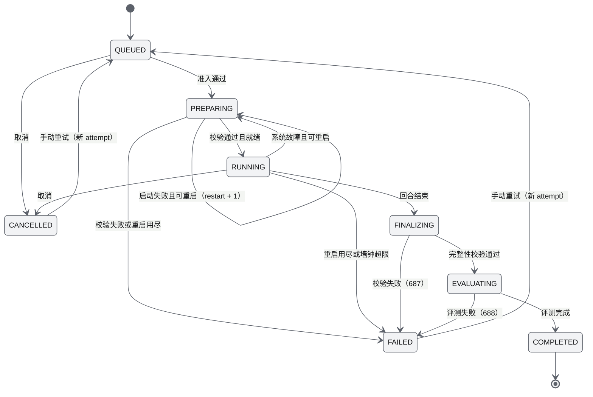
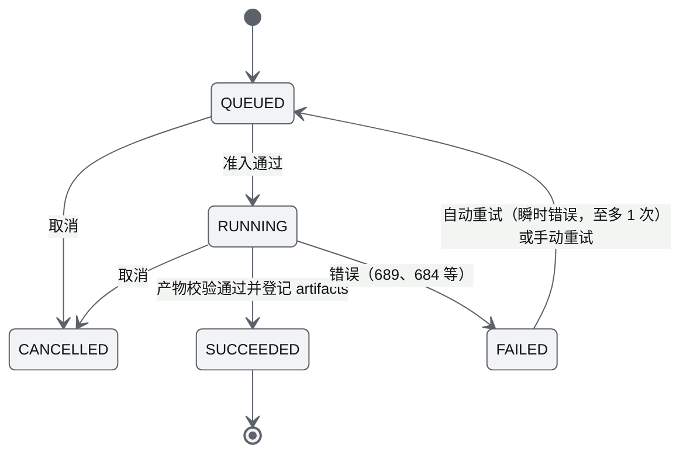
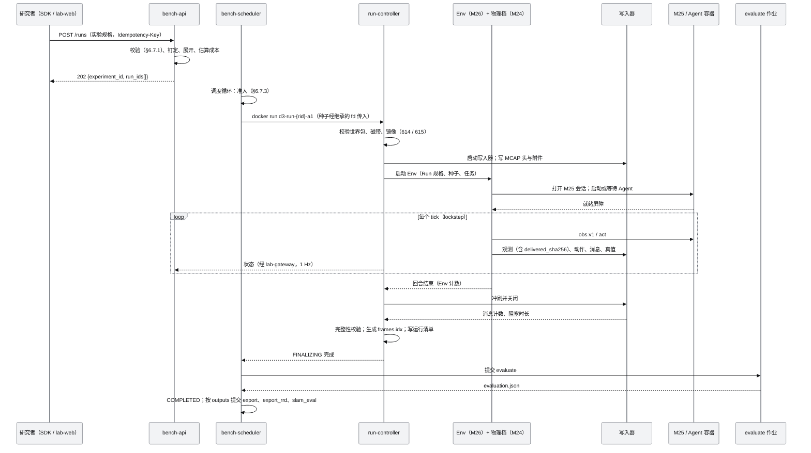
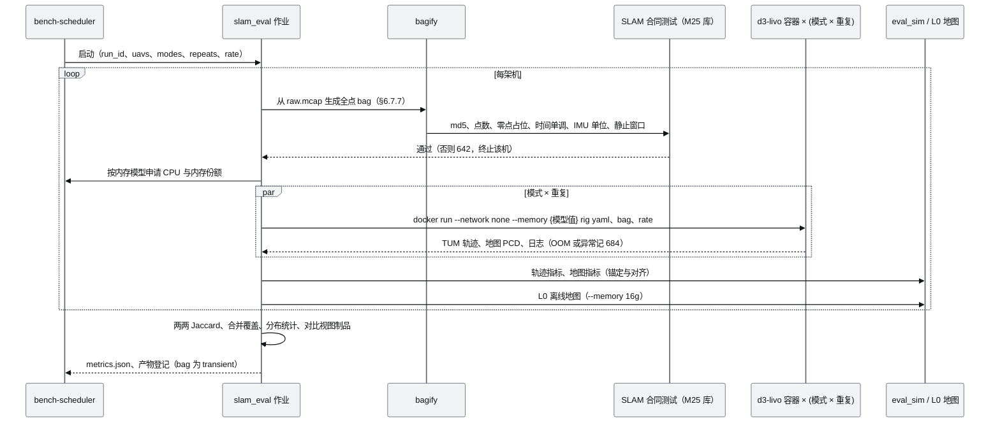
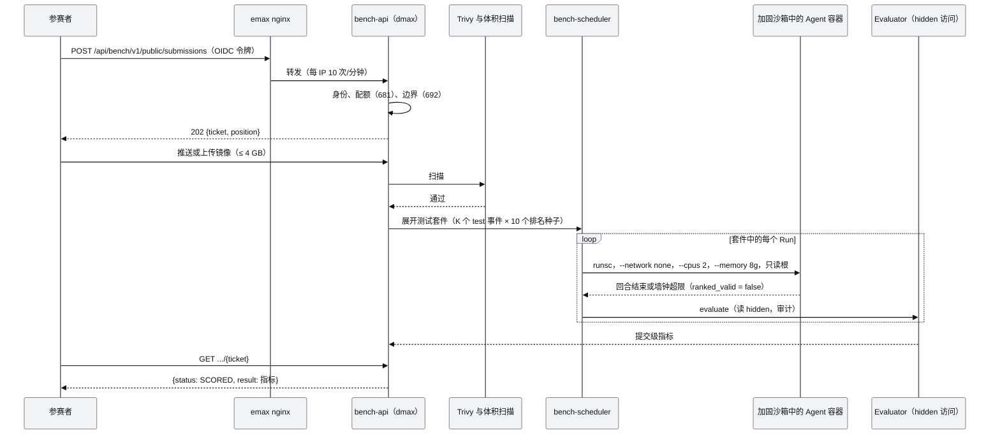
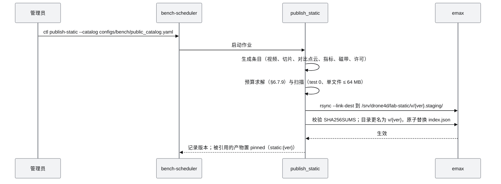

# M27 基准运行时与数据集 PRD（Benchmark Runtime & Dataset）

| 项 | 内容 |
|---|---|
| 文档编号 | AWR-M27 |
| 标题 | 基准运行时与数据集（Benchmark Runtime & Dataset）PRD：Run 规格与批量编排、队列与准入、MCAP 权威录制与存储治理、`.rrd` 派生与 catalog、数据集目录与导出、评价指标与 SLAM 轨道、数据集划分与隐藏 test 集、多赛道内部排行榜（各赛道四项指标与置信区间；合成主得分待定，v1.2）、内部提交（内部成员与受邀成员）、公开站只读样例制品与数据集分发、工作区服务进程（bench-api、lab-gateway、rerun-proxy、rerun-relay） |
| 编号说明 | 模块号 M27（[AWR-05](../05-D3-设计增补与决策记录.md) §5.0），需求前缀 `M27-`。AWR-05 v1.2 §1.3、§5.0 已按本文件名 `M27-基准运行时与数据集PRD.md` 登记（§13 第 1 条） |
| 版本 | v1.2 |
| 日期 | 2026-10-12 |
| 状态 | 草案 v1.1（按 AWR-05 v1.3 修订：基准排行优先、主得分合成、内部提交与受邀成员、公开站只读样例；修订内容汇总见 §14；2026-10-12 补记：按 AWR-05 v1.4 ADR-187 增加 Run 规格的外观来源与排名约束，见 §14.9；v1.2 按 AWR-05 v1.4 定稿（ADR-188、ADR-191、ADR-192）：排行榜改为"分轨 × 赛道"的多赛道数据模型、展示与验收，取消缺省合成权重（计算接口与版本字段保留），增加质量层覆写与 P3 高斯检视与编辑接口，修订内容汇总见 §15） |
| 上游文档 | 用户 D3 需求原文、补充要求与 2026-10-12 决策 [inputs/D3-需求原文-2026-10-11.md](../inputs/D3-需求原文-2026-10-11.md)（R-D3-01、05、06、10、11、12、13、15、22、27、28、29、32、33、35、36；v1.1 增加 2026-10-12 交互式确认的 R-D3-41、44、45、46、48、50；v1.2 增加第二次交互式讨论确认的 R-D3-52、54、56 与 AWR-05 ADR-188、ADR-191、ADR-192）；用户设计讨论 design-r1（§八、§九、§十）；[AWR-05](../05-D3-设计增补与决策记录.md) §2、§4、§5.6、§6.1、§7.7、§7.9、§7.11、§8、§10、§11、§12、§13、§14、§15，ADR-128、136、143、145、147 至 151、154、155、159、161 至 164、166；[AWR-04](../04-D2-设计增补与决策记录.md) ADR-093、111、123；[AWR-03](../03-设计基线与决策记录.md) §10.2、ADR-033、040、049；[17](../17-接口与实时协议规范.md) §1.3、§4.4、§8；D3 研究 [00-index](../research/d3/00-index.md) 与 [r1](../research/d3/r1-fast-livo2.md)、[r4](../research/d3/r4-mesh-lidar.md)、[r6](../research/d3/r6-event-runtime-benchmark.md)、[r7](../research/d3/r7-d2-code-audit.md)、[r8](../research/d3/r8-rerun.md) |
| 下游文档 | M15 D3 增补节（`/lab/runs`、`/lab/runs/:rid/lidar`、`/lab/runs/:rid/inspect`、`/lab/datasets`、`/lab/leaderboard`、`/lab/experiments/new` 的数据接口）；M16 D3 增补节（`tools/bench/d3/{batch_matrix,camera_throughput}.py` 等 harness 调用本模块 API）；M11 D3 增补节（`runtime.yaml` 的 `d3` profile、topic 与 MCAP 通道登记）；M12 D3 增补节（扩展点 11 的磁带演员源）；M00（契约 `bench/**`、原因码 680–699、`tools/deploy/dmax/**`）；17 号与 19 号说明书的 D3 增补节；`docs/impl/D3-*` |
| 适用版本范围 | V0.3（本期交付 D3）至 V1.0 |
| 写作规范 | 沿用 AWR-03 §10.2：中文、技术名词英文、需求编号、依据、mermaid、可测试验收、严禁 emoji 与状态字形；对外文案另受 AWR-05 §7.10 约束 |

## 0. 摘要

1. **定位**：M27 是 D3 的编排、录制、评测与数据权威。它接收 Run 规格，按资源与配额准入后调度 M26 Env、M24 物理档、M25 传感器服务与 Agent 容器执行运行；以 MCAP 作为唯一帧存储无损录制；运行结束后离线评测；按需派生数据集文件、`.rrd`、ROS bag、LeRobot 与 OpenLABEL；管理数据集划分、隐藏 test 集、容器提交与排行榜；生成公开站只读制品并发布完整数据集。M27 在运行期不向 Agent 暴露任何真值（AWR-05 §4.1、ADR-128）。
2. **Run 规格**：研究者提交的是实验规格（ExperimentSpec），M27 按种子展开为若干 Run，每个 Run 只含一个种子；配置哈希 `config_sha256` 不含种子，用于同配置多种子聚合；运行哈希 `run_hash` 覆盖全部版本与 `clock_profile`。排名运行的种子以 CSPRNG 生成，只存评测库，清单中只出现 HMAC 承诺值 `seed_commit`（ADR-161）。
3. **编排**：持久队列为 SQLite（WAL），沿用 D1 `awr.jobs.queue` 的设计；队列按四个优先级类与租户轮转调度，以 EASY 回填利用碎片资源；准入按 GPU 时间份额、显存、`d3.slice` 的 CPU 与内存、`/data/d3` 余量与写带宽预算计算，不满足时排队，不降低已准入运行的观测频率（ADR-162）。运行状态机沿用 AWR-05 §5.6.2，并细化为 attempt（手动重试）与 restart（自动重启，同一 attempt 内从回合起点重放）两级。
4. **录制与存储**：每个 Run 一个独立的无损写入器，产出 `raw.mcap`（观测层与运行层）、`truth/run_<id>.mcap`（真值层）与 `frames.idx`（只含偏移）。Agent 收到的字节即存档的字节，由 M26 提供的交付摘要逐帧核对。`/data/d3` 配额 10 TB、80% 告警、95% 停止准入；派生物按 transient、standard、pinned 三类保留并由清理作业回收。
5. **数据集与 Rerun**：数据集按"事件 → 真值（隐藏）→ 运行"三层组织；派生格式全部标注量化方式。`.rrd` 由 MCAP 离线派生，按 `obs.<uav>`、`truth`、`eval`、`agent.<uav>` 分层，注册到评测与分发两个 catalog，分发 catalog 只含观测层与 Agent 层；版本锁定 0.38.x。
6. **评测**：Evaluator 计算 EC、EC 覆盖、EU、AO_real（及参考量 AO_pos_LOS、AO_pos）、CE、安全与合规指标，`evaluation.json` 对同一输入逐字节可复现；SLAM 轨道由 `slam_eval` 作业生成全点 bag、以 4 倍速运行 FAST-LIVO2 独立容器 3 次重复、以 `eval_sim` 对 GLB 网格评测，主指标 RPE100，按"种子 × 重复"报告分布；P0b 同时产出 L0 离线已知位姿地图与两两 Jaccard。
7. **划分、提交与排行榜（v1.1）**：dev 集对内部成员与受邀成员公开磁带与真值；test 集真值存放在 `/data/d3/hidden/`，不出 dmax，访问一律审计；内部成员与受邀成员提交的 Agent 容器在加固沙箱中、只在 gz-sim 锁步档跑完测试套件后只返回指标；排行榜按"分轨 × 赛道"组织（v1.2）：赛道按事件类型或研究任务划分，每个赛道分别报告 EC、EU、AO_real、CE 四项指标及其 95% 置信区间（"种子 × 重复运行"的两阶段分层自助法），逐项给出名次与统计并列，另给出无权重的非支配层级；合成主得分为后续评分版本的待定项（v1.1 的缺省权重取消，计算接口保留）；排行榜只在内部工作区展示。v1.0 的 P3 公开配额提交按 R-D3-45 废止（§14）。
8. **公开站与分发**：`publish_static` 作业把精选的 dev 样例运行打包为只读样例制品（世界点云、磁带、RGB 与热成像视角视频、`public` 档切片与 `basemap.rrd`、LiDAR 与重建对比；v1.1 起不含指标表、主得分与任何排序），单文件 ≤ 64 MB、含两个保留版本总量 ≤ 3 GB，经 rsync 单向同步到 emax，10 min 内可回滚；完整数据集以版本包发布到 ModelScope（主）与 Hugging Face（镜像），带 sha256 清单、分层许可与引用信息。
9. **v1.1（D3-REV，§14）**：阶段按 AWR-05 ADR-175 重排（主得分、原型榜与内部成员提交在 P0a；排行榜 v1、受邀成员、隐藏 test 划分、存储治理与数据集导出在 P0b）；新增 M27-FR-159 至 FR-176、M27-AC-043 至 AC-050；废止 M27-FR-125 至 FR-129、FR-131 至 FR-133 与 FR-140 的公开提交条款，FR-130（加固）与 FR-153（公开路由）按 §14 修订。
10. **v1.2（D3-FINAL，§15）**：多赛道排行榜（赛道登记、逐项聚合与置信区间、逐项名次与非支配层级、合成接口保留、提交的赛道选择、快照导出）；质量层覆写接口（BN-31，P1）；高斯检视与编辑接口（BN-32 至 BN-34）与外观层视频作业（P3）；外观来源按结论 C0 定稿；新增 M27-FR-177 至 FR-187、M27-AC-051 至 AC-055；FR-159、160、163、164、165、175 与 M27-AC-044、045 的相关条款按 §15.6 修订。
11. **规模**：功能需求 158 条（P0 136 条；v1.1 增至 176 条、其中 9 条废止；v1.2 增至 187 条）、非功能需求 16 条、验收 42 条（v1.1 增至 50 条；v1.2 增至 55 条），映射 D3-AC-04、13 至 24、30、37、42 至 45、47、50 至 53；建议新增原因码 8 个；对基线的反馈 24 条（§13），其中须基线裁决的有：`d1_250` 物理频率不满足 `physics_hz ≥ 200`、实验规格与运行清单混用、P0a 验收要求的 AO_real 与 P1 排期冲突、公开配额的计量单位、任务简报契约缺失、多处路径所有权冲突。

---

## 1. 背景与目标

### 1.1 约束本模块的事实

| # | 事实 | 对设计的含义 | 依据 |
|---|---|---|---|
| F1 | D2 录制器有损：64 MB 有界队列在 75% 时丢弃 Full64、满时丢弃块消息；37 个实时 topic 中 18 个不进 MCAP；公开档与沙盒会话不录制 | D3 必须使用独立的无损写入器，不能复用 M12 写入器；M12 `writer.py`、`app.py` 不改 | r7 §3.8；`python/awr/recorder/writer.py`；ADR-148 |
| F2 | 同等内容 MCAP（zstd）449 MB、`.rrd`（LZ4）576 MB；`.rrd` 只保证读上一个 minor 版本 | MCAP 为归档权威，`.rrd` 为可再生的派生物；升级 Rerun 时以 MCAP 重新派生 | r8 §0 第 7 条、§9.4 |
| F3 | 720p JPEG 301–360 kB/帧；LiDAR 有效点约 2 MB/s/机；3 机 360 s 的 L2 运行持久约 6.5–7.3 GB，L2-depth 另加 15–24 GB；L1 3 机 360 s `raw.mcap` 439 KB | 容量规划与写带宽准入必须逐通道估算；L1 与 L2 的存储量级相差约 10⁴ 倍 | AWR-05 §5.6.4；r6 §11.2；r10 §3.5 |
| F4 | L1 单次 360 s 仿真 4.2–7.7 s；72 次运行用 10 个进程 60 s 完成 | L1 批量以 CPU 池进程并行为主，调度开销必须远小于运行时长（< 1 s/次） | r6 §12.3 |
| F5 | 朴素评测器在 30 机时超过 25 分钟；转发目击需要去重 | Evaluator 按秒分桶、对转发目击去重，复杂度与机数近似线性 | r6 §10.4、§12.4 |
| F6 | 覆盖扫描 AO_pos 0.92 而 AO_real 0；跟踪策略冗余度 1.4–1.6、协同收益 0–0.06；EU F1 0.53–0.65 明显低于 EC 0.88–1.00 | AO 以实际证据计；CE 同时报告冗余度与成本；EU 只读 Agent 自己的声明 | r6 §12.3；ADR-150 |
| F7 | FAST-LIVO2 为 GPL-2.0、只有 ROS1；8 实例 × 2 核 × 4 倍速，8 段 159 s 航迹 122 s 完成；每实例 RSS 2.2–5.3 GB；地图内存约 430 B/点，随扫过的表面积线性增长；首版 TSDF（0.15 m、80 m 深度）内存达约 400 GB | FAST-LIVO2 只以独立容器作业运行；内存按模型设定 `--memory` 并捕获 OOM；L0 离线地图必须用稀疏块并限制深度 | r1 §1、§4.7；AWR-05 §5.6.2；ADR-143 |
| F8 | 丢弃无回波点会触发 FAST-LIVO2 `preprocess.cpp:183` 的级联时间修正，最大漂移 0.46 m → 1.38 m，加湍流后 3 次全部发散 | bag 生成必须恢复每帧 20,000 点（无回波点以零占位），并以合同测试守护 | r1 §2.10、§4.5；AWR-05 §5.4.6 |
| F9 | 同一 bag 重复运行 FAST-LIVO2 有 cm–dm 级差异；RPE100 在 5 个种子间稳定（0.24–0.29%），ATE 与地图指标受偏置实现影响较大 | SLAM 结果按"种子 × 重复运行"报告分布；RPE100 为主指标 | r1 §4.5、§4.5.1 |
| F10 | Rerun：`application_id` 含点号会被改写并追加哈希后缀；内参必须放在子实体；Web Viewer 每帧摄入预算 10 ms；开源 catalog 3 个 Run 的跨 Run 查询 55 ms；高频小消息需 `send_columns` | 导出器以 CI 校验器强制实体路径规范；公开站只用时间窗切片 | r8 §0、§9.5、§9.7 |
| F11 | dmax 为共享机，GPU 争用下吞吐波动可达 3 倍；D3 配额 CPU ≤ 32 核、内存 ≤ 384 GB、`/data/d3` 10 TB；开发期每容器只绑定 GPU 2 或 3 之一，生产期独占 1 张 A40 并按窗口分时 | 调度器必须持有 GPU 日历与份额模型；性能类作业只在独占卡验收窗口运行 | AWR-05 §4.6、§4.7、ADR-151、ADR-163 |
| F12 | emax 4 核、无 GPU，D3 静态制品总占用（含 2 个保留版本）≤ 3 GB，单文件 ≤ 64 MB，`/lab-static/` 限速 2 MB/s | 公开制品必须由预算求解器装箱；完整数据集只经分发渠道 | AWR-05 §7.9、Q-D3-02 |
| F13 | D1/D2 已有可复用库：`awr.jobs.queue`（SQLite WAL 作业队列、认领、重试、崩溃标记）、`awr.runtime.procutil` 与 `awr.runtime.cgroup`（进程组回收、pidfd、叶子组与限额）、`awr.sandbox.adopt`（接管）、`awr.recorder.{mcap_index,chunk_cache,mcap_source}`（MCAP 随机读取与 seek）、`awr.api.{problem,audit,ratelimit}` | M27 以库调用方式复用，不修改上述 D2 文件 | 代码 `python/awr/**`；r7 §3.7、§3.8 |
| F14 | D1 时钟档 `d1_250` 的主时钟 250 Hz，但多旋翼 L1 物理与控制每 2 个 tick 执行一次（125 Hz）；`sandbox100` 为 100 Hz | AWR-05 要求 SLAM 轨道与 L2 IMU 输出 `physics_hz ≥ 200` 且缺省取 `d1_250`，两者不一致；M27 以物理档能力声明的 `physics_hz` 校验，不以档名判断（§13 第 2 条） | `python/awr/sim/runtime/clock_profile.py`（`D1_250.l1_every = 2`）；M08 §0 第 1 条 |
| F15 | M25 与 M26 的噪声为计数器式随机数，实现公开 | 排名运行的种子一旦泄漏，噪声即可反演；种子不得出现在 reset 配置、观测、错误消息、日志与公开清单中 | ADR-161；AWR-05 §8.5 |
| F16 | D1 契约约定：REST 业务载荷 snake_case + 单位后缀；UNIX 时刻字段以 `_unix_ns` 结尾并在 JSON 中以十进制字符串传输；错误为 problem+json，`code` 必须登记于 `reasons.json` | bench-api 全部沿用；新原因码先登记再使用 | 17 §1.3、§4.4、§8；`python/awr/api/problem.py` |

### 1.2 目标

| # | 目标 | 度量 |
|---|---|---|
| G1 | 同一事件可被任意机队配置反复运行，结果可复现、可审计 | 每个 Run 的清单记录全部版本与哈希；CPU 档 L1 同 ISA 逐字节、GPU 档同型号逐字节（D3-AC-17） |
| G2 | 录制无损、单一权威存储 | 背压下丢帧 0；Agent 收到的 RGB 字节与存档字节 sha256 一致（D3-AC-19） |
| G3 | 共享主机上的资源可控 | 写速率 p95 ≤ 预算；写入器阻塞 ≤ 墙钟 1%；配额与保留清理生效（D3-AC-22） |
| G4 | 指标以实际证据计分、口径统一、可对拍 | EC 与 r6 差 ≤ 0.1；EU、AO_real、CE 构造用例通过（D3-AC-18、30） |
| G5 | SLAM 轨道可批量、可对比 | RPE100 落在冻结区间；3 机 L0 与 FAST-LIVO2 地图可视对比（D3-AC-14、15） |
| G6 | 数据集可在外部直接使用 | 导出格式通过 schema 与回读校验；版本包 sha256 校验 100% 通过（D3-AC-42、50） |
| G7 | 排行榜可信 | test 集真值外部访问 0；提交容器无网络；红队负向用例全部阻断（D3-AC-43、44） |
| G8 | 公开站只读视图不影响 D2 | emax 无 D3 进程；磁盘与带宽不超预算；D2 容量不回退（D3-AC-21） |

### 1.3 非目标

1. 不实现 Env、观测过滤与链路模型（M26）、物理档（M24）、传感器生成（M25）、事件编译（M23）与世界构建（M22）；M27 只编排这些组件的作业。
2. 不运营在线竞赛（AWR-05 §2.3"不在 D3"）；排行榜只提供提交、评分与按可见性规则公开结果。
3. 不在 emax 执行任何 D3 计算（R-D3-27、R-D3-46）；公开站只承载样例静态制品（v1.1：不再有提交转发，不展示排行榜）。
4. 不把 FAST-LIVO2 源码或链接产物纳入仓库（ADR-143、ADR-154）。
5. 不以 `.rrd` 作为归档格式；不嵌入 Foxglove 或 Lichtblick（ADR-149）。

### 1.4 术语（本文新增，其余见 AWR-05 §1.2）

| 术语 | 定义 |
|---|---|
| 实验规格（ExperimentSpec） | 研究者一次提交的完整描述：世界、事件、机队、策略、档位、种子策略、输出与保留；可含多个种子，经展开得到多个 Run |
| Run 规格（RunSpec） | 实验规格按单个种子展开后的不可变规格；`run_id` 与之一一对应 |
| 运行清单（RunManifest） | `run_manifest.json`：Run 规格 + 自动填写的版本块 + 执行摘要（attempt、存储量、背压统计、哈希）；排名运行不含种子明文 |
| 配置键（config key） | `config_sha256`：Run 规格去掉种子与标识后的规范化哈希；同一配置键下的多个种子构成一组统计样本 |
| attempt | 同一 `run_id` 的一次完整执行尝试；手动重试产生新 attempt，原 attempt 的记录不变 |
| restart | attempt 内的自动重启：故障后重启实例并从回合起点重放，不产生新 attempt |
| 排名运行 / 开发运行 | `ranked = true` 的运行进入排行榜或 test 集评分，种子保密；其余为开发运行，种子可由研究者指定 |
| 评测库（EvalStore） | 只对 Evaluator 与评测员开放的存储：排名种子、`det_id → actor` 映射、真值位姿、`truth.rrd` 与 `eval.rrd`、test 集真值引用 |
| 派生物 | 由 `raw.mcap` 与真值文件按需生成、可随时重建的产物：逐文件导出、bag、PCD、`.rrd`、LeRobot、OpenLABEL、视角视频、切片 |
| 作业（job） | 队列中的一个可调度单元：`world_build`、`event_compile`、`l1_run`、`l2_run`、`realistic_run`、`slam_eval`、`render_offline`、`export`、`evaluate`、`publish_static`、`release`、`retention_gc`、`slam_regress` |
| 成本向量（CostVector） | 一个作业的资源估计：GPU 时间份额、显存、CPU 核、内存、存储写入量、平均写速率、预计墙钟 |
| 测试套件（TestSuite） | 一个提交在 test 集上需要完成的全部运行：K 个 test 事件 × S 个排名种子 × 允许的观测档 |
| 提交（Submission） | 一个 Agent 容器镜像及其评测请求；内部研究者与公开参赛者共用同一对象，来源不同 |
| 静态制品包（lab-static bundle） | 公开站 `/lab-static/v/<version>/` 下的只读文件集合，索引为版本目录之外的 `/lab-static/index.json` |
| 发布包（Release） | 对外分发的完整数据集版本，带语义化版本号、sha256 清单、许可与引用 |

---

## 2. 范围

### 2.1 分阶段范围

v1.1 按 AWR-05 v1.3（ADR-174、ADR-175、ADR-182 至 ADR-184）重排；v1.0 的阶段对照见 §14.2。

| 阶段 | M27 交付 | 工作包 | D3-AC |
|---|---|---|---|
| P-1 | 契约草案 `bench/run_spec.v1`、`bench/evaluation.v1`、`bench/session.v1`、`bench/task.v1`、`bench/submission.v1`、`bench/score.v1`、`bench/board.v1`、`rec/mcap_channels.json` 的 D3 通道、原因码 680–699；`/data` 持续写带宽实测（fio）与 `slam_eval` 内存模型参数 r_map 实测；本 PRD | WP-D3-01、02、03 | 46（文案，经 M15）、47 |
| P0a（最小基准闭环） | Run 规格与展开（缺省 `physics = realistic`）、种子保密、队列与准入（含 `eval` 优先级类）、调度与容器编排、运行状态机、无损写入器与 `frames.idx`、EC、EU v0、AO_real v0、CE v0（归一化）、安全间距评测、四项指标与置信区间（`d3-score-0`，v1.2 不含权重）、原型榜（交汇与交接赛道）、内部成员提交流水线与 `submission_eval`、bench-api（会话、世界、事件、运行、提交与排行榜接口）、lab-gateway 与 rerun-proxy 进程骨架、`bench/run/{rid}/status` topic | WP-D3-09、30、11（部分）、12（部分） | 17、18、19、51、56、57（原型） |
| P0b（基准 v1） | 排行榜 v1（分轨 × 赛道、榜单版本、`d3-score-1`（`weights = null`）、test 划分与秘密种子集、逐项统计并列与非支配层级）、受邀成员角色与配额、加固沙箱、`ranked_eval` 保留与存储治理（配额、写带宽、保留清理）、平台复现审计、数据集导出（配套）、`slam_eval` 与 L0 离线地图、`.rrd` 派生与两个 catalog、`public` 档切片与 `basemap.rrd`、`publish_static` 样例制品与 emax 同步、HKisland03 回归 | WP-D3-35、09（P0b 部分）、25、27（制品部分） | 13（bag 部分）、14、15、20、21、22、43、57（v1）、59、63 |
| P1 | AO_real v1（按机队相机的 oracle）、EU 与 CE 的诊断扩展、实验级报告与边际收益曲线；`D3Catalog` 查询封装；`std5-l2` 与 `llm-std3-l2` 分轨；成本估算接口（机队与策略配置页使用）；质量层覆写接口 BN-31（v1.2） | WP-D3-16、15（分轨部分）、17（BN-31） | 30、65（评测侧） |
| P2 | Interactive 模式的实现磁带评测与事件偏离度；L1、L2 与热成像阈值标定表的消费；Fast 与 Realistic 对照报告的存储与检索；town 协同探索演示的 Run 集与公开样例 | WP-D3-21（评测侧）、28 | 37（评测侧）、38、52 |
| P3 | 批量矩阵、事件族划分（扩充 test 划分）、LeRobot 与 OpenLABEL 导出、catalog 浏览、发布包与分发渠道、对标对照报告的数据支持；高斯检视与编辑接口 BN-32 至 BN-34 与外观层视频作业（v1.2） | WP-D3-23、29、40 | 42、45、50、53（数据支持） |

### 2.2 与其他模块的边界

| 模块 | M27 向其提供 | M27 从其获取 | 边界规则 |
|---|---|---|---|
| M22 | `world_build` 作业的排队与资源 | 世界包（`contentVersion`、`files[]` sha256、`sensorHints`、许可字段、raycast 网格、点云层） | M27 只校验与引用，不修改世界包 |
| M23 | `event_compile` 作业的排队；事件族变体的划分 | 磁带（`tape.bin`、`tape.json`、`content_sha256`）、`event_truth.json`、`event_graph.json`、`observability.npz`、`TapeReader` | 磁带哈希由 `TapeReader` 对存储的原始字节校验；M27 不重新序列化 |
| M24 | 物理档实例的启动参数（`clock_profile`、种子、GPU 绑定、`GZ_PARTITION`） | 能力声明（`physics_hz`、`pose_history_hz`、`ranked`、`max_vehicles`）、`step_done` 统计 | `physics_hz` 以能力声明为准（F14） |
| M25 | GPU Worker 的份额与在途上限配置；`render_offline` 作业 | TruthFrame（经 Env 交写入器）、帧交付摘要、`rig.json` 与 SLAM 合同测试、背压统计 | Benchmark 锁步下 M27 不改变观测集合（ADR-162） |
| M26 | Run 规格（经 Env 构造参数）、种子（只交 Env 进程，不交 Agent）、Agent 容器的启动与加固参数、WS 代理 | 观测与动作流、消息记录、交付摘要、`agent_timeouts`、Agent 调试 `.rrd` | Env 是运行期唯一与 Agent 交互的组件；M27 不直接向 Agent 发送任何数据 |
| M12 | D3 通道的读取适配；扩展点 11 的磁带演员源所需的磁带引用 | `McapSource` seek、`SegmentIndex`、`ChunkCache` | M12 文件只由 M12 修改（扩展点 11） |
| M15 | 全部 `/lab` 数据接口、静态制品索引 `lab_static_index.v1` | 页面与文案 | 界面字符串由 M15 维护，M27 的原因码文案经 17 号登记 |
| M16 | 批量与吞吐 harness 的作业接口、ADR-033 验收窗口预约 | harness 脚本 | `tools/bench/d3/**` 按文件分属（§13 第 12 条） |
| M17 | — | 进程管理与接管库（`awr.sandbox.adopt`）、令牌与限流模式 | 实验池与公开沙盒池分开，不共享容量模型 |
| M11 | `bench/run/{rid}/status` topic 定义；`d3` profile 的进程声明内容 | 网关库（`awr.api.rt`）、`runtime.yaml` | lab-gateway 复用库、不改 `api/rt/gateway.py` |
| M00 | 契约草案、原因码草案、部署镜像（bench、livo） | 契约生成物、copy-lint、`tools/deploy/dmax/{compose,common}` | 契约只增不改（ADR-155） |

### 2.3 路径所有权（M27）

依据 AWR-05 §5.6.8 与 §12.2：`python/awr/bench/**`（含 `rt_main.py` 即 lab-gateway、`rerun_proxy/`）、`python/awr/api/bench_main.py`（所有权冲突见 §13 第 11 条）、`packages/contracts/bench/**`（起草，M00 合入）、`tools/deploy/dmax/images/{bench,livo}/**`、`configs/bench/**`（本文增补）、`tests/d3/{bench,slam,rerun,deploy,submit,publish}/**`（本文增补；`tests/d3/lab/**` 与 M15 按文件分属）。

---

## 3. 用户与用例

| 角色 | 来源 | 典型操作 | 最低角色（ADR-166） |
|---|---|---|---|
| 访客 | 公开站 | 浏览样例运行（事件回放、多机私有视角、样例数据检视）与世界；下载样例切片（v1.1：不查看排行榜与指标比较） | 访客 |
| 受邀成员（v1.1，取代公开参赛者） | 内部工作区（ZeroTier + 会话） | 推送 Agent 镜像、提交正式评测、查询本团队状态与结果、撤回、设置内部榜可见性；读取内部排行榜 | `invited` |
| 研究者 | 内部工作区（ZeroTier + 会话） | 提交实验、取消与重试、查看运行与指标、导出、检视本人运行的 Agent 层 | 研究者 |
| 评测员 | 内部工作区 | 查看真值叠加与评测 catalog、复核评分、查看 test 集结果、发起重新评测 | 评测员 |
| 管理员 | 内部工作区与 CLI | 配额、优先级、GPU 日历、保留策略、发布静态制品与发布包、令牌签发 | 管理员 |
| 数据集用户 | 分发渠道 | 下载版本包、校验 sha256、按 LeRobot 或 MCAP 读取 | — |

| 用例 | 阶段 | 流程摘要 | 涉及需求 |
|---|---|---|---|
| UC-01 同一事件多策略比较 | P0a | 研究者经 SDK 或 `POST /runs` 提交 3 种机队配置 × 10 个种子（L1），系统展开 30 个 Run，排队执行并评分，`/lab/datasets` 显示策略对比 | §4.1、§4.2、§4.3、§4.8 |
| UC-02 L2 数据采集 | P0a | 3 机 L2 运行 360 s，产出 RGB、实例、语义与可见度，导出逐文件数据集 | §4.4、§4.6 |
| UC-03 SLAM 对比 | P0b | 3 架倒装 MID-360 机各飞 ≥ 60 s，`slam_eval` 生成 bag、运行 FAST-LIVO2 × 3 次、生成 L0 地图，对比视图显示三方叠加与 RPE 分布 | §4.9 |
| UC-04 评测复核 | P0a 起 | 评测员打开"评测视图"，核对真值叠加、可见度与评分明细，必要时发起重新评测 | §4.8、§4.15 |
| UC-05 公开站浏览 | P0b | 访客打开 `/lab/`，回放事件、浏览视角视频与指标表，下载 10 s 切片 | §4.12 |
| UC-06 批量生产 | P3 | 管理员提交 3 个事件族 × 6 种策略 × 10 个种子的矩阵（180 次 L2），系统无人值守完成、失败自动重试、导出 MCAP、LeRobot、OpenLABEL、bag 与 `.rrd` | §4.2、§4.6、§4.13 |
| UC-07 容器提交 | P0a（内部成员）、P0b（受邀成员）（v1.1） | 参赛者提交镜像，系统扫描、在无网络沙箱中完成测试套件、只返回指标，参赛者选择公开后进入排行榜 | §4.10、§4.11 |
| UC-08 数据集发布 | P3 | 管理员冻结一组运行，生成版本包，上传到分发渠道并校验，emax 发布索引页 | §4.13 |

---
## 4. 功能需求

表头沿用 AWR-03 §10.2；按 AWR-05 §1.2，"优先级"列取 P0、P1、P2（对应阻塞、应交付、可延期），"阶段"列取 P-1、P0a、P0b、P1、P2、P3（首次交付的阶段）。"需求描述"列中的 §x 指本文（注明 AWR-05 者除外）；"依据"列中不带文档名的 §x 指 AWR-05，指本文时写"本文 §x"。

### 4.1 实验规格、展开与运行哈希

| 编号 | 需求描述 | 优先级 | 阶段 | 验收要点 | 依据 |
|---|---|---|---|---|---|
| M27-FR-001 | 实验规格 schema 为 `drone4d.bench.run_spec.v1`（契约 `packages/contracts/bench/run_spec.v1.schema.json`），字段、类型与单位见 §7.2；`additionalProperties: false`；未知字段返回 682 `{field, why: unknown_field}` | P0 | P0a | M27-AC-001 | §5.6.1、§8.1 |
| M27-FR-002 | 静态校验按 §6.7.1 规则表执行，一次报出全部错误（`detail.errors[]`，每项带字段路径与原始原因码，如 600、614、615、630、633、643、662），不在首个错误处停止；HTTP 422 + 682 | P0 | P0a | M27-AC-001 | ADR-133 的"一次报出全部错误"做法；本文设定 |
| M27-FR-003 | 资产钉定：提交时把世界 `contentVersion`、事件 `version` 与 `tape_content_sha256`、策略镜像标签解析为不可变引用（镜像一律以 digest），写入 Run 规格；可变引用不进入 Run 规格；钉定失败返回 615 或 682 | P0 | P0a | M27-AC-001 | ADR-136（复现需要不可变输入） |
| M27-FR-004 | 种子展开：`seeds[]`（显式，只用于开发运行）与 `seed_count`（CSPRNG）二选一；每个种子展开为一个 Run 规格，`run_id = "run-" + 10 位 base32（[a-z2-7]）`，`experiment_id = "exp-" + 10 位 base32`；展开结果在一个事务中写入队列；响应 `202 {experiment_id, run_ids[]}` | P0 | P0a | M27-AC-001 | §5.6.1、§8.2 |
| M27-FR-005 | 排名运行种子：`ranked = true` 时禁止 `seeds[]`（682 `why = explicit_seed_in_ranked`）；种子以 `secrets.randbits(63)` 生成，只写入 EvalStore；运行清单只含 `seed_commit = hex(HMAC-SHA256(K_eval, run_id ‖ ":" ‖ seed))`；运行结束后评测员可查询明文并以承诺值核对 | P0 | P0a | M27-AC-002 | ADR-161 |
| M27-FR-006 | 种子流转：排名种子只经调度器以继承的文件描述符传给 Env 进程，不经环境变量、命令行参数与日志；Agent 容器、bench-api 响应、错误消息、`run_manifest.json`、分发 catalog、静态制品中不得出现种子明文；日志写出前经脱敏过滤器（匹配种子的十进制与十六进制表示） | P0 | P0a | M27-AC-002 | ADR-161、D3-AC-16 |
| M27-FR-007 | 配置键与运行哈希：`config_sha256 = sha256(JCS(规格 − {run_id, experiment_id, experiment, seed, seed_commit, submitted_by, created_unix_ns, retention, priority}))`；`spec_sha256 = sha256(JCS(规格 − {run_id, experiment_id, experiment, submitted_by, created_unix_ns, retention, priority}，并加入 seed_commit))`；`run_hash = sha256(spec_sha256 的 32 字节 ‖ JCS(versions))`，在 PREPARING 填写 `versions` 后计算；`clock_profile`、噪声档参数表版本、`reflectance_model`、任一镜像 digest 变化时 `run_hash` 改变 | P0 | P0a | M27-AC-001 | ADR-136、D3-AC-17 |
| M27-FR-008 | 版本块：PREPARING 阶段由 M27 填写 `versions`（contracts、renderer、gz 与插件、各镜像 digest、GPU 型号与驱动、CPU ISA、`clock_profile` 全量、噪声档参数表版本、`reflectance_model`、evaluator、Rerun、git sha）；用户提交的 `versions` 被忽略并在响应 `warnings[]` 中说明 | P0 | P0a | M27-AC-001 | §5.6.1、§4.5 |
| M27-FR-009 | 时钟档校验：以 M24 对所选物理档与 `clock_profile` 的能力声明取 `physics_hz` 与 `pose_history_hz`；当 `outputs` 含 `imu` 或 `bag`、或 `slam.enabled = true`、或观测档为 L2 / L2-depth 且机队含 IMU 传感器时，要求 `physics_hz ≥ 200`，否则 682 `why = physics_hz_insufficient`；不以档名推断频率 | P0 | P0a | M27-AC-001 | ADR-160；F14；本文 §13 第 2 条 |
| M27-FR-010 | 策略：`policy.kind ∈ {image, sdk, reference}`；`image` 以 digest 引用；`sdk` 只用于内部开发运行（`ranked` 必须为 false）；`reference` 为 M26 参考策略的白名单名称（`hover`、`guard`、`coverage`、`track`、`track_share`）；`reference` 枚举为本文增补 | P0 | P0a | M27-AC-001 | §5.6.1、§5.6.7；本文 §13 第 14 条 |
| M27-FR-011 | 排名约束：`ranked = true` 要求 `policy.kind ∈ {image, reference}`、`physics = fast`（P2 起可为 `realistic`，单列分组）、`obs_level ∈ {L1, L2, L2-depth}`、`mode = exogenous`（P2 起 Interactive 单列分组）、`seed_count ≥ 10`；SITL 恒为 `ranked = false`，请求排名返回 633 | P0 | P0a | M27-AC-001 | ADR-147、ADR-159 |
| M27-FR-012 | 任务：`task` 引用 `bench/task.v1`（公开简报 + 评测规则：最低观测档、高度包络、安全间距、是否已知目标）；未给出时取事件的缺省任务；任务内容纳入 `config_sha256`；Env 只向 Agent 下发简报部分 | P0 | P0a | M27-AC-001 | §5.5.4、§5.6.5；本文 §13 第 8 条 |
| M27-FR-013 | 实验：一个实验的全部 Run 引用同一世界 `contentVersion` 与同一磁带 `content_sha256`；实验对应 Rerun catalog 的一个 dataset；实验记录名称、项目、说明、创建者、Run 计数与聚合状态 | P0 | P0a | M27-AC-004 | §1.2 术语"实验" |
| M27-FR-014 | 成本估算：`POST /api/bench/v1/runs/estimate` 返回每个 Run 的成本向量、预计墙钟、持久与派生存储量、平均写速率与预计开始时刻（算法 §6.7.2）；机队与策略配置页调用 | P1 | P0a（接口）、P1（界面） | M27-AC-003 | §7.3 资源估算 |
| M27-FR-015 | 输出集合：`outputs ⊆ {rgb, depth, gt_depth, seg, lidar, imu, gnss, bag, rrd, files, lerobot, openlabel}`；`depth` 只允许 `obs_level = L2-depth`；`gt_depth` 只由 `render_offline` 按需生成；`bag`、`rrd`、`files`、`lerobot`、`openlabel` 为运行结束后自动触发的派生作业 | P0 | P0a | M27-AC-001 | §5.6.1、ADR-163 |
| M27-FR-016 | 时长：`duration_s` 缺省为磁带时长，可缩短不可延长；起飞前静止窗口与空中出生悬停窗口计入仿真时长 | P1 | P0a | M27-AC-001 | §5.4.6 初始化 |
| M27-FR-017 | Interactive：`mode = interactive`（P2）时 Run 产出实现磁带，评测以实现磁带为真值，不同 Run 不共用真值，排行榜单列 | P1 | P2 | M27-AC-039 | ADR-135 |

### 4.2 队列、调度与准入

| 编号 | 需求描述 | 优先级 | 阶段 | 验收要点 | 依据 |
|---|---|---|---|---|---|
| M27-FR-018 | 持久队列：`/data/d3/bench/bench.sqlite`（WAL），表结构见 §6.2.3；bench-scheduler 为 QUEUED 之后全部状态的唯一推进者，bench-api 只写入 QUEUED 记录与取消请求；数据库每日热备份 | P0 | P0a | M27-AC-005 | F13；`awr.jobs.queue` |
| M27-FR-019 | （v1.1 修订：优先级类为 `preview` > `eval`（正式评测与平台审计）> `research` > `batch`，取消 `public` 类，见 FR-173）优先级类：`preview`（交互预览）> `research`（研究者提交）> `batch`（批量生产）> `public`（公开配额提交）；同类内按租户（项目）轮转，租户内先到先服务 | P0 | P0a | M27-AC-003 | §5.6.2 调度 |
| M27-FR-020 | 回填：最高优先级队首作业因资源不足无法准入时，预计墙钟不超过队首预计等待时长的较低优先级作业可回填（EASY 回填，§6.7.3）；回填不得推迟队首的预计开始时刻 | P1 | P0a | M27-AC-003 | 本文设定：提高碎片资源利用率 |
| M27-FR-021 | 准入：成本向量同时满足 GPU 时间份额（按窗口与负载类：预览 ≤ 10%、在线闭环 ≤ 60%、离线 ≤ 30%）、显存（M25 Worker ≤ 24 GB，gz 实例 ≤ 4 个，每个按 2 GB 与 10% GPU 时间计）、`d3.slice` CPU ≤ 32 核与内存 ≤ 384 GB、`/data/d3` 余量与写带宽预算；任一不满足时保持 QUEUED 并记录 `blocked_by` | P0 | P0a | M27-AC-003 | §4.7、ADR-151、ADR-163 |
| M27-FR-022 | GPU 日历：`configs/bench/gpu_calendar.yaml` 声明开发卡（GPU 2、3）、独占卡（缺省 GPU 3）与验收、生产、训练窗口；验收窗口内只准入 `acceptance = true` 的作业；开发期 GPU 作业只绑定单卡；独占卡未到位时性能类作业标注"共享卡条件" | P0 | P0a | M27-AC-003 | R-D3-28、§4.7、Q-D3-01 |
| M27-FR-023 | 队列上限：全局排队 ≤ 10,000 个作业；每租户 ≤ 2,000 个 Run；每实验 ≤ 2,000 个 Run；超限返回 681 并附 `retry_after_s` | P0 | P0a | M27-AC-003 | 本文设定 |
| M27-FR-024 | 取消：QUEUED 立即 CANCELLED；PREPARING 与 RUNNING 在 10 s 内终止进程组与容器，部分产物移入 `.attempts/<n>/`（保留 14 天）；FINALIZING 与 EVALUATING 不可取消（680） | P0 | P0a | M27-AC-004 | §5.6.2 |
| M27-FR-025 | 容器：作业以容器运行，命名 `d3-<组件>-<run_id>-a<attempt>`，一律带 `--memory`、`--cpus`、`--cgroup-parent=d3.slice/<类>`；需要外网的构建与拉取使用 `--dns 223.5.5.5` 或 host 网络；GPU 作业带单卡 `--gpus device=N`；标签 `awr.d3.run_id`、`awr.d3.attempt`、`awr.d3.job` | P0 | P0a | M27-AC-005 | §4.6 隔离与命名 |
| M27-FR-026 | 接管：调度器重启后 30 s 内按容器标签与 pidfd 重建运行表；找不到对应容器的 RUNNING 作业按故障处理；以文件锁 `bench.sqlite.lock` 保证只有一个调度器实例 | P0 | P0a | M27-AC-005 | F13；`awr.sandbox.adopt` |
| M27-FR-027 | 等待估计：`GET /runs/{rid}` 返回排队位置与预计开始时刻（按 §6.7.3 的模拟调度每 10 s 刷新） | P1 | P0a | M27-AC-003 | §7.3 |
| M27-FR-028 | 队列状态：`GET /api/bench/v1/queue` 返回各优先级类的排队数、运行数、资源占用与阻塞原因计数（研究者及以上；本文增补接口） | P1 | P0a | M27-AC-003 | §7.1 `/lab` 首页；本文 §13 第 12 条 |
| M27-FR-029 | 验收预约：管理员以 `python -m awr.bench.ctl reserve --gpu <n> --from --to --suite` 预约独占卡验收窗口；窗口内只放行被验收的基准并记录同卡其他进程数为 0 的证据（`nvidia-smi` 快照写入作业记录） | P0 | P0a | M27-AC-003 | ADR-033、§4.7 |

### 4.3 运行生命周期与编排

| 编号 | 需求描述 | 优先级 | 阶段 | 验收要点 | 依据 |
|---|---|---|---|---|---|
| M27-FR-030 | 状态机见 §6.3：QUEUED、PREPARING、RUNNING、FINALIZING、EVALUATING、COMPLETED、FAILED、CANCELLED；每次迁移写审计并发布 `bench/run/{rid}/status` | P0 | P0a | M27-AC-004 | §5.6.2 |
| M27-FR-031 | PREPARING 校验：世界包 `files[]` sha256 与 `contentVersion`、磁带 `content_sha256`（614，由 `TapeReader` 对原始字节计算）与世界版本（615）、镜像 digest、GPU Worker 健康、EvalStore 可写；全部通过后写 MCAP 头与附件 | P0 | P0a | M27-AC-004 | §5.2.3、§5.6.2 |
| M27-FR-032 | PREPARING 启动：启动 Env（M26）、物理档实例（M24）、M25 会话与 Agent 容器，或等待 SDK 远程 Agent 连接（≤ 300 s）；就绪屏障缺省超时 120 s，超时为故障（631 或 683） | P0 | P0a | M27-AC-004 | §5.3.5（首帧 13–16 s） |
| M27-FR-033 | RUNNING 监控：每 1 s 读取 Env 进度（`t_sim_ns`、tick、已交付帧数、`agent_timeouts`、M25 等待时长、写入器阻塞时长）；仿真时刻连续 60 s 墙钟无推进判为挂起（故障） | P0 | P0a | M27-AC-004 | 本文设定 |
| M27-FR-034 | （v1.1 修订：正式评测的墙钟上限为 `10 × duration_s + 600 s`，见 FR-170）墙钟上限：内部 L2 运行缺省 `6 × duration_s + 900 s`、L1 运行 `duration_s + 300 s`；公开提交 `3 × duration_s + 600 s`；超限终止，内部运行 FAILED（693），公开提交的该运行 `ranked_valid = false` | P0 | P0a | M27-AC-004 | §5.6.7 |
| M27-FR-035 | 自动重启：系统故障（物理档实例崩溃或 632、M25 Worker 崩溃、写入器错误、Env 崩溃、挂起）时 `restart_count + 1`，部分产物移入 `.attempts/<n>/restart-<k>/`，从回合起点重放；排名运行沿用同一种子；缺省最多 2 次，用尽后 FAILED | P0 | P0a | M27-AC-004 | §5.6.2 |
| M27-FR-036 | Agent 故障不是系统故障：Agent 容器退出后，Env 按超时规则沿用上一动作至回合结束，`evaluation.json` 记录 `agent_exit_tick`；不触发重启或重试 | P0 | P0a | M27-AC-004 | §5.5.2；本文设定（防止以重试改变结果） |
| M27-FR-037 | FINALIZING：停止 Agent，冲刷并关闭写入器，执行完整性校验（§6.7.4），生成 `frames.idx`，写运行清单；校验失败 FAILED（687） | P0 | P0a | M27-AC-006 | §5.6.2、ADR-148 |
| M27-FR-038 | EVALUATING：提交 `evaluate` 作业；完成后写 `evaluation.json` 并迁移到 COMPLETED，再按 `outputs` 与 `slam` 设置触发派生作业（派生作业不阻塞 COMPLETED）；评测失败 FAILED（688），录制保留 | P0 | P0a | M27-AC-004 | §5.6.2 |
| M27-FR-039 | 手动重试：FAILED 或 CANCELLED 的 Run 经 `POST /runs/{rid}/retry` 以同一 Run 规格创建新 attempt（`run_id` 不变、`attempt + 1`），原 attempt 的记录与产物保留至保留期满；校验角色与配额 | P0 | P0a | M27-AC-004 | §5.6.2、§8.2 |
| M27-FR-040 | 背压：Benchmark 锁步下 M25 或写入器背压只延长墙钟；M27 不改变 `(uav, sensor, seq)` 集合、不降频；`m25_wait_s` 与 `writer_block_s` 写入运行清单 | P0 | P0a | M27-AC-006 | ADR-162 |
| M27-FR-041 | 状态 topic `bench/run/{rid}/status`（1 Hz，经 lab-gateway）：`{state, attempt, restart_count, t_sim_ns, progress_pct, frames_delivered, agent_timeouts, m25_wait_s, writer_block_s, blocked_by?, reason?}` | P0 | P0a | M27-AC-035 | §8.3 |
| M27-FR-042 | 实验级状态为其 Run 状态计数；全部 Run 进入终态后提交实验报告作业（策略对比表、边际收益曲线，§4.8） | P1 | P1 | M27-AC-019 | §7.7 |

### 4.4 录制（MCAP 权威）

| 编号 | 需求描述 | 优先级 | 阶段 | 验收要点 | 依据 |
|---|---|---|---|---|---|
| M27-FR-043 | 独立无损写入器：每个 Run 一个写入进程（`awr.bench.recorder`），有界队列 256 MiB，满时阻塞生产者并累计阻塞时长，不丢弃任何消息；D2 M12 写入器不改 | P0 | P0a | M27-AC-006 | ADR-148；F1 |
| M27-FR-044 | 文件划分：观测层与运行层写 `raw.mcap`，真值层写 `truth/run_<run_id>.mcap`（test 划分写 `/data/d3/hidden/<event>/truth/`）；通道到文件的映射见 §7.5；同一通道不得出现在两个文件中 | P0 | P0a | M27-AC-008 | §5.6.3 |
| M27-FR-045 | 编码：D3 新通道采用 Foxglove protobuf schema（`foxglove.CompressedImage`、`foxglove.RawImage`、`foxglove.PointCloud`、`foxglove.FrameTransform`）或登记于 `rec/mcap_channels.json` 的 awr 编码（`awr.sensor.lidar_frame.v2`、`awr.DroneState64.v1`）；JSON 与 msgpack 通道声明 schema 名与版本 | P0 | P0a | M27-AC-008 | ADR-148；r8 §9.4 |
| M27-FR-046 | 字节一致：图像通道写入 Agent 实际收到的编码字节；M26 为每帧计算 `delivered_sha256` 随帧交给写入器，写入器核对存储载荷的 sha256 相等，不等则 FAILED（687） | P0 | P0a | M27-AC-007 | ADR-163、D3-AC-19 |
| M27-FR-047 | 非 Agent 传感器：`deliver_to_agent = false` 的传感器（如 `slam_cam`）同样写入 `raw.mcap` 观测层，通道元数据标注 `agent_delivered = false`，不参与字节一致核对 | P0 | P0b | M27-AC-023 | §5.4.6；本文 §13 第 17 条 |
| M27-FR-048 | 时间：MCAP `log_time` 与 `publish_time` 均为 `t_sim_ns`（以磁带 t = 0 为原点的仿真纳秒）；墙钟时刻只出现在元数据记录 `run.wall`；传感器帧时间戳取曝光中点或扫描起点 | P0 | P0a | M27-AC-009 | §6.1.3 时间轴 |
| M27-FR-049 | 附件：`tape.bin`、`tape.json`、`world_manifest.json`、`run_spec.json`（排名运行不含种子）、`rig.json`（有 SLAM 时）作为 MCAP 附件写入 `raw.mcap` | P0 | P0a | M27-AC-008 | §5.6.3 |
| M27-FR-050 | 分块：chunk 目标 4 MiB、zstd 级别 3、写消息索引、块索引与摘要 | P0 | P0a | M27-AC-006 | 本文设定 |
| M27-FR-051 | `frames.idx` 只存 `(uav_no, sensor_no, seq) → (t_ns, chunk_offset, msg_offset, size)`（格式 §7.5.3），不存帧数据；大小 ≤ `raw.mcap` 的 0.1% | P0 | P0a | M27-AC-007 | ADR-163 |
| M27-FR-052 | 读取：内部回放与观测墙按 `frames.idx` 定位，复用 `awr.recorder.mcap_index.SegmentIndex` 与 `awr.recorder.chunk_cache.ChunkCache`；D3 Foxglove 通道的解码适配位于 `awr.bench.recorder.read`；内部帧接口 `GET /runs/{rid}/frames/{uav}/{sensor}/{seq}` | P0 | P0a | M27-AC-009 | §7.4 观测墙 |
| M27-FR-053 | 磁带演员源：为 M12 扩展点 11 提供 `TapeActorSource`（包装 M23 `TapeReader`）；内部回放的演员位置与磁带差 ≤ 5 cm；两个 Run 同步对比时以 `t_sim_ns` 对齐 | P0 | P0a | M27-AC-009 | §12.3 第 11 处、D3-AC-19 |
| M27-FR-054 | Agent 调试层：Agent 容器写出的 `agent.<uav>.rrd` 经输出卷收集；单文件 ≤ 512 MiB，超出截断并告警；校验只含 `/agents/<uav>/**` 与 `/fleet/<uav>/cam<k>/image/det`，不合规则丢弃并记录 | P1 | P0b | M27-AC-021 | §5.5.7、§6.1.2 |
| M27-FR-055 | 实时旁路（可选）：rerun-relay 以 LOSSY 读者订阅总线，有界队列满即丢弃最旧，经 `serve_grpc(memory_limit)` 输出；只在内部工作区开启；权威写入器不直接调用 `serve_grpc` | P2 | P1 | — | §6.1.2；r8 §9.8 |

### 4.5 存储治理与保留

| 编号 | 需求描述 | 优先级 | 阶段 | 验收要点 | 依据 |
|---|---|---|---|---|---|
| M27-FR-056 | 目录布局见 §8.3；`/data/d3` 子目录由 M27 统一分配，其他模块只写各自子目录 | P0 | P0a | M27-AC-010 | ADR-163 |
| M27-FR-057 | Run 级保留：`retention ∈ {transient, standard, pinned}` 决定 `raw.mcap` 与真值文件的保留期：transient 14 天、standard 180 天、pinned 不清理；FAILED 与 CANCELLED 的 attempt 一律 14 天；被发布包或排行榜引用时自动升为 pinned（用语界定见 §13 第 4 条） | P0 | P0a | M27-AC-010 | ADR-163 |
| M27-FR-058 | 派生物保留：bag 缺省 transient（7 天）；逐文件导出、`.rrd`、视角视频、切片缺省 standard（30 天）；被发布包、静态制品或排行榜引用时 pinned；来源 Run 被清理时其非 pinned 派生物同时清理 | P0 | P0a | M27-AC-010 | ADR-163 |
| M27-FR-059 | 清理作业 `retention_gc` 每小时执行；删除前写审计（路径、字节数、原因）；pinned 永不删除；支持 `--dry-run` | P0 | P0b | M27-AC-010 | ADR-163、D3-AC-22 |
| M27-FR-060 | 配额：`/data/d3` 10 TB；占用 ≥ 80% 告警；≥ 95% 停止准入新 Run 与新派生作业（685），运行中作业不中断；每租户软配额缺省 2 TB，超出时其新提交排队并告警 | P0 | P0b | M27-AC-011 | Q-D3-11 |
| M27-FR-061 | 写带宽预算 `B_write = min(300 MB/s, 0.5 × P-1 实测 /data 持续写带宽)`；调度器以运行中作业估计写速率之和准入；cgroup `io.stat` 实测 1 min 均值超预算 10% 时暂停新准入并记录 686 | P0 | P0b | M27-AC-011 | ADR-163、D3-AC-22 |
| M27-FR-062 | 存储账：每个 Run 在清单与数据库中记录 `bytes{raw, truth, frames_idx, derived{<kind>}}`；`GET /datasets` 汇总 | P0 | P0a | M27-AC-011 | ADR-163 |
| M27-FR-063 | 真值深度不在线存储：`gt_depth` 由 `render_offline` 按同一 PoseHistory 重建（二级确定性），产物为派生物 | P1 | P0a | — | §5.6.4 |

### 4.6 数据集目录与导出

| 编号 | 需求描述 | 优先级 | 阶段 | 验收要点 | 依据 |
|---|---|---|---|---|---|
| M27-FR-064 | 目录按"事件 → 真值 → 运行"三层（§7.6）；每个事件目录含 `index.json`（实验与 Run 列表、划分、指标摘要） | P0 | P0b | M27-AC-012 | §5.6.4；r6 §11.1 |
| M27-FR-065 | `world_manifest.json` 由世界包派生：世界 id、`contentVersion`、尺度与坐标系、网格与 NavMesh sha256、`sensorHints`、`license`、`citation`、`derivedFrom[]`（含 OSM ODbL 与 SRTM） | P0 | P0b | M27-AC-012 | ADR-154 |
| M27-FR-066 | 逐文件导出（`files`）：`derived/<uav>/rgb/<seq>.jpg`（存档字节原样）、`depth_log16/<seq>.png`（L2-depth）、`seg/{instance,semantic}/<seq>.png`（真值层，只在评测库或 dev 真值发布中）、`lidar/<seq>.bin`、`state.jsonl`（带噪导航解）、`messages.jsonl`、`actions.jsonl`、`reports.jsonl` | P0 | P0b | M27-AC-012 | §5.6.4 |
| M27-FR-067 | `depth_log16`：`v = round(65534 · log10(d / 0.3) / 4)`，`d ∈ [0.3, 3000] m`；无回波、越界或无覆盖写哨兵 65535；可选 `depth_f32`；元数据写量化方式与相对步长 1.4e-4 | P0 | P0b | M27-AC-013 | §5.6.4 派生格式 |
| M27-FR-068 | ROS bag 导出（`bag`）：ROS1 bag，Livox `CustomMsg` 全点流（每帧 20,000 点、无回波零占位）、`/livox/imu`（g 单位）、`/left_camera/image/compressed`；与 `slam_eval` 共用生成器（§6.7.7） | P0 | P0b | M27-AC-023 | §5.4.6 |
| M27-FR-069 | 点云导出：每帧 PCD（二进制，字段 `x y z intensity tag offset_time`）或 PLY；世界系去畸变点云只来自真值层 | P1 | P0b | M27-AC-012 | §5.6.4 |
| M27-FR-070 | LeRobot 导出：每个 `(run, uav)` 为一个 episode；`observation.images.<cam>`（由存档 JPEG 转码的 mp4）、`observation.state`（带噪导航解）、`action`（速度设定或航点）、`task`（简报文本）；格式版本在实施时锁定，以 `lerobot` 包 `LeRobotDataset` 回读测试为准 | P1 | P3 | M27-AC-031 | §5.6.4；r6 §11.3 |
| M27-FR-071 | OpenLABEL 导出：由 `event_graph.json`、`event_truth.json` 与真值实例生成 ASAM OpenLABEL 1.0 JSON（objects、actions、events、relations、逐帧二维框），以官方 JSON Schema 校验 | P1 | P3 | M27-AC-031 | §5.2.6 |
| M27-FR-072 | 导出清单 `export_manifest.json`：导出器版本、来源 `raw.mcap` sha256、每个文件 sha256、量化说明、许可与署名、生成工具声明 | P0 | P0b | M27-AC-012 | ADR-154 |
| M27-FR-073 | 划分约束：test 划分的 Run 不得导出任何真值层文件到 `/data/d3/dataset/`；`export` 作业对 test Run 请求真值层返回 691 并审计 | P0 | P0b | M27-AC-012 | ADR-147、D3-AC-18 |
| M27-FR-074 | 导出确定性：同一 `raw.mcap`、真值文件与导出器版本，导出文件逐字节一致（`export_manifest.json` 的生成时刻字段除外） | P1 | P0b | M27-AC-038 | ADR-136 |

### 4.7 Rerun 派生与 catalog

| 编号 | 需求描述 | 优先级 | 阶段 | 验收要点 | 依据 |
|---|---|---|---|---|---|
| M27-FR-075 | `export_rrd` 作业从 `raw.mcap`、真值文件与 `evaluation.json` 生成 `obs.<uav>.rrd`（每机一个分片进程）、`truth.rrd`、`eval.rrd`；离线导出与在线写入（如启用）逐实体一致 | P0 | P0b | M27-AC-021 | ADR-148、ADR-149 |
| M27-FR-076 | 实体路径与时间轴严格执行 AWR-05 §6.1.3：`application_id = drone4d-d3-<world>-<event>`，`recording_id = run_id`，时间轴 `sim_time`（权威）与 `tick`，关闭 `log_time` 与 `log_tick`；高频位姿与标量缓冲 1 s 后以 `send_columns` 写入 | P0 | P0b | M27-AC-021 | §6.1.3；r8 §9.2 |
| M27-FR-077 | 路径校验器 `awr.bench.rerun.lint`：路径字符集、层归属（`/truth/**` 只在 truth 层、`/eval/**` 只在 eval 层、`/agents/**` 只在 agent 层）、`Pinhole` 位于 `/image` 子实体、真值位姿不出现在 obs 层；与 `rerun rrd verify` 一同进入导出器 CI | P0 | P0b | M27-AC-021 | §6.1.3；r8 §0 第 8 条 |
| M27-FR-078 | 编码档位 `review`、`dataset`（内部缺省）、`public`、`archive-raw`，参数见 AWR-05 §6.1.5；深度 u16 线性 `meter = floor(65535 / far_m)`，越界写 0 并在元数据计数 | P0 | P0b | M27-AC-021 | §6.1.5 |
| M27-FR-079 | catalog：评测 catalog 注册全部层；分发 catalog 只注册 `obs.*` 与 `agent.*`；dataset 名 `<world>.<event>`；segment 属性按 AWR-05 §6.1.4（排名运行的 `seed` 只写评测 catalog）；评测版面与 Agent 版面 blueprint 随 dataset 注册 | P0 | P0b | M27-AC-021 | §6.1.4 |
| M27-FR-080 | 注册清单由数据集目录生成，持久化于 `/data/d3/rerun/<catalog>/registry.json`；catalog 服务启动时自动重放 | P0 | P0b | M27-AC-021 | §6.1.4 |
| M27-FR-081 | 版本：Python SDK、catalog 服务与前端 npm 包锁定同一 0.38.x；segment 属性 `rerun_version` 与运行时不一致时 `viewer_url` 返回迁移提示（694）；升级以 `rerun rrd migrate` 加回归查询，或由 MCAP 重新派生；镜像构建时执行 `rerun analytics disable` | P0 | P0b | M27-AC-021 | §6.1.5 版本 |
| M27-FR-082 | 公开切片：`public` 档时间窗切片（缺省 10 s，围绕关键事件）只含 `obs.*` 层与相机、LiDAR 静态标定，不含底图，单片 ≤ 64 MB；`basemap.rrd` 按事件舞台裁剪与降采样 ≤ 24 MB，与切片共用 `recording_id` 合并加载 | P0 | P0b | M27-AC-021 | §6.1.5、D3-AC-20 |
| M27-FR-083 | 查询封装 `awr.bench.rerun.D3Catalog`：`runs()`、`poses(runs, hz)`、`frames(run, uav, cam, t)`、`visibility(actor, window)`、`viewer_url(run, t)`；跨 3 个 Run 的位姿查询 ≤ 1 s | P0 | P1 | M27-AC-021 | §6.1.4；r8 §10.7 |
| M27-FR-084 | `GET /runs/{rid}/viewer_url` 返回经 rerun-proxy 的 catalog 深链接与 10 min 短期令牌；评测 catalog 的链接只对评测员与管理员签发 | P0 | P0b | M27-AC-022 | §7.11 |
| M27-FR-085 | `.rrd` 按 §4.5 保留；文件删除前先在 catalog 注销对应 segment | P0 | P0b | M27-AC-021 | D3-AC-20 |

### 4.8 评测

| 编号 | 需求描述 | 优先级 | 阶段 | 验收要点 | 依据 |
|---|---|---|---|---|---|
| M27-FR-086 | Evaluator 输入：`raw.mcap`（观测、动作、消息、声明）、真值文件（实例、可见度、逐点实例、真值位姿、`det_id` 映射）、磁带与 `event_truth.json`、`observability.npz`、Run 规格与任务；输出 `evaluation.json`（`bench/evaluation.v1`，§7.4）与 `eval.rrd` | P0 | P0a | M27-AC-014 | ADR-150 |
| M27-FR-087 | 识别谓词 `ident(u, p, k)`：L1 为投影高度 `h_px ≥ 16` 且身体 5 点 LOS 可见比例 ≥ 0.5；L2 为 TruthFrame `objects[]` 的 `h_px_unocc ≥ 16` 且 `visible_ratio ≥ 0.5`；阈值取自版本化阈值表 `eval_thresholds.v1`（P0 按 r6 口径冻结，P2 由 D3-AC-38 标定后经 ADR 修订） | P0 | P0a | M27-AC-014 | §5.6.5 |
| M27-FR-088 | EC 与 EC 覆盖按 §6.7.6；多人区间事件要求同一帧同时识别全部参与者；瞬时事件的覆盖窗口取事件前 2 s | P0 | P0a | M27-AC-014 | §5.6.5；r6 §12.4 |
| M27-FR-089 | 只在可观测区计分：事件发生在 quality 层不完整区域，或参与者处于 `INSIDE` 状态的时段，不计入分母，在 `evaluation.json` 的 `excluded[]` 中单列原因 | P0 | P0a | M27-AC-020 | ADR-131、D3-AC-04 |
| M27-FR-090 | AO：P0a 实现 AO_real v0（oracle 取 M23 `observability.npz` 参考相机，r6 口径）与 AO_pos；P1 实现 AO_real v1（oracle 按本 Run 机队相机与任务高度包络计算，§6.7.6），自 v1 起为排名口径；`evaluation.json` 记录 oracle 版本、相机模型、网格与高度档参数；不同相机配置不混排 | P0 | P0a（v0）、P1（v1） | M27-AC-014、018 | ADR-150；本文 §13 第 5 条 |
| M27-FR-091 | EU：Agent `report` 与真值按（类型相同、时间差 ≤ 15 s、参与者集合一致）一对一最大匹配；参与者对应由证据建立：L2 以证据帧 TruthFrame 实例图关联（IoU ≥ 0.3 或点落在膨胀 3 px 的掩膜内），L1 以 `det_id` 经评测库映射；输出 precision、recall、F1 与参与者级明细 | P0 | P0a（v0）、P1（诊断扩展） | M27-AC-017 | §5.6.5、D3-AC-30 |
| M27-FR-092 | CE：`G = EC(fleet) − max_u EC(u)`（`EC(u)` 只用该机自身识别）、`G / (\|U\| − 1)`、冗余度、航程 km、通信 KB、丢包率、`ΔEC/km = G / km`、`ΔEC/KB = G / KB`；实验级报告给出 EC 随 N 的边际收益曲线 | P0 | P0a（v0 与归一化 CE）、P1（边际收益曲线） | M27-AC-019 | §5.6.5 |
| M27-FR-093 | 安全与合规：近地告警、禁入体侵入、被发现次数（M18 度量）、无人机与演员最小间距（人员胶囊 r 0.4 m、h 1.8 m；车辆按类别包围盒；无人机按 M21 机型包络半径）；间距低于任务规则（缺省人员 5 m、车辆 3 m）按连续区段计次；包围体相交的运行 `ranked_valid = false` | P0 | P0a | M27-AC-015 | §5.6.5、ADR-150 |
| M27-FR-094 | 复杂度：对转发目击去重、按 1 s 分桶；30 机 L1 360 s 评测 ≤ 30 s；3 机 L2 360 s 评测 ≤ 120 s（dmax CPU 池 2 核） | P0 | P0a | M27-AC-016 | r6 §10.4、D3-AC-18 |
| M27-FR-095 | （v1.1 修订：95% 置信区间在 P0a 交付，方法按 FR-163）聚合：同一配置键至少 10 个种子；报告均值、标准差、样本数（P0a）与 95% 自助法置信区间（P1，2,000 次重采样，重采样种子固定）；样本数 < 10 时标注"不满足报告口径"，不进入排行榜 | P0 | P0a | M27-AC-019 | §5.6.5 评测规则 |
| M27-FR-096 | 确定性：同一输入与 Evaluator 版本，`evaluation.json` 逐字节一致（JCS 规范化、浮点按 IEEE-754 最短往返表示、集合排序输出） | P0 | P0a | M27-AC-038 | ADR-136 |
| M27-FR-097 | 版本与重评：`evaluator_version` 采用语义化版本；主版本变更时提交重评作业，旧分数保留并标注版本；排行榜按评测器主版本分组 | P0 | P0a | M27-AC-032 | 本文设定 |
| M27-FR-098 | Interactive：以实现磁带为真值评测，附加事件偏离度（逐演员平均位置偏差、事件集合差异）与被发现次数 | P1 | P2 | M27-AC-039 | ADR-135 |
| M27-FR-099 | L1 与 L2 一致性：同一 L2 运行同时计算 L1 与 L2 识别判定并输出一致率，供 D3-AC-38 标定 | P1 | P2 | — | D3-AC-38 |
| M27-FR-100 | 评测视图数据：`eval.rrd` 写 `/eval/visibility/<uav>`、`/eval/metrics/<name>` 时间序列；评测 blueprint 叠加真值、观测与 Agent 信念 | P1 | P0b | M27-AC-021 | §6.1.3；r8 §10.8 |

### 4.9 SLAM 轨道

| 编号 | 需求描述 | 优先级 | 阶段 | 验收要点 | 依据 |
|---|---|---|---|---|---|
| M27-FR-101 | Run 规格 `slam{enabled, uavs[], modes ⊆ {livo, lio}（缺省两者，livo 为主口径）, repeats（缺省 3）, rate（缺省 4）}`；`enabled = true` 时运行完成后自动提交 `slam_eval`；`POST /runs/{rid}/slam_eval` 可重跑（本文增补接口） | P0 | P0b | M27-AC-024 | ADR-143 |
| M27-FR-102 | bag 生成：从 `raw.mcap` 读 LiDAR、IMU 与 `slam_cam` 帧，按 `offset_time / 5000 ns` 恢复每帧 20,000 点，无回波点写 `(0, 0, 0)`、反射率 0、tag 0；生成后执行 M25 的 SLAM 合同测试，不通过返回 642 且不运行 FAST-LIVO2 | P0 | P0b | M27-AC-023 | §5.4.6、D3-AC-13；F8 |
| M27-FR-103 | FAST-LIVO2 容器：镜像 `d3-livo`（构建时拉取上游 `main@0d2c034` 并打 Sophus 补丁，仓库只含 Dockerfile 与补丁）；`--network none`；以 `rig.json` 生成的 yaml 运行；每次重复一个独立容器 | P0 | P0b | M27-AC-024 | ADR-143、ADR-154 |
| M27-FR-104 | 内存模型 `mem_limit = 1.5 × (2 GB + 430 B × r_map × T)`，r_map 取型号标定值（P-1 冻结），T 为航时（s）；MID-360 缺省 2 核；长量程型号与 HKisland03 ≥ 20 GB、4 核；长航时关闭 `pcd_save_en` 或分段存图 | P0 | P0b | M27-AC-026 | §5.6.2；F7 |
| M27-FR-105 | 异常捕获：容器 OOM（cgroup `memory.events` 的 `oom_kill` 增加）、非零退出、或 600 s 内日志无增长，记 684 并保留日志；同一重复最多重试 1 次 | P0 | P0b | M27-AC-026 | §5.6.2 |
| M27-FR-106 | `eval_sim`：轨迹指标（锚定漂移终点与最大、Umeyama 对齐 ATE、RPE100、终点姿态误差）与地图指标（到 GLB 网格的精度、对可观测参考点的完整度、F@0.1/0.2/0.5，锚定与对齐两种坐标，颜色 MAE 与 PSNR），算法见 §6.7.7 | P0 | P0b | M27-AC-024 | §5.6.5 SLAM 行；r1 §4.4 |
| M27-FR-107 | L0 离线地图：以真值逐点位姿积分 LiDAR 点，稀疏 8³ 块哈希 log-odds，体素 0.25 m，深度上限 60 m，作业 `--memory 16g`，不做 TSDF；产出每机覆盖率、两两 Jaccard（0.5 m 表面体素）与合并覆盖率 | P0 | P0b | M27-AC-025 | §5.5.6、D3-AC-15 |
| M27-FR-108 | 分布报告：每机每模式按"种子 × 重复"报告 RPE100 的中位数、p10、p90 与最大值，ATE 与 F@0.2 同样给分布；单次运行的 RPE100 标量取段均值（r1 口径），另报段中位数 | P0 | P0b | M27-AC-024 | §5.4.6 RPE100 定义；本文 §13 第 10 条 |
| M27-FR-109 | 对比视图制品：为 `/lab/runs/:rid/lidar` 生成 L0 地图与 FAST-LIVO2 地图的抽稀点云（ANET_Q16，按 D2 点预算阶梯）、到网格距离着色（0–0.5 m 截断）、裁剪网格引用与指标 JSON；Tier S 与 Tier B/A 两套 | P0 | P0b | M27-AC-025 | §7.5 |
| M27-FR-110 | 真机回归 `slam_regress`：每周与镜像变更时运行 MARS-LVIG HKisland03，ATE ≤ 1.2 m；失败时禁止新的 `slam_eval` 使用该镜像 | P1 | P0b | M27-AC-027 | ADR-143、D3-AC-14 |
| M27-FR-111 | 产物：`derived/slam/<uav>/<mode>/r<rep>/` 下存 TUM 轨迹、抽稀地图、`metrics.json`、日志；bag 为 transient；元数据注明"轨迹与地图由 FAST-LIVO2（版本）生成" | P0 | P0b | M27-AC-034 | ADR-154 |
| M27-FR-112 | SLAM 在环（可选）：在线运行时 FAST-LIVO2 容器经 ROS 桥消费本机传感器流，M27 只负责容器生命周期与资源；评测口径同离线 | P2 | P2 | — | §5.5.6 L1 轨道 |

### 4.10 划分、隐藏 test 集、提交与排行榜

| 编号 | 需求描述 | 优先级 | 阶段 | 验收要点 | 依据 |
|---|---|---|---|---|---|
| M27-FR-113 | 划分登记：每个事件或事件族变体登记为 `dev` 或 `test`（`/data/d3/bench/splits.json`，管理员维护，变更审计）；一个事件不得同时属于两个划分 | P0 | P0a（dev）、P0b（test） | M27-AC-032 | ADR-147 |
| M27-FR-114 | test 真值存放：test 事件的磁带、`event_truth.json`、`event_graph.json`、`observability.npz` 与 Run 真值文件只存于 `/data/d3/hidden/`（0700，属主为 Evaluator 服务用户）；读取一律经 `HiddenStore` 并审计；Evaluator 以外的访问返回 691 | P0 | P0b | M27-AC-032 | ADR-147、D3-AC-43 |
| M27-FR-115 | test 公开内容：世界包引用、任务简报（公开锚点、目标外观描述、任务区、允许的观测档、时长）；不含磁带与任何真值 | P0 | P0b | M27-AC-032 | §5.6.6 |
| M27-FR-116 | 事件族：M23 按分布生成变体；M27 以变体参数的 sha256 确定性留出 30% 到 test（同族留出变体只在 test 出现），记录划分版本；dev 与 test 变体参数不重复 | P1 | P3 | M27-AC-032 | ADR-147 |
| M27-FR-117 | （v1.1 修订：`source ∈ {internal, invited}`，不再有 `public`）提交对象 `Submission{submission_id, source ∈ {internal, public}, principal, image_digest, obs_level, suite_id, state, visibility, created_unix_ns}`；状态机见 §6.5 | P0 | P0a | M27-AC-032 | ADR-147 |
| M27-FR-118 | （v1.1 修订：种子集与重复次数按 §14.4，v1 为每个 test 事件 5 个秘密种子 × 2 次重复）测试套件：一个提交在所选观测档上运行全部 test 事件 × S 个排名种子（缺省 S = 10）；种子由 M27 以 CSPRNG 生成，同一套件版本对所有提交使用同一组种子，种子永不公开 | P0 | P0a（原型）、P0b（v1） | M27-AC-032 | ADR-161；本文设定（可比性） |
| M27-FR-119 | 镜像接收：OCI 镜像归档上传或签名推送到 dmax 私有仓库，≤ 4 GB；Trivy 漏洞扫描（存在未修复的 HIGH 及以上漏洞即拒绝）与体积检查，不通过 692 | P0 | P0a | M27-AC-047、048（v1.1） | §5.6.7 |
| M27-FR-120 | 结果：test 集只返回指标（逐事件 EC、EU、AO_real、CE、安全与 `ranked_valid` 摘要），不返回观测、真值与运行录制；内部提交同样适用 | P0 | P0a | M27-AC-032 | §5.6.7 |
| M27-FR-121 | （v1.1 由 M27-FR-161 至 FR-166 取代：主得分、分轨、榜单版本与平局规则见 §14.4）排行榜按观测档（L1、L2、L2-depth）与评测器主版本分组；主排序键 EC 均值，依次以 EU F1、AO_real 打破平局；同时显示 CE、航程与通信成本、样本数；只计 `ranked_valid` 的运行；任一 test 事件有效种子数 < 10 的提交不上榜 | P0 | P0a（原型）、P0b（v1） | M27-AC-032 | ADR-159；本文 §13 第 9 条 |
| M27-FR-122 | （v1.1 修订：进入与退出的是内部排行榜，不发布静态制品）可见性：结果缺省只对提交者可见；选择公开后进入排行榜；撤销公开后 24 h 内从静态制品下线 | P0 | P0a | M27-AC-033 | §5.6.7 |
| M27-FR-123 | 镜像保留：评分完成后 30 天删除镜像，评分与运行清单保留；被拒绝或失败的提交镜像 7 天删除 | P0 | P0a | M27-AC-033 | §5.6.7 |
| M27-FR-124 | 审计：test 真值的每次读取（主体、进程、路径、作业）写审计；外部主体访问计数必须为 0 | P0 | P0b | M27-AC-032 | D3-AC-43 |

### 4.11 公开提交边界

| 编号 | 需求描述 | 优先级 | 阶段 | 验收要点 | 依据 |
|---|---|---|---|---|---|
| M27-FR-125 | （v1.1 废止：公开配额提交按 R-D3-45 取消，见 §14.3）接口：`POST /api/bench/v1/public/submissions`、`GET .../public/submissions/{ticket}`（状态与排队位置）、`DELETE .../public/submissions/{ticket}`（只对 RECEIVED、SCANNING、QUEUED 有效）；请求体 `bench/submission.v1` | P0 | —（v1.1 废止） | M27-AC-033 | §5.6.7、§8.2 |
| M27-FR-126 | （v1.1 废止：公开配额提交按 R-D3-45 取消，见 §14.3）身份：外部 OIDC（缺省 GitHub OAuth，ANet 账户体系就绪时切换）；bench-api 签发 24 h 提交令牌；匿名提交返回 401 `301 AUTH_REQUIRED` | P0 | —（v1.1 废止） | M27-AC-033 | Q-D3-09 |
| M27-FR-127 | （v1.1 废止：公开配额提交按 R-D3-45 取消，见 §14.3）允许：Agent 容器（评测对象为已发布 dev 事件或隐藏 test 集）；只使用参考策略白名单的 Run 规格（dev 事件、L1）；观测档 L1、L2、L2-depth；物理档 Fast | P0 | —（v1.1 废止） | M27-AC-033 | §5.6.7 |
| M27-FR-128 | （v1.1 废止：公开配额提交按 R-D3-45 取消，见 §14.3）拒绝：自定义事件 DSL 与世界、SDK 端点、L0、SITL、Realistic、Agent 容器内 GPU、`outputs` 中的真值项；返回 692，`detail.why` 指明条款 | P0 | —（v1.1 废止） | M27-AC-033 | §5.6.7、D3-AC-44 |
| M27-FR-129 | （v1.1 废止：公开配额提交按 R-D3-45 取消，见 §14.3）配额以"评测提交"计：每身份每日 ≤ 5 个 L1 提交、≤ 1 个 L2 或 L2-depth 提交，同时排队 ≤ 2 个；另设每身份每日 GPU 时间上限（缺省 2 GPU·h）；超额 681 | P0 | —（v1.1 废止） | M27-AC-033 | Q-D3-09；本文 §13 第 6 条 |
| M27-FR-130 | （v1.1 修订：本条加固要求适用于内部与受邀成员的全部正式评测，每步墙钟预算与墙钟上限以 FR-170 为准）加固：rootless 运行时加 gVisor（`runsc`）或 seccomp 缺省档；`--network none`、`--cap-drop ALL`、`--security-opt no-new-privileges`、只读根文件系统、tmpfs ≤ 1 GB、`--cpus 2`、`--memory 8g`、`--pids-limit 256`；公开提交每步决策墙钟预算 0.25 s；单 Run 墙钟上限 `3 × duration_s + 600 s` | P0 | P0b（适用于内部与受邀提交，见 FR-170） | M27-AC-033 | §5.6.7；本文 §13 第 7 条 |
| M27-FR-131 | （v1.1 废止：公开配额提交按 R-D3-45 取消，见 §14.3）资源隔离：公开提交只使用 `public` 优先级类与 `d3.slice/public` 子组（缺省 ≤ 8 核、≤ 64 GB、GPU 份额 ≤ 15%）；恶意镜像不得影响其他作业 | P0 | —（v1.1 废止） | M27-AC-033 | ADR-164 |
| M27-FR-132 | （v1.1 废止：公开配额提交按 R-D3-45 取消，见 §14.3）emax 只做 nginx 转发与限速（每 IP 10 次/分钟）；身份、配额与全部处理在 dmax；emax CPU 增量 ≤ 0.05 核 | P0 | —（v1.1 废止） | M27-AC-033 | §7.9、D3-AC-44 |
| M27-FR-133 | （v1.1 废止：公开配额提交按 R-D3-45 取消，见 §14.3）公开可见的结果经 `publish_static` 以只读制品发布到 `/lab/leaderboard`；提交状态查询经转发实时返回 | P0 | —（v1.1 废止） | M27-AC-033 | §7.9 P3 行 |

### 4.12 公开站只读制品与同步

| 编号 | 需求描述 | 优先级 | 阶段 | 验收要点 | 依据 |
|---|---|---|---|---|---|
| M27-FR-134 | `publish_static` 作业按 `configs/bench/public_catalog.yaml` 选取 dev 世界、事件与运行，生成版本化静态制品包 `lab-static/v/<version>/` 与索引 `index.json`（`lab_static_index.v1`，§7.8；索引位于版本目录之外，`no-cache`） | P0 | P0b | M27-AC-028 | §7.9、R-D3-27 |
| M27-FR-135 | （v1.1 修订：样例制品增加热成像伪彩视频，去掉指标表；Tier B/A 以 Rerun 面板读取 `public` 档切片，见 FR-174）制品内容：世界浏览器层（M22 彩色点云的 Tier S 子集）、`tape.bin` 与 `tape.json`、每机视角视频（由存档 JPEG 转码为 H.264，640×360 @ 10 Hz，crf 28）、`public` 档切片与 `basemap.rrd`、LiDAR 与重建对比的预计算点云与误差着色、指标表 JSON、许可与署名文件 | P0 | P0b | M27-AC-028 | §4.6 emax 行、§7.9 |
| M27-FR-136 | 内容规则：不含 test 集任何文件、不含真值叠加（实例、语义、可见度、真值位姿）、不含种子与内部元数据；dev 事件磁带属于公开真值，允许发布 | P0 | P0b | M27-AC-028 | §7.9、D3-AC-21 |
| M27-FR-137 | 预算：单文件 ≤ 64 MB；经 `rsync --link-dest` 去重后 emax 上 D3 总占用（含最近 2 个版本）≤ 3 GB；Q-D2-09 降级时只发布 crop 世界与精选运行（≤ 1 GB）；超预算时作业失败（696）且不同步 | P0 | P0b | M27-AC-028 | Q-D3-02 |
| M27-FR-138 | 同步：dmax → emax 单向 rsync（ZeroTier）写入 `/srv/drone4d/lab-static/v/<version>/`，校验清单 sha256 后原子替换 `index.json`（写临时文件后 `rename`），保留最近 2 个版本目录；回滚为恢复上一版本的 `index.json`，≤ 10 min（17 §18.8.5） | P0 | P0b | M27-AC-028 | ADR-129 |
| M27-FR-139 | （v1.1 修订：另检查排行榜、提交、主得分与 `/api/bench` 引用为 0）同步前扫描：test 文件数 0、单文件大小、许可文件存在、无 `/api/bench` 引用（P3 前） | P0 | P0b | M27-AC-028 | D3-AC-21 |
| M27-FR-140 | （v1.1 废止：公开配额提交按 R-D3-45 取消，见 §14.3）P3 增补：排行榜 JSON、公开结果与提交说明页；提交接口仍为动态转发 | P0 | —（v1.1 废止） | M27-AC-033 | §7.9 |

### 4.13 数据集分发

| 编号 | 需求描述 | 优先级 | 阶段 | 验收要点 | 依据 |
|---|---|---|---|---|---|
| M27-FR-141 | `release` 作业按冻结的运行集合生成版本包 `drone4d-d3-<集合名>-v<major>.<minor>.<patch>`，分层：`event`（世界清单、磁带、简报）、`dev-obs`（dev 运行观测层，MCAP 与可选派生格式）、`dev-truth`（dev 真值）；test 真值为 0 | P0 | P3 | M27-AC-034 | ADR-163、D3-AC-50 |
| M27-FR-142 | 合规文件：`SHA256SUMS`、`LICENSE`（CC-BY-4.0 与 ODbL 分层标注）、`NOTICE`（原作者署名、"经修改"声明）、`CITATION.cff`、`GENERATORS.md`（FAST-LIVO2 版本等）、`README`（遵循 AWR-05 §7.10） | P0 | P3 | M27-AC-034 | ADR-154、D3-AC-45 |
| M27-FR-143 | 上传到 ModelScope 数据集仓库（主）与 Hugging Face 数据集仓库（镜像），分块断点续传；上传后从两个渠道各重新下载并校验 sha256 100% 一致 | P0 | P3 | M27-AC-034 | Q-D3-12 |
| M27-FR-144 | 发布包引用的 Run 与派生物自动升为 pinned；已发布版本不可修改，更正以新版本发布并在 `CHANGELOG` 说明 | P0 | P3 | M27-AC-034 | ADR-163 |
| M27-FR-145 | emax 只发布索引、元数据、指标与 ≤ 64 MB 的预览切片，下载页显示许可与署名 | P0 | P3 | M27-AC-034 | §7.7 |
| M27-FR-146 | 发布检查 `python -m awr.bench.publish check-release <dir>`：分层规则、许可、署名、生成工具声明、test 真值为 0 | P0 | P3 | M27-AC-034 | D3-AC-45、50 |

### 4.14 bench-api 与会话

| 编号 | 需求描述 | 优先级 | 阶段 | 验收要点 | 依据 |
|---|---|---|---|---|---|
| M27-FR-147 | `bench-api`（`python -m awr.api.bench_main`）只在 dmax `d3` profile 运行；路由位于 `awr/bench/api/`，不进入 `api/rest/` 自动发现，不被 show-api 与 sandbox-api 挂载 | P0 | P0a | M27-AC-036 | ADR-155 |
| M27-FR-148 | 会话：bench token 与 `/data/d3/keys/bench_tokens.json`（0600，`sha256(token) → {principal, role, projects[]}`）以 `hmac.compare_digest` 比对；`POST /session` 换取 HttpOnly、`SameSite=Strict`、12 h 会话 Cookie；WS 与 Rerun 使用会话派生的 10 min 短期令牌；令牌由 `python -m awr.bench.ctl token issue` 签发，明文只输出一次 | P0 | P0a | M27-AC-029 | ADR-166、ADR-123 |
| M27-FR-149 | 角色：每个接口以 `x-d3-role` 标注最低角色（§7.7）；研究者只能操作本人及所属项目的实验；越权返回 403 `115 ROLE_FORBIDDEN` 并审计 | P0 | P0a | M27-AC-029 | §7.11 |
| M27-FR-150 | 约定：异步操作 202 + 轮询；`Idempotency-Key` 请求头（24 h 内同键同体返回原响应，同键异体返回 422 `321 IDEMPOTENCY_CONFLICT`）；problem+json；分页 `?cursor=&limit=`（≤ 200）；UNIX 时刻字段 `_unix_ns` 十进制字符串 | P0 | P0a | M27-AC-036 | 17 §1.3、§4.4 |
| M27-FR-151 | OpenAPI 快照 `packages/contracts/rest/bench.openapi.snapshot.json`，每个操作带 `x-d3-role` 与 `x-awr-reasons`；`--check` 与路由一致 | P0 | P0a | M27-AC-036 | ADR-155 |
| M27-FR-152 | 远程 Agent：`WS /api/bench/v1/runs/{rid}/agents/{aid}` 由 bench-api 以每 Agent 令牌鉴权后与 Env 的本地 socket 双向转接；协议与超时规则归 M26；只对 `policy.kind = sdk` 的内部开发运行开放 | P0 | P0a | M27-AC-036 | §5.5.7 |
| M27-FR-153 | （v1.1 修订：不再开放 `/api/bench/v1/public/**`，公开站上 `/api/bench/*` 一律 404）公开路由族 `/api/bench/v1/public/**` 为唯一经 emax 转发的路由（P3）；P3 前公开站上 `/api/bench/*` 一律 404（emax 站点配置保证） | P0 | P0b | M27-AC-028 | §7.9 第 2 条 |

### 4.15 工作区服务进程、审计与运维

| 编号 | 需求描述 | 优先级 | 阶段 | 验收要点 | 依据 |
|---|---|---|---|---|---|
| M27-FR-154 | lab-gateway（`python -m awr.bench.rt_main`）复用 `awr.api.rt` 网关库，只承载 AWR-05 §8.3 的 D3 topic；按 principal 作用域过滤：Agent principal 不得订阅 `actor/*` 与真值类 topic；研究者只能订阅本人运行的预览流；真值类 topic 只对评测员与管理员开放 | P0 | P0a | M27-AC-035 | §7.11、§8.3 |
| M27-FR-155 | rerun-proxy 校验短期令牌与角色后转发到 catalog（评测 catalog 只对评测员与管理员）；不缓存数据；访问写审计 | P0 | P0b | M27-AC-022 | §7.11 |
| M27-FR-156 | 审计：`/data/d3/audit/*.jsonl`（按日滚动，保留 400 天）记录登录、提交、取消、重试、配额与日历变更、真值与种子访问、导出、发布、删除；不记录令牌与种子明文 | P0 | P0a | M27-AC-029 | ADR-166 |
| M27-FR-157 | 运维 CLI `python -m awr.bench.ctl`：`status`、`drain`、`reserve`、`calendar`、`quota`、`token issue\|revoke`、`gc --dry-run`、`reindex <run>`、`reverify <run>`、`pin\|unpin` | P1 | P0a | M27-AC-010 | 本文设定 |
| M27-FR-158 | 健康与指标：`GET /api/bench/v1/healthz`（管理员）返回调度器、Worker、catalog、存储与写带宽状态；Prometheus 文本格式指标供 dmax 监控 | P1 | P0a | M27-AC-005 | 本文设定 |

---

## 5. 非功能需求

| 编号 | 需求描述 | 优先级 | 阶段 | 验收要点 | 依据 |
|---|---|---|---|---|---|
| M27-NFR-001 | 调度：10,000 个排队作业下单次调度循环 ≤ 200 ms；资源空闲时 L1 作业从 QUEUED 到 RUNNING 中位 ≤ 2 s | P0 | P0a | M27-AC-003 | F4 |
| M27-NFR-002 | L1 批量：72 次 360 s L1 运行（10 并行）含评测端到端 ≤ 120 s（dmax CPU 池） | P0 | P0a | M27-AC-030 | r6 §12.3（原型 60 s，不含正式写入器与评测） |
| M27-NFR-003 | 写入器：单写入器持续写入 ≥ 150 MB/s（zstd 级别 3，dmax 单核）；1 h 生产负载下阻塞时间 ≤ 墙钟 1% | P0 | P0a | M27-AC-006 | D3-AC-22 |
| M27-NFR-004 | 存储开销：`frames.idx` ≤ `raw.mcap` 的 0.1%；MCAP 摘要与索引 ≤ 1% | P0 | P0a | M27-AC-007 | ADR-163 |
| M27-NFR-005 | Evaluator 性能见 M27-FR-094；SLAM 评测 `eval_sim` 每次 ≤ 2 min、峰值内存 ≤ 8 GB（不含 L0 地图） | P0 | P0a、P0b | M27-AC-016 | r1 §4.7 |
| M27-NFR-006 | `.rrd` 导出：`dataset` 档每机分片 ≥ 4 倍实时（dmax 每分片 2 核） | P0 | P0b | M27-AC-021 | r8 §9.2 |
| M27-NFR-007 | `slam_eval`：3 机 × 360 s × 2 模式 × 3 重复，在 16 核预算内墙钟 ≤ 25 min（含 bag 生成、`eval_sim` 与 L0 地图） | P1 | P0b | M27-AC-024 | r1 §4.7（8 实例 4 倍速约 10 倍实时） |
| M27-NFR-008 | bench-api：列表接口 p95 ≤ 200 ms（≤ 10,000 个 Run）；状态接口 p95 ≤ 50 ms | P1 | P0a | M27-AC-036 | 本文设定 |
| M27-NFR-009 | 恢复：调度器重启 ≤ 30 s 完成接管，作业记录不丢失；bench-api 无状态，可随时重启 | P0 | P0a | M27-AC-005 | 本文设定 |
| M27-NFR-010 | 确定性：评测与导出逐字节可复现（M27-FR-074、096）；运行哈希对同一规格稳定 | P0 | P0a | M27-AC-038 | ADR-136 |
| M27-NFR-011 | 安全：密钥与令牌文件 0600；EvalStore 与 `hidden/` 0700；Agent 容器无网络；分发 catalog 不含真值层；全部密钥不入仓库与镜像 | P0 | P0a | M27-AC-022、032 | ADR-145、ADR-161 |
| M27-NFR-012 | 可观测性：结构化 JSON 日志（`awr.runtime.logjson`），每条含 `run_id`、`attempt`、`job`；日志不含种子与令牌 | P0 | P0a | M27-AC-002 | 本文设定 |
| M27-NFR-013 | 文案：原因码中英文文案、OpenAPI 描述与数据集 README 通过 copy-lint 中英文规则集 | P0 | P0b | M27-AC-040 | §7.10、D3-AC-23 |
| M27-NFR-014 | 批量可靠性：≥ 100 次无人值守运行最终失败率 ≤ 2%，存储与写带宽不超预算 | P0 | P3 | M27-AC-030 | D3-AC-42 |
| M27-NFR-015 | 公开站影响：emax CPU 增量 ≤ 0.05 核；16 路并发下载期间 D2 WS 推送时延 p95 增幅 ≤ 10% | P0 | P0b | M27-AC-028 | D3-AC-21、44 |
| M27-NFR-016 | 依赖与许可：bench 镜像不含 GPL 链接产物与 nvdiffrast；新增第三方组件在合入前登记 THIRD_PARTY_NOTICES | P0 | P0a | M27-AC-034 | ADR-154、D3-AC-24 |

---
## 6. 设计方案

### 6.1 组件与进程

```mermaid
%%{init: {"theme": "base", "themeVariables": {"fontFamily": "Inter, PingFang SC, Microsoft YaHei, Noto Sans CJK SC, sans-serif", "fontSize": "13px", "background": "#FBFBFC", "primaryColor": "#F2F3F5", "primaryTextColor": "#111214", "primaryBorderColor": "#5C616A", "lineColor": "#5C616A", "textColor": "#111214"}}}%%
flowchart TB
  subgraph CLIENT["调用方"]
    WEB["lab-web（D3 工作区）"]
    SDK["drone4d.bench SDK / 脚本"]
  end
  subgraph API["接入层（dmax d3 profile）"]
    BA["bench-api：REST、会话、角色、WS 转接"]
    GW["lab-gateway：D3 实时 topic"]
    RP["rerun-proxy：catalog 鉴权转发"]
  end
  subgraph CTRL["控制层"]
    SCH["bench-scheduler：队列、准入、GPU 日历、容器编排、状态机、接管"]
    DB[("bench.sqlite（WAL）")]
    ES[("EvalStore（0600）")]
  end
  subgraph RUN["运行容器 d3-run-{rid}-a{n}"]
    RC["run-controller（M27）"]
    ENV["Env + Fast 物理 + 事件插件（M26、M24、M23）"]
    REC["无损写入器（M27）"]
  end
  subgraph EXT["运行外部组件"]
    AG["Agent 容器（无网络）"]
    SS["M25 sensorsvc-worker（GPU）"]
    GZ["gz 实例（Realistic / SITL）"]
  end
  subgraph JOBS["作业容器（CPU 池 / GPU Worker）"]
    EV["evaluate"]
    EX["export / export_rrd / render_offline"]
    SL["slam_eval：bagify → d3-livo × N → eval_sim → L0 地图"]
    PS["publish_static / release / retention_gc / slam_regress"]
  end
  subgraph STORE["/data/d3"]
    DS[("dataset/{event}/…（raw.mcap、truth、frames.idx、derived）")]
    HID[("hidden/（test 真值，0700）")]
    CAT[("Rerun catalog：eval / dist")]
  end
  WEB --> BA
  SDK --> BA
  WEB --> GW
  WEB --> RP --> CAT
  BA --> DB
  SCH --> DB
  SCH --> ES
  SCH -->|"docker run"| RUN
  SCH -->|"docker run"| AG
  SCH --> JOBS
  RC --> ENV
  ENV <-->|"obs.v1 / act"| AG
  ENV <-->|"SensorRequest / ObsFrame / TruthFrame"| SS
  ENV <-->|"step / step_done"| GZ
  ENV -->|"观测、动作、消息、真值、交付摘要"| REC --> DS
  REC --> HID
  RC -->|"状态"| GW
  EV --> DS
  EV --> ES
  EX --> DS
  EX --> CAT
  SL --> DS
  PS -->|"rsync 单向"| EMAX["emax /srv/drone4d/lab-static/v/{version}/"]
  PS -->|"版本包"| DIST["ModelScope / Hugging Face"]
```



| 进程或容器 | 入口 | 位置与资源（缺省） | 职责 |
|---|---|---|---|
| bench-api | `python -m awr.api.bench_main` | 容器 `d3-bench-api`，CPU 池 2 核、4 GB | REST（§7.7）、会话与角色、OpenAPI、远程 Agent WS 转接、公开提交入口 |
| bench-scheduler | `python -m awr.bench.sched` | 容器 `d3-bench-sched`，1 核、2 GB；挂载 Docker socket 与 `/data/d3` | 队列、成本估算、准入、GPU 日历、容器编排、运行状态机、接管、派生作业触发 |
| run-controller | `python -m awr.bench.orchestrate.run --run <rid> --attempt <n>` | 运行容器 `d3-run-<rid>-a<n>`（L1：1 核、2 GB；L2：2 核、6 GB） | 一个 Run 的 PREPARING 至 FINALIZING：资产校验、启动 Env 与写入器、监控、完整性校验 |
| recorder | `python -m awr.bench.recorder` | 与 run-controller 同容器的独立进程（避免与 Env 争用 GIL） | 无损写入 `raw.mcap` 与真值文件、交付摘要核对 |
| evaluate | `python -m awr.bench.eval --run <rid>` | 作业容器，L1 1 核 2 GB；L2 2 核 8 GB | §6.7.6 |
| export、export_rrd | `python -m awr.bench.export`、`python -m awr.bench.rerun.export_rrd` | 作业容器，每分片 2 核、4 GB | §4.6、§6.7.8 |
| slam_eval | `python -m awr.bench.slam.job` + `d3-livo` 容器 | CPU 池，按 §6.7.7 内存模型 | §4.9 |
| catalog 服务 | Rerun OSS catalog（0.38.x） | 容器 `d3-catalog-eval`、`d3-catalog-dist`，内网 | 评测与分发两个 catalog |
| rerun-proxy | `python -m awr.bench.rerun_proxy` | 容器 `d3-rerun-proxy` | 令牌与角色校验、转发 |
| rerun-relay | `python -m awr.bench.rerun.relay` | 可选 | 实时旁路（有损） |
| lab-gateway | `python -m awr.bench.rt_main` | 容器 `d3-lab-gateway` | D3 实时 topic 与作用域 |
| publish_static、release、retention_gc、slam_regress | `python -m awr.bench.publish …`、`python -m awr.bench.store.retention` | 作业容器 | §4.12、§4.13、§4.5 |

### 6.2 数据结构

#### 6.2.1 规格与成本

```python
# python/awr/bench/spec/model.py
# 单位约定：*_s 为秒【仿真】（另注【墙钟】者除外）；*_unix_ns 为 UNIX 纳秒；*_bytes 为字节；*_mbps 为 MB/s（10^6 字节）
PhysicsTier = Literal["fast", "realistic", "sitl"]
ObsLevel = Literal["L1", "L2", "L2-depth", "L3", "T0"]           # L0 不在枚举中（Benchmark 禁用）
Retention = Literal["transient", "standard", "pinned"]

@dataclass(frozen=True)
class SensorRef:
    sensor_id: str                       # ^[a-z0-9_]{1,32}$：cam0、lidar0、imu0、gnss0、slam_cam、depth0
    kind: Literal["camera", "depth", "lidar", "imu", "gnss"]
    model_ref: str                       # M21 目录中的传感器型号 id
    deliver_to_agent: bool = True        # slam_cam 为 False（M27-FR-047）
    overrides: Mapping[str, Any] = field(default_factory=dict)   # 由 M25 RigSpec schema 校验（分辨率、帧率、挂载）

@dataclass(frozen=True)
class UavSpec:
    uav_id: str                          # ^uav-[0-9]{2,3}$
    vehicle_ref: str                     # M21 机型 id，如 p600_mid360_inv
    sensors: tuple[SensorRef, ...]
    start: Mapping[str, Any]             # {kind: anchor, anchor_id} | {kind: nest, nest_id} | {kind: pose, pos_enu_m, yaw_deg}

@dataclass(frozen=True)
class PolicySpec:
    kind: Literal["image", "sdk", "reference"]
    image_digest: str | None = None      # ^sha256:[0-9a-f]{64}$
    name: str | None = None              # reference：hover | guard | coverage | track | track_share
    params: Mapping[str, Any] = field(default_factory=dict)      # JCS 序列化后 ≤ 64 KiB

@dataclass(frozen=True)
class SlamSpec:
    enabled: bool = False
    uavs: tuple[str, ...] = ()           # 空 = 全部挂载 LiDAR 与 IMU 的机
    modes: tuple[Literal["livo", "lio"], ...] = ("livo", "lio")
    repeats: int = 3                     # 1..10
    rate: float = 4.0                    # FAST-LIVO2 回放倍速，1..8

@dataclass(frozen=True)
class ExperimentSpec:                    # 请求体，schema drone4d.bench.run_spec.v1
    experiment: Mapping[str, str]        # {name, project, note}
    world: Mapping[str, str]             # {id, content_version}
    event: Mapping[str, Any]             # {id, version, tape_content_sha256}
    task: str | None                     # bench/task.v1 的 task_id；None = 事件缺省任务
    fleet: tuple[UavSpec, ...]
    policy: PolicySpec
    physics: PhysicsTier
    clock_profile: str                   # 档名；main_hz、physics_hz、l1_hz 由 M24 能力声明回填
    obs_level: ObsLevel
    comm: Mapping[str, Any]              # M26 CommCfg schema
    appearance: Literal["mesh", "3dgs"] = "mesh"
    appearance_source: Literal["aerial", "mesh_distilled", "generative"] | None = None   # appearance = 3dgs 时必填（§14.9）
    noise: Literal["clean", "realistic", "harsh"] = "realistic"
    mode: Literal["exogenous", "interactive"] = "exogenous"
    seeds: tuple[int, ...] = ()          # 开发运行显式种子，0 ≤ s < 2^63
    seed_count: int | None = None        # CSPRNG 种子个数，1..1000
    outputs: frozenset[str] = frozenset({"rgb", "lidar", "imu", "gnss"})
    rgb_codec: Literal["jpeg", "raw"] = "jpeg"
    raycast: Literal["cpu", "gpu"] = "cpu"
    retention: Retention = "standard"
    ranked: bool = False
    duration_s: float | None = None
    slam: SlamSpec = SlamSpec()
    priority: Literal["research", "batch"] = "research"   # preview 与 public 由系统指定

@dataclass(frozen=True)
class RunSpec:                           # 展开后的单个 Run，不可变
    run_id: str                          # ^run-[a-z2-7]{10}$
    experiment_id: str                   # ^exp-[a-z2-7]{10}$
    body: ExperimentSpec                 # seeds 与 seed_count 已清空
    seed: int | None                     # 开发运行为明文；排名运行为 None（明文只在 EvalStore）
    seed_commit: str                     # 64 位十六进制
    config_sha256: str
    spec_sha256: str                     # run_hash = sha256(spec_sha256 ‖ JCS(versions))，PREPARING 时计算

@dataclass
class CostVector:
    gpu_class: Literal["none", "preview", "online", "offline"]
    gpu_share: float                     # 占所在卡 GPU 时间的平均份额，0..1
    vram_gb: float
    gz_instances: int
    cpu_cores: float
    mem_gb: float
    bytes_persist: int                   # raw.mcap + 真值 + frames.idx
    bytes_derived: int                   # 按 outputs 估算的派生物
    write_mbps: float                    # 平均写速率
    wall_s_est: float                    # 预计墙钟【墙钟】，含 PREPARING
```

#### 6.2.2 运行记录与作业记录

```python
# python/awr/bench/sched/model.py
RunState = Literal["QUEUED", "PREPARING", "RUNNING", "FINALIZING", "EVALUATING", "COMPLETED", "FAILED", "CANCELLED"]
PriorityClass = Literal["preview", "research", "batch", "public"]

@dataclass
class RunRecord:
    run_id: str; experiment_id: str; tenant: str; priority_class: PriorityClass
    state: RunState; attempt: int; restart_count: int
    split: Literal["dev", "test"]; ranked: bool; ranked_valid: bool | None
    cost: CostVector; blocked_by: tuple[str, ...]            # gpu_share | vram | gz | cpu | mem | storage | write | calendar | quota
    reason_code: int | None; reason_detail: Mapping[str, Any] | None
    queued_unix_ns: int; started_unix_ns: int | None; ended_unix_ns: int | None
    retention: Retention; expires_unix_ns: int | None; pinned_by: tuple[str, ...]   # release:<id> | leaderboard:<id> | static:<ver>
    gpu: int | None                                          # 绑定的 GPU 序号

@dataclass
class JobRecord:                                             # 派生与运维作业
    job_id: str                                              # UUIDv7（awr.jobs.ids.new_job_id）
    kind: Literal["world_build", "event_compile", "evaluate", "export", "export_rrd", "slam_eval", "render_offline",
                  "publish_static", "release", "retention_gc", "slam_regress", "experiment_report", "suite"]
    run_id: str | None; params: Mapping[str, Any]
    state: Literal["QUEUED", "RUNNING", "SUCCEEDED", "FAILED", "CANCELLED"]
    attempt: int; priority_class: PriorityClass; cost: CostVector; reason_code: int | None
```

#### 6.2.3 持久化（SQLite，WAL）

```sql
-- /data/d3/bench/bench.sqlite（bench-scheduler 为唯一状态推进者；bench-api 只插入 QUEUED 与写 cancel_requested）
CREATE TABLE experiments(experiment_id TEXT PRIMARY KEY, project TEXT NOT NULL, name TEXT NOT NULL, note TEXT,
  created_by TEXT NOT NULL, world_id TEXT NOT NULL, world_cv TEXT NOT NULL, event_id TEXT NOT NULL,
  event_version INTEGER NOT NULL, tape_sha256 TEXT NOT NULL, created_unix_ns INTEGER NOT NULL);
CREATE TABLE runs(run_id TEXT PRIMARY KEY, experiment_id TEXT NOT NULL REFERENCES experiments,
  tenant TEXT NOT NULL, priority_class TEXT NOT NULL, split TEXT NOT NULL DEFAULT 'dev',
  spec_json TEXT NOT NULL, seed INTEGER, seed_commit TEXT NOT NULL, config_sha256 TEXT NOT NULL,
  spec_sha256 TEXT NOT NULL, run_hash TEXT, ranked INTEGER NOT NULL, ranked_valid INTEGER,
  state TEXT NOT NULL, attempt INTEGER NOT NULL DEFAULT 1, restart_count INTEGER NOT NULL DEFAULT 0,
  cancel_requested INTEGER NOT NULL DEFAULT 0, cost_json TEXT NOT NULL, blocked_by TEXT, gpu INTEGER,
  reason_code INTEGER, reason_json TEXT, retention TEXT NOT NULL, expires_unix_ns INTEGER,
  queued_unix_ns INTEGER NOT NULL, started_unix_ns INTEGER, ended_unix_ns INTEGER, idempotency_key TEXT);
CREATE INDEX runs_sched ON runs(state, priority_class, tenant, queued_unix_ns);
CREATE INDEX runs_cfg ON runs(config_sha256);
CREATE TABLE attempts(run_id TEXT NOT NULL, attempt INTEGER NOT NULL, state TEXT NOT NULL, reason_code INTEGER,
  dir TEXT NOT NULL, containers_json TEXT, started_unix_ns INTEGER, ended_unix_ns INTEGER, PRIMARY KEY(run_id, attempt));
CREATE TABLE jobs(job_id TEXT PRIMARY KEY, kind TEXT NOT NULL, run_id TEXT, params_json TEXT NOT NULL,
  state TEXT NOT NULL, attempt INTEGER NOT NULL DEFAULT 0, priority_class TEXT NOT NULL, tenant TEXT NOT NULL,
  cost_json TEXT NOT NULL, reason_code INTEGER, created_unix_ns INTEGER NOT NULL, updated_unix_ns INTEGER NOT NULL);
CREATE TABLE artifacts(artifact_id TEXT PRIMARY KEY, run_id TEXT, kind TEXT NOT NULL, path TEXT NOT NULL,
  bytes INTEGER NOT NULL, sha256 TEXT, retention_class TEXT NOT NULL, expires_unix_ns INTEGER, pinned_by TEXT);
CREATE TABLE submissions(submission_id TEXT PRIMARY KEY, source TEXT NOT NULL, principal TEXT NOT NULL,
  image_digest TEXT NOT NULL, obs_level TEXT NOT NULL, suite_id TEXT NOT NULL, state TEXT NOT NULL,
  visibility TEXT NOT NULL DEFAULT 'private', reason_code INTEGER, created_unix_ns INTEGER NOT NULL,
  scored_unix_ns INTEGER, image_purge_unix_ns INTEGER);
CREATE TABLE suites(suite_id TEXT PRIMARY KEY, version TEXT NOT NULL, obs_level TEXT NOT NULL,
  events_json TEXT NOT NULL, n_seeds INTEGER NOT NULL);           -- 种子明文在 EvalStore
CREATE TABLE quotas(principal TEXT NOT NULL, day TEXT NOT NULL, l1_used INTEGER NOT NULL DEFAULT 0,
  l2_used INTEGER NOT NULL DEFAULT 0, gpu_s_used REAL NOT NULL DEFAULT 0, PRIMARY KEY(principal, day));
```

EvalStore 为独立的 `/data/d3/bench/evalstore.sqlite`（0600，属主 Evaluator 服务用户）：`seeds(run_id, seed)`、`suite_seeds(suite_id, idx, seed)`、`det_map(run_id, uav, sensor, seq, det_id, actor_id)`（L1 映射也可随真值文件存放，以 EvalStore 索引）、`k_eval`（HMAC 密钥文件路径引用，不存密钥本身）。

### 6.3 运行状态机

沿用 AWR-05 §5.6.2，增补 restart 迁移与 PREPARING 的重启路径（粗体为本文增补）。

| 当前 | 事件 | 守卫 | 动作 | 目标 |
|---|---|---|---|---|
| QUEUED | 调度器选中 | 准入通过（§6.7.3） | 预留成本向量；分配 GPU；创建 `.attempts/<n>/` | PREPARING |
| QUEUED | 取消 | — | 释放票据 | CANCELLED |
| PREPARING | 资产就绪 | 世界包、磁带、镜像哈希校验通过 | 启动运行容器、物理档实例、M25 会话、Agent 容器 | RUNNING |
| PREPARING | 校验失败 | — | 记录原因码（600、614、615、643、682 等） | FAILED |
| PREPARING | **就绪屏障超时或组件启动失败** | **restart_count < 上限** | **回收进程组；`restart_count + 1`** | **PREPARING** |
| PREPARING | **就绪屏障超时或组件启动失败** | **已达上限** | **保留日志** | **FAILED（631 或 683）** |
| RUNNING | 回合结束 | — | 停止 Agent，冲刷写入器 | FINALIZING |
| RUNNING | 系统故障（§4.3 M27-FR-035） | restart_count < 上限 | 部分产物移入 `restart-<k>/`；重启实例；从回合起点重放 | PREPARING |
| RUNNING | 系统故障 | 已达上限 | 保留现场与日志 | FAILED |
| RUNNING | **墙钟超限** | — | **终止进程组** | **FAILED（693）** |
| RUNNING | 取消 | — | 10 s 内终止进程组 | CANCELLED |
| FINALIZING | MCAP 关闭并校验通过 | — | 生成 `frames.idx`；写运行清单 | EVALUATING |
| FINALIZING | **校验失败** | — | **保留文件** | **FAILED（687）** |
| EVALUATING | 评测完成 | — | 写 `evaluation.json`；触发派生作业 | COMPLETED |
| EVALUATING | 评测失败 | — | 保留录制 | FAILED（688） |
| FAILED、CANCELLED | 手动重试 | 角色允许且未超配额 | 新 attempt（`run_id` 不变、`attempt + 1`、`restart_count = 0`） | QUEUED |



状态不变量：

1. 任一时刻一个 `run_id` 至多一个非终态 attempt；
2. COMPLETED 的 Run 恰有一组 `raw.mcap`、真值文件、`frames.idx`、`evaluation.json`，位于 `runs/<run_id>/`；失败 attempt 的产物只在 `.attempts/<n>/`；
3. 排名运行在任何 attempt 与 restart 中使用同一种子；
4. 派生作业失败不改变 Run 状态，只在 `artifacts` 与作业记录中体现。

### 6.4 派生作业状态机



瞬时错误指容器被系统回收、OOM（`slam_eval` 以外）、存储暂时不可写；输入校验失败、合同测试失败（642）与 test 划分访问拒绝（691）不自动重试。

### 6.5 提交状态机（v1.1：P0a 起，内部提交；状态与守卫以 §14.5 为准）

| 当前 | 事件 | 守卫 | 动作 | 目标 |
|---|---|---|---|---|
| — | 接收请求 | 身份有效、配额未超、边界检查通过 | 记录、计配额、生成 ticket | RECEIVED |
| RECEIVED | 镜像上传或推送完成 | — | 启动 Trivy 与体积扫描 | SCANNING |
| SCANNING | 扫描通过 | — | 按测试套件展开排名 Run（`public` 或 `research` 类） | QUEUED |
| SCANNING | 扫描失败 | — | 记录原因；退还配额 | REJECTED（692） |
| RECEIVED、SCANNING、QUEUED | 撤回（DELETE） | 提交者本人 | 取消全部排队 Run；退还配额 | WITHDRAWN |
| QUEUED | 第一个 Run 开始 | — | — | RUNNING |
| RUNNING | 全部 Run 终态 | — | 对 FAILED（系统原因）的 Run 自动重试一次 | SCORING |
| SCORING | 评分完成 | — | 写提交级结果；设镜像删除时刻（+30 天） | SCORED |
| SCORING | 系统故障且重试失败 | — | 退还配额 | FAILED |
| SCORED | 提交者选择进入内部榜（v1.1） | — | 进入内部排行榜（不发布静态制品） | PUBLISHED |
| PUBLISHED | 提交者退出内部榜 | — | 24 h 内从内部排行榜移除 | SCORED |

### 6.6 时序

#### 6.6.1 一次 Run 的完整生命周期



#### 6.6.2 `slam_eval`



#### 6.6.3 公开配额提交（v1.1 废止；内部提交的时序与本图相同，但入口为内部工作区或 SDK 经 ZeroTier 直达 bench-api，无 emax 转发与 OIDC，测试套件为"test 事件 × 秘密种子 × 重复"，见 §14.5）



#### 6.6.4 公开站静态制品发布



### 6.7 算法

#### 6.7.1 规格校验与展开

规则表（全部规则执行后一次返回；"码"为 `detail.errors[].code`，外层统一为 682，HTTP 422）：

| 规则 | 条件 | 码 | `why` |
|---|---|---|---|
| V01 | JSON Schema（`additionalProperties: false`、类型、范围、正则） | 682 | `schema` |
| V02 | 世界包 `scaleStatus ∉ {landmark, assumed}` | 600 | `world_uncalibrated` |
| V03 | 磁带引用的世界 `contentVersion` 与 `world.content_version` 不同 | 615 | `tape_world_mismatch` |
| V04 | `obs_level = L0`（不在枚举）或排名运行请求 `T0` | 662 | `obs_level_forbidden` |
| V05 | 物理档在当前阶段不可用（P2 前的 `realistic`、`sitl`） | 630 | `physics_tier_unavailable` |
| V06 | `physics = sitl` 且 `ranked = true` | 633 | `sitl_not_ranked` |
| V07 | `appearance = 3dgs` 而世界包无 3DGS 外观层 | 643 | `appearance_unavailable` |
| V08 | `depth ∈ outputs` 而 `obs_level ≠ L2-depth` | 682 | `depth_requires_l2_depth` |
| V09 | 需要 IMU 输出（M27-FR-009）而 `physics_hz < 200` | 682 | `physics_hz_insufficient` |
| V10 | 排名约束（M27-FR-011）任一不满足 | 682 | `ranked_constraint` |
| V11 | `seeds` 与 `seed_count` 同时给出或都未给出；排名运行给出 `seeds` | 682 | `seed_policy` |
| V12 | 机数 > 物理档 `max_vehicles`（gz 8）或 > `fleet_max`（缺省 64） | 682 | `fleet_too_large` |
| V13 | `vehicle_ref` 或传感器型号不在 M21 目录；`overrides` 不通过 M25 RigSpec 校验 | 682 | `rig_invalid` |
| V14 | `slam.enabled` 而所选机缺 LiDAR、IMU 或 `slam_cam`（且未声明锁定 `cam0`） | 682 | `slam_rig_incomplete` |
| V15 | 事件属于 test 划分且调用方不是评测员或提交通道 | 691 | `test_split` |
| V16 | `duration_s` 大于磁带时长 | 682 | `duration_exceeds_tape` |
| V17 | 公开通道的边界（M27-FR-127、128） | 692 | `public_boundary` |
| V18 | `policy.kind = image` 但镜像 digest 不在 dmax 私有仓库 | 682 | `image_not_found` |
| V19 | 实验中的 Run 数超过每实验上限或租户排队上限 | 681 | `queue_limit` |
| V20 | 排名运行的外观不是 `mesh`（P3 起经榜单版本登记的 `aerial` 除外），或 `appearance = 3dgs` 而缺少 `appearance_source`（§14.9） | 682 | `ranked_appearance`、`appearance_source_missing` |

```python
# python/awr/bench/spec/expand.py
CONFIG_EXCLUDE = {"run_id", "experiment_id", "seed", "seed_commit", "submitted_by", "created_unix_ns", "retention",
                  "priority", "experiment"}
SPEC_EXCLUDE = {"run_id", "experiment_id", "submitted_by", "created_unix_ns", "retention", "priority", "experiment"}

def submit_experiment(body: dict, who: Principal, ctx: Ctx) -> tuple[str, list[str], list[str]]:
    errors = schema_errors(body)                                   # V01
    spec = parse(body) if not errors else None
    if spec is not None:
        for rule in RULES:                                         # V02–V19，全部执行，不短路
            errors += rule(spec, who, ctx)
    if errors:
        raise Problem(682, status=422, detail={"errors": errors})
    spec = pin_assets(spec, ctx)                                   # contentVersion、tape sha、镜像 digest（M27-FR-003）
    seeds = list(spec.seeds) or [secrets.randbits(63) for _ in range(spec.seed_count)]
    xid, rids = new_id("exp-"), []
    body0 = canonical_dict(replace(spec, seeds=(), seed_count=None))
    cfg = sha256_hex(jcs(drop(body0, CONFIG_EXCLUDE)))
    with ctx.db.tx():                                              # 一个事务
        ctx.db.insert_experiment(xid, spec, who)
        for s in seeds:
            rid = new_id("run-")
            commit = hmac_sha256_hex(ctx.k_eval, f"{rid}:{s}".encode())
            spec_h = sha256_hex(jcs({**drop(body0, SPEC_EXCLUDE), "seed_commit": commit}))
            if spec.ranked:
                ctx.evalstore.put_seed(rid, s)                     # 明文只进 EvalStore
            ctx.db.insert_run(rid, xid, body0, seed=None if spec.ranked else s, seed_commit=commit,
                              config_sha256=cfg, spec_sha256=spec_h, cost=estimate(body0, ctx))
            rids.append(rid)
    return xid, rids, warnings_of(spec)

def run_hash(spec_sha256: str, versions: dict) -> str:            # PREPARING 时计算并写入清单
    return sha256_hex(bytes.fromhex(spec_sha256) + jcs(versions))
```

`jcs()` 为 RFC 8785 规范化（与 M23 磁带规范头同一实现）；`new_id(prefix)` 为 `prefix + base32(secrets.token_bytes(7))[:10].lower()`，冲突时重抽。

#### 6.7.2 成本估算

```python
# python/awr/bench/sched/cost.py；系数见 §6.8（标"暂定"者在 P-1 实测后冻结）
def estimate(spec: dict, ctx) -> CostVector:
    T = spec.get("duration_s") or ctx.tape(spec).duration_s           # 仿真秒
    n = len(spec["fleet"])
    if spec["obs_level"] == "L1" and spec["physics"] == "fast":
        return CostVector("none", 0.0, 0.0, 0, 1.0, 2.0 + 0.02 * n,
                          bytes_persist=int(K.l1_bytes_per_uav_s * n * T + K.l1_truth_bytes_per_uav_s * n * T),
                          bytes_derived=derived_bytes(spec, T), write_mbps=0.1,
                          wall_s_est=K.prepare_l1_s + T / K.l1_rtf(n))
    cams = [(u, s) for u in spec["fleet"] for s in u["sensors"] if s["kind"] in ("camera", "depth")]
    eq_frames = sum(fps(s) * T * px(s) / (1280 * 720) for _, s in cams)       # 720p 等效帧
    gpu_cam_s = eq_frames / K.cam_capacity_worst_fps                            # 最坏档容量 C（暂定 80 帧/s）
    n_lidar = sum(1 for u in spec["fleet"] for s in u["sensors"] if s["kind"] == "lidar")
    gpu_lidar_s = (T * 10) * K.lidar_tick_ms(n_lidar) / 1000                    # r4 §4.4 时延表插值
    gz = 1 if spec["physics"] in ("realistic", "sitl") else 0
    rtf = K.l2_rtf_target                                                       # 锁步目标 1.0
    wall_run = T / rtf
    gpu_share = min(1.0, (gpu_cam_s + gpu_lidar_s) / wall_run + 0.10 * gz)
    wall = (K.prepare_gz_s if gz else K.prepare_l2_s) + max(wall_run, (gpu_cam_s + gpu_lidar_s) / K.share_cap_online)
    persist = sum(rate_bytes_per_s(u, s, spec) for u in spec["fleet"] for s in u["sensors"]) * T \
              + truth_bytes_per_s(spec) * T
    return CostVector("online", gpu_share, K.vram_session_gb + 2.0 * gz, gz,
                      cpu_cores=2.0 + 0.25 * n, mem_gb=6.0 + 0.5 * n, bytes_persist=int(persist),
                      bytes_derived=derived_bytes(spec, T), write_mbps=persist / wall / 1e6, wall_s_est=wall)
```

通道速率 `rate_bytes_per_s` 按 AWR-05 §5.6.4 体积表：720p JPEG 0.33 MB/帧（按像素数线性折算）、`rgb_codec = raw` 2.76 MB/帧（zstd 后估 2.0 MB）、L2-depth 深度 f32 zstd 估 1.8 MB/帧、LiDAR 有效点 0.2 MB/帧、IMU 与 GNSS 与导航解与动作与消息合计 5 MB/机·分钟；真值：实例与 `objects[]` 30 kB/帧、LiDAR 逐点真值 60 kB/帧、真值位姿 3 MB/机·分钟。派生物按 `outputs` 叠加：bag 430 MB/机·分钟、`.rrd`（`dataset` 档）约 0.56 GB/机·分钟（720p @ 10 Hz 外推）、逐文件导出与 `raw.mcap` 同量级。

校核：3 机 × 360 s、720p @ 10 Hz、MID-360 满点：RGB 3.26–3.89 GB + LiDAR 2.16 GB + 其他 0.09 GB ≈ 5.5–6.1 GB（`raw.mcap`），真值 ≈ 0.9–1.1 GB，与 AWR-05 §5.6.4"每次运行持久约 6.5–7.3 GB"一致。

#### 6.7.3 调度、准入与回填

```python
# python/awr/bench/sched/scheduler.py（每 1 s【墙钟】一次，或在作业结束、提交、取消时立即触发）
CLASS_ORDER = ("preview", "research", "batch", "public")

def schedule_tick(now):
    free = Capacity.from_state(calendar.window(now), running_jobs(), cgroup_stats(), storage_stats(), io_stats())
    head, shadow = None, None                                   # 队首作业与其预计开始时刻
    for job in ordered_queue():                                 # 类优先级 → 类内租户 DRR（量子 = 1 个 Run）→ 先到先服务
        if calendar.acceptance(now) and not job.acceptance:
            job.blocked_by = ("calendar",); continue
        fit = free.fits(job.cost, job.priority_class)           # 返回可用 GPU 与不满足的维度
        if fit.ok and (head is None or backfill_ok(job, fit, head, shadow, now)):
            admit(job, fit.gpu); free.reserve(job.cost, fit.gpu); continue
        job.blocked_by = fit.blocking or ("backfill",)
        if head is None:
            head, shadow = job, earliest_start(job, running_jobs(), free)

def backfill_ok(job, fit, head, shadow, now) -> bool:
    if now + job.cost.wall_s_est <= shadow:                     # 在队首开始前结束
        return True
    return not free_at(shadow, excluding=job).conflicts(head.cost, job.cost)   # 或不占用队首届时需要的资源

class Capacity:
    ...
def fits(self: Capacity, c: CostVector, cls) -> Fit:                # Capacity.fits
    blocking = []
    gpu = None
    if c.gpu_class != "none":
        cands = [g for g in self.gpus(cls)                       # 开发期：GPU 2、3；生产期：独占卡（生产作业）
                 if g.share_used[c.gpu_class] + c.gpu_share <= g.share_cap[c.gpu_class]
                 and g.vram_used + c.vram_gb <= g.vram_cap and g.gz + c.gz_instances <= 4]
        gpu = max(cands, key=lambda g: g.share_free, default=None)
        if gpu is None: blocking.append("gpu")
    if self.cpu_used + c.cpu_cores > self.cpu_cap(cls): blocking.append("cpu")      # d3.slice ≤ 32（public ≤ 8）
    if self.mem_used + c.mem_gb > self.mem_cap(cls): blocking.append("mem")         # ≤ 384 GB（public ≤ 64）
    if self.write_mbps + c.write_mbps > self.b_write: blocking.append("write")      # 686 统计
    if self.store_used + c.bytes_persist + c.bytes_derived > 0.95 * self.store_quota:
        blocking.append("storage")                                                  # 685 统计
    return Fit(ok=not blocking, gpu=gpu, blocking=tuple(blocking))
```

份额上限 `share_cap` 按 AWR-05 §4.7：生产窗口内预览 ≤ 10%、在线闭环 ≤ 60%、离线 ≤ 30%；训练窗口内生产吞吐上限降至 50%、预览暂停；验收窗口只准入被验收作业。`earliest_start` 以运行中作业的 `started + wall_s_est` 依次释放资源进行模拟（与 `GET /runs/{rid}` 的预计开始时刻共用）。DRR：每个租户维护赤字计数，每轮加 1 个 Run 的量子，计数 ≥ 1 时可出队一个作业。调度器每 10 s 以实测（cgroup `cpu.stat`、`memory.current`、`io.stat`，`nvidia-smi` 的显存）修正 `free`，实测高于估计时以实测为准。

#### 6.7.4 无损写入与完整性校验

```python
# python/awr/bench/recorder/writer.py
class LosslessWriter:
    def __init__(self, raw: Path, truth: Path, plan: ChannelPlan, cap_bytes: int = 256 << 20):
        self.files = {"raw": McapFile(raw, chunk=4 << 20, zstd=3), "truth": McapFile(truth, chunk=4 << 20, zstd=3)}
        self.plan, self.cap = plan, cap_bytes                  # plan：通道 → (文件, schema, encoding)，见 §7.5
        self.q, self.q_bytes, self.block_ns, self.count = deque(), 0, 0, Counter()

    def put(self, ch: str, t_ns: int, payload: bytes, delivered_sha256: bytes | None = None) -> None:
        with self.cv:
            while self.q_bytes + len(payload) > self.cap:     # 满则阻塞生产者，不丢弃
                t0 = monotonic_ns(); self.cv.wait(); self.block_ns += monotonic_ns() - t0
            self.q.append((ch, t_ns, payload, delivered_sha256)); self.q_bytes += len(payload)
            self.cv.notify_all()

    def _drain_loop(self) -> None:                            # 写线程
        while (m := self._pop()) is not None:
            ch, t_ns, payload, dsha = m
            if dsha is not None and hashlib.sha256(payload).digest() != dsha:
                self._fail(687, why="delivered_digest_mismatch", channel=ch, t_ns=t_ns)
            f, cid = self.plan.route(ch)
            self.files[f].add_message(cid, log_time=t_ns, publish_time=t_ns, data=payload)
            self.count[ch] += 1

    def close(self) -> WriterStats:
        self._join(); [f.finish() for f in self.files.values()]
        return WriterStats(self.count, self.block_ns)

def finalize(run_dir: Path, stats: WriterStats, env_counts: Counter, trigger_set: set[FrameKey]) -> None:
    for name in ("raw.mcap", truth_path(run_dir)):
        verify_mcap(name)                                      # 魔数、CRC、摘要、块索引、消息索引
    if stats.count != env_counts:                              # 逐通道消息数等于 Env 计数
        raise Fail(687, why="count_mismatch", diff=diff(stats.count, env_counts))
    idx = build_frames_idx(run_dir / "raw.mcap")               # 读块索引与消息索引（复用 awr.recorder.mcap_index）
    if set(idx.keys()) != trigger_set:                         # 每个 (uav, sensor, seq) 恰有一条
        raise Fail(687, why="frame_set_mismatch")
    write_frames_idx(run_dir / "frames.idx", idx)
```

`frames.idx` 在 FINALIZING 由 MCAP 块索引与消息索引重建（写入期间 Python MCAP 写入器不暴露块偏移），与写入路径解耦。`trigger_set` 由 Run 规格与 M25 触发网格计算，与 Env 交付集合比对，用于证明锁步下的观测集合只由规格决定（ADR-162）。

#### 6.7.5 保留清理

```python
# python/awr/bench/store/retention.py（每小时；--dry-run 只输出计划）
RUN_DAYS = {"transient": 14, "standard": 180, "pinned": None}
DERIVED_DAYS = {"transient": 7, "standard": 30, "pinned": None}

def expiry_of_run(r) -> int | None:
    if r.pinned_by: return None
    days = 14 if r.state in ("FAILED", "CANCELLED") else RUN_DAYS[r.retention]
    return None if days is None else r.ended_unix_ns + days * DAY_NS

def expiry_of_artifact(a, run_exp) -> int | None:
    if a.pinned_by: return None
    own = None if DERIVED_DAYS[a.retention_class] is None else a.created_unix_ns + DERIVED_DAYS[a.retention_class] * DAY_NS
    return min(x for x in (own, run_exp) if x is not None) if (own or run_exp) else None

def retention_gc(now: int, dry_run: bool) -> GcReport:
    plan = [a for a in db.artifacts() if (e := expiry_of_artifact(a, expiry_of_run(db.run(a.run_id)))) and e <= now]
    plan += [r for r in db.terminal_runs() if (e := expiry_of_run(r)) and e <= now]
    for item in sorted(plan, key=dependency_order):           # 先派生物、后 Run 主文件；.rrd 先在 catalog 注销
        audit("gc.delete", item=item.path, bytes=item.bytes, reason=item.retention_class)
        if not dry_run:
            if item.kind.startswith("rrd"): catalog.unregister(item)
            remove_tree(item.path); db.mark_deleted(item)
    return GcReport(plan)
```

#### 6.7.6 评测

记号：经验证且计分的关键事件集合 E（`bench/task.v1` 的 `scored_event_types` 过滤 `event_truth.json`），事件 e 的区间 `[a_e, b_e]`、参与者 `P_e`、多人区间标志 `multi_e`；机队 U；感知网格为 10 Hz tick 网格 `t_k`，帧按 `t_mid ∈ (t_k − 100 ms, t_k]` 归入 tick k；`I[k]` 为该 tick 内满足识别谓词的 `(u, p)` 集合；`present(p, k)` 表示演员状态不为缺席、在建筑内或离场。

```python
# python/awr/bench/eval/ec.py
def build_ident(run, level, TH) -> dict[int, set[tuple[str, str]]]:
    I = defaultdict(set)
    if level == "L1":
        for d in run.detections():                               # 观测层 detections + EvalStore 的 det_id → actor
            a = run.det_actor(d.uav, d.sensor, d.seq, d.det_id)
            if a and d.h_px >= TH.h_px and d.vis5 >= TH.vis:     # vis5：身体 5 点 LOS 比例（评测端由真值复算）
                I[tick_of(d.t_ns)].add((d.uav, a))
    else:
        for f in run.truth_frames("camera"):                     # 真值文件 objects[]
            for o in f.objects:
                if o.h_px_unocc >= TH.h_px and o.visible_ratio >= TH.vis:
                    I[tick_of(f.t_mid_ns)].add((f.uav, o.actor))
    return I

def event_capture(E, U, I, present):
    out = {}
    for e in E:
        if e.excluded: continue                                  # 不完整区域或 INSIDE（M27-FR-089）
        K = [k for k in I if e.a - 2 * S <= t(k) <= e.b + 2 * S]
        parts = [p for p in e.participants if present_any(p, e)]
        by = set()
        for u in U:
            each = all(any((u, p) in I[k] for k in K) for p in parts)
            joint = (not e.multi) or any(all((u, p) in I[k] for p in parts) for k in K)
            if each and joint: by.add(u)
        a0 = e.a - 2 * S if e.b - e.a < 1e-6 else e.a            # 瞬时事件取事件前 2 s
        Kc = ticks(a0, e.b)
        ok = sum(1 for k in Kc if (here := [p for p in parts if present(p, k)])
                 and any(all((u, p) in I[k] for p in here) for u in U))
        out[e.id] = EventResult(captured=bool(by), coverage=ok / max(len(Kc), 1), by=sorted(by))
    ec = mean(r.captured for r in out.values()); cov = mean(r.coverage for r in out.values())
    return ec, cov, out
```

```python
# python/awr/bench/eval/eu.py
def resolve(par, run, level) -> str | None:                      # 参与者 → 演员（证据多数表决，平票为 None）
    votes = Counter()
    for ev in par.evidence:
        if ev.det_id is not None:                                # L1
            a = run.det_actor(ev.uav, ev.sensor, ev.frame_seq, ev.det_id)
        else:                                                    # L2
            objs = run.truth_objects(ev.uav, ev.sensor, ev.frame_seq)
            if ev.bbox_xywh is not None:
                best = max(objs, key=lambda o: iou(ev.bbox_xywh, o.bbox_visible), default=None)
                a = best.actor if best and iou(ev.bbox_xywh, best.bbox_visible) >= 0.3 else None
            else:
                a = next((o.actor for o in objs if inside(ev.point_xy, dilate(o.mask, 3))), None)
        if a: votes[a] += 1
    top = votes.most_common(2)
    return top[0][0] if top and (len(top) == 1 or top[0][1] > top[1][1]) else None

def event_understanding(reports, E, run, level):
    edges = []
    for i, r in enumerate(reports):
        R = {resolve(p, run, level) for p in r.participants} - {None}
        for j, e in enumerate(E):
            dt = abs(mid(r.window) - mid((e.a, e.b)))
            if r.type == e.type and dt <= 15 * S and R == set(e.participants):
                edges.append((i, j, dt))
    M = max_cardinality_min_cost_matching(edges)                 # 一对一：先最大化匹配数，再最小化 Σ dt
    P = len(M) / max(len(reports), 1); Rc = len(M) / max(len(E), 1)
    return {"precision": P, "recall": Rc, "f1": 2 * P * Rc / max(P + Rc, 1e-12), "matches": M}
```

```python
# python/awr/bench/eval/ao.py（v1，P1；v0 用 observability.npz 的参考相机 oracle）
def ao_real(E, U, run, cams, envelope, world, tape):
    vals = []
    for e in E:
        for tau in e.key_moments:                                # event_truth 的关键时刻
            P = [p for p in e.participants if cls(p) == "person" and present_at(p, tau)]
            if not P: continue
            q_real = max((min(best_q(u, p, tau, run) for p in P) for u in U), default=0.0)
            q_star = oracle(tau, P, cams, envelope, world, tape)
            vals.append(min(1.0, max(0.0, q_real / max(q_star, 1e-9))))
    return mean(vals) if vals else None

def best_q(u, p, tau, run) -> float:                             # τ ± 1 s 内，与 ident 同口径的高度像素
    return max((min(1.0, h_px(f, p) / 30.0) * vis(f, p) for f in run.frames_of(u, tau - 1 * S, tau + 1 * S)),
               default=0.0)

def oracle(tau, P, cams, env, world, tape) -> float:
    c = centroid(pos(p, tau) for p in P); best = 0.0
    for cam in distinct_camera_models(cams):                     # 按内参、变焦上限与云台范围分组
        r_max = cam.fy_max * 1.6 / TH.h_px                       # 1.6 m 人体投影 ≥ 16 px 的斜距上限
        for x, y in grid(c, radius=r_max, step=10.0):
            for z_agl in range(env.agl_min_m, env.agl_max_m + 1, 10):
                v = (x, y, world.ground(x, y) + z_agl)
                if not cam.can_point(v, c): continue
                q = min(min(1.0, cam.fy_max * height(p) / dist(v, pos(p, tau)) / 30.0)
                        * vis5(v, p, tau, world, tape) for p in P)  # 静态网格 + 磁带动态实体遮挡
                best = max(best, q)
    return best
```

`vis5` 在共享几何服务（M22）中以批量射线计算（人体 5 点）；一个关键时刻的射线数约 `π (r_max / 10)² × 高度档数 × 5 × |P|`（`fy_max` 1,500 px 时 `r_max` 150 m，约 8.5 万条），与 r6 可观测性 oracle 的量级一致（44.7 万条约 0.5 s）。

```python
# python/awr/bench/eval/ce.py
def collaborative(E, U, I, run, present):
    ec_fleet, _, _ = event_capture(E, U, I, present)
    ec_u = {u: event_capture(E, [u], restrict(I, u), present)[0] for u in U}   # 只用该机自身识别
    G = ec_fleet - max(ec_u.values(), default=0.0)
    B = defaultdict(set)                                          # 1 s 桶：(秒, 演员) → 识别该演员的机集合
    for k, pairs in I.items():
        for u, p in pairs: B[(t(k) // S, p)].add(u)
    redundancy = mean(len(v) for v in B.values()) if B else 0.0
    km = sum(path_length(run.truth_poses(u)) for u in U) / 1000.0
    kb = sum(r.bytes for r in run.net_records()) / 1000.0
    loss = run.net_lost() / max(run.net_sent(), 1)
    return {"gain": G, "gain_per_extra_uav": G / (len(U) - 1) if len(U) > 1 else None, "redundancy": redundancy,
            "flight_km": km, "comm_kb": kb, "loss_rate": loss,
            "dec_per_km": G / km if km > 0 else None, "dec_per_kb": G / kb if kb > 0 else None}
```

安全与合规：以 50 Hz 真值位姿与磁带演员状态（按 `TapeReader.actor_states` 插值）计算无人机球体（半径取 M21 机型包络）与演员包围体（人员胶囊 r 0.4 m、h 1.8 m；车辆按类别 OBB）的最小距离；以 50 m 网格空间哈希只计算近邻对；距离低于任务规则的连续区段计为一次违规；距离 ≤ 0 的运行 `ranked_valid = false` 并在 `invalid_reasons[]` 中记 `actor_penetration`。

复杂度控制：识别表按 tick 构建一次，EC、覆盖、CE 共用；转发目击（`/uav/{id}/report` 与消息中携带的目击）按 `(秒, 演员, 来源机)` 去重；按 1 s 分桶统计冗余度；L2 真值帧以 `frames.idx` 顺序流式读取，不全量载入。

聚合：按 `config_sha256` 分组，输出 `n`、均值、样本标准差（ddof = 1），P1 起加 95% 自助法置信区间（2,000 次重采样，重采样随机数种子固定为 `config_sha256` 前 8 字节）。

#### 6.7.7 SLAM 轨道

```python
# python/awr/bench/slam/bagify.py（原型：r1 sim_livo_bag.py 的 pack_custom、pack_imu、pack_image_jpeg、ros1_header）
N_PTS, DT_PT_NS = 20_000, 5_000

def bagify(raw: McapReader, uav: str, rig: Rig, out: Path) -> Path:
    with Ros1BagWriter(out) as w:
        for seq, f in enumerate(raw.lidar_frames(uav, rig.lidar_id)):     # lidar_frame.v2：有效点 + offset_time
            idx = f.offset_time_ns // DT_PT_NS
            if idx.max(initial=-1) >= N_PTS or len(np.unique(idx)) != len(idx):
                raise Fail(642, why="lidar_index_invalid", seq=seq)
            full = np.zeros(N_PTS, dtype=LIVOX_POINT)                       # offset_time u32, x y z f32, reflectivity u8, tag u8, line u8（19 B）
            full["offset_time"] = np.arange(N_PTS, dtype=np.uint32) * DT_PT_NS
            full[idx] = to_livox(f.points)                                  # 无回波位置保持 (0, 0, 0)、反射率 0、tag 0
            w.write("/livox/lidar", pack_custom(seq, f.timebase_ns, full))
        for s in raw.imu_samples(uav, rig.livox_imu_id):                    # 200 Hz；按通道元数据的单位换算为 g
            w.write("/livox/imu", pack_imu(s.seq, s.t_ns, s.omega_rps, s.acc_mps2 / 9.80665))
        for c in raw.camera_frames(uav, rig.slam_cam_id):                   # 全局快门、固定内参
            w.write("/left_camera/image/compressed", pack_image_jpeg_bytes(c.seq, c.t_mid_ns, c.data))
    run_contract_tests(out, rig)                                            # M25 合同库；失败抛 642
    return out

def mem_limit_gb(model: str, T_s: float) -> float:                          # M27-FR-104
    return 1.5 * (2.0 + 430e-9 * K.r_map[model] * T_s)                      # r_map：点/s（MID-360 倒装 30 m AGL 约 5 万）
```

```python
# python/awr/bench/slam/eval_sim.py（原型：r1 eval_sim.py 的 Traj、umeyama、map_metrics 与 RPE 循环）
def traj_metrics(est: TumTraj, gt: Traj, seg_m=100.0, stride_m=1.0) -> dict:
    Rg, pg = gt.at(est.t)
    T_W_F = T(Rg[0], pg[0]) @ inv(est.T[0])                                  # 锚定：首个估计时刻的真值 IMU 位姿
    Rw, pw = (T_W_F @ est.T).R, (T_W_F @ est.T).p
    e_anchor = norm(pw - pg, axis=1)
    R_al, t_al = umeyama(pw, pg); e_al = norm(pw @ R_al.T + t_al - pg, axis=1)
    s = concat([0], cumsum(norm(diff(pg, axis=0), axis=1)))                  # 沿真值的路程
    rpe, j = [], 0
    for i in starts_every(s, stride_m):
        while j < len(s) and s[j] - s[i] < seg_m: j += 1
        if j >= len(s): break
        dg = Rg[i].T @ (pg[j] - pg[i]); de = Rw[i].T @ (pw[j] - pw[i])      # 段起点机体系，去除航向漂移
        rpe.append(norm(dg - de) / (s[j] - s[i]) * 100.0)                    # 占路程百分比
    return {"drift_max_m": e_anchor.max(), "drift_final_m": e_anchor[-1], "ate_aligned_rmse_m": rms(e_al),
            "rpe100_pct": mean(rpe), "rpe100_median_pct": median(rpe), "rpe100_max_pct": max(rpe),
            "n_segments": len(rpe), "length_m": s[-1]}
```

地图指标沿用 r1 §4.4：地图点 0.1 m 体素降采样；精度为点到 GLB raycast 网格的无符号距离（Open3D `RaycastingScene.compute_distance`，瓦片局部原点 float32）；完整度的参考集为同一航线真值位姿 LiDAR 命中点（0.2 m 体素）；`F@τ = 2PR / (P + R)`，τ ∈ {0.1, 0.2, 0.5} m；颜色 MAE 与 PSNR 只统计到网格距离 < 0.3 m 的点；全部指标在锚定与 Umeyama 对齐两种坐标下各算一次。

```python
# python/awr/bench/slam/l0map.py（原型：r4 recon.py；改为稀疏块）
def l0_map(frames, poses_per_point, voxel=0.25, max_depth=60.0, hit=0.85, miss=-0.40, lo=-2.0, hi=3.5):
    H = BlockHash(block=8, voxel=voxel, dtype=np.float16)       # 8³ 块哈希 log-odds
    for f in frames:
        o, p = per_point_rays(f, poses_per_point)               # 逐点真值位姿下的射线起点与命中点
        keep = f.valid & (norm(p - o, axis=1) <= max_depth) & ~f.tag_is_weather
        for oi, pi in zip(o[keep], p[keep]):
            for v in dda(oi, pi, voxel)[:-1]: H.add(v, miss, lo, hi)
            H.add(voxel_of(pi, voxel), hit, lo, hi)
    return H.occupied(threshold=hit)

def coverage_and_jaccard(occ_by_uav, S_ref, coarse=0.5):
    surf = {u: downsample(occ, coarse) for u, occ in occ_by_uav.items()}    # 0.5 m 表面体素
    cov = {u: len(s & S_ref) / len(S_ref) for u, s in surf.items()}
    jac = {(u, w): len(surf[u] & surf[w]) / max(len(surf[u] | surf[w]), 1) for u, w in combinations(surf, 2)}
    merged = len(set().union(*surf.values()) & S_ref) / len(S_ref)
    return cov, jac, merged                                                  # S_ref：全机队真值位姿射线命中的 0.5 m 表面体素
```

#### 6.7.8 `.rrd` 派生与公开切片

1. 每机一个分片进程：按 `frames.idx` 顺序读取本机观测通道，按 §7.5.1 的映射写实体；`dataset` 档把存档 JPEG 以 GOP 2 s、无 B 帧、crf 23 转码为 `VideoStream(H264)`；位姿与标量缓冲 1 s 后 `send_columns`。
2. 真值进程写 `/truth/**`，Evaluator 写 `/eval/**`；Agent 层直接采用收集到的 `agent.<uav>.rrd`（经 M27-FR-054 校验）。
3. 导出后依次执行 `rerun rrd verify`、`awr.bench.rerun.lint`、`rerun rrd optimize`，再按层注册到 catalog（评测：全部层；分发：`obs.*`、`agent.*`）。
4. 公开切片：对 `public_catalog.yaml` 选中的运行，围绕每个关键事件中点取 10 s 窗口（越界时平移到运行区间内），以 `public` 档参数直接从 MCAP 生成；估算体积 > 64 MB 时依次把 crf 加 2、RGB 帧率降至 2.5 Hz、LiDAR 点数降至 3,000，至多 3 轮，仍超出则该切片失败（696）。`basemap.rrd` 由 M22 彩色点云按事件舞台裁剪并体素降采样，迭代增大体素直至 ≤ 24 MB。

#### 6.7.9 静态制品预算求解

```python
# python/awr/bench/publish/budget.py
def solve(items: list[Item], prev: Bundle | None, total_cap=3 * GB, file_cap=64 * MB) -> dict[Item, Level]:
    # 每个条目有若干质量档（字节数降序）；priority：许可与索引 > 世界点云 > 磁带 > 指标 > 精选运行视频 > 对比点云 > 切片 > 其他运行
    chosen = {i: i.levels[0] for i in items}
    def total(ch): return bytes_unique(ch, prev) + (prev.bytes if prev else 0)   # 新版本经 link-dest 去重后的新增 + 上一版本
    while total(chosen) > total_cap:
        cands = [i for i in items if chosen[i].next is not None and not i.mandatory]
        if not cands: raise Problem(696, detail={"total_bytes": total(chosen), "cap": total_cap})
        i = min(cands, key=lambda i: i.weight * chosen[i].quality_loss_to_next / chosen[i].bytes_saved_to_next)
        chosen[i] = chosen[i].next
    for f in files_of(chosen):
        if f.bytes > file_cap: raise Problem(696, detail={"file": f.path, "bytes": f.bytes})
    return chosen
```

质量档示例：视角视频 {640×360 @ 10 Hz crf 28, 640×360 @ 5 Hz crf 30, 480×270 @ 5 Hz crf 32, 不发布}；对比点云 {200 万点, 100 万点, 50 万点}；切片 {全部关键事件, 前 2 个, 1 个}。Q-D2-09 降级配置把 `total_cap` 设为 1 GB 并只保留 crop 世界条目。

#### 6.7.10 事件族划分

```python
# python/awr/bench/splits/families.py
def split_of(family_id: str, variant_params: dict, holdout: float = 0.30, split_version: str = "s1") -> str:
    h = int(hashlib.sha256(f"{split_version}:{family_id}:".encode() + jcs(variant_params)).hexdigest()[:8], 16)
    return "test" if h / 2**32 < holdout else "dev"
```

同一参数的变体总落在同一划分，dev 与 test 不重复；`split_version` 变更视为新划分，旧排行榜冻结。

#### 6.7.11 排行榜（v1.1：本节原型代码由 §14.4 的主得分与平局规则取代；v1.2 再由 §15.3 的多赛道规则取代）

```python
# python/awr/bench/submit/leaderboard.py
def leaderboard(obs_level: str, evaluator_major: int) -> list[Row]:
    rows = []
    for sub in submissions(state="PUBLISHED", obs_level=obs_level, evaluator_major=evaluator_major):
        per_event = {e: [r for r in sub.runs(e) if r.ranked_valid] for e in sub.suite.events}
        if any(len(v) < 10 for v in per_event.values()): continue          # 不满足报告口径，不上榜
        ec = mean(mean(r.ec for r in v) for v in per_event.values())
        f1 = mean(mean(r.eu_f1 for r in v) for v in per_event.values())
        ao = mean(mean(r.ao_real for r in v) for v in per_event.values())
        rows.append(Row(sub, ec, f1, ao, cost=cost_summary(sub), n=sum(map(len, per_event.values()))))
    return sorted(rows, key=lambda r: (-r.ec, -r.f1, -r.ao, r.sub.created_unix_ns))
```

### 6.8 默认参数

"依据"列中不带文档名的 §x 指 AWR-05。

| 参数 | 键（`configs/bench/bench.yaml`） | 缺省 | 单位 | 依据 |
|---|---|---|---|---|
| 标识格式 | `ids{run, experiment}` | `run-[a-z2-7]{10}`、`exp-[a-z2-7]{10}` | — | §5.6.1 |
| 排名种子位数 | `seeds.bits` | 63 | 位 | 本文设定 |
| 排名最少种子 | `seeds.ranked_min` | 10 | 个 | §5.6.5、D3-AC-30 |
| 优先级类 | `classes` | preview > research > batch > public | — | §5.6.2 |
| 队列上限 | `queue{global, per_tenant_runs, per_experiment_runs}` | 10,000、2,000、2,000 | 个 | 本文设定 |
| GPU 份额上限 | `gpu.share_cap{preview, online, offline}` | 0.10、0.60、0.30 | — | §4.7 |
| 显存上限 | `gpu{vram_worker_gb, gz_max, gz_vram_gb, gz_share}` | 24、4、2、0.10 | GB、个、GB、— | §4.7 |
| CPU 与内存配额 | `slice{cpu, mem_gb, public_cpu, public_mem_gb}` | 32、384、8、64 | 核、GB | Q-D3-11、本文设定 |
| 存储配额 | `storage{quota_tb, warn, block, tenant_soft_tb}` | 10、0.80、0.95、2 | TB、— | ADR-163 |
| 写带宽预算 | `io.b_write_mbps` | min(300, 0.5 × 实测) | MB/s | ADR-163 |
| 相机容量（最坏档） | `cost.cam_capacity_worst_fps` | 80（暂定） | 帧/s | D3-AC-11 |
| L1 实时因子 | `cost.l1_rtf(n)` | 1 机 84、3 机 40、10 机 12、30 机 4.6、60 机 1.85 | 倍 | r6 §10.4、§12.3 |
| 准备时长 | `cost{prepare_l1_s, prepare_l2_s, prepare_gz_s}` | 5、30、45 | s【墙钟】 | r9（首帧 13–16 s） |
| 就绪屏障超时 | `run.ready_timeout_s` | 120 | s【墙钟】 | §5.3.5 |
| SDK Agent 连接等待 | `run.sdk_connect_timeout_s` | 300 | s【墙钟】 | 本文设定 |
| 挂起判定 | `run.stall_s` | 60 | s【墙钟】 | 本文设定 |
| 自动重启上限 | `run.max_restarts` | 2 | 次 | 本文设定 |
| 墙钟上限 | `run.wall_limit{l2_k, l2_add_s, l1_add_s, public_k, public_add_s}` | 6、900、300、3、600 | —、s | §5.6.7 |
| 取消时限 | `run.cancel_timeout_s` | 10 | s【墙钟】 | 本文设定 |
| 写入器队列 | `recorder.queue_mib` | 256 | MiB | 本文设定 |
| MCAP 分块 | `recorder{chunk_mib, zstd_level}` | 4、3 | MiB、— | 本文设定 |
| 保留（Run） | `retention.run_days{transient, standard, failed}` | 14、180、14 | 天 | ADR-163 |
| 保留（派生） | `retention.derived_days{transient, standard}` | 7、30 | 天 | ADR-163 |
| 清理周期 | `retention.gc_period_s` | 3600 | s【墙钟】 | 本文设定 |
| 识别阈值 | `eval_thresholds.v1{h_px, vis}` | 16、0.5 | px、— | §5.6.5 |
| EC 窗口扩展 | `eval.ec_pad_s` | 2 | s | §5.6.5 |
| EU 时间容差、IoU、膨胀 | `eval.eu{dt_s, iou, dilate_px}` | 15、0.3、3 | s、—、px | §5.6.5 |
| AO 参数 | `eval.ao{q_px, window_s, grid_m, alt_step_m}` | 30、1、10、10 | px、s、m、m | §5.6.5 |
| 安全间距 | `eval.safety{person_m, vehicle_m, capsule_r_m, capsule_h_m}` | 5、3、0.4、1.8 | m | §5.6.5 |
| 分桶 | `eval.bucket_s` | 1 | s | §5.6.5 |
| 置信区间 | `eval.bootstrap{n, level}` | 2,000、0.95 | 次、— | 本文设定 |
| SLAM 重复与倍速 | `slam{repeats, rate, modes}` | 3、4、[livo, lio] | 次、倍 | D3-AC-14 |
| SLAM 内存模型 | `slam.mem{base_gb, bytes_per_point, safety, r_map}` | 2、430、1.5、MID-360 5 万 / Avia 8 万（暂定） | GB、B、—、点/s | §5.6.2 |
| SLAM 核数 | `slam.cpus{mid360, longrange}` | 2、4 | 核 | §5.6.2 |
| SLAM 无输出超时 | `slam.no_progress_s` | 600 | s【墙钟】 | 本文设定 |
| RPE 段长与步进 | `slam.rpe{seg_m, stride_m}` | 100、1 | m | §5.4.6 |
| 地图评测 | `slam.map{voxel_m, ref_voxel_m, taus_m, color_max_m}` | 0.1、0.2、[0.1, 0.2, 0.5]、0.3 | m | r1 §4.4 |
| L0 地图 | `slam.l0{voxel_m, max_depth_m, hit, miss, clamp, mem_gb, jaccard_voxel_m}` | 0.25、60、+0.85、−0.40、[−2, 3.5]、16、0.5 | m、—、GB | §5.5.6、r4 §8 |
| 真机回归 | `slam.regress{period, ate_max_m, mem_gb, cpus}` | 每周、1.2、20、4 | —、m、GB、核 | D3-AC-14 |
| Rerun 版本 | `rerun.version` | 0.38.x | — | §6.1.5 |
| `.rrd` 档位 | `rerun.profile_default` | dataset | — | §6.1.5 |
| 公开切片 | `rerun.public{window_s, slice_cap_mb, basemap_cap_mb}` | 10、64、24 | s、MB | §6.1.5 |
| 短期令牌 | `auth{session_h, short_token_s}` | 12、600 | h、s | §7.11 |
| 提交配额（v1.1） | `submit.quota{invited_per_team_week, internal_per_user_week, smoke_per_user_day, queued, gpu_h_per_team_week}` | 2、5、10、2、40 | 次、次、次、个、GPU·h | Q-D3-09（v1.3）；FR-169 |
| 公开容器 | `public.sandbox{cpus, mem_gb, pids, tmpfs_gb, step_budget_s, image_max_gb}` | 2、8、256、1、0.25、4 | — | §5.6.7；本文设定 |
| 镜像保留 | `public.image_days{scored, rejected}` | 30、7 | 天 | §5.6.7 |
| test 留出比例 | `splits.holdout` | 0.30 | — | 本文设定 |
| 测试套件种子数 | `suites.n_seeds` | 10 | 个 | §5.6.5 |
| 静态制品 | `publish{total_gb, file_mb, rollback_min, degraded_total_gb}` | 3、64、10、1 | GB、MB、min、GB | §7.9、Q-D3-02 |
| 视角视频 | `publish.video{w, h, fps, crf}` | 640、360、10、28 | px、Hz、— | 本文设定 |
| 审计保留 | `audit.days` | 400 | 天 | 本文设定 |

---
## 7. 接口

### 7.1 通用约定

| 项 | 约定 | 依据 |
|---|---|---|
| 前缀与部署 | `/api/bench/v1`，只由 dmax 上的 bench-api 提供；v1.1 起不经 emax 转发任何路径 | ADR-155、ADR-183 |
| 字段 | snake_case + 单位后缀（`_s`、`_m`、`_hz`、`_bytes`、`_mbps`、`_px`）；UNIX 时刻 `_unix_ns`，JSON 中为十进制字符串；仿真时刻 `t_sim_ns` 为整数 | 17 §1.3 |
| 错误 | problem+json（`awr.api.problem`）：`{type, title, status, code, message, remedy, detail, request_id}`；`code` 必须登记于 `rt/reasons.json`；429 与 503 带 `Retry-After` | 17 §4.4 |
| 通用码 | 300 请求格式、301 未登录、302 令牌无效、305 资源不存在、307 请求体超限、111 限流、115 角色不足、320 内部错误、321 幂等冲突，沿用 D1 | `rt/reasons.json` |
| 异步 | 创建类操作返回 202 与资源 id，客户端轮询；`Idempotency-Key` 24 h 有效 | ADR-155 |
| 分页 | `?cursor=&limit=`（缺省 50，≤ 200）；响应 `{items[], next_cursor}` | 本文设定 |
| 角色 | OpenAPI `x-d3-role ∈ {invited, researcher, evaluator, admin}`（v1.1：去掉 `visitor` 与 `public_submitter`，增加 `invited`）；研究者的数据范围限本人与所属项目，受邀成员限本团队 | ADR-166、ADR-183 |
| 会话 | Cookie `d3_session`（HttpOnly、`SameSite=Strict`、`Secure`、12 h）；短期令牌 `Authorization: Bearer <d3st_…>`（10 min），用于 WS、rerun-proxy 与帧接口 | AWR-05 §7.11 |

### 7.2 实验规格 `drone4d.bench.run_spec.v1`

| 字段 | 类型 | 单位或取值 | 缺省 | 约束与说明 |
|---|---|---|---|---|
| `schema` | string | `drone4d.bench.run_spec.v1` | 必填 | — |
| `experiment.name`、`.project`、`.note` | string | — | name 必填；project 缺省为提交者的默认项目 | name ≤ 80 字符；note ≤ 2,000 字符 |
| `world.id`、`.content_version` | string | — | content_version 缺省为当前发布版本 | 钉定为具体 `contentVersion`（M27-FR-003） |
| `event.id`、`.version`、`.tape_content_sha256` | string、int、string | — | version 缺省最新；sha 由服务端填写 | sha 若由用户给出须与服务端一致（614） |
| `task` | string \| null | `bench/task.v1` 的 `task_id` | 事件缺省任务 | 纳入 `config_sha256` |
| `fleet[]` | array of UavSpec | — | 必填 | 1 ≤ n ≤ `fleet_max`（缺省 64；gz ≤ 8） |
| `fleet[].uav_id` | string | `^uav-[0-9]{2,3}$` | 必填 | 实验内唯一 |
| `fleet[].vehicle_ref` | string | M21 机型 id | 必填 | 建图任务使用 `p600_mid360_inv`（ADR-157） |
| `fleet[].sensors[]` | array of SensorRef | — | 机型缺省挂载 | 字段见 §6.2.1；`overrides` 由 M25 RigSpec 校验（分辨率 px、帧率 Hz、挂载 rpy_deg） |
| `fleet[].start` | object | `{kind: anchor, anchor_id}`、`{kind: nest, nest_id}`、`{kind: pose, pos_enu_m[3], yaw_deg}`（面向人的配置项用 `_deg`，17 §1.3） | 必填 | 锚点与机巢须存在于世界包 |
| `policy` | object | `{kind, image_digest?, name?, params?}` | 必填 | §6.2.1；`params` ≤ 64 KiB |
| `physics` | string | `fast`、`realistic`、`sitl` | `fast` | 阶段可用性见 V05 |
| `clock_profile` | string \| object | 档名或四元组 `{name, main_hz, physics_hz, l1_hz}` | `{d1_250, 250, 250, 250}`（`l1_every = 1`，AWR-05 ADR-169） | 服务端回填完整四元组；四元组（不是名称）进入运行哈希 |
| `obs_level` | string | `L1`、`L2`、`L2-depth`、`L3`、`T0` | 必填 | `T0` 只用于开发运行 |
| `appearance` | string | `mesh`、`3dgs` | `mesh` | `3dgs` 自 P3（v1.2 定稿为结论 C0，AWR-05 ADR-187、ADR-188）；另带 `appearance_source`（§14.9） |
| `appearance_source` | string | `aerial`、`mesh_distilled`、`generative` | — | `appearance = 3dgs` 时必填，否则禁止给出；排名运行见 V20 |
| `noise` | string | `clean`、`realistic`、`harsh` | `realistic` | 参数表版本写入 `versions` |
| `comm` | object | M26 `CommCfg` | M26 缺省 | — |
| `mode` | string | `exogenous`、`interactive` | `exogenous` | `interactive` 自 P2 |
| `seeds[]` | int[] | 0 ≤ s < 2^63 | — | 与 `seed_count` 二选一；排名运行禁止 |
| `seed_count` | int | 1..1,000 | — | 排名运行必填且 ≥ 10 |
| `outputs[]` | string[] | `rgb`、`depth`、`gt_depth`、`seg`、`lidar`、`imu`、`gnss`、`bag`、`rrd`、`files`、`lerobot`、`openlabel` | `[rgb, lidar, imu, gnss]` | `depth` 限 L2-depth；`lerobot`、`openlabel` 自 P3 |
| `rgb_codec` | string | `jpeg`、`raw` | `jpeg` | `raw` 体积约为 jpeg 的 6 倍，响应给出警告 |
| `raycast` | string | `cpu`、`gpu` | `cpu` | `gpu` 时 L1 运行不承诺一级 b 确定性（清单 `determinism_level` 标注） |
| `retention` | string | `transient`、`standard`、`pinned` | `standard` | `pinned` 只允许评测员与管理员 |
| `ranked` | bool | — | false | 约束见 M27-FR-011 |
| `duration_s` | number | s【仿真】 | 磁带时长 | (0, 磁带时长] |
| `slam` | object | §6.2.1 `SlamSpec` | 关闭 | 自 P0b |
| `priority` | string | `research`、`batch` | `research` | `batch` 只允许管理员 |

响应 `202 {experiment_id, run_ids[], warnings[], agents?[]}`；`policy.kind = sdk` 时 `agents[] = {run_id, uav_id, ws_url, token, token_exp_unix_ns}`（每 Agent 令牌，有效至运行结束后 10 min）。

**任务 `bench/task.v1`**（本文增补，§13 第 8 条）

| 字段 | 说明 | 是否下发给 Agent |
|---|---|---|
| `task_id`、`event_ref`、`version` | 标识 | 是 |
| `brief{anchors_public[], targets[]{appearance_desc, class}, region_polygon_enu_m, duration_s}` | 公开简报 | 是 |
| `known_targets` | 是否下发已知目标位置与禁入体（M20 语义） | 是（为 true 时随简报下发） |
| `min_obs_level` | 允许的最低观测档 | 是 |
| `altitude_envelope_agl_m[2]` | 任务高度包络，AO oracle 使用 | 是 |
| `scored_event_types[]` | 计分的事件类型（如 `proximity_encounter`、`board_vehicle`、`enter_building`、`vehicle_pass`） | 否 |
| `safety{min_sep_person_m, min_sep_vehicle_m, no_fly[]}` | 安全规则 | 是（规则本身公开） |

### 7.3 运行清单 `run_manifest.json`

| 字段 | 类型 | 说明 |
|---|---|---|
| `schema` | string | `drone4d.bench.run_manifest.v1` |
| `run_id`、`experiment_id`、`attempt`、`restart_count` | string、string、int、int | — |
| `spec` | object | Run 规格（排名运行无 `seed`） |
| `seed` \| `seed_commit` | int \| string | 开发运行两者都有；排名运行只有 `seed_commit` |
| `config_sha256`、`spec_sha256`、`run_hash` | string | §6.7.1 |
| `versions` | object | M27-FR-008 全量 |
| `determinism_level` | string | `1b`（CPU 档 L1，`raycast = cpu`）、`2`（GPU 档同镜像同型号）、`3`（容差）、`none`（SITL、SLAM） |
| `split`、`ranked`、`ranked_valid`、`invalid_reasons[]` | — | `ranked_valid` 由 Evaluator 回填 |
| `timing{queued_unix_ns, started_unix_ns, ended_unix_ns, wall_s, sim_s, rtf}` | — | — |
| `backpressure{m25_wait_s, writer_block_s, writer_block_frac}` | number | 墙钟秒；`writer_block_frac = writer_block_s / wall_s` |
| `agents{agent_timeouts, agent_exit_tick?}` | — | 按机 |
| `bytes{raw, truth, frames_idx}` | int | 字节 |
| `files{raw_mcap_sha256, truth_mcap_sha256, frames_idx_sha256}` | string | — |
| `gpu{index, model, driver}` | — | 共享卡条件时 `shared_card = true` |

### 7.4 评测结果 `bench/evaluation.v1`

| 字段 | 说明 |
|---|---|
| `schema`、`run_id`、`evaluator_version`、`thresholds_version`、`oracle_version` | 版本标识 |
| `inputs{raw_mcap_sha256, truth_sha256, tape_sha256, event_truth_sha256}` | 输入哈希 |
| `obs_level`、`ranked`、`ranked_valid`、`invalid_reasons[]` | — |
| `ec{value, coverage, events[]{id, type, captured, coverage, by[]}}` | §6.7.6 |
| `excluded[]{event_id, reason ∈ {incomplete_region, inside_building}}` | M27-FR-089 |
| `eu{precision, recall, f1, matches[]{report_idx, event_id, dt_s}, participants{resolved, unresolved}}` | P1 |
| `ao{ao_real, ao_pos_los, ao_pos, oracle{version, camera_models[], grid_m, alt_step_m, envelope_agl_m[2]}}` | v0 自 P0a，v1 自 P1 |
| `ce{gain, gain_per_extra_uav, redundancy, flight_km, comm_kb, loss_rate, dec_per_km, dec_per_kb}` | P1 |
| `safety{ground_alerts, nofly_incursions, detected_count, min_sep_m{person, vehicle}, violations{person, vehicle}, penetrations}` | — |
| `actors{<id>: {observed_frac, first_s, redundancy, max_gap_s}}` | 参考量（r6 口径） |
| `slam?{<uav>: {<mode>: {runs[]{rep, rpe100_pct, rpe100_median_pct, ate_aligned_rmse_m, drift_max_m, f_at_0p2{anchored, aligned}, color_mae}, summary{median, p10, p90, max}}}, l0{coverage{}, jaccard{}, merged}}` | P0b |
| `interactive?{deviation_mean_m{}, event_set_diff}` | P2 |

### 7.5 录制

#### 7.5.1 通道、文件与 `.rrd` 实体

| 通道 | 文件 | 编码 | 频率 | 层 | `.rrd` 实体 |
|---|---|---|---|---|---|
| `/uav/{id}/obs/nav` | raw | msgpack（`bench/obs.v1#NavSolution`） | 10 Hz | 观测 | `/fleet/<uav>`（Transform3D）、`/fleet/<uav>/telemetry/*` |
| `/uav/{id}/obs/detections` | raw | json（`bench/obs.v1#Detection[]`） | 传感器频率 | 观测（L1） | `/fleet/<uav>/cam<k>/image/det`（Boxes2D） |
| `/uav/{id}/camera/{name}/image` | raw | `foxglove.CompressedImage`（Agent 收到的 JPEG 原样）或 `foxglove.RawImage` | 传感器频率 | 观测（L2） | `/fleet/<uav>/cam<k>/image/rgb` |
| `/uav/{id}/camera/{name}/depth` | raw | `foxglove.RawImage`（`32FC1`，f32 + 字节重排 + zstd 块） | 传感器频率 | 观测（L2-depth） | `/fleet/<uav>/cam<k>/image/depth` |
| `/uav/{id}/camera/{name}/calib` | raw | `foxglove.CameraCalibration`（标称内参与 `dist`） | 静态 + 变焦变化时 | 观测 | `/fleet/<uav>/cam<k>/image`（Pinhole） |
| `/uav/{id}/gimbal/{name}` | raw | `foxglove.FrameTransform`（带噪云台读数） | 50 Hz | 观测 | `/fleet/<uav>/cam<k>`（Transform3D） |
| `/uav/{id}/lidar/{name}` | raw | `awr.sensor.lidar_frame.v2`（有效点 + `offset_time`） | 10 Hz | 观测（L2） | `/fleet/<uav>/lidar<k>` |
| `/uav/{id}/imu/{name}`、`/uav/{id}/gnss/{name}` | raw | msgpack（`ImuObs`、`GnssObs`，单位写入通道元数据） | 200 Hz / 10 Hz | 观测（L2） | `/fleet/<uav>/telemetry/*` |
| `/uav/{id}/action`、`/uav/{id}/report` | raw | json（`bench/act.v1`） | 10 Hz / 事件 | 运行 | `/agents/<uav>/plan`（只在评测版面） |
| `/net/records` | raw | json | 每次投递 | 运行 | `/eval/metrics/comm_*` |
| `/env` | raw | `awr.env.keyframe.v1` | 关键帧 + 1 Hz | 运行 | `/truth/env/<field>` |
| `/run/status` | raw | json | 1 Hz | 运行 | — |
| `/uav/{id}/state` | truth | `awr.DroneState64.v1` | 50 Hz | 真值 | `/truth/fleet/<uav>` |
| `/eval/hidden/camera/{uav}/{name}` | truth | 二进制（实例 u16 + zstd、`objects[]` json、`invalid_mask`） | 传感器频率 | 真值 | `/fleet/<uav>/cam<k>/image/{instance,semantic}`（truth 层） |
| `/eval/hidden/lidar/{uav}/{name}` | truth | `awr.sensor.lidar_gt.v1` | 10 Hz | 真值 | `/truth/fleet/<uav>/lidar<k>` |
| `/eval/hidden/det_map/{uav}` | truth | json（`det_id → actor`） | 传感器频率 | 真值 | — |
| `/eval/hidden/extrinsics/{uav}` | truth | json（`T_world_sensor`） | 帧频 | 真值 | — |
| `/event/actors`、`/event/semantic` | truth | M23 格式 | 10 Hz / 事件 | 真值 | `/truth/actors/<id>`、`/truth/events/<id>` |
| `/truth/phys/{uav}/pose_history` | truth | `awr.phys.pose_history.v1`（每 tick 每机一块） | 物理频率 | 真值（无损 PoseHistory，M24-FR-023） | — |
| `/phys/clearance` | truth | `{t_ns, uav, clear_m}` | 10 Hz | 真值（净空，安全指标输入） | `/eval/metrics/clearance_*` |
| `/phys/tick_stats` | raw | json | 1 Hz | 运行 | — |

真值文件的通道只出现在 `truth/run_<id>.mcap`（test 划分在 `hidden/`），不得写入 `raw.mcap`。全部通道登记到 `packages/contracts/rec/mcap_channels.json`（扩展点 10，M27 起草、M00 合入）。

#### 7.5.2 元数据记录与附件

| 名称 | 类型 | 内容 |
|---|---|---|
| `run` | MCAP Metadata | `run_id`、`attempt`、`config_sha256`、`spec_sha256`、`run_hash`、`seed_commit` |
| `run.wall` | MCAP Metadata | `started_unix_ns`、`ended_unix_ns`、`host`、`gpu` |
| `channels.units` | MCAP Metadata | 各 msgpack 通道的单位（如 `imu.acc = mps2`） |
| `tape.bin`、`tape.json` | Attachment | M23 磁带原始字节 |
| `world_manifest.json`、`run_spec.json`、`rig.json` | Attachment | §7.6、§7.2（排名运行不含种子）、M25 |

#### 7.5.3 `frames.idx` 二进制格式

| 部分 | 布局 |
|---|---|
| 头 | 魔数 `D3FIDX01`（8 B）、头 JSON 长度 u32、头 JSON（`{raw_mcap_sha256, uavs[], sensors[], n_records}`，UTF-8） |
| 记录（32 B，小端） | `uav_no u16`、`sensor_no u16`、`seq u32`、`t_ns i64`、`chunk_offset u64`（块记录在文件中的偏移）、`msg_offset u32`（解压后块内偏移）、`size u32` |
| 排序 | 按 `(uav_no, sensor_no, seq)` 升序；可二分查找 |
| 尾 | sha256（32 B，覆盖头与全部记录） |

3 机 × 2 个成像传感器 × 3,600 帧约 21,600 条，约 0.7 MB，约为 `raw.mcap` 的 0.01%。

### 7.6 数据集目录

```text
/data/d3/dataset/
└── <event_id>/                                   # 一个事件（固定世界 + 固定磁带）
    ├── index.json                                # 实验与 Run 列表、划分、指标摘要（M27-FR-064）
    ├── world_manifest.json                       # M27-FR-065
    ├── event/{event.yaml, plan.json, tape.bin, tape.json, task.json}
    ├── truth/                                    # dev：event_truth.json、event_graph.json、observability.npz、run_<run_id>.mcap
    │                                             # test：本目录为空，真值在 /data/d3/hidden/<event_id>/
    └── runs/<run_id>/
        ├── run_manifest.json  raw.mcap  frames.idx  evaluation.json
        ├── .attempts/<n>/{restart-<k>/, logs/}   # 失败 attempt 与重启前的部分产物（14 天）
        └── derived/                              # 按需派生，带保留期
            ├── export_manifest.json
            ├── <uav>/{rgb/, depth_log16/, seg/, lidar/, state.jsonl}
            ├── messages.jsonl  actions.jsonl  reports.jsonl
            ├── bag/<uav>.bag                     # transient
            ├── slam/<uav>/<mode>/r<rep>/{traj.tum, map_ds.pcd, metrics.json, livo.log}
            ├── compare/{tier_s/, tier_b/, metrics.json}
            ├── video/<uav>_<cam>.mp4
            ├── rrd/{obs.<uav>.rrd, agent.<uav>.rrd}
            ├── lerobot/                          # P3
            └── openlabel/<run_id>.openlabel.json # P3
/data/d3/evalstore/rrd/<event_id>/<run_id>/{truth.rrd, eval.rrd}    # 只在评测 catalog
/data/d3/hidden/<event_id>/{event/, truth/}                          # test 真值，0700
```

### 7.7 REST 端点

"来源"列：基线 = AWR-05 §8.2 已登记；增补 = 本文新增，须补入基线（§13 第 12 条）。

| 方法与路径 | 最低角色 | 请求 | 响应 | 主要原因码 | 阶段 | 来源 |
|---|---|---|---|---|---|---|
| `POST /session` | 访客（持 bench token） | `{token}` | `204` + Cookie | 302、111 | P0a | 基线 |
| `DELETE /session` | 研究者 | — | `204` | — | P0a | 增补 |
| `GET /worlds`、`/worlds/{wid}` | 研究者 | — | 世界包列表、标定证据、`sensorHints`、许可 | 305 | P0a | 基线 |
| `GET /events`、`/events/{eid}` | 研究者 | 过滤 | 事件列表与编译结果（M23 作业结果） | 305 | P0a | 基线 |
| `POST /events`、`POST /events/{eid}/preflight` | 研究者 | M23 定义 | M23 定义（M27 只排队 `event_compile`） | 611–613 | P0a、P1 | 基线 |
| `POST /runs` | 研究者 | §7.2 | `202 {experiment_id, run_ids[], warnings[], agents?[]}` | 682、681、691 | P0a | 基线 |
| `POST /runs/estimate` | 研究者 | §7.2 | `200 {runs[]{cost, wall_s_est, bytes_persist, bytes_derived, write_mbps, start_eta_unix_ns}}` | 682 | P0a | 增补 |
| `GET /runs` | 研究者 | `event, experiment, policy, state, ranked, cursor, limit` | `{items[], next_cursor}` | — | P0a | 基线 |
| `GET /runs/{rid}` | 研究者 | — | `{state, attempt, restart_count, progress, queue_position?, start_eta_unix_ns?, resources, blocked_by[], reason?, evaluation_summary?}` | 305 | P0a | 基线 |
| `DELETE /runs/{rid}` | 研究者 | — | `204` | 680 | P0a | 基线 |
| `POST /runs/{rid}/retry` | 研究者 | — | `202 {run_id, attempt}` | 680、681 | P0a | 基线 |
| `GET /runs/{rid}/manifest`、`/runs/{rid}/evaluation` | 研究者 | — | §7.3、§7.4（排名运行无种子） | 305 | P0a | 增补 |
| `GET /runs/{rid}/frames/{uav}/{sensor}/{seq}` | 研究者（短期令牌） | — | 帧字节（`Content-Type` 按通道）、`X-Frame-T-Ns` | 305、691 | P0a | 增补 |
| `GET /runs/{rid}/truth/frames/{uav}/{sensor}/{seq}` | 评测员 | — | 实例、语义、`objects[]` | 305、691 | P0a | 增补 |
| `POST /runs/{rid}/exports` | 研究者 | `{formats[], profile?}` | `202 {job_ids[]}` | 691、685 | P0a | 增补 |
| `POST /runs/{rid}/slam_eval` | 研究者 | `SlamSpec` | `202 {job_id}` | 642、684 | P0b | 增补 |
| `GET /jobs/{jid}` | 研究者 | — | `{kind, state, progress, artifacts[], reason?}` | 305 | P0a | 增补 |
| `GET /runs/{rid}/viewer_url` | 研究者（评测 catalog 为评测员） | `t_from, t_to`（s） | `{url, token_exp_unix_ns, migrate_hint?}` | 694、115 | P0b | 基线 |
| `GET /experiments`、`/experiments/{xid}` | 研究者 | 过滤 | 实验与 Run 计数、聚合指标、实验报告 | 305 | P0a、P1 | 增补 |
| `GET /datasets`、`/datasets/{event}` | 研究者 | — | 实验与 Run 列表、指标、存储账 | 305 | P0a | 基线 |
| `GET /datasets/{event}/releases` | 研究者 | — | 发布包列表与链接 | — | P3 | 增补 |
| `GET /queue` | 研究者 | — | 各类排队数、运行数、资源占用、阻塞计数 | — | P0a | 增补 |
| `WS /runs/{rid}/agents/{aid}` | 每 Agent 令牌 | M26 协议 | M26 协议 | 661、302 | P0a | 基线 |
| `POST /registry/token` | 研究者、受邀成员 | `{team?}` | `{username, token, exp_unix_ns}`（10 min 推送令牌） | 115、681 | P0a | v1.1 |
| `POST /submissions`、`GET /submissions`、`GET /submissions/{sid}`、`DELETE /submissions/{sid}`、`POST /submissions/{sid}/visibility` | 研究者、受邀成员（本团队） | `bench/submission.v1`（`track`、`image_digest`、`entry`、`notes`） | `202 {submission_id, position}`、列表、状态与结果、`204`、`200` | 692、681、680、682 | P0a（受邀成员 P0b） | v1.1（由 P3 前移） |
| `GET /board`、`GET /leaderboard?track=&lane=&board_version=`、`GET /board/{track}/entries/{entry_id}` | 受邀成员及以上（不对外） | 过滤参数 | 榜单版本、分轨与赛道；条目（各赛道四项指标与置信区间、逐项名次与并列组、非支配层级、基线参考行；v1.2 不含合成值）；条目详情（§15.4） | 682 | P0a（原型）、P0b（v1） | v1.1（由 P3 前移，最低角色由访客改为受邀成员） |
| `POST /public/submissions`、`GET`、`DELETE /public/submissions/{ticket}` | — | — | 404 | — | 废止（v1.1） | 基线（废止） |
| `GET /healthz` | 管理员 | — | 组件健康、存储与写带宽 | — | P0a | 增补 |

### 7.8 公开站静态制品索引 `lab_static_index.v1`

```json
{
  "schema": "drone4d.lab_static_index.v1",
  "version": "2026.11.03-1",
  "built_unix_ns": "1793000000000000000",
  "license": {"files": ["LICENSE", "NOTICE"], "attribution": ["Mitko @bg3d（CC-BY-4.0）", "OpenStreetMap contributors（ODbL-1.0）"]},
  "worlds": [{"id": "oryahovo-crop1", "pointcloud": "worlds/oryahovo-crop1/pc/", "bytes": 0}],
  "events": [{"id": "abc-crossing-001", "version": 1, "tape": "events/abc-crossing-001/tape.bin",
              "tape_json": "events/abc-crossing-001/tape.json",
              "runs": [{"run_id": "run-abcdefghij", "policy": "track_share", "n_uav": 3, "obs_level": "L2",
                        "metrics": "runs/run-abcdefghij/metrics.json",
                        "videos": [{"uav": "uav-01", "cam": "cam0", "path": "runs/run-abcdefghij/video/uav-01_cam0.mp4"}],
                        "slices": [{"event_id": "ev-encounter", "t_from_s": 85.0, "t_to_s": 95.0,
                                    "rrd": "runs/run-abcdefghij/slices/ev-encounter.rrd"}],
                        "basemap": "events/abc-crossing-001/basemap.rrd",
                        "lidar_compare": "runs/run-abcdefghij/compare/"}]}],
  "files_sha256": "SHA256SUMS"
}
```

### 7.9 Python 接口（`awr.bench`）

```python
# python/awr/bench/client.py（内部脚本与 M16 harness 使用；对外 SDK drone4d.bench 由 M26 维护并调用同一 REST）
class BenchClient:
    def __init__(self, base_url: str, token: str): ...
    def submit(self, spec: dict, *, idempotency_key: str | None = None) -> Submitted       # POST /runs
    def estimate(self, spec: dict) -> list[CostEstimate]                                   # POST /runs/estimate
    def run(self, run_id: str) -> RunStatus                                               # GET /runs/{rid}
    def wait(self, run_ids: Sequence[str], *, timeout_s: float, poll_s: float = 5.0) -> list[RunStatus]
    def cancel(self, run_id: str) -> None; def retry(self, run_id: str) -> int
    def evaluation(self, run_id: str) -> dict; def export(self, run_id: str, formats: Sequence[str]) -> list[str]

# python/awr/bench/eval/evaluator.py
def evaluate_run(run_dir: Path, *, truth: TruthHandle, task: Task, thresholds: Thresholds,
                 oracle_version: Literal["v0", "v1"]) -> dict                             # 返回 bench/evaluation.v1

# python/awr/bench/rerun/catalog.py（封装 rr.catalog；r8 §10.7）
class D3Catalog:
    def __init__(self, url: str, token: str, target: Literal["eval", "dist"]): ...
    def runs(self, event: str, **props) -> "pyarrow.Table"
    def poses(self, runs: Sequence[str], hz: float = 10.0) -> "pyarrow.Table"            # segment, sim_time, uav, x, y, z, qx, qy, qz, qw
    def frames(self, run: str, uav: str, cam: str, t: tuple[float, float]) -> Iterator[Frame]
    def visibility(self, actor: str, window: tuple[float, float]) -> "pyarrow.Table"     # 只在评测 catalog
    def viewer_url(self, run: str, t: tuple[float, float]) -> str
```

### 7.10 命令行

```text
python -m awr.bench.sched                                   # 调度器进程
python -m awr.bench.ctl status | drain | calendar show|set | reserve --gpu N --from T --to T --suite S
python -m awr.bench.ctl quota show|set --tenant P --soft-tb X
python -m awr.bench.ctl token issue --principal NAME --role researcher|evaluator|admin --projects P1,P2 | token revoke --principal NAME
python -m awr.bench.ctl gc [--dry-run] | reindex <run_id> | reverify <run_id> | pin|unpin <run_id> --by <ref>
python -m awr.bench.eval --run <run_id> [--oracle v0|v1]
python -m awr.bench.export --run <run_id> --formats files,bag,lerobot,openlabel
python -m awr.bench.rerun.export_rrd --run <run_id> --profile dataset|review|public|archive-raw --layers obs,truth,eval
python -m awr.bench.rerun.register --catalog eval|dist --run <run_id>
python -m awr.bench.slam.job --run <run_id> [--uavs uav-01,uav-02] [--modes livo,lio] [--repeats 3] [--rate 4]
python -m awr.bench.publish static --catalog configs/bench/public_catalog.yaml [--dry-run]
python -m awr.bench.publish release --set <name> --version X.Y.Z | check-release <dir>
```

### 7.11 原因码（680–699，M27 段）

"状态"列：基线 = AWR-05 §8.4 已登记；建议 = 本文提出，须先在 17 号文档登记（§13 第 13 条）。英文文案用于 `en.json`，均遵循 §7.10。

| 码 | 名称 | HTTP | 中文文案 | English message | 状态 |
|---|---|---|---|---|---|
| 680 | `RUN_STATE_CONFLICT` | 409 | 当前运行状态不允许该操作 | The operation is not allowed in the current run state | 建议 |
| 681 | `RUN_QUOTA_EXCEEDED` | 429 | 已达到运行配额或队列上限 | Run quota or queue limit reached | 基线 |
| 682 | `RUN_SPEC_INVALID` | 422 | 运行规格校验未通过 | The run specification failed validation | 基线 |
| 683 | `RUN_RESOURCE_UNAVAILABLE` | 503 | 所需计算资源当前不可用 | Required compute resources are currently unavailable | 基线 |
| 684 | `SLAM_JOB_FAILED` | — | SLAM 评测作业异常结束 | The SLAM evaluation job terminated abnormally | 基线 |
| 685 | `STORAGE_QUOTA_EXCEEDED` | — | 存储配额不足，作业已排队 | Storage quota exceeded; the job remains queued | 基线 |
| 686 | `WRITE_BUDGET_EXCEEDED` | — | 写带宽已达预算，新作业暂缓准入 | Write bandwidth budget reached; admission is paused | 基线 |
| 687 | `RECORDING_INTEGRITY_FAILED` | — | 录制完整性校验未通过 | Recording integrity verification failed | 建议 |
| 688 | `EVALUATION_FAILED` | — | 评测作业失败，录制已保留 | Evaluation failed; the recording has been retained | 建议 |
| 689 | `EXPORT_FAILED` | — | 数据导出作业失败 | The export job failed | 建议 |
| 690 | `PUBLIC_READ_ONLY` | 403 | 公开站为只读视图 | The public site is read-only | 基线 |
| 691 | `TEST_SPLIT_ACCESS_DENIED` | 403 | 无权访问测试集数据 | Access to test split data is not permitted | 基线 |
| 692 | `SUBMISSION_REJECTED` | 422 | 提交未通过边界或镜像检查 | The submission did not pass boundary or image checks | 基线 |
| 693 | `RUN_WALL_LIMIT_EXCEEDED` | — | 运行超过墙钟时长上限 | The run exceeded its wall-clock limit | 建议 |
| 694 | `RERUN_VERSION_MISMATCH` | 409 | 录制的 Rerun 版本与当前服务不一致，需要迁移 | The recording's Rerun version differs from the service; migration is required | 建议 |
| 695 | `SEED_ACCESS_DENIED` | 403 | 无权查看排名运行的种子 | Access to ranked-run seeds is not permitted | 建议 |
| 696 | `PUBLISH_BUDGET_EXCEEDED` | — | 静态制品超出磁盘或单文件预算 | Static artifacts exceed the disk or per-file budget | 建议 |

### 7.12 实时 topic

| topic | 生产者 | 频率 | 载荷 | 订阅者 |
|---|---|---|---|---|
| `bench/run/{rid}/status` | run-controller → lab-gateway | 1 Hz + 状态迁移时 | M27-FR-041 | 研究者（本人与所属项目）、评测员、管理员；Agent principal 不可订阅 |

---

## 8. 部署与资源

### 8.1 镜像

| 镜像 | 所有者 | 内容 | 说明 |
|---|---|---|---|
| `d3-bench` | M27 | Python 3.12、项目 wheel、`mcap`、`mcap-protobuf-support`、Foxglove protobuf schema、`rerun-sdk==0.38.*`、`pyarrow`、`open3d`（`eval_sim`）、`zstandard`、`rosbags`、`av`（H.264 转码）、Trivy CLI | bench-api、bench-scheduler、run-controller、recorder、evaluate、export、slam 作业驱动、publish、catalog 客户端共用；构建时 `rerun analytics disable` |
| `d3-livo` | M27 | Ubuntu 20.04 + ROS Noetic，构建时拉取 FAST-LIVO2 `main@0d2c034`、Sophus 补丁、rpg_vikit 分叉；无 rviz 的 launch；入口为 `run_livo_bag.sh` 的产品化版本 | 只在内部使用，不推送公共仓库；仓库只含 Dockerfile、补丁与入口脚本 |
| `d3-catalog` | M27 | Rerun OSS catalog 0.38.x | 评测与分发两个实例 |

### 8.2 cgroup 布局（dmax）

```text
d3.slice                       CPU ≤ 40 核（v1.1，原 32 核）、内存 ≤ 384 GB（Q-D3-11）
├── d3-services.slice          bench-api、scheduler、lab-gateway、rerun-proxy、catalog（合计 ≤ 6 核、≤ 24 GB）
├── d3-run.slice               运行容器（Env、写入器）
├── d3-jobs.slice              evaluate、export、export_rrd、publish、release、gc
├── d3-livo.slice              FAST-LIVO2 容器（按内存模型）
└── d3-eval.slice              正式评测的 Agent 与运行容器（v1.1 取代 d3-public.slice；≤ 30 核，评测队列非空时其他批作业 ≤ 8 核；P0a 起）
```

GPU 容器（M25 Worker、gz 实例）由 M25、M24 部署，调度器只做份额与显存账；开发期每个容器只绑定 GPU 2 或 GPU 3 之一，独占卡由 `gpu_calendar.yaml` 声明。

### 8.3 `/data/d3` 目录

```text
/data/d3/
├── worlds/ (M22)  events/ (M23)
├── dataset/<event_id>/…        # §7.6
├── hidden/<event_id>/…         # test 真值（0700）
├── evalstore/                  # evalstore.sqlite 与 truth.rrd、eval.rrd（0700）
├── bench/                      # bench.sqlite、splits.json、gpu_calendar 快照、备份
├── keys/                       # bench_tokens.json、k_eval、提交令牌密钥（0600）
├── rerun/{eval,dist}/          # catalog 注册清单
├── slam/regress/               # HKisland03 数据与回归结果
├── publish/lab-static/<ver>/   # 静态制品构建区
├── releases/<release>/         # 发布包构建区
├── images/submissions/         # 提交镜像归档（P3）
├── audit/                      # 审计 JSONL
└── tmp/
```

### 8.4 `runtime.yaml` 的 `d3` profile（M27 起草内容，文件属 M11，扩展点 12）

```yaml
d3:
  enabled_env: {AWR_D3_ENABLED: "1"}
  processes:
    bench-api:       {cmd: "python -m awr.api.bench_main", container: d3-bench-api, cpus: 2, memory: 4g}
    bench-scheduler: {cmd: "python -m awr.bench.sched", container: d3-bench-sched, cpus: 1, memory: 2g,
                      mounts: ["/var/run/docker.sock", "/data/d3"]}
    lab-gateway:     {cmd: "python -m awr.bench.rt_main", container: d3-lab-gateway, cpus: 1, memory: 2g}
    rerun-proxy:     {cmd: "python -m awr.bench.rerun_proxy", container: d3-rerun-proxy, cpus: 1, memory: 1g}
    rerun-relay:     {cmd: "python -m awr.bench.rerun.relay", container: d3-rerun-relay, cpus: 1, memory: 2g, optional: true}
    catalog-eval:    {image: d3-catalog, container: d3-catalog-eval, memory: 8g}
    catalog-dist:    {image: d3-catalog, container: d3-catalog-dist, memory: 8g}
  dynamic:         # 由 bench-scheduler 按需启动，不在此静态声明（AWR-05 v1.2 §4.8、ADR-167）
    - {kind: geosvc,           container: d3-geosvc-<world8>, per: active_world, memory: 1g}   # 约 0.7 GB 常驻
    - {kind: sensorsvc-worker, container: d3-sensorsvc-<gpu>, per: gpu}
    - {kind: gz-instance,      container: d3-gz-<run8>,       per: run}         # physics 档在 CPU 池，xval 档单卡
    - {kind: livo-job,         container: d3-livo-<job8>,     per: job}
```

### 8.5 emax 站点配置增补（M27 提供内容，文件属 M00，扩展点 16）

```nginx
location = /lab-static/index.json {               # 索引在版本目录之外，原子替换（写临时文件后 rename）
    alias /srv/drone4d/lab-static/index.json;
    add_header Cache-Control "no-cache";
}
location /lab-static/v/ {                         # 制品只经版本化前缀访问（17 §18.8.5，AWR-05 §7.9）
    alias /srv/drone4d/lab-static/v/;
    limit_except GET HEAD { deny all; }
    limit_rate_after 8m; limit_rate 2m; limit_conn d3_ip 4; limit_conn d3_all 32;
    add_header Cache-Control "public, max-age=31536000, immutable";
}
location /api/bench/ { return 404; }              # v1.1：一律 404，不再开放 /api/bench/v1/public/
```

### 8.6 备份与监控

`bench.sqlite`、`evalstore.sqlite`、`splits.json` 与 `keys/` 每日以 SQLite 在线备份写入 `/data/d3/bench/backup/`（保留 30 天）；Prometheus 指标：`d3_queue_depth{class}`、`d3_runs_running{class}`、`d3_gpu_share_used{gpu,class}`、`d3_write_mbps`、`d3_storage_used_bytes`、`d3_writer_block_seconds_total`、`d3_eval_seconds`、`d3_slam_oom_total`。

---
## 9. 实现指引

### 9.1 目录与文件（M27 所有）

| 路径 | 内容 |
|---|---|
| `python/awr/bench/spec/{model,schema,rules,expand,hashing,seeds,task}.py` | §6.2.1、§6.7.1：规格模型、JSON Schema 校验、规则表 V01–V19、展开、JCS 与哈希、CSPRNG 种子与承诺值、任务加载 |
| `python/awr/bench/sched/{__main__,model,db,cost,capacity,scheduler,drr,calendar,containers,adopt,reserve}.py` | §6.2.2–§6.2.3、§6.7.2–§6.7.3：调度器进程、SQLite 访问、成本估算、容量账、调度循环与回填、租户轮转、GPU 日历、Docker 封装、接管、验收预约 |
| `python/awr/bench/orchestrate/{run,prepare,monitor,finalize}.py` | §6.3：run-controller；资产校验、启动与就绪屏障、监控与挂起判定、FINALIZING |
| `python/awr/bench/recorder/{__main__,writer,channels,foxglove,read,frames_idx,verify,tape_source}.py` | §6.7.4、§7.5：写入器进程、通道计划、Foxglove protobuf 封装、读取适配、`frames.idx`、完整性校验、扩展点 11 的 `TapeActorSource` |
| `python/awr/bench/store/{layout,retention,quota,iobudget,evalstore,hidden}.py` | §4.5、§8.3：目录布局、保留清理、配额、写带宽、EvalStore、HiddenStore |
| `python/awr/bench/eval/{__main__,evaluator,ident,ec,eu,ao,oracle,ce,safety,aggregate,report,thresholds}.py` | §6.7.6 |
| `python/awr/bench/export/{__main__,files,depth,bag,pcd,lerobot,openlabel,video,manifest}.py` | §4.6 |
| `python/awr/bench/rerun/{export_rrd,paths,lint,profiles,register,catalog,slices,basemap,relay}.py` | §4.7、§6.7.8 |
| `python/awr/bench/slam/{job,bagify,livo,memmodel,eval_sim,l0map,compare_assets,regress}.py` | §4.9、§6.7.7 |
| `python/awr/bench/splits/{splits,families}.py` | §6.7.10 |
| `python/awr/bench/submit/{model,intake,scan,hardening,suites,leaderboard,oidc,quota}.py` | §4.10、§4.11、§6.5、§6.7.11 |
| `python/awr/bench/publish/{__main__,static_bundle,budget,sync,release,channel_modelscope,channel_hf,check_release}.py` | §4.12、§4.13、§6.7.9 |
| `python/awr/bench/api/{app,deps,session,roles,routes_worlds,routes_events,routes_runs,routes_jobs,routes_datasets,routes_submissions,routes_public,ws_agents,openapi}.py` | §7.7；只由 bench-api 挂载 |
| `python/awr/bench/rt_main.py`、`python/awr/bench/rerun_proxy/{__main__,app}.py` | lab-gateway、rerun-proxy |
| `python/awr/bench/{ctl,client}.py`、`python/awr/api/bench_main.py` | 运维 CLI、内部客户端、bench-api 入口 |
| `packages/contracts/bench/{run_spec,run_manifest,evaluation,task,session,submission,lab_static_index}.v1.schema.json` | 起草，M00 合入 |
| `configs/bench/{bench.yaml,gpu_calendar.yaml,public_catalog.yaml,eval_thresholds.v1.json}` | §6.8 |
| `tools/deploy/dmax/images/{bench,livo}/**` | 镜像（`livo` 只含 Dockerfile、补丁与入口脚本） |
| `tools/bench/d3/{batch_matrix,eval_perf,writer_throughput,fio_d3}.*` | 本模块 harness（所有权见 §13 第 11 条） |
| `tests/d3/{bench,slam,rerun,deploy,submit,publish}/**` | §10.1 |

### 9.2 复用的 D1/D2 代码（以库调用，不修改文件）

| 复用对象 | 位置 | 用法 |
|---|---|---|
| SQLite WAL 作业队列的设计（建表、认领、重试、取消、崩溃标记） | `python/awr/jobs/queue.py`（`JobQueue`）、`jobs/ids.py`（`new_job_id`，UUIDv7） | `bench.sqlite` 沿用同一事务与崩溃标记模式；作业 id 直接调用 `new_job_id`；`JobQueue` 本身按世界加唯一约束，不直接复用其表 |
| 进程与文件工具 | `python/awr/runtime/procutil.py`：`atomic_write`、`write_private`、`reap_group`、`pidfd_open`、`starttime`、`sample` | 清单与索引原子写、密钥文件写、进程组回收、接管与资源采样 |
| cgroup 读写 | `python/awr/runtime/cgroup.py`：`create_leaf`、`set_limits`、`read`、`delegated` | `d3.slice` 子组创建、限额与统计读取（`cpu.stat`、`memory.events`、`io.stat`、PSI） |
| 接管 | `python/awr/sandbox/adopt.py`：`verify_process`、`ExitWatcher` | 调度器重启后核对进程与容器 |
| MCAP 随机读取 | `python/awr/recorder/mcap_index.py`（`SegmentIndex`、`read_record_at`）、`chunk_cache.py`（`ChunkCache`、`ReadAhead`）、`mcap_source.py`（`McapSource`） | `frames.idx` 重建、观测墙与帧接口读取、回放 |
| awr 通道规范 | `python/awr/recorder/formats.py`（`channel_spec`、`prefix`、`split_prefix`） | `awr.DroneState64.v1` 等 awr 编码通道的写入与读取 |
| REST 基础设施 | `python/awr/api/problem.py`、`audit.py`（`AuditWriter`）、`ratelimit.py`（`RateLimiter`）、`security.py` | 错误格式、审计、限流、常量时间比对 |
| 实时网关库 | `python/awr/api/rt/**` | lab-gateway 复用库，不改 `api/rt/gateway.py` |
| 令牌模式 | `python/awr/sandbox/tokens.py`（`Keys`、`ticket_token_hash`） | 短期令牌与每 Agent 令牌的签发与只存哈希 |
| 时钟档 | `python/awr/sim/runtime/clock_profile.py`（`get`） | 读取档常量用于展示；频率校验以 M24 能力声明为准（F14） |
| 结构化日志 | `python/awr/runtime/logjson.py` | 作业日志 |
| 事件磁带 | M23 `TapeReader`（`python/awr/sim/events/`） | 磁带校验、演员状态、环境与通信区查询 |

### 9.3 复用的研究原型（`.cache/research/d3/…`，迁入时按产品规范重写并补测试）

| 原型 | 去向 | 说明 |
|---|---|---|
| `r6-event-benchmark/scripts/bench.py` 的 `evaluate()` | `bench/eval/{ec,ao,ce}.py` | EC、覆盖、AO_pos 与 AO_real v0、协同收益与成本的口径来源；`report()` 为统一报告器，只作为 EU 的基线对照，不用于正式 EU |
| `r6-event-benchmark/scripts/export_dataset.py`、`aggregate.py`、`sweep.sh` | `bench/export/{files,manifest}.py`、`bench/eval/aggregate.py`、`tools/bench/d3/batch_matrix.py` | 目录与 schema 输出、聚合、批量矩阵 |
| `r6-event-benchmark/out/dataset/abc-crossing-001/`、`out/sweep_dmax_v3/` | `tests/d3/bench/fixtures/` | 目录黄金样例与 D3-AC-18 的 r6 对照数据 |
| `r8-rerun/scripts/d3rr.py`（`Profile`、`RunRecorder`、`H264Encoder`、`blueprint`） | `bench/rerun/{export_rrd,profiles}.py` | 实体路径、列式写入、编码档位、默认版面；`Pinhole` 位置按 AWR-05 §6.1.3 修订版 |
| `r8-rerun/scripts/mcap_interop.py` | `bench/recorder/foxglove.py`、`tests/d3/rerun/` | Foxglove schema 通道与 Rerun MCAP 导入互通 |
| `r8-rerun/scripts/query_bench.py`、`make_basemap.py`、`stream_live.py` | `bench/rerun/{catalog,basemap,relay}.py` | catalog 查询、底图、实时旁路 |
| `r1-fast-livo2/scripts/eval_sim.py`（`Traj`、`umeyama`、`map_metrics`、RPE 循环） | `bench/slam/eval_sim.py` | 轨迹与地图指标；RPE 分母改为实际段长（≥ 100 m，差异可忽略） |
| `r1-fast-livo2/scripts/sim_livo_bag.py`（`ros1_header`、`pack_custom`、`pack_imu`、`pack_image_jpeg`） | `bench/slam/bagify.py`、`bench/export/bag.py` | 只复用 ROS1 字节拼装；轨迹与传感器生成不复用（由 M24、M25 提供） |
| `r1-fast-livo2/scripts/run_livo_bag.sh`、`collect_run.py`、`check_imu_consistency.py`、`par_range_dl.sh` | `tools/deploy/dmax/images/livo/entrypoint.sh`、`bench/slam/{livo,regress}.py`、M25 合同库 | FAST-LIVO2 回放、排空等待与资源采样；IMU 一致性检查由 M25 合同库提供 |
| `r1-fast-livo2/docker/livo/Dockerfile` 与 `extra/` 补丁 | `tools/deploy/dmax/images/livo/` | 只迁移 Dockerfile 与补丁；同目录下的 `FAST-LIVO2/`、`Sophus/`、`rpg_vikit/` 为上游源码，不得进入仓库（ADR-154） |
| `r4-mesh-lidar/scripts/recon.py`、`make_bag.py`、`lidar_io.py` | `bench/slam/l0map.py`、`tests/d3/slam/` | log-odds 积分与 DDA；稠密栅格改为 8³ 块哈希 |
| `r7-d2-audit/scripts/e3_tape_interp.py` | `tests/d3/bench/test_tape_source.py` | 磁带插值误差对照 |
| dmax 镜像 `d3-r1-fast-livo2:noetic`、`d3-r6-event-benchmark:py311` | 对照基线 | 复现原型数字；生产镜像由项目流水线构建 |

### 9.4 跨所有权变更请求

M27 不修改任何 D2 文件。以下内容由 M27 起草，经所有者合入：

| # | 文件 | 所有者 | 内容 | 对应 |
|---|---|---|---|---|
| 1 | `packages/contracts/bench/*.v1.schema.json`、`packages/contracts/rest/bench.openapi.snapshot.json` | M00 | 本文 §7.2–§7.4、§7.7、§7.8 | ADR-155、WP-D3-01 |
| 2 | `packages/contracts/rec/mcap_channels.json`、`rt/topics.json` | M00 | 本文 §7.5.1 通道、§7.12 topic | 扩展点 10 |
| 3 | `packages/contracts/rt/reasons.json` | M00 | 680、687、688、689、693–696 | AWR-05 §8.4；本文 §13 第 13 条 |
| 4 | `python/awr/recorder/replay.py` | M12 | 可选磁带演员源钩子，调用 `awr.bench.recorder.tape_source.TapeActorSource` | 扩展点 11 |
| 5 | `configs/runtime.yaml` | M11 | 本文 §8.4 的 `d3` profile 内容 | 扩展点 12 |
| 6 | `tools/deploy/emax/drone4d.agentnetwork.org.cn.conf`、`install.sh` | M00 | 本文 §8.5 | 扩展点 16 |
| 7 | `python/requirements-d3.lock` | M00 | D3 独立锁文件（`pyproject.toml` 与 D2 安装不变） | AWR-05 v1.2 §4.8，§13 第 15 条的裁决 |

### 9.5 实施顺序

> v1.1 说明：本节周次与阶段为 v1.0 排期；v1.1 起阶段归属以 §2.1 与 §14.2 为准（主得分、原型榜与内部提交在 P0a；排行榜 v1、受邀成员、存储治理与数据集导出在 P0b；公开提交取消），周次以 AWR-05 v1.3 §10.7 为准。


| 阶段与周（4 人排期） | 条目 | 依赖 | 出口检查 |
|---|---|---|---|
| P-1（第 1–3 周） | 契约草案（run_spec、run_manifest、evaluation、task、session）、通道与原因码草案；fio 与 r_map 实测 | WP-D3-01、03 | M27-AC-037 |
| P0a 第 6–7 周 | 规格模型、规则表、展开与哈希、种子与 EvalStore（以 r6 原型磁带为夹具） | 契约草案 | M27-AC-001、002 |
| P0a 第 7–9 周 | `bench.sqlite`、成本估算、容量账、调度循环、GPU 日历、容器封装、接管 | — | M27-AC-003、005 |
| P0a 第 8–10 周 | 写入器、Foxglove 通道、`frames.idx`、完整性校验、磁带演员源 | M26 交付摘要接口 | M27-AC-006–009 |
| P0a 第 10–12 周 | run-controller 与 Env 集成（A1 第 12 周）；EC、AO_real v0、AO_pos、安全评测（以 r6 日志为夹具） | WP-D3-08 | M27-AC-014–016、020 |
| P0a 第 8–14 周 | bench-api（会话、角色、世界、事件、运行、数据集、帧接口）、lab-gateway 与 rerun-proxy 骨架 | WP-D3-11 | M27-AC-029、035、036 |
| P0a 第 13–14 周 | 逐文件导出与 `depth_log16`（关键路径 B3）、保留清理、配额、写带宽 | — | M27-AC-010–013 |
| P0a 第 14–16 周 | 端到端联调与 D3-AC-17、18、19、22 预验收 | 全部 | M27-AC-038 |
| P0b 第 14–17 周 | `.rrd` 派生、路径校验器、两个 catalog、`public` 切片与 `basemap.rrd` | WP-D3-09 | M27-AC-021、022 |
| P0b 第 15–16 周 | bagify、合同测试接入、FAST-LIVO2 容器、内存模型、`eval_sim`、L0 地图 | WP-D3-07（S6 第 13–14 周） | M27-AC-023–027 |
| P0b 第 17–19 周 | 对比视图制品与数据集浏览数据接口 | WP-D3-26 | M27-AC-025 |
| P0b 第 20–21 周 | `publish_static`、预算求解、同步与回滚 | WP-D3-27 | M27-AC-028 |
| P1 | EU、AO_real v1、CE、置信区间、实验报告、`D3Catalog`、估算接口、作业接口 | WP-D3-16 | M27-AC-017–019 |
| P2 | Interactive 评测、L1 与 L2 一致率、协同探索演示发布 | WP-D3-21、28 | M27-AC-039、041 |
| P3 | 事件族、LeRobot 与 OpenLABEL、发布包与分发（v1.1：HiddenStore、提交与测试套件、排行榜前移到 P0a、P0b，公开提交取消） | WP-D3-23、29 | M27-AC-030、031、034、042 |

---

## 10. 测试与验收

### 10.1 测试布局

| 层 | 路径 | 内容 |
|---|---|---|
| 单测 | `tests/d3/bench/test_{spec,rules,expand,hashing,seeds,cost,capacity,scheduler,drr,calendar,state_machine,retention,quota,iobudget}.py` | 纯逻辑，注入时钟与假容量读数 |
| 录制 | `tests/d3/bench/test_{recorder,frames_idx,verify,tape_source}.py` | 合成 Env 流；背压注入 |
| 评测 | `tests/d3/bench/test_{metrics,eu,ao,ce,safety,aggregate,determinism,l1_l2,interactive_eval}.py`；`tests/d3/quality/test_eval_exclusion.py` | 构造用例 + r6 夹具对照 |
| 导出 | `tests/d3/bench/test_{export,depth,export_p3}.py` | schema、字节一致、回读 |
| API | `tests/d3/bench/test_{api_roles,openapi,idempotency}.py` | httpx ASGI 客户端 + 假调度器 |
| SLAM | `tests/d3/slam/test_{bagify,contract_gate,eval_sim,l0map,memmodel,multi_uav}.py` | 小型合成 bag 与 r1、r4 原型对照 |
| Rerun | `tests/d3/rerun/test_{export,lint,catalog,slices,version}.py` | Rerun 0.38 SDK 与 catalog |
| 部署 | `tests/d3/deploy/test_{containers,cgroup,gpu_binding,quota}.py` | dmax 上执行；无 Docker 环境跳过 |
| 提交 | `tests/d3/submit/test_{intake,hardening,suites,leaderboard,public_boundary}.py` | 红队镜像集（越权系统调用、联网、fork 炸弹、写满 tmpfs） |
| 发布 | `tests/d3/publish/test_{budget,static_scan,sync_rollback,release_check}.py` | 构造制品与发布包 |
| 前端联调 | Playwright `lab/replay`、`lab/public`、`lab/roles`、`lab/lidar-compare`（M15 所有，M27 提供夹具与接口） | — |
| 基准 | `tools/bench/d3/{batch_matrix,eval_perf,writer_throughput,fio_d3}.*` | 性能类验收 |

### 10.2 验收

| 编号 | 度量与阈值 | 方法 | 环境 | D3-AC |
|---|---|---|---|---|
| M27-AC-001 | §6.7.1 每条规则各有正例与反例；含多个错误的请求一次返回全部错误；同一规格两次提交的 `config_sha256`、`spec_sha256` 相同；只改 `clock_profile`、噪声档参数表版本或镜像 digest 时 `run_hash` 改变，只改 `retention` 或实验名称时不变；需要 IMU 输出而 `physics_hz < 200` 时返回 682 `physics_hz_insufficient` | `tests/d3/bench/test_{spec,rules,hashing}.py` | 本机 | 17 |
| M27-AC-002 | 排名实验 10 个 Run：在 bench-api 全部响应、运行清单、日志、`raw.mcap`（含附件）、分发 catalog、静态制品与 Agent 收到的全部字节中检索种子的十进制、十六进制与 8 字节小端表示，命中 0；EvalStore 中种子可由 `seed_commit` 核对；研究者查询种子返回 695，评测员查询成功并写审计 | `tests/d3/bench/test_seeds.py` + `tests/d3/leak_redteam/`（M26） | dmax | 16 |
| M27-AC-003 | 混合负载下：任一资源维度不足时作业保持 QUEUED 且 `blocked_by` 正确；1 Hz 采样的各类 GPU 份额之和 ≤ 上限 + 0.02；回填作业不推迟队首预计开始时刻；同类两租户 100 个作业出队比例 1:1 ± 5%；验收窗口内只准入被验收作业；开发期容器 `--gpus` 只含单卡；10,000 个排队作业下调度循环 ≤ 200 ms；超队列上限返回 681；估算接口给出成本向量与预计开始时刻 | `tests/d3/bench/test_scheduler.py`（模拟时钟）、`tests/d3/deploy/test_gpu_binding.py` | 本机、dmax | 22 |
| M27-AC-004 | 状态迁移表每行有用例；取消 RUNNING 后 ≤ 10 s 容器全部退出；分别注入物理档实例、M25 Worker、写入器、Env 崩溃：`restart_count + 1`、从回合起点重放、排名种子不变、CPU 档 L1 的最终 `raw.mcap` 消息载荷与无故障运行逐字节一致；第 3 次故障 FAILED；Agent 容器崩溃不触发重启且记录 `agent_exit_tick`；手动重试 `attempt + 1` 且原 attempt 产物保留；FINALIZING 与 EVALUATING 取消返回 680；`/lab/runs` 所需字段（状态、attempt、原因码）齐全 | `tests/d3/bench/test_state_machine.py`、chaos 用例 | dmax | 51 |
| M27-AC-005 | 运行 20 个 L1 与 2 个 L2 时 `kill -9` 调度器：≤ 30 s 重新接管，无作业丢失或重复执行；第二个调度器实例启动即退出；`healthz` 正确反映组件状态 | `tests/d3/bench/test_adopt.py` | dmax | 22 |
| M27-AC-006 | 注入写入器背压（磁盘限速 20 MB/s）与 M25 背压（在途上限 1、延迟 50 ms）：丢帧 0，各通道消息数等于 Env 计数，`(uav, sensor, seq)` 集合与无背压运行相同；1 h 生产负载下 `writer_block_frac ≤ 1%`；单写入器持续 ≥ 150 MB/s | `tests/d3/bench/test_recorder.py`、`tools/bench/d3/writer_throughput.py` | dmax | 19、22 |
| M27-AC-007 | `frames.idx` 大小 = 头 + 32 B × 记录数 + 32 B，不含帧数据，≤ `raw.mcap` 的 0.1%；任取 1,000 帧经 `frames.idx` 读出的字节 sha256 等于 M26 交付摘要；注入一帧摘要不符时 FINALIZING 失败（687） | `tests/d3/bench/test_frames_idx.py` | dmax | 19 |
| M27-AC-008 | `raw.mcap` 中不存在真值通道（通道白名单检查）；真值文件独立存在；附件含磁带（sha256 与 `content_sha256` 对应的原始字节一致）、世界清单、`run_spec.json`（排名运行无种子）；Foxglove 通道可被 Rerun 0.38 MCAP 导入器与 Foxglove 读取 | `tests/d3/bench/test_recorder.py` | 本机 | 19 |
| M27-AC-009 | 内部回放由磁带补出的演员与磁带位置差 ≤ 5 cm（每演员每秒抽样）；两个 Run 同步对比时同一 `t_sim_ns` 下观测帧时间戳差 ≤ 1 个帧周期；帧接口 p95 ≤ 100 ms（720p JPEG、热缓存） | `tests/d3/bench/test_tape_source.py`、Playwright `lab/replay` | dmax、本机 Tier S | 19 |
| M27-AC-010 | 以缩短时钟（测试配置 1 天 = 1 min）构造 transient、standard、pinned 与失败运行及各类派生物：到期即清理；pinned 不清理；被发布包引用者自动 pinned；来源清理时其非 pinned 派生物同时清理；`.rrd` 先注销后删除；审计完整；`--dry-run` 不删除 | `tests/d3/bench/test_retention.py` | 本机 | 22 |
| M27-AC-011 | 模拟占用 ≥ 95% 时新 Run 保持 QUEUED、`blocked_by = storage` 并记录 685；80% 告警；1 h 生产负载下实测写速率 p95 ≤ `B_write`，超出 10% 时暂停准入并记录 686；存储账与 `du` 偏差 ≤ 1% | `tests/d3/deploy/test_quota.py`、运行清单审计 | dmax | 22 |
| M27-AC-012 | 三层目录、`index.json`、`world_manifest.json`、`run_manifest.json`、`evaluation.json`、`export_manifest.json` 通过 schema 校验；`rgb/*.jpg` 与存档字节 sha256 相同；test 划分 Run 请求真值层导出返回 691，test 发布包不含 `truth/`；许可字段齐全 | `tests/d3/bench/test_export.py` | dmax | 18 |
| M27-AC-013 | `depth_log16` 在 [0.3, 3000] m 对数均匀采样的往返相对误差 ≤ 7.1e-5，100 m 处绝对误差 ≤ 0.71 cm；无回波与越界写 65535；`.rrd` 深度 `meter = floor(65535 / far_m)` 与越界计数正确 | `tests/d3/bench/test_depth.py` | 本机 | — |
| M27-AC-014 | 6 种参考策略 × 12 种子（L1）的 EC 均值与 r6 §12.3 差 ≤ 0.1；覆盖扫描策略 AO_real ≤ 0.05 且 AO_pos ≥ 0.85；多人区间事件同帧要求与瞬时事件覆盖窗口各有构造用例；与 r6 `evaluate()` 移植参考实现在同一日志上逐事件一致 | `tests/d3/bench/test_metrics.py` | dmax CPU 池 | 18 |
| M27-AC-015 | 穿越演员包围体的运行 `ranked_valid = false`；人员间距 4.9 m 计 1 次违规、5.1 m 计 0 次；车辆 OBB 同理；最小间距分布输出 | `tests/d3/bench/test_safety.py` | 本机 | 18 |
| M27-AC-016 | 30 机 L1 360 s 评测 ≤ 30 s；3 机 L2 360 s 评测 ≤ 120 s；峰值内存 ≤ 8 GB | `tools/bench/d3/eval_perf.py` | dmax CPU 池 | 18 |
| M27-AC-017 | EU 构造用例：L2 证据框 IoU 0.31 关联成功、0.29 失败；点证据落在膨胀 3 px 掩膜内成功；L1 `det_id` 关联成功、伪造 `det_id` 失败；时间差 15.0 s 匹配、15.1 s 不匹配；参与者集合不一致不匹配；重复声明只匹配一次；与参考实现一致 | `tests/d3/bench/test_eu.py` | 本机 | 30 |
| M27-AC-018 | AO_real v1 的 oracle 参数写入 `evaluation.json`；AO_real ∈ [0, 1]；两种相机配置在实验报告中分组不混排；无遮挡构造场景中 q* 与解析值差 ≤ 2%；磁带动态实体的遮挡计入 | `tests/d3/bench/test_ao.py` | dmax | 30 |
| M27-AC-019 | CE 输出全部字段；每配置 ≥ 10 种子报告均值、标准差、n 与 95% 置信区间；样本数 < 10 的配置被标注且不上榜；实验报告含 EC 随 N 的边际收益曲线；与参考实现一致 | `tests/d3/bench/test_{ce,aggregate}.py` | dmax | 30 |
| M27-AC-020 | 构造发生在网格洞内的事件，EC 分母剔除并在 `excluded[]` 单列；参与者 `INSIDE` 时段不计 | `tests/d3/quality/test_eval_exclusion.py` | dmax | 04 |
| M27-AC-021 | 离线导出与在线写入（启用时）`rerun rrd compare` 逐实体一致；`application_id` 无点号、路径校验通过；`/fleet/<uav>` 为带噪导航解，真值位姿只在 `/truth/**`；分发 catalog 只含 `obs.*`、`agent.*`，在其上查询 `/truth/**` 返回 0 行；跨 3 个 Run 的位姿查询 ≤ 1 s；`rerun_version` 不一致时返回 694 与迁移提示；`public` 切片（3 机 10 s）≤ 64 MB、`basemap.rrd` ≤ 24 MB，合并后原生 Viewer 可打开并回放；`dataset` 档导出 ≥ 4 倍实时；派生物按保留期清理且先注销；Agent 层越界实体被丢弃 | `tests/d3/rerun/` | dmax | 20 |
| M27-AC-022 | 无令牌、过期令牌与研究者访问评测 catalog 均被拒绝（302、115）；`viewer_url` 令牌 10 min 过期；catalog 端口在 dmax 之外不可达；访问写审计 | `tests/d3/lab/test_rerun_proxy.py` | dmax | 16、51 |
| M27-AC-023 | 由 `raw.mcap` 生成的 bag：每帧 20,000 点、无回波零占位、`offset_time = i·5000 ns` 单调、`timebase` 为帧首、CustomMsg md5 正确、IMU 单位 g、相机来自 `slam_cam`；删除无回波点或 `offset_time` 重复的帧被拒绝（642）；`slam_cam` 通道标注 `agent_delivered = false` | `tests/d3/slam/test_{bagify,contract_gate}.py` | dmax CPU 池 | 13 |
| M27-AC-024 | D3-AC-14 的区间（P-1 冻结值）在本作业 `metrics.json` 上判定；同一 bag 与轨迹上 RPE100 段均值与 r1 `eval_sim.py` 相对差 ≤ 1%；分布统计正确；3 机 × 360 s × 2 模式 × 3 重复在 16 核预算内 ≤ 25 min | `slam_eval`、`tests/d3/slam/test_eval_sim.py` | dmax CPU 池 | 14 |
| M27-AC-025 | 3 架机各 ≥ 60 s：每机 L0 地图在 `--memory 16g` 内完成；两两 Jaccard ≤ 0.3；覆盖率与合并覆盖率输出；Tier S 对比点云不超过 D2 点预算阶梯；到网格距离着色与 `eval_sim` 抽样 1 万点差 ≤ 1 mm | `tests/d3/slam/test_multi_uav.py` | dmax | 15 |
| M27-AC-026 | 以冻结 r_map 计算的 MID-360 360 s 作业限额约 16 GB；把限额压到模型值的 30% 时记录 684、保留日志、重试 1 次后失败且不影响其他作业 | `tests/d3/slam/test_memmodel.py` | dmax | 14、47 |
| M27-AC-027 | HKisland03 回归 ATE ≤ 1.2 m（≥ 20 GB、4 核）；回归失败时新的 `slam_eval` 拒绝使用该镜像 | `slam_regress` | dmax | 14 |
| M27-AC-028 | 制品包 test 文件数 0，无实例、语义、可见度、真值位姿与种子；单文件 ≤ 64 MB；含最近 2 个版本总占用 ≤ 3 GB（降级配置 ≤ 1 GB）；超预算返回 696 且不同步；索引通过 schema；`/lab/` 只发起 GET；`/api/bench/*` 返回 404；版本原子切换，回滚 ≤ 10 min；16 路并发下载期间 D2 WS 推送时延 p95 增幅 ≤ 10% | `tests/d3/publish/`、Playwright `lab/public` | emax（或 cgroup 模拟） | 21 |
| M27-AC-029 | bench token 换取 Cookie（HttpOnly、`SameSite=Strict`、12 h）；四类角色 × 全部端点的权限矩阵逐项用例，越权 403（115）并审计；研究者不能访问他人项目的运行；令牌只以 sha256 存储；审计不含令牌与种子明文 | `tests/d3/bench/test_api_roles.py` | dmax | 51 |
| M27-AC-030 | 72 次 L1 360 s（10 并行）含评测 ≤ 120 s；P3：无人值守 ≥ 100 次运行（含 L2）自动评分与导出，失败自动重试后最终失败率 ≤ 2%，存储与写带宽不超预算 | `tools/bench/d3/batch_matrix.py` | dmax | 42 |
| M27-AC-031 | LeRobot 导出可被锁定版本的 `LeRobotDataset` 加载，episode 数 = Run 数 × 机数，帧数与存档一致；OpenLABEL 通过官方 schema 校验，事件与关系数与 `event_graph.json` 一致 | `tests/d3/bench/test_export_p3.py` | dmax | 42 |
| M27-AC-032 | 提交在无网络沙箱中完成测试套件并出现在按观测档与评测器主版本分组的排行榜；任一事件有效种子数 < 10 不上榜；test 真值访问审计中外部主体访问 0；研究者直接以 test 事件提交 Run 返回 691；test 结果只含指标；同一套件版本所有提交使用同一组种子（EvalStore 核对） | `tests/d3/submit/`、e2e | dmax | 43 |
| M27-AC-033 |（v1.1 废止，由 M27-AC-048 取代）D3-AC-44 全部条款：OIDC 身份；GET 状态与排队位置、DELETE 撤回排队中的提交；emax CPU 增量 ≤ 0.05 核；超配额 681、超速率被 nginx 限流；自定义事件、SDK 端点、L0、SITL、Realistic 被拒（692）；恶意镜像（越权系统调用、联网、fork 炸弹、写满 tmpfs）被阻断，其他作业的吞吐与 RTF 变化 ≤ 5%；墙钟超限终止且 `ranked_valid = false`；读取 test 真值返回 691 并审计；结果按可见性规则发布；D2 容量不变 | 红队用例、e2e、容量复测 | emax（或 cgroup 模拟）+ dmax | 44 |
| M27-AC-034 | 发布包含 CC-BY-4.0 与 ODbL 署名、生成工具声明（含 FAST-LIVO2 版本）、LICENSE、CITATION、SHA256SUMS；公开包 test 真值 0；从 ModelScope 与 Hugging Face 下载后 sha256 100% 一致；emax 只有索引与 ≤ 64 MB 预览；`check-release` 对缺失署名或含 test 真值的构造包报错；bench 镜像无 GPL 链接产物与 nvdiffrast | `python -m awr.bench.publish check-release`、镜像清单扫描 | dmax、分发渠道 | 24、45、50 |
| M27-AC-035 | Agent principal 订阅 `actor/*` 与真值类 topic 被拒；研究者只能订阅本人运行的预览与状态；`bench/run/{rid}/status` 以 1 Hz 并在状态迁移时即时发布 | `tests/d3/lab/test_gateway_scopes.py` | dmax | 16、51 |
| M27-AC-036 | OpenAPI 快照 `--check` 通过；每个操作有 `x-d3-role` 与 `x-awr-reasons`；bench 路由未被 show-api 与 sandbox-api 挂载；`Idempotency-Key` 同体返回原响应、异体返回 321；列表接口 p95 ≤ 200 ms | `tests/d3/bench/test_{openapi,idempotency}.py` | 本机 | 51 |
| M27-AC-037 | P-1 报告给出 `/data` 持续写带宽（fio）、MID-360 倒装 30 m AGL 与长量程型号的 r_map、`slam_eval` 内存曲线，并以 ADR 冻结 `B_write` 与 r_map | `tools/bench/d3/fio_d3.sh`、`slam_eval` | dmax | 47 |
| M27-AC-038 | 同一 `raw.mcap` 与真值两次评测 `evaluation.json` 逐字节一致；两次导出逐字节一致（生成时刻除外）；同一 CPU 档 L1 规格两次运行的 `raw.mcap` 消息载荷逐字节一致（同机与同 ISA 第二台机器） | `tests/d3/bench/test_determinism.py` | dmax | 17 |
| M27-AC-039 | Interactive 运行以实现磁带为真值评测；输出事件偏离度与被发现次数；实现磁带的语义验证结果写入评测；排行榜单列 | `tests/d3/bench/test_interactive_eval.py` | 本机 | 37 |
| M27-AC-040 | 原因码中英文文案、OpenAPI 描述、数据集 README 与发布页通过 copy-lint 中英文规则集 | `make lint` | 本机 | 23 |
| M27-AC-041 | town 上 ≥ 5 架机、≥ 3 种策略 × ≥ 3 个种子的公开 Run 集完成评测与 `publish_static`；合并覆盖率曲线与通信成本写入报告 | `tools/bench/d3/explore_demo.py` | dmax、emax（或 cgroup 模拟） | 52 |
| M27-AC-042 | 为对标对照报告导出结构化统计（世界来源与尺度、事件可控性、观测隔离、确定性等级、传感器、指标、许可） | 评审记录 | — | 53 |

---

## 11. 风险与待决

### 11.1 风险

| # | 风险 | 影响 | 缓解 |
|---|---|---|---|
| 1 | Python 写入器吞吐不足（多机 L2-depth 时 210–330 MB/s） | 写入器阻塞超过 1%，运行墙钟变长 | 写线程与零拷贝 `memoryview`；P0a 第 9 周以 `writer_throughput.py` 先测；不足时以 Rust `mcap` 写入器替换，接口不变 |
| 2 | 成本估算偏低导致过度准入 | GPU 争用、写带宽超预算 | 每 10 s 以实测修正容量账；系数在 P-1 与 P0a 验收窗口校准 |
| 3 | 种子经未预见的通道泄漏（日志、异常栈、清单、catalog 属性） | 排名可被噪声反演 | 种子只经 fd 传递；日志脱敏；M27-AC-002 全字节检索；分发 catalog 不写 `seed` |
| 4 | FAST-LIVO2 重复运行的随机性使区间判定不稳定 | D3-AC-14 偶发失败 | 3 次重复 × 5 种子取中位数；HKisland03 回归区分镜像问题与合同问题 |
| 5 | 不可信提交镜像影响共享主机 | 其他服务受损、test 泄露 | gVisor 或 seccomp、无网络、资源上限、`d3-public.slice`、Trivy；红队用例 |
| 6 | Rerun 快速迭代与 catalog 元数据只在内存 | `.rrd` 无法打开；重启后注册丢失 | 版本锁定；MCAP 为归档；注册清单持久化并在启动时重放 |
| 7 | 存储增长超过 10 TB | 新运行无法准入 | 单一权威存储、保留期、按 Run 估算准入；P3 批量前按 §6.7.2 估算并申请配额 |
| 8 | AO oracle 计算量随机队相机种类与关键时刻数增长 | 评测超时 | 斜距上限裁剪候选区；同一事件、同一相机模型的 oracle 结果按 `(τ, camera_model, envelope)` 缓存，跨 Run 复用 |
| 9 | 评测器升级导致历史分数不可比 | 排行榜争议 | 语义化版本、主版本分组、重评作业与旧分数保留 |
| 10 | LeRobot 格式持续演进 | 导出不可用 | P3 开始时锁定版本并以回读测试守护 |
| 11 | test 集过拟合与指标投机 | 排行榜失去意义 | 配额、事件族留出、套件种子统一且保密、AO_real 与安全无效判定 |
| 12 | `clock_profile` 物理频率未裁决（§13 第 2 条） | P0b SLAM 运行被拒 | P-1 内裁决；裁决前以 M24 能力声明为准 |

### 11.2 待决问题（未答复时按默认执行）

| 编号 | 问题 | 默认 |
|---|---|---|
| Q-M27-01 | SLAM 与 L2 IMU 所需 ≥ 200 Hz 物理频率的时钟档 | 已关闭（AWR-05 v1.2 ADR-169）：采用四元组 `{d1_250, 250, 250, 250}`，由 M24 `fleet_config()` 只覆盖 `FleetConfig.l1_every = 1`，不新增 D2 时钟档与扩展点；本模块以能力声明的 `physics_hz` 校验 |
| Q-M27-02 | 排行榜主排序键 | 已裁决（AWR-05 v1.3 ADR-182；v1.4 ADR-191 修订）：不设综合名次；按"分轨 × 赛道"逐项给出名次与统计并列，另给出非支配层级；合成主得分待定（§15） |
| Q-M27-03 | 提交配额计量单位（v1.1） | 按"正式提交"计，另设每团队每周 40 GPU·h（FR-169） |
| Q-M27-04 | 公开提交每步决策预算 | 0.25 s【墙钟】 |
| Q-M27-05 | MCAP 图像块是否关闭压缩 | 缺省 zstd 级别 3；P0a 第 9 周实测 CPU 开销 > 10% 时改为图像通道单独成块且不压缩 |
| Q-M27-06 | LeRobot 格式版本 | P3 开始时锁定当时的稳定版本 |
| Q-M27-07 | test 留出比例 | 30% |

---

## 12. 追溯

| 需求 | 本文需求 | 本文验收 | D3-AC |
|---|---|---|---|
| R-D3-01、R-D3-02（事件为一等对象、固定事件） | M27-FR-013、053、086–089 | M27-AC-009、014、020 | 04、18、19 |
| R-D3-05、R-D3-06（指派机队与策略、反复采集） | M27-FR-001–042 | M27-AC-001、003、004、005 | 17、18、51 |
| R-D3-10（大量数据集） | M27-FR-064–074、141–146 | M27-AC-012、013、030、031、034 | 18、42、50 |
| R-D3-11（每机无全局视野） | M27-FR-005、006、044、073、079、114、154、155 | M27-AC-002、008、021、022、035 | 16 |
| R-D3-12、R-D3-13、R-D3-29、R-D3-33（LiDAR 重建与 FAST-LIVO2） | M27-FR-101–112 | M27-AC-023–027 | 13、14、15、47 |
| R-D3-14（design-r1：数据集 §八、固定事件重放 §九） | M27-FR-007、048、064 | M27-AC-012、038 | 17、18 |
| R-D3-15、R-D3-28（dmax 与 GPU 分配） | M27-FR-021、022、025、029、060、061 | M27-AC-003、011、037 | 22、47 |
| R-D3-18（D2 不受影响） | M27-FR-043、147、153；§9.4 | M27-AC-028、036 | 01、21 |
| R-D3-21（企业级文案） | M27-NFR-013 | M27-AC-040 | 23 |
| R-D3-22、R-D3-36（Rerun） | M27-FR-075–085、100 | M27-AC-021、022 | 20、25 |
| R-D3-27（公开站只读与 P3 配额提交；v1.1 由 R-D3-45、46 取代） | M27-FR-134–139、153、174 | M27-AC-028、050 | 21（D3-AC-44 废止） |
| R-D3-32（首个 Benchmark L1 + L2） | M27-FR-011、087、121 | M27-AC-014、032 | 18、43 |
| R-D3-34、R4a（许可与署名） | M27-FR-065、072、111、142、146；M27-NFR-016 | M27-AC-034 | 24、45、50 |
| R-D3-35（隐藏 test 集与容器提交） | M27-FR-113–124 | M27-AC-032 | 43 |

本文条款引用：AWR-05 §1.2、§2.3、§4.1–§4.8、§5.4.6、§5.5、§5.6、§6.1、§7.1、§7.5、§7.7、§7.9–§7.11、§8、§10、§11、§12、§13、§14、§15；ADR-123、128、129、131、135、136、143、145、147–151、154、155、159–164、166；17 §1.3、§4.4、§8。研究依据：00-index §0、§2.6–§2.8、§4.7、§8；r1 §2.10、§4.3–§4.8；r4 §6、§8；r6 §10–§13；r7 §3.7、§3.8；r8 §0、§9、§10。

---

## 13. 对基线的反馈

本节中不带文档名的 §x 与 ADR 指 AWR-05；"本文"指本 PRD。

**基线裁决（AWR-05 v1.2 §18）**：24 条均已裁决。第 2 条部分采纳：采用 M24 的四元组方案 `{d1_250, 250, 250, 250}`（不新增 `d3_250` 与第 18 处扩展点，ADR-169），Q-M27-01 已关闭；第 15 条部分采纳：D3 依赖以独立锁文件 `python/requirements-d3.lock` 安装，`pyproject.toml` 不变，不新增扩展点；第 22 条采纳说明修订、字段名 `seg` 不变；其余 21 条按建议采纳（落点见 AWR-05 §5.6、ADR-163、ADR-172）。17 §18.21 的对齐请求已同步：`yaw_deg`、`clock_profile` 四元组入哈希、§8.5 改为版本化前缀；本文 §7.5.1 补入 M24 的 3 个通道。

| # | 问题 | 建议 |
|---|---|---|
| 1 | 文件名：AWR-05 §1.3、§5.0 登记为 `modules/M27-基准运行时PRD.md`，派工为 `M27-基准运行时与数据集PRD.md` | 基线改用本文件名（体现数据集职责），同步 §1.3、§5.0、§12.2 的引用 |
| 2 | **须裁决**。§4.3 第 3 条、§5.4.6、§5.6.1 与 ADR-160 第 (4) 条要求 SLAM 与 L2 IMU 输出 `physics_hz ≥ 200` 并以 `d1_250` 为缺省；而 `d1_250` 的多旋翼 L1 物理与控制为 125 Hz（`sim/runtime/clock_profile.py` 中 `D1_250.l1_every = 2`；M08 §0；ADR-160 背景亦写"FleetSim L1 为 125 Hz"）。按现状 Fast 档 PoseHistory 只有 125 Hz，IMU 的 80 Hz 抗混叠截止高于 62.5 Hz 奈奎斯特频率 | 二选一：(a) 新增时钟档 `d3_250`（主时钟 250 Hz、`l1_every = 1`），因 `PROFILES` 位于 D2 文件，须登记第 18 处扩展点并评估 Fast 档批量吞吐（L1 计算量约翻倍）；(b) 由 M24 `pose_history` stage 在物理步内子步积分输出 250 Hz，并论证与物理档的一致性。P-1 内裁决，否则 P0b 的 SLAM 运行将被 682 拒绝。本文以能力声明的 `physics_hz` 校验，不以档名判断 |
| 3 | §5.6.1 把 `seeds[]` 放在 `run_manifest.json`，而 `POST /runs` 按种子展开、排名种子对 Agent 保密且"运行结束后只写入评测库"（ADR-161）；清单若含种子明文即与 ADR-161 冲突 | 区分实验规格（请求体，`seeds[]` 或 `seed_count`）、Run 规格（单种子）与运行清单（排名运行只含 `seed_commit`）；契约增加 `bench/run_manifest.v1.schema.json` 与 `seed_count` 字段 |
| 4 | §5.6.1 的 Run 字段 `retention ∈ {transient, standard, pinned}` 与 ADR-163 的派生物保留类别同名但对象不同；ADR-163 对 Run 主文件只规定"未发布运行 180 天、失败 14 天" | 在 ADR-163 写明两级：Run 级 transient 14 天、standard 180 天、pinned 不清理；派生物 transient 7 天、standard 30 天、pinned 不清理（本文 M27-FR-057、058） |
| 5 | D3-AC-18（P0a，阻塞）要求"覆盖扫描策略 AO_real ≤ 0.05 且 AO_pos ≥ 0.85"，而 §2.3 与 WP-D3-16 把 AO_real 排在 P1，P0a 只有"EC 与安全间距评测" | P0a 交付 AO_real v0（M23 参考相机 oracle，r6 口径）与 AO_pos，P1 交付按机队相机的 v1；同步 §2.3、§10.2 与 WP-D3-09（约 +0.5 人周） |
| 6 | §5.6.7 与 Q-D3-09 规定"每身份每日 ≤ 5 次 L1、≤ 1 次 L2 运行"，而计分要求每配置 ≥ 10 个种子（§5.6.5、ADR-150），按"运行"计量时 L2 提交永远无法获得有效排名 | 以"评测提交"计量（一次提交 = 测试套件 K 个事件 × 10 个排名种子），另设每身份每日 GPU 时间上限（缺省 2 GPU·h）；改写 §5.6.7 与 Q-D3-09 |
| 7 | 公开提交单 Run 墙钟上限为 `3 × 仿真时长 + 10 min`（360 s 事件约 28 min），而 §5.5.2 每步墙钟预算缺省 2 s，3,600 步最坏约 2 h，合规的慢策略也会被判超限 | 在 §5.5.2 与 ADR-164 增加"公开提交每步预算 0.25 s"（3,600 步 15 min，留出准备与评测余量） |
| 8 | §5.5.4、§5.6.5 依赖"任务"（最低观测档、高度包络、安全间距、已知目标、计分事件类型），但 §8.1 契约表无对应 schema，AO oracle 与安全指标无法取参 | 增加 `bench/task.v1.schema.json`（M27 起草，M26 消费简报部分；字段见本文 §7.2） |
| 9 | §5.6.6 只规定排行榜按观测档分组，未规定排序键与评测器版本的处理 | 以 ADR 确认：主键 EC 均值，平局依次比较 EU F1、AO_real；按评测器主版本分组；有效种子 < 10 的提交不上榜 |
| 10 | §5.4.6 的 RPE100 写"报告中位数与分布"，D3-AC-14 的阈值来自 r1 `eval_sim.py` 的段均值（`rpe100_mean_pct`），两级统计量未区分 | 明确：单次运行标量取段均值（与阈值来源一致），跨"种子 × 重复"取中位数与分布；另报段中位数作参考 |
| 11 | 路径所有权冲突：(a) `python/awr/api/bench_main.py` 在 §5.6.8、§12.2 归 M27，在 §12.3 第 12 处归 M11；(b) `tools/bench/d3/**` 在 §5.6.8 为"与 M16 共有"，§12.2 只归 M16；(c) lab-gateway（`rt_main.py`）与 rerun-proxy 代码在 §12.2 归 M27，而 WP-D3-10（M15、M06）承担其实现与部署 | `bench_main.py` 归 M27，M11 只登记 `runtime.yaml`；`tools/bench/d3/{batch_matrix,eval_perf,writer_throughput,fio_d3}` 归 M27，其余归 M16；lab-gateway 与 rerun-proxy 代码归 M27 并计入 WP-D3-09 或 WP-D3-11（约 +1.0 人周），WP-D3-10 只负责部署接入与前端 |
| 12 | §8.2 缺少本模块需要的端点：`DELETE /session`、`POST /runs/estimate`、`GET /runs/{rid}/{manifest,evaluation}`、观测墙回放的帧接口、评测视图的真值帧接口、`POST /runs/{rid}/exports`、`POST /runs/{rid}/slam_eval`、`GET /jobs/{jid}`、`GET /experiments[/{xid}]`、`GET /datasets/{event}/releases`、`GET /queue`（§7.1 `/lab` 首页的队列状态无数据来源）、内部 `POST/GET /submissions`、`GET /leaderboard`、`GET /healthz` | 按本文 §7.7 补入 §8.2 与 OpenAPI 快照 |
| 13 | §8.4 的 680–699 子段只登记了 681–686、690–692 | 在 17 号文档登记 680 `RUN_STATE_CONFLICT`、687 `RECORDING_INTEGRITY_FAILED`、688 `EVALUATION_FAILED`、689 `EXPORT_FAILED`、693 `RUN_WALL_LIMIT_EXCEEDED`、694 `RERUN_VERSION_MISMATCH`、695 `SEED_ACCESS_DENIED`、696 `PUBLISH_BUDGET_EXCEEDED`（文案见 §7.11） |
| 14 | §5.6.1 `policy.kind ∈ {sdk, image}`，而 §5.6.7 允许"只使用参考策略白名单的 Run 规格"，§7.3 列出参考策略 | 增加 `reference` 枚举，名称白名单由 M26 维护 |
| 15 | D3 依赖（rerun-sdk 0.38、mcap-protobuf-support、rosbags、av、open3d 等）须进入 `pyproject.toml`，该文件是 D2 文件且不在 17 处扩展点内 | 登记第 18 处扩展点：`pyproject.toml` 增加可选依赖组 `d3`，D2 安装与锁文件不变；或 D3 镜像使用独立锁文件 `python/requirements-d3.lock` |
| 16 | §5.6.4 的 LiDAR 体积按"有效点"计（约 0.2 MB/帧），而 SLAM 合同要求每帧 20,000 点并以零占位（§5.4.6）；bag 重建依赖每个有效点的扫描序号 | 在 `lidar_frame.v2` 契约中把 `offset_time`（或点序号）列为必填，并声明 `offset_time = i·5000 ns` 与点序号一一对应 |
| 17 | ADR-163"Agent 收到的字节即存档的字节"未覆盖不交付给 Agent 的传感器（`slam_cam`） | 在 ADR-163 补充：此类传感器写入 `raw.mcap` 观测层并标注 `agent_delivered = false`，不参与交付摘要核对 |
| 18 | §5.6.4 把 `truth/` 放在事件目录下并注明"test 集不发布"，未规定 test 真值与 dev 真值的存储隔离与访问控制；`truth.rrd`、`eval.rrd` 写"只在评测 catalog"但无文件位置 | test 真值只存 `/data/d3/hidden/`（0700，经 `HiddenStore` 审计）；`truth.rrd`、`eval.rrd` 存 `/data/d3/evalstore/rrd/`；补入 §5.6.4 与 ADR-147 |
| 19 | §5.6.2 状态机只为 RUNNING 故障提供重启路径；PREPARING 中 gz 首帧超时、Worker 未就绪等瞬时失败只能进入 FAILED；墙钟超限与 FINALIZING 校验失败未定义 | 按本文 §6.3 增补迁移（PREPARING 自重启、墙钟超限 693、校验失败 687） |
| 20 | §4.4 把 `frames.idx` 定义为 "(uav, sensor, seq) → MCAP 块偏移"；块经 zstd 压缩后仅凭块偏移不能定位单条消息 | 定义为 (块记录偏移, 解压后块内偏移, 长度)，格式见本文 §7.5.3 |
| 21 | §5.6.5 的 L1 识别需要"身体 5 点 LOS 可见比例 ≥ 0.5"，而 L1 观测 `Detection` 不含可见比例（避免泄漏），评测端缺少该量的来源 | M26 在 L1 真值侧车中为每条检测写入 `vis5` 与真值 `h_px`（随 `det_id → actor` 映射），由 Evaluator 读取 |
| 22 | §5.6.1 `outputs` 含 `seg`，而实例与语义属于真值层、不进入 Agent 观测，字段含义易与观测输出混淆 | 字段说明改为"在真值文件中保存实例与语义"，或改名 `truth_seg` |
| 23 | 公开站事件回放发布磁带（§7.9），等同公开该事件真值；事件族变体进入 test 后其磁带不得发布，§7.9 只写"test 集任何内容"不提供 | 在 §7.9 明确"只发布 dev 划分事件的磁带"，`publish_static` 以划分登记表校验（本文 M27-FR-136、139） |
| 24 | 本文范围相对 WP-D3-09（6.0 人周）增加种子承诺与 EvalStore、准入与回填、FINALIZING 完整性校验、AO_real v0、lab-gateway 与 rerun-proxy 代码 | WP-D3-09 调至约 7.5 人周，或把 lab-gateway 与 rerun-proxy 计入 WP-D3-11；同步 §10.7 利用率核算 |

---

## 14. D3-REV 修订（v1.1，依据 AWR-05 v1.3）

### 14.1 修订依据与摘要

依据用户 2026-10-12 交互式确认的设计决定 R-D3-41（基准排行优先）、R-D3-44（正式成绩只在 gz-sim 锁步档产生）、R-D3-45（仅内部排行与提交）、R-D3-46（公开站只读展示样例）、R-D3-48（最小基准闭环）与 R-D3-50（四项共同构成主得分），以及 AWR-05 v1.3 的 ADR-174 至 ADR-178、ADR-182 至 ADR-184。本节与 §0、§2.1、§4 的"阶段"列与废止标注一起构成 v1.1；v1.0 中以 P3 表述的提交与排行榜、以 EC 为主键的排序与公开配额提交条款，一律以本节为准。

1. 主得分、原型榜与内部成员提交在 P0a（最小基准闭环）交付；排行榜 v1、受邀成员、隐藏 test 划分、存储治理与数据集导出在 P0b。
2. 排名运行只接受 Realistic 锁步档（M24 `physics` 导出档）；Fast、SITL 与开发运行不进入排行榜。
3. 排行榜只在内部工作区展示；公开站只发布样例，不含得分与排序。
4. v1.0 §4.11 的公开提交边界废止，其加固要求原样适用于内部与受邀成员的正式评测。

### 14.2 阶段对照（v1.0 → v1.1）

| 范围 | v1.0 | v1.1 |
|---|---|---|
| EU、CE（FR-091、092）与 95% 置信区间（FR-095） | P1 | P0a（v0），P1 诊断扩展 |
| 划分登记 test、test 真值存放与公开内容（FR-113 至 115） | P3 | P0b |
| 提交对象、测试套件、镜像接收、结果、可见性、镜像保留（FR-117 至 123） | P3 | P0a |
| 排行榜（FR-121） | P3 | P0a 原型、P0b v1（由 FR-161 至 166 取代） |
| test 访问审计（FR-124） | P3 | P0b |
| 公开配额提交（FR-125 至 133）、P3 排行榜静态制品（FR-140）、公开路由（FR-153 的转发条款） | P3 | 废止（FR-130 的加固要求保留并扩展适用范围） |
| 存储配额、写带宽准入与保留清理（FR-059 至 061） | P0a | P0b |
| 数据集逐文件导出（FR-064 至 067、072 至 074） | P0a | P0b（配套能力） |

### 14.3 废止条款的处置

| 条款 | 处置 |
|---|---|
| M27-FR-125、126、127、128、129、131、132、133 | 废止。接口 BN-86 至 BN-94 废止（17 §18.23），emax 不转发任何 `/api/bench/*`；OIDC 身份不实现 |
| M27-FR-130 | 保留并扩展：加固要求适用于全部正式评测（FR-170） |
| M27-FR-140 | 废止：公开站不发布排行榜 JSON 与公开结果 |
| M27-FR-153 | 修订：公开站上 `/api/bench/*` 一律 404 |

### 14.4 主得分、置信区间、分轨与平局（AWR-05 §5.6.9、ADR-182）

| 编号 | 需求描述 | 优先级 | 阶段 | 验收要点 | 依据 |
|---|---|---|---|---|---|
| M27-FR-159 | 缺省与排名约束：实验规格未给 `physics` 时取 `realistic`（`physics_opts.export = physics`）；`ranked = true` 只允许 Realistic 锁步档，否则 682（`why = ranked_requires_realistic`）；正式评测 Run 由 `submission_eval` 生成并带 `eval_ref{submission_id, board_version, track, lane}`（v1.2 增加 `lane`），研究者提交的实验规格不得携带 `eval_ref`（682） | P0 | P0a | M27-AC-043 | ADR-176 |
| M27-FR-160 | `submission_eval` 作业：按分轨展开"test 事件 × 秘密种子 × 重复"的 `realistic_run`（优先级类 `eval`），平台原因失败的 Run 自动重跑且不计入提交方，全部完成后提交 `score` 作业 | P0 | P0a | M27-AC-043 | ADR-183 |
| M27-FR-161 | 分量：`evaluation.json` 输出 `ec`、`eu_f1`、`ao_real`、`ce`（`ce = ĝ · f_res`）、`g_hat`、`f_res`、`v_union`、`v_best_single`、`budget_ratio` 与 `ranked_valid`；`ranked_valid = false` 时分量全部记 0 | P0 | P0a | M27-AC-044 | ADR-182 |
| M27-FR-162 | CE 归一化：`Ĝ = clip((V(U) − max_u V({u})) / (1 − 1/\|U\|), 0, 1)`，V 为联合覆盖（1 s 分桶，每名在场参与者被至少一架机识别）；`f_res = clip(1 − 0.5·max(0, ρ − 1), 0, 1)`，`ρ = ½(ΣD/ΣD_budget + ΣB/ΣB_budget)`，预算取 `bench/task.v1.budget`（缺省每机每 360 s 航程 2.4 km、发送 10 MB，按时长线性缩放）；\|U\| = 1 的分轨不计 CE | P0 | P0a | M27-AC-044 | ADR-182 |
| M27-FR-163 | （v1.2 由 M27-FR-178、FR-181 取代：逐项聚合到赛道，`weights = null`，合成接口保留，见 §15）合成与聚合：`S(r) = 100 · Σ w_k m_k`，权重取 `score_version`（`d3-score-0` 与 `d3-score-1` 缺省 0.35、0.25、0.20、0.20）；事件级、类型级、分轨级三级等权平均；95% 置信区间以两阶段分层自助法（事件内对种子、种子内对重复有放回重采样，10,000 次）计算，重采样随机数以 `HMAC(K_board, entry_id ‖ board_version)` 派生，结果逐字节可复现 | P0 | P0a | M27-AC-044、045 | ADR-182 |
| M27-FR-164 | 分轨与榜单版本：`bench/board.v1` 定义分轨（机队、观测档、物理档、事件模式、智能体类别、外观层）与榜单版本（分轨集合、`score_version`、test 划分版本、`seed_set_commit`、评测器主版本、平台镜像摘要、GPU 型号与 CPU ISA 等级）；任一项变更即新版本，旧版本只读归档 | P0 | P0a（原型）、P0b（v1） | M27-AC-046 | ADR-182 |
| M27-FR-165 | （v1.2 由 M27-FR-179、FR-180、FR-182 取代：逐项名次、非支配层级与代表条目，见 §15）排序与平局：按 S 点估计降序；相邻条目按配对自助法计算 ΔS 的 95% 区间，含 0 者归入同一并列组并显示同一名次；组内显示次序依次比较 EC、EU、AO、`f_res` 均值与首次上榜时刻；无效 Run 占比 > 20% 的条目标注"无效"且不排名；同一团队同一分轨只显示最高分条目；基线为参考行不占名次 | P0 | P0a | M27-AC-045 | ADR-182 |
| M27-FR-166 | 秘密种子集：每个榜单版本为每个 test 事件以 CSPRNG 生成 K 个种子（v1：K = 5；原型榜：单事件 K = 10），只存 EvalStore，清单与榜单只含 `seed_set_commit`；同一版本内全部条目使用同一种子集 | P0 | P0a | M27-AC-046 | ADR-161、ADR-182 |
| M27-FR-176 | 类型化关键事件：Evaluator 从 M23 `event_truth.json` 读取按事件类型产出的关键事件与 report 类型（Re-ID 的 `target_reacquire`、交汇与交接的关系边、车辆追踪的 `turn`/`stop`/`park`、目标搜索的 60 s 窗口），热成像帧的识别另要求 `\|dT_app_k\| ≥ 1 K`；EU 按 `event_truth.json.report_map` 把 report 映射到真值事件后匹配（目标搜索类以单个 `target_present` 事件为 EU 真值） | P0 | P0b | M27-AC-050 | ADR-180、ADR-181 |

### 14.5 内部提交与受邀成员（AWR-05 §5.6.7、ADR-183）

| 编号 | 需求描述 | 优先级 | 阶段 | 验收要点 | 依据 |
|---|---|---|---|---|---|
| M27-FR-167 | 提交流水线：`RECEIVED → SCANNING → VALIDATING → EVALUATING → SCORING → DONE`，失败分支 `REJECTED`（扫描或冒烟不通过，退还配额）、`FAILED`（平台故障且重跑失败，退还配额）、`WITHDRAWN`（RECEIVED 至 EVALUATING 前撤回）；DONE 后提交者可设 `visibility ∈ {private, board}` | P0 | P0a | M27-AC-047 | ADR-183 |
| M27-FR-168 | 受邀成员：`invited` 角色，token 绑定团队、有效期 ≤ 90 天；可调用的接口限于会话、dev 事件与世界只读、提交、本团队提交与排行榜读取（BN-82、83、84、85、95、96、97、98、99）；其余返回 403 `115` 并审计；撤销后会话与推送令牌 ≤ 2 s 失效 | P0 | P0b | M27-AC-048 | ADR-183 |
| M27-FR-169 | 配额：以"正式提交"计量；受邀成员每团队每周 ≤ 2 次、内部成员每人每周 ≤ 5 次；冒烟验证每人每日 ≤ 10 次；每团队每周 GPU 时间 ≤ 40 GPU·h；同时排队 ≤ 2 个；超额 681 | P0 | P0a（内部）、P0b（受邀） | M27-AC-048 | Q-D3-09 |
| M27-FR-170 | 正式评测的容器约束：沿用 FR-130 的加固；每步墙钟预算 L2 分轨 0.5 s、L1 分轨 0.25 s；单 Run 墙钟上限 `10 × duration_s + 600 s`（超限 693）；Agent 容器 `std` 资源档 | P0 | P0a（基础隔离）、P0b（gVisor 或 seccomp 加固） | M27-AC-048 | ADR-164、ADR-183 |
| M27-FR-175 | 排行榜接口（v1.2 按 §15.4 修订：按赛道返回四项指标与区间、逐项名次与层级，不含合成值）：BN-83（榜单版本与分轨）、BN-97（条目列表，含 S、置信区间、分量、并列组、基线参考行）、BN-84（条目详情：按事件类型与事件的分解、`repeat_delta`、无效 Run 计数），最低角色 `invited`；不提供匿名访问；排行榜快照导出只对管理员（Q-D3-16） | P0 | P0a | M27-AC-046 | ADR-183、ADR-184 |

### 14.6 调度、保留与平台审计

| 编号 | 需求描述 | 优先级 | 阶段 | 验收要点 | 依据 |
|---|---|---|---|---|---|
| M27-FR-171 | `ranked_eval` 保留：正式评测 Run 先写入 `/data/d3/scratch/<run_id>/`，评分后只保留逐帧摘要 `frames.digest`、精简真值 `truth_min`（`objects[]`、真值位姿、证据帧实例图）、动作、消息、report、`evaluation.json` 与 2 Hz 480 × 270 预览；每个"提交 × test 事件"随机抽 1 个 Run 保留完整录制 30 天；重复运行逐帧摘要与首次相同时只存摘要 | P0 | P0b | M27-AC-049 | ADR-163 v1.3 |
| M27-FR-172 | 平台复现审计 `platform_audit`：每日对每个 test 事件至少 1 个基线运行，调用 M24 `audit.replay` 与 M25 帧摘要比对；不一致时冻结当前榜单版本的新评测并告警 | P0 | P0b | M27-AC-049 | ADR-177 |
| M27-FR-173 | 优先级类 `eval`：评测窗口内优先准入；单卡并发正式 Run ≤ 3 且各自 GPU 份额 ≥ 1/3 卡；`d3.slice` 内正式评测核数 ≤ 30，评测队列非空时 `batch` 类作业核数 ≤ 8 | P0 | P0a | M27-AC-049 | ADR-178 |
| M27-FR-174 | 公开站样例：`publish_static` 只选取 `configs/bench/public_catalog.yaml` 中登记为样例的 dev 运行（内部策略须附提交者书面同意记录）；制品不含 `evaluation.json`、主得分与任何比较；同步前扫描排行榜、提交、`/api/bench` 字符串为 0 | P0 | P0b | M27-AC-050 | ADR-184 |

### 14.7 新增验收

| 编号 | 阶段 | 场景 | 度量与阈值 | 方法 | 环境 | D3-AC |
|---|---|---|---|---|---|---|
| M27-AC-043 | P0a | 缺省档与正式评测编排 | 未给 `physics` 的实验解析为 Realistic；`ranked = true` 的 Fast 请求返回 682；`submission_eval` 展开的 Run 数等于 test 事件数 × K × R 且全部带 `eval_ref`；平台原因失败的 Run 被自动重跑 | `tests/d3/bench/test_submission_eval.py` | dmax | 56、57 |
| M27-AC-044 | P0a | 分量与主得分 | CE 构造用例：单机全覆盖 `Ĝ = 0`、3 机均分全覆盖 `Ĝ = 1`、超预算 3 倍 `f_res = 0`；无效 Run 分量为 0；`S` 由存储分量重算与 `evaluation.json` 逐字节一致 | `tests/d3/board/test_score.py` | dmax CPU 池 | 18、57 |
| M27-AC-045 | P0a | 置信区间与平局 | 同一输入两次计算区间逐字节一致；构造统计并列、显示次序、无效占比 21%、同团队多条目四类用例全部符合 FR-165 | `tests/d3/board/test_rank.py` | dmax CPU 池 | 57 |
| M27-AC-046 | P0b | 榜单版本与秘密种子 | 修改 `score_version` 或平台镜像摘要产生新版本，旧版本只读；种子集明文不出现在任何接口、清单与日志；`seed_set_commit` 可由 EvalStore 中的明文复核 | `tests/d3/board/test_version.py`、审计 | dmax | 43、57 |
| M27-AC-047 | P0a | 提交流水线 | 内部成员推送镜像后提交，状态依次经过 SCANNING、VALIDATING、EVALUATING、SCORING、DONE；扫描不通过为 REJECTED（692）且退还配额；排队中撤回为 WITHDRAWN | e2e | dmax | 56 |
| M27-AC-048 | P0b | 受邀成员与加固 | 受邀成员只能访问 FR-168 列出的接口，越权 403 并审计；配额超限 681；加固负向用例（联网、越权系统调用、fork 炸弹、写满 tmpfs、读取 hidden）全部阻断；每步墙钟预算与墙钟上限生效 | e2e、红队用例 | dmax | 59 |
| M27-AC-049 | P0b | 评测调度、保留与审计 | 评测队列非空时 `eval` 类优先准入且单卡并发 ≤ 3；`ranked_eval` Run 评分后的持久数据 ≤ 0.15 GB/Run，抽样 Run 完整录制可回放；重复运行去重生效；审计检出注入的平台不一致并冻结新评测 | `tests/d3/bench/test_ranked_eval.py`、`tests/d3/board/test_audit.py` | dmax | 22、17 |
| M27-AC-050 | P0b | 类型化关键事件与公开样例 | 四类事件的关键事件与 report 类型被正确计分（各有构造用例）；热成像识别条件生效；`publish_static` 制品中无得分、排序与提交引用 | `tests/d3/bench/test_types.py`、发布扫描 | dmax、emax（或 cgroup 模拟） | 21、62 |

### 14.8 D3-AC 映射变更

| D3-AC | v1.0 中 M27 的阶段 | v1.1 | 说明 |
|---|---|---|---|
| D3-AC-18 | P0a | P0a | 增加 EU v0、CE v0；数据集导出移至 D3-AC-63 |
| D3-AC-22 | P0a | P0b | 增加评测窗口与 `ranked_eval` |
| D3-AC-43 | P3 | P0b | 内部排行榜 v1 |
| D3-AC-44 | P3 | 废止 | 负向用例并入 D3-AC-59 |
| D3-AC-56、57 | — | P0a | 最小基准闭环、主得分与排行榜规则 |
| D3-AC-59、63 | — | P0b | 受邀成员与加固；数据集导出（配套） |

### 14.9 补记：外观来源与排名约束（2026-10-12，依据 AWR-05 v1.4 ADR-187）

AWR-05 v1.4 并入研究单元 r11（[r11-skyfall-gs.md](../research/d3/r11-skyfall-gs.md)）的结论：生成式高斯外观首轮裁决为结论 C，维持研究工具；外观来源分为 `aerial`（真实航拍重建）、`mesh_distilled`（网格蒸馏 3DGS，只作外观层基础设施验证与非排名运行）与 `generative`（研究工具）。本模块据此补记（不改变 v1.1 的阶段与工作量）：

1. Run 规格增加 `appearance_source`（§6.2 数据类与 §7 字段表）；`appearance = 3dgs` 时必填（V20）。
2. 排名约束（M27-FR-011 的补充）：排名运行只接受 `appearance = mesh`；P3 起经榜单版本登记的分轨可接受 `aerial`；`mesh_distilled` 与 `generative` 一律 `ranked = false`，请求排名返回 682（`why = ranked_appearance`）。
3. 运行清单与数据集元数据记录 `appearance_source` 与外观层版本（M25-FR-201 的 `appearance_version`）；数据集导出与公开样例构建只选取 `appearance_source ∈ {mesh, aerial}` 的运行，`mesh_distilled` 与 `generative` 的运行被过滤，并在导出报告与发布清单中计数（不报错）。
4. 方案 C1（AWR-05 §6.4.3）确认前，`appearance = 3dgs` 在 P3 前均返回 643（世界无外观层）；确认后 P1 起允许 `mesh_distilled` 的开发运行。v1.2 定稿（结论 C0，ADR-188）：方案 C1 未采纳，P3 之前 `appearance = 3dgs` 一律返回 643，P3 起允许 `mesh_distilled` 的非排名运行。

## 15. D3-FINAL 修订（v1.2，依据 AWR-05 v1.4）

### 15.1 修订依据与摘要

依据用户 2026-10-12 第二次交互式讨论确认的设计决定 R-D3-54（暂不确定合成权重；排行榜拆分为多个赛道，按事件类型或研究任务划分，各赛道分别报告事件捕获率、事件理解、主动观测效率、协同效率四项指标；合成主得分以后再评定）、R-D3-52 与 R-D3-56（高斯外观层维持 P3；SuperSplat 系采纳项在 P3，网格选择交互在 P1），以及 AWR-05 v1.4 的 ADR-188、ADR-191、ADR-192。对本模块的影响：

1. 排行榜的最小比较单元由"分轨"改为"分轨 × 赛道"；每个赛道分别报告四项指标的点估计与 95% 置信区间，逐项给出名次与统计并列组，另给出无权重的非支配层级；不设综合名次。
2. `d3-score-0`、`d3-score-1` 只定义分量与归一化，`weights = null`；合成主得分不计算、不显示、不参与排序；`compose` 计算接口、`bench/score.v1` 的 `composite` 字段与 `score_version` 的权重字段保留，权重评定后以新评分版本与新榜单版本启用（AWR-05 Q-D3-19）。
3. 内部提交可选择赛道子集（缺省全部赛道）；`eval_ref` 增加 `lane`；条目保留、代表条目与上榜条件按赛道计算。
4. bench-api 增加 P1 的质量层覆写端点（BN-31）与 P3 的高斯检视与编辑端点（BN-32 至 BN-34）及外观层视频渲染作业。
5. 外观来源：v1.1 §14.9 第 4 条按结论 C0 定稿：`appearance = 3dgs` 在 P3 之前一律返回 643；P3 起允许 `mesh_distilled` 的非排名运行。

### 15.2 榜单数据模型（契约 `bench/score.v1`、`bench/board.v1`，只增）

```python
@dataclass(frozen=True)
class MetricStat:                       # 单项指标在一个"条目 × 赛道"上的统计
    value: float                        # 点估计，[0, 1]
    ci95: tuple[float, float]           # 两阶段分层自助法 95% 置信区间
    rank: int | None                    # 逐项名次（统计并列组取组内最高名次）；无效或基线为 None
    tie_group: int | None               # 该项的统计并列组编号
    repeat_delta: float                 # 重复运行之间的差异

@dataclass(frozen=True)
class LaneResult:
    lane: str                           # "reid" | "handoff" | "vehicle" | "search" | 研究任务赛道 id
    metrics: dict[str, MetricStat]      # 键："ec"、"eu"、"ao"、"ce"（|U| = 1 的分轨无 "ce"）
    dominance_tier: int | None          # 非支配层级（1 起）；无效或基线为 None
    runs: RunCounts                     # total、valid、invalid、platform_rerun
    status: Literal["listed", "invalid", "incomplete"]
    composite: CompositeStat | None     # 评分版本 weights = null 时恒为 None

@dataclass(frozen=True)
class ScoreVersion:                     # bench/score.v1
    score_version: str                  # "d3-score-0"（原型）、"d3-score-1"（v1）
    components: tuple[str, ...]         # ("ec", "eu", "ao", "ce")
    normalization: dict                 # CE 的 Ĝ 与 f_res 定义、预算来源、AO 版本
    weights: dict[str, float] | None    # v1.2 起 d3-score-0 与 d3-score-1 均为 None

@dataclass(frozen=True)
class Lane:                             # bench/board.v1 的赛道定义
    lane: str
    kind: Literal["event_type", "task"]
    event_type: str | None              # 事件类型赛道：reid_occlusion、rendezvous_handoff、vehicle_track、target_search
    test_events: tuple[str, ...]        # 该赛道的 test 事件版本清单
    seed_set_commit: str                # 研究任务赛道使用独立种子集

@dataclass(frozen=True)
class BoardVersion:                     # bench/board.v1
    board_version: str
    tracks: tuple[Track, ...]           # 分轨定义不变（机队、观测档、物理档、事件模式、智能体类别、外观层）
    lanes: tuple[Lane, ...]             # v1.2 新增
    score_version: str
    test_split_version: str
    evaluator_major: int
    platform_digest: str
    gpu_model: str
    cpu_isa_level: str
```

### 15.3 计算与排名

| 步骤 | 规则 | 依据 |
|---|---|---|
| 归属 | 每个 test 事件按 `event_type` 归入同名事件类型赛道（`reid` 对应 `reid_occlusion`、`handoff` 对应 `rendezvous_handoff`、`vehicle` 对应 `vehicle_track`、`search` 对应 `target_search`）；研究任务赛道由榜单版本登记事件组合与独立种子集 | AWR-05 §5.6.9；M23-FR-084 |
| 聚合 | 对每项指标 m：事件级 `m_e = mean_{seed, rep} m(r)`，赛道级 `m_lane = mean_{e ∈ lane} m_e`；不跨赛道、不跨指标合成；`ranked_valid = false` 的 Run 分量记 0 | ADR-191 |
| 置信区间 | 赛道内两阶段分层自助法（事件内对种子、种子内对重复，10,000 次），四项指标共用重采样序列；随机数以 `HMAC(K_board, entry_id ‖ board_version ‖ lane)` 派生 | ADR-191 |
| 逐项名次 | 按点估计降序；相邻条目按配对自助法计算该项差值的 95% 区间，含 0 者归入同一并列组并显示同一名次 | ADR-191 |
| 非支配层级 | A 支配 B：四项点估计均不低于 B，且至少一项配对差值区间整体大于 0；逐层剥离不被支配的条目；层级不构成名次 | ADR-191 |
| 缺省显示次序 | 非支配层级升序，同层按首次上榜时刻；页面可按任一指标排序 | ADR-191 |
| 合成接口 | `compose(lane_result, weights) → CompositeStat{value, ci95}`，以同一重采样序列计算；评分版本 `weights = null` 时不调用 | ADR-191；AWR-05 Q-D3-19 |
| 重算性能 | 单分轨 100 个条目、4 个赛道的榜单重算 ≤ 60 s（dmax CPU 池） | D3-AC-57 |

### 15.4 展示与接口

| 接口或页面 | v1.2 规定 |
|---|---|
| BN-83 `GET /board` | 返回榜单版本、分轨与赛道定义、`score_version`（`weights` 为 null 时显示"合成主得分待定"）、种子集承诺与平台摘要 |
| BN-97 `GET /leaderboard?track=&lane=&board_version=` | 按"分轨 × 赛道"返回条目：四项 `MetricStat`、`dominance_tier`、运行计数、状态、基线参考行；缺省 `lane` 时返回该分轨全部赛道；不含逐种子结果、种子与合成值 |
| BN-84 `GET /board/{track}/entries/{entry_id}` | 条目详情：各赛道四项指标与区间、按 test 事件分解的指标、`repeat_delta`、无效 Run 原因分布、镜像摘要与评测器版本 |
| BN-95、BN-96 | 提交请求增加可选 `lanes[]`（缺省全部赛道）；结果按赛道返回四项指标与区间，不含合成值 |
| 排行榜页面（14 §21.30） | 分轨 Tabs 与赛道 Tabs；四项指标列（数值与区间横条）、逐项名次与"统计并列"标签、非支配层级列；不显示合成主得分列 |
| 排行榜快照导出（Q-D3-16） | 管理员导出的快照包含所选分轨的全部赛道、四项指标与置信区间、方法说明与榜单版本，不得只导出部分赛道或部分指标 |

### 15.5 新增功能需求

| 编号 | 需求描述 | 优先级 | 阶段 | 验收要点 | 依据 |
|---|---|---|---|---|---|
| M27-FR-177 | 赛道登记：`bench/board.v1` 增加 `lanes[]`；事件类型赛道由 test 事件的 `event_type` 自动归属，研究任务赛道由管理员在榜单版本中登记事件组合与独立种子集；榜单版本冻结赛道集合与各赛道的 test 事件清单 | P0 | P0a（`handoff`）、P0b（四类） | M27-AC-051 | ADR-191 |
| M27-FR-178 | 逐项聚合与置信区间：按 §15.3 计算各"条目 × 赛道"的四项点估计、95% 置信区间与 `repeat_delta`，结果写入 EvalStore 与 `bench/score.v1` 实例；同一输入两次计算逐字节一致 | P0 | P0a | M27-AC-051 | ADR-191 |
| M27-FR-179 | 逐项名次与统计并列：每个"分轨 × 赛道"内对四项指标分别排名并判定并列组；无效条目与基线不参与名次 | P0 | P0a | M27-AC-052 | ADR-191 |
| M27-FR-180 | 非支配层级：按 §15.3 的支配关系逐层剥离，输出 `dominance_tier`；层级只用于呈现与筛选 | P0 | P0a | M27-AC-052 | ADR-191 |
| M27-FR-181 | 合成接口保留：`compose()` 与 `composite` 字段保留；`weights = null` 时任何接口响应、页面数据与快照中不出现合成值；测试用评分版本（只存在于测试夹具）可给定权重，验证由存储分量重算合成值与置信区间且无需重跑 | P0 | P0a | M27-AC-052 | ADR-191；AWR-05 Q-D3-19 |
| M27-FR-182 | 代表条目、上榜与保留：同一团队在同一"分轨 × 赛道"只显示团队指定的代表条目（缺省最近一次上榜条目）；无效 Run 占比 > 20% 时该条目在该赛道标注"无效"；镜像保留条件改为"在任一赛道的任一指标上进入前三名（含统计并列）或位于非支配层 1" | P0 | P0a | M27-AC-052 | ADR-191；AWR-05 §5.6.7 |
| M27-FR-183 | 提交的赛道选择：`bench/submission.v1` 增加可选 `lanes[]`（缺省全部赛道）；`submission_eval` 只展开所选赛道的 test 事件；一次正式提交按所选赛道全部 test 事件 × 秘密种子 × 重复计量；`eval_ref` 增加 `lane` | P0 | P0a | M27-AC-053 | ADR-191 |
| M27-FR-184 | 排行榜快照导出：管理员按 Q-D3-16 导出的快照包含所选分轨全部赛道的四项指标、置信区间、逐项名次、非支配层级、方法说明与榜单版本；导出不含合成值、逐种子结果与种子 | P1 | P0b | M27-AC-053 | ADR-191；AWR-05 Q-D3-16 |
| M27-FR-185 | 质量层覆写接口：BN-31 `POST /worlds/{wid}/quality/overrides`（管理员）校验多边形（简单、3–64 顶点）后写入 M22 覆写文件并排入 `world_build{steps: quality}`；研究者调用返回 403 并审计 | P1 | P1 | M27-AC-054 | ADR-192；M22-FR-082 |
| M27-FR-186 | 高斯检视与编辑接口：BN-32 `GET /worlds/{wid}/gaussian/viewer-settings?run=&uav=` 由世界锚点（注释，`extras.anchorId`）、观测层轨迹 `tracks_obs.bin`（30 帧/s 动画轨，`target` 取云台视线与地面交点，`fov` 取相机内参）生成 Viewer 设置文件；BN-33 `POST /worlds/{wid}/gaussian/edits`（研究者及以上）接收 `.ssproj` 与 PLY 并交 M22 入库为新的外观层版本；BN-34 `POST /worlds/{wid}/gaussian/publish`（管理员）排入 `world_build{steps: gaussian}`；资产以短期签名 URL 下发 | P1 | P3 | M27-AC-055 | ADR-192；AWR-05 §6.5.2、§6.5.3 |
| M27-FR-187 | 外观层视频作业 `gs_track_render`：以 splat-transform 的 `--camera-track` 按 BN-32 的动画轨渲染外观层视频并封装 MP4，只用于内部评审，片头标注外观来源与版本；不进入公开站与数据集 | P2 | P3 | M27-AC-055 | ADR-192；r12 §3.9、§4.3 |

### 15.6 既有条款的修订

| 条款 | v1.1 | v1.2 |
|---|---|---|
| FR-159 `eval_ref` | `{submission_id, board_version, track}` | `{submission_id, board_version, track, lane}` |
| FR-160 `submission_eval` | 按分轨展开"test 事件 × 秘密种子 × 重复" | 按所选赛道展开（FR-183） |
| FR-163 合成与聚合 | `S(r) = 100 · Σ w_k m_k`，缺省权重 0.35、0.25、0.20、0.20；事件、类型、分轨三级等权平均 | 由 FR-178、FR-181 取代：逐项聚合到赛道，`weights = null`，合成接口保留 |
| FR-164 分轨与榜单版本 | 分轨与榜单版本 | 增加赛道集合（FR-177）；分轨定义不变 |
| FR-165 排序与平局 | 按 S 点估计降序与统计并列；组内按 EC、EU、AO、`f_res` 与首次上榜时刻显示；同团队只显示最高分 | 由 FR-179、FR-180、FR-182 取代 |
| FR-175 排行榜接口 | 条目含 S、置信区间、分量、并列组 | 按 §15.4 |
| §6.7.11 原型代码 | 主得分与平局规则 | 由 §15.3 取代 |
| §7 Run 规格 `appearance` | `3dgs` 自 P3（方案 C1 确认时 `mesh_distilled` 自 P1） | `3dgs` 自 P3（结论 C0） |
| §14.9 第 4 条 | 方案 C1 确认前后的两种处置 | 结论 C0：P3 之前 `appearance = 3dgs` 返回 643，P3 起允许 `mesh_distilled` 的非排名运行 |
| M27-AC-044、045 | 主得分重算与平局规则 | 主得分条款由 M27-AC-051、052 取代；CE 构造用例与无效 Run 分量为 0 的条款保留 |
| Q-M27-02 | 主得分 S 为排序键 | 按赛道逐项名次与非支配层级（ADR-191） |

### 15.7 新增验收

| 编号 | 阶段 | 场景 | 度量与阈值 | 方法 | 环境 | D3-AC |
|---|---|---|---|---|---|---|
| M27-AC-051 | P0a | 赛道与逐项聚合 | 四类 test 事件按 `event_type` 归入对应赛道；各"条目 × 赛道"的四项点估计由存储分量重算后与 BN-97 响应逐字节一致；同一输入两次计算置信区间逐字节一致；改变赛道集合产生新榜单版本，旧版本只读 | `tests/d3/board/test_lanes.py` | dmax CPU 池 | 57 |
| M27-AC-052 | P0a | 逐项名次、分层与合成接口 | 构造用例：某项配对差值区间含 0 时显示同一名次与"统计并列"；构造的支配、不可比与无效条目分层正确；`weights = null` 时 BN-83、BN-84、BN-96、BN-97 与快照中不出现合成字段的数值；测试用评分版本给定权重时 `compose` 重算结果两次逐字节一致且无需重跑；同团队只显示代表条目；单分轨 100 个条目、4 个赛道重算 ≤ 60 s | `tests/d3/board/test_rank.py`、`test_compose.py` | dmax CPU 池 | 57、43 |
| M27-AC-053 | P0a、P0b | 提交的赛道选择与快照 | 选择 2 个赛道的提交只展开这 2 个赛道的 test 事件，Run 带 `eval_ref.lane`；配额按所选赛道计量；快照导出包含全部赛道与四项指标，导出部分赛道的请求被拒绝 | `tests/d3/bench/test_submission_eval.py`、`tests/d3/board/test_snapshot.py` | dmax | 43、56 |
| M27-AC-054 | P1 | 质量层覆写接口 | 管理员调用 BN-31 后排入 `world_build{steps: quality}` 并产生新的世界版本；研究者调用返回 403 并审计；自相交多边形返回 682 | `tests/d3/bench/test_quality_overrides_api.py` | dmax | 26 |
| M27-AC-055 | P3 | 高斯检视与编辑接口 | BN-32 生成的设置文件通过 Viewer 设置 schema 校验，锚点注释数等于世界锚点中位于外观层覆盖区内的数量，动画轨与内部回放机位差 ≤ 0.5 m；BN-33 上传后产生新的外观层版本；BN-34 只对管理员开放；`gs_track_render` 产出的视频片头含外观来源 | `tests/d3/bench/test_gaussian_api.py` | dmax | 70 |

### 15.8 D3-AC 映射变更

| D3-AC | v1.1 | v1.2 | 说明 |
|---|---|---|---|
| D3-AC-43 | P0b | P0b | 按赛道显示四项指标与置信区间、逐项名次与非支配层级 |
| D3-AC-56 | P0a | P0a | 原型榜只开设交汇与交接赛道，不含合成主得分 |
| D3-AC-57 | P0a | P0a | 由主得分合成改为赛道指标、置信区间与排名规则（M27-AC-051、052） |
| D3-AC-26 | — | P1 | 质量层覆写接口（M27-AC-054） |
| D3-AC-70 | — | P3 | 高斯检视与编辑接口（M27-AC-055） |
