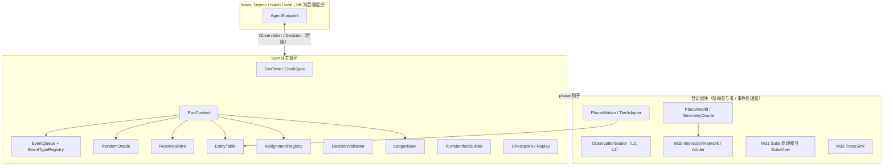
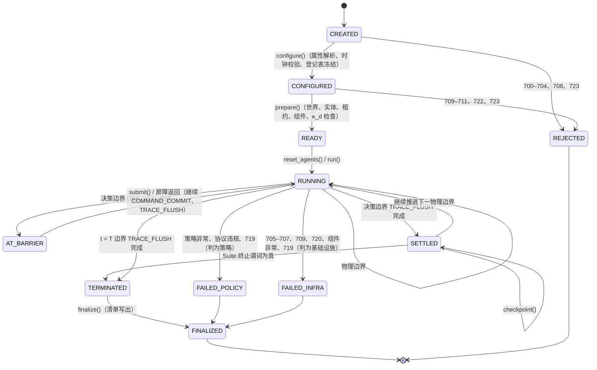
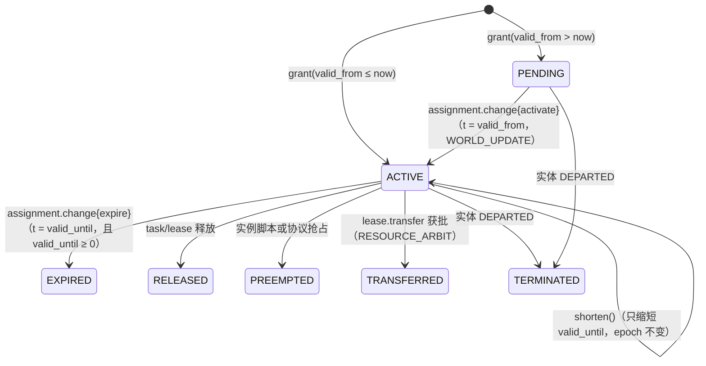

# M28 实验内核 PRD（D4 Experiment Kernel）

## 文档信息

| 项 | 内容 |
|---|---|
| 文档编号 | AWR-M28 |
| 标题 | 实验内核（D4 Experiment Kernel）PRD：时间模型与时钟档、tick 边界离散事件调度与全序、事件类型登记、随机域 `RandomOracle` 与键映射、属性登记表、运行上下文、SoA 实体表与 Agent–Entity–Assignment、平面世界与 `planar@1`、控制租约与 `DecisionValidator`、资源账本、运行清单与确定性等级、检查点与重放、运行宿主（`inproc`/`batch`/`hifi`）、北极星性能预算 |
| 模块与包 | M28（AWR-06 §3.3 暂定编号）；包路径 `py:kernel/`（即 `python/awr/kernel/`） |
| 版本 | v0.2.1（2026-10-18 文档集集成同步：按 AWR-06 v0.3 §0.5 统一裁定 XR-03、XR-04、XR-05、XR-06 修订 R-M28-60、R-M28-64、R-M28-73、R-M28-104 与 §7 的对应条目；原 v0.2 内容不变者不另标注；按 XR-11 把 AWR-06 调度规则 R-S1 至 R-S8 的引用改称 SR-1 至 SR-8；按 XR-02 把接口草案标注改为 Python 3.12） |
| 日期 | 2026-10-18（UTC） |
| 状态 | D4 设计评审稿。D4 处于深入调研与概念设计阶段，本 PRD 不构成实现承诺；实现自 G0（D3 封板）之后启动，周次一律以"D3 封板后第 N 周"表述 |
| 上游文档 | [AWR-06 D4 协同实验平台概念设计](../06-D4-协同实验平台概念设计.md)（v0.2）§3.2–§3.7、§4.1–§4.2、§4.5–§4.7、§5.1–§5.11、§10.2–§10.6、ADR-D4-03、05、06、07、08、09、10、11、12、15、17、29、33；调研 [r03 NS-2 经验与排行榜规则](../research/d4/r03-NS-2经验与排行榜规则.md)（R1–R8、R11、R16、R20、R21、R23–R26、R28）；工作笔记 [n01 现有代码映射](../research/d4/notes/n01-现有代码映射.md)（§2.1、§2.5、§4、§5、§8）、[n03 外部模型讨论纪要](../research/d4/notes/n03-外部模型讨论纪要.md)；负责人前期稿 design-r1、design-r2（`/data/projs/anet-drone-data/`） |
| 并列文档 | [M29 交互网络](M29-交互网络PRD.md)、[M30 协同接口与基线](M30-协同接口与基线PRD.md)、[M31 基准套件](M31-基准套件PRD.md)、[M32 评测与统计](M32-评测与统计PRD.md)、[M33 Trace 与复现](M33-Trace与复现PRD.md)、[M34 研究者 SDK 与命令行](M34-研究者SDK与命令行PRD.md)、[契约草案](../d4/契约草案.md)（AWR-D4-CT v0.1，下文简称 CT）、[协作智能排行榜规格](../d4/协作智能排行榜规格.md)（下文简称 LB）；Suite 规格 [S1](../d4/suites/S1-TaskAlloc规格.md)、[S2](../d4/suites/S2-CoopSearch-Handoff规格.md)、[S3](../d4/suites/S3-InfoShare规格.md)、[X1](../d4/suites/X1-RobustCoord协议.md)；首篇论文实验设计 [r04](../research/d4/r04-首篇论文实验设计.md)。CT 与本文字段名冲突时以 CT 为准（CT 文档信息"分工边界"），本文已按 CT §9 第 1–3 项回改；CT 只登记路径而不定义字段的契约（`rng_domains.v1`、`checkpoint.v1`、`ledger.v1`、`observation.v1`、`entity_obs.v1`）以本文 §7.2 为字段来源 |
| 体例 | 沿用 [M27](M27-基准运行时与数据集PRD.md) 与 [M26](M26-智能体观测SDK-PRD.md) 的模块 PRD 结构。需求 R-M28-yy；验收 AC-M28-yy；风险 RK-M28-yy；待决 Q-M28-yy；工作包引用 AWR-06 的 WP-D4-xx；决策引用 ADR-D4-xx；06 的需求、验收与规则编号（R-D4-xx、AC-D4-xx、SR-1 至 SR-8、RN-1 至 RN-7、W-1 至 W-6、B-01 至 B-10、PB-1 至 PB-5、FC-1 至 FC-8）原样引用 |
| 引用约定 | 代码路径相对仓库根 `/data/projs/anet-drone`，前缀沿用 AWR-06：`py:` = `python/awr/`，`sdk:` = `tools/sdk/drone4d/src/drone4d/`，`ct:` = `packages/contracts/`。本文对现有代码的陈述均已于 2026-10-18 打开文件核对，以"文件 + 符号"为准，不引用行号。`py:kernel/` 目前不存在，本文给出的全部类、方法与文件均为新建设计 |
| 数值约定 | 标注"目标""初值""缺省"的数值为设计默认值或待实测校准的目标，不是对现有代码性能的断言；性能数字以 WP-D4-02（CP-1）、WP-D4-43（CP-2）与 WP-D4-44（北极星门禁）实测为准 |
| 修订记录 | v0.1（2026-10-18）：首版。v0.2（2026-10-18）：按评审意见 27 条修订（逐条核实结论与处理见 §14）；按 CT §9 第 1–3 项回改指令体字段名、`truth_digest` 口径与运行清单契约名（`run_manifest.v2`）；新增需求 R-M28-100 至 R-M28-110、验收 AC-M28-35 至 AC-M28-42；对 AWR-06 的反馈增至 25 条 |

---

## 0. 摘要

1. **定位**。M28 是 D4 全部实验语义的唯一执行核心（ADR-D4-03）。它以 int64 纳秒整数时钟、"固定步长物理 + tick 边界离散事件"的混合调度、身份派生的计数器随机域与显式运行上下文，保证同一制品、同一硬件等级下一次 Episode 的规范化事件、消息、决策与指标逐字节一致（确定性等级 1b）。M28 的第三方运行时依赖只有 numpy（B-02），以库的形式经 B-10 白名单复用栈 B 中依赖闭包为 numpy 的构件；`BenchEnv` 主循环不迁入、不替换（B-08）。
2. **时间与调度**。三层节拍 Δp（物理边界）、Δn（网络服务片）、Δd（决策周期）满足整数倍关系；时钟档 `d4_quick`、`d4_std`、`d3_compat` 由属性登记表展开。每个物理边界依 9 个 `Phase` 处理；队列内的处理键为"边界优先、阶段次之、事件时刻再次"的六元组，同刻全序沿用 `(t_ns, phase, rank, producer_id, producer_seq)`（SR-1），并把 06 未写明的"亚边界时刻事件的处理次序"与"同阶段级联插入"两点规则化（§4.2、§13 第 1、2 条）。事件为可序列化的纯数据。
3. **随机域**。`RandomOracle` 为 `py:sim/sensors/cbrng.py` 的包装层：以长度前缀编码的 `BLAKE2b-128(root_seed ‖ context_digest ‖ domain ‖ object_id)` 派生 `(k_hi, k_lo)`，映射为 `cbrng.key(k_hi, 23, k_lo, time_index, draw_index)`。随机域分两类根：外生域取 `(run_seed, suite_random_digest)`，实例域取 `(instance_seed, generator_digest)`（与 M31 §7.3.2 一致），二者都不含 `suite_digest`（R-M28-104，§13 第 4、19 条）。Episode 开始时对中间状态 `κ_d` 去重，碰撞时以确定的盐值再派生而非重跑（R-M28-25）；内核只走 numpy 路径，标量抽样另有与 `cbrng` 逐位一致的纯整数快速路径（R-M28-22）。
4. **属性与上下文**。`AttrRegistry` 登记全部影响结果的参数（路径、类型、缺省、单位、范围），未登记路径与越界值一次报出全部错误；Helper 只是批量赋值，展开结果连同来源写入 `experiment.resolved.json`。全部可变状态属于显式 `RunContext`，同进程可并行多个 Episode 而互不影响（SR-7、r03 R3）。
5. **实体与控制**。`EntityTable` 为固定容量的 SoA 表（缺省容量 1024，与 `py:sim/fleet/state.py` `CAPACITY` 一致），实体编号单调、不复用（I-06）；`AssignmentRegistry` 以每实体单调 `epoch` 的租约表达 Agent–Entity 控制关系，首发同一实体同一时刻至多一个写入者（I-03）。`DecisionValidator` 以 `py:agentsdk/env/guard.py` `ActionGuard` 的规则为规格自含实现，不依赖 jsonschema，分"密封时语法校验"与"生效时权限校验"两段执行。
6. **平面世界**。`PlanarWorld` 提供多边形障碍、边界与二维视线判定；`planar@1` 为限速、限加速度的二维质点，每个物理步内加速度恒定，因此任意亚边界时刻的位姿可解析插值（SR-8）。
7. **账本、清单与确定性**。`ResourceLedger` 区分确定性计量维（字节、能量、决策次数、平台计数的 token）与实测计量维（cgroup CPU、GPU）；实测维不进入 Agent 观测（§13 第 7 条）；逐笔计费以 `ledger.v1` 写出供 M32 `LedgerCheck` 重算（R-M28-109）。`py:kernel/manifest.py` 在 Episode 结束时按组件能力声明与运行期标志自动判定 `determinism_level ∈ {1b, 2, 3, none}` 并写入运行清单 `drone4d.coord.run_manifest.v2`（CT §4.5）。`trace_events_digest` 与 `truth_digest` 只采用 M33 §6.5 的核心摘要链定义，内核只产出规范事件流并自行计算 `pose_digest` 与 `decisions_digest`（R-M28-73）。
8. **检查点与重放**。检查点只在决策边界 `TRACE_FLUSH` 之后的稳定态保存，包含事件队列、生产者序号、实体表、租约表、账本、链式摘要状态、已见 `κ_d` 集合、各组件快照与 Agent 输入输出重放位置；支持全量重仿真、动作重放与 trace 回放三种模式；动作重放结果须与原运行逐字节一致，否则判 `REPLAY_DIVERGED`。
9. **宿主**。`hosts.inproc`（同进程，含外部步进接口，供 PettingZoo 等适配器使用）、`hosts.batch`（进程池，每 worker 一个 Episode，spawn 启动并在导入 numpy 前固定 SIMD 派发与线程数）、`hosts.hifi`（P1 可选附加包 `drone4d[hifi]`，网格世界、`KinematicTier`、D3 `L1Model` 的后端组合，不是第四种宿主）；平台评测宿主 `hosts.eval` 的内核侧屏障与 watchdog 语义由本模块规定，容器与沙箱由 WP-D4-22 承担。
10. **北极星预算**。北极星配置（S1 `d1/n20`，`d4_quick`，400 个 Episode，8 worker）下每次团队决策的内核分项目标 ≤ 1.5 ms，CP-1（第 3 周末）以 20 实体空策略微基准实测；本文把该分项细分到事件队列、`planar@1`、租约与校验、屏障簿记与账本五项，并给出 n4–n64 各规模档内核份额上限（§8）。逐事件 JCS 规范化实测约 42 µs/条，不能进入内核分项；内核侧摘要只用定长二进制帧（§8.1）。
11. **规模**。功能与非功能需求 110 条（R-M28-01 至 R-M28-110），验收 42 条（AC-M28-01 至 AC-M28-42），候选原因码 28 个（码段 700–729 中的 700–727，待 AWR-17 §8 登记，名称以 CT §3.8 为权威），风险 10 条，待决 8 条，对 AWR-06 的反馈 25 条，评审处理记录 27 条（§14）。

---

## 1. 背景与目标

### 1.1 约束本模块的事实

| # | 事实 | 对设计的含义 | 依据（已核对） |
|---|---|---|---|
| F1 | 仓库中不存在 `python/awr/kernel/`；D4 内核为新建包 | 本文全部类与方法为设计；不存在"迁移旧内核"的工作 | 目录核对 |
| F2 | 栈 A 的仿真时间定时器堆 `SimScheduler` 以 `(t_due, seq)` 为全序，回调为闭包（`TimerHandle.cb`）；`call_at` 把早于当前时刻的请求钳到 `now`；`_fire` 捕获并记录回调异常后继续；`_DRAIN_MAX = 10_000` 是 `drain_loop` 让出事件循环的次数上限，不是同刻事件级联深度上限；`advance_to` 基于 asyncio，`drain_loop` 读取 `loop._ready` 私有属性 | D4 `EventQueue` 为纯同步数据结构；事件为数据而非闭包；调度到已完成阶段一律拒绝而非钳位；处理异常不得吞没；级联上界由本模块另行定义（§13 第 3 条） | `py:agent/runtime/clock.py` `SimScheduler`、`TimerHandle`、`drain_loop`、`_DRAIN_MAX` |
| F3 | `cbrng` 的键链为 `k = sm(seed); k = sm(k ^ stream); k = sm(k ^ agent); k = sm(k ^ tick); k = sm(k ^ ch)`，每级为 SplitMix64 终混；均匀数取 `(k >> 11)·2⁻⁵³`，正态数为 Box–Muller（依赖 `np.log`、`np.cos`）；外积键仅在 `kernels_cbrng` 已被导入且 numba 可用时走 numba，否则走 numpy，二者逐位相同；模块本身只依赖 numpy；`CHANNELS` 与 `check_channels()` 登记同流通道区间 | `RandomOracle` 只包装、不改写 `cbrng`；`κ_d = sm(sm(sm(k_hi) ^ 23) ^ k_lo)` 可由公开函数 `sm`、`u64` 计算；内核不导入 `kernels_cbrng` | `py:sim/sensors/cbrng.py` `key`、`sm`、`u64`、`uniform`、`normal`、`uniform_elem`、`normal_elem`、`_outer`；`tests/sensors/test_cbrng.py`、`test_cbrng_kernel.py` |
| F4 | `PhysicsTier` 协议为 `submit(cmds) -> list[DispatchResult]`、`advance(k) -> TickResult`、`status()`、`close()`，`advance` 推进的是一个 Env tick 而非一个积分步；`TierCommand` 以 `uav` 与主时钟 `apply_tick` 标识；`validate_clock` 的签名限定 `tier ∈ {fast, realistic, sitl}` 与栈 A 的 `ClockProfile(name, main_hz, physics_hz, l1_hz)`，违规抛 `PhysError(637)` | 内核以适配器 `TierAdapter` 驱动物理档，物理边界 Δp 对外部物理档即为档位 tick；整数倍规则在内核中按 D4 时钟自含实现，不直接调用 `validate_clock`（§13 第 5 条） | `py:phys/adapter.py` `PhysicsTier`、`TierCommand`、`CmdKind`、`validate_clock`、`ClockProfile` |
| F5 | `KinematicTier` 缺省 `tick_ms = 100`、`step_ns = 4_000_000`，构造参数含 `spawn`（uav → 初始位置与航向）与 `ground`（`(n, 2) → (n,)` 地面高程）；`advance(k)` 先使 `apply_tick ≤ k` 的待生效指令生效，再以 tick 起点状态求一次设定点，以 4 ms 步积分覆盖 `(t_k, t_k + tick]`；整个 tick 的步时刻数组与 `(n_steps, n_uav, 16)` 状态块以 `t.astype("<i8").tobytes() + state.astype("<f8").tobytes()` 更新同一个流式 `hashlib.sha256` 对象，只有 `close()` 返回终值 `pose_sha256`，不存在逐 tick 摘要序列；`BenchEnv` 运行清单（`drone4d.bench.env_run.v1`）也只记录该终值；`submit` 拒绝 `follow_path`、`orbit`（630）；依赖 `awr.phys.tracker` | 内核–`BenchEnv` 运动学对拍（AC-D4-22）要求 `d3_compat` 下以 100 ms 档位 tick 驱动，而非 4 ms 边界；对拍以终值 `pose_sha256` 判定，定位发散 tick 需适配器另行保留逐 tick 副本（R-M28-56）；B-10 白名单须含 `awr.phys.kinematic` 与 `awr.phys.tracker`（§13 第 5、15 条） | `py:phys/kinematic.py` `KinematicTier.__init__`、`advance`、`close`；`py:phys/tracker.py`；`py:agentsdk/env/core.py` 清单构造 |
| F6 | `PoseHistoryBuffer(uavs, hz=250, capacity_s=2.0, t0_ns=0)` 以环形 SoA 保存每物理步一行 16 列状态；写入路径（`append`、`append_block`）在时刻不在网格上或不递增时抛 `PhysError(635)`，写入位置等于未释放的最早样本时抛 `PhysError(634)`；读取路径 `slice(uav, t_from, t_to)` 返回含两端外侧样本的拷贝，范围越界（无样本、`t_to` 晚于最新样本、`t_from` 早于已释放水位）时抛 `PoseHistoryRangeError`（`LookupError` 子类，非 `PhysError`） | 非 `planar@1` 物理档的亚边界读取经该缓冲插值（SR-8）；`TierAdapter` 把 `PoseHistoryRangeError` 映射为内核 705（`why = geometry_range`），把 634、635 映射为 727 | `py:phys/pose_history.py` `PoseHistoryBuffer._put`、`append_block`、`slice`、`PoseHistoryRangeError` |
| F7 | `ActionGuard.check` 先经 `bench_validator("act")` 做 schema 校验（失败 666 `schema`），再校验 `k`（666 `k_mismatch`）、导航（非有限值 663 `non_finite`；`velocity` 含机体系转换与竖直、偏航率限幅，`goto` 含高度包络与 `[0.5, vmax]` 速度限幅，`takeoff` 含高度包络，限幅记 `clamped`/`limit`；`hover`、`land` 直接接受；其他模式 663 `unsupported`）、云台（`sensor_id` 不符 663 `sensor`，俯仰与偏航限幅记 `clamped`）、变焦（663 `zoom_range`）、传感器模式（恒 663 `unsupported`）、消息（每条按 `comm_off → dst → payload_type → too_large` 取首个失败，667）、报告类型与证据（663 `report_type`/`evidence_unknown`）；另有 `timeout(k)`（661，沿用上一指令）与 `tier_rejected()` 两条非 `check` 路径；回执结果为 `applied`、`clamped`、`rejected`、`timeout` | `DecisionValidator` 以上述规则为规格自含实现，并只在可映射子集上以共享用例集对拍（AC-D4-10，本文 §7.3.2 列出不可映射路径）；新增 `epoch`、范围、能力、`group:` 规则 | `py:agentsdk/env/guard.py` `ActionGuard.check`、`_nav`、`_gimbal`、`timeout`、`tier_rejected`、`GuardResult`、`Limits` |
| F8 | D3 决策时延为 `DecisionCfg.lat_ticks(tick_ms=100) = max(1, ⌈tau_ms / tick_ms⌉)`；`step_budget_s = 2.0` 为容器 Agent 的墙钟收集预算 | `d3_compat` 的 `ℓ_model` 与 D3 逐 tick 一致；排名运行不使用墙钟收集预算（W-1、W-3） | `py:agentsdk/env/spec.py` `DecisionCfg`；`py:agentsdk/env/remote.py` |
| F9 | `BenchEnv` 控制步 `TICK_MS = 100`；构造时校验 `obs_level ∈ {L1, L2, L2-depth}` 并打开事件磁带；磁带定点 `TICK_NS = 100_000_000` | 新内核不受"必须有磁带与 L1/L2"约束；外生磁带作为可选事件源接入 | `py:agentsdk/env/core.py` `TICK_MS`、`BenchEnv.__init__`；`py:sim/events/tape.py` `TICK_NS` |
| F10 | `LeaseManager` 以优先级表与持有者栈实现逐机租约，不读墙钟，以 `gen` 记录全表修改代数，无逐实体 `epoch` | `AssignmentRegistry` 只参照其"不读墙钟、可快照"的做法，`epoch` 为新增语义 | `py:sim/core/authority.py` `LeaseManager`、`PRIORITY` |
| F11 | 栈 A 机体 SoA 容量 `CAPACITY = 1024`；`Roster` 的 `agent_no` 单调、不复用，且导入 msgpack | `EntityTable` 缺省容量取 1024；编号规则沿用；内核不导入 msgpack | `py:sim/fleet/state.py` `CAPACITY`；`py:sim/core/roster.py` `Roster` |
| F12 | `ct:bench/run_manifest.v1` 为 `additionalProperties: false`，必填 `spec`（`$ref run_spec.v1`）、`experiment_id`、`attempt`、`restart_count`、`timing` 等，`split ∈ {dev, test}`，`determinism_level ∈ {1b, 2, 3, none}`；`run_spec.v1.physics ∈ {realistic, fast, sitl}` | D4 Episode 无法以该契约原位表达（无 `run_spec.v1`、划分为四类、需新增摘要字段）；D4 运行清单以 CT 新开的 `drone4d.coord.run_manifest.v2`（`ct:coord/`，按谱系规则 N-3 命名）承载，沿用 `determinism_level` 枚举与字段名（§13 第 6 条） | `ct:bench/run_manifest.v1.schema.json`、`ct:bench/run_spec.v1.schema.json` |
| F13 | `ct:rt/rng_streams.json` 的保留区间为 23–63 | 流 23 登记为 D4 键控命名空间后保留区间收缩为 24–63（RN-4，CT 承担） | `ct:rt/rng_streams.json` `reserved` |
| F14 | `tools/lint/check_py_imports.py` 以 `PkgRule(where, only, deny, unless, why, skip)` 表达导入边界，`PkgRule(("",), deny=D3_PACKAGES, skip=_D3_PATHS)` 禁止 D3 路径外导入 `awr.sim.events`、`awr.phys`、`awr.agentsdk`、`awr.bench` 等；`awr.sim.sensors` 不在 `D3_PACKAGES` 中；墙钟调用禁止规则 `WALL_CLOCK_PATHS` 只覆盖 `sim/fleet/`、`sim/core/`、`sim/safety/`、`sim/mission/`、`sim/sensors/` 与 `environment/`，`WALL_CLOCK_CALLS` 列出 `time.time`、`time.monotonic`、`time.perf_counter` 及其 `_ns` 变体与 `datetime.now`/`utcnow` | 内核对 D3 构件的复用须经 B-10 的 `unless` 白名单；`cbrng` 无需白名单；`kernel/` 目前不受墙钟静态规则约束，须由 D4 lint 增补（R-M28-110） | `tools/lint/check_py_imports.py` `PkgRule`、`D3_PACKAGES`、`_D3_PATHS` |
| F15 | 原因码已用至 698；17 号 §18.12.1 将 600–699 分配给 M22–M27 | M28 申请新码段（候选 700–729），在 CT 与 17 号登记前不得写入 `reasons.json` | `ct:rt/reasons.json`；[17](../17-接口与实时协议规范.md) §8.4、§18.12.1 |
| F16 | 现有 SDK 包 `drone4d` 的运行时依赖为 `httpx`、`msgpack`，许可声明 `Apache-2.0`；numpy 只出现在可选附加包 `images`（`numpy>=1.26`、`pillow>=10`）中，核心 wheel 不依赖 numpy；`py:agentsdk/wire.py` 导入 msgpack | 内核本身只依赖 numpy，因此 D4 wheel 须把 numpy 由可选依赖改为硬依赖，这是 wheel 依赖集合的新增项；wheel 的依赖集合另含线协议所需的 msgpack，须在依赖闭包中如实登记（§13 第 16 条） | `tools/sdk/drone4d/pyproject.toml` `[project] dependencies`、`[project.optional-dependencies] images`；`py:agentsdk/wire.py` |
| F18 | 本机实测（`.venv`，CPython 3.12.3，numpy 2.5.3，2026-10-18）：`awr.sim.events.jcs.jcs` 对一条 5 字段事件记录约 42 µs/次；`jcs` 加 `sha256` 处理一个 5 字段载荷约 25 µs/次；以 `struct` 定长帧加 32 字节载荷哈希做链式 SHA-256 约 2.4 µs/次；`cbrng.uniform_elem` 标量调用约 52 µs/次；以 Python 整数实现同一 SplitMix64 键链的标量均匀数约 7.1 µs/次，缓存 `κ_d` 后约 2.9 µs/次，2 000 个样本与 `cbrng.uniform_elem` 逐位一致；`json.dumps(sort_keys=True)` 一次编码 10⁴ 个小载荷约 38 ms；`np.lib.format.write_array` 写 10⁴ 行结构化数组约 1.9 ms；numpy 冷导入约 0.17–0.23 s | 逐事件 JCS 不能进入内核预算，内核侧摘要采用定长二进制帧（R-M28-73）；`KeyedStream` 标量路径以纯整数实现并与 `cbrng` 逐位对拍（R-M28-22）；检查点队列节不逐事件 JCS（R-M28-80）；冷导入预算不含 numpy（R-M28-96） | 测量脚本位于会话临时目录（未入库），WP-D4-02 将其固化为 `tests/perf/kernel/` 的微基准 |
| F17 | `GreedyAllocator.plan` 以 `time.perf_counter()` 在 `0.8·budget_ms` 处截断 | 平台侧基线的墙钟依赖不属本模块实现，但其运行须在确定性等级判定中可见（W-5） | `py:tasking/greedy.py` `GreedyAllocator.plan` |

### 1.2 目标

| # | 目标 | 度量 |
|---|---|---|
| G1 | 同制品、同硬件等级下 Episode 逐字节可复现 | 固定制品 100 次重跑事件摘要、真值摘要一致（AC-D4-05）；改变 `PYTHONHASHSEED`、worker 数与调度次序不改变摘要 |
| G2 | 共同随机数：外生量与策略、消息量、观察者无关 | 改变 Agent 通信频率或策略时外生量逐位一致（AC-D4-04） |
| G3 | 时间语义显式、可审计 | 同刻全序、阶段单调、级联上界、亚边界插值的性质测试全部通过（AC-D4-03） |
| G4 | 控制关系可表达一控多、无实体 Agent 与无 Agent 实体，旧指令不覆盖新指令 | Assignment 迁移、失效、非法指令拒绝用例与 `ActionGuard` 对拍通过（AC-D4-10） |
| G5 | 结果可由清单复算、等级可自动判定 | 运行清单通过契约校验，判定规则覆盖 4 个等级（AC-D4-06） |
| G6 | 轻量、快速 | 只装 numpy 的环境可导入全部核心模块（AC-D4-43）；CP-1 内核分项 ≤ 1.5 ms；北极星门禁通过（AC-D4-11） |
| G7 | 不回归 D3 | B-01、B-02、B-08、B-10 静态检查通过；D3 冻结区无改动（AC-D4-01、AC-D4-44） |

### 1.3 非目标

1. 不实现交互网络各档的传播模型、拓扑快照与非网络交互仲裁规则（M29）；内核只提供几何查询、阶段钩子与计费接口。
2. 不实现协同算法协议、适配器与基线（M30），不实现 Suite、问题族生成器与评测器（M31），不实现统计、排名与干预编排（M32），不实现 trace 记录格式与 Sink（M33），不实现命令行与研究者 SDK 外形（M34）。
3. 不实现容器沙箱、cgroup 配额配置与提交流水线（WP-D4-22、M32 与 `py:bench/` 的泛化部分）；内核只消费沙箱提供的计量读数。
4. 不实现 `fast` 物理档（P2，WP-D4-34）、异构运动学档（P2，WP-D4-35）与 `ns3@1` 联合检查点（P2，WP-D4-32）；本文只规定其接入缝与确定性能力声明。
5. 不修改 `BenchEnv`、`LinkModel`、`ActionGuard`、`cbrng`、`PhysicsTier` 及其他 D3 冻结区代码（B-08）。

### 1.4 术语（本文新增，其余见 AWR-06 术语表）

| 术语 | 定义 |
|---|---|
| 物理边界 | 时刻 `t = k·Δp`。对 `planar@1`，Δp 即积分步长；对外部物理档，Δp 等于档位 tick（一次 `PhysicsTier.advance` 推进的时长），档位内部另有积分步 δ |
| 处理区间 | 物理边界 t 负责的半开区间 `(t − Δp, t]`；其中任一时刻的事件在边界 t 处理 |
| 处理键（QueueKey） | 队列内部排序键 `(b, phase, t_ns, rank, producer_id, producer_seq)`，`b = ⌈t_ns / Δp⌉·Δp`；trace 中保留 06 的五元 `EventKey` |
| 决策边界 | 满足 `t mod Δd = 0` 的物理边界；`tick_id = t / Δd` |
| 屏障 | `AGENT_DISPATCH` 阶段：全部 Agent 的观测已密封并下发，宿主等待全部返回后才进入下一阶段 |
| 根种子与上下文摘要 | 随机域派生的前两个字段。`exogenous` 根为 `(run_seed, suite_random_digest)`；`instance` 根为 `(instance_seed, generator_digest)`，导入实例以 `instance_sha256` 代替 `generator_digest`（R-M28-104） |
| 组件能力声明 | 物理档、网络档、观测构造器、宿主等组件登记时声明的确定性上限（`1b`、`2`、`3`、`none`），用于等级判定 |
| 确定性计量维 / 实测计量维 | 账本中由仿真语义决定、可逐字节复现的量（字节、能量、决策次数）与由宿主实测、随负载变化的量（CPU、GPU 时间） |
| 动作重放 | 不启动 Agent，以记录的 `Decision` 序列在原生效时刻重新驱动内核 |
| 阶段执行谓词 | `phase_runs(b, phase)`：配置确定的、边界 b 是否执行某阶段的判定（R-M28-100）；插入检查与主循环共用 |
| 唤醒边界 | `wake_on_rx` 开启时满足 `b mod wake_rx_ns = 0` 的非决策物理边界（P1） |
| `SETTLED` | 决策边界 `TRACE_FLUSH` 完成后的稳定态，唯一允许保存检查点的状态 |
| 控制关系 | 实体当前有效 Assignment 的 `(agent_id, scope)`；其每次变更使 `epoch + 1`（R-M28-44） |
| 输入快进 | 从回合起点重新启动 Agent，按记录的观测与收件箱依次喂入并核对其输出与记录一致，直至检查点位置 |

---

## 2. 范围

### 2.1 分阶段范围

| 阶段 | M28 交付 | 工作包 | AC-D4 |
|---|---|---|---|
| P0 第 1–4 周 | `SimTime` 与 `ClockSpec`、时钟档展开、`EventQueue`（处理键全序、阶段游标、级联上界、取消、序列化）、事件类型登记表、`RandomOracle`（`cbrng` 包装、域登记、`κ_d` 去重）、`AttrRegistry`、`RunContext`、`Kernel` 主循环骨架、`hosts.inproc`；第 3 周末 CP-1 微基准 | WP-D4-02 | 01、03、04 |
| P0 第 4–5 周 | 端到端竖切所需的最小 `planar@1`（无障碍）、最小 `EntityTable`、最小观测密封、`hosts.batch` 原型；CP-2 性能探针中的内核分项 | WP-D4-43（K 0.5） | 11（CP-2 记录） |
| P0 第 5–7 周 | 完整 `PlanarWorld`（障碍、边界、视线）与 `planar@1`、`EntityTable`、`AssignmentRegistry`、`DecisionValidator`、平面 `L1` 观测密封、`fault.inject`（五种类与 `until_ns` 恢复）、`membership.change` 与 `shorten`（X1 内核注入钩子）、`SuiteRule` 扩展点、脚本轨迹驱动、确定性计量维的 `ResourceLedger` | WP-D4-03 | 10、43 |
| P0 第 7–8 周 | 运行清单（`run_manifest.v2`）写出与 `determinism_level` 自动判定、`hw_class` 登记、`agent_seed` 派生、检查点与动作重放（本文设定纳入，§13 第 12 条）、`ledger.v1` 与 `limit_expr` 求值器、`hosts.eval` 的内核侧屏障与 watchdog | WP-D4-04 | 05、06 |
| P0 第 9–10 周 | wheel 中内核部分的依赖闭包校验与 import 重写配合；北极星门禁实测中内核分项复测 | WP-D4-44（配合） | 11、43 |
| P1 | `hosts.hifi`（`drone4d[hifi]`）：`MeshWorld`、`TierAdapter` 驱动 `KinematicTier`、D3 `L1Model` 适配；`d3_compat` 对拍；实测计量维接入 cgroup 读数；`wake_on_rx` 内核部分；输入快进 | WP-D4-25、27、22（配合）、28 | 22、24、27、30、31 |
| P2 | `fast` 物理档与异构运动学档的 `TierAdapter` 接入；`ns3@1` 联合检查点的内核侧协议 | WP-D4-34、35、32（配合） | 34、36、37 |

### 2.2 与其他模块的边界

| 模块 | M28 向其提供 | M28 从其获取 | 边界规则 |
|---|---|---|---|
| M29 交互网络 | `GeometryOracle`（按 M29 §7.1 的方法集：`positions`、`los`、`boundary_nearest`、`snapshot_at_ns`，另加 `velocities`）、`NET_ADVANCE` 与 `RESOURCE_ARBIT` 阶段钩子、`submitted_at_ns = t_apply` 与 Agent 不可写的提交通道、端点表与 `set_endpoint_state` 驱动、`ResourceLedger.charge`、`AssignmentRegistry.transfer`、`channel`/`packet` 随机流 | `InteractionNetwork` 实例（`submit`、`advance`、`save_checkpoint`）、`InteractionArbiter`、组件能力声明、网络签发的 `message_id`（`<sender_id>#<tx_seq>`，R-M29-10） | 网络不读写实体表；仲裁结果经 `AssignmentRegistry` 的公开方法生效；消息语义校验次序以 R-M29-11 与 CT §4.1.3 为准 |
| M30 协同接口与基线 | `Observation`、`DeliveredMessage` 的内核侧构造与签发；`Decision` 校验回执；`AgentContext` 中的 `agent_seed` | `Policy`/`CentralPolicy`/`Solver` 实例（经宿主的 `AgentEndpoint`） | 策略不得持有内核对象（I-01）；B-09：`awr.coordination.baselines` 不得导入 `EntityTable`、`PlanarWorld` 的写接口 |
| M31 基准套件 | `Kernel` 的 Episode 接口、事件登记接口（`task.*`、`suite.<id>.*`）、阶段参与者接口、终止谓词钩子、`instance`/`task`/`failure` 等随机域 | `Instance`（世界、实体、Agent 模板、任务流、扰动计划、公开简报）、Suite 观测体构造器、终止谓词、Suite 级属性缺省与随机域声明 | Suite 不直接写内核表，只经登记的事件处理器与阶段参与者在允许阶段写入 |
| M32 评测与统计 | 运行清单（摘要、等级、账本汇总、失败分类）、`intervention` 随机域 | 干预请求（`intervention ∈ {none, cut, perm, ind, central}`）与参考策略替换 | 内核只记录与执行干预开关，不计算 Δ 族 |
| M33 Trace 与复现 | 按阶段产出的规范事件流（trace 记录，含 `cause`）、`TRACE_FLUSH` 钩子、检查点与动作重放的输入接口、`pose_digest` 与 `decisions_digest` | `TraceSink`、trace 级别、旧运行兼容视图、核心摘要链（`truth_digest`、`trace_events_digest`、`trace_sha256`，R-M33-48、49）及其链状态快照 | 记录格式与 `truth_digest`、`trace_events_digest` 的唯一口径由 M33 §6.5 定义；内核不另行定义或计算这两项（R-M28-73） |
| M34 SDK 与命令行 | `hosts.inproc` 与 `hosts.batch` 的宿主 API、外部步进接口、`privileged_state()`（仅进程内非排名） | 实验规格的解析结果（`EpisodeSpec` 列表）、输出目录 | CLI 不绕过内核直接构造世界或实体 |
| D3 栈 B 构件 | — | `PhysicsTier`、`TierCommand`、`PoseHistoryBuffer`、`PhysError`、`jcs`、事件磁带读取、`cbrng`；P1 起 `KinematicTier`、`L1Model`、`MeshWorld`（仅 `hosts/hifi`） | 只经 B-10 白名单以库调用方式复用，不修改文件（B-08） |
| CT 契约草案 | 本文 §7 的契约字段需求；`rng_domains.v1`、`checkpoint.v1`、`ledger.v1` 的字段定义（CT §2.1 登记为 M28 归属） | `run_manifest.v2`（CT §4.5）、`decision.v1`（CT §4.3）、`message.v1`（CT §4.1）的字段与约束、标识模式（CT §3.1）、原因码段（CT §3.8） | 契约文件由 WP-D4-01 定稿、M00 合入；本文不直接写 `packages/contracts/` |

### 2.3 路径所有权（M28）

`python/awr/kernel/**`；`tests/d4/kernel/**`；`tests/perf/kernel/**`（CP-1 微基准）；`tests/perf/northstar/` 中内核分项的计时探针（门禁脚本本体属 WP-D4-08）；`docs/modules/M28-实验内核PRD.md`。`tools/lint/check_py_imports.py` 中 `D4_PACKAGES`、`_D4_PATHS` 与白名单的改动由 WP-D4-01/02 提出、受 B-07 与 AC-D4-44 约束，本模块为需求方。

---

## 3. 用户与用例

| # | 用户 | 用例 | 涉及需求 |
|---|---|---|---|
| UC-01 | 研究者（本地） | 在笔记本上以 `d4_quick` 跑通 S1 `d1/n20` 的 100 个配对单元，得到可回放 trace | R-M28-01–06、85–90 |
| UC-02 | 研究者（MARL 训练） | 以进程内宿主的外部步进接口逐决策推进，PettingZoo 适配器在其上实现 `ParallelEnv.step` | R-M28-86、87 |
| UC-03 | Suite 作者 | 登记 `task.arrive`、`task.expire` 事件类型与处理器、Suite 级随机域与属性缺省，生成器实例在内核上运行 | R-M28-17–21、27、30–35 |
| UC-04 | 网络档作者 | 在 `NET_ADVANCE` 阶段读取几何快照、按服务片插值、签发投递事件并计费 | R-M28-14、49、53、68 |
| UC-05 | 平台评测 | 在评测宿主上以屏障同步运行容器 Agent，watchdog 只判失活，运行结束写出清单并自动判定等级 | R-M28-72–78、91–92 |
| UC-06 | 复核者 | 以运行清单全量重仿真或以决策序列动作重放，核对 `truth_digest` | R-M28-73、79–84 |
| UC-10 | Suite 作者（S2、S3） | 以 `SuiteRule` 实现确认报告的速率与配额校验；以脚本轨迹实体与逐实体限值、初速表达实例 | R-M28-106–108 |
| UC-07 | X1 协议作者 | 以 `fault.inject` 在指定时刻令实体静默失效、通信中断、传感器或运动退化、机巢断电（可带 `until_ns` 自动恢复），以 `assignment.change{shorten}` 与 `membership.change` 表达成员轮换，外生扰动序列跨策略配对 | R-M28-46、47、105 |
| UC-08 | 集中式参考 | 一个 Fleet Agent 持有 n 个 Assignment，以 `CentralPolicy` 一次给出全部指令 | R-M28-40–45、60–66 |
| UC-09 | 维护者 | 在 P1 以 `d3_compat` 经 `KinematicTier` 重放 D3 黄金运行，终值 `pose_sha256` 与 `BenchEnv` 一致，发散时按逐 tick 副本定位 | R-M28-05、56、94 |

---
## 4. 功能需求

表头沿用 M27：`优先级` 取 P0（阻塞）、P1（应交付）、P2（可延期）；`阶段` 取 D4 的 P0、P1、P2（首次交付的阶段）；`验收` 指本文 §10.2 的 AC-M28-yy；`依据` 中不带文档名的 §x、规则号与 ADR 指 AWR-06，指本文时写"本文 §x"。

### 4.1 时间模型与时钟档

| 编号 | 需求描述 | 优先级 | 阶段 | 验收 | 依据 |
|---|---|---|---|---|---|
| R-M28-01 | 仿真时间统一为 int64 纳秒（`TimeNs`）。内核内部与契约中不出现浮点时间累加；以毫秒或秒书写的配置在属性解析时以整数运算换算为纳秒，非整数毫秒的时间属性拒绝（703 `CLOCK_INVALID`，`why = non_integer_ms`）。时间上限为 `2^63 − 1` ns，超过 Episode 时长上界（属性 `/kernel/episode_max_ns`，缺省 24 h）的配置拒绝 | P0 | P0 | AC-M28-01 | §5.1；ADR-D4-05 |
| R-M28-02 | 三层节拍 Δp、Δn、Δd 与建模决策时延 `ℓ_model` 由 `ClockSpec` 表达；校验 `Δd mod Δp = 0`、`Δp mod Δn = 0`（Δn 缺省时视为 Δn = Δp）、Episode 时长 `T mod Δd = 0`、`ℓ_model ≥ Δp`；任一不满足返回 703 并一次列出全部违规 | P0 | P0 | AC-M28-01 | §5.1；本文 §6.5.1 |
| R-M28-03 | 时钟档以属性 Helper 展开：`d4_quick`（Δp 100 ms、Δn 10 ms、Δd 500 ms、`ℓ_model` 100 ms；Suite 可在 100–1000 ms 内设 Δd；`wake_on_rx` 禁用，开启即 703 `why = wake_rx_unsupported`，R-M28-100）、`d4_std`（`planar@1` 下 Δp 20 ms；外部物理档按 R-M28-05；Δn 1 ms、Δd 100 ms、`ℓ_model` 100 ms，消融档 50/100/250/500 ms）、`d3_compat`（R-M28-05）；展开结果完整写入 `experiment.resolved.json` 并计入属性摘要 | P0 | P0 | AC-M28-01 | §5.1 表；ADR-D4-06 |
| R-M28-04 | `t_apply = t_sealed + ℓ_model` 按 Δp 向上取整（与 §5.2 第 7 步一致）；取整后的有效值 `l_model_effective_ns` 写入运行清单与每条 `cmd.commit` 记录；当 `ℓ_model mod Δp ≠ 0` 时属性解析产生 `clock.rounded` 警告，排名运行（`ranked = true`）把该情形升级为 703 拒绝（本文设定，理由见 §13 第 9 条） | P0 | P0 | AC-M28-01 | §5.2、§5.4 |
| R-M28-05 | 外部物理档（`kinematic`、`realistic`、`fast`）的物理边界 Δp 取档位 tick `tier_tick_ns`，档位内部积分步 δ 由档位声明；`d3_compat` 取 `tier_tick_ns = 100 ms`、δ = 4 ms、Δd = 100 ms、`ℓ_model = max(1, ⌈tau_ms / 100⌉) × 100 ms`，与 `DecisionCfg.lat_ticks()` 及 `KinematicTier` 每 tick 求一次设定点的语义逐 tick 一致；`d4_std` 下外部物理档的 `tier_tick_ns` 缺省 20 ms（本文设定，δ 仍由档位决定，见 §13 第 5 条） | P0 | P1 | AC-M28-26 | §5.1；F4、F5、F8 |
| R-M28-06 | 时钟档的可排名性由 Suite 清单 `ranked_clock` 与 `spec_rules` 规则判定，内核在 `ranked = true` 且时钟档不等于 `ranked_clock` 时拒绝运行（703 `why = clock_not_ranked`）；`d4_quick` 恒不可排名 | P0 | P0 | AC-M28-01 | §4.4、§5.1 |

### 4.2 tick 边界离散事件调度与全序

| 编号 | 需求描述 | 优先级 | 阶段 | 验收 | 依据 |
|---|---|---|---|---|---|
| R-M28-07 | 每个物理边界 t 按 `Phase` 数值升序处理：`PHYSICS_CLOSE`(10)、`WORLD_UPDATE`(20)、`RESOURCE_ARBIT`(25)、`SENSOR_CAPTURE`(30)、`NET_ADVANCE`(40)、`OBS_SEAL`(50)、`AGENT_DISPATCH`(60)、`COMMAND_COMMIT`(70)、`TRACE_FLUSH`(90)；`OBS_SEAL` 与 `AGENT_DISPATCH` 只在决策边界执行（`wake_on_rx` 开启时的唤醒边界例外，R-M28-100）；t = 0 不执行 `PHYSICS_CLOSE`；t = T 的阶段集合见 R-M28-101。某边界是否执行某阶段由配置确定的谓词 `phase_runs(b, phase)` 判定，该谓词在 `CONFIGURED` 时固定 | P0 | P0 | AC-M28-02 | §5.2；ADR-D4-05 |
| R-M28-08 | 队列以处理键 `QueueKey = (b, phase, t_ns, rank, producer_id, producer_seq)` 排序，`b = ⌈t_ns / Δp⌉·Δp`；比较键只含该六元组，不比较载荷（n01 §5.2 D-9）。对全部边界对齐的事件，该次序与 SR-1 的 `(t_ns, phase, rank, producer_id, producer_seq)` 一致；对处理区间内部时刻的事件，阶段优先于时刻（§13 第 1 条） | P0 | P0 | AC-M28-02 | SR-1；§5.2 第 2 步 |
| R-M28-09 | `producer_id` 为稳定规范 id（文法 `^(kernel\|net\|arbiter\|tape\|task\|fault\|evaluator\|suite\.[a-z0-9_]+\|entity:[A-Za-z0-9._-]+\|agent:[A-Za-z0-9._-]+)$`），不得取对象哈希、线程标识或完成次序；`producer_seq` 由 `RunContext` 按生产者单调分配。由 Agent 决策派生的事件在屏障之后按 `agent_id` 码点序、决策内条目序依次分配序号，不按 RPC 完成次序（SR-1） | P0 | P0 | AC-M28-02 | SR-1；r03 R6 |
| R-M28-10 | 因果插入规则：处理键为 q 的事件处理过程中产生的新事件，其处理键须严格大于 q；允许进入同阶段更高 rank 或更晚时刻、更后阶段或后续边界；进入已完成阶段或同阶段不大于 q 的位置一律拒绝，判内核故障 705 `EVENT_PAST_PHASE`（`failure.infra`，`why = past_phase`）。目标 `(b, phase)` 满足 `phase_runs(b, phase) = false`（该边界不执行该阶段）的插入同样拒绝（705 `why = phase_skipped`），不做静默上推；该检查对 `READY` 前预载的事件同样执行，保证队列中不存在永远不会被弹出的事件 | P0 | P0 | AC-M28-02 | SR-4；§5.3（`net.service` → `net.deliver` 为同阶段插入，§13 第 2 条） |
| R-M28-11 | 级联上界：在某个 `(b, phase)` 处理期间插入、且目标同为该 `(b, phase)` 的事件数（即"本阶段内产生又在本阶段内处理"的事件，以插入时目标与游标所在 `(b, phase)` 相同来判定）上限为属性 `/kernel/cascade_max`（缺省 10 000）；进入该 `(b, phase)` 之前已在队列中的事件（预载、上一边界或更早阶段产生者）不计数；超限判 706 `EVENT_CASCADE_LIMIT`（`failure.infra`，确定性内核故障，不触发 R-M28-90 的重跑） | P0 | P0 | AC-M28-02 | SR-5（§13 第 3 条） |
| R-M28-12 | 在途事件数上限为属性 `/kernel/queue_max`（缺省 10⁶）；超限判 707 `EVENT_QUEUE_CAPACITY`（`failure.infra`） | P0 | P0 | AC-M28-02 | PB-4 |
| R-M28-13 | 不回写：事件处理与阶段参与者只能修改"下一步将被消费的输入"与本阶段登记可写的表（阶段写权限矩阵见本文 §6.4.4）；越权写入抛 725 `PHASE_WRITE_FORBIDDEN`（开发构建抛出；发布构建由写入口检查保证，检查本身计入内核分项预算） | P0 | P0 | AC-M28-03 | SR-3 |
| R-M28-14 | 阶段参与者：非事件驱动的阶段工作（物理积分、传感器采样、网络推进、观测密封、指令提交、trace 刷写）以 `PhaseParticipant` 登记 `(phase, order, participant_id)`，同阶段参与者按 `order` 升序、再按 `participant_id` 码点序执行；参与者先于该阶段的队列事件执行，其产生的事件按 R-M28-10 插入 | P0 | P0 | AC-M28-03 | §5.2；本文 §6.2 |
| R-M28-15 | 屏障：`AGENT_DISPATCH` 先完成全部 Agent 的观测密封与下发，再等待全部返回；返回结果按 `agent_id` 码点序进入 `COMMAND_COMMIT` 的待生效缓冲；`AGENT_DISPATCH` 阶段内核任何表不可写（R-M28-13）。宿主内部是否并行调用不影响结果。缺失、整条拒绝或 `tick_id` 不匹配的决策按空决策处理（R-M28-102） | P0 | P0 | AC-M28-04 | §5.2 第 6 步；§5.4 |
| R-M28-16 | 暂停与单步：暂停只停止宿主执行，不推进仿真时间；`EventQueue` 与内核主循环不读墙钟（静态保证见 R-M28-110）；单步以"推进到下一物理边界"或"推进到下一决策边界"为单位 | P1 | P0 | AC-M28-02、42 | SR-6 |
| R-M28-100 | 阶段执行谓词与 `wake_on_rx`：`phase_runs(b, phase)` 定义为 (1) `PHYSICS_CLOSE`：`b > 0`；(2) `OBS_SEAL`、`AGENT_DISPATCH`：`b mod Δd = 0`，或 `wake_on_rx` 开启且 b 为唤醒边界；(3) 其余阶段：恒执行；(4) `b = T` 按 R-M28-101 收窄。`wake_on_rx`（属性 `/kernel/wake_on_rx/enabled`，缺省 `false`，P1）开启的前提为 Suite 显式允许、`wake_rx_ns mod Δp = 0` 且 `Δp ≤ wake_rx_ns < Δd`，否则 703（`why = wake_rx_unsupported`）；`d4_quick` 恒不满足（Δp = 100 ms 大于 20 ms 粒度）。唤醒边界为满足 `b mod wake_rx_ns = 0` 且非决策边界的物理边界；内核在 `NET_ADVANCE` 结束时对 `(b − wake_rx_ns, b]` 内有新投递的 Agent 于本边界 `OBS_SEAL` 插入 `agent.wake_rx`（rank 20），唤醒边界上的 `OBS_SEAL` 只密封这些 Agent 的增量收件箱，`AGENT_DISPATCH` 只对其调用 `on_message`，返回内容只允许消息与承诺改写（06 §5.4），以 `t_apply = b + ℓ_model` 进入 `COMMAND_COMMIT`；运动指令出现在唤醒返回中时整条拒绝（`why = wake_motion`）。唤醒观测的标识沿用最近一次决策边界的 `tick_id` 并附 `wake_seq`（该 tick 内从 1 起），字段落位由 WP-D4-28 与 CT 冻结。`wake_on_rx` 关闭时 `phase_runs` 与 P0 完全相同，结果逐字节一致（AC-D4-31） | P1 | P1 | AC-M28-35 | §5.4；AC-D4-31；本文 §13 第 18 条 |
| R-M28-101 | 终止语义：设实例时长 T（`T mod Δd = 0`，R-M28-02）。(1) `t = T` 的边界执行 `PHYSICS_CLOSE`、`WORLD_UPDATE`、`RESOURCE_ARBIT`、`SENSOR_CAPTURE`、`NET_ADVANCE`、`OBS_SEAL`（最终密封，只供评测器与 trace，`obs.seal` 载荷 `final = true`）与 `TRACE_FLUSH`，不执行 `AGENT_DISPATCH` 与 `COMMAND_COMMIT`，不调用任何 Agent；(2) 运行结束时待生效缓冲中 `t_apply > T` 的条目（含 `t_apply = T` 而 `COMMAND_COMMIT` 不再执行者）逐条写 `cmd.discard` 记录（内核预登记类型，`COMMAND_COMMIT` rank 90，生产者 `kernel`，载荷 `{agent_id, tick_id, item, index, t_apply_ns}`，只写真值层，不入队列处理）；(3) Suite 终止谓词只在决策边界 `TRACE_FLUSH` 之后求值，谓词为真时以该边界为最后边界，不再执行后续边界，其上的 `OBS_SEAL` 已是最后一次下发 Agent 的密封，另以 `run.end` 载荷 `reason = predicate` 记录；(4) 决策计数 `counters.decisions` 只计实际调用 Agent 的决策边界：自然终止为 `T/Δd` 次（t = 0 至 t = T − Δd），谓词在 `t = kΔd` 为真时为 `k + 1` 次 | P0 | P0 | AC-M28-36 | §5.2；本文 §13 第 20 条 |

### 4.3 事件类型登记

| 编号 | 需求描述 | 优先级 | 阶段 | 验收 | 依据 |
|---|---|---|---|---|---|
| R-M28-17 | 事件为纯数据：`Event{key, event_id, type, payload, parents}`；载荷限于 JSON 可表示值（有限浮点、整数、字符串、布尔、空、列表、字符串键对象）与以 `{"$b64": ...}` 标记的字节串；不得含闭包、对象引用或 numpy 对象；`event_id` 为入队时签发的全局单调整数 | P0 | P0 | AC-M28-05 | §4.2 `Event`；n01 G-ES-5 |
| R-M28-18 | 事件类型须先登记后使用，登记分两步：(1) 类型登记 `EventTypeSpec{name, phase, rank, schema, visibility, producers, owner}`；(2) 处理器绑定 `bind(name, handler)`，由类型的归属组件（`owner`）在 `CONFIGURED` 之前调用。登记表在 `CONFIGURED` 状态冻结；冻结时仍未绑定处理器且不属于"只记录类型"（表中处理器列为"无"者）的类型返回 700（`why = handler_unbound`），同一类型重复绑定返回 700（`why = handler_rebound`）；未登记类型入队返回 704 `EVENT_TYPE_UNREGISTERED`；同一 `(phase, rank)` 不得登记两个类型 | P0 | P0 | AC-M28-05、38 | §5.3；r03 R5 |
| R-M28-19 | 内核预登记 06 §5.3 的事件类型与 rank（`tape.env_op`、`fault.inject`、`membership.change`、`assignment.change`、`task.arrive`、`task.expire`、`interaction.op`、`sensor.capture`、`net.link_change`、`net.service`、`net.deliver`、`net.drop`、`obs.seal`、`agent.wake_rx`、`cmd.commit`、`timer`），并增补 `entity.contact`（`WORLD_UPDATE`，rank 35）、`ledger.violation`（`COMMAND_COMMIT`，rank 30）与 `cmd.discard`（`COMMAND_COMMIT`，rank 90，只记录类型）；预登记只固定类型、阶段、rank、载荷 schema 与生产者约束，处理器按本文 §6.3.3 表的"处理器归属"列由内核、M29 或 M31 绑定；rank 区段分配：各阶段 1–99 归内核与 M29，100–199 归 Suite（`suite.<id>.*`），200–254 保留 | P0 | P0 | AC-M28-05 | §5.3；本文 §6.3.3 |
| R-M28-20 | 处理器以可调用对象或点路径字符串绑定（如 `awr.benchmarks.suites.taskalloc.events:on_arrive`），在 `CONFIGURED` 时解析并校验签名 `handler(hctx: HandlerContext, ev: Event) -> None`；解析失败返回 700；处理器异常不得被吞没，一律中止 Episode 并记 `failure.infra`（727，与 `SimScheduler._fire` 的记录后继续不同，F2） | P0 | P0 | AC-M28-05 | §4.2 `EventTypeSpec` |
| R-M28-103 | 预登记类型的载荷与生产者：本文 §6.3.3 的载荷字段表为每个预登记类型给出必填与可选字段、单位与取值约束，作为内核事件载荷 schema 的字段来源（拟登记路径 `ct:coord/events/<type>.v1.schema.json`，CT §2.1 尚未登记，由本文提请 WP-D4-01 登记并定稿）；`push` 校验 `producer_id` 满足该类型的 `producers` 前缀约束，不满足返回 704（`why = producer_forbidden`）；开发构建按字段表校验载荷，发布构建只校验必填键存在（PB-K10） | P0 | P0 | AC-M28-38 | §5.3；06 §5.3 载荷要点 |
| R-M28-21 | 可见性标签 `visibility ∈ {truth, net, agent:<subject>, public, internal}` 决定事件记录写入的 trace 层；可见性只决定写入位置，不构成安全机制，Agent 可见内容仍只经 `Observation` 构造（DP-05） | P0 | P0 | AC-M28-05 | §4.5；DP-05 |

### 4.4 随机域 `RandomOracle` 与键映射

| 编号 | 需求描述 | 优先级 | 阶段 | 验收 | 依据 |
|---|---|---|---|---|---|
| R-M28-22 | 键派生：`k_d = BLAKE2b(digest_size = 16, data = LP(root_seed_u64be) ‖ LP(context_digest_raw32) ‖ LP(domain_utf8) ‖ LP(object_id_utf8) [‖ LP(salt_u8)])`，`LP(x) = u32be(len(x)) ‖ x`，`root_seed` 与 `context_digest` 按 R-M28-104 由域的根类决定，`salt` 字段只在 R-M28-25 的碰撞再派生时出现（`salt ≥ 1`），无碰撞时不写入；`(k_hi, k_lo) = (u64be(k_d[0:8]), u64be(k_d[8:16]))`；样本键 `cbrng.key(seed = k_hi, stream = 23, agent = k_lo, tick = time_index, ch = draw_index)`；样本值须与 `cbrng` 的 `uniform`/`uniform_elem`、`normal`/`normal_elem` 对同一键的结果逐位一致。块抽样直接调用 `cbrng`；标量 `u01` 允许以 Python 整数实现同一 SplitMix64 键链与 `(k >> 11)·2⁻⁵³` 映射（只含整数运算与一次精确的整数到浮点乘法，F18），标量 `normal` 以同一整数键链求两个均匀数后经与 `cbrng` 相同的 numpy 函数（`np.log`、`np.cos`、`np.sqrt`，作用于 0 维 float64）完成 Box–Muller；两条标量路径以逐位对拍测试约束（AC-M28-06），不另写取样分布 | P0 | P0 | AC-M28-06 | §5.5；ADR-D4-07；F3、F18 |
| R-M28-23 | 根种子：每个域声明其根类 `root ∈ {exogenous, instance}`；`exogenous` 根种子为 Episode 的 `run_seed`（排名运行取自冻结的秘密种子集，对同一（场景、种子序号）的全部条目、干预与重复相同，RN-6）；`instance` 根种子为实例的 `instance_seed`，供 `instance`（含 M31 生成器子域 `instance/<family>/<sub_domain>`）与 `world` 两类域使用，使同一实例在不同外生种子下内容不变（§13 第 4 条）。根类与上下文摘要的组合见 R-M28-104 | P0 | P0 | AC-M28-06 | RN-1、RN-2、RN-6；M31 §7.3.2 |
| R-M28-104 | 上下文摘要（随机键第二字段）按根类取值，任何根类均不使用 `suite_digest`：(1) `exogenous` 域取 `suite_random_digest`（原始 32 字节），字段集合与域分隔常量 `drone4d.suite.suite_random.v1` 以 M31 §7.9.1 与 CT §3.4.2 为准（CT §9.2 第 7 项），由 `suite.v1` 的 `x-awr-hash.random_core` 注记冻结；Suite 级随机域声明（R-M28-27）与扰动协议标识均在该字段集合内；(2) `instance` 类域取生成器作用域 `gen_scope = SHA-256(LP("drone4d.gen.v1") ‖ LP(generator_id) ‖ u32be(generator_version))`（M31 §7.3.2，只随生成器 id 与主版本号变化，不含实现摘要，原始 32 字节；AWR-06 v0.3 XR-06），`time_index` 固定为 0，`domain` 字段取 M31 §7.3.2 的 `sub_domain` 字符串（内核 `world` 域取字面量 `world`），该类域的登记名在 `rng_domains.v1` 中写作 `instance/<family>/<sub_domain>` 与 `world`；外部导入、无生成器的实例以 `instance_sha256` 代替 `gen_scope`；(3) `suite_digest` 只作 Board Version 冻结项与运行清单字段，不进入任何随机键。`derive_key`、`RandomOracle` 构造参数与 `rng_domains.v1` 的 `encoding` 节均按本条声明两类根（本文 §6.3.4、§7.2.2） | P0 | P0 | AC-M28-06 | RN-1；M31 §7.3.2；本文 §13 第 19 条 |
| R-M28-24 | 域先登记后使用：内核加载 `ct:coord/rng_domains.v1.json`（以 `importlib.resources` 读取包数据）中的 06 §5.5 域表（`instance`、`world`、`target`、`weather`、`sensor`、`channel`、`packet`、`task`、`failure`、`intervention`、`policy`）、M31 生成器子域（`instance/<family>/<sub_domain>`）与 M29 §6.8.1 的 `channel`、`packet` 布局，每域声明 `object_id` 正则、`time_index` 与 `draw_index` 的含义与上界、`root`、取样类型；`failure` 域登记 `x1/` 对象命名空间（`object_id` 形如 `x1/<family>/<entity_id>` 或 `x1/<family>/<nest_id>`，X1 §4.2），并声明扰动强度 `q = 0` 时该命名空间不取随机数（X1 §12.6 第 3 条）；未登记域、`object_id` 不匹配或索引越界返回 708 `RNG_DOMAIN_UNREGISTERED`（`why ∈ {domain, object_id, index_range}`） | P0 | P0 | AC-M28-06 | RN-4；M29 §6.8.1；X1 §12.6 |
| R-M28-25 | 碰撞检查与处置：`READY` 前对本 Episode 预声明的全部随机源计算 `κ_d = sm(sm(sm(u64(k_hi)) ^ u64(23)) ^ u64(k_lo))` 并去重；运行中首次使用的新随机源（如网络签发的 `message_id` 对应的 `packet` 源）增量检查，已见 `κ_d` 集合进入检查点（R-M28-79）。`κ_d` 只由 `(root_seed, context_digest, domain, object_id)` 决定，同配置重跑必然再次碰撞，因此碰撞不以重跑处置：按"先声明者保留原键、后声明者以 `salt = 1, 2, 3` 依次再派生"确定地消解（声明次序：预声明按 `(domain, object_id)` 码点序，增量源按首次使用次序），消解结果写入运行清单 `rng_salts[{domain, object_id, salt}]` 与 trace；预声明源的碰撞只取决于外生输入，对全部条目相同，CRN 不受影响。`salt = 3` 仍碰撞时判 709 `RNG_KEY_COLLISION`（`failure.infra`，确定性内核故障，不触发 R-M28-90 的重跑，该 Episode 记无效并上报）。碰撞分析与假设见本文 §6.5.5 | P0 | P0 | AC-M28-07 | §5.5 碰撞分析；本文 §13 第 22 条 |
| R-M28-26 | 纯 numpy 路径：内核不导入 `awr.sim.sensors.kernels_cbrng` 与 numba；`RandomOracle` 构造时断言 `sys.modules` 中不存在 `kernels_cbrng`，存在时记录 `rng.numba_path` 诊断（结果逐位相同，F3），不影响等级 | P0 | P0 | AC-M28-07 | §5.5 纯 numpy 路径；B-02 |
| R-M28-27 | Suite 级随机域：Suite 可在清单 `rng_domains[]` 中声明以 `suite.<suite_id>.` 为前缀的域，随 `suite_digest` 冻结，并进入 `suite_random_digest`（R-M28-104）；内核合并登记时与平台域重名即拒绝（708 `why = domain_conflict`）（本文设定，§13 第 4 条） | P1 | P0 | AC-M28-06 | RN-4 |
| R-M28-28 | `agent_seed = u64be(HMAC-SHA256(key = u64be(run_seed), msg = utf8(agent_id) ‖ b"agent")[0:8]) >> 1`（63 位），经 `AgentContext` 下发并写入真值层；重复（`repeat`）之间 `agent_seed` 相同，`repeat_delta` 因而只反映 Agent 未经种子控制的非确定性（§13 第 10 条） | P0 | P0 | AC-M28-08 | RN-3；F-3 |
| R-M28-29 | 遗留键隔离：经 `fspl-nlos@1` 与 `hosts/hifi` 复用的 D3 构件按流 20、21、22 的原键打包取样，不经 BLAKE2b 派生；`RandomOracle` 拒绝以流号 20–22 构造派生流；流 23 只由 `RandomOracle` 使用（RN-7）。榜单重采样随机数不经 `RandomOracle`（§8.6） | P0 | P0 | AC-M28-07 | RN-7 |

### 4.5 属性登记表

| 编号 | 需求描述 | 优先级 | 阶段 | 验收 | 依据 |
|---|---|---|---|---|---|
| R-M28-30 | `AttrSpec{path, type, default, unit, range, choices, doc, affects_result, owner}`；路径文法 `^/[a-z0-9_@.\-]+(/[a-z0-9_@.\-]+)*$`；类型限 `int`、`float`（有限）、`str`、`bool`；时间类属性一律 `int` 且单位为 `ns` 或 `ms` | P0 | P0 | AC-M28-09 | §4.2 `AttrSpec`；ADR-D4-08；r03 R2 |
| R-M28-31 | `resolve(overrides)` 一次报出全部错误：未登记路径 701 `ATTR_UNKNOWN`、类型或范围不符 702 `ATTR_OUT_OF_RANGE`，`detail.errors[]` 每项含路径与原因；不得在首个错误处停止 | P0 | P0 | AC-M28-09 | ADR-D4-08 |
| R-M28-32 | 赋值层次自低到高：登记缺省（`default`）< Suite 清单缺省（`suite`）< 时钟档与其他 Helper（`helper:<name>`，按声明顺序）< 实验覆盖（`experiment`）< 命令行覆盖（`cli`，M34 R-M34-18、32 的 `--set`、`--attr`、`--policies`）< 平台强制规则（`platform`，排名规则组）；`experiment.resolved.json` 记录每个属性的最终值与来源层（`source`），Helper 展开不得隐藏任何影响结果的参数（r03 R11）；`cli` 层与其他层一样计入 `attrs_digest`、`attrs_full_digest` 与 `config_sha256`；排名运行不接受 `cli` 层中影响结果的覆盖（由 `platform` 规则组拒绝） | P0 | P0 | AC-M28-09 | §4.2 属性系统规则；M34 R-M34-18 |
| R-M28-33 | 摘要：`attrs_digest = sha256(JCS({path: value \| affects_result}))`，计入 `config_sha256` 与 Board Version 冻结项；`attrs_full_digest` 覆盖全部属性，只写入运行清单。`affects_result = false` 的属性须登记开关对拍测试 id，未登记者在 `CONFIGURED` 时拒绝（700）（§13 第 11 条） | P0 | P0 | AC-M28-09 | §4.2；ADR-D4-08 |
| R-M28-34 | 任何影响结果的参数不得以代码常量存在：内核与登记组件读取参数只经 `ResolvedAttrs.get(path)`；CI 以静态检查列出 `py:kernel/` 中的数值字面量并要求逐项标注（物理常数、格式常量或属性缺省的唯一来源） | P1 | P0 | AC-M28-10 | r03 R2；DP-03 |
| R-M28-35 | 登记表在 `CONFIGURED` 冻结；运行期只读；属性的枚举与 schema 导出（`AttrRegistry.export_schema()`）供 M34 文档与 CT 生成参数参考 | P1 | P0 | AC-M28-09 | ADR-D4-08 |

### 4.6 运行上下文

| 编号 | 需求描述 | 优先级 | 阶段 | 验收 | 依据 |
|---|---|---|---|---|---|
| R-M28-36 | `RunContext` 持有一次 Episode 的全部可变状态：时钟、属性、事件队列、生产者序号、事件类型表、随机域、实体表、租约表、世界、运动模型、账本、组件实例、trace 句柄、清单构建器与诊断；`py:kernel/` 不含模块级可变状态（模块级只允许常量、类型与纯函数） | P0 | P0 | AC-M28-11 | SR-7；r03 R3 |
| R-M28-37 | 同进程内交错推进两个 `RunContext` 的结果与分别顺序运行逐字节一致 | P0 | P0 | AC-M28-11 | SR-7 |
| R-M28-38 | 结果路径不得依赖字符串哈希序：内核不得在影响结果的代码路径上迭代 `set`/`frozenset` 或以 `hash()` 排序；以不同 `PYTHONHASHSEED` 运行同一 Episode 的摘要一致 | P0 | P0 | AC-M28-11 | 本文设定（确定性前提） |
| R-M28-39 | 运行上下文对组件只暴露窄接口视图：物理、网络、仲裁、观测、Suite 处理器各得 `HandlerContext` 的受限子集（读视图为 `writeable = False` 的 numpy 视图），不得取得 `RunContext` 本体 | P0 | P0 | AC-M28-03 | I-01；r03 R8 |

### 4.7 SoA 实体表与 Agent–Entity–Assignment

| 编号 | 需求描述 | 优先级 | 阶段 | 验收 | 依据 |
|---|---|---|---|---|---|
| R-M28-40 | `EntityTable` 为固定容量 SoA（属性 `/kernel/entity_capacity`，缺省 1024，F11）；列见本文 §6.3.6；超容量 711 `ENTITY_CAPACITY`；行序即 `entity_no` 序，全部批量运算按行序进行 | P0 | P0 | AC-M28-12 | §5.10 预算推导；ADR-D4-12 |
| R-M28-41 | 实体编号单调、不复用；`entity_id` 由实例声明，文法与 CT §3.1 一致（`^[A-Za-z0-9][A-Za-z0-9._-]{0,63}$`，不含 `#` 与 `:`）；回合内由模板加入的实体取 `"<template_id>.j<k>"`（k 为该模板内从 1 起的单调序号，十进制无前导零），总长超过 64 字符的模板 id 在 `CONFIGURED` 时拒绝；实例声明的 id 与任一模板的 `<template_id>.j<数字>` 形式相同时在 `prepare()` 拒绝；重复或非法 id 返回 710 `ENTITY_ID_INVALID`（I-06）。由此产生的 id 满足 R-M28-09 的 `entity:<id>` 生产者文法 | P0 | P0 | AC-M28-12 | I-06；CT §3.1 |
| R-M28-42 | 实体种类 `kind ∈ {multirotor, fixed_wing, ugv, usv, fixed_sensor, edge_node}`；P0 的 `planar@1` 支持全部种类（`fixed_sensor`、`edge_node` 恒静止）；能力词表沿用 `ct:agent/capability*.json`，以位掩码列存储，词表超过 64 项时改用索引表 | P0 | P0 | AC-M28-12 | §4.2 `EntitySpec`；n01 G-AE-2、G-AE-3 |
| R-M28-43 | Agent 表：`AgentSpec{agent_id, kind, controls, policy_ref, comm_endpoint}`，`kind ∈ {embodied, planner, coordinator, sensor_agent}`，`controls` 可为空；Agent 集合在 `READY` 冻结（P0 不支持回合内增删 Agent；以 Assignment 与掩码表达授权变化，§4.3） | P0 | P0 | AC-M28-13 | §4.1；§4.3 |
| R-M28-44 | `Assignment{agent_id, entity_id, scope, valid_from_ns, valid_until_ns, epoch}`；每实体维护单调 `epoch`。口径：实体的"控制关系"指当前有效 Assignment 的 `(agent_id, scope)`（无有效 Assignment 记为 `(none, NONE)`）；每次控制关系变更恰使该实体 `epoch + 1`，与变更涉及的租约条数无关——授予生效（PENDING → ACTIVE 或直接 ACTIVE）、到期、释放、抢占、移交、终止各计一次，移交与抢占是一次变更（旧租约离开与新租约进入合并为 +1）；不改变控制关系的操作（`shorten`、`PENDING` 租约的登记）不改变 `epoch`；实体 `FAILED` 或 `DEPLETED` 不改变控制关系，Assignment 与 `epoch` 保持不变（X1 §5.2）。同一实体同一时刻至多一个 `scope > NONE` 的有效 Assignment，冲突授予返回 712 `ASSIGNMENT_CONFLICT`（I-03）。`valid_until_ns = −1` 为"直到被显式移交、抢占、释放或终止"的哨兵，不参与到期判定 | P0 | P0 | AC-M28-13 | I-03；ADR-D4-12；06 §4.2 |
| R-M28-45 | `AssignmentRegistry` 的变更来源有二：计划型（到期、实例脚本抢占、成员退出）以 `assignment.change` 事件在 `WORLD_UPDATE` 处理；仲裁型（`lease.transfer` 经 M29 仲裁器批准）在 `RESOURCE_ARBIT` 内调用 `transfer()` 立即生效并记 `assignment` 记录；二者都在同一边界的 `COMMAND_COMMIT` 之前生效（§13 第 8 条） | P0 | P0 | AC-M28-13 | §5.3；§6.7 |
| R-M28-46 | `fault.inject` 处理（X1 内核注入钩子）：`kind ∈ {silent_failure, comm_loss, sensor_degrade, motion_degrade, nest_outage}`（种类表与 X1 §12.6 第 1 条、X1 反馈第 15 条一致；原 `depart` 取消，实体离开只经 `membership.change{leave}` 表达，R-M28-47）。载荷字段见本文 §6.3.3。子条款：(a) `silent_failure`：实体置 `FAILED`，永久；运动与传感器指令在生效段回执 `entity_inactive`，该回执只进入控制该实体的 Agent 的 `receipts`（X1 §5.2"控制者可经指令回执得知"）；传感器停采；内核以 `set_endpoint_state(endpoint, down)` 令其通信端点下线，该 Agent 及队友的消息回执与正常时不可区分（由 M29 受理、出队时以 `endpoint_down` 丢弃，R-M29-23），内核不以 `comm_off` 拒绝；Assignment 与 `epoch` 不变；队友不收到任何告知；`entity_inactive` 与 `endpoint_down` 只写真值层与网络层。(b) `comm_loss`：只令通信端点下线，回执与正常时不可区分（X1 §12.6 第 2 条），运动、感知、任务执行与报告不受影响；必带 `until_ns`，到期由内核预调度的恢复事件令端点上线。(c) `sensor_degrade`：以参数覆盖指定传感器的属性，可带 `until_ns`，到期恢复原值。(d) `motion_degrade`：下调 `v_max`/`a_max`，可带 `until_ns`；降速过渡按 R-M28-53 在 `a_max` 内进行。(e) `nest_outage`：对象为 `nest_id`，必带 `until_ns`，由 M29 机巢仲裁执行停靠拒绝与充电置零（R-M29-72），内核只调度起止与记录。(f) 带 `until_ns` 的故障在处理时预调度一个 `fault.inject{kind: <原种类>, action: "restore"}` 事件于 `until_ns`（生产者 `fault`，同 rank）。(g) 生效时点按种类区分，见本文 §6.5.8。(h) 扰动时刻与参数来自 `failure` 域（X1 对象位于 `x1/` 命名空间，`q = 0` 时不调用 `RandomOracle`，也不产生 `fault.inject` 事件）或实例脚本，跨策略配对 | P0 | P0 | AC-M28-14 | §5.3；§7.0 X1；X1 §5.2、§5.3、§12.6；K-1 |
| R-M28-47 | `membership.change`：`join` 把预声明的 `INACTIVE` 实体置为 `ACTIVE` 或按模板新建实体；`leave` 置为 `DEPARTED`，终止其全部 Assignment（控制关系变更一次，`epoch + 1`，原因 `departed`），令其通信端点下线；离开的实体保留行，不复用编号。原 `fault.inject{kind: depart}` 等价于 `membership.change{leave}`，不再单列 | P0 | P0 | AC-M28-14 | §5.3；n01 G-AE-4；X1 §5.4 |
| R-M28-105 | 租约调度与缩短：`grant()`、`preempt()`、`transfer()` 写入时由 `AssignmentRegistry` 自行调度生命周期事件，调用方不另行调度——`valid_from_ns > now` 时于 `valid_from_ns` 调度 `assignment.change{op: activate}`，`valid_until_ns ≥ 0` 时于 `valid_until_ns` 调度 `assignment.change{op: expire}`，二者生产者均为 `kernel`、阶段 `WORLD_UPDATE`、rank 40；租约提前结束（释放、抢占、移交、终止）时取消其未处理的生命周期事件。`shorten(entity_id, new_until_ns, *, t_ns, cause_id)` 只允许把当前有效租约的 `valid_until_ns` 缩短（原值为 −1 或 `new_until_ns <` 原值，且 `new_until_ns ≥` 下一物理边界），取消原到期事件并按新值重新调度；`shorten` 不改变 `epoch`，产生 `assignment` 记录（`op = shorten`），该记录只对控制该实体的 Agent 可见（X1 §5.4 预告），对队友不可见。`assignment.change` 载荷字段见本文 §6.3.3（含 `op ∈ {grant, activate, expire, release, preempt, shorten, terminate}`） | P0 | P0 | AC-M28-13 | 06 §4.2、§5.3；X1 §5.4、§12.6 第 4 条 |
| R-M28-106 | `EntitySpec` 字段（在 06 §4.2 的 `entity_id`、`kind`、`model_ref`、`capabilities`、`sensors`、`comm_endpoint`、`initial_state` 基础上细化，字段表见本文 §6.3.6）：(1) `initial_state` 的键限定为 `pos_m`（`[x, y]` 或 `[x, y, z]`，z 缺省为高度层 `z_layer_m`）、`heading_rad`（缺省 0）、`vel0_mps`（`[vx, vy]`，缺省 `[0, 0]`，范数不得超过实体 `v_max`）、`energy_wh`（缺省为 `energy_cap_wh`）、`status`（`ACTIVE` 或 `INACTIVE`，缺省 `ACTIVE`），未知键拒绝（710 `why = initial_state_key`）；(2) 逐实体限值覆盖 `limits{v_max_mps, a_max_mps2}` 优先于按种类登记的属性 `/motion/planar/<kind>/…`，取值须落在该属性的登记范围内，否则 702；(3) `sensors` 为传感器声明对象的列表 `{sensor_id, model, mount_yaw_rad, params{}}`（`model` P0 只取 `planar_l1`；`params` 覆盖 Suite 缺省的 `r_max_m`、`fov_rad`、`pd`、`sigma_xy_m`、`lambda_fa`、`period_ns`；`sensor_id` 文法同 CT §3.1 且在 Episode 内唯一），兼容 06 的字符串形式（只给 `sensor_id`，其余取 Suite 缺省）；(4) `energy_cap_wh = null` 表示无能量约束，映射为 `energy_cap_uwh = −1` 哨兵：不扣减、不进入 `DEPLETED`，账本 `energy_uwh` 维照常累计消耗量；(5) `motion_driver ∈ {command, scripted}`，缺省 `command`，`scripted` 见 R-M28-107 | P0 | P0 | AC-M28-39 | 06 §4.2 `EntitySpec`；S1 R-S1-02；S2 §12.1、§12.2；S3 §2.3、§8.5 |

### 4.8 平面世界与 `planar@1`

| 编号 | 需求描述 | 优先级 | 阶段 | 验收 | 依据 |
|---|---|---|---|---|---|
| R-M28-48 | `PlanarWorld`：矩形边界 `bounds = (x_min, y_min, x_max, y_max)`（m，ENU 平面）与简单多边形障碍（逆时针顶点、不自交、两两不相交），每个障碍声明 `blocks_motion`、`blocks_los`；世界内容以 JCS 规范化后求 `world_digest`；非法几何返回 723 `WORLD_INVALID` 并列出全部问题 | P0 | P0 | AC-M28-15 | §3.3；§7.2 `cs-planar` |
| R-M28-49 | `GeometryOracle`：协议方法集以 M29 §7.1 为准并由本模块实现（本文 §6.3.8）：`positions(t_ns, endpoints) -> (k, 3)`、`los(pairs, t_boundary_ns) -> (k,)`、`boundary_nearest(t_ns) -> int`、`snapshot_at_ns() -> int`，另加 `velocities(t_boundary_ns, endpoints) -> (k, 3)` 与 `n_blocking(pairs, t_boundary_ns)`。端点位置来源按 R-M29-22 的 `attach`：`entity:<id>` 取该实体位置，`site:<x,y,z>` 取固定站址；三维坐标的 z 分量取实体高度层 `z_layer_m`（常量）或站址 z，三维距离为欧氏距离，视线判定只用二维投影（R-M28-50）。时间范围：`positions` 只接受当前处理区间 `[b − Δp, b]` 内的时刻（按 R-M28-53 解析插值），`los`、`n_blocking`、`velocities` 只接受当前边界 b 与上一边界 `b − Δp`（内核保留两份边界快照），越界抛 705（`why = geometry_range`）；`boundary_nearest(t)` 返回 `{b − Δp, b}` 中距 t 最近者，等距取较早者。每个物理边界对全部通信端点批量计算一次快照，以 numpy 向量化实现，禁止逐服务片 O(n²) 重算（PB-1）。`ns3@1`（P2）窗口 `[t, t + h)` 所需的外推位置由 M29 桥接以 `positions(t)` 与 `velocities(t)` 按恒速外推自行计算，内核不提供未来时刻的几何（R-M29-01） | P0 | P0 | AC-M28-15 | PB-1；§4.2 `LinkGeometry`；M29 §6.3.5、§6.5、§7.1 |
| R-M28-50 | 视线判定：二维线段与 `blocks_los` 多边形边的相交测试，接触端点与共线重叠按"相交"计；P0 不考虑障碍高度（属性 `/world/planar/los_rule = "2d"`，`"2.5d"` 保留）；障碍边以均匀网格空间索引预筛，索引不改变判定结果（开关对拍） | P0 | P0 | AC-M28-15 | §7.2 S2 `cs-planar` |
| R-M28-51 | `planar@1` 状态：每实体 `p = (x, y)`、`v = (vx, vy)`、本步加速度 `a`、航向 `ψ`、高度层 `z`（常量）、限值 `v_max`、`a_max`；高度层只参与三维距离计算，不参与运动 | P0 | P0 | AC-M28-16 | §1.4 物理 P |
| R-M28-52 | 指令（字段名与 CT §4.3.2 一致，带单位后缀）：`goto_w{x_m, y_m, z_m?, speed_mps?}`（`planar@1` 忽略 `z_m`）、`vel_w{vx_mps, vy_mps, vz_mps?}`、`hold{}`、`follow_path{points_m[], speed_mps?}`、`sensor_point{sensor_id, heading_rad \| target_m}`；`drive` 在 P0 拒绝（`unsupported`）；指令带 `valid_for_ns`，过期后实体转 `hold`（确定的仿真语义，与墙钟无关）；`goto_w` 的期望速度为 `min(speed_mps, v_max, √(2·a_max·max(d − r_arrive, 0)))` 方向指向目标，`d ≤ r_arrive` 时期望速度为 0 | P0 | P0 | AC-M28-16 | §4.2 `EntityCommand`；CT §4.3.2；本文 §6.5.3 |
| R-M28-53 | 积分、存储与插值：每步加速度 `a = clip_norm((v_des − v)/Δp, a_max)`，其中 `‖v_des‖ ≤ v_max`；`v' = v + a·Δp`，`p' = p + v·Δp + ½·a·Δp²`。因 `a·Δp = λ·(v_des − v)`（λ ∈ [0, 1]），`v'` 是 `v` 与 `v_des` 的凸组合，`‖v'‖ ≤ max(‖v‖, ‖v_des‖)`，不做二次缩放，加速度恒不超过 `a_max`；`motion_degrade` 使 `‖v‖ > v_max` 时，实体在 `a_max` 内逐步降速至新 `v_max`。运动模型为每个实体保存本步段 `(p_start, v_start, a_step)`，覆盖处理区间 `(b − Δp, b]`；步内任一时刻 `τ = t − (b − Δp) ∈ [0, Δp]` 的位置为 `p_start + v_start·τ + ½·a_step·τ²`（解析插值，SR-8），命中步的段为 `(p_start, 0, 0)`，步内位置恒为 `p_start`；逐元素运算次序固定，范数以 `np.sqrt(x*x + y*y)` 计算 | P0 | P0 | AC-M28-16 | SR-8；本文 §6.5.3 |
| R-M28-54 | 边界、障碍与接触：命中检测以本步弦线 `p_start → p'` 为准，弦线进入 `blocks_motion` 障碍或越出 `bounds` 时，实体停在本步起点、速度与加速度置零；步内抛物线轨迹相对弦线的偏差上界为 `‖a_step‖·Δp²/8`（`d4_quick` 下 ≤ 3.75 mm，`d4_std` 下 ≤ 0.15 mm），在此范围内插值位置可能贴近障碍边，该偏差只影响亚边界几何查询，不影响运动判定。接触按状态转移计事件：每实体保存 `contact_state ∈ {free, contact}` 与接触对象，只在 `free → contact` 或接触对象改变时产生一次 `entity.contact{phase: "enter"}`（`WORLD_UPDATE`，rank 35），持续顶推不重复产生事件，本步未命中时状态回到 `free` 且不产生事件；持续接触的步数累计在真值状态列 `contact_steps` 中供评测器使用；实体之间不做碰撞，最小间距由评测器读真值计算 | P0 | P0 | AC-M28-16 | 本文设定；S1 §7.4 `contact_count` |
| R-M28-55 | 能量与位姿摘要：`energy_uwh' = energy_uwh − round((P0 + P1·‖v'‖)·Δp_s/3600·10⁶)`（`P0`、`P1` 为按种类登记的属性，初值待 S1 pilot 校准；`energy_cap_uwh = −1` 的实体不扣减，R-M28-106）；`energy_uwh ≤ 0` 的实体置 `DEPLETED`；`pose_digest` 为链式摘要 `h_k = SHA-256(h_{k−1} ‖ frame_k)`，`h_0 = SHA-256("drone4d.kernel.pose.v1\x00")`，`frame_k = t_ns <i8 ‖ n_rows <u4 ‖ 按行序每个非 INACTIVE 行的 (entity_no <u4, x, y, vx, vy, ψ <f8)`，在每个 `PHYSICS_CLOSE` 之后更新；链状态为 32 字节，可进入检查点（R-M28-79）。该摘要与 `KinematicTier` 的 `pose_sha256`（每 tick 对 16 列状态块的流式摘要，F5）不同构，二者不作比较 | P0 | P0 | AC-M28-16 | §4.1 Entity `energy`；F5 |
| R-M28-107 | 脚本轨迹驱动（`planar@1` 的第二种驱动源）：`motion_driver = scripted` 的实体按实例给定的 `script{kind: "loop_path", points_m[], speed_mps, start_offset_m}` 由内核推进，位置为闭合折线上弧长 `s(t) = (start_offset_m + speed_mps·t) mod L` 处的点（L 为折线总长，以整数纳秒 t 与双精度闭式计算，不经积分），航向为所在段的切向，速度为切向乘 `speed_mps`；`speed_mps ≤` 该实体 `v_max`，折线不得与 `blocks_motion` 障碍相交，否则 723；脚本实体不接受运动类 `EntityCommand`：对其授予 `NAVIGATION` 或 `FULL` 范围的 Assignment 返回 712（`why = scripted_entity`），`SENSOR_GIMBAL` 范围允许以 `sensor_point` 控制传感器；能量照常按 R-M28-55 扣减；轨迹为外生量，跨策略逐位一致，`pose_digest` 同样覆盖脚本实体 | P0 | P0 | AC-M28-39 | S3 §2.3、§8.5；AC-M28-13 第三种形态 |

### 4.9 外部物理档与观测密封

| 编号 | 需求描述 | 优先级 | 阶段 | 验收 | 依据 |
|---|---|---|---|---|---|
| R-M28-56 | `TierAdapter`：经 `PhysicsTier` 协议驱动外部物理档。(1) 构造：由 `EntitySpec.initial_state` 生成档位所需的 `spawn`（`entity_id → ((x, y, z), heading)`），由世界提供 `ground(xy)`（网格世界取 DSM，`planar` 世界取常量 0）。(2) 下标映射：档位 tick 长 `T = tier_tick_ns`；边界 `b = (k + 1)·T` 的 `PHYSICS_CLOSE` 调用一次 `advance(k)`，覆盖 `(k·T, (k + 1)·T]`；`t_apply = j·T` 的指令以 `TierCommand(apply_tick = j)` 提交，于 `advance(j)` 起生效（`KinematicTier.advance` 先应用 `apply_tick ≤ k` 的待生效指令，F5）；`t_apply` 不是 T 的整数倍时按 `j = ⌈t_apply / T⌉` 取整并在属性解析时警告。(3) 指令映射：`goto_w → goto`、`vel_w → velocity`、`hold → hover`。(4) 接触：`TickResult.contacts` 中只有表示与障碍或地形接触的 `ContactKind` 转为 `entity.contact`（按 R-M28-54 去抖），起降类种类（如触地、离地）只写真值层 `safety` 记录，不产生 `entity.contact`；种类白名单在 WP-D4-25 按 `py:phys/adapter.py` `ContactKind` 的取值冻结。(5) 亚边界读取经 `PoseHistoryBuffer.slice`，错误映射见 F6。(6) `DispatchResult.ok = false` 的指令记入回执（`unsupported` 或档位原因码）。(7) 适配器在开发与对拍构建中额外保留逐 tick 位姿摘要副本 `tier_tick_digests[k] = SHA-256(t.astype("<i8").tobytes() + state.astype("<f8").tobytes())`，只用于定位发散 tick，不进入结果与清单摘要 | P0 | P1 | AC-M28-26 | §3.5 `PhysicsTier`；F4、F5、F6 |
| R-M28-57 | 观测密封：`OBS_SEAL` 对每个 Agent 构造 `Observation`，只含 `capture_time_ns ≤ t` 的样本、`delivered_at_ns ≤ t` 且未交付过的消息、本 Agent 的 Assignment、本 Agent 自上次密封以来的回执与交互事件、确定性计量维的剩余预算；`sealed_at_ns = t`、`tick_id = t/Δd`；密封后的观测与收件箱不可变 | P0 | P0 | AC-M28-17 | §5.2 第 6 步；I-01 |
| R-M28-58 | 观测构造器接口：`ObservationSealer` 按观测档登记（`L0`、`L1` 平面构造器由内核提供；网格 `L1` 与 `L2` 在 `hosts/hifi`）；Suite 的任务视图与 `body` 由 M31 提供的 `SuiteView` 生成；构造器只得只读视图；`L0` 只在 `ranked = false` 或 `execution_topology = centralized` 时允许（§4.4 规则示例） | P0 | P0 | AC-M28-17 | §3.2 L2'；§4.4 |
| R-M28-59 | 平面 `L1` 传感器模型（参数初值，Suite 与 `EntitySpec.sensors[].params` 可覆盖）：探测范围 `r_max_m`、视场 `fov_rad`、视线须通过（R-M28-50）、检出概率 `pd`、二维位置噪声 `sigma_xy_m`、虚警率 `lambda_fa`、采样周期 `period_ns`（Δp 的整数倍）。确定性规则（逐项固定，供第三方独立复现）：(1) `capture_tick = capture_time_ns / period_ns`（采样时刻为 `period_ns` 的整数倍，与时钟档无关）；(2) `target_row` 为目标在实例全局目标表中按 `target_id` 码点序的行号，与视场、策略无关；(3) 目标行 r 的抽样 `draw_index = 8·r + j`，`j = 0` 检出伯努利（`u01 < pd` 为检出）、`j = 1`、`2` 为 x、y 噪声（`normal`），`j = 3–7` 保留（S2 的签名混淆块另行登记）；视场外或视线不通的目标不抽样但保留其 draw 号位；(4) 虚警块自 `B = 2^20` 起：`draw = B` 的 `u01` 以逆 CDF 单次抽样得虚警数 `N = min{k ≥ 0 : Σ_{i ≤ k} e^{−λ}λ^i/i! > u}`（累加按 i 升序，`λ = lambda_fa`，上限 `/observe/planar_l1/fa_max`，缺省 16，截断计数写诊断），第 i 个虚警（i = 0…N−1）取 `u_r = u01(B + 1 + 2i)`、`u_θ = u01(B + 2 + 2i)`，按扇形面积均匀映射 `r = r_max_m·√u_r`、`θ = ψ_s − fov_rad/2 + fov_rad·u_θ`，位置 `p_s + r·(cos θ, sin θ)`（`np.cos`、`np.sin`），虚警不做视线判定；(5) 朝向 `ψ_s`：缺省为实体航向 ψ 加 `mount_yaw_rad`；`sensor_point` 生效后取 `heading_rad`，或取 `atan2(target_m − p_entity)`，保持至下一条 `sensor_point` 或其 `valid_for_ns` 过期后回到缺省；P0 转向瞬时完成；(6) 实体航向 ψ 在 `‖v'‖ > 10⁻⁶ m/s` 时取 `atan2(vy', vx')`，否则保持上一值。随机数取 `sensor` 域，`object_id = sensor_id`、`time_index = capture_tick`；带噪导航解 `self_state` 取同域 `object_id = "nav:" + entity_id`、`time_index = tick_id`（密封所在决策 tick）、`draw_index ∈ {0, 1}` | P0 | P0 | AC-M28-17 | §1.4 观测 O `L1`；RN-2；S2 §3.4 |

### 4.10 控制租约与 `DecisionValidator`

| 编号 | 需求描述 | 优先级 | 阶段 | 验收 | 依据 |
|---|---|---|---|---|---|
| R-M28-60 | 两段校验：密封段（屏障返回后，以 `t_sealed` 状态）校验结构、`tick_id` 回显、有限值、尺寸与数量上限、报告类型与证据、消息条目的结构（`payload` 为字节串、`source_sample_time_ns`），随后按 `rule_id` 码点序调用 Suite 规则（R-M28-108）；生效段（`COMMAND_COMMIT`，以 `t_apply` 状态）校验 Assignment 存在、`assignment_epoch` 等于当前 `epoch`、范围允许、能力、实体状态为 `ACTIVE`。消息条目按 CT §4.1.3 的两段次序校验（AWR-06 v0.3 XR-04）：密封段由本模块 `DecisionValidator` 以 `t_sealed` 状态依次判 `dst_unknown → bad_meta → ttl → too_large → sample_time`（`too_large` 以 M29 导出的纯函数 `app_bytes(req)` 与网络档 `msg_max_B` 比较）；受理段由 M29 `submit` 以 `t_apply` 状态依次判 `comm_off → schema_mismatch → payload_invalid →`（目的端展开）`→ budget → queue_full`（R-M29-11），内核不重复判定；端点因故障下线时内核不拒绝消息（R-M28-46）。两段回执均进入该 Agent 下一次密封的 `receipts` | P0 | P0 | AC-M28-18 | §3.5 `ActionGuard` 行；§5.2 第 7 步；CT §4.3.7 |
| R-M28-61 | 回执码与 `ActionGuard` 的映射见本文 §7.3.2；回执结果沿用 `applied`、`clamped`、`rejected`；限幅（超 `v_max`、`speed_mps` 越界）记 `clamped`/`limit` 而非拒绝。`AckItem.code` 取值：`applied`、`clamped` 为 0；条目级拒绝为 714 `DECISION_ITEM_REJECTED`；整条拒绝（`schema`、`decision_tick_mismatch`）为该原因名对应的数值码（数值以 AWR-17 §8 登记为准）；`AckItem.why` 恒为原因名，名称为权威（CT §3.8）。ActionGuard 的 663、666、667 只出现在 legacy-v1 投影的回执中，由投影层按 §7.3.2 的对照列转换。同一条目有多个失败原因时取 §7.3.2 表"次序"列最小者 | P0 | P0 | AC-M28-18 | F7；CT §3.8 |
| R-M28-62 | 新增规则：`stale_epoch`（指令 `assignment_epoch` 小于当前）、`no_assignment`、`scope`（`SENSOR_GIMBAL` 只允许 `sensor_point`，`NAVIGATION` 允许运动类指令，`FULL` 二者皆可）、`capability`（实体缺少指令所需能力）、`entity_inactive`（`FAILED`、`DEPLETED`、`DEPARTED`、`INACTIVE`，回执只进入控制者）、`sensor_unknown`（`sensor_point.sensor_id` 不是该实体声明的传感器）、`dup_entity_command`（同一决策对同一实体多于一条指令）、`too_many`（条目数超 Suite 上限）；`group:<id>` 未登记由 M29 以 `dst_unknown` 判定（CT V-MS-01），内核不另设 `group_unknown` | P0 | P0 | AC-M28-18 | §3.5；ADR-D4-12；CT §4.3.7 |
| R-M28-63 | 报告证据：`ReportRequest.evidence_ids` 须为该 Agent 在 `t_sealed` 之前确实收到的检测或帧 id（内核在密封时维护每 Agent 的已交付证据集）；转述他机证据的处置与 `ActionGuard._known` 一致（由评测端按交付记录解析） | P0 | P0 | AC-M28-18 | §4.2 `ReportRequest`；F7 |
| R-M28-64 | 消息条目的内核侧校验只含结构与内核独有信息：(1) 载荷类型与契约上限（字节串、≤ 16384 B，CT §4.3.1 帧体上限推导）属 `decision.v1` 的结构约束，违反时整条决策按 `schema` 拒绝（与 CT §4.3 的 `x-awr-bin` 约束一致，ActionGuard 的条目级 `payload_type` 因粒度不同列为不可映射，§7.3.2）；(2) `source_sample_time_ns` 晚于该 Agent 已收到样本的最晚采集时刻时拒绝该条（`sample_time`），该条同样由内核签发 `message_id`（占号）、不进入 M29 `submit`、不计费，由内核写出 `TxReceipt{accepted: false, reason: sample_time}` 与 `msg.submit` 记录（AWR-06 v0.3 XR-03；R-M29-11"密封段被拒的消息不进入 `submit`"；`sample_time` 已列入 CT §4.1.3 密封段次序）。`dst_unknown`、`bad_meta`、`ttl`、`too_large` 同属密封段（R-M28-60）；`comm_off`、`schema_mismatch`、`payload_invalid`、预算与队列由 M29 受理段判定 | P0 | P0 | AC-M28-18 | §4.2 `SendRequest`、`TxReceipt`；R-M29-10、11 |
| R-M28-65 | `DecisionValidator` 不导入 jsonschema 与 `awr.agentsdk.schemas`；结构校验以内核自带的类型检查实现，契约 schema 作为包数据随 wheel 打包，只用于测试期对拍；在无仓库 `packages/contracts` 目录的环境中工作 | P0 | P0 | AC-M28-19 | B-02；AC-D4-43 |
| R-M28-66 | 共享用例集：`tests/d4/kernel/cases/validator/*.json` 覆盖 `ActionGuard` 的全部回执路径，每个用例标注 `mappable ∈ {yes, no}` 与不可映射原因；对拍只在可映射子集上执行：单实体、`multirotor`、legacy-v1 投影可表达、且为单一失败原因或多因次序与 `ActionGuard` 一致的用例，`DecisionValidator`（及其后 M29 `submit`）与 `ActionGuard` 的结果与原因逐项一致（AC-D4-10）；不可映射路径的清单与处置见本文 §7.3.2 | P0 | P0 | AC-M28-19 | §3.6 第 2 条；F7 |
| R-M28-102 | 空决策缺省语义：Agent 在某决策边界的决策缺失（`CentralPolicy` 映射缺键，M30 R-M30-16）、被整条拒绝（`schema`）或 `tick_id` 不匹配（`decision_tick_mismatch`，M30 R-M30-09）时，该 tick 视为空决策 `{"tick_id": k}`：不提交任何条目，不撤销也不触碰既有指令，已生效指令沿用至其 `valid_for_ns` 过期后转 `hold`（R-M28-52），与 CT §4.3.1"缺省字段不撤销已生效的指令"一致。连续计数：内核为每个 Agent 维护 `tick_mismatch_run`（遇匹配决策清零），达到属性 `/kernel/tick_mismatch_max`（缺省 3）时由内核判该 Episode `failure.policy`（原因 `decision_tick_mismatch`）；内核是该计数的唯一判定点，M30 的进程内适配器只透传结果、不另行计数，`schema` 整条拒绝与缺键不计入该计数 | P0 | P0 | AC-M28-37 | M30 R-M30-09、16；CT §4.3.1 |
| R-M28-108 | Suite 规则扩展点：`DecisionValidator` 接受 Suite 登记的 `SuiteRule` 插件（接口见本文 §6.3.8），用于速率限制、团队配额、证据数量等 Suite 专属校验（S2 R-S2-21 的 `rate_limited`、`quota`、`evidence_count`）。规则在密封段、内核规则之后按 `rule_id` 码点序调用，对每个条目返回接受或拒绝原因（原因名须在 Suite 清单中登记，否则 700）；规则可持有状态，状态只能在密封段更新，经 `save_checkpoint`/`restore_checkpoint` 进入检查点节 `suite_rules.<rule_id>`；规则只得只读的证据簿、Assignment 与本 Agent 已提交历史视图，不得读取真值层；规则的 `determinism_cap` 计入等级判定 | P0 | P0 | AC-M28-40 | S2 R-S2-21；本文 §6.3.8 |

### 4.11 资源账本

| 编号 | 需求描述 | 优先级 | 阶段 | 验收 | 依据 |
|---|---|---|---|---|---|
| R-M28-67 | 每 Agent 一本 `ResourceLedger`，团队汇总为 `LedgerBook`；维度分两类：确定性计量维 `app_bytes`、`tx_bytes`、`rx_bytes`（由 M29 计费）、`energy_wh[entity]`（由运动模型计费）、`decisions`、`tokens_in`/`tokens_out`（仅平台托管且以平台分词器计数时）；实测计量维 `cpu_ms`、`gpu_ms`（由宿主读取 cgroup 或 `time.process_time`）与自报维 `compute_units`（`Decision.compute_units`，只作对照） | P0 | P0 | AC-M28-20 | §4.2 `ResourceLedger`；W-4 |
| R-M28-68 | 计费接口 `charge(agent_id, dim, amount, t_ns, cause_id)` 只接受非负整数（字节、计数）或以微瓦时为单位的整数（能量），浮点累加禁止；每次计费可追溯到触发记录 `cause_id` | P0 | P0 | AC-M28-20 | §6.2 计量 |
| R-M28-69 | 预算：Suite `budget.dims[]` 的 `limit_expr` 由内核自带的受限表达式求值器计算，平台只此一处实现（M32 反馈第 13 条），M31、M32 调用；文法（不使用 `eval`）：十进制非负数字面量、`+ − * /`、括号、函数 `min(e, e, …)` 与 `max(e, e, …)`、登记变量 `n_agents`、`n_entities`、`n_tasks`、`duration_s`（与 R-M31-12 对齐），以及实例在公开简报（`objective.json` 或 `brief`）中声明的公开数值变量（标识符 `^[a-z][a-z0-9_]{0,31}$`，与登记变量重名即拒绝，S3 的 `b_node_Bps`），实例变量经求值环境 `env` 传入；运算以有理数精确计算、最终向下取整为非负整数，除零或负结果返回 700（`why = limit_expr`）；求值在实例装载时完成，结果写入运行配置与 `ledger.v1`；超额产生 `ledger.violation` 事件，按 `budget.policy ∈ {violation_invalidates, violation_zero}` 写入 `invalid_reasons`；通信字节的硬额度由 M29 以 `TxReceipt(reason = budget)` 执行 | P0 | P0 | AC-M28-20 | §4.4 Suite 清单 `budget`；R-M31-12；S3 反馈第 13 条；M32 反馈第 13 条 |
| R-M28-70 | `Observation.ledger` 只含确定性计量维的剩余量；实测计量维不进入任何 Agent 可见内容，只写入运行清单 `ledger_summary.measured` 与 trace 的 `wall` 命名空间（§13 第 7 条） | P0 | P0 | AC-M28-21 | DP-06；B-05 |
| R-M28-71 | 实测维的违规判定在 Episode 结束后由账本汇总执行，只影响 `ranked_valid` 与 `invalid_reasons`，不回改轨迹；该判定不属于等级 1b 的逐字节一致范围，运行清单注明 `measured_verdict = true` | P0 | P1 | AC-M28-21 | W-4；§5.6 |
| R-M28-109 | 账本输出 `drone4d.coord.ledger.v1`（CT §2.1 登记为 M28、M32 共同归属，字段由本文定义，§7.2.5）：Episode 结束时由内核写出到运行目录 `ledger.json`，内容为 (1) 预算表：每维 `{dim, per, limit_expr, limit, env_digest}`；(2) 确定性计量维的逐笔计费流水 `charges[]{t_ns, agent_id, dim, amount, cause_id}`（按计费次序；`cause_id` 指向 trace 记录 `id`），以及按 Agent 与团队的汇总；(3) 实测计量维的逐 Agent 读数与来源 `cpu_source ∈ {cgroup, process_time, none}`；(4) 违规表 `violations[]{dim, per, subject, limit, used, t_ns, source ∈ {deterministic, measured}, policy}`。运行清单 `ledger_summary` 只含 (2)(3)(4) 的汇总形态与 `ledger.json` 的 sha256；M32 `LedgerCheck` 以 `charges[]` 重算违规集合并与 (4) 比对。逐笔流水在 trace 级别 `minimal` 下也写出（不经 trace Sink，单独文件），其规模上界为计费次数（每次团队决策约 20–60 笔） | P0 | P0 | AC-M28-40 | M32 §2.2、R-M32-55；LB E-09；CT §2.1 |

### 4.12 运行清单与确定性等级

| 编号 | 需求描述 | 优先级 | 阶段 | 验收 | 依据 |
|---|---|---|---|---|---|
| R-M28-72 | 每个 Episode 结束时由 `py:kernel/manifest.py` 写出运行清单（契约 `drone4d.coord.run_manifest.v2`，字段表以 CT §4.5.2 为准，本文 §7.2.1 只列 M28 负责产出的字段与口径）；字段名与 `ct:bench/run_manifest.v1` 同义者沿用其名（`run_hash`、`seed_commit`、`config_sha256`、`spec_sha256`、`determinism_level`、`versions`、`ranked`、`ranked_valid`、`invalid_reasons`、`frames_digest_ref`） | P0 | P0 | AC-M28-22 | §4.6 Run Manifest；F12；CT §4.5 |
| R-M28-73 | 摘要口径（全平台只有一套定义）：(1) `truth_digest`、`trace_events_digest`、`trace_sha256` 的唯一口径为 M33 §6.5 的核心摘要链（R-M33-48、49：`truth_digest = truth.core`，`trace_events_digest = SHA-256(truth.core ‖ net.core)`，与 trace 级别、承载与压缩无关），由 M33 计算并写入运行清单 `trace{}` 子对象；内核不另行定义或计算这两项，只负责按阶段把规范事件流（trace 记录）交给 TraceSink，且在 `trace_level = off` 时仍须经 M33 的只计链、不落盘的 Sink 产出核心链（交 M33 确认，§14）。(2) 内核自有摘要两项，写入 `digests{}` 子对象：`pose_digest`（R-M28-55 的链式二进制帧）与 `decisions_digest[agent_id]`（链式，`h_0 = SHA-256("drone4d.kernel.decision.v1\x00" ‖ agent_id)`，帧为该 Agent 每个 `decision` 记录的规范字节，与写入 trace 的规范字节为同一份，由 TraceWriter 在规范化后回调，不做第二次规范化）。(3) 清单布局：`digests{pose, decisions{<agent_id>}}` 由 M28 写出，`trace{truth_digest, trace_events_digest, trace_sha256, …}` 由 M33 提供；运行清单不设名为 `events_digest` 的字段，`digests.events`、`digests.net` 已由 CT §4.5.4 删除（CT §9.1 第 19 项、AWR-06 v0.3 XR-05），M28 不写镜像。(4) 内核诊断用的可选 `order_digest`（属性 `/kernel/diag/order_digest`，缺省关闭，`affects_result = false`）对每个已处理内核事件以定长二进制帧 `struct(">qBBIqqH", t_ns, phase, rank, producer_no, producer_seq, event_id, type_no) ‖ payload_hash32` 做链式 SHA-256（F18 实测约 2.4 µs/事件），`payload_hash32` 只在 trace 级别 ≥ `standard` 时计算、否则取 32 个零字节；只写诊断文件 `kernel_diag.json`，不进入运行清单与任何验收判据。(5) `run_hash = sha256(spec_sha256 ‖ JCS(versions))`，`versions` 含 `kernel_version`、wheel 版本、Python、numpy、组件版本、镜像摘要（若有） | P0 | P0 | AC-M28-22 | §8.7 `truth_digest`；r03 R24；M33 §6.5、§7.5；CT §4.5.2 |
| R-M28-74 | 等级判定 `determine_level(config, flags) -> (level, reasons[])`：取全部参与组件能力声明的最小值（序 `1b > 2 > 3 > none`），再按运行期标志下调——`timing = measured`、watchdog 触发、任一墙钟量进入结果、在线外部服务介入时为 `none`；含 `ns3@1` 或在线模型 API 时不高于 3；含 gz 或 M25 帧时不高于 2；判定规则为可执行代码，不接受人工声明 | P0 | P0 | AC-M28-23 | §5.6；ADR-D4-09 |
| R-M28-75 | 组件能力声明：`planar@1`、`kinematic`、`fast` 为 1b；`realistic` 为 2；`sitl` 为 none；`none@1`、`ideal@1`、`ideal-unlimited@1`、`abstract-disk@1`、`abstract-radio@1`、`fspl-nlos@1` 为 1b；`ns3@1` 为 3；观测 `L0`、`L1` 为 1b、`L2` 为 2；宿主 `inproc`、`batch`、`eval` 为 1b；未声明能力的组件按 none 处理 | P0 | P0 | AC-M28-23 | §5.6 表 |
| R-M28-76 | 硬件等级：运行开始时记录指令集特性、numpy 运行时 SIMD 派发集合与 `NPY_DISABLE_CPU_FEATURES` 取值、BLAS 线程数；满足登记等级（首批 `hwc-x86-64-v3`）时写入该 id，否则写 `unclassified`（不降低 `determinism_level`，但该运行不可用于跨机 1b 复跑核验）；具体探测接口在 WP-D4-01 验证后冻结 | P0 | P0 | AC-M28-24 | §5.6 硬件等级 |
| R-M28-77 | 失败分类：`failure{policy: bool, infra: bool, code, why}`；内核故障（705、706、707、709、717、718、720、725、727 等）记 `infra`，策略异常、非法协议、连续 `decision_tick_mismatch`（R-M28-102）、watchdog 判定为策略失活者记 `policy`；`infra` 再分两类并写入 `failure.infra_kind`（CT §4.5.2 的 `failure` 对象尚无该字段，列入本文 §7.2.1 的 CT 增补请求）：`deterministic`（由配置与种子确定、同制品重跑必然复现：705、706、707、709、725、727 及确定性组件的 717、718）与 `host`（宿主或外部环境引起、重跑可能不同：720、判为基础设施的 719、外部服务失败）；"基础设施故障重跑一次并计数"只对 `host` 类执行（R-M28-90），`deterministic` 类不重跑，该 Episode 记无效并作为平台缺陷上报；`invalid_policy = zero` 的执行在宿主层 | P0 | P0 | AC-M28-22 | §8.6 失败计分；W-2 |
| R-M28-78 | 种子保密：排名运行中 `run_seed` 只存在于内核进程内存与真值层 `run_seed.json`，运行清单与 Agent 可见层只含 `seed_commit`；日志、异常消息与诊断输出经脱敏过滤（匹配种子的十进制、十六进制与 8 字节大小端表示） | P0 | P0 | AC-M28-25 | RN-6；§4.5 目录分层 |

### 4.13 检查点与重放

| 编号 | 需求描述 | 优先级 | 阶段 | 验收 | 依据 |
|---|---|---|---|---|---|
| R-M28-79 | 检查点只在决策边界 `TRACE_FLUSH` 完成之后的稳定态 `SETTLED` 保存（此时屏障已返回、决策已进入待生效缓冲、本边界全部阶段已执行、无未完成调用；§6.4.1）；内容含：时钟与边界序号、事件队列（纯数据）、生产者序号、`event_id` 计数、实体表、租约表（含已调度生命周期事件的 id）、世界摘要、运动模型状态（含本步段表与接触状态）、账本（含逐笔流水偏移）、已交付证据集、观测构造器状态、各组件快照（网络 `save_checkpoint()`、仲裁器、Suite 参与者、Suite 规则）、链式摘要状态（`pose_digest`、各 `decisions_digest` 的 32 字节链值与计数，及 M33 各层全量链与核心链的链值与计数，由 TraceSink 提供）、`RandomOracle` 已见 `κ_d` 集合与盐值表、运行清单构建器状态（计数器、组件能力表、运行期标志、`tick_mismatch_run`）、trace Sink 偏移、Agent 输入输出重放位置。全部摘要采用链式结构，不保存 `hashlib` 对象 | P0 | P0 | AC-M28-27 | §5.9；n03 第 441 行所述共识 |
| R-M28-80 | 检查点格式 `drone4d.coord.checkpoint.v1`：JCS 头（`kernel_version`、`run_hash`、`attrs_digest`、`t_ns`、`boundary_index`、组件版本）+ 分节，每节与整体各有 SHA-256；节编码 `codec ∈ {npy, json-sorted, raw}`：定长数值数据（队列处理键与 `event_id`、实体表列、链值）用 `npy` 结构化数组，变长载荷整节一次 `json.dumps(sort_keys=True, separators=(",", ":"), allow_nan=False)` 编码（检查点为内部恢复格式，只要求可逐位往返，不要求 JCS 规范化），不逐事件 JCS；只用标准库与 numpy 编解码（不使用 msgpack、pickle） | P0 | P0 | AC-M28-27 | B-02；F18 |
| R-M28-81 | 恢复校验：`kernel_version`、`run_hash`、`attrs_digest` 或任一组件版本不一致时拒绝恢复（717 `CHECKPOINT_INCOMPATIBLE`）；"保存 → 恢复 → 继续"的运行与不中断运行的 `trace.trace_events_digest`、`trace.truth_digest`、`digests.pose`、`digests.decisions` 逐字节一致 | P0 | P0 | AC-M28-27 | §5.9 |
| R-M28-82 | Agent 状态：内核不快照 Agent 内部状态。恢复后宿主以"输入快进"重建 Agent：从 `reset` 起按记录的观测与收件箱依次调用，核对输出决策与记录逐字节一致，直至检查点位置；任一不一致判 718 `REPLAY_DIVERGED`。进程内 Policy 可选实现 `state_dict()`/`load_state_dict()` 以跳过快进 | P1 | P1 | AC-M28-28 | §5.9；ADR-177 第 5 项（AWR-05） |
| R-M28-83 | 动作重放：给定运行清单与记录的 `Decision` 序列（含 `agent_id`、`tick_id`、`t_sealed`、`t_apply` 与规范字节），不启动 Agent，在原生效时刻注入，产出全部真值与 Agent 可见 trace；等级 1b 配置下重放的 `trace_events_digest`、`truth_digest` 与原运行逐字节一致，否则判 718 | P0 | P0 | AC-M28-29 | §5.9 动作重放 |
| R-M28-84 | 全量重仿真：给定运行清单（Suite 摘要、实例、种子、属性、版本）与同制品，重跑结果与原运行同级一致；gz 或外部服务不支持完整状态恢复时降级为从回合起点动作重放，结果不一致时该运行记平台失败并整体重跑 | P0 | P1 | AC-M28-29 | §5.9 |

### 4.14 运行宿主

| 编号 | 需求描述 | 优先级 | 阶段 | 验收 | 依据 |
|---|---|---|---|---|---|
| R-M28-85 | `hosts.inproc`：内核与 Agent 同进程；每个 Agent 一个独立 Policy 实例（同一对象被登记为多个 Agent 时拒绝，`why = shared_policy_instance`）；屏障内按 `agent_id` 码点序依次调用；确定性能力 1b | P0 | P0 | AC-M28-30 | §3.7 |
| R-M28-86 | 外部步进接口：`Kernel.advance_to_decision() -> DecisionPoint`（推进至下一决策边界的 `OBS_SEAL` 完成，返回各 Agent 观测与收件箱）与 `Kernel.submit(decisions)`（完成屏障并继续）；供 PettingZoo、TorchRL 适配器（M34）使用，两种驱动方式对同一决策序列结果逐字节一致 | P0 | P0 | AC-M28-30 | §4.3 |
| R-M28-87 | 特权状态：`Kernel.privileged_state()` 返回集中式 critic 所需的全局真值视图，只在 `hosts.inproc` 且 `ranked = false` 时可用，否则抛 726 `PRIVILEGED_ACCESS_DENIED`；评测宿主不提供该接口 | P0 | P0 | AC-M28-30 | §4.3 |
| R-M28-88 | `hosts.batch`：以 `multiprocessing` 的 spawn 上下文创建 worker（不使用 fork），每 worker 每次一个 Episode，互不共享可变状态。环境固定由父进程在创建进程池之前写入 `os.environ`（`NPY_DISABLE_CPU_FEATURES` 按硬件等级，`OMP_NUM_THREADS`、`OPENBLAS_NUM_THREADS`、`MKL_NUM_THREADS` 为 1），子进程继承；原因是 spawn 引导会先导入父进程 `__main__` 对应模块与目标函数所在模块，用户脚本可能在 worker 代码运行前已导入 numpy，worker 内设置不能保证先于 numpy 导入。worker 启动后、执行首个 Episode 之前断言生效：读取 `numpy._core._multiarray_umath.__cpu_features__`（或该 numpy 版本的等价接口，WP-D4-01 冻结）确认被禁用的特性为假，并核对线程数，不符时判 720（`why = env_not_effective`）且不执行 Episode。`workers = auto` 取 `len(os.sched_getaffinity(0))` 与物理核数的较小者；物理核数按 Linux `/sys/devices/system/cpu/cpu*/topology/core_cpus_list`（旧内核为 `thread_siblings_list`）去重计数，读取失败或非 Linux 平台时取 `os.cpu_count()` 并在清单注明 `workers_basis = logical`；不引入 psutil；用户可显式给定 `workers = N` | P0 | P0 | AC-M28-31 | §3.7；§5.6 |
| R-M28-89 | 批量结果按 `episode_id` 归位，与完成次序、worker 数无关；worker 数为 1、4、8 时同一实验的全部摘要一致 | P0 | P0 | AC-M28-31 | SR-7 |
| R-M28-90 | 批量失败处置：worker 进程崩溃或心跳超时（`/host/heartbeat_s`，缺省 30 s）判 720 `HOST_WORKER_CRASHED`（`failure.infra`，`infra_kind = host`），该 Episode 重跑一次并计数（运行清单 `infra_retries`）；重跑仍失败则记失败并保留诊断；策略失败与 `deterministic` 类内核故障（R-M28-77）不重跑 | P0 | P0 | AC-M28-31 | §8.6 失败计分 |
| R-M28-91 | watchdog：每次决策调用的墙钟上限 `/host/watchdog_s`（缺省 5 s）只判失活：触发时该 Episode 中止，记 719 `WATCHDOG_EXPIRED`，由宿主诊断归为 `failure.policy` 或 `failure.infra`，`determinism_level = none`；不转悬停、不沿用上一指令、不转随机延迟（W-1、W-2）。`hosts.inproc` 在 POSIX 主线程上以 `signal.setitimer` 实现，其限度为：信号处理只在字节码之间执行，持有 GIL 的长 C 扩展调用（numpy、torch 等）返回前不能被打断，故超时的实际判定可能晚于阈值；其他情形（非主线程、非 POSIX）不提供并在清单注明 `watchdog = unavailable`。需要硬性上限的场景改用 `hosts.batch` 或评测宿主：由父进程按心跳与调用计时终止 worker 或容器，不依赖子进程内信号 | P0 | P0 | AC-M28-32 | §5.7 W-1、W-2 |
| R-M28-92 | `hosts.eval`（平台评测宿主）的内核侧语义：屏障等待全部容器 Agent 返回，动作恒以 `t_sealed + ℓ_model` 生效；会话按首帧帧头 `version` 与 `HELLO.protocol` 选择 `wire.v1`（legacy-v1 投影）或 `wire.v2`；控制实体数不为 1 的 legacy Agent 在握手阶段以原因 `legacy_multi_entity` 拒绝，运行中受控实体数变为非 1 时该 Episode 记 `failure.policy`；容器、沙箱与 cgroup 计量由 WP-D4-22 提供 | P0 | P0 | AC-M28-32 | §3.7；§4.2 legacy-v1；§4.7 线协议 |

### 4.15 边界、依赖与高保真后端

| 编号 | 需求描述 | 优先级 | 阶段 | 验收 | 依据 |
|---|---|---|---|---|---|
| R-M28-93 | D3 复用只经 B-10 白名单：`awr.phys`（仅 `PhysError`）、`awr.phys.adapter`、`awr.phys.pose_history`、`awr.sim.events.tape`、`awr.sim.events.jcs`、`awr.sim.events.errors`；`awr.sim.sensors.cbrng` 无需白名单；`awr.phys.kinematic`、`awr.phys.tracker`、`awr.agentsdk.env.l1`、`awr.agentsdk.env.camera`、`awr.agentsdk.env.l2`、`awr.world.mesh` 只允许在 `py:kernel/hosts/hifi/` 下导入（前两项为本文增补，§13 第 15 条）；内核不导入 `awr.runtime`、`awr.sim.runtime`、`awr.api`、`awr.sandbox`、`awr.runtime.bus`；不修改任何 D3 文件 | P0 | P0 | AC-M28-33 | B-01、B-02、B-08、B-10；ADR-D4-33 |
| R-M28-94 | `hosts.hifi`（P1，`drone4d[hifi]`）：网格世界 `MeshWorld`（open3d）、`TierAdapter` 驱动的 `KinematicTier`、D3 `L1Model` 适配，全部延迟导入；在只装 numpy 的环境中导入 `awr.kernel` 不触发上述依赖；`d3_compat` 下经 `KinematicTier` 重放 D3 黄金运行的指令序列，终值 `pose_sha256` 与 `BenchEnv` 运行清单记录的终值一致（F5；发散定位用 R-M28-56 第 7 项的逐 tick 副本） | P1 | P1 | AC-M28-26 | §3.7；AC-D4-22 |
| R-M28-110 | 墙钟静态隔离：D4 lint（WP-D4-01 交付，B-07 约束）把 `kernel/` 加入墙钟调用禁止路径，豁免 `kernel/hosts/` 与唯一的计时模块 `kernel/diag/wallclock.py`；`kernel/diag/wallclock.py` 只提供单向通道 `WallChannel.mark(phase)` 与 `WallChannel.export() -> Mapping`，读数只写入运行清单 `wall` 命名空间与 trace sidecar，`mark` 不返回读数，`export` 只允许 `kernel/manifest.py` 在 `finalize()` 中调用并原样写入 `wall`，不提供比较或条件读取接口；`kernel/` 中除上述两处外引用 `WallChannel.export` 或调用 `WALL_CLOCK_CALLS` 中任一函数即 lint 失败；lint 改动不改变 D1–D3 代码的检查结果（AC-D4-44） | P0 | P0 | AC-M28-42 | B-05、B-07；SR-6；F14 |

## 5. 非功能需求

| 编号 | 需求描述 | 优先级 | 阶段 | 验收 | 依据 |
|---|---|---|---|---|---|
| R-M28-95 | 性能：满足本文 §8 的分项预算（北极星内核分项 ≤ 1.5 ms/团队决策；各规模档内核份额上限；微基准阈值）；未达标时只允许实现层手段（批量化、向量化、减少 Python 层对象分配），不得修改北极星门禁配置、时钟档或 Episode 时长（RK-16）；P0 只对 n4、n8 判定份额上限，n16–n64 在 P0 记录实测值、P1 起判定 | P0 | P0 | AC-M28-34、41 | §5.10、§5.11；ADR-D4-29 |
| R-M28-96 | 依赖闭包与导入成本：只装 numpy 的干净环境中导入 `awr.kernel` 及其全部非 `hosts/hifi` 子模块后，`sys.modules` 不含 open3d、scipy、jsonschema、numba、msgpack；导入成本按两项计（RM-8，目标）：内核自身增量（新进程中先导入 numpy、再计 `import awr.kernel` 的墙钟，`.pyc` 缓存已生成）≤ 0.15 s，含 numpy 的冷导入总墙钟（新进程、`.pyc` 已生成）≤ 0.5 s；两项均写入 PB-K7 记录（F18：numpy 自身冷导入约 0.17–0.23 s） | P0 | P0 | AC-M28-19 | B-02；AC-D4-43；F18 |
| R-M28-97 | 内存：n64、`d4_std`、300 s Episode 的内核侧内存峰值（不含网络队列与 trace 缓冲）≤ 0.5 GiB；事件以紧凑元组与载荷字典表示，单事件平均占用初值目标 ≤ 600 B（评审实测最小结构约 520 B/事件，未含 dataclass 与堆项开销），WP-D4-02 以 `tracemalloc` 实测后冻结；在途事件上限 `queue_max` 与该值之积须小于内存峰值目标 | P1 | P0 | AC-M28-41 | §5.11 内存峰值 |
| R-M28-98 | 可观测性：内核诊断经 `logging`（logger 名 `awr.kernel`）输出结构化字段 `episode_id`、`boundary_index`、`phase`、`code`；诊断与日志不写入种子明文（R-M28-78）；诊断计数（处理事件数、级联最大深度、在途事件峰值、各阶段累计墙钟）分别写入清单 `counters`（确定量）与 `wall` 命名空间（墙钟量），不参与任何结果计算 | P1 | P0 | AC-M28-42 | B-05 |
| R-M28-99 | 版本与回归：`kernel_version` 采用语义化版本；改变任一黄金摘要（`trace_events_digest`、`truth_digest`、`pose_digest`）的改动须在变更说明中给出理由并升级主版本（新赛季，§8.9）；第一赛季开启时冻结为 1.0.0（ADR-D4-34） | P0 | P0 | AC-M28-29 | §5.9；r03 R26、R28 |

---

## 6. 设计方案

### 6.1 包结构与组件

```text
python/awr/kernel/
├── __init__.py            公开符号（§6.3.1）
├── errors.py              KernelError 与原因码常量（§7.3）
├── time.py                TimeNs、ClockSpec、SimTime、时钟档 Helper（§6.3.2）
├── events.py              Phase、EventKey、QueueKey、Event、EventTypeSpec、EventTypeRegistry、EventQueue（§6.3.3）
├── rng.py                 DomainSpec、DomainRegistry、RandomOracle、KeyedStream、agent_seed（§6.3.4）
├── attrs.py               AttrSpec、AttrRegistry、ResolvedAttrs、Helper（§6.3.5）
├── context.py             RunContext、HandlerContext 与各受限视图（§6.3.7）
├── entities.py            EntityTable（SoA）、EntityStatus、EntityKind（§6.3.6）
├── roster.py              ControlScope、EntitySpec、AgentSpec、Assignment、AssignmentRegistry（§6.3.6）
├── world/
│   ├── base.py            World 协议、GeometryOracle、PairGeometry
│   └── planar.py          PlanarWorld、Obstacle、网格空间索引、视线判定
├── motion/
│   ├── planar.py          PlanarMotion（planar@1）
│   └── tier.py            TierAdapter（PhysicsTier 接入缝）
├── observe/
│   ├── base.py            ObservationSealer 协议、EvidenceBook
│   ├── l0.py              特权观测（不排名）
│   └── planar_l1.py       平面 L1 传感器模型与导航解
├── validate.py            DecisionValidator、ValidationResult、Ack（§6.3.8）
├── ledger.py              ResourceLedger、LedgerBook、BudgetSpec、limit_expr 求值器（§6.3.9）
├── manifest.py            RunManifestBuilder、determine_level、HwClass、摘要（§6.3.10）
├── checkpoint.py          CheckpointWriter/Reader、ActionReplay、InputFastForward（§6.3.11）
├── diag/
│   └── wallclock.py       WallChannel：唯一允许读墙钟的内核模块，单向写入 wall（R-M28-110）
├── kernel.py              Kernel、EpisodeSpec、DecisionPoint、ComponentRegistry（§6.3.12）
└── hosts/
    ├── base.py            Host、AgentEndpoint 协议、EpisodeResult
    ├── inproc.py          InprocHost、InprocEndpoint
    ├── batch.py           BatchHost（spawn 进程池）
    ├── eval/              EvalHost 内核侧：屏障、watchdog、wire.v1/v2 会话选择（容器与沙箱由 WP-D4-22 提供）
    └── hifi/              P1，drone4d[hifi]：MeshWorld 适配、KinematicTier 接入、L1Model 适配（延迟导入）
```

组件关系（依赖自上而下，L2/L2' 只经 L1 的事件与只读视图交互，与 AWR-06 §3.2 一致）：



### 6.2 主循环

```python
# py:kernel/kernel.py（伪代码；省略 trace 记录与计时）
def _run_boundary(self, t: int) -> None:
    ctx = self.ctx
    for phase in PHASES:                                   # 按 Phase 数值升序
        if not self.phase_runs(t, phase):                  # 同一谓词也用于插入检查（R-M28-10 why = phase_skipped）
            continue
        ctx.cursor.enter(t, phase)                         # 阶段游标：R-M28-10 的插入检查以此为界
        for part in ctx.participants[phase]:               # (order, participant_id) 升序
            part.on_phase(ctx.view_for(part, phase), t)
        while (ev := ctx.queue.pop_next(t, phase)) is not None:   # 只弹出 (b == t, phase) 前缀
            ctx.cursor.at(ev)
            ctx.types.handler(ev.type)(ctx.view_for_handler(ev.type, phase), ev)
            # 级联计数在 cursor.check_insert 中进行：只统计本 (b, phase) 处理期间插入且目标同为本 (b, phase) 的事件，
            # 超过 /kernel/cascade_max 时抛 706；进入本阶段前已在队列中的事件不计数（R-M28-11）
        if phase is Phase.AGENT_DISPATCH:
            self._barrier(t)                               # 下发已密封观测，等待全部返回，按 agent_id 码点序入待生效缓冲
        ctx.cursor.leave()

def phase_runs(self, b: int, phase: Phase) -> bool:          # R-M28-100、101；CONFIGURED 时固定
    clk = self.ctx.clock
    if phase is Phase.PHYSICS_CLOSE:
        return b > 0
    if b == self.t_end_ns and phase in (Phase.AGENT_DISPATCH, Phase.COMMAND_COMMIT):
        return False                                       # t = T：最终密封但不调用 Agent、不提交（R-M28-101）
    if phase in (Phase.OBS_SEAL, Phase.AGENT_DISPATCH):
        return b % clk.dd_ns == 0 or (clk.wake_on_rx and b % clk.wake_rx_ns == 0)
    return True

def run(self, endpoints) -> EpisodeResult:
    self._reset_agents(endpoints)
    t = 0
    while t <= self.t_end_ns:
        self._run_boundary(t)                              # 内部按 phase_runs(t, ·) 选择阶段
        if t % self.ctx.clock.dd_ns == 0 and t < self.t_end_ns and self.suite_terminal(t):
            break                                          # 谓词在决策边界 TRACE_FLUSH 之后求值；该边界为最后边界
        t += self.ctx.clock.dp_ns
    self._discard_pending()                                # 待生效缓冲中未提交的条目写 cmd.discard（R-M28-101）
    return self._finalize()
```

要点：

1. 阶段参与者先于该阶段的队列事件执行。`PHYSICS_CLOSE` 的参与者是运动模型（`PlanarMotion` 或 `TierAdapter`）；`SENSOR_CAPTURE` 是观测构造器的采样部分；`NET_ADVANCE` 是 M29 网络（其内部按 Δn 服务区间内的服务片，产生 `net.deliver`/`net.drop`，经 R-M28-10 插入同阶段更高 rank）；`OBS_SEAL` 是观测密封；`COMMAND_COMMIT` 是指令提交器（生效段校验、写入运动模型输入、把消息以 `submitted_at_ns = t_apply` 提交网络）；`TRACE_FLUSH` 是 trace Sink 的批量刷写。
2. 终止：按 R-M28-101，`t = T` 的边界经 `phase_runs` 跳过 `AGENT_DISPATCH` 与 `COMMAND_COMMIT`，`OBS_SEAL` 为最终密封（只供评测与 trace）；循环结束后待生效缓冲中的条目写 `cmd.discard`。Suite 终止谓词（M31 提供）只在 `t < T` 的决策边界 `TRACE_FLUSH` 之后求值，为真时该边界即最后边界。
3. 外部步进：`advance_to_decision()` 在上述循环中运行到下一个调用 Agent 的决策边界的 `OBS_SEAL` 结束后返回（`t = T` 的最终密封不返回 `DecisionPoint`，而返回 `None` 表示已终止）；`submit()` 完成该边界的屏障并继续执行 `COMMAND_COMMIT` 与 `TRACE_FLUSH`，返回时内核处于 `SETTLED` 稳定态，可调用 `checkpoint()`（§6.4.1）。
4. 唤醒边界（`wake_on_rx` 开启，P1）：`OBS_SEAL` 只处理 `agent.wake_rx` 事件并密封被唤醒 Agent 的增量收件箱，`AGENT_DISPATCH` 只调用被唤醒 Agent 的 `on_message`；外部步进接口下唤醒调用以 `DecisionPoint.kind = "wake"` 返回（R-M28-100）。

### 6.3 类与方法签名

以下为新接口草案（Python 3.12 语法，`from __future__ import annotations`），与 AWR-06 §4.2 的同名类型字段一致，并作补充。

#### 6.3.1 公开符号

`awr.kernel.__all__ = ["TimeNs", "ClockSpec", "SimTime", "Phase", "EventKey", "Event", "EventTypeSpec", "EventQueue", "RandomOracle", "KeyedStream", "DomainSpec", "AttrSpec", "AttrRegistry", "ResolvedAttrs", "RunContext", "EntityTable", "ControlScope", "EntitySpec", "AgentSpec", "Assignment", "AssignmentRegistry", "PlanarWorld", "GeometryOracle", "DecisionValidator", "ResourceLedger", "LedgerBook", "Kernel", "EpisodeSpec", "DecisionPoint", "KernelError"]`；`hosts.inproc`、`hosts.batch`、`hosts.eval`、`hosts.hifi` 以子模块提供。

#### 6.3.2 时间与时钟（`py:kernel/time.py`）

```python
TimeNs = NewType("TimeNs", int)
MS = 1_000_000

@dataclass(frozen=True)
class ClockSpec:
    profile: str                      # "d4_quick" | "d4_std" | "d3_compat" | "custom"
    dp_ns: int                        # 物理边界（planar@1 为积分步；外部物理档为档位 tick）
    dn_ns: int                        # 网络服务粒度；缺省等于 dp_ns
    dd_ns: int                        # 决策周期
    l_model_ns: int                   # 建模决策时延（配置值）
    wake_on_rx: bool = False          # /kernel/wake_on_rx/enabled（P1；d4_quick 恒为 False）
    wake_rx_ns: int = 20 * MS         # wake_on_rx 唤醒粒度；开启时须为 dp_ns 的整数倍且 < dd_ns（R-M28-100）
    tier_step_ns: int | None = None   # 外部物理档内部积分步（只记录，不参与内核调度）

    def validate(self, duration_ns: int, *, ranked: bool) -> list[str]: ...   # 返回全部违规（R-M28-02、04、100）
    def l_model_effective_ns(self) -> int: ...                                # ⌈l_model / dp⌉·dp
    def is_decision_boundary(self, t_ns: int) -> bool: ...
    def boundary_of(self, t_ns: int) -> int: ...                              # ⌈t / dp⌉·dp（t ≥ 0）
    def tick_id(self, t_ns: int) -> int: ...                                  # t / dd（仅决策边界）

def clock_helper(profile: str, physics: str) -> Mapping[str, int]: ...      # 时钟档 Helper：返回 /kernel/clock/* 的批量赋值

@dataclass
class SimTime:                        # 运行期时钟状态（属于 RunContext）
    now_ns: int = 0
    boundary_index: int = 0
    phase: "Phase | None" = None
```

#### 6.3.3 事件（`py:kernel/events.py`）

```python
class Phase(IntEnum):
    PHYSICS_CLOSE = 10; WORLD_UPDATE = 20; RESOURCE_ARBIT = 25; SENSOR_CAPTURE = 30
    NET_ADVANCE = 40; OBS_SEAL = 50; AGENT_DISPATCH = 60; COMMAND_COMMIT = 70; TRACE_FLUSH = 90

@dataclass(frozen=True, order=True)
class EventKey:                       # 06 §4.2 原样；trace 记录用
    t_ns: int; phase: Phase; rank: int; producer_id: str; producer_seq: int

QueueKey = tuple[int, int, int, int, str, int]   # (b, phase, t_ns, rank, producer_id, producer_seq)

@dataclass(frozen=True)
class Event:
    key: EventKey
    event_id: int
    type: str
    payload: Mapping[str, Any]
    parents: tuple[int, ...] = ()

@dataclass(frozen=True)
class EventTypeSpec:                  # 类型登记（R-M28-18 第一步），不含处理器
    name: str                         # 文法 ^[a-z][a-z0-9_]*(\.[a-z0-9_]+)+$ ；Suite 类型以 suite.<id>. 为前缀
    phase: Phase
    rank: int                         # 1–254；区段见 R-M28-19
    schema: str                       # 载荷 schema 名（ct:coord/ 或 Suite 包数据）
    visibility: str = "truth"         # truth | net | agent:<subject_field> | public | internal
    producers: tuple[str, ...] = ()   # 允许的 producer_id 前缀；空 = 不限
    owner: str = "M28"                # 负责绑定处理器的组件（M28 | M29 | M31 | suite.<id>）
    record_only: bool = False         # True：只记录、不入队处理（如 cmd.discard），无需处理器

Handler = Callable[["HandlerContext", "Event"], None]

class EventTypeRegistry:
    def register(self, spec: EventTypeSpec) -> None: ...          # 冻结后调用抛 700
    def bind(self, name: str, handler: "Handler | str", *, owner: str) -> None: ...   # 第二步；owner 不符或重复绑定抛 700
    def freeze(self) -> None: ...                                 # 解析点路径；非 record_only 且未绑定 → 700 handler_unbound；校验 (phase, rank) 唯一
    def spec(self, name: str) -> EventTypeSpec: ...               # 未登记抛 704
    def handler(self, name: str) -> Callable[["HandlerContext", Event], None]: ...

class EventQueue:                     # 纯同步、无 asyncio；堆元素为 (QueueKey, event_id)
    def __init__(self, clock: ClockSpec, types: EventTypeRegistry, *, capacity: int): ...
    def push(self, t_ns: int, type: str, producer_id: str, payload: Mapping[str, Any],
             parents: tuple[int, ...] = ()) -> int: ...           # 由 RunContext.emit 调用；phase/rank 取自登记表；返回 event_id
    def pop_next(self, boundary_ns: int, phase: Phase) -> Event | None: ...   # 只弹出 (b, phase) 前缀，跳过已取消
    def cancel(self, event_id: int) -> bool: ...                  # 标记删除；已处理或不存在返回 False
    def __len__(self) -> int: ...                                 # 在途（未处理且未取消）数
    def save(self) -> bytes: ...                                  # 按 QueueKey 升序：键与 event_id 为 npy 结构化数组，载荷整节 json-sorted（R-M28-80）
    @classmethod
    def restore(cls, blob: bytes, clock: ClockSpec, types: EventTypeRegistry, *, capacity: int) -> "EventQueue": ...

class PhaseCursor:                    # 插入检查（R-M28-10）
    def enter(self, t_ns: int, phase: Phase) -> None: ...
    def at(self, ev: Event) -> None: ...
    def check_insert(self, qk: QueueKey) -> None: ...             # qk ≤ 当前处理键 → 705 past_phase；phase_runs(b, phase) 为假 → 705 phase_skipped；
                                                                  # 目标为当前 (b, phase) 时级联计数 +1，超 cascade_max → 706
    def leave(self) -> None: ...
```

内核预登记的事件类型（在 06 §5.3 基础上增补三项）。"处理器归属"指在 `CONFIGURED` 之前调用 `bind()` 的组件（R-M28-18）；trace `kind` 的对应关系以 M33 §6.3 末段为准：

| 事件类型 | 阶段 | rank | 生产者约束 | 可见性 | 处理器归属 | 来源 |
|---|---|---|---|---|---|---|
| `tape.env_op` | WORLD_UPDATE | 10 | `tape` | truth | M28（外生磁带适配，P1） | 06 §5.3 |
| `fault.inject` | WORLD_UPDATE | 20 | `fault` | truth | M28 | 06 §5.3 |
| `membership.change` | WORLD_UPDATE | 30 | `suite.*`、`kernel`、`fault` | truth | M28 | 06 §5.3 |
| `entity.contact` | WORLD_UPDATE | 35 | `entity:*` | truth | M28（只记录与计数，Suite 可另登记观察处理器） | 本文增补 |
| `assignment.change` | WORLD_UPDATE | 40 | `kernel`、`suite.*`、`fault` | truth + `agent:agent_id` | M28 | 06 §5.3 |
| `task.arrive` / `task.expire` | WORLD_UPDATE | 50 / 60 | `task`、`suite.*` | truth（公开任务另入观测） | M31（Suite 的任务表处理器；S1 R-S1-09） | 06 §5.3 |
| `interaction.op` | RESOURCE_ARBIT | 10 | `arbiter` | `agent:actor` | M29（仲裁器） | 06 §5.3 |
| `sensor.capture` | SENSOR_CAPTURE | 10 | `entity:*` | `agent:owner` | M28（观测构造器采样部分） | 06 §5.3 |
| `net.link_change` | NET_ADVANCE | 10 | `net` | net | M29 | 06 §5.3 |
| `net.service` | NET_ADVANCE | 20 | `net` | internal | M29 | 06 §5.3 |
| `net.deliver` / `net.drop` | NET_ADVANCE | 30 / 40 | `net` | `agent:receiver` / net | M29（投递写入收件箱缓冲） | 06 §5.3 |
| `obs.seal` | OBS_SEAL | 10 | `kernel` | `agent:agent_id` | M28 | 06 §5.3 |
| `agent.wake_rx` | OBS_SEAL | 20 | `kernel` | `agent:agent_id` | M28（P1；只在唤醒边界插入，R-M28-100） | 06 §5.3 |
| `cmd.commit` | COMMAND_COMMIT | 10 | `agent:*` | truth | M28（指令提交器） | 06 §5.3 |
| `ledger.violation` | COMMAND_COMMIT | 30 | `kernel` | truth | M28 | 本文增补 |
| `cmd.discard` | COMMAND_COMMIT | 90 | `kernel` | truth | 无（只记录类型，R-M28-101） | 本文增补 |
| `timer` | 登记时声明 | 登记时声明 | 组件 | internal | 登记该定时器的组件 | 06 §5.3 |

预登记类型的载荷字段（R-M28-103；时间字段一律 int64 纳秒，坐标单位 m；"?"表示可选）：

| 事件类型 | 载荷字段 |
|---|---|
| `fault.inject` | `kind ∈ {silent_failure, comm_loss, sensor_degrade, motion_degrade, nest_outage}`；`action ∈ {apply, restore}`（缺省 `apply`）；`target`（`entity_id`，`nest_outage` 为 `nest_id`）；`until_ns?`（`comm_loss`、`nest_outage` 必填，`silent_failure` 不得出现）；`params?`（`sensor_degrade`：`{sensor_id, overrides{r_max_m?, pd?, sigma_xy_m?, lambda_fa?, fov_rad?}}`；`motion_degrade`：`{v_max_mps?, a_max_mps2?}`）；`source ∈ {failure_domain, instance_script, x1}`；`x1?`：`{family, q, slot_index}` |
| `membership.change` | `op ∈ {join, leave}`；`entity_id`；`template_id?`（`join` 新建实体时必填，新 id 按 R-M28-41 生成）；`initial_state?`（`join` 时覆盖，键同 R-M28-106）；`reason`（如 `scripted`、`x1_rotation`） |
| `assignment.change` | `op ∈ {grant, activate, expire, release, preempt, shorten, terminate}`；`entity_id`；`agent_id?`（`grant`、`preempt` 必填）；`scope?`；`valid_from_ns?`；`valid_until_ns?`（`−1` 为无期限哨兵；`shorten` 必填且须小于当前值）；`expect_epoch?`（脚本型抢占时可选） |
| `entity.contact` | `entity_id`；`phase = "enter"`；`object ∈ {obstacle, bounds, terrain}`；`object_id?`；`s_star`（弦线参数，[0, 1]）；`pos_m[2]` |
| `task.arrive` | 由 Suite 登记的任务 schema 决定，内核只要求 `task_id` 与 `public` 两键（S1 R-S1-09） |
| `task.expire` | `task_id`；`reason ∈ {deadline, completed_elsewhere, cancelled}` |
| `cmd.commit` | `agent_id`、`tick_id`、`t_sealed_ns`、`t_apply_ns`、`items[]{index, entity_id, command_schema, assignment_epoch}`；回执另写 `cmd.commit` trace 记录（M33 §6.3） |
| `cmd.discard` | `agent_id`、`tick_id`、`item`、`index`、`t_apply_ns` |
| `ledger.violation` | `dim`、`per ∈ {agent, team}`、`subject`、`limit`、`used`、`policy` |
| `obs.seal` | `agent_id`、`tick_id`、`wake_seq?`、`final?`（R-M28-101） |
| `agent.wake_rx` | `agent_id`、`delivered_from_ns`、`delivered_to_ns` |
| 网络类（`net.*`）与 `interaction.op` | 字段由 M29 §7.4 定义，内核只校验生产者与必填键 `message_id` 或 `op_id` |

#### 6.3.4 随机域（`py:kernel/rng.py`）

```python
D4_STREAM = 23
LEGACY_STREAMS = frozenset({20, 21, 22})

@dataclass(frozen=True)
class DomainSpec:
    name: str                         # "sensor"、"suite.taskalloc.arrivals" ...
    object_id_re: str
    root: Literal["exogenous", "instance"]
    time_index_doc: str; time_index_max: int     # 上界含义见 ct:coord/rng_domains.v1
    draw_index_doc: str; draw_index_max: int
    sampling: Literal["uniform", "normal", "both", "none"]   # "none"：只作 HMAC 域分隔（policy）

class DomainRegistry:
    @classmethod
    def load_platform(cls) -> "DomainRegistry": ...           # importlib.resources 读取 ct:coord/rng_domains.v1.json
    def merge_suite(self, specs: Sequence[DomainSpec], suite_id: str) -> None: ...   # 前缀与重名检查（R-M28-27）
    def spec(self, name: str) -> DomainSpec: ...              # 未登记抛 708

@dataclass(frozen=True)
class RootContext:                    # R-M28-104：一类根的两个字段
    root_seed: int                    # run_seed（exogenous）或 instance_seed（instance）
    context_digest: bytes             # suite_random_digest（exogenous）或 generator_digest / instance_sha256（instance），原始 32 字节

class RandomOracle:
    def __init__(self, registry: DomainRegistry, *, exogenous: RootContext, instance: RootContext): ...
    def stream(self, domain: str, object_id: str) -> "KeyedStream": ...    # 校验 object_id 正则；登记 κ_d（增量源在此检查）
    def declare(self, pairs: Iterable[tuple[str, str]]) -> None: ...       # READY 前批量预声明
    def check_collisions(self) -> None: ...                                # κ_d 去重；按 R-M28-25 以 salt 1–3 再派生；仍碰撞抛 709
    def salts(self) -> tuple[tuple[str, str, int], ...]: ...               # 写入运行清单 rng_salts[]
    def kappa_count(self) -> int: ...
    def save(self) -> bytes: ...; def restore(self, blob: bytes) -> None: ...   # 已见 κ_d 集合与盐值表（检查点节 rng_kappas）

class KeyedStream:
    k_hi: int; k_lo: int; kappa: int
    def u01(self, time_index: int, draw: int) -> float: ...                # 纯整数 SplitMix64 标量路径；与 cbrng.uniform_elem 逐位一致
    def normal(self, time_index: int, draw: int) -> float: ...             # 整数键链 + 与 cbrng 相同的 numpy Box–Muller；与 cbrng.normal_elem 逐位一致
    def u01_block(self, time_index: int | np.ndarray, draws: np.ndarray) -> np.ndarray: ...   # 直接调用 cbrng（向量化）
    def normal_block(self, time_index: int | np.ndarray, draws: np.ndarray) -> np.ndarray: ...

def derive_key(ctx: RootContext, domain: str, object_id: str, *, salt: int = 0) -> tuple[int, int]: ...   # R-M28-22；salt = 0 时不写 salt 字段
def suite_random_digest(manifest: Mapping[str, Any]) -> bytes: ...        # R-M28-104 第 (1) 项
def kappa(k_hi: int, k_lo: int) -> int: ...                                 # sm(sm(sm(u64(k_hi)) ^ 23) ^ k_lo)
def agent_seed(run_seed: int, agent_id: str) -> int: ...                   # R-M28-28
```

#### 6.3.5 属性（`py:kernel/attrs.py`）

```python
@dataclass(frozen=True)
class AttrSpec:                       # 06 §4.2 字段 + owner + switch_test
    path: str; type: type; default: Any
    unit: str = ""; range: tuple[Any, Any] | None = None; choices: tuple[Any, ...] | None = None
    doc: str = ""; affects_result: bool = True
    owner: str = "M28"                # 登记模块
    switch_test: str | None = None    # affects_result=False 时必填：开关对拍测试 id

@dataclass(frozen=True)
class Helper:
    name: str                         # "clock_profile:d4_std"、"preset:severe" ...
    assigns: Mapping[str, Any]

class AttrRegistry:
    def declare(self, spec: AttrSpec) -> None: ...
    def declare_many(self, specs: Iterable[AttrSpec]) -> None: ...
    def resolve(self, layers: Sequence[tuple[str, Mapping[str, Any]]]) -> "ResolvedAttrs": ...
        # layers 自低到高：("suite", …)、("helper:<name>", …)、("experiment", …)、("cli", …)、("platform", …)；
        # 登记缺省为隐含最低层 "default"；层名只允许上述取值；一次报出全部错误（701、702）
    def export_schema(self) -> Mapping[str, Any]: ...
    def freeze(self) -> None: ...

class ResolvedAttrs:
    def get(self, path: str) -> Any: ...
    def source(self, path: str) -> str: ...
    def canonical_json(self, *, affects_result_only: bool = True) -> bytes: ...   # 经 awr.sim.events.jcs.jcs
    def digest(self) -> str: ...                                                  # attrs_digest
    def full_digest(self) -> str: ...                                             # attrs_full_digest
    def resolved_document(self) -> Mapping[str, Any]: ...                         # experiment.resolved.json 的 attrs 节（值 + 来源）
```

#### 6.3.6 实体、Agent 与 Assignment（`py:kernel/entities.py`、`py:kernel/roster.py`）

```python
class EntityStatus(IntEnum):
    INACTIVE = 0; ACTIVE = 1; FAILED = 2; DEPLETED = 3; DEPARTED = 4

class EntityTable:
    # SoA 列（长度 = capacity；有效行 0..n-1，行号 = entity_no）
    #   kind u8 | status u8 | driver u8（0 command / 1 scripted）| x, y, z f64 | vx, vy f64 | heading f64
    #   seg_px, seg_py, seg_vx, seg_vy, seg_ax, seg_ay f64（本步段，R-M28-53）| contact_state u8 | contact_obj i32 | contact_steps i64
    #   v_max, a_max f64（逐实体，含覆盖与 degrade）| energy_uwh i64 | energy_cap_uwh i64（−1 = 无约束）| comm_on bool | caps u64
    #   cmd_kind u8 | cmd_valid_until i64 | cmd_target_x, cmd_target_y, cmd_speed f64 | path_ref i32 | script_ref i32
    def __init__(self, capacity: int): ...
    def add(self, spec: "EntitySpec", t_ns: int, *, status: EntityStatus) -> int: ...   # 返回 entity_no；710、711
    def row(self, entity_id: str) -> int: ...
    def ids(self) -> tuple[str, ...]: ...                       # 行序
    def view(self, *cols: str) -> tuple[np.ndarray, ...]: ...   # 只读视图（writeable=False）
    def writer(self, phase: "Phase") -> "EntityWriter": ...     # 按阶段写权限矩阵返回受限写入口（725）
    def save(self) -> bytes: ...; def restore(self, blob: bytes) -> None: ...

class ControlScope(IntEnum):          # 06 §4.2 原样
    NONE = 0; SENSOR_GIMBAL = 1; NAVIGATION = 2; FULL = 3

class AssignmentState(StrEnum):
    PENDING = "PENDING"; ACTIVE = "ACTIVE"; EXPIRED = "EXPIRED"
    RELEASED = "RELEASED"; PREEMPTED = "PREEMPTED"; TRANSFERRED = "TRANSFERRED"; TERMINATED = "TERMINATED"

# AgentSpec、Assignment 字段与 06 §4.2 一致；EntitySpec 按 R-M28-106 细化：

@dataclass(frozen=True)
class SensorSpec:
    sensor_id: str                    # CT §3.1 文法；Episode 内唯一
    model: str = "planar_l1"          # P0 只取 planar_l1
    mount_yaw_rad: float = 0.0
    params: Mapping[str, Any] = field(default_factory=dict)   # 覆盖 Suite 缺省：r_max_m、fov_rad、pd、sigma_xy_m、lambda_fa、period_ns

@dataclass(frozen=True)
class Limits:
    v_max_mps: float | None = None    # None = 取 /motion/planar/<kind>/v_max_mps
    a_max_mps2: float | None = None

@dataclass(frozen=True)
class ScriptSpec:                     # R-M28-107
    kind: Literal["loop_path"]; points_m: tuple[tuple[float, float], ...]; speed_mps: float; start_offset_m: float = 0.0

@dataclass(frozen=True)
class EntitySpec:
    entity_id: str; kind: str; model_ref: str
    capabilities: tuple[str, ...] = ()
    sensors: tuple["SensorSpec | str", ...] = ()      # 字符串形式 = 只给 sensor_id
    comm_endpoint: bool = True
    z_layer_m: float = 0.0
    limits: Limits = Limits()
    energy_cap_wh: float | None = None                 # None = 无能量约束（energy_cap_uwh = −1）
    motion_driver: Literal["command", "scripted"] = "command"
    script: ScriptSpec | None = None                   # motion_driver = scripted 时必填
    initial_state: Mapping[str, Any] = field(default_factory=dict)   # 键：pos_m、heading_rad、vel0_mps、energy_wh、status

class AssignmentRegistry:
    def __init__(self, entities: EntityTable, agents: Sequence["AgentSpec"]): ...
    def grant(self, agent_id: str, entity_id: str, scope: ControlScope,
              valid_from_ns: int, valid_until_ns: int, *, cause_id: int | None) -> "Assignment": ...   # 712；自行调度 activate/expire（R-M28-105）
    def shorten(self, entity_id: str, new_until_ns: int, *, t_ns: int, cause_id: int | None) -> "Assignment": ...   # 不改 epoch
    def release(self, entity_id: str, agent_id: str, *, t_ns: int, cause_id: int | None) -> "Assignment | None": ...
    def preempt(self, entity_id: str, to_agent: str, scope: ControlScope, *, t_ns: int, cause_id: int | None) -> "Assignment": ...
    def transfer(self, entity_id: str, from_agent: str, to_agent: str, scope: ControlScope,
                 *, expect_epoch: int, t_ns: int, cause_id: int) -> "Assignment": ...   # 仅 RESOURCE_ARBIT；epoch 不符抛 712(why=stale_epoch)
    def terminate_entity(self, entity_id: str, *, reason: str, t_ns: int) -> None: ...   # 只用于 DEPARTED；FAILED/DEPLETED 不调用
    def current(self, entity_id: str) -> "Assignment | None": ...
    def epoch(self, entity_id: str) -> int: ...
    def of_agent(self, agent_id: str, t_ns: int) -> tuple["Assignment", ...]: ...   # 按 entity_no 序
    def save(self) -> bytes: ...; def restore(self, blob: bytes) -> None: ...
```

#### 6.3.7 运行上下文（`py:kernel/context.py`）

```python
class RunContext:
    clock: ClockSpec; time: SimTime; attrs: ResolvedAttrs
    types: EventTypeRegistry; queue: EventQueue; cursor: PhaseCursor
    rng: RandomOracle; entities: EntityTable; assignments: AssignmentRegistry
    world: "World"; motion: "MotionModel"; ledger: "LedgerBook"; evidence: "EvidenceBook"
    participants: Mapping[Phase, tuple["PhaseParticipant", ...]]
    trace: "TraceSink"; manifest: "RunManifestBuilder"; flags: "RunFlags"

    def producer_seq(self, producer_id: str) -> int: ...      # 单调分配
    def emit(self, t_ns: int, type: str, producer_id: str, payload: Mapping[str, Any],
             parents: tuple[int, ...] = ()) -> int: ...       # 经 cursor.check_insert → queue.push
    def schedule_timer(self, t_ns: int, phase: Phase, rank: int, producer_id: str,
                       payload: Mapping[str, Any]) -> int: ...
    def view_for(self, participant: "PhaseParticipant", phase: Phase) -> "HandlerContext": ...

class HandlerContext(Protocol):       # 受限视图：只暴露登记组件在该阶段被允许的读写入口
    now_ns: int; phase: Phase
    def attrs(self, path: str) -> Any: ...
    def rng(self, domain: str, object_id: str) -> KeyedStream: ...
    def emit(self, t_ns: int, type: str, payload: Mapping[str, Any], parents: tuple[int, ...] = ()) -> int: ...
    def entities(self) -> "EntityReadView": ...
    def entity_writer(self) -> "EntityWriter": ...           # 阶段不允许时抛 725
    def assignments(self) -> "AssignmentView": ...
    def geometry(self) -> "GeometryOracle": ...
    def ledger(self) -> "LedgerWriter": ...
    def trace(self, kind: str, subject: str, payload: Mapping[str, Any], cause: int | None = None) -> None: ...

class PhaseParticipant(Protocol):
    participant_id: str; phase: Phase; order: int
    determinism_cap: Literal["1b", "2", "3", "none"]
    def on_phase(self, hctx: HandlerContext, t_ns: int) -> None: ...
    def save_checkpoint(self) -> bytes: ...
    def restore_checkpoint(self, blob: bytes) -> None: ...
```

#### 6.3.8 世界、运动与决策校验（`py:kernel/world/`、`py:kernel/motion/`、`py:kernel/validate.py`）

```python
@dataclass(frozen=True)
class Obstacle:
    obstacle_id: str; vertices: np.ndarray        # (m, 2) 逆时针
    blocks_motion: bool = True; blocks_los: bool = True

class PlanarWorld:
    kind = "planar"
    def __init__(self, bounds: tuple[float, float, float, float], obstacles: Sequence[Obstacle], *, grid_cell_m: float): ...
    def validate(self) -> list[str]: ...                          # 723 的全部问题
    def digest(self) -> str: ...
    def los(self, a: np.ndarray, b: np.ndarray) -> tuple[np.ndarray, np.ndarray]: ...   # (k,2),(k,2) → (los bool, n_blocking i16)
    def first_motion_hit(self, p0: np.ndarray, p1: np.ndarray) -> tuple[np.ndarray, np.ndarray]: ...   # (s*, obstacle_index)

@dataclass(frozen=True)
class BoundarySnapshot:               # 内核内部缓存：当前边界与上一边界各一份
    t_boundary_ns: int
    endpoints: tuple[str, ...]                     # 通信端点 id，按 endpoint_no 序（M29 §7.1）
    pos_m: np.ndarray                              # (n, 3) f64；z = 高度层或站址 z
    vel_mps: np.ndarray                            # (n, 3) f64；站址与 planar 的 vz 为 0
    los: np.ndarray                                # (n, n) bool，二维判定（R-M28-50）
    n_blocking: np.ndarray                         # (n, n) i16

class GeometryOracle(Protocol):       # 方法集以 M29 §7.1 为准（前四项），M28 实现；R-M28-49
    def positions(self, t_ns: int, endpoints: Sequence[str]) -> np.ndarray: ...   # (k, 3)；t ∈ [b − Δp, b]，SR-8 解析插值
    def los(self, pairs: np.ndarray, t_boundary_ns: int) -> np.ndarray: ...       # pairs (k, 2) endpoint_no；t ∈ {b − Δp, b}
    def boundary_nearest(self, t_ns: int) -> int: ...                              # {b − Δp, b} 中最近者，等距取较早者
    def snapshot_at_ns(self) -> int: ...                                           # 当前快照边界时刻（几何年龄）
    def velocities(self, t_boundary_ns: int, endpoints: Sequence[str]) -> np.ndarray: ...   # M28 增补；供 ns3@1 恒速外推
    def n_blocking(self, pairs: np.ndarray, t_boundary_ns: int) -> np.ndarray: ...  # M28 增补；越界抛 705 geometry_range

class PlanarMotion:                   # planar@1；阶段参与者（PHYSICS_CLOSE, order 10）
    participant_id = "motion.planar@1"; determinism_cap = "1b"
    def on_phase(self, hctx: HandlerContext, t_ns: int) -> None: ...      # 积分 (t-Δp, t]；写本步段表（R-M28-53）；脚本实体按闭式推进（R-M28-107）
    def apply_command(self, row: int, cmd: "PlanarCommand", t_apply: int) -> "AckItem": ...   # 生效段调用；限幅返回 clamped
    def position_at(self, t_ns: int) -> np.ndarray: ...                   # 由本步段 (p_start, v_start, a_step) 解析插值

class TierAdapter:                    # 外部物理档；阶段参与者（PHYSICS_CLOSE, order 10）；R-M28-56
    def __init__(self, tier_factory: Callable[..., "PhysicsTier"], *, tier_tick_ns: int,
                 spawn: Mapping[str, tuple[tuple[float, float, float], float]],
                 ground: Callable[[np.ndarray], np.ndarray], history: "PoseHistoryBuffer",
                 entity_ids: Sequence[str], contact_kinds: frozenset[str], determinism_cap: str,
                 keep_tick_digests: bool = False): ...
    def on_phase(self, hctx: HandlerContext, t_ns: int) -> None: ...      # tier.advance(t_ns // tier_tick_ns − 1)
    def apply_command(self, row: int, cmd: "PlanarCommand", t_apply: int) -> "AckItem": ...   # → TierCommand
    def position_at(self, t_ns: int) -> np.ndarray: ...                   # PoseHistoryBuffer.slice 插值

@dataclass(frozen=True)
class AckItem:
    tick_id: int; item: str; index: int
    result: Literal["applied", "clamped", "rejected"]
    code: int = 0; why: str | None = None
    stage: Literal["seal", "commit"] = "seal"

@dataclass
class ValidationResult:
    commands: list["CommandItem"]; messages: list["SendRequest"]; interactions: list["InteractionOp"]
    reports: list["ReportRequest"]; beliefs: list["BeliefSnapshot"]
    acks: list[AckItem]; tx_receipts: list["TxReceipt"]

class SuiteRule(Protocol):            # R-M28-108；Suite 登记，密封段调用
    rule_id: str                      # suite.<id>.<rule>；调用次序按码点序
    reasons: frozenset[str]           # 本规则可返回的原因名，须在 Suite 清单中登记
    determinism_cap: Literal["1b", "2", "3", "none"]
    def check(self, agent_id: str, tick_id: int, t_sealed: int, kind: Literal["command", "message", "report", "interaction"],
              index: int, item: Mapping[str, Any], view: "RuleView") -> str | None: ...   # None = 接受；否则返回原因名
    def save_checkpoint(self) -> bytes: ...
    def restore_checkpoint(self, blob: bytes) -> None: ...

class DecisionValidator:
    def __init__(self, *, limits: "LimitsView", report_types: frozenset[str], max_items: Mapping[str, int],
                 rules: Sequence[SuiteRule] = (), tick_mismatch_max: int = 3): ...
    def check_sealed(self, agent_id: str, decision: "Decision", tick_id: int, t_sealed: int,
                     evidence: "EvidenceBook") -> ValidationResult: ...        # 密封段：内核规则 → SuiteRule；消息语义校验交 M29
    def check_commit(self, agent_id: str, item: "CommandItem", t_apply: int,
                     assignments: "AssignmentView", entities: "EntityReadView") -> AckItem: ...   # 生效段
    def mismatch_run(self, agent_id: str) -> int: ...                           # R-M28-102 连续计数（进入检查点）
```

#### 6.3.9 账本（`py:kernel/ledger.py`）

```python
DET_DIMS = ("app_bytes", "tx_bytes", "rx_bytes", "energy_uwh", "decisions", "tokens_in", "tokens_out")
MEASURED_DIMS = ("cpu_ms", "gpu_ms")

@dataclass
class ResourceLedger:                 # 06 §4.2 的字段按"确定性 / 实测 / 自报"重排
    agent_id: str
    det: dict[str, int] = field(default_factory=dict)            # 整数计量（R-M28-68）
    energy_uwh: dict[str, int] = field(default_factory=dict)     # entity_id → μWh
    measured: dict[str, float] = field(default_factory=dict)     # 仅写清单 wall/measured 命名空间
    declared: dict[str, float] = field(default_factory=dict)     # Decision.compute_units
    violations: list[str] = field(default_factory=list)

@dataclass(frozen=True)
class BudgetSpec:
    dim: str; per: Literal["agent", "team"]; limit: int | None; limit_expr: str | None

class LedgerBook:
    def __init__(self, agents: Sequence[str], budgets: Sequence[BudgetSpec], env: Mapping[str, int]): ...
    def charge(self, agent_id: str, dim: str, amount: int, t_ns: int, cause_id: int) -> None: ...
    def remaining(self, agent_id: str) -> Mapping[str, int]: ...   # 只含确定性计量维（Observation.ledger）
    def record_measured(self, agent_id: str, dim: str, value: float) -> None: ...
    def finalize(self) -> "LedgerSummary": ...                     # 实测维违规判定（R-M28-71）
    def write_ledger(self, path: "Path") -> str: ...               # drone4d.coord.ledger.v1（R-M28-109）；返回文件 sha256
    def save(self) -> bytes: ...; def restore(self, blob: bytes) -> None: ...

LIMIT_VARS = ("n_agents", "n_entities", "n_tasks", "duration_s")   # 登记变量（R-M31-12）
def eval_limit_expr(expr: str, env: Mapping[str, int | float]) -> int: ...
    # 递归下降解析：数字、+ - * /、括号、min(...)、max(...)、LIMIT_VARS 与实例公开数值变量；
    # 以 fractions.Fraction 精确运算，最终向下取整；除零、负结果、未知标识符抛 700（why = limit_expr）
```

#### 6.3.10 清单与确定性（`py:kernel/manifest.py`）

```python
Level = Literal["1b", "2", "3", "none"]
LEVEL_ORDER = {"1b": 3, "2": 2, "3": 1, "none": 0}

@dataclass
class RunFlags:                       # 运行期由内核与宿主置位
    timing_measured: bool = False; watchdog_fired: bool = False; wall_entered_result: bool = False
    external_service: bool = False; online_model_api: bool = False

@dataclass(frozen=True)
class HwClass:
    id: str                           # "hwc-x86-64-v3" | "unclassified"
    isa_features: tuple[str, ...]; numpy_dispatch: tuple[str, ...]
    npy_disable_cpu_features: str | None; blas_threads: int | None

def detect_hw_class() -> HwClass: ...
def determine_level(caps: Mapping[str, Level], flags: RunFlags) -> tuple[Level, list[str]]: ...

class RunManifestBuilder:
    def __init__(self, episode: "EpisodeSpec", attrs: ResolvedAttrs, clock: ClockSpec, hw: HwClass): ...
    def update_pose(self, t_ns: int, rows: np.ndarray, state: np.ndarray) -> None: ...   # 链式 pose_digest（R-M28-55）
    def update_decision(self, agent_id: str, canonical: bytes) -> None: ...   # 链式 decisions_digest；canonical 由 TraceWriter 回调提供
    def set_trace(self, trace_doc: Mapping[str, Any]) -> None: ...  # M33 提供 trace{truth_digest, trace_events_digest, trace_sha256, …}
    def chain_state(self) -> Mapping[str, tuple[bytes, int]]: ...   # 32 字节链值与计数，进入检查点节 digests
    def build(self, *, caps: Mapping[str, Level], flags: RunFlags, failure: "Failure",
              ledger: "LedgerSummary") -> Mapping[str, Any]: ...  # drone4d.coord.run_manifest.v2（CT §4.5）
    def write(self, path: "Path") -> None: ...                     # 原子写（同目录临时文件 + rename）
```

#### 6.3.11 检查点与重放（`py:kernel/checkpoint.py`）

```python
class CheckpointWriter:
    def save(self, ctx: RunContext, endpoints_pos: Mapping[str, int]) -> bytes: ...   # drone4d.coord.checkpoint.v1
class CheckpointReader:
    def restore(self, blob: bytes, *, spec: "EpisodeSpec", registry: "ComponentRegistry") -> "Kernel": ...  # 717

class ActionReplay:                   # 不启动 Agent
    def __init__(self, manifest: Mapping[str, Any], decisions: Iterable["DecisionRecord"]): ...
    def run(self, registry: "ComponentRegistry", sink: "TraceSink") -> "EpisodeResult": ...   # 摘要不一致抛 718

class InputFastForward:               # P1：检查点恢复后重建 Agent
    def __init__(self, records: Iterable["AgentIORecord"]): ...
    def replay(self, endpoint: "AgentEndpoint", until_tick: int) -> None: ...  # 输出不一致抛 718
```

#### 6.3.12 内核与宿主（`py:kernel/kernel.py`、`py:kernel/hosts/`）

```python
@dataclass(frozen=True)
class EpisodeSpec:                    # 由 M34/M31 构造；内核只消费
    episode_id: str; experiment_id: str
    suite_id: str; suite_version: str; suite_digest: str
    suite_random_digest: bytes; generator_digest: bytes | None   # R-M28-104；导入实例的 generator_digest 为 None，改用 instance_sha256
    instance: "Instance"; scenario_id: str; seed_index: int
    run_seed: int                     # 仅内核进程内存；清单只写 seed_commit（ranked）
    repeat: int; intervention: str    # none | cut | perm | ind | central
    track: Mapping[str, str]          # execution_topology, observation_profile, budget_profile, network_profile
    run_mode: str; mode: str          # algorithm_isolated | closed_loop；exogenous | interactive
    physics: str; clock_profile: str
    attr_layers: Sequence[tuple[str, Mapping[str, Any]]]
    agents: Sequence["AgentSpec"]; entities: Sequence["EntitySpec"]
    ranked: bool; split: str          # dev | validation | holdout | stress
    trace_level: str; out_dir: "Path | None"

@dataclass(frozen=True)
class DecisionPoint:
    t_ns: int; tick_id: int
    kind: Literal["decision", "wake"] = "decision"   # wake：wake_on_rx 唤醒调用（P1，R-M28-100）
    wake_seq: int = 0
    observations: Mapping[str, "Observation"]
    inboxes: Mapping[str, tuple["DeliveredMessage", ...]]

class ComponentRegistry:              # id → 工厂 + 能力声明
    def register(self, kind: Literal["physics", "network", "observation", "arbiter", "suite"],
                 component_id: str, factory: Callable[..., Any], *, determinism_cap: Level) -> None: ...

class Kernel:
    state: "KernelState"
    def __init__(self, spec: EpisodeSpec, registry: ComponentRegistry, *, sink: "TraceSink | None" = None): ...
    def configure(self) -> ResolvedAttrs: ...                      # CREATED → CONFIGURED
    def prepare(self) -> None: ...                                 # → READY（世界、实体、租约、组件、κ_d 检查）
    def reset_agents(self, endpoints: "AgentEndpoints") -> None: ...
    def run(self, endpoints: "AgentEndpoints") -> "EpisodeResult": ...
    def advance_to_decision(self) -> DecisionPoint | None: ...      # None = 已终止
    def submit(self, decisions: Mapping[str, "Decision"]) -> None: ...   # 返回时处于 SETTLED
    def checkpoint(self) -> bytes: ...                              # 仅 SETTLED（决策边界 TRACE_FLUSH 之后）；其他状态抛 717（why = not_settled）
    def privileged_state(self) -> Mapping[str, Any]: ...            # 726
    def finalize(self) -> Mapping[str, Any]: ...                    # 返回并写出运行清单

class AgentEndpoint(Protocol):
    agent_ids: tuple[str, ...]        # 单 Agent 或 CentralPolicy 的多 Agent
    def reset(self, ctxs: Mapping[str, "AgentContext"]) -> None: ...
    def step(self, obs: Mapping[str, "Observation"],
             inbox: Mapping[str, Sequence["DeliveredMessage"]]) -> Mapping[str, "Decision"]: ...
    def close(self) -> None: ...

class InprocHost:
    def run(self, spec: EpisodeSpec, policies: Mapping[str, Any], registry: ComponentRegistry) -> "EpisodeResult": ...
class BatchHost:
    def __init__(self, *, workers: int | Literal["auto"] = "auto", hw_class: str | None = None,
                 max_tasks_per_child: int = 50): ...
    def run(self, specs: Sequence[EpisodeSpec], policy_refs: Mapping[str, str]) -> list["EpisodeResult"]: ...   # 按 episode_id 归位
```

### 6.4 状态机

#### 6.4.1 内核生命周期



| 当前状态 | 触发 | 下一状态 | 守卫与动作 |
|---|---|---|---|
| CREATED | `configure()` | CONFIGURED | 属性、时钟、事件类型、随机域全部校验通过；错误一次报出 |
| CONFIGURED | `prepare()` | READY | 世界几何合法；实体与 Agent 入表；初始 Assignment 授予；组件构造并声明能力；`κ_d` 无碰撞 |
| READY | `run()` 或首次 `advance_to_decision()` | RUNNING | 下发 `AgentContext`（含 `agent_seed`） |
| RUNNING | 决策边界 `OBS_SEAL` 结束 | AT_BARRIER | 观测与收件箱已不可变 |
| AT_BARRIER | 全部决策返回 | RUNNING | 密封段校验；按 `agent_id` 序入待生效缓冲；继续执行本边界 `COMMAND_COMMIT` 与 `TRACE_FLUSH` |
| RUNNING | 决策边界 `TRACE_FLUSH` 完成 | SETTLED | 本边界全部阶段已执行；外部步进下 `submit()` 在此返回；`run()` 下按 `/kernel/checkpoint/every_ticks`（缺省 0 = 不保存）自动保存 |
| SETTLED | `checkpoint()` | SETTLED | 保存检查点（R-M28-79）；其他状态调用抛 717（`why = not_settled`） |
| SETTLED | Suite 终止谓词为真 | TERMINATED | R-M28-101 第 (3) 项 |
| RUNNING | 内核故障 | FAILED_INFRA | 写失败记录；不吞没异常 |
| 任一运行态 | `finalize()` | FINALIZED | 清单写出；等级判定；账本汇总 |

#### 6.4.2 Assignment 生命周期（每条租约）



`epoch` 口径（R-M28-44）：每次实体控制关系变更恰 `+1`。一次移交或抢占同时使旧租约离开 ACTIVE、新租约进入 ACTIVE，二者合并为一次变更，`epoch` 只加 1，新租约的 `epoch` 字段取加 1 之后的值；`grant(valid_from ≤ now)` 与 `activate` 各计一次；登记 PENDING 租约与 `shorten()` 不计。实体 `FAILED`、`DEPLETED` 不改变租约状态与 `epoch`（X1 §5.2）。`valid_until = −1` 的租约不调度 `expire`。每次状态迁移产生 `assignment` 记录（真值层与相关 Agent 观测；`shorten` 只对控制者可见）。`epoch` 只增不减；检查点恢复后延续。

#### 6.4.3 批量任务与 Agent 端点

| 对象 | 状态 | 迁移 |
|---|---|---|
| 批量 Episode 任务 | QUEUED → RUNNING → DONE；RUNNING → RETRYING（720，首次）→ RUNNING；RETRYING 后再失败 → FAILED_INFRA；策略失败 → DONE（`failure.policy`） | 由 `BatchHost` 推进；结果按 `episode_id` 归位 |
| Agent 端点 | CREATED → RESET（`reset` 返回）→ READY → CALLING ⇄ READY → CLOSED；CALLING → FAILED（异常、协议错误、watchdog） | FAILED 使 Episode 进入 FAILED_POLICY 或 FAILED_INFRA |

#### 6.4.4 阶段写权限矩阵（R-M28-13）

| 阶段 | 可写对象 | 只读 |
|---|---|---|
| PHYSICS_CLOSE | 实体运动列（位置、速度、加速度、航向）、能量、位姿历史 | 指令列 |
| WORLD_UPDATE | 实体状态与成员、Assignment（计划型）、环境参数、故障状态、Suite 任务表 | 运动列 |
| RESOURCE_ARBIT | 交互状态（M29）、Assignment（仅 `transfer`）、承诺记录 | 运动列 |
| SENSOR_CAPTURE | 传感器样本缓冲、证据簿 | 世界、实体 |
| NET_ADVANCE | 网络队列、收件箱、账本字节维 | 世界、实体 |
| OBS_SEAL | 已密封观测缓冲 | 全部 |
| AGENT_DISPATCH | 无（内核表全部不可写） | — |
| COMMAND_COMMIT | 指令列、网络提交、账本、回执 | Assignment |
| TRACE_FLUSH | trace Sink | 全部 |

### 6.5 算法

#### 6.5.1 时钟校验

```text
validate(clock, T, ranked):
  errs = []
  for (name, v) in [(dp, Δp), (dn, Δn), (dd, Δd), (l_model, ℓ)]: if v ≤ 0: errs += [name ≤ 0]
  if Δd mod Δp ≠ 0: errs += [dd_not_multiple_of_dp]
  if Δp mod Δn ≠ 0: errs += [dp_not_multiple_of_dn]
  if T mod Δd ≠ 0:  errs += [duration_not_multiple_of_dd]
  if ℓ < Δp:        errs += [l_model_below_dp]
  if ℓ mod Δp ≠ 0:  ranked ? errs += [l_model_not_multiple_of_dp] : warn(clock.rounded)
  if wake_on_rx and (profile = d4_quick or wake_rx mod Δp ≠ 0 or wake_rx ≥ Δd): errs += [wake_rx_unsupported]
  return errs            # 非空 → 703，detail.violations = errs
```

#### 6.5.2 处理键、级联与插入检查

1. `push` 计算 `b = ⌈t_ns / Δp⌉·Δp`；`t_ns < 0` 拒绝（705）。
2. `PhaseCursor` 记录当前 `(b, phase)` 与当前处理键 `q`。阶段参与者执行期间 `q = (b, phase, −∞)`；插入检查要求新键 `qk > q`，因此参与者可插入本阶段任意 rank 的事件；处理事件期间要求 `qk > key(ev)`。此外要求 `phase_runs(b', phase')` 为真（`(b', phase')` 为新事件的目标），否则 705（`why = phase_skipped`）；`READY` 前预载事件以 `q = (−∞)` 做同一检查。
3. `pop_next(b, phase)` 只弹出前缀等于 `(b, phase)` 的堆顶；已取消项惰性丢弃。
4. 级联计数在每次进入 `(b, phase)` 时清零；`check_insert` 在新事件的目标 `(b', phase')` 等于当前 `(b, phase)` 时加一，超过 `cascade_max` 抛 706；预载事件与更早阶段产生的事件不经此计数，因此预先入队 20 000 个同阶段事件不会触发 706（AC-M28-02 反例）。
5. 序列化：按 `QueueKey` 升序输出两节——处理键、`event_id`、类型编号与 `parents` 偏移为 `npy` 结构化数组，载荷与 `parents` 为整节一次 `json-sorted` 编码（R-M28-80）；恢复后堆结构不同不影响次序（次序只由 `QueueKey` 与 `event_id` 决定，`event_id` 作为同键时的最终决胜项且不会出现同键）。

正确性论证：处理次序是 `QueueKey` 的全序；`QueueKey` 的每个分量都只由配置、种子与此前已处理事件决定（`producer_seq` 由确定次序分配，R-M28-09），因此处理次序与线程调度、墙钟、哈希序无关（r03 R6）。

#### 6.5.3 `planar@1` 一步积分（向量化，n 个 ACTIVE 实体）

```text
input: p (n,2), v (n,2), cmd 列, Δp, v_max (n,), a_max (n,)（逐实体，含 limits 覆盖与 motion_degrade）
1. v_des ← 按 cmd_kind 计算（‖v_des‖ ≤ v_max 恒成立）：
     hold / 过期：0
     vel_w：clip_norm(cmd_v, v_max)
     goto_w / follow_path 当前段：e = target − p；d = √(e·e)；s = min(speed, v_max, √(2·a_max·max(d − r_arrive, 0)))
                                  v_des = (d > r_arrive) ? e·(s/d) : 0
2. a ← (v_des − v)/Δp；|a| > a_max 时 a ← a·(a_max/|a|)          # a·Δp = λ(v_des − v)，λ ∈ [0, 1]
3. v1 ← v + a·Δp                                                  # v 与 v_des 的凸组合，不做二次缩放（R-M28-53）
4. p1 ← p + v·Δp + 0.5·a·Δp²
5. 段表：seg ← (p, v, a)                                          # 覆盖 (b − Δp, b]，供 position_at 插值
6. 障碍与边界（弦线 p → p1）：(s*, k) ← world.first_motion_hit(p, p1)
     命中行：p1 ← p，v1 ← 0，seg ← (p, 0, 0)；contact_steps += 1；contact_state 由 free 变为 contact 或接触对象改变时 emit entity.contact{phase: enter}
     未命中行：contact_state ← free
7. follow_path：|target − p1| ≤ r_arrive 时前进到下一路点（路点表存于 path_ref 指向的只追加表）
8. 脚本实体（driver = scripted）：跳过 1–7，按 R-M28-107 的闭式弧长求 p1、v1，seg ← (p, v, (v1 − v)/Δp) 仅作插值近似并记 driver
9. 航向：|v1| > 10⁻⁶ 时 ψ ← arctan2(v1y, v1x)，否则保持
10. 能量：energy_cap_uwh ≠ −1 的行 e ← e − round((P0 + P1·|v1|)·Δp_s / 3600 · 10⁶)（μWh 整数）；e ≤ 0 → DEPLETED
11. 写回 p ← p1, v ← v1；pose_digest 链更新（R-M28-55）
```

常量 `r_arrive`、`P0`、`P1` 均为属性（§6.6）。积分部分（第 1–7 步）全部为 IEEE-754 双精度逐元素运算，只用 `+ − × ÷ √`；航向以 `np.arctan2` 计算时只写入航向列，不回馈积分；在同一硬件等级内逐位一致。弦线命中与抛物线插值的偏差上界为 `‖a‖·Δp²/8`（R-M28-54）。脚本实体的段表插值与其闭式位置在步内的差不超过 `speed_mps·Δp·θ_max/2`（θ_max 为步内跨越路点时的转角），`positions()` 对脚本实体直接以闭式求值，不经段表。

#### 6.5.4 视线与运动命中（`PlanarWorld`）

- 预处理：把全部障碍边放入边长 `grid_cell_m`（属性，缺省 25 m）的均匀网格；每格保存边索引的升序数组。
- `los(a, b)`：对每个端点对，以 DDA 枚举线段经过的格，收集候选边索引（去重并升序），批量做线段–线段相交测试（叉积符号法，包含端点接触与共线重叠）；`n_blocking` 为被命中边所属的不同 `blocks_los` 多边形数。
- `first_motion_hit(p0, p1)`：同一候选集上求最小参数 s* ∈ [0, 1]；只考虑 `blocks_motion` 障碍与世界边界。
- 网格只改变候选集，不改变判定结果；以"关闭网格、逐边全量测试"的开关对拍证明（`affects_result = false`，`switch_test = kernel.world.grid_equivalence`）。

#### 6.5.5 随机域派生与碰撞检查

```python
def derive_key(ctx: RootContext, domain, object_id, *, salt=0):
    def lp(b: bytes) -> bytes: return len(b).to_bytes(4, "big") + b
    data = (lp(ctx.root_seed.to_bytes(8, "big")) + lp(ctx.context_digest) +
            lp(domain.encode("utf-8")) + lp(object_id.encode("utf-8")))
    if salt:                                               # 只在 R-M28-25 的碰撞再派生时出现
        data += lp(salt.to_bytes(1, "big"))
    h = hashlib.blake2b(data, digest_size=16).digest()
    return int.from_bytes(h[:8], "big"), int.from_bytes(h[8:], "big")

def kappa(k_hi, k_lo):                # 与 cbrng.key 的前三级一致（F3）
    k = cbrng.sm(cbrng.u64(k_hi)); k = cbrng.sm(k ^ cbrng.u64(23)); return int(cbrng.sm(k ^ cbrng.u64(k_lo)))

M64 = (1 << 64) - 1                   # 标量快速路径：与 cbrng.sm 相同的常量与运算（R-M28-22）
def sm_int(z):
    z = (z + C1) & M64; z = ((z ^ (z >> 30)) * C2) & M64; z = ((z ^ (z >> 27)) * C3) & M64; return z ^ (z >> 31)
def u01_scalar(kappa_d, time_index, draw):
    return (sm_int(sm_int(kappa_d ^ (time_index & M64)) ^ (draw & M64)) >> 11) * INV53
```

**测试向量**（AC-M28-06；以本文字节布局计算，`cbrng` 取 `py:sim/sensors/cbrng.py` 现行实现，numpy 2.5.3 / CPython 3.12.3，2026-10-18；两个上下文摘要为测试用常量：`SRD = sha256("drone4d.test.suite_random_digest") = dc6dd593…fdd96a`，`GD = sha256("drone4d.test.generator_digest") = 6e4c8c33…277a2b31`，全文以十六进制写入 `rng_domains.v1` 的 `test_vectors[]`）：

| 根种子 | 上下文 | domain | object_id | `k_hi` | `k_lo` | `κ_d` | `u01(5, 0)` | `normal(5, 0)` |
|---|---|---|---|---|---|---|---|---|
| 42 | SRD | `sensor` | `cam-01` | `0xb69f2dffe910504d` | `0x6cfd7bddb9e97899` | `0x34223da0594ddb15` | 0.4634775725203151 | −0.6132081722633047 |
| 42 | SRD | `packet` | `uav-01#17` | `0x793ef5a666c2ca41` | `0x24b683956785739f` | `0x026a60c9d007076e` | 0.46164424148465866 | −1.005551470759766 |
| 7 | GD | `arrival` | `t-0001` | `0x3340002dd13a4335` | `0x3c55facfc4e5596b` | `0x4c0b56abcacde094` | 0.4639881923001279 | 0.6194787836026843 |
| 7 | GD | `world` | `w-01` | `0xda28df960d5f60dd` | `0x47df350bc4d0da3c` | `0xfe902895aba984bd` | 0.5738594875789155 | −0.9742161502382134 |

`agent_seed(run_seed = 42, agent_id = "uav-01") = 6349731901081474205`（R-M28-28）。WP-D4-01 定稿时以同一脚本复算并写入契约数据文件；任何实现以该表逐位对拍。

**碰撞分析**（假设：`k_hi`、`k_lo` 为 BLAKE2b 输出、视为独立均匀；`sm` 为双射；M 为一次 Episode 的随机源数，T 为单个源实际使用的 `time_index` 取值个数，D 为单个 `(源, time_index)` 实际使用的 `draw_index` 取值个数）：

| 层 | 碰撞条件 | 后果 | 量级（M = 10⁶） | 可检测性 |
|---|---|---|---|---|
| `κ_d`（第 3 级之后的 64 位状态） | 两源 `κ_d` 相等 | 两源全部样本序列相同 | `M²/2⁶⁵ ≈ 2.7 × 10⁻⁸`（06 §5.5） | 预声明与增量去重（R-M28-25） |
| `(κ_d, time_index)`（第 4 级输入） | `κ₁ ⊕ t₁ = κ₂ ⊕ t₂`，即 `κ₁ ⊕ κ₂ ∈ {t₁ ⊕ t₂}`；t 取值 < 2^⌈log₂T⌉ 时异或差集合至多 2^⌈log₂T⌉ 个 | 两源在一对 tick 上的整组 draw 相同 | `(M²/2)·2^⌈log₂T⌉/2⁶⁴`；T = 15 000（每源每个物理边界都抽样的上界）时 ≈ 2⁻¹¹ ≈ 4.6 × 10⁻⁴；M = 10⁴ 时 ≈ 5 × 10⁻⁸ | 不做运行期检测（需检测 M·T 个状态） |
| `(k₄, draw_index)`（第 5 级输入） | 同理，`k₄` 为 64 位，draw 差集合至多 2^⌈log₂D⌉ 个 | 单对样本相同 | `(M·T)²/2·2^⌈log₂D⌉/2⁶⁴` 的上界；实际各源只在少数 tick 上抽样，远低于此 | 同上 |

说明：(1) 第 4、5 级的碰撞来自 `cbrng` 键链的异或拼接，不能由 `κ_d` 去重消除；改用非异或混合也无法突破 64 位中间状态的生日界——若把 `time_index` 先经伪随机映射再异或，M·T 个中间状态在 64 位空间的生日碰撞概率约为 `(M·T)²/2⁶⁵`（M = 10⁶、T = 15 000 时大于 1），反而更差；异或结构利用了 `time_index` 取值集中的特点，是该键链下的较优选择。因此本文不改键链（保持 `cbrng` 不改，B-08），而以登记约束控制规模：`rng_domains.v1` 为每个域声明 `time_index` 与 `draw_index` 上界，内核在 `READY` 时按域对估算第 4 级上界 `Σ_{d₁ ≤ d₂} M_{d₁}·M_{d₂}·2^max(⌈log₂T_{d₁}⌉, ⌈log₂T_{d₂}⌉) / 2⁶⁴`（同域取 `M_d²/2`；`M_d` 对增量域取登记的源数上界，`T_d` 取登记的 `time_index` 上界），以 log₂ 向上取整写入 `kernel_diag.json` 的 `rng_collision_bound_log2`；该估算大于 2⁻¹⁶ 时产生 `rng.collision_bound` 警告（排名配置的 Suite 在 WP-D4-01 复核时须低于此值）。(2) 典型规模：n64、`d4_std`、300 s 下 `sensor` 域约 64 个源、`time_index`（`capture_tick`）< 2¹¹，`packet` 域约 10⁶ 个源（`message_id`）但 `time_index` 为接收端 `endpoint_no`（< 2⁶）：`packet`–`packet` 约 2⁻¹⁹，`packet`–`sensor` 约 2⁻²⁷，`sensor`–`sensor` 约 2⁻⁴²。(3) 第 4、5 级碰撞的后果是个别样本组相关而非整条序列相同，对统计结论的影响在上述量级下可忽略，但仍在 `validity.md` 中如实声明。

`check_collisions()` 以 Python `dict[int, (domain, object_id)]` 去重，成本与随机源数线性；已见集合与盐值表进入检查点（R-M28-79）。

#### 6.5.6 确定性等级判定

```text
determine_level(caps, flags):
  level = min_by_order(caps.values(), default = "none")       # 1b > 2 > 3 > none
  reasons = [f"cap:{name}={cap}" for name, cap in caps if cap ≠ "1b"]
  if flags.online_model_api or "ns3@1" in caps:      level = min(level, "3");    reasons += [...]
  if flags.timing_measured:                          level = "none"; reasons += ["timing_measured"]
  if flags.watchdog_fired:                           level = "none"; reasons += ["watchdog_fired"]
  if flags.wall_entered_result:                      level = "none"; reasons += ["wall_entered_result"]
  if flags.external_service:                         level = "none"; reasons += ["external_service"]
  return level, reasons
```

`caps` 的键为本 Episode 实际实例化的组件：物理档、网络档、观测构造器、宿主、Suite 参与者，以及平台侧基线（墙钟截断未关闭的 `GreedyAllocator` 声明 `none`，F17、W-5）。

#### 6.5.7 摘要计算

| 摘要 | 归属与口径 | 输入 | 更新时机 | 清单位置 |
|---|---|---|---|---|
| `truth_digest`、`trace_events_digest`、`trace_sha256` | M33 §6.5（唯一口径） | 各层 `minimal` 级核心记录的规范字节（内核按阶段产出记录，M33 规范化与吸收） | 记录写入时 | `trace{}`（M33 提供） |
| `pose_digest` | M28，R-M28-55 链式二进制帧 | `t_ns <i8 ‖ n_rows <u4 ‖ 每非 INACTIVE 行 (entity_no <u4, x, y, vx, vy, ψ <f8)` | 每个 `PHYSICS_CLOSE` 之后 | `digests.pose` |
| `decisions_digest[agent]` | M28，R-M28-73 链式 | 该 Agent 每个 `decision` 记录的规范字节（与 trace 共用同一份规范化结果） | TraceWriter 规范化 `decision` 记录后回调 | `digests.decisions{}` |
| `digests.events` | CT §4.5.2 现有字段 | 同值镜像 `trace.trace_events_digest`，不另行计算 | `finalize()` | —（CT §4.5.4 已删除） |
| `order_digest`（诊断，可选） | M28，R-M28-73 第 (4) 项 | 每个已处理内核事件的定长帧 `struct(">qBBIqqH") ‖ payload_hash32` | 事件处理后，`TRACE_FLUSH` 批量 `update` | `kernel_diag.json`，不入清单与验收 |

链式摘要的共同形式为 `h_k = SHA-256(h_{k−1} ‖ frame_k)`，状态只有 32 字节链值与计数，可写入检查点并在恢复后延续（R-M28-79、81）。

#### 6.5.8 故障生效时点（R-M28-46 (g)）

设 `fault.inject` 的事件时刻为 `t_f`，于边界 `b = ⌈t_f/Δp⌉·Δp` 的 `WORLD_UPDATE` 处理（该边界上 `SENSOR_CAPTURE`、`NET_ADVANCE` 在其后执行）。各种类按作用对象规定生效时点，使效果不追溯到 `t_f` 之前，也不无故延后：

| 作用对象 | 生效规则 | 涉及种类 |
|---|---|---|
| 运动 | 自下一物理步 `(b, b + Δp]` 起生效：本边界 `PHYSICS_CLOSE` 已完成 `(b − Δp, b]` 的积分，不回改 | `silent_failure`（停止运动）、`motion_degrade`、对应 `restore` |
| 传感器采样 | 对 `capture_time_ns ≥ t_f` 的采样生效；本边界 `SENSOR_CAPTURE` 的采样时刻为 b ≥ t_f，故当边界即生效 | `silent_failure`（停采）、`sensor_degrade`、对应 `restore` |
| 通信端点 | 经 `set_endpoint_state(endpoint, down, now = b)` 于 `WORLD_UPDATE` 调用，按 M29 §7.2"生效于本边界之后的服务"，对开始时刻 > b 的服务片生效；`(t_f, b]` 内已在本边界 `NET_ADVANCE` 中处理的服务片不追溯断开，最大滞后为 Δp 并在 `validity.md` 中声明 | `silent_failure`、`comm_loss`、对应 `restore`（端点上线） |
| 指令 | 对 `t_apply ≥ b` 的指令在生效段回执 `entity_inactive`（只进入控制者） | `silent_failure` |
| 机巢 | M29 仲裁器在本边界起的 `RESOURCE_ARBIT` 拒绝新停靠、充电速率置零 | `nest_outage`、对应 `restore` |

### 6.6 缺省属性（内核登记部分，初值）

| 路径 | 类型 | 缺省 | 单位 | 范围 | 影响结果 | 说明 |
|---|---|---|---|---|---|---|
| `/kernel/clock/profile` | str | `d4_std` | — | `d4_quick`、`d4_std`、`d3_compat`、`custom` | 是 | 时钟档（Helper 展开以下各项） |
| `/kernel/clock/dp_ns` | int | 20 000 000 | ns | [10⁶, 10⁹] | 是 | Δp |
| `/kernel/clock/dn_ns` | int | 1 000 000 | ns | [10⁵, Δp] | 是 | Δn |
| `/kernel/clock/dd_ns` | int | 100 000 000 | ns | [Δp, 10¹⁰] | 是 | Δd |
| `/kernel/clock/l_model_ns` | int | 100 000 000 | ns | [Δp, 10¹⁰] | 是 | `ℓ_model` |
| `/kernel/wake_on_rx/enabled` | bool | false | — | — | 是 | R-M28-100；P1；`d4_quick` 下只允许 false |
| `/kernel/clock/wake_rx_ns` | int | 20 000 000 | ns | Δp 的整数倍且 [Δp, Δd)；只在 `wake_on_rx` 开启时校验 | 是 | P1 |
| `/kernel/tick_mismatch_max` | int | 3 | 次 | [1, 100] | 是 | R-M28-102 |
| `/kernel/checkpoint/every_ticks` | int | 0 | tick | [0, 10⁶] | 否（`switch_test = kernel.checkpoint.transparent`） | 0 = `run()` 不自动保存 |
| `/kernel/diag/order_digest` | bool | false | — | — | 否（`switch_test = kernel.diag.order_digest`） | R-M28-73 第 (4) 项 |
| `/observe/planar_l1/fa_max` | int | 16 | 个 | [0, 256] | 是 | R-M28-59 虚警计数上限 |
| `/observe/planar_l1/period_ns` | int | 由 Suite 声明（缺省 = Δd） | ns | Δp 的整数倍 | 是 | R-M28-59 |
| `/kernel/episode_max_ns` | int | 86 400 × 10⁹ | ns | — | 否（`switch_test = kernel.limits`） | 时长上界 |
| `/kernel/cascade_max` | int | 10 000 | 个 | [100, 10⁶] | 否（`switch_test = kernel.limits`；仅判故障） | R-M28-11 |
| `/kernel/queue_max` | int | 1 000 000 | 个 | [10³, 10⁷] | 否（`switch_test = kernel.limits`；仅判故障） | R-M28-12 |
| `/kernel/entity_capacity` | int | 1024 | 行 | [8, 65 536] | 否（`switch_test = kernel.capacity`） | R-M28-40 |
| `/motion/planar/r_arrive_m` | float | 1.0 | m | [0.1, 50] | 是 | 到达半径 |
| `/motion/planar/<kind>/v_max_mps` | float | multirotor 12.0；ugv 5.0；usv 6.0 | m/s | (0, 100] | 是 | 初值；multirotor 与 `Limits.vmax_h_mps` 一致 |
| `/motion/planar/<kind>/a_max_mps2` | float | multirotor 3.0；ugv 2.0；usv 1.0 | m/s² | (0, 20] | 是 | 初值；multirotor 与 `KinematicTier.acc_h_mps2` 一致 |
| `/motion/planar/<kind>/p0_w`、`p1_w_per_mps` | float | 待 S1 pilot 校准 | W、W/(m/s) | ≥ 0 | 是 | 能量模型 |
| `/world/planar/grid_cell_m` | float | 25.0 | m | [1, 1000] | 否（`switch_test = kernel.world.grid_equivalence`） | 空间索引 |
| `/world/planar/los_rule` | str | `2d` | — | `2d`（`2.5d` 保留） | 是 | R-M28-50 |
| `/observe/planar_l1/r_max_m`、`fov_rad`、`pd`、`sigma_xy_m`、`lambda_fa` | 多类型 | 由 Suite 声明 | — | — | 是 | R-M28-59；可被 `EntitySpec.sensors[].params` 逐传感器覆盖 |
| `/host/watchdog_s` | int | 5 | s | [1, 600] | 否（`switch_test = kernel.limits`；触发即 `none`） | R-M28-91 |
| `/host/heartbeat_s` | int | 30 | s | [5, 3600] | 否（`switch_test = kernel.limits`） | R-M28-90 |
| `/host/batch/max_tasks_per_child` | int | 50 | 个 | [1, 10⁴] | 否（`switch_test = kernel.batch.recycle`） | worker 回收 |

---
## 7. 接口

### 7.1 对并列模块的接口

| 接口 | 提供方 → 使用方 | 调用阶段 | 约定 |
|---|---|---|---|
| `HandlerContext.geometry()`：`positions`、`los`、`boundary_nearest`、`snapshot_at_ns`、`velocities`、`n_blocking` | M28 → M29 | `NET_ADVANCE`、`RESOURCE_ARBIT`、`OBS_SEAL` 之后（拓扑） | 方法集以 M29 §7.1 为准（R-M28-49）；快照每边界计算一次并保留上一边界一份；`positions` 只接受 `[b − Δp, b]`，其余方法只接受 `{b − Δp, b}`，越界抛 705 `geometry_range` |
| `InteractionNetwork.submit` 的提交通道与 `message_id` | M28 → M29（提交并传入 `message_id`） | `COMMAND_COMMIT`（及 `RESOURCE_ARBIT`） | `message_id = "<sender_id>#<tx_seq>"` 由内核签发（AWR-06 v0.3 XR-03；CT §3.1；M29 R-M29-10 视为不透明标识），经 `submit(sender, req, message_id, now)` 传入，`tx_seq` 为该发送方从 1 起的独立序号，密封段被拒请求同样占号，与内核 `producer_seq` 无关；密封段被拒的条目不进入 `submit`，其回执与 `msg.submit` 记录由内核写出（R-M28-64）；内核保证 `submitted_at_ns = t_apply`、按 `agent_id` 码点序与决策内条目序提交、Agent 不可写任何身份与时间字段（I-02）；`delivered_at_ns` 由网络写入；Agent 可见视图中的消息标识按 XR-03 处理 |
| `set_endpoint_state(endpoint, up, now)` | M28 → M29 | `WORLD_UPDATE` | 由故障、成员变化与 `comm_endpoint` 开关驱动（R-M28-46、47）；生效于本边界之后的服务（M29 §7.2） |
| `LedgerWriter.charge` | M28 → M29、M31 | `NET_ADVANCE`、`COMMAND_COMMIT` | 整数计量；`cause_id` 必填 |
| `AssignmentRegistry.transfer` | M28 → M29 仲裁器 | `RESOURCE_ARBIT` | `expect_epoch` 必须等于当前 `epoch`；成功返回新 Assignment 并写记录 |
| `InteractionNetwork`（`submit`、`advance`、`topology`、`stats`、`save_checkpoint`、`restore_checkpoint`） | M29 → M28 | `COMMAND_COMMIT`（submit）、`NET_ADVANCE`（advance） | 以阶段参与者登记；声明 `determinism_cap` |
| `AgentEndpoint.step` | 宿主 → M30 策略 | `AGENT_DISPATCH` | 只传 `Observation` 与 `DeliveredMessage`；不得传内核对象（I-01） |
| `AgentContext` | M28 → M30 | `READY` | 含 `agent_seed`、`decision_period_ns = Δd`、`modeled_latency_ns = l_model_effective_ns` |
| `EventTypeRegistry.register`/`bind`、`PhaseParticipant`、`SuiteView`、`SuiteRule`、终止谓词 | M31 → M28 | `CONFIGURED` 之前登记 | Suite 事件以 `suite.<id>.` 为前缀，rank 100–199；`task.arrive`/`task.expire` 由 M31 绑定处理器（R-M28-18、19）；`SuiteRule` 见 R-M28-108 |
| `eval_limit_expr` | M28 → M31、M32 | 实例装载 | 平台唯一的 `limit_expr` 求值器（R-M28-69） |
| `ledger.json`（`drone4d.coord.ledger.v1`） | M28 → M32 `LedgerCheck` | `finalize()` | R-M28-109；§7.2.5 |
| `Instance`（`world_ref`、`entities[]`、`agents_template[]`、任务流、`faults[]`、`brief`、`hidden`、`instance_seed`） | M31 → M28 | `prepare()` | `hidden` 子树只供真值层与评测器；观测构造器不得读取 |
| 干预开关 `EpisodeSpec.intervention` | M32 → M28 | `configure()` | `cut`、`perm` 由 M29 网络按开关执行；`ind`、`central` 为参考策略替换（M31） |
| 运行清单 | M28 → M32、M33 | `finalize()` | §7.2.1 |
| `TraceSink` 记录接口、规范字节回调与摘要链 | M33 → M28 | 每阶段（缓冲），`TRACE_FLUSH`（刷写），`finalize()`（提供 `trace{}` 子对象），`checkpoint()`（链状态快照与恢复） | 内核产出记录字段以 CT `trace.v1` 与 M33 §7.2 为准（记录行不含 `wall`，墙钟入 sidecar，R-M33-07）；TraceWriter 对 `decision` 记录规范化后回调 `RunManifestBuilder.update_decision`；`trace_level = off` 时仍提供只计链、不落盘的 Sink（R-M28-73，交 M33 确认） |
| `InprocHost`、`BatchHost`、`Kernel.advance_to_decision/submit`、`privileged_state` | M28 → M34 | 宿主 API | §6.3.12 |

### 7.2 契约字段需求（由 CT 起草）

#### 7.2.1 运行清单 `drone4d.coord.run_manifest.v2`

`ct:bench/run_manifest.v1` 不能原位承载 D4 Episode（F12）；CT §4.5 已按谱系规则新开 `drone4d.coord.run_manifest.v2`，字段表以 CT §4.5.2 为准，`drone4d-event@1` 的运行继续写 `ct:bench/run_manifest.v1`。下表只列 M28 负责产出的字段及其口径；`trace{}`、`wall.trace_overhead` 由 M33 提供（M33 §7.5），`eval_ref` 由平台评测作业写入。

| 字段（CT §4.5.2） | M28 产出口径 |
|---|---|
| `run_id`、`episode_id`、`experiment_id`、`attempt`、`infra_retries` | `run_id = episode_id + "-a" + attempt`；`infra_retries` 只计 `host` 类重跑（R-M28-77、90） |
| `suite`、`instance`、`scenario_set`、`scenario_id`、`seed_index`、`repeat`、`intervention`、`perturbation`、`split`、`track`、`run_mode`、`mode`、`timing` | 取自 `EpisodeSpec`，内核不改写 |
| `seed_commit`、`exogenous_seed` | 排名运行只写 `seed_commit`；开发运行可写 `exogenous_seed`（≥ 2⁵³ 时为十进制字符串，CT §3.2）（R-M28-78） |
| `physics`、`clock` | `clock = {profile, dp_ns, dn_ns, dd_ns, l_model_ns, l_model_effective_ns, tier_step_ns}`；`physics = {id, determinism_cap, params_digest}` |
| `kernel_version`、`versions` | R-M28-73 第 (5) 项、R-M28-99 |
| `config_sha256`、`spec_sha256`、`run_hash`、`attrs_digest`、`attrs_full_digest` | R-M28-33、73；`config_sha256` 含 `cli` 层（R-M28-32） |
| `hw_class` | R-M28-76 |
| `determinism_level`、`determinism_reasons`、`components` | R-M28-74、75 |
| `ranked`、`ranked_valid`、`invalid_reasons`、`measured_verdict` | R-M28-71 |
| `failure` | `{policy, infra, code, why}`（R-M28-77） |
| `digests` | `{pose, decisions{<agent_id>}}` 为内核自有摘要；不写 `events`、`net`（R-M28-73 第 (3) 项） |
| `ledger_summary` | `ledger.v1` 的汇总形态与 `ledger_sha256`（R-M28-109） |
| `counters` | `boundaries`、`decisions`（R-M28-101 第 (4) 项口径）、`events`、`max_cascade`、`max_queue`、`contact_enters`、`cmd_discarded` |
| `wall` | `{started_unix_ns, ended_unix_ns, wall_s, rtf, phase_wall_ms{}}` 经 `WallChannel` 写出（R-M28-110）；不参与任何结果计算 |
| `frames_digest_ref` | `L2` 帧摘要引用（P1） |

**CT 增补请求**（CT §4.5.2 的对象为 `additionalProperties: false`，下列字段须由 WP-D4-01 增入后方可写出；增入前内核把对应内容写入诊断文件 `kernel_diag.json`，不写入清单）：

| 字段 | 类型 | 说明 | 依据 |
|---|---|---|---|
| `failure.infra_kind` | enum `{deterministic, host}` \| null | 基础设施故障的重跑判定依据 | R-M28-77 |
| `rng_salts[]` | `{domain, object_id, salt}`[] | 碰撞消解记录；无碰撞时为空数组 | R-M28-25 |
| `workers_basis` | enum `{physical, logical, explicit}` | `hosts.batch` 的 worker 数依据 | R-M28-88 |
| 删除 `digests.events`、`digests.net` | — | 与 `trace.trace_events_digest`、M33 网络层链头重复 | R-M28-73；M33 §7.5 |
| `trace{}` 在 `trace_level = off` 时的取值 | — | 建议仍必填 `truth_digest`、`trace_events_digest`（只计链 Sink），`files{}` 为空 | R-M28-73 第 (1) 项 |

#### 7.2.2 随机域登记 `drone4d.coord.rng_domains.v1`

CT §2.1 登记为 M28 归属的数据文件，字段由本文定义。每项 `{name, object_id_pattern, root ∈ {exogenous, instance}, time_index{meaning, max}, draw_index{meaning, max, blocks[]}, sampling, owner, sources_max?}`（`blocks[]` 声明同域内的 draw 块起点，如 `sensor` 域虚警块 `2^20` 与 S2 签名混淆块；`sources_max` 为增量域的源数上界，供 §6.5.5 碰撞估算）；生成器子域登记名为 `instance/<family>/<sub_domain>`（M31 §7.3.2），`failure` 域含 `x1/` 对象命名空间（R-M28-24）。顶层 `{schema, stream: 23, derivation: "blake2b-128-lp", key_pack: ["k_hi", 23, "k_lo", "time_index", "draw_index"], roots{exogenous: {seed: "run_seed", context: "suite_random_digest"}, instance: {seed: "instance_seed", context: "generator_digest | instance_sha256", time_index: 0}}, encoding{root_seed: "u64be", context_digest: "raw32", strings: "utf8", length_prefix: "u32be", salt: "u8, only when ≥ 1"}, agent_seed{hmac: "sha256", key: "u64be(run_seed)", msg: "utf8(agent_id) || 'agent'", truncate: "first 8 bytes, >> 1"}, test_vectors[]}`；`test_vectors[]` 至少含 §6.5.5 表中的 4 组与 `agent_seed` 1 组。字节级编码在本契约中固定（§13 第 4 条）。

#### 7.2.3 检查点 `drone4d.coord.checkpoint.v1`

```text
文件 = MAGIC "D4CK" ‖ u32be(header_len) ‖ header(JCS) ‖ section*
header = {schema, kernel_version, run_hash, attrs_digest, episode_id, t_ns, boundary_index, tick_id, state: "SETTLED",
          components{id: version}, sections[{name, codec ∈ {npy, json-sorted, raw}, offset, length, sha256}], sha256_all}
section 名：clock、queue.keys（npy）、queue.payloads（json-sorted）、producers、entities（npy）、assignments、
           world_digest、motion（含段表与接触状态）、ledger、evidence、observers、validator（含 tick_mismatch_run）、
           network、arbiter、suite.<participant_id>、suite_rules.<rule_id>、digests（pose、decisions 链值与计数）、
           trace_chains（M33 各层全量链与核心链）、rng_kappas（已见 κ_d 与盐值表）、manifest_builder、
           trace_offsets、agent_io_positions
```

只用标准库（`hashlib`、`struct`、`json`）与 `numpy.lib.format` 编解码；头部经 `awr.sim.events.jcs` 规范化；`json-sorted` 节为 `json.dumps(sort_keys=True, separators=(",", ":"), allow_nan=False)` 的 UTF-8 字节，浮点以 Python `repr` 往返（R-M28-80）。

#### 7.2.4 `experiment.resolved.json` 的属性节

`{"attrs": {"<path>": {"value": …, "source": "default|suite|helper:<name>|experiment|cli|platform", "affects_result": bool}}, "attrs_digest": "…", "attrs_full_digest": "…", "helpers": ["clock_profile:d4_std", …]}`；`cli` 层的条目另记原始命令行参数 `cli_arg`（如 `--attr /net/abstract-disk/range_m=300`）；排名运行中种子位置只含承诺（06 §4.5）。

#### 7.2.5 账本 `drone4d.coord.ledger.v1`

CT §2.1 登记为 M28、M32 共同归属，字段由本文定义（R-M28-109）：

| 字段 | 类型 | 说明 |
|---|---|---|
| `schema` | const | `drone4d.coord.ledger.v1` |
| `run_id`、`episode_id` | string | 同运行清单 |
| `budgets[]` | object[] | `{dim, per ∈ {agent, team}, limit_expr, limit, env_digest}`；`env_digest` 为求值环境（登记变量与实例公开变量）的 JCS 摘要 |
| `charges[]` | object[] | `{t_ns, agent_id, dim, amount, cause_id}`，按计费次序；`amount` 为非负整数（能量为 μWh） |
| `totals` | object | `{per_agent{<agent_id>{dim: int}}, team{dim: int}}` |
| `measured` | object | `{per_agent{<agent_id>{cpu_ms, gpu_ms}}, cpu_source ∈ {cgroup, process_time, none}}`；JSON 视图中数值为有限浮点 |
| `violations[]` | object[] | `{dim, per, subject, limit, used, t_ns, source ∈ {deterministic, measured}, policy}` |

`ledger.json` 的 sha256 写入运行清单 `ledger_summary.ledger_sha256`；`charges[]` 的 `cause_id` 指向 trace 记录 `id`，M32 `LedgerCheck` 据此重算并比对违规集合。

### 7.3 错误码与回执

#### 7.3.1 候选原因码（码段 700–729，CT §3.8 已划归 M28；名称以 snake_case 小写为权威，数值待 AWR-17 §8 登记，登记前只在内核异常与清单 `failure.code` 中使用）

| 码 | 名称 | 时机 | 失败分类 | 含义 | 处置 |
|---|---|---|---|---|---|
| 700 | KERNEL_CONFIG_INVALID | 配置 | 拒绝 | 组件 id 未登记、处理器无法解析或未绑定（`handler_unbound`、`handler_rebound`）、冻结后登记、`affects_result=false` 缺对拍测试、`limit_expr` 非法、Suite 规则原因未登记 | 修正配置 |
| 701 | ATTR_UNKNOWN | 配置 | 拒绝 | 未登记属性路径 | 修正路径 |
| 702 | ATTR_OUT_OF_RANGE | 配置 | 拒绝 | 类型、范围或枚举不符 | 修正取值 |
| 703 | CLOCK_INVALID | 配置 | 拒绝 | 节拍非整数倍、时长不整除、`ℓ_model` 不合规、时钟档不可排名、`wake_on_rx` 在当前时钟档不可实现（`wake_rx_unsupported`） | 按 `detail.violations` 修正 |
| 704 | EVENT_TYPE_UNREGISTERED | 配置/运行 | 拒绝 / infra | 未登记事件类型、`(phase, rank)` 冲突或生产者不符（`producer_forbidden`） | 登记类型 |
| 705 | EVENT_PAST_PHASE | 运行 | infra（deterministic） | 违反因果插入规则（`past_phase`）、插入被跳过的阶段（`phase_skipped`）、负时刻、几何查询越界（`geometry_range`） | 组件缺陷，修复后再运行；不自动重跑 |
| 706 | EVENT_CASCADE_LIMIT | 运行 | infra（deterministic） | 同阶段级联超上限（只计本阶段内产生又处理的事件） | 排查事件风暴；不自动重跑 |
| 707 | EVENT_QUEUE_CAPACITY | 运行 | infra（deterministic） | 在途事件超上限 | 排查泄漏；不自动重跑 |
| 708 | RNG_DOMAIN_UNREGISTERED | 配置/运行 | 拒绝 / infra | 域、`object_id` 或索引不合规，Suite 域重名 | 登记域 |
| 709 | RNG_KEY_COLLISION | 准备/运行 | infra（deterministic） | `κ_d` 碰撞经 `salt = 1–3` 再派生仍未消解 | 该 Episode 记无效并上报；不重跑（同配置必然复现，R-M28-25） |
| 710 | ENTITY_ID_INVALID | 准备/运行 | 拒绝 / infra | 实体 id 重复或非法 | 修正实例 |
| 711 | ENTITY_CAPACITY | 准备/运行 | 拒绝 / infra | 超实体表容量 | 调大容量属性 |
| 712 | ASSIGNMENT_CONFLICT | 运行 | 回执或 infra | 同实体双写者、`expect_epoch` 不符、对脚本实体授予运动范围（`scripted_entity`）、非法 `shorten` | 仲裁请求返回拒绝；脚本冲突判 infra |
| 713 | DECISION_TICK_MISMATCH | 屏障 | 回执；连续达上限为 policy | `Decision.tick_id` 未回显当前 tick | 本 tick 按空决策处理（R-M28-102）；同一 Agent 连续 `/kernel/tick_mismatch_max`（缺省 3）次判 `failure.policy`。CT §3.8 将名称 `decision_tick_mismatch` 列入 M30 段 750–769，数值以 AWR-17 登记为准，名称一致 |
| 714 | DECISION_ITEM_REJECTED | 屏障/生效 | 回执 | 条目级拒绝（`why` 见 §7.3.2） | 只拒绝该条目 |
| 715 | LEDGER_BUDGET_VIOLATION | 运行/结束 | 无效或记零 | 超预算 | 按 `budget.policy` |
| 716 | MANIFEST_INVALID | 结束 | infra | 清单未通过契约校验 | 内核缺陷 |
| 717 | CHECKPOINT_INCOMPATIBLE | 保存/恢复 | infra | 版本、`run_hash` 或属性摘要不符；非 `SETTLED` 状态调用 `checkpoint()`（`not_settled`） | 从回合起点重跑 |
| 718 | REPLAY_DIVERGED | 重放/快进 | infra 或 policy | 动作重放或输入快进与记录不一致 | 平台失败整体重跑；快进中 Agent 不一致记 policy |
| 719 | WATCHDOG_EXPIRED | 屏障 | policy 或 infra | 决策调用超墙钟上限 | Episode 中止；等级 `none` |
| 720 | HOST_WORKER_CRASHED | 批量 | infra（host） | worker 崩溃、心跳超时或环境固定未生效（`env_not_effective`） | 重跑一次并计数 |
| 721 | DEPENDENCY_CLOSURE_VIOLATION | 导入/CI | 拒绝 | 核心模块导入了禁止的依赖 | 修复导入 |
| 722 | PHYSICS_TIER_UNAVAILABLE | 准备 | 拒绝 | 物理档不可用或缺可选附加包 | 安装 `drone4d[hifi]` 或换档 |
| 723 | WORLD_INVALID | 准备 | 拒绝 | 平面几何非法 | 修正世界 |
| 724 | LEGACY_MULTI_ENTITY | 握手/运行 | 拒绝 / policy | legacy-v1 Agent 控制实体数不为 1 | 改用 `wire.v2`。CT §3.8 已为名称 `legacy_multi_entity` 指定 750（M30 段）并在 `wire.v1` `ERROR` 帧中使用该值；本码位在 AWR-17 登记时以 CT 为准释放，内核只使用名称 |
| 725 | PHASE_WRITE_FORBIDDEN | 运行 | infra | 组件越阶段写入 | 组件缺陷 |
| 726 | PRIVILEGED_ACCESS_DENIED | 运行 | 拒绝 | 非进程内或排名运行请求特权状态 | — |
| 727 | HANDLER_FAILED | 运行 | infra（deterministic，除非组件声明能力低于 1b） | 事件处理器、阶段参与者或 Suite 规则抛出异常；`PoseHistoryBuffer` 写入错误（634、635） | 组件缺陷 |

728、729 保留。异常类 `KernelError(code: int, name: str, detail: Mapping[str, Any])`；`detail` 不得含种子明文。

#### 7.3.2 决策回执原因与 `ActionGuard` 对照

"次序"为同一条目多个原因并存时的判定优先级（小者优先，R-M28-61）；消息类原因由 M29 `submit` 判定，次序与 CT §4.1.3 一致。`code` 为 `AckItem.code`（消息类无 `code`，只有 `TxReceipt.reason`）。

| 次序 | `why` | 段 / 判定方 | 结果 | `code` | `ActionGuard` 对应 | 说明 |
|---|---|---|---|---|---|---|
| 1 | `schema` | 密封 / 内核 | rejected（整条） | 数值待登记 | 666 `schema` | 结构不符，含载荷非字节串或超 16384 B（R-M28-64） |
| 2 | `decision_tick_mismatch` | 密封 / 内核 | 整条按空决策（R-M28-102） | 713（名称以 CT 为准） | 666 `k_mismatch` | 连续计数见 R-M28-102 |
| 3 | `too_many` | 密封 / 内核 | rejected（超出部分） | 714 | 无 | 条目数超 Suite 上限 |
| 4 | `non_finite` | 密封 / 内核 | rejected | 714 | 663 `non_finite` | — |
| 5 | `dup_entity_command` | 密封 / 内核 | rejected（同实体第二条起） | 714 | 无 | — |
| 6 | `report_type` | 密封 / 内核 | rejected | 714 | 663 `report_type` | — |
| 7 | `evidence_unknown` | 密封 / 内核 | rejected | 714 | 663 `evidence_unknown` | — |
| 8 | Suite 规则原因（`rate_limited`、`quota`、`evidence_count` 等） | 密封 / `SuiteRule` | rejected | 714 | 无 | R-M28-108；规则间按 `rule_id` 码点序 |
| 9 | `no_assignment` | 生效 / 内核 | rejected | 714 | 无 | — |
| 10 | `stale_epoch` | 生效 / 内核 | rejected | 714 | 无 | — |
| 11 | `scope` | 生效 / 内核 | rejected | 714 | 无 | — |
| 12 | `entity_inactive` | 生效 / 内核 | rejected（只进入控制者） | 714 | 无 | `FAILED`、`DEPLETED`、`DEPARTED`、`INACTIVE` |
| 13 | `capability` | 生效 / 内核 | rejected | 714 | 无 | — |
| 14 | `sensor_unknown` | 生效 / 内核 | rejected | 714 | 663 `sensor`（云台 `sensor_id` 不符） | — |
| 15 | `unsupported` | 生效 / 内核或物理档 | rejected | 714 | 663 `unsupported` | 指令种类不被当前物理档支持（含 P0 的 `drive`、`DispatchResult.ok = false`） |
| 16 | `limit` | 生效 / 内核 | clamped | 0 | `clamped`/`limit` | 超 `v_max` 或 `speed_mps` 越界 |
| M1 | `dst_unknown` | 密封 / 内核 | `TxReceipt` 拒绝 | — | 667 `dst` | 目的端文法不合、从未登记、为发送方自身或展开为空，含未登记 `group:<id>`（CT V-MS-01）；不反映端点在线状态 |
| M2 | `bad_meta` | 密封 / 内核 | `TxReceipt` 拒绝 | — | 无 | CT V-MS-02 |
| M3 | `ttl` | 密封 / 内核 | `TxReceipt` 拒绝 | — | 无 | `max_age_ns < 0`（CT V-MS-03） |
| M4 | `too_large` | 密封 / 内核 | `TxReceipt` 拒绝 | — | 667 `too_large` | `app_bytes(req) > msg_max_B`（CT V-MS-04） |
| M5 | `sample_time` | 密封 / 内核 | `TxReceipt` 拒绝 | — | 无 | R-M28-64（CT V-MS-05） |
| M6 | `comm_off` | 受理 / M29 `submit` | `TxReceipt` 拒绝 | — | 667 `comm_off` | 只由档位为 `none@1` 或实验通信总开关关闭产生；故障下线不产生（R-M28-46） |
| M7–M8 | `schema_mismatch`、`payload_invalid` | 受理 / M29 `submit` | `TxReceipt` 拒绝 | — | 无 | CT V-MS-06、V-MS-07 |
| M9 | `budget`、`queue_full` | 受理 / M29 `submit` | `TxReceipt` 拒绝（或部分受理，`partial_reason`） | — | 无 | R-M29-11、R-M29-25 |

**不可映射的 `ActionGuard` 路径与处置**（共享用例集中标注 `mappable = no`，不参与 AC-D4-10 的逐项一致判定，只作文档化回归）：

| `ActionGuard` 路径 | 不可映射原因 | 处置 |
|---|---|---|
| `zoom` 条目（663 `zoom_range`） | D4 决策无变焦条目 | 不对拍；`hosts/hifi` 的 `L2` 观测若引入变焦，另立规则 |
| `sensor_mode` 条目（恒 663 `unsupported`） | D4 决策无传感器模式条目 | 不对拍 |
| `gimbal` 俯仰与偏航限幅（`clamped`） | 平面 `sensor_point` 只有航向且转向不限幅 | 不对拍；`sensor_id` 不符一项可映射为 `sensor_unknown` |
| `nav.takeoff` 高度包络与 `nav.land` | 平面模型无起降与高度包络 | 不对拍 |
| `nav.goto` 高度包络与 `[0.5, vmax]` 速度下限钳位 | 平面模型忽略 `z_m`；`speed_mps` 只有上限 | 只对拍水平速度上限钳位一项 |
| `nav.velocity` 机体系、竖直速度与偏航率限幅 | `vel_w` 只有世界系水平速度 | 只对拍世界系水平速度钳位一项 |
| `msgs` 条目级 `payload_type` | D4 以 `decision.v1` 结构约束整条拒绝（`schema`） | 不对拍（粒度不同） |
| 多因并存且 `ActionGuard` 次序为 `comm_off → dst → payload_type → too_large`、D4 次序不同者 | D4 的 `payload_type` 前置为结构错误；`comm_off` 只来自档位开关 | 只对拍单一原因用例与次序一致的多因用例 |
| `timeout(k)`（661，沿用上一指令） | D4 不以墙钟超时沿用指令（W-1），watchdog 只判失活（R-M28-91） | 不对拍；以 AC-M28-32 覆盖 |
| `tier_rejected()` | 由 `TierAdapter` 的 `DispatchResult.ok = false` 映射为 `unsupported`（P1） | 在 `hosts/hifi` 对拍用例中覆盖（AC-M28-26） |

---

## 8. 性能预算

### 8.1 北极星内核分项（RM-8，单核，S1 `d1/n20`，`d4_quick`，每次团队决策）

| 分项 | 目标 | 内容 | 首次实测 |
|---|---|---|---|
| 事件队列与阶段簿记 | ≤ 0.30 ms | 5 个物理边界 × 9 阶段的游标、参与者调度、典型 40–80 个事件的入队与弹出（不含任何事件的 JCS 规范化） | CP-1 |
| `planar@1` 积分 | ≤ 0.50 ms | 5 步 × 20 实体，含指令期望速度、限幅、段表、障碍预筛（北极星配置无障碍时只做边界检查）、能量、`pose_digest`（每步一次 `tobytes` 加一次 SHA-256 链更新） | CP-1 |
| 租约与决策校验 | ≤ 0.40 ms | 20 个决策的密封段与生效段校验、回执构造 | CP-1（空策略为下界）、CP-2 |
| 屏障与观测密封簿记 | ≤ 0.20 ms | 观测对象组装（不含 `L1` 传感器模型，后者计入 06 的"观测构造 ≤ 0.7 ms"）、收件箱切分 | CP-2 |
| 账本与计费流水 | ≤ 0.10 ms | 字节与能量计费、`charges[]` 追加（整数元组，不规范化） | CP-1（计费调用计入测量）、CP-2 |
| 内核合计 | ≤ 1.50 ms | 与 06 §5.10 内核分项一致 | CP-1（第 3 周末，WP-D4-02） |

折算：北极星 240 000 次团队决策 × 1.5 ms ÷ 8 worker = 45 s，占 6 min 实验墙钟预算的 12.5%。

摘要成本的归属：`truth_digest`、`trace_events_digest` 的规范化与链更新在 M33 TraceWriter 中执行，计入 06 §5.10 的 "trace（`minimal`）≤ 0.3 ms" 分项，不计入内核分项；`decisions_digest` 复用 TraceWriter 的规范字节，内核侧只做一次 32 字节链更新。按 F18 实测，逐条 JCS 规范化约 42 µs，北极星每次团队决策的 `minimal` 核心记录至少含 20 条 `decision` 与 20 条 `cmd.commit` 切片，约 1.7 ms，超过 trace 分项预算 5 倍以上；该问题不属本模块实现，作为对 AWR-06 的反馈第 21 条提出，CP-1 与 CP-2 须单列测量摘要成本。可选 `order_digest`（缺省关闭）开启时约 0.1–0.2 ms/团队决策，不计入门禁配置。

### 8.2 规模档的内核份额上限（`d4_std`，`planar@1`，`L1`，300 s Episode）

内核份额指内核主循环、`planar@1`、几何快照、租约与校验、账本、摘要的合计墙钟，不含网络服务片、`L1` 传感器模型、trace 写出与评测器。上限取 06 §5.11 宿主侧预算的 30%。

| 规模 | 物理边界数 | 宿主侧预算（06） | 内核份额上限 | 折合每边界 | 几何快照对数 |
|---|---|---|---|---|---|
| n4 | 15 000 | ≤ 20 s | ≤ 6 s | ≤ 0.40 ms | 12 |
| n8 | 15 000 | ≤ 45 s | ≤ 13.5 s | ≤ 0.90 ms | 56 |
| n16 | 15 000 | ≤ 90 s | ≤ 27 s | ≤ 1.80 ms | 240 |
| n32 | 15 000 | ≤ 240 s | ≤ 72 s | ≤ 4.80 ms | 992 |
| n64 | 15 000 | ≤ 600 s | ≤ 180 s | ≤ 12.0 ms | 4 032 |

P0 只对 n4、n8 判定份额上限（北极星与 S1 `d1` 档）；n16–n64 在 P0 记录实测值并入档，P1 起判定（AC-M28-41），以免未经实测的上限阻塞 P0 门。n32、n64 在障碍密集的 S2 场景下，几何快照的视线测试是内核份额的主项（4 032 对 × 候选边数）；空间网格预筛与"只对通信端点计算"是满足上限的前提（RK-M28-03）。

### 8.3 微基准阈值（`tests/perf/kernel/`，RM-8）

| 编号 | 项目 | 阈值（目标） |
|---|---|---|
| PB-K1 | `EventQueue` 入队与弹出，10⁵ 在途事件 | 均摊 ≤ 2 µs/事件 |
| PB-K2 | `KeyedStream.u01_block`，10⁶ 个样本 | ≥ 5 × 10⁶ 样本/s |
| PB-K3 | 标量 `KeyedStream.u01`（纯整数路径，R-M28-22）；标量 `normal` | `u01` ≤ 10 µs/次（F18 实测约 7.1 µs，缓存 `κ_d` 后约 2.9 µs）；`normal` ≤ 20 µs/次；调用侧逐目标、逐分片抽样应优先使用块接口 |
| PB-K4 | `κ_d` 去重，10⁵ 个随机源 | ≤ 0.1 s |
| PB-K5 | `AttrRegistry.resolve`，2 000 个属性 | ≤ 20 ms |
| PB-K6 | 检查点保存，n16、队列 10⁴ 事件（`npy` 加 `json-sorted` 编码，R-M28-80） | ≤ 80 ms，≤ 20 MB（F18：10⁴ 个小载荷 `json.dumps` 约 38 ms，键数组约 2 ms） |
| PB-K7 | 导入成本（新进程、`.pyc` 已生成） | 内核自身增量（先导入 numpy 后计 `import awr.kernel`）≤ 0.15 s；含 numpy 的总墙钟 ≤ 0.5 s（R-M28-96） |
| PB-K8 | 几何快照，n64、200 条障碍边 | ≤ 8 ms/边界 |

### 8.4 复杂度约束

与 06 PB-1 至 PB-5 一致，并增补：

| 编号 | 约束 |
|---|---|
| PB-K9 | 运动积分、几何快照、观测密封均按行批量运算，禁止逐实体 Python 循环中做浮点运算（`follow_path` 路点推进的条件分支除外） |
| PB-K10 | 事件载荷在入队时只做浅拷贝与 JSON 可表示性检查（开发构建）；发布构建只检查顶层类型 |
| PB-K11 | 内核侧摘要（`pose_digest`、`decisions_digest`、可选 `order_digest`）只用定长二进制帧或复用 TraceWriter 已产出的规范字节，内核热路径中不调用 JCS；`order_digest` 的帧在 `TRACE_FLUSH` 批量更新，结果与逐事件链更新相同 |

---

## 9. 实现指引

### 9.1 目录与文件（M28 所有）

见 §6.1。测试布局见 §10.1。

### 9.2 复用的现有代码（以库调用，不修改文件）

| 复用对象 | 位置 | 用法 | 白名单 |
|---|---|---|---|
| 计数器 RNG | `py:sim/sensors/cbrng.py`（`key`、`sm`、`u64`、`uniform`、`normal`、`uniform_elem`、`normal_elem`） | `RandomOracle` 的底层取样与 `κ_d` 计算 | 无需（不属 `D3_PACKAGES`） |
| 规范 JSON | `py:sim/events/jcs.py`（`jcs`、`jcs_number`） | 属性摘要、事件记录、清单、检查点头 | B-10 |
| 事件磁带 | `py:sim/events/tape.py`（`open_tape`、`TapeReader`）、`py:sim/events/errors.py` | 外生事件源（P1 S2 网格族）；`tape.env_op` 事件化 | B-10 |
| 物理档接入缝 | `py:phys/adapter.py`（`PhysicsTier`、`TierCommand`、`DispatchResult`、`TickResult`）、`py:phys/__init__.py`（`PhysError`） | `TierAdapter` | B-10 |
| 位姿历史 | `py:phys/pose_history.py`（`PoseHistoryBuffer`） | 外部物理档的亚边界读取 | B-10 |
| 运动学档 | `py:phys/kinematic.py`（`KinematicTier`）、`py:phys/tracker.py` | `hosts/hifi` 与 `d3_compat` 对拍 | B-10（本文增补，仅 `hosts/hifi`） |
| 网格世界与 D3 观测 | `py:world/mesh/query.py`、`py:agentsdk/env/l1.py`、`camera.py`、`l2.py` | `hosts/hifi`（P1） | B-10（仅 `hosts/hifi`） |
| 规则参照（不调用） | `py:agentsdk/env/guard.py` `ActionGuard`；`py:sim/core/authority.py` `LeaseManager`；`py:agent/runtime/clock.py` `SimScheduler`；`py:sim/runtime/inputlog.py`、`resim.py` | `DecisionValidator` 规格、租约语义、全序思想、输入重放思路 | 不导入 |

### 9.3 实施顺序（对应 AWR-06 工作包）

| 周 | 工作包 | M28 内容 | 检查点 |
|---|---|---|---|
| 1 | WP-D4-01 | RFC：时间与事件语义（含本文 §13 第 1–3 条裁决）、随机域字节编码、运行清单新契约、码段申请、B-10 白名单增补 | RFC 评审 |
| 1–4 | WP-D4-02 | `time`、`events`、`rng`、`attrs`、`context`、`kernel` 骨架、`hosts.inproc`；性质测试 | 第 3 周末 CP-1（PB-K1–K5 与 §8.1 空策略内核分项） |
| 4–5 | WP-D4-43 | 最小 `planar@1`、最小 `EntityTable`、最小密封、`hosts.batch` 原型 | 第 5 周末 CP-2 |
| 5–7 | WP-D4-03 | 完整 `PlanarWorld`、`planar@1`、`AssignmentRegistry`、`DecisionValidator`、平面 `L1`、`fault.inject`、`membership.change`、账本确定性维 | 内核门（第 6 周末）：AC-D4-01、03、04、44 |
| 7–8 | WP-D4-04 | `manifest`、`hw_class`、`agent_seed`、`checkpoint` 与 `ActionReplay`、`hosts.eval` 内核侧 | AC-D4-05、06 |
| 9–10 | WP-D4-44 | 依赖闭包校验、wheel 冒烟 | AC-D4-43；北极星门禁 |
| P1 | WP-D4-25、27、28 | `hosts/hifi`、`TierAdapter` 与 `d3_compat` 对拍、实测维接入、`wake_on_rx`、输入快进 | AC-D4-22、30、31 |

**P0 工作量与增量分解**（人周；K 线；"06 已含"指 AWR-06 §10.2 工作包描述已列出、工作量已计入的内容，"本文增量"指本文要求而 06 工作包描述未列出的内容，即 §13 第 12 条估计的来源）：

| 工作包（06 工作量） | 06 已含 | 本文增量 | 增量估计 | 估计依据 |
|---|---|---|---|---|
| WP-D4-02（3.0） | `SimTime`、`EventQueue`、`Phase`、`RandomOracle`、`AttrRegistry`、`RunContext`、时钟档、`inproc` | 阶段执行谓词与插入检查（R-M28-100 的 P0 部分）、终止语义（R-M28-101）、标量整数路径与测试向量（R-M28-22）、盐值再派生（R-M28-25）、处理器两步绑定（R-M28-18） | 0（在 3.0 内吸收） | 均为既有组件内的规则细化，代码量各 < 200 行 |
| WP-D4-43（K 0.5） | 最小 `planar@1`、最小视图、竖切 | `hosts.batch` 原型（spawn、父进程环境固定与 worker 断言、按 `episode_id` 归位） | 0.05–0.10 | 约 300 行加进程级测试 |
| WP-D4-03（2.25） | 完整 `planar@1`、`AssignmentRegistry`、`DecisionValidator`、完整 `L1` 观测构造 | `fault.inject` 五种类与 `until_ns` 恢复、`membership.change`、`shorten`（X1 钩子，R-M28-46、47、105）；`SuiteRule` 扩展点（R-M28-108）；脚本轨迹驱动（R-M28-107） | 0.10–0.15 | X1 钩子约 400 行；`SuiteRule` 与脚本驱动各约 150 行 |
| WP-D4-04（1.5） | `run_manifest` 写出与等级判定、`agent_seed`、`wire.v2`、legacy 投影 | 检查点与动作重放（R-M28-79–83）；确定性维账本、`ledger.v1` 与 `limit_expr` 求值器（R-M28-67–69、109） | 0.35–0.50 | 检查点 22 个节的编解码与"保存 → 恢复 → 继续"对拍约 0.25–0.35；账本与求值器约 0.10–0.15 |
| WP-D4-44（1.0） | wheel、依赖闭包、支持矩阵 | numpy 由可选依赖改为硬依赖的依赖闭包登记（F16） | 0 | 配置变更 |
| 合计 | — | — | 0.50–0.75 | 对照 K 线 P0 余量 1.6 人周（06 §10.2） |

---

## 10. 测试与验收

### 10.1 测试布局

| 层 | 路径 | 内容 |
|---|---|---|
| 单元 | `tests/d4/kernel/test_{time,events,cursor,rng,domains,attrs,context,entities,roster,faults,planar_world,planar_motion,observe,validator,ledger,manifest,checkpoint,kernel_termination,wake_rx}.py` | 纯逻辑；注入属性与假组件 |
| 性质 | `tests/d4/kernel/props/test_{total_order,phase_monotone,cascade,insert_rule,crn,replay}.py` | 随机生成事件流、配置与决策序列（开发依赖可用 hypothesis，不进入运行时依赖） |
| 对拍 | `tests/d4/kernel/parity/test_{guard_parity,kinematic_parity,grid_equivalence,limits}.py`；用例集 `tests/d4/kernel/cases/validator/*.json` | `ActionGuard` 共享用例；`KinematicTier` 位姿摘要；开关对拍 |
| 确定性 | `tests/d4/kernel/determinism/test_{rerun100,hashseed,workers,interleave,hw_class}.py` | 100 次重跑；`PYTHONHASHSEED` 变化；worker 数变化；双上下文交错 |
| 依赖 | `tests/d4/kernel/deps/test_closure.py` | 子进程中只装 numpy 的环境导入全部核心模块 |
| 宿主 | `tests/d4/kernel/hosts/test_{inproc,stepping,batch,watchdog,eval_session}.py` | 宿主语义与失败处置 |
| 性能 | `tests/perf/kernel/bench_{queue,rng,attrs,checkpoint,geometry,decision,import,memory,scale}.py` | §8.3；CP-1；AC-M28-41 |

### 10.2 验收

| 编号 | 度量与阈值 | 方法 | 环境 | AC-D4 |
|---|---|---|---|---|
| AC-M28-01 | 时钟校验：§6.5.1 每条规则各有正例与反例；多违规一次报出；`d4_quick`、`d4_std`、`d3_compat` 展开值与 06 §5.1 表一致；`ℓ_model = 50 ms`、Δp = 20 ms 时开发运行得到 `l_model_effective_ns = 60 ms` 与 `clock.rounded` 警告，排名运行返回 703 | `test_time.py` | 本机 | 03 |
| AC-M28-02 | 全序与因果：随机生成 10⁴ 组含同刻、亚边界时刻、取消与级联的事件流，处理次序等于按 `QueueKey` 排序的次序；插入到已完成阶段或同阶段不大于当前键的位置均抛 705（`past_phase`）；向被跳过的阶段插入（非决策边界的 `OBS_SEAL`、`AGENT_DISPATCH`，`t = 0` 的 `PHYSICS_CLOSE`，`t = T` 的 `AGENT_DISPATCH`、`COMMAND_COMMIT`）在运行中与 `READY` 前预载时均抛 705（`phase_skipped`），队列中不残留事件；本阶段内产生又处理的事件超 `cascade_max` 抛 706；反例：预先入队 20 000 个同一 `(b, phase)` 的事件不触发 706；在途超 `queue_max` 抛 707；暂停不推进时间 | `props/test_total_order.py`、`test_insert_rule.py`、`test_cascade.py` | 本机 | 03 |
| AC-M28-03 | 阶段写权限：矩阵中每个"不可写"格各有一个越权用例抛 725；组件只取得 `HandlerContext`，反射访问 `RunContext` 的用例在静态检查中被拒 | `test_context.py`；lint | 本机 | 01 |
| AC-M28-04 | 屏障：同一组 Policy 以正序、逆序与线程池并行三种调用次序运行，`trace_events_digest`、`truth_digest` 一致；`AGENT_DISPATCH` 期间写入内核表抛 725 | `hosts/test_inproc.py` | 本机 | 05 |
| AC-M28-05 | 事件登记：未登记类型 704；`(phase, rank)` 冲突 704；处理器解析失败 700；处理器异常使 Episode 进入 FAILED_INFRA（727）而非继续；含闭包或 numpy 对象的载荷在开发构建中被拒 | `test_events.py` | 本机 | 03 |
| AC-M28-06 | 随机域：`derive_key`、`kappa`、`u01`、`normal` 与 `agent_seed` 对本文 §6.5.5 测试向量逐位一致（`rng_domains.v1` 定稿后改以其 `test_vectors[]` 为准，二者须相同）；标量 `u01`、`normal` 与 `cbrng.uniform_elem`、`normal_elem` 在 10⁵ 组随机键与索引上逐位一致；`exogenous` 域只改 `suite_digest` 中与随机无关的字段（指标、赛道）时序列不变，改 `families[].generator` 时改变；`instance` 类域在不同 `run_seed` 下序列相同、在不同 `instance_seed` 或 `generator_digest` 下不同，且与 M31 `GenStream` 对同一 `(instance_seed, generator_digest, sub_domain, object_id)` 的输出逐位一致；未登记域与越界索引 708；Suite 域重名 708；`failure` 域 `x1/` 命名空间在 `q = 0` 时调用计数为 0 | `test_rng.py`、`test_domains.py` | 本机 | 04 |
| AC-M28-07 | 碰撞与纯 numpy 路径：以可注入的派生函数人为构造 `κ_d` 相同的两个源，后声明者以 `salt = 1` 再派生、写入 `rng_salts[]`、两源序列不同，运行不中止；同样构造连续 4 次碰撞时抛 709 且宿主不重跑；同一配置重跑两次得到相同的消解结果；增量源碰撞在检查点恢复后仍被检测；碰撞上界估算写入 `kernel_diag.json`；导入 `awr.kernel` 后 `sys.modules` 不含 `kernels_cbrng`、numba；流号 20–22 构造派生流被拒 | `test_rng.py`、`deps/test_closure.py` | 本机 | 04、43 |
| AC-M28-08 | 共同随机数：同一 `(instance, run_seed)` 下改变 Agent 通信频率、策略、观察者与 trace 级别，`target`、`weather`、`task`、`failure`、`sensor` 域的抽样结果与外生事件序列逐位一致；`agent_seed` 与测试向量一致且在重复间相同 | `props/test_crn.py` | 本机 | 04 |
| AC-M28-09 | 属性：未登记路径 701、越界 702 一次报出全部；六层赋值（`default`、`suite`、`helper:<name>`、`experiment`、`cli`、`platform`）的覆盖次序与 `source` 记录正确，`cli` 层改变 `attrs_digest` 与 `config_sha256`；只改 `affects_result = false` 属性时 `attrs_digest` 不变、`attrs_full_digest` 改变；缺 `switch_test` 的非结果属性 700 | `test_attrs.py` | 本机 | 02 |
| AC-M28-10 | 无代码常量：`py:kernel/` 数值字面量静态清单中全部条目已标注来源 | lint 脚本 | CI | 01 |
| AC-M28-11 | 运行上下文：同进程交错推进两个 Episode 与分别顺序运行的摘要一致；`PYTHONHASHSEED ∈ {0, 1, 12345}` 下摘要一致；`py:kernel/` 无模块级可变状态（静态检查） | `determinism/test_{interleave,hashseed}.py` | 本机 | 05 |
| AC-M28-12 | 实体表：容量、编号单调不复用、id 文法（含 `#`、`:` 被拒）、模板加入 id 为 `<template_id>.j<k>`、经 `membership.change{join}` 加入的模板实体可作为 `entity:<id>` 生产者产生事件、与模板形式冲突的实例 id 被拒、离开保留行；超容量 711、重复 id 710 | `test_entities.py` | 本机 | 10 |
| AC-M28-13 | Assignment：§6.4.2 每条迁移各有用例；每次控制关系变更 `epoch` 恰 `+1`，其中 `transfer` 与 `preempt` 各只 `+1`、`shorten` 与登记 PENDING 不变、实体 `FAILED` 后不变；`valid_until_ns = −1` 的租约在 Episode 内不过期且不调度 `expire`；`grant(valid_from > now)` 自行调度 `activate` 与 `expire`，提前释放时二者被取消；`shorten` 产生只对控制者可见的 `assignment` 记录，缩长或早于下一物理边界被拒；双写者授予 712；`transfer` 的 `expect_epoch` 不符 712；集中式 Fleet Agent 持有 n 个 Assignment、无实体 Agent 持有 0 个、无 Agent 的脚本轨迹实体（R-M28-107）三种形态均可运行 | `test_roster.py` | 本机 | 10 |
| AC-M28-14 | 扰动钩子：五种 `fault.inject` 与 `membership.change{leave}` 按 §6.5.8 的生效时点各有边界用例（`t_f` 取处理区间内部时刻：运动自下一物理步、本边界采样已退化、`(t_f, b]` 内的服务片不追溯断开、`t_apply ≥ b` 的指令回执 `entity_inactive`）；`silent_failure` 后控制者收到 `entity_inactive`，队友的观测与回执与无故障孪生运行相同，该实体 Agent 与队友的消息 `TxReceipt` 与孪生运行逐字节相同；`comm_loss` 期间回执与孪生运行相同、`until_ns` 到期端点恢复；`sensor_degrade`、`motion_degrade` 带 `until_ns` 时到期恢复原参数；`nest_outage` 起止事件正确；`fault.inject{kind: depart}` 被拒（704 载荷不符）；`q = 0` 时不产生 `fault.inject`；扰动序列跨策略逐位一致 | `test_roster.py`、`test_faults.py`、`props/test_crn.py` | 本机 | 04、10 |
| AC-M28-15 | 平面世界：非法几何 723 列出全部问题；视线判定在 10⁴ 组随机线段上与逐边全量测试一致（网格开关对拍）；端点接触与共线重叠按相交计 | `test_planar_world.py`、`parity/test_grid_equivalence.py` | 本机 | 10 |
| AC-M28-16 | `planar@1`：段表解析插值与以 Δp/100 子步梯形积分（对恒定加速度为精确格式）的位置差 ≤ 1 × 10⁻⁹ m（坐标量级 ≤ 10⁴ m）；限加速度在 10⁵ 组随机指令下恒成立（含 `motion_degrade` 降速过渡），`‖v'‖ ≤ max(‖v‖, ‖v_des‖)·(1 + 4ε)`；命中步的步内位置恒为 `p_start`；弦线与插值偏差 ≤ `‖a‖·Δp²/8`；持续顶推障碍 100 步只产生 1 次 `entity.contact`，离开后再次接触再产生 1 次；`initial_state.vel0_mps` 生效（S2 锚点 A 的期望值无需近似）；到达半径、`valid_for_ns` 过期转 `hold`、边界接触停在起点；`energy_cap_wh = null` 的实体不扣减、不进入 `DEPLETED`；`pose_digest` 100 次重跑一致且与 §6.5.7 帧格式的参考实现一致 | `test_planar_motion.py` | 本机 | 05 |
| AC-M28-17 | 观测密封：只含 `capture_time_ns ≤ t` 与 `delivered_at_ns ≤ t` 的内容；同一消息不重复交付；`L0` 在排名分布式配置中被拒；观测构造器读取 `Instance.hidden` 的用例被拒；平面 `L1` 以固定种子与固定场景的黄金样本向量逐位一致（检出集合、噪声值、虚警数与虚警位置，覆盖视场边缘、视线遮挡、`fa_max` 截断与 `sensor_point` 两种朝向）；改变 Agent 策略与视场内目标集合不改变任一目标行的抽样值（`target_row` 与视场无关）；二项与泊松统计检验以固定种子执行，作为参数标定的确定性回归，不作为随机通过判据 | `test_observe.py` | 本机 | 08（配合泄露审计） |
| AC-M28-18 | 决策校验：§7.3.2 每个 `why` 各有用例；多因并存时按"次序"列取最小者；`AckItem.code` 取值与 §7.3.2 一致；密封段与生效段的时点正确（`t_sealed` 与 `t_apply` 之间发生 Assignment 变化时指令回执 `stale_epoch`）；端点因故障下线时内核不产生 `comm_off`；回执出现在下一次密封的 `receipts` | `test_validator.py` | 本机 | 10 |
| AC-M28-19 | `ActionGuard` 对拍与依赖：共享用例集中每个用例带 `mappable` 标注，§7.3.2 不可映射清单中的路径全部标注为 `no`；`mappable = yes` 的用例结果与原因逐项一致；无 `packages/contracts` 目录的环境中 `DecisionValidator` 工作；只装 numpy 的环境中导入全部核心模块后 `sys.modules` 不含 open3d、scipy、jsonschema、numba、msgpack；导入成本按 PB-K7 两项达标 | `parity/test_guard_parity.py`、`deps/test_closure.py` | 本机、CI | 10、43 |
| AC-M28-20 | 账本：计费只接受非负整数；`limit_expr` 求值器对合法表达式正确、对 `__import__`、属性访问、函数调用等输入拒绝；超额产生 `ledger.violation` 并按 `budget.policy` 写 `invalid_reasons` | `test_ledger.py` | 本机 | 16（配合） |
| AC-M28-21 | 实测维隔离：`Observation.ledger` 不含 `cpu_ms`、`gpu_ms`；人为改变宿主负载（并行压测进程）不改变 `trace_events_digest`、`truth_digest`；实测维违规只改变 `ranked_valid` 与 `invalid_reasons`，清单 `measured_verdict = true` | `test_ledger.py`、`determinism/test_rerun100.py` | 本机 | 05 |
| AC-M28-22 | 运行清单：输出通过 `drone4d.coord.run_manifest.v2`（CT §4.5）校验；`digests` 只含 `pose`、`decisions`；同一 Episode 在 trace 级别 `minimal` 与 `standard` 下 `trace.truth_digest`、`trace.trace_events_digest`、`digests.pose`、`digests.decisions` 相同；`run_hash` 在只改 `affects_result = false` 属性时不变、改 `kernel_version` 或组件版本时改变；失败分类覆盖 policy 与 infra 各至少 3 种原因，`deterministic` 类 infra 不触发重跑 | `test_manifest.py` | 本机 | 06 |
| AC-M28-23 | 等级判定：4 个等级各有正例；组件能力最小值规则、运行期标志下调规则各有用例；未声明能力的组件得 `none`；判定结果与 06 §5.6 表一致 | `test_manifest.py` | 本机 | 06 |
| AC-M28-24 | 硬件等级：父进程设置 `NPY_DISABLE_CPU_FEATURES` 后创建的 worker 中，即使 `__main__` 模块在顶层导入 numpy，worker 内断言 `__cpu_features__` 中被禁用项为假并记录登记等级 id；人为只在 worker 内设置时断言失败并判 720 `env_not_effective`；未设置且派发超出基线时记 `unclassified`；字段写入清单 | `determinism/test_hw_class.py` | RM-8 | 30（P1 复跑前提） |
| AC-M28-25 | 种子保密：排名 Episode 的清单、Agent 可见层、日志、异常消息与诊断中检索 `run_seed` 的十进制、十六进制与 8 字节大小端表示，命中 0；真值层 `run_seed.json` 存在 | `test_manifest.py` | 本机 | 23（配合） |
| AC-M28-26 | 外部物理档：`TierAdapter` 指令映射与 `DispatchResult` 回执正确；`t_apply = j·T` 的指令以 `apply_tick = j` 提交并在 `advance(j)` 生效、边界 `(k + 1)·T` 调用 `advance(k)` 的下标映射以单步用例验证；`spawn` 与 `ground` 由 `EntitySpec` 与世界正确生成；只有白名单 `ContactKind` 产生 `entity.contact`；`d3_compat` 下经 `KinematicTier`（`tick_ms = 100`、`step_ns = 4 ms`）重放 D3 黄金运行的指令序列，终值 `pose_sha256` 与 `BenchEnv` 运行清单记录值一致，不一致时以 `tier_tick_digests` 输出首个发散 tick；只装 numpy 的环境中选择 `kinematic` 返回 722 并提示安装附加包 | `parity/test_kinematic_parity.py` | 本机（`drone4d[hifi]`） | 22 |
| AC-M28-27 | 检查点：任意决策边界的 `SETTLED` 态"保存 → 恢复 → 继续"与不中断运行的 `trace.trace_events_digest`、`trace.truth_digest`、`digests.pose`、`digests.decisions` 一致（链状态经检查点延续）；非 `SETTLED` 状态调用 `checkpoint()` 抛 717；恢复后增量随机源的碰撞检测与盐值表延续；篡改任一节或版本字段时 717；文件不含 pickle 与 msgpack 编码；PB-K6 达标 | `test_checkpoint.py` | 本机 | 05 |
| AC-M28-28 | 输入快进：确定性 Policy 快进后续跑结果与不中断一致；人为注入非确定性的 Policy 触发 718 并记 policy | `test_checkpoint.py` | 本机 | 30（P1） |
| AC-M28-29 | 动作重放与黄金摘要：S1、S2、S3 各 `d0` 锚点实例与 2 个 `d2` 场景、全部官方基线的动作重放 `trace.trace_events_digest`、`trace.truth_digest` 与原运行一致；黄金摘要变化而 `kernel_version` 主版本未升级时 CI 失败 | `props/test_replay.py`；黄金摘要回归 | CI | 05、08 |
| AC-M28-30 | 进程内宿主：同一对象登记为多个 Agent 被拒；外部步进与 `run()` 对同一决策序列摘要一致；`privileged_state()` 在排名运行与非进程内宿主抛 726 | `hosts/test_{inproc,stepping}.py` | 本机 | 12（配合） |
| AC-M28-31 | 批量宿主：worker 数 1、4、8 下全部摘要一致且结果按 `episode_id` 归位；`kill -9` 一个 worker 后该 Episode 重跑一次、`infra_retries = 1`；连续两次失败记 FAILED_INFRA；确定性内核故障（注入 705）不重跑；worker 使用 spawn，环境固定由父进程完成并经 worker 断言生效（AC-M28-24）；`workers = auto` 在 Linux 上按 `/sys` 拓扑取物理核数，读取失败时记 `workers_basis = logical` | `hosts/test_batch.py` | 本机 | 05、11 |
| AC-M28-32 | watchdog 与评测会话：超时 Policy 使 Episode 中止、记 719、`determinism_level = none`，且不出现悬停或沿用上一指令；`wire.v1` 与 `wire.v2` 会话可接入同一宿主；控制实体数不为 1 的 legacy Agent 握手被拒（724） | `hosts/test_{watchdog,eval_session}.py` | 本机 | 09、45 |
| AC-M28-33 | 边界：B-01、B-02、B-10 静态检查通过，白名单内外各至少一例；D3 冻结区文件无改动；lint 改动前后对 D1–D3 代码的检查结果一致 | `tools/lint/check_py_imports.py` 自测 | CI | 01、44 |
| AC-M28-34 | 性能：CP-1 内核分项 ≤ 1.5 ms（20 实体、空策略，含计费调用，单列摘要成本）；§8.3 微基准全部达标；n4、n8 内核份额分别 ≤ 6 s、≤ 13.5 s；北极星门禁实测中内核分项记录入档 | `tests/perf/kernel/`、`tests/perf/northstar` | RM-8 | 11 |
| AC-M28-35 | 阶段执行谓词与 `wake_on_rx`（P1）：`wake_on_rx` 关闭时 `phase_runs` 与 P0 相同，结果与 P0 逐字节一致；开启时唤醒边界只为有新投递的 Agent 执行轻量 `OBS_SEAL` 与 `on_message`，返回中的运动指令整条拒绝（`wake_motion`）；`d4_quick` 下开启返回 703 `wake_rx_unsupported`；`wake_rx_ns` 非 Δp 整数倍时 703；开启时等级保持 1b | `test_wake_rx.py` | 本机 | 31 |
| AC-M28-36 | 终止语义：自然终止时最后一个调用 Agent 的决策边界为 `T − Δd`，`t = T` 的边界不调用 Agent、不执行 `COMMAND_COMMIT`，`obs.seal` 带 `final = true`；`ℓ_model = Δd` 时 `T − Δd` 边界的全部决策写 `cmd.discard`；谓词在 `t = kΔd` 为真时该边界为最后边界、`counters.decisions = k + 1`，未早停时为 `T/Δd`；外部步进下 `advance_to_decision()` 在终止后返回 `None` | `test_kernel_termination.py` | 本机 | 03 |
| AC-M28-37 | 空决策：缺键、整条 `schema` 拒绝与 `tick_id` 不匹配三种情形下既有指令沿用至 `valid_for_ns` 过期后转 `hold`；`tick_id` 连续不匹配 3 次判 `failure.policy`，中间夹一次匹配则计数清零；`schema` 拒绝与缺键不计入；M30 适配器与内核不重复计数 | `test_validator.py`、`hosts/test_inproc.py` | 本机 | 10 |
| AC-M28-38 | 事件类型登记：类型登记与处理器绑定分离；冻结时未绑定（非只记录类型）返回 700 `handler_unbound`、重复绑定 700 `handler_rebound`、非 `owner` 绑定 700；`task.arrive`/`task.expire` 由 M31 测试替身绑定后以 rank 50/60 处理；§6.3.3 载荷字段表中每个类型各有一个合法与一个缺必填键的载荷用例；生产者不符返回 704 `producer_forbidden` | `test_events.py` | 本机 | 03 |
| AC-M28-39 | 实体规格与脚本轨迹：`initial_state` 五个键各有用例、未知键 710；逐实体 `limits` 覆盖按种类缺省并受登记范围约束（越界 702）；`sensors` 对象形式与字符串形式均可解析，`sensor_id` 重复被拒；脚本轨迹实体的位置与闭式弧长一致（逐位）、对其授予 `NAVIGATION` 返回 712 `scripted_entity`、`SENSOR_GIMBAL` 可用、轨迹跨策略逐位一致、折线穿越障碍时 723 | `test_entities.py`、`test_planar_motion.py` | 本机 | 10 |
| AC-M28-40 | Suite 规则与账本输出：登记一个有状态速率限制规则，其拒绝原因进入回执、状态经检查点延续且恢复后判定一致、未登记原因名返回 700；`ledger.json` 通过 `ledger.v1` 校验，以 `charges[]` 重算的违规集合与 `violations[]` 一致；`limit_expr` 求值器对 `min`、`max`、`n_tasks` 与实例公开变量正确，对除零、负结果、未知标识符、属性访问与 `min`/`max` 以外的函数调用拒绝 | `test_validator.py`、`test_ledger.py` | 本机 | 16（配合） |
| AC-M28-41 | 内存与规模份额：n64、`d4_std`、300 s Episode 的内核侧内存峰值（`tracemalloc`，不含网络队列与 trace 缓冲）≤ 0.5 GiB；10⁵ 个在途事件的单事件平均占用记录入档并与 R-M28-97 的冻结值比较；n16、n32、n64 的内核份额在 P0 记录实测值，P1 起分别 ≤ 27 s、≤ 72 s、≤ 180 s（RK-M28-03 的触发判据）；PB-K8 达标 | `tests/perf/kernel/bench_{memory,scale}.py` | RM-8 | 11（P1） |
| AC-M28-42 | 墙钟隔离与可观测性：D4 lint 对 `kernel/` 中调用 `time.perf_counter` 等墙钟函数的正例报错、对 `kernel/hosts/` 与 `kernel/diag/wallclock.py` 的同类调用不报错、对 `manifest.py` 以外调用 `WallChannel.export` 的模块报错；lint 改动前后 D1–D3 代码的检查结果一致；日志记录含 `episode_id`、`boundary_index`、`phase`、`code` 四个结构化字段；`counters` 与 `wall` 的诊断项齐全，改变 `wall` 内容不改变 `run_hash` | `tools/lint/check_py_imports.py` 自测；`test_manifest.py` | CI、本机 | 01、44 |

---

## 11. 风险与待决

### 11.1 风险

| 编号 | 风险 | 触发信号 | 缓解 |
|---|---|---|---|
| RK-M28-01 | Python 层开销使内核分项超过 1.5 ms | CP-1 实测 > 1.5 ms | 阶段参与者合并、空阶段快速跳过、事件以元组表示、内核热路径不做 JCS（PB-K11）、标量随机数走整数路径（PB-K3）；按 06 K-1 释放人力；不改门禁配置 |
| RK-M28-02 | 浮点结果随 SIMD 派发或 BLAS 线程变化 | 同硬件等级第二台机器摘要不一致 | 限定派发与线程数（R-M28-88）；内核结果路径不调用 BLAS；`hw_class` 记录；跨等级只做统计复现 |
| RK-M28-03 | n32/n64 障碍密集场景几何快照超预算 | PB-K8 或 n64 内核份额超限 | 空间网格、只算通信端点、端点对按距离上限预筛（以网络档 `range_m` 为界时须在 M29 声明）；仍超限按 06 §5.11 删档并登记 |
| RK-M28-04 | 阶段写权限检查本身成为热点 | 发布构建中检查占内核分项 > 10% | 发布构建以写入口对象替代逐次检查；开发构建保留完整检查 |
| RK-M28-05 | 处理键与 06 SR-1 文字不一致引起评审分歧 | WP-D4-01 RFC 未裁决 | 本文 §13 第 1 条给出等价性论证；RFC 裁决前以本文规则实现，不影响边界对齐事件 |
| RK-M28-06 | 输入快进对非确定性 Agent 失效 | 718 频发 | 进程内 Policy 提供 `state_dict()`；容器 Agent 恢复失败时整体重跑 |
| RK-M28-07 | 检查点体积随队列与网络状态增长 | PB-K6 超限 | 只在长 Episode 或评测宿主启用；分节压缩（标准库 `zlib`） |
| RK-M28-08 | B-10 白名单遗漏 `KinematicTier` 依赖 | WP-D4-25 导入被 lint 拒绝 | 本文 §13 第 15 条提前登记 |
| RK-M28-09 | trace 核心记录的 JCS 规范化成本使 06 的 trace（`minimal`）≤ 0.3 ms 分项不可达，并经 `decisions_digest` 的共用规范字节牵连内核 | CP-2 实测 trace 分项 > 0.3 ms（F18 估算约 1.7 ms） | 内核侧不做 JCS（PB-K11）；由 M33 评估规范化快速路径（M33 §6.6 的 `sort_keys` 条件）或批量规范化；预算重估作为 §13 第 21 条提交 06 负责人裁定，不以放宽内核分项吸收 |
| RK-M28-10 | 随机源规模使第 4 级（`κ_d ⊕ time_index`）碰撞上界升高 | `rng_collision_bound_log2` > −16 | 域登记声明 `sources_max` 与 `time_index` 上界并在 WP-D4-01 复核；`packet` 域以接收端编号作 `time_index`（M29 §6.8.1）使上界保持在 2⁻¹⁹ 量级；不改 `cbrng` 键链（§6.5.5） |

### 11.2 待决问题（未答复时按默认执行）

| 编号 | 问题 | 默认 |
|---|---|---|
| Q-M28-01 | 处理键采用"边界优先"的六元组还是 06 SR-1 的五元组字面次序 | 采用本文六元组；对边界对齐事件二者等价（§13 第 1 条） |
| Q-M28-02 | `ℓ_model` 非 Δp 整数倍时取整还是拒绝 | 开发运行取整并警告，排名运行拒绝（R-M28-04） |
| Q-M28-03 | `d4_std` 下外部物理档的档位 tick | 20 ms（R-M28-05） |
| Q-M28-04 | `instance`、`world` 域的根种子与上下文摘要 | `instance_seed` 与 `generator_digest`（导入实例为 `instance_sha256`）；外生域为 `run_seed` 与 `suite_random_digest`（R-M28-23、104）；`suite_random_digest` 的字段集合待 CT 以 `x-awr-hash.random_core` 冻结 |
| Q-M28-05 | 重复之间 `agent_seed` 是否相同 | 相同（R-M28-28）；Suite 需要"种子化的 Agent 方差"时另设 `repeat` 入 HMAC 的选项，须经 RFC |
| Q-M28-06 | 内核原因码段 | 700–729（待 CT 与 17 号登记） |
| Q-M28-07 | P0 平面视线是否考虑障碍高度 | 不考虑（`2d`）；`2.5d` 在 S2 `d3` 档需要时由 P1 评估 |
| Q-M28-08 | 检查点与动作重放是否进入 P0 | 动作重放进入 P0（P1 门的离线重算依赖它）；输入快进 P1 |

---

## 12. 追溯

| 上游 | 本文需求 | 本文验收 | AC-D4 |
|---|---|---|---|
| R-D4-02（NS-2 类比：单一事件内核、随机流管理、脚本化可复现） | R-M28-07–29、72–84 | AC-M28-02、06–08、22、29 | 03、04、05 |
| R-D4-05（Agent 与 Entity 分离） | R-M28-40–47 | AC-M28-12–14 | 10 |
| R-D4-07（真值与 Belief 分离、分层 trace） | R-M28-21、57、58、78 | AC-M28-17、25 | 08 |
| R-D4-08（保真度独立配置） | R-M28-05、56、58、94 | AC-M28-26 | 22、27 |
| R-D4-16（几分钟内 20 Agent × 100 种子） | R-M28-85–90、95–96 | AC-M28-30、31、34 | 11、12 |
| R-D4-17（D3 不回归） | R-M28-93、94 | AC-M28-26、33 | 01、22、44 |
| ADR-D4-03 内核骨架 | R-M28-36–39、93、96 | AC-M28-11、19、33 | 01、43 |
| ADR-D4-05 时间模型与调度 | R-M28-01、07–16 | AC-M28-01–05 | 03 |
| ADR-D4-06 时钟档 | R-M28-02–06 | AC-M28-01 | 03 |
| ADR-D4-07 随机域 | R-M28-22–29 | AC-M28-06–08 | 04 |
| ADR-D4-08 属性登记表 | R-M28-30–35 | AC-M28-09、10 | 02 |
| ADR-D4-09 确定性等级 | R-M28-72–78 | AC-M28-22–25 | 06 |
| ADR-D4-10 墙钟隔离与资源账本 | R-M28-67–71、91 | AC-M28-20、21、32 | 05 |
| ADR-D4-12 Agent–Entity–Assignment | R-M28-40–47、60–66 | AC-M28-12–14、18、19 | 10 |
| ADR-D4-15 主赛道物理档 | R-M28-48–55、75 | AC-M28-15、16、23 | 05 |
| ADR-D4-29 北极星门禁 | R-M28-95 | AC-M28-34 | 11 |
| ADR-D4-33 依赖闭包与白名单 | R-M28-26、65、93、96 | AC-M28-07、19、33 | 43、44 |
| r03 R2、R3、R5–R8、R11、R21、R23、R24、R26、R28 | R-M28-30–39、07–21、22–29、72–73、99 | AC-M28-02、06–11、22、29 | — |
| ADR-D4-05 终止与阶段执行（本文 §13 第 18、20 条） | R-M28-100、101 | AC-M28-35、36 | 03、31 |
| X1 §12.6 内核接口要求 | R-M28-24、46、47、105 | AC-M28-06、13、14 | 25 |
| M29 §7.1 `GeometryOracle`、R-M29-10、11、23 | R-M28-49、60、64 | AC-M28-15、18 | 10 |
| M30 R-M30-09、16 | R-M28-102 | AC-M28-37 | 10 |
| M31 §7.3.2、R-M31-12；M32 反馈第 13 条；S3 反馈第 13 条 | R-M28-69、104、109 | AC-M28-06、40 | 16 |
| M33 §6.5、R-M33-48–50 | R-M28-73、79、81 | AC-M28-22、27 | 05 |
| M34 R-M34-18、32 | R-M28-32 | AC-M28-09 | — |
| S1 R-S1-09、§7.4；S2 R-S2-21、§12；S3 §2.3 | R-M28-18、19、54、106、107、108 | AC-M28-16、38–40 | — |
| B-05、B-07（墙钟静态隔离） | R-M28-110 | AC-M28-42 | 01、44 |

---
## 13. 对 AWR-06 的反馈

本节列出撰写本 PRD 时发现的 AWR-06 v0.2 中需要细化或修订之处。自本文 v0.2 起，本节每条的"建议"均已在本文对应需求中落实（括注给出需求号）；AWR-06 的修订由其负责人裁定，裁定前以本文规则实现，裁定后本文随之修订。第 21–25 条为 v0.2 按评审意见新增。

| # | 问题 | 建议 | 理由 |
|---|---|---|---|
| 1 | §5.2 SR-1 规定同刻全序为 `(t_ns, phase, rank, producer_id, producer_seq)`，而 §5.2 第 2 步要求弹出 `t_due ∈ (t − Δp, t]` 的事件并按阶段依次处理。对处理区间内部时刻的事件，两者次序不同：例如 `t = 10.005 s` 的 `fault.inject`（`WORLD_UPDATE`）与 `t = 10.001 s` 的 `net.deliver`（`NET_ADVANCE`）同在边界 10.020 s 处理，按 SR-1 字面应先投递，按阶段流程应先注入故障 | 在 SR-1 中写明队列处理键为 `(⌈t_ns/Δp⌉·Δp, phase, t_ns, rank, producer_id, producer_seq)`，五元 `EventKey` 保留为 trace 字段；注明对边界对齐事件二者等价（本文 R-M28-08、§6.5.2） | 全序是确定性的规范对象（r03 R5），歧义会导致两种实现各自自洽却结果不同 |
| 2 | §5.2 SR-4"当前阶段产生的新事件只能进入更后阶段或下一区间"与 §5.3 中 `net.service`（`NET_ADVANCE` rank 20）产生 `net.deliver`（同阶段 rank 30）的设计冲突；`entity.contact` 由物理积分产生也需要同边界后续阶段处理 | 改为"新事件的处理键须严格大于当前处理键"，即允许同阶段更高 rank 或更晚时刻（本文 R-M28-10） | 按字面规则，网络档无法在本区间内投递消息，Δn 精度失去意义 |
| 3 | §5.2 SR-5 以 `SimScheduler.advance_to` 与 `_DRAIN_MAX = 10_000` 为"同刻级联深度上限"的先例。经核对，`_DRAIN_MAX` 是 `drain_loop` 让出事件循环次数的上限，`advance_to` 本身对级联事件数无上界；此外 `SimScheduler.call_at` 把早于当前时刻的请求钳到 `now`，`_fire` 捕获回调异常后继续执行 | 改写先例说明；级联上界作为内核属性 `/kernel/cascade_max` 定义（缺省 10 000）；明确 D4 对早于当前阶段的调度一律拒绝、处理器异常不得吞没（本文 R-M28-10、11、20） | 先例描述与代码不符会误导实现者照搬钳位与吞没异常的行为，二者都会掩盖确定性缺陷 |
| 4 | §5.5 以 `BLAKE2b-128(master_seed ‖ suite_digest ‖ domain ‖ object_id)` 派生全部域，但：(a) `instance`、`world` 域若以随外生种子变化的 `master_seed` 为根，同一实例在不同外生种子下内容会变化，与"实例由 `(family, generator_params, instance_seed)` 决定"及 `Generator.generate(params, instance_seed)` 矛盾；(b) 各字段的字节编码（种子字节序与宽度、`suite_digest` 取原始 32 字节还是十六进制串、长度前缀宽度）、`agent_seed` 中 `‖` 的编码未固定；(c) Suite 自有随机源（如 S1 的任务属性分布、S2 目标先验）如何登记未说明；(d) `master_seed` 与 `run_seed` 两个名称并用 | 每个域声明根种子：`exogenous`（`run_seed`）或 `instance`（`instance_seed`）；在 `ct:coord/rng_domains.v1` 中固定字节编码与测试向量；允许 Suite 清单声明 `suite.<id>.` 前缀的域并随 `suite_digest` 冻结；全文统一称 `run_seed`（本文 R-M28-22–24、27、§7.2.2） | 字节编码不固定则第三方无法复算随机序列，赛季末公开验证（§8.7）无法落地；(a) 会使实例集承诺与实际实例不一致 |
| 5 | §5.1 表中 `d3_compat` 取 Δp = 4 ms，§5.1 正文称"复用 `validate_clock` 的整数倍规则"。经核对：`PhysicsTier.advance(k)` 推进的是一个 Env tick 而非一个积分步；`KinematicTier` 每个 tick 以 tick 起点状态求一次设定点后以 4 ms 步积分，若以 4 ms 为 tick 驱动，设定点更新频率改变，AC-D4-22 要求的逐 tick 位姿摘要不可能与 `BenchEnv` 一致；`validate_clock` 的签名只接受 `tier ∈ {fast, realistic, sitl}` 与栈 A 的 `ClockProfile(main_hz, physics_hz, l1_hz)`，无法直接用于 D4 时钟 | 区分"物理边界 Δp（外部物理档的档位 tick）"与"档位内部积分步 δ"：`d3_compat` 取 Δp = 100 ms、δ = 4 ms；`d4_std` 的外部物理档取档位 tick 20 ms（δ 由档位决定）；把"复用 `validate_clock`"改为"沿用其整数倍规则，由内核按 D4 时钟自含实现"（本文 R-M28-05、56，§1.1 F4、F5） | 不改则对拍门（AC-D4-22）在设计上不可达，P1 门与第一赛季开启条件随之受阻 |
| 6 | §4.6 称运行清单"沿用 `ct:bench/run_manifest.v1` … 经次版本增补 `suite_digest`、`instance_sha256`、`attrs_digest`、`trace_sha256`、`ledger_summary`、`trace_overhead`"。经核对，该 schema 为 `additionalProperties: false`（B-06 禁止原位新增字段），必填 `spec` 固定引用 `run_spec.v1`（D3 事件任务的规格，必填 `world`、`event`、`fleet`），`split` 枚举只有 `dev`、`test` | 在 §4.7 契约表中新增 `drone4d.coord.run_manifest.v1`（`ct:coord/`），沿用旧契约的字段名与 `determinism_level` 枚举；`drone4d-event@1` 继续写旧契约（本文 R-M28-72、§7.2.1） | 次版本增补在现有 schema 上不成立，且与 B-06 自相矛盾 |
| 7 | §4.2 `Observation.ledger` 注释为"自身剩余预算：bytes、cpu_ms、tokens、energy_wh"。`cpu_ms` 为 cgroup 实测 CPU 时间，随宿主负载变化；Agent 若据此调整行为，轨迹将依赖宿主速度，破坏等级 1b，与 W-1、DP-06 相悖 | Agent 可见的剩余预算只含确定性计量维（字节、能量、平台计数的 token）；实测维只用于事后有效性判定，并注明该判定不属于 1b 的逐字节一致范围（本文 R-M28-67、70、71） | 墙钟类量进入观测与"墙钟不进入成绩"的原则直接冲突 |
| 8 | §5.3 只在 `WORLD_UPDATE`（rank 40）登记 `assignment.change`，而 §6.7 的 `lease.transfer` 由仲裁器在 `RESOURCE_ARBIT` 批准并给出 `updated_assignment`；两者的生效时点与 `epoch` 递增次序未定义 | 规定两个来源：计划型变更经 `WORLD_UPDATE` 事件，仲裁型变更在 `RESOURCE_ARBIT` 内经 `AssignmentRegistry.transfer()` 立即生效；二者均在同一边界 `COMMAND_COMMIT` 前生效（本文 R-M28-45） | 控制权移交是 S2 交接与集中式参考的关键路径，时点不清会导致 `stale_epoch` 判定在不同实现间不一致 |
| 9 | §5.1 `d4_std` 的 `ℓ_model` 消融档为 50/100/250/500 ms，而 `planar@1` 的 Δp = 20 ms，§5.2 第 7 步规定 `t_apply` 按 Δp 向上取整：50 ms 实际为 60 ms，250 ms 实际为 260 ms，消融点被静默改变 | 消融档改为 Δp 的整数倍（如 40/60/100/240/500 ms），或在消融实验中把 `d4_std` 的 Δp 设为 10 ms；排名运行拒绝非整数倍配置；清单记录 `l_model_effective_ns`（本文 R-M28-04） | 论文 E 系列实验以 `ℓ_model` 为自变量，静默取整会使报告的自变量与实际不符 |
| 10 | RN-6 规定 `run_seed` 对同一（场景、种子序号）的全部条目、干预与重复相同，RN-3 以 `HMAC(run_seed, agent_id ‖ "agent")` 派生 `agent_seed`，因而重复之间 `agent_seed` 相同；而 §5.6 以"每个种子执行 R 次重复、以 `repeat_delta` 报告 Agent 自身非确定性"，其含义随之变为"未经种子控制的非确定性" | 在 RN-3 中写明该含义；若 Suite 需要度量种子化的 Agent 方差，另设把 `repeat` 纳入 HMAC 输入的选项，并在 Suite 清单中声明（本文 R-M28-28、Q-M28-05） | `repeat_delta` 的解释直接影响 B-LLM 与 MARL 条目的统计口径 |
| 11 | §4.2 `ResolvedAttrs.digest()` 注释为"计入运行清单 `config_sha256`"，未说明是否包含 `affects_result = False` 的属性；若包含，缓存大小等性能参数的调整会改变配置哈希与 Board Version 冻结项 | 区分 `attrs_digest`（只含影响结果的属性，计入 `config_sha256` 与冻结项）与 `attrs_full_digest`（全部属性，只写清单）；`affects_result = False` 的属性须登记开关对拍测试 id（本文 R-M28-33） | 冻结项须只对结果相关的变化敏感，否则性能优化会触发无谓的新榜单版本 |
| 12 | P0 工作包描述未明确列出检查点与动作重放、`hosts.batch`、确定性计量维的 `ResourceLedger`：WP-D4-02 只含 `inproc` 宿主，WP-D4-03、04 未提检查点、`fault.inject` 与 `membership.change` 钩子及 `ledger.v1`；而北极星依赖批量宿主，P1 门"全部得分可由私有 trace 离线重算"依赖动作重放，M32 `LedgerCheck` 依赖 `ledger.v1` | 把 `hosts.batch` 并入 WP-D4-43，把检查点与动作重放、账本确定性维与 `ledger.v1` 并入 WP-D4-04，把 X1 内核钩子并入 WP-D4-03，并据此复核 K 线负荷：增量合计 0.50–0.75 人周（WP-D4-43 0.05–0.10、WP-D4-03 0.10–0.15、WP-D4-04 0.35–0.50，分解与依据见本文 §9.3），K 线 P0 余量 1.6 人周 | 无归属的交付项在关键路径上最易遗漏；估算须可复核 |
| 13 | §1.4 与 ADR-D4-11 规定不使用 O0/O1/O2 等数字别名，但 §0.2（主赛道物理档行）、WP-D4-03（"完整 O1 观测构造"）、WP-D4-43（"最小 O1 视图"）仍使用 `O1` | 统一改为观测档 id `L1` | 与自身命名规则不一致，且 `O1` 易与 D3 的 L 档及阶段名混淆 |
| 14 | §3.3 M28 的首批公开符号含 `hosts.hifi`，§3.7 又称 hifi"不是第四种宿主，而是物理与观测后端组合"；§3.7 的 `hosts.eval` 不在 §3.3 的符号表中；§3.2 把 `py:kernel/observe`（平面 L1 观测构造）列在 L2' 层，但 §3.3 的 M28 职责未含观测构造，而 WP-D4-03（K 线）交付"完整 O1 观测构造" | §3.3 的 M28 行补入 `hosts.eval`（内核侧屏障与会话选择）与 `observe`（`ObservationSealer`、平面 `L1`），并把 `hosts.hifi` 标注为后端组合（本文 §6.1） | 模块边界不清会导致 M28、M29、M31 的 PRD 对观测构造各自声明或互相推诿 |
| 15 | B-10 白名单含 `awr.phys.adapter`、`awr.phys.pose_history`，但未含 `awr.phys.kinematic` 与 `awr.phys.tracker`；`KinematicTier` 位于前者并导入后者，二者同属 `D3_PACKAGES` 的 `awr.phys` 前缀，WP-D4-25 与 AC-D4-22 需要导入 | 在 B-10 中增补二者，限定只在 `kernel/hosts/hifi/` 下导入（本文 R-M28-93） | 否则 P1 的对拍与 hifi 后端在 lint 层即被拒绝 |
| 16 | §0.1、§5.10 称 `pip install drone4d`"只安装运行时依赖 numpy"；经核对，现有 `tools/sdk/drone4d/pyproject.toml` 的运行时依赖为 `httpx`、`msgpack`，numpy 只在可选附加包 `images` 中，核心 wheel 并不依赖 numpy；`py:agentsdk/wire.py` 以 msgpack 编码线协议，§4.2 亦写"跨进程数据经 msgpack 编码"；§3.3 依赖闭包表未列 msgpack | 依赖闭包表增列 msgpack 与 httpx，并裁定其归属：线协议与 bench API 客户端归入可选附加包（如 `drone4d[eval]`），或把北极星与 AC-D4-43 的表述改为"内核只依赖 numpy，wheel 运行时依赖为 numpy 与 msgpack"；同时在 WP-D4-44 中单列"numpy 由可选依赖改为 wheel 硬依赖"的变更项（本文 F16） | 门禁表述须与发布物一致；numpy 成为硬依赖改变了现有 wheel 的依赖集合，须在依赖闭包与许可扫描中登记；内核本身不依赖 msgpack（本文 R-M28-80、96） |
| 17 | `planar@1` 在 06 中只有"内核内置二维质点，限速限加速度，恒定高度层"一句；积分格式、指令语义、到达判据、障碍与边界接触处置、视线规则与能量模型均未规定；平面 `L1` 传感器模型（检出概率、虚警、位置噪声、视场）亦无参数定义。这些量决定 FC-3 运动偏差界与主赛道结果 | 以本文 R-M28-48–55、59 与 §6.5.3、§6.5.4 为 `planar@1` 与平面 `L1` 的规范定义，参数作为属性登记，缺省值来源写入各 Suite 的 `validity.md` | 主赛道在 `planar@1` 上产生正式成绩（ADR-D4-15），其模型须可被第三方独立实现与复核 |
| 18 | §5.4 `wake_on_rx` 的唤醒粒度为 20 ms，但事件只在物理边界处理；`d4_quick` 的 Δp 为 100 ms，20 ms 粒度不可实现；§5.3 把 `agent.wake_rx` 登记在 `OBS_SEAL`，而 `OBS_SEAL` 只在决策边界执行，未说明唤醒时的阶段执行规则 | 规定 `wake_rx_ns` 须为 Δp 的整数倍且小于 Δd，`d4_quick` 下不允许开启；开启时引入"唤醒边界"，其上 `OBS_SEAL` 与 `AGENT_DISPATCH` 以轻量模式只服务被唤醒的 Agent（本文 R-M28-03、100，§6.5.1） | 特性语义须在全部时钟档上可实现或明确禁用；阶段执行规则不清会使插入 `agent.wake_rx` 的事件永不被处理 |
| 19 | 随机键含 `suite_digest = sha256(JCS(manifest))`，而 Suite 清单含指标列表、评分参数、有效性声明路径与 `instance_set_commit` 等与随机过程无关的字段；任何此类修改都会改变全部外生随机序列，使"仅指标变化的新榜单版本"无法复用既有运行（Q-D4-04 的"按存储分量迁入"）；M31 §7.3.2 已对实例生成改用 `(instance_seed, generator_digest)`，并指出 `suite_digest` 与实例集承诺的循环依赖 | 以两类根取代单一 `(master_seed, suite_digest)`：外生域用 `(run_seed, suite_random_digest)`，`suite_random_digest` 只覆盖 `families[].generator`、Suite 级随机域声明与扰动协议版本；实例域用 `(instance_seed, generator_digest)`；`suite_digest` 只作 Board Version 冻结项（本文 R-M28-22、23、104） | 保持冻结项的完整性，同时避免与随机过程无关的清单修改破坏跨版本的共同随机数，并消除循环依赖 |
| 20 | Episode 终止时刻的处理未定义：最后一个决策边界是否下发 Agent、`t_apply > T` 的待生效决策如何处置、Suite 终止谓词在哪个阶段求值、决策计数口径 | 规定 `t = T` 只做最终密封（供评测与 trace，不下发 Agent、不提交），未提交的待生效条目记 `cmd.discard`，终止谓词在决策边界 `TRACE_FLUSH` 后求值，决策计数自然终止为 `T/Δd`（本文 R-M28-101、AC-M28-36） | 终止语义影响指标计算的最后一个样本与决策计数，须在实现前固定 |
| 21 | §5.10 分项预算中"trace（`minimal`）≤ 0.3 ms/团队决策"与 AC-D4-05 以"trace 事件哈希"判定 1b 的组合在当前规范化方式下不可达：M33 §6.5 的核心摘要链逐条吸收 JCS 规范字节，经本机实测（F18）`awr.sim.events.jcs.jcs` 对一条 5 字段记录约 42 µs，北极星每次团队决策的 `minimal` 核心记录不少于 40 条（20 条 `decision`、20 条 `cmd.commit` 切片），约 1.7 ms，超出该分项 5 倍以上；若把摘要放回内核逐事件计算，40–80 个事件约 3–6 ms，同样超出内核 1.5 ms 分项 | 在 §5.10 中单列"规范化与摘要"分项并以 CP-1、CP-2 实测重估；摘要口径统一为 M33 核心链（本文 R-M28-73），内核只用定长二进制帧做自有摘要（PB-K11）；M33 评估受约束的 `sort_keys` 快速路径或批量规范化（M33 §6.6）；AC-D4-05 的"trace 事件哈希"明确指 `events_digest = SHA-256(truth.core ‖ net.core)` | 预算须建立在可实现的规范化成本上，否则北极星门禁在第 10 周才暴露不可达 |
| 22 | §5.5 碰撞分析只覆盖 `κ_d` 层，并规定"出现碰撞判内核故障（基础设施原因），整次运行重跑"。`κ_d` 由 `(master_seed, suite_digest, domain, object_id)` 确定性派生，同配置重跑必然再次碰撞，重跑无效；且 `cbrng` 键链第 4、5 级以异或拼接 `time_index`、`draw_index`，`κ₁ ⊕ κ₂ = t₁ ⊕ t₂` 时两源在一对 tick 上的样本组相同，M = 10⁶、每源 15 000 个 tick 时上界约 2⁻¹¹，`κ_d` 去重对此无能为力 | 碰撞以确定的盐值再派生消解并记入运行清单，不以重跑处置；碰撞分析扩展到第 4、5 级并注明假设，以域登记的源数与 `time_index` 上界约束规模；说明改用非异或混合无法突破 64 位中间状态的生日界（本文 R-M28-25、§6.5.5） | 处置规则须对确定性故障有效；分析须覆盖实际起作用的碰撞层 |
| 23 | §5.3 `fault.inject` 的种类写作"静默失效、传感器退化、机巢断电"，与 X1 §5.1 的 F、C、H、S 族及 M28 v0.1 的种类表不一致，且无时长语义；`depart` 与 `membership.change{leave}` 语义重复；"静默"的范围未界定（X1 §5.2 规定控制者可经指令回执得知、队友不收到任何告知、消息回执不可区分、Assignment 不变） | 统一种类表为 `silent_failure`、`comm_loss`、`sensor_degrade`、`motion_degrade`、`nest_outage`，均支持 `until_ns`（`silent_failure` 除外）；`depart` 归入 `membership.change{leave}`；在 §5.3 写明静默语义的四点与按作用对象的生效时点（本文 R-M28-46、47、§6.5.8） | 一个事件种类表只应有一处权威定义；静默语义直接决定响应型基线的得分 |
| 24 | I-02 写"`message_id` 由内核签发"，而 M29 R-M29-10、CT §3.1 规定 `message_id = <sender_id>#<tx_seq>` 由交互网络签发，`tx_seq` 为发送方独立序号且被拒请求占号；M28 v0.1 曾按 I-02 写作 `<sender_agent_id>:<producer_seq>`，两种写法的起点、占号与分隔符均不同，而 `packet` 随机域与收件箱排序都以 `message_id` 为键 | I-02 改为"`message_id` 由平台签发（交互网络），Agent 不可写"，格式以 CT §3.1 为准；内核只保证 `submitted_at_ns = t_apply` 与提交次序（本文 §7.1） | 签发方与格式不唯一会直接破坏 `packet` 域的共同随机数与收件箱次序 |
| 25 | §4.2 `EntitySpec.sensors` 为字符串元组、`initial_state` 为无约束映射，不足以表达 Suite 已依赖的内容：S2 锚点实例使用初速 `vel0`、逐实体 `limits{v_max, a_max}`、`energy_wh: null`，S1 `d3` 起速度异构，S3 需要"由内核按航线推进、不接受指令"的脚本轨迹实体，平面 `L1` 以 `sensor_id` 为随机域对象却无传感器挂接参数 | `sensors` 改为传感器声明对象 `{sensor_id, model, mount_yaw_rad, params}`（兼容字符串形式）；`initial_state` 限定键集；增加 `limits`、`z_layer_m`、`energy_cap_wh`（`null` 为无约束）、`motion_driver ∈ {command, scripted}` 与 `script`（本文 R-M28-106、107） | 接口草案须覆盖 P0 Suite 已写入实例样例的字段，否则各 Suite 以近似绕过，锚点实例的解析期望值失效 |

---

## 14. 评审处理记录

v0.2 对评审意见 27 条逐条核实（2026-10-18；代码与文档均重新打开核对，性能数字在本机 `.venv`、CPython 3.12.3、numpy 2.5.3 上复测，见 F18）。"核实结论"取"属实""部分属实""不属实"；"不属实"部分不修改，理由列于"处理"栏。

| # | 评审意见（章节） | 严重度 | 核实结论 | 处理 | 修改位置 |
|---|---|---|---|---|---|
| 1 | `events_digest`、`truth_digest` 与 M33 定义矛盾，清单布局不一致 | 高 | 属实。M33 R-M33-49 与 §6.5 `run_digests` 为核心链定义；CT §4.5.2 与 §9 第 2 项亦要求 M28 回改 | 采纳 M33 核心链为唯一口径；内核只产出规范事件流，自有摘要为 `pose_digest` 与 `decisions_digest`；清单 `digests{}` 与 `trace{}` 分工固定，CT 的 `digests.events` 暂写同值镜像并提请删除 | R-M28-73、81；§2.2；§6.3.10；§6.5.7；§7.1；§7.2.1；AC-M28-22、27、29 |
| 2 | 逐事件 JCS 摘要在 0.10 ms 预算内不可行 | 高 | 属实。复测 `jcs` 约 42 µs/条、`jcs + sha256` 约 25 µs/条；定长 `struct` 帧链约 2.4 µs/条 | 内核热路径不做 JCS（PB-K11）；可选诊断摘要 `order_digest` 用定长帧、载荷哈希只在 `standard` 以上计算；§8.1 分项改为"账本与计费流水"，摘要成本归属与单列测量写明；trace 分项不可达作为对 06 的反馈第 21 条 | R-M28-73 第 (4) 项；§8.1；PB-K11；RK-M28-09；§13 第 21 条 |
| 3 | `instance` 域键派生与 M31 不一致，`suite_random_digest` 未落入正文，AC-M28-06 无输入 | 高 | 属实。M31 §7.3.2 用 `(instance_seed, generator_digest, sub_domain, object_id)`、`tick = 0`；v0.1 正文与签名无 `suite_random_digest`。CT 现已存在，但其 §2.1 把 `rng_domains.v1` 登记为"字段由归属模块定义"，不含测试向量 | 新增 R-M28-104 规定两类根：外生域 `(run_seed, suite_random_digest)`，实例域 `(instance_seed, generator_digest)`（导入实例用 `instance_sha256`），均不含 `suite_digest`；`derive_key`、`RandomOracle` 签名与 `rng_domains.v1` 的 `roots`、`encoding` 节同步；登记名采用 `instance/<family>/<sub_domain>`；本文给出 4 组派生测试向量与 1 组 `agent_seed` 向量作为 AC-M28-06 的输入 | R-M28-22、23、24、104；§6.3.4；§6.5.5；§7.2.2；AC-M28-06；§13 第 19 条 |
| 4 | `message_id` 格式与签发方与 M29 冲突 | 高 | 属实。R-M29-10 与 CT §3.1 为网络签发的 `<sender_id>#<tx_seq>` | 改为网络签发；内核只保证 `submitted_at_ns = t_apply`、提交次序与 Agent 不可写；内核预检拒绝的条目以 `prechecked_reason` 提交以占号 | §2.2；§7.1；R-M28-64；§13 第 24 条 |
| 5 | `silent_failure` 不静默，X1 要求未吸收，`depart` 重复 | 高 | 部分属实。属实部分：消息回执 `comm_off` 违背 X1 §5.2、§5.3 与 R-M29-23；`comm_loss` 回执须不可区分；`nest_outage`、`until_ns`、`x1/` 命名空间与 `q = 0`、只缩短 `valid_until_ns` 均无条款；`depart` 与 `leave` 重复。不属实部分：指令回执 `entity_inactive` 并不违背 X1——X1 §5.2 明文规定"运动指令被拒（回执 `entity_inactive`，只返回给控制该实体的 Agent）""控制该实体的 Agent 可经指令回执得知"，静默只针对队友 | 消息回执改为与正常不可区分（由 M29 受理、出队丢弃），内核不再以 `comm_off` 拒绝；保留只给控制者的指令回执 `entity_inactive`；`fault.inject` 种类表改为五种并取消 `depart`；`until_ns` 自动恢复、`nest_outage`、`x1/` 命名空间与 `q = 0` 不取随机数写为子条款；新增 `shorten` 与 `assignment.change` 载荷。另据 X1 §5.2"Assignment 保持不变"修正 v0.1 §6.4.2 中 `FAILED → TERMINATED` 的迁移 | R-M28-24、44、46、47、105；§6.3.3 载荷表；§6.4.2；§7.3.2；AC-M28-13、14；§13 第 23 条 |
| 6 | `GeometryOracle` 方法集与 M29 不一致 | 中 | 属实。M29 §7.1 要求 `positions(t, endpoints) → (k, 3)`、`los(pairs, t_boundary)`、`boundary_nearest`、`snapshot_at_ns` | 以 M29 方法集为准并增补 `velocities`、`n_blocking`；规定 z 分量来源、三维距离与二维视线；时间范围为当前处理区间与两份边界快照；`ns3@1` 窗口外推归 M29 桥接 | R-M28-49；§6.3.8；§7.1 |
| 7 | 跳过的阶段使事件滞留，`agent.wake_rx` 与阶段规则矛盾 | 中 | 属实 | 引入配置确定的 `phase_runs(b, phase)`，插入检查拒绝目标为被跳过阶段的事件（705 `phase_skipped`，含预载）；`wake_on_rx` 定义唤醒边界与轻量 `OBS_SEAL`/`AGENT_DISPATCH`，`d4_quick` 下禁用 | R-M28-03、07、10、100；§6.2；§6.3.2；§6.5.2；§6.6；AC-M28-02、35 |
| 8 | 终止语义只在叙述中出现且与伪码矛盾 | 中 | 属实。v0.1 伪码在 `t = T` 照常执行 `AGENT_DISPATCH`；`cmd.discard` 未登记 | 新增 R-M28-101；伪码改为由 `phase_runs` 在 `t = T` 跳过 `AGENT_DISPATCH`、`COMMAND_COMMIT`；`cmd.discard` 预登记；谓词求值点与决策计数口径固定 | R-M28-19、101；§6.2；§6.3.3；AC-M28-36；§13 第 20 条 |
| 9 | PB-K3 与"不另写取样算法"冲突 | 中 | 属实。复测 `cbrng.uniform_elem` 标量约 52 µs/次 | 采纳方案二：标量 `u01` 以 Python 整数实现同一键链（复测约 7.1 µs/次，缓存 `κ_d` 后约 2.9 µs，2 000 个样本逐位一致），`normal` 以整数键链加与 `cbrng` 相同的 numpy Box–Muller；R-M28-22 改为"与 `cbrng` 逐位一致"并以对拍约束；块抽样仍直接调用 `cbrng` | R-M28-22；§6.3.4；§6.5.5；PB-K3；AC-M28-06 |
| 10 | `planar@1` 验收阈值与积分格式不相容，模型有未定义处 | 中 | 属实（五点均成立） | (1) 验收改为与梯形子步积分对拍；(2) 规定本步段表 `(p_start, v_start, a_step)` 与命中步插值取 `p_start`；(3) 写明弦线命中与抛物线插值的偏差上界 `‖a‖·Δp²/8`；(4) 接触按状态转移去抖，持续接触以 `contact_steps` 计；(5) 取消速度二次缩放——`v'` 为 `v` 与 `v_des` 的凸组合，限加速度恒成立，降速过渡在 `a_max` 内进行 | R-M28-53、54、55；§6.5.3；AC-M28-16 |
| 11 | 平面 `L1` 不可独立复现，验收只有统计检验 | 中 | 属实 | 固定逆 CDF 单次泊松抽样、扇形面积均匀映射与 draw 布局、`target_row` 与 `capture_tick` 定义、朝向规则；验收改为固定种子黄金向量，统计检验降为确定性回归 | R-M28-59；§6.6；AC-M28-17 |
| 12 | `DecisionValidator` 缺 Suite 规则扩展点，对拍范围不明 | 中 | 属实。`ActionGuard` 另有 `zoom_range`、云台 `sensor`、`takeoff` 包络、`timeout`、`tier_rejected` 等路径（`py:agentsdk/env/guard.py`） | 新增 `SuiteRule` 插件接口（有状态、密封段调用、进检查点）；§7.3.2 改为带"次序"与 `code` 的总表，并列出不可映射路径及处置；消息语义校验移交 M29 以与 CT §4.1.3 次序一致；新增 `sensor_unknown`，取消与 `dst_unknown` 重复的 `group_unknown` | F7；R-M28-60、61、62、64、66、108；§6.3.8；§7.3.2；AC-M28-18、19、40 |
| 13 | 空决策缺省语义未定义，713 处置与 M30 矛盾 | 中 | 属实 | 新增 R-M28-102：空决策不触碰既有指令；连续不匹配由内核唯一计数并判 `failure.policy`；同步 713 处置栏 | R-M28-15、102；§7.3.1；§6.6；AC-M28-37 |
| 14 | Assignment 的 `epoch` 与有效期语义不一致 | 中 | 属实 | 口径改为"每次控制关系变更恰 +1"（移交、抢占各 +1）；显式处理 `valid_until_ns = −1`；`grant`/`preempt`/`transfer` 自行调度生命周期事件并写明 rank 与生产者 | R-M28-44、105；§6.3.6；§6.4.2；AC-M28-13 |
| 15 | 模板加入实体 id 违反自身文法 | 中 | 属实。CT §3.1 亦明确 `entity_id` 不含 `#` 与 `:` | 改为 `<template_id>.j<k>`，并防止与实例声明 id 冲突；增加作为生产者的验收 | R-M28-41；AC-M28-12 |
| 16 | 实体规格缺口，下游 Suite 已依赖 | 中 | 属实（S2 §12.1 的 `vel0`、`limits`，§12.2 的 `energy_wh: null`；S3 §2.3、§8.5 的脚本轨迹） | 新增 R-M28-106（`initial_state` 键集、逐实体限值、传感器声明、`null` 能量映射）与 R-M28-107（脚本轨迹驱动） | R-M28-106、107；§6.3.6；§6.5.3；AC-M28-39；§13 第 25 条 |
| 17 | 预算表达式文法三处不一致，缺 `ledger.v1` | 中 | 属实。R-M31-12 含 `n_tasks`、`min`、`max`；S3 需实例变量；M32、LB E-09 依赖 `ledger.v1`；CT §2.1 已把 `ledger.v1` 登记为 M28、M32 归属但未定义字段 | 求值器文法与 M31 对齐并允许实例公开数值变量；新增 R-M28-109 与 §7.2.5 定义 `ledger.v1`（含逐笔流水）。CT V-SU-06 的文法尚未含 `min`、`max`、`n_tasks` 与实例变量，列入下表的同步请求 | R-M28-69、109；§6.3.9；§7.1；§7.2.5；AC-M28-40 |
| 18 | 级联上界的需求与伪码不一致 | 中 | 属实 | 计数移入 `check_insert`，只统计本 `(b, phase)` 内产生又处理的事件；增加"预载 20 000 个事件不触发 706"反例；706 归确定性故障、不重跑 | R-M28-11、77；§6.2；§6.3.3；§6.5.2；AC-M28-02 |
| 19 | 检查点内容不足以保证恢复后摘要一致 | 中 | 属实。`hashlib` 对象不可序列化；节清单缺 `κ_d` 集合与清单构建器；状态机与文字矛盾；逐事件 JCS 使 PB-K6 不可达（复测 10⁴ 个载荷整节 `json.dumps` 约 38 ms） | 全部摘要改为 32 字节链式状态并入节 `digests`、`trace_chains`；增节 `rng_kappas`、`manifest_builder`、`validator`、`suite_rules.*`；状态机新增稳定态 `SETTLED`；节编码改为 `npy` 加 `json-sorted`，PB-K6 调为 ≤ 80 ms 并写明格式 | R-M28-79、80、81；§6.2；§6.3.3；§6.4.1；§6.5.2；§7.2.3；PB-K6；AC-M28-27 |
| 20 | 709 处置不可行，碰撞分析覆盖面偏窄 | 低 | 属实。第 4 级上界复算：`(M²/2)·2¹⁴/2⁶⁴ ≈ 2⁻¹¹`（M = 10⁶，T = 15 000） | 部分采纳：碰撞改为确定的盐值再派生并记录（不重跑），709 只在盐值耗尽时出现且不重跑；碰撞分析扩展到第 4、5 级并注明假设、给出按域对估算与告警阈值。不采纳"改用非异或混合"：64 位中间状态的生日界使伪随机混合下 M·T 个状态的碰撞概率反而升至 `(M·T)²/2⁶⁵`，异或结构对取值集中的 `time_index` 更优，且 `cbrng` 不改（B-08） | R-M28-22、25；§6.5.5；§7.3.1；RK-M28-10；AC-M28-07；§13 第 22 条 |
| 21 | "效果自下一物理步生效"与阶段顺序矛盾 | 低 | 属实 | 按作用对象规定生效时点（运动自下一步、采样按 `capture_time_ns ≥ t_f`、通信按 M29"本边界之后的服务"、指令按 `t_apply ≥ b`、机巢自本边界仲裁），AC 对各类各写边界用例 | R-M28-46 (g)；§6.5.8；AC-M28-14 |
| 22 | "内核不读墙钟"缺少自动化保证 | 低 | 属实。`WALL_CLOCK_PATHS` 不含 `kernel/` | 新增 R-M28-110：D4 lint 把 `kernel/` 纳入禁止路径（豁免 `hosts/` 与唯一计时模块），计时只经单向 `WallChannel` 写入 `wall`；AC 含正反例 | F14；R-M28-16、110；AC-M28-42 |
| 23 | 部分非功能需求没有可测验收 | 低 | 属实 | 新增内存与 n16–n64 份额验收（P0 记录、P1 判定）；400 B 改为 600 B 初值、实测后冻结；R-M28-98 改映射到新的日志与诊断验收 | R-M28-95、97、98；§8.2；AC-M28-34、41、42 |
| 24 | 宿主实现细节存在实现风险 | 低 | 属实（spawn 引导先导入 `__main__`；标准库无物理核数接口；`setitimer` 不能打断持 GIL 的 C 调用；复测 numpy 冷导入约 0.17–0.23 s） | 环境改由父进程设置并在 worker 断言 `__cpu_features__`；物理核数读 `/sys` 拓扑；写明看门狗限度并以父进程终止为硬上限；PB-K7 分为内核增量与含 numpy 总量两项 | R-M28-88、91、96；PB-K7；AC-M28-19、24、31 |
| 25 | 对现有代码的陈述有偏差，对拍定义不精确 | 低 | 属实（`slice()` 抛 `PoseHistoryRangeError`；`KinematicTier` 只有流式终值；`BenchEnv` 清单只存终值；`advance(k)` 先应用 `apply_tick ≤ k`；构造需 `spawn` 与 `ground`） | 更正 F5、F6 与 R-M28-55 的"同构"表述；AC-M28-26 改为终值一致并要求适配器保留逐 tick 副本；写明 `apply_tick` 与 `advance(k)` 的下标映射、`spawn`/`ground` 来源与接触种类过滤 | F5；F6；R-M28-55、56、94；§6.3.8；AC-M28-26 |
| 26 | 属性层次与来源枚举与 M34 不一致 | 低 | 属实（R-M34-18、32 使用 `cli` 层） | 增加 `cli` 层（`experiment` 之上、`platform` 之下），同步 `source` 枚举与摘要口径 | R-M28-32；§6.3.5；§7.2.4；AC-M28-09 |
| 27 | 若干引用与声明未落实 | 低 | 部分属实。(1) 本次核实时 `docs/d4/契约草案.md` 与 `docs/research/d4/r04-首篇论文实验设计.md` 均已存在，引用可验证；但 CT 不定义 `rng_domains.v1` 字段与测试向量，AC-M28-06 的输入问题属实。(2)–(5) 属实：反馈 18–20 未写成需求；`ClockSpec` 无 `wake_on_rx` 开关且 `wake_rx_ns` 缺省值落在 `d4_quick` 范围外；0.5–0.75 人周无分解；numpy 只在 `images` 可选附加包中 | 文档信息注明 CT 版本、字段来源分工与已回改的 CT §9 第 1–3 项；AC-M28-06 以本文测试向量为准；反馈 18–20 写为 R-M28-100、104、101，`wake_on_rx` 开关登记为属性；§9.3 给出工作量分解；F16 与反馈第 16 条增列 numpy 硬依赖变更 | 文档信息；F16；R-M28-100、101、104；§6.3.2；§6.6；§9.3；AC-M28-06；§13 第 12、16、18–20 条 |

**评审意见之外的同步修改**（核实过程中发现，或为与已存在的 CT 对齐所必需）：

| 项 | 内容 | 位置 |
|---|---|---|
| CT §9 第 1 项 | 指令体字段改为带单位后缀（`x_m`、`y_m`、`speed_mps`、`points_m`、`target_m`） | R-M28-52 |
| CT §9 第 3 项 | 运行清单契约名改为 `drone4d.coord.run_manifest.v2`，字段以 CT §4.5.2 为准 | R-M28-72；§7.2.1 |
| CT §3.8 | 原因名以 snake_case 为权威；713、724 的名称已被 CT 列入 M30 段，本文只保留名称一致 | §7.3.1 |
| X1 §5.2 | 实体 `FAILED`、`DEPLETED` 不改变 Assignment 与 `epoch` | R-M28-44；§6.4.2 |
| 失败分类 | `infra` 分为 `deterministic` 与 `host`，只有后者重跑（覆盖 705、706、707、709、725、727 的重跑无效问题） | R-M28-77、90 |

**向并列文档提出的同步请求**（本文不修改其他文件，由各负责人处理）：

| 对象 | 请求 | 依据 |
|---|---|---|
| CT §4.5.2 | 增 `failure.infra_kind`、`rng_salts[]`、`workers_basis`；删除 `digests.events`、`digests.net` 镜像；规定 `trace_level = off` 时 `trace{}` 的取值 | R-M28-25、73、77、88；§7.2.1 |
| CT §4.1.3 | `TxReceipt.reason` 枚举增 `sample_time`，属密封段（已吸收，CT §9.1 第 22 项） | R-M28-64 |
| CT §5.1 V-SU-06 | `limit_expr` 文法增 `min`、`max`、`n_tasks` 与实例公开数值变量 | R-M28-69 |
| CT §2.1 | 登记 `ct:coord/events/<type>.v1.schema.json`（内核预登记事件载荷）；`suite.v1` 增 `x-awr-hash.random_core` 以冻结 `suite_random_digest` 的字段集合 | R-M28-103、104 |
| M29 | `submit(sender, req, message_id, now)` 只接收通过密封段的请求，`message_id` 由内核签发（XR-03，已与 M29 §7.1 一致）；确认 `GeometryOracle` 增补的 `velocities`、`n_blocking` | R-M28-49、64 |
| M30 | R-M30-09 的连续不匹配计数以内核为唯一判定点，进程内适配器不另行计数 | R-M28-102 |
| M33 | 提供 `trace_level = off` 时只计链、不落盘的 Sink；TraceWriter 在规范化 `decision` 记录后回调 `RunManifestBuilder.update_decision`；链状态可快照与恢复 | R-M28-73、79 |
| S1 | `contact_count` 按 `entity.contact{phase: enter}` 计数（去抖后阈值含义改变，建议复核 > 20 次的标记阈值） | R-M28-54 |
| S2 | 锚点 A 可直接使用 `initial_state.vel0_mps`，删除"若不支持初速则改用近似"的备注；`limits` 字段名改为 `v_max_mps`、`a_max_mps2` | R-M28-106 |
