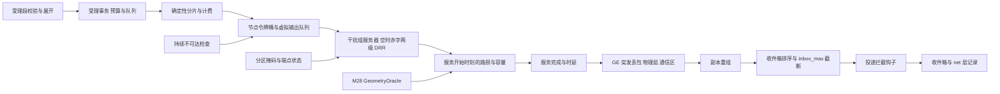

# M29 交互网络 PRD（Interaction Network）

## 文档信息

| 项 | 内容 |
|---|---|
| 文档编号 | AWR-M29 |
| 标题 | M29 交互网络（Interaction Network）PRD：`InteractionNetwork` 协议与档位登记；`none@1`、`ideal@1`、`ideal-unlimited@1`、`abstract-disk@1`、`abstract-radio@1`、`fspl-nlos@1`（D3 `LinkModel` 包装）、`ns3@1`（P2）各档的数学模型与参数表；拓扑快照与变化事件；带宽、队列与丢包；分区与扰动；非网络交互仲裁；确定性与随机键；错误与降级；校准与验证（含对照实测数据的方案）；性能 |
| 版本 | v0.2.1（2026-10-18 文档集集成同步：按 AWR-06 v0.3 §0.5 统一裁定 XR-02、XR-03、XR-09、XR-16 修订 R-M29-10、R-M29-19、R-M29-24、R-M29-75、R-M29-86 与 §6.7、§7.1 的对应条目；按 XR-11 把 AWR-06 调度规则 R-S1 至 R-S8 的引用改称 SR-1 至 SR-8；按 XR-02 把接口草案标注改为 Python 3.12） |
| 日期 | 2026-10-18（UTC） |
| 状态 | D4 设计评审稿（v0.2 按评审意见修订，处理结果见 §15）。供负责人评审；不构成实现承诺。D4 实现在 D3 完整收尾并封板（G0）之后启动，本文周次一律以"D3 封板后第 N 周"表述 |
| 上游 | [AWR-06](../06-D4-协同实验平台概念设计.md) v0.2：§3.3（M29 职责与首批符号）、§3.4（B-01、B-02、B-04、B-10）、§3.8（Bus 与交互网络边界）、§4.1（I-01 至 I-06）、§4.2（`SendRequest`、`DeliveredMessage`、`TxReceipt`、`InteractionOp`、`InteractionEvent`、`LinkGeometry`、`NetworkAdvance`、`InteractionNetwork`）、§4.7（`message.v1`、`interaction.v1`、`network_profile.v1`、`rng_domains.v1`）、§5.1–§5.6（时钟档、阶段全序、事件登记、随机域、确定性等级）、§5.10（北极星分项预算）、§5.11（PB-1 至 PB-5）、§6（网络三档）、§7.4（X1 扰动族）、§8.5（Δ 族干预）、§10（WP-D4-05、06、17、19、25、32、33、43、47、51、52）；ADR-D4-04、07、08、09、11、14、31、33 |
| 调研输入 | [r01 平台能力矩阵](../research/d4/r01-平台能力矩阵.md) §4.1、§5、§6；[r03 NS-2 经验与排行榜规则](../research/d4/r03-NS-2经验与排行榜规则.md) §3（R2、R5–R8、R11、R15–R17、R20–R21、R25–R27）、§5.1（L11）；[n01 现有代码映射](../research/d4/notes/n01-现有代码映射.md) §2.2、§3、§5；[n03 外部模型讨论纪要](../research/d4/notes/n03-外部模型讨论纪要.md) §2.4、§3.1、§3.3；负责人前期稿 design-r2 §四"关键变化 2"、§七实验配置样例 |
| 平行文档 | [M28 实验内核](M28-实验内核PRD.md)、[M30 协同接口与基线](M30-协同接口与基线PRD.md)、[M31 基准套件](M31-基准套件PRD.md)、[M32 评测与统计](M32-评测与统计PRD.md)、[M33 Trace 与复现](M33-Trace与复现PRD.md)、[M34 研究者 SDK 与命令行](M34-研究者SDK与命令行PRD.md)、[S1](../d4/suites/S1-TaskAlloc规格.md)、[S2](../d4/suites/S2-CoopSearch-Handoff规格.md)、[S3](../d4/suites/S3-InfoShare规格.md)、[X1](../d4/suites/X1-RobustCoord协议.md)、[协作智能排行榜规格](../d4/协作智能排行榜规格.md)、[契约草案](../d4/契约草案.md)、[r04 首篇论文实验设计](../research/d4/r04-首篇论文实验设计.md)。上述文档并行撰写，本文对其内容的引用以 AWR-06 为准；对 AWR-06 的问题登记于 §14.1，对平行文档的接口诉求登记于 §14.2 交叉条目，本文不修改平行文档 |
| 引用约定 | 沿用 AWR-06：代码路径相对仓库根 `/data/projs/anet-drone`；`py:` = `python/awr/`，`sdk:` = `tools/sdk/drone4d/src/drone4d/`，`ct:` = `packages/contracts/`。对现有代码的陈述均已打开文件核实，行号以 2026-10-18 工作区为准，可能随分支合并漂移，以"文件 + 符号"为准；对平行文档的引用注明章节与行号（同日工作区） |
| 编号体例 | 需求 R-M29-yy；验收 AC-M29-yy；实现验证项沿用 AWR-06 的 NV-1 至 NV-8，本文增补 NV-9 至 NV-18；风险 RK-M29-yy；待决 Q-M29-yy；交叉条目 X-M29-yy；错误码 73x（候选码段，§6.10）；工作包、ADR、AC-D4、FC、RN、PB、B-xx、I-xx 引用 AWR-06 编号 |
| 数值约定 | 标注"缺省""目标值""初值"的数值为设计默认值或待 pilot 与实测校准的目标，不是对尚未实现代码的性能断言；标注"本文计算"的数值由本文按所列公式推得；标注"开发机微基准"的数值在本文写作所用工作站（Intel Xeon E5-2603 v4 1.7 GHz，CPython 3.12.3，numpy 2.5.3）上实测，不是 RM-8 上的结果，只用于量级估算（F19、F20） |
| 修订记录 | v0.1（2026-10-18）：首版。v0.2（2026-10-18）：按 21 条评审意见逐条核实后修订（§15）：几何读取改用 M28 `PairGeometry` 接口，视线取区间收尾边界快照（§6.5.1）；`message_id` 改由内核签发，M29 不解析（R-M29-10）；消息校验分密封段与受理段（R-M29-11、§6.2.2）；端点下线与回执语义（R-M29-23、§6.2.4）；交接合法性只进入真值层、窗口自要约提交起算（R-M29-73、§6.6）；检查点内容与 `ckpt-net@1` 格式（§6.9）；服务起点规则（§5.1.1）；广播受理事务（R-M29-25、§6.2.3）；持续不可达处理（R-M29-39）；DRR 改为空时赤字并给出可执行伪代码（§6.3.3(4)）；GE 显式状态、区段叠加与回退（§6.3.3(6)、R-M29-58）；拓扑初始事件与反事实原因判定（§6.5）；收件箱截断与干预次序（R-M29-26、§6.2.5）；统计验收判据（§8.1.1）；遗留档回执与收件次序（§6.7）；北极星网络负载定义与分项成本（§9）；工作量估算（§10.3）；`rssi` 改为按链路偏置并移至 P1（R-M29-21）；新增错误与降级（§6.10、R-M29-89–92）；`regime_capable` 标注（§6.4.4）；TTL 参数合并、速率换算、`c_conn` 范围、`priority` 计费、F14 路径等规格缺陷（§15 第 19 条） |

---

## 0. 摘要

1. **定位**。M29 是实验内 Agent 消息的唯一承载者与非网络交互的唯一仲裁者（ADR-D4-04）。它以仿真时间运行，丢包、时延与拓扑由键控随机与声明的模型决定，是被测变量；平台内部 zenoh Bus 不进入实验语义（B-01、B-04）。包路径 `py:interaction/`，P0 第三方依赖只有 numpy（B-02）。
2. **协议**。`InteractionNetwork` 在 AWR-06 §4.2 的 `submit`、`advance`、`topology`、`stats`、`save_checkpoint`、`restore_checkpoint` 之上增补 `configure`、`capabilities`、`collect_inbox`、`neighbors`、`set_endpoint_state`、`apply_control`、`set_interceptor` 七个方法。几何只经 M28 `GeometryOracle`（`snapshot()` 返回 `PairGeometry`、`distance_at`、`positions_at`）读取；`message_id` 由内核签发，网络视为不透明标识。档位以 `name@major` 标识并经登记表构造；同一档位的公式或缺省语义变化一律升主版本。
3. **档位**。`none@1`（恒拒绝）、`ideal@1`（固定 1 ms、保留预算）、`ideal-unlimited@1`（无预算诊断）、`abstract-disk@1`（快速档：单位圆盘 + 固定时延 + 伯努利丢包 + 节点令牌桶与按目的端虚拟输出队列）、`abstract-radio@1`（主档：对数距离路损与遮挡、有效容量、节点令牌桶与有界队列、共享信道空时赤字分层 DRR、连续时间 Gilbert–Elliott、分区掩码与通信区、TTL、持续不可达丢弃、确定性分片计费）、`fspl-nlos@1`（D3 `LinkModel` 原样委托，仅 `drone4d-event@1` 与对拍）、`ns3@1`（P2，保守锁步桥，不排名）。全部未校准参数集标 `synthetic-stress`。
4. **校验与计费**。消息校验分两段：密封段由 M28 `DecisionValidator` 执行（结构、目的端文法、元数据格式、尺寸），受理段由 M29 `submit` 执行（档位开关、schema 一致性、预算与队列）；端点在线状态不进入任何一段，回执不暴露对端或自身下线。`ideal@1`、`abstract-disk@1`、`abstract-radio@1` 对同一消息给出相同的应用字节、分片数与线上字节；发送方可控且随帧传送的元数据（`channel`、`schema`、`flow_id`、`info_class`、`source_sample_time_ns`）计入应用字节，`priority` 由固定头部承载。广播副本按发送方提交计数轮转受理起点，消除编号偏置。
5. **主档实现取舍**。令牌、时刻与空时一律以整数纳秒运算；Gilbert–Elliott 链路状态以带显式状态变量的交替更新过程实现（逗留时长由 `channel` 域按段序号键控抽取），状态路径与流量无关并可惰性推进，满足 RN-2 与 NV-8；队列按"节点 × 优先级类 × 目的端"虚拟输出队列组织；共享信道按空时（而非字节）计赤字，避免边缘慢速链路拖垮干扰组；物理上持续不可达的副本在保持时限后以 `phy:range` / `phy:nlos` 丢弃，使 radio 与 disk 的丢弃归因一致。
6. **拓扑与几何**。全量几何由 M28 在每个物理边界计算一次（R-M28-49，成本计入内核份额）；M29 在每个决策边界与 `t = 0` 由该快照评估全量链路状态，产出 `TopologySnapshot`、`link.change`（含 `t = 0` 初始事件与反事实原因判定）与 `topo.partition`；逐分片的投递结果使用服务时刻的插值距离与区间收尾边界的视线（PB-1、SR-8）。
7. **非网络交互**。`InteractionArbiter` 在 `RESOURCE_ARBIT` 阶段以 `(t, priority, actor_id, op_seq)` 稳定顺序处理机巢停靠、跟踪交接、控制权移交与任务承诺；仲裁不使用随机数。交接要约与接受通知经网络以交互控制消息承载并计费；要约合法性只写真值层（`null_handoff`），对 Agent 可见的事件序列与合法性无关；交接窗口自要约提交时刻起算。
8. **确定性**。`none`、`ideal`、`abstract-*`、`fspl-nlos@1` 为等级 1b；`ns3@1` 在逐位对拍验证前为等级 3。随机源只来自 `channel` 与 `packet` 两个 D4 域（`fspl-nlos@1` 沿用流 20 原键，RN-7）；网络不消费任何外生域，因而改变通信行为不改变外生量（AC-D4-04）。检查点以 `ckpt-net@1`（JCS 清单 + 定宽二进制段）承载，含消息体表与副本重组状态。
9. **校准与验证**。实现验证 NV-1 至 NV-8 为 P0 阻塞项，本文增补 NV-9 至 NV-18；统计类验收一律写明统计量、样本量、α、冻结种子集与批处理方法（§8.1.1）。模型校准分两条线：ns-3 受控场景对照（FC-8，P2）与实测低空链路数据（数据来源与责任人待 Q-D4-13 确定），给出采集规程、样本量规划、拟合流程、判据与 `calibrated` 授予条件。
10. **性能**。北极星网络分项定义为四个北极星算法每次团队决策的平均值 ≤ 0.5 ms（AWR-06 §5.10），以开发机微基准外推给出单条消息、单个副本与单次 `advance` 的成本预算；最重负载（`cbba`，受预算封顶约 135 个副本/团队决策）处于预算边缘（§9.1）。主档按规模档给出网络分项目标与测量协议（§9.5）。
11. **规模**。功能与非功能需求 85 条（编号 R-M29-01 至 R-M29-92，分组之间留有空号），验收 35 条（AC-M29-01 至 AC-M29-35），对 AWR-06 的反馈 31 条，交叉条目 14 条，评审处理记录 21 条。须负责人裁决的有：主档单一干扰组在 n16 满预算下即饱和（反馈 4，裁决点前移至第 5 周）、WP-D4-05 与 WP-D4-06 工作量超出（反馈 28）、`fspl-nlos@1` 缓存与 NV-7 不相容（反馈 2）、GE 惰性演化与 CRN 冲突（反馈 1）、双边交互旁路（反馈 11）。

---

## 1. 背景与目标

### 1.1 约束本模块的事实

| # | 事实 | 对设计的含义 | 依据（已核实） |
|---|---|---|---|
| F1 | 仓库中尚无 `py:interaction/` 与 `py:kernel/`；M29 为新建包 | 全部符号新建；只以库的形式复用 B-10 白名单内的 D3 构件 | `python/awr/` 目录列表 |
| F2 | D3 `LinkModel` 路损 `20 lg d + 20 lg f_MHz − 27.55`，非视距 +20 dB；余量 `20 − PL + 90`；丢包 `1/(1 + exp((margin − 10)/2))` 与通信区额外丢包按 `1 − (1 − p)(1 − p_zone)` 合成；速率 `1e6 · clip(margin/30, 0.05, 1) · bandwidth_scale`；时延 `10 ms + 8·nb/rate + 20 ms·U + 区内附加时延` | `fspl-nlos@1` 的全部公式；本文不重写，原样委托 | `py:agentsdk/env/link.py` `LinkModel._state`、`transmit` |
| F3 | `LinkModel` 每条消息只扣一次令牌，计费字节 `nb = len(payload) + len(topic) + 16`；广播 `"*"` 展开为逐目的端投递但不按副本计费 | `fspl-nlos@1` 不满足 AWR-06 §6.2"广播展开为计费单播"，须在能力声明中豁免 | `link.py` `transmit`（`nb` 计算、`self.bucket[src] -= nb` 在副本循环之外） |
| F4 | 令牌不足的消息直接丢弃，只增加 `stats[src]["dropped_budget"]`，不写 `records`、不排队；不存在 TTL；`out_seq[src]` 只在扣费成功后递增，消息体的 `seq` 取该值 | 遗留档无队列、无 TTL；被丢弃的消息不占出站序号；令牌不足不产生同步回执（§6.7） | `link.py` `transmit`（`continue` 位于 `out_seq` 递增之前） |
| F5 | 链路随机键 `(seed, 20, src_no·256 + dst_no, msg_seq, ch)`，`msg_seq` 为该有向对的发送序号；通道 `link_loss = 0`、`link_lat = 1` | 遗留档的包级抽样对同一有向对上的额外消息敏感，弱于 RN-2；端点数上限 256 | `link.py` `transmit`；`py:agentsdk/rng.py` `STREAM_LINK`、`CH` |
| F6 | 链路状态按 `(min(a, b), max(a, b), ⌊t / 1 s⌋)` 对称缓存，键不含位置；缓存超过 4096 条时整体清空 | 缓存不是纯性能优化：开启与关闭缓存时同一秒内后续消息使用的几何不同，结果不同；清空时点取决于全网流量。NV-7 对该档不可能逐位成立（反馈 2） | `link.py` `_state` |
| F7 | `BenchEnv._advance` 每 tick 先 `refill(0.1 s)`，再对 `apply_tick ≤ k` 的待发消息以当前 tick 位置调用 `transmit(..., apply_tick·TICK_NS, pos)`，再 `deliver_due(t)` 入收件箱 | 包装档须按相同次序与时刻驱动 `LinkModel`，才能与 D3 逐字节一致 | `py:agentsdk/env/core.py` `_advance`（`self.link.refill`、`pending_tx` 循环、`deliver_due`） |
| F8 | D3 动作守卫只接受目的端 `"*"` 或同伴 uav id，拒绝原因 `comm_off`、`dst`、`payload_type`、`too_large`；通过校验的消息在决策处理时即回执 `applied`，其后才进入 `pending_tx` | 遗留档不支持 `group:`；接收方只能是 UAV 端点；回执先于令牌判定，令牌不足不可能同步回执 | `py:agentsdk/env/guard.py` 消息校验段（`r.ack(k_obs, "msg", i, "applied")`）；`core.py` `pending_tx.append` |
| F9 | `run_spec.v1.comm` 为 `additionalProperties: false`，字段 `enabled`、`bucket_Bps`、`burst_B`、`msg_max_B`（1–65536）、`model`；`CommCfg` 缺省 125000、125000、4096、`"fspl-nlos@1"` | D3 契约原位不改（B-06）；D4 参数进入 `ct:coord/network_profile.v1` | `ct:bench/run_spec.v1.schema.json`；`link.py` `CommCfg` |
| F10 | 事件磁带通信区 `TapeReader.comm_zones_at(t_ns)` 返回 `t ∈ [from, to)` 的区 `{id, polygon_m, extra_loss, extra_latency_ms, bandwidth_scale, t_from_ns, t_to_ns}` | 主档的通信区叠加直接消费该接口；`py:sim/events/tape.py` 在 B-10 白名单内 | `py:sim/events/tape.py` `comm_zones_at` |
| F11 | `cbrng.key` 为五级 SplitMix64 键链 `(seed, stream, agent, tick, ch)`；`uniform_elem`、`normal_elem` 为逐元素取样，各参数可为可广播数组；模块本身不导入 numba | `RandomOracle` 的底层取样器（AWR-06 §5.5）；M29 只经 `RandomOracle` 取数；跨消息批量取样可用数组参数一次完成 | `py:sim/sensors/cbrng.py` `key`、`uniform_elem` |
| F12 | `ct:rt/rng_streams.json` 对流 20 的文字为六元键 `(seed, 20, src_no, dst_no, msg_seq, ch)`，与实现不一致；保留区间 23–63 | 以实现为准（F-4）；D4 新档不使用流 20 | `ct:rt/rng_streams.json` |
| F13 | 平台 Bus 全部发送为 `CongestionControl.DROP` 尽力而为 | 实验丢包不得来自 Bus（B-04） | `py:runtime/bus.py` 文件头与 `declare_publisher` |
| F14 | 栈 A 已有"网络档可替换"的先例：`py:agent/runtime/network.py` 定义 `AgentNetwork` 协议；实现类 `MockNetwork`（仿真时间）位于 `py:agent/anet_mock/network.py`，`AnetDaemonNetwork`（墙钟）位于 `py:agent/anet_bridge/network.py`；`MockRelay(zero=True)` 给出零时延；`latency_s` 只取决于消息键 | 档位登记与"按消息键取随机数"的思路沿用；`AnetDaemonNetwork` 为等级 none，不进入排名 | 上述三个文件的类定义；`py:agent/anet_mock/relay.py` `latency_s`、`MockRelay` |
| F15 | D3 评测器已有通信计量 `comm_kb`、`loss_rate`、`dec_per_kb` | 通信计量的口径须能复原 D3 指标（遗留档）并扩展到按 `info_class`、`flow_id` 分解 | `py:bench/eval/ce.py` |
| F16 | r6 原型：投递次数约 370–410 × N²；1 s 链路缓存使 N = 30 耗时降低 39% | 遗留缓存源于性能需要；新档以"按完整输入键控的记忆化"取得同类收益且保持纯函数性 | M26 PRD §1.1 F10 |
| F17 | `LinkModel.deliver_due(t)` 对 `pending` 中 `t_recv ≤ t` 的元组 `(t_recv, _n, dst, msg)` 排序后按目的端分组，`_n` 为全局插入序号；D3 无收件箱条数上限 | 遗留档的收件次序为 `(t_recv, _n)`，不适用本文的规范次序与 `inbox_max`（R-M29-19、R-M29-63） | `link.py` `deliver_due`；`core.py` `inbox.extend` |
| F18 | M28 已定义 `GeometryOracle{snapshot() → PairGeometry, distance_at(t, pairs), positions_at(t)}`，`PairGeometry{endpoints, distance_m, n_blocking, los, snapshot_at_ns}`；R-M28-49 规定每个物理边界对全部通信端点批量计算一次快照，区间内视线取边界快照值；`distance_at` 只接受 `(t − Δp, t]`，越界抛 705；`message_id = "<sender_agent_id>:<producer_seq>"` 由内核在 `COMMAND_COMMIT` 签发；`t_apply` 按 Δp 向上取整（R-M28-04） | M29 的几何读取、标识与服务起点以此为准（§5.1.1、§6.5.1、R-M29-10）；与 v0.1 的差异登记于 §14.2 | M28 PRD §6.3.8（约 733–743 行）、R-M28-04、R-M28-49、§7.1 接口表（约 1115–1119 行） |
| F19 | 开发机微基准：按 R-M28-22 的长度前缀 BLAKE2b-128 派生一个流键约 5.2 µs；`cbrng.uniform_elem` 单次调用约 86 µs，且调用开销与元素数关系弱（8 个元素约 127 µs、133 个约 147 µs、1600 个约 241 µs）；纯 Python 的副本簿记（堆入队、出队、构造冻结数据类）约 5.3 µs/副本；n64 的全对路损与容量矩阵（numpy 向量化）约 0.61 ms/次 | 包级取样必须跨消息、跨副本批量调用；副本簿记是北极星网络分项的主要成本（§9.1） | 本文脚本（只读调用 `py:sim/sensors/cbrng.py`），数值见 §9.6 |
| F20 | 开发机微基准：以 `py:sim/events/jcs.py` `jcs()` 序列化 12,500 行分片记录与 256 个 4 KiB 载荷（2.4 MB）约 555 ms，同一对象 `json.dumps(sort_keys=True)` 约 59 ms | 纯 JCS 的检查点在 n16 满队列下无法满足 50 ms 目标，检查点改为 JCS 清单 + 二进制段（§6.9.3） | 同上 |

### 1.2 目标

| 编号 | 目标 | 度量 |
|---|---|---|
| G1 | 通信成为可控、可复现、可替换的实验变量 | 等级 1b；NV-6 100 次重跑一致；档位可经配置替换而不改 Policy 代码 |
| G2 | 主档在保持确定性的前提下体现距离、遮挡、容量、拥塞、突发丢包与分区 | §6.3 模型齐备；NV-1 至 NV-5、NV-17、NV-18 通过 |
| G3 | 共同随机数：通信行为变化不扰动外生量与无关链路的信道状态 | AC-D4-04；NV-8；NV-16 |
| G4 | 对 D3 零回归：遗留档逐字节复现 D3 运行 | NV-15（AC-D4-22 的网络部分）；B-07 |
| G5 | 拓扑与连通性作为评测与研究对象可得 | 拓扑快照与变化事件（含初始事件）；连通时间占比与 λ₂ 可离线重算 |
| G6 | 模型可信度边界清楚 | 每个参数集带有效性声明与 `synthetic-stress` / `calibrated` 标签；FC-8 与实测校准规程 |
| G7 | 满足北极星与规模预算 | §9 目标值；CP-2 实测 |

### 1.3 非目标

1. 不模拟具体 MAC/PHY 标准（802.11 的退避、ACK、速率自适应），有效容量为应用层抽象，不宣称符合某一调制编码方案（AWR-06 §6.5）。
2. 不提供网络层自动重传、可靠有序投递与平台级多跳路由；多跳只能由 Agent 在应用层转发，每次转发计费（ADR-D4-14）。
3. 不承载平台控制、遥测与观察者流量（§3.8）；不实现实时或硬件在环网络。
4. `ns3@1` 不进入关键路径与排名；不以蜂窝宏站模型标定低空自组网（n03 §2.4）。
5. 不宣称任何未经实测校准的参数集代表真实城市无线环境。

### 1.4 术语（本文新增，其余见 AWR-06 术语表）

| 术语 | 定义 |
|---|---|
| 通信端点（Endpoint） | 参与交互网络的 Agent 身份（`comm_endpoint = true`）。其无线位置由所附实体或固定站址给出（§6.1.3） |
| 副本（Copy） | 一条 `SendRequest` 展开后发往单个接收端的投递单元；单播 1 个，广播与组播为每个目标端点 1 个 |
| 分片（Fragment） | 副本按 1200 B 应用载荷切分的传输单元，每片附 64 B 头部 |
| 应用字节 `A` | 载荷与发送方可控且随帧传送的元数据之和（§6.2.1） |
| 线上字节 `W` | `A + 64 · F`，`F` 为分片数 |
| 受理字节 | 受理副本的线上字节之和，即预算扣减额（`TxReceipt.charged_bytes`） |
| 密封段 / 受理段 | 消息校验的两段：密封段由 M28 `DecisionValidator` 以 `t_sealed` 状态执行；受理段由 M29 `submit` 以 `t_apply` 状态执行（§6.2.2） |
| 网络时钟 `t_net` | 最近一次 `advance(now)` 的 `now`；`advance` 之后、同一边界内提交的事件以 `t_net` 为最早时刻（§5.1.1） |
| 服务起点 `t_s0` | 副本可开始服务的最早时刻，`t_s0 = max(t_apply, t_net)`；时延、令牌等待与 TTL 截止均自 `t_s0` 起算 |
| 干扰组 | 共享同一信道服务器的端点集合；`abstract-radio@1` 缺省全部端点同组 |
| 服务器 | 一个干扰组的单服务器信道，任一时刻至多服务一个分片 |
| 空时 `τ` | 一个分片占用服务器的时长 `⌈8·L·10⁹ / C⌉` ns；分层 DRR 以空时计赤字（§6.3.3(4)） |
| 流 | 分层 DRR 的调度单元：一级为端点，二级为端点内的优先级类 |
| 有向链路 `ij` | 从端点 i 到端点 j 的链路，`link_id = "i>j"`；信道状态按有向链路独立演化 |
| 连通 | `connected_ij(t) = 1[M_ij(t) = 1 ∧ up_i ∧ up_j ∧ C_ij(t) > 0 ∧ C_ij(t) ≥ C_conn]` |
| 物理不可达 | `M_ij = 1`、`up_i` 成立而 `C_ij = 0`（接收功率低于 `S_min`）；区别于掩码断开（分区） |
| 参数集 | 一个档位的完整参数取值与有效性声明，`net/<profile>-<set>@<ver>`，摘要计入 `attrs_digest` |
| 网络控制（NetControl） | 由 `WORLD_UPDATE` 下发的分区掩码、通信区、参数时变区段（regime）与端点状态变更 |
| 交互控制消息 | 仲裁器为双边交互代发的固定尺寸网络消息（`channel = "_ix"`），计费并受丢包与分区约束，不进入收件箱（§6.6.3） |

---

## 2. 范围

### 2.1 分阶段范围

| 阶段 | 交付 | 工作包 | 周次（D3 封板后） |
|---|---|---|---|
| P0 | 协议、登记表、共同计费、受理段校验与受理事务、收件箱收集；`none@1`、`ideal@1`、`ideal-unlimited@1` | WP-D4-05 | 第 1–2 周 |
| P0 | `abstract-disk@1`（供端到端竖切） | WP-D4-05 → WP-D4-43 | 第 3 周交付 |
| P0 | `abstract-radio@1`（`default`、`severe`，标 `synthetic-stress`）；拓扑快照与变化事件；分区掩码与端点状态；`fspl-nlos@1` 委托骨架；检查点；错误与降级；NV-1 至 NV-8 | WP-D4-05 | 第 3–5 周（检查点、错误与降级、遗留骨架按 §10.3 建议排程于第 8–10 周） |
| P0 | 信道负载预检与 `grid` 干扰组（应当；裁定各规模档的干扰组与参数集，§6.4.4） | WP-D4-05 | 第 5 周 |
| P0 | X1 注入钩子中的分区与端点失效（`PartitionCtl`、`set_endpoint_state`），若 CP-1 未达标按 K-1 顺延至 P1 | WP-D4-05、WP-D4-19 | 第 5 周 / 第 12–13 周 |
| P0 | `InteractionArbiter`：任务承诺、交接、机巢与资源争用 | WP-D4-06 | 第 6–7 周 |
| P0 | 网络苛刻度确认（NLoS 与信道负载） | WP-D4-17 | 第 9–10 周 |
| P1 | 参数时变区段 `RegimeCtl` 及叠加规则、脚本通信区 `ZoneCtl`（X1 L、J 族入榜所需） | WP-D4-19 | 第 12–13 周 |
| P1 | `rssi_dbm`（按链路偏置）、`topology_hint` | WP-D4-47（提议并入，反馈 28） | 第 18–20 周 |
| P1 | `fspl-nlos@1` 与 D3 黄金运行逐字节对拍（随 `hosts/hifi`） | WP-D4-25 | 第 12–14 周 |
| P1 | `wake_on_rx` 投递唤醒对接 | WP-D4-28 | 第 17–18 周 |
| P1 | 第三方网络档登记与一致性测试包；教程三"编写一个网络档" | WP-D4-47 | 第 18–20 周 |
| P1 | n32 实测与干扰组参数集复核 | WP-D4-51 | 第 17–19 周 |
| P2 | n64 实测 | WP-D4-52 | 第 22–23 周 |
| P2 | `ns3@1` 保守锁步桥（里程碑 M-NS3，带退出条件） | WP-D4-32 | 第 22–29 周 |
| P2 | FC-8 对照与校准报告 | WP-D4-33 | 第 30–31 周 |
| P2 之后 | AR(1) 相关阴影、广播介质语义、天气与链路耦合 | 未立项 | — |

降级关联：CP-2 未达标时按 AWR-06 §10.2 K-2，DRR 优先级类与磁带通信区叠加顺延至 P1；此时 P0 主档的 `priority` 字段只记录不调度，通信区不叠加，能力声明相应置否并写入有效性声明。

### 2.2 与其他模块的边界

| 模块 | M29 提供 | M29 使用 | 边界规则 |
|---|---|---|---|
| M28 实验内核 | `InteractionNetwork` 实例、`InteractionArbiter`；`NetworkAdvance` 与 `InteractionEvent` 输出；`collect_inbox` 结果；应用字节纯函数 `app_bytes`（供密封段判 `too_large`）；检查点字节 | 阶段调度（`WORLD_UPDATE`、`RESOURCE_ARBIT`、`NET_ADVANCE`、`OBS_SEAL`、`COMMAND_COMMIT`）、`GeometryOracle`（M28 §6.3.8 接口原样）、内核签发的 `message_id` 与密封段校验（`DecisionValidator`）、`RandomOracle`、`AttrRegistry`、资源账本端口、`AssignmentRegistry`、端点表 | 网络不读取实体表写接口；只经 `GeometryOracle` 取几何（I-01、B-09）；接口差异见 X-M29-01 至 X-M29-07 |
| M30 协同接口与基线 | `SendRequest` 受理语义、`TxReceipt` 原因码、能力声明、收件箱规范次序 | schema 一致性校验器（R-M30-30） | 基线与提交方受同一网络约束；`π_ind` 使用 `none@1` |
| M31 基准套件 | 参数集登记、组定义、`inbox_max`、仲裁规则插件接口、X1 网络扰动接口 | Suite 声明的参数集、允许的覆盖项、机巢与交接规则 | Suite 只能下调 `msg_max_B` 与预算；排名运行不得覆盖参数集 |
| M32 评测与统计 | `net/` 层记录与 `stats()`；投递拦截钩子（`cut`、`perm`）；FC-8 输入数据 | 干预计划（`InterventionPlan`） | 干预只作用于接收侧，在收件箱截断之后执行，发送计费不变（AWR-06 §8.5、R-M29-26） |
| M33 Trace 与复现 | `net.*`、`msg.*`、`link.change`、`topo.partition`、`interaction.*` 记录；遗留 `net/records.jsonl` | Trace Source/Sink 端口 | Agent 可见视图只含该 Agent 的回执与收件 |
| M34 SDK | 消息与交互数据类、原因码文案、教程三 | — | SDK 不持有网络对象（I-01） |
| 契约草案 | `message.v1`、`interaction.v1`、`network_profile.v1`、`rng_domains.v1` 的字段需求（§7.3） | — | 字段定稿以契约草案为准；冲突登记于反馈表与交叉条目 |

### 2.3 路径所有权

| 路径 | 所有者 | 说明 |
|---|---|---|
| `python/awr/interaction/**` | M29 | 新建 |
| `python/awr/interaction/params/*.json` | M29 | 参数集包数据，随 wheel 打包 |
| `ct:coord/message.v1`、`interaction.v1`、`network_profile.v1` 的 schema | 契约草案（M29 提出字段需求） | 见 §7.3 |
| `ct:coord/rng_domains.v1.json` 中 `channel`、`packet` 两域 | M28 登记，M29 提出布局 | §6.8 |
| `tests/d4/interaction/**`、`tests/perf/net/**` | M29 | 新建 |
| `py:agentsdk/env/link.py`、`py:agentsdk/rng.py` | D3（冻结，B-08） | M29 只 import，不改 |

---

## 3. 用户与用例

| 编号 | 用例 | 主要流程 | 需求 | 验收 |
|---|---|---|---|---|
| UC-01 | 研究者以受限通信对比算法 | 实验规格选 `network_profile = abstract-disk@1`，覆盖 `range_m`、`bandwidth_kbps`、`delay_ms`、`loss` → 运行 → 报告中通信计量按 `info_class` 分解 | R-M29-03、14、35–38、83 | AC-M29-07、22 |
| UC-02 | 排行榜主赛道 | Suite 声明 `network_profile = {id: abstract-radio@1, params_ref: net/abstract-radio-default@1, params_digest, label: synthetic-stress}`（与协作智能排行榜规格 §13.2 对象格式一致）；排名运行禁止覆盖；结果带 `synthetic-stress` 标签 | R-M29-03、04、39–49 | AC-M29-01、08–12 |
| UC-03 | 通信约束代价诊断 | 同一策略在 `ideal@1` 与 `abstract-radio@1` 上配对运行，计费口径一致，丢弃原因跨档可比 | R-M29-12、14、31、39 | AC-M29-05 |
| UC-04 | 效用–预算曲线的 `B = ∞` 点 | `abstract-radio@1` + `/net/common/budget_unlimited = true` | R-M29-33 | AC-M29-06 |
| UC-05 | 分区与链路退化扰动 | X1 的 P、F、C 族（P0 钩子）与 L、J 族（P1）经 `apply_control`、`set_endpoint_state` 注入；扰动时刻与对象按外生种子配对 | R-M29-23、55–58 | AC-M29-14、15 |
| UC-06 | 通信感知规划研究（P1） | 开启 `topology_hint` 赛道条件；Agent 观测得到邻居 id 列表 | R-M29-52 | AC-M29-13 |
| UC-07 | D3 任务复跑 | `drone4d-event@1` 经 `fspl-nlos@1` 委托 `LinkModel`，与 D3 逐字节一致 | R-M29-60–64 | AC-M29-18 |
| UC-08 | 协作贡献干预 | M29 按 M32 定义的 `CutSpec`/`PermSpec` 以拦截钩子执行 `cut` 与 `perm`（XR-16）；发送计费、网络状态与收件箱截断结果不变 | R-M29-24、26 | AC-M29-20、34 |
| UC-09 | 跟踪交接与机巢争用 | Agent 提交 `handoff.offer` / `nest.dock.req`；仲裁器在 `RESOURCE_ARBIT` 给出结果 | R-M29-70–77 | AC-M29-24–26 |
| UC-10 | 网络模型校准 | 实测或 ns-3 受控场景数据 → 拟合 → FC-8 判据 → 参数集改标 `calibrated` | R-M29-87、88 | AC-M29-28、29 |
| UC-11 | 第三方网络档 | 贡献者实现协议、登记入口点、通过一致性测试包 | R-M29-06 | AC-M29-31 |

---

## 4. 功能需求

"级别"列：必须（阻塞所在阶段门）、应当（所在阶段应交付，可按降级表顺延）、可选。"阶段"列为首次交付阶段。"依据"列中 §x 未注明者指 AWR-06。

### 4.1 协议、登记与参数集

| 编号 | 需求描述 | 级别 | 阶段 | 验收 | 依据 |
|---|---|---|---|---|---|
| R-M29-01 | 提供 `InteractionNetwork` 协议（§7.1）：AWR-06 §4.2 的六个方法之外增补 `configure(ctx)`、`capabilities()`、`collect_inbox(receiver, t_seal)`、`neighbors(agent_id, now)`、`set_endpoint_state(endpoint, up, now)`、`apply_control(ctrl, now)`、`set_interceptor(hook)` 七个方法；`advance(now, geometry)` 按 §5.1.1 的服务窗口规则处理事件，不得读取 `now` 之后的几何；几何只经 M28 `GeometryOracle` 读取（§6.5.1） | 必须 | P0 | AC-M29-01 | §4.2；SR-4、SR-8；M28 §6.3.8 |
| R-M29-02 | 档位登记表 `py:interaction/registry.py`：键为 `name@major`，值为工厂、能力声明（§6.1.4）、确定性等级与可排名属性；未登记档位在实验规格校验阶段报错；登记表内容进入运行清单 `versions` | 必须 | P0 | AC-M29-01 | §6.1；ADR-D4-11 |
| R-M29-03 | 参数集：每个参数集为 `ct:coord/network_profile.v1` 文档（`profile`、`params{}`、`label ∈ {synthetic-stress, calibrated}`、`calibration_ref`、`validity`），以 `params_ref = net/<profile>-<set>@<ver>` 引用；全部参数经 `AttrRegistry` 以 `/net/<profile>/<name>` 与 `/net/common/<name>` 登记类型、单位、范围、`regime_capable` 标记与说明（§6.4）；未登记路径或越界值报错 | 必须 | P0 | AC-M29-02 | §4.2 `AttrSpec`；r03 R2、R11 |
| R-M29-04 | 排名运行只允许 Suite 赛道声明的参数集，不接受 `overrides`；非排名运行的覆盖结果完整写入 `experiment.resolved.json` 并计入 `config_sha256`；覆盖任何参数后参数集标签强制为 `synthetic-stress` | 必须 | P0 | AC-M29-02 | §4.4 组合校验；AC-D4-21 |
| R-M29-05 | 版本规则：档位公式、处理流水线、缺省值或随机键布局的任何变化须升主版本（`@2`）；参数集变化升参数集版本；二者均进入 Board Version 冻结项 | 必须 | P0 | AC-M29-02 | §8.9；r03 R10、R26 |
| R-M29-06 | 第三方网络档：以入口点组 `awr.interaction.profiles` 登记；须通过一致性测试包（协议契约、NV-6、NV-9、NV-11、NV-14、NV-16 与依赖闭包检查）方可标为 Contrib；Community 级只能用于非排名运行 | 应当 | P1 | AC-M29-31 | WP-D4-47；r03 R29、R30 |
| R-M29-07 | 网络对象构造时以类型约束拒绝 Bus 对象与任何墙钟源；`py:interaction/` 不得 import `awr.runtime.bus`、`awr.runtime`、`awr.sim.runtime`、`awr.api`、`awr.sandbox`；B-10 白名单外的 D3 import 一律拒绝 | 必须 | P0 | AC-M29-30 | B-01、B-02、B-04、B-10 |

### 4.2 共同约定（`ideal@1`、`ideal-unlimited@1`、`abstract-disk@1`、`abstract-radio@1`）

| 编号 | 需求描述 | 级别 | 阶段 | 验收 | 依据 |
|---|---|---|---|---|---|
| R-M29-10 | 身份与时间：`message_id` 由 M28 内核签发（Agent 消息在 `COMMAND_COMMIT`，交互控制消息在 `RESOURCE_ARBIT` 以仲裁器名义），M29 视为不透明标识，不解析其结构、不另行签发；M29 对签发方的约束为：Episode 内唯一；只取决于发送方身份与该发送方自身的消息序列，不含全局或他人计数（CRN-3）；满足 `packet` 域 `object_id` 正则；密封段被拒的消息同样占号。格式已由 AWR-06 v0.3 XR-03 裁定为 `<sender_id>#<tx_seq>`（CT §3.1；`tx_seq` 为每发送方从 1 起的消息序号，含密封段被拒者），经 `submit(sender, req, message_id, now)` 传入；Agent 可见视图中的消息标识按 XR-03 以不透明别名呈现，别名映射只写真值层，M29 内部、网络层记录与 `packet` 随机域一律使用规范 `message_id`（X-M29-03 已闭合）。`submitted_at_ns = t_apply`；服务起点 `t_s0 = max(t_apply, t_net)`（§5.1.1）；`delivered_at_ns` 为网络计算的精确纳秒 | 必须 | P0 | AC-M29-03 | I-02、I-06；M28 §7.1 |
| R-M29-11 | 两段校验（§6.2.2）：密封段由 M28 `DecisionValidator` 以 `t_sealed` 状态判 `schema`、`dst_unknown`（目的端文法不合、从未在本 Episode 端点表登记、为发送方自身、展开为空）、`payload_type`、`bad_meta`（元数据字符集、长度或枚举不合，提议新增）、`ttl`（`max_age_ns < 0`）、`too_large`（`A > msg_max_B`，`A` 由 M29 导出的纯函数 `app_bytes(req)` 计算）、`sample_time`；受理段由 M29 `submit` 以 `t_apply` 状态按固定次序判 `comm_off`（档位为 `none@1` 或实验通信总开关关闭）→ `schema_mismatch` → `payload_invalid`（M30 校验器，仅对登记 schema）→ 目的端展开 → 逐副本受理事务（`budget`、`queue_full`，R-M29-25）。端点在线状态不进入任何一段的判定（R-M29-23）。密封段被拒的消息不进入 `submit`，其回执与记录由 M28 写出 | 必须 | P0 | AC-M29-03 | §4.2 `TxReceipt`；M28 R-M28-60、R-M28-64；M30 R-M30-30 |
| R-M29-12 | 计费与分片按 §6.2.1：应用字节含载荷与随帧传送的元数据（`channel`、`schema`、`flow_id`、`info_class`、`source_sample_time_ns`），`priority` 由固定 64 B 头部承载、不另计；`F = max(1, ⌈A / 1200⌉)`；`W = A + 64F`；三档对同一请求给出相同的 `A`、`F`、`W` | 必须 | P0 | AC-M29-05 | §6.2 计量；§6.5 第 3 项 |
| R-M29-13 | 目的端展开：空元组为广播，展开为除发送方外全部在册通信端点（不论在线与否、可达与否）；`group:<id>` 展开为 Suite 或实例声明的组成员（不含发送方）；重复目的端去重；展开结果按端点稳定编号排序；展开为空在密封段以 `dst_unknown` 拒绝；每个副本独立计费、独立排队，受理次序按 R-M29-25 | 必须 | P0 | AC-M29-04 | §6.2 广播 |
| R-M29-14 | 预算：受理字节在受理时从资源账本扣减（`tx_bytes`，Suite 声明 `per: team` 或 `per: agent`），之后因 TTL、分区、丢包、端点下线未送达不退还；每个副本先检查后扣减，不发生回退（R-M29-25）；网络对 `tx_bytes` 维度执行硬额度，该维度不产生事后违规；受理字节、`B_tx`、`B_cancel`、`B_rx` 按 §6.2.1 的分片粒度定义分别记录，并按 `info_class`、`flow_id` 分解 | 必须 | P0 | AC-M29-05 | §6.2 预算口径；I-04 |
| R-M29-15 | `msg_max_B` 为档位属性：缺省 4096 B、上限 16384 B，Suite 只能下调；比较对象为应用字节 `A`，由密封段以 `app_bytes(req)` 判定 | 必须 | P0 | AC-M29-03 | §6.2 消息尺寸 |
| R-M29-16 | TTL：有效 TTL `= min(max_age_ns > 0 ? max_age_ns : /net/common/ttl_default_ns, /net/common/ttl_max_ns)`，截止时刻 `deadline = t_s0 + TTL`；各档不另设 TTL 参数；语义为"发送端排队截止"：分片在截止时刻前未开始服务即丢弃（`ttl` 或 `partition`），已开始服务的分片照常完成；同一副本任一分片丢弃即该副本丢失，其余未开始服务的分片立即撤出队列（不服务、不扣令牌、计入 `B_cancel`），已发射的分片计入 `B_tx` 而不计入 `B_rx` | 必须 | P0 | AC-M29-11 | §6.4、§6.5 第 3 项 |
| R-M29-17 | 不提供重传、确认与有序投递；同一链路上的副本可因抖动乱序到达；网络不产生重复副本 | 必须 | P0 | AC-M29-04 | ADR-D4-14 |
| R-M29-18 | 因果：`delivered_at_ns − t_s0 ≥ 1 ms`（全部档位的最小时延属性下界为 1 ms，因 `t_s0 ≥ t_apply` 亦有 `delivered_at_ns − submitted_at_ns ≥ 1 ms`）；任何网络事件的时刻不早于 `t_net`；投递记录同时写 `delivered_at_ns` 与 `visible_tick`（接收方首个满足 `t_seal ≥ delivered_at_ns` 的决策 tick） | 必须 | P0 | AC-M29-03 | SR-2、SR-4 |
| R-M29-19 | 收件箱：`collect_inbox(receiver, t_seal)` 返回 `delivered_at_ns ≤ t_seal` 且未交付过的消息，按 `(delivered_at_ns, sender_id 码点序, 该发送方的提交次序)` 排序（提交次序与内核签发的 `tx_seq` 数值序一致，M29 不解析 `message_id`；AWR-06 v0.3 XR-03，避免码点序使 `a#10` 排在 `a#9` 之前，M30 §12.1 第 8 条）；网络不保证有序投递，协议须以载荷序号判定新旧；某接收方本次新投递数超过 Suite 的 `inbox_max` 时保留排序最后的 `inbox_max` 条，其余记 `inbox_overflow`（提议新增原因码），`B_rx` 仍计入；截断在干预之前执行（R-M29-26）；`fspl-nlos@1` 不适用本条，沿用 D3 次序且不截断（R-M29-63） | 必须 | P0 | AC-M29-04、34 | PB-5；M30 R-M30-08 |
| R-M29-20 | 元数据约束：`channel`、`flow_id` 符合契约草案 §3.1 的 `^[a-z0-9][a-z0-9_.:-]{0,31}$`，`schema` 为 `opaque` 或符合契约草案 §3.1 消息 schema 名模式（≤ 32 B）；`info_class` 取枚举；`source_sample_time_ns` 若给出计 8 B；以上全部计入应用字节；`channel` 以 `_` 开头者为平台保留，Agent 提交即 `bad_meta` | 必须 | P0 | AC-M29-05 | §8.8 A-03 精神；契约草案 §3.1；反馈 10 |
| R-M29-21 | 接收测量 `rssi_dbm`（P1）：`abstract-radio@1` 取该副本末片服务开始时刻的 `P_r` 叠加按有向链路固定的偏置 `β_ij ~ N(0, σ_b)`（`channel` 域，Episode 内不变，缺省 σ_b = 4 dB）与逐消息噪声 `N(0, σ)`（`packet` 域，缺省 σ = 2 dB），四舍五入到 1 dB；`/net/common/rssi_mode ∈ {off, quantized_noisy, exact}`，缺省 `off`，开启为赛道条件（`exact` 只用于非排名运行）；泄露量判据见 AC-M29-09；其他档为 `None` | 应当 | P1 | AC-M29-09 | §4.2 `DeliveredMessage`；反馈 9 |
| R-M29-22 | 端点：每个通信端点声明无线位置来源 `attach ∈ {entity:<id>, site:<x,y,z>}`；控制多个实体的 Agent 须指定一个主实体；控制 0 个实体的 Agent 须给出固定站址；端点状态 `up/down` 由 M28 以 `set_endpoint_state` 驱动（`silent_failure`、`comm_loss`、`depart`、待命 Agent 初始下线与授予后上线） | 必须 | P0 | AC-M29-15 | §4.1；反馈 8 |
| R-M29-23 | 端点下线语义（§6.2.4）：(a) 发送方在 `t_down` 下线时，其 VOQ 中全部未开始服务的分片于 `t_down` 丢弃（`endpoint_down`，所属副本丢失）；正在服务的分片照常完成并计入 `B_tx`，随后丢弃；(b) 下线期间提交的消息照常执行受理段与受理事务（扣减预算、计受理字节），受理的副本在其服务起点 `t_s0` 出队并以 `endpoint_down` 丢弃，不扣令牌、不计 `B_tx`；(c) 接收方下线时，发往它的副本照常排队与发射，在投递时刻以 `endpoint_down` 丢弃；(d) 回执一律按在线时的同一规则生成，不返回 `comm_off` 或 `dst_unknown`；(e) 上线时队列为空，令牌桶状态连续。X1 C 族"分片在出队时以 `endpoint_down` 丢弃"即 (a)、(b) 两个时刻 | 必须 | P0 | AC-M29-15 | X1 §5.2、§5.3；反馈 29 |
| R-M29-24 | 投递拦截钩子：M29 按 Episode 规格中由 M32 定义的 `CutSpec`/`PermSpec` 构造并注册 `DeliveryInterceptor`（AWR-06 v0.3 XR-16；`perm` 的供体经 M33 `MessageIndex.nearest` 检索，M29 不 import `awr.evaluation`），对普通消息在 `collect_inbox` 截断之后、对交互控制消息在其投递处理时（§6.2.5）逐条返回"照常 / 阻断 / 替换载荷"；阻断记 `intervention`；替换只改载荷字节，`delivered_at_ns`、`wire_bytes`、`channel`、`schema`、发送计费、网络内部状态与截断结果不变；拦截结果写入真值层；拦截执行记录 `exec_record{blocked, permuted, fallback, fallback_blocked, exempt_delivered, donor_episode_id}` 写入真值层与运行清单（字段定义见 M32 §7.2）；`perm` 的豁免通道以 `PermSpec.exempt_channels` 为准（缺省 `["_ix"]`，R-M29-77） | 必须 | P0（`cut`）/ P1（`perm`） | AC-M29-20 | §8.5 |
| R-M29-25 | 受理事务（§6.2.3）：设展开得到 m 个副本、发送方在 M29 中的提交计数为 `q_i`，副本按稳定编号自偏移 `q_i mod m` 循环处理；每个副本依次检查账本余额 ≥ W（否则 `budget`）、队列剩余 ≥ W（否则 `queue_full`），两项均满足时扣减并入队；`copies_accepted ≥ 1` 时 `reason = ""` 并给出 `partial_reason`（首个被拒副本的原因，全部受理时为空），`copies_accepted = 0` 时 `reason` 为该共同原因；可广播边界 `(n − 1)·W ≤ queue_B` 写入有效性声明（§6.4.4） | 必须 | P0 | AC-M29-35 | §6.2 广播；本文细化 |
| R-M29-26 | 收件箱收集与干预次序：`OBS_SEAL` 时 M28 对每个接收方调用 `collect_inbox`；M29 依次执行排序、`inbox_max` 截断（写 `inbox_overflow`）、拦截钩子（写 `intervention` 或替换），返回不可变序列；交互控制消息不进入收件箱、不计入 `inbox_max`；截断集合与溢出记录只取决于网络结果，不随干预变化 | 必须 | P0 | AC-M29-34 | PB-5；§8.5；M28 R-M28-57 |

### 4.3 `none@1`、`ideal@1`、`ideal-unlimited@1`

| 编号 | 需求描述 | 级别 | 阶段 | 验收 | 依据 |
|---|---|---|---|---|---|
| R-M29-30 | `none@1`：`submit` 恒返回 `accepted = false, reason = comm_off, charged_bytes = 0`，仍写 `msg.submit`（`message_id` 由内核签发）；`advance` 无投递；拓扑恒为空图 | 必须 | P0 | AC-M29-06 | §6.1 |
| R-M29-31 | `ideal@1`：`delivered_at_ns = t_s0 + d_ideal`（`/net/ideal/delay_ns`，缺省 1 ms，范围 1 ms–1 s）；无容量、无随机丢包；保留元数据校验、`msg_max_B`、预算、TTL、分区掩码与端点状态（§6.3.1）；拓扑恒为在线端点间按掩码的全连通 | 必须 | P0 | AC-M29-06 | §6.3 |
| R-M29-32 | `ideal-unlimited@1`：同 `ideal@1`，但不扣减 `tx_bytes` 预算；只用于诊断，不进入任何赛道 | 必须 | P0 | AC-M29-06 | §6.1 |
| R-M29-33 | `/net/common/budget_unlimited`（布尔，缺省 false）：为真时任一档不扣减 `tx_bytes`，其余语义不变；用于方向 B 的 `U(B = ∞)` | 必须 | P0 | AC-M29-06 | §9.1 方向 B |

### 4.4 `abstract-disk@1`

| 编号 | 需求描述 | 级别 | 阶段 | 验收 | 依据 |
|---|---|---|---|---|---|
| R-M29-35 | 链路可用：`d_ij ≤ range_m`，且 `los_block = true` 时视线未被障碍遮挡；判定时刻为副本末片发出时刻 `t_e`，距离取 `distance_at(t_e)`，视线取处理该事件的边界快照（§6.5.1）；掩码为 0 的副本不发出，留在队列至恢复或 TTL（R-M29-56） | 必须 | P0 | AC-M29-07 | §6.4 |
| R-M29-36 | 节点上行令牌桶：速率 `R = round_half_even(bandwidth_kbps × 125)` B/s（整数，≥ 1，于 `configure` 时换算并写入解析结果），突发 16 KiB，有界队列 64 KiB（线上字节）；队列按目的端组织为单类虚拟输出队列，在合格队首中按 `(入队时刻, message_id, rx_no, k)` 取最早者发出；令牌按分片扣减 | 必须 | P0 | AC-M29-07 | §6.4；本文细化 |
| R-M29-37 | 时延与丢包：`t_rx = t_e + ⌈delay_ms + J⌉_Δn`，`J ~ U(0, jitter_ms)`；伯努利丢包以 `loss` 按副本抽样；物理不可达副本于 `t_e` 丢弃（`phy`，细分 `range` / `nlos`）；TTL 取 `/net/common/ttl_default_ns`（缺省 2 s） | 必须 | P0 | AC-M29-07 | §6.4 |
| R-M29-38 | 性能：北极星配置（S1 `d1/n20`、`d4_quick`、`minimal`）下四个北极星算法每次团队决策网络分项的平均值 ≤ 0.5 ms，单项分解与负载定义见 §9.1，测量协议见 §9.5（目标值，CP-2 实测）；无事件的服务片整体跳过 | 必须 | P0 | AC-M29-21 | §5.10；PB-3 |

### 4.5 `abstract-radio@1`

| 编号 | 需求描述 | 级别 | 阶段 | 验收 | 依据 |
|---|---|---|---|---|---|
| R-M29-39 | 持续不可达：VOQ 队首分片所在链路在连续的物理边界上均为物理不可达，且自首次观测起持续 ≥ `unreach_hold_ms`（缺省 200 ms）时，该副本于该边界丢弃（`phy:range` 或 `phy:nlos`，按 §6.5.4 判定），其余分片撤出；不可达期间不占用服务器、不扣令牌；掩码断开（分区）不适用本条（R-M29-56）；使 radio 与 disk 对物理不可达的归因一致 | 必须 | P0 | AC-M29-10 | 本文细化；NV-18 |
| R-M29-40 | 路损按 §6.3.3(1)：对数距离模型，LoS 与 NLoS 分别取路损指数，NLoS 附加损耗；`I_NLoS` 取处理该事件的边界快照的 `los`（§6.5.1）；距离取服务开始时刻的 `distance_at`；阴影项缺省 0 | 必须 | P0 | AC-M29-08 | §6.5 第 1 项；M28 R-M28-49 |
| R-M29-41 | 有效容量按 §6.3.3(2) 的分段线性映射；通信区 `bandwidth_scale` 与分区掩码乘到容量上 | 必须 | P0 | AC-M29-08 | §6.5 第 2、7 项 |
| R-M29-42 | 节点上行令牌桶与有界队列按 §6.3.3(3)：令牌以整数（字节 × 10⁹）运算；队列按"优先级类 × 目的端"组织为虚拟输出队列，容量按端点线上字节合计；受理按 R-M29-25 | 必须 | P0 | AC-M29-08 | §6.5 第 3 项；本文细化 |
| R-M29-43 | 共享信道按 §6.3.3(4) 的两级空时赤字 DRR：一级在干扰组内按端点稳定编号轮转，每轮补充 `Q = ⌈8·1264·10⁹ / C_max⌉` ns 空时；二级在端点内按优先级类加权（权重 `8 − priority`）；只服务合格分片；分片空时 `τ = ⌈8·L·10⁹ / C⌉` ns 计入赤字；实现须与 §6.3.3(4) 伪代码逐步等价（允许的批量跳轮优化须通过开关对拍） | 必须（类加权在 K-2 降级时可顺延） | P0 | AC-M29-10 | §6.5 第 4 项；K-2；反馈 31 |
| R-M29-44 | 时延 `t_rx = t_d + ⌈d0 + d/c + J + δ_zone⌉_Δn`，`J ~ U(0, J_max)`；排队时延由服务完成时刻体现，不重复计入 | 必须 | P0 | AC-M29-08 | §6.5 第 5 项 |
| R-M29-45 | 突发丢包：每条有向链路一个两状态连续时间马尔可夫链，按 §6.3.3(6) 以带显式状态变量的交替更新过程实现；分片完成发送时按当时状态以 `p_G` / `p_B` 抽样；初态按 `ge_init`（缺省稳态分布）；`ge_a = 0` 时好状态吸收，逗留时长下限 1 ns | 必须 | P0 | AC-M29-12 | §6.5 第 6 项；RN-2；反馈 1 |
| R-M29-46 | 丢包合成：物理层误包率（缺省关闭）、GE 状态丢包与通信区额外丢包按固定次序独立抽样，首个命中者为丢包原因（`phy` / `burst` / `phy:zone`）；总丢包概率等于 `1 − (1 − p_phy)(1 − p_state)(1 − p_zone)`；丢包粒度为分片 | 必须 | P0 | AC-M29-12 | §6.5 第 6、7 项 |
| R-M29-47 | 参数集 `default` 与 `severe` 按 §6.4.4，标 `synthetic-stress`，各附有效性声明（含可用规模范围与可广播边界） | 必须 | P0 | AC-M29-02 | §6.5；AC-D4-21 |
| R-M29-48 | 干扰组：`interference_mode ∈ {single, grid}`，缺省 `single`；`grid` 按发送端所在 `interference_cell_m` 方格划分干扰组，各组独立服务器；第 5 周信道负载预检（§6.4.4）裁定各 P0 开放规模档采用的干扰组模式或规模参数集，裁定结果以参数集新版本发布 | 应当 | P0 | AC-M29-10 | 反馈 4 |
| R-M29-49 | 扩展 profile：AR(1) 相关阴影须给出相关长度与校准数据后方可登记；广播介质语义（一次发射多端接收）作为新主版本或新档位登记，不改 `@1` | 可选 | P2 之后 | — | §6.5 第 1 项；n03 §2.4 |

### 4.6 拓扑快照与变化事件

| 编号 | 需求描述 | 级别 | 阶段 | 验收 | 依据 |
|---|---|---|---|---|---|
| R-M29-50 | 拓扑在 `t = 0` 与每个决策边界（`t mod Δd = 0`，`NET_ADVANCE` 阶段）全量评估一次：几何取 M28 该边界的 `PairGeometry` 快照（不另行发起几何计算），结合掩码、端点状态与通信区得到 `connected_ij` 与 `C_ij`；`topology(now)` 返回最近一次评估的 `TopologySnapshot`（§7.1），不做插值 | 必须 | P0 | AC-M29-13 | §6.5 第 8 项；PB-1；M28 R-M28-49；反馈 14 |
| R-M29-51 | 变化事件：`t = 0` 的初始评估对每条连通的有向链路产出一条 `link.change{connected = true, cause = init}` 并产出初始 `topo.partition`；其后相邻两次评估之间 `connected_ij` 翻转时产出 `link.change`，原因按 §6.5.4 的反事实规则取 `endpoint` / `mask` / `zone` / `nlos` / `range` 之一，单因素不能解释时取 `compound`；双向连通图的连通分量变化时产出 `topo.partition`；事件写入 `net/` 层，不进入 Agent 观测 | 必须 | P0 | AC-M29-13 | §5.3 `net.link_change`；M33 `link.change` |
| R-M29-52 | `topology_hint`（`/net/common/topology_hint`，缺省 false，P1）：为真时 M28 在 `OBS_SEAL` 构造观测时调用 `neighbors()`，取其出邻居 id 列表（`connected_ij = 1` 的 j，按 id 排序），来源为同一决策边界的快照；开启与否为不同赛道条件 | 应当 | P1 | AC-M29-13 | §6.2 拓扑可见性；S1 R-S1-19 |
| R-M29-53 | 连通诊断量的原始数据（快照序列或变化事件）足以离线重算连通时间占比与代数连通度 λ₂；λ₂ 由 M32 以双向连通无向图计算，M29 不在线计算 | 必须 | P0 | AC-M29-13 | §7.5 Connectivity；§7.6 |

### 4.7 分区、通信区与扰动

| 编号 | 需求描述 | 级别 | 阶段 | 验收 | 依据 |
|---|---|---|---|---|---|
| R-M29-55 | 分区掩码 `M_ij(t)`：由 `apply_control(PartitionCtl)` 设置，来源为实例脚本、X1 P 族与磁带；以"分组列表"或"有向边列表"两种形式表达；多个来源按逐边逻辑与叠加（X1 R-RC-19）；生效时刻为下发它的 `WORLD_UPDATE` 所在边界 t（时刻 ≥ t 的网络事件按新掩码处理）；输入校验见 R-M29-89 | 必须 | P0 | AC-M29-14 | §6.5 第 7 项 |
| R-M29-56 | 分区期间受影响分片留在队列中至恢复或 TTL（TTL 到期时若掩码为 0 记 `partition`，否则记 `ttl`）；已开始服务的分片不撤回；适用于全部支持分区的档位（`ideal@1`、`abstract-disk@1`、`abstract-radio@1`） | 必须 | P0 | AC-M29-14 | §6.5 第 7 项 |
| R-M29-57 | 通信区：`abstract-radio@1` 按 F10 读取磁带通信区（P0，K-2 降级时顺延），任一端点位于多边形内的链路取 `extra_loss` 最大值、`extra_latency_ms` 最大值、`bandwidth_scale` 最小值（与 `LinkModel` 的合成规则一致）；实例脚本以 `ZoneCtl` 下发同结构的区（P1） | 应当 | P0 / P1 | AC-M29-14 | §6.5 第 7 项；F2 |
| R-M29-58 | 参数时变区段（P1）：`apply_control(RegimeCtl)` 在 `[t_from, t_to)` 内对指定端点或链路集合改变参数，只允许 §6.4.4 标注为 `regime_capable` 的参数（`token_Bps`、`d0_ms`、`jmax_ms`、`ge_a`、`ge_b`、`ge_pg`、`ge_pb`）；同一参数多个区段同时生效时按 X1 R-RC-19 取更严苛者（`token_Bps`、`ge_b` 取最小，`d0_ms`、`jmax_ms`、`ge_a`、`ge_pg`、`ge_pb` 取最大），无区段生效时取参数集基值；区段起止时刻参数切换为新的叠加值，GE 当前段截断而状态不变（§6.3.3(6)），令牌桶状态连续；区段切换不改变既有分片的已抽样结果，正在服务的分片保持其服务开始时刻的参数；区段起止时刻与对象由 `failure` 域派生（M31），M29 只执行 | 应当 | P0 钩子接口 / P1 实现与入榜 | AC-M29-15、27 | §7.4 L、J 族；X1 R-RC-19、§12.6 第 5、6 项 |
| R-M29-59 | 天气与节点状态对链路的耦合：P0/P1 只经磁带通信区与端点状态表达；物理天气衰减模型待调研核实后另行立项，不进入 `@1` | 可选 | P2 之后 | — | design-r2 §四；反馈 17 |

### 4.8 `fspl-nlos@1`（D3 `LinkModel` 包装）

| 编号 | 需求描述 | 级别 | 阶段 | 验收 | 依据 |
|---|---|---|---|---|---|
| R-M29-60 | `LegacyFsplNetwork` 持有一个 `LinkModel` 实例并原样委托其 `refill`、`transmit`、`deliver_due`、`status`，不复制、不改写其公式、键打包与缓存；`transmit` 按消息逐条调用（`transmit` 体为对 `msgs` 的顺序循环，逐条调用与整表调用逐位等价），以便把每条消息映射到内核 `message_id` 与 `LinkModel` 出站序号；构造参数 `seed` 取 D3 运行种子（流 20 原键，RN-7），`uavs` 次序取 `run_spec.v1.fleet[]` 次序 | 必须 | P0 骨架 / P1 对拍 | AC-M29-18 | §6.9；B-08；RN-7 |
| R-M29-61 | 驱动时序复现 F7：只在 100 ms 决策边界工作；先 `refill(0.1)`，再按 D3 待发队列的插入次序对 `apply_tick ≤ k` 的消息调用 `transmit(src, [msg], apply_tick·100 ms, pos_k)`（`pos_k` 为当前边界的真值位置），再 `deliver_due(t)` | 必须 | P1 | AC-M29-18 | F7；AC-D4-22 |
| R-M29-62 | 适用约束：只允许 `clock_profile = d3_compat`、`hosts/hifi` 网格世界、全部端点为控制恰好 1 个多旋翼实体的 Agent、端点数 ≤ 256；目的端只允许 `"*"` 或同伴 id；违反者在实验规格校验阶段拒绝 | 必须 | P0 | AC-M29-18 | F5、F8 |
| R-M29-63 | 字段与回执映射（§6.7）：`topic <-> channel`；`max_age_ns`、`priority`、`flow_id`、`info_class` 不生效并在能力声明中置否；`submit` 恒返回 `accepted = true, reason = "", charged_bytes = 0`（与 D3 守卫的 `applied` 一致），令牌不足的丢弃发生在其后的 `transmit` 中，只体现为 `stats.dropped_budget` 与 `net/` 层 `msg.drop{reason = budget}`，能力声明 `sync_budget_receipt = false`；收件次序沿用 D3 的 `(t_recv, 内部序号)`，不应用 `inbox_max`；`LinkModel.records` 原样写出 `net/records.jsonl`，`trace.v1` 视图由 `py:trace/compat.py` 读时转换 | 必须 | P0 | AC-M29-18 | §4.5 旧运行兼容；F4、F8、F17 |
| R-M29-64 | `fspl-nlos@1` 的缓存、计费与随机键语义整体冻结为该档语义：不参与 NV-7 的开关对拍，以 NV-15（与 D3 黄金运行逐字节一致）替代 | 必须 | P1 | AC-M29-18 | 反馈 2 |

### 4.9 `ns3@1`（P2）

| 编号 | 需求描述 | 级别 | 阶段 | 验收 | 依据 |
|---|---|---|---|---|---|
| R-M29-65 | `Ns3Bridge` 以保守锁步协议驱动外部 ns-3 进程（§6.3.5）：D4 内核为唯一时间权威；窗口 `[t, t + h)`、缺省 `h = 1 ms`；边界事件归入下一窗口；`ADVANCE_DONE(t + h, state_digest)` 确认后推进 | 可选（里程碑 M-NS3） | P2 | AC-M29-19 | §6.6 |
| R-M29-66 | 职责划分：D4 侧负责两段校验、预算、分片、广播展开、令牌桶与 TTL 截止；ns-3 侧负责 MAC/PHY、介质访问与其内部队列；首个 profile 为单跳，无平台级路由 | 可选 | P2 | AC-M29-19 | §6.6"多跳与路由由明确一侧拥有" |
| R-M29-67 | 窗口内位置按声明规则保持或恒速外推（`mobility_mode ∈ {hold, constant_velocity}`），须写入配置；ns-3 随机种子与运行号由 `channel` 域确定性派生 | 可选 | P2 | AC-M29-19 | §6.6 第 6 项 |
| R-M29-68 | watchdog 触发、握手摘要不一致或 ns-3 进程异常退出时，整次 Episode 记 `failure.infra`；联合检查点覆盖两侧，ns-3 模型无法序列化时以输入重放恢复 | 可选 | P2 | AC-M29-19 | §6.6；§5.9 |
| R-M29-69 | `ns3@1` 确定性等级判为 3，不进入排名；逐位对拍（同制品 100 次重跑网络事件哈希一致）通过后，可提请评审提升至 1b | 可选 | P2 | AC-M29-19 | §5.6；反馈 19 |

### 4.10 非网络交互仲裁

| 编号 | 需求描述 | 级别 | 阶段 | 验收 | 依据 |
|---|---|---|---|---|---|
| R-M29-70 | `InteractionArbiter` 在 `RESOURCE_ARBIT` 阶段处理全部 `t_apply` 已到达的 `InteractionOp`，顺序键 `(t_apply, priority, actor_id, op_seq)`；`op_id = "<actor_id>@<op_seq>"`；结果 `InteractionEvent.effective_at_ns` 为该阶段所在边界（经网络送达的事件为其 `delivered_at_ns`）；仲裁依据（距离、容量、能力、epoch）写入真值层 | 必须 | P0 | AC-M29-24 | §6.7 |
| R-M29-71 | 仲裁不使用随机数；同刻冲突以顺序键决定，Suite 可声明以 `priority` 优先 | 必须 | P0 | AC-M29-24 | §6.7 |
| R-M29-72 | 机巢停靠 `nest.dock.req{nest_id}`：距离 ≤ 停靠半径、机位空闲且机巢供电时 `GRANTED`；机位满 `DENIED_BUSY`；距离超限 `DENIED_DISTANCE`；断电期间新请求 `DENIED_BUSY`（细节 `unpowered`），已停靠实体保持停靠、充电速率由 M28 能量模型置 0；`nest.undock.rel` 释放机位；距离取仲裁边界的快照 | 必须 | P0（规则）/ P1（S1 `d3` 使用） | AC-M29-25 | §6.7；§7.4 H 族 |
| R-M29-73 | 跟踪交接（§6.6.2、§6.6.3）：`handoff.offer{target_ref, to}` 一律登记并以交互控制消息经网络发往 `to`（计费计入要约方，受丢包、分区与 `cut` 约束）；`validate_handoff` 的结果只写真值层，不影响任何对 Agent 可见的事件，不合法要约同样发送、同样可被接受，对外事件序列与合法要约逐位相同，接受时真值层记 `null_handoff`；仲裁器不以 `DENIED_*` 回应交接；控制消息在受理事务中被拒或在网络中丢失时，要约静默未送达，窗口到期后对要约方显示 `EXPIRED`；`handoff_window` 自要约的 `t_apply` 起算；要约送达后 `to` 的观测出现 `OFFERED`（提议新增状态）；`to` 在窗口内（`accept.t_apply ≤ offer.t_apply + window`）对已送达要约提交 `accept` 则 `GRANTED`，并以控制消息通知要约方（计费计入接受方）；通知在窗口结束前送达时要约方看到 `GRANTED`，否则看到 `EXPIRED`，真值层以接受为准 | 必须 | P0（规则）/ P1（S2 `d3`） | AC-M29-26 | §6.7；S2 §3.7、R-S2-29–31；反馈 11 |
| R-M29-74 | 控制权移交 `lease.transfer{entity_id, to, scope}`：移交方须持有当前 `epoch`；`connected(actor, to)` 以仲裁边界 t 的 M28 快照与 `WORLD_UPDATE` 之后的掩码、端点状态对该单对即时评估（§6.5.5），为 1 方可 `GRANTED`，否则 `DENIED_UNREACHABLE`（提议新增状态）；授予时扣减移交方 `ctl_msg_B` 字节，新 `epoch = old + 1`，经 `AssignmentRegistry` 产出 `assignment.change` | 必须 | P0 | AC-M29-25 | §6.7；I-03；反馈 11；Q-M29-09 |
| R-M29-75 | 任务承诺 `task.claim` / `task.release` / `commit.revoke`：平台只记录不仲裁冲突；按 S1 §2.4 承诺仲裁细则的行序判定：任务未到达、不存在或已关闭，或承诺方实体非 `ACTIVE` 时 `DENIED_INVALID`（`detail` 取 `not_arrived`、`unknown`、`closed`、`actor_inactive`），能力不符 `DENIED_CAPABILITY`，有效承诺数达 Suite 上限时 `DENIED_BUSY`（`detail = claim_limit`），其余 `RECORDED`（已登记，不表示仲裁通过；AWR-06 v0.3 XR-09）；`release`/`revoke` 不持有该承诺时 `DENIED_INVALID`（`not_held`）；结果只返回给操作方，不向其他 Agent 泄露冲突情况 | 必须 | P0 | AC-M29-25 | §6.7 |
| R-M29-76 | 仲裁规则插件：Suite 可登记 `ArbiterRules`（机巢表、停靠半径、交接窗口、交接校验函数、冲突优先规则）；规则为纯函数，只读仲裁所需的真值视图，判定结果只写真值层 | 必须 | P0 | AC-M29-24 | §7.2；S2 R-S2-29 |
| R-M29-77 | 交互控制消息（§6.6.3）：`channel = "_ix"`，载荷为固定 `ctl_msg_B`（缺省 64 B）的平台编码，计入其代发对象（要约为要约方、接受通知为接受方）的 `tx_bytes` 与 `B_tx`；`message_id` 由内核在 `RESOURCE_ARBIT` 签发；不进入收件箱、不计入 `inbox_max`；在 `NET_ADVANCE` 处理其投递事件时交 `InteractionArbiter.on_control_delivered`，所产事件 `effective_at_ns = delivered_at_ns`，于首个 `t_seal ≥ delivered_at_ns` 的密封中可见；其 `TxReceipt` 不进入 Agent 观测；受 Δ 族 `cut` 阻断，不受 `perm` 替换（豁免由 `PermSpec.exempt_channels` 的缺省值 `["_ix"]` 表达，不在本模块硬编码） | 必须 | P0 | AC-M29-26 | 本文提议；Q-M29-05 |
| R-M29-78 | `D2` 机巢与接力逻辑（`py:sim/tasking/relay.py` `RelayController`）只作语义参照，不复用其代码与名称 | 必须 | P0 | AC-M29-30 | §6.7 |

### 4.11 确定性与随机键

| 编号 | 需求描述 | 级别 | 阶段 | 验收 | 依据 |
|---|---|---|---|---|---|
| R-M29-79 | 随机源只来自 `channel`、`packet` 两域（§6.8 布局）；不消费 `instance`、`world`、`target`、`weather`、`sensor`、`task`、`failure`、`intervention`、`policy` 域；`fspl-nlos@1` 只用流 20 原键 | 必须 | P0 | AC-M29-12、16 | §5.5 RN-1、RN-2、RN-7 |
| R-M29-80 | 时间与令牌、空时、逗留时长一律以整数纳秒与整数令牌运算；浮点只出现在路损、容量与概率计算中，结果在进入时间运算前以 `ceil` 取整；同刻多个输出按 `(t_ns, receiver_id, message_id, frag_index)` 排序后产出，`producer_seq` 按产出次序由 M28 `RunContext` 分配；`advance` 内事件按 §5.1.1 的次序处理 | 必须 | P0 | AC-M29-16 | SR-1；§5.6 |
| R-M29-81 | 任何缓存或记忆化必须以完整输入（端点、边界时刻、参数区段）为键，并通过开关对拍（NV-7）；不得以近似时间桶为键 | 必须 | P0 | AC-M29-17 | §6.8 NV-7；F6 |
| R-M29-82 | 检查点：`save_checkpoint` 只在无未完成调用的决策屏障处由 M28 调用，内容按 §6.9.2（含消息体表、副本重组状态、待收集收件、控制与区段、GE 游标、DRR 状态、统计），格式为 `ckpt-net@1`（JCS 清单 + 定宽二进制段，浮点在清单中以十六进制表示，§6.9.3）；与 M28 检查点同屏障保存、同时恢复，分工按 §6.9.1；恢复后续跑与不中断运行的网络事件哈希及投递载荷逐字节一致 | 必须 | P0 | AC-M29-17 | §5.9 |

### 4.12 Trace、计量与可见性

| 编号 | 需求描述 | 级别 | 阶段 | 验收 | 依据 |
|---|---|---|---|---|---|
| R-M29-83 | `net/` 层记录 `msg.submit`、`msg.deliver`、`msg.drop`、`link.change`（含 `t = 0` 初始事件）、`topo.partition`，`full` 级别另记 `net.service`（分片开始与完成）与 `net.ge`（GE 状态切换）；字段见 §7.4；`minimal` 级别至少含 `msg.submit`、`msg.deliver`、`msg.drop` | 必须 | P0 | AC-M29-22 | §4.5；r03 R16、R17、R20 |
| R-M29-84 | Agent 可见视图只含该 Agent 的 `TxReceipt`（不含交互控制消息的回执）、收件与交互事件；不含自身消息的丢弃原因、他人的发送、链路与拓扑记录（`topology_hint` 开启时只含邻居列表，`rssi_mode` 开启时只含本消息 `rssi_dbm`）；泄露审计以此为白名单 | 必须 | P0 | AC-M29-23 | §4.1 I-01；§8.8 A-01 |
| R-M29-85 | `stats()` 返回结构化对象 `NetStats`（§7.1）：按端点与全网汇总的提交、受理、拒绝（按原因）、发射分片、投递、丢弃（按原因）、四类字节（按 `info_class`、`flow_id` 分解）、时延直方图；只对评测侧可见 | 必须 | P0 | AC-M29-22 | §4.2 |

### 4.13 非功能需求

| 编号 | 需求描述 | 级别 | 阶段 | 验收 | 依据 |
|---|---|---|---|---|---|
| R-M29-86 | 性能、内存与依赖：满足 §9 的分项目标值（WP-D4-05、17、51、52 实测后冻结）；P0 导入闭包只有 numpy 与标准库（AWR-06 v0.3 XR-02）；CPython 3.12；`ns3@1` 的外部依赖只在可选附加包中延迟导入 | 必须 | P0 | AC-M29-21、30 | §5.10、§5.11；B-02 |

### 4.14 有效性声明与校准

| 编号 | 需求描述 | 级别 | 阶段 | 验收 | 依据 |
|---|---|---|---|---|---|
| R-M29-87 | 每个参数集附 §8.4 的有效性声明；标签 `calibrated` 只在满足 §8.3.3 全部授予条件时授予，并登记 `calibration_ref`（数据摘要、拟合脚本摘要、验证报告、适用域）；由 `synthetic-stress` 参数集得出的结果与报告一律带该标签 | 必须 | P0（声明与标签）/ P2（授予） | AC-M29-02、28 | §6.2 有效性声明；§6.8；AC-D4-21；RK-08 |
| R-M29-88 | 校准工具链：§8.2 的 FC-8 对照报告生成器（场景网格、指标、两项相对距离）与 §8.3.2 的五步拟合脚本（含样本量规划与可辨识性检查）；工具链以"由已知参数生成的合成数据"做参数回收测试 | 应当 | P1（工具链）/ P2（执行） | AC-M29-28、29 | §6.8；WP-D4-33 |

### 4.15 错误与边界条件

| 编号 | 需求描述 | 级别 | 阶段 | 验收 | 依据 |
|---|---|---|---|---|---|
| R-M29-89 | 网络控制输入校验：`t_to_ns ≤ t_from_ns`、未知端点或链路 id、退化多边形（顶点数 < 3、面积为 0、自相交或含非有限坐标）、同一 `PartitionCtl` 内某端点出现在两个分组中、`RegimeCtl` 含非 `regime_capable` 参数或越界值、`t_from_ns` 早于下发边界的上一边界（`t − Δp`）；来自实例脚本与 X1 的控制在 `prepare()` 阶段整体预校验并以 730 `NET_CONTROL_INVALID` 拒绝；运行中出现时报 730 并判 `failure.infra` | 必须 | P0 | AC-M29-33 | 评审意见第 20 条；§6.10 |
| R-M29-90 | 调用次序：`configure` 之前的任何调用、同一边界重复 `advance`、`now` 回退、`collect_inbox` 早于同一边界的 `advance`、`submit` 收到本应在密封段被拒的请求，一律报 731 `NET_CALL_ORDER` 并判 `failure.infra` | 必须 | P0 | AC-M29-33 | §7.2；§6.10 |
| R-M29-91 | 几何边界：端点距离 < 1 m 时路损按 1 m 计算；距离 < 10⁻⁶ m 时视线按通达处理；`GeometryOracle` 返回非有限坐标或距离时报 732 `NET_GEOMETRY_INVALID` 并判 `failure.infra` | 必须 | P0 | AC-M29-33 | §6.3.3(1)；§6.10 |
| R-M29-92 | 拦截钩子失效：`DeliveryInterceptor` 抛出异常、返回未登记动作、替换载荷非 `bytes` 或超过 65536 B 时报 733 `NET_INTERCEPTOR_FAILED` 并判 `failure.infra`；该 Episode 不以降级方式继续 | 必须 | P0 | AC-M29-33 | §8.5；§6.10 |

---

## 5. 处理流程与阶段交互

### 5.1 一个物理边界内的网络动作

| 阶段（AWR-06 §5.2） | M29 动作 | 说明 |
|---|---|---|
| `WORLD_UPDATE` | 处理 `apply_control`（分区掩码；P1 起通信区与参数区段）与 `set_endpoint_state` | 生效时刻为本边界 t：`(t − Δp, t)` 内的网络事件按变更前状态处理，时刻 ≥ t 的事件按新状态处理（SR-3） |
| `RESOURCE_ARBIT` | `InteractionArbiter` 处理已到达操作；需要时调用 `submit` 发送交互控制消息；单对连通与距离取 M28 本边界快照（§6.5.5） | 控制消息 `t_apply = t`，此时 `t_net = t − Δp`，故 `t_s0 = t`，由本边界的 `NET_ADVANCE` 处理 |
| `NET_ADVANCE` | `advance(t, geometry)`：按 §5.1.1 处理服务开始、服务完成、令牌就绪、TTL 截止、持续不可达检查、端点状态变更与投递；决策边界上由 M28 快照全量评估拓扑 | 输出 `NetworkAdvance`；距离按服务时刻插值，视线取本边界快照（§6.5.1） |
| `OBS_SEAL` | M28 对每个接收方调用 `collect_inbox(receiver, t)`（排序、截断、干预，R-M29-26），读取回执、交互事件；P1 起 `topology_hint` 开启时调用 `neighbors()` | M29 不直接写观测 |
| `COMMAND_COMMIT` | M28 按稳定 `agent_id` 次序调用 `submit` | `t_apply = t`（R-M28-04 已把 `t_apply` 向上取整到 Δp 边界），此时 `t_net = t`，故 `t_s0 = t`；这些分片由下一次 `advance` 以"`t_net` 时刻的后到事件"处理（§5.1.1） |

决策周期 `Δd = 100 ms`、`ℓ_model = 100 ms` 时，在 `t0` 密封观测的决策于 `t0 + 100 ms` 提交消息，`ideal@1` 下于 `t0 + 101 ms` 投递，接收方最早在 `t0 + 200 ms` 的密封中读到；一跳往返下限 `2Δd + 网络时延` 与 AWR-06 §5.4 一致。

#### 5.1.1 服务窗口规则

| 编号 | 规则 |
|---|---|
| W-1 | 网络时钟 `t_net` 为最近一次 `advance(now)` 的 `now`；`configure` 后 `t_net = 0` |
| W-2 | `advance(now)` 先处理时刻等于 `t_net`、在上一次 `advance` 之后产生的事件（`COMMAND_COMMIT` 的提交及其派生的令牌就绪与服务选择），再按事件堆次序处理时刻落在 `(t_net, now]` 的事件，最后令 `t_net = now` |
| W-3 | 每条提交的服务起点 `t_s0 = max(t_apply, t_net)`；时延、令牌等待、TTL 截止与 `ideal@1` 的投递时刻均自 `t_s0` 起算；`msg.submit` 记录 `submitted_at_ns = t_apply` 与 `service_from_ns = t_s0`。在 R-M28-04 的取整规则下 `t_apply` 恒等于提交所在边界，故 `t_s0 = t_apply`；`max` 为防御性规则，若出现 `t_apply < t_net` 则以 `t_net` 起算并记录差值 |
| W-4 | 服务器在 `t_net` 的选择：若上一次 `advance` 结束时服务器已在 `t_net` 处于忙状态（含在 `t_net` 刚开始服务的分片），后到提交只在下一次空闲时参与选择；若服务器在 `t_net` 空闲，后到提交在 `t_net` 参与选择。同一时刻不发生两次选择 |
| W-5 | 网络事件的时刻不早于 `t_net`（R-M29-18）；任何档位产出的投递时刻严格大于其 `t_s0` |
| W-6 | 时钟档与 `ℓ_model` 消融：`ℓ_model ∈ {50, 250 ms}` 在 `d4_std`（Δp = 20 ms）的开发运行中取整为 60 ms 与 260 ms，在 `d4_quick`（Δp = 100 ms）中取整为 100 ms 与 300 ms（R-M28-04）；以上规则对取整后的 `t_apply` 成立（AC-M29-03） |

### 5.2 主档处理流水线



---

## 6. 设计方案

### 6.1 组件与对象

#### 6.1.1 组件

| 组件 | 文件 | 职责 |
|---|---|---|
| 协议与数据类 | `py:interaction/api.py` | §7.1 的协议、数据类与原因码常量；纯函数 `app_bytes` |
| 登记表 | `py:interaction/registry.py` | 档位工厂、能力声明、入口点发现 |
| 共同基座 | `py:interaction/base.py` | 受理段校验、目的端展开、受理事务、分片与计费、预算端口、统计 |
| 收件箱 | `py:interaction/inbox.py` | `collect_inbox`：排序、截断、拦截钩子调用 |
| 参数 | `py:interaction/attrs.py`、`params/*.json` | `AttrSpec` 声明（含 `regime_capable`）与参数集包数据 |
| 简单档 | `none.py`、`ideal.py` | §6.3.1 |
| 快速档 | `disk.py` | §6.3.2 |
| 主档 | `radio/{pathloss.py, capacity.py, bucket.py, voq.py, drr.py, ge.py, server.py, zones.py, network.py}` | §6.3.3；持续不可达检查在 `voq.py` |
| 拓扑 | `topology.py` | 决策边界全量评估、快照、初始事件、反事实原因、分量 |
| 网络控制 | `control.py` | 分区、端点状态；P1 起通信区与区段叠加 |
| 检查点 | `checkpoint.py` | `ckpt-net@1` 编码与解码（§6.9） |
| 错误 | `errors.py` | 73x 错误码与 `NetError`（§6.10） |
| 遗留档 | `legacy_fspl.py` | §6.3.4 |
| ns-3 桥 | `ns3/{bridge.py, frames.py}`（P2，可选附加） | §6.3.5 |
| 仲裁器 | `arbiter.py`、`rules.py` | §6.6 |
| 一致性测试包 | `conformance/` | 第三方档位的契约与 NV 测试（P1） |

#### 6.1.2 实例化

M28 在 Episode 开始时以 `NetContext` 调用登记表工厂：`NetContext{attrs: ResolvedAttrs, rng: RandomOracle, clock: ClockProfile, endpoints: tuple[EndpointSpec, ...], groups: Mapping[str, tuple[AgentId, ...]], ledger: LedgerPort, trace: TraceSourcePort, inbox_max: int, rules: ArbiterRules, schema_validator: Optional[SchemaValidator]}`（`schema_validator` 由 M30 提供，R-M30-30）。网络对象不持有内核、调度器或实体表的引用（I-01）。`NetContext` 的类型定义须进入 M28 接口表（X-M29-02）。

#### 6.1.3 端点

| 字段 | 说明 |
|---|---|
| `endpoint_id` | 等于 `agent_id` |
| `endpoint_no` | 内核签发的单调编号（I-06），用于 `packet` 域键与 DRR 次序；不复用 |
| `attach` | `entity:<entity_id>`（取该实体位置）或 `site:<x,y,z>`（固定站址）；`CentralPolicy` 等控制多实体的 Agent 须指定主实体 |
| `group_ids` | 所属组 |
| `interference_group` | `single` 模式下恒为 0；`grid` 模式按发送端所在方格逐事件确定 |
| `up` | 在线状态（初值由 M28 给出：待命 Agent 初始下线） |

#### 6.1.4 能力声明

| 能力 | `none@1` | `ideal@1` | `ideal-unlimited@1` | `abstract-disk@1` | `abstract-radio@1` | `fspl-nlos@1` | `ns3@1` |
|---|---|---|---|---|---|---|---|
| 预算扣减 | — | 是 | 否 | 是 | 是 | 令牌桶（每消息一次） | 是 |
| 同步预算回执（`sync_budget_receipt`） | — | 是 | — | 是 | 是 | 否 | 是 |
| 广播按副本计费 | — | 是 | 是 | 是 | 是 | 否 | 是 |
| `group:` 目的端 | — | 是 | 是 | 是 | 是 | 否 | 是 |
| TTL | — | 是 | 是 | 是 | 是 | 否 | 是 |
| `priority` 调度 | — | 否 | 否 | 否 | 是（K-2 降级时否） | 否 | 待定 |
| 收件次序 | — | 规范 | 规范 | 规范 | 规范 | D3 | 规范 |
| `inbox_max` 截断 | — | 是 | 是 | 是 | 是 | 否 | 是 |
| 拓扑快照 | 空图 | 掩码全连通 | 掩码全连通 | 是 | 是 | 否 | 是 |
| `topology_hint`（P1） | — | 是 | 是 | 是 | 是 | 否 | 是 |
| 分区掩码 | — | 是 | 是 | 是 | 是 | 否 | 是 |
| 端点状态 | — | 是 | 是 | 是 | 是 | 否 | 是 |
| 通信区 | — | 否 | 否 | 否 | 是（磁带 P0，K-2 降级时否；`ZoneCtl` P1） | 是（`LinkModel` 自带） | 待定 |
| 参数区段（P1） | — | 否 | 否 | 否 | 是 | 否 | 待定 |
| `rssi_dbm`（P1） | — | 否 | 否 | 否 | 是 | 否 | 是 |
| 包级键 | — | — | — | `packet` 域 | `packet` 域 | 流 20 有向对序号 | ns-3 内部 |
| 确定性等级 | 1b | 1b | 1b | 1b | 1b | 1b | 3 |
| 可排名 | 否（参考） | 对照赛道 | 否 | 否（开发档） | 是 | 仅 `drone4d-event@1` | 否 |

### 6.2 共同约定的模型

#### 6.2.1 应用字节、分片、线上字节与计量恒等式

```
A = len(payload) + len(channel) + len(schema) + len(flow_id or "") + 1(info_class) + 8·1[source_sample_time_ns 给出]
F = max(1, ⌈A / 1200⌉)          第 k 片应用载荷 a_k = min(1200, A − 1200·k)，k = 0..F−1
L_k = a_k + 64                   分片线上字节（64 B 头部承载 priority、分片号与平台帧字段）
W = A + 64·F                     副本线上字节
```

| 量 | 定义（分片粒度） |
|---|---|
| 受理字节 | `Σ_{受理副本} W` |
| `B_tx` | 已开始服务（radio）或已发出（disk）的分片 `L_k` 之和，于服务开始或发出时计入 |
| `B_cancel` | 受理后未开始服务即撤出的分片 `L_k` 之和：TTL 或分区截止、副本丢失后的撤出、端点下线清空、持续不可达丢弃 |
| `B_pending(t)` | t 时仍在队列中的分片 `L_k` 之和 |
| `B_rx` | 网络投递成功的副本 `W` 之和（干预与 `inbox_max` 截断之前；全部分片均已计入 `B_tx`） |
| `B_txlost` | 已计入 `B_tx` 但所属副本丢失的分片 `L_k` 之和 |
| `B_inflight(t)` | 已计入 `B_tx`、所属副本尚未定局的分片 `L_k` 之和 |
| 恒等式 | `受理字节 = B_tx + B_cancel + B_pending(t)`；`B_tx = B_rx + B_txlost + B_inflight(t)`（NV-1） |

`ideal@1` 与 `abstract-disk@1` 同样按上式计算 `A`、`F`、`W`，只是 `ideal@1` 不经令牌桶与信道（`ideal@1` 的 `B_tx` 于 `t_s0` 计入整副本）。`fspl-nlos@1` 沿用 `nb = len(payload) + len(topic) + 16`（F3）。丢包粒度：`abstract-disk@1` 按副本，`abstract-radio@1` 按分片（§6.4.4 区分两种口径）。

`priority` 不计入 `A`：它不在 `DeliveredMessage` 中出现（AWR-06 §4.2），对接收方不可见，不构成元数据隐蔽信道，按现实帧格式由固定头部承载。`flow_id` 同样不在 AWR-06 的 `DeliveredMessage` 中，本文依契约草案 §4.1 将其计入 `A`，是否随投递交付登记为反馈 26。

#### 6.2.2 原因码与校验分段

| 位置 | 段 | 代码 | 含义 | 出处 |
|---|---|---|---|---|
| `TxReceipt.reason` | — | `""` | 至少一个副本受理（部分受理见 `partial_reason`） | AWR-06 §4.2 |
| | 密封（M28） | `schema` | 结构不符 | M28 §7.3.2 |
| | 密封（M28） | `dst_unknown` | 目的端文法不合、从未在本 Episode 端点表登记、为发送方自身或展开为空；不反映在线状态 | AWR-06；本文限定 |
| | 密封（M28） | `payload_type` | 载荷类型不符 | M28 §7.3.2 |
| | 密封（M28） | `bad_meta` | 元数据字符集、长度或枚举不合；`channel` 以 `_` 开头 | 本文提议 |
| | 密封（M28） | `ttl` | `max_age_ns` 非法（负值） | AWR-06 |
| | 密封（M28） | `too_large` | `app_bytes(req) > msg_max_B` | AWR-06 |
| | 密封（M28） | `sample_time` | `source_sample_time_ns` 晚于已收样本的最晚采集时刻 | M28 R-M28-64 |
| | 受理（M29） | `comm_off` | 档位为 `none@1` 或实验通信总开关关闭；不用于端点下线 | AWR-06；本文限定 |
| | 受理（M29） | `schema_mismatch` | `info_class` 与登记 schema 不一致 | M30 R-M30-30、CR-5 |
| | 受理（M29） | `payload_invalid` | 载荷不满足方言 schema | M30 R-M30-30、CR-5 |
| | 受理（M29） | `budget` | 账本余额不足以受理任何副本（遗留档不产生本码，见 §6.7） | AWR-06 |
| | 受理（M29） | `queue_full` | 队列剩余不足以容纳任何副本 | AWR-06 |
| `NetworkAdvance.drops` / `msg.drop` | — | `phy` | 不可达（细分 `range`、`nlos`）、物理层误包、通信区额外丢包（细分 `zone`） | AWR-06 |
| | — | `burst` | GE 状态丢包 | AWR-06 |
| | — | `partition` | 掩码为 0 期间 TTL 到期 | AWR-06 |
| | — | `ttl` | 其他 TTL 到期 | AWR-06 |
| | — | `queue_full` | 保留（`@1` 无受理后溢出的情形） | AWR-06 |
| | — | `endpoint_down` | 发送端或接收端下线（§6.2.4） | 本文提议 |
| | — | `inbox_overflow` | 超出 `inbox_max` | 本文提议 |
| | — | `intervention` | 被 Δ 族干预阻断 | 本文提议 |
| | — | `budget` | 仅 `fspl-nlos@1`：令牌不足于 `transmit` 时丢弃 | 本文提议 |

`TxReceipt` 增 `copies_total`、`copies_accepted`、`partial_reason` 三个字段（提议），使部分受理的广播可被发送方感知；不提供逐副本原因，以免泄露端点状态。`msg.drop` 按副本记录，字段 `frag` 为首个丢失分片号；副本丢失后撤出的分片不另记。

#### 6.2.3 受理事务与可广播边界

```
输入：发送方 i，展开得到的副本目的端 j_0 < j_1 < … < j_{m−1}（按 endpoint_no），副本线上字节 W
o ← q_i mod m；q_i ← q_i + 1                       # q_i：M29 内该发送方的 submit 计数（不含密封段被拒者）
accepted ← 0；first_reject ← ""
for r in 0..m−1：
    j ← j_{(o + r) mod m}
    if ledger.remaining(i, tx_bytes) < W：reason_j ← budget
    elif queue_free(i) < W：             reason_j ← queue_full
    else：ledger.charge(i, tx_bytes, W)；enqueue(i, j)；accepted ← accepted + 1；continue
    if first_reject = ""：first_reject ← reason_j
TxReceipt{accepted = (accepted ≥ 1), charged_bytes = accepted·W, copies_total = m, copies_accepted = accepted,
          reason = "" if accepted ≥ 1 else first_reject, partial_reason = first_reject if accepted ≥ 1 else ""}
```

性质：同一次 `submit` 内账本余额与队列剩余只减不增，且全部副本的 W 相同，因此一旦某副本被拒，其后各副本均以同一原因被拒，`first_reject` 即全部被拒副本的共同原因；扣减只在两项检查均通过后发生，无需回退。轮转起点使部分受理时各接收端被受理的机会均等（AC-M29-35）。`ideal-unlimited@1` 与 `budget_unlimited = true` 时略去账本检查与扣减。

可广播边界（空队列下一次广播能全部受理的条件 `(n − 1)·W ≤ queue_B`，本文计算）：

| 参数集 | `queue_B` | `A = 1136`（`F = 1`，`W = 1200`） | `A = 4096`（`F = 4`，`W = 4352`） | `A = 16384`（`F = 14`，`W = 17280`） |
|---|---|---|---|---|
| `default` | 65,536 B | n ≤ 55 | n ≤ 16 | n ≤ 4 |
| `severe` | 32,768 B | n ≤ 28 | n ≤ 8 | n ≤ 2 |
| `abstract-disk-default` | 65,536 B | n ≤ 55 | n ≤ 16 | n ≤ 4 |

超出边界时大消息广播只能部分受理；该边界写入有效性声明，并作为反馈 30 提请在规模参数集中按 n 调整 `queue_B` 或 `msg_max_B`。

#### 6.2.4 端点下线

| 情形 | 时刻 | 处理 | 计量 |
|---|---|---|---|
| 发送方 i 在 `t_down` 下线，VOQ 中未开始服务的分片 | `t_down` | 全部丢弃（`endpoint_down`），所属副本丢失 | `B_cancel` |
| 发送方 i 正在服务的分片 | 服务完成 `t_d` | 照常占用服务器至 `t_d`，随后丢弃（`endpoint_down`） | `B_tx`、`B_txlost` |
| 下线期间提交的消息 | `submit` 时 | 照常执行受理段与受理事务，扣减预算、计受理字节，回执按在线规则生成 | 受理字节 |
| 下线期间受理的副本 | 其 `t_s0` | 出队即丢弃（`endpoint_down`），不扣令牌 | `B_cancel` |
| 接收方 j 下线，发往 j 的副本 | 投递时刻 | 照常排队与发射，到达时丢弃（`endpoint_down`） | `B_tx`、`B_txlost` |
| 端点上线 | `t_up` | 队列为空；令牌桶按 `t_down` 至 `t_up` 的时长连续补充（不超过 `T_max`） | — |

回执一律不返回 `comm_off` 或 `dst_unknown`（R-M29-23）。残余可观测性：下线期间队列恒为空，发送方不会收到 `queue_full`；在线时队列状态由自身流量决定，二者的差别不构成对端状态的泄露，作为已知局限写入有效性声明。

#### 6.2.5 收件箱收集、截断与干预

1. `collect_inbox(receiver, t_seal)` 取 `delivered_at_ns ≤ t_seal` 且未交付过的普通消息副本，按 `(delivered_at_ns, message_id 码点序)` 排序。
2. 新投递数 `k > inbox_max` 时，前 `k − inbox_max` 条记 `msg.drop{reason = inbox_overflow}`；`B_rx` 已于网络投递时计入，不回退。
3. 对保留的每条消息调用拦截钩子：`pass` 原样返回；`block` 记 `msg.drop{reason = intervention}` 并从结果中移除；`replace` 以新载荷构造 `DeliveredMessage`，其余字段不变。
4. 返回不可变序列；交付标记写入副本表，供检查点与重复调用检查。
5. 交互控制消息不进入本流程：其投递事件在 `NET_ADVANCE` 处理时先经拦截钩子（`cut` 阻断即视为未送达，不受 `perm` 替换），通过者交 `on_control_delivered`。

该次序使 `inbox_overflow` 的集合与网络内部状态在各干预臂间逐位一致（AC-M29-20、AC-M29-34）；`cut` 下保留集合全部被阻断。

### 6.3 各档数学模型

#### 6.3.1 `none@1`、`ideal@1`、`ideal-unlimited@1`

- `none@1`：`submit` 恒拒绝（R-M29-30）。
- `ideal@1`：副本在 `t_s0` 若 `M_ij = 1` 且 `up_i`，则 `t_rx = t_s0 + d_ideal`；否则保持至掩码恢复且发送方在线的最早时刻 `t'`，`t_rx = t' + d_ideal`；`t'` 晚于截止时刻时丢弃（`partition`，或 `endpoint_down` 按 §6.2.4）；`d_ideal > TTL` 时于截止时刻丢弃（`ttl`）；接收方下线按 §6.2.4；拓扑 `connected_ij = up_i ∧ up_j ∧ M_ij`。
- `ideal-unlimited@1`：同上，不扣预算。

#### 6.3.2 `abstract-disk@1`

| 量 | 定义 |
|---|---|
| 令牌速率 | `R = round_half_even(bandwidth_kbps × 125)` B/s，整数且 ≥ 1（缺省 128 kbps = 16,000 B/s），于 `configure` 时换算并写入解析结果 |
| 令牌状态 | 整数 `T_i`（单位：字节 × 10⁹），`T_i(t + Δ) = min(T_max, T_i(t) + R·Δ_ns)`，`T_max = burst_B × 10⁹` |
| 队列 | 按目的端的单类虚拟输出队列 `VOQ_ij`，端点总容量 `queue_B`（线上字节）；受理按 §6.2.3 |
| 合格队首 | `VOQ_ij` 的队首分片在 t 合格，当且仅当 `M_ij(t) = 1`、`up_i` 且 `t < deadline` |
| 分片发出 | 在合格队首中按 `(入队时刻, message_id, rx_no, k)` 取最早者 f，于 `t_e = max(t_s0(f), t_ready)` 发出，`t_ready` 为令牌首次 ≥ `L_f × 10⁹` 的时刻 `t + ⌈(L_f·10⁹ − T_i)/R⌉` ns；发出时扣减令牌、计入 `B_tx`；无信道串行时间，令牌足够时同一时刻可依次发出多片 |
| 可达 | 副本末片发出时刻 `t_e`：`distance_at(t_e) ≤ range_m` 且（`los_block` 为真时）处理该事件的边界快照（§6.5.1 G-2）的 `los` 为真 |
| 时延 | `t_rx = t_e + ⌈delay_ms + J⌉_Δn`，`J = jitter_ms · u(packet, rx_no, 8·(F−1) + 2)` |
| 丢包 | 不可达记 `phy`（细分 `range` / `nlos`，按 §6.5.4 判定）；否则 `u(packet, rx_no, 3) < loss` 则丢弃（`phy`）；丢包粒度为副本 |
| 分区 | 掩码为 0 的队首不合格，留在队列至恢复或截止（R-M29-56）；按目的端分队使其不阻塞其他目的端 |

disk 档以分片为令牌粒度，保证 `msg_max_B = 16384` 的副本（`W = 17280 B`）在 16 KiB 突发下仍可发出（反馈 23）；不可达副本的前序分片照常发出（与现实中发送方无法预知不可达一致），不可达在末片发出时判定。不经共享信道，无拥塞耦合。

#### 6.3.3 `abstract-radio@1`

**(1) 路损与接收功率**

```
PL_ij(t) = 40.05 + 10·n·log10(max(d_ij(t), 1 m) / 1 m) + A_NLoS·I_NLoS,ij(t) + X_ij(t)
n = n_LoS（I_NLoS = 0）或 n_NLoS（I_NLoS = 1）；X ≡ 0（@1 缺省）
P_r,ij(t) = P_t + G_t + G_r − PL_ij(t)     [dBm]
d_ij(t) = distance_at(t, ij)；I_NLoS,ij(t) = ¬ snapshot_b.los[i, j]，b 为处理该事件的 advance(now) 的边界 now
（对 (t_net, now] 内的事件 b = ⌈t/Δp⌉·Δp；对 §5.1.1 W-2 的后到事件 b = t_net + Δp）
```

40.05 dB 为 2.4 GHz 下 1 m 处自由空间损耗，`@1` 的频率固定为 2.4 GHz。

**(2) 有效容量**

```
C_ij(t) = 0                                                   若 P_r < S_min
        = [C_min + (C_max − C_min)·clip((P_r − S_min)/(S_good − S_min), 0, 1)] · s_zone,ij(t) · M_ij(t)   否则
```

`s_zone` 为通信区 `bandwidth_scale` 的最小值（无区时为 1）；`C` 单位 bit/s。

**(3) 节点令牌桶、虚拟输出队列与持续不可达**

- 令牌：整数运算同 §6.3.2，`R = token_Bps`，`T_max = burst_B × 10⁹`；区段改变 `token_Bps` 时自切换时刻起按新速率补充（P1）。
- 队列：端点 i 的分片按 `(priority c, 目的端 j)` 组织为 FIFO 子队列 `VOQ_icj`；端点总容量 `queue_B`（线上字节）；受理按 §6.2.3。
- 合格分片：`VOQ_icj` 的队首分片在时刻 t 合格，当且仅当 `M_ij(t) = 1`、`up_i`、`C_ij(t) > 0`、`T_i(t) ≥ L × 10⁹` 且 `t < deadline`。
- 持续不可达（R-M29-39）：每个物理边界 t 的 `NET_ADVANCE` 末尾，对每个非空 `VOQ_icj` 检查 `M_ij = 1 ∧ up_i ∧ C_ij(t) = 0`；成立时若该队首未记 `unreach_since` 则记为 t，否则当 `t − unreach_since ≥ unreach_hold` 时丢弃该副本（`phy:range` 或 `phy:nlos`），撤出其余分片，并对新队首重新计时；不成立时清除 `unreach_since`。检查只用本边界快照与插值距离，不额外请求几何。

**(4) 共享信道的两级空时赤字 DRR**

每个干扰组一台服务器；赤字单位为纳秒空时。参数：`Q = ⌈8·1264·10⁹ / C_max⌉` ns（`default` 19,750,000 ns，`severe` 39,500,000 ns），类权重 `w_c = 8 − c`。分片 f 在时刻 t 的空时 `τ(f, t) = ⌈8·L_f·10⁹ / C_{i j_f}(t)⌉` ns。

```
状态（每干扰组）：cur（当前端点，按 endpoint_no 的循环序）、open（cur 的本轮配额是否已补充）
状态（每端点 i）：D_i（ns），cc_i（当前类），open_i（cc_i 的本轮配额是否已补充），D_ic（c = 0..7）

函数 inner(i, t)：                          # 返回端点 i 的候选分片；不合格时返回 None
    if E_i(t) 为空：return None             # E_i(t)：端点 i 的合格队首集合
    loop：
        c ← cc_i
        if 类 c 无合格队首：D_ic ← 0；open_i ← false；cc_i ← (c + 1) mod 8；continue
        if not open_i：D_ic ← D_ic + w_c·Q；open_i ← true
        f ← 类 c 中按 (入队时刻, message_id, rx_no, k) 最早的合格队首（跨目的端，消除队头阻塞）
        if τ(f, t) ≤ D_ic：return (c, f)
        open_i ← false；cc_i ← (c + 1) mod 8          # 保留 D_ic，下轮再补

函数 select(t)：                            # 服务器空闲且组内存在合格分片时调用
    loop：
        i ← cur
        r ← inner(i, t)
        if r = None：D_i ← 0；for c：D_ic ← 0；open ← false；cur ← next(i)；continue
        if not open：D_i ← D_i + Q；open ← true
        (c, f) ← r
        if τ(f, t) ≤ D_i：
            D_i ← D_i − τ；D_ic ← D_ic − τ；open_i 保持；返回 f   # cur 与 open 保持，下次选择继续本轮
        open ← false；cur ← next(i)                            # 保留 D_i

服务：t_s ← t；扣减令牌 L_f；B_tx += L_f；t_d ← t_s + τ(f, t_s)；服务器在 t_d 空闲后再次调用 select。
C 与几何取 t_s 时刻（服务期间不再变化，已开始的分片不撤回）。
```

终止性：`select` 只在组内存在合格分片时调用；每经过一个完整循环，每个具有合格分片的端点赤字增加 `Q`、其当前类赤字增加 `w_c·Q`，而 `τ` 有限（`C > 0` 是合格条件），故循环次数不超过 `⌈τ_max / Q⌉ · n · 8`。实现可按"跳过 r 个完整循环、对各合格端点与类一次加上 `r·Q`、`r·w_c·Q`"批量计算 r，结果须与逐轮执行逐位一致（开关对拍，R-M29-81）。C = 0 的链路不合格，由 (3) 的持续不可达规则处理。

性质：内层 DRR 的状态跨外层访问保持，只在服务分片时推进，因此端点内各类的服务序列与标准 DRR 相同，长时空时份额按 `w_c` 分配；外层使各持续积压端点获得相等的长时空时份额。按空时而非字节计赤字，使链路速率低的端点只消耗自己的空时份额，不拖累组内其他端点（避免"性能异常"）；代价是不保证字节公平，写入有效性声明。`C_min = 16 kbit/s` 时一个 1264 B 分片的空时为 632 ms（本文计算），按字节计赤字时一个边缘链路即可占用干扰组的大部分空时。

服务开始时刻是连续的整数纳秒，不对齐到 Δn；Δn 只用于时延取整的取样网格。某端点在一级访问时不合格，其后因令牌就绪、链路恢复或新提交而合格时，在服务器下一次选择时参与。

**(5) 时延**

```
t_rx = t_d + ⌈d0 + d_ij(t_s)/c + J + δ_zone,ij(t_s)⌉_Δn,   J = J_max · u(packet, rx_no, 8k + 2)
```

`δ_zone` 为通信区 `extra_latency_ms` 的最大值；`c` 为光速；副本投递时刻为全部分片 `t_rx` 的最大值。

**(6) 突发丢包：带显式状态的交替更新过程**

每条有向链路 `ij` 的 GE 链以段序号 `m = 0, 1, 2, …` 键控，状态 `X_m` 为显式变量：

```
初态（m = 0）：S_0 = 0（Episode 起点）；X_0 = B 当 u(channel, "i>j", 0, draw = 1) < π_B，否则 G
              π_B = a/(a + b)（ge_init = stationary；good / bad 时直接取 G / B；a = 0 时 π_B = 0）
段 m 的逗留：r_m = r(X_m; 段起点 S_m 处生效的参数)，r(G) = a，r(B) = b
             r_m > 0：H_m = min(2⁶², max(1, ⌈ −ln(1 − u(channel, "i>j", m, draw = 0)) / r_m · 10⁹ ⌉)) ns
             r_m = 0：H_m = +∞（只可能出现在 G 且 a = 0；段由下一次参数切换截断）
段终点：E_m = min(S_m + H_m, 段内的首个参数切换时刻 t_r（t_r > S_m））
下一段：S_{m+1} = E_m；
        若 E_m = S_m + H_m（自然结束，含与切换同刻的情形）：X_{m+1} = 非 X_m
        否则（被参数切换截断）：X_{m+1} = X_m
t 时刻状态：取满足 S_m ≤ t < S_{m+1} 的 X_m（惰性推进，游标单调）
```

不发生参数切换时，该过程给出与生成元 `Q = [[−a, a], [b, −b]]` 相同的有限维分布，闭式 `P_GB(Δ) = a/(a+b)·(1 − e^{−(a+b)Δ})`、`P_BB(Δ) = a/(a+b) + b/(a+b)·e^{−(a+b)Δ}` 用于 NV-4 的理论值；发生切换时，由指数分布的无记忆性，截断并以新速率重抽与以新生成元继续演化同分布。状态路径只取决于 `(master_seed, suite_digest, link_id)` 与外生区段时刻，与任何流量无关（NV-8）；推进成本与段数成正比（`default` 下每链路平均约 0.18 次切换/秒，本文计算）。`ge_a = 0` 而初态取 `bad` 时，链路在首次 B 逗留结束后永久处于 G。

**(7) 丢包合成与原因**

分片在 `t_d` 完成发送后依次抽样：

```
phy  ：p_phy(P_r)，@1 缺省关闭（p_phy ≡ 0）；u(packet, rx_no, 8k + 0) < p_phy → 丢弃（phy）
burst：p_state = p_G 或 p_B（取 t_d 时刻状态）；u(packet, rx_no, 8k + 1) < p_state → 丢弃（burst）
zone ：p_zone = 通信区 extra_loss 最大值；u(packet, rx_no, 8k + 5) < p_zone → 丢弃（phy:zone）
```

**(8) 拓扑**：见 §6.5。

**(9) 接收测量（P1）**：`rssi = round(P_r,ij(t_s,last) + σ_b·N(channel, "i>j", 0, draw = 2) + σ·N(packet, rx_no, 8·(F−1) + 4))`；`rssi_mode = exact` 时不加偏置与噪声、不取整，只用于非排名运行；`off` 时为 `None`。泄露量（本文计算）：只有逐消息噪声时，同一静止链路取 N = 100 条均值后误差约 `σ/√N = 0.2 dB`，`default` LoS（n = 2.2）下距离反解相对误差约 `ln10 × 0.2 / 22 ≈ 2.1%`，NLoS 的 15 dB 附加损耗可直接辨识；加入 σ_b = 4 dB 的链路固定偏置后，均值不再收敛到真值，距离反解的中位相对误差约 `10^{0.674×4/22} − 1 ≈ 33%`。视线状态的时间变化（约 15 dB 跳变）仍可观测，属现实无线测量固有信息，写入有效性声明并登记于 M33 泄露审计白名单。

#### 6.3.4 `fspl-nlos@1`

`LegacyFsplNetwork` 不实现公式，只委托 `LinkModel`（F2 至 F8、F17）。为便于审阅，下表摘录其语义：

| 项 | 语义（`py:agentsdk/env/link.py`） |
|---|---|
| 链路状态 | `d = max(‖p_a − p_b‖, 1)`；`PL = 20 lg d + 20 lg 2400 − 27.55 + 20·(1 − LoS)`；`margin = 110 − PL`；`PER = 1/(1 + e^{(margin − 10)/2})`；通信区合成；按 `(min, max, ⌊t / 1 s⌋)` 缓存 |
| 计费 | 每消息 `nb = len(payload) + len(topic) + 16`，令牌不足即丢弃（只增加 `dropped_budget`），`out_seq` 只在扣费成功后递增 |
| 副本 | 广播展开为全部其他 UAV；每副本以 `(seed, 20, no_src·256 + no_dst, s, ch)` 抽样，`s` 为该有向对序号 |
| 时延 | `0.010 + nb·8/rate + 0.020·u + zlat/1000` 秒，`t_recv = t + round(lat·10⁹)` |
| 投递 | `deliver_due(t)` 取 `t_recv ≤ t` 者，按 `(t_recv, _n)` 排序后按目的端分组，`_n` 为全局插入序号 |

#### 6.3.5 `ns3@1` 桥接协议（P2）

| 帧 | 方向 | 内容 |
|---|---|---|
| `HELLO` | 双向 | 协议版本、ns-3 版本与构建摘要、profile 摘要 |
| `CONFIG` | D4 → ns-3 | 节点表（`endpoint_no`、初始位置）、profile 参数、`RngSeed` 与 `RngRun`（由 `channel` 域对象 `"ns3"` 派生）、`h`、`mobility_mode` |
| `STEP` | D4 → ns-3 | 窗口 `[t, t + h)`、位置快照（与速度，恒速外推时）、接口状态、窗口内待发分片（`frag_id = message_id/rx_no/k`、字节数、类别） |
| `EVENTS` | ns-3 → D4 | 窗口内接收（`frag_id`、`t_rx_ns`、接收功率）与丢弃（`frag_id`、时刻、原因） |
| `ADVANCE_DONE` | 双向 | `t + h`、`state_digest`（双方各自计算，D4 侧为窗口内事件的规范摘要） |
| `CHECKPOINT` / `RESTORE` | D4 → ns-3 | 可序列化时使用；否则输入重放 |

规则：恰在边界的事件归入下一窗口；D4 收到 `ADVANCE_DONE` 并比对摘要后才推进；watchdog 缺省 30 s（墙钟，只判失活）；首个 profile 为单跳自组网、`LogDistancePropagationLossModel` 与 `Buildings` 模块、`WifiPhy`（AWR-06 §6.6；具体 ns-3 版本于 WP-D4-32 冻结）。

### 6.4 参数表

"区段"列标注 `regime_capable`（可由 `RegimeCtl` 改变，P1）；未标"是"者一律不可经区段改变。

#### 6.4.1 共同参数（`/net/common/`）

| 路径 | 类型 | 单位 | 缺省 | 范围 | 区段 | 说明 |
|---|---|---|---|---|---|---|
| `msg_max_B` | int | B | 4096 | 1–16384 | 否 | Suite 只能下调 |
| `frag_payload_B` | int | B | 1200 | 仅 1200 | 否 | `@1` 固定 |
| `header_B` | int | B | 64 | 仅 64 | 否 | `@1` 固定 |
| `ttl_default_ns` | int | ns | 2×10⁹ | 1×10⁶–1×10¹⁰ | 否 | 全部档位唯一的缺省 TTL；参数集可设定其取值 |
| `ttl_max_ns` | int | ns | 1×10¹⁰ | ≥ `ttl_default_ns` | 否 | TTL 上限 |
| `inbox_max` | int | 条 | 256 | 1–4096 | 否 | Suite 声明 |
| `budget_unlimited` | bool | — | false | — | 否 | §4.3 R-M29-33（AWR-06 写作 `/net/budget/unlimited`，反馈 18） |
| `topology_hint` | bool | — | false | — | 否 | 赛道条件（P1） |
| `rssi_mode` | str | — | `off` | `off` / `quantized_noisy` / `exact` | 否 | 赛道条件（P1）；`exact` 不可排名 |
| `rssi_sigma_db` | float | dB | 2.0 | 0–10 | 否 | 逐消息噪声（P1） |
| `rssi_bias_sigma_db` | float | dB | 4.0 | 0–20 | 否 | 按链路固定偏置（P1） |
| `ctl_msg_B` | int | B | 64 | 16–256 | 否 | 交互控制消息载荷 |

#### 6.4.2 `ideal@1`

| 路径 | 类型 | 单位 | 缺省 | 范围 | 区段 |
|---|---|---|---|---|---|
| `/net/ideal/delay_ns` | int | ns | 1×10⁶ | 1×10⁶–1×10⁹ | 否 |

#### 6.4.3 `abstract-disk@1`（参数集 `net/abstract-disk-default@1`，`synthetic-stress`）

| 路径 | 类型 | 单位 | 缺省 | 范围 | 区段 |
|---|---|---|---|---|---|
| `/net/abstract-disk/range_m` | float | m | 250 | 1–100,000 | 否 |
| `/net/abstract-disk/los_block` | bool | — | false | — | 否 |
| `/net/abstract-disk/delay_ms` | float | ms | 100 | 1–10,000 | 否 |
| `/net/abstract-disk/jitter_ms` | float | ms | 0 | 0–1,000 | 否 |
| `/net/abstract-disk/loss` | float | — | 0.05 | 0–1 | 否 |
| `/net/abstract-disk/bandwidth_kbps` | float | kbit/s | 128 | 0.008–100,000；换算 `R = round_half_even(× 125)` B/s 须 ≥ 1 | 否 |
| `/net/abstract-disk/burst_B` | int | B | 16,384 | 1,264–10⁷ | 否 |
| `/net/abstract-disk/queue_B` | int | B | 65,536 | 17,280–10⁸ | 否 |

TTL 取 `/net/common/ttl_default_ns`（v0.1 的 `ttl_s` 已删除）。

#### 6.4.4 `abstract-radio@1`

| 路径 | 单位 | `default` | `severe` | 范围 | 区段 |
|---|---|---|---|---|---|
| `/net/abstract-radio/freq_ghz` | GHz | 2.4 | 2.4 | 仅 2.4 | 否 |
| `/net/abstract-radio/pt_dbm` | dBm | 20 | 14 | −10–30 | 否 |
| `/net/abstract-radio/gt_dbi`、`gr_dbi` | dBi | 0、0 | 0、0 | −10–20 | 否 |
| `/net/abstract-radio/n_los` | — | 2.2 | 2.4 | 1.5–4.0 | 否 |
| `/net/abstract-radio/n_nlos` | — | 3.2 | 3.6 | 2.0–6.0 | 否 |
| `/net/abstract-radio/a_nlos_db` | dB | 15 | 20 | 0–40 | 否 |
| `/net/abstract-radio/s_min_dbm` | dBm | −90 | −88 | −110–−50 | 否 |
| `/net/abstract-radio/s_good_dbm` | dBm | −65 | −65 | > `s_min_dbm` | 否 |
| `/net/abstract-radio/c_min_kbps` | kbit/s | 16 | 8 | > 0 | 否 |
| `/net/abstract-radio/c_max_kbps` | kbit/s | 512 | 256 | ≥ `c_min_kbps` | 否 |
| `/net/abstract-radio/c_conn_kbps` | kbit/s | = `c_min_kbps` | = `c_min_kbps` | (0, `c_max_kbps`] | 否 |
| `/net/abstract-radio/token_Bps` | B/s | 8192 | 4096 | 1–10⁷（整数） | 是 |
| `/net/abstract-radio/burst_B` | B | 16,384 | 8,192 | 1,264–10⁷ | 否 |
| `/net/abstract-radio/queue_B` | B | 65,536 | 32,768 | 17,280–10⁸ | 否 |
| `/net/abstract-radio/d0_ms` | ms | 15 | 30 | 1–1,000 | 是 |
| `/net/abstract-radio/jmax_ms` | ms | 10 | 40 | 0–1,000 | 是 |
| `/net/abstract-radio/ge_a` | s⁻¹ | 0.1 | 0.4 | 0–100（0 表示好状态吸收） | 是 |
| `/net/abstract-radio/ge_b` | s⁻¹ | 1.0 | 0.8 | (0, 100] | 是 |
| `/net/abstract-radio/ge_pg` | — | 0.005 | 0.01 | 0–1 | 是 |
| `/net/abstract-radio/ge_pb` | — | 0.5 | 0.7 | 0–1 | 是 |
| `/net/abstract-radio/ge_init` | — | `stationary` | `stationary` | `stationary` / `good` / `bad` | 否 |
| `/net/abstract-radio/unreach_hold_ms` | ms | 200 | 200 | 0–TTL | 否 |
| `/net/abstract-radio/phy_per` | — | `off` | `off` | `off`（`@1` 只此值） | 否 |
| `/net/abstract-radio/interference_mode` | — | `single` | `single` | `single` / `grid` | 否 |
| `/net/abstract-radio/interference_cell_m` | m | — | — | 100–10,000（仅 `grid`） | 否 |

TTL 取 `/net/common/ttl_default_ns`（v0.1 的 `ttl_s` 已删除）。区段可改变的参数与 X1 §12.6 第 5 项的最小集合一致。

**量级自检**（`G = 0`；`default` 一列复核 AWR-06 §6.5，其余为本文计算）：

| 量 | `default` | `severe` |
|---|---|---|
| LoS 断链距离（`P_r = S_min`） | 约 1.5 km | 约 381 m |
| LoS 满容量距离（`P_r = S_good`） | 约 110 m | 约 42 m |
| NLoS 断链距离 | 约 52 m | 约 14.6 m |
| NLoS 满容量距离 | 约 8.6 m | 约 3.4 m |
| LoS 链路容量：100 m / 200 m / 300 m | 512 / 约 400 / 约 323 kbit/s | 约 158 / 约 81 / 约 35 kbit/s |
| GE 稳态坏状态占比 `π_B` | 0.091 | 0.333 |
| 稳态平均丢包（每分片） | 约 5.0% | 约 24% |
| 4 KiB 副本（`F = 4`）丢包，同一副本各分片处于同一 GE 状态的近似 | 约 10.3% | 约 35.7% |
| 4 KiB 副本丢包，按分片独立的近似（高估，仅作对照） | 约 18.5% | 约 66.6% |
| 平均好/坏逗留 | 10 s / 1 s | 2.5 s / 1.25 s |
| 空时配额 `Q`（1264 B 分片在 `C_max` 下的空时） | 19.75 ms | 39.5 ms |
| 1264 B 分片在 `C_min` 下的空时 | 632 ms | 1.264 s |
| 干扰组信道线上容量上限（全部链路处于 `C_max`） | 64,000 B/s | 32,000 B/s |
| 令牌速率封顶下使信道饱和的端点数（`C_max` / `token_Bps`） | 约 7.8 | 约 7.8 |

**信道负载**（单一干扰组；各端点以 4,096 B/s 线上字节满额使用 S1 级预算；全部副本链路距离相同的近似，`ρ = n × 4096 × 8 / C(d)`，本文计算）：

| 参数集 | 距离 | n4 | n8 | n16 | n32 |
|---|---|---|---|---|---|
| `default` | 100 m | 0.26 | 0.51 | 1.02 | 2.05 |
| `default` | 200 m | 0.33 | 0.66 | 1.31 | 2.63 |
| `default` | 300 m | 0.41 | 0.81 | 1.63 | 3.25 |
| `severe` | 100 m | 0.83 | 1.65 | 3.31 | 6.62 |
| `severe` | 200 m | 1.63 | 3.26 | 6.51 | 13.0 |
| `severe` | 300 m | 3.75 | 7.50 | 15.0 | 30.0 |

结论：`single` 模式下 n16 在满预算时即使链路全部处于 100 m 也已饱和（ρ ≈ 1.02），n8 在 200–300 m 的典型距离下 ρ ≈ 0.66–0.81；按 S1 R-S1-23 的 `b_tx_ratio ≤ 0.8` 折算，n16 仍在 ρ ≈ 0.82–1.30。`severe` 在单一干扰组下只在 n ≤ 3、链路 ≤ 100 m 时 ρ < 0.7，只适合作链路质量苛刻度研究，不适合作规模扫描。v0.1 以 `C_max` 比较得出的"n16 及以上低于预算"偏乐观。

**信道负载预检**（第 5 周，WP-D4-05 出口，先于 WP-D4-17）：以 S1、S2、S3 生成器（WP-D4-14 第 3 周交付 S1 `d0`/`d1`，其余以可用版本）抽样各 P0 开放规模档的端点对距离分布，按上式以实际距离分布计算 `ρ_single`（取 0.8 倍预算）。`ρ_single > 0.7` 的规模档采用 `grid` 干扰组（`interference_cell_m` 由预检给出）或规模参数集（如提高 `c_max_kbps`），以参数集新版本发布并写入有效性声明；预检报告随 WP-D4-17 pilot 报告复核。

#### 6.4.5 `fspl-nlos@1`

参数取自 `run_spec.v1.comm`（`enabled`、`bucket_Bps` 缺省 125,000、`burst_B` 缺省 125,000、`msg_max_B` 缺省 4096）；`f = 2400 MHz`、发射 20 dBm、灵敏度 90 dB、NLoS +20 dB、缓存 1 s 与 4096 条为代码常量，属该档冻结语义，不登记为可覆盖属性。

#### 6.4.6 `ns3@1`

| 路径 | 缺省 | 说明 |
|---|---|---|
| `/net/ns3/h_ns` | 1×10⁶ | 锁步窗口 |
| `/net/ns3/mobility_mode` | `hold` | `hold` / `constant_velocity` |
| `/net/ns3/profile` | `wifi-adhoc-logdistance-buildings` | 首个固定 profile |
| `/net/ns3/watchdog_s` | 30 | 墙钟失活判定，不进入结果 |

### 6.5 几何、拓扑快照与变化事件

#### 6.5.1 几何来源（与 M28 的统一接口）

M29 不定义自己的几何协议，只使用 M28 §6.3.8 的 `GeometryOracle`（F18）。v0.1 中的 `positions(t, endpoints)`、`los(pairs, t_boundary)`、`boundary_nearest`、`snapshot_at_ns()` 四个方法全部删除。

| 编号 | 规则 | 依据 |
|---|---|---|
| G-1 | 全量几何（距离、`n_blocking`、`los`）由 M28 在每个物理边界对全部通信端点批量计算一次（`snapshot()` 返回 `PairGeometry`），成本计入内核份额；M29 不发起任何全量几何计算，也不按对请求视线 | M28 R-M28-49、RK-M28-03 |
| G-2 | 视线：任一网络事件（服务开始、disk 发出、持续不可达检查、仲裁单对评估）的 `los` 与 `n_blocking` 取处理该事件的 `advance(now)` 所在边界 `now` 的快照，即事件所在区间的收尾边界；对 §5.1.1 W-2 的后到事件取 `t_net + Δp` 的快照 | M28 R-M28-49"区间内取边界快照值" |
| G-3 | 距离：事件时刻的距离取 `distance_at(t, pairs)`（R-M28-53 解析插值）；同一 `advance` 内按 `(t, pairs)` 批量调用并按（链路, t）记忆化（R-M29-81）。W-2 的后到事件时刻为 `t_net = now − Δp`，需要 `distance_at` 接受闭区间 `[now − Δp, now]`（X-M29-01）；M28 裁定前，M29 对恰为 `now − Δp` 的时刻取上一边界快照的 `distance_m`（该值与插值在 τ = 0 处的位置相同） | M28 §7.1 接口表（`distance_at` 只接受 `(t − Δp, t]`） |
| G-4 | 拓扑：在 `t = 0` 与每个决策边界，以该边界 `snapshot()` 的 `distance_m` 与 `los` 计算全对容量与连通，不再请求插值 | R-M29-50 |
| G-5 | 仲裁：`RESOURCE_ARBIT` 阶段对单对（移交方与接收方、实体与机巢）取本边界 `snapshot()` 即时评估 | R-M29-72、74；§6.5.5 |
| G-6 | 几何年龄：`link.change` 与 `net.service` 记录所用快照的 `snapshot_at_ns`；视线的时刻误差 ≤ Δp（`d4_std` 20 ms，`d4_quick` 100 ms），速度 20 m/s 时对应位置误差 ≤ 0.4 m 与 ≤ 2 m（本文计算），写入有效性声明 | — |
| G-7 | 若 M28 为 n32、n64 改为按对惰性计算视线（RK-M28-03 的缓解），只要 `PairGeometry.los` 的取值语义仍为"该边界的值"，M29 无需改动；该优化须通过 M28 的开关对拍 | X-M29-01 |

#### 6.5.2 评估与快照

| 步骤 | 内容 |
|---|---|
| 评估时刻 | `t = 0`（`configure` 之后的首个 `NET_ADVANCE` 之前由 M28 提供初始快照）与每个决策边界 `t_k = k·Δd`（`NET_ADVANCE`），与 `OBS_SEAL` 同边界 |
| 批量计算 | 由快照的 `distance_m`、`los` 一次向量化计算 n(n−1) 对的 `P_r`、`C`（开发机微基准 n64 约 0.61 ms/次，F19） |
| 连通 | `connected_ij = M_ij ∧ up_i ∧ up_j ∧ C_ij(t_k) > 0 ∧ C_ij(t_k) ≥ C_conn`；`ideal@1` 只看 `M`、`up`；`abstract-disk@1` 以可达判据代替容量 |
| 快照 | `TopologySnapshot{t_ns, nodes, up, adj, capacity_bps?, components, mask_epoch, geometry_at_ns}`；`capacity_bps` 只在 `standard` 及以上级别物化 |
| 分量 | 双向连通（`adj_ij ∧ adj_ji`）无向图的连通分量（并查集），分量内按 id 排序、分量间按最小成员 id 排序；分量集合变化时产出 `topo.partition` |
| 邻居提示（P1） | `topology_hint` 开启时，M28 在 `OBS_SEAL` 构造观测时调用 `neighbors()`，取同一快照的出邻居 |

#### 6.5.3 变化事件

| 情形 | 产出 |
|---|---|
| `t = 0` 初始评估 | 对每条 `connected_ij = 1` 的有向链路产出 `link.change{connected = true, cause = init}`（按 `(src_no, dst_no)` 次序）；产出一条初始 `topo.partition`（当前分量列表）；初始不连通的链路不产出事件（与 M33 `link.change` 的"`t = 0` 时对全部初始可用链路各发一条"一致） |
| 相邻两次评估之间翻转 | 产出 `link.change{connected, cause}`，`cause` 按 §6.5.4 |
| 分量集合变化 | 产出 `topo.partition{components, n_components, digest, kind ∈ {split, merge, reshape}}` |

#### 6.5.4 原因的反事实判定

设链路 ij 在 `t_{k−1}` 与 `t_k` 的连通值不同。记 `t_k` 时的因素向量为 `(up, M, s_zone, los, d)`，`t_{k−1}` 时为 `(up', M', s_zone', los', d')`，`conn(·)` 为 §6.5.2 的连通函数。按固定次序 `endpoint → mask → zone → nlos → range` 逐一检验：把该因素换回 `t_{k−1}` 的取值、其余因素保持 `t_k` 的取值，若 `conn` 恢复为 `t_{k−1}` 的值，则取该因素为 `cause`；五项均不能单独恢复时 `cause = compound`。

| 因素 | 换回的取值 |
|---|---|
| `endpoint` | `up_i'`、`up_j'` |
| `mask` | `M_ij'` |
| `zone` | `s_zone,ij'`（含 `extra_loss` 无关，只影响容量） |
| `nlos` | `los_ij'` |
| `range` | `d_ij'` |

同一规则用于持续不可达丢弃（R-M29-39）与 disk 不可达丢弃的细分：以当前 `los` 取反后若 `P_r ≥ S_min`（disk 为可达）则记 `phy:nlos`，否则记 `phy:range`。判定只对翻转的链路执行，成本与翻转数成正比。

#### 6.5.5 仲裁与单对即时评估

`RESOURCE_ARBIT` 在 `WORLD_UPDATE` 之后、`NET_ADVANCE` 之前执行（AWR-06 §5.2）。仲裁所需的 `connected(actor, to)` 不读取最近一次拓扑快照（其时刻可能早于当前边界一个决策周期），而由本边界的 M28 快照、`WORLD_UPDATE` 之后的掩码与端点状态、当前生效的通信区对该单对即时计算；距离、视线与评估时刻写入仲裁依据。机巢停靠的距离同样取本边界快照。

逐分片的投递结果不使用拓扑快照，而按 G-2、G-3 使用事件时刻的几何。

### 6.6 非网络交互仲裁

#### 6.6.1 处理次序

1. 收集 `t_apply ≤ t` 且尚未仲裁的操作，按 `(t_apply, priority, actor_id, op_seq)` 排序（Suite 未声明优先级时 `priority` 恒为 0）。
2. 逐个调用 `ArbiterRules` 的纯函数判定，读取仲裁视图（实体位置与能力、机巢表、任务表、跟踪持有表、Assignment 表）。
3. 写入结果事件与仲裁依据；需要网络承载的操作调用 `submit`；需要变更 Assignment 的操作调用 `AssignmentRegistry`。
4. 处理到期的交接窗口（`offer.t_apply + window ≤ t`），产出 `EXPIRED`。
5. 本阶段不修改物理状态，效果在下一物理步生效（SR-3）。

#### 6.6.2 状态迁移

| 操作 | 前置 | 对 Agent 可见的结果 | 真值层 | 后续 |
|---|---|---|---|---|
| `nest.dock.req` | 实体存活 | `GRANTED` / `DENIED_BUSY` / `DENIED_DISTANCE` | 仲裁依据 | `GRANTED` 后占用机位直至 `nest.undock.rel` 或实体失效 |
| `nest.undock.rel` | 已停靠 | `GRANTED` | — | 释放机位 |
| `handoff.offer` | 无（合法性不作前置） | 无即时结果；要约登记，交互控制消息发往 `to` | `validate_handoff` 结果 | 送达后 `to` 见 `OFFERED`；窗口结束（`offer.t_apply + window`）前未收到接受通知时，要约方见 `EXPIRED`，已见 `OFFERED` 的 `to` 同时见 `EXPIRED` |
| `handoff.accept` | 对应要约已送达 `to` 且 `accept.t_apply ≤ offer.t_apply + window` | `GRANTED`（对接受方，属其自身操作结果） | 合法且为同一令牌按仲裁序最先被接受者：持有方转移；否则 `null_handoff`（S2 §3.7 第 4、5 条） | 交互控制消息通知要约方；通知于窗口结束前送达则要约方见 `GRANTED`，否则见 `EXPIRED` |
| `handoff.accept`（前置不满足） | 要约未送达、已过期或 `op_ref` 不存在 | `EXPIRED` | 记录无效接受 | — |
| `lease.transfer` | 移交方持有当前 `epoch`；`connected(actor, to)`（§6.5.5） | `GRANTED` / `DENIED_UNREACHABLE` / `PREEMPTED`（同刻更高优先请求） | 仲裁依据 | `assignment.change`，新 `epoch` |
| `task.claim`、`task.release`、`commit.revoke` | 任务对该 Agent 可见 | `RECORDED` / `DENIED_CAPABILITY` / `DENIED_BUSY` / `DENIED_INVALID`（R-M29-75） | 真值层记录，供"无效承诺率""重复执行率""冲突率" | — |

交接不使用任何 `DENIED_*` 状态。`OFFERED`、`RECORDED`、`DENIED_UNREACHABLE`、`DENIED_INVALID` 为 v0.2 提议、AWR-06 v0.3 XR-09 采纳的新增状态（反馈 11、20）。`lease.transfer` 的 `DENIED_UNREACHABLE` 向移交方暴露单对连通性，登记为 Q-M29-09。

#### 6.6.3 交互控制消息

| 项 | 交接要约 | 接受通知 |
|---|---|---|
| 代发对象（计费方） | 要约方 | 接受方 |
| 目的端 | `to` | 要约方 |
| `message_id` | 内核在 `RESOURCE_ARBIT` 签发 | 同左 |
| 载荷 | `ctl_msg_B`（缺省 64 B）的平台编码：`op_id`、操作类型 | 同左 |
| 受理 | 走受理事务（R-M29-25）；被拒时静默，不产生对 Agent 可见的回执 | 同左 |
| 网络约束 | 丢包、分区、端点下线、TTL（取 `ttl_default_ns`）与普通消息相同 | 同左 |
| 干预 | `cut` 阻断（视为未送达）；`perm` 不替换 | 同左 |
| 收件箱 | 不进入，不计入 `inbox_max` | 同左 |
| 送达处理 | `NET_ADVANCE` 处理投递事件时调用 `on_control_delivered`，产出 `OFFERED`（`effective_at_ns = delivered_at_ns`） | 同左，产出要约方的 `GRANTED`（窗口内）或忽略（窗口后） |
| 可见时刻 | 首个 `t_seal ≥ delivered_at_ns` 的密封，经 `obs` 的交互事件字段 | 同左 |

### 6.7 `fspl-nlos@1` 包装的字段映射

| D4 | `LinkModel` | 说明 |
|---|---|---|
| `SendRequest.destinations = ()` | `dst = "*"` | 广播 |
| `SendRequest.destinations = (id,)` | `dst = id` | 只允许单个同伴 id |
| `SendRequest.channel` | `topic` | 计入 `nb` |
| `SendRequest.payload` | `payload` | 原样 |
| `TxReceipt` | — | `submit` 恒返回 `accepted = true, reason = "", charged_bytes = 0, copies_total = copies_accepted = 1`（与 D3 守卫在决策处理时回执 `applied` 一致，F8） |
| 令牌不足 | `stats[src]["dropped_budget"] += 1` | 发生在 `apply_tick` 边界的 `transmit` 中，静默；包装档写 `msg.drop{reason = budget}`（`net/` 层，不进入 `net/records.jsonl`），不产生回执 |
| `DeliveredMessage.message_id` | — | 内核签发的 id；包装档逐条调用 `transmit`，以调用前后 `out_seq[src]` 与 `dropped_budget` 的变化判定该消息是否扣费成功，维护 `(src, out_seq) → message_id` 映射，投递时以 `msg["seq"]` 查回 |
| `DeliveredMessage.submitted_at_ns`、`delivered_at_ns` | `t_sent_ns`、`t_recv_ns` | 原样 |
| 收件次序 | `deliver_due` 的 `(t_recv, _n)` | 不重排，不应用 `inbox_max`（F17） |
| `msg.drop(reason = phy)` | `records[].why = "loss"` | 读时转换 |
| `rssi_dbm` | — | `None` |

### 6.8 随机键与确定性

#### 6.8.1 域与布局（提交 `ct:coord/rng_domains.v1.json` 登记）

| 域 | `object_id` | `time_index` | `draw_index` | 用途 |
|---|---|---|---|---|
| `channel` | `"<src>><dst>"`（有向链路） | 段序号 `m`（0 起） | 0：逗留时长；1：初态（仅 `m = 0`）；2：`rssi` 链路偏置（仅 `m = 0`，正态，P1）；3–7：保留；8–15：AR(1) 阴影（保留） | GE 状态与链路固定量 |
| `channel` | `"ns3"` | 0 | 0：`RngSeed`；1：`RngRun` | `ns3@1` 种子派生 |
| `packet` | 内核签发的 `message_id`（不透明） | 接收端 `endpoint_no` | `8·k + ch`，`k` 为分片号（< 2²⁰），`ch`：0 物理层、1 GE 抽样、2 抖动、3 disk 伯努利、4 rssi 噪声、5 通信区、6–7 保留 | 包级抽样 |

AWR-06 §5.5 的 `packet` 域写作 `time_index = 0`，不能区分广播副本与分片；本文以接收端编号与分片号区分（反馈 5）。域键派生、键映射到 `cbrng` 五元键（流号 23）与 `κ_d` 去重检查由 M28 `RandomOracle` 负责。跨消息、跨副本的批量取样需要以多组 `(k_hi, k_lo)` 一次调用（F11、F19），提请 M28 提供多键向量化接口（X-M29-06）。

#### 6.8.2 共同随机数性质

| 编号 | 性质 | 成立条件 | 验证 |
|---|---|---|---|
| CRN-1 | 网络不改变外生量 | 网络不消费外生域（R-M29-79） | AC-D4-04 |
| CRN-2 | 链路 `ij` 的 GE 状态路径与任何流量无关 | 交替更新实现（§6.3.3(6)）；区段时刻只来自外生域 | NV-8 |
| CRN-3 | 发送方 i 第 q 条消息到接收方 j 的包级抽样只取决于 `(message_id, endpoint_no_j, k)` | `message_id` 只取决于发送方身份与其自身消息序列（R-M29-10）；发送方 i 自身的消息序列相同 | NV-16 |
| CRN-4 | 不同消息序列之间不存在完美 CRN | — | 有效性声明（RN-5） |
| CRN-5 | `fspl-nlos@1` 的包级抽样对同一有向对上的额外消息敏感，缓存清空时点依赖全网流量 | 遗留语义 | 有效性声明（RN-7） |

#### 6.8.3 确定性要点

| 来源 | 处置 |
|---|---|
| 时间累加 | 整数纳秒；`ceil` 只作用于单个浮点量 |
| 令牌 | 整数（字节 × 10⁹） |
| 浮点 | 路损、容量、概率与 `−ln(1 − u)`；受硬件等级约束（AWR-06 §5.6 `hw_class`） |
| 遍历次序 | 端点按 `endpoint_no`，链路按 `(src_no, dst_no)`，输出按 R-M29-80，`advance` 内按 §5.1.1 |
| 字典与集合 | 不依赖其迭代次序；需要时显式排序 |
| 墙钟 | 网络代码不读取墙钟；`ns3@1` watchdog 只判失活 |
| 批量取样 | 批量调用只改变调用粒度，不改变键与取值；批量与逐条取样须逐位一致（开关对拍） |

### 6.9 检查点

#### 6.9.1 与 M28 的分工

| 状态 | 归属 | 说明 |
|---|---|---|
| 事件队列、实体表、位姿历史、`AssignmentRegistry`、`RandomOracle` 的 `κ_d` 集合、`RunContext` 的 `producer_seq` | M28 | M28 检查点 |
| 资源账本余额（`LedgerBook`） | M28 | M29 只经账本端口读写，不在自身检查点中存余额 |
| 网络全部状态（§6.9.2） | M29 `save_checkpoint` | `ckpt-net@1` |
| 仲裁器状态（待决要约与窗口截止、要约与控制消息的映射、机位占用） | M29 `InteractionArbiter.save_checkpoint` | 独立字节串；跟踪持有表属 Suite 真值，由 M31/S2 规则状态保存 |
| 拦截钩子 | M29（规格由 M32 定义，XR-16） | 钩子须为无状态或其状态完全由 `InterventionPlan` 与 `(receiver, message_id)` 决定；M29 只记录 `interceptor_id` 与计划摘要，恢复时校验一致 |

三者在同一决策屏障保存、同时恢复；任一版本、`run_hash` 或摘要不符时按 M28 717 `CHECKPOINT_INCOMPATIBLE` 处理。

#### 6.9.2 内容

| 部分 | 字段 |
|---|---|
| 时钟与计数 | `t_net`；各发送方提交计数 `q_i`；统计计数器 |
| 消息体表 | 以 `message_id` 为键：`sender`、`payload`（原样字节）、`channel`、`schema`、`info_class`、`flow_id`、`source_sample_time_ns`、`priority`、`submitted_at_ns`、`t_s0`、`deadline_ns`、`A`、`F`、`W`、`copies_total`、`copies_accepted`、引用计数；全部副本定局且已被收集后移除 |
| 副本表 | 以 `(message_id, rx_no)` 为键：状态（排队、部分服务、在途、已投递待收集、已收集、已丢弃）、已完成分片位图、首个丢失分片号、`t_rx` 当前最大值、末片 `P_r` 与 `t_s`（供 `rssi`） |
| VOQ | 每端点、每类、每目的端的 FIFO：`(message_id, rx_no, k, L, 入队时刻, unreach_since)` |
| 令牌 | 各端点 `T_i`、最近更新时刻、当前生效速率 |
| 服务器 | 每干扰组：当前分片引用、`t_s`、`t_d`、所用 `C`；`cur`、`open`；每端点 `D_i`、`cc_i`、`open_i`、`D_ic` |
| 在途 | 已完成服务待投递的分片：`(message_id, rx_no, k, t_rx, 抽样结果)` |
| 收件箱待收集 | 每接收方：已投递未收集的 `(message_id, delivered_at_ns)` |
| GE | 各链路 `(m, X_m, S_m, S_{m+1})` |
| 控制 | 掩码（含 `ctl_id` 与起止）、通信区、生效与待生效区段、端点状态与 `t_down` |
| 拓扑 | 上一快照的邻接、分量与 `mask_epoch` |
| 拦截钩子 | `interceptor_id`、计划摘要 |
| 统计 | 全部计数与直方图 |

#### 6.9.3 格式 `ckpt-net@1`

| 段 | 编码 |
|---|---|
| 清单 | JCS 规范 JSON：格式名与版本、档位、参数集摘要、`run_hash`、各段的名称、长度与 SHA-256、标量状态；浮点以十六进制字符串表示 |
| 字符串表 | UTF-8 字符串去重表（`message_id`、端点 id、`channel` 等），其余段以索引引用 |
| 定宽段 | VOQ、副本表、在途、令牌、GE 等以固定字段次序的小端定宽记录（numpy 结构化数组），记录按规范键排序 |
| 载荷段 | 消息体载荷按 `message_id` 码点序拼接，偏移与长度存于消息体表 |

选择该格式而非整体 JCS 的理由见 F20：n16 满队列的分片记录量下，以 `py:sim/events/jcs.py` 整体序列化约需 0.5 s（开发机）。字节序、字段次序与排序键固定，使同一状态的检查点逐字节相同。

#### 6.9.4 体积估算（n16，`default`，本文计算）

| 项 | 上界 |
|---|---|
| 约束量：队列线上字节 | 16 × 65,536 B = 1 MiB（不另存，用于界定以下各项） |
| 载荷段（每条消息只存一次） | ≤ 1.05 MB |
| 定宽记录（消息体约 80 B、副本约 40 B、分片约 40 B；最坏情形为单分片小消息，条数 ≤ 16 × 65,536 / 66 ≈ 1.6 × 10⁴） | ≤ 2.6 MB |
| 字符串表 | ≤ 0.3 MB |
| GE（240 条链路）、控制、拓扑、DRR、统计直方图 | ≤ 0.2 MB |
| 合计（各项上界之和；载荷段与定宽记录不能同时取到上界） | ≤ 4.2 MB |

目标：n16 检查点 ≤ 5 MB，保存 ≤ 50 ms（目标值，WP-D4-05 实测；若实测超出，先优化编码，不放宽内容）。

### 6.10 错误与降级

候选码段 730–749（M28 已用 700–729，见 M28 §7.3.1），待 CT 与 17 号文档 §8.4 码段分配登记（X-M29-07）。

| 码 | 名称 | 时机 | 失败分类 | 条件 | 处置 |
|---|---|---|---|---|---|
| 730 | `NET_CONTROL_INVALID` | 准备 / 运行 | 拒绝 / infra | R-M29-89 所列控制输入问题 | 准备阶段整体拒绝实验规格；运行中判 `failure.infra` |
| 731 | `NET_CALL_ORDER` | 运行 | infra | R-M29-90 所列调用次序问题 | 组件缺陷，修复后重跑 |
| 732 | `NET_GEOMETRY_INVALID` | 运行 | infra | 几何返回非有限值（R-M29-91） | 排查世界与运动模型 |
| 733 | `NET_INTERCEPTOR_FAILED` | 运行 | infra | 拦截钩子异常或返回非法值（R-M29-92） | 拦截实现（M29）或干预规格（M32）缺陷，修复后重跑 |
| 734 | `NET_CAPS_UNSUPPORTED` | 配置 | 拒绝 | 规格要求的功能不在档位能力声明中（如 `fspl-nlos@1` + `group:`、`none@1` + `topology_hint`、`rssi_mode = exact` 的排名运行） | 修正配置 |
| 735 | `NET_CHECKPOINT_CORRUPT` | 恢复 | infra | `ckpt-net@1` 段摘要不符或解码失败（版本不符归 M28 717） | 从回合起点重跑 |
| 736–749 | — | — | — | 保留 | — |

| 输入或状态 | 行为 |
|---|---|
| `apply_control` 的 `t_from_ns` 等于当前边界或位于 `(t − Δp, t)` | 合法；按 §5.1 自 t 生效 |
| `apply_control` 的 `t_from_ns ≤ t − Δp` | 730 |
| 重叠的 `PartitionCtl`（不同 `ctl_id`） | 合法，逐边逻辑与叠加 |
| 同一 `ctl_id` 重复下发 | 730 |
| `set_endpoint_state` 与当前状态相同 | 无操作，不写记录 |
| 距离为 0 | 路损按 1 m；视线按通达（R-M29-91） |
| 拦截钩子返回 `replace` 且载荷与原载荷相同 | 合法；仍记为替换 |
| 交互控制消息的拦截钩子返回 `replace` | 视为 `pass`（不受 `perm` 替换），记录钩子返回值 |

降级：本模块不提供"出错后以简化语义继续"的降级路径；性能与范围降级只按 AWR-06 §10.2 K-2 与 §2.1 的阶段安排执行，并在能力声明与有效性声明中体现。

---

## 7. 接口

### 7.1 Python API（草案，Python 3.12）

```python
# py:interaction/api.py —— 在 AWR-06 §4.2 数据类之上的增补；未列出的数据类与 AWR-06 §4.2 一致
from dataclasses import dataclass, field
from typing import Literal, Mapping, Optional, Protocol, Sequence
import numpy as np
from awr.kernel import GeometryOracle, PairGeometry     # M28 §6.3.8，原样使用，不在本包重定义

@dataclass(frozen=True)
class EndpointSpec:
    endpoint_id: str                  # = agent_id
    endpoint_no: int                  # 内核签发，单调、不复用
    attach: str                       # "entity:<id>" | "site:<x>,<y>,<z>"
    group_ids: tuple[str, ...] = ()
    interference_group: int = 0
    up_initial: bool = True           # 待命 Agent 为 False

@dataclass(frozen=True)
class ProfileCaps:
    profile: str; determinism_level: str; rankable: str   # "yes" | "contrast" | "no" | "drone4d-event@1"
    budget: bool; sync_budget_receipt: bool; broadcast_per_copy: bool; groups: bool; ttl: bool; priority: bool
    inbox_order: Literal["canonical", "d3"]; inbox_max: bool
    topology: bool; topology_hint: bool; partition: bool; endpoint_state: bool
    comm_zones: bool; regimes: bool; rssi: bool

@dataclass(frozen=True)
class TxReceiptExt:                   # 并入 message.v1 的 TxReceipt（§7.3）
    copies_total: int; copies_accepted: int; partial_reason: str   # "" | "budget" | "queue_full"

@dataclass(frozen=True)
class TopologySnapshot:
    t_ns: int
    nodes: tuple[str, ...]            # 按 endpoint_no 排序
    up: tuple[bool, ...]
    adj: bytes                        # n×n 有向连通位图，行主序
    components: tuple[tuple[str, ...], ...]
    mask_epoch: int
    geometry_at_ns: int               # 所用 PairGeometry.snapshot_at_ns
    capacity_bps: Optional[np.ndarray] = None   # standard 及以上级别

@dataclass(frozen=True)
class TopologyChange:
    t_ns: int; src: str; dst: str; connected: bool
    cause: Literal["init", "endpoint", "mask", "zone", "nlos", "range", "compound"]

@dataclass(frozen=True)
class PartitionCtl:                   # 分组形式与边列表形式二选一
    ctl_id: str; t_from_ns: int; t_to_ns: int
    groups: Optional[tuple[tuple[str, ...], ...]] = None
    edges_off: Optional[tuple[tuple[str, str], ...]] = None

@dataclass(frozen=True)
class RegimeCtl:                      # P1：X1 L、J 族等参数时变区段
    ctl_id: str; t_from_ns: int; t_to_ns: int
    scope: tuple[str, ...]            # 端点 id 或 "i>j" 链路 id；空 = 全网
    params: Mapping[str, object]      # 只允许 regime_capable 的属性（§6.4.4）

@dataclass(frozen=True)
class ZoneCtl:                        # P1：脚本通信区
    ctl_id: str; t_from_ns: int; t_to_ns: int
    polygon_m: tuple[tuple[float, float], ...]
    extra_loss: float; extra_latency_ms: float; bandwidth_scale: float

NetControl = PartitionCtl | RegimeCtl | ZoneCtl

@dataclass(frozen=True)
class NetStats:
    per_endpoint: Mapping[str, "EndpointStats"]       # 提交、受理、拒绝{reason: n}、发射分片、投递、丢弃{reason: n}
    totals: "EndpointStats"
    bytes_by: Mapping[tuple[str, str, Optional[str]], int]   # (量 ∈ {accepted, tx, cancel, rx}, info_class, flow_id) → 字节
    latency_hist_ns: "Histogram"                       # 对数分桶，桶边界属参数集固定项

class DeliveryInterceptor(Protocol): # 由 M29 按 M32 的 CutSpec/PermSpec 实现（XR-16）；须无状态或状态由干预计划决定（§6.9.1）
    interceptor_id: str
    def on_deliver(self, receiver: str, msg: "DeliveredMessage") -> tuple[str, Optional[bytes]]: ...
    # 返回 ("pass", None) | ("block", None) | ("replace", payload)

def app_bytes(req: "SendRequest") -> int: ...       # §6.2.1 的 A；供 M28 密封段判 too_large

class InteractionNetwork(Protocol):
    profile: str
    def configure(self, ctx: "NetContext") -> None: ...
    def capabilities(self) -> ProfileCaps: ...
    def submit(self, sender: str, req: "SendRequest", message_id: str, now: int) -> "TxReceipt": ...   # 受理段
    def advance(self, now: int, geometry: GeometryOracle) -> "NetworkAdvance": ...
    def collect_inbox(self, receiver: str, t_seal: int) -> tuple["DeliveredMessage", ...]: ...
    def topology(self, now: int) -> TopologySnapshot: ...
    def neighbors(self, agent_id: str, now: int) -> tuple[str, ...]: ...         # P1；仅 topology_hint 开启时由 M28 调用
    def set_endpoint_state(self, endpoint: str, up: bool, now: int) -> None: ...
    def apply_control(self, ctrl: NetControl, now: int) -> None: ...
    def set_interceptor(self, hook: Optional[DeliveryInterceptor]) -> None: ...
    def stats(self) -> NetStats: ...
    def save_checkpoint(self) -> bytes: ...                                       # ckpt-net@1
    def restore_checkpoint(self, blob: bytes) -> None: ...

# py:interaction/arbiter.py
class ArbiterRules(Protocol):         # 由 Suite（M31）提供，纯函数
    def nest_table(self) -> Mapping[str, "NestSpec"]: ...
    def handoff_window_ns(self) -> int: ...
    def validate_handoff(self, view: "ArbiterView", op: "InteractionOp") -> bool: ...   # 结果只写真值层
    def priority(self, op: "InteractionOp") -> int: ...

class InteractionArbiter(Protocol):
    def submit(self, op: "InteractionOp", t_apply: int) -> str: ...              # 返回 op_id
    def arbitrate(self, now: int, view: "ArbiterView", geometry: GeometryOracle,
                  net: InteractionNetwork) -> tuple["InteractionEvent", ...]: ...
    def on_control_delivered(self, msg: "DeliveredMessage") -> Optional["InteractionEvent"]: ...   # NET_ADVANCE 内调用
    def save_checkpoint(self) -> bytes: ...
    def restore_checkpoint(self, blob: bytes) -> None: ...
```

`submit` 的签名在 AWR-06 §4.2 基础上增加 `message_id` 参数（由内核签发后传入），登记为反馈 27。

### 7.2 与 M28 的调用约定

| 调用 | 时刻 | 约束 |
|---|---|---|
| `configure` | Episode 开始 | 先于任何其他调用 |
| `apply_control`、`set_endpoint_state` | `WORLD_UPDATE` | 自本边界 t 起生效（§5.1） |
| `arbitrate` | `RESOURCE_ARBIT` | 可调用 `net.submit` 发送控制消息；几何取本边界快照 |
| `advance` | 每个物理边界的 `NET_ADVANCE` | `now` 严格单调，每边界恰一次；`on_control_delivered` 在其内部调用 |
| `collect_inbox` | `OBS_SEAL`，同一边界的 `advance` 之后 | 每接收方每决策边界一次 |
| `topology`、`neighbors` | `OBS_SEAL`（构造观测时）与评测侧 | 只读；取同一决策边界的快照 |
| `submit` | `COMMAND_COMMIT`（Agent 消息）与 `RESOURCE_ARBIT`（控制消息） | `now = t_apply`；次序由 M28 决定；只接收已通过密封段的请求 |
| `save_checkpoint` | 决策屏障 | 无未完成调用 |

违反上表的调用报 731（R-M29-90）。

### 7.3 契约字段需求（交契约草案）

| 契约 | 字段需求 | 说明 |
|---|---|---|
| `drone4d.coord.message.v1` | `SendRequest` 元数据格式约束（R-M29-20）；`TxReceipt` 增 `copies_total`、`copies_accepted`、`partial_reason`，`reason` 枚举增 `bad_meta`、`schema_mismatch`、`payload_invalid`，并标注每个原因码所属校验段；`message_id` 模式随 X-M29-03 裁定；`DeliveredMessage.rssi_dbm` 可空；丢弃原因枚举增 `endpoint_down`、`inbox_overflow`、`intervention`，以及仅遗留档使用的 `budget` | 反馈 6、10、26、29 |
| `drone4d.coord.network_profile.v1` | `profile`、`set`、`version`、`params{}`、`label`、`calibration_ref{data_sha256, fit_sha256, report_ref, domain}`、`validity{not_modeled[], sources[], limits[], scale_range, broadcast_bound}`、`caps{}`；属性登记含 `regime_capable` | §8.4 |
| `drone4d.coord.interaction.v1` | `status` 增 `OFFERED`、`RECORDED`、`DENIED_UNREACHABLE`、`DENIED_INVALID`（XR-09）；`InteractionEvent` 增 `detail` 字符串 | 反馈 11、20 |
| `drone4d.coord.observation.v1` | 增可选 `comm{bucket_B, queue_B, neighbors?}` | 反馈 7 |
| `drone4d.coord.rng_domains.v1` | §6.8.1 的 `channel`、`packet` 布局与上界 | 反馈 5 |
| `drone4d.coord.ckpt_net.v1`（新增，可选登记） | `ckpt-net@1` 清单 schema | §6.9.3 |

### 7.4 Trace 记录（`net/` 层，`ct:coord/trace.v1`）

| `kind` | `producer` | `subject` / `object` | `payload` 关键字段 | 级别 |
|---|---|---|---|---|
| `msg.submit` | `net` | 发送方 / 目的端列表 | `message_id`、`channel`、`schema`、`info_class`、`flow_id`、`priority`、`A`、`F`、`W`、`copies_total`、`copies_accepted`、`charged_bytes`、`reason`、`partial_reason`、`ttl_ns`、`service_from_ns` | minimal |
| `msg.deliver` | `net` | 接收方 / 发送方 | `message_id`、`submitted_at_ns`、`delivered_at_ns`、`visible_tick`、`wire_bytes`、`rssi_dbm`、`intervention` | minimal |
| `msg.drop` | `net` | 接收方 / 发送方 | `message_id`、`frag`、`reason`（§6.2.2 全集）、`detail`、`at_ns` | minimal |
| `link.change` | `net` | `src` / `dst` | `connected`、`cause`（含 `init`、`compound`）、`capacity_bps`、`geometry_at_ns` | standard |
| `topo.partition` | `net` | — | `components`、`n_components`、`digest`、`kind` | standard |
| `net.service` | `net` | 发送方 / 接收方 | `message_id`、`frag`、`t_s`、`t_d`、`C_bps`、`P_r_dbm`、`ge_state`、`geometry_at_ns` | full |
| `net.ge` | `net` | `src` / `dst` | `m`、`state`、`S_m`、`truncated` | full |
| `interaction.op`、`interaction.event` | `arbiter` | 操作方 / 目标 | `op_id`、`op_type`、`status`、`detail`、仲裁依据；真值层另含 `validate_handoff` 结果与 `null_handoff` | minimal |

`cause` 字段：`msg.deliver` 的前驱为 `msg.submit`；`interaction.event` 的前驱为 `interaction.op` 或承载它的 `msg.deliver`。

### 7.5 第三方网络档登记

| 项 | 要求 |
|---|---|
| 入口点 | `[project.entry-points."awr.interaction.profiles"]`，名称为档位 id |
| 必备文件 | 工厂、`AttrSpec` 声明、至少一个参数集、有效性声明、能力声明 |
| 一致性测试包 | `python -m awr.interaction.conformance <profile>`：协议契约、NV-6、NV-9、NV-11、NV-14、NV-16、依赖闭包、无墙钟读取 |
| 分级 | Core（平台维护）、Contrib（通过一致性测试并经评审）、Community（仅非排名） |

---

## 8. 校准与验证

### 8.1 实现验证（Verification）

NV-1 至 NV-8 沿用 AWR-06 §6.8（P0 阻塞，WP-D4-05，AC-D4-07），本文细化其方法与判据；NV-9 至 NV-18 为本文增补。统计类验证项的共同规则见 §8.1.1。

| 编号 | 验证项 | 方法 | 阈值 | 阶段 |
|---|---|---|---|---|
| NV-1 | 计量恒等式 | 1/4/8/16 节点，恒定、突发与含持续不可达端点三类流量；在每个物理边界核对 §6.2.1 的两条分片粒度恒等式 | 误差 0 | P0 |
| NV-2 | 长时平均服务率 | 单发送端、单接收端，静止、LoS、固定距离（固定 `C`），`token_Bps = burst_B = 10⁷`（令牌非瓶颈），GE `p_G = p_B = 0`，饱和到达 600 s：实测服务线上字节率 vs `C / 8` | 相对误差 < 1% | P0 |
| NV-3 | FIFO 排队时延 | 单端点、单类、确定性到达：实测 vs 解析 `Σ τ` | ≤ 1 个 Δn | P0 |
| NV-4 | GE 统计性质 | 见 §8.1.1 第 3 项 | 见该项 | P0 |
| NV-5 | DRR 公平性（对称） | 饱和、全部链路同一 `C`，n ∈ {2, 4, 8}，600 s | 各端点空时份额与字节份额偏差均 < 2% | P0 |
| NV-6 | 网络事件哈希 | 固定输入与种子 100 次重跑 | 一致 | P0 |
| NV-7 | 缓存开关对拍 | 新档的几何记忆化、批量取样与 DRR 跳轮优化开启与关闭 | 逐位一致；`fspl-nlos@1` 不适用（R-M29-64） | P0 |
| NV-8 | GE 与流量无关 | 增删一个无关节点的发送行为 | 其余链路 GE 序列逐位不变 | P0 |
| NV-9 | 跨档计费等价 | 同一请求序列在 `ideal@1`、`abstract-disk@1`、`abstract-radio@1` 下 | `A`、`F`、`W`、受理字节逐条相同 | P0 |
| NV-10 | 元数据计费 | 改变 `channel` 长度、`flow_id` 有无、`source_sample_time_ns` 有无、`priority` 取值 | `A` 按 §6.2.1 变化；`priority` 不改变 `A` | P0 |
| NV-11 | TTL 与截止 | 构造排队超时、服务中跨越截止、副本部分分片丢失三类用例 | 前者 `ttl`，次者照常投递，后者其余分片撤出且计入 `B_cancel` | P0 |
| NV-12 | 分区 | 分组掩码 60 s（disk 与 radio）：跨组投递数为 0；组内与他组目的端互不阻塞；恢复后队列内未过期分片继续服务 | 精确 | P0 |
| NV-13 | 拓扑 | 随机布局 100 例：快照与暴力计算一致；初始事件集合等于初始连通边集；变化事件与相邻快照差集一致；`cause` 与暴力反事实计算一致 | 精确 | P0 |
| NV-14 | 检查点 | 在含非空 VOQ、服务中分片、在途分片、部分服务副本、待收集收件、生效区段（P1）与待决要约的决策屏障保存、恢复、续跑 | 网络事件哈希、投递载荷与仲裁事件与不中断运行逐字节一致；同一状态两次保存的字节相同 | P0 |
| NV-15 | 遗留档对拍 | D3 黄金运行经 `fspl-nlos@1` 重放 | `net/records.jsonl` 与收件逐字节一致 | P1 |
| NV-16 | 包级独立性 | 改变发送方 k 的消息序列；以 `PacketProbe`（测试钩子，记录每次取样的 `(message_id, rx_no, k, ch) → u`）采集两次运行的取样 | 对发送方 i ≠ k，两次运行共同出现的键上取样值逐位相同；每个键在一次运行内至多取样一次（信道拥塞引起的服务时刻与丢弃结果变化不计） | P0 |
| NV-17 | DRR 公平性（混合速率） | 饱和，n ∈ {2, 4}，半数端点的链路处于 `C_max`、半数处于 `C_min`，600 s | 各端点空时份额偏差 < 2%；字节份额之比与容量之比的相对偏差 < 2% | P0 |
| NV-18 | 持续不可达 | n16，半数端点位于断链距离外，4 KiB 广播；同一请求序列分别在 disk（`range_m` 取 radio 的 LoS 断链距离）与 radio 上运行 | 不可达副本在 `unreach_hold + Δp` 内以 `phy:range` 丢弃；不可达副本占用的队列字节不超过 `(unreach_hold + Δp)` 内的到达量；静止几何下两档 `phy:range` 副本集合相同 | P0 |

#### 8.1.1 统计判据的共同规则

1. **种子集**：统计类验证与验收使用冻结种子集 `S_NV`（4 个 `master_seed`，随测试数据登记，摘要进入测试清单）；未通过时排查实现，不更换种子。
2. **显著性与多重比较**：每个统计检验取 α = 0.001（双侧）；同一 AC 内的检验族按 Holm 法控制族错误率 0.01；确定性实现下结果对给定种子集固定，阈值的含义是"在正确实现下该种子集以至少 99% 的先验概率通过"。
3. **NV-4（GE）**：每个参数集（`default`、`severe`）取 64 条链路 × 10⁴ s。统计量一：时间平均坏状态占比 `π̂_B`，方差以批均值法估计（批长 200 s，远大于平均好状态逗留 10 s 与混合时间 `1/(a + b)` ≈ 0.9 s，每链路 50 批，共 3,200 批），检验 `|π̂_B − π_B| / SE`。统计量二：`P̂_GB(Δ)`、`P̂_BB(Δ)`，Δ ∈ {10 ms, 100 ms, 1 s}，在相隔 5 s 的网格起点取状态对（相邻起点近似独立），以二项比例的 Wilson 区间检验理论值。共 7 个统计量 × 2 个参数集。
4. **AC-M29-07（disk 丢包率）**：可达副本 N = 10⁵，统计量为丢弃比例，以 Wilson 区间检验 `loss`。
5. **AC-M29-12（丢包合成与逗留分布）**：(a) 固定 GE 状态（`ge_a = 0`、`ge_init = good`，另以 `ge_init = bad`、`ge_b` 取 10⁻⁶ 构造坏状态）并开启通信区，N = 10⁵ 个分片，以 χ² 拟合优度检验 `{phy, burst, phy:zone, 投递}` 四类计数与理论多项分布；(b) 每个状态各取 10⁴ 段逗留，以单样本 KS 检验与指数分布（参数已知）比较；取整到 1 ns 对 KS 统计量的影响小于 10⁻⁹，忽略。
6. **AC-M29-29（参数回收）**：见该条。

### 8.2 跨档一致性（FC-8，P2）

| 项 | 内容 |
|---|---|
| 对照对象 | `abstract-radio@1` 某参数集 vs ns-3 受控场景（`LogDistancePropagationLossModel`、`Buildings`、`WifiPhy`，单跳自组网） |
| 场景网格 | ≥ 30 个距离点（10 m 至 LoS 断链距离，对数间隔）× {LoS, NLoS} × {1, 4, 8} 个同时发送端 × 5 个种子；静止端点 |
| 流量 | 固定速率探测（每端点 10 msg/s，512 B，每距离点每种子 ≥ 600 s）与饱和吞吐两种 |
| 指标 | PDR–距离曲线、单向时延分布与 P95、goodput、丢包游程长度分布 |
| PDR 判据 | 以 `x = log10 d` 为积分变量：`L1_rel = ∫|PDR_sim − PDR_ref| dx / ∫ PDR_ref dx`，积分区间为网格的最小至最大距离，按样点梯形积分；对数距离轴使各数量级距离等权，避免远距离段主导 |
| 时延判据 | 对每个场景单元（视距类别 × 发送端数）分别汇总全部距离点与种子的时延样本，计算 `W1(F_sim, F_ref) / E_ref[latency]`；全部单元均达标方为通过，报告各单元值 |
| 阈值 | 两项均取 `max(5%, 2 × 噪声底)`，噪声底为同一 ns-3 场景不同种子之间同一统计量的相对距离的中位数；5% 为目标值，最终阈值于 FC-8 首次执行时按噪声底确定并登记（反馈 13） |
| 实施 | 静止端点的受控场景可由独立 ns-3 脚本完成，不依赖 `ns3@1` 锁步桥；桥接里程碑 M-NS3 终止时 FC-8 仍可执行（反馈 21） |
| 处置 | 未达标参数集保持 `synthetic-stress` |

### 8.3 实测数据校准方案

`calibrated` 标签只在有实测数据时授予（RK-08）。实测数据来源与采集责任人尚未确定（Q-D4-13），在其确定前不以 `calibrated` 为目标。本节给出数据确定后执行的规程。

**8.3.1 数据需求**

| 维度 | 要求 |
|---|---|
| 频段与设备 | 与参数集一致的 2.4 GHz 机载无线模块；记录型号、固件、发射功率设置、天线型号与安装方式 |
| 拓扑 | 单跳空对空与空对地链路；1、4、8 个同时发送端 |
| 几何 | ≥ 30 个距离点覆盖 10 m 至断链；≥ 2 个高度档；LoS（开阔场地）与 NLoS（建筑遮挡）分别采集；遮挡状态由场地三维模型复核并人工标注 |
| 流量 | 带序号与发送时戳的固定速率探测包；饱和吞吐测试；往返时延测试 |
| 时间与位置 | 收发端时钟同步（PPS 或等效方式，残差 ≤ 1 ms，否则只用往返时延）；位置 ≥ 10 Hz，记录定位质量 |
| 逐包记录 | `t_tx`、`t_rx`（未收到为空）、`src`、`dst`、`seq`、字节数、接收功率、双方位置、LoS 标注 |
| 样本量 | 见 8.3.2 各步"最小样本"列 |
| 环境 | 采集前后频谱占用记录；天气记录 |
| 合规 | 飞行采集遵守适用的空域与无线电管理规定，审批事项由负责人确定 |
| 数据管理 | 数据集与采集说明按内容寻址存档，记录许可与可公开范围；`calibration_ref.data_sha256` 指向该存档 |

**8.3.2 拟合流程**

| 步骤 | 拟合对象 | 方法 | 最小样本与区间方法 | 产物 |
|---|---|---|---|---|
| 1 | `n_LoS`、`n_NLoS`、`A_NLoS` | 接收功率对 `10·log10 d` 的分组线性回归（固定 `P_t + G_t + G_r` 与 40.05 dB 截距，或将截距作为待估量并报告与 40.05 dB 的偏差） | 每视距类别 ≥ 30 个距离点、每点 ≥ 200 个接收功率读数；系数区间按距离点分组的聚类 bootstrap（B = 1000） | 系数、残差标准差 σ_X；σ_X 过大时登记 AR(1) 阴影扩展的需求 |
| 2 | `S_min`、`S_good`、`C_min`、`C_max` | 饱和 goodput 对接收功率的分段线性拟合（约束 `C(P_r)` 单调） | ≥ 20 个接收功率档、每档 ≥ 30 s 饱和测试；区间按档 bootstrap | 容量映射与拟合残差 |
| 3 | `d0`、`J_max` | 低负载单向时延减去序列化时延后的分位数；均匀分布假设以 KS 检验评估，参数由数据估计，p 值以参数化 bootstrap 计算（B = 1000） | 每场景单元 ≥ 1,000 个时延样本 | 参数与检验结果；不满足时登记抖动分布扩展需求 |
| 4 | `a`、`b`、`p_G`、`p_B` | 固定速率探测的丢包指示序列上以两状态隐马尔可夫模型 EM 估计（多起点，取最大似然），换算为连续时间速率；按距离档分组检查参数稳定性 | 每距离档的探测时长须使期望状态切换数 ≥ 200：`T ≥ 200 / (2ab/(a + b))`，以 `default` 量级（a = 0.1、b = 1.0 s⁻¹）计 `T ≥ 1,100 s`（10 Hz 下 ≥ 1.1 × 10⁴ 个探测包）；同时须使好状态期望丢包数 `p_G · 10 Hz · T · π_G ≥ 50`；区间以参数化 bootstrap（B = 500）给出；可辨识性检查：`p_B − p_G` 的 95% 区间下界 < 0.1，或 `a`、`b` 的区间跨度超过一个数量级时判为不可辨识，该距离档不给出 GE 参数 | 参数、置信区间、游程长度分布对照、可辨识性结论 |
| 5 | 验证 | 按场地或采集日划分训练与留出数据；在留出数据上计算 §8.2 的两项相对距离与 goodput、往返时延偏差 | 留出数据覆盖 ≥ 30% 的距离点 | 验证报告 |

**8.3.3 授予条件**

| 条件 | 阈值 |
|---|---|
| 留出数据 PDR 曲线相对距离 | < §8.2 确定的阈值（目标值 5%） |
| 留出数据时延 `W1` 相对距离 | < §8.2 确定的阈值（目标值 5%） |
| goodput 与往返时延偏差 | ≤ 25%（RK-08 触发线） |
| 可辨识性 | 步骤 4 在覆盖 ≥ 80% 的距离档上可辨识 |
| 适用域声明 | 频段、高度范围、距离范围、环境类型、发送端数；超出适用域的使用一律视为 `synthetic-stress` |
| 复核 | 拟合脚本摘要、数据摘要、验证报告随参数集登记；参数集以新版本发布，进入 Board Version 时视为网络参数集变化（不混排） |

模型不含 MAC 重传，校准对象为应用层可见的投递率、时延与吞吐；实测数据中的 MAC 重传效应因此被吸收进 `p_G`、`p_B` 与容量映射，有效性声明须注明。

### 8.4 有效性声明模板

| 字段 | 内容 |
|---|---|
| 不反映的现实因素 | MAC 退避与重传、速率自适应、多径与小尺度衰落、相关阴影（`@1`）、多跳路由、天线方向图、机体遮挡、频谱干扰源 |
| 参数来源 | `synthetic-stress`：n03 §3.3 定案参数；`calibrated`：`calibration_ref` |
| 已知局限 | 单一干扰组下信道容量与规模的关系及可用规模范围（§6.4.4）；可广播边界（§6.2.3）；视线取事件所在区间收尾边界的快照，时刻误差 ≤ Δp（§6.5.1 G-6）；DRR 为空时公平而非字节公平（§6.3.3(4)）；物理不可达在 disk 中于末片发出时判定、在 radio 中经 `unreach_hold` 后判定（§6.3.2、R-M29-39）；端点下线期间不出现 `queue_full`（§6.2.4）；`rssi` 的视线跳变可观测（§6.3.3(9)） |
| 适用结论 | 模型内相对比较；不得外推为真实无线环境的结论 |

---

## 9. 性能与规模

### 9.1 分项目标（目标值）

**北极星负载定义**。北极星配置为 S1 `d1/n20`、`d4_quick`（Δd = 500 ms，每次决策 5 个物理边界、50 个网络服务片）、`abstract-disk@1`、`minimal`，四个算法为 `static_partition`（`π_ind`，`none@1`）、`nearest_greedy`、`cbba` 与 `NearestTask`（AWR-06 §5.10）。网络分项目标 0.5 ms 指四个算法每次团队决策网络分项的平均值；各算法的实际消息率以 M30 基线卡为准。最重负载以 `cbba` 计：S1 预算折合每实体约 4,096 B/s（S1 R-S1-23），200 B 载荷的广播在 n20 下每副本约 304 B（含元数据约 40 B 与头部 64 B）、19 个副本约 5.8 KB，预算封顶时团队每次决策至多约 135 个副本、约 7–10 条消息（本文计算）。

**单项成本预算**（RM-8，目标值；括号内为由开发机微基准按 2 倍外推的估计，F19）：

| 单项 | 预算 | 依据 |
|---|---|---|
| 每次 `advance` 的固定开销（无事件时） | ≤ 15 µs | 5 次/决策 |
| 每条消息（受理段校验、展开、受理事务、`app_bytes`、流键派生） | ≤ 4 µs（BLAKE2b 派生约 2.6 µs） | 流键派生 5.2 µs（开发机） |
| 每个副本（入队、令牌、时延、投递簿记） | ≤ 2.5 µs（约 2.6 µs） | 5.3 µs/副本（开发机） |
| 每次 `COMMAND_COMMIT` 的批量取样（disk 档全部包级随机数在受理时一次取得） | ≤ 70 µs（约 74 µs） | 147 µs/次，133 个元素（开发机） |
| `cbba` 预算封顶负载合计 | 5 × 15 + 10 × 4 + 135 × 2.5 + 70 ≈ 520 µs | 处于目标边缘 |
| `π_ind`（`none@1`）合计 | ≈ 5 × 15 µs = 75 µs | — |

结论：四算法平均满足 0.5 ms 的可能性较大，`cbba` 单项处于边缘；`cbba` 单项超出时不判北极星失败（目标为平均值），但须按 §9.3 优化并在 CP-2 报告中单列。

| 配置 | 网络分项目标（RM-8 单核） | 依据 | 首次实测 |
|---|---|---|---|
| 北极星：四算法平均 | ≤ 0.5 ms / 团队决策 | AWR-06 §5.10 | CP-2（第 5 周末，WP-D4-43） |
| 北极星：`cbba` 单列 | 记录，目标 ≤ 0.6 ms | 本文 | CP-2 |
| n4，`d4_std`，`abstract-radio@1 default`，300 s，`standard` | ≤ 4 s / Episode | 约为 §5.11 宿主预算的 20% | WP-D4-17 |
| n8 | ≤ 10 s / Episode | 同上（PA-6 宿主 45 s） | WP-D4-17 |
| n16 | ≤ 20 s / Episode | 同上 | WP-D4-17 |
| n32 | ≤ 55 s / Episode | 同上 | WP-D4-51 |
| n64 | ≤ 140 s / Episode；其中全对容量矩阵约 3,000 次 × 0.61 ms ≈ 1.8 s（开发机，决策边界评估） | 同上；全量视线计算属 M28 内核份额（R-M28-49、RK-M28-03），不计入本项 | WP-D4-52 |
| 内存 | n16 ≤ 64 MiB；n64 ≤ 256 MiB（不含 trace 缓冲） | §5.11 宿主内存峰值的约 6% | 同上 |
| 检查点 | n16 ≤ 5 MB（上界估算 4.2 MB，§6.9.4），保存 ≤ 50 ms | 本文设定 | WP-D4-05 |

规模档的流量负载取 Suite 声明预算的满额使用（S1 `d2` 为 4 KiB/s/节点，其中 50% 为广播）；按 §6.4.4，`single` 干扰组下 n16 及以上的负载受信道饱和约束，网络分项成本由事件数而非字节数决定，实测时同时记录信道利用率。实测超出目标时先按 §9.3 优化，仍不达标时与 M28 共同复核宿主总预算，不以放宽 PA-6 的方式处理。

### 9.2 复杂度约束

| 编号 | 约束 | 对应 |
|---|---|---|
| NP-1 | M29 不发起全量几何计算：全量几何由 M28 每物理边界计算一次（R-M28-49，成本计入内核份额）；M29 在 `t = 0` 与每个决策边界由快照做一次 n(n−1) 对的向量化路损与容量；物理边界之间只对事件涉及的链路按需调用 `distance_at`，按（链路, 时刻）记忆化 | PB-1；R-M29-81 |
| NP-2 | GE 按段惰性推进，每次查询 O(本链路新增段数) | PB-2 |
| NP-3 | 服务器只在"服务完成、令牌就绪、新提交、链路恢复、TTL 截止、端点状态变更"六类事件处推进；无合格分片的服务片整体跳过 | PB-3 |
| NP-4 | 每个物理区间的待处理事件以最小堆组织，规模 ≤ 在途分片数 + 端点数 | PB-4 |
| NP-5 | 收件箱构造 O(本周期投递数)；超出 `inbox_max` 时 O(k log k) 截断 | PB-5 |
| NP-6 | 拓扑分量以并查集计算，O(n² α(n)) / 决策边界；反事实原因只对翻转链路计算 | 本文 |
| NP-7 | 包级取样跨消息、跨副本批量调用：disk 在受理时一次取得全部副本所需随机数；radio 在每次 `advance` 内一次取得本区间全部完成分片的随机数 | F19；X-M29-06 |
| NP-8 | 持续不可达检查每物理边界 O(非空 VOQ 数) | R-M29-39 |

### 9.3 优化顺序（只允许实现层手段）

1. 批量取样（NP-7）与流键缓存（同一 `message_id` 只派生一次）；
2. 事件驱动服务与空闲跳过（NP-3）；
3. 投递对象延迟构造：`DeliveredMessage` 在 `collect_inbox` 时才构造，`advance` 内只维护定宽记录；
4. disk 广播副本以 numpy 向量化处理；
5. trace 批量写出（M33）；
6. 热点以 numpy 重写。

不得为达标修改模型语义、参数集或门禁实验配置（RK-16）。

### 9.4 基准脚本

`tests/perf/net/` 提供：(a) 北极星负载重放（四算法在 CP-2 竖切上录制的提交序列）；(b) 预算封顶合成负载（20 端点、每端点 4,096 B/s、200 B 广播与单播各半）；(c) n4、n8、n16、n32、n64 五档规模合成负载（泊松到达、50% 广播、4 KiB/s/节点）；(d) 单项微基准（流键派生、批量取样、单副本簿记、容量矩阵、检查点保存）。输出每档网络分项墙钟、内存峰值、事件数、信道利用率与 trace 字节，结果写入性能基线（r03 R25）。

### 9.5 测量协议（AC-M29-21）

| 项 | 规定 |
|---|---|
| 机器与环境 | RM-8；CPython 3.12；numpy 版本取发布 wheel 的锁定版本；单进程绑定单核（`taskset`），关闭 numpy 多线程（`OMP_NUM_THREADS = 1` 等） |
| 预热 | 每次测量先运行 1 个完整 Episode 并丢弃；正式测量中丢弃每个 Episode 前 10% 的决策 |
| 计时范围 | 以 `time.perf_counter_ns()` 包裹 M29 的 `submit`、`advance`、`collect_inbox`、`topology`、`neighbors`、`apply_control`、`set_endpoint_state` 与仲裁器 `arbitrate`；不含 M28 的几何快照、M33 的 trace 写出与账本内部 |
| 样本 | 北极星：每个算法 20 个 Episode（实例 × 种子取门禁配置的前 20 个单元）；规模档：每档 5 个 Episode |
| 报告 | 每次团队决策网络分项的中位数与 P95；四算法平均以各算法中位数的算术平均计；规模档报告每 Episode 合计 |
| 判定 | 北极星：四算法平均 ≤ 0.5 ms；规模档：各档 Episode 合计的中位数 ≤ §9.1 目标 |

### 9.6 开发机微基准（参考，F19、F20）

| 项 | 结果 |
|---|---|
| 长度前缀 BLAKE2b-128 流键派生 | 约 5.2 µs/次 |
| `cbrng.uniform_elem` 标量调用 | 约 86 µs/次 |
| `cbrng.uniform_elem` 批量（8 / 133 / 400 / 1600 个元素） | 约 127 / 147 / 156 / 241 µs/次 |
| 纯 Python 副本簿记（堆入队、出队、构造冻结数据类） | 约 5.3 µs/副本 |
| 全对路损与容量矩阵（n16 / n32 / n64） | 约 0.10 / 0.20 / 0.61 ms/次 |
| `jcs()` 序列化 2.4 MB 检查点样本 | 约 555 ms；`json.dumps` 约 59 ms |

---

## 10. 实现指引

### 10.1 目录与文件（M29 所有）

```
python/awr/interaction/
  __init__.py            api.py            registry.py        base.py          inbox.py
  attrs.py               control.py        topology.py        checkpoint.py    errors.py
  none.py                ideal.py          disk.py
  radio/ pathloss.py capacity.py bucket.py voq.py drr.py ge.py server.py zones.py network.py
  legacy_fspl.py         arbiter.py        rules.py
  params/ abstract-disk-default@1.json abstract-radio-default@1.json abstract-radio-severe@1.json
  conformance/           （P1）
  ns3/ bridge.py frames.py   （P2，可选附加，延迟导入）
tests/d4/interaction/    test_api.py test_accounting.py test_admission.py test_inbox.py test_disk.py
                         test_radio_*.py test_ge.py test_topology.py test_partition.py test_control.py
                         test_arbiter.py test_checkpoint.py test_errors.py test_legacy_fspl.py
                         test_crn.py test_imports.py
tests/perf/net/
```

### 10.2 复用（以库调用，不修改文件）

| 构件 | 用途 | 约束 |
|---|---|---|
| `py:agentsdk/env/link.py` `LinkModel`、`CommCfg` | `fspl-nlos@1` 委托 | B-10 白名单，只在 `legacy_fspl.py` 中 import |
| `py:agentsdk/rng.py` | 经 `LinkModel` 间接使用 | 同上 |
| `py:sim/events/tape.py` `TapeReader.comm_zones_at` | 通信区 | B-10 白名单 |
| `py:sim/events/jcs.py` | 检查点清单与参数集规范化 | B-10 白名单；只用于小体积清单（F20） |
| `py:kernel/rng.py` `RandomOracle`（M28） | 全部随机数 | 不直接调用 `cbrng` |
| `py:kernel/attrs.py` `AttrRegistry`（M28） | 参数登记 | — |
| `py:kernel` `GeometryOracle`、`PairGeometry`（M28） | 全部几何 | 原样使用 |

### 10.3 实施顺序与工作量（D3 封板后，N 线）

**按组件的工作量估算**（本文估算，人周）：

| 组件 | P0 | P1 | 说明 |
|---|---|---|---|
| 协议、登记、基座（受理段、展开、受理事务、计费、收件箱收集与干预次序、统计） | 0.55 | — | |
| `none@1`、`ideal@1`、`ideal-unlimited@1` | 0.10 | — | |
| `abstract-disk@1`（含 VOQ） | 0.35 | — | |
| `abstract-radio@1`：路损与容量 0.15、令牌与 VOQ 与持续不可达 0.25、空时 DRR 0.35、服务器事件引擎 0.35、GE 0.20 | 1.30 | — | |
| 信道负载预检与 `grid` 干扰组 | 0.15 | — | |
| 拓扑（快照、初始事件、反事实原因、分量） | 0.25 | — | |
| 网络控制（分区、端点状态） | 0.15 | — | |
| 检查点 `ckpt-net@1` | 0.30 | — | |
| 错误与降级 | 0.10 | — | |
| `fspl-nlos@1` 骨架与适用约束 | 0.15 | — | 对拍属 WP-D4-25 |
| NV-1 至 NV-14、NV-16 至 NV-18 与性能基准 | 0.80 | — | |
| **WP-D4-05 小计** | **4.20** | — | AWR-06 估算 3.0 |
| 仲裁器（规则插件、机巢、交接真值分离、租约、承诺、交互控制消息） | 0.60 | — | WP-D4-06，AWR-06 估算 0.5 |
| `RegimeCtl` 与叠加规则 0.20、`ZoneCtl` 0.05 | — | 0.25 | 提议并入 WP-D4-19 |
| `rssi_dbm` 0.10、`topology_hint` 0.05 | — | 0.15 | 提议并入 WP-D4-47 |

P0 超出 1.3 人周（WP-D4-05 +1.2、WP-D4-06 +0.1），占 P0 余量 4.5 人周的约 29%（反馈 28）。已移至 P1 的项目（区段、脚本通信区、`rssi`、`topology_hint`）合计 0.4 人周。

**N 线周负荷**（按 AWR-06 §10.2 各工作包在其周次内均匀摊分，单位人周/周，N 线容量 1.0）：

| 周次 | 1 | 2 | 3 | 4 | 5 | 6 | 7 | 8 | 9 | 10 | 11 |
|---|---|---|---|---|---|---|---|---|---|---|---|
| AWR-06 原估算（01、05、06、07、08、43、45、18） | 1.10 | 0.60 | 0.98 | 1.10 | 1.60 | 1.13 | 0.75 | 0.83 | 0.33 | 0.33 | 0.40 |
| 按本文估算（05 为 4.2、06 为 0.6） | 1.34 | 0.84 | 1.22 | 1.34 | 1.84 | 1.18 | 0.80 | 0.83 | 0.33 | 0.33 | 0.40 |
| 建议排程（05 拆为 05a 第 1–5 周 3.15 与 05b 第 8–10 周 1.05；06 保持第 6–7 周；08 移至第 6–9 周） | 1.13 | 0.63 | 1.01 | 1.13 | 1.13 | 1.18 | 0.80 | 1.18 | 1.18 | 0.68 | 0.40 |

建议排程中 05a 含协议与基座、简单档、disk（第 3 周）、radio 核心、拓扑、控制、信道负载预检与 `grid`、NV-1 至 NV-8（满足 AC-D4-07 与 CP-2）；05b 含检查点、错误与降级、遗留骨架与其余 NV 及性能基准，在 P0 门（第 11 周）之前完成。建议排程的总量 10.45 人周未超过 N 线 11 周容量，但第 1、4、5、6、8、9 周仍超出 1.0 约 0.1–0.2，需由负责人在 WP-D4-08 的 SDK 份额与 K 线之间调配（反馈 28）。原估算第 5 周即为 1.60，说明 N 线峰值问题在 M29 范围扩大之前已经存在。

| 周次 | 内容 | 出口 |
|---|---|---|
| 第 1 周 | WP-D4-01 RFC：本文 §7.1 协议、§6.2 计费与两段校验、§6.5.1 几何规则、§6.8 随机布局、原因码与错误码段提交评审；与 M28 裁定 X-M29-01 至 X-M29-07；`rng_domains.v1` 登记 | RFC 通过 |
| 第 1–2 周 | `api`、`registry`、`base`、`inbox`、`none`、`ideal`；NV-9、NV-10 | 单元测试 |
| 第 2–3 周 | `disk`；NV-6；第 3 周末交付竖切 | WP-D4-43 可用 |
| 第 3–5 周 | `radio` 核心、`topology`、`control`（分区、端点状态）、`grid`；NV-1 至 NV-8、NV-11 至 NV-13、NV-16 至 NV-18；第 5 周信道负载预检 | AC-D4-07；CP-2 网络分项；预检报告 |
| 第 6–7 周 | `arbiter`、`rules`（WP-D4-06） | AC-M29-24 至 26 |
| 第 8–10 周 | `checkpoint`、`errors`、`legacy_fspl` 骨架与适用约束；NV-14 与其余性能基准（05b） | AC-M29-17、33 |
| 第 9–10 周 | WP-D4-17 苛刻度与信道负载确认 | pilot 报告的网络部分 |
| 第 12–14 周 | NV-15 对拍（随 WP-D4-25）；`RegimeCtl`、`ZoneCtl`（随 WP-D4-19） | AC-M29-18、27 |
| 第 17–20 周 | n32 干扰组复核（WP-D4-51）；一致性测试包与教程三、`rssi`、`topology_hint`（WP-D4-47） | AC-M29-09、31 |
| 第 22–31 周 | `ns3` 桥（WP-D4-32）与 FC-8（WP-D4-33） | AC-M29-19、28 |

---

## 11. 测试与验收

| 编号 | 度量与阈值 | 方法 | 阶段 | 关联 |
|---|---|---|---|---|
| AC-M29-01 | 协议契约测试覆盖 §7.1 全部 13 个方法；7 个档位均经登记表构造；未登记档位在规格校验阶段报错；`advance` 对 `now` 回退与同一边界重复调用报 731；几何只经 M28 `GeometryOracle` 读取（静态检查无其他几何来源） | `tests/d4/interaction/test_api.py` | P0 | R-M29-01、02 |
| AC-M29-02 | 参数集文档通过 `network_profile.v1` 校验；每个参数有类型、单位、范围与 `regime_capable` 标记；越界与未登记路径报错；排名运行带 `overrides` 被拒；覆盖后标签为 `synthetic-stress`；改变任一公式常量需升主版本（代码评审清单 + 黄金摘要） | `test_attrs.py`、黄金 trace 回归 | P0 | R-M29-03、04、05、47；AC-D4-21 |
| AC-M29-03 | (a) `message_id` 为内核传入的不透明值：以 M28 格式与 HMAC 格式两套 id 运行同一序列，除 id 字段外全部网络结果逐位一致；(b) 两段校验：密封段与受理段各原因码至少一个正例与一个反例（共 ≥ 26 例），受理段次序 `comm_off → schema_mismatch → payload_invalid → 受理事务`；`A > msg_max_B` 在密封段以 `too_large` 拒绝；端点下线时任何一段都不产生 `comm_off`、`dst_unknown`；(c) 因果：`ℓ_model ∈ {50, 100, 250 ms}` 在 `d4_std` 与 `d4_quick` 的开发运行中（取整后 60/100/260 ms 与 100/100/300 ms），以及 `RESOURCE_ARBIT` 发出的控制消息，全部投递满足 `delivered_at_ns − t_s0 ≥ 1 ms`、无事件时刻早于 `t_net`、`service_from_ns = t_apply`；`visible_tick` 正确 | `test_accounting.py`、`test_admission.py` | P0 | R-M29-10、11、15、18；§5.1.1 |
| AC-M29-04 | 广播展开为全部其他在册端点（含下线端点）、组展开不含发送方、重复目的端去重、展开为空在密封段拒绝；无重复副本；收件箱按 `(delivered_at_ns, message_id)` 排序；超出 `inbox_max` 的截断与 `inbox_overflow` 记录正确 | `test_accounting.py`、`test_inbox.py` | P0 | R-M29-13、17、19 |
| AC-M29-05 | NV-9、NV-10；四类字节按 `info_class`、`flow_id` 分解之和等于总量；受理后的未送达不退还；`priority` 不改变 `A` | 同上 | P0 | R-M29-12、14、20 |
| AC-M29-06 | `none@1` 恒 `comm_off`；`ideal@1` 时延恒为 `d_ideal`、无随机丢包，分区与端点下线按 §6.3.1；`ideal-unlimited@1` 与 `budget_unlimited` 不扣预算，其余结果与限额档在预算未耗尽区间逐位一致 | `test_ideal.py` | P0 | R-M29-30–33 |
| AC-M29-07 | `abstract-disk@1`：可达判据、令牌桶发出时刻、速率换算（含非整数 `bandwidth_kbps × 125` 的舍入）、时延与伯努利丢包的解析用例；`W = 17280 B` 的副本可发出；分区下按目的端分队不阻塞；长时丢包率按 §8.1.1 第 4 项（N = 10⁵，Wilson 区间，α = 0.001，种子集 `S_NV`）检验 | `test_disk.py` | P0 | R-M29-35–37 |
| AC-M29-08 | `abstract-radio@1`：路损、容量、时延的逐式单元用例（含 LoS/NLoS、通信区、掩码）；§6.4.4 量级自检表与信道负载表的数值复算一致；令牌整数运算无漂移（10⁷ 次补充后与解析值相等） | `test_radio_model.py` | P0 | R-M29-40–44 |
| AC-M29-09 | `rssi_mode` 三种取值的行为；`quantized_noisy` 下 rssi 为整数 dB、链路偏置由 `channel` 域、逐消息噪声由 `packet` 域决定；泄露量判据：1,000 条静止 LoS 链路、每条 100 条消息，以最大似然由 rssi 均值反解距离，相对误差的中位数 ≥ 25%（`default`、σ_b = 4 dB）；`exact` 在排名运行中被 734 拒绝 | `test_radio_model.py` | P1 | R-M29-21 |
| AC-M29-10 | NV-2、NV-3、NV-5、NV-17、NV-18；目的端不可达时同端点其他目的端分片照常服务（无队头阻塞）；单端点 8 类饱和 600 s 下各类空时份额与 `w_c / Σw` 的偏差 < 2%；DRR 实现与 §6.3.3(4) 伪代码的参考实现逐步一致（随机生成 10³ 个事件序列）；跳轮优化开关对拍；`grid` 模式下不同方格独立服务 | `test_radio_drr.py` | P0 | R-M29-39、42、43、48 |
| AC-M29-11 | NV-11；副本丢失后其余分片撤出且不消耗令牌 | `test_radio_ttl.py` | P0 | R-M29-16 |
| AC-M29-12 | NV-4（§8.1.1 第 3 项）、NV-8；丢包合成按 §8.1.1 第 5 项 (a) 的 χ² 检验；逗留时长按第 5 项 (b) 的 KS 检验；`ge_a = 0` 时好状态吸收；`H_m ≥ 1 ns`；参数切换截断后状态不变、自然结束后状态翻转 | `test_ge.py` | P0 | R-M29-45、46、79 |
| AC-M29-13 | NV-13；`t = 0` 初始 `link.change{cause = init}` 与初始 `topo.partition`；`topology_hint`（P1）开启时邻居列表等于同一快照出邻居，关闭时观测中无邻居字段；离线以快照序列重算的连通时间占比与在线计数一致 | `test_topology.py` | P0 | R-M29-50–53 |
| AC-M29-14 | NV-12；磁带通信区三项叠加与 `LinkModel` 的合成规则一致（同输入同结果）；多个 `PartitionCtl` 逐边逻辑与叠加 | `test_partition.py` | P0 | R-M29-55–57 |
| AC-M29-15 | 端点下线：(a) 发送方下线时 VOQ 于 `t_down` 清空、服务中分片完成后丢弃；(b) 下线期间提交的消息受理、扣费，于 `t_s0` 以 `endpoint_down` 丢弃且不扣令牌；(c) 发往下线端点的副本发射后丢弃；(d) 下线期间回执逐字段符合在线规则（以同一队列与账本状态的在线对照运行比对），从不出现 `comm_off`、`dst_unknown`；(e) 上线时队列为空；P1：参数区段起止时刻正确、叠加规则按 R-M29-58、区段外结果与无区段运行逐位一致 | `test_control.py` | P0 / P1 | R-M29-22、23、58 |
| AC-M29-16 | NV-6；同外生种子下改变 Agent 通信频率，外生量与 GE 序列逐位一致（AC-D4-04 的网络部分）；源码静态检查无墙钟读取、无未排序的字典遍历产出 | `test_crn.py`、lint | P0 | R-M29-79、80 |
| AC-M29-17 | NV-7、NV-14；`ckpt-net@1` 对同一状态两次保存字节相同；n16 满队列检查点的体积与保存耗时记录入档（目标 ≤ 5 MB、≤ 50 ms）；段摘要被篡改时恢复报 735 | `test_checkpoint.py` | P0 | R-M29-81、82 |
| AC-M29-18 | NV-15：D3 黄金运行（全部 crop-handoff 基线 × 封板种子）经 `fspl-nlos@1` 重放，`net/records.jsonl`、各 Agent 收件（含次序）与 `board.v1` 重算逐字节一致；令牌不足的消息回执为受理、`msg.drop{reason = budget}` 与 `dropped_budget` 计数一致；违反适用约束的配置在校验阶段被拒 | `test_legacy_fspl.py` | P1 | R-M29-60–64；AC-D4-22；B-07 |
| AC-M29-19 | `ns3@1`：握手、边界事件归属、watchdog、联合检查点或输入重放用例；摘要不一致判 `failure.infra` | `tests/d4/interaction/ns3/` | P2 | R-M29-65–69；AC-D4-34 |
| AC-M29-20 | `cut` 下全部投递被阻断，发送计费、网络内部状态与 `inbox_overflow` 记录与无干预运行逐位一致；`perm` 下只载荷改变；控制消息受 `cut` 阻断、不受 `perm` 替换 | `test_intercept.py` | P0/P1 | R-M29-24、26、77 |
| AC-M29-21 | 按 §9.5 测量协议实测并入档；北极星四算法平均网络分项 ≤ 0.5 ms（CP-2），`cbba` 单列；n4–n16（P0）、n32（P1）、n64（P2）记录 | `tests/perf/net/` | P0–P2 | R-M29-38、86 |
| AC-M29-22 | `net/` 层记录字段与 §7.4 一致；`minimal` 级别足以由 trace 离线重算全部通信指标并与 `stats()`（`NetStats`）逐位一致 | `test_trace.py` | P0 | R-M29-83、85 |
| AC-M29-23 | 泄露审计：Agent 可见视图中不出现他人发送、自身消息丢弃原因、交互控制消息回执、链路与拓扑记录；人为注入的 `net/` 字段被审计检出 | M33 泄露审计 | P0 | R-M29-84 |
| AC-M29-24 | 仲裁顺序键与稳定性：打乱提交次序后结果相同；仲裁不调用 `RandomOracle` | `test_arbiter.py` | P0 | R-M29-70、71、76 |
| AC-M29-25 | 机巢（停靠、满位、超距、断电）、控制权移交（epoch 校验、不可达、同刻抢占、单对即时评估使用本边界快照）、任务承诺（登记、能力不符、无效任务）各至少 2 个用例；承诺冲突不向他人泄露 | `test_arbiter.py` | P0 | R-M29-72、74、75 |
| AC-M29-26 | 交接：(a) 窗口内完成；(b) 超时 `EXPIRED`；(c) 同令牌并发要约只有一个合法、对 Agent 均显示 `GRANTED`；(d) 不合法要约与合法要约的 Agent 可见事件序列（事件类型、时刻、字段）逐位相同，真值层记 `null_handoff`；(e) 分区下要约不可达、控制消息在受理事务中被拒、`cut` 阻断三种情形均以 `EXPIRED` 结束且无 `DENIED_*`；(f) 窗口自要约 `t_apply` 起算：`accept.t_apply = offer.t_apply + window` 授予、`+ window + Δp` 过期；(g) 接受通知丢失时要约方见 `EXPIRED` 而真值层记交接；(h) 控制消息按代发对象计费 | `test_arbiter.py` | P0 | R-M29-73、77；AC-S2-05 |
| AC-M29-27 | X1 P 族（P0 钩子）与 L、J 族（P1）网络区段在策略间配对：同实例同种子同强度下区段时刻与对象哈希一致 | M31 协议测试调用 | P1 | R-M29-55、58；AC-RC-1 |
| AC-M29-28 | FC-8 对照报告入档：场景网格、样本量与噪声底满足 §8.2 | WP-D4-33 | P2 | R-M29-87、88；AC-D4-35 |
| AC-M29-29 | 校准规程演练：以已知参数的 `abstract-radio@1`（`default`、`severe` 各一）生成 20 个独立合成数据集，每个数据集的规模取 §8.3.2 各步的最小样本；对每个参数，95% 区间覆盖真值的数据集数 ≥ 17（正确实现下该事件的概率约 0.98）；路损与容量参数的估计中位偏差 ≤ 10%，GE 速率 ≤ 25%；可辨识性检查在构造的不可辨识数据（`p_B = p_G + 0.05`）上判为不可辨识 | `tests/d4/interaction/calib/` | P1 | R-M29-88；§8.3 |
| AC-M29-30 | 依赖与边界：只装 numpy 的环境中 import 全部 P0 模块，`sys.modules` 不含 open3d、scipy、jsonschema、numba、zenoh；B-01、B-02、B-10 的 lint 规则覆盖 `awr.interaction`；不 import `RelayController` | `test_imports.py`、`tools/lint/check_py_imports.py` | P0 | R-M29-07、78、86；AC-D4-43、44 |
| AC-M29-31 | 一致性测试包对一个示例第三方档位（教程三）通过；对故意读取墙钟的反例档位失败 | `conformance/` | P1 | R-M29-06；AC-D4-48 |
| AC-M29-32 | 能力声明与 §6.1.4 一致；规格校验依据能力声明以 734 拒绝不支持的组合（如 `fspl-nlos@1` + `group:`、`none@1` + `topology_hint`） | `test_registry.py` | P0 | R-M29-02、62 |
| AC-M29-33 | 错误与边界：R-M29-89 至 R-M29-92 的每个条件至少一个负例，产生对应 73x 码与失败分类；脚本与 X1 控制在 `prepare()` 阶段被整体预校验；距离为 0 与重合端点的几何用例 | `test_errors.py` | P0 | R-M29-89–92 |
| AC-M29-34 | 收件箱收集：排序、截断与拦截的次序按 R-M29-26；交互控制消息不进入收件箱且不计入 `inbox_max`；同一接收方同一边界重复调用报 731；`fspl-nlos@1` 保持 D3 次序且不截断 | `test_inbox.py` | P0 | R-M29-19、26、63 |
| AC-M29-35 | 受理事务：以队列或预算只能容纳部分副本的广播重复提交 m 次（m 为副本数），每个接收端被受理的次数之差 ≤ 1；被拒副本从不扣减账本；`reason`、`partial_reason`、`copies_*` 按 §6.2.3；§6.2.3 可广播边界表的数值复算一致 | `test_admission.py` | P0 | R-M29-25 |

---

## 12. 风险与待决

### 12.1 风险

| 编号 | 风险 | 触发指标 | 应对 |
|---|---|---|---|
| RK-M29-01 | 单一干扰组使信道成为 n16 及以上规模的主要约束（满预算下 n16 在 100 m 即 ρ ≈ 1.02），Suite 预算失去意义 | 第 5 周预检 `ρ_single > 0.7`；pilot 中信道利用率 > 90% 的服务片占比 > 50%，或 `B_tx / 受理字节` < 0.7 | 第 5 周预检裁定 `grid` 或规模参数集（R-M29-48）；WP-D4-17 复核；有效性声明写明可用规模范围（反馈 4） |
| RK-M29-02 | 主档或北极星性能不达标 | CP-2 或 WP-D4-17 实测超出 §9.1 目标 50%；单项微基准超出 §9.1 单项预算 | §9.3 优化顺序；K-2 降级（DRR 类与通信区顺延） |
| RK-M29-03 | NLoS 过于苛刻使通信失去研究意义 | NLoS 场景配对差 `Δ_cut` 的 95% CI 含 0 且 `ideal@1` 下显著 | WP-D4-17 下调 `A_NLoS` 或 `n_NLoS`，参数集升版本 |
| RK-M29-04 | 遗留档与 D3 不一致 | NV-15 任一字节差异 | 逐项排查驱动时序（F7）与逐条 `transmit` 调用；不修改 `LinkModel` |
| RK-M29-05 | 元数据或交互操作形成隐蔽信道 | 审计发现 `channel`、`flow_id` 熵异常或交互操作频率异常 | R-M29-20、R-M29-73、R-M29-74；审计规则交 M33 |
| RK-M29-06 | 浮点差异破坏 1b | 同硬件等级复跑网络事件哈希不一致 | 硬件等级约束；路径上只保留单次浮点后取整 |
| RK-M29-07 | 校准数据长期缺失 | P2 末无实测数据 | 保持 `synthetic-stress`；FC-8 以 ns-3 受控场景对照入档 |
| RK-M29-08 | `ns3@1` 桥超支 | 第 26 周末对照测试未通过或预测 > 12 人周 | 按 M-NS3 退出条件终止；FC-8 改用独立 ns-3 脚本 |
| RK-M29-09 | P0 工作量超出 | WP-D4-05 第 3 周末完成度 < 50%，或 N 线连续两周负荷 > 1.2 | 按 §10.3 拆分 05a/05b；05b 未完成项按 K-2 精神顺延（检查点除外，NV-14 为 P0 阻塞）（反馈 28） |
| RK-M29-10 | 与 M28 的接口裁定（X-M29-01 至 X-M29-07）推迟到 WP-D4-01 之后 | 第 1 周末 RFC 未裁定 | M29 以 M28 v0.1 接口原样实现（`distance_at` 开区间时按 §6.5.1 G-3 的替代规则），裁定后只改适配层 |

### 12.2 待决问题（未答复时按缺省执行）

| 编号 | 问题 | 缺省 |
|---|---|---|
| Q-M29-01 | 各规模档的干扰组模式 | 第 5 周信道负载预检裁定：`ρ_single`（0.8 倍预算）≤ 0.7 的规模档用 `single`，否则用 `grid`（方格边长由预检给出）或规模参数集 |
| Q-M29-02 | `rssi_dbm` 缺省形态 | `off`；开启为赛道条件，形态为按链路偏置 σ_b = 4 dB 加逐消息噪声 σ = 2 dB（P1） |
| Q-M29-03 | 双边交互操作经网络承载是否采纳 | 采纳（R-M29-73、74） |
| Q-M29-04 | 收件箱溢出保留最新还是最早 | 保留排序最后（最新）的 `inbox_max` 条 |
| Q-M29-05 | Δ 族 `cut` 是否阻断交互控制消息 | 阻断 |
| Q-M29-06 | 预算扣减以受理字节计还是以发射字节计 | 受理字节，不退还 |
| Q-M29-07 | 团队预算竞争时 M28 提交次序带来的系统性偏向 | 由 M28 裁定是否按 tick 轮转提交次序（反馈 16）；同一请求内的副本偏向已由 R-M29-25 消除 |
| Q-M29-08 | 天气对链路的物理耦合 | P2 之后，待调研 |
| Q-M29-09 | `lease.transfer` 的 `DENIED_UNREACHABLE` 向移交方暴露单对连通性，`topology_hint` 关闭的赛道是否改为经控制消息承载 | 保持即时判定；登记于 M33 泄露审计白名单，按审计结果再议 |
| Q-M29-10 | 区段叠加时参数集基值是否参与"取更严苛者" | 不参与：有区段生效时只在生效区段之间取更严苛者；X1 的区段均不宽于基值，两种读法对 X1 结果相同（X-M29-08） |
| Q-M29-11 | `unreach_hold_ms` 缺省值 | 200 ms（`d4_std` 的 2 个决策周期），WP-D4-17 复核 |
| Q-M29-12 | 接受通知丢失时要约方的可见结果 | `EXPIRED`，真值层以接受为准（X-M29-09） |
| Q-M29-13 | `message_id` 格式与序号来源 | 由 M28 与契约草案裁定；M29 不依赖格式（X-M29-03） |

---

## 13. 追溯

| AWR-06 需求或规则 | 本文需求 | 本文验收 | 工作包 / ADR / AC-D4 |
|---|---|---|---|
| R-D4-06（交互网络三档，可替换） | R-M29-01–06、25、30–49、65–69 | AC-M29-01、02、06–12、19、32、35 | WP-D4-05、32；ADR-D4-11、14 |
| R-D4-02（NS-2 类比：标准模型、随机流、trace 与后处理分离） | R-M29-03、05、79–85 | AC-M29-02、12、16、22 | ADR-D4-07、08；r03 R2、R16–R21 |
| R-D4-07（真值与 Agent 可见分离） | R-M29-11、23、73、84 | AC-M29-15、23、26 | §4.5；§8.8 A-01 |
| R-D4-12（研究方向 A、B、C） | R-M29-14、24、26、33、50–53 | AC-M29-05、06、13、20、34 | §8.5、§9.1 |
| R-D4-16（北极星） | R-M29-35–38、86 | AC-M29-07、21 | WP-D4-43；AC-D4-11 |
| R-D4-17（D3 不回归） | R-M29-60–64 | AC-M29-18 | WP-D4-25；B-07、B-08；AC-D4-22 |
| ADR-D4-04（Bus 分离） | R-M29-07 | AC-M29-30 | B-01、B-04 |
| ADR-D4-09（确定性等级） | R-M29-69、79–82、89–92 | AC-M29-16、17、19、33 | §5.6 |
| §5.2 阶段全序与 SR-2、SR-4 | R-M29-01、10、18 | AC-M29-03 | §5.1.1 |
| §6.7 非网络交互 | R-M29-70–78 | AC-M29-24–26 | WP-D4-06 |
| §6.8 验证与校准 | NV-1–NV-18；R-M29-81、82、87、88 | AC-M29-10–17、28、29 | WP-D4-05、33；AC-D4-07、35 |
| §7.4 X1 | R-M29-22、23、55–58 | AC-M29-15、27 | WP-D4-19 |
| §5.11 规模预算 | R-M29-48、86 | AC-M29-21 | WP-D4-17、51、52 |

---

## 14. 反馈与交叉条目

### 14.1 对 AWR-06 的反馈

| # | 问题 | 建议 | 理由 |
|---|---|---|---|
| 1 | §5.11 PB-2"Gilbert–Elliott 链路状态按闭式转移概率在分片发送时刻惰性演化"与 RN-2"按 `link_id + 固定网络时间` 演化，不随包数演化"及 NV-8 冲突：在发送时刻以 `P(Δ)` 条件抽样时，状态路径取决于查询时刻序列，而查询时刻由流量决定 | PB-2 改为"以带显式状态的交替更新过程实现：逗留时长由 `channel` 域按段序号键控抽取，惰性推进；闭式 `P(Δ)` 只用于 NV-4 的理论值"（本文 §6.3.3(6)） | 交替更新过程与生成元 Q 给出相同分布，状态路径与流量无关，推进成本与切换次数成正比 |
| 2 | §6.8 NV-7 要求 `fspl-nlos@1` 以 `⌊t/1 s⌋` 为键的缓存"开启与关闭结果逐位一致"；附录 B F-5 称其纯函数性"未经证明"。核对 `LinkModel._state` 可知缓存键不含位置，同一秒内后续消息复用首条消息的几何，且超过 4096 条整体清空，清空时点取决于全网流量；开关对拍在一般情形下必然不一致 | 将该缓存登记为 `fspl-nlos@1` 的冻结语义，NV-7 对该档不适用，以"与 D3 黄金运行逐字节一致"（本文 NV-15）替代；F-5 结论改为"已确认不是纯函数，属遗留语义"；NV-7 只约束新档 | 事实以代码为准；若要求开关一致，只能修改 `LinkModel`，违反 B-08 并改变 D3 结果 |
| 3 | §6.2 共同约定"广播展开为计费单播"、RN-2"包级随机数按内核签发的 `message_id` 派生"在 `fspl-nlos@1` 上不成立：`LinkModel` 每消息只扣一次令牌，包级随机数按有向对序号取键，令牌不足直接丢弃 | §6.2 增"适用范围：`fspl-nlos@1` 除外，见能力声明"；规定 `fspl-nlos@1` 与其他档之间不做任何计费口径的比较 | 避免把遗留档的计量差异误读为算法差异 |
| 4 | `abstract-radio@1` 缺省全部端点同一干扰组：按代表性距离计算（§6.4.4 信道负载表），每端点 4,096 B/s 满额使用时 n16 在 100 m 即 ρ ≈ 1.02、300 m 为 1.63，n8 在 200–300 m 为 0.66–0.81；`severe` 在单一干扰组下只在 n ≤ 3、≤ 100 m 时 ρ < 0.7。v0.1 以 `C_max` 比较得出的"n16 及以上"偏乐观 | 干扰组与规模参数集的裁定前移至第 5 周（WP-D4-05 出口的信道负载预检，先于 WP-D4-17）；`grid` 干扰组改为 P0 应当项；§5.11 的消息量表注明"受信道容量约束，实际可达量低于该上限"；`severe` 在有效性声明中限定为链路质量苛刻度研究 | 若不处理，P0 开放的 n16 档结论主要反映信道饱和而非协同算法差异，方向 A 的规模曲线会被信道容量主导；S1 R-S1-23 的预算可行性也未计入信道 |
| 5 | §5.5 域表 `packet` 的 `time_index = 0`、`object_id = message_id` 无法区分广播副本与分片 | 改为 `time_index = 接收端 endpoint_no`，`draw_index = 8·分片号 + 通道`，通道含义登记于 `rng_domains.v1`（本文 §6.8.1） | 否则同一广播的全部副本得到相同抽样，丢包完全相关 |
| 6 | §4.2 `NetworkAdvance.drops` 原因与 `TxReceipt.reason` 不完整：缺端点下线、收件箱溢出、干预阻断、元数据格式错误；广播部分受理时 `TxReceipt` 无法表达 | 原因枚举增 `endpoint_down`、`inbox_overflow`、`intervention`、`bad_meta`；`TxReceipt` 增 `copies_total`、`copies_accepted`、`partial_reason` | 计量守恒（NV-1）与离线重算需要完整的去向分类 |
| 7 | §4.2 `Observation` 无通信状态字段；`topology_hint` 开启时邻居列表无处承载；D3 `obs.v1.CommStatus` 的 `bucket_B` 等信息在 D4 缺失 | `observation.v1` 增可选 `comm{bucket_B, queue_B, neighbors?}` | 自适应速率与拓扑感知类算法需要本端通信状态；与 D3 研究者体验保持一致 |
| 8 | 无实体 Agent（规划者、协调者）与控制多个实体的 Agent 的无线位置未定义，`abstract-*` 档无法计算其路损 | 增 `EndpointSpec{attach: entity:<id> \| site:<x,y,z>}`，一控多 Agent 须指定主实体；`AgentSpec` 增引用 | AWR-06 §4.1 将无实体 Agent 列为合法形态，网络档必须给出其位置语义 |
| 9 | `DeliveredMessage.rssi_dbm` 若取无噪声的接收功率，可经路损公式精确反解距离与视线状态；v0.1 提议的逐消息独立噪声（σ = 2 dB）可被多消息平均消除（N = 100 时误差约 0.2 dB，距离反解误差约 2%），不足以构成防护 | 改为"按有向链路固定的偏置（σ_b = 4 dB，`channel` 域）+ 逐消息噪声 + 1 dB 量化"，缺省 `off`、开启为赛道条件，`exact` 不可排名；视线跳变的残余信息登记于 M33 泄露审计白名单；以 AC-M29-09 的泄露量判据验收 | 与"不提供全体邻居表（防真值侧信道）"的意图一致；独立噪声的防护随样本数消失 |
| 10 | 发送方可控且随帧传送的元数据（`channel`、`schema`、`flow_id`、`source_sample_time_ns`）不计费、不限长，可绕过载荷尺寸与预算传递信息 | 元数据计入应用字节并限定字符集与长度（本文 §6.2.1、R-M29-20） | 与 §8.8 A-03"预算绕过"同类风险 |
| 11 | §6.7 的交接要约与控制权移交由仲裁器直接通知对端，不经网络：在分区或断链下仍可传递信息，且不计费，构成零成本旁路 | 交接要约与接受通知经网络承载（交互控制消息，计费、受丢包与分区约束），状态增 `OFFERED`；要约合法性只写真值层，不以 `DENIED_*` 回应交接；控制权移交以仲裁时刻单对可达为前提并计费，状态增 `DENIED_UNREACHABLE` | 交接与移交在现实中依赖通信；否则 X1 P 族分区对交接类协议无效；合法性回应会形成"确认是否有效"的免费查询（S2 反馈 7） |
| 12 | §8.3 赛道四元组的 `network_profile` 字段只含档位 id，而主榜使用 `default` 参数集、方向 A 使用 `severe`，参数集不在赛道标识中 | 采用协作智能排行榜规格 §13.2 已定义的对象 `{id, params_ref, params_digest, label}`；L11"不同档位不混排"扩为"不同参数集不混排" | §8.3 已写"不同网络档、不同参数集不混排"，但 AWR-06 的数据结构未承载；LB 已给出对象格式，本文 UC-02 已采用 |
| 13 | FC-8 的"PDR–距离曲线与 P95 时延的 Wasserstein-1 相对距离"未定义：W1 用于分布，PDR–距离是函数 | 时延用每场景单元的 `W1 / E_ref`；PDR 曲线用以 `log10 d` 为积分变量的 L1 相对误差；阈值取 `max(5%, 2 × ns-3 种子间噪声底)`（本文 §8.2） | 判据须可执行，阈值须有依据 |
| 14 | §5.3 把 `net.link_change` 置于 `NET_ADVANCE` 且未规定评估粒度；若逐服务片评估全部链路，与 PB-1"禁止逐服务片 O(n²) 重算"冲突 | 全量几何由内核每物理边界计算一次（M28 R-M28-49）；网络在决策边界与 `t = 0` 由该快照评估拓扑；逐分片投递使用事件时刻的几何（本文 §6.5） | 拓扑是诊断量与 `topology_hint` 的来源，决策边界粒度足够；几何只算一次 |
| 15 | SR-8 规定亚 tick 读取按位姿插值，但视线（多边形求交）逐服务片计算成本过高，现文未给出视线的时间语义 | 规定"距离按事件时刻插值、视线取事件所在区间收尾边界的快照"（与 M28 R-M28-49 一致）为 `@1` 语义并写入有效性声明，时刻误差 ≤ Δp | 确定的、可复核的近似优于实现自行取舍；与内核快照粒度一致可避免额外视线计算 |
| 16 | §5.2 第 6–7 步按稳定 `agent_id` 次序提交，团队预算接近耗尽时 id 字典序靠前者系统性优先受理 | 由 M28 评估按 tick 轮转提交次序，或 Suite 缺省采用 `per: agent` 预算；同一请求内的副本偏向已由本文 R-M29-25 的轮转起点消除 | 避免结果依赖 Agent 命名 |
| 17 | design-r2 要求链路属性可随天气与节点状态变化；§6 只经磁带通信区表达天气 | 在 §6 明确"天气只经通信区表达，物理天气衰减待调研"，节点状态经端点在线状态表达 | 需求追溯完整 |
| 18 | 属性路径命名不一：`/net/abstract-radio/pathloss/n_nlos`（§4.2 示例）、`/net/ideal/delay_ns`、`/net/budget/unlimited`（§9.1） | 统一为 `/net/<profile>/<name>` 与 `/net/common/<name>`；`/net/budget/unlimited` 改为 `/net/common/budget_unlimited` | `AttrRegistry` 路径即契约 |
| 19 | §5.6 将 `ns3@1` 定为等级 3"逐位对拍验证前"，但未给出提升条件 | 增"同制品 100 次重跑网络事件哈希一致且跨窗口摘要一致时可提请提升至 1b" | 锁步与固定种子下可能达到更高等级，需要可执行的判据 |
| 20 | `InteractionEvent.status` 缺"已登记"语义与"目标无效"状态；任务承诺"只记录"时返回 `GRANTED` 易被误读为仲裁通过 | 增 `DENIED_INVALID`；在 §6.7 注明承诺类 `GRANTED` 的含义为"已登记" | 接口语义明确 |
| 21 | WP-D4-33（FC-8）的叙述以 `ns3@1` 为对照对象，暗含对锁步桥的依赖；静止端点的受控场景并不需要锁步 | 注明 FC-8 可由独立 ns-3 脚本完成；M-NS3 终止不影响 FC-8 | 降低可延期项之间的耦合 |
| 22 | §6.4、§6.5 未说明抖动导致的乱序：`J` 独立抽样时同一链路的副本可乱序 | 在 §6.2 明确"不保证有序，可乱序" | 与"不内置可靠有序投递"一致，避免实现分歧 |
| 23 | `abstract-disk@1` 突发 16 KiB 与 `msg_max_B` 上限 16384 B 同时成立时，若以整消息扣令牌，`W = 17280 B` 的消息永远无法发出；disk 档的计费、分片与广播到不可达端点的处理未规定 | disk 档以分片为令牌粒度、以副本为时延与丢包单位；队列按目的端分队；广播展开为全部在册端点，不可达副本记 `phy:range`（本文 §6.3.2） | 规格自洽 |
| 24 | TTL 的语义未定义（端到端还是发送端排队截止）；`SendRequest.max_age_ns` 无上限 | 定义为发送端排队截止，自服务起点起算；增 `ttl_max_ns`（缺省 10 s）；各档不另设 TTL 参数 | 不同解释会导致不同的丢包与时延分布 |
| 25 | §5.2 第 5、7 步：`COMMAND_COMMIT` 位于 `NET_ADVANCE` 之后，本边界提交的消息进入网络时本边界的网络区间已处理完毕；AWR-06 未规定其服务起点与由哪次 `NET_ADVANCE` 处理，第 7 步"`t_apply ≤ t`"的写法还暗示 `t_apply` 可早于提交边界 | 增规则：网络维护网络时钟 `t_net`，服务起点 `t_s0 = max(t_apply, t_net)`，`advance` 之后提交的事件由下一次 `advance` 以 `t_net` 时刻的后到事件处理（本文 §5.1.1）；第 7 步注明在 Δp 向上取整下 `t_apply` 恒等于提交边界 | 否则实现可能把服务起点置于已处理区间，违反 SR-4，或各自选择不同的起点 |
| 26 | §4.2 `DeliveredMessage` 不含 `priority` 与 `flow_id`，而 §6.2 以"对接收方可见"作为元数据计费理由，两者对接收方不可见 | `priority` 不计入应用字节，由固定头部承载（本文 §6.2.1）；`flow_id` 建议随 `DeliveredMessage` 交付（使接收方可按协议实例分流，计费理由成立），若不交付则同样移出应用字节；本文暂按契约草案 §4.1 计入 | 计费口径与可见性须一致；`flow_id` 由发送方任意设定，若计费而不交付则成为无用开销 |
| 27 | §4.2 `InteractionNetwork` 只有六个方法，`LinkGeometry` 为逐服务片插值且含 `los`，与 M28 已定义的 `PairGeometry` 快照接口及本文需要的方法不一致；§5.2 第 5 步"每片的链路几何以该片时刻对位姿历史插值"未区分距离与视线 | §4.2 协议增 `configure`、`capabilities`、`collect_inbox`、`neighbors`、`set_endpoint_state`、`apply_control`、`set_interceptor`，`submit` 增 `message_id` 参数，`stats` 返回结构化对象；以 M28 `GeometryOracle{snapshot() → PairGeometry, distance_at, positions_at}` 取代 `LinkGeometry`；第 5 步改为"距离按服务时刻插值，视线取区间收尾边界快照" | 概念设计与模块设计的协议须一致，否则 WP-D4-01 RFC 无单一依据 |
| 28 | §10.2 WP-D4-05 估算 3.0 人周、WP-D4-06 估算 0.5 人周，与本文按组件的估算 4.2 与 0.6 人周不符（超出 1.3 人周）；按 §10.2 的周次均匀摊分，N 线在 M29 范围扩大之前第 5 周即达 1.6 人周/周 | WP-D4-05 调整为 4.2 人周并拆为 05a（第 1–5 周，3.15）与 05b（第 8–10 周，1.05）；WP-D4-08 移至第 6–9 周；区段与脚本通信区并入 WP-D4-19（+0.25），`rssi` 与 `topology_hint` 并入 WP-D4-47（+0.15）；超出部分由 P0 余量 4.5 人周吸收，并请负责人在 N 线与 K 线之间调配（本文 §10.3） | 工作量与周负荷须可执行；否则 CP-2 与 P0 门存在系统性延期风险 |
| 29 | §4.2 `TxReceipt.reason` 的 `comm_off`、`dst_unknown` 未限定语义；M28 §7.3.2 将 `comm_off` 用于 `comm_loss`、`silent_failure`，与 §7.4 X1 F、C 族"回执与正常时不可区分"冲突；`TxReceipt.reason` 的校验阶段（密封、受理）未划分 | 注明：`comm_off` 只表示档位或实验通信总开关关闭，`dst_unknown` 只表示目的端从未登记、为自身或展开为空；注入的端点失效一律由网络以 `endpoint_down` 静默处理；原因码按密封段与受理段划分，并增 `bad_meta`、`schema_mismatch`、`payload_invalid`（本文 §6.2.2） | 静默失效与失联是 X1 的核心语义；校验段划分决定了 `too_large` 等原因码的判定状态与时刻 |
| 30 | §6.5 与 §5.11：广播展开为计费单播后，空队列下一次广播能全部受理的条件为 `(n − 1)·W ≤ queue_B`；缺省参数下 4 KiB 广播在 n ≥ 17（`default`）与 n ≥ 9（`severe`）时只能部分受理 | 规模参数集按 n 调整 `queue_B` 或 Suite 按规模下调 `msg_max_B`；可广播边界写入有效性声明（本文 §6.2.3） | 否则大规模档下大消息广播系统性部分丢失，算法差异被队列配置主导 |
| 31 | §6.5 第 4 项的分层 DRR 未规定以字节还是以空时计赤字；按字节计赤字时，`C_min` 链路上一个 1264 B 分片的空时为 632 ms，单个边缘链路即可占用干扰组的大部分空时（性能异常） | 改为以空时计赤字（本文 §6.3.3(4)），有效性声明注明不保证字节公平 | 共享信道的公平对象应为介质时间，否则主档在混合距离下的行为由最差链路决定 |

### 14.2 对平行文档的交叉条目

本文不修改平行文档；以下条目供各文档所有者处理，处理前 M29 按"M29 处置"列执行。

| 编号 | 文档 | 条目 | M29 处置 |
|---|---|---|---|
| X-M29-01 | M28 | 几何接口统一：M29 以 M28 §6.3.8 `GeometryOracle` 为唯一几何接口，接受"每物理边界全量快照、区间内视线取边界快照值"（R-M28-49）；M29 v0.1 的 `positions`、`los(pairs, t_boundary)`、`boundary_nearest`、`snapshot_at_ns()` 删除（v0.1 与 R-M28-49 的冲突在此登记并按 M28 解决）；请求 `distance_at` 接受闭区间 `[t − Δp, t]`（W-2 后到事件位于 `t − Δp`）；n32、n64 的全量视线成本属内核份额，若按 RK-M28-03 改为按对惰性计算，须保持"该边界的值"的语义 | 按 §6.5.1 实现；`distance_at` 开区间期间按 G-3 的替代规则 |
| X-M29-02 | M28 | §7.1 接口表（约 1119 行）只列 `submit`、`advance`、`topology`、`stats`、`save_checkpoint`、`restore_checkpoint`；须补 `configure`、`capabilities`、`collect_inbox`、`neighbors`、`set_endpoint_state`、`apply_control`、`set_interceptor`，`submit` 的 `message_id` 参数，`NetContext` 类型，`app_bytes` 纯函数与 `InteractionArbiter.on_control_delivered` | 按 §7.1、§7.2 实现 |
| X-M29-03 | M28、契约草案、M33 | `message_id`：M28 §7.1 为 `<sender_agent_id>:<producer_seq>`（内核签发），契约草案 §3.1 为 `<agent_id>#<seq>`，M33 F19 引用 M29 v0.1 的 `#` 格式，M33 反馈 13 提议 HMAC 形式；请裁定唯一格式，并把序号定为每发送方的消息序号（含密封段被拒者），不用通用 `producer_seq`；交互控制消息的 id 在 `RESOURCE_ARBIT` 签发 | 视为不透明标识（R-M29-10），AC-M29-03 (a) 验证与格式无关 |
| X-M29-04 | M28 | §7.3.2 表：`comm_off` 行的"含 `comm_loss`、`silent_failure`"须删除并注明注入的端点失效经 `set_endpoint_state` 由网络静默处理；AC-M28-14 的"消息回执 `comm_off`"相应修改；密封段增 `bad_meta`、`ttl`（`max_age_ns < 0`），`too_large` 的比较量为 `app_bytes(req)`（应用字节 A）而非载荷长度；`schema_mismatch`、`payload_invalid` 属受理段（M29） | 按 §6.2.2 实现；M28 未改前，M29 受理段对已被内核以 `comm_off` 拒绝的消息无从处理，X1 C、F 族的回执语义不成立 |
| X-M29-05 | M28 | R-M28-57 观测密封未涉及 `inbox_max` 与 `inbox_overflow`：收件箱须经 `collect_inbox` 取得（M29 执行排序、截断与干预，R-M29-26） | 按 §6.2.5 实现 |
| X-M29-06 | M28 | `KeyedStream.u01`、`u01_block` 为单流接口；`packet` 域需跨消息批量取样，请增多键向量化接口（如 `RandomOracle.u01_multi(keys, time_index, draws)`），并说明逐消息新流的 `κ_d` 增量检查成本（开发机流键派生约 5.2 µs） | 先以逐流 `u01_block` 实现，性能不达标时依赖该接口 |
| X-M29-07 | M28、CT | 错误码段：M28 已用 700–729；M29 申请 730–749（§6.10），经 17 号文档 §8.4 登记 | 先在内部异常与清单 `failure.code` 中使用 |
| X-M29-08 | X1 | §5.3 C 族"分片在出队时以 `endpoint_down` 丢弃"按 R-M29-23 的两个时刻（下线瞬间清空、下线期间受理即丢弃）理解，与"区间结束时队列为空"一致；R-RC-19 的"取更严苛者"按 Q-M29-10 只在生效区段之间比较；§12.6 第 5 项的 `regime_capable` 集合已在 §6.4.4 标注 | 按 R-M29-23、R-M29-58 实现 |
| X-M29-09 | S2 | §3.7 第 3 条"自要约提交起算"与本文一致；请确认：控制消息在受理事务中被拒时要约方见 `EXPIRED`；接受通知丢失时要约方见 `EXPIRED` 而真值层记交接（影响交接成功率等诊断的口径） | 按 R-M29-73 实现 |
| X-M29-10 | S1 | R-S1-23 的预算可行性只检查 `b_tx_ratio` 与 `budget_refusals`；`d2/n16` 在单一干扰组下满预算已饱和（§6.4.4），建议增加信道利用率与 `B_tx / 受理字节` 的检查，并以第 5 周预检结果确定 n16 的网络参数集 | 预检报告提交 S1 |
| X-M29-11 | M33 | `kind` 登记表中 `msg.drop` 行（约 416 行）的原因枚举（含 `cut`）与级别（`standard`）未按其 §6.3 与反馈表第 7 条（约 152 行）"以 M29 为准"同步；`link.change` 的 `cause` 枚举须含 `init`、`compound`；F19（约 61 行）对 `message_id` 格式的引用随 X-M29-03 更新 | 按 §7.4 输出 |
| X-M29-12 | M30 | R-M30-30 的一致性核对在 M29 受理段执行（本文已采纳，次序见 R-M29-11）；R-M30-08 的规范次序由 `collect_inbox` 给出，遗留档沿用 D3 次序 | 按 R-M29-11、R-M29-19 实现 |
| X-M29-13 | M32 | 拦截钩子须无状态或其状态完全由干预计划决定（检查点需要）；钩子在 `inbox_max` 截断之后调用；钩子异常判 733 `failure.infra` | 按 §6.2.5、§6.9.1 实现 |
| X-M29-14 | 协作智能排行榜规格 | §13.2 `network_profile` 对象 `{id, params_ref, params_digest, label}` 已被本文 UC-02 采用；请在赛道定义中同时登记干扰组模式（随参数集版本） | 按 UC-02 |

---

## 15. 评审处理记录

v0.1 评审意见共 21 条，逐条打开所引文件核实后处理如下。"核实结论"中"属实"指意见所述事实与引用均成立；"部分属实"指部分事实不成立，已注明。

| # | 评审意见（位置） | 严重度 | 核实结论 | 处理 | 修订位置 |
|---|---|---|---|---|---|
| 1 | 几何接口与成本模型和 M28 不一致（§7.1、§6.5、§9.2 NP-1） | 高 | 属实：M28 §6.3.8 为 `snapshot() → PairGeometry`、`distance_at`、`positions_at`，R-M28-49 规定每物理边界全量快照；M28 §7.1 接口表只列六个方法 | 删除 v0.1 的四个几何方法，改用 M28 接口；视线取区间收尾边界快照；拓扑由快照评估；全量视线成本归内核份额并给出 n64 的 M29 自身成本；接口差异登记 X-M29-01、02 | §6.5.1、§7.1、§9.1、§9.2 NP-1、F18、反馈 14、15、27 |
| 2 | 下线端点回执语义在 M28、X1、M29 之间矛盾（R-M29-11、22、23） | 高 | 属实：M28 §7.3.2 `comm_off` 行含 `comm_loss`、`silent_failure`；X1 §5.3 要求照常受理、出队丢弃；v0.1 R-M29-11 以在线状态判 `dst_unknown` | 端点状态移出校验；`dst_unknown` 限定为从未登记等静态情形；`comm_off` 限定为档位或总开关；补全发送方下线期间的受理、扣费、丢弃时刻；M28 与 X1 条目登记 | R-M29-11、23、§6.2.2、§6.2.4、AC-M29-15、反馈 29、X-M29-04、08 |
| 3 | 交接流程暴露真值，S2 与 M29 时间窗起点不一致（R-M29-73、§6.6.2） | 高 | 属实：S2 R-S2-30 要求不以 `DENIED_*` 回应、真值层记 `null_handoff`；v0.1 以合法性为前置并有 `DENIED_UNREACHABLE`，窗口起点未规定 | 合法性只写真值层；未送达一律 `EXPIRED`；窗口自要约 `t_apply` 起算；补全接受通知的发送、计费与丢失时的可见结果 | R-M29-73、77、§6.6.2、§6.6.3、AC-M29-26、Q-M29-12、X-M29-09 |
| 4 | 检查点字段不足以恢复运行（§6.9、R-M29-82、NV-14） | 高 | 属实：v0.1 VOQ 无载荷与元数据，无收件箱待读、拦截器、账本归属 | 增消息体表、副本表、待收集收件、拦截器记录；与 M28 的分工；`ckpt-net@1` 格式；按含载荷重估体积（≤ 4.2 MB）；以微基准说明整体 JCS 不可行 | §6.9、R-M29-82、NV-14、AC-M29-17、F20、X-M29-13 |
| 5 | `message_id` 格式与受理校验归属与 M28、M30 冲突（R-M29-10、11、15） | 高 | 属实：M28 §7.1 由内核签发且格式不同；M28 R-M28-64 由内核判 `too_large`、`dst_unknown`；M30 R-M30-30 要求 M29 在受理时判 `schema_mismatch`、`payload_invalid` | `message_id` 改由内核签发、M29 不解析；校验分密封段与受理段并逐码划分；`too_large` 比较 A；受理段次序加入两个 M30 原因码 | R-M29-10、11、15、§6.2.2、§7.3、AC-M29-03、X-M29-03、04、12 |
| 6 | 非整除决策时延使提交时刻落在已处理窗口内（§5.1、R-M29-10、18） | 中 | 部分属实：M28 R-M28-04 将 `t_apply` 按 Δp 向上取整（`ℓ_model = 50 ms` 在 Δp = 100 ms 下为 100 ms），`t_apply < t` 的情形在现行规则下不出现；但 `COMMAND_COMMIT` 位于 `NET_ADVANCE` 之后，本边界提交的服务起点与处理窗口确未规定 | 增服务窗口规则（网络时钟、`t_s0 = max(t_apply, t_net)`、后到事件处理、同刻不二次选择）；AC 增 `ℓ_model ∈ {50, 250 ms}` 与 `RESOURCE_ARBIT` 提交的因果用例 | §5.1、§5.1.1、R-M29-10、18、AC-M29-03、反馈 25 |
| 7 | 广播逐副本受理产生编号偏置，大消息广播在较大规模不可达（R-M29-13、14、42） | 中 | 属实：本文复算 `W = 4352 B`，15 个副本 65,280 B，16 个副本 69,632 B > 65,536 B | 受理事务按提交计数轮转起点；先检查后扣减，无回退；`reason`、`partial_reason` 规则；展开为空在密封段拒绝；可广播边界表 | R-M29-25、§6.2.3、AC-M29-35、反馈 30 |
| 8 | 不可达副本滞留 VOQ 至 TTL，丢弃原因分布跨档不可比（§6.3.3(3)、§6.2.2） | 中 | 属实：v0.1 合格条件含 `C > 0`，radio 不产生 `phy:range`/`phy:nlos` | 增持续不可达规则与 `unreach_hold_ms`；disk 改为按目的端分队以免分区队头阻塞；增 NV-18 | R-M29-39、§6.3.2、§6.3.3(3)、§6.4.4、NV-18、Q-M29-11 |
| 9 | DRR 描述不可实现、类权重无法验证、按字节公平引起性能异常（§6.3.3(4)） | 中 | 属实：本文复算 `8 × 1264 / 16,000 = 0.632 s` | 改为空时赤字两级 DRR，给出可执行伪代码、终止性与份额论证；有效性声明写明不保证字节公平；增 NV-17 与参考实现对拍 | §6.3.3(4)、R-M29-43、NV-5、NV-17、AC-M29-10、反馈 31 |
| 10 | 单一干扰组饱和点估计偏乐观（§6.4.4、反馈 4、RK-M29-01） | 中 | 属实：本文复算 300 m `default` 约 40.3 kB/s，满预算 n ≈ 9.8 饱和；n16 在 100 m 即 ρ ≈ 1.02 | 以代表性距离重算信道负载表；裁定前移至第 5 周预检；`grid` 改为 P0 应当；`severe` 的可用范围写入声明 | §6.4.4、R-M29-48、RK-M29-01、Q-M29-01、反馈 4、X-M29-10 |
| 11 | GE 边界与自相矛盾、未实现 X1 叠加规则、未标注 `regime_capable`（§6.3.3(6)、R-M29-58） | 中 | 属实：v0.1 `ge_a` 范围含 0；截断后"状态不变"与"交替"矛盾；X1 R-RC-19 与 §12.6 第 5 项未体现 | 状态改为显式变量并区分自然结束与截断；`a = 0` 与 `H_m ≥ 1 ns` 规则；叠加与回退规则；参数表增"区段"列 | §6.3.3(6)、R-M29-45、58、§6.4、AC-M29-12、Q-M29-10 |
| 12 | 拓扑初始事件、原因判定、仲裁快照时刻、`c_conn` 范围、调用时点未定义（R-M29-50、51、74、§6.5、§7.2） | 中 | 属实：M33 `link.change` 要求 `t = 0` 初始事件；v0.1 原因判定次序不可区分同时变化；`c_conn` 范围含 0；§7.2 写"OBS_SEAL 之后" | 增初始事件与 `init`；反事实原因判定与 `compound`；仲裁单对即时评估；`c_conn ∈ (0, c_max]` 且连通要求 `C > 0`；更正调用时点 | R-M29-50、51、52、74、§6.5.2–§6.5.5、§6.4.4、§7.2、NV-13 |
| 13 | 收件箱截断归属与顺序未定、丢弃原因与 M33 不一致（R-M29-19、24、§6.2.2） | 中 | 部分属实：截断归属与拦截次序确未规定，M28 R-M28-57 未涉及 `inbox_max`；M33 已在其 §6.3 与反馈表第 7 条声明以 M29 原因枚举为准，不一致仅在其 `kind` 登记表行未同步 | 增 `collect_inbox`，规定"排序 → 截断 → 干预"并说明对 AC-M29-20 的影响；M33 表行同步登记为交叉条目 | R-M29-19、24、26、§6.2.5、AC-M29-20、34、X-M29-05、11 |
| 14 | 统计验收缺少可执行判据（NV-2、4、16，AC-M29-07、12、29） | 中 | 属实：v0.1 未给统计量、样本量、α 与种子集；缺省令牌 8192 B/s 低于 `C_max`，NV-2 受令牌限制 | 增 §8.1.1 共同规则与各项细则；NV-2 指定令牌非瓶颈配置；NV-16 改为取样值不变并提供探针；AC-M29-29 给出重复次数与覆盖判据 | §8.1、§8.1.1、AC-M29-07、12、29 |
| 15 | FC-8 与校准的度量歧义、样本量缺失（§8.2、§8.3） | 低 | 属实 | 积分变量定为 `log10 d`；W1 按场景单元汇总；阈值以噪声底为依据；各拟合步骤给出最小样本、区间方法与可辨识性检查 | §8.2、§8.3.2、§8.3.3、反馈 13 |
| 16 | 遗留档回执与标识映射与 D3 不符（R-M29-60–64、§6.7） | 中 | 属实：`guard.py` 在决策处理时回执 `applied`；`link.py` `transmit` 令牌不足只增加 `dropped_budget`，`out_seq` 只在扣费成功后递增；`deliver_due` 按 `(t_recv, _n)` 排序 | 遗留档回执恒为受理、预算丢弃静默记录；以逐条 `transmit` 建立 id 映射；收件次序沿用 D3 并排除于 R-M29-19 | R-M29-19、60、61、63、§6.3.4、§6.7、F4、F8、F17、AC-M29-18 |
| 17 | 北极星网络分项的负载与测量口径未定义、可行性未论证（R-M29-38、§9） | 中 | 属实：开发机微基准显示 `uniform_elem` 单次约 86 µs、副本簿记约 5.3 µs | 定义北极星负载（四算法平均，`cbba` 单列）与单项成本预算；给出 n64 成本上界；增测量协议与微基准表 | R-M29-38、§9.1、§9.5、§9.6、F19、AC-M29-21、X-M29-06 |
| 18 | P0 范围显著大于 WP-D4-05、06 的估算（§2.1、§10.3） | 中 | 属实：AWR-06 §10.2 估算 3.0 与 0.5 人周；本文按组件估算 4.2 与 0.6 人周 | 增组件估算与 N 线周负荷表；区段、脚本通信区、`rssi`、`topology_hint` 降至 P1；拆分 05a/05b 的排程建议 | §2.1、§10.3、RK-M29-09、反馈 28 |
| 19 | 若干规格缺陷（TTL 参数、速率换算、`t_free_i`、方法清单、`stats` 签名、`priority` 计费、`network_profile` 格式、F14 路径） | 低 | 属实：逐项核对，F14 所列实现类实际位于 `py:agent/anet_mock/network.py` 与 `py:agent/anet_bridge/network.py`，`py:agent/runtime/network.py` 只含 `AgentNetwork` 协议；LB §13.2 与 S1 样例使用对象格式 | 删除各档 `ttl_s`；速率按 `round_half_even` 换算为整数；删除 `t_free_i`；方法清单补全；`stats` 返回 `NetStats`；`priority` 移出 A；UC-02 采用 LB 对象；更正 F14 | §6.4.1、§6.4.3、§6.4.4、§6.3.2、R-M29-01、12、16、36、85、UC-02、F14、反馈 12、26 |
| 20 | 错误与边界条件缺乏需求与验收（全文） | 中 | 属实 | 增 §6.10 与 R-M29-89 至 R-M29-92，申请 73x 码段；补全交互控制消息的发送方、计费、收件箱与回调时点；增 AC-M29-33 | §6.10、§6.6.3、R-M29-77、89–92、AC-M29-33、X-M29-07 |
| 21 | `rssi` 噪声防护不足（R-M29-21、反馈 9） | 低 | 属实：本文计算 N = 100 时距离反解误差约 2.1% | 改为按链路固定偏置加逐消息噪声，缺省关闭并作为赛道条件，移至 P1；AC 增泄露量判据 | R-M29-21、§6.3.3(9)、§6.8.1、AC-M29-09、Q-M29-02、反馈 9 |
