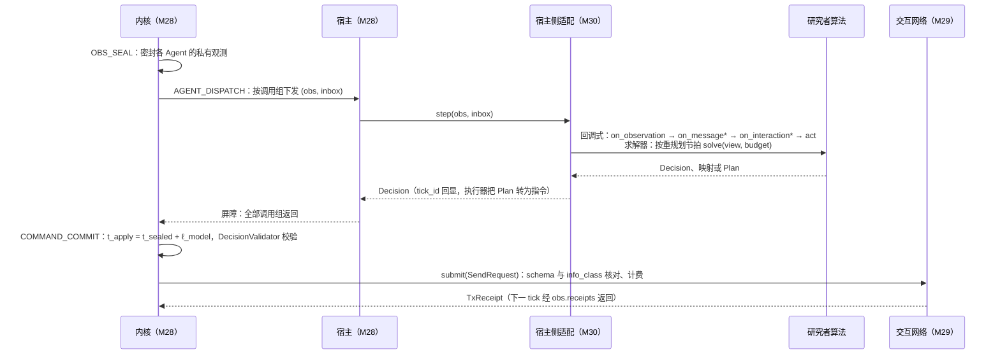

# M30 协同接口与基线 PRD（Coordination Interfaces & Baselines）

## 文档信息

| 项 | 内容 |
|---|---|
| 文档编号 | AWR-M30 |
| 标题 | 协同接口与基线（Coordination Interfaces & Baselines）PRD：`Policy`、`CentralPolicy`、`Solver`、`CoordinationPolicy` 协议与回调语义；实验内消息 schema 与 `info_class` 标注；既有调用约定的适配器（`Allocator`、`ContractNetAllocator`、`DroneAgent`）；经典基线库；登记表与插件发现；基线可复现要求 |
| 版本 | v0.2.1（2026-10-18 文档集集成同步：按 AWR-06 v0.3 §0.5 统一裁定 XR-15 修订 R-M30-65 的参考缓存键引用，按 XR-02 修订 §6.2 代码块的 Python 版本标注；按 XR-12 把进程内模块引用的方案名由 `py:` 改为 `module:`（§7.5、R-M30-54、R-M30-50 关联错误码表、AC-M30-21），关闭 §12.1 第 14 条） |
| 日期 | 2026-10-18（UTC） |
| 状态 | D4 设计评审稿。供负责人与 D4 设计评审组评审；不构成实现承诺。D4 实现在 D3 封板（G0）之后启动，本文周次一律以"D3 封板后第 N 周"表述 |
| 修订记录 | v0.1：初稿。v0.2：按评审意见修订消息元数据（schema 名、`flow_id`、legacy 频道）与 M29 约束对齐、基线字节预算可行性与 CBBA 增量共识、`info_class` 自洽、滚动 MILP 的确定性规模闸与线程声明、收件箱次序依赖、`tick_id` 校验归属与原因码映射、`GreedyAllocator` 截断粒度、求解器工作量单位、`AllocatorSolver` 翻译表全集、合同网用例与排空判据、黄金集覆盖、实施顺序、S2/S3 基线集合、复现判据、JCS 编解码与性能预算、静态检查、提交方 schema、输入快进、经理接管、参考缓存键、校验器分层、SDK 便捷函数与规划 Agent 端点；逐条处理结果见 §13 |
| 上游文档 | [AWR-06](../06-D4-协同实验平台概念设计.md) v0.2：§1.3、§1.5（DP-01、DP-03、DP-06、DP-11）、§3.2、§3.3、§3.4（B-01、B-02、B-09、B-10）、§3.5、§4.1（I-01 至 I-06）、§4.2、§4.3、§4.4、§5.4、§5.5、§5.7（W-1 至 W-6）、§7.0 至 §7.6、§8.3、§8.5、§8.8、§8.11、§10.2 至 §10.6；ADR-D4-13、17、20、22、27、28、32、33、35 |
| 调研依据 | [r01 平台能力矩阵](../research/d4/r01-平台能力矩阵.md)（外部库许可）、[r02 协同问题族与标准问题库](../research/d4/r02-协同问题族与标准问题库.md)（基线出处与核实状态）、[r03 NS-2 经验与排行榜规则](../research/d4/r03-NS-2经验与排行榜规则.md)（R10、R21–R23、R29–R31）、[n01 现有代码映射](../research/d4/notes/n01-现有代码映射.md)（缝 ① 至 ④、G-CP-4、D-4）、[n03 外部模型讨论纪要](../research/d4/notes/n03-外部模型讨论纪要.md)（§6 文献核实）；负责人前期稿 design-r2 §七（回调式插件接口） |
| 平行文档 | [M28 实验内核](M28-实验内核PRD.md)、[M29 交互网络](M29-交互网络PRD.md)、[M31 基准套件](M31-基准套件PRD.md)、[M32 评测与统计](M32-评测与统计PRD.md)、[M33 Trace 与复现](M33-Trace与复现PRD.md)、[M34 研究者 SDK 与命令行](M34-研究者SDK与命令行PRD.md)、[S1](../d4/suites/S1-TaskAlloc规格.md)、[S2](../d4/suites/S2-CoopSearch-Handoff规格.md)、[S3](../d4/suites/S3-InfoShare规格.md)、[X1](../d4/suites/X1-RobustCoord协议.md)、[协作智能排行榜规格](../d4/协作智能排行榜规格.md)、[契约草案](../d4/契约草案.md)、[r04 首篇论文实验设计](../research/d4/r04-首篇论文实验设计.md)。上述文档并行撰写，本文对其的引用以章节主题表述，编号以各文档定稿为准 |
| 模块编号 | M30（AWR-06 §3.3 暂定，沿 D3 的 M22–M27 顺延）；包路径 `py:coordination/`；SDK 同源部分 `sdk:coord/`（由 M34 发布） |
| 编号约定 | 需求 `R-M30-yy`；验收 `AC-M30-yy`；风险 `RK-M30-yy`；待决 `Q-M30-yy`；原因码为字符串（§7.7）。引用 AWR-06 的需求、决策、工作包、验收分别写作 `R-D4-xx`、`ADR-D4-xx`、`WP-D4-xx`、`AC-D4-xx`；Suite 验收写作 `AC-S1-y` 等 |
| 引用约定 | 代码路径相对仓库根 `/data/projs/anet-drone`，前缀沿用 AWR-06：`py:` = `python/awr/`；`sdk:` = `tools/sdk/drone4d/src/drone4d/`；`ct:` = `packages/contracts/`。对现有代码的陈述均已打开文件核对（核对基准为 2026-10-18 工作区），以"文件 + 符号"为准，行号可能漂移 |
| 文献约定 | 基线算法出处只引用 r02 与 AWR-06 中列出的条目，并原样保留其核实状态：**[已核]** 为 r02 §0 联网核实表所列条目；**[已核，据评审检索]** 为 r02 §3.1 与 AWR-06 标注的评审检索结果，不在 r02 §0 核实表内（目前仅 SSI 一条）；**[待核实]**、**[待核实页码]** 为未逐项核实，进入正式文档或论文前须按 r02 §9 TODO-1 复核。卷期与页码只在 r02 给出时引用 |
| 数值约定 | 标注"初值""缺省"的参数为设计默认值，在 WP-D4-17 pilot 中校准后随 Suite 1.0.0 冻结；复杂度为本文规定的平台实现的复杂度，不是对原论文结论的转述 |

---

## 0. 摘要

1. **定位**。M30 是 D4 分层结构中的 L3 协同算法层（AWR-06 §3.2）：定义研究者算法与内核之间唯一的决策语义及其四种插入形态，提供把 D1–D3 既有调用约定接入该语义的适配器，维护按问题族组织的经典基线库与登记表，并规定基线的可复现要求。M30 不实现时间推进、网络传播、评测与统计，这些分别属于 M28、M29、M32。
2. **一种语义，四种入口**。内核只认 `Policy.step(obs, inbox) -> Decision` 一种原生语义（ADR-D4-13）。`CentralPolicy`（一个决策主体持有多个 Assignment）、`Solver`（算法隔离模式下"给定问题视图返回计划"）与 `CoordinationPolicy`（design-r2 §七 的回调式接口）均经宿主侧适配降为该语义；PettingZoo 等训练框架适配器由 M34 提供，同样落在该语义之上。本文补齐 AWR-06 未定义的 `TeamContext`、`ProblemView`、`SolveBudget`、`Plan`、`CoordContext` 与 `WakeDecision`。
3. **回调语义**。本文逐项规定生命周期（`reset` 每 Episode 一次、`step` 每个决策 tick 一次、`close` 恒被调用）、策略状态须为输入序列的确定函数（支撑 M28 的输入快进）、返回值处置（`tick_id` 校验由 M28 `DecisionValidator` 执行，本文不另设失败规则）、异常与失活处置（与 W-1、W-2 一致，不转悬停、不沿用上一指令）、收件箱次序（由 M29 给定，适配器不重排；基线正确性不依赖同一发送方的到达次序）、`wake_on_rx` 调用的权限边界与禁止事项（墙钟、全局随机数、跨 Episode 状态、进程外 I/O）。
4. **消息 schema 与 `info_class`**。凡需按类别计量或参与 `Δ_perm` 结构化置换的消息，须以登记的消息 schema 发送。线上 `SendRequest.schema` 取短名 `<namespace>.<name>.v<k>`（≤ 32 B，满足 M29 R-M29-20 与契约草案 §4.2.3），`$id` 为契约草案规定的 URL 形式；`flow_id` 取 `<suite_abbr>.<name>`。登记 schema 使用受限的 JSON Schema 方言，编码固定为 JCS 规范化 JSON（编码复用 `py:sim/events/jcs.py`，解码与方言校验新写），顶层声明唯一的 `x-awr-info-class` 与必填的 `x-awr-max-bytes`（须不小于静态计算的最坏编码字节数），字段声明 `x-awr-role ∈ {world_state, control}`。`info_class` 与 schema 的一致性由 M29 在受理时核对，校验器位于 M29 可依赖的下层包；未登记载荷一律为 `opaque`。平台 schema 按"单一内容"设计，`intent` 类消息不携带发送方绝对状态，使优先次序规则与登记类别自洽。
5. **适配器**。`AllocatorSolver` 把 S1 问题视图按全字段翻译为 `py:tasking/model.py` 的 `Snapshot`，调用任一已登记的 `Allocator`，并以候选内层循环处精确截断的评估次数上限取代 `GreedyAllocator.plan` 的墙钟截断（偏差 D-4 的平台侧部分）；`ContractNetPolicy` 以宿主侧的 `SimScheduler` 实例在决策 tick 上逐定时器推进 `ContractNetAllocator` 协程，以交互网络承载 quote/award/progress，以本地报价函数取代经 Bus 的 `ctl/sim-core/estimate`，以计数式事件循环给出可证明的静止判据，并以经理纪元（manager epoch）防止接管后的重复授标；`DroneAgentPolicy` 经 legacy-v1 投影原样运行 D3 SDK 的 `DroneAgent` 与 3 个参考策略，只接受控制恰好 1 个多旋翼实体的 Agent。
6. **基线库**。首批覆盖 8 个问题族与 X1 重规划策略：TA、CF（TA-C）、CS、IF 与 X1 在 P0–P1 交付；PF、TR、RL（MARL）、LM（LLM）在 P1–P2 交付或列为可延期项。每族不少于 3 个基线，S1、S2、S3 另含平台参考策略 `π_ind`、`π_central`、`π_random`；集合与 S1、S2、S3 规格一致（含 S2 `track_share_cs`、S3 `kcf` 与 `event_share`）。每个基线给出角色、算法出处与核实状态、参数与缺省值、实现复杂度、字节预算估算、实现来源（复用路径或新写）、许可与所属分发包。
7. **登记表与插件发现**。基线以"基线卡"（`drone4d.coord.baseline_card.v1`，本文提议）登记，引用形式为 `baseline:<suite>/<name>@<major>`；内置基线由显式索引登记，不在导入期扫描；第三方插件经 Python entry point 组 `drone4d.coordination.v1` 延迟发现，命名空间为 `contrib:` 或 `community:`，不得遮蔽 `baseline:`。登记表按 Core、Contrib、Community 三级管理，记录兼容矩阵与最近验证版本，超期未验证者标记为 `stale`（r03 R29、R30）。
8. **基线可复现**。基线在固定制品与同一硬件等级下须达到确定性等级 1b：不读墙钟、不用全局随机数、随机性只经 `agent_seed` 派生的键控流取得、不依赖字符串哈希次序、numpy 线性代数单线程；求解器以确定性规模闸与节点上限约束工作量，不使用墙钟时限；全部结果相关参数登记为属性；每个 Core 基线在按网络档与难度档明确定义的黄金集上做决策摘要回归；参考策略缓存键以 M31 R-M31-45 为准；论文复现差异与"未复现到原文水平"的事实写入基线卡（r03 R31）。
9. **规模**。需求 82 条（R-M30-01 至 R-M30-82），验收 35 条（AC-M30-01 至 AC-M30-35），风险 11 条，待决 9 条；对 AWR-06 的反馈 21 条（§12.1），对并行文档的同步要求 18 条（§12.2）；评审处理记录 26 条（§13）。需在 WP-D4-01 RFC 中裁决的有：基线工作量估算与 n01 的差距、`Solver` 在分布式赛道的执行位置、`info_class` 的绑定与自身状态类别、`policy_ref` 的 `py:` 前缀二义、SDK 现有依赖与 numpy-only wheel 的冲突、既有基线构件的 vendoring 清单、集中式参考求解器的截断方式、消息校验器的分层位置。

---

## 1. 背景与目标

### 1.1 约束本模块的事实

| # | 事实 | 对设计的含义 | 依据（已核对） |
|---|---|---|---|
| F1 | 集中式分配器协议为 `Allocator`（`name: str`，`plan(snap: Snapshot, budget_ms: int) -> Plan`），以 `register_allocator(name, factory)` 登记，同名不同工厂抛 `ValueError`；`get_allocator` 对未登记名抛 `TaskingError(584, "allocator_unavailable")`；已登记 `greedy`、`external`、`anet_cnp`、`llm_agent`，后两者为 `NotImplementedAllocator` 桩 | `AllocatorSolver` 以名称包装任一已登记分配器；登记表冲突规则与 M30 登记表的冲突规则保持同一口径（同名不同工厂即拒绝） | `py:tasking/allocator.py` `Allocator`、`register_allocator`、`get_allocator`、`NotImplementedAllocator` |
| F2 | `GreedyAllocator.plan` 以 `time.perf_counter()` 计时，只在 `while queue` 循环顶部检查耗时是否超过 `0.8 · budget_ms`，超过时把剩余工作项记为 `infeasible{why: budget}`；每个工作项对全部候选逐一调用 `estimate` 并执行 `n_eval += 1`，结果写入 `plan.stats["evaluations"]`；可分割工作项经 `split2` 二分后放回队首；`_pair_recheck` 中的 `estimate` 调用不计入 `n_eval`；`plan.stats["plan_ms"]` 为墙钟量 | 同一输入在不同宿主负载下产生不同计划（偏差 D-4）；以"候选评估次数上限"替代墙钟截断可复用现有计数点，但截断检查须移到候选内层循环、并把配对复核的评估计入，否则上限会被超出（R-M30-35） | `py:tasking/greedy.py` `GreedyAllocator.plan`、`_pair_recheck` |
| F3 | `GreedyAllocator` 在导入期只依赖 numpy 与 `awr.swarm.allocation.hungarian`；`hungarian` 在首次调用时才装载 scipy 的 `_lsap` 扩展；`bottleneck_assign` 与 `_pair_recheck` 调用 `hungarian`，后者只在快照含两项以上已分配的同组（`WorkItem.group`）工作项时触发 | `AllocatorSolver` 的导入期闭包为 numpy-only，但运行期在分组工作项出现时需要 scipy；归入 `drone4d[ref]`（§6.6.1） | `py:tasking/greedy.py` `_pair_recheck`、`bottleneck_assign`；`py:swarm/allocation/hungarian.py` `_lsa` |
| F4 | `Snapshot` 与 `WorkItem` 面向 D2 机巢编排语义（`wid`、`tid`、`kind`、`priority`、`workload_s`、`deadline_s`、`divisible`、`group`、`needs` 等），无"所需智能体数 `m_j`"与"同步窗口 `w_j`"字段；`GreedyAllocator` 中 `deadline_s` 只作为排队键（`(−priority, deadline, −workload, wid)`）与配对复核的模式选择（全部有 deadline 时用瓶颈指派），不作为可行性约束；`estimate` 的代价依赖 `VehicleView.airborne`（在地时增加爬升航段，爬升高度不低于 `Snapshot.h_transit_agl_m`，缺省 60 m）、`t_ready_s`、`e_avail_wh`、`Snapshot.wind_mps`（风速限值与地速修正）、`ModelInfo.link_range_m`（> 0 时检查距机巢的航程，缺省 3500 m）；`_candidates` 只接受 `state ∈ {ready, standby, charging}`；`capable` 检查 `ModelInfo.frame`、`cams` 与 `needs` | S1 的联盟任务（`m_j ≥ 2`）不能无损翻译；`AllocatorSolver` 只承载 ST-SR 子集，联盟任务以 `adapter_unsupported` 返回不可行（R-M30-37）；翻译表必须给出 `VehicleView`、`ModelInfo`、`Snapshot`、`WorkItem` 全部字段的取值（§6.6.1），时间窗截止在该适配器中不被执行，须在基线卡中声明 | `py:tasking/model.py` `WorkItem`、`VehicleView`、`ModelInfo`、`Snapshot`；`py:tasking/greedy.py` `estimate`、`capable`、`_candidates`；`py:tasking/energy.py` `sortie_energy`、`ground_speed` |
| F5 | `ContractNetAllocator.allocate` 为 asyncio 协程，流程 find → quote（`t_quote_s = 3.0`【仿真】，迟到报价记 475）→ score → delegate；依赖 `TaskManager` 的鸭子类型接口（`net`、`sched`、`coordinator_aid`、`set_alloc`、`evidence`、`finish`、`escalate`、`complete`、`changed`、`board_intent`、`on_first_stage`、`on_progress`、`cat.input_defaults`），`TaskManager` 只在 `TYPE_CHECKING` 下导入 | 适配器可提供轻量门面对象而不引入真实 `TaskManager`；`allocator.py` 自身的导入闭包为标准库（`clock`、`effect`、`network`、`scoring`、`tsir`、`types`）。现有一致性测试 `tests/agent/test_allocator.py` 共 7 个（报价截止丢弃迟到候选、全部提前到达与委派时延、重试后完成（476、478）、全部失败升级后 481、direct 不可行 474 与无候选 473、全部报价超时 475、报价超过有效期重新询价），由 `tests/agent/fakes/harness.py` 的 `Harness` 驱动真实 `TaskManager` 与 `StubProvider`，断言 `h.tm.tasks[tid]` 的状态、`provider_vehicle`、`attempts`、`reason_code` 与 `h.ev.rows` 中的证据事件 | `py:agent/runtime/allocator.py` `ContractNetAllocator`；逐个核对上述模块的 import；`tests/agent/test_allocator.py` |
| F6 | 真实 `TaskManager` 导入 `awr.agent.capabilities.catalog`，后者经 `awr.contracts._paths.schema_path` 从仓库 `packages/contracts` 目录读取 schema | pip 安装环境中不可用（与 AWR-06 §3.3 对 `ActionGuard` 的判断同类）；适配器不得依赖真实 `TaskManager` | `py:agent/runtime/tasks.py`；`py:agent/capabilities/catalog.py`；`py:contracts/_paths.py` |
| F7 | 报价方经 `agent.bridge.estimate` 调用 sim-core 估价，即经 Bus 的 `ctl/sim-core/estimate` | 违反 B-01；适配器以基于本 Agent 观测的本地报价函数替代（§6.6.2） | `py:agent/runtime/handlers/meta.py`；`py:agent/runtime/allocator.py` 文件头 |
| F8 | `SimScheduler` 按 `(t_due, seq)` 触发定时器，`advance_to(t, drain=True)` 在每个回调后调用 `drain_loop`；`drain_loop` 读取 `loop._ready` 私有属性判断就绪队列是否排空，读不到时退化为 8 次 `sleep(0)`；`LockstepDriver.TICK_NS = 4_000_000` | 适配器使用 `advance_to(..., drain=False)` 逐定时器推进并自带确定性排空，不读私有属性，不使用 `LockstepDriver` 的固定 4 ms 步长（§6.6.2） | `py:agent/runtime/clock.py` `SimScheduler`、`drain_loop`、`LockstepDriver` |
| F9 | 合同网打分 `score` 为 `w_c·conf − w_t·eta/η_norm − w_e·energy/E_norm − w_l·load − w_r·risk`，缺省权重 `{conf 1.0, eta 0.6, energy 0.3, load 0.2, risk 0.5}`，量化到 1e-3；排序键 `rank_key(score, agent_no)` 以整数 `agent_no` 破同分 | 适配器须把字符串 `AgentId` 映射为确定的整数 `agent_no`（按 `agent_id` 升序的序号） | `py:agent/runtime/scoring.py` `Weights`、`score`、`rank_key` |
| F10 | D3 研究者接口为 `DroneAgent.reset(config)` 与 `step(obs, inbox) -> act`，观测与动作为 `bench/obs.v1`、`bench/act.v1` 的 dict；参考策略登记于 `BASELINES = {static_guard, coverage_scan, track_share}`，模块文档声明"同一种子两次运行的动作流逐字节一致：策略内无随机数、无墙钟依赖" | `DroneAgentPolicy` 原样包装；3 个参考策略作为 legacy 基线进入登记表 | `sdk:agent.py`；`sdk:baselines/__init__.py` |
| F11 | `obs.v1` 的 `Message` 为 `{src, seq, topic, t_sent_ns, t_recv_ns, payload}`（`additionalProperties: false`）；`act.v1` 的 `OutMessage` 为 `{dst, topic, payload}`，`dst = "*"` 表示广播；`act.v1` 顶层另有 `nav`、`gimbal`、`zoom`、`sensor_mode`、`msgs`、`report`、`tau_ms` | legacy 投影的字段映射见 §6.6.3；`tau_ms` 不生效（F-2），投影器忽略并记诊断 | `ct:bench/obs.v1.schema.json`、`ct:bench/act.v1.schema.json`；`py:agentsdk/env/link.py`（`m["dst"] == "*"`） |
| F12 | `track_share` 以 JSON 载荷中的 `kind ∈ {sight, claim, reported}` 区分三类消息（目标轨迹、跟踪声明、已报告抑制） | legacy 消息在 D4 中统一为 `schema = opaque`、`info_class = opaque`，除非在投影配置中显式登记映射（§6.6.3） | `sdk:baselines/track_share.py` `TrackShare.on_inbox`、`messages` |
| F13 | `py:swarm/allocation/score.py` 提供 `path_score`（时间窗折扣路径得分）与 `marginal_bid`（SSI 边际出价），模块文档注明"D1 只交付接口与参考实现，不进入任何运行路径"；`py:swarm/coverage/` 提供 `best_sweep_angle`、`lanes_for_angle`、`boustrophedon`、`split_balanced`（numpy）与 `assign_chunks`（调用 `hungarian`，运行期需 scipy） | SSI、CBBA 的路径得分复用 `score.py`；割草机类基线复用 `coverage/`；`assign_chunks` 只在 `drone4d[ref]` 中使用 | `py:swarm/allocation/score.py`；`py:swarm/coverage/lanes.py`、`partition.py` |
| F14 | import lint 的 `D3_PACKAGES` 不含 `awr.swarm`、`awr.tasking`、`awr.agent`；`swarm/` 属 `_PURE`（不得依赖 `awr.sim`、`awr.api`）；`agent/` 禁止 `awr.sim` 且禁止 numba；墙钟调用检查 `WALL_CLOCK_PATHS` 只覆盖 `sim/fleet/`、`sim/core/`、`sim/safety/`、`sim/mission/`、`sim/sensors/`、`environment/` | `awr.coordination` 引用上述包不受 B-10 白名单约束，但须经 B-02 依赖闭包审计；墙钟检查须扩展到 `coordination/`（R-M30-60） | `tools/lint/check_py_imports.py` `D3_PACKAGES`、`_PURE`、`PKG_RULES`、`WALL_CLOCK_PATHS` |
| F15 | `agent_seed` 在 SDK 与 D3 Env 中无下发者、无使用者 | 基线随机性须等待 M28 经 `init.v1` 下发 `agent_seed`（RN-3）；此前基线一律无随机 | 全文检索 `agent_seed`：`sdk:*.py`、`py:agentsdk/env/*.py` 无结果；AWR-06 §5.5 F-3 |
| F16 | 现有 SDK `tools/sdk/drone4d/pyproject.toml`：`name = drone4d`、`version = 0.2.0.dev0`、`requires-python >=3.11`、`license = Apache-2.0`、`dependencies = ["httpx>=0.27", "msgpack>=1.0"]`；仓库 `LICENSE` 为 ANet Open Source License（基于 Apache-2.0 的修改版）；仓库锁定 `numpy==2.5.3`、`scipy==1.18.1`；`THIRD_PARTY_NOTICES.md` 登记 numpy、scipy 为 BSD-3-Clause，msgpack 为 Apache-2.0 | 基线随仓库许可（RK-17、ADR-D4-32）；`drone4d[ref]` 引入的 scipy 许可已登记；SDK 现有依赖与"运行时依赖只有 numpy"冲突（§12.1 第 13 条） | `tools/sdk/drone4d/pyproject.toml`；`LICENSE`；`pyproject.toml`；`THIRD_PARTY_NOTICES.md` |
| F17 | `scipy.optimize.milp`（仓库锁定 1.18.1）只接受 `disp`、`presolve`、`time_limit`、`node_limit`、`mip_rel_gap` 五个选项，`node_limit` 映射为 HiGHS 的 `mip_max_nodes`；无线程数选项 | 节点上限不约束 presolve 与根节点 LP 的耗时，不能单独保证 CPU 上界；`OMP_NUM_THREADS` 等环境变量不约束 HiGHS，本文不声明其单线程（R-M30-62、R-M30-81） | 仓库 `.venv` 中 `scipy/optimize/_milp.py` `supported_options` |
| F18 | `py:sim/events/jcs.py` 的 `__all__` 只含 `jcs` 与 `jcs_number`，只有编码；`jcs_number` 对每个非整数浮点做 `Decimal(repr(x))` 转换；整数绝对值 ≥ 2^53 抛 `ValueError` | 消息解码与方言校验须新写；浮点标量逐个格式化的成本须实测；uint64 哈希与超过 2^53 的整数不能以 JSON integer 承载（R-M30-27、R-M30-28、R-M30-70） | `py:sim/events/jcs.py` |
| F19 | M29 规定 `channel`、`schema`、`flow_id` 限 `[a-z0-9._:-]` 且各 ≤ 32 B，违反时返回 `bad_meta`，且 `bad_meta` 在 `too_large` 之前校验（R-M29-11、R-M29-20）；三者计入应用字节 `A`（§6.2.1）；收件箱按 `(delivered_at_ns, message_id)` 排序，`message_id = "<sender_id>#<tx_seq>"` 为字符串（R-M29-10、R-M29-19），`ideal@1` 的 `delivered_at_ns = submitted_at_ns + d_ideal`（R-M29-31）；控制 0 个实体的 Agent 须给出端点站址（R-M29-22）。契约草案 §3.3 给出 schema 短名正则 `^[a-z][a-z0-9-]{0,31}(\.[a-z0-9_]{1,24}){1,3}\.v[1-9][0-9]{0,2}$`（≤ 32 B），§4.2.3 规定 `$id` 为 `https://schemas.anet-drone.dev/coord-msg/1/<namespace>.<name>.v<k>.schema.json`、目录一级 | v0.1 的长 schema 标识（35–47 B）与含 `/` 的 `flow_id` 会被逐条以 `bad_meta` 拒绝，须改为短名（R-M30-26、R-M30-31）；同一发送方同一 tick 提交的多条消息在 `ideal@1` 下投递时刻相同，按字符串比较时 `a#10` 排在 `a#9` 之前（R-M30-76、§12.2 第 1 条）；规划 Agent 须声明端点（R-M30-79） | `docs/modules/M29-交互网络PRD.md` R-M29-10、11、19、20、22、31，§6.2.1；`docs/d4/契约草案.md` §3.3、§4.2.3 |
| F20 | import lint 的 `WALL_CLOCK_CALLS` 只含 `time.time`、`time.time_ns`、`time.monotonic`、`time.monotonic_ns`、`time.perf_counter`、`time.perf_counter_ns` 与 `datetime.now`、`utcnow` 系列，不含 `time.sleep`、`threading.Timer`、`asyncio.sleep`、`loop.call_later`；检查只按 `_dotted` 名称匹配，无别名解析 | 墙钟等待与 numpy 旧式全局随机函数的检测须新增规则与别名解析（CR-2） | `tools/lint/check_py_imports.py` `WALL_CLOCK_CALLS`、`WALL_CLOCK_PATHS` |
| F21 | M28 错误码 713 `DECISION_TICK_MISMATCH` 的处置为"整条决策拒绝，不判失败"，`tick_id` 回显在密封段由 M28 校验（R-M28-60）；724 `LEGACY_MULTI_ENTITY` 由握手宿主判定；R-M28-82 规定恢复后以"输入快进"重建 Agent，进程内 Policy 可选实现 `state_dict()`/`load_state_dict()`，不一致判 718 | `tick_id` 校验与 legacy 一控多拒绝的所有者为 M28，本文只引用（R-M30-09、§7.7）；策略状态须可由输入序列重建（R-M30-07） | `docs/modules/M28-实验内核PRD.md` R-M28-60、R-M28-82、§7.3.1 |

### 1.2 目标

| 编号 | 目标 | 判据 |
|---|---|---|
| G1 | 研究者以不超过 20 行代码实现一个可运行的协同策略，无需理解内核、调度器或网络对象 | DP-11；AC-D4-12；AC-M30-01 |
| G2 | 同一算法经进程内、本地批量与容器三种宿主运行，trace 事件哈希一致 | AC-M30-04 |
| G3 | 既有基线（D2 `GreedyAllocator`、D1/D2 合同网、D3 SDK 参考策略）不重写即可在 D4 Suite 上运行，并与原实现的单元用例行为一致 | AC-M30-12 至 AC-M30-15 |
| G4 | 每个首批问题族具备不少于 3 个出处清楚、参数登记、可复现的基线，S1–S3 另含平台参考策略 | AC-M30-16 至 AC-M30-20 |
| G5 | 消息按信息类别可计量、可置换，为 `Δ_perm`、`Δ_perm^(c)` 与按 `info_class` 分解的字节统计提供可信输入 | AC-M30-07 至 AC-M30-10 |
| G6 | 基线与提交方受同一信息约束、同一资源账本与同一墙钟纪律，平台基线在排行榜上可作为参考行 | B-09；W-5；AC-M30-24 至 AC-M30-27 |

### 1.3 非目标

- 不定义时间推进、阶段全序、事件队列与决策提交时刻（M28）；不定义网络传播、计费与 `TxReceipt` 的产生（M29）；不定义 Suite 的问题视图内容、指标与评测器（M31）；不定义统计协议与 Δ 族计算（M32）；不定义 trace 记录格式（M33）；不定义命令行与训练框架适配器（M34）。本文只规定这些模块与 L3 之间的约定。
- 不实现被测协议的可靠传输。网络层不内置重传（ADR-D4-14），需要可靠性的基线在协议内自行实现确认与重发，并计入通信预算。
- 不内嵌 GPL、AGPL 许可的外部代码（ADR-D4-32 第 3 项；r01：VMAS、MultiUAV-Plat 为 GPL-3.0，FRODO 为 AGPL-3.0+）。
- 本期不为 AWR-06 §7.5 中 Connectivity、Pursuit–Evasion、DCOP 储备 Suite 建立基线；对应基线在 Suite 立项时随其规格增补。
- 不承诺复现原论文的数值结果。基线的目标是"实现正确、参数透明、差异如实说明"（r03 R31），未复现到原文水平的须在基线卡中明示。

### 1.4 术语（本文新增，其余见 AWR-06 术语表）

| 术语 | 定义 |
|---|---|
| 插入点（entry） | 研究者算法接入内核的四种形态：`policy`（逐 Agent）、`central`（一控多）、`solver`（算法隔离模式求解器）、`coordination`（回调式）。前三者由宿主直接驱动，`coordination` 经 `CallbackAdapter` 降为 `policy` |
| 宿主侧适配（host-side adaptation） | 把 `central`、`solver`、`coordination` 及既有调用约定降为原生 `Policy` 语义的代码，运行在 Agent 一侧（与被包装算法同进程），不在内核中 |
| 规划 Agent（planner Agent） | 不控制实体的 Agent（AWR-06 §4.1 的 Planning Agent），在分布式赛道承载集中式算法（如周期匈牙利、`AllocatorSolver`），其输入只能经交互网络获得 |
| 登记消息 schema | 在 `ct:coord/msg/` 下登记、满足 §6.5 方言约束的消息载荷 schema；未登记载荷统称 `opaque` |
| 基线卡（baseline card） | 描述一个登记项的元数据文档：标识、角色、出处、参数、复杂度、消息、兼容矩阵、确定性、许可、复现状态与验证记录（§7.4） |
| 平台参考策略 | Suite 声明并由平台版本化、预计算缓存的 `π_ind`、`π_central`、`π_random`；在登记表中是 `role = reference` 的登记项 |
| 重规划包装器 | X1 RobustCoord 的三种重规划策略（静态、周期、事件驱动），以包装宿主 Suite 基线的方式实现（§6.7.5） |
| 黄金决策摘要 | 在固定实例、种子与参数下，一个基线全部 `Decision` 的规范化序列的 SHA-256，用于回归 |

---

## 2. 范围

### 2.1 分阶段范围

| 阶段 | 范围 | 对应工作包 |
|---|---|---|
| P0（第 1–11 周） | 四种插入点协议与 `CallbackAdapter`；`AgentContext`/`TeamContext`/`ProblemView`/`SolveBudget`/`Plan` 数据类；消息 schema 方言、`info_class` 判定规则与 S1–S3 基线消息 schema；`DroneAgentPolicy`（legacy-v1）；`AllocatorSolver`；`ContractNetPolicy`；S1 的 9 个登记项（AWR-06 §7.1 的 7 个基线与 `random`、`d2_greedy`）、S2 平面族的 7 个登记项（含 3 个参考策略）、S3 的 7 个登记项（AWR-06 §7.3 的 6 个基线与 `random_share`）；登记表（内置索引、基线卡、`baseline:` 解析）；基线可复现门禁（黄金决策摘要、双哈希种子对拍、墙钟 lint） | WP-D4-01、04、08、13、14、15、16、17 |
| P1（第 12–21 周） | `wake_on_rx` 调用语义与 `WakeDecision`；X1 三种重规划包装器；TA-C 的 3 个分组基线；S2 `track_share_cs`（`d3` 与网格族，新写实现）与 `custody` 公共构件；S3 `kcf`、`event_share` 与 `infoshare.kcf.v1`；MARL 训练配方（IPPO、MAPPO、QMIX）与训练产物登记；第三方插件发现（entry point）、Contrib/Community 分级与 `stale` 判定；提交方自定义消息 schema 的评审登记路径（R-M30-80）；注册表规格与贡献流程文档 | WP-D4-19、24、25、26、28、47、51 |
| P2（第 22–31 周，含可延期） | MAPF 4 个基线（可延期，随 WP-D4-36）；协同跟踪 3 个基线（可延期，随 WP-D4-37）；B-LLM 3 个基线（可延期，随 WP-D4-38）；异构实体下 S1 基线的能力扩展（随 WP-D4-35） | WP-D4-35、36、37、38 |

### 2.2 与其他模块的边界

| 模块 | M30 依赖其提供 | M30 向其提供 |
|---|---|---|
| M28 实验内核 | `Observation` 的密封与下发、`Decision` 的提交时刻与 `DecisionValidator` 校验（含 `tick_id` 回显，码 713）、legacy 握手（码 724）、输入快进（R-M28-82）、`AttrRegistry`、`agent_seed` 下发、`ResourceLedger` 计量、失败分类（`failure.policy`/`failure.infra`）、空决策下实体的缺省行为、规划 Agent 端点的登记（经 M29 `attach`） | 插入点协议、`policy_ref` 解析结果（工厂与基线卡）、基线参数的 `AttrSpec` 登记、宿主侧适配器、宿主调用约定（不在运行中的事件循环内调用 `step`，§6.6.2） |
| M29 交互网络 | `SendRequest` 受理与 `TxReceipt`、元数据约束（R-M29-20）、按 `info_class` 与 `flow_id` 的计量、收件箱的规范次序、`schema` 与 `info_class` 一致性核对与载荷方言校验的执行（校验器 `py:interaction/msgschema.py` 由 M29 持有，§6.5.1） | 消息 schema 方言规则与登记内容、`info_class` 判定规则、各基线的消息 schema |
| M31 基准套件 | 各 Suite 的 `ProblemView`/`Plan` schema、任务视图类型、`reference_policies` 与参考策略登记表（`ref/<suite>_<name>@<ver>`，R-M31-44）、参考缓存键的定义（R-M31-45）、算法隔离模式的平台执行器（路径跟随、承诺管理）与重规划节拍、规划 Agent 的端点声明 | 基线实现、参考策略实现、基线卡（Suite 清单引用其 id 与版本）、`reference_ref ↔ baseline:` 映射（R-M30-65） |
| M32 评测与统计 | `PermSpec` 与供体规则的定义（`Δ_perm` 由 M29 执行、M32 定义规格）、参考策略缓存的使用 | `x-awr-role` 字段角色标注、参考策略的确定性、`impl_sha256` 与 `attrs_digest` |
| M33 Trace 与复现 | `decision`、`msg.submit` 等记录的写出与重放 | 黄金决策摘要的规范化规则（§6.9） |
| M34 研究者 SDK 与命令行 | `drone4d.coord` 公开 API 的发布、PettingZoo/TorchRL/BenchMARL 适配器、`drone4d sdk pack`、命令行 | `sdk:coord/api.py` 的同源定义、登记表查询接口、MARL 训练配方（§6.7.8） |
| 契约草案（CT） | `ct:coord/` 契约的最终形态 | 提议新增 `drone4d.coord.baseline_card.v1`、`ct:coord/msg/` 消息 schema 登记目录与方言元 schema（§7.3、§7.4） |
| 排行榜规格（LB） | `reference_kind` 枚举（`ind`、`central`、`random`、`single`、`published`，AWR-06 §8.11） | 参考行所用登记项与其基线卡 |

### 2.3 路径所有权（M30）

| 路径 | 内容 |
|---|---|
| `python/awr/coordination/**` | 协议、适配器、基线库、登记表（§8.1） |
| `packages/contracts/coord/msg/<namespace>.<name>.v<k>.schema.json`（目录一级，契约草案 §4.2.3） | 基线消息 schema 的内容；方言元 schema `packages/contracts/coord/msg-dialect.v1.schema.json` 由本文起草、CT 登记 |
| `packages/contracts/coord/baseline_card.v1.schema.json`（提议） | 基线卡契约 |
| `docs/d4/baselines/**` | 每个 Core 基线的基线卡说明页与复现差异说明 |
| `tests/d4/coordination/**` | 本模块单元、对拍与回归用例；黄金决策摘要 `tests/d4/coordination/golden/` |

`sdk:coord/api.py` 由 ADR-D4-28 的 vendoring 流程自 `py:coordination/api.py` 产出，所有权在 M34，内容以本文为准。

---

## 3. 用户与用例

| 编号 | 用户 | 用例 | 涉及插入点 | 验收 |
|---|---|---|---|---|
| UC-01 | 算法研究者（经典协同） | 写一个 `Policy` 子类改进 CBBA 的打分函数，在 S1 `d1/n20` 上与平台基线对比 100 个配对单元 | `policy`；`baseline:taskalloc/cbba@1` | AC-M30-01、16 |
| UC-02 | 运筹研究者 | 只提供一个 `Solver`，在 S1 算法隔离模式中比较 MILP 变体，不处理运动与通信 | `solver` | AC-M30-05 |
| UC-03 | 集中式参考研究者 | 以 `CentralPolicy` 控制全部实体，在 `cr-l1-b1-radio` 参考列上报告去中心化折损 | `central` | AC-M30-03 |
| UC-04 | 迁移用户（D3） | 原样提交 D3 `DroneAgent` 容器，经 `wire.v1` 在 D4 评测宿主运行 | `policy`（legacy-v1） | AC-M30-14 |
| UC-05 | 迁移用户（D1/D2） | 以 `GreedyAllocator` 或合同网作为 S1 基线，比较其与 CBBA 的通信–效用权衡 | `solver`、`policy`（适配器） | AC-M30-12、13 |
| UC-06 | 融合研究者 | 发送登记 schema 的目标估计消息，获得按 `info_class` 分解的字节与 `Δ_perm^(c)` | `policy`；登记消息 schema | AC-M30-07 至 10 |
| UC-07 | 第三方贡献者 | 以 pip 包发布一个 Contrib 级协同算法，经 entry point 被 `drone4d` 发现并在本地实验中引用 | 登记表 | AC-M30-21、22 |
| UC-08 | 平台维护者 | 升级一个参考策略的实现，判定是否需要新的基线主版本与新 Board Version | 登记表；黄金决策摘要 | AC-M30-24、28 |
| UC-09 | MARL 研究者 | 以平台训练配方复现 MAPPO 基线，登记训练产物与训练种子 | `policy`（经 M34 适配器） | AC-M30-20 |

---

## 4. 功能需求

表头沿用 M27 体例；"优先级"取 P0（阻塞）、P1（应交付）、P2（可延期）；"阶段"为首次交付的 D4 阶段。"依据"列中不带文档名的 §x、ADR、WP、AC 指 AWR-06，指本文时写"本文 §x"。

### 4.1 插入点总则

| 编号 | 需求描述 | 优先级 | 阶段 | 验收 | 依据 |
|---|---|---|---|---|---|
| R-M30-01 | 内核只驱动一种决策语义 `Policy.step(obs, inbox) -> Decision`。`CentralPolicy`、`Solver`、`CoordinationPolicy` 与既有调用约定经宿主侧适配降为该语义，适配代码与被包装算法同进程运行，内核不感知插入点类型 | P0 | P0 | AC-M30-01、02 | ADR-D4-13；§4.2 |
| R-M30-02 | 插入点由 `policy_ref` 解析得到的工厂声明（`entry ∈ {policy, central, solver, coordination}`）；同一 Episode 内一个 Agent 只由一种插入点驱动；在同一 Episode 内混用 `central` 与其他插入点只允许 `execution_topology = centralized` 或非排名运行 | P0 | P0 | AC-M30-03 | 本文 §6.2 |
| R-M30-03 | 插件不得持有内核、调度器、交互网络、实体表或世界对象的引用；插件可见的全部输入为 `AgentContext`/`TeamContext`/`CoordContext`、`Observation`、收件箱与 `ProblemView`，均为不可变数据（冻结数据类与只读映射） | P0 | P0 | AC-M30-02 | 不变量 I-01；B-09 |
| R-M30-04 | 进程内宿主交给插件的输入对象，与容器宿主经 `wire.v2` 解码得到的对象在规范化（JCS）后逐字节相同；插件不得依赖对象身份、可变性或进程内特有的类型 | P0 | P0 | AC-M30-04 | ADR-D4-13（训练期进程内、评测期容器）；§3.7 |
| R-M30-05 | 插件可见的时间一律为 int64 纳秒（`sealed_at_ns`、`delivered_at_ns` 等）；平台基线内部的时间累加不得使用浮点 | P0 | P0 | AC-M30-25 | §4.2 时间约定；ADR-D4-05 |
| R-M30-06 | 分布式赛道的语义要求不同 Agent 的策略实例之间只经交互网络交换信息。本地批量宿主在同一进程中运行同一 Episode 的全部 Agent（§3.7），平台基线不得使用模块级可变状态、类变量或进程内缓存在 Agent 之间传递信息；以"同进程运行"与"每 Agent 独立进程运行"的决策摘要逐字节一致为证 | P0 | P0 | AC-M30-06 | 不变量 I-04；§8.8 A-02、A-03 |

### 4.2 `Policy` 回调语义

| 编号 | 需求描述 | 优先级 | 阶段 | 验收 | 依据 |
|---|---|---|---|---|---|
| R-M30-07 | 生命周期：构造（无参数或仅登记参数）→ `reset(ctx)` 每 Episode 恰一次 → `step` 每个决策 tick 恰一次 → `close()` 每 Episode 恰一次。`close` 在正常结束、策略失败与平台中止时均被调用，其异常被吞并并记诊断，不改变 Episode 结果。本地批量与评测宿主每 Episode 使用新实例；进程内宿主可复用实例，但策略不得跨 `reset` 保留影响决策的状态。策略状态必须是 `(reset 输入, 此前全部 (obs, inbox) 序列)` 的确定函数，使 M28 的输入快进（R-M28-82）可重建任一时刻的状态；进程内策略可选实现 `state_dict() -> bytes` 与 `load_state_dict(b: bytes) -> None`，二者须满足"保存后加载再续跑与不中断运行的决策摘要逐字节一致"；适配器（含 `ContractNetPolicy` 的协程状态与 `Solver` 的热启动状态）同样遵守 | P0 | P0 | AC-M30-02、33 | §4.2；W-2；M28 R-M28-82 |
| R-M30-08 | `step` 的输入：`obs` 为该 Agent 在本决策时刻密封的私有观测；`inbox` 为在上一密封时刻（不含）至本密封时刻（含）之间投递给该 Agent 的消息，次序为 M29 给定的规范次序（R-M29-19），适配器与 SDK 不得重排；上一 tick 提交消息的 `TxReceipt` 经 `obs.receipts` 返回。M29 现行排序键中 `message_id` 为字符串，同一发送方同一投递时刻的多条消息按字典序排列（`a#10` 先于 `a#9`），本文要求 M29 改为 `(delivered_at_ns, sender_id, tx_seq 数值)`（§12.2 第 1 条）；在此之前与之后，基线均按 R-M30-76 不依赖该次序的语义 | P0 | P0 | AC-M30-02 | §4.2；§5.2；M29 R-M29-10、19 |
| R-M30-09 | 返回值处置：`Decision.tick_id` 的回显校验由 M28 `DecisionValidator` 在密封段执行（R-M28-60），不匹配时整条决策拒绝、回执 `tick_mismatch`（M28 码 713），不判失败，该 tick 视为空决策（实体行为按 M28 的空决策缺省语义）；M30 不另设基于连续次数的失败规则。M30 适配器（`CallbackAdapter`、`CentralGroup`、`SolverPolicy`）在把映射形态转换为 `Decision` 时以 `obs.tick_id` 填写，不做二次校验。`EntityCommand` 的实体与 `assignment_epoch` 校验同样由 `DecisionValidator` 执行 | P0 | P0 | AC-M30-02 | §4.2"必须回显"；M28 R-M28-60、§7.3.1 |
| R-M30-10 | `step` 抛出异常时该 Episode 记 `failure.policy`（原因 `policy_exception`），按 `invalid_policy = zero` 计分，不重试；异常摘要只写入该 Agent 的可见层日志，不写入真值层 | P0 | P0 | AC-M30-02 | ADR-D4-24；§4.5 目录分层 |
| R-M30-11 | 失活与超时沿用 W-1、W-2：动作恒以 `t_sealed + ℓ_model` 生效；墙钟 watchdog 只判失活，不转悬停、不沿用上一指令；M30 的任何适配器不得引入墙钟等待或墙钟截断 | P0 | P0 | AC-M30-26 | W-1、W-2；ADR-D4-10 |
| R-M30-12 | 平台基线禁止：读取墙钟（`time`、`datetime` 的当前时间类函数）；使用全局或无种子随机数（`random` 模块函数、`numpy.random` 旧式全局函数、无种子 `default_rng()`）；创建线程或进程；访问网络；在宿主提供的临时目录之外读写文件；以环境变量影响决策。以静态检查（R-M30-60）与测试期运行时守卫强制；提交方由沙箱与资源账本约束（M28、§8.8）。本条覆盖平台基线经适配器调用的既有代码：`d2_greedy` 以 `GreedyAllocator(max_evals=…)` 构造，CR-1 规定该模式下 `plan` 不调用 `time.perf_counter()`、`plan.stats` 不含 `plan_ms`，因此无需墙钟例外；运行时守卫在排名与黄金回归运行中对上述禁止项一律报错，不设放行名单 | P0 | P0 | AC-M30-25 | DP-06；B-05；§8.8 A-02、A-08 |
| R-M30-76 | 收件箱次序独立：基线协议的正确性不得依赖"同一发送方的消息按发送次序到达或排列"（网络不保证有序投递，R-M29-17）；依赖序号的协议（CBBA 共识轮号、SSI 轮次、确认序号、合同网交互号）以载荷内的整数序号或纪元判定新旧，丢弃旧于已见值的消息；收件箱规范次序只用于保证确定性 | P0 | P0 | AC-M30-02 | M29 R-M29-17、19；本文 F19 |
| R-M30-13 | `wake_on_rx`（P1）：仅当 Suite 允许且实验开启时，宿主在消息到达后的下一个 20 ms 粒度调用一次唤醒回调；该调用不携带新观测，只允许发送消息与改写已有承诺（`task.claim`、`task.release`、`commit.revoke`），不允许运动指令、报告与 Belief；返回类型采用本文 `WakeDecision`（§6.2，待 RFC 确认，见 §12.1 第 6 条）；关闭时宿主不调用该回调，结果与 P0 逐字节一致 | P1 | P1 | AC-M30-29 | §5.4；AC-D4-31 |
| R-M30-14 | 平台基线在 `Decision.compute_units` 中自报逻辑计算量，键在基线卡中登记（如 `candidate_evals`、`solver_nodes`、`consensus_iters`、`tokens_in`、`tokens_out`）；自报值只用于诊断与资源账本的交叉核对，不进入排名，排名依据为 cgroup 实测（W-4） | P1 | P0 | AC-M30-27 | §4.2 `compute_units`；W-4 |

### 4.3 `CentralPolicy`

| 编号 | 需求描述 | 优先级 | 阶段 | 验收 | 依据 |
|---|---|---|---|---|---|
| R-M30-15 | `CentralPolicy.reset(ctx: TeamContext)`：`TeamContext` 含所控 Agent 的全部 `AgentContext`（按 `agent_id` 升序）、团队预算（单 Agent 额度 × N，不额外放宽）与赛道条件；集中式策略的随机性取 `agents[0].agent_seed` 派生的键控流（§6.9.2），不新增内核种子 | P0 | P0 | AC-M30-03 | §8.5 资源预算对齐第 1 条；RN-3 |
| R-M30-16 | `CentralPolicy.step(obs, inbox)` 的输入为同一密封时刻全部所控 Agent 的观测与收件箱；返回映射的键必须是所控 Agent 的子集：缺失的 Agent 视为空决策，多出的键整条拒绝并记 `decision_agent_unknown`；各 `Decision` 分别按 R-M30-09 校验 | P0 | P0 | AC-M30-03 | §4.2 |
| R-M30-17 | 分布式排名赛道中，以 `CentralPolicy` 同时驱动多个实体 Agent 的提交在 VALIDATING 阶段被拒绝（`central_in_decentralized`）；集中式算法在分布式赛道只能以规划 Agent（不控制实体）的 `Policy` 形态运行，其输入只能经交互网络获得并计费 | P0 | P0 | AC-M30-03 | 不变量 I-04；§8.3；§8.8 A-03 |

### 4.4 `Solver`（算法隔离模式）

| 编号 | 需求描述 | 优先级 | 阶段 | 验收 | 依据 |
|---|---|---|---|---|---|
| R-M30-18 | `Solver.solve(view: ProblemView, budget: SolveBudget) -> Plan`：在同一 Episode 内可保留热启动状态，不得有输入之外的副作用；`ProblemView` 与 `Plan` 的 `body` schema 由 Suite 登记（M31），M30 规定信封字段（§6.2） | P0 | P0 | AC-M30-05 | §4.2；ADR-D4-17 |
| R-M30-19 | 求解器的宿主位置由 `solver_host` 决定（§6.4）：`local`（每个实体 Agent 以本地视图求解、计划只作用于自身，可选 `plan_share` 把计划摘要以 `intent` 消息广播并计费）、`planner`（规划 Agent 以经交互网络收到的状态报告构造视图，报告协议由平台提供并计费）、`global`（仅 `centralized` 拓扑）。分布式赛道不允许 `global` | P0 | P0 | AC-M30-05 | 不变量 I-04；本文 §12.1 第 9 条 |
| R-M30-20 | 工作量预算：`SolveBudget` 以 `(work_unit, max_work)` 表达确定性工作量上限，`work_unit` 取登记的计数单位（`candidate_evals`：候选评估次数，`GreedyAllocator`；`solver_nodes`：分支定界节点数，取 HiGHS 返回的 `mip_node_count`；`bundle_evals`：束构建中的边际得分评估次数），每个平台求解器在基线卡中登记其单位，并由平台包装的求解器接口计数（`AllocatorSolver` 读 `plan.stats["evaluations"]`，`rolling_milp` 读求解结果的节点数）。平台基线：截断只依据该上限与 R-M30-81 的规模闸，不使用墙钟时限，计数超过上限记违规 `solver_budget_exceeded`（恰等于上限不违规），该规则由单元用例核验计数正确。第三方 `Solver`：自报的 `Plan.compute_units` 只用于诊断，不作为约束或违规依据；排名运行的约束为 cgroup 实测 CPU（W-4）与结果确定性核验（评测流水线以同一制品重跑抽样 Episode，决策摘要不一致者按 M28 的确定性等级降级并在条目卡标注）；`cpu_ms_quota` 为资源账本额度 | P0 | P0 | AC-M30-05、12 | W-4、W-5；偏差 D-4 |
| R-M30-21 | 计划校验：引用未知 Agent 或任务、能力不满足、违反 Suite 硬约束的计划整份拒绝（`solver_plan_invalid`），执行器继续执行上一份有效计划直至其 `valid_until_ns`；此行为只由计划内容决定，与墙钟无关 | P0 | P0 | AC-M30-05 | DP-01 |
| R-M30-22 | 重规划节拍由 Suite 声明（周期 `replan_period_s` 与事件触发：任务到达、观测到的失效、Assignment 变化），求解只在决策 tick 上发生；计划由平台执行器（路径跟随与承诺管理，M31）统一转为各 Agent 的 `Decision`，全部求解器共用同一执行器 | P0 | P0 | AC-M30-05 | §7.0 两种运行模式；§7.1 决策 |
| R-M30-79 | 规划 Agent 端点：`solver_host = planner` 与任何不控制实体的规划 Agent，其 `AgentContext.entities` 为空，通信端点的 `attach` 取自 Suite 清单与实例简报的规划者声明（M29 R-M29-22；S1 为绑定地面站 `gs_00001` 的 `edge_node` 实体，S1 X-01），端点状态随该实体由 M28 驱动；Suite 未声明规划者端点而实验请求 `planner` 宿主时，在实验规格校验阶段拒绝（`planner_endpoint_missing`）；规划 Agent 不计入按任务实体计算的字节额度（S1 §6.4） | P0 | P0 | AC-M30-05 | M29 R-M29-22；S1 X-01、§6.4 |

### 4.5 `CoordinationPolicy` 与 `CallbackAdapter`

| 编号 | 需求描述 | 优先级 | 阶段 | 验收 | 依据 |
|---|---|---|---|---|---|
| R-M30-23 | `CallbackAdapter` 在每个决策 tick 依次调用：`on_observation(agent_id, obs)`；对收件箱按内核给定次序逐条 `on_message(agent_id, msg)`；对 `obs.interaction_events` 按给定次序逐条 `on_interaction(agent_id, ev)`；最后 `act(agent_id, obs.sealed_at_ns)`。适配器不对收件箱重新排序（AWR-06 §4.2 草案按 `(delivered_at_ns, message_id)` 排序，见 §12.1 第 8 条） | P0 | P0 | AC-M30-02 | §4.2 `CallbackAdapter`；design-r2 §七 |
| R-M30-24 | `act` 可返回 `Decision`，也可返回 design-r2 §七 形态的映射 `{"commands": [...], "messages": [...], "interactions": [...], "reports": [...]}`；适配器把后者转换为 `Decision` 并填入 `tick_id = obs.tick_id`；未知键整条拒绝（`decision_shape_invalid`） | P0 | P0 | AC-M30-02 | design-r2 §七 |
| R-M30-25 | `CoordContext.agents` 在分布式排名赛道中长度恰为 1（每 Agent 一个回调实例）；`on_interaction` 与 `close` 为可选方法，缺省为空操作 | P0 | P0 | AC-M30-03 | 不变量 I-04 |
| R-M30-78 | SDK 便捷函数的形态（本文为 `py:coordination/api.py` 内容的权威）：`goto`、`vel`、`hold`、`follow_path`、`sensor_point`、`claim(task_id)`、`release(task_id)`、`revoke(commit_id)`、`send`、`broadcast` 一律以模块级自由函数提供，返回不可变的 `EntityCommand`、`InteractionOp` 或 `SendRequest`；`Observation` 为冻结数据类，不提供方法；指令构造函数沿用 M34 的哨兵纪元 `EPOCH_CURRENT`（M34 R-M34-05）；`send` 与 `broadcast` 在 `schema` 为登记短名时由登记表填写 `info_class`，调用方给出的不一致值在构造时报错 | P0 | P0 | AC-M30-01 | DP-11；AC-D4-12；M34 R-M34-03、05 |

### 4.6 消息 schema 与 `info_class`

| 编号 | 需求描述 | 优先级 | 阶段 | 验收 | 依据 |
|---|---|---|---|---|---|
| R-M30-26 | 消息 schema 登记位置为 `ct:coord/msg/<namespace>.<name>.v<k>.schema.json`（目录一级）；`$id` 为 `https://schemas.anet-drone.dev/coord-msg/1/<namespace>.<name>.v<k>.schema.json`；`SendRequest.schema` 的线上取值为短名 `<namespace>.<name>.v<k>`，须满足契约草案 §3.3 的正则且 ≤ 32 B（M29 R-M29-20）；schema 文件的 `title` 写出 `drone4d.coord.msg.<namespace>.<name>.v<k>` 供人阅读，不上线；`<namespace>` 为 Suite id 或 `common`。未登记载荷使用 `schema = "opaque"` | P0 | P0 | AC-M30-07、31 | §4.7 `message.v1`；ADR-D4-31；契约草案 §4.2.3 |
| R-M30-27 | 登记 schema 须满足 §6.5.1 的受限方言：顶层为对象；每个对象 `additionalProperties: false`；数组有 `maxItems`、字符串有 `maxLength`；`integer` 字段必须给出 `minimum` 与 `maximum`，且取值范围在 `[−(2^53−1), 2^53−1]` 内，超出此范围的整数（uint64 哈希、大计数）以带 `x-awr-int-string` 注记的十进制字符串承载，哈希以小写十六进制字符串承载；类型限于 `object`、`array`、`string`、`integer`、`number`、`boolean`；不得使用外部 `$ref`、`pattern`、`format`；顶层声明 `x-awr-encoding = "jcs"`、唯一的 `x-awr-info-class` 与必填的 `x-awr-max-bytes`；叶字段可声明 `x-awr-role ∈ {world_state, control}`（缺省 `control`）。登记时以方言元 schema 校验，并按 §6.5.1 的规则静态计算最坏编码字节数 `wc_bytes`，要求 `wc_bytes ≤ x-awr-max-bytes` 且 `x-awr-max-bytes + meta_bytes ≤ msg_max_B`（`meta_bytes` 为该基线 `channel`、`schema`、`flow_id` 的实际长度加 2，取适用 Suite 中最小的 `msg_max_B`）（CI） | P0 | P0 | AC-M30-07 | DP-03；§8.5 `perm_struct`；M29 R-M29-12、15 |
| R-M30-28 | 载荷编码：登记 schema 的载荷为 UTF-8 的 JCS 规范化 JSON（RFC 8785）。编码复用 `py:sim/events/jcs.py` 的 `jcs()`；解码与方言校验为新增代码：以标准库 `json.loads` 解析（拒绝重复键、`NaN` 与 `Infinity`），按方言 schema 递归校验，再以 `jcs()` 重新编码并与原字节比较以确认规范形式；数值数组以 `x-awr-ndarray` 子对象 `{dtype ∈ {f4, f8, i4, u1}, shape, b64}` 承载，平台基线的浮点批量数据一律走该路径，浮点标量逐个格式化的成本按 R-M30-70 实测；计费口径按 M29 §6.2.1（载荷与可见元数据计入应用字节 `A`） | P0 | P0 | AC-M30-08、09 | B-02（标准库即可）；§6.2 计量；本文 F18 |
| R-M30-29 | `info_class` 按 §6.5.2 的判定规则取值；一条消息只有一个类别；含多类内容的消息取优先次序 `raw_obs > detection > target_state > task_summary > intent > ack` 中最高者；登记 schema 的 `x-awr-info-class` 即该 schema 所有消息的类别；`schema = opaque` 当且仅当 `info_class = opaque`。平台 schema 按"单一内容"设计：`intent` 类 schema 只含承诺、出价与由出价派生的对特定任务的评估量（对该任务的 ETA、能耗代价、当前承诺数），不含发送方绝对状态（位置、剩余能量、健康状态），后者只经 `task_summary` 类 schema 发送；每个平台 schema 在 §6.5.3 中登记字段内容类别，`x-awr-info-class` 必须等于按优先次序推导的类别 | P0 | P0 | AC-M30-08 | §4.2 `info_class` 枚举；§9.1 方向 B；契约草案 §4.2 |
| R-M30-30 | 一致性核对：由 M29 在 `submit` 受理时执行（契约草案 §4.1.3 的次序 `comm_off → dst_unknown → bad_meta → schema_mismatch → payload_invalid → too_large → budget → queue_full`，V-MS-03、V-MS-04）：对登记 schema 的消息校验 `info_class` 与 schema 声明一致、载荷可按 JCS 解码且满足方言 schema；不满足者不投递，`TxReceipt.accepted = false`，原因 `schema_mismatch` 或 `payload_invalid`，记违规。校验器位于 M29 可依赖的下层包 `py:interaction/msgschema.py`（M29 持有，标准库实现，无状态纯函数），方言规则与 schema 登记内容由本文定义；schema 文件随 wheel 以包数据分发，不经 `awr.contracts._paths` 读取仓库目录；L3 经 `awr.coordination.codec` 再导出编解码函数（自上而下依赖，符合 AWR-06 §3.2），M29 不导入 `awr.coordination` | P0 | P0 | AC-M30-09 | B-02；AC-D4-43；AWR-06 §3.2；契约草案 §4.1.3 |
| R-M30-31 | 平台基线发送的每条消息设置 `flow_id = "<suite_abbr>.<name>"`，`<suite_abbr> ∈ {ta, cs, is, rc, cm}`（S1、S2、S3、X1、`common`），`<name>` 为基线名；同一基线多协议实例时追加 `:<instance>`（`<instance>` ≤ 4 B，`[a-z0-9]`）；基线名 ≤ 24 B，使 `flow_id` ≤ 32 B 且满足 M29 R-M29-20；`channel` 取基线卡登记的短名（≤ 16 B，`[a-z0-9.-]`，不以 `_` 开头） | P0 | P0 | AC-M30-10、31 | §4.2 `flow_id`；§6.2 计量；M29 R-M29-20 |
| R-M30-32 | 标注 `x-awr-role = world_state` 的字段须为定长或按长度档匹配供体的叶字段，置换后载荷仍满足同一 schema；每个平台基线的消息 schema 均完成字段角色标注，供 `perm_struct` 使用（M32） | P1 | P0（标注）、P1（使用） | AC-M30-10 | §8.5 `Δ_perm`；WP-D4-20 |
| R-M30-33 | 学习型通信（如 PettingZoo 适配器量化的 `message_vec`）与未结构化的自然语言消息一律为 `opaque`，不参与分类别置换 `Δ_perm^(c)`；提交方希望参与分类别分析时须使用已登记的 schema，登记范围按 R-M30-80 | P1 | P1 | AC-M30-08 | §4.3；§9.1 |
| R-M30-80 | 提交方 schema 的登记范围：P0 只开放平台 schema（`ct:coord/msg/` 中由本文与各 Suite 登记者）供提交方使用；提交方自定义协议的消息为 `opaque`，`perm_struct` 与 `Δ_perm^(c)` 对其不适用，条目卡只报 `perm_full`，并在条目卡与排行榜规格中注明。P1 开放评审登记路径：提交方在提交清单中附带 schema 文件（命名空间 `sub-<team_id>`），经方言元校验、`wc_bytes` 检查与对 `x-awr-info-class` 及 `x-awr-role` 标注的人工评审后，随该条目的 Board Version 冻结登记，评审未通过者按 `opaque` 处理；`contrib:` 插件的 schema 随登记测试套件一并评审，命名空间为 `contrib-<org>` | P1 | P0（声明）、P1（路径） | AC-M30-35 | §9.1 方向 B；RK-M30-05；M32 R-M32-48 |

### 4.7 适配器

| 编号 | 需求描述 | 优先级 | 阶段 | 验收 | 依据 |
|---|---|---|---|---|---|
| R-M30-34 | `AllocatorSolver(name, cfg)` 经 `get_allocator(name, cfg)` 包装任一已登记的 `Allocator`，实现 `Solver` 协议；视图与计划的翻译按 §6.6.1 的字段表进行，时间换算 `t_s = t_ns / 1e9`、回写 `t_ns = round(t_s · 1e9)` | P0 | P0 | AC-M30-12 | §3.5 `Allocator` 行；n01 缝 ① |
| R-M30-35 | 排名运行中 `AllocatorSolver` 只接受"候选评估次数上限"截断：为 `GreedyAllocator` 增加可选构造参数 `max_evals: int \| None = None`（跨所有权变更请求 CR-1，§8.3）。设置时：(1) 在候选内层循环每次调用 `estimate` 之前检查 `n_eval ≥ max_evals`，满足即停止，当前工作项与队列剩余工作项记 `infeasible{why: budget}`，使 `evaluations ≤ max_evals` 恒成立（与 `split2` 重新入队无关）；(2) `_pair_recheck` 的 `estimate` 调用计入 `n_eval`，某组复核所需的评估数超出剩余额度时跳过该组复核并记 `warnings: pair_recheck_skipped:<group>`；(3) 不调用 `time.perf_counter()`，`plan.stats` 不含 `plan_ms`。缺省 `None` 保持现有行为与 D2 产物不变；变更合入前 `AllocatorSolver` 在排名运行中被拒绝（`adapter_wallclock`） | P0 | P0 | AC-M30-12 | W-5；偏差 D-4；DP-12；本文 F2 |
| R-M30-36 | `AllocatorSolver` 的输出以 `Plan.digest()`（`py:tasking/model.py`，键排序 JSON）参与黄金回归；同一视图、同一 `max_evals` 下逐字节一致 | P0 | P0 | AC-M30-12 | `py:tasking/greedy.py` 文件头"确定性"段 |
| R-M30-37 | `AllocatorSolver` 只承载 ST-SR 子集（S1 `d0`–`d1`）：`required_agents ≥ 2` 的联盟任务与前置约束任务以 `infeasible{why: adapter_unsupported}` 返回，不做有损翻译；时间窗截止映射为 `WorkItem.deadline_s`，但 `GreedyAllocator` 只把它用作排队键与配对复核模式（F4），不执行截止约束，软截止与硬截止在该基线中同样不被保证，此偏差写入基线卡并在兼容矩阵中声明；不在 §6.6.1 字段表中的 `Snapshot` 字段一律取表中规定的常量 | P0 | P0 | AC-M30-12 | 本文 F4 |
| R-M30-38 | `ContractNetPolicy` 原样运行 `ContractNetAllocator`（不修改 `py:agent/runtime/` 代码），由三部分组成：`KernelTaskFacade`（实现 F5 所列鸭子类型接口）、`InteractionAgentNetwork`（以 `common.cnp.*.v1` 一组消息（每种消息一个 schema、一个类别，§6.5.3）实现 `AgentNetwork` 的 find/view/delegate/updates/result/cancel）、`ScheduledLoop`（宿主侧 `SimScheduler` 与计数式确定性排空，§6.6.2）；报价由本地报价函数计算，不经 Bus；经理选择与接管按 R-M30-82 | P0 | P0 | AC-M30-13 | §3.5 `ContractNetAllocator` 行；B-01；§5.2 |
| R-M30-39 | `ContractNetPolicy` 一致性：`tests/agent/test_allocator.py` 的 7 个测试场景（F5）移植为 `tests/d4/coordination/adapters/test_contract_net.py` 的新用例，以"脚本化报价方 Policy"替代 `StubProvider`、以 `KernelTaskFacade` 的任务表替代 `h.tm.tasks`、以该 Agent 可见层诊断替代 `h.ev.rows`，经 `ideal@1` 运行；断言映射：终态（`TaskState`）、原因码（473、474、475、476、478、481）、中标方（`provider_vehicle`）、尝试次数（`attempts`）、重新询价次数（报价事件计数）与关键时刻（报价截止、委派、升级后 120 s 失败），时刻偏差不超过一个决策周期。移植工作量估计 3 人日（计入 §12.1 第 1 条的适配器工作包） | P0 | P0 | AC-M30-13 | M14-AC-014、016（该测试文件头）；本文 F5 |
| R-M30-40 | `DroneAgentPolicy(DroneAgent)` 经 legacy-v1 投影运行 D3 SDK 策略，只接受控制恰好 1 个 `kind = multirotor` 实体的 Agent，否则握手拒绝 `legacy_multi_entity`；字段映射按 §6.6.3；`act.tau_ms` 不生效，投影器忽略并记诊断 `legacy_tau_ignored`；D3 的 3 个 SDK 参考策略经投影运行的结果与 D3 一致 | P0 | P0 | AC-M30-14 | §4.2 legacy-v1 适用条件；AC-D4-09；F-2 |
| R-M30-41 | 适配器不改变被包装代码的缺省行为；确需的改动以配置开关实现、缺省保持原行为，并以跨所有权变更请求提交（§8.3）；被包装代码的单元测试在改动前后全部通过 | P0 | P0 | AC-M30-15 | DP-12；B-07 |
| R-M30-82 | 合同网经理与接管：每个公开任务的经理按 `hash_ring` 规则确定（§6.6.2），任务带经理纪元 `epoch`（主经理为 0）；`quote_req`、`award`、`cancel` 均携带 `epoch`；接收方按任务记录已见最大纪元，收到低于该值的 `quote_req` 不报价，收到低于该值的 `award` 丢弃并向其发送方回 `cancel`；已持有某纪元授标的 Agent 收到更高纪元的 `quote_req` 时以 `quote{held_epoch}` 回复，新经理据此放弃本轮并不再授标；接管触发条件只由该 Agent 自身可观测的量决定（任务在公告板公开后 `manager_timeout_s` 内未收到当前纪元经理的 `quote_req`，或收到 `quote_req` 后在报价截止加 `manager_timeout_s` 内未收到经理抄送的 `award` 通知），不使用任何失效告知（F 族静默失效，M29 R-M29-23）；经理授标时向环上后继抄送一条 `award`（计费）。接管触发时刻作为该任务的检测事件写入诊断，供 X1 `T_detect` 解读；丢包下仍可能出现重复授标，计入重复执行率并在基线卡注明 | P0 | P0 | AC-M30-13 | M29 R-M29-23；X1 §0 第 7 条（`T_detect`）；S1 §15 第 6 条（公告板） |
| R-M30-77 | `ScheduledLoop` 的事件循环语义：每个 `ContractNetPolicy` 实例持有私有的计数式事件循环（§6.6.2），静止判据为"该循环无待运行回调"，由覆写公开方法 `call_soon` 的计数器给出，不读取私有属性，不以让出次数推断；禁止在该循环上注册墙钟定时器（`call_later`、`call_at` 抛出 `AdapterError("cnp_wallclock_timer")`）；排空迭代上限 `DRAIN_MAX = 10000` 次循环迭代，超出判 `cnp_drain_bound`（`failure.infra`）；宿主不得在运行中的事件循环内调用 `step`，检测到时抛出 `AdapterError("cnp_nested_loop")`（`failure.infra`）；`close` 取消全部未完成任务、在同一上限内排空后关闭循环 | P0 | P0 | AC-M30-13 | 本文 F8；R-M30-11 |

### 4.8 经典基线库

| 编号 | 需求描述 | 优先级 | 阶段 | 验收 | 依据 |
|---|---|---|---|---|---|
| R-M30-42 | 每个首批问题族不少于 3 个基线（§6.7 清单）；S1、S2、S3 各自声明 `π_ind`、`π_central`、`π_random` 三个参考策略并在登记表中以 `role = reference` 登记 | P0 | P0–P2 | AC-M30-16 | §7.0 参考策略、基线治理 |
| R-M30-43 | 每个登记项具备完整基线卡（§7.4）：算法出处及核实状态、参数（`AttrSpec`）与缺省值、实现复杂度、实现来源、许可（SPDX）、所属分发包、消息 schema 与 `info_class`、兼容矩阵、确定性等级、复现状态与差异说明、验证记录 | P0 | P0 | AC-M30-17 | r03 R29、R31；§7.0 基线治理 |
| R-M30-44 | 同一 Suite 的基线共用平台公共构件（§6.7.0：运动原语与路径跟随、承诺管理、S2 的确认与报告、S3 的滤波工具、消息编解码、键控随机流），除非被测组件正是该构件；使基线之间的差异来自协同算法本身 | P0 | P0 | AC-M30-17 | DP-01；§7.0 算法隔离模式 |
| R-M30-45 | 基线与提交方受同一信息约束：`awr.coordination.baselines` 只可 import `awr.coordination` 的公开 API、`awr.swarm`、`awr.tasking` 与 vendored 纯函数模块，不得 import 内核真值写入面与评测器；`π_central` 只使用合法私有观测的并集，不使用真值 | P0 | P0 | AC-M30-18 | B-09；§8.5 `R_central` |
| R-M30-46 | 平台基线在其登记的赛道与规模下满足预算档：B1 下每 Agent CPU 时间 ≤ 每仿真秒 100 CPU-ms（`π_central` 以团队额度计）；pilot 中超额的基线须调整登记参数或在基线卡中注明违规率，参考策略不得违规；字节预算按 R-M30-75 | P0 | P0 | AC-M30-27 | §8.3 B1；§8.5 资源预算对齐 |
| R-M30-75 | 字节预算可行性：每个发送消息的平台基线在基线卡中登记稳态字节估算 `r_tx = Σ_k c_k · (A_k + 64 · F_k) / T_k`（`k` 为消息种类，`c_k` 为每次发送的计费副本数，广播取 n−1，`A_k` 为按登记参数与适用 Suite 的规模上界（任务数、Agent 数、时域、取值范围）计算的载荷编码字节上界加该基线实际元数据长度，`T_k` 为最短发送间隔；`x-awr-max-bytes` 只作单条消息的安全上限，不用于本估算），并满足：S1 在 `d2/n16`、`abstract-radio@1 default` 下 `b_tx_ratio ≤ 0.8` 且 `budget_refusals = 0`（R-S1-23）；S2 在 `d2/n16` 下团队字节不超过额度的 0.8（S2 对 `tx_bytes` 按 `violation_invalidates` 处置）；S3 发送类基线经 BC-4 节流后 `budget` 拒绝占比 < 1%（AC-S3-13）。估算不满足者在登记前调整周期、增量编码或条目上限（§6.5.4）；pilot 以实测值复核并写入基线卡 | P0 | P0 | AC-M30-27、32 | S1 R-S1-23；S2 §9.2 预算维；S3 BC-4、AC-S3-13；M29 §6.2.1 |
| R-M30-47 | 分发归属：只依赖 numpy 与标准库的基线进入核心 wheel；依赖 scipy 的基线（周期匈牙利、滚动 MILP、`AllocatorSolver` 分组路径、`assign_chunks` 变体）进入 `drone4d[ref]` 并延迟导入；北极星门禁的 3 个平台基线（`static_partition`、`nearest_greedy`、`cbba`）必须只依赖 numpy | P0 | P0 | AC-M30-19 | ADR-D4-28、29、33；B-02 |
| R-M30-48 | 每个基线完成登记的复现检验（§6.9.4，如 CBBA 在 `ideal@1` 静态实例上收敛为无冲突分配、CI 融合在独立噪声下满足保守性、集中式 Kalman 的 ANEES 落入区间、`d0` 实例与穷举最优一致）；与原文设定的差异与"未复现到原文水平"的事实写入基线卡 | P0 | P0 | AC-M30-17 | r03 R31；r02 §8 第 6 条 |
| R-M30-81 | 集中式求解器的工作量上界：`rolling_milp` 在每次求解前按模型规模计算确定性工作量估计 `W = n_var · n_con`（二元变量数与约束数之积，只由视图决定），`W > W_max`（登记参数，初值 2.0 × 10^5，pilot 校准）时不调用 MILP，直接以贪心构造并修复得到计划；`W ≤ W_max` 时以 `node_limit` 与 `mip_rel_gap` 求解，未得可行解或达到节点上限时以贪心修复；不设 `time_limit`。pilot 在 RM-8 上实测 `d2/n16` 与北极星规模下单次求解的最坏 CPU 时间并写入基线卡（`cpu_worst_ms`），`W_max` 的取值须使最坏单次 CPU 不超过其重规划周期内团队额度的 25%；截断与规模闸触发比例写入条目卡（RK-12）。本文不声明 HiGHS 单线程（F17），其确定性以 100 次重跑与跨宿主对拍检验 | P0 | P0 | AC-M30-24、34 | ADR-D4-27（以本条细化，§12.1 第 17 条）；S1 R-S1-24；本文 F17 |
| R-M30-49 | Suite pilot 中基线序关系与预期不符时（如 `U_central < U_CBBA`），M30 在基线卡中给出机制解释与参数核查记录，供 M31 冻结判断 | P1 | P0 | AC-M30-17 | §7.0 pilot 段；AC-S1-2、AC-S2-2 |

### 4.9 登记表与插件发现

| 编号 | 需求描述 | 优先级 | 阶段 | 验收 | 依据 |
|---|---|---|---|---|---|
| R-M30-50 | 登记表提供 `register(card, factory)`、`resolve(policy_ref)`、`cards(filter)`；`policy_ref` 语法按 §7.5；实验规格校验阶段即解析全部引用，未知引用返回 `policy_ref_unknown`，不在运行中途失败 | P0 | P0 | AC-M30-21 | §4.4 `policies[].ref` |
| R-M30-51 | 内置基线由显式静态索引 `py:coordination/baselines/index.py` 登记；导入 `awr.coordination` 不导入任何基线模块，基线模块在首次解析时导入；登记顺序与结果不依赖文件系统遍历次序 | P0 | P0 | AC-M30-21 | AC-D4-43；R-M30-69 |
| R-M30-52 | 第三方插件经 entry point 组 `drone4d.coordination.v1` 发现，值指向一个 `Plugin` 对象（提供基线卡与工厂）；发现延迟到首次解析非内置引用或显式列举时执行；单个插件装载失败只影响引用该插件的实验（`plugin_load_failed`） | P1 | P1 | AC-M30-22 | r03 R29；ADR-D4-35 |
| R-M30-53 | 命名空间与分级：`baseline:`（Core，平台维护，只来自本仓库）、`contrib:`（经评审且通过登记测试套件，列入登记索引）、`community:`（自行托管，只登记元数据）；第三方不得登记 `baseline:` 前缀，重复标识报错并列出两个来源发行版 | P1 | P1 | AC-M30-22 | §1.3 贡献生态；r03 R29 |
| R-M30-54 | 排名约束：`ranked = true` 时提交方的 `policy_ref` 必须为 `image:sha256:` 形式；`baseline:` 引用只用于平台生成的参考行；`module:`、`contrib:`、`community:` 引用一律拒绝（`policy_ref_forbidden_in_ranked`），规则以 `spec_rules` 的声明式规则表达 | P0 | P0 | AC-M30-21 | §4.4 组合校验；`py:bench/spec_rules.py` |
| R-M30-55 | 版本：引用写主版本 `@<major>`，基线卡记录完整语义化版本与实现摘要 `impl_sha256`（基线源文件与其引用的公共构件源文件的有序摘要）；黄金决策摘要或消息 schema 变化即升主版本；不影响结果的改动升次版本并附开关对拍证据；Board Version 冻结精确版本与 `impl_sha256` | P0 | P0 | AC-M30-24 | §8.9 版本化；r03 R10、R26 |
| R-M30-56 | 验证记录与过期：基线卡记录最近一次通过登记测试套件的 `(kernel_version, suite_id@version, 日期)`；内核次版本或 Suite 版本变化后未重新验证者标记 `stale`，Community 级另以 180 天为期；`stale` 登记项可在本地实验中使用并给出警告，不得作为参考行 | P1 | P1 | AC-M30-23 | r03 R30 |
| R-M30-57 | 登记表导出机器可读的索引（基线卡集合与兼容矩阵），供文档站与 M34 的查询命令使用 | P1 | P1 | AC-M30-23 | ADR-D4-35；WP-D4-47 |

### 4.10 基线可复现要求

| 编号 | 需求描述 | 优先级 | 阶段 | 验收 | 依据 |
|---|---|---|---|---|---|
| R-M30-58 | 全部 Core 基线在等级 1b 配置下（`L0`/`L1` + `planar@1`/`kinematic` + `none`/`ideal`/`abstract-*`）对固定制品与同一硬件等级达到等级 1b：100 次重跑的黄金决策摘要与 trace 事件哈希逐字节一致 | P0 | P0 | AC-M30-24 | §5.6；PA-5；AC-D4-05 |
| R-M30-59 | 随机性只经 `agent_seed` 派生的键控流取得（§6.9.2 `coord.rng`）：每个用途以登记名称派生独立流，新增用途不改变既有流；`agent_seed` 下发前（F15）基线一律不使用随机数 | P0 | P0 | AC-M30-24 | RN-1、RN-3；r03 R21、R23 |
| R-M30-60 | 静态检查：把 `coordination/` 加入 `tools/lint/check_py_imports.py` 的 `WALL_CLOCK_PATHS`；对 `coordination/` 全部子包（含 `adapters/` 与 `baselines/`）增加墙钟等待检测：`time.sleep`、`asyncio.sleep` 的非零参数（常量或非字面量一律报错，字面量 0 放行）、`loop.call_later`、`loop.call_at`、`threading.Timer`；对 `coordination/baselines/` 另禁止 `random`、`threading`、`multiprocessing`、`socket`、`subprocess` 的导入与 `numpy.random` 旧式全局函数（`rand`、`randn`、`random`、`randint`、`choice`、`shuffle`、`permutation`、`seed`、`normal`、`uniform` 等）与无参 `default_rng()` 的调用；numpy 调用检测须解析 `import numpy as np` 与 `from numpy import random` 等别名（现有 `_dotted` 只按字面名匹配，F20）；lint 改动前后对 D1–D3 代码的检查结果一致 | P0 | P0 | AC-M30-25、26 | 本文 F14、F20；B-10 末句；AC-D4-44 |
| R-M30-61 | 次序独立：基线不得依赖字符串哈希次序（对 `set`、`frozenset` 的迭代须先排序，字典键次序只依赖插入次序）；以两个不同 `PYTHONHASHSEED` 运行的黄金决策摘要逐字节一致为证 | P0 | P0 | AC-M30-24 | 本文 §6.9.1 |
| R-M30-62 | 数值线程：平台基线进程中 numpy 的 BLAS/LAPACK 后端以单线程运行（宿主在进程启动前设置 `OMP_NUM_THREADS = OPENBLAS_NUM_THREADS = MKL_NUM_THREADS = 1`，该设置只约束 numpy 链接的 BLAS 后端）；基线卡登记其使用的线性代数例程；S3 的 4 × 4 及以下矩阵运算按 S3 BC-1 以固定次序的闭式或 Cholesky 实现。HiGHS（经 `scipy.optimize.milp`）不受上述变量约束，本文不对其线程行为作声明，`rolling_milp` 的确定性按 R-M30-81 以重跑检验，其 CPU 以 cgroup 实测计量 | P0 | P0 | AC-M30-24 | §5.6 硬件等级；本文 F17；S3 BC-1 |
| R-M30-63 | 全部影响结果的基线参数以 `AttrSpec` 登记在 `/policy/<suite>/<baseline>/<param>` 路径下，经实验规格覆盖，展开值写入 `experiment.resolved.json` 并计入 `config_sha256`；结果相关参数不得以代码常量存在 | P0 | P0 | AC-M30-17 | ADR-D4-08；§4.2 属性系统规则 |
| R-M30-64 | 每个 Core 基线登记黄金决策摘要，黄金集按 §6.9.3 的 G-A 至 G-D 四组定义（明确 Suite 档位、规模、网络档、运行模式与种子数，含 `d2/n8` 与 `abstract-radio@1 default`、算法隔离模式、X1 包装器与 F 族失效注入），在 `d4_std` 下计算并纳入 CI 回归；摘要变化未伴随主版本升级的合入被拒绝；AC-M30-24 中"全部 Core 基线"的确定性判据以该黄金集为核对范围 | P0 | P0 | AC-M30-24、28 | r03 R26；§8.9 黄金 trace 回归 |
| R-M30-65 | 参考策略缓存键以 M31 R-M31-45 为唯一定义（AWR-06 v0.3 XR-15：`scenario_digest`、外生种子集标识、`seed_index`、`intervention`、`reference_ref` 与其 `impl_sha256`、评测器 `id@version`、`attrs_digest`、`track_id`、`kernel_version`，不含 `suite_digest`；WP-D4-13 冻结），本文不重定义。M30 提供 `reference_ref`（`ref/<suite>_<name>@<ver>`，M31 R-M31-44）与 `baseline:<suite>/<name>@<major>` 及其精确版本、`impl_sha256` 的映射；任何 `impl_sha256` 变化至少升补丁版本（R-M30-55），并由 M31 登记为新的 `reference_ref` 版本，缓存因此失效；M32 §13.2 第 10 项提议的 `impl_sha256`、`attrs_digest` 与 `intervention` 已含于 M31 R-M31-45 | P0 | P0 | AC-M30-28 | M31 R-M31-44、45；M32 R-M32-43；§10.2 WP-D4-13 |
| R-M30-66 | 跨宿主一致：每个 Core 基线在黄金集上经进程内、本地批量与 `wire.v2` 容器三种宿主运行，trace 事件哈希逐字节一致 | P0 | P0 | AC-M30-04 | §3.7；ADR-D4-13 |

---

## 5. 非功能需求

| 编号 | 需求描述 | 优先级 | 阶段 | 验收 | 依据 |
|---|---|---|---|---|---|
| R-M30-67 | 性能：平台基线在 S1–S3 `d2/n16`、`d4_std` 下满足：(1) 主判据为每 Agent 每仿真秒累计 CPU 时间（按 1 s 窗口统计）的 p95 ≤ 50 CPU-ms、最大值 ≤ 100 CPU-ms（B1 额度 100 CPU-ms/仿真秒，留 50% 余量）；(2) 单次 `step` 的 CPU 时间 p99 ≤ 50 ms（不触及失活 watchdog 与决策节拍），p95 ≤ 10 ms 为非事件驱动基线的设计目标；(3) 一次性初始化成本（含 `scipy` 等可选依赖的延迟导入）发生在 `reset` 中，不计入 `step` 统计，按 M28 资源账本对 `reset` 的计量规则处理（§12.2 第 14 条）；`ci_fusion` 等批量矩阵运算按 §6.7.4 向量化。北极星配置下 3 个平台基线满足 §5.10 的预算分解 | P0 | P0 | AC-M30-27 | §5.10；§8.3 B1；S3 AC-S3-13 |
| R-M30-68 | 适配开销：`CallbackAdapter` 的额外耗时 ≤ 被包装 `step` 耗时的 5% 或 0.1 ms（取大者）；`ContractNetPolicy` 在 `n16` 下每 tick 的宿主侧排空与消息编解码开销 ≤ 2 ms | P1 | P0 | AC-M30-27 | 本文设定 |
| R-M30-69 | 导入成本与依赖闭包：在只装 numpy 的环境中 `import awr.coordination` ≤ 50 ms，导入后 `sys.modules` 不含 scipy、open3d、jsonschema、numba | P0 | P0 | AC-M30-19 | AC-D4-43；B-02 |
| R-M30-70 | 方言校验器成本：先以微基准测定（WP-D4-14 第 2 周），再冻结阈值。测定口径：载荷取全部平台 schema 在黄金集 G-A 运行中实际产生的载荷，按 64 B、256 B、1 KiB、4 KiB 四个尺寸档各不少于 10,000 条；统计量为每条"解码 + 方言校验 + 规范性复核"的 CPU 时间换算到每 KiB 的 p95；计时以 `time.process_time_ns` 在测试进程中单核测量（RM-8，预热 1,000 条）。初值目标为每 KiB p95 ≤ 50 µs、x-awr-ndarray 为主的载荷 ≤ 20 µs；实测超出时改为对浮点标量较多的 schema 提供专用快速路径或下调 `x-awr-max-bytes`，并以实测值替换初值；成本不随 schema 嵌套深度超线性增长（方言限定嵌套深度 ≤ 6） | P1 | P0 | AC-M30-09 | 本文设定；本文 F18 |
| R-M30-71 | 质量：`py:coordination/api.py`、`policy.py`、`registry.py` 通过严格类型检查；Core 基线行覆盖率 ≥ 90% | P1 | P0 | AC-M30-30 | 本文设定 |
| R-M30-72 | 文档：每个 Core 基线在文档站有基线卡说明页（出处、参数、复杂度、差异说明、引用方式），API 参考自动生成；随 WP-D4-45、47 交付 | P1 | P0–P1 | AC-M30-30 | ADR-D4-35 |
| R-M30-73 | 许可：基线卡登记 SPDX 标识；不内嵌 GPL、AGPL 代码；新增第三方组件在合入前登记 `THIRD_PARTY_NOTICES.md`；wheel 与镜像 SBOM 覆盖全部基线依赖 | P0 | P0 | AC-M30-19 | ADR-D4-32；AC-D4-47 |
| R-M30-74 | 文案：原因码说明、基线卡与文档采用企业级中文行文并附英文名，不使用口语化表述 | P1 | P0 | AC-M30-30 | R-D4-19 |

---

## 6. 设计方案

### 6.1 组件与包结构

```
python/awr/coordination/
  __init__.py              # 只再导出 api、policy、registry 的公开符号；不导入任何基线、适配器与可选依赖
  api.py                   # 数据类：沿用 AWR-06 §4.2 的定义，并新增 TeamContext、CoordContext、ProblemView、SolveBudget、Plan、WakeDecision
  policy.py                # 协议：Policy、Checkpointable、WakeOnRx、CentralPolicy、Solver、CoordinationPolicy、Replannable
  hosting.py               # 宿主侧适配：CallbackAdapter、SolverPolicy、CentralGroup、make_policy(ref, ctx)
  codec.py                 # 再导出 py:interaction/msgschema.py 的 JCS 编解码与 x-awr-ndarray；登记 schema 的短名索引与 info_class 查询
  rng.py                   # 基于 agent_seed 的键控随机流（§6.9.2）
  registry.py              # 登记表、基线卡、policy_ref 解析、entry point 发现、stale 判定
  adapters/
    allocator.py           # AllocatorSolver（§6.6.1）
    contract_net.py        # ContractNetPolicy、KernelTaskFacade、InteractionAgentNetwork、ScheduledLoop（§6.6.2）
    drone_agent.py         # DroneAgentPolicy（§6.6.3）
  baselines/
    index.py               # 内置登记项的显式静态索引
    common/                # 公共构件（§6.7.0）：motion、claims、report、kf、codec
    taskalloc/  taskalloc_c/  coopsearch/  infoshare/  robust/
    mapf/  track/  marl/  llm/          # P1–P2
```

依赖方向：`baselines/` 与 `adapters/` 依赖 `api`、`policy`、`codec`、`rng`；`registry` 只在解析时按字符串路径延迟导入基线模块；`hosting` 由 M28 的宿主调用。`awr.coordination` 不导入 `awr.kernel` 的实现模块，只使用 M28 公开的数据类型（不变量 I-01、规则 B-09）。消息方言校验器与编解码的实现位于 L2 的 `py:interaction/msgschema.py`（M29 持有，标准库实现、无状态纯函数，§6.5.1），M29 在 `submit` 中调用，L3 经 `codec` 再导出使用；依赖方向自上而下，M29 不导入 `awr.coordination`。

### 6.2 协议定义（Python 3.12 草案）

以下为新接口草案，不是现有 API。`AgentContext`、`Observation`、`Decision`、`SendRequest`、`DeliveredMessage`、`TxReceipt`、`InteractionOp`、`InteractionEvent`、`EntityCommand`、`ReportRequest`、`BeliefSnapshot` 与 `AgentId`、`TimeNs` 沿用 AWR-06 §4.2，此处只列 M30 新增或补齐的定义。

```python
# py:coordination/api.py（与 sdk:coord/api.py 同源）
from __future__ import annotations
from dataclasses import dataclass, field
from typing import Any, Mapping, Protocol, Sequence, runtime_checkable

@dataclass(frozen=True)
class TeamContext:                         # CentralPolicy.reset 的输入（R-M30-15）
    team_id: str
    agents: tuple[AgentContext, ...]       # 所控 Agent，按 agent_id 升序
    team_budgets: Mapping[str, float]      # 单 Agent 额度 × N，不额外放宽
    track: Mapping[str, str]
    brief: bytes                           # 实例公开简报

@dataclass(frozen=True)
class CoordContext:                        # CoordinationPolicy.reset 与 Solver.reset 的输入
    agents: tuple[AgentContext, ...]       # 分布式排名赛道长度恰为 1（R-M30-25）
    params: Mapping[str, Any]              # 已解析的登记参数（/policy/<suite>/<baseline>/... 子树）

@dataclass(frozen=True)
class SolveBudget:                         # R-M30-20
    work_unit: str                         # 登记的确定性工作量单位："candidate_evals" | "solver_nodes" | "bundle_evals" | 基线卡登记的其他键
    max_work: int                          # 平台基线的截断依据（恰等于上限不违规）；第三方 Solver 只作诊断
    cpu_ms_quota: float                    # 资源账本额度（cgroup 实测核算，W-4）
    horizon_ns: int                        # 计划时域

@dataclass(frozen=True)
class ProblemView:                         # 信封由 M30 规定，body 由 Suite 登记（M31）
    schema: str                            # 如 "drone4d.suite.taskalloc.view.v1"
    planner_id: AgentId                    # 求解器宿主 Agent
    scope: tuple[AgentId, ...]             # 本次计划覆盖的 Agent，升序
    now_ns: TimeNs
    info_age_ns: Mapping[AgentId, int]     # planner 模式下各 Agent 状态的信息年龄；local/global 模式为 0
    body: Mapping[str, Any]                # 只含 planner 在 now_ns 合法可得的信息

@dataclass(frozen=True)
class Plan:
    schema: str                            # 如 "drone4d.suite.taskalloc.plan.v1"
    per_agent: Mapping[AgentId, tuple[Mapping[str, Any], ...]]   # 每 Agent 的有序计划步
    infeasible: tuple[Mapping[str, str], ...] = ()               # {item, why}
    valid_until_ns: int = -1               # -1：直到下一份有效计划
    compute_units: Mapping[str, float] = field(default_factory=dict)   # 平台基线必含 SolveBudget.work_unit 对应键

@dataclass(frozen=True)
class WakeDecision:                        # P1，wake_on_rx（R-M30-13）
    messages: tuple[SendRequest, ...] = ()
    interactions: tuple[InteractionOp, ...] = ()   # 仅 task.claim、task.release、commit.revoke
```

```python
# py:coordination/policy.py
@runtime_checkable
class Policy(Protocol):
    """逐 Agent 策略（原生语义）。每 Episode：reset 一次，每个决策 tick step 一次，close 一次。"""
    def reset(self, ctx: AgentContext) -> None: ...
    def step(self, obs: Observation, inbox: Sequence[DeliveredMessage]) -> Decision: ...
    def close(self) -> None: ...

class Checkpointable(Protocol):
    """可选能力（R-M30-07、M28 R-M28-82）。未实现时宿主以输入快进重建状态。"""
    def state_dict(self) -> bytes: ...
    def load_state_dict(self, b: bytes) -> None: ...

class WakeOnRx(Protocol):
    """可选能力（P1）。AWR-06 §4.2 草案为逐条 on_message(msg, now_ns)；本文建议按 20 ms 槽批量调用，见 §12.1 第 6 条。"""
    def on_wake(self, inbox: Sequence[DeliveredMessage], now_ns: TimeNs) -> WakeDecision: ...

class CentralPolicy(Protocol):
    def reset(self, ctx: TeamContext) -> None: ...
    def step(self, obs: Mapping[AgentId, Observation],
             inbox: Mapping[AgentId, Sequence[DeliveredMessage]]) -> Mapping[AgentId, Decision]: ...
    def close(self) -> None: ...

class Solver(Protocol):
    def reset(self, ctx: CoordContext) -> None: ...                     # 可选
    def solve(self, view: ProblemView, budget: SolveBudget) -> Plan: ...

class CoordinationPolicy(Protocol):                                     # design-r2 §七
    def reset(self, context: CoordContext) -> None: ...
    def on_observation(self, agent_id: AgentId, obs: Observation) -> None: ...
    def on_message(self, agent_id: AgentId, msg: DeliveredMessage) -> None: ...
    def on_interaction(self, agent_id: AgentId, ev: InteractionEvent) -> None: ...   # 可选
    def act(self, agent_id: AgentId, now_ns: TimeNs) -> Decision | Mapping[str, Any]: ...

class Replannable(Protocol):                                            # X1 重规划包装器对宿主基线的要求
    def replan(self, reason: str, now_ns: TimeNs) -> None: ...
```

```python
# py:coordination/hosting.py（宿主侧适配；由 M28 的 inproc、batch、eval 宿主调用）
class CallbackAdapter:            # CoordinationPolicy -> Policy（R-M30-23、24）
    def __init__(self, p: CoordinationPolicy) -> None: ...
    def reset(self, ctx: AgentContext) -> None: ...      # 构造 CoordContext(agents=(ctx,), params=...) 后调用 p.reset
    def step(self, obs, inbox):
        aid = obs.agent_id
        self.p.on_observation(aid, obs)
        for m in inbox:                                  # 内核规范次序，不重排
            self.p.on_message(aid, m)
        for e in obs.interaction_events:
            getattr(self.p, "on_interaction", _noop)(aid, e)
        out = self.p.act(aid, obs.sealed_at_ns)
        return out if isinstance(out, Decision) else decision_from_mapping(out, tick_id=obs.tick_id)
    # 被包装对象实现 Checkpointable 时，CallbackAdapter 透传 state_dict/load_state_dict

class SolverPolicy:               # Solver + 平台执行器 -> Policy（§6.4）
    def __init__(self, s: Solver, mode: str, executor_ref: str, replan: "ReplanRule") -> None: ...

class CentralGroup:               # CentralPolicy 的调用组：宿主在屏障内对全队一次调用
    def __init__(self, p: CentralPolicy) -> None: ...

def make_policy(policy_ref: str, ctx: AgentContext | TeamContext) -> Policy | CentralGroup: ...
```

**调用组**。内核语义不变（每个 Agent 一份 `Observation`、一份 `Decision`），宿主按调用组下发：`policy`、`coordination`、`solver`（`local` 与 `planner` 模式）的调用组为单个 Agent；`central` 与 `solver`（`global` 模式）的调用组为全队。屏障同步（§5.4）在调用组层面成立：宿主等待全部调用组返回后统一提交。M28 的宿主需支持调用组下发（§2.2）。

### 6.3 决策 tick 时序



消息的提交时刻（`t_sealed` 或 `t_apply`）由 M28 与 M29 规定；本文不作假设，基线实现只依赖"本 tick 提交、最早在后续 tick 投递"这一性质（一跳往返下限 `2 × Δd + 网络时延`，§5.4）。

### 6.4 `Solver` 的宿主位置与执行

| `solver_host` | 视图来源 | 计划作用范围 | 通信 | 允许的拓扑 |
|---|---|---|---|---|
| `local` | 该实体 Agent 自身的观测与收件箱 | 只作用于自身 | 缺省无；`plan_share = true` 时平台以 `common.solver.plan_share.v1`（`intent`）把计划摘要广播给队友，并把收到的队友计划摘要并入下一次视图 | `decentralized`、`centralized` |
| `planner` | 规划 Agent（不控制实体，端点按 R-M30-79 取 Suite 声明的 `attach`，S1 为 `gs_00001` 的 `edge_node`）经交互网络收到的状态报告：实体 Agent 每 `report_period_s`（缺省 1 s）向规划 Agent 单播 `common.solver.state_report.v1`（`task_summary`） | `scope` 内全部 Agent | 规划 Agent 以 `common.solver.plan_push.v1`（`intent`）向各 Agent 单播计划；报告与推送全部计费，`info_age_ns` 如实反映信息年龄；端点未声明时实验规格校验拒绝（`planner_endpoint_missing`） | `decentralized`、`centralized` |
| `global` | 全队合法私有观测的并集 | 全队 | 无（集中式决策主体） | 仅 `centralized` |

执行器（M31 提供，全部求解器共用）把计划步转为 `EntityCommand`（路径跟随）与 `InteractionOp`（承诺与释放）；计划被拒或尚未产出时执行上一份有效计划（R-M30-21）；Agent 失去 Assignment 时其计划步作废。S3 InfoShare 的算法隔离模式中运动固定，被隔离的组件是融合与通信策略，应以 `Policy`（或 `CoordinationPolicy`）实现，`Solver` 不适用（§12.1 第 9 条）。

### 6.5 消息 schema 方言与 `info_class`

#### 6.5.1 方言

| 项 | 规定 |
|---|---|
| 位置与标识 | 文件 `ct:coord/msg/<namespace>.<name>.v<k>.schema.json`（目录一级）；`$id = https://schemas.anet-drone.dev/coord-msg/1/<namespace>.<name>.v<k>.schema.json`（契约草案 §4.2.3，满足 `tests/contracts/test_schemas.py` 的 `ID_RE`）；线上短名 `<namespace>.<name>.v<k>` 即 `SendRequest.schema`，≤ 32 B；`title` 为 `drone4d.coord.msg.<namespace>.<name>.v<k>`。平台基线的 namespace 为 Suite id（`taskalloc`、`coopsearch`、`infoshare`、`robust`）或 `common`（通用协议，如 `cnp`、`solver`） |
| 顶层注记 | `x-awr-encoding: "jcs"`（必填，唯一取值）；`x-awr-info-class`（必填，§6.5.2 七类之一，`opaque` 除外）；`x-awr-max-bytes`（必填，≥ 静态计算的 `wc_bytes`，且加上元数据后不超过适用 Suite 的 `msg_max_B`，R-M30-27） |
| 允许的类型与关键字 | `type ∈ {object, array, string, integer, number, boolean}`；`properties`、`required`、`additionalProperties: false`（每个对象必填）、`items`、`minItems`、`maxItems`（数组必填）、`maxLength`（字符串必填）、`minimum`、`maximum`（`integer` 必填，范围不超过 ±(2^53−1)）、`enum`、`const`、`x-awr-int-string`（十进制字符串承载的大整数）；对象嵌套深度 ≤ 6；数组的 `items` 可为定长元组形态（`items` 为同类型标量、`minItems = maxItems`），用于紧凑编码 |
| 禁止 | 外部 `$ref`、`pattern`、`format`、`oneOf`/`anyOf`/`allOf`、`patternProperties`、`dependentSchemas`；`null` 类型（缺省以字段缺失表达） |
| 数值数组 | `{"x-awr-ndarray": {"dtype": <dtype>, "shape": [..]}}` 声明的字段（`dtype` 取 `f4`、`f8`、`i4`、`u1`）编码为 `{"dtype", "shape", "b64"}` 子对象，`b64` 为 RFC 4648 base64url（无填充），小端字节序；`shape` 各维须给出上限 |
| 字段角色 | 叶字段与 `x-awr-ndarray` 字段可声明 `x-awr-role ∈ {world_state, control}`，缺省 `control`；`world_state` 字段须为定长或带 `x-awr-len-class`（长度档），使 `perm_struct` 置换后仍满足 schema（R-M30-32）；不含 `world_state` 字段的 schema，`perm_struct` 对其为恒等变换，条目卡对该协议只报 `perm_full`（§12.2 第 12 条） |
| 最坏字节数 `wc_bytes` | 按 JCS 输出逐节点取上界：`string` 为 `6 · maxLength + 2`（控制字符以 `\u00XX` 转义的上界；`enum`/`const` 取最长取值）；`integer` 为 `max(len(str(minimum)), len(str(maximum)))`；`number` 为 24；`boolean` 为 5；`x-awr-ndarray` 为 `⌈Π shape_max · size(dtype) · 4 / 3⌉` 加该子对象的键与标点；对象为各属性（键长 + 3 + 值上界）之和加括号与逗号；数组为 `maxItems · (项上界 + 1) + 1`。CI 对全部登记 schema 计算并与 `x-awr-max-bytes` 比较 |
| 校验器 | `py:interaction/msgschema.py`（M29 持有，L2，R-M30-30）：标准库实现，`json.loads` 解码后按方言递归校验，再以 `jcs()` 重编码复核规范形式，成本与载荷字节数成正比；schema 文件以包数据随 wheel 分发；方言元 schema `ct:coord/msg-dialect.v1.schema.json` 由本文起草、CT 登记，CI 对全部登记 schema 做元校验 |

#### 6.5.2 `info_class` 判定规则

一条消息只有一个类别。判定按"该消息若被同类型、同大小的另一条消息替换，接收方失去的是什么"来确定；含多类内容时取优先次序最高者：`raw_obs > detection > target_state > task_summary > intent > ack`。

| 类别 | 定义 | 典型内容 | 判定要点 | 平台基线示例 |
|---|---|---|---|---|
| `raw_obs` | 未经检测的传感器级量测 | 量测向量 `z`、图像块、点云片段、帧引用 | 接收方可据此重新做检测或滤波 | S3 `central_kf` 不使用；保留给提交方 |
| `detection` | 离散检测结果 | `det_id`、检测位置与协方差、类别、置信度、帧 id | 一次检测一个条目，无时间融合 | S2 `frontier_ig` 的检测转发 |
| `target_state` | 对外部对象状态的估计 | 航迹均值与协方差、目标速度、来源集合 | 经过时间融合或多源融合 | S3 全部融合基线的估计消息；S2 `track_share_cs` 的目击 |
| `task_summary` | 任务与环境进度的摘要，及发送方自身的绝对状态 | 任务状态表、已搜栅格、发送方位置与剩余能量、健康状态、邻居度数 | 不含对外部对象的估计，不含承诺 | S2 `shared_visited_greedy`、`voronoi_lloyd` 的位置广播；求解器状态报告 |
| `intent` | 承诺、出价、计划与声明，及由出价派生的对特定任务的评估量 | 已承诺任务集合、CBBA 胜者表、SSI 出价、合同网报价（对该任务的 ETA、能耗代价、当前承诺数）与中标、计划摘要 | 改变接收方对"谁做什么"的判断；评估量只描述"若由我承担该任务的代价"，不是发送方状态报告 | S1 全部分布式基线；S2 目标意图与跟踪声明 |
| `ack` | 不含世界内容的协议控制 | 确认号、心跳、序号、重发请求 | 替换后只影响协议时序，不影响内容 | X1 `robust/event` 的心跳 |
| `opaque` | 未登记 schema 的载荷 | 学习型通信向量、自然语言、加密载荷、legacy 消息 | `schema = opaque` 的消息恒为此类 | `DroneAgentPolicy` 的 legacy 消息；MARL 消息向量 |

发送方自身的绝对状态归入 `task_summary`，与契约草案 §4.2.1 一致；平台 schema 按 R-M30-29 的"单一内容"原则设计，`intent` 类 schema 不携带发送方绝对状态，因此优先次序规则与登记类别自洽，且不依赖 AWR-06 是否增设 `self_state` 类别（§12.1 第 4 条改为可选项）。

#### 6.5.3 平台基线消息 schema 一览

"字段内容"列为每个字段的内容类别（R-M30-29），`x-awr-info-class` 等于其中按优先次序最高者，AC-M30-08 逐项自检；"上限"为 `x-awr-max-bytes`（初值，CI 以 `wc_bytes` 核对）。整数索引 `task_ix`、`agent_ix` 取规范标识的数字部分（S1 R-S1-10：`task_NNNNN` 按到达序号编号，`agt_NNNNN`）；位置以整数分米 `pos_dm[2]` 表达；时间以相对 Episode 起点的整数毫秒 `t_ms` 表达（≤ 2^31）。

| schema（短名） | 类别 | 主要字段（角色；字段内容） | 上限 | 发送节拍 | 使用者 |
|---|---|---|---|---|---|
| `taskalloc.claim.v1` | `intent` | `c[[task_ix, dist_dm]]`（control；intent，≤ 8 项） | 256 | 承诺变化时与每 `refresh_s` | `nearest_greedy` |
| `taskalloc.cbba.v1` | `intent` | `it`（共识轮号）、`d[[task_ix, y_q, z_ix, s_ms]]`（control；intent，增量条目 ≤ `delta_max_items`，缺省 4，上限 8） | 400 | 每 `consensus_period_s`（缺省 1 s，≥ 1 s），无变化且未到轮询刷新时不发送 | `cbba` |
| `taskalloc.ssi.v1` | `intent` | `r`（轮次）、`b[task_ix, bid_q]`（control；intent，每轮只报本机最小出价） | 96 | 每拍卖轮 | `ssi` |
| `common.cnp.quote_req.v1` | `task_summary` | `ix`、`task_ix`、`attempt`、`epoch`（control；ack）、任务参数（world_state；task_summary） | 256 | 事件驱动 | `contract_net` |
| `common.cnp.final.v1` | `task_summary` | `ix`、`task_ix`（control；ack）、完成摘要（world_state；task_summary） | 192 | 事件驱动 | `contract_net` |
| `common.cnp.quote.v1` | `intent` | `ix`、`task_ix`、`epoch`、`held_epoch`（control；intent）、`m{eta_ds, e_cost_wh_q, conf_q, load}`（world_state；intent，对该任务的评估量） | 192 | 事件驱动 | `contract_net` |
| `common.cnp.award.v1`、`common.cnp.cancel.v1` | `intent` | `ix`、`task_ix`、`attempt`、`epoch`（control；intent） | 128 | 事件驱动（`award` 另抄送环上后继，R-M30-82） | `contract_net` |
| `common.cnp.progress.v1` | `ack` | `ix`、`kind ∈ {first, progress}`、`eta_ds`（control；ack） | 96 | 事件驱动 | `contract_net` |
| `common.solver.state_report.v1` | `task_summary` | `pos_dm`、`e_wh_q`、`status`（world_state；task_summary）、`seq`（control；ack） | 128 | 每 `report_period_s` | `hungarian_periodic`、`d2_greedy`、求解器 `planner` 模式 |
| `common.solver.plan_push.v1` | `intent` | `steps[[task_ix, t_ms]]`（control；intent，≤ 16 项）、`plan_seq`（control；ack） | 384 | 每次重规划 | 同上 |
| `common.solver.plan_share.v1` | `intent` | `steps[[task_ix, t_ms]]`（control；intent，≤ 8 项） | 224 | 每次重规划 | 求解器 `local` 模式 |
| `coopsearch.visited.v1` | `task_summary` | `cells`（游程编码 `x-awr-ndarray`，world_state；task_summary，≤ 384 B 原始字节）、`epoch`（control；ack） | 640 | 每 `share_period_s` | `shared_visited_greedy` |
| `coopsearch.detection.v1` | `detection` | `dets[{det_id, xy_dm, cov_q, t_ms}]`（world_state；detection，≤ 4 项） | 384 | 检测产生时 | `frontier_ig` |
| `coopsearch.goal.v1` | `intent` | `goal_dm`、`until_ms`（control；intent） | 96 | 目标变化时，至多每 `share_period_s` 一次 | `frontier_ig` |
| `coopsearch.pos.v1` | `task_summary` | `pos_dm`（world_state；task_summary） | 64 | 每 `pos_period_s` | `voronoi_lloyd` |
| `coopsearch.sight.v1` | `target_state` | `tg[{target, xy_dm, vel_cms, t_ms}]`（world_state；target_state，≤ 4 项） | 320 | 每 1 s（D3 `track_share` 常量） | `track_share_cs`（P1） |
| `coopsearch.claim.v1` | `intent` | `target`、`dist_dm`、`t_ms`（control；intent） | 96 | 持有目标时每 1 s | `track_share_cs`（P1） |
| `infoshare.estimate.v1` | `target_state` | `est`（`x-awr-ndarray` `f4[M_max, 14]`：均值 4 维与协方差上三角 10 维，world_state；target_state）、`tg_ix`、`t_ms`、`seq`（control；ack） | 按 `M_max` 计算 | 每 `share_period_s`，经 BC-4 节流 | `naive_fusion`、`ci_fusion`、`random_share`、`event_share`（P1） |
| `infoshare.gossip.v1` | `target_state` | `est`（同上，world_state；target_state）、`prov[[src_ix, t_ms]]`（control；ack，≤ `prov_max`） | 按 `M_max`、`prov_max` 计算 | 每轮 | `gossip_dedup` |
| `infoshare.consensus.v1` | `target_state` | `info`（`f4[M_max, 14]` 信息向量与信息矩阵上三角，world_state；target_state）、`deg`、`it`（control；ack） | 按 `M_max` 计算 | 每轮，经 BC-4 节流 | `avg_consensus` |
| `infoshare.kcf.v1` | `target_state` | `mean`（`f4[M_max, 4]`，world_state；target_state）、`deg`、`it`（control；ack） | 按 `M_max` 计算 | 每轮，经 BC-4 节流 | `kcf`（P1） |
| `robust.heartbeat.v1` | `ack` | `s`（序号）、`alive`（在册 Agent 的存活位图，十进制整数，n ≤ 53 时一个整数，control；ack） | 64 | 每 `hb_period_s`，本机在该周期内已广播任一消息时不发送 | `robust/event` |

S3 的必交估计经 `ReportRequest`（`infoshare.estimate.v1` 的 report 形态，AWR-06 §7.3）提交，不是消息，不计入通信预算。S2 的交接经 `handoff.offer`/`handoff.accept` 交互操作承载（S2 §3.7、M29 R-M29-73），不是登记消息。

#### 6.5.4 字节预算估算（R-M30-75）

记号：`A = 载荷 + len(channel) + len(schema) + len(flow_id) + 2`（M29 §6.2.1），每副本线上字节 `W = A + 64 · ⌈A / 1200⌉`，广播副本数 `n − 1`。下表以 `n16`、载荷取登记参数与 Suite 规模下的编码上界（不超过 §6.5.3 的"上限"）、元数据取该基线实际长度计算每实体稳态发送率，并与 0.8 倍的每实体额度比较（S1 4096 B/s、S2 8192 B/s；S3 以 `κ_B` 表达，经 BC-4 节流，只列量级）。估算为设计上界，pilot 实测值写入基线卡。

| 基线 | 主要消息与节拍 | 每实体估算（B/s） | 额度 × 0.8（B/s） | 结论 |
|---|---|---|---|---|
| `nearest_greedy` | `claim` 广播，每 `refresh_s = 5` 及承诺变化 | 15 × (≈ 290 + 64) / 5 ≈ 1.1 k（含变化约 1.3 k） | 3277 | 可行 |
| `cbba`（v0.1：每 tick 一轮、全表） | 每 100 ms 广播 O(m) 项胜者表 | ≥ 15 × 1.2 k × 10 ≈ 180 k | 3277 | 不可行，已修订 |
| `cbba`（v0.2） | `consensus_period_s = 1`，增量 ≤ 4 项（`A` ≤ 130 B，§7.3） | 15 × (130 + 64) / 1 ≈ 2.9 k（每周期都发送的上界） | 3277 | 可行但余量小（约 11%）；无变化且未到轮询刷新的周期不发送，实际均值更低；`n16` 下 `delta_max_items > 4` 或周期 < 1 s 不满足 R-M30-75，登记检查拒绝；pilot 复核 |
| `ssi` | 每轮广播本机最小出价（`A` ≈ 70 B）；轮数等于待分配任务数 | 每轮 15 × 134 ≈ 2.0 k；按 `d2` 任务到达率折合 < 0.2 k | 3277 | 可行；v0.1 的"每轮全部出价"在开局成批任务时不可行，已改为最小出价（SSI 每轮只成交全局最小出价，二者等价） |
| `contract_net` | 每任务约 2(n − 1) + 3 条单播（`A` ≤ 290 B） | 每任务团队约 10 k；按 `d2` 任务数折合每实体 < 0.1 k | 3277 | 可行 |
| `hungarian_periodic`、`d2_greedy`（`planner`） | 状态报告单播每 1 s（`A` ≈ 190 B）；计划推送每 10 s | ≈ 0.26 k；规划端推送摊入团队额度 < 0.1 k | 3277 | 可行 |
| X1 `event@1` 心跳 | 每 2 s 广播（`A` ≈ 100 B），有其他广播时抑制 | 无抑制时 15 × 164 / 2 ≈ 1.2 k；宿主为 `cbba` 时被抑制，≈ 0 | 3277（与宿主合计） | 无抑制时与 `cbba` 合计超额，故规定抑制规则 |
| `shared_visited_greedy` | 每 2 s 广播增量栅格（`A` ≤ 690 B） | 15 × 754 / 2 ≈ 5.7 k | 6554 | 可行，余量约 13% |
| `frontier_ig` | 目标意图至多每 1 s（`A` ≈ 140 B）；检测转发按事件 | ≈ 3.1 k + 事件 | 6554 | 可行 |
| `voronoi_lloyd` | 位置每 1 s（`A` ≈ 105 B） | 15 × 169 ≈ 2.5 k | 6554 | 可行 |
| `naive_fusion`、`ci_fusion`、`avg_consensus`、`random_share` | 估计或信息对每 1 s 广播（`M = 12` 时 `A` ≈ 1.0 k） | 未节流约 16 k | 由 `κ_B` 决定（`d2` 约 1–4 KiB/s/节点） | 依赖 BC-4 节流降频；AC-S3-13 判据 `budget` 拒绝占比 < 1% |
| `gossip_dedup` | 每轮 1 条单播 | ≈ 1.1 k | 同上 | 可行 |

#### 6.5.5 与契约草案的对应

本节的短名、`$id`、目录与方言规则与契约草案 §4.2.3 一致；`flow_id` 与 `channel` 的格式满足契约草案 §3.3 的正则 `^[a-z0-9][a-z0-9_.:-]{0,31}$`。

### 6.6 适配器设计

#### 6.6.1 `AllocatorSolver`

下表给出 `Snapshot`、`VehicleView`、`ModelInfo`、`WorkItem` 的全部字段的取值（F4；字段集以 `py:tasking/model.py` 的数据类定义为准，新增字段须同步本表与 AC-M30-12）。"常量"指与 S1 视图无关的固定取值。

| 目标字段 | 取值 | 依据与影响 |
|---|---|---|
| `Snapshot.revision` | 本 Episode 内的重规划序号（自 0 起） | 只进入 `Plan` 标识 |
| `Snapshot.t_s` | `view.now_ns / 1e9` | 时间换算按 R-M30-34 |
| `Snapshot.vehicles` | 每个 `scope` 内 Agent 一个 `VehicleView`，按 `agent_id` 升序 | `_candidates` 按 `id` 排序 |
| `Snapshot.models` | 每种（速度、能力集合）组合一个 `ModelInfo`，`id = "m-<序号>"`，按 Agent 升序首次出现次序编号 | — |
| `Snapshot.nests` | `{}` | 无机巢 |
| `Snapshot.items` | 已到达、已开窗、未完成且未被其他计划承诺的 ST-SR 任务，按 `task_id` 升序 | 开窗前任务不进入视图（偏差，基线卡注明） |
| `Snapshot.keepouts` | 平面障碍的最小外接圆 | 近似，基线卡注明 |
| `Snapshot.wind_mps`、`wind_hi_mps` | 常量 `0.0`、`None` | 平面层无风场；关闭风速限值与地速修正 |
| `Snapshot.h_transit_agl_m` | 常量 `0.0` | 与 `airborne = True` 共同消除爬升航段 |
| `Snapshot.reserve` | 常量 `0.0` | 无能量约束档位 |
| `VehicleView.id`、`model_id` | `agent_id` 对应实体 id；所属 `ModelInfo.id` | — |
| `VehicleView.nest_id` | `None` | `_nest_pos` 取机体当前位置；返航航段只进入能量余量，能量不受约束时余量项恒为饱和值，不影响代价与 ETA |
| `VehicleView.pos` | 视图中该实体的当前平面位置，高度取平面层高度 | — |
| `VehicleView.soc` | 常量 `1.0` | 不参与贪心代价 |
| `VehicleView.e_avail_wh` | 常量 `1.0e9` | 能量约束不生效（`d0`–`d1`） |
| `VehicleView.t_ready_s` | `Snapshot.t_s`；若该 Agent 正在执行上一份计划的服务步，取该步预计结束时刻 | 决定 `t_launch` |
| `VehicleView.state` | 常量 `"standby"` | `_candidates` 只接受 `ready`、`standby`、`charging` |
| `VehicleView.airborne` | 常量 `True` | 不计爬升时间与爬升能量 |
| `VehicleView.holds` | 该 Agent 当前持有承诺的任务 id 元组（升序） | 同任务约束 |
| `VehicleView.sensors` | `()` | — |
| `ModelInfo.frame` | 常量 `"multirotor"` | `capable` 的构型检查恒通过 |
| `ModelInfo.v_cruise_mps`、`v_max_mps` | 视图中的 `speed` | ETA 以巡航速度计 |
| `ModelInfo.climb_mps`、`mass_kg`、`p_hover_w`、`p_cruise_w`、`p_loiter_w` | `ModelInfo` 缺省值 | 只进入能量，能量不受约束 |
| `ModelInfo.e_use_wh` | 常量 `1.0e6` | 余量分母；与 `e_avail_wh` 共同使余量饱和 |
| `ModelInfo.link_range_m` | 常量 `0.0` | `rng > 0` 不成立，关闭航程检查（缺省 3500 m 会错误拒绝远处任务） |
| `ModelInfo.wind_max_mps` | 缺省值 | 风速为 0，不触发 |
| `ModelInfo.r_loiter_min_m`、`r_loiter_w`、`pack` | 缺省值 | 多旋翼不使用 |
| `ModelInfo.capabilities` | 视图 `capability_vec` 中为真的能力名（Suite 词表），升序 | `needs["caps"]` 子集检查 |
| `ModelInfo.cams`、`station_sensors` | `()` | 任务不声明 `cams`、`sensors` 需求 |
| `WorkItem.wid`、`tid`、`ref` | `task_id`；`ref = ""` | — |
| `WorkItem.kind` | 常量 `"point"` | — |
| `WorkItem.priority` | 价值 `v_j ∈ {1, 3, 5}` | 排队键 |
| `WorkItem.persistent`、`divisible`、`multi_sortie`、`closed` | 常量 `False` | 不触发二分与多架次 |
| `WorkItem.workload_s` | `service_s` | 作业时长 |
| `WorkItem.deadline_s` | 硬截止任务取窗口结束时刻 `l_j`（秒）；软截止任务取 `None` | 只作排队键与配对复核模式，不执行截止约束（R-M30-37）；软截止取 `None` 使其按价值与工作量排队，偏差写入基线卡 |
| `WorkItem.min_grain_s`、`sortie_order` | 缺省值 | 不使用 |
| `WorkItem.group` | `None` | 不触发 `_pair_recheck`，`d2_greedy` 运行期不装载 scipy 的 `_lsap` |
| `WorkItem.pos`、`path` | 任务平面位置；`path = None` | — |
| `WorkItem.dwell`、`look_at`、`target`、`loiter_radius_m` | 缺省值 | 不使用 |
| `WorkItem.needs` | `{"caps": [所需能力名]}` | 不含 `role`，`role` 取缺省 `hover`，多旋翼悬停功率只进入能量 |
| `WorkItem.allowed_nests`、`allowed_models` | `()` | 不限制 |
| 任务到达时刻 `t^a_j`、截止类型 | 不翻译 | 到达前不进入视图；截止类型只决定 `deadline_s` 是否给出 |
| `required_agents ≥ 2`、`predecessors` | 不翻译 | 返回 `infeasible{why: adapter_unsupported}`（R-M30-37） |
| 输出 `Plan.assignments[{wid, uav, order, t_launch_s, ...}]` | M30 `Plan.per_agent[uav]` 按 `order` 排列的 `{task, t_start_s}` | `Plan.infeasible` 原样转写；`compute_units["candidate_evals"] = plan.stats["evaluations"]` |

排名运行以 `GreedyAllocator(max_evals=SolveBudget.max_work)` 构造（`work_unit = candidate_evals`，R-M30-35）；该模式下不读取墙钟，`plan.stats` 不含 `plan_ms`。非排名的诊断运行可使用缺省构造，此时 `plan_ms` 只写入 `wall` 命名空间的诊断，不进入计划摘要（`Plan.digest()` 已排除 `stats`）。

#### 6.6.2 `ContractNetPolicy`

| 部件 | 职责 | 关键规则 |
|---|---|---|
| `KernelTaskFacade` | 实现 `ContractNetAllocator` 所用的 `TaskManager` 鸭子类型接口（F5） | `evidence` 写入该 Agent 可见层诊断；`finish`、`escalate`、`complete` 只更新适配器内的任务状态并产生相应 `InteractionOp`（如 `task.release`）；`cat.input_defaults` 返回空映射；不导入真实 `TaskManager` 与能力目录（F6） |
| `InteractionAgentNetwork` | 实现 `AgentNetwork` 协议（`py:agent/runtime/network.py`） | `find`：以实例公开简报中的能力登记表代替 hub 查询，不产生消息（基线卡注明该替代使发现无通信成本）；`view`：由简报构造 `AgentView`，`agent_no` 取 `agent_id` 升序序号（F9）；`delegate`：发送 `common.cnp.quote_req.v1` 或 `common.cnp.award.v1` 单播并返回交互号 `ix = "<agent_ix>:<seq>"`（`seq` 为本 Agent 的整数序号）；`result`/`updates`：返回适配器自有的 future 与队列，在收件箱投递对应回复时完成；`cancel`：发送 `common.cnp.cancel.v1` |
| 报价方逻辑 | 处理 `quote_req`、`award`、`cancel` | 报价由本地报价函数计算：ETA 为本机当前位置至任务位置的平面路径长度除以速度，能耗代价按 Suite 公开能量模型，`conf_expected` 取 Suite 公开常量，`load` 为已承诺任务数；中标后发出 `task.claim` 与运动指令，到达并服务完毕后发送 `final`；不经 Bus（F7）；纪元规则按 R-M30-82 |
| `ScheduledLoop` | 在决策 tick 上推进合同网协程 | 每个策略实例持有私有的计数式事件循环 `CountingLoop` 与 `SimScheduler(t0_ns = 0)`；算法见下（R-M30-77） |
| 经理选择与接管 | 每个公开任务由哪个 Agent 发起合同网 | `manager_rule = hash_ring`（缺省）：纪元 `e` 的经理为 `sorted(agents)[(u64(SHA-256(task_id)[:8]) + e) mod n]`；接管条件、纪元比较、`held_epoch` 回复与 `award` 抄送按 R-M30-82；`manager_timeout_s` 缺省 10 s（100 个决策周期，远大于 `abstract-radio@1 default` 的一跳往返）；接管触发时刻写入诊断，供 X1 `T_detect` 解读 |

`ScheduledLoop` 的推进算法（不读 `loop._ready`，不以让出次数推断静止，不使用 `LockstepDriver` 的固定 4 ms 步长）：

```
class CountingLoop(asyncio.SelectorEventLoop):   # 只覆写公开方法
    pending = 0                                  # 已登记、尚未执行的就绪回调数
    def call_soon(self, cb, *args, context=None):
        self.pending += 1
        def run(*a):
            self.pending -= 1; cb(*a)
        return super().call_soon(run, *args, context=context)
    def call_later(self, *a, **k): raise AdapterError("cnp_wallclock_timer")
    def call_at(self, *a, **k):    raise AdapterError("cnp_wallclock_timer")

on step(obs, inbox), t = obs.sealed_at_ns:
    if 当前线程存在运行中的事件循环: raise AdapterError("cnp_nested_loop")      # failure.infra
    net.deliver(inbox)                          # CNP 回复转为对应 future 的结果或 updates 队列项（纪元过滤在此执行）
    for task in 本 Agent 任当前纪元经理且新出现或满足接管条件的公开任务（按 task_id 升序）:
        loop.create_task(alloc.allocate(task))
    while (d := sched.next_due()) is not None and d <= t:
        run_coro(sched.advance_to(d, drain=False)); quiesce()
    run_coro(sched.advance_to(t, drain=False)); quiesce()
    return Decision(tick_id=obs.tick_id, commands=..., messages=net.drain_outbox(), interactions=...)

quiesce():
    it = 0
    while loop.pending > 0:                     # 静止判据：无待运行回调
        loop.call_soon(loop.stop); loop.run_forever()     # 执行一轮当前全部就绪回调
        it += 1
        if it > DRAIN_MAX: raise AdapterError("cnp_drain_bound")   # DRAIN_MAX = 10000，failure.infra

close():
    for task in sorted(asyncio.all_tasks(loop), key=创建序号): task.cancel()
    quiesce(); loop.close()                     # 异常吞并并记诊断（R-M30-07）
```

静止判据的正确性：该循环不登记 I/O 与墙钟定时器（`call_later`、`call_at` 被禁止），协程的唤醒源只有三类，均由适配器控制：`SimScheduler` 的定时器（只在 `advance_to` 中触发）、门面 future（只在 `net.deliver` 中完成）与协程间的就绪回调（经 `call_soon` 登记并被计数）。因此 `pending = 0` 时，任何未完成任务都在等待适配器拥有的 future 或定时器，在下一次 `deliver` 或 `advance_to` 之前不可能推进；该判据与协程内部 `await` 链的深度无关（AC-M30-13 以 64 层链式 `await` 用例检验）。CPython 的 `Task` 与 `Future` 经事件循环对象的 `call_soon` 方法登记唤醒回调，覆写公开方法即可计数。`DRAIN_MAX = 10000` 的依据：`ContractNetAllocator` 每任务的协程链在一个时刻内的就绪轮数为个位数，同一时刻并发的合同网不超过该 Agent 任经理的开放任务数（S1 `d2/n16` 的任务池规模见 S1 §5.2），上限按"每任务每时刻不超过 10 轮"留出至少一个数量级余量，超出只可能来自活锁缺陷。逐定时器推进使协程在其定时器的 `t_due` 时刻继续执行，保持 `SimScheduler.advance_to` 原有的"回调时刻即 `now_ns()`"语义；排空次数只由确定的计数决定，结果与宿主速度无关。宿主（M28 的 inproc、batch、eval）以同步方式调用 `step`，不得在运行中的事件循环内调用（§12.2 第 15 条）。合同网的仿真时间常量（`t_quote_s = 3 s`、`FIRST_STAGE_TIMEOUT_S = 10 s`、`QUOTE_MAX_AGE_S = 30 s`）在 `d4_std`（Δd = 100 ms）下对应 30、100、300 个决策周期，满足一跳往返下限（§5.4）。

#### 6.6.3 `DroneAgentPolicy`（legacy-v1）

| 方向 | D4 字段 | legacy 字段（`obs.v1`、`act.v1`） | 规则 |
|---|---|---|---|
| 观测 | `Observation.body`（`body_schema = drone4d.bench.obs.v1`） | `obs` | 原样解码；投影由 M28/M34 的 legacy 投影器产生 |
| 收件箱 | `DeliveredMessage.sender_id`、`channel`、`submitted_at_ns`、`delivered_at_ns`、`payload` | `Message.src`、`topic`、`t_sent_ns`、`t_recv_ns`、`payload` | `Message.seq` 由投影器按发送方单调分配（u32，自 0 起）；`topic` 原样作为 `channel`，不满足 M29 R-M29-20 的消息（字符不在 `[a-z0-9._:-]`、长度 > 32 B 或以 `_` 开头；`act.v1` 允许至 64 字符）由投影器在提交前丢弃并记诊断 `legacy_topic_invalid`，不改写 `topic` 以免改变 D3 策略所见的语义；D3 的 3 个 SDK 参考策略所用 `topic`（`sight`、`claim`、`reported`）均满足约束（`sdk:baselines/track_share.py` `messages`） |
| 回显 | `Decision.tick_id` | `act.k` | 必须等于 `obs` 的 `k` |
| 运动 | `EntityCommand`（`goto_w`、`vel_w`、`hold`） | `nav.mode ∈ {goto, velocity, hover}` | `takeoff`、`land` 在 `planar@1` 下转为 `hold` 并记 `legacy_nav_unsupported`；`kinematic` 等高保真档的 legacy 指令语义由 M28 hifi 后端沿用 D3 实现 |
| 云台 | `EntityCommand(sensor_point)` | `gimbal`、`zoom`、`sensor_mode` | 参数原样装入 `command` 字节 |
| 消息 | `SendRequest(destinations, channel=topic, schema="opaque", info_class="opaque", flow_id)`；平台 legacy 登记项 `flow_id = "legacy.<name>"`（`<name>` 为 §6.7.10 的策略名），提交方 legacy 容器 `flow_id = "legacy"` | `msgs[{dst, topic, payload}]` | `dst = "*"` 映射为空 `destinations`（内核展开为计费单播）；TTL 与优先级取 Suite 缺省 |
| 报告 | `ReportRequest(report_schema="drone4d.bench.act.v1#report", report=JCS, evidence_ids)` | `report[]` | `evidence_ids` 取 `participants[].evidence[]` 的检测或帧标识 |
| 时延 | — | `tau_ms` | 忽略，记 `legacy_tau_ignored`（F-2） |
| 适用条件 | `AgentContext.entities` 恰 1 个且 `kind = multirotor` | — | 否则握手拒绝 `legacy_multi_entity`；运行中受控实体数变化记 `failure.policy` |

legacy 消息默认为 `opaque`。投影配置可为某个 legacy 策略登记 `topic → (schema, info_class)` 映射（如 `track_share` 的 JSON 载荷按 `kind` 分为 `target_state`、`intent`、`ack`），登记后按 §6.5 核对；未登记者保持 `opaque`。

### 6.7 经典基线库清单

**表头约定**。"出处"列原样保留 r02 与 AWR-06 的核实状态；"实现复杂度"为本文规定的平台实现在每个决策 tick（或每个重规划周期）的计算量与消息量，记号：`n` 为 Agent 数，`m` 为开放任务数，`L` 为 CBBA 束长，`G` 为栅格单元数，`M` 为目标数，`d` 为状态维数，`k` 为 MAPF 智能体数；消息量按"广播展开为 n−1 条计费单播"（ADR-D4-14）计。"许可"列：全部平台实现随仓库许可（ANet Open Source License，ADR-D4-32 第 3 项），依赖许可取自 `THIRD_PARTY_NOTICES.md`（numpy、scipy 为 BSD-3-Clause）与 r01（BenchMARL、PettingZoo 为 MIT）。"分发"列：核心 = numpy-only 核心 wheel；`ref` = `drone4d[ref]`；`train` = `drone4d[train]`。

#### 6.7.0 公共构件（`baselines/common/`）

| 构件 | 内容 | 使用者 |
|---|---|---|
| `motion` | `goto`、`follow_path`、`hold` 指令构造；平面世界的可视图绕障路径（与 Suite 执行器同一实现） | 全部闭环基线；`AllocatorSolver` 与 `Solver` 执行器 |
| `claims` | 承诺与释放的 `InteractionOp` 构造、承诺表维护、冲突裁决（`(代价, agent_id)` 小者保留） | S1 全部分布式基线、X1 包装器 |
| `report` | S2 的确认与报告：门限 `g` 内的检测聚合、证据链组装、报告速率限制 | S2 全部基线（使差异只来自搜索策略） |
| `custody`（P1） | S2 `d3` 起的持有令牌维护与交接触发规则（持有方能量低于 25%、目标预计 10 s 内离开本机可达或视场范围时，向最近的空闲长焦平台以 `handoff.offer` 要约，S2 §8.2） | S2 `d3` 闭环基线；`track_share_cs` 与 `central_belief` 只替换"选择接受方"的规则 |
| `kf` | 近匀速模型 Kalman 预测与更新、信息形式变换、CI 融合、NEES 计算 | S3 全部基线、TR 基线 |
| `codec` | JCS 编解码、`x-awr-ndarray`、游程编码栅格 | 全部基线 |
| `rng` | `coord.rng.stream(name)`（§6.9.2） | 含随机性的基线 |

#### 6.7.1 S1 TaskAlloc（问题族 TA）

| 标识（`baseline:taskalloc/…`） | 角色 | 算法与出处 | 关键参数（缺省为初值） | 实现复杂度 | 实现来源 | 分发 | 阶段 |
|---|---|---|---|---|---|---|---|
| `static_partition@1` | `π_ind` | 以初始位置的 Voronoi 剖分划分任务归属，单机服务本区最近任务；联盟任务按公开约定成组（能力满足者中按初始距离取最近 `m_j` 个）；AWR-06 §7.1 平台定义，无单一文献出处 | `serve_order = nearest`；代价模型取实例 `cost_model` | O(m)；0 条消息 | 新写 `taskalloc/static_partition.py` | 核心 | P0 |
| `nearest_greedy@1` | 分布式基线 | 选最近且未被已知承诺占用的任务并广播已承诺集；冲突按 `(距离, agent_id)` 裁决；通用启发式，无单一文献出处 | `refresh_s = 5`；`claim_ttl_s = 30` | O(m)；承诺变化时 n−1 条 | 新写 | 核心 | P0（第 3 周先交付，供 WP-D4-43 竖切） |
| `hungarian_periodic@1` | 集中式基线 | 周期匈牙利重分配（Kuhn, NRLQ 2, 1955；Munkres, J. SIAM 5(1), 1957 [待核实]）；代价为旅行时间减价值折扣；联盟任务复制 `m_j` 列，不保证同步到场 | `period_s = 10`；`solver_host = planner`（`dc-*`）或 `global`（`cr-*`） | 每周期 O(max(n, m)³)；状态报告 n 条/`report_period_s`，指派 n 条/周期 | 复用 `py:swarm/allocation/hungarian.py`（scipy `_lsap`） | `ref` | P0 |
| `ssi@1` | 分布式基线 | 连续单项拍卖 SSI（Koenig, Tovey, Lagoudakis 等, AAAI 2006, pp.1625–1629 [已核，据评审检索]）；MiniSum 边际插入代价出价；每轮每个 Agent 只广播本机对全部未分配任务的最小出价 `(task_ix, bid_q)`，各 Agent 依收齐的出价集合以同一规则（最小出价，同分按 `(task_ix, agent_ix)`）确定本轮唯一成交项，与"广播全部出价"的结果相同；轮内未收齐（丢包）时按轮次超时 `round_timeout_ticks` 以已收出价裁决，不一致以承诺仲裁兜底 | `round_ticks = 2`；`round_timeout_ticks = 5`；`objective = minisum` | 每轮 O(m · L_path)；每轮 n(n−1) 条、每条 O(1)；轮数等于待分配任务数；字节估算见 §6.5.4 | 新写，复用 `py:swarm/allocation/score.py` `path_score`、`marginal_bid` | 核心 | P0 |
| `contract_net@1` | 分布式基线 | 合同网（Smith, IEEE Trans. Computers C-29(12), 1980 [待核实页码]）；D1/D2 实现经适配 | `t_quote_s = 3.0`；`quote_max_age_s = 30`；`max_retries = 2`；`manager_rule = hash_ring`；`Weights()` 缺省 | 每任务 O(n) 打分；每任务约 2(n−1) + O(1) 条 | 适配 `py:agent/runtime/allocator.py`（§6.6.2） | `ref`（§12.1 第 12 条） | P0 |
| `cbba@1` | 分布式基线（PA-2 代表性协同基线） | CBBA（Choi, Brunet, How, IEEE T-RO 25(4):912–926, 2009 [已核]）；按原文的束构建与冲突消解规则实现，基线卡标注其收敛依赖连通网络与可靠送达的假设；共识消息采用增量编码：每个共识周期只发送自上次发送以来变化的胜者表条目（按 `task_ix` 升序取前 `delta_max_items` 项），剩余名额按 `task_ix` 轮询补发未变化条目，使全表在有限周期内刷新；接收方按 `(it, s_ms)` 判定新旧（R-M30-76） | `L = 3`；路径得分 `path_score`，折扣率与 `U_TA` 的 `λ_d` 一致；`consensus_period_s = 1`（登记范围 [1, 10]，不得小于 1）；`delta_max_items = 4`（范围 [1, 8]，`n16` 下 ≤ 4）；`y` 量化到 1e-3 | 每轮 O(L² · m)；每 `consensus_period_s` 至多 1 次广播（n−1 条计费单播），每条 ≤ `delta_max_items` 项；字节估算见 §6.5.4 | 新写 | 核心 | P0 |
| `rolling_milp@1` | `π_central` | 滚动时域 MILP（ADR-D4-27）：二元指派变量、联盟覆盖与能力约束、时间窗可行性以当前位置旅行时间近似；不称最优上界 | `horizon_s = 60`；`replan_s = 10`；`node_limit = 2000`；`mip_rel_gap = 0.01`；规模闸 `W_max = 2.0e5`（R-M30-81）；不设 `time_limit` | 最坏指数；以确定性规模闸与 `node_limit` 约束工作量，超闸或截断后贪心修复，条目卡标注求解质量与触发比例；基线卡登记 pilot 实测的 `cpu_worst_ms` | 新写，`scipy.optimize.milp` | `ref` | P0 |
| `random@1` | `π_random` | 空闲时从开放任务中均匀随机选取 | — | O(1)；0 条消息 | 新写 | 核心 | P0 |
| `d2_greedy@1` | 算法隔离模式附加基线（`Solver`） | D2 默认贪心分配器（M20 §6.7）经 `AllocatorSolver`；只承载 ST-SR 子集；时间窗截止不被执行（R-M30-37） | `max_evals = 20000`（`work_unit = candidate_evals`）；`solver_host = planner` | O(m · n) 次候选评估，`evaluations ≤ max_evals`；状态报告与计划推送 | 适配 `py:tasking/greedy.py`（§6.6.1） | `ref` | P0 |

北极星门禁的 3 个平台基线为 `static_partition`、`nearest_greedy`、`cbba`（ADR-D4-29），均为核心分发；北极星配置（S1 §5.3）与主赛道的 `cbba` 参数集分别登记（S1 §15 第 13 条）。AWR-06 §7.1 列出 7 个基线；本文另登记 `random`（`π_random`）与 `d2_greedy`（`Solver` 示范与 D2 继承）。

#### 6.7.2 S1 TA-C 联盟层（问题族 CF，P1）

| 标识（`baseline:taskalloc_c/…`） | 角色 | 算法与出处 | 关键参数 | 实现复杂度 | 实现来源 | 分发 | 阶段 |
|---|---|---|---|---|---|---|---|
| `kmeans_group@1` | 几何分组下界基线 | K-Means（Lloyd 1982；MacQueen 1967 [待核实页码]）分组后，按"组能力覆盖 ⊇ 任务需求"贪心匹配组与联盟任务；结果须经统一组队可行性检查（r02 §3.2 六项局限） | `k` = 开放联盟任务数；确定性最远点初始化；`max_iter = 50` | O(n · k · iter) | 新写（numpy） | 核心 | P1 |
| `spectral_group@1` | 几何分组下界基线 | 谱聚类（Shi & Malik 2000；Ng, Jordan, Weiss 2001 [待核实页码]）；需全局相似度矩阵，在分布式赛道经规划 Agent 运行 | 高斯亲和，σ 取两两距离中位数 | O(n³)（`numpy.linalg.eigh`） | 新写（numpy） | 核心 | P1 |
| `csg_greedy@1` | 联盟形成基线 | 贪心联盟形成（Shehory & Kraus, AIJ 101(1–2), 1998 [待核实页码]）：迭代选取"价值/规模"最大的（联盟, 任务）对 | `k_max = 3` | O(n^k_max · m) | 新写 | 核心 | P1 |
| `rolling_milp@1`（共享） | `π_central` | 同 S1，启用联盟同步约束 | 同 S1 | 同 S1 | 同 S1 | `ref` | P1 |

#### 6.7.3 S2 CoopSearch-Handoff（问题族 CS）

| 标识（`baseline:coopsearch/…`） | 角色 | 算法与出处 | 关键参数 | 实现复杂度 | 实现来源 | 分发 | 阶段 |
|---|---|---|---|---|---|---|---|
| `independent_lawnmower@1` | `π_ind` | 各机全区牛耕式扫描，起点沿航带序列按 `index/n` 错相（公开约定，不通信） | 航带间距 `0.7 · 2 r_s`；扫描角 `best_sweep_angle` | O(1)；0 条消息 | 复用 `py:swarm/coverage/lanes.py` `best_sweep_angle`、`lanes_for_angle`、`boustrophedon` | 核心 | P0 |
| `partition_lawnmower@1` | 基线 | 预分区牛耕式：航带序列按等时长切分（`split_balanced`），按 `agent_id` 次序分配；思想同 `sdk:baselines/coverage_scan.py` | 同上；`assign = order`（`assign_chunks` 变体属 `ref`） | O(1)；0 条消息 | 复用 `py:swarm/coverage/partition.py` `split_balanced` | 核心 | P0 |
| `shared_visited_greedy@1` | 基线 | 共享已搜栅格，前往最近未搜单元；通用启发式 | 单元边长 `r_s`；`share_period_s = 2` | O(G)；每周期 n−1 条游程编码增量 | 新写 | 核心 | P0 |
| `frontier_ig@1` | 基线（PA-2 代表性协同基线） | 概率栅格 frontier 与信息增益（Yamauchi, CIRA 1997 [待核实]；Burgard 等, IEEE T-RO 21(3), 2005 [待核实页码]）：以公开 `P_d`/`P_fa` 做贝叶斯栅格更新，目标为"期望信息增益 / 旅行代价"最大的候选，队友已宣告目标附近按距离折扣 | `n_candidates = 32`；`discount_radius_m = 2 r_s`；`share_period_s = 1` | O(G + 32 · n)；检测转发与目标意图广播 | 新写 | 核心 | P0 |
| `voronoi_lloyd@1` | 基线 | 覆盖控制 Lloyd 迭代（Cortés, Martínez, Karatas, Bullo, IEEE T-RA 20(2), 2004 [待核实页码]），密度取本机未发现概率后验 | 增益 1.0；`pos_period_s = 1` | O(G)；位置广播 | 新写 | 核心 | P0 |
| `track_share_cs@1` | 闭环基线（`d3`、网格族） | 以 D3 SDK `track_share` 的目击、声明与"最近空闲机"接力协议为来源的新写实现（S2 §8.1、§8.3）：目击与声明以登记 schema `coopsearch.sight.v1`、`coopsearch.claim.v1` 发送；增补 (a) 对识别级轨迹按公共 `report` 构件规则提交确认报告，(b) 经公共 `custody` 构件以 `handoff.offer`/`handoff.accept` 显式交接；以 `wire.v2` 原生 `Policy` 运行，不经 `DroneAgentPolicy` 包装，原 `sdk:baselines/track_share.py` 不修改 | 原实现协议常量为缺省（目击周期 1 s、声明有效期 3 s、外推 10 s、站位 50 m） | O(M + n)；目击与声明每 1 s 广播 | 新写 `coopsearch/track_share_cs.py`（协议参照 `sdk:baselines/track_share.py`） | 核心 | P1 |
| `central_belief@1` | `π_central` | 集中式联合信念栅格，逐 Agent 顺序贪心指派信息增益目标 | 同 `frontier_ig` | O(G + n · 32) | 新写 | 核心 | P0 |
| `random@1` | `π_random` | 随机航点游走 | 航段长 100 m | O(1) | 新写 | 核心 | P0 |

#### 6.7.4 S3 InfoShare（问题族 IF）

| 标识（`baseline:infoshare/…`） | 角色 | 算法与出处 | 关键参数 | 实现复杂度 | 实现来源 | 分发 | 阶段 |
|---|---|---|---|---|---|---|---|
| `local_kf@1` | `π_ind` | 本地 Kalman 滤波（近匀速模型），不通信 | 过程与量测噪声取实例公开参数 | O(M · d³)；0 条消息 | 新写（`common/kf`） | 核心 | P0 |
| `naive_fusion@1` | 基线 | 信息形式累加，假设独立（重复计入，预期 `d2` 起过度自信） | `share_period_s = 1` | O(M · K · d³)，K 为收到的估计数；每周期广播 | 新写 | 核心 | P0 |
| `ci_fusion@1` | 基线（PA-2 代表性协同基线） | Covariance Intersection（Julier & Uhlmann, Proc. 1997 ACC, vol.4, pp.2369–2373 [已核]）：`P⁻¹ = ω P₁⁻¹ + (1 − ω) P₂⁻¹`，ω 以固定 30 次黄金分割搜索最小化 `tr(P)`（不依赖 scipy，迭代次数固定以保证确定性）；实现要求向量化：同一 tick 内全部（目标, 来源）对的黄金分割并行推进，每次迭代对形如 `(B, 4, 4)` 的批量矩阵以 S3 BC-1 的固定次序闭式求逆，不逐对调用 `numpy.linalg` | `omega_iters = 30`；`share_period_s = 1` | O(M · K · 30 · d³) 次浮点运算，批量调用数为 O(30)／tick；`n16`、`M = 12`、`K ≤ 15` 时 B ≤ 180 | 新写 | 核心 | P0 |
| `gossip_dedup@1` | 基线 | 带来源去重的 gossip（Kempe, Dobra, Gehrke, FOCS 2003 [待核实页码] 的思想）：每轮向一个随机已知邻居推送估计与来源样本集合；来源不相交时信息形式合并，重叠时 CI 合并 | `fanout = 1`；`prov_max = 64` | O(M · d³ + prov_max)；每轮 1 条 | 新写 | 核心 | P0 |
| `avg_consensus@1` | 基线 | 信息形式平均共识，Metropolis 权重（Olfati-Saber & Murray, IEEE TAC 49(9), 2004 [待核实页码]；Xiao & Boyd, SCL 53(1), 2004 [待核实]）；邻居度数随消息携带 | `iters_per_period = 1` | O(M · d² · deg)；每轮向每个邻居 1 条 | 新写 | 核心 | P0 |
| `central_kf@1` | `π_central` | 集中式 Kalman，按独立假设顺序处理全部合法量测（相关偏差下不是上界） | — | O(n · M · d³) | 新写 | 核心 | P0 |
| `random_share@1` | `π_random` | 随机选择伙伴与发送时刻转发本地估计，朴素融合 | `p_send = 0.5` | O(M · d³) | 新写 | 核心 | P0 |
| `kcf@1` | 基线 | Kalman 共识滤波（Olfati-Saber, CDC 2007 [待核实]；Carli 等, IEEE JSAC 2008 [待核实]）：本地更新后对估计均值做一步一致性校正（S3 §6.1） | 一致性增益取文献缺省并登记；`share_period_s = 1` | O(M · d³ + M · d · deg)；每轮广播 `infoshare.kcf.v1` | 新写 | 核心 | P1 |
| `event_share@1` | 基线 | 事件触发共享：本地估计相对上次发送值的马氏距离超过阈值或静默超过上限时发送（S3 §6.1；design-r2 InfoShare 行） | 阈值 `χ²_{0.9}(2)`；最长静默 5 s | O(M · d³)；按事件广播 `infoshare.estimate.v1` | 新写 | 核心 | P1 |

#### 6.7.5 X1 RobustCoord 重规划策略

| 标识（`baseline:robust/…`） | 角色 | 规则 | 关键参数 | 额外成本 | 适用宿主基线 | 分发 | 阶段 |
|---|---|---|---|---|---|---|---|
| `static@1` | 重规划包装器 | 初始分配或分区冻结，失效后不重规划 | — | 0 | S1：`static_partition`、`hungarian_periodic`、`cbba`；S2：`partition_lawnmower`、`frontier_ig` | 核心 | P1 |
| `periodic@1` | 重规划包装器 | 每 `period_s` 调用宿主基线的 `replan` | `period_s = 15` | 宿主重规划成本 / 周期 | 同上 | 核心 | P1 |
| `event@1` | 重规划包装器 | 心跳缺失（连续 `hb_miss` 个周期未收到某 Agent 的任何消息）、邻居集合变化或任务到达时调用 `replan`；任何来自某 Agent 的消息均视为其存活证据，本机在一个 `hb_period_s` 内已广播任一消息时不再发送心跳（抑制规则，§6.5.4）；心跳经交互网络发送并计费 | `hb_period_s = 2`；`hb_miss = 3` | 至多每 `hb_period_s` n−1 条 `ack` 消息，宿主基线周期性广播时约为 0 | 同上 | 核心 | P1 |

宿主基线须实现 `Replannable`（§6.2）；包装后的标识写作 `baseline:robust/event@1+taskalloc/cbba@1`，两部分版本分别冻结。F 族静默失效不发送任何告知（AWR-06 §7.4），事件驱动策略只能经心跳缺失推断失效，其检测时延与心跳开销一并体现在 `T_detect` 与 `b_tx_ratio` 中。

#### 6.7.6 MultiAgentPath（问题族 PF，P2 可延期，随 WP-D4-36）

| 标识（`baseline:mapf/…`） | 算法与出处 | 关键参数 | 实现复杂度 | 实现来源 | 分发 |
|---|---|---|---|---|---|
| `pibt@1` | PIBT（Okumura, Machida, Défago, Tamura, IJCAI 2019, pp.535–542 [已核]），可完全去中心化 | — | 每步 O(k · Δ)，Δ 为图最大度 | 自研 Python 参考实现 | 核心 |
| `lacam_star@1` | LaCAM*（Okumura, IJCAI 2023, pp.243–251 [已核]），随时算法 | 展开节点上限 | 每次扩展 O(k · Δ)；总量受节点上限约束 | 自研 | 核心 |
| `eecbs@1` | EECBS（Li, Ruml, Koenig, AAAI 2021, pp.12353–12362 [已核]），有界次优 | `w = 1.2` | 最坏指数，以高层节点上限截断 | 自研 | 核心 |
| `pbs@1` | PBS（Ma, Harabor, Stuckey, Li, Koenig, AAAI 2019, pp.7643–7650 [已核]），不完备 | — | 最坏指数，以节点上限截断 | 自研 | 核心 |

外部参考实现的许可未在调研中核实，WP-D4-01 核实前不引入其代码；Python 自研实现的吞吐低于原文实现，基线卡如实注明"规模受限，不与原文运行时间比较"。MovingAI 锚点实例只提供导入脚本，许可核实后方可随包分发（RK-14）。

#### 6.7.7 CoopTracking（问题族 TR，P2 可延期，随 WP-D4-37）

| 标识（`baseline:track/…`） | 算法与出处 | 关键参数 | 实现复杂度 | 实现来源 | 分发 |
|---|---|---|---|---|---|
| `gnn@1` | 全局最近邻关联（匈牙利，r02 §3.6）+ 本地滤波 + CI 航迹融合 | 门限 χ² 0.99 | 每步 O(max(T, N_z)³)，T 为航迹数、N_z 为量测数 | 新写 | `ref`（scipy） |
| `jpda@1` | JPDA（Fortmann 等, 1983 [待核实]） | `P_d`、杂波密度取公开模型 | 关联假设数受门限约束 | 新写 | 核心 |
| `gm_phd@1` | GM-PHD（Vo & Ma, IEEE TSP 2006 [待核实]） | 剪枝阈值 1e-5；合并距离 4；分量上限 100 | O(J · N_z)，J 为高斯分量数 | 新写 | 核心 |

#### 6.7.8 MARL 训练配方（问题族 RL，P1，随 WP-D4-24）

| 标识（`baseline:marl/…`） | 算法与出处 | 登记内容 | 实现来源 | 分发 |
|---|---|---|---|---|
| `ippo@1` | IPPO（与 MAPPO 同文评测，Yu 等, NeurIPS 2022 D&B [已核]） | 训练配方（Suite、运行模式、观测与动作映射版本、固定训练预算、超参）；训练产物以 `artifact_sha256` 与训练种子登记 | BenchMARL（MIT，r01）经 M34 的 TorchRL/BenchMARL 适配 | `train` |
| `mappo@1` | MAPPO（Yu 等 [已核]） | 同上 | 同上 | `train` |
| `qmix@1` | QMIX（r02 列为 [待核实]），离散动作空间 | 同上 | 同上 | `train` |

训练配方本身不是可直接运行的策略：训练产物经 `drone4d sdk pack` 打包后以 `image:` 引用参与评测；平台发布的参考训练产物每个配方 ≥ 3 个独立训练种子（正式 5 个，AWR-06 §8.6 学习型方法），训练期确定性按等级 3 声明，CPU 推理期按等级 1b 检验。

#### 6.7.9 B-LLM 基线（问题族 LM，P2 可延期，随 WP-D4-38）

| 标识（`baseline:llm/…`） | 规则与出处 | 实现来源 | 分发 |
|---|---|---|---|
| `hint_greedy@1` | LLM 只产出 `hints[{wid, prefer[], forbid[]}]`，经 `apply_hints` 只收紧候选，不能绕过可行性检查，由贪心完成分配（M14 §6.14.3 的既有设计） | 复用 `py:tasking/allocator.py` `apply_hints` 与 `AllocatorSolver` | `ref` |
| `central_planner@1` | 规划 Agent 以 LLM 直接输出指派，经可行性检查，无效时回退 `d2_greedy` | 新写 | `ref` |
| `modular_agent@1` | 逐 Agent 模块化 LLM 智能体，参照 CoELA 的模块化架构（Zhang 等, ICLR 2024 [已核]），只参照架构、自研实现 | 新写 | `ref` |

B-LLM 基线只使用平台托管的固定模型制品，遵循 AWR-06 §8.3 的 B-LLM 统计协议（重复 ≥ 3、响应缓存回放、token 全额计量），确定性等级为 3；自然语言消息为 `opaque`，需参与分类别分析时使用登记 schema。

#### 6.7.10 D3 事件任务（`drone4d-event@1`）的 legacy 登记项

| 标识 | 对应 `run_spec.v1.policy.name` | 实现来源 | 运行时 |
|---|---|---|---|
| `baseline:drone4d-event/static_guard@1` | `static_guard`（别名 `guard`） | `sdk:baselines/static_guard.py` | D3 `BenchEnv`（冻结，B-08） |
| `baseline:drone4d-event/coverage_scan@1` | `coverage_scan`（别名 `coverage`） | `sdk:baselines/coverage_scan.py` | 同上 |
| `baseline:drone4d-event/track_share@1` | `track_share`（别名 `track`） | `sdk:baselines/track_share.py` | 同上 |

这 3 项只登记元数据，使 `board.v2` 中 `drone4d-event@1` 的参考行可追溯到基线卡；运行仍经 `run_spec.v1` 的 `policy.kind = reference`，不经 D4 内核。

#### 6.7.11 覆盖汇总

| 问题族 | 承载 | 基线数（不含参考策略） | 参考策略 | 阶段 |
|---|---|---|---|---|
| TA | S1 | 6（`nearest_greedy`、`hungarian_periodic`、`ssi`、`contract_net`、`cbba`、`d2_greedy`） | `static_partition`、`rolling_milp`、`random` | P0 |
| CF | S1 TA-C | 3 | 共享 S1 `π_central` | P1 |
| CS | S2 | 5（`partition_lawnmower`、`shared_visited_greedy`、`frontier_ig`、`voronoi_lloyd`，P0；`track_share_cs`，`d3` 与网格族，P1）；网格族适用子集为 `independent_lawnmower`、`partition_lawnmower`、`frontier_ig`、`track_share_cs`、`central_belief`、`random`（S2 §8.1、§17 第 20 条） | `independent_lawnmower`、`central_belief`、`random` | P0（平面）、P1（网格、`d3`） |
| IF | S3 | 6（`naive_fusion`、`ci_fusion`、`gossip_dedup`、`avg_consensus`，P0；`kcf`、`event_share`，P1） | `local_kf`、`central_kf`、`random_share` | P0、P1 |
| X1 重规划 | S1、S2 | 3 | 宿主 Suite 的参考策略 | P1 |
| PF | MultiAgentPath | 4 | Suite 立项时确定 | P2（可延期） |
| TR | CoopTracking | 3 | Suite 立项时确定 | P2（可延期） |
| RL | 全部 Suite 的训练配方 | 3 | — | P1 |
| LM | S1、S2 的 B-LLM 档 | 3 | 同赛道经典基线重跑作参考行（AWR-06 §8.3） | P2（可延期） |

### 6.8 登记表与插件发现

**登记项状态**

| 状态 | 含义 | 进入条件 | 可用范围 |
|---|---|---|---|
| `proposed` | 已提交、待评审 | 第三方提交基线卡与测试 | 只在提交者本地 |
| `community` | 自行托管，只登记元数据 | 元数据完整、许可登记 | 本地实验 |
| `contrib` | 经评审并通过登记测试套件 | 评审通过；R-M30-58、61、64 的测试通过 | 本地实验、论文实验 |
| `core` | 平台维护 | 本仓库实现；R-M30-42 至 R-M30-66 与 R-M30-75、R-M30-81 中适用的要求全部满足 | 全部场景，含参考行 |
| `stale` | 验证过期 | 内核次版本或 Suite 版本变化未重新验证；Community 超过 180 天 | 本地实验（带警告），不得作为参考行 |
| `deprecated` | 弃用 | 发出弃用警告后保留至少 2 个次版本且不少于 6 个月（ADR-D4-35） | 同原状态，带警告 |
| `retired` | 退役 | 弃用期满 | 只用于以精确版本复算历史 Board Version |

**解析与发现**

```
resolve(policy_ref):
    scheme = policy_ref 的前缀
    image:     返回容器引用（只在评测宿主与本地容器宿主有效）
    py:        按 "模块:属性" 导入（开发用；排名运行拒绝，R-M30-54）
    baseline:  在内置静态索引中查找；命中则按字符串路径导入基线模块并返回 (card, factory)
    contrib: / community:
               若未发现过插件：遍历 importlib.metadata.entry_points(group="drone4d.coordination.v1")，
               按发行版名升序装载 Plugin，登记其 cards；装载异常只记 plugin_load_failed 并跳过该插件
               查找；重复标识报错并列出两个来源发行版
    未命中：policy_ref_unknown
```

内置静态索引的条目为 `(标识, 模块路径, 工厂名, 基线卡路径)`，按标识排序；导入 `awr.coordination` 时只读取该索引，不导入任何基线模块（R-M30-51、69）。

### 6.9 可复现设计

#### 6.9.1 次序与数值

| 规则 | 内容 |
|---|---|
| 规范次序 | Agent 集合一律按 `agent_id` 升序遍历；任务按 `task_id` 升序；对 `set`/`frozenset` 迭代前排序；字典只依赖插入次序 |
| 同分裁决 | 一切 argmin/argmax 的同分以稳定标识（`agent_id`、`task_id`、单元序号）破除，不依赖浮点比较的偶然次序；浮点比较前按登记精度量化（缺省 1e-9） |
| 数值库 | 只用 numpy；numpy 的 BLAS 后端单线程（R-M30-62）；不使用 `numpy.random` |
| 时间 | 内部时间以 int64 纳秒保存；秒值只在边界处由纳秒换算 |
| 求解器 | `scipy.optimize.milp` 只设 `node_limit` 与 `mip_rel_gap`，不设 `time_limit`；求解前执行确定性规模闸（R-M30-81）；不对 HiGHS 的线程行为作声明，同一输入的输出以 100 次重跑与跨宿主对拍检验（AC-M30-24、34） |

#### 6.9.2 键控随机流 `coord.rng`

```
stream(name) 的键：(k_hi, k_lo) = BLAKE2b-128(len‖"drone4d.coord.agent_rng.v1" ‖ len‖agent_seed(8 字节大端) ‖ len‖name)
样本：cbrng.key(seed = k_hi, stream = 23, agent = k_lo, tick = time_index, ch = draw_index)
      time_index = obs.tick_id；draw_index 为本 tick 内该流的抽取序号（每 tick 自 0 起）
取样：沿用 py:sim/sensors/cbrng.py 的均匀与正态取样（vendored，ADR-D4-28）
```

该派生与环境侧随机域（`BLAKE2b-128(master_seed ‖ suite_digest ‖ domain ‖ object_id)`，§5.5）使用不同的前缀与种子材料，键空间碰撞概率与环境侧同量级（`M² / 2^65`）；新增流名不改变既有流（RN-1）。该用法须在 `ct:coord/rng_domains.v1.json` 登记为 Agent 侧域（§12.1 第 10 条）。

#### 6.9.3 黄金决策摘要

规范化：对每个决策 tick，按 `agent_id` 升序取 `Decision`，以 JCS 序列化（`bytes` 字段以 base64url 编码，`compute_units` 中只保留登记的逻辑计数键），每个 `Decision` 一行，构成 JSONL；摘要为全文 SHA-256。黄金集存于 `tests/d4/coordination/golden/<suite>/<baseline>@<major>.json`，含实例标识、种子序号、网络档与参数集、运行模式、属性摘要、`kernel_version` 与摘要值。黄金集定义（R-M30-64；`d4_std`；外生种子取 `dev` 场景集的固定序号）：

| 组 | 适用 | 档位 × 规模 | 网络档 | 运行模式 | 种子 | 覆盖目的 |
|---|---|---|---|---|---|---|
| G-A | 全部 Core 基线 | `d0/n4`（S1 `d0` 只定义于 `n4`）、`d1/n8` | `ideal@1` | 基线登记的全部运行模式 | 3 | 基本路径；`d0` 可与穷举对照 |
| G-B | 全部发送消息的 Core 基线 | `d1/n8`、`d2/n8` | `abstract-radio@1 default` | 同上 | 3 | 丢包、时延抖动、`d2` 的外生分区与故障、S1 联盟任务与前置约束（`hungarian_periodic` 列复制、`cbba` 联盟路径）、S3 相关偏差注入下的同分裁决 |
| G-C | `Solver` 形态基线（`hungarian_periodic`、`rolling_milp`、`d2_greedy`） | `d1/n8`、`d2/n8` | `ideal@1`（`global`）、`abstract-radio@1 default`（`planner`） | 算法隔离 | 3 | 求解器宿主、执行器与重规划节拍；`rolling_milp` 的规模闸两侧各至少一个实例 |
| G-D | X1 三种包装器 × 适用宿主基线 | `d1/n8` | `abstract-radio@1 default` | 闭环 | 2 | F 族静默失效注入（强度 q = 2 与 q = 4），覆盖心跳检测、接管与重规划路径 |

AC-M30-24 与 AC-M30-28 的"全部 Core 基线"以其适用的组为核对范围；新增 Core 基线须同时登记其适用组的黄金摘要。

#### 6.9.4 复现检验清单

| 基线 | 检验 | 判据 |
|---|---|---|
| `static_partition`、`random` | 零通信 | 全 Episode 发送字节为 0；`Δ_cut` 的 95% CI 含 0（AC-D4-16 的前提） |
| `cbba` | `ideal@1` + 静态任务（`d0`） | 有限轮内收敛为无冲突分配；与穷举最优的效用差写入基线卡 |
| `ssi` | `ideal@1` + `d0` | 每轮恰一个任务成交；全部 Agent 计算出的胜者一致 |
| `hungarian_periodic` | `d0` | 每周期的指派与穷举最优指派一致 |
| `rolling_milp` | `d0` | 节点上限内求得的解与穷举最优一致；`d2` 上截断与规模闸触发比例、实测最坏单次 CPU（`cpu_worst_ms`）写入基线卡（RK-12、R-M30-81） |
| `contract_net` | 合同网一致性 | R-M30-39 的 7 个场景；R-M30-82 的接管用例 |
| `central_kf`、`ci_fusion` | S3 `is-anchor`（`d0`） | S3 AC-S3-1 的三项确定性判据：协方差与闭式后验（`ci_fusion` 为闭式 CI 解）的相对偏差 < 1%；估计与由 trace 量测计算的加权最小二乘解之差 < 0.01 σ；`U_IS` 逐位一致；另 `ci_fusion` 在各向同性等协方差输入下输出等于较优输入（S3 §6.4） |
| `central_kf` | S3 `d1`（独立噪声、模型匹配） | 一致性：按 S3 §5.4 的跨运行 ANEES，`d = 2`（位置块），`m_s` 个外生种子（pilot `m_s = 10`），区间 `[χ²_{0.025}(m_s·d), χ²_{0.975}(m_s·d)] / m_s`（`m_s = 10` 时为 [0.959, 3.417]），`anees_in_band ∈ [0.90, 0.98]`（与 S3 对 `local_kf` 的锚点同口径） |
| `ci_fusion` | S3 `d1`（独立噪声、模型匹配） | 保守性（CI 对未知互相关取保守协方差，独立噪声下预期 ANEES 偏低，不检验落入区间）：同一口径下 `anees_over ≤ 0.05`；`conserv_ratio ≥ 1`（S3 §5.4）；每次融合输出协方差 `P_CI` 与按独立假设融合的协方差 `P_ind` 满足 `λ_min(P_CI − P_ind) ≥ −1e−9 · tr(P_ind)` |
| `naive_fusion` | `d2` | 过度自信率显著高于 `ci_fusion`（AC-S3-2 的机制前提） |
| `frontier_ig`、`central_belief` | `d0`（静止目标、`P_d0 = 1`） | 至少一个基线 `U_CS ≥ 0.9`（AC-S2-1） |
| `track_share`、`static_guard`、`coverage_scan` | legacy 投影 | 动作流与 D3 运行逐字节一致（AC-D4-09） |
| `track_share_cs`（P1） | S2 `cs-planar` `d3` 与网格族 | 产生确认报告与合法交接（AC-S2-17） |
| `kcf`、`event_share`（P1） | S3 | 基线卡与复现检验通过（AC-S3-14） |
| `marl/*` | 固定种子训练与评测 | 训练跑完；CPU 推理 100 次重跑一致 |

---

## 7. 接口

### 7.1 通用约定

| 项 | 约定 |
|---|---|
| 时间 | int64 纳秒；秒值只出现在登记参数与 Suite 视图的可读字段中，并以 `_s` 结尾 |
| 标识 | `AgentId`、`EntityId`、`task_id` 为字符串，比较一律按 Unicode 码点序 |
| 序列化 | 跨进程经 `wire.v2`（msgpack 帧，M34、M28）；消息载荷与基线卡内容为 JCS 规范化 JSON |
| 版本 | 协议与数据类随 `drone4d.coord` 公开 API 采用语义化版本，弃用规则遵循 ADR-D4-35；基线以 `@<major>` 引用 |
| 错误 | 以字符串原因码表达（§7.7），经 `TxReceipt.reason`、运行清单的 `invalid_reasons[]`、提交流水线的 REJECTED 原因或 Agent 可见层诊断返回 |

### 7.2 Python 公开符号

| 模块 | 公开符号 | 稳定性 |
|---|---|---|
| `awr.coordination.api`（再导出为 `drone4d.coord`） | `TeamContext`、`CoordContext`、`ProblemView`、`SolveBudget`、`Plan`、`WakeDecision`；AWR-06 §4.2 的全部数据类 | P0 冻结（RFC 后） |
| `awr.coordination.policy` | `Policy`、`Checkpointable`、`WakeOnRx`、`CentralPolicy`、`Solver`、`CoordinationPolicy`、`Replannable` | P0 冻结（`WakeOnRx` 为 P1） |
| `awr.coordination.hosting` | `CallbackAdapter`、`SolverPolicy`、`CentralGroup`、`make_policy`、`decision_from_mapping` | 宿主内部接口，M28 使用 |
| `awr.coordination.codec`（实现位于 `awr.interaction.msgschema`，M29 持有） | `validate(schema_name, payload) -> None`、`info_class_of(schema_name) -> str`、`encode(obj) -> bytes`、`decode(b) -> object`、`ndarray_field(a)`、`wc_bytes(schema_name) -> int` | P0 |
| `awr.coordination.rng` | `stream(agent_seed, name) -> KeyedStream`（`u01(time_index, draw)`、`normal(time_index, draw)`） | P0 |
| `awr.coordination.registry` | `BaselineCard`、`Plugin`、`register`、`resolve`、`cards`、`discover`、`export_index` | P0（发现与分级为 P1） |
| `awr.coordination.adapters` | `AllocatorSolver`、`ContractNetPolicy`、`DroneAgentPolicy` | P0 |
| SDK 便捷函数（`awr.coordination.api`，M34 发布为 `drone4d.coord`） | `goto`、`vel`、`hold`、`follow_path`、`sensor_point`、`claim`、`release`、`revoke`、`send`、`broadcast`、`EPOCH_CURRENT` | P0；一律为模块级自由函数，`Observation` 不提供方法（R-M30-78；§12.1 第 15 条；§12.2 第 9 条） |

### 7.3 消息 schema 示例

```json
{
  "$schema": "https://json-schema.org/draft/2020-12/schema",
  "$id": "https://schemas.anet-drone.dev/coord-msg/1/taskalloc.cbba.v1.schema.json",
  "title": "drone4d.coord.msg.taskalloc.cbba.v1",
  "x-awr-encoding": "jcs",
  "x-awr-info-class": "intent",
  "x-awr-max-bytes": 400,
  "type": "object",
  "additionalProperties": false,
  "required": ["it", "d"],
  "properties": {
    "it": {"type": "integer", "minimum": 0, "maximum": 4294967295, "x-awr-role": "control"},
    "d": {
      "type": "array", "maxItems": 8,
      "items": {
        "type": "array", "minItems": 4, "maxItems": 4,
        "items": {"type": "integer", "minimum": -1, "maximum": 2147483647, "x-awr-role": "control"}
      }
    }
  }
}
```

`d` 的每项为 `[task_ix, y_q, z_ix, s_ms]`：任务序号、量化到 1e-3 的出价、胜者 Agent 序号（`−1` 表示无胜者）与胜者信息的时间戳（相对 Episode 起点的毫秒）。线上 `SendRequest` 取 `schema = "taskalloc.cbba.v1"`（17 B）、`channel = "cbba"`、`flow_id = "ta.cbba"`、`info_class = "intent"`。按 §6.5.1 的规则，`wc_bytes` = 外层键与括号 12 B + `it` 10 B + `d`（2 + 8 × 45 + 7）369 B = 391 B ≤ `x-awr-max-bytes` = 400 B，加元数据 30 B 后远小于 `msg_max_B` = 4096 B。R-M30-75 的字节估算不用 schema 上限，而用登记参数与 Suite 规模下的编码上界：`n16`、`d2`、`delta_max_items = 4` 时 `task_ix` ≤ 3 位、`y_q` ≤ 4 位、`z_ix` ≤ 2 位、`s_ms` ≤ 6 位、`it` ≤ 3 位，载荷 ≤ 100 B，`A` ≤ 130 B（§6.5.4）。该规模上界与 schema 上限由 CI 分别核对。

CBBA 消息的全部字段均为协议控制字段（出价、胜者与时间戳），不含世界状态字段；`perm_struct` 对该 schema 为恒等变换，CBBA 条目只报 `perm_full`（§6.5.1 字段角色行）。该性质写入 CBBA 基线卡，供 M32 解读条目卡。

### 7.4 基线卡 `drone4d.coord.baseline_card.v1`（提议契约）

| 字段 | 类型 | 说明 |
|---|---|---|
| `id` | string | `baseline:<suite>/<name>@<major>`、`contrib:<org>/<name>@<major>` 或 `community:<org>/<name>@<major>` |
| `version` | string | 完整语义化版本 |
| `impl_sha256` | string | 实现源文件与其引用的公共构件源文件按路径排序后的摘要 |
| `tier` | enum | `core`、`contrib`、`community`；状态另见 `status`（§6.8） |
| `status` | enum | `proposed`、`community`、`contrib`、`core`、`stale`、`deprecated`、`retired` |
| `family`、`suites[]` | string | 问题族编码（r02）与适用 Suite |
| `role` | enum | `baseline`、`reference`、`wrapper`、`recipe` |
| `reference_kind` | enum \| null | `ind`、`central`、`random`、`single`、`published`（AWR-06 §8.11），仅 `role = reference` |
| `entry` | enum | `policy`、`central`、`solver`、`coordination` |
| `algorithm` | object | `{name, citations[{text, status ∈ {verified, unverified, unverified_pages}, source_doc}], assumptions[]}` |
| `implementation` | object | `{source ∈ {new, reuse, adapter}, paths[], reused_symbols[]}` |
| `license` | object | `{spdx, dependencies[{name, spdx}]}` |
| `distribution` | enum | `core`、`ref`、`hifi`、`train` |
| `params[]` | `AttrSpec` | 路径 `/policy/<suite>/<name>/<param>`，含缺省值、单位、范围、`affects_result` |
| `complexity` | object | `{compute, messages, notation}`，文字描述与记号 |
| `messages[]` | object | `{schema（短名）, info_class, channel, cadence, flow_id}` |
| `budget_estimate[]` | object | R-M30-75 的字节估算：`{suite, scale, difficulty, network, r_tx_Bps, cap_Bps, ratio, source ∈ {design, pilot}}` |
| `cpu_worst_ms` | number \| null | 求解器类基线在 pilot 中实测的最坏单次求解 CPU 时间（R-M30-81） |
| `work_unit` | string \| null | `Solver` 形态基线的工作量单位（R-M30-20） |
| `compat` | object | `{tracks[], run_modes[], network_profiles[], difficulty[], scale[], solver_host[]}` |
| `determinism` | enum | `1b`、`2`、`3`，以及实测记录引用 |
| `compute_units[]` | string | 自报逻辑计算量的键 |
| `reproduction` | object | `{status ∈ {reproduced, partial, not_attempted, below_original}, checks[], deviations[]}` |
| `verified` | object | `{kernel_version, suite, date, golden_digest_ref}` |
| `maintainers[]`、`citation` | — | 维护方与引用方式 |

```yaml
id: baseline:taskalloc/cbba@1
version: 1.0.0
tier: core
status: core
family: TA
suites: [taskalloc]
role: baseline
entry: policy
algorithm:
  name: Consensus-Based Bundle Algorithm
  citations:
    - {text: "Choi, Brunet, How. IEEE T-RO 25(4):912-926, 2009", status: verified, source_doc: research/d4/r02 §0}
  assumptions: [连通网络, 可靠送达]
implementation: {source: new, paths: [python/awr/coordination/baselines/taskalloc/cbba.py]}
license: {spdx: LicenseRef-ANet-OSL, dependencies: [{name: numpy, spdx: BSD-3-Clause}]}
distribution: core
params:
  - {path: /policy/taskalloc/cbba/bundle_len, type: int, default: 3, range: [1, 8]}
  - {path: /policy/taskalloc/cbba/consensus_period_s, type: float, default: 1.0, range: [1.0, 10.0]}
  - {path: /policy/taskalloc/cbba/delta_max_items, type: int, default: 4, range: [1, 8]}
messages:
  - {schema: taskalloc.cbba.v1, info_class: intent, channel: cbba, cadence: "每 consensus_period_s 至多 1 次，增量编码", flow_id: ta.cbba}
budget_estimate:
  - {suite: taskalloc, scale: n16, difficulty: d2, network: abstract-radio@1, r_tx_Bps: 2910, cap_Bps: 4096, ratio: 0.71, source: design}
compat: {tracks: [dc-l1-b1-radio, dc-l1-b1-ideal], run_modes: [closed_loop, algorithm_isolated], solver_host: []}
determinism: 1b
compute_units: [bundle_evals, consensus_iters]
reproduction:
  status: partial
  deviations:
    - 每个共识周期（缺省 1 s）执行一轮共识并只发送增量条目（原文为同步迭代、全表交换），收敛轮数受共识周期、Δd 与网络时延放大
    - 网络存在丢包与分区时原文的收敛保证不成立，冲突以承诺仲裁兜底
    - 全部字段为控制字段，perm_struct 为恒等变换，条目只报 perm_full
```

### 7.5 `policy_ref` 语法与插件声明

```
policy_ref    = image_ref | module_ref | registry_ref
image_ref     = "image:sha256:" 64HEXDIG
module_ref    = "module:" dotted-name ":" identifier          ; AWR-06 v0.3 XR-12 裁定；不再接受 "py:"，避免与文档路径前缀 py: = python/awr/ 混淆
registry_ref  = scheme ":" namespace "/" name "@" major [ "+" registry_ref ]   ; "+" 用于重规划包装器
scheme        = "baseline" | "contrib" | "community"
namespace     = 1*( ALPHA / DIGIT / "_" / "-" )                ; baseline: 为 Suite id；contrib:/community: 为组织名
major         = 1*DIGIT
```

第三方插件在其 `pyproject.toml` 中声明：

```toml
[project.entry-points."drone4d.coordination.v1"]
acme = "acme_coord.plugin:PLUGIN"     # PLUGIN 为 awr.coordination.registry.Plugin 实例：cards 与工厂
```

### 7.6 属性路径

| 路径 | 内容 |
|---|---|
| `/policy/<suite>/<baseline>/<param>` | 平台基线参数（R-M30-63） |
| `/policy/<suite>/solver/work_unit`、`/policy/<suite>/solver/max_work`、`/policy/<suite>/solver/host`、`/policy/<suite>/solver/plan_share` | 求解器工作量预算与宿主位置 |
| `/policy/<suite>/solver/report_period_s` | 规划 Agent 状态报告周期 |
| `/policy/robust/<wrapper>/<param>` | 重规划包装器参数 |
| `/policy/legacy/topic_map` | legacy 投影的 `topic → (schema, info_class)` 映射 |

### 7.7 原因码

D4 原因码以 snake_case 名称为权威（契约草案 §3.8），数值码在 AWR-17 登记前只作提议。"所有者"为判定该原因的模块；M30 只对本模块所有的原因提议码位（契约草案 §3.8 的 750–769 段），M28、M29 所有的原因引用其文档中的码位，M30 不重复定义判定规则。

| 原因码 | 所有者 | 数值码（提议） | 场景 | 后果 |
|---|---|---|---|---|
| `tick_mismatch`（决策回执）／`DECISION_TICK_MISMATCH` | M28 | 713 | `tick_id` 未回显 | 整条决策拒绝，不判失败，该 tick 为空决策（R-M30-09） |
| `legacy_multi_entity`／`LEGACY_MULTI_ENTITY` | M28（握手宿主） | 724 | legacy Agent 不恰好控制 1 个多旋翼 | 握手拒绝；运行中出现则 `failure.policy`；契约草案 §3.8 的 750 与 M28 不一致（§12.2 第 3 条） |
| `replay_diverged`／`REPLAY_DIVERGED` | M28 | 718 | 输入快进时策略输出与记录不一致（R-M30-07） | 记 `failure.policy` |
| `schema_mismatch`、`payload_invalid` | M29 | 730–749 段 | `info_class` 与 schema 不一致；载荷不满足方言 schema | 不投递，`TxReceipt.accepted = false`（契约草案 §4.1.3；须纳入 M29 R-M29-11，§12.2 第 2 条） |
| `policy_ref_unknown` | M30 | 750 | 引用无法解析 | 实验规格校验失败 |
| `policy_ref_forbidden_in_ranked` | M30 | 751 | 排名运行中使用 `module:`、`contrib:`、`community:` 引用 | 校验失败 |
| `plugin_load_failed` | M30 | 752 | entry point 装载异常 | 引用该插件的实验校验失败，其余不受影响 |
| `central_in_decentralized` | M30 | 753 | 分布式排名赛道以 `CentralPolicy` 驱动多个实体 Agent | 提交 REJECTED |
| `decision_agent_unknown` | M30 | 754 | `CentralPolicy` 返回多余键 | 整条拒绝并记违规 |
| `decision_shape_invalid` | M30 | 755 | 回调式返回未知键 | 整条拒绝并记违规 |
| `policy_exception` | M30 | 756 | `step` 抛出异常 | `failure.policy` |
| `solver_plan_invalid` | M30 | 757 | 计划校验失败 | 记违规；执行上一份有效计划 |
| `solver_budget_exceeded` | M30 | 758 | 平台求解器的工作量计数超过 `max_work`（恰等于不违规） | 记违规；第三方 `Solver` 只记诊断（R-M30-20） |
| `adapter_unsupported` | M30 | 759 | 适配器无法无损翻译的任务 | 该任务计划为不可行 |
| `adapter_wallclock` | M30 | 760 | 墙钟截断未消除的适配器用于排名运行 | 校验失败 |
| `cnp_drain_bound`、`cnp_nested_loop`、`cnp_wallclock_timer` | M30 | 761、762、763 | 合同网适配器排空超出上限；宿主在运行中的事件循环内调用 `step`；在私有循环上登记墙钟定时器 | `failure.infra` |
| `baseline_stale` | M30 | 764 | 引用 `stale` 登记项 | 本地实验警告；作为参考行时校验失败 |
| `planner_endpoint_missing` | M30 | 765 | 请求 `planner` 宿主而 Suite 未声明规划者端点 | 实验规格校验失败 |
| `legacy_tau_ignored`、`legacy_nav_unsupported`、`legacy_topic_invalid` | M30 | 766、767、768 | legacy 字段不生效；legacy `topic` 不满足 M29 元数据约束 | 诊断（`legacy_topic_invalid` 的消息不提交） |

`decision_tick_mismatch` 在 v0.1 与契约草案 §3.8 中被列入 M30 段并附"连续 3 次判 `failure.policy`"，该规则在 AWR-06 与 M28 中均无依据且与 M28 码 713 的处置冲突，v0.2 撤销，名称统一为 M28 的 `tick_mismatch`／713（§12.2 第 3 条）。

---

## 8. 实现指引

### 8.1 测试布局

| 路径 | 内容 |
|---|---|
| `tests/d4/coordination/test_protocols.py` | 生命周期、返回值校验、异常与失活、`CallbackAdapter` 次序、`CentralGroup`、`SolverPolicy` |
| `tests/d4/coordination/test_msgschema.py` | 方言元校验、`wc_bytes`、元数据合规（短名、`flow_id`、`channel`）、JCS 往返、`x-awr-ndarray`、`info_class` 规则与平台 schema 自检、性能（与 M29 的 `tests/interaction/` 共用校验器用例） |
| `tests/d4/coordination/test_registry.py` | 解析、静态索引、entry point 发现（以临时发行版模拟）、命名空间与冲突、`stale` 判定 |
| `tests/d4/coordination/adapters/` | `AllocatorSolver` 翻译全字段与 `max_evals` 边界；合同网 7 个场景移植用例、接管与静止判据用例；legacy 投影 |
| `tests/d4/coordination/test_budget.py` | R-M30-75 字节估算与 §6.5.4 表一致性；`n16` 参数越界的登记拒绝 |
| `tests/d4/coordination/baselines/<suite>/` | 各基线单元用例与 §6.9.4 复现检验 |
| `tests/d4/coordination/golden/` | 黄金决策摘要与回归脚本（双 `PYTHONHASHSEED`、三宿主、100 次重跑） |
| `tests/perf/coordination/` | R-M30-67、68、70 的性能用例 |

### 8.2 复用的现有代码（以库调用，不修改文件）

| 现有路径（符号） | 用途 | 依赖与分发 |
|---|---|---|
| `py:tasking/allocator.py`（`Allocator`、`get_allocator`、`apply_hints`） | `AllocatorSolver`、`llm/hint_greedy` | 导入期 numpy；`ref` |
| `py:tasking/greedy.py`（`GreedyAllocator`）、`py:tasking/model.py`（`Snapshot`、`WorkItem`、`VehicleView`、`ModelInfo`、`Plan.digest`） | `d2_greedy` | 运行期分组路径需 scipy；`ref` |
| `py:agent/runtime/allocator.py`（`ContractNetAllocator`）、`clock.py`（`SimScheduler`、`SimTimeout`）、`network.py`（`AgentNetwork`、`AgentView`）、`scoring.py`（`Weights`、`score`、`rank_key`）、`types.py`、`effect.py`、`tsir.py` | `contract_net` | 标准库；vendoring 清单待定（§12.1 第 12 条） |
| `py:swarm/allocation/hungarian.py`（`hungarian`） | `hungarian_periodic`、`track/gnn` | scipy；`ref` |
| `py:swarm/allocation/score.py`（`path_score`、`marginal_bid`） | `ssi`、`cbba` | 标准库；核心 |
| `py:swarm/coverage/lanes.py`（`best_sweep_angle`、`lanes_for_angle`、`boustrophedon`）、`partition.py`（`split_balanced`） | S2 割草机类基线 | numpy；核心（`assign_chunks` 属 `ref`） |
| `py:sim/events/jcs.py`（`jcs`、`jcs_number`） | 消息与基线卡的编码（只有编码；解码与方言校验在 `py:interaction/msgschema.py` 新写，F18） | 标准库；核心（已在 B-10 白名单与 vendoring 清单） |
| `py:sim/sensors/cbrng.py` | `coord.rng` 的取样器 | numpy；核心（已在 vendoring 清单） |
| `sdk:agent.py`（`DroneAgent`）、`sdk:baselines/`（`StaticGuard`、`CoverageScan`、`TrackShare`、`BASELINES`） | `DroneAgentPolicy` 与 legacy 登记项 | SDK 已含 |

### 8.3 跨所有权变更请求

| # | 目标文件（所有者） | 变更 | 回归约束 |
|---|---|---|---|
| CR-1 | `py:tasking/greedy.py`（M20） | `GreedyAllocator.__init__` 增加可选参数 `max_evals: int \| None = None`；设置时：在候选内层循环每次 `estimate` 之前检查 `n_eval ≥ max_evals`，满足即停止并把当前与剩余工作项记 `infeasible{why: budget}`；`_pair_recheck` 的 `estimate` 计入 `n_eval`，额度不足的组跳过复核并记 `pair_recheck_skipped:<group>`；不调用 `time.perf_counter()`，`plan.stats` 不含 `plan_ms` | 缺省 `None` 时代码路径与现状逐行等价，D2 全部 tasking 测试与 D2 黄金产物不变；D3 回归门 B-07 不受影响（D3 不调用该路径）；新增用例：`evaluations` 恰为 `max_evals` 与 `max_evals − 1` 的边界、可分割工作项二分后的上限保持 |
| CR-2 | `tools/lint/check_py_imports.py`（M00/平台） | `WALL_CLOCK_PATHS` 增加 `coordination/`；`WALL_CLOCK_CALLS` 之外新增墙钟等待规则（`time.sleep`、`asyncio.sleep` 非零参数、`loop.call_later`、`loop.call_at`、`threading.Timer`），作用于 `coordination/` 全部子包（含 `adapters/`）；对 `coordination/baselines/` 增加 R-M30-60 所列导入禁止与 numpy 旧式全局随机函数检测，新增模块级别名表以解析 `import numpy as np`、`from numpy import random as npr` 等别名；随 B-10 的 `D4_PACKAGES` 登记一并提交 | lint 改动前后对 D1–D3 代码的检查结果一致（B-10、AC-D4-44）；新规则只作用于 `coordination/` 路径 |
| CR-3 | `ct:coord/`（CT 文档） | 登记 `ct:coord/msg/` 一级目录、方言元 schema `msg-dialect.v1` 与 `drone4d.coord.baseline_card.v1`；本文 §6.5.3 的全部 schema 以契约草案 §4.2.3 的 `$id` 形式登记 | 不改 `ct:bench/` 任何契约（B-06） |
| CR-4 | `ct:coord/rng_domains.v1.json`（M28/CT） | 登记 Agent 侧域 `agent_rng`（§6.9.2） | 不改变环境侧任何随机序列 |
| CR-5 | M29 R-M29-11、§6.2.2 | 校验次序增加 `schema_mismatch`、`payload_invalid` 两步（位于 `bad_meta` 之后、`too_large` 之前，与契约草案 §4.1.3 一致），原因码表增加两项 | 新增枚举值，`message.v1` 尚未发布，无兼容负担 |
| CR-6 | M29 R-M29-19、AC-M29-04 | 收件箱排序键改为 `(delivered_at_ns, sender_id, tx_seq 数值)` | 只改变同一投递时刻、同一发送方多条消息的相对次序；用例含 `tx_seq ≥ 10` |
| CR-7 | M29 包结构（`py:interaction/`） | 新增 `py:interaction/msgschema.py`（方言校验与 JCS 编解码，标准库实现）与随包分发的 schema 包数据；规则内容按本文 §6.5.1 | 不引入新的第三方依赖；进入 B-02 依赖闭包审计 |

### 8.4 实施顺序

| 周次（D3 封板后） | 工作 | 对应工作包 | 产出 |
|---|---|---|---|
| 第 1 周 | 协议、数据类、方言与基线卡 schema 进入实验契约 RFC；外部实现许可核实（MAPF、BenchMARL） | WP-D4-01 | RFC 章节；CR-3 初稿 |
| 第 1–3 周 | `api.py`、`policy.py`、`rng.py`（`agent_seed` 下发前以固定测试种子联调）、`codec.py` 与 M29 联合的 `msgschema.py`（CR-7）及其微基准（R-M30-70）；`nearest_greedy` 与 `random` 先行 | WP-D4-14（S 线）、WP-D4-05（N 线，M29） | 第 3 周交付竖切所需基线 |
| 第 3–4 周 | 闭环形态的 S1 基线：`static_partition`、`cbba`（增量编码与预算估算）；`rolling_milp` 与 `hungarian_periodic` 的求解核心以纯函数 `solve(view)` 实现并在 `d0` 上单元验证（不依赖宿主）；登记表静态索引 | WP-D4-14 | 北极星 3 个基线；AC-S1-1 的部分前提 |
| 第 4–5 周 | 竖切：`nearest_greedy` 与 `NearestTask` 跑通"规格 → 运行 → trace → 配对差" | WP-D4-43 | CP-2 |
| 第 5–6 周 | `hosting.py`：`CallbackAdapter`，并优先交付 `SolverPolicy`、`CentralGroup`（第 6 周末） | WP-D4-08（N 线） | AC-M30-01 至 03 |
| 第 6–7 周 | Solver 形态基线接入：`rolling_milp`（`global`，经 `CentralGroup` 与 M31 执行器 `ta-exec@1`）、`hungarian_periodic`（`planner`/`global`）；规模闸实测（R-M30-81） | WP-D4-08、14 | AC-M30-05、34；WP-D4-13 第 8 周缓存 `π_central` 的前提 |
| 第 5–8 周 | S3 全部 P0 基线（`ci_fusion` 向量化与微基准） | WP-D4-15 | AC-S3-1 至 AC-S3-5 的基线前提 |
| 第 6–8 周 | `ssi`；`AllocatorSolver` 与 `d2_greedy`（CR-1 合入后启用排名）；`ContractNetPolicy` 与 7 个移植用例 | WP-D4-14（顺延部分，S1 §15 第 14 条） | AC-M30-12、13 |
| 第 8–9 周 | `DroneAgentPolicy`（依赖 WP-D4-04 第 7–8 周交付的 legacy 投影） | WP-D4-04、08 | AC-M30-14、15 |
| 第 7–9 周 | S2 平面族基线与公共确认报告构件 | WP-D4-16 | AC-S2-1 的基线前提 |
| 第 8 周 | 参考策略缓存格式冻结（缓存键以 M31 R-M31-45 为准） | WP-D4-13 | 缓存格式 |
| 第 9–10 周 | pilot 中的基线参数校准、字节估算与 CPU 实测复核、序关系核查与基线卡定稿；黄金集 G-A 至 G-C 入 CI | WP-D4-17 | AC-M30-16 至 19、24、27、28、32 |
| 第 12–13 周 | X1 重规划包装器；黄金集 G-D 入 CI | WP-D4-19 | X1 包装器的基线前提 |
| 第 14–16 周 | TA-C 分组基线 | WP-D4-26 | AC-D4-33 的基线前提 |
| 第 15–17 周 | MARL 训练配方与训练产物登记 | WP-D4-24 | AC-M30-20 |
| 第 17–19 周 | S2 `track_share_cs` 与 `custody` 构件；S3 `kcf`、`event_share` | WP-D4-51 | AC-S2-17、AC-S3-14 的基线前提 |
| 第 17–20 周 | `wake_on_rx` 调用语义；entry point 发现、分级、`stale`；提交方 schema 评审登记路径；注册表规格与贡献流程文档 | WP-D4-28、47 | AC-M30-21 至 23、29、35 |
| 第 22–31 周 | MAPF、协同跟踪、B-LLM 基线（可延期项） | WP-D4-36、37、38 | 各自区分度门的基线前提 |

---

## 9. 测试与验收

| 编号 | 度量与阈值 | 方法 | 环境 | 需求 | AWR-06 |
|---|---|---|---|---|---|
| AC-M30-01 | 以 `Policy` 实现的 S1 最近任务贪心示例不超过 20 行，只使用 R-M30-78 的自由函数（`claim(t.task_id)` 等），经 `drone4d bench run` 在 `pip install drone4d` 后运行通过；`Observation` 无公开方法（反射检查） | 文档示例 CI | 干净环境 | R-M30-01、78 | AC-D4-12 |
| AC-M30-02 | 生命周期与语义：每 Episode `reset`、`close` 各恰一次（含策略失败与平台中止）；`tick_id` 不匹配时由 M28 回执 `tick_mismatch`（713）、本 tick 空决策、不判失败（连续多次亦不判失败）；异常判 `policy_exception`；`CallbackAdapter` 的回调次序与收件箱次序与 M29 给定次序逐条一致；收件箱次序用例含同一发送方同一投递时刻 `tx_seq = 9, 10, 11` 的三条消息（CR-6 合入后按数值序，合入前记录现状），并验证 S1 全部分布式基线在把同一投递时刻的消息任意重排后协议状态一致（R-M30-76）；映射形态返回值被正确转换，未知键被拒绝；插件对输入对象的修改不影响内核 | `test_protocols.py` | 本机 | R-M30-03、07–10、23、24、76 | — |
| AC-M30-03 | `CentralPolicy`：缺失键为空决策、多余键整条拒绝；分布式排名赛道的一控多提交在 VALIDATING 被拒（`central_in_decentralized`）；`CoordContext.agents` 在分布式排名赛道恒为 1 | `test_protocols.py`；提交流水线用例 | 本机 | R-M30-02、15–17、25 | — |
| AC-M30-04 | 跨宿主一致：每个 Core 基线在黄金集上经进程内、本地批量与 `wire.v2` 容器运行，trace 事件哈希逐字节一致；进程内输入对象与容器解码对象 JCS 规范化后逐字节相同 | 黄金回归脚本 | 本机、评测宿主 | R-M30-04、66 | AC-D4-05 |
| AC-M30-05 | `Solver`：三种 `solver_host` 各有用例；`planner` 模式的报告与推送全部计费且 `info_age_ns` 正确，规划 Agent 的端点取 Suite 声明的 `attach`（S1 为 `gs_00001`），Suite 未声明时实验规格校验返回 `planner_endpoint_missing`；`global` 在分布式赛道被拒；平台求解器工作量计数恰等于 `max_work` 不违规、超出 1 记 `solver_budget_exceeded`；第三方 `Solver` 自报超限只记诊断；非法计划被拒且执行上一份有效计划；全部求解器共用同一执行器 | `test_protocols.py`；S1 算法隔离模式用例 | 本机 | R-M30-18–22、79 | AC-D4-17 |
| AC-M30-06 | 同进程与独立进程等价：S1–S3 全部 Core 基线在"同一 worker 进程运行全部 Agent"与"每 Agent 独立进程"下黄金决策摘要逐字节一致 | 黄金回归脚本 | 本机 | R-M30-06 | — |
| AC-M30-07 | 方言：全部登记 schema 通过方言元校验与 `tests/contracts/test_schemas.py` 的通用检查（`$id` 满足 `ID_RE`）；每条方言规则各有正例与反例；短名、`$id` 与文件路径一致；每个 schema 的 `wc_bytes ≤ x-awr-max-bytes`，且加元数据后 ≤ 适用 Suite 的 `msg_max_B`；`integer` 字段缺 `minimum`/`maximum` 或超出 ±(2^53−1) 的反例被拒 | `test_msgschema.py` | 本机 | R-M30-26、27 | AC-D4-02 |
| AC-M30-08 | 编码与类别：JCS 编解码往返逐字节一致（非规范形式的输入被识别）；`x-awr-ndarray` 往返逐位一致；§6.5.2 的每个类别与优先次序各有判定用例；对 §6.5.3 的全部平台 schema 逐一自检：按"字段内容"列与优先次序推导的类别等于 `x-awr-info-class`，`intent` 类 schema 不含发送方绝对状态字段；`opaque` 与 `schema = opaque` 互为充要 | `test_msgschema.py` | 本机 | R-M30-28、29、33 | — |
| AC-M30-09 | 一致性核对：`info_class` 与 schema 不一致、载荷不满足 schema 的消息在 M29 `submit` 中不投递并返回对应原因码，校验次序符合契约草案 §4.1.3；校验器在只装 numpy 的环境中工作，`awr.interaction` 不导入 `awr.coordination`；性能按 R-M30-70 的口径测定（四个尺寸档各 ≥ 10,000 条、每 KiB p95、`process_time_ns`、RM-8 单核、预热 1,000 条），实测值不超过冻结阈值 | `test_msgschema.py`；与 M29 的集成用例；`tests/perf/coordination/` | 本机、RM-8 | R-M30-28、30、70 | AC-D4-43 |
| AC-M30-10 | 计量与角色：平台基线的全部消息带符合 R-M30-31 格式的 `flow_id`；按 `info_class` 与 `flow_id` 分解的字节之和等于总发送字节；全部平台基线 schema 完成字段角色标注，`world_state` 字段置换后载荷仍满足 schema；不含 `world_state` 字段的 schema 在基线卡中标注"`perm_struct` 恒等" | 集成用例；schema 静态检查 | 本机 | R-M30-31、32 | AC-D4-26（P1） |
| AC-M30-11 | 唤醒回调（P1 前的占位）：P0 宿主在任何配置下都不调用唤醒回调 | `test_protocols.py` | 本机 | R-M30-13 | AC-D4-31 |
| AC-M30-12 | `AllocatorSolver`：按 `Snapshot`、`VehicleView`、`ModelInfo`、`WorkItem` 的字段全集逐项断言翻译结果等于 §6.6.1 的规定（字段集以数据类定义反射获得，新增字段未登记即失败）；`max_evals` 设置时结果与宿主负载无关（以人为放慢的宿主重跑，`Plan.digest()` 一致）且运行中不调用 `time.perf_counter`；边界用例：`evaluations` 恰为 `max_evals` 不违规，超出 1 违规，可分割工作项二分后 `evaluations ≤ max_evals` 仍成立，`_pair_recheck` 的评估被计入；联盟与前置任务返回 `adapter_unsupported`；软截止任务的 `deadline_s = None`；CR-1 合入前排名运行被拒；CR-1 缺省路径下 D2 tasking 测试全部通过 | `adapters/test_allocator_solver.py` | 本机 | R-M30-20、34–37 | — |
| AC-M30-13 | `ContractNetPolicy`：`tests/agent/test_allocator.py` 的 7 个场景的移植用例（R-M30-39）通过，终态、原因码（473、474、475、476、478、481）、中标方、尝试次数与重新询价次数一致，关键时刻偏差 ≤ 1 个决策周期；接管用例：经理静默失效、经理 `award` 延迟超过 `manager_timeout_s`、`abstract-radio@1` 分区期间与分区恢复后，均无同一纪元的重复授标，低纪元 `award` 被丢弃并回 `cancel`；静止判据用例：64 层链式 `await` 在一次 `quiesce` 内推进完成，`call_later` 触发 `cnp_wallclock_timer`，在运行中的事件循环内调用 `step` 触发 `cnp_nested_loop`，`close` 后无未完成任务且循环已关闭；全过程不读取 `loop._ready`（以替身事件循环检测属性访问）、不导入 `awr.runtime.bus` 与真实 `TaskManager`；100 次重跑决策摘要一致 | `adapters/test_contract_net.py` | 本机 | R-M30-38、39、77、82 | — |
| AC-M30-14 | `DroneAgentPolicy`：D3 的 3 个 SDK 参考策略经投影运行，动作流与 D3 逐字节一致；控制 0 个或多个实体的 legacy Agent 握手被拒（`legacy_multi_entity`）；`tau_ms` 被忽略并记诊断；`dst = "*"` 展开为计费单播 | `adapters/test_drone_agent.py`；与 WP-D4-04 联合用例 | 本机 | R-M30-40 | AC-D4-09 |
| AC-M30-15 | 适配器不改变被包装代码：`tests/agent/`、`tests/tasking/`、`tests/swarm/` 在 M30 合入前后全部通过；D3 回归门 B-07 通过 | CI | 本机 | R-M30-41 | AC-D4-01 |
| AC-M30-16 | 基线覆盖：§6.7.11 中 P0 行的基线全部登记且可运行；S1–S3 各有 `π_ind`、`π_central`、`π_random`；每个问题族不少于 3 个基线 | 登记表导出核对 | 本机 | R-M30-42 | AC-D4-17–19 |
| AC-M30-17 | 基线卡完整性：全部 Core 登记项通过基线卡 schema 校验，必填字段齐全；出处的核实状态与 r02、AWR-06 一致；参数全部以 `AttrSpec` 登记且无结果相关代码常量（以属性扫描与代码审查核对）；§6.9.4 复现检验全部执行并入卡；pilot 中序关系异常均有机制解释 | 基线卡校验脚本；pilot 报告 | 本机 | R-M30-43、44、48、49、63 | AC-D4-20 |
| AC-M30-18 | 信息约束：`awr.coordination.baselines` 的 import 只落在 R-M30-45 允许范围；泄露审计在全部平台基线运行上通过；`π_central` 只读合法私有观测 | lint；泄露审计（M33） | 本机 | R-M30-45 | AC-D4-08 |
| AC-M30-19 | 分发与依赖：只装 numpy 的环境中 `import awr.coordination` ≤ 50 ms 且 `sys.modules` 不含 scipy、open3d、jsonschema、numba；核心分发的基线在该环境中运行通过；`ref` 基线在缺少 scipy 时给出明确的安装提示；北极星 3 个基线只依赖 numpy；基线卡 SPDX 与 SBOM 一致 | 依赖闭包用例；SBOM 核对 | 干净环境 | R-M30-47、69、73 | AC-D4-43、47 |
| AC-M30-20 | MARL 配方：IPPO、MAPPO、QMIX 配方在 S1 算法隔离模式以固定种子跑完训练与评测；训练产物以 `artifact_sha256` 与训练种子登记；CPU 推理 100 次重跑一致 | WP-D4-24 联合用例 | 训练节点 | §6.7.8 | AC-D4-28 |
| AC-M30-21 | 解析：`policy_ref` 语法每个分支有正反例；未知引用在实验校验阶段返回 `policy_ref_unknown`；排名运行中 `module:`、`contrib:`、`community:` 引用被拒；`py:` 前缀的引用在解析阶段返回 `policy_ref_unknown`；导入 `awr.coordination` 不导入任何基线模块 | `test_registry.py` | 本机 | R-M30-50、51、54 | — |
| AC-M30-22 | 插件（P1）：以两个临时发行版模拟第三方插件，发现结果与发行版安装次序无关；一个插件装载失败不影响另一个；重复标识报错并列出两个来源；第三方登记 `baseline:` 前缀被拒 | `test_registry.py` | 本机 | R-M30-52、53 | AC-D4-48 |
| AC-M30-23 | 验证与导出（P1）：内核次版本或 Suite 版本变化后未重验的登记项被标为 `stale`，作为参考行时校验失败；Community 登记项满 180 天标为 `stale`；导出索引含全部登记项与兼容矩阵并被文档站构建使用 | `test_registry.py`；文档站构建 | 本机 | R-M30-56、57 | AC-D4-48 |
| AC-M30-24 | 确定性：全部 Core 基线在其适用的黄金集组（§6.9.3 G-A 至 G-D）上、等级 1b 配置下 100 次重跑黄金决策摘要与 trace 事件哈希一致；以两个不同 `PYTHONHASHSEED` 运行的摘要一致；平台基线进程中 numpy BLAS 后端线程数为 1；`rolling_milp` 在 G-C 上 100 次重跑与跨宿主对拍一致；基线主版本与 `impl_sha256` 写入运行清单 | 黄金回归脚本 | 本机、RM-8 | R-M30-55、58、59、61、62、64、81 | AC-D4-05；PA-5 |
| AC-M30-25 | 墙钟与禁止项：CR-2 的 lint 规则检出注入的 `time.time()`、`time.sleep(1)`、`asyncio.sleep(0.1)`、`loop.call_later(...)`、`threading.Timer(...)`、`random.random()`、`threading.Thread`、`np.random.rand`（经 `import numpy as np` 别名）与无参 `default_rng()` 调用，`asyncio.sleep(0)` 不报；规则覆盖 `coordination/adapters/`；lint 改动前后对 D1–D3 代码的检查结果一致；`d2_greedy` 在排名模式运行中经运行时守卫检验不读墙钟；基线内部无浮点时间累加（代码审查清单） | lint 自测；运行时守卫用例 | 本机 | R-M30-05、12、60 | AC-D4-44 |
| AC-M30-26 | 失活：注入阻塞 6 s 的策略触发 watchdog，Episode 判失活，未出现悬停或沿用上一指令；适配器代码中无墙钟等待（CR-2 的墙钟等待规则对 `coordination/` 全部子包零告警） | 宿主集成用例；lint | 本机 | R-M30-11、60 | — |
| AC-M30-27 | 预算：S1–S3 平台基线在 `d2/n16`、`d4_std` 下每 Agent 每仿真秒累计 CPU 的 p95 ≤ 50 CPU-ms、最大值 ≤ 100 CPU-ms，单次 `step` p99 ≤ 50 ms，`reset` 承担延迟导入成本；B1 账本无违规（参考策略零违规）；字节预算满足 R-M30-75（S1 `b_tx_ratio ≤ 0.8` 且 `budget_refusals = 0`，与 R-S1-23 对齐；S2 团队字节 ≤ 额度的 0.8；S3 `budget` 拒绝占比 < 1%，与 AC-S3-13 对齐）；`CallbackAdapter` 与 `ContractNetPolicy` 开销满足 R-M30-68；平台基线自报 `compute_units` 键与基线卡一致 | `tests/perf/coordination/`；pilot 账本 | RM-8 | R-M30-14、46、67、68、75 | AC-D4-11；R-S1-23；AC-S3-13 |
| AC-M30-28 | 黄金回归与缓存：修改任一 Core 基线实现使黄金摘要变化而未升主版本的合入被 CI 拒绝；`impl_sha256` 变化而版本未变的合入被拒绝；每个参考策略的 `reference_ref` 与 `baseline:` 精确版本、`impl_sha256` 的映射完整；按 M31 R-M31-45 的缓存键任一分量变化后缓存失效并重算（与 AC-M31-19 联合） | CI；WP-D4-13 用例 | 本机 | R-M30-55、64、65 | AC-D4-16 |
| AC-M30-29 | 唤醒回调（P1）：开启 `wake_on_rx` 时唤醒调用只能产生消息与承诺类交互，运动指令与报告被拒；关闭时结果与 P0 逐字节一致；开启时保持等级 1b | `test_protocols.py`；WP-D4-28 联合用例 | 本机 | R-M30-13 | AC-D4-31 |
| AC-M30-30 | 质量与文档：公开 API 模块严格类型检查通过；Core 基线行覆盖率 ≥ 90%；每个 Core 基线的说明页在文档站发布；原因码说明与基线卡通过文案检查 | CI；文档站构建 | 本机 | R-M30-71、72、74 | AC-D4-46、48 |
| AC-M30-31 | 元数据合规：全部登记 schema 的短名、全部平台基线的 `flow_id` 与 `channel`（含 legacy 登记项）以 M29 的元数据校验函数逐一校验通过（字符集 `[a-z0-9._:-]`、≤ 32 B、不以 `_` 开头）并满足契约草案 §3.3 的正则；在 `ideal@1` 下运行 G-A 黄金集，`TxReceipt.reason = bad_meta` 的次数为 0；legacy 投影对不合规 `topic` 记 `legacy_topic_invalid` 且不提交 | `test_msgschema.py`；黄金回归脚本；`adapters/test_drone_agent.py` | 本机 | R-M30-26、31；§6.6.3 | M29 AC-M29-03 |
| AC-M30-32 | 字节预算估算：每个发送消息的平台基线的基线卡含 `budget_estimate`，其值与 §6.5.4 的计算规则一致；把 `cbba` 的 `consensus_period_s` 设为 0.1 或 `delta_max_items` 设为 8（`n16`）时登记检查拒绝；pilot 实测值写回基线卡（`source = pilot`） | `test_budget.py`；pilot 报告 | 本机 | R-M30-75 | R-S1-23 |
| AC-M30-33 | 输入快进：全部 Core 基线（含 `ContractNetPolicy`、`AllocatorSolver`、`rolling_milp` 与 X1 包装器）在 G-A 黄金集上按 M28 AC-M28-28 的方法从 `reset` 起快进至第 k 个决策 tick（k 取 Episode 的 1/3 与 2/3 处）后续跑，决策摘要与不中断运行逐字节一致；实现 `Checkpointable` 的基线以 `state_dict`/`load_state_dict` 中断续跑亦一致；注入非确定性的变异策略触发 718 | `test_protocols.py`；与 M28 联合用例 | 本机 | R-M30-07 | M28 AC-M28-28 |
| AC-M30-34 | 求解器规模闸：`rolling_milp` 在 `W` 恰为 `W_max` 与 `W_max + 1` 的构造实例上分别走 MILP 与贪心路径，路径选择与宿主速度无关；pilot 中 `d2/n16` 与北极星规模的最坏单次 CPU 写入基线卡且不超过重规划周期内团队额度的 25%；HiGHS 无墙钟时限参数（以求解调用参数审计） | `baselines/taskalloc/test_rolling_milp.py`；pilot 报告 | 本机、RM-8 | R-M30-81 | R-S1-24 |
| AC-M30-35 | 提交方 schema：P0 中提交方的 `opaque` 协议在条目卡只报 `perm_full` 并带说明；P1 中附带 schema 的提交经方言校验、`wc_bytes` 检查与标注评审后登记于该条目的 Board Version，评审未通过者按 `opaque` 处理；`sub-<team_id>` 命名空间不得登记 `common` 或 Suite 命名空间 | 提交流水线用例 | 本机 | R-M30-80 | — |

---

## 10. 风险与待决

### 10.1 风险

| 编号 | 风险 | 触发指标 | 缓解 |
|---|---|---|---|
| RK-M30-01 | 基线工作量被低估 | S 线第 4 周末闭环形态 S1 基线未全部通过单元用例；n01 对基线集的估算为 6–8 人周/Suite，AWR-06 WP-D4-14 为含生成器与评测器的 3.0 人周（§12.1 第 1 条）；S1 §15 第 14 条给出同一结论 | 采纳 S1 §15 第 14 条的拆分：第 1–4 周交付 `static_partition`、`nearest_greedy`、`cbba`、`random`；`ssi`、`contract_net`、`hungarian_periodic`、`rolling_milp`、`d2_greedy` 在 `SolverPolicy`、`CentralGroup` 与执行器就绪后于第 6–8 周交付（§8.4），`rolling_milp` 须在第 8 周 WP-D4-13 缓存前完成；或按 S1 建议把 WP-D4-14 上调至 4.0 人周；按 AWR-06 §10.2 降级表执行 |
| RK-M30-02 | 合同网适配的语义偏差 | R-M30-39 的 7 个场景移植用例任一不一致 | 门面接口逐方法对照真实 `TaskManager` 实现补齐；仍不一致时 `contract_net` 降为 Contrib 级并在基线卡注明，不作为 PA-2 依据 |
| RK-M30-03 | CBBA 在受限网络下不收敛或冲突率高，导致 PA-2 不满足；增量编码与 1 s 共识周期使收敛变慢 | `d2` 上 CBBA 与 `π_ind` 的配对差 < 0.05；CBBA 冲突率或重复执行率显著高于 `nearest_greedy` | 以承诺仲裁兜底；pilot 中在 R-M30-75 允许的范围内调整 `L`、`consensus_period_s` 与 `delta_max_items`；必要时 PA-2 的代表性协同基线改为 `ssi`（须在 Suite 冻结前由 M31 裁定） |
| RK-M30-04 | 滚动 MILP 在 `d2` 规模下大比例截断或触发规模闸 | 截断与规模闸合计触发比例 > 20%（RK-12） | 缩短时域、降低节点上限或收紧候选集并贪心修复；条目卡标注求解质量；`G` 按 AWR-06 §8.5 的分母条件报告 |
| RK-M30-05 | `info_class` 被提交方误标或策略性标注 | 分类别字节分布与 schema 声明不符；`Δ_perm^(c)` 出现与类别语义矛盾的结果 | schema 绑定类别并在受理时核对（R-M30-30）；未登记载荷恒为 `opaque` |
| RK-M30-06 | 自研 MAPF 实现规模受限，外部成绩不可对照 | 锚点实例上运行时间远超原文 | 基线卡注明不比较运行时间；外部实现许可核实后评估以适配方式接入 |
| RK-M30-07 | 基线隐含依赖字符串哈希次序或线程次序 | 双 `PYTHONHASHSEED` 对拍不一致 | R-M30-61 的测试门禁；代码审查清单 |
| RK-M30-08 | 第三方插件拖慢或破坏导入 | `import awr.coordination` 超过 50 ms 或因插件失败 | 发现延迟到首次解析非内置引用；装载失败隔离（R-M30-52） |
| RK-M30-09 | `ci_fusion` 与其他 S3 基线的 CPU 超出 R-M30-67 | WP-D4-15 第 6 周微基准：`n16`、`M = 12`、`K = 15` 的单 tick 融合 CPU > 20 ms，或每仿真秒累计 p95 > 50 ms | 按 §6.7.4 批量向量化；把 `omega_iters` 从 30 降至 20 并登记为参数；仍超出时把共享周期延长至 2 s 并在基线卡注明 |
| RK-M30-10 | HiGHS 的线程行为或版本差异导致 `rolling_milp` 非确定 | 100 次重跑或跨宿主对拍不一致 | 以 cgroup 限定单核运行参考策略预计算；仍不一致时 `rolling_milp` 的确定性等级降为 2 并改由预计算缓存复用（参考策略不为提交重跑，M32 R-M32-43）；在 WP-D4-01 评估替换为纯 Python 分支定界 |
| RK-M30-11 | 字节估算与实测偏离，基线在主赛道上主要反映预算拒绝 | pilot 中任一基线 `budget_refusals > 0` 或 `b_tx_ratio > 0.8` | 在 R-M30-75 的估算框架内调整周期、增量条目数与量化精度；仍不满足时由 pilot 报告提出 `B_cap` 调整建议，按 S1 RK-S1-02 由负责人裁定 |

### 10.2 待决问题（未答复时按建议执行）

| 编号 | 问题 | 建议 |
|---|---|---|
| Q-M30-01 | `wake_on_rx` 回调采用 AWR-06 的逐条 `on_message(msg, now_ns) -> Sequence[SendRequest]`，还是本文的批量 `on_wake(inbox, now_ns) -> WakeDecision` | 采用本文形态（§12.1 第 6 条），在 WP-D4-01 RFC 中确认 |
| Q-M30-02 | 合同网的发现步骤是否计费 | 以公开能力登记表代替 hub、不计费，并在基线卡注明；若 Suite 要求计费，改为广播发现 |
| Q-M30-03 | 周期匈牙利是否提供 numpy-only 实现以进入核心分发 | P0 不提供（与 scipy 结果在同分时可能不同）；P1 视北极星之外的需求再定 |
| Q-M30-04 | 发送方自身状态的 `info_class` | 归 `task_summary`（与契约草案 §4.2.1 一致）；平台 schema 按单一内容设计后不依赖增设 `self_state`；是否增设由 RFC 裁决（契约草案 Q-CT-03，§12.1 第 4 条） |
| Q-M30-05 | 基线卡是否成为正式契约（`ct:coord/baseline_card.v1`） | 是，由 CT 文档登记，P0 冻结字段，P1 增补分级与验证记录 |
| Q-M30-06 | `π_central` 的规范标识（`rolling_milp` 与 `rolling_hungarian_central`） | 基线标识 `baseline:taskalloc/rolling_milp@1`，参考策略登记 `ref/ta_rolling_milp@1`（M31 R-M31-44，S1 §15 第 8 条）；`rolling_hungarian_central` 弃用（§12.1 第 2 条） |
| Q-M30-07 | MARL 参考训练产物的发布范围 | 随 `dev` 划分公开配方与产物摘要；产物本身按 ADR-D4-32 第 2 项的数据许可发布 |
| Q-M30-08 | Contrib 级的评审责任人与周期 | 在 WP-D4-47 的评审流程中确定；建议每赛季集中评审一次 |
| Q-M30-09 | 消息方言校验器的归属包（`py:interaction/msgschema.py` 与 `py:kernel/` 下的中立模块） | 采用 `py:interaction/msgschema.py`（M29 持有，执行点与所有者一致）；若 RFC 要求 L1 也调用校验器（例如 `decision.v1` 的结构校验），改置 `py:kernel/msgschema.py`，M29 与 M30 同步引用（§12.1 第 20 条） |

---

## 11. 追溯

| AWR-06 需求或决策 | 本文需求 | 本文验收 |
|---|---|---|
| R-D4-03（算法族研发与比较） | R-M30-42–49；§6.7 | AC-M30-16、17、20 |
| R-D4-05（Agent 与 Entity 分离、一控多、无实体 Agent） | R-M30-15–19 | AC-M30-03、05 |
| R-D4-10（PettingZoo、插件、REST 三种接口）；ADR-D4-13 | R-M30-01–04、23–25、50–54 | AC-M30-01–04、21、22 |
| R-D4-16（几分钟内 20 个 Agent × 100 个种子）；ADR-D4-29 | R-M30-47、67 | AC-M30-19、27 |
| R-D4-17（D3 不回归）；B-06、B-07、B-08 | R-M30-40、41；§6.7.10 | AC-M30-14、15 |
| R-D4-19（中文、企业级行文） | R-M30-74 | AC-M30-30 |
| DP-01、DP-06；W-1、W-2、W-5；ADR-D4-10 | R-M30-11、12、20、35、60 | AC-M30-12、25、26 |
| DP-03；ADR-D4-31 | R-M30-26–28 | AC-M30-07、08 |
| DP-11 | R-M30-01 | AC-M30-01 |
| 不变量 I-01、I-04；B-09；§8.8 A-02、A-03 | R-M30-03、06、17、25、45 | AC-M30-02、03、06、18 |
| §5.5 RN-1、RN-3 | R-M30-59 | AC-M30-24 |
| §5.6 确定性等级；PA-5 | R-M30-58、61、62、66 | AC-M30-04、24 |
| §7.0 参考策略、基线治理；r03 R31 | R-M30-42、43、48 | AC-M30-16、17 |
| §8.5 Δ 族（`perm_struct`、`Δ_perm^(c)`）；ADR-D4-22 | R-M30-29–33 | AC-M30-08–10 |
| §8.11 `reference_kind` | §7.4 基线卡 | AC-M30-17 |
| §1.3 贡献生态；r03 R29、R30；ADR-D4-35 | R-M30-52、53、56、57 | AC-M30-22、23 |
| ADR-D4-17（双运行模式） | R-M30-18–22 | AC-M30-05 |
| ADR-D4-27（集中式参考求解器依赖） | R-M30-81；§6.7.1 `rolling_milp`；§6.9.1 | AC-M30-24、34 |
| §4.2 `SendRequest` 元数据、§6.2 计量与预算口径；R-S1-23；AC-S3-13 | R-M30-26、27、31、75 | AC-M30-07、27、31、32 |
| §4.2 收件箱与 `CallbackAdapter`；M29 R-M29-17、19 | R-M30-08、76 | AC-M30-02 |
| §5.9 检查点与恢复；M28 R-M28-82 | R-M30-07 | AC-M30-33 |
| §7.4 X1 F 族静默失效 | R-M30-82；§6.7.5 | AC-M30-13 |
| §4.1 无实体规划 Agent；M29 R-M29-22 | R-M30-79 | AC-M30-05 |
| DP-11；§4.2 `NearestTask` 示例 | R-M30-78 | AC-M30-01 |
| §3.2 分层；B-02 | R-M30-30；§6.1 | AC-M30-09 |
| §9.1 方向 B（提交方协议的内容敏感度） | R-M30-80 | AC-M30-35 |
| ADR-D4-28、33（分发、依赖闭包） | R-M30-47、69 | AC-M30-19 |
| ADR-D4-32（许可） | R-M30-73；§6.7 许可列 | AC-M30-19 |
| WP-D4-04、05、08、13、14、15、16、17、19、24、26、28、36、37、38、43、47、51 | §8.4 | — |

本文条款引用：AWR-06 §1.3、§1.5、§3.2–§3.8、§4.1–§4.7、§5.4–§5.7、§7.0–§7.6、§8.3–§8.11、§10.2–§10.8、附录 A；ADR-D4-05、08、10、13、14、17、20、22、24、27、28、29、31、32、33、35。调研依据：r01 §1（许可证列）、§4；r02 §0、§3.1–§3.6、§3.11、§3.12、§5、§8；r03 R10、R21–R23、R26、R29–R31；n01 缝 ① 至 ④、G-CP-4、G-CP-6、D-4、F-5；n03 §6。

---

## 12. 对 AWR-06 的反馈与并行文档同步

### 12.1 对 AWR-06 的反馈

本节只列问题与建议，不修改 AWR-06。"须裁决"者建议在 WP-D4-01 的实验契约 RFC 中处理。v0.2 修订了第 1、2、4、5、7、8、15 条，新增第 17 至 21 条。

| # | 问题 | 建议 | 理由 |
|---|---|---|---|
| 1 | **须裁决**。基线工作量估算与调研笔记差距大：n01 估算"`CoordinationPolicy` 接口与三个适配器"为 3–4 人周、"经典基线集"为 6–8 人周/Suite；AWR-06 中 WP-D4-14（S1 生成器、评测器、7 个基线与北极星配置）为 3.0 人周，WP-D4-15、16 分别为 2.0 与 1.5 人周，三个适配器未在任何工作包中单列；Solver 形态基线（`hungarian_periodic`、`rolling_milp`、`d2_greedy`）依赖第 5–8 周 WP-D4-08 交付的 `SolverPolicy`、`CentralGroup` 与 S1 执行器，`DroneAgentPolicy` 依赖第 7–8 周 WP-D4-04 的 legacy 投影，均不能在第 1–4 周完成 | 在 §10.2 中单列"协同接口与适配器"工作包（建议 N 线 1.5 人周、S 线 1.0 人周，含合同网 7 个用例的移植约 3 人日）；采纳 S1 §15 第 14 条：WP-D4-14 第 1–4 周只交付生成器、评测器、执行器、`static_partition`、`nearest_greedy`、`cbba`、`random` 与 `d0` 参考，`ssi`、`contract_net`、`hungarian_periodic`、`rolling_milp`、`d2_greedy` 顺延至第 8 周前（`rolling_milp` 须在 WP-D4-13 第 8 周缓存 `π_central` 前完成），或把 WP-D4-14 上调至 4.0 人周 | 工作量偏差与依赖倒置直接落在关键路径（WP-D4-14 → 43 → 17）；n01 §改造代价表；本文 §8.4；S1 §15 第 14 条 |
| 2 | `π_central` 的标识不一致：§4.4 实验样例为 `reference: {central: rolling_hungarian_central}`，Suite 清单为 `reference_policies{central: ref/ta_rolling_milp@1}`，§7.1 基线表为"滚动 MILP" | 统一为 `rolling_milp`：基线标识 `baseline:taskalloc/rolling_milp@1`，参考策略登记 `ref/ta_rolling_milp@1`（M31 R-M31-44 的参考策略登记表保留 `ref/` 层，用于声明 `kind`、资源对齐与 `requires_extra`，其 `policy_ref` 指向 `baseline:`）；删除 `rolling_hungarian_central`。v0.1 建议的"取消 `ref/` 前缀"撤回 | 同一参考策略多名会使参考策略缓存键与 Board Version 冻结项出现歧义（§8.9、WP-D4-13）；与 S1 §15 第 8 条、M31 R-M31-44 一致 |
| 3 | §3.3 依赖闭包表中 `py:tasking/greedy.py`、`py:agent/runtime/allocator.py` 标为"待 WP-D4-01 审计"。本文核对结果：`greedy.py` 导入期只依赖 numpy 与 `awr.swarm.allocation.hungarian`，运行期在快照含同组工作项时经 `hungarian` 装载 scipy；`allocator.py` 的导入闭包为标准库，但其依赖的真实 `TaskManager` 经能力目录读取仓库 `packages/contracts`，报价方经 Bus 调用 `ctl/sim-core/estimate`。另 §5.2 末段"去除 `drain_loop` 对 `loop._ready` 私有属性的依赖"可被理解为修改 `py:agent/runtime/clock.py` | 依据本文 F2–F8 更新闭包表：`d2_greedy` 归 `drone4d[ref]`；合同网适配以门面、本地报价与宿主侧排空实现，不修改 `py:agent/runtime/` 代码；§5.2 改写为"适配器不依赖 `drain_loop` 的私有属性窥视" | 栈 A 冻结（§3.6），且 B-01 禁止经 Bus 的估价进入实验语义 |
| 4 | **须裁决**。`info_class` 由发送方自报，未与消息 schema 绑定；没有混合内容消息的判定规则；枚举中无"发送方自身状态"类别；`TxReceipt.reason` 无 schema 或载荷不合法的原因码 | 采用本文 §6.5：登记 schema 声明唯一类别，受理时核对（契约草案 IC-1、V-MS-03、V-MS-04 已采纳）；混合内容按 `raw_obs > detection > target_state > task_summary > intent > ack` 取最高，并规定平台 schema 按"单一内容"设计（`intent` 类不携带发送方绝对状态，出价派生的对特定任务的评估量属 `intent`）；`TxReceipt.reason` 增加 `schema_mismatch`、`payload_invalid`（契约草案 §4.1.3 已采纳）。增设 `self_state` 类别改为可选项：平台 schema 已不依赖它，若 RFC 增设，须在 P0 首发前完成（契约草案 Q-CT-03） | 自报类别可被策略性误标以影响按类别计量与 `Δ_perm^(c)`（§9.1 方向 B、E6）；v0.1 的优先次序规则与平台 schema 的混合内容自相矛盾（含位置的出价消息按规则应为 `task_summary`），以单一内容设计消除 |
| 5 | `perm_struct` 依赖"消息 schema 中标注为 `x-awr-role: world_state` 的字段"，但 §4.7 契约表未登记消息 schema 目录、编码与方言；`SendRequest.payload` 为 bytes，平台无从解析字段；只定义了 `world_state` 一种角色；`SendRequest.schema` 的取值格式与长度未规定 | 在 §4.7 增加 `ct:coord/msg/` 一级目录与方言元 schema，`$id` 采用契约草案 §4.2.3 的 URL 形式，线上 `schema` 取 ≤ 32 B 的短名 `<namespace>.<name>.v<k>`；登记 schema 的编码固定为 JCS（标准库可实现，符合 B-02）；角色取值显式为 `{world_state, control}`，缺省 `control`；`world_state` 字段须定长或带长度档；不含 `world_state` 字段的 schema 只报 `perm_full` | 没有可解析的规范编码，`perm_struct` 无法实现；置换后载荷须仍合法，否则测到的是协议对非法输入的反应；长标识会被 M29 元数据约束拒绝 |
| 6 | `Policy.on_message(msg, now_ns) -> Sequence[SendRequest]` 的返回类型不能表达 §5.4 允许的"改写已有承诺"（承诺是 `InteractionOp`）；20 ms 粒度内到达多条消息时逐条调用的次序与次数未定义；方法名与 `CoordinationPolicy.on_message`（无返回值的回调）同名而语义不同 | 改为 `on_wake(inbox, now_ns) -> WakeDecision{messages, interactions}`，每个 20 ms 槽至多调用一次，`interactions` 限于 `task.claim`、`task.release`、`commit.revoke` | 返回类型与权限说明不一致会使 AC-D4-31 的验收口径不明确 |
| 7 | §4.2 引用的 `TeamContext`、`ProblemView`、`SolveBudget`、`Plan`、`CoordContext` 未定义；`CentralPolicy` 无 `close`；`Solver` 无 `reset`；`Policy` 未列出 M28 R-M28-82 所需的可选 `state_dict`/`load_state_dict`，也未要求策略状态可由输入序列重建 | 引用本文 §6.2 的定义（含可选能力 `Checkpointable`），或在 §4.2 补齐并标注由 M30 维护；在 §4.2 写明"策略状态须为输入序列的确定函数" | 协议冻结（WP-D4-01）需要完整的类型集合；输入快进是检查点恢复的前提 |
| 8 | `CallbackAdapter` 草案以 `(delivered_at_ns, message_id)` 重新排序收件箱，而 `MessageId` 为字符串，字典序与签发序不一致；M29 R-M29-19 已按同一键落实（`message_id = "<sender_id>#<tx_seq>"`，R-M29-10），且 `ideal@1` 下同一发送方同一 tick 提交的消息投递时刻相同（R-M29-31），`a#10` 排在 `a#9` 之前 | 由 M29 一次性定义收件箱规范次序，排序键改为 `(delivered_at_ns, sender_id, tx_seq 数值)`，适配器与 SDK 不重排；§4.2 的 `CallbackAdapter` 草案删除排序语句；同时写明网络不保证有序投递，协议须以载荷序号判定新旧（本文 R-M30-76） | 次序在多处定义会产生进程内与容器宿主之间的不一致，破坏 AC-D4-05；依赖序号的协议（CBBA 轮号、SSI 轮次、确认序号）对同发送方乱序敏感 |
| 9 | **须裁决**。§7.0 称算法隔离模式下"研究者可只提供 `Solver`"，但未规定分布式赛道中 `Solver` 在何处执行、视图来自何处、计划如何下发；S3 算法隔离模式中运动固定，被隔离的组件是融合与通信策略，不是求解器形态 | 采用本文 §6.4 的 `solver_host ∈ {local, planner, global}`：分布式赛道只允许 `local` 与 `planner`，`planner` 的状态报告与计划推送经交互网络计费；在 §7.3 注明 S3 的算法隔离模式以 `Policy` 实现 | 不规定求解器的信息来源，集中式求解器会在分布式赛道中免费获得全局视图，违反 I-04 与 §8.8 A-03 |
| 10 | Agent 侧随机数没有规范的派生方法：§5.5 的 `policy` 域只用于派生 `agent_seed`，平台基线与提交方如何由 `agent_seed` 得到多个独立子流未规定 | 在 `ct:coord/rng_domains.v1.json` 登记 Agent 侧域：`BLAKE2b-128(前缀 ‖ agent_seed ‖ name)` 映射到 `cbrng` 流 23 的五元键（本文 §6.9.2），SDK 提供同名辅助函数 | 平台基线的随机性须可审计、跨宿主一致；提交方可选用，以降低算法方差与环境方差的混淆（RN-3） |
| 11 | §7.1 把周期匈牙利列为"集中式基线"，未说明其在分布式赛道 `dc-*` 中的运行方式；§3.5 的 `GreedyAllocator` 同此 | 注明：分布式赛道中集中式基线以规划 Agent 运行，输入经状态报告获得并计费；在 `cr-*` 参考列中以 `global` 视图运行，二者分别成绩 | 否则集中式基线在分布式主榜上相当于使用免费全局信息 |
| 12 | **须裁决**。ADR-D4-28 的 vendoring 清单只含 `cbrng`、`jcs`、`tape`（含错误类型）、`phys.adapter`、`phys.pose_history`；核心分发的基线需要 `awr.swarm.allocation.score` 与 `awr.swarm.coverage` 的 `lanes`、`partition`（S2 的 `π_ind` 依赖 `lanes`）；由于 `awr.swarm.coverage/__init__.py` 导入 `lanes`、`partition`、`plan`、`sensor`，`awr.swarm.allocation/__init__.py` 导入 `hungarian`（scipy 在调用时才装载），实际闭包为这两个包的上述模块；`drone4d[ref]` 的基线另需 `awr.tasking` 与 `awr.agent.runtime` 的子集 | 在 ADR-D4-28 中分两级登记 vendoring 清单：核心级（`awr.swarm.allocation.{hungarian, score}`、`awr.swarm.coverage.{lanes, partition, plan, sensor}` 及两个包的 `__init__`；`hungarian` 只在 `ref` 路径被调用）与 `ref` 级（`awr.swarm.allocation.hungarian`、`awr.tasking.{allocator, greedy, model, check, energy, geom, keepout}`、`awr.agent.runtime.{allocator, clock, effect, network, scoring, tsir, types}`），并纳入依赖闭包审计 | 不登记则 wheel 中缺少 S2 的独立参考策略，北极星之外的 `dev` 评测在 pip 安装环境中不可运行（AC-D4-12） |
| 13 | **须裁决**。ADR-D4-28 规定"运行时依赖只有 numpy"，而现有 SDK `tools/sdk/drone4d/pyproject.toml` 声明 `httpx>=0.27`、`msgpack>=1.0`，且 §4.2 规定跨进程数据经 msgpack 编码 | 明确核心 wheel 的依赖为 numpy 与 msgpack（或把容器与线协议路径移入可选附加包），`httpx` 移入远程提交所用的附加包；同步更新 AC-D4-43 的检查清单 | 现状与 ADR 文字冲突，WP-D4-44 的依赖闭包校验会失败 |
| 14 | **须裁决**。`AgentSpec.policy_ref` 的 `"py:<module>:<class>"` 写法与全文的路径前缀约定 `py: = python/awr/` 冲突，同一文档中 `py:coordination/...` 表示仓库路径，`py:my_pkg.policy:MyPolicy` 表示可导入对象 | 引用形式改为 `module:<dotted>:<attr>`；`baseline:`、`contrib:`、`community:` 作为登记引用的三个前缀写入 §4.2 | 二义的引用会进入运行清单与基线卡，影响可复核性 |
| 15 | §4.2 的 `NearestTask` 示例调用 `obs.claim(...)`（冻结数据类上的方法）、`t.status`、`st.dist_to(...)`，而 `Observation.tasks` 与 `self_state` 声明为 `object`，示例与声明的类型不一致 | SDK 以自由函数提供 `claim(task_id)`、`goto(entity, pos)` 等构造函数（本文 R-M30-78，沿用 M34 的哨兵纪元 `EPOCH_CURRENT`），`Observation` 不提供方法；Suite 登记类型化的任务视图（M31）；以修订后的示例执行 DP-11 的 20 行检查 | 示例不可按声明类型运行，AC-D4-12 的判据缺少可执行依据；M30 与 M34 对便捷函数形态的表述须一致 |
| 16 | §7.4 X1 的"三种重规划策略"未规定其对宿主基线的接口要求；F 族为静默失效，事件驱动策略只能依赖心跳推断失效，心跳开销与检测时延未在协议中说明 | 规定宿主基线须实现 `replan(reason, now_ns)`（本文 `Replannable`），并在 X1 规格中列出适用的宿主基线；事件驱动策略的心跳计入通信预算，周期作为登记参数，`T_detect` 解读时注明 | 否则不同宿主基线上的重规划策略不可比，`T_detect` 混入心跳周期这一实现参数 |
| 17 | **须裁决**。ADR-D4-27 与 W-5 规定滚动 MILP"以评估次数上限截断并贪心修复"，但 `scipy.optimize.milp` 没有"评估次数"这一计数单位，只提供 `node_limit`（HiGHS `mip_max_nodes`）、`mip_rel_gap` 与墙钟 `time_limit`，且无线程选项（本文 F17）；节点上限不约束 presolve 与根节点 LP 的耗时，不能单独保证参考策略的 CPU 上界，而参考策略的 CPU 违规会使 Δ 族与 `G` 失真（S1 R-S1-24） | ADR-D4-27 与 W-5 改为：滚动 MILP 以"确定性规模闸（求解前按变量数与约束数估算工作量，超阈值直接贪心构造并修复）+ `node_limit` + `mip_rel_gap`"约束工作量，不设 `time_limit`；pilot 实测最坏单次 CPU 并写入基线卡；不声明 HiGHS 单线程，其确定性以重跑与跨宿主对拍检验（本文 R-M30-81、R-M30-62） | 截断依据须与墙钟无关且可审计；"评估次数"在 MILP 上无定义会使 W-5 不可执行 |
| 18 | §5.10 北极星分项预算与 §7.1 基线表按"每个决策周期每 Agent 一轮捆绑构建与一轮冲突消解"描述 `cbba`；在主赛道 `B_cap` 下逐 tick 共识不可行（S1 §15 第 13 条；本文 §6.5.4 估算约 180 kB/s/实体，额度为 4 kB/s）；§7.0 基线治理未把字节预算可行性列为基线入选条件 | §7.0 基线治理增加"官方基线须通过字节预算可行性估算与 pilot 实测（`b_tx_ratio ≤ 0.8`、`budget_refusals = 0`）"；§7.1 与 §5.10 的 `cbba` 改为"共识周期 ≥ 1 s、增量编码"，北极星与主赛道分别登记参数（本文 R-M30-75、§6.7.1） | 否则 PA-2 的代表性协同基线在主赛道上主要反映预算拒绝而非算法 |
| 19 | **须裁决**。§3.3 的新增包表未规定消息方言校验器的位置。若按 v0.1 置于 L3 `py:coordination/`，则执行核对的 L2 `py:interaction/`（M29）须导入 L3，违反 §3.2"依赖方向自上而下"，并扩大 B-02 依赖闭包审计面 | 在 §3.3 登记 `py:interaction/msgschema.py`（M29 持有、标准库实现、无状态纯函数），方言规则与 schema 登记内容由 M30 定义；L3 经再导出使用；schema 文件随 wheel 以包数据分发（本文 R-M30-30、Q-M30-09） | 校验执行点与代码所有者一致，分层不被破坏 |
| 20 | §8.5 `perm_struct` 未规定两类情形：登记 schema 不含任何 `world_state` 字段（如 CBBA、SSI 的出价消息）时置换为恒等变换；提交方自定义协议无法进入平台登记表（排名提交只能为 `image:` 引用，`ct:coord/msg/` 登记经仓库流程） | §8.5 写明：不含 `world_state` 字段的 schema 与 `opaque` 协议只报 `perm_full`，条目卡标注原因；P0 只开放平台 schema，P1 提供随提交清单附带 schema 的评审登记路径（本文 R-M30-80） | 否则 `perm_struct` 在部分基线上恒为 0 而被误读为"内容不敏感"，且提交方无法获得与平台基线相同的分析口径 |
| 21 | §7.0"研究者可只提供 `Solver`"与 W-5 只约束平台基线的截断方式，未规定第三方 `Solver` 的工作量预算如何执行；自报计数无法核验，求解器内部也可能使用墙钟截断 | §7.0 写明：第三方 `Solver` 的预算以 cgroup 实测 CPU（W-4）执行，结果确定性以评测流水线对抽样 Episode 的同制品重跑核验，自报 `compute_units` 只作诊断；`SolveBudget` 以 `(work_unit, max_work)` 表达平台基线的确定性工作量上限（本文 R-M30-20） | 统一的约束口径是算法隔离模式成绩可比的前提 |

### 12.2 对并行文档的同步要求

以下为本文 v0.2 修订后需要并行文档同步修改或确认的事项，不修改其文件；各文档定稿时按此核对。

| # | 文档与位置 | 现状 | 要求 | 本文依据 |
|---|---|---|---|---|
| 1 | M29 R-M29-19、AC-M29-04 | 收件箱按 `(delivered_at_ns, message_id)` 排序，`message_id` 为字符串，同一发送方同一投递时刻 `a#10` 排在 `a#9` 之前 | 排序键改为 `(delivered_at_ns, sender_id, tx_seq 数值)`；AC-M29-04 增加 `tx_seq ≥ 10` 的用例 | R-M30-08、76；CR-6 |
| 2 | M29 R-M29-11、§6.2.2、§2.2 | 校验次序与原因码表无 `schema_mismatch`、`payload_invalid`，无载荷校验步骤；未持有消息方言校验器 | 按契约草案 §4.1.3 增加两步与两个原因码；新增 `py:interaction/msgschema.py` 并在边界表中登记"方言规则由 M30 定义"；M29 不导入 `awr.coordination` | R-M30-30；CR-5、CR-7 |
| 3 | 契约草案 §3.8 | 750–769 段列 `legacy_multi_entity（750）` 与 `decision_tick_mismatch`；M28 已有 724 `LEGACY_MULTI_ENTITY` 与 713 `DECISION_TICK_MISMATCH` | 两者归 M28（724、713，回执名 `tick_mismatch`），从 M30 段删除；M30 段按本文 §7.7 登记 750–768 | §7.7 |
| 4 | 契约草案 §4.3.1 `decision.v1` 的 `tick_id` 行 | "连续 3 次判 `failure.policy`（M30 §7.7）" | 删除该规则，改为"按 M28 码 713 处置：整条拒绝、不判失败" | R-M30-09 |
| 5 | 契约草案 §9 第 5、9 项 | 第 9 项：M30 的 `$id` 与二级目录不满足自检；第 5 项：称 M29 字符集 `[a-z0-9._:-]` 不含 `_` | 第 9 项可关闭（本文已采用 URL 形式 `$id`、一级目录与短名）；第 5 项经核 `[a-z0-9._:-]` 已含 `_`，只需保留"首字符不得为 `_`"的约束 | R-M30-26；§6.5.1 |
| 6 | M31 R-M31-44、45 | 参考缓存键为 M31 定义；M32 §13.2 第 10 项提议加入 `impl_sha256`、`attrs_digest`、`intervention` | M31 作为唯一定义方在 WP-D4-13 裁定是否采纳该提议；参考策略登记表引用本文的 `reference_ref ↔ baseline:` 映射 | R-M30-65 |
| 7 | M31 Suite 清单（规划者声明） | 无规划 Agent 端点 `attach` 的清单字段 | `agents_template` 中 `role = planner` 的条目声明 `attach ∈ {entity:<id>, site:<x,y,z>}`；缺失时请求 `planner` 宿主的实验被拒（`planner_endpoint_missing`） | R-M30-79 |
| 8 | S1 R-S1-20 | `perm_struct` 置换字段写作 `pos`、`energy_wh`、`status` | 改为 `common.solver.state_report.v1` 的 `pos_dm`、`e_wh_q`、`status`；注明 `taskalloc.cbba.v1`、`taskalloc.ssi.v1`、`taskalloc.claim.v1` 不含 `world_state` 字段，对应基线只报 `perm_full` | §6.5.3 |
| 9 | S1 R-S1-24、§8.1 `rolling_milp` 行 | "以 `node_limit` 保证单次求解的 CPU 时间不超过……团队额度" | 依据改为"确定性规模闸 + `node_limit`，pilot 实测最坏单次 CPU 写入基线卡并不超过重规划周期团队额度的 25%" | R-M30-81 |
| 10 | M34 §0 第 3 条、R-M34-03、§7 `NearestTask` 示例 | 提供 `obs.claim()` 等便捷方法；`send()` 的 `info_class` 缺省 `opaque` | 改为模块级自由函数 `claim(task_id)` 等，`Observation` 不提供方法；`send()`/`broadcast()` 在 `schema` 为登记短名时由登记表填写 `info_class`，调用方不一致值报错 | R-M30-78 |
| 11 | S2 §7.5、§8.1 | §7.5 引用"M30 §6.6 消息表"（应为 §6.5.3），置换字段写作 `coopsearch.pos.v1.pos`；`track_share_cs` 的目击、声明 schema 未命名 | 引用改为 M30 §6.5.3；字段名改为 `pos_dm`、`xy_dm`；`track_share_cs` 使用本文登记的 `coopsearch.sight.v1`、`coopsearch.claim.v1`；`shared_visited_greedy` 增量栅格的载荷上限与 §6.5.4 估算一致 | §6.5.3、§6.5.4 |
| 12 | S3 AC-S3-13、§6.1 | AC-S3-13 引用 M30 R-M30-67 的"单次 `step` p95 ≤ 10 ms" | 改为 R-M30-67 v0.2 的"每仿真秒累计 CPU p95 ≤ 50 ms、单次 `step` p99 ≤ 50 ms"；`infoshare.kcf.v1` 已由本文登记 | R-M30-67；§6.5.3 |
| 13 | M32 R-M32-48、§13.2 第 7 项 | `perm_struct` 未区分不含 `world_state` 字段的 schema；边界表问题已提出 | 不含 `world_state` 字段的 schema 与 `opaque` 协议只报 `perm_full` 并标注；第 7 项已在本文 §2.2 采纳（M32 定义 `PermSpec`、M29 执行） | §6.5.1；R-M30-80 |
| 14 | M28 资源账本 | 未规定 `reset` 中一次性初始化（延迟导入可选依赖）的 CPU 计量 | 明确 `reset` 的 CPU 是否计入 B1 额度及其上限，使基线可把一次性成本移出 `step` | R-M30-67 |
| 15 | M28 宿主（inproc、batch、eval） | 未规定以同步方式调用 `Policy.step` | 宿主不得在运行中的事件循环内调用 `step`；需异步编排时在独立线程中调用 | R-M30-77；§6.6.2 |
| 16 | M28 R-M28-82、AC-M28-28 | 输入快进的验收只覆盖内核侧用例 | 与本文 AC-M30-33 联合，对全部 M30 Core 基线执行快进一致性检验 | R-M30-07 |
| 17 | X1 §9 与重规划包装器参数 | `event@1` 的心跳按周期发送 | 采纳本文 §6.7.5 的心跳抑制与"任何消息均为存活证据"规则；合同网经理接管的触发时刻作为诊断供 `T_detect` 解读 | §6.7.5；R-M30-82 |
| 18 | 协作智能排行榜规格（LB） | 未说明提交方自定义协议的 `perm_struct` 适用性与第三方 `Solver` 的确定性核验 | 条目卡说明 P0 中提交方 `opaque` 协议只报 `perm_full`；提交流水线对算法隔离模式的抽样重跑核验确定性 | R-M30-20、80 |

---

## 13. 评审处理记录

v0.2 对评审意见逐条核实后处理。"核实"列给出核实所依据的文件与位置；"属实"为是、部分或否；只对属实部分修改。

| 序 | 评审位置 | 意见要点 | 核实 | 属实 | 处理 | 修改位置 |
|---|---|---|---|---|---|---|
| 1 | §6.5.1、§6.5.3、§6.6.3、R-M30-31；M29 R-M29-20 | schema 标识与 `flow_id` 违反 M29 元数据约束，平台基线消息会被 `bad_meta` 拒绝；legacy `topic` 上限写为 64 | M29 R-M29-20 限 `[a-z0-9._:-]`、≤ 32 B，R-M29-11 中 `bad_meta` 先于 `too_large`；v0.1 标识 `drone4d.coord.msg.common.solver.state_report.v1` 为 47 B，`flow_id = "taskalloc/cbba"` 含 `/`；契约草案 §3.3 已给出 ≤ 32 B 的短名正则，§4.2.3 规定 URL `$id` 与一级目录；`act.v1` 的 `topic` 上限为 64 | 是 | 采用方案 (a)：线上 `schema` 取短名 `<namespace>.<name>.v<k>`，`$id` 为 URL 形式，`title` 保留完整名；`flow_id = "<suite_abbr>.<name>"`，基线名 ≤ 24 B；legacy 频道按 M29 约束检查，不合规者记 `legacy_topic_invalid` 不提交，legacy `flow_id` 改为 `legacy.<name>`；新增 AC-M30-31 | §0、F19、R-M30-26、31、§6.4、§6.5.1、§6.5.3、§6.5.5、§6.6.3、§7.3、§7.4、AC-M30-07、31、§12.2 第 5 条 |
| 2 | §6.7.1 `cbba`、§6.5.3、R-M30-46、AC-M30-27 | CBBA 每 tick 一轮共识与字节预算矛盾；`maxItems 128` 与 `x-awr-max-bytes 4096` 不相容；预算类验收缺字节判据；其他基线未核对 | S1 R-S1-23 与 §15 第 13 条结论相同；v0.1 示例 128 项 × 2 个 64 字符字符串的最坏编码远超 4096 B；AC-M30-27 只含 CPU；本文 §6.5.4 估算 v0.1 的 `cbba` 约 180 kB/s/实体、`ssi` 全量出价在成批任务时不可行、X1 心跳与 `cbba` 合计超额 | 是 | `cbba` 增登记参数 `consensus_period_s`（≥ 1 s）与 `delta_max_items`，消息改为紧凑增量编码；`ssi` 改为每轮只报本机最小出价；X1 心跳增加抑制规则；R-M30-27 增 `wc_bytes ≤ x-awr-max-bytes` 且加元数据 ≤ `msg_max_B`；新增 R-M30-75 字节预算可行性与 §6.5.4 逐基线估算；AC-M30-27 增 `b_tx_ratio`、`budget_refusals` 判据并对齐 R-S1-23、AC-S3-13；新增 AC-M30-32 | R-M30-27、46、75、§6.5.3、§6.5.4、§6.7.1、§6.7.5、§7.3、§7.4、AC-M30-27、32、RK-M30-03、11、§12.1 第 18 条 |
| 3 | §6.5.2、§6.5.3、AC-M30-08 | 优先次序规则与平台消息的分类自相矛盾：含 `pos` 或自身指标的出价消息按规则应为 `task_summary` | v0.1 `taskalloc.cbba.v1`、`taskalloc.claim.v1` 含 `pos`；`common.cnp.quote.v1` 含 `eta_s`、`energy_wh`、`load`；§6.5.2 规定发送方自身位置、能量归 `task_summary` | 是 | 采用方案 (b) 的变体：保留优先次序规则，平台 schema 按"单一内容"设计——`intent` 类 schema 删除 `pos`，报价中的 ETA、能耗代价、承诺数明确为"对特定任务的评估量"属 `intent`，发送方绝对状态只经 `task_summary` 类 schema 发送；§6.5.3 增"字段内容"列，AC-M30-08 对全部平台 schema 逐一自检；S1 R-S1-20 与 M32 口径列入同步清单 | R-M30-29、§6.5.2、§6.5.3、§7.3、AC-M30-08、§12.1 第 4 条、§12.2 第 8、13 条 |
| 4 | §6.7.1 `rolling_milp`、§6.9.1、R-M30-62、R-M30-46 | 只设 `node_limit` 不能保证 CPU 上界；与 ADR-D4-27 的"评估次数上限"不一致且未反馈；线程环境变量不约束 HiGHS | `scipy/optimize/_milp.py` 的 `supported_options` 只有 `disp`、`presolve`、`time_limit`、`node_limit`、`mip_rel_gap`，无线程选项；ADR-D4-27 原文为"以评估次数上限截断并贪心修复"；S1 R-S1-24 以 `node_limit` 为 CPU 依据 | 是 | 新增 R-M30-81：确定性规模闸 `W = n_var · n_con > W_max` 时直接贪心修复，pilot 实测最坏单次 CPU 写入基线卡；撤销"单线程"声明，R-M30-62 限定为 numpy BLAS 后端；新增 AC-M30-34、RK-M30-10；ADR-D4-27 的偏差登记为反馈第 17 条；S1 R-S1-24 列入同步清单 | F17、R-M30-62、81、§6.7.1、§6.9.1、§6.9.4、AC-M30-24、34、RK-M30-04、10、§12.1 第 17 条、§12.2 第 9 条 |
| 5 | R-M30-08、v0.1 §12 第 8 条；M29 R-M29-10、19 | M29 已落实收件箱字符串排序缺陷，M30 却假定其可信 | R-M29-19 按 `(delivered_at_ns, message_id)` 排序，R-M29-10 `message_id = "<sender_id>#<tx_seq>"`，R-M29-31 `ideal@1` 时延固定 | 是 | R-M30-08 点名 R-M29-19 并提出排序键 `(delivered_at_ns, sender_id, tx_seq 数值)`（CR-6、同步清单第 1 条）；新增 R-M30-76：基线正确性不依赖同一发送方的到达次序，以载荷序号判定新旧；AC-M30-02 增 `tx_seq = 9, 10, 11` 用例与重排不变性检验 | F19、R-M30-08、76、AC-M30-02、CR-6、§12.1 第 8 条、§12.2 第 1 条 |
| 6 | R-M30-09、§7.7 | "连续 3 次 `tick_id` 不匹配判 `failure.policy`"无依据且与 M28 冲突；字符串原因码与 M28 数值码无映射 | M28 §7.3.1 码 713 处置为"整条决策拒绝，不判失败"，R-M28-60 在密封段校验 `tick_id`；AWR-06 检索无该规则；M28 码表中只有 724 与 M30 的 `legacy_multi_entity` 对应；契约草案 §3.8 已提议 750–769 为 M30 段，但把 `legacy_multi_entity`、`decision_tick_mismatch` 放入该段 | 是 | 删除"连续 3 次"规则，明确 `tick_id` 校验所有者为 M28 `DecisionValidator`；§7.7 改为带"所有者""数值码"列的映射表（M28 的 713、718、724，M29 的 730–749 段，M30 的 750–768 提议码位）；契约草案的码段冲突与 `decision.v1` 字段说明列入同步清单 | F21、R-M30-09、§7.7、AC-M30-02、§12.2 第 3、4 条 |
| 7 | R-M30-35、R-M30-20、§8.3 CR-1、AC-M30-12 | 评估次数截断粒度为整个工作项，`max_evals` 会被超出；`_pair_recheck` 不计数 | `py:tasking/greedy.py` `plan` 在 `while queue` 顶部检查预算，内层对全部候选 `n_eval += 1`；`split2` 二分后放回队首；`_pair_recheck` 调用 `estimate` 不计数 | 是 | CR-1 改为在候选内层循环每次 `estimate` 前检查，使 `evaluations ≤ max_evals` 恒成立；`_pair_recheck` 计入并在额度不足时跳过该组；"恰等于上限不违规"写入 R-M30-20 与原因码表；AC-M30-12 增边界用例 | F2、R-M30-20、35、§6.6.1、§7.7、CR-1、AC-M30-12 |
| 8 | R-M30-18 至 21（`SolveBudget.max_evaluations`） | "评估次数"只对 `GreedyAllocator` 有定义；第三方自报值不可核验，"唯一截断依据"对第三方不可执行 | v0.1 R-M30-20 以自报值判违规；UC-02 的 MILP 无"候选评估"单位；`scipy` 结果提供 `mip_node_count` | 是 | `SolveBudget` 改为 `(work_unit, max_work)`，登记单位 `candidate_evals`、`solver_nodes`、`bundle_evals`，由平台包装的求解器接口计数；平台基线据此截断与判违规；第三方 `Solver` 自报只作诊断，排名约束为 cgroup 实测 CPU 与抽样重跑的确定性核验；属性路径同步 | R-M30-20、§6.2、§6.6.1、§7.4、§7.6、§7.7、AC-M30-05、§12.1 第 21 条、§12.2 第 18 条 |
| 9 | §6.6.1、R-M30-37、AC-M30-12 | 到 `Snapshot` 的映射遗漏影响代价的字段；软截止被当作硬截止 | `estimate` 依赖 `airborne`、`h_transit_agl_m`（缺省 60 m）、`t_ready_s`、`e_avail_wh`、`wind_mps`、`link_range_m`（缺省 3500 m）；`_candidates` 检查 `state`；`capable` 检查 `frame`、`cams`。另核得：`GreedyAllocator` 中 `deadline_s` 只用作排队键与配对复核模式，不是硬约束，"软截止被当作硬截止"的表述不成立，实际问题是硬、软截止均不被执行 | 部分 | §6.6.1 改为 `Snapshot`、`VehicleView`、`ModelInfo`、`WorkItem` 全字段取值表（含 `state = standby`、`airborne = True`、`h_transit_agl_m = 0`、`wind_mps = 0`、`link_range_m = 0`）；软截止 `deadline_s = None`，硬截止取 `l_j` 但声明不被执行（R-M30-37、基线卡偏差）；修正 v0.1"贪心代价包含返回航段"的不准确表述（返航只进入能量余量）；AC-M30-12 改为按字段全集反射断言 | F4、R-M30-37、§6.6.1、§6.7.1 `d2_greedy`、AC-M30-12 |
| 10 | R-M30-39、AC-M30-13、§1.1 F5 | 现有测试为 7 个而非 5 个；测试由 `Harness` 驱动真实 `TaskManager`，无法在门面上直接重放 | `tests/agent/test_allocator.py` 有 7 个测试，含 `test_all_quotes_timeout_475`、`test_quote_older_than_30s_requoted`；断言 `h.tm.tasks[tid]` 的 `state`、`provider_vehicle`、`attempts`、`reason_code` 与 `h.ev.rows`；原因码另有 476、478 | 是 | R-M30-39 改为"7 个场景移植为新用例"，给出断言映射与 3 人日工作量；AC-M30-13 纳入 475 与重新询价；F5 补充测试事实 | F5、R-M30-39、AC-M30-13、§6.9.4、§8.1、RK-M30-02、§12.1 第 1 条 |
| 11 | §6.6.2 `ScheduledLoop`/`quiesce`、R-M30-38 | 以计数不变推断静止有漏洞；`DRAIN_MAX` 未给出；嵌套事件循环与关闭语义未规定 | v0.1 以两轮各 8 次 `sleep(0)` 计数不变判静止，深于 16 次让出的推进会被误判；`py:agent/runtime/clock.py` `drain_loop` 读 `loop._ready`；`run_until_complete` 在运行中的循环内不可用 | 是 | 改为覆写公开方法 `call_soon` 的计数式事件循环，以"无待运行回调"为静止判据并给出正确性论证；禁止 `call_later`、`call_at`；`DRAIN_MAX = 10000` 并给出依据；规定宿主不得在运行中的事件循环内调用 `step`，`close` 取消全部任务后关闭循环；新增 R-M30-77；AC-M30-13 增 64 层链式 `await` 等用例 | R-M30-77、§6.6.2、§7.7、AC-M30-13、§12.2 第 15 条 |
| 12 | R-M30-64、R-M30-58、AC-M30-24 | 黄金集只覆盖 `d0`、`d1` 与未指明的网络档，漏掉 `d2` 联盟、相关偏差、丢包分区与 X1 路径，却声称"全部 Core 基线"达到 1b | v0.1 R-M30-64 为 `d0`、`d1` × `n4`、`n8` × 3 种子；S1 联盟与前置在 `d2`，S3 相关偏差在 `d2`（S3 §4） | 是 | §6.9.3 定义 G-A 至 G-D 四组（明确档位、规模、网络档、运行模式、种子数），含 `d2/n8` × `abstract-radio@1 default`、算法隔离模式与 X1 F 族注入；AC-M30-24 的"全部"以适用组为核对范围 | R-M30-64、§6.9.3、AC-M30-24、§8.4 |
| 13 | §8.4、§6.7.1 | 周次安排依赖冲突：Solver 形态基线早于 `SolverPolicy` 与执行器；`DroneAgentPolicy` 早于 legacy 投影；未吸收 S1 §15 第 14 条 | AWR-06 WP-D4-08 为第 5–8 周、WP-D4-04 为第 7–8 周、WP-D4-13 第 8 周缓存 `π_central`；S1 §15 第 14 条主张拆分或上调至 4.0 人周 | 是 | §8.4 按依赖重排：第 3–4 周只交付闭环形态基线与求解核心纯函数，第 5–6 周优先交付 `SolverPolicy`、`CentralGroup`，第 6–7 周接入 Solver 形态基线（`rolling_milp` 赶在第 8 周缓存前），`DroneAgentPolicy` 移至第 8–9 周；§12.1 第 1 条与 RK-M30-01 引用 S1 §15 第 14 条 | §8.4、RK-M30-01、§12.1 第 1 条 |
| 14 | §6.7.3、§6.7.4、§6.5.3；S2、S3 | 基线集合与 S2、S3 不一致：S2 为新写的 `track_share_cs@1`，S3 有 `kcf`、`event_share` 与 `infoshare.kcf.v1`；S2 引用"M30 §6.6 消息表" | S2 §8.1、§8.3、R-S2-49、AC-S2-17 要求 `track_share_cs` 新写且原实现不改；S3 §6.1 列 `kcf@1`、`event_share@1`（P1）；S2 §7.5（非评审所述 §10）引用"M30 §6.6 消息表" | 是 | `track_share@1` 改为 `track_share_cs@1`（新写，不经 legacy 包装），登记 `coopsearch.sight.v1`、`coopsearch.claim.v1` 与 `custody` 构件；补登记 `kcf@1`、`event_share@1` 与 `infoshare.kcf.v1`；更新 §2.1 与 §6.7.11 计数；S2 引用错误列入同步清单 | §2.1、§6.5.3、§6.7.0、§6.7.3、§6.7.4、§6.7.11、§6.9.4、§8.4、§12.2 第 11、12 条 |
| 15 | §6.9.4（`ci_fusion`、`central_kf`） | ANEES 落入双侧区间对 `ci_fusion` 在原理上不成立；"< 1%"无比较对象；未给出种子数与自由度 | S3 §5.4 有 `anees_under` 类别与区间公式；AC-S3-7 的锚点只指定 `local_kf`；AC-S3-1 的判据为协方差相对偏差 < 1%、与加权最小二乘解之差 < 0.01 σ、`U_IS` 逐位一致 | 是 | `ci_fusion` 改为保守性检验（`anees_over ≤ 0.05`、`conserv_ratio ≥ 1`、`P_CI ⪰ P_ind`）；`central_kf` 保留落入区间检验并写明 `d = 2`、`m_s`、区间公式与 `m_s = 10` 的数值；`d0` 判据改为引用 AC-S3-1 的三项 | R-M30-48、§6.9.4 |
| 16 | R-M30-28、R-M30-70、AC-M30-09；`py:sim/events/jcs.py` | `jcs.py` 只有编码；浮点格式化成本高；≥ 2^53 的整数不能作 integer；性能预算无依据 | `jcs.py` `__all__ = ["jcs", "jcs_number"]`；`jcs_number` 用 `Decimal(repr(x))`；`abs(x) ≥ 2**53` 抛 `ValueError` | 是 | R-M30-28 改为"复用编码，新增解码与方言校验"，浮点批量数据走 `x-awr-ndarray`；R-M30-27 规定 `integer` 范围 ≤ 2^53−1 且必须给出上下限，大整数以 `x-awr-int-string` 字符串承载；R-M30-70 改为先微基准后冻结，并给出载荷分布、样本量、统计量与计时方式；AC-M30-09 同步 | F18、R-M30-27、28、70、§6.5.1、§8.2、AC-M30-07、09 |
| 17 | R-M30-67、§6.7.4 `ci_fusion` | 单次 `step` p95 ≤ 10 ms 缺少可行性依据；延迟导入的首次成本计入 `step` | `ci_fusion` 复杂度 O(M · K · 30 · d³)，`n16` 时 `M = 12`；S1 §6.4 的 B1 额度以每仿真秒计 | 是 | R-M30-67 主判据改为每仿真秒累计 CPU（p95 ≤ 50 ms、最大 ≤ 100 ms），单次 `step` p99 ≤ 50 ms，延迟导入成本移入 `reset`；§6.7.4 规定 `ci_fusion` 批量向量化；新增 RK-M30-09（第 6 周微基准）；S3 AC-S3-13 与 M28 `reset` 计量列入同步清单 | R-M30-67、§6.7.4、AC-M30-27、RK-M30-09、§12.2 第 12、14 条 |
| 18 | R-M30-12、R-M30-60、AC-M30-25、26、CR-2 | 现有 lint 不检墙钟等待，CR-2 不覆盖 `adapters/`；`d2_greedy` 经 `plan_ms` 读墙钟，与 R-M30-12 矛盾；numpy 别名检测缺失 | `tools/lint/check_py_imports.py` 的 `WALL_CLOCK_CALLS` 不含 `time.sleep`、`threading.Timer`、`asyncio.sleep`；`GreedyAllocator.plan` 调用 `time.perf_counter()` | 是 | CR-2 增墙钟等待规则并覆盖 `coordination/` 全部子包，增 numpy 别名解析；对 `plan_ms` 不采用"例外放行"，改为 CR-1 规定 `max_evals` 模式下不调用 `perf_counter`、不写 `plan_ms`，因此 R-M30-12 无需例外；AC-M30-25、26 同步 | F20、R-M30-12、60、§6.6.1、CR-1、CR-2、AC-M30-25、26 |
| 19 | R-M30-33、R-M30-54、R-M30-26 | 提交方自定义 schema 无登记路径，R-M30-33 的承诺不可兑现 | 排名提交只能为 `image:sha256:`（R-M30-54）；登记目录经仓库 CI（R-M30-26）；M32 R-M32-48 的 `perm_struct` 只对登记 schema 有效 | 是 | 新增 R-M30-80：P0 只开放平台 schema，提交方自定义协议为 `opaque`、只报 `perm_full`；P1 开放随提交清单附带 schema 的评审登记路径（命名空间 `sub-<team_id>`），随 Board Version 冻结；新增 AC-M30-35；M32 与排行榜规格列入同步清单 | R-M30-33、80、AC-M30-35、§12.1 第 20 条、§12.2 第 13、18 条 |
| 20 | §6.2 Policy 协议；M28 R-M28-82 | 遗漏输入快进与可选 `state_dict` 钩子；未验证基线可由回放重建 | M28 R-M28-82 与 AC-M28-28 规定输入快进与可选 `state_dict()`/`load_state_dict()`，不一致判 718 | 是 | R-M30-07 增"策略状态为输入序列的确定函数"与可选 `Checkpointable` 协议（适配器同样遵守）；新增 AC-M30-33 覆盖全部 Core 基线的快进一致性；718 列入原因码映射 | R-M30-07、§6.2、§7.7、AC-M30-33、§12.1 第 7 条、§12.2 第 16 条 |
| 21 | §6.7.1 `contract_net` `manager_rule`、§6.6.2 | 经理接管协议不完整，存在重复授标风险；其他 Agent 如何得知经理失效、接管后的语义未规定 | v0.1 只写"10 s 内未发出 `award` 时环上下一个 Agent 接管"；F 族静默失效无告知（M29 R-M29-23）；`award` 只发给中标方，其他 Agent 无从观察 | 是 | 新增 R-M30-82：任务带经理纪元 `epoch`，`quote_req`、`award`、`cancel` 携带纪元，低纪元 `award` 被丢弃并回 `cancel`，已持标者以 `held_epoch` 回复使新经理放弃；接管条件只依赖自身可观测量，经理向环上后继抄送 `award`；接管时刻作为诊断供 `T_detect`；残余的丢包重复授标计入重复执行率；AC-M30-13 增延迟与分区用例 | R-M30-38、82、§6.5.3、§6.6.2、AC-M30-13、§12.2 第 17 条 |
| 22 | R-M30-65；M31 R-M31-44、45；M32 R-M32-43；v0.1 §12 第 2 条 | 参考策略缓存键三处定义互不兼容；`ref/` 命名与 v0.1 §12 第 2 条冲突 | M31 R-M31-45 键不含 `suite_digest`；M32 R-M32-43 v0.2 已改为引用 M31；M31 R-M31-44 使用 `ref/<suite>_<name>@<ver>` 且 `policy_ref` 指向 `baseline:` | 是 | R-M30-65 改为引用 M31 R-M31-45，不再自定义；M30 提供 `reference_ref ↔ baseline:` 与 `impl_sha256` 映射，`impl_sha256` 变化至少升补丁版本从而产生新 `reference_ref`；§12.1 第 2 条撤回"取消 `ref/` 前缀"；AC-M30-28 同步 | R-M30-65、§2.2、AC-M30-28、Q-M30-06、§12.1 第 2 条、§12.2 第 6 条 |
| 23 | §1.1 文献约定；§6.7.2–§6.7.4 出处 | 若干文献条目与卷期不在 r02 或 AWR-06 中；SSI 的 [已核] 来源不是 r02 §0 | r02 §3.2 列"K-Means（Lloyd, 1982；MacQueen, 1967）与谱聚类（Shi & Malik, 2000；Ng, Jordan, Weiss, 2001；……均 [待核实页码]）"；r02 §3.4 列"Yamauchi, CIRA 1997 [待核实]""Burgard 等, IEEE T-RO 21(3):376–386, 2005 [待核实页码]"；r02 §3.5 列"Kempe, Dobra, Gehrke, FOCS 2003""Xiao & Boyd, SCL 53(1):65–78, 2004 [待核实]"；SSI 在 r02 §3.1 标"[已核，据评审检索]"，不在 r02 §0 核实表 | 部分 | 所列条目及卷期均出自 r02，核实状态与 r02 一致，不删除；只对 SSI 一项采纳：文献约定区分"[已核]"（r02 §0）与"[已核，据评审检索]"（r02 §3.1 与 AWR-06），并写明卷期页码只在 r02 给出时引用 | 文档信息"文献约定" |
| 24 | §3.3、§6.5；M29 R-M29-11、AC-M29-30 | 一致性核对执行点在 M29，但 M29 无对应需求；校验器在 L3、被 L2 依赖，违反分层 | M29 R-M29-11 与 §6.2.2 无 `schema_mismatch`、`payload_invalid` 与载荷校验步骤（契约草案 §4.1.3 已含）；AWR-06 §3.2 依赖方向自上而下，`coordination` 为 L3、`interaction` 为 L2 | 是 | 校验器移至 `py:interaction/msgschema.py`（M29 持有，CR-7），L3 经 `codec` 再导出；R-M30-30 写明执行次序与 V-MS-03、V-MS-04；M29 的需求增补列入同步清单；分层问题登记为对 AWR-06 的反馈第 19 条与 Q-M30-09 | R-M30-30、§2.2、§6.1、§6.5.1、§7.2、CR-5、CR-7、Q-M30-09、§12.1 第 19 条、§12.2 第 2 条 |
| 25 | §7.2 SDK 便捷函数；M34 §0 第 3 条 | M30 与 M34 对便捷函数的形态相反 | M30 §7.2 建议自由函数；M34 §0 第 3 条与 §7 示例使用 `obs.claim()`；M34 R-M34-03 的 `send()` 缺省 `info_class = "opaque"` | 是 | 新增 R-M30-78 固化为模块级自由函数（含 `claim`、`release`、`revoke`），`Observation` 不提供方法，沿用 M34 的 `EPOCH_CURRENT`；`send` 对登记 schema 自动填写 `info_class`；AC-M30-01 增反射检查；M34 修改列入同步清单 | R-M30-78、§7.2、AC-M30-01、§12.1 第 15 条、§12.2 第 10 条 |
| 26 | §6.4 planner 宿主；M29 R-M29-22；S1 X-01 | 规划 Agent 的通信端点未规定 | M29 R-M29-22 要求控制 0 个实体的 Agent 给出站址；S1 X-01 绑定 `gs_00001` 的 `edge_node` 实体 | 是 | 新增 R-M30-79：规划 Agent 的 `entities` 为空，端点 `attach` 取自 Suite 清单与简报，缺失时实验规格校验返回 `planner_endpoint_missing`；§6.4 同步；AC-M30-05 增拒绝用例；M31 清单字段列入同步清单 | R-M30-79、§6.4、§7.7、AC-M30-05、§12.2 第 7 条 |

另作两处同步修订（非本轮评审意见，来自并行文档已提出的对齐项）：§2.2 M32 行改为"M32 定义 `PermSpec`、M29 执行"（M32 §13.2 第 7 项）；§2.2 M31 行写明参考缓存键与参考策略登记表的定义方（M32 §13.2 第 8、10 项）。
