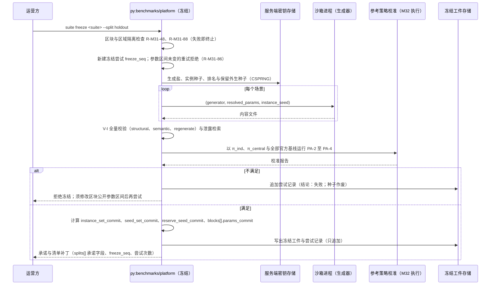

# M31 基准套件 PRD（Benchmark Suite Framework）

## 文档信息

| 项 | 内容 |
|---|---|
| 文档编号 | AWR-M31 |
| 标题 | 基准套件框架（Benchmark Suite Framework）PRD：Suite / Family / Generator / Instance / Evaluator / SuiteRuntime 协议、实例包格式与校验、"问题族 × 难度 × 规模 × 通信档 × 保真度"的组织、划分与秘密种子、生成器确定性、D3 事件任务承接（`drone4d_event`）、Suite 版本化与贡献流程 |
| 版本 | v0.2.1（2026-10-18 文档集集成同步：按 AWR-06 v0.3 §0.5 统一裁定 XR-23 修订 R-M31-41 与 §7.2 的评测通道词表，按 XR-14 修订 R-M31-04、V-S-02 的主指标唯一性，按 XR-22 修订 R-M31-12 的 `limit_expr` 变量范围，按 XR-07 修订 §7.7.3 的编码引用，按 XR-15 把 R-M31-45 定为参考缓存键的唯一定义；按 XR-02 把接口草案标注改为 Python 3.12） |
| 日期 | 2026-10-18（UTC） |
| 状态 | D4 设计评审稿。D4 处于深入调研与概念设计阶段，D3 完整收尾并封板（G0）后才启动实现；本文全部阶段与周次以"D3 封板后第 N 周"表述，不含日历日期承诺；本文不构成实现承诺 |
| 修订 | v0.1（2026-10-18）初稿；v0.2（2026-10-18）按评审意见 22 条修订，逐条核实结论与处理见 §15。主要变化：大整数与种子的 JSON 编码及测试向量（§7.7）；新增 `SuiteRuntime` 协议与清单运行时字段（§5.11、§7.2.6、§8.1）；实例摘要改为内容层与参考层两层（R-M31-25、R-M31-81）；视图分级改为按文件划分并定义部分包语义（§7.4）；生成器随机流改为生成器作用域键并固定字节编码与取样算法（§7.3.2）；跨硬件一致性改为整数数值路径（§7.3.4）；引入 `suite_core_digest` 与 `suite_random_digest`（§7.9.1）；`drone4d-event@1` 的标识、简报与清单重写（§7.8、§8.4）；命令行契约（§7.11）；执行隔离（§7.12）；工作量核对（§9.4） |
| 上游文档 | [AWR-06](../06-D4-协同实验平台概念设计.md)（v0.2）：§1.4、§3.3、§3.4、§3.5、§4.1、§4.2、§4.4、§4.6、§4.7、§5.5、§5.6、§7、§8.6、§8.7、§8.9、§8.10、§8.12、§10、ADR-D4-16、17、25、26、31、33、35；调研 [r02](../research/d4/r02-协同问题族与标准问题库.md) §2、§6（CAPL 五维、实例包、评测规则、锚点实例）、[r03](../research/d4/r03-NS-2经验与排行榜规则.md) §3.4、§3.7、§3.8、§5.4（R13–R15、R25–R31）、[n01](../research/d4/notes/n01-现有代码映射.md)、[n02](../research/d4/notes/n02-D3评测子系统泛化.md) §3.2、§4、§6.1、§6.3；负责人前期稿 design-r1、design-r2 §五 |
| 并行文档 | [M28 实验内核](M28-实验内核PRD.md)、[M29 交互网络](M29-交互网络PRD.md)、[M30 协同接口与基线](M30-协同接口与基线PRD.md)、[M32 评测与统计](M32-评测与统计PRD.md)、[M33 Trace 与复现](M33-Trace与复现PRD.md)、[M34 研究者 SDK 与命令行](M34-研究者SDK与命令行PRD.md)、[S1 规格](../d4/suites/S1-TaskAlloc规格.md)、[S2 规格](../d4/suites/S2-CoopSearch-Handoff规格.md)、[S3 规格](../d4/suites/S3-InfoShare规格.md)、[X1 协议](../d4/suites/X1-RobustCoord协议.md)、[排行榜规格](../d4/协作智能排行榜规格.md)（下称 LB）、[契约草案](../d4/契约草案.md)（下称 CT）、[首篇论文实验设计](../research/d4/r04-首篇论文实验设计.md)；v0.2 已对照 CT §3.2、§3.4、§3.8、§5.2 与 LB §9.2 |
| 编号约定 | 需求 `R-M31-yy`，验收 `AC-M31-yy`，实例包校验规则 `V-I-yy`，Suite 清单校验规则 `V-S-yy`，编码规则 `ENC-yy`，风险 `RK-M31-yy`，待决 `Q-M31-yy`；工作包、决策、验收引用 AWR-06 的 `WP-D4-xx`、`ADR-D4-xx`、`AC-D4-xx`；Suite 级验收 `AC-S1-yy` 等由各 Suite 规格定义，本文只引用。v0.1 的编号保持不变，v0.2 新增编号自 R-M31-79、AC-M31-31、V-I-25、V-S-17 起 |
| 引用约定 | 沿用 AWR-06：`py:` = `python/awr/`；`sdk:` = `tools/sdk/drone4d/src/drone4d/`；`ct:` = `packages/contracts/`。对代码的引用以"文件 + 符号"为准，行号可能漂移。凡"新增"路径（如 `py:benchmarks/`、`ct:suite/`）在本文撰写时均不存在，已逐一核实 |
| 数值约定 | 标注"初值""目标值""缺省"的数值为设计默认值或待 pilot 校准的目标，不是对现有代码性能的断言；§1.1 中标注"本次实测"的数值为撰写时在开发机上的单次测量，只用于量级判断 |
| 写作规范 | 中文、技术名词保留英文；企业级行文；表格与编号清晰；不使用 emoji 与状态字形 |

---

## 0. 摘要

1. **定位**。M31 是 D4 第 L4 层（AWR-06 §3.2）"Benchmark"的框架模块，包路径 `py:benchmarks/`。它把"问题"作为一等对象登记与分发：以 Suite 清单声明问题族、指标、赛道、划分、预算与评分规则；以 Family 生成器把 `(family, params, instance_seed)` 确定地变为实例；以实例包承载世界、实体、任务流、外生事件、扰动、公开简报与隐藏真值；以 `SuiteRuntime` 向内核、交互网络与协同接口提供 Suite 侧运行接口；以 Evaluator 插件把 trace 与实例变为 `evaluation` 分量。M31 不实现调度、网络与统计，分别由 M28、M29、M32 承担。
2. **五维组织**。标准问题库按"问题族 F × 难度 d × 规模 n × 通信档 N × 保真度 (O, P)"组织（r02 §6.1）。前三维是实例的内在坐标，进入实例标识；后两维是运行坐标，由赛道与实验配置声明，不进入实例标识，使同一实例可在多档下配对运行。`kind = fixed` 的 Family（D3 事件、网格族）另设标识形式（OR-1a）。档位开放状态（`frozen`、`preview`、`closed`）纳入清单。
3. **协议**。AWR-06 §4.2 只给出 `MetricSpec`、`Evaluator`、`Generator` 三个草案签名；本文沿用其中 `Evaluator` 的签名，`Generator.version` 改为整数主版本号（§14 第 24 条），并新增 `Suite`、`Family`、`Instance`、`ReferencePolicy`、`PerturbationProtocol`、`SuiteRuntime` 协议，补齐实例视图分级、生成器随机流 `GenStream`、评测器运行视图 `RunView` 与场景级重算回调 `recompute`。
4. **Suite 运行时接口**。M28、M29、M30、M34 要求 Suite 提供的事件登记、阶段参与者、`SuiteView`、终止谓词、Suite 级属性缺省、仲裁规则 `ArbiterRules`、`ProblemView`/`Plan` schema、算法隔离执行器、重规划节拍、网络覆盖项与训练适配字段，统一由 `SuiteRuntime` 协议与清单字段承载，并逐条挂接对应模块条款（§2.2、§5.11）。
5. **实例包**。实例包目录以 AWR-06 §4.6 为基础；规范形式为 JCS（`py:sim/events/jcs.py` `jcs`）；随机导出量一律量化为整数单位；绝对值不小于 2⁵³ 的整数（63 位种子、`_unix_ns` 时刻）在 JSON 中一律为十进制字符串（ENC-01 至 ENC-05）。视图分级按文件划分，`truth` 文件全部位于 `hidden/`；摘要分两层：`instance_sha256` 只覆盖生成器的确定性产物，参考解与锚点期望值另计 `reference_sha256`，参考值刷新不改变实例标识与承诺。校验规则 V-I-01 至 V-I-28 由自含校验器执行，不依赖 jsonschema（B-02）；运行时装载只校验摘要。
6. **划分与秘密种子**。四划分 `dev` / `validation` / `holdout` / `stress` 沿用 AWR-06 §8.7；隔离以"参数区块"（平面族）与"地理区域"（网格族，由 Suite 区域清单定义）为单位并给出可判定阈值；隐藏划分的种子在冻结时以 CSPRNG 生成、存服务端密钥存储，对外只发布加盐承诺，承诺的字节编码与测试向量见 §7.7；`stress` 为 `holdout` 场景的子集并使用独立外生种子；冻结尝试逐次记录并公开次数。
7. **生成器确定性**。同一 `(generator_id, version, resolved_params, instance_seed)` 生成的实例 JCS 摘要逐字节一致（PA-1）；随机键只含生成器 id 与主版本号，实现重构不改变输出；取样算法（均匀、整数、置换、整数近似正态）在本文固定；缺省数值档 `integer` 只允许整数运算与 IEEE-754 基本运算参与量化值，使跨硬件等级一致可判定。
8. **D3 承接**。D3 事件任务整体登记为 Suite `drone4d-event@1`：4 个事件类型各为一个 `kind = fixed` 的 Family，`task.v1` 经适配器投影为 `instance.v1`（`brief.json` 只是 `task.v1` 的公开投影），评测器包装 `py:bench/eval/evaluator.py` `evaluate_run`，运行由冻结的 `BenchEnv` 承载；清单不设参考策略（`reference_policies = null`），完整样例见 §8.4；D3 输出与 `board.v1` 重算逐字节不变（B-07）。该 Suite 依赖网格世界与 zstd 解码，不进入 numpy-only 核心与 wheel 核心依赖，并需要 B-10 白名单增补（§14 第 20 条）。
9. **版本化与贡献**。Suite 采用语义化版本；`suite_digest` 覆盖完整清单并作为 Board Version 冻结项，`suite_core_digest` 只覆盖影响结果的内容，补丁版本以"核心摘要不变且分量重算逐字节一致"为可执行判据，条目直接迁入。贡献分 Core / Contrib / Community 三级；平台侧的生成与评测在无密钥、无网络的沙箱进程中执行（§7.12）。
10. **规模**。需求 R-M31-01 至 R-M31-98（另有非功能 R-M31-N01 至 N07），验收 AC-M31-01 至 AC-M31-42，对 AWR-06 的反馈 28 条（§14），对并行文档的修订要求 §13。须在 WP-D4-01 实验契约 RFC 中裁决的有：随机键作用域（与 M28 §13 第 19 条合并，§14 第 3 条）、大整数编码（第 19 条）、B-10 白名单增补（第 20 条）、`suite_core_digest` 与补丁迁入（第 21 条）、`stress` 定义（第 22 条）、WP-D4-10 人周（第 25 条）、`drone4d-event@1` 的 `invalid_policy`（第 26 条）。

---

## 1. 背景与目标

### 1.1 约束本模块的事实

以下事实均已打开对应文件核实。

| 编号 | 事实 | 对设计的含义 | 依据 |
|---|---|---|---|
| F-01 | `py:benchmarks/`、`ct:suite/`、`ct:coord/` 目录不存在；D4 的 Suite 框架为新建 | 本模块无既有实现约束，接口以 AWR-06 §4.2 草案与 CT 为准 | `python/awr/` 目录列表；`packages/contracts/` 目录列表 |
| F-02 | `ct:bench/task.v1.schema.json` 为 `additionalProperties: false`；`event_type` 为封闭枚举 `reid_occlusion`、`rendezvous_handoff`、`vehicle_track`、`target_search`；顶层 `x-agent-visible` 列出 `task_id`、`event_ref`、`version`、`event_type`、`brief`、`known_targets`、`min_obs_level`、`altitude_envelope_agl_m`、`report_types`、`safety`、`budget`、`prior`、`reference_chips`，`scored_event_types` 不在其中 | `task.v1` 不能原位扩展（B-06），D4 新开 `instance.v1`；4 个事件类型成为 `drone4d-event@1` 的 4 个 Family | `packages/contracts/bench/task.v1.schema.json` |
| F-03 | `py:agentsdk/task.py` `task_from_event(event_dir)` 由事件版本目录的 `plan.json`、`anchors.json` 生成 `task.v1`，`task_id = "<event_id>-v<version>"`；其输出不含 `prior` 与 `reference_chips`；预算、高度包络、安全间距为模块常量（每机 10 km、2,000 kB；30–120 m AGL；10 m）；`scored_events(event_dir)` 只供评测端使用 | `drone4d_event` 的实例适配器以 `task_from_event` 为唯一来源，不复制其逻辑；常量值随 D3 冻结 | `python/awr/agentsdk/task.py` `task_from_event`、`scored_events`、`ALT_ENVELOPE_AGL_M` |
| F-04 | `py:bench/eval/evaluator.py` `evaluate_run(run_dir, event_dir, world, *, fx, diag)` 输出 `bench/evaluation.v1`，`components = {ec, eu, ao, ce}`；无效原因以字符串 `actor_penetration`、`physics_not_ranked` 内嵌；`EVALUATOR_VERSION = "0.1.0"`、`SCORE_VERSION = "d3-score-0"` 定义于 `thresholds.py` | `drone4d_event` 评测器以包装方式调用，不改代码（B-08）；D3 分量下沉到 `diagnostics.drone4d-event`；无效原因码在插件注册表中登记 | `python/awr/bench/eval/evaluator.py` `evaluate_run`；`python/awr/bench/eval/thresholds.py` |
| F-05 | `evaluate_run` 所需的 `world` 由 `py:agentsdk/env/core.py` `_open_world` 打开（私有符号，9 行）：优先 `awr.world.mesh.query.open_mesh_world_query`，失败时回退 `awr.world.geometry.query.open_dsm_world_query`；`core.py` 模块顶层导入 `camera`、`guard`、`l1`、`l2`、`link`、`nav`、`recorder`、`spec`、`task` 与 `awr.phys.adapter`；`py:bench/runner.py` 与 `py:bench/eval/__main__.py` 均借用 `_open_world` | 导入 `core.py` 会带入整套 `BenchEnv` 依赖；`drone4d_event` 应自带等价的 `open_world`，不导入 `core.py`（R-M31-63） | `python/awr/agentsdk/env/core.py` `_open_world`；`python/awr/bench/eval/__main__.py`；`python/awr/bench/runner.py` |
| F-06 | `py:bench/eval/ce.py` `_restrict(ident, u)` 实现子编队投影；`collaborative(...)` 在机数小于 2 时返回 `ce = None` | `Evaluator.evaluate(subset=...)` 以其为思想来源（AWR-06 §3.5）；`drone4d-event@1` 的 `ce` 必须声明 `nullable = true` | `python/awr/bench/eval/ce.py` `_restrict`、`collaborative` |
| F-07 | `py:sim/events/tape.py` 的 `write_tape` 与 `TapeReader` 的块解码在函数内延迟 `import zstandard`；模块顶层只依赖 numpy、`errors`、`jcs` | 读取 Canonical Event Tape 需要 zstandard；`tape/` 子树只出现在网格族与 `drone4d-event@1` | `python/awr/sim/events/tape.py` `write_tape`、`TapeReader` |
| F-08 | `py:sim/events/jcs.py` 提供 `jcs(obj) -> bytes` 与 `jcs_number`；`py:tasking/model.py` `canonical_sha256` 以 `json.dumps(sort_keys=True)` 加 6 位舍入计算摘要，不是 JCS | 实例与清单摘要一律使用 `jcs`，不使用 `canonical_sha256` | `python/awr/sim/events/jcs.py` `jcs`；`python/awr/tasking/model.py` `canonical_sha256` |
| F-09 | `py:bench/spec_rules.py` `check(spec, rules, *, external)` 支持 `allow`、`forbid`、`require`、`min`、`exactly_one`；规则表经 `awr.contracts._paths.schema_path` 从仓库 `packages/contracts`（或环境变量 `AWR_CONTRACTS_DIR`）读取 | 规则语义可复用为兼容矩阵的规格；M31 须自含等价的规则求值器 | `python/awr/bench/spec_rules.py` `check`；`python/awr/contracts/_paths.py` |
| F-10 | `ct:bench/run_spec.v1.schema.json` 的 `x-rules` 中 `ranked_physics` 规则在 `ranked = true` 时只允许 `physics = realistic`；`physics` 枚举为 `realistic`、`fast`、`sitl`；`clock_profile` 枚举为 `d1_250`、`sandbox100` 或对象 | 该规则只对 `drone4d-event@1` 生效（偏差 D-7） | `packages/contracts/bench/run_spec.v1.schema.json` |
| F-11 | `tools/lint/check_py_imports.py` 的 `D3_PACKAGES` 含 `awr.world.glb`、`awr.world.mesh`、`awr.sim.events`、`awr.phys`、`awr.sensorsvc`、`awr.agentsdk`、`awr.bench`、`awr.api.bench_main`；`PkgRule(("",), deny=D3_PACKAGES, skip=_D3_PATHS)` 禁止 D3 路径之外的代码导入；`awr.world.geometry` 不在其中 | `py:benchmarks/` 对 D3 的导入只走 B-10 白名单；`drone4d_event` 需要的 `awr.agentsdk.task` 与 `awr.world.mesh.query` 不在 B-10 现有白名单中（§14 第 20 条） | `tools/lint/check_py_imports.py` `D3_PACKAGES`、`_D3_PATHS`；AWR-06 §3.4 B-10 |
| F-12 | D3 事件族划分在 M27 设计中以 `split_of(family_id, variant_params, holdout=0.30)` 确定性留出，但仓库中无对应实现 | D4 不继承随机比例切分；以参数区块与地理区域隔离（AWR-06 §8.7、ADR-D4-26） | `docs/modules/M27-基准运行时与数据集PRD.md` §6.7.10；代码检索结果 |
| F-13 | `py:agentsdk/env/spec.py` 头注释规定 `run_seed` 只存在于 Env 进程内存与运行真值层；`EnvSpec.fleet` 由运行规格 `run_spec.fleet[]` 给出 | 种子不变量沿用；D3 事件的机队规模属运行规格，不属事件本身 | `python/awr/agentsdk/env/spec.py` 模块文档字符串、`EnvSpec.fleet` |
| F-14 | D3 世界包以 `world.json.files[]` 登记内容文件、以 `contentVersion` 标识内容版本；`world.json`、`qa/report.json`、`export/**` 为非内容文件 | 实例包沿用"内容文件 / 非内容文件"二分 | `docs/16-World数据规范.md`（V-W-11）；`worlds/synthcity/world.json` |
| F-15 | `jcs_number` 对绝对值不小于 2⁵³ 的整数抛出 `ValueError("integer outside the IEEE-754 exact range")`；63 位种子与 `_unix_ns` 时刻（约 1.7 × 10¹⁸）均超出该范围；CT §3.2 规定此类大整数在 JSON 视图中以十进制字符串编码并以 `x-awr-int-string` 注记，`_unix_ns` 同为十进制字符串 | 种子与时刻不得以 JSON 数字写出；承诺原文同样受此约束（ENC-01 至 ENC-03） | `python/awr/sim/events/jcs.py` `jcs_number`；CT §3.2、§3.7 |
| F-16 | `py:sim/sensors/cbrng.py`：`key()` 为纯 uint64 SplitMix64 链；`uniform` 为 `(key >> 11) · 2⁻⁵³`，只含整数运算与一次精确转换；`normal` 为 Box–Muller，调用 `np.log`、`np.cos`；AWR-06 术语表把 `hw_class` 定义为含"numpy SIMD 派发范围与数学库构建" | 均匀数与整数取样跨平台一致；正态取样受数学库位差影响，量化值不得依赖它（GD-07） | `python/awr/sim/sensors/cbrng.py` `key`、`uniform`、`normal`；AWR-06 §0 术语表 |
| F-17 | `py:agentsdk/task.py` `brief_for_agent(task, event_dir, *, nominal_noise)` 要求关键字参数 `nominal_noise`；`py:agentsdk/env/core.py` `BenchEnv.agent_config` 以 `self.nav.pos_std_m` 与 `self.l1.p` 构造 `nominal_noise`，并以 `self.world.ground_dtm` 改写锚点 z 值 | 实例适配器不具备运行期输入，`brief.json` 与 `brief_for_agent` 的输出不可能逐字节一致；运行期简报仍由 `BenchEnv` 构造 | `python/awr/agentsdk/task.py` `brief_for_agent`；`python/awr/agentsdk/env/core.py` `agent_config` |
| F-18 | D3 `event_id` 模式为 `^[a-z][a-z0-9-]{2,63}$`（可含连字符与数字）；CT §5.2 的 `instance_id` 模式中 family 段为 `[a-z][a-z0-9-]{0,31}`（不允许下划线），block 段为 `[a-z0-9]{1,16}`，difficulty 段为 `d[0-4]` | D3 事件类型名含下划线，不能直接作为 Family id；`event_id` 不能放进 block 段（§7.8） | `docs/17-接口与实时协议规范.md` §18 标识表；CT §5.2 |
| F-19 | `worlds/synthcity/world.json` 顶层无 tiles 或 regions 字段，`bounds` 为 x、y ∈ [−600, 600] m，`semantic/zones.geojson` 只有 `border`、`nofly`、`restricted` 三个 zone，无 mesh 层；`worlds/oryahovo-crop1`（S2 `cs-handoff-mesh` 所用）`bounds` 约为 2,511 m × 1,700 m，`geometry/mesh/raycast/index.json` 的 `tiling = {kind: grid, size_m: 512}`、共 21 个瓦片，`visual/mesh/appearance/index.json` 登记 16 张纹理（带 sha256）与 80 个图元；`docs/16-World数据规范.md` 中的 tile 指点云瓦片容器 | 世界包中没有可直接用于划分隔离的"区域"定义；网格族的区域须由 Suite 区域清单定义，以光线投射瓦片与纹理为检查单位（R-M31-88） | 上列文件 |
| F-20 | 本次实测：对 1.18 MB 的合成任务 JSON，纯 Python `jcs` 规范化耗时 0.37 s，`json.loads` 0.04 s，`hashlib.sha256` 约 5 ms | 运行时装载不得逐次重新规范化全部 JSON（R-M31-84） | 开发机单次测量 |
| F-21 | M33 R-M33-69 与 §6.9：`TraceRunView` 只实现 `tasks`、`tape`、`ident`、`net`、`agent_state`、`belief` 六个通道；`report` 与 `interaction.*` 记录归入 `tasks`；资源指标由 `ledger` 与 `msg.submit` 元数据计算 | M31 采用这六个通道，不另增通道（R-M31-41） | `docs/modules/M33-Trace与复现PRD.md` R-M33-69、§6.9 |
| F-22 | CT §3.4：平台内部摘要与承诺为 64 位小写十六进制、无前缀；CT §3.8：M31 的候选原因码段为 770–789；CT §5.2 的 `instance.v1` 把 `reference` 列入 `content_core` | M31 的摘要不带 `sha256:` 前缀；原因码使用 770–789；`reference` 移出 `content_core` 须由 CT 同步（§13） | CT §3.4、§3.8、§5.2 |

### 1.2 目标

| 编号 | 目标 | 度量 |
|---|---|---|
| G-01 | 研究者改进某一协同算法时只替换算法组件，不重建场景加载、实例生成与评测 | 新增一个策略对既有 Suite 运行零改动；教程二"编写一个 Suite"在干净环境中逐步执行通过（AC-D4-48） |
| G-02 | 实例可复现、可校验、可引用 | PA-1 逐字节一致；实例包校验 V-I 全部规则有正反例；实例以 `(instance_id, instance_sha256)` 唯一引用 |
| G-03 | 留出集不可被探测与硬编码 | 划分隔离自动检查通过；隐藏实例与种子只以承诺出现；赛季末公开后承诺可验证（AC-D4-23、AC-D4-42） |
| G-04 | D3 已发布任务原样可跑、可比 | `drone4d-event@1` 经插件路径的评测结果与 D3 直接调用逐字节一致（WP-D4-10）；B-07 通过 |
| G-05 | 第三方可以贡献 Suite 而不破坏既有榜单 | 新 Suite 与既有 Suite 的摘要互不相关；贡献流程各门禁可由 CI 执行；第三方代码在平台侧沙箱执行 |
| G-06 | 北极星路径不受 Suite 框架拖累 | `pip install drone4d` 后本地生成 S1 `d1/n20` 的 10 个 `dev` 实例的总墙钟 ≤ 2 s（目标值，RM-8） |

### 1.3 非目标

| 编号 | 非目标 | 归属 |
|---|---|---|
| NG-01 | 事件调度、阶段全序、随机域的底层实现与运行宿主 | M28 |
| NG-02 | 网络档模型与参数集 | M29 |
| NG-03 | 协同算法协议与经典基线实现 | M30（M31 只登记参考策略、`ProblemView`/`Plan` schema 与执行器） |
| NG-04 | 层次统计、Holm、Δ 族干预编排、榜单生成、参考缓存的存储 | M32 与 LB |
| NG-05 | trace 记录格式与离线重放 | M33 |
| NG-06 | 各 Suite 的形式化定义、指标公式、难度旋钮取值与基线清单 | S1、S2、S3、X1 规格 |
| NG-07 | 外部实例库（MovingAI、CVRPLIB 等）的导入 | P2 MultiAgentPath（WP-D4-36），本文只预留锚点实例机制 |
| NG-08 | 命令行的命令注册、退出码与 `--json` 封装 | M34（R-M34-48）；M31 只定义参数、输出 schema 与原因码 |

### 1.4 术语（本文新增或细化，其余见 AWR-06 术语表）

| 术语 | 定义 |
|---|---|
| 实例坐标 | 进入实例标识的维度：问题族（Family）、难度档 `d<k>`、规模档 `n<S>`、参数区块 `block`、区块内序号 `index` |
| 运行坐标 | 不进入实例标识、由赛道或实验配置决定的维度：通信档、观测档 O、物理档 P、时钟档、执行拓扑、运行模式（算法隔离 / 闭环）、事件模式（exogenous / interactive）；`drone4d-event@1` 另含机队规模 |
| 参数区块（block） | 生成器公开参数的一个命名子空间，是划分隔离的最小单位；网格族以地理区域为区块 |
| 地理区域（region） | Suite 区域清单（`drone4d.suite.regions.v1`）中登记的世界包子区，以光线投射瓦片集合与多边形定义（R-M31-88） |
| 档位状态 | 清单中每个难度档、规模档的开放状态：`frozen`（可排名）、`preview`（只在 `dev` 可用，不排名）、`closed`（未开放） |
| 场景配置（Scenario） | 统计单位：一个实例与一个运行模式的组合，`scenario_id = <instance_id>#<run_mode>`（AWR-06 术语表） |
| 场景集（ScenarioSet） | 一组场景配置，成榜的最小内容单元；由清单 `scenario_sets[]` 声明 |
| 物化实例包 | 生成器输出经量化与规范化后写出的目录，含内容文件、参考文件与 `manifest.json`；冻结后的隐藏实例以物化实例包为权威 |
| 内容文件 / 参考文件 | 内容文件是生成器（或固定型 Family 的转换器）的确定性产物，登记于 `files[]`，进入 `instance_sha256`；参考文件是外部求解器或人工给出的参考解与锚点期望值，登记于 `reference_files[]`，进入 `reference_sha256` |
| 实例视图分级 | `brief`（复位时下发 Agent）、`scheduled`（由内核按事件时刻释放给 Agent）、`truth`（只供评测器与内核）；按文件划分（§7.4.3） |
| 部分包 | 以 `scope = public_inputs` 或 `agent_brief` 写出、缺少部分视图文件的实例包（§7.4.4） |
| 生成器作用域 | `gen_scope = SHA-256(LP("drone4d.gen.v1") ‖ LP(generator_id) ‖ u32be(generator_version))`，随机键中替代 `suite_digest` 的字段（§7.3.2）；只随生成器 id 与主版本号变化 |
| 实现摘要 | `impl_sha256`：生成器包源文件与声明只读资源的摘要，只用于审计，记入 `build{}`，不进入任何随机键或实例摘要 |
| 实例种子 | 63 位非负整数，决定一次生成的全部随机量；`dev` 公开派生，隐藏划分由 CSPRNG 生成；JSON 中为十进制字符串（ENC-01） |
| `suite_core_digest` | 清单中影响评测结果的内容的摘要（§7.9.1） |
| `suite_random_digest` | 清单中影响随机过程的内容的摘要，作为外生随机域键的作用域字段（§7.9.1；与 M28 §13 第 19 条一致） |
| 冻结工件 | 隐藏划分冻结时产生的实例集清单、种子集与承诺、校准报告与全部冻结尝试记录 |

---

## 2. 范围

### 2.1 分阶段范围

| 阶段 | M31 交付 | 工作包 | AC-D4 |
|---|---|---|---|
| P0（D3 封板后第 1–11 周） | `suite.v1`、`instance.v1` 契约与自含校验器；`Suite`、`Family`、`Generator`、`Instance`、`Evaluator`、`ReferencePolicy`、`SuiteRuntime` 协议与登记表；实例包写出与读取、两层摘要、V-I 与 V-S 校验（核心子集，§9.3）；`GenStream`、`dev` 公开派生与本地生成；`drone4d-event@1` 承接；S1、S3、S2 `cs-planar` 的框架侧集成；pilot 支撑（相变扫描记录、PA-1 检查）；内部影子榜的 `dev`/`validation` 场景集定义；`PerturbationProtocol` 接口与内核注入钩子的数据格式 | WP-D4-10（主）、14（`GenStream` 与派生，代码落在 M31 路径）、15、16（框架侧集成）、13（参考策略登记）、17（pilot 工具）、18 | 02、13、15、17、18、19、20、43 |
| P1（第 12–21 周） | 留出集冻结机制（区块隔离检查、CSPRNG 种子、承诺、留出集校准、冻结尝试记录、冻结工件）；平台侧沙箱执行；`stress` 划分与 X1 协议包的框架接入；S2 `cs-handoff-mesh` 网格族（区域清单、`world/ref.json` 与 `tape/` 子树）；TA-C 层档位开放；`n32`、`d3` 档开放；Suite 贡献流程、注册表规格与教程二；Suite 版本迁移工具；P0 降级项回收（§9.3） | WP-D4-19、21、25、26、47、51 | 23、25、33、48、50 |
| P2（第 22–31 周） | `n64`、`d4` 档开放；外部锚点实例导入机制；MultiAgentPath、CoopTracking 的框架接入；第一赛季末留出集退役转 `dev` 与公开验证工具 | WP-D4-52、36、37、42 | 38、42、51 |

工作量与 AWR-06 §10.2 工作包预算的核对见 §9.4。

### 2.2 与其他模块的边界

| 模块 | M31 向其提供 | M31 从其获取 | 对方条款 | 本文条款 | 边界规则 |
|---|---|---|---|---|---|
| M28 实验内核 | 实例对象（实体、Agent 模板、任务流、外生事件、故障、通信特征）；事件类型登记 `register_events`；阶段参与者；`SuiteView`（观测体构造器所需的只读任务视图与 `body`）；终止谓词；Suite 级属性缺省；Suite 级随机域声明 `rng_domains[]` | `RandomOracle` 键派生（R-M28-22 至 R-M28-25）、`EventTypeRegistry`、`PhaseParticipant`、`ObservationSealer`、`EpisodeSpec`、`AttrSpec`、`PlanarWorld`、扰动注入钩子 | M28 §2.2 M31 行；M28 接口表 `EventTypeRegistry.register`、`PhaseParticipant`、`SuiteView`、终止谓词与 `Instance` 行；R-M28-27、R-M28-58；M28 终止规则（终止谓词在决策边界 `TRACE_FLUSH` 之后求值） | R-M31-93、94、98；§7.2.6 | Suite 只经登记的事件处理器与阶段参与者在允许阶段写入；`CONFIGURED` 之前完成登记；Suite 事件以 `suite.<suite_id>.` 为前缀、rank 100–199 |
| M29 交互网络 | Suite 声明的参数集、允许的覆盖项（只可下调 `msg_max_B` 与预算）、组定义、`inbox_max`、`ArbiterRules`（机巢表、停靠半径、交接窗口、交接校验、冲突优先规则）、实例的外生通信特征 | 网络档 id 与参数集 id 的登记表、`ArbiterRules` 协议 | M29 §2.2 M31 行；R-M29-76；M29 `class ArbiterRules`；`NetContext.rules` | R-M31-95；§8.1 `network_overrides` | 网络档与参数集属运行坐标，实例包不含网络档参数（OR-3）；排名运行不得覆盖参数集 |
| M30 协同接口与基线 | 各 Suite 的 `ProblemView`/`Plan` body schema、任务视图类型、`reference_policies` 绑定、算法隔离模式的平台执行器（路径跟随、承诺管理）与重规划节拍 | 基线实现、`baseline:<id>@<ver>` 引用、`ProblemView`/`Plan` 信封 | M30 §2.2 M31 行；R-M30-18、R-M30-21、R-M30-22；M30 执行器段落 | R-M31-96；§7.2.6 | 基线代码在 `py:coordination/baselines/`；全部求解器共用同一执行器 |
| M32 评测与统计 | `Evaluator` 插件、`MetricSpec`（含 `level`）、场景级重算回调 `recompute(seed_weights)`、`scoring{}`、场景集定义、冻结工件 | 统计协议实现、Δ 管线、参考缓存键定义与存储 | M32 §2.2 M31 行；R-M32-10、V-7、R-M32-43、R-M32-69、R-M32-77 | R-M31-39、45、85；§7.7 | M31 声明"评什么、在哪些场景上评"，M32 实现"怎么聚合"；参考缓存键由 M32 持有定义 |
| M33 Trace 与复现 | 评测器所需通道清单 | `RunView` 的实现 `TraceRunView` 与通道映射 | R-M33-69、§6.9 | R-M31-41 | 评测器只读 trace 与实例，不读取运行时内存对象 |
| M34 SDK 与命令行 | 命令参数、`--json` 输出 schema、校验报告结构、原因码名称；张量画像 `tensor_profiles`、训练奖励 `training_reward`、特权状态规格 `state_spec` | 命令注册、退出码、`--json` 封装、wheel 打包 | R-M34-48、R-M34-64、R-M34-65；M34 §2.2 M31 行、§7.6.3、§7.8 | R-M31-92、97；§7.11 | 平台侧命令不进入 wheel；Suite 未声明训练奖励时训练适配器拒绝构造 |
| CT 契约草案 | `ct:suite/suite.v1`、`instance.v1`、`regions.v1`、`check_report.v1` 的字段定义与 golden | 命名空间、通用约定（CT §3）、原因码段 770–789 | CT §3.2、§3.4、§3.8、§5.1、§5.2 | §8 | `ct:bench/` v1 契约原位不改（B-06）；本文与 CT 的差异见 §13 |
| S1、S2、S3、X1 规格 | 框架、实例包格式、档位与划分机制、`SuiteRuntime` 协议 | 各 Suite 的形式化定义、实例字段、难度旋钮、指标、基线、验收 | 各规格 §3、§4 | §4、§7.4 | 字段名冲突以 Suite 规格为准，文件布局、视图、单位与量化规则以本文为准 |
| LB 排行榜规格 | 划分定义、场景集、冻结工件、轮换子集承诺 | 配额、反馈机制、赛季与轮换时点 | LB §9.2、§9.3 | R-M31-89 | 配额与查询次数不属 M31 |
| D3 冻结区 | — | `evaluate_run`、`task_from_event`、`scored_events`、`BenchEnv`、`TapeReader` | B-08、B-10 | §7.8、R-M31-63 | 只经包装与库调用使用，不改代码 |

### 2.3 路径所有权（M31，新增）

| 路径 | 内容 |
|---|---|
| `python/awr/benchmarks/`（即 `py:benchmarks/`） | 框架核心：`suite.py`、`family.py`、`instance.py`、`package.py`、`validate.py`、`evaluator.py`、`reference.py`、`perturbation.py`、`runtime.py`、`splits.py`、`seeds.py`、`regions.py`、`registry.py`、`rules.py`、`quantize.py`、`report.py` |
| `py:benchmarks/suites/<suite_pkg>/` | 各 Core Suite 的生成器、评测器、`SuiteRuntime`、参考策略登记与清单（`taskalloc/`、`coopsearch_handoff/`、`infoshare/`、`drone4d_event/`）；内容由各 Suite 规格的作者实现，框架约束由本文规定 |
| `py:benchmarks/protocols/robustcoord/` | X1 协议包（P1） |
| `py:benchmarks/platform/` | 平台侧工具：冻结、留出集校准、承诺生成、退役公开、沙箱执行器、`SecretAuthority`、泄露检索；不进入 wheel |
| `packages/contracts/suite/`（即 `ct:suite/`） | `suite.v1`、`instance.v1`、`regions.v1`、`check_report.v1` 的 schema 与 golden（与 CT 作者协同起草，M00 合入） |
| `docs/suites/<suite_id>/` | 各 Suite 的 `validity.md` |
| `tests/d4/benchmarks/` | 本模块单元、性质与回归测试（§10.1） |

---

## 3. 用户与用例

| 编号 | 角色 | 用例 | 涉及需求 |
|---|---|---|---|
| UC-01 | 算法研究者 | 本地运行某 Suite 的 `dev` 场景集：`drone4d bench run experiment.yaml` 解析 `suite{id, version}` 与 `scenario_set`，本地按公开派生规则生成实例并校验摘要 | R-M31-01、08、35、50 |
| UC-02 | 算法研究者 | 在指定坐标生成单个实例以调试：`drone4d bench instance gen --suite taskalloc --family ta-core --block pu --index 3 --d d1 --n n20` | R-M31-17、77、92 |
| UC-03 | 算法研究者 | 查阅某实例的公开简报与难度量，并下载 `dev` 实例的完整调试真值 | R-M31-26、27、82 |
| UC-04 | 平台评测流水线 | 按"场景集 × 外生秘密种子 × 重复 × 干预"展开一次提交：向 M31 索取场景集成员、物化实例包、`SuiteRuntime` 与 Evaluator | R-M31-08、35、39、93 |
| UC-05 | 平台运营方 | 冻结某 Suite 的 `holdout`：区块隔离检查、CSPRNG 生成种子、沙箱物化、以参考策略做留出集校准、写出承诺与冻结工件 | R-M31-46 至 R-M31-55、86、90 |
| UC-06 | 平台运营方 | 赛季末退役留出集：公开盐与种子、实例集转入 `dev`、发布验证脚本 | R-M31-55、56 |
| UC-07 | Suite 作者（Core/Contrib） | 编写新 Suite：实现 Generator、Evaluator 与 `SuiteRuntime`，写清单与 `validity.md`，执行 `drone4d bench suite check`，进入 pilot | R-M31-70 至 R-M31-76、93 至 98 |
| UC-08 | D3 用户 | 以 D4 工具读取并评测 D3 crop-handoff 运行，结果与 D3 一致 | R-M31-57 至 R-M31-63 |
| UC-09 | Suite 维护者 | 修正评测器缺陷，判定版本位并迁移已存储分量 | R-M31-64 至 R-M31-69、79 |

---

## 4. 组织模型

### 4.1 五维与坐标

| 维度 | 取值（首发） | 坐标类别 | 承载位置 | 说明 |
|---|---|---|---|---|
| 问题族 F | Suite 内 Family id（如 `ta-core`、`cs-planar`、`cs-handoff-mesh`、`is-fixed`、`reid-occlusion`）；跨 Suite 以 r02 问题族代码 TA、CF、CS、IF、TR 等作分类标签 | 实例坐标 | `instance_id` 的 `<family>` 段；清单 `families[]` | 一个 Family 绑定一个生成器或转换器、一个评测器、一个 `SuiteRuntime`、一种世界类型；`kind = generated`（生成器）或 `kind = fixed`（固定成员加转换器）。`cs-handoff-mesh`（S2 §3 `generator{kind: fixed, converter: mesh_from_event@1}`）与 `drone4d-event@1` 的 4 个 Family 为 `fixed` |
| 难度 d | `d0`–`d4`（小写），合法档位只此五个 | 实例坐标 | `instance_id` 的 `d<k>` 段；清单 `difficulty[]` | 由客观旋钮定义（AWR-06 §7.0）；固定型 Family 恒为 `d0`（未分档）；S1 的 `d0c` 不是合法档位，改以 `d0` 档内的专用锚点区块表达（§13） |
| 规模 n | `n4`、`n8`、`n16`、`n32`、`n64`，另设北极星配置 `n20`；固定型 Family 的规模标签由 Suite 声明（如 S2 `cs-handoff-mesh` 的 `n4`、`n8`），`drone4d-event@1` 取 `n0`（规模不属实例，见 OR-1a） | 实例坐标 | `instance_id` 的 `n<S>` 段；清单 `scales[]` | 恒密度缩放：任务或目标数随 n 同比放大，区域边长按 √n 放大 |
| 通信档 N | `none@1`、`ideal@1`、`abstract-disk@1`、`abstract-radio@1`（参数集 `default`、`severe`）、`ns3@1`、`fspl-nlos@1` | 运行坐标 | 赛道 `network_profile` 与实验 `network.params_ref` | 不进入实例标识（r02 §6.1）；实例只携带外生通信特征 |
| 保真度 (O, P) | 观测 `L0`/`L1`/`L2`/`L2-depth`；物理 `planar@1`/`kinematic`/`fast`/`realistic`/`sitl` | 运行坐标 | 赛道 `observation_profile`、清单 `ranked_physics[]`、实验 `physics` | Family 声明其支持的保真度组合；不支持的组合由 V-S 与运行前组合校验拒绝 |

### 4.2 组织规则

| 编号 | 规则 |
|---|---|
| OR-1 | 生成型实例标识只含实例坐标：`capl:<family>/<block>-<index>/d<k>/n<S>@<rev>`，满足 CT §5.2 模式。`<family>` 为 Suite 内 Family id（`^[a-z][a-z0-9-]{0,31}$`）；`<block>` 为参数区块 id（`^[a-z0-9]{1,16}$`）；`<index>` 为区块内五位十进制序号；`<rev>` 为实例修订号（首次物化为 1，同坐标的内容文件变化时递增；参考值刷新不递增，见 R-M31-81）。实例的不可变身份为 `(instance_id, instance_sha256)` 二元组 |
| OR-1a | 固定型实例标识：`capl:<family>/<block>-<index>/d0/n<S>@<rev>`。`<block>` 为固定成员的划分区块（如 `drone4d-event@1` 的 `d3dev`、`d3test`）；`<index>` 为成员登记表中的序号（五位，登记时单调分配、不复用），成员登记表 `members/<family>.json` 给出 `index → 来源引用`（如 `event_ref = <event_id>@<version>`）的映射，V-I-06 由登记表重构标识；`<S>` 为 Suite 声明的规模标签，`drone4d-event@1` 恒为 `n0`，表示规模不属实例坐标、机队规模由运行规格给出（偏离五维模型的声明见 §7.8） |
| OR-2 | 实例标识不含划分名：划分归属记录在 Suite 的划分清单中，留出集退役转入 `dev` 时实例标识不变 |
| OR-3 | 实例包不含网络档 id 与网络参数集；只含外生通信特征（`comm.json` 的通信区、公告的计划分区、固定中继；不公告的计划分区与链路掩码在 `hidden/comm_truth.json`）。同一实例在 `ideal@1` 与 `abstract-radio@1` 下的运行构成配对对照 |
| OR-4 | 难度旋钮只取实例内在量；难度档不得改变运行坐标。Suite 规格中出现"某难度档使用某网络档"的表述时，解释为该档的锚点运行或教学用法，不约束赛道（§14 第 7 条） |
| OR-5 | 运行模式（算法隔离 / 闭环）与事件模式（exogenous / interactive）是场景配置的一部分，进入 `scenario_id` 而不进入 `instance_id`；同一实例的两种运行模式为不同场景配置，分别成榜（ADR-D4-17） |
| OR-6 | 档位状态：P0 冻结 `d0`–`d2` × `n4`–`n16`（另 `d1/n20` 北极星配置），`d3`、`n32` 在 P1 开放，`d4`、`n64` 在 P2 开放（AWR-06 §7.0）。未开放档位在清单中以 `status = closed` 登记或不出现；开放档位为 Suite 次版本变更（§7.9） |
| OR-7 | 锚点实例：每个生成型 Family 至少登记 2 个 `d0` 锚点实例（可手算或穷举，带解析或穷举参考值），用作评测器单元测试、黄金 trace 回归与外部可比性层（r02 §6.4）；锚点实例恒属 `dev`。固定型 Family 以至少 2 个黄金运行（固定运行目录与期望分量）代替锚点实例 |
| OR-8 | 冒烟、标准、压力三档场景集（r03 R14）：`smoke`（`dev` 中 2 个场景 × 3 个公开种子，AWR-06 §8.10）、标准（`validation`、`holdout` 的成榜场景集）、压力（`stress` 划分）；三档参数网格固定并公开命名 |

### 4.3 场景集

场景集是 Suite 清单中的显式声明，而不是运行时临时拼装：

| 字段 | 类型 | 说明 |
|---|---|---|
| `id` | string | `<family>.<qualifier>[.<mode>]`：`<qualifier>` 为划分名或角色名（如 `dev`、`holdout`、`anchor`、`smoke`、`stress`），`<mode>` 为 `cl`（闭环）或 `ai`（算法隔离），与 S1、S2、S3 一致（如 `ta-core.dev.cl`、`ta-core.anchor`、`cs-planar.dev.smoke`） |
| `family` | string | Family id |
| `split` | enum | `dev`、`validation`、`holdout`、`stress` |
| `run_mode` | enum | `algorithm_isolated`、`closed_loop` |
| `event_mode` | enum | `exogenous`、`interactive`；缺省 `exogenous` |
| `tiers` | array | `[{difficulty, scale, count}]`，`count` 为该档的场景数 |
| `blocks` | array | 允许的参数区块 id |
| `members` | object | `{path, sha256}`：Suite 包数据中的成员清单文件。`dev` 成员清单列出 `(instance_id, instance_sha256, instance_seed)`（种子为十进制字符串）；隐藏划分的成员清单只在服务端，对外只给 `instance_set_commit`。清单内只存成员文件摘要，使成员变化可见而清单本身保持小体积（§7.9.1） |
| `exogenous_seeds` | object | `dev`：`{public: k}`，即公开区间 `[0, k)`；隐藏划分：`{count: m, reserve: r, seed_set_commit, reserve_seed_commit}`（LB §9.2） |
| `estimand` | enum | 继承清单 `scoring.estimand`，可按场景集覆写（如 `cs-handoff-mesh` 为 `fixed_set`） |
| `role` | enum | `smoke`、`ranked`、`calibration`、`stress` |

场景数缺省值与冻结规则由 AWR-06 §7.0（18 个场景配置 × 5 个外生种子，pilot 后按 §8.6 功效规则确定，不少于 12）与 WP-D4-17 决定；M31 只保证场景集声明在 Board Version 内不可变。

### 4.4 实例视图分级

视图按文件划分：每个内容文件与参考文件恰属一个视图，文件内全部字段与文件同视图；混合可见性的内容必须拆分为不同文件（§7.4.3）。

| 视图 | 内容示例 | 对 Agent | 对评测器 | 分发 |
|---|---|---|---|---|
| `brief` | 区域多边形、禁入区、目标先验、机巢位置、实体公开能力、公告的计划分区、通信区 | 复位时经 `init.v1.brief` 下发 | 可读 | `dev`、`validation` 分发；`holdout`、`stress` 只在服务端 |
| `scheduled` | 任务到达流、计划内成员加入 | 由内核在事件时刻释放 | 可读 | `dev`、`validation` 分发；`holdout`、`stress` 只在服务端 |
| `truth` | 目标真实轨迹、干扰目标、隐藏故障时刻、不公告的分区与链路掩码、相关偏差真值、参考解、锚点期望值 | 不可见 | 可读 | 只有 `dev` 分发（完整调试真值）；其余划分只在服务端 |

`validation` 的"输入公开"指 `brief` 与 `scheduled` 公开、`truth` 不公开（AWR-06 §8.7）。`scheduled` 公开意味着提交方可离线获知未来到达，因此 `validation` 成绩不进入榜单分数，榜单只取 `holdout`（AWR-06 §8.7）。

### 4.5 划分

| 划分 | 内容（AWR-06 §8.7） | 实例种子 | 外生种子 | 视图分发 | 调研名称映射 |
|---|---|---|---|---|---|
| `dev` | 公开参数区块与公开种子；完整调试真值 | 公开派生（§7.7.2） | 公开整数区间 | `brief` + `scheduled` + `truth` | n02 `dev` |
| `validation` | 不同参数区块或地理区域 | 冻结时 CSPRNG，服务端保存，承诺公开 | 冻结时 CSPRNG | `brief` + `scheduled` | n02 `public_test`（语义不同：n02 允许无限次本地评测，D4 为平台运行、仅聚合反馈、每团队每周 3 次） |
| `holdout` | 独立参数区块或地理区域、隐藏区块参数、冻结秘密种子；可分为若干轮换子集（LB §9.2） | 冻结时 CSPRNG | 冻结时 CSPRNG（排名种子 m 个、保留种子 r 个） | 无 | n02 `hidden_test` |
| `stress` | X1 RobustCoord：`holdout` 场景的子集（X1 R-RC-21、R-RC-28 的选取规则），不另设区块；加扰动协议 | 沿用宿主 `holdout` 实例（不新生成） | 每场景独立的 CSPRNG 外生种子（X1 §7：每场景 3 个），与 `holdout` 种子无关 | 无 | n02 `stress` |

D4 不使用 `public_test`、`hidden_test` 两个名称；接口、契约与文档一律使用上表第一列。

---

## 5. 功能需求

"优先级"取 P0（阻塞）、P1（应交付）、P2（可延期）；"阶段"取 P0、P1、P2（首次交付的阶段）。"依据"列中不带文档名的 §x 指 AWR-06。

### 5.1 Suite 清单与登记

| 编号 | 需求描述 | 优先级 | 阶段 | 验收 | 依据 |
|---|---|---|---|---|---|
| R-M31-01 | Suite 清单 schema 为 `drone4d.suite.suite.v1`（`ct:suite/suite.v1.schema.json`），字段见 §8.1；编写格式可为 YAML，规范形式为 JCS 规范化 JSON；`suite_digest = hex(sha256(JCS(manifest)))`，另计 `suite_core_digest` 与 `suite_random_digest`（R-M31-79） | P0 | P0 | AC-M31-01 | §4.4、§4.7；CT §3.4 |
| R-M31-02 | `suite_id` 匹配 `^[a-z][a-z0-9-]{1,31}$`，全平台唯一；`version` 为语义化版本 `MAJOR.MINOR.PATCH`；外部引用写作 `<suite_id>@<MAJOR>`，在一个 Board Version 内解析为唯一确定的 `suite_digest` | P0 | P0 | AC-M31-01 | §4.7、ADR-D4-35 |
| R-M31-03 | 清单校验 V-S-01 至 V-S-21（§7.5.2）一次报出全部错误，输出 `check_report.v1`（§7.11.2）；校验器为自含实现，第三方依赖只有 numpy 与标准库 | P0 | P0 | AC-M31-02 | B-02 |
| R-M31-04 | 每个场景集视图恰有一个有效的 `primary = true` 指标（`U ∈ [0, 1]`，`direction = max`；主指标唯一性按 `MetricSpec.scenario_sets` 作用域判定，M32 R-M32-88、V-1，AWR-06 v0.3 XR-14；S1–S3 现均只有一个主指标，S2 v0.2 为单一主指标 `u_cs`）；`scoring.rank_mode = per_metric` 的 Suite（当前只有 `drone4d-event@1`）例外，逐项排名 | P0 | P0 | AC-M31-02 | §7.0、ADR-D4-21；D3 ADR-191 |
| R-M31-05 | 清单引用的 `validity_statement` 写作 `{path, sha256}`；有效性声明须含模型不反映的现实因素、缺省参数来源、已知局限、协作增益经难度设计筛选的声明（§7.0）；`rank_mode = per_metric` 的 Suite 同样必填，其中"协作增益经难度设计筛选"一项可声明为不适用并说明理由 | P0 | P0 | AC-M31-02 | §7.0；r03 R15 |
| R-M31-06 | Suite 登记表（`py:benchmarks/registry.py`）按 Python entry point 组 `drone4d.suites` 发现 Suite 包；同一 `suite_id` 出现多个来源时拒绝加载（`suite_conflict`）；登记表只读，运行期不得动态注册；平台侧加载第三方 Suite 只在沙箱进程内进行（R-M31-90） | P0 | P0 | AC-M31-03 | r03 R29、R30 |
| R-M31-07 | 清单声明 `requires{kernel, contracts, drone4d, extras[]}` 版本区间与附加包；当前环境不满足时拒绝运行（`suite_requires_unsatisfied`） | P0 | P0 | AC-M31-03 | ADR-D4-35 |
| R-M31-08 | 清单声明 `scenario_sets[]`（§4.3）；实验配置的 `scenario_set` 与提交的 `scenario_sets[]` 只能引用已声明的场景集（`scenario_set_unknown`） | P0 | P0 | AC-M31-04 | §4.4、§8.10 |
| R-M31-09 | 清单 `difficulty[]`、`scales[]` 为对象数组 `{id, status ∈ {frozen, preview, closed}, opened_in}`；排名运行只允许 `frozen` 档（`tier_not_frozen`）；`preview` 档只在 `dev` 可用 | P0 | P0 | AC-M31-04 | §7.0 |
| R-M31-10 | 清单 `tracks[]` 的四元组字段取值须在平台登记表中存在（执行拓扑、观测档、预算档、网络档与参数集）；不新建名为 `tracks.*` 的 schema | P0 | P0 | AC-M31-02 | §8.3、ADR-D4-31 |
| R-M31-11 | 清单声明 Suite × 赛道 × 档位兼容规则 `x-rules`，语义与 `py:bench/spec_rules.py` 的 `allow`/`forbid`/`require`/`min`/`exactly_one` 一致；由 `py:benchmarks/rules.py` 自含求值，规则表随包数据分发（以 `importlib.resources` 读取）；与 `spec_rules.check` 以共享用例集对拍 | P0 | P0（求值）、P1（对拍） | AC-M31-05 | §4.4；F-09 |
| R-M31-12 | 清单 `budget{policy, dims[]}` 的 `limit_expr` 采用 CT V-SU-06 的受限文法（求值器唯一实现为 M28 `eval_limit_expr`，R-M28-69）：登记变量 `n_agents`、`n_entities`、`duration_s`、`n_tasks`，实例在公开简报中声明的数值变量（如 S3 的 `b_node_Bps`，与登记变量重名即拒绝），四则运算、`min`、`max`（AWR-06 v0.3 XR-22）；表达式在实例装载时求值并写入运行配置 | P0 | P0 | AC-M31-05 | §4.4 |
| R-M31-13 | 清单 `reference_policies{ind, central, random}` 一般为必填，每项引用 M31 参考策略登记表中的条目（§5.5）；当且仅当 `scoring.rank_mode = per_metric` 且全部 Family 为 `kind = fixed` 时，允许 `reference_policies = null`，此时该 Suite 不提供 Δ 族与 `π_ind` 归一化，`board.v2` 中不出现相应列 | P0 | P0 | AC-M31-02、27 | §7.0 |
| R-M31-79 | 清单的三种摘要按 §7.9.1 定义：`suite_digest` 覆盖完整清单（Board Version 冻结项）；`suite_core_digest` 只覆盖影响评测结果的内容；`suite_random_digest` 只覆盖影响随机过程的内容，供 M28 作外生随机域键的作用域字段；三者均写入运行清单与 Board Version 元数据 | P0 | P0 | AC-M31-36 | §8.9；M28 §13 第 19 条 |

### 5.2 Family 与生成器

| 编号 | 需求描述 | 优先级 | 阶段 | 验收 | 依据 |
|---|---|---|---|---|---|
| R-M31-14 | `Family` 声明 `id`、`kind ∈ {generated, fixed}`、`generator{id, version}`（`generated` 时必填）或 `converter{id, version}`（`fixed` 时必填，可为空转换）、`members`（`fixed` 时必填，成员登记表 `{path, sha256}`）、`evaluator{id, version}`、`runtime`（`SuiteRuntime` 入口，R-M31-93）、`world_kind ∈ {planar, mesh}`、`channels[]`、`modes[]`、`fidelity_support{observation[], physics[]}`、`numeric_profile ∈ {integer, float}`（GD-08）、`difficulty_presets{d<k>: {param: value}}`、`scale_rule`、`blocks[]`、`anchors[]` 或 `golden_runs[]` | P0 | P0 | AC-M31-06 | §4.4、§4.6 |
| R-M31-15 | `Generator.params_space()` 返回参数路径到 `AttrSpec` 的映射（类型、缺省、单位、范围或枚举、说明）；未登记参数与越界值一律拒绝；参数解析结果 `resolved_params` 以 JCS 写入实例 `generator.params` | P0 | P0 | AC-M31-06 | §4.2 `AttrSpec` |
| R-M31-16 | 参数解析次序固定：Family 缺省 → 难度预设 → 规模规则 → 区块参数 → 显式覆写（仅 `dev` 与非排名运行）；每一步的来源写入 `generator.params_provenance`（不进入摘要），便于审计相变扫描（PA-7） | P0 | P1（降级项，§9.3） | AC-M31-06 | §7.0 PA-7 |
| R-M31-17 | `Generator.generate(params, instance_seed)` 为纯函数：输出只取决于 `(generator_id, generator_version, resolved_params, instance_seed)`；禁止读取墙钟、环境变量、文件系统（声明的只读资源除外）、进程 id、Python `hash()` 与未排序集合的迭代次序；违反由静态检查与重复生成对拍发现 | P0 | P0 | AC-M31-07 | §7.0 PA-1；§5.5 RN-1 |
| R-M31-18 | 生成器随机数只经 `GenStream`（§7.3.2）取得，键的字节编码沿用 R-M28-22 的长度前缀约定；域在 `ct:coord/rng_domains.v1.json` 的 `instance` 域下以 `instance/<family>/<sub_domain>` 登记；不得使用 `random`、`numpy.random` 全局状态或自建 PRNG；取样只用 `GenStream` 的 `bits`、`u01`、`integers`、`permutation`、`normal_ih12`、`normal` 六个方法，算法见 §7.3.2，不另写取样算法 | P0 | P0 | AC-M31-07、32 | §5.5 RN-1、RN-4；R-M28-22 |
| R-M31-19 | 生成器输出中由随机数导出的量一律量化为整数单位（位置 `_mm`、时间 `_ms`、角度 `_mdeg`、概率 `_ppm`、速度 `_mm_s`、加速度 `_mm_s2`），量化函数为 `floor(x · scale + 0.5)`，拒绝 NaN、Inf 与 −0；声明常量可以浮点形式存在 | P0 | P0 | AC-M31-07 | M23-FR-002 的规范化做法；§7.3.3 |
| R-M31-20 | `Generator.difficulty(inst)` 返回客观难度量，只依赖实例内容；结果写入实例 `difficulty{}`；校验时重算并比对（V-I-14） | P0 | P0 | AC-M31-08 | §4.2、§7.0 |
| R-M31-21 | 恒密度规模规则由 Family `scale_rule` 声明，生成器不得自行解释规模档；北极星配置 `n20` 以同一规则展开 | P0 | P0 | AC-M31-08 | §7.0 |
| R-M31-22 | 生成器版本：`generator.version` 为正整数主版本号；任何改变同一 `(resolved_params, instance_seed)` 输出的修改须提升主版本号；不改变输出的重构、注释与依赖升级不提升版本，`impl_sha256` 的变化只记入 `build{}`；每个 Family 保存黄金实例摘要集（每个已开放档位至少 3 个坐标），CI 在生成器包或其声明依赖（`generator.deps[]`，如 S1 依赖的 `planar@1` 运动模型）任一文件变化时比对，摘要变化而版本未变时构建失败 | P0 | P0 | AC-M31-09 | §5.9 黄金 trace；r03 R26 |
| R-M31-23 | 生成器性能目标：平面族在 `n ≤ 64` 时单实例生成（含量化与摘要）≤ 200 ms（RM-8 单核，目标值）；超出目标 2 倍判验收不通过 | P1 | P0 | AC-M31-10 | §5.10、§5.11 |
| R-M31-80 | 数值档：Family 声明 `numeric_profile`。`integer`（缺省）要求量化值只经整数运算、`GenStream` 的整数路径与 IEEE-754 基本运算得到（GD-07）；`float` 允许超越函数与 Box–Muller 正态，该 Family 列入跨硬件等级白名单，`dev` 实例以物化包分发（GD-08） | P0 | P0 | AC-M31-22 | §5.6；F-16 |

### 5.3 实例与实例包

| 编号 | 需求描述 | 优先级 | 阶段 | 验收 | 依据 |
|---|---|---|---|---|---|
| R-M31-24 | 实例 schema 为 `drone4d.suite.instance.v1`（`ct:suite/instance.v1.schema.json`），字段见 §8.2；实例包目录布局见 §7.4；全部 JSON 遵循编码规则 ENC-01 至 ENC-05（§7.7.1） | P0 | P0 | AC-M31-11、32 | §4.6、§4.7；CT §3.2 |
| R-M31-25 | `instance_sha256 = hex(sha256(JCS(content_core)))`，`content_core` 恰为以下字段：`schema`、`instance_id`、`family`、`coordinates`、`generator{id, version, params}`（固定型为 `converter{id, version}` 与 `source_ref`）、`difficulty`、`world_kind`、`units`、`license`、按 `path` 排序的 `files[]{path, sha256, bytes, view}`；`files[]` 只登记内容文件。`reference_files[]`、`reference_sha256`、`instance_seed_ref`、`suite`、`generator.params_provenance`、`build{}`、`distribution{}` 不进入 `instance_sha256`；§8.2 的"进入摘要"列与本条一致 | P0 | P0 | AC-M31-11、33 | F-14 |
| R-M31-26 | 每个内容文件与参考文件在登记项中声明 `view ∈ {brief, scheduled, truth}`；`truth` 视图文件只位于 `hidden/` 子树，`hidden/` 下只有 `truth` 视图文件；文件内全部字段与文件同视图（V-I-09） | P0 | P0 | AC-M31-12 | §4.6；F-02 |
| R-M31-27 | 序列化守卫：`InstancePackage.write(dest, scope, *, authority=None)` 的 `scope ∈ {full, public_inputs, agent_brief}`；`public_inputs` 只写 `brief` 与 `scheduled` 视图文件，`agent_brief` 只写 `brief` 视图文件，二者均写全量 `manifest.json` 并在非内容字段 `distribution{}` 中注明（§7.4.4）；对 `instance_seed_ref` 为 `commit_ref` 的实例（隐藏划分），`scope = full` 须提供平台 `SecretAuthority`（R-M31-91），否则拒绝（`secret_authority_required`） | P0 | P0（守卫）、P1（`SecretAuthority`） | AC-M31-12 | §4.6、§8.8 A-01 |
| R-M31-28 | 平面族的世界内嵌在 `world/planar.json`（多边形障碍、禁入区、边界，坐标 `_mm`）；网格族以 `world/ref.json{world_id, contentVersion, region_ids[], regions{path, sha256}}` 引用 D3 世界包与 Suite 区域清单（R-M31-88），不复制世界包文件 | P0 | P0（平面）、P1（网格） | AC-M31-11 | §1.4；F-19 |
| R-M31-29 | 网格族与 `drone4d-event@1` 以 `tape/ref.json{event_ref, tape_content_sha256}` 引用 Canonical Event Tape；读取经 `py:sim/events/tape.py` `open_tape(d, verify=True)`，需要 zstandard，归入 `drone4d[hifi]` | P1 | P1 | AC-M31-13 | F-07 |
| R-M31-30 | `agents.json` 含 `entities[]`（`EntitySpec` 字段，实体 id 为规范出生 id）与 `agents_template[]`；实体能力词表沿用 `ct:agent/capability_catalog.json` | P0 | P0 | AC-M31-11 | §4.1 I-06、§4.2 |
| R-M31-31 | `faults[]`（实例内在故障）与 `perturbation.json`（扰动协议规格）分离：前者是实例内容、在全部运行中出现，位于 `hidden/truth.json`；后者只在 `stress` 场景集或 X1 协议运行中由内核按 `failure` 域派生具体时刻与对象 | P0 | P0（格式）、P1（协议） | AC-M31-14 | §7.4 |
| R-M31-32 | 参考文件 `hidden/reference/reference.json` 存放参考值：`J_star`（可证明最优）、`BKS`（最佳已知解）、`LB`（可证明下界），每项带 `source`、`solver`、`solver_version`、`tolerance_rel`；不含墙钟时刻（计算时刻记入 `build.reference_built_unix_ns`）；BKS 刷新递增 `reference_rev` 并重算 `reference_sha256`，不改变 `instance_id`、`instance_sha256` 与承诺，旧成绩保留并标注所用 `reference_rev`（r02 §6.3） | P1 | P0 | AC-M31-15、33 | r02 §6.3 |
| R-M31-33 | 评测绑定 `eval/binding.json{evaluator, thresholds_ref}` 为内容文件（`brief`）；锚点期望分量与容差 `hidden/eval/expected.json` 为参考文件（`truth`）；二者都不含可执行代码 | P0 | P0 | AC-M31-15 | r02 §6.2（§14 第 15 条） |
| R-M31-34 | 包大小上限：`manifest.json` ≤ 1 MiB；平面族整包 ≤ 16 MiB（目标值）；超限视为生成器缺陷。该上限与运行时校验预算的关系见 R-M31-84 | P1 | P0 | AC-M31-10 | §5.11 |
| R-M31-35 | 实例装载 `InstancePackage.load(path, *, expect_sha256, require_views)` 按 §7.4.4 的部分包语义校验：重算 `instance_sha256` 并与期望值比较，逐个校验已分发视图文件的摘要，拒绝未登记文件与不应出现的视图文件；摘要不符时拒绝装载并给出差异文件列表（`instance_digest_mismatch`）；调用方所需视图缺失时报 `instance_view_unavailable` | P0 | P0 | AC-M31-11、34 | — |
| R-M31-81 | 两层摘要：`reference_sha256 = hex(sha256(JCS({instance_sha256, reference_rev, reference_files[]})))`，`reference_files[]` 按 `path` 排序；冻结工件同时记录二者；评测与参考缓存按需绑定 `reference_sha256`（仅使用参考值的指标，如 `opt_ratio`） | P0 | P0 | AC-M31-33 | r02 §6.3 |
| R-M31-82 | 部分包：`public_inputs` 与 `agent_brief` 写出的包保留全量 `manifest.json`（含被剔除文件的登记项与摘要），并在 `distribution{scope, views[]}` 中声明已分发视图；装载、校验与 PK-02 按 §7.4.4 执行 | P0 | P0 | AC-M31-34 | §8.7 |
| R-M31-83 | 真值文件随机盐：每个 `truth` 视图文件含字段 `nonce`（32 位小写十六进制，128 位），`nonce = hex(u64be(bits(0, 0)) ‖ u64be(bits(1, 0)))`，取自 `GenStream` 子域 `nonce`、对象键为文件路径；使部分包中公开的真值文件摘要不能以穷举低熵内容的方式反推（如分区起止时刻）。固定型 Family 的实例同样持有 `instance_seed`（`dev` 按 §7.7.2 派生，隐藏划分由 CSPRNG 生成），用于 `nonce` 与转换器中可能的随机量 | P0 | P0 | AC-M31-34 | §8.8 A-01 |

### 5.4 实例校验

| 编号 | 需求描述 | 优先级 | 阶段 | 验收 | 依据 |
|---|---|---|---|---|---|
| R-M31-36 | 实例校验规则 V-I-01 至 V-I-28（§7.5.1），一次报出全部错误，输出 `check_report.v1`；校验器只依赖 numpy 与标准库；schema 以包数据读取，CI 另以 jsonschema 对同一 golden 集交叉验证（仅测试依赖） | P0 | P0 | AC-M31-16 | B-02、AC-D4-43 |
| R-M31-37 | 校验分三级：`structural`（schema、摘要、编码）、`semantic`（引用可解析、坐标与参数一致、视图分级、量化）、`regenerate`（以记录的生成器与种子重新生成内容文件并比对 `instance_sha256`，只对可获得种子的实例执行）；每条规则另标执行时机（运行时装载 L、物化与冻结 M、CI 与 `instance check` C） | P0 | P0（structural、semantic）、P1（regenerate） | AC-M31-16 | §7.0 PA-1 |
| R-M31-38 | 评测前强制校验：平台评测流水线与 `drone4d bench run` 在装载每个实例时执行标记为 L 的规则（摘要比对，不重新规范化 JSON）；V-I-04（JCS 重新规范化）与 `semantic` 级在物化、冻结与 CI 时执行 | P0 | P0 | AC-M31-16 | — |
| R-M31-84 | 运行时装载预算与缓存：一次进程内对同一 `(path, instance_sha256)` 只校验一次，以内存缓存保存已验证的 `Instance`；L 级校验耗时 ≤ 20 ms + 10 ms/MiB（平面族，目标值，按包大小成比例），超出 2 倍判不通过 | P0 | P0 | AC-M31-10 | F-20 |

### 5.5 Evaluator 与参考

| 编号 | 需求描述 | 优先级 | 阶段 | 验收 | 依据 |
|---|---|---|---|---|---|
| R-M31-39 | `Evaluator` 协议沿用 AWR-06 §4.2：`id`、`version`、`metrics`、`channels`、`evaluate(run, instance, subset=None) -> RunResult`；`subset` 为 `frozenset[AgentId]`，实体子集由 Agent 的 Assignment 导出；本文增补 `invalid_reasons` 与可选的 `recompute`（R-M31-85）；输出写为 `drone4d.suite.evaluation.v1` | P0 | P0 | AC-M31-17 | §4.2、§4.7 |
| R-M31-40 | 评测器为确定性纯函数：同一 `(RunView 内容摘要, instance_sha256, evaluator@version)` 的输出 JCS 逐字节一致；浮点结果按 `MetricSpec` 声明的精度（缺省 6 位小数，与 `py:bench/eval/evaluator.py` `_clean` 一致）舍入，非有限值写 `null` | P0 | P0 | AC-M31-17 | AC-D4-08；F-04 |
| R-M31-41 | 评测器只经 `RunView` 读取声明的通道；通道词表以 CT §5.1.2 与 M33 R-M33-69 的 9 个为准（AWR-06 v0.3 XR-23）：`tasks`、`tape`、`ident`、`net`、`agent_state`、`belief`、`reports`、`interaction`、`ledger`；资源账本另可经 `RunView.ledger()` 读取（minimal 级恒可得），`ledger` 通道与之等价；读取未声明通道时抛出 `evaluator_channel_undeclared` 并计为评测器缺陷；通道在该运行的 trace 级别下不可得时由 `TraceRunView` 报 `channel_unavailable`（R-M33-69） | P0 | P0 | AC-M31-18 | §4.2；F-21 |
| R-M31-42 | 子编队投影：`subset` 给定时只以该 Agent 子集及其控制的实体计算任务分量，供 `Δ_ind` 一致性检查与诊断使用；评测器在 `MetricSpec` 中声明各指标是否支持子集 | P1 | P0 | AC-M31-18 | §3.5；F-06 |
| R-M31-43 | 无效原因码登记：评测器在包内登记 `invalid_reasons` 词表，未登记的原因码使评测失败（`evaluator_reason_unregistered`） | P0 | P0 | AC-M31-17 | n02 §3.1 |
| R-M31-44 | 参考策略登记表（`py:benchmarks/reference.py`）：每项 `ref/<suite>_<name>@<ver>` 声明 `kind ∈ {ind, central, random, single, published}`、`policy_ref`（`baseline:<id>@<ver>`）、资源对齐规则、`requires_extra`、`impl_sha256`；参考策略版本变化即新 Board Version | P0 | P0 | AC-M31-19 | §7.0、§8.11、ADR-D4-27 |
| R-M31-45 | 本条为参考策略缓存键的唯一定义（AWR-06 v0.3 XR-15；M30 R-M30-65、M32 R-M32-43 与 AWR-06 §10.2 引用本条，WP-D4-13 冻结），键由以下字段组成：`scenario_digest`、外生种子集标识（隐藏划分为该子集的 `seed_set_commit`，`dev` 为 `dev:<k>`）、`seed_index`、`intervention`、参考策略 `ref` 与其 `impl_sha256`、评测器 `id@version`（完整版本）、`attrs_digest`（运行解析属性，含网络参数集、物理档、时钟档、观测档）、`track_id`、`kernel_version`；键不含 `suite_digest`、Suite 版本与其他与结果无关的清单字段；`scenario_digest = hex(sha256(LP("drone4d.scenario.v1") ‖ LP(instance_sha256) ‖ LP(run_mode) ‖ LP(event_mode)))` | P0 | P0 | AC-M31-19、35 | §10.2 WP-D4-13；R-M30-65、R-M32-43 |
| R-M31-85 | 场景级指标：`MetricSpec.level ∈ {episode, scenario}`；`level = scenario` 的指标须由评测器提供 `recompute(scenario_runs, seed_weights) -> float` 回调，供 M32 在 `fixed_set` 下按复本权重重算（R-M32-10、V-7）；未提供时清单只允许该 Suite 声明 `estimand = family`（V-S-03） | P1 | P0 | AC-M31-17 | M32 R-M32-10 |

### 5.6 划分、隔离与秘密种子

| 编号 | 需求描述 | 优先级 | 阶段 | 验收 | 依据 |
|---|---|---|---|---|---|
| R-M31-46 | 每个 Suite 声明 `splits[]`，字段见 §8.1；`dev` 无承诺字段；`validation`、`holdout` 冻结后 `instance_set_commit`、`seed_set_commit`、`reserve_seed_commit`、`freeze_seq`、`frozen_unix_ns` 必填；`holdout` 可含 `subsets[]`（R-M31-89）；`stress` 另含 `protocol` 与 `host_split`（R-M31-87） | P0 | P0（`dev`、`validation`）、P1（`holdout`、`stress`） | AC-M31-20 | §4.4、§8.7 |
| R-M31-47 | 区块隔离：除 `stress` 外，同一参数区块只属于一个划分；`stress` 不设区块，其成员必须是宿主 `holdout` 场景的子集；平面族以地图布局族、到达过程族、能力需求分布等区块参数隔离；网格族以地理区域隔离（R-M31-88） | P1 | P1 | AC-M31-21 | §8.7、ADR-D4-26 |
| R-M31-48 | 隔离自动检查（冻结前）：(a) 区块 id 不重叠（`stress` 例外）；(b) 网格族：按 R-M31-88 检查区域瓦片、缓冲距离与纹理；(c) 生成型 Family：任两个属于不同划分的区块，区块参数中"实质不同"的维度数 ≥ 2（与 S1 §4.4 一致）；数值维度以 `|a − b| / (AttrSpec.max − AttrSpec.min) ≥ δ_min` 判定（`δ_min` 初值 0.2，区间参数取区间中点），枚举维度取值不同即计入；(c′) 固定型 Family：跨划分的来源引用集合（如 `event_ref`）不相交，且其世界区域满足 (b)；(d) 区块参数分布的覆盖说明已登记（人工评审项，不作自动判定） | P1 | P1 | AC-M31-21 | AC-D4-23 |
| R-M31-49 | `holdout` 的区块参数不在公开清单中出现，只出现其承诺 `blocks[].params_commit = hex(SHA-256(salt ‖ JCS(params)))`；`validation` 区块参数公开 | P1 | P1 | AC-M31-20 | §8.7"隐藏事件生成族" |
| R-M31-50 | `dev` 实例种子按 §7.7.2 公开派生；外生种子为公开整数区间；公开种子只用于开发，不参与官方分数 | P0 | P0 | AC-M31-22、32 | §8.7 |
| R-M31-51 | 隐藏划分冻结时以 `secrets` CSPRNG 一次性生成：每个场景的实例种子（63 位）、m 个排名外生种子与 r 个保留外生种子（LB §9.2）；种子与 256 位盐保存在服务端密钥存储，不入仓库、不入日志；种子在 JSON 与承诺原文中一律以十进制字符串编码（ENC-01），二进制拼接中以 u64be 编码（ENC-05） | P1 | P1 | AC-M31-23、32 | §8.7；ADR-D4-25；F-13、F-15 |
| R-M31-52 | 承诺按 §7.7.4 计算：`instance_set_commit = hex(SHA-256(salt ‖ JCS(sort_by_id([[instance_id, instance_sha256, dec(instance_seed)], ...]))))`；`seed_set_commit = hex(SHA-256(salt ‖ JCS([dec(ω) for ω in sorted_numeric(seeds)])))`；`salt` 以原始 32 字节参与拼接；承诺对象为真实值而非序号（裁决偏差 D-1）；§7.7.5 的测试向量进入 golden | P1 | P1 | AC-M31-23、32 | §8.7；M32 F-40、R-M32-69 |
| R-M31-53 | 冻结前留出集校准：以 `π_ind`、`π_central` 与全部官方基线（不使用任何提交）在待冻结实例上执行 PA-2 至 PA-4；不满足者本次冻结尝试失败，按 R-M31-86 处置；校准报告进入冻结工件 | P1 | P1 | AC-M31-24 | §7.0"留出集校准与预注册" |
| R-M31-54 | 冻结后不可变：冻结工件（实例集清单、物化实例包的 `instance_sha256` 与 `reference_sha256`、种子集服务端引用、承诺、校准报告、全部冻结尝试记录）一经写出只追加不修改；实例包以物化版本为权威，冻结后不再由生成器重新生成 | P1 | P1 | AC-M31-25 | §7.0"冻结后不改隐藏实例" |
| R-M31-55 | 轮换与退役：轮换与退役时点由 LB §9.3 规定（只在赛季边界执行，任一子集至多连续用于 2 个赛季）；退役子集公开其盐、排名种子、保留种子与区块参数并转入 `dev`；实例标识不变（OR-2） | P1 | P1（机制）、P2（首次执行） | AC-M31-26 | §8.7；LB §9.3 |
| R-M31-56 | 退役验证工具：给定公开的盐与种子，第三方脚本可验证 `instance_set_commit`、`seed_set_commit`、`reserve_seed_commit`、`blocks[].params_commit` 与子集汇总承诺，并以记录的生成器重新生成内容文件比对 `instance_sha256`（`integer` 数值档的 Family 跨硬件等级可比；`float` 档限同一硬件等级） | P1 | P2 | AC-M31-26 | AC-D4-42 |
| R-M31-86 | 冻结尝试：每次 `suite freeze` 产生单调递增的 `freeze_seq`；一次尝试内种子固定；校准失败时该尝试关闭，其种子标记作废（保留在密钥存储供审计，不再使用）；再次尝试须先修改该划分区块的公开参数区间（区间差异的摘要写入尝试记录），参数区间未变而重新尝试一律拒绝（`freeze_retry_unchanged`），不得只重抽种子；每个划分每赛季至多 3 次尝试（初值），超出须负责人批准并记录；冻结工件记录全部尝试（序号、参数区间差异摘要、校准摘要、结论），尝试次数随承诺公开 | P1 | P1 | AC-M31-42 | §7.0 |
| R-M31-87 | `stress` 划分：成员为宿主 `holdout` 场景的子集，按 X1 R-RC-21、R-RC-28 的规则以 `HMAC-SHA256(salt_stress, scenario_id)` 选取；`instance_set_commit` 按 R-M31-52 的公式以 `salt_stress` 对子集成员计算（即 X1 §7 所称 `stress_instance_commit`）；外生种子为每场景独立的 CSPRNG 种子（X1 §7 为 3 个），`seed_set_commit` 以 `salt_stress` 计算；`stress` 与宿主 `holdout` 在同一冻结工件中冻结（X1 R-RC-36）；子集场景须满足 X1 R-RC-15 等协议约束，校验由 X1 协议包提供 | P1 | P1 | AC-M31-37 | X1 §7、R-RC-21、R-RC-28、R-RC-36 |
| R-M31-88 | 网格族地理区域：Suite 包数据提供区域清单 `drone4d.suite.regions.v1`（§8.5），每个区域以世界包 `geometry/mesh/raycast/index.json` 的光线投射瓦片 id 集合、ENU 多边形（`_mm`）与所覆盖的外观纹理 sha256 集合定义；隔离检查：(i) 不同划分的区域不共享光线投射瓦片；(ii) 区域多边形间距 ≥ `buffer_m`（初值 100 m）；(iii) 不同划分的区域纹理集合不相交，相交时须在 `validity.md` 中登记为偏离 AWR-06 §8.7 并经负责人批准；每个使用网格族的划分至少 1 个区域；不满足者该划分不得冻结 | P1 | P1 | AC-M31-41 | §8.7；F-19；S2 §15 第 15 条 |
| R-M31-89 | 轮换子集（LB §9.2）：`holdout` 可分为若干子集 `subsets[]{id, blocks[], instance_set_commit, seed_set_commit, reserve_seed_commit, freeze_seq, frozen_unix_ns}`，各子集独立加盐，子集之间区块不相邻；划分级 `instance_set_commit`、`seed_set_commit` 为 `hex(SHA-256(JCS(sorted([子集承诺, ...]))))`（LB §9.2，汇总不加盐） | P1 | P1 | AC-M31-26 | LB §9.2 |

### 5.7 D3 事件任务承接（`drone4d_event`）

| 编号 | 需求描述 | 优先级 | 阶段 | 验收 | 依据 |
|---|---|---|---|---|---|
| R-M31-57 | D3 事件任务整体登记为 Suite `drone4d-event@1`，包路径 `py:benchmarks/suites/drone4d_event/`；Family 为 `task.v1.event_type` 枚举的 4 个值，Family id 为把下划线替换为连字符的形式（`reid-occlusion`、`rendezvous-handoff`、`vehicle-track`、`target-search`，F-18）；`kind = fixed`，转换器 `d3_task_projection@1`，成员为已登记的 D3 事件版本 | P0 | P0 | AC-M31-27 | §3.3、Q-D4-07；n02 §4.2 |
| R-M31-58 | 实例适配器：以 `py:agentsdk/task.py` `task_from_event(event_dir)` 产出的 `task.v1` 为输入投影为 `instance.v1`，标识按 OR-1a：`capl:<family>/<block>-<index>/d0/n0@<rev>`，`<block>` 为 `d3dev` 或 `d3test`，`<index>` 为成员登记表序号；`brief.json` 为 `task.v1` 的公开投影，即 `x-agent-visible` 所列字段中 `task_from_event` 实际产出的字段（`prior`、`reference_chips` 不产出，故不出现），不要求与 `brief_for_agent` 的输出一致；`scored_event_types` 与 `scored_events(event_dir)` 写入 `hidden/truth.json`；机队规模不进入实例 | P0 | P0 | AC-M31-27 | F-02、F-03、F-17、F-18 |
| R-M31-59 | 评测器包装：`drone4d-event@1` 的 Evaluator 调用 `py:bench/eval/evaluator.py` `evaluate_run(run_dir, event_dir, world)`，`world` 由本子包自带的 `open_world(world_dir)` 打开（与 `_open_world` 逻辑等价：先 `awr.world.mesh.query.open_mesh_world_query`，失败回退 `awr.world.geometry.query.open_dsm_world_query`；不导入 `py:agentsdk/env/core.py`）；输出映射为 `evaluation.v1`：`components{ec, eu, ao, ce}` 原值保留，D3 文档其余字段下沉到 `diagnostics.drone4d-event`；`ranked`、`ranked_valid`、`invalid_reasons` 原样 | P0 | P0 | AC-M31-27 | §4.7；F-04、F-05 |
| R-M31-60 | 运行承载：`drone4d-event@1` 的运行由冻结的 `BenchEnv` 执行，运行期简报仍由 `BenchEnv.agent_config` 经 `brief_for_agent` 构造（F-17），`RunView` 为 D3 运行目录（`EnvRecorder` 布局）；M31 不在 D4 内核上运行该 Suite（运行栈收敛门 Q-D4-11 之前），因此该 Suite 不提供 `SuiteRuntime`（V-S-17 例外） | P0 | P0 | AC-M31-27 | §3.6、B-08 |
| R-M31-61 | 清单（完整样例见 §8.4）：`metrics[]` 为 `ec`、`eu`、`ao`、`ce` 四项（`direction = max`、`range = [0, 1]`、`primary = false`；`ce` 另声明 `nullable = true`，F-06）；`scoring.rank_mode = per_metric`、`estimand = fixed_set`；`invalid_policy` 取 WP-D4-01 RFC 对 M32 Q-M32-03 的裁决值（§14 第 26 条），裁决前以 `exclude` 登记并注明偏差 D-2；`reference_policies = null`（R-M31-13）；`ranked_physics = [realistic]` | P0 | P0 | AC-M31-27 | §8.12 D-2、D-7；D3 ADR-191；M32 R-M32-77 |
| R-M31-62 | 回归门：同一 D3 运行目录经 D3 直接调用与经插件路径得到的 `components` 逐位一致；`board.v1` 重算逐字节不变；该比对进入 CI 的 D3 回归门 | P0 | P0 | AC-M31-28 | B-07、AC-D4-13 |
| R-M31-63 | 依赖隔离：`suites/drone4d_event/` 是 `py:benchmarks/` 中唯一可导入 D3 包 `awr.bench`、`awr.agentsdk.task`、`awr.world.mesh.query` 的子包（须 B-10 白名单增补，§14 第 20 条）；不导入 `awr.agentsdk.env.core`；该子包依赖 open3d 或 scipy（经 `open_world`）与 zstandard（经 `TapeReader`），不进入 numpy-only 核心；wheel 中只在 `drone4d[hifi]` 附加包内可用，核心 import 检查（AC-D4-43）不导入该子包 | P0 | P0 | AC-M31-29 | F-05、F-07、F-11、B-02、B-10 |

### 5.8 Suite 版本化

| 编号 | 需求描述 | 优先级 | 阶段 | 验收 | 依据 |
|---|---|---|---|---|---|
| R-M31-64 | 版本位判定按 §7.9 对照表执行；`drone4d bench suite diff <old> <new> [--recompute <rows>]` 输出变更清单、三种摘要的变化与建议版本位，版本位低于建议值时拒绝发布 | P0 | P0 | AC-M31-30 | §8.9、ADR-D4-35 |
| R-M31-65 | Suite 主版本升级即新赛季；次版本变化即新 Board Version；补丁版本的可执行判据为：`suite_core_digest` 与 `suite_random_digest` 不变，且以 `--recompute` 对既有 `rows.jsonl` 全部分量重算逐字节一致；补丁发布产生新的 `suite_digest`，因而形成新 Board Version，但全部条目直接迁入、不要求重跑（§7.9） | P0 | P0 | AC-M31-30、36 | §8.9 |
| R-M31-66 | 评测器版本与 Suite 版本分离登记：评测器主版本变化（分量定义变化）要求 Suite 主版本变化；评测器次版本（新增诊断）要求 Suite 次版本变化；评测器补丁（不改变分量的缺陷修复）要求 Suite 补丁版本变化；`suite_core_digest` 只含评测器主版本，评测器补丁不改变它 | P0 | P0 | AC-M31-30 | §8.9 |
| R-M31-67 | 分量迁移：新 Board Version 中指标定义不变的分量可按存储值迁入，迁移记录写明来源 Board Version、三种摘要与比对结果；实例集或种子集变化时全部条目重评（Q-D4-04 的建议） | P1 | P1 | AC-M31-30 | §8.9、Q-D4-04 |
| R-M31-68 | 弃用：Suite 的弃用须提前一个赛季公告，弃用期内只读可复现；退役后清单、实例包与评测器版本保留只读复现支持一个赛季（ADR-D4-35） | P1 | P1 | AC-M31-30 | ADR-D4-35 |
| R-M31-69 | 每个 Suite 发布版本附变更说明：版本位、变更项、三种摘要、对既有成绩的处置（不变 / 迁入 / 重评 / 归档）、黄金实例与黄金 trace 摘要变化及理由 | P0 | P0 | AC-M31-30 | r03 R26 |

### 5.9 贡献流程与执行隔离

| 编号 | 需求描述 | 优先级 | 阶段 | 验收 | 依据 |
|---|---|---|---|---|---|
| R-M31-70 | 贡献分级：Core（平台维护：S1、S2、S3、X1、`drone4d-event@1`）、Contrib（经评审并通过门禁，可进入正式榜单）、Community（自行托管、登记元数据，不进入正式榜单）；登记元数据含接口版本、依赖、许可、测试、引用方式、最近验证日期，超过 90 天未验证自动标记"过期"（初值） | P1 | P1 | AC-M31-38 | r03 R29、R30；ADR-D4-35 |
| R-M31-71 | Suite 生命周期与门禁见 §7.10；每个迁移的门禁由 `drone4d bench suite check --gate <stage>` 在 CI 中可执行，人工评审项在评审记录中登记 | P1 | P1 | AC-M31-39 | §7.0 |
| R-M31-72 | 进入 PILOT 的门禁：清单与校验通过；每个开放档位至少 3 个黄金实例坐标；锚点实例 ≥ 2 个且评测结果与期望值一致；不少于 5 个基线（含 `π_ind`、`π_central`），每个基线附论文来源、参数与复现差异说明，文献核实状态沿用调研报告标注 | P1 | P1 | AC-M31-39 | §0.1 第 8 项、§7.0；r03 R31 |
| R-M31-73 | 进入 FROZEN（1.0.0）的门禁：PA-1 至 PA-7 在 `dev` 上满足并有 pilot 报告；`validity.md` 完整；许可登记（代码、数据、基线、参考解）；`π_ind` 作为平台官方参考冻结（Q-D4-09 建议） | P1 | P1 | AC-M31-39 | §7.0、Q-D4-09、ADR-D4-32 |
| R-M31-74 | 进入 ACTIVE 的门禁：留出集冻结完成（R-M31-51 至 R-M31-54、86）；黄金 trace 摘要入档；生成器与评测器通过沙箱执行自检（R-M31-90）；Contrib Suite 另需负责人批准 | P1 | P1 | AC-M31-39 | §8.7、§5.9 |
| R-M31-75 | 教程二"编写一个 Suite"以一个最小 Family（`d0` 与 `d1`、一个评测器、一个 `SuiteRuntime`、`π_ind` 与 `π_random`）为示例，覆盖生成器确定性、实例包写出、校验、`dev` 运行与 PILOT 门禁自检；教程在干净环境 CI 中逐步执行 | P1 | P1 | AC-M31-39 | WP-D4-47、AC-D4-48 |
| R-M31-76 | 外部实例导入（锚点层）：导入转换器须声明转换规则、原始来源与许可；转换后以客观难度量重新标定，锚点中保留原始二维版本的引用（r02 §8 第 4 条）；许可未核实的外部实例不得进入任何划分 | P2 | P2 | — | r02 §6.4、§8；WP-D4-36 |
| R-M31-90 | 沙箱执行：平台侧（冻结物化、`regenerate` 校验、评测流水线）调用任一 Suite 的生成器、转换器、评测器与 `SuiteRuntime` 时，均在独立沙箱进程中执行：无网络命名空间、根文件系统只读、只可写入本任务输出目录、无密钥存储凭据、CPU 与内存与墙钟上限、系统调用过滤；盐永不进入沙箱；实例种子只以值传入正在生成的那一个实例；沙箱输出经 V-I 全量校验与泄露检索（V-I-22）后才写入冻结工件；本地 `dev` 执行不受此约束 | P1 | P1 | AC-M31-38 | §8.8；RK-M31-07 |
| R-M31-91 | `SecretAuthority`：隐藏划分实例的 `scope = full` 写出须提供由 `py:benchmarks/platform/authority.py`（不进入 wheel）以密钥存储会话构造的 `SecretAuthority` 对象，守卫调用其 `validate(instance_sha256)`，由平台实现向密钥存储核验本进程的运行期令牌；该守卫用于防止平台代码误写，不是安全边界；安全边界是"隐藏种子与物化隐藏实例包只存在于平台存储，公开库与沙箱都拿不到盐" | P1 | P1 | AC-M31-12、38 | §8.8 A-01 |

### 5.10 命令行与 SDK 入口

| 编号 | 需求描述 | 优先级 | 阶段 | 验收 | 依据 |
|---|---|---|---|---|---|
| R-M31-77 | 研究者命令（随 wheel，由 M34 注册与封装）：`drone4d bench suite list`、`suite show`、`suite check`、`suite diff`、`instance gen`、`instance check`；参数与输出见 §7.11；命令名与 AWR-06 §4.4 的平台侧 `drone4d suite verify`（榜单重算）区分（§14 第 16 条） | P0 | P0（list/show/gen/check）、P1（`--gate`、`diff`） | AC-M31-03、39 | §4.4；R-M34-48 |
| R-M31-78 | 平台侧命令（仓库提供，不进入 wheel）：`drone4d suite freeze <suite> --split <id>`、`drone4d suite calibrate <suite> --split <id>`、`drone4d suite retire <suite> --split <id>`、`drone4d suite reveal-verify <bundle>` | P1 | P1 | AC-M31-23 | §4.4 |
| R-M31-92 | 命令行契约：每个命令的参数表、`--json` 输出 schema 与校验报告 `drone4d.suite.check_report.v1` 见 §7.11；M31 原因码使用 CT §3.8 分配的候选段 770–789（编号由 CT 与 17 号登记，登记前以名称出现），并给出到 M34 §7.6.3 退出码的映射；退出码本身由 M34 定义 | P0 | P0 | AC-M31-39 | R-M34-26、R-M34-48；CT §3.8 |

### 5.11 Suite 运行时接口

本节需求承载 M28、M29、M30、M34 明确要求 M31 提供的 Suite 侧接口（§2.2）。`drone4d-event@1` 由 `BenchEnv` 承载，不提供本节接口（R-M31-60）。

| 编号 | 需求描述 | 优先级 | 阶段 | 验收 | 依据 |
|---|---|---|---|---|---|
| R-M31-93 | `SuiteRuntime` 协议（§7.2.6）：每个在 D4 内核上运行的 Family 声明一个 `SuiteRuntime` 入口；M28 在 `CONFIGURED` 之前调用 `register_events(registry)` 登记 Suite 事件类型（名称前缀 `suite.<suite_id>.`、rank 100–199、载荷 schema 随包数据），调用 `phase_participants(instance)` 取得阶段参与者（`PhaseParticipant`，声明 `determinism_cap`）；冻结后登记抛 M28 码 700 | P0 | P0 | AC-M31-31 | M28 接口表；R-M28-19 |
| R-M31-94 | `suite_view(instance)` 返回只读 `SuiteView`，供 M28 `ObservationSealer` 生成任务视图与 `body`（R-M28-58）；`termination(view, t_ns)` 为纯函数终止谓词，只在决策边界 `TRACE_FLUSH` 之后求值；`attr_defaults()` 返回 Suite 级属性缺省（`AttrSpec` 路径到值），由 M28 在 Family 缺省之后、实验覆写之前合并 | P0 | P0 | AC-M31-31 | M28 §2.2、R-M28-58；M28 终止规则 |
| R-M31-95 | 清单 `network_overrides{param_sets[], allowed[], inbox_max, groups{}}`：`param_sets[]` 为 Suite 可用的网络参数集 id；`allowed[]` 为允许实验下调的属性路径（只允许 `msg_max_B` 与预算类属性，且只能下调）；排名运行不得覆盖参数集；`SuiteRuntime.arbiter_rules()` 返回 `ArbiterRules`（机巢表、停靠半径、交接窗口、交接校验函数、冲突优先规则），为纯函数，只读仲裁所需真值视图 | P0 | P0 | AC-M31-31 | M29 §2.2；R-M29-76 |
| R-M31-96 | 算法隔离模式：`problem_view_schema()` 与 `plan_schema()` 返回 Suite 登记的 `ProblemView`、`Plan` body schema 名（信封由 M30 规定，R-M30-18）；`executor()` 返回平台执行器（路径跟随、承诺管理，把计划步转为 `EntityCommand` 与 `InteractionOp`；计划被拒或未产出时执行上一份有效计划，R-M30-21），全部求解器共用；清单 `replan{period_s, triggers[]}` 声明重规划节拍（`triggers ⊆ {task_arrival, observed_failure, assignment_change}`，R-M30-22） | P0 | P0 | AC-M31-31 | M30 §2.2；R-M30-18、21、22 |
| R-M31-97 | 训练适配字段（可选）：清单 `tensor_profiles{<id>: {D, Kmax, F, Tmax, G, Mmax, D_msg, nav, msg_dest, pos_scale_m}}`、`training_reward ∈ {team_terminal_U, team_delta_U}`（`team_delta_U` 要求评测器提供在线形式）、`state_spec{dim, fields[]}`；未声明 `training_reward` 时 M34 训练适配器拒绝构造（`training_reward_undeclared`）；三项不进入 `suite_core_digest`（不影响排名结果），进入 `suite_digest` | P1 | P1 | AC-M31-40 | M34 §7.8、R-M34-64、R-M34-65 |
| R-M31-98 | Suite 级随机域：清单 `rng_domains[]` 声明以 `suite.<suite_id>.` 为前缀的运行期随机域（R-M28-27）；生成器子域 `instance/<family>/<sub_domain>` 同样在清单中登记并声明 `draw` 上界（RN-4）；二者进入 `suite_random_digest` | P0 | P0 | AC-M31-31 | R-M28-27；§5.5 RN-4 |

---

## 6. 非功能需求

| 编号 | 需求 | 度量 | 依据 |
|---|---|---|---|
| R-M31-N01 | 依赖闭包 | `py:benchmarks/`（除 `suites/drone4d_event/`、`platform/` 与声明 `requires_extra` 的参考策略）在只装 numpy 的环境中可导入；`sys.modules` 不含 open3d、scipy、jsonschema、numba、zstandard | B-02、AC-D4-43 |
| R-M31-N02 | 确定性 | 生成器与评测器在同一硬件等级内逐字节确定；`integer` 数值档的生成器跨硬件等级逐字节确定；`float` 档以物化实例包为权威 | §5.6；GD-07、GD-08 |
| R-M31-N03 | 性能 | 运行时装载 L 级校验 ≤ 20 ms + 10 ms/MiB（R-M31-84）；S1 `d1/n20` 10 个 `dev` 实例本地生成总墙钟 ≤ 2 s；均为目标值，超出 2 倍判不通过 | §5.10；F-20 |
| R-M31-N04 | 保密 | 隐藏划分的种子、盐、区块参数与 `truth` 视图在日志、错误消息、运行清单、命令行输出、Agent 可见数据中命中 0；检索方法为对已知保密值集合的精确匹配（十进制、16 位与 64 位十六进制、8 字节大端与小端、上述字节的 base64），由平台侧泄露检索工具执行（§10.1） | §8.7；M27-AC-002 |
| R-M31-N05 | 可审计 | 冻结（含每次尝试）、校准、退役、沙箱执行的每次操作写审计记录（主体、时刻、Suite、划分、输入摘要、输出摘要） | §8.8 |
| R-M31-N06 | 文案 | 命令行输出、错误消息与 `validity.md` 遵循企业级文案规范，不使用口语化表达 | R-D4-19 |
| R-M31-N07 | 兼容 | `ct:bench/` v1 契约与 D3 golden 不变 | B-06 |

---

## 7. 设计方案

### 7.1 包结构

```
python/awr/benchmarks/
  __init__.py            # 公开符号：Suite、Family、Generator、Instance、Evaluator、ReferencePolicy、PerturbationProtocol、SuiteRuntime
  suite.py               # SuiteManifest 数据类、装载、三种摘要、scenario_sets 解析
  family.py              # FamilySpec、Generator 协议、GenStream、参数解析
  instance.py            # Instance、InstanceView、视图分级访问器
  package.py             # InstancePackage 读写、两层摘要、部分包语义、序列化守卫、装载缓存
  quantize.py            # 整数量化与反量化
  validate.py            # V-I、V-S 规则求值（自含，不依赖 jsonschema）
  report.py              # check_report.v1 构造
  rules.py               # x-rules 兼容矩阵求值（语义对齐 py:bench/spec_rules.py）
  evaluator.py           # Evaluator 协议、RunView、RunResult、原因码登记
  runtime.py             # SuiteRuntime 协议、ReplanPolicy、NetworkOverrides、PlanExecutor 协议
  reference.py           # 参考策略登记表、缓存键最小字段
  perturbation.py        # PerturbationProtocol、PerturbationSpec
  splits.py              # 划分声明、区块隔离检查（只读部分）
  regions.py             # 区域清单装载与网格族隔离检查
  seeds.py               # dev 公开派生；承诺计算与验证（不含 CSPRNG 生成）
  registry.py            # entry point 发现、冲突检测
  schemas/               # ct:suite/*.schema.json 的包数据副本（构建时同步）
  suites/
    taskalloc/           # S1（由 S1 规格作者实现）
    coopsearch_handoff/  # S2
    infoshare/           # S3
    drone4d_event/       # D3 承接；唯一可 import awr.bench、awr.agentsdk.task、awr.world.mesh.query 的子包
  protocols/
    robustcoord/         # X1（P1）
  platform/              # 冻结、校准、退役、审计、沙箱、SecretAuthority、泄露检索；不进入 wheel
```

### 7.2 Python 接口（草案，Python 3.12）

以下为新接口草案，不是现有 API。`Evaluator` 沿用 AWR-06 §4.2 的签名并增补；`Generator.version` 由 AWR-06 的 `str` 改为 `int`（§14 第 24 条）；其余协议为本文新增。

#### 7.2.1 Suite 与清单

```python
# py:benchmarks/suite.py
from __future__ import annotations
from dataclasses import dataclass, field
from typing import Any, Callable, Mapping, Optional, Protocol, Sequence

@dataclass(frozen=True)
class TierSpec:
    id: str                          # "d0".."d4" | "n0" | "n4".."n64" | "n20"
    status: str                      # "frozen" | "preview" | "closed"
    opened_in: str                   # 开放该档的 Suite 版本，如 "1.1.0"

@dataclass(frozen=True)
class FileRef:
    path: str; sha256: str           # sha256 为 64 位小写十六进制（CT §3.4）

@dataclass(frozen=True)
class ScenarioSetSpec:
    id: str; family: str; split: str; run_mode: str
    event_mode: str = "exogenous"
    tiers: tuple[tuple[str, str, int], ...] = ()      # (difficulty, scale, count)
    blocks: tuple[str, ...] = ()
    members: Optional[FileRef] = None                 # 隐藏划分在公开清单中为 None
    exogenous_seeds: Mapping[str, Any] = field(default_factory=dict)
    estimand: Optional[str] = None
    role: str = "ranked"             # "smoke" | "ranked" | "calibration" | "stress"

@dataclass(frozen=True)
class SuiteManifest:
    suite_id: str; version: str
    families: tuple["FamilySpec", ...]
    difficulty: tuple[TierSpec, ...]; scales: tuple[TierSpec, ...]
    splits: tuple["SplitSpec", ...]
    scenario_sets: tuple[ScenarioSetSpec, ...]
    tracks: tuple[Mapping[str, str], ...]
    ranked_physics: tuple[str, ...]; ranked_clock: str
    metrics: tuple["MetricSpec", ...]                # py:evaluation/metric.py（M32），含 level
    budget: Mapping[str, Any]
    reference_policies: Optional[Mapping[str, str]]  # rank_mode = per_metric 且全部 fixed 时可为 None
    scoring: Mapping[str, Any]
    validity_statement: FileRef
    requires: Mapping[str, Any]
    network_overrides: Mapping[str, Any] = field(default_factory=dict)
    replan: Optional[Mapping[str, Any]] = None
    attr_defaults: Mapping[str, Any] = field(default_factory=dict)
    rng_domains: tuple[Mapping[str, Any], ...] = ()
    tensor_profiles: Mapping[str, Mapping[str, Any]] = field(default_factory=dict)
    training_reward: Optional[str] = None
    state_spec: Optional[Mapping[str, Any]] = None
    x_rules: tuple[Mapping[str, Any], ...] = ()

    def digest(self) -> str: ...                      # suite_digest
    def core_digest(self) -> str: ...                 # suite_core_digest（§7.9.1）
    def random_digest(self) -> str: ...               # suite_random_digest（§7.9.1）
    def scenario_set(self, sid: str) -> ScenarioSetSpec: ...

class Suite(Protocol):
    manifest: SuiteManifest
    def family(self, fid: str) -> "Family": ...
    def evaluator(self, fid: str) -> "Evaluator": ...
    def runtime(self, fid: str) -> Optional["SuiteRuntime"]: ...   # drone4d-event@1 返回 None
    def reference(self, kind: str) -> "ReferencePolicy": ...
    def instances(self, sid: str) -> Sequence["InstanceRef"]: ...   # 隐藏划分只在平台侧返回
```

#### 7.2.2 Family、生成器与随机流

```python
# py:benchmarks/family.py
@dataclass(frozen=True)
class FamilySpec:
    id: str
    kind: str                        # "generated" | "fixed"
    generator: Optional[tuple[str, int]]             # (id, major)，generated 时必填
    converter: Optional[tuple[str, int]]             # (id, major)，fixed 时必填
    members: Optional[FileRef]                       # fixed：成员登记表
    evaluator: tuple[str, str]                       # (id, version)
    runtime: Optional[str]                           # SuiteRuntime 入口 "pkg.mod:obj"
    world_kind: str                  # "planar" | "mesh"
    channels: tuple[str, ...]
    modes: tuple[str, ...]           # "algorithm_isolated" | "closed_loop"
    fidelity_support: Mapping[str, tuple[str, ...]]  # {"observation": (...), "physics": (...)}
    numeric_profile: str             # "integer" | "float"（GD-08）
    difficulty_presets: Mapping[str, Mapping[str, Any]]
    scale_rule: Mapping[str, str]
    blocks: tuple["BlockSpec", ...]
    anchors: tuple[str, ...] = ()    # generated：锚点实例 id
    golden_runs: tuple[FileRef, ...] = ()            # fixed：黄金运行
    deps: tuple[str, ...] = ()       # 生成器依赖的外部模块（黄金摘要 CI 的触发范围，R-M31-22）

@dataclass(frozen=True)
class BlockSpec:
    id: str                          # "pu"、"h1"、"d3dev"
    params: Optional[Mapping[str, Any]]              # 隐藏划分为 None
    params_commit: Optional[str]     # 64 位十六进制（隐藏划分）
    region_ids: tuple[str, ...] = () # 网格族：区域清单中的区域 id

class GenStream(Protocol):
    """生成器随机流（§7.3.2）。每个 (sub_domain, object_id) 一个键；draw 为该对象内的取样序号。"""
    def bits(self, sub_domain: str, object_id: str, draw: int, attempt: int = 0) -> int: ...      # uint64
    def u01(self, sub_domain: str, object_id: str, draw: int) -> float: ...                      # [0, 1)，53 位
    def integers(self, sub_domain: str, object_id: str, draw: int, lo: int, hi: int) -> int: ...  # [lo, hi)
    def permutation(self, sub_domain: str, object_id: str, n: int) -> tuple[int, ...]: ...      # 占用 draw 1..n-1
    def normal_ih12(self, sub_domain: str, object_id: str, draw: int) -> int: ...                # 整数，单位 2^-20 σ；占用 draw..draw+11
    def normal(self, sub_domain: str, object_id: str, draw: int) -> float: ...                   # Box–Muller；仅 numeric_profile = float

class Generator(Protocol):
    id: str; version: int            # 主版本号（AWR-06 §4.2 为 str，§14 第 24 条）
    def params_space(self) -> Mapping[str, "AttrSpec"]: ...          # py:kernel/attrs.py（M28）
    def generate(self, params: Mapping[str, object], instance_seed: int, rng: GenStream) -> "InstanceContent": ...
    def difficulty(self, inst: "Instance") -> Mapping[str, float]: ...

class Family(Protocol):
    spec: FamilySpec
    def resolve_params(self, difficulty: str, scale: str, block: str,
                       overrides: Mapping[str, Any] | None = None) -> "ResolvedParams": ...
    def materialize(self, coord: "InstanceCoord", instance_seed: int) -> "InstancePackage": ...
```

`Generator.generate` 相对 AWR-06 §4.2 增加 `rng` 参数，使生成器不能自建随机流；返回内容文件集合，摘要与 `manifest.json` 由框架写出。

#### 7.2.3 实例与实例包

```python
# py:benchmarks/instance.py
@dataclass(frozen=True)
class InstanceCoord:
    family: str; block: str; index: int; difficulty: str; scale: str; rev: int = 1
    def instance_id(self) -> str:    # "capl:<family>/<block>-<index:05d>/<difficulty>/<scale>@<rev>"
        ...

@dataclass(frozen=True)
class InstanceRef:
    instance_id: str; instance_sha256: str; reference_sha256: Optional[str]
    split: str; scenario_ids: tuple[str, ...]

class Instance(Protocol):
    instance_id: str; instance_sha256: str; reference_sha256: Optional[str]; family: str
    coordinates: InstanceCoord
    difficulty: Mapping[str, float]
    views: frozenset[str]                                            # 本包已分发的视图
    def view(self, level: str) -> "InstanceView": ...               # 视图未分发时抛 instance_view_unavailable
    def entities(self) -> tuple["EntitySpec", ...]: ...
    def agents_template(self) -> tuple["AgentSpec", ...]: ...
    def world(self) -> "WorldRef": ...
    def task_stream(self) -> Sequence[Mapping[str, Any]]: ...       # scheduled 视图
    def faults(self) -> Sequence[Mapping[str, Any]]: ...            # truth 视图
    def comm_features(self) -> Mapping[str, Any]: ...               # brief：comm.json；truth：hidden/comm_truth.json
    def perturbation_spec(self) -> Optional["PerturbationSpec"]: ...
    def reference(self) -> Mapping[str, Any]: ...                   # truth：hidden/reference/reference.json

# py:benchmarks/package.py
class InstancePackage(Protocol):
    root: str
    def manifest(self) -> Mapping[str, Any]: ...
    def content_sha256(self) -> str: ...
    def reference_sha256(self) -> Optional[str]: ...
    def write(self, dest: str, scope: str, *, authority: Optional["SecretAuthority"] = None) -> None: ...
    @staticmethod
    def load(path: str, *, expect_sha256: Optional[str] = None,
             require_views: frozenset[str] = frozenset({"brief"})) -> "Instance": ...
```

#### 7.2.4 评测器与参考策略

```python
# py:benchmarks/evaluator.py（AWR-06 §4.2 签名的增补）
class RunView(Protocol):              # 由 M33 TraceRunView 实现；drone4d-event@1 为 D3 运行目录视图
    run_id: str; trace_sha256: str
    channels: frozenset[str]          # ⊆ {"tasks", "tape", "ident", "net", "agent_state", "belief", "reports", "interaction", "ledger"}（XR-23）
    def records(self, channel: str, kinds: Sequence[str] = ()) -> Sequence[Mapping[str, Any]]: ...
    def ledger(self) -> Mapping[str, Any]: ...        # ct:coord/ledger.v1；minimal 级恒可得
    def manifest(self) -> Mapping[str, Any]: ...      # run_manifest.v2

class Evaluator(Protocol):
    id: str; version: str
    metrics: tuple["MetricSpec", ...]
    channels: tuple[str, ...]
    invalid_reasons: tuple[str, ...]
    def evaluate(self, run: RunView, instance: Instance,
                 subset: Optional[frozenset[str]] = None) -> "RunResult": ...      # subset 为 AgentId 集合
    # level = scenario 的指标须实现（R-M31-85）：
    recompute: Optional[Callable[[Sequence[RunView], Instance, Mapping[int, float]], Mapping[str, float]]]
# RunResult = {components: {metric_id: float|None}, ranked_valid: bool, invalid_reasons: [str],
#              failure: {policy: bool, infra: bool, code: str}, diagnostics: {...}}

# py:benchmarks/reference.py
@dataclass(frozen=True)
class ReferencePolicy:
    ref: str                         # "ref/ta_static_partition@1"
    kind: str                        # "ind" | "central" | "random" | "single" | "published"
    policy_ref: str                  # "baseline:taskalloc/static_partition@1"
    alignment: Mapping[str, str]     # {"cpu": "team_total", "tokens": "team_total", "comm": "zero"}
    impl_sha256: str
    requires_extra: tuple[str, ...] = ()

@dataclass(frozen=True)
class CacheKeyFields:                 # R-M31-45 的最小字段；键的序列化与存储由 M32 定义
    scenario_digest: str; seed_set_id: str; seed_index: int; intervention: str
    reference_ref: str; reference_impl_sha256: str
    evaluator: str                    # "<id>@<version>"
    attrs_digest: str; track_id: str; kernel_version: str
```

#### 7.2.5 扰动协议（与 X1 §12.1 对齐）

```python
# py:benchmarks/perturbation.py
@dataclass(frozen=True)
class PerturbationSpec:
    protocol: str                    # "robustcoord@1"
    family: str                      # "F" | "C" | "M" | "P" | "L" | "J" | "H" | "S"
    q: int                           # 强度档 0..4
    params: Mapping[str, Any]        # 解析后的族参数：整数纳秒、整数字节或有理数
    @property
    def intensity(self) -> float:    # = q / 4，只用于报告，不得独立设置
        return self.q / 4

class PerturbationProtocol(Protocol):
    id: str; version: int
    def applicable(self, suite_id: str, family: str) -> bool: ...
    def spec(self, instance: Instance, family: str, q: int) -> PerturbationSpec: ...
    def plan_events(self, spec: PerturbationSpec, instance: Instance,
                    oracle: "RandomOracle") -> Sequence["EventSpec"]: ...   # 内核复位时调用，failure 域派生；q = 0 时返回空序列且不取随机数
```

#### 7.2.6 Suite 运行时（`SuiteRuntime`）

```python
# py:benchmarks/runtime.py
@dataclass(frozen=True)
class ReplanPolicy:
    period_s: Optional[float]                        # None = 只按事件触发
    triggers: tuple[str, ...]                        # ⊆ {"task_arrival", "observed_failure", "assignment_change"}

class SuiteView(Protocol):                           # 只读；M28 ObservationSealer 与终止谓词的输入
    def task_view(self, agent_id: str) -> Mapping[str, Any]: ...       # 该 Agent 可见的任务视图（只含已释放的 scheduled 内容）
    def body(self, agent_id: str, profile: str) -> Mapping[str, Any]: ...  # 观测 body 的 Suite 部分
    def state(self) -> Mapping[str, Any]: ...                          # 真值层任务状态（评测与终止谓词使用）

class PlanExecutor(Protocol):                        # 算法隔离模式的平台执行器（M30 R-M30-21、22）
    def accept(self, plan: "Plan", view: SuiteView, t_ns: int) -> bool: ...   # 校验失败返回 False，继续执行上一份有效计划
    def step(self, view: SuiteView, t_ns: int) -> tuple[Sequence["EntityCommand"], Sequence["InteractionOp"]]: ...

class SuiteRuntime(Protocol):
    suite_id: str; family: str
    def register_events(self, registry: "EventTypeRegistry") -> None: ...   # CONFIGURED 之前；suite.<suite_id>. 前缀；rank 100–199
    def phase_participants(self, inst: Instance) -> Sequence["PhaseParticipant"]: ...
    def suite_view(self, inst: Instance) -> SuiteView: ...
    def termination(self, view: SuiteView, t_ns: int) -> bool: ...          # 纯函数；TRACE_FLUSH 之后求值
    def attr_defaults(self) -> Mapping[str, Any]: ...
    def arbiter_rules(self) -> Optional["ArbiterRules"]: ...                 # M29 R-M29-76
    def problem_view_schema(self) -> Optional[str]: ...                     # 包数据 schema 名；不支持算法隔离时为 None
    def plan_schema(self) -> Optional[str]: ...
    def executor(self) -> Optional[PlanExecutor]: ...
    def replan(self) -> Optional[ReplanPolicy]: ...                         # 与清单 replan{} 一致（V-S-17）
```

`SuiteRuntime` 由 M28 在 Episode 构造时按 Family 的 `runtime` 入口取得；它不持有内核、调度器或网络对象的引用，只通过 M28 传入的 `HandlerContext` 与只读视图交互（M28 I-01）。

### 7.3 生成器确定性规范

#### 7.3.1 纯函数约束

| 编号 | 约束 | 检查方式 |
|---|---|---|
| GD-01 | 输出只取决于 `(generator_id, generator_version, resolved_params, instance_seed)` | 同输入重复生成 100 次摘要一致；子进程与多进程池下一致 |
| GD-02 | 禁止 `time`、`datetime.now`、`os.environ`、`os.getpid`、`uuid`、`random`、`numpy.random` 全局状态、`hash()`、`id()` | 静态检查（AST 扫描生成器包的调用名单）加运行时哨兵（生成期间替换上述入口）；平台侧另在沙箱中执行（R-M31-90），静态检查不作为安全边界 |
| GD-03 | 集合与字典的迭代次序不得影响输出：遍历前按规范 id 排序 | 对拍测试：`PYTHONHASHSEED` 取 0、1、随机三种值时摘要一致 |
| GD-04 | 只读资源（如区块的地图布局模板）以 `{path, sha256}` 声明，其摘要计入 `impl_sha256`；资源内容变化而输出变化时按 R-M31-22 升主版本 | V-I-16 |
| GD-05 | 浮点运算结果在写出前量化；不以浮点等值比较作为分支条件，必要时先量化再比较 | 代码评审清单；性质测试 |
| GD-06 | 拒绝采样等可变次数的抽样以 `draw` 序号单调递增推进，序号上界在域登记中声明，超界判生成器缺陷 | 单元测试 |
| GD-07 | `numeric_profile = integer`：量化值只经整数运算、`GenStream.bits`/`integers`/`permutation`/`normal_ih12`，以及对 `u01` 结果的 IEEE-754 基本运算（加、减、乘、除、`sqrt`，结果正确舍入、跨平台一致）得到；禁止 `log`、`exp`、`sin`、`cos`、`atan2`、非整数幂等超越函数的结果参与量化值；禁止以 numpy 归约（`sum`、`mean`、`dot` 等，其结果依赖实现的分块次序）计算量化值，浮点累加按固定次序逐项进行 | 静态检查（AST 扫描超越函数与归约调用，`integer` 档出现即失败）；支持矩阵摘要比对（AC-M31-22） |
| GD-08 | `numeric_profile = float`：允许超越函数与 `GenStream.normal`；该 Family 列入跨硬件等级白名单，`dev` 实例必须以物化包发布，本地重建只作提示性比对 | V-S-20；AC-M31-22 |

#### 7.3.2 生成器随机流

键派生与 M28 R-M28-22 采用同一字节布局，只是第二个字段由 `suite_digest` 换为生成器作用域 `gen_scope`（与 M28 §13 第 19 条合并后的统一方案见 §14 第 3 条）：

```
LP(x)       = u32be(len(x)) ‖ x                                       # 字符串为 UTF-8 字节
gen_scope   = SHA-256( LP("drone4d.gen.v1") ‖ LP(generator_id) ‖ u32be(generator_version) )     # 原始 32 字节
domain      = "instance/<family>/<sub_domain>"
k_d         = BLAKE2b(digest_size = 16,
                      LP(u64be(instance_seed)) ‖ LP(gen_scope) ‖ LP(domain) ‖ LP(object_id))
(k_hi, k_lo) = (u64be(k_d[0:8]), u64be(k_d[8:16]))

bits(draw, attempt) = cbrng.key(seed = k_hi, stream = 23, agent = k_lo, tick = attempt, ch = draw)   # uint64
u01(draw)           = cbrng.uniform(k_hi, 23, k_lo, 0, draw) = (bits(draw, 0) >> 11) · 2^-53
integers(draw, lo, hi):                               # 区间 [lo, hi)，r = hi − lo ∈ [1, 2^63]
    lim = 2^64 − (2^64 mod r)
    for attempt in 0..63:
        v = bits(draw, attempt)
        if v < lim: return lo + (v mod r)
    raise gen_rejection_exhausted                     # 概率 < 2^-64，判生成器失败
permutation(n):                                       # Fisher–Yates，自高位向低位
    a = [0, 1, …, n−1]
    for i in n−1 down to 1:
        j = integers(draw = i, lo = 0, hi = i + 1); swap(a[i], a[j])
    return a
normal_ih12(draw0) = Σ_{i=0}^{11} integers(draw0 + i, 0, 2^20) − 6·2^20     # 整数，单位 2^-20 σ，|z| ≤ 6σ（Irwin–Hall 近似）
normal(draw)       = cbrng.normal(k_hi, 23, k_lo, 0, draw)                  # Box–Muller；仅 numeric_profile = float
```

- `sub_domain` 为生成器内部的子域名（如 `layout`、`arrival`、`capability`、`target_prior`、`nonce`），在清单 `rng_domains[]` 与 `ct:coord/rng_domains.v1.json` 中以 `instance/<family>/<sub_domain>` 登记，并声明 `object_id` 正则与 `draw` 的含义与上界（RN-4）；`attempt` 只供 `integers` 的拒绝采样使用，其余方法恒为 0。
- 取样只走 `py:sim/sensors/cbrng.py` 的 numpy 路径，不导入 `kernels_cbrng`（AWR-06 §5.5、R-M28-26）。`bits` 与 `integers` 只含 uint64 运算；`u01` 为一次精确的整数到浮点转换，跨平台一致（F-16）。
- 不使用 `suite_digest` 的理由：`suite_digest` 覆盖清单全部内容，清单又含 `instance_set_commit`，而承诺依赖生成后的实例摘要，形成循环；任一清单变化都会改变全部实例。不使用含 `impl_sha256` 的生成器摘要的理由：纯重构、注释或依赖升级会改变全部实例并使黄金摘要 CI 必然失败；输出变化由主版本号与黄金摘要 CI 守护（R-M31-22）。
- `κ_d` 碰撞检查沿用 R-M28-25：生成开始时对本次实际使用的 `(domain, object_id)` 集合去重检查，碰撞判生成器失败。
- 测试向量见 §7.7.5（V-04 至 V-08）。

#### 7.3.3 量化与单位

| 量 | 规范字段后缀 | 量化 | 说明 |
|---|---|---|---|
| 位置、长度 | `_mm` | `floor(x · 1000 + 0.5)`，x 单位米 | 与 M23 规范化一致；`integer` 档优先以 `integers` 直接在毫米格点上取样 |
| 仿真时间、时长 | `_ms`（实例层），内核内部 `_ns` | `floor(t · 1000 + 0.5)`，t 单位秒 | 实例层不使用 `_ns`；内核装载时乘以 10⁶ |
| 角度 | `_mdeg` | `floor(a · 1000 + 0.5)`，a 单位度 | — |
| 概率与比例 | `_ppm` | `floor(p · 10⁶ + 0.5)` | 由随机数导出的概率；声明常量可为浮点 |
| 速度 | `_mm_s` | 同长度 | — |
| 加速度 | `_mm_s2` | 同长度 | 应 S1 Q-S1-03 增补 |
| 价值、计数 | 整数 | — | — |
| 墙钟时刻 | `_unix_ns` | 十进制字符串（ENC-02） | 只出现在 `build{}` 与审计字段 |

Suite 规格中以秒、米书写的字段在实例包中以对应 `_ms`、`_mm` 字段存储，`Instance` 访问器向上层返回浮点值；字段名映射表由各 Suite 包登记，V-I-12 检查完整性。

#### 7.3.4 跨硬件等级与物化

- 同一硬件等级（AWR-06 §5.6 `hw_class`）内，生成结果逐字节一致是验收要求（PA-1）。
- `numeric_profile = integer` 的 Family（缺省）只用整数路径与 IEEE-754 基本运算（GD-07），跨硬件等级逐字节一致是验收要求，不是目标值：CI 支持矩阵（Linux x86-64、macOS arm64）上 `dev` 黄金摘要任何差异即判失败（AC-M31-22）。
- `numeric_profile = float` 的 Family 承认 `log`、`cos` 等数学库位差可能在量化边界改变整数结果（F-16）。这类 Family 列入跨等级白名单，`dev` 实例以物化包发布，本地重建只作提示性比对；退役验证（R-M31-56）限同一硬件等级。
- 冻结后的隐藏实例在任何数值档下都以物化实例包为权威，评测宿主装载物化包而非重新生成。

### 7.4 实例包格式

#### 7.4.1 目录布局

```
<instance_root>/                  # 目录名为 instance_id 的路径安全编码（':' '/' '@' 替换为 '_'）
  manifest.json                   # 实例清单（§8.2）；不登记在 files[] 中
  brief.json                      # brief：区域、禁入区、先验、公开任务字段、实体公开能力
  world/
    planar.json                   # brief（平面族）：边界、障碍多边形、禁入区（_mm）
    ref.json                      # brief（网格族）：{world_id, contentVersion, region_ids[], regions{path, sha256}}
  tape/
    ref.json                      # brief（网格族与 drone4d-event）：{event_ref, tape_content_sha256}；磁带本体由平台按引用装载
  agents.json                     # brief：entities[]、agents_template[]
  tasks.json                      # scheduled：任务流或目标出现计划
  comm.json                       # brief：comm_zones[]、公告的计划分区 partitions_public[]、relays[]（不含网络档）
  sensing.json                    # brief：实例级传感器参数
  objective.json                  # brief：主指标与次指标 id、约束、horizon_ms、终止条件
  perturbation.json               # 可选，brief：扰动协议 id 与适用族（不含强度与派生时刻）
  eval/
    binding.json                  # brief：{evaluator, thresholds_ref}
  hidden/                         # 只含 truth 视图文件；只有 dev 分发
    comm_truth.json               # 不公告的计划分区 partitions[]、链路掩码 link_mask
    targets.json                  # 如 S2 目标真实轨迹与干扰目标
    truth.json                    # 如实例内在故障 faults[]、S3 相关偏差真值、成员变化
    reference/
      reference.json              # 参考文件：J_star、BKS 或 LB 及来源（reference_files[]）
    eval/
      expected.json               # 参考文件：锚点实例的期望分量与容差（仅锚点）
```

与 AWR-06 §4.6 的对应：AWR-06 列出的 `manifest.json`、`world/`、`tape/`、`agents.json`、`tasks.json`、`comm.json`、`sensing.json`、`objective.json`、`perturbation.json`、`reference/`、`eval/`、`hidden/` 全部保留，其中 `reference/` 与锚点期望值移入 `hidden/`（属 `truth`），`comm.json` 的不公告部分拆出为 `hidden/comm_truth.json`；本文增补 `brief.json`；r02 §6.2 的 `baselines/`（基线成绩）不进入实例包，由 M32 存储。各 Suite 规格中与本布局不一致之处见 §13。

#### 7.4.2 文件规则

| 编号 | 规则 |
|---|---|
| PK-01 | 全部 JSON 文件以 JCS 写出（`py:sim/events/jcs.py` `jcs`），UTF-8，无 BOM；文件摘要为写出字节的 sha256；绝对值不小于 2⁵³ 的整数不得以 JSON 数字出现，按 ENC-01、ENC-02 编码为十进制字符串，写出器在序列化前做类型检查（`instance_int_range`） |
| PK-02 | 全量包：`files[]` 与 `reference_files[]` 合起来登记除 `manifest.json` 外的全部文件，未登记的文件或登记而缺失的文件均为错误。部分包：按 §7.4.4 执行 |
| PK-03 | 二进制大对象以内容寻址文件存放于 `blobs/<sha256>`，在 JSON 中只存 `{"$obj": "<sha256>", "size": <int>, "media": "<type>"}`（CT §3.3），blob 文件与其引用文件同视图 |
| PK-04 | 实体 id 与任务 id 为规范 id（`^[a-z][a-z0-9_]{0,31}$` 前缀加五位序号，如 `uav_00003`、`task_00017`），单调编号、不复用（I-06） |
| PK-05 | 不得包含任何种子、盐、承诺原文以外的保密量；`manifest.json.instance_seed_ref` 对 `dev` 为 `{value: "<十进制>"}`，对隐藏划分为 `{commit_ref: "<64 位十六进制>"}`（指向冻结工件中的集合承诺，不含逐实例明文） |
| PK-06 | 路径只允许 `[a-z0-9_./-]`，不允许符号链接与绝对路径；装载时拒绝 `..` |
| PK-07 | 每个 `truth` 视图 JSON 文件含字段 `nonce`（R-M31-83）；blob 文件以其引用文件的 `nonce` 覆盖 |

#### 7.4.3 视图按文件划分

- 视图的权威标注是 `files[]` 与 `reference_files[]` 登记项的 `view`；`hidden/` 下只有 `truth` 文件，`truth` 文件只在 `hidden/` 下。
- `ct:suite/` 与各 Suite 的实例文件 schema 继续以 `x-visibility` 注记字段（沿用 `ct:bench/task.v1` 的 `x-agent-visible` 做法，F-02），但其作用改为 schema 级一致性检查：一个文件 schema 内全部字段的 `x-visibility` 必须相同且等于该文件的 `view`（V-I-09）。字段级混合可见性一律通过拆文件解决，不在文件内按字段剔除。
- 由此，`public_inputs` 与 `agent_brief` 只需按文件取舍，任何已分发文件都与 `files[]` 中的摘要逐字节一致，PK-02、V-I-02 与 R-M31-35 的摘要校验对部分包同时成立。

#### 7.4.4 部分包语义

| 项 | 规定 |
|---|---|
| 写出 | `full`：全部文件；`public_inputs`：`view ∈ {brief, scheduled}` 的内容文件；`agent_brief`：`view = brief` 的内容文件。三者都写出全量 `manifest.json`（内容字段不变），只在非内容字段 `distribution{scope, views[]}` 中声明已分发视图；`full` 可省略 `distribution` |
| 装载 | (1) 由 `manifest.json` 的 `content_core` 重算 `instance_sha256`，与 `expect_sha256`（若给出）比较；(2) `files[]` 中 `view ∈ distribution.views` 的条目：文件必须存在且摘要、字节数一致；(3) `view ∉ distribution.views` 的条目：文件必须不存在，出现即报 `instance_view_violation`（防止真值误入公开包）；(4) `reference_files[]` 只在 `truth ∈ distribution.views` 时校验，并重算 `reference_sha256`；(5) 目录中未登记的文件报 `instance_file_unregistered` |
| 使用 | `require_views` 为调用方所需视图（评测器需要 `truth`，Agent 侧只需 `brief`）；所需视图未分发时报 `instance_view_unavailable`，不静默降级 |
| 保密 | 部分包公开了 `truth` 文件的摘要；PK-07 的 `nonce` 使低熵真值内容不能经摘要穷举反推；`holdout` 与 `stress` 不分发任何形式的包（§4.4） |

### 7.5 校验规则

执行时机：L = 运行时装载，M = 物化与冻结，C = CI 与 `drone4d bench instance check`。

#### 7.5.1 实例包校验 V-I

| 编号 | 级别 | 时机 | 规则 |
|---|---|---|---|
| V-I-01 | structural | L M C | `manifest.json` 存在、符合 `instance.v1`，`schema = drone4d.suite.instance.v1` |
| V-I-02 | structural | L M C | 已分发视图的文件与 `files[]` 一一对应且 sha256、字节数一致；未分发视图的文件不存在（§7.4.4） |
| V-I-03 | structural | L M C | `instance_sha256` 按 R-M31-25 重算一致 |
| V-I-04 | structural | M C | 全部 JSON 为 JCS 规范形式（重新规范化后字节不变）；运行时不执行（R-M31-38） |
| V-I-05 | structural | L M C | 路径规则 PK-06；无符号链接 |
| V-I-06 | semantic | M C | `instance_id` 符合 OR-1 或 OR-1a，且与 `coordinates` 一致；固定型由成员登记表重构 |
| V-I-07 | semantic | M C | `family` 属于所声明 Suite；难度档、规模档在清单中存在 |
| V-I-08 | semantic | M C | `generator{id, version}` 或 `converter{id, version}` 与 Family 声明一致 |
| V-I-09 | semantic | M C | 视图分级：`truth` 文件恰为 `hidden/` 下的文件；文件 schema 内字段 `x-visibility` 与文件 `view` 一致；`brief` 与 `scheduled` 文件不引用 `hidden/` 的 id |
| V-I-10 | semantic | M C | 实体与任务 id 符合 PK-04，唯一、连续编号 |
| V-I-11 | semantic | M C | 时间字段非负，`horizon_ms` 内；任务时间窗 `a ≤ b`；前置关系图无环 |
| V-I-12 | semantic | M C | 量化：随机导出字段为整数且带规范单位后缀；Suite 包登记的字段名映射完整 |
| V-I-13 | semantic | M C | 几何：平面障碍多边形简单、位于边界内；实体初始位置与任务位置不在障碍内（Suite 声明例外者除外） |
| V-I-14 | semantic | M C | `difficulty{}` 以 `Generator.difficulty` 重算一致 |
| V-I-15 | semantic | M C | 网格族：`world/ref.json` 引用的世界包 `contentVersion` 存在且摘要一致，`region_ids` 在区域清单中存在；`tape/ref.json` 的 `tape_content_sha256` 与 `TapeReader` 校验一致 |
| V-I-16 | semantic | M C | 生成器只读资源 `{path, sha256}` 可解析且摘要一致 |
| V-I-17 | semantic | M C | `comm.json` 与 `hidden/comm_truth.json` 不含网络档 id 与网络参数集字段（OR-3） |
| V-I-18 | semantic | M C | `agents_template[]` 引用的实体存在；同一实体在初始编制中至多被一个 Agent 以 `FULL` 范围控制（I-03） |
| V-I-19 | semantic | M C | 能力词表、传感器 id 在 `ct:agent/capability_catalog.json`、`ct:vehicle/` 中登记 |
| V-I-20 | semantic | M C | `objective.json` 的指标 id 在评测器 `metrics` 中存在；`eval/binding.json` 的评测器与 Family 声明一致 |
| V-I-21 | semantic | M C | `perturbation.json`（若有）的协议与扰动族适用于该 Family |
| V-I-22 | semantic | M C | 无保密量：(a) 内容文件与参考文件中不出现名为 `seed`、`salt`、`*_seed`、`*_salt` 的键（`manifest.json.instance_seed_ref` 除外）；(b) 平台侧（M）以泄露检索工具对已知保密值集合做精确匹配（R-M31-N04 的编码），命中即失败；不使用整数模式检索 |
| V-I-23 | semantic | M C | 大小上限（R-M31-34） |
| V-I-24 | regenerate | M C | 以 `(generator, params, instance_seed)` 重新生成内容文件，重算 `instance_sha256` 一致；参考文件不参与（仅可获得种子的实例） |
| V-I-25 | structural | L M C | `reference_sha256` 按 R-M31-81 重算一致（仅 `truth` 已分发时） |
| V-I-26 | semantic | M C | 每个 `truth` JSON 文件含 32 位小写十六进制 `nonce`，且等于由 `GenStream` 子域 `nonce` 派生的值（可获得种子时） |
| V-I-27 | structural | M C | 编码：`x-awr-int-string` 字段为十进制字符串、值域符合 ENC-01；不存在绝对值不小于 2⁵³ 的 JSON 数字；摘要字段为 64 位小写十六进制 |
| V-I-28 | semantic | M C | 规模标签 `n0` 只用于 `drone4d-event@1`；固定型实例的 `source_ref` 在成员登记表中存在且摘要一致 |

#### 7.5.2 Suite 清单校验 V-S

| 编号 | 规则 |
|---|---|
| V-S-01 | 符合 `suite.v1`；`suite_id` 与 `version` 格式（R-M31-02） |
| V-S-02 | `metrics[]` id 唯一；每个场景集视图恰有一个有效 `primary`（按 `scenario_sets` 作用域判定；`rank_mode = per_metric` 例外） |
| V-S-03 | 每个 Family 的评测器存在且其 `metrics` 覆盖清单中由该 Family 产出的全部指标；`level = scenario` 的指标的评测器提供 `recompute`，否则相关场景集的 `estimand` 必须为 `family` |
| V-S-04 | `tracks[]` 四元组取值已登记；赛道 id 唯一 |
| V-S-05 | `ranked_physics[]` 与每个 Family 的 `fidelity_support.physics` 有交集；`ranked_clock` 已登记 |
| V-S-06 | 档位：`frozen` 档至少有一个场景集引用；`closed` 档不得被场景集引用 |
| V-S-07 | 场景集引用的 Family、划分、运行模式、区块均已声明；运行模式属于 Family `modes`；场景集 id 符合 §4.3 |
| V-S-08 | 划分：除 `stress` 外同一区块只属一个划分（R-M31-47）；`stress` 不声明区块，必须声明 `host_split = holdout` 与 `protocol`；`holdout` 的区块只含 `params_commit` |
| V-S-09 | `reference_policies` 的 `ind`、`central`、`random` 均已登记；R-M31-13 的例外条件成立时允许为 `null` |
| V-S-10 | `budget.dims[].limit_expr` 只引用登记变量（R-M31-12） |
| V-S-11 | `scoring.estimand ∈ {family, fixed_set}`；含 `kind = fixed` Family 的场景集为 `fixed_set` |
| V-S-12 | `x-rules` 可解析，规则 id 唯一 |
| V-S-13 | `validity_statement.sha256` 与文件一致 |
| V-S-14 | `requires` 区间可解析 |
| V-S-15 | 生成型 Family 至少 2 个锚点实例且锚点属 `dev`；固定型 Family 至少 2 个黄金运行 `golden_runs[]` |
| V-S-16 | 清单中不出现隐藏划分的成员明文、种子或区块参数 |
| V-S-17 | 除 `drone4d-event@1` 外，每个 Family 声明 `runtime` 入口且可装载；支持 `algorithm_isolated` 的 Family 的 `SuiteRuntime` 提供 `problem_view_schema`、`plan_schema`、`executor`，清单 `replan{}` 存在且与 `SuiteRuntime.replan()` 一致 |
| V-S-18 | `scenario_sets[].members` 与 `families[].members` 的文件摘要一致 |
| V-S-19 | `network_overrides.param_sets[]` 已在 M29 登记；`allowed[]` 只含 `msg_max_B` 与预算类属性路径 |
| V-S-20 | `numeric_profile = float` 的 Family 已为全部 `dev` 实例发布物化包；`integer` 档 Family 的生成器包通过 GD-07 静态检查 |
| V-S-21 | `rng_domains[]` 的运行期域以 `suite.<suite_id>.` 为前缀、生成器子域以 `instance/<family>/` 为前缀，名称唯一且声明 `draw` 上界；`training_reward` 取值合法，`team_delta_U` 时评测器提供在线形式 |

### 7.6 划分冻结流程



冻结完成后，清单的 `splits[]` 承诺字段写入，Suite 版本按 §7.9 判定（首次冻结属于进入 ACTIVE 的次版本发布）。H2 确认性检验方案须在 `holdout` 冻结前预注册（AWR-06 §9.2），冻结工具在执行前检查预注册记录存在。`stress` 与宿主 `holdout` 在同一冻结工件中冻结（R-M31-87）。

### 7.7 编码、种子派生与承诺

#### 7.7.1 编码规则

| 编号 | 规则 | 依据 |
|---|---|---|
| ENC-01 | 实例种子、外生种子及其他 63 位整数，在 JSON（实例包、清单、成员清单、冻结工件、承诺原文、命令行 `--json` 输出）中一律以十进制字符串编码，模式 `^(0|[1-9][0-9]{0,18})$` 且数值 < 2⁶³；schema 以 `x-awr-int-string: true` 注记 | F-15；CT §3.2 |
| ENC-02 | `_unix_ns` 字段为十进制字符串；只出现在 `build{}`、冻结工件审计节与 sidecar，不进入任何摘要与承诺 | CT §3.2 |
| ENC-03 | 绝对值不小于 2⁵³ 的整数不得以 JSON 数字出现；写出器在调用 `jcs` 之前做类型检查并报 `instance_int_range`，不依赖 `jcs_number` 抛出的 `ValueError` | F-15 |
| ENC-04 | 摘要与承诺为 64 位小写十六进制、无前缀；盐在拼接中为原始 32 字节，在公开时为 64 位小写十六进制 | CT §3.4 |
| ENC-05 | 二进制拼接：字符串为 `LP(utf8(x))`；序号与版本号为 `u32be`；种子为 `u64be`；多字段拼接以域分隔前缀开头 | R-M28-22；CT §3.4 |

#### 7.7.2 `dev` 公开派生

```
σ_dev(suite_id, major) = SHA-256( LP("drone4d.suite.dev.v1") ‖ LP(suite_id) ‖ u32be(major) )
instance_seed(coord)   = u64be( HMAC-SHA256( key = σ_dev,
                                  msg = LP("instance") ‖ LP(family) ‖ LP(block) ‖ u32be(index)
                                        ‖ LP(difficulty) ‖ LP(scale) )[0:8] ) >> 1          # 63 位
exogenous seeds        = 公开整数区间 [0, k)，k 由场景集 exogenous_seeds.public 声明
```

各字段以长度前缀或定宽编码，`block = b1, index = 12` 与 `block = b11, index = 2` 不会产生相同输入（V-03 验证）。右移一位取 63 位与 R-M28-28 的 `agent_seed` 做法一致。对象键与 AWR-06 §5.5 域表 `instance` 的对象键 `family/difficulty/scale/index` 一致，另加 `block`。公开派生使任何人可在本地重建 `dev` 实例，北极星路径不需要下载实例包。

#### 7.7.3 隐藏划分

| 量 | 生成 | 存放 | 对外 |
|---|---|---|---|
| 盐 `salt`（每个轮换子集一个；`stress` 为 `salt_stress`） | 256 位 CSPRNG | 服务端密钥存储 | 子集退役时公开 |
| 实例种子 | 每场景一个，63 位 CSPRNG | 同上 | `instance_set_commit` |
| 排名外生种子 `ω_{s,1..m}` | 每场景 m 个，63 位 CSPRNG | 同上 | `seed_set_commit` |
| 保留外生种子 `ω_{s,m+1..m+r}` | 每场景 r 个（LB §9.2 缺省 2） | 同上 | `reserve_seed_commit` |
| 区块参数 | 运营方设定 | 同上 | `blocks[].params_commit` |

逐 Episode 绑定 `seed_tag = HMAC-SHA256(salt_x, episode_id ‖ scenario_id ‖ seed_index ‖ ω)` 与 `truth_digest` 由 M32 写入 `rows.jsonl`（AWR-06 §8.7、ADR-D4-25、LB §9.2），其中域分隔前缀 `LP("drone4d.board.seed_tag.v1")`、`ω` 的 `u64be` 与其余字段的 `LP` 编码以 CT §3.4.3 为唯一定义（AWR-06 v0.3 XR-07，TV-01 至 TV-04；M32 F-40 已同步）；M31 提供 `seeds.verify_*` 验证函数供第三方使用。

#### 7.7.4 承诺

```
dec(x)               = 十进制字符串（ENC-01）
instance_set_commit  = hex( SHA-256( salt ‖ JCS( sort_by_instance_id( [[instance_id, instance_sha256, dec(instance_seed)], ...] ) ) ) )
seed_set_commit      = hex( SHA-256( salt ‖ JCS( [dec(ω) for ω in sorted_numeric(ranked_seeds)] ) ) )
reserve_seed_commit  = hex( SHA-256( salt ‖ JCS( [dec(ω) for ω in sorted_numeric(reserve_seeds)] ) ) )
params_commit        = hex( SHA-256( salt ‖ JCS(params) ) )
汇总（LB §9.2）       = hex( SHA-256( JCS( sorted([子集承诺, ...]) ) ) )
```

`sort_by_instance_id` 按 `instance_id` 的 UTF-8 字节序升序（实例标识为 ASCII）；`sorted_numeric` 先按整数值升序再编码为字符串（字符串序与数值序不同，V-10 验证）。`salt` 以原始 32 字节参与拼接。

#### 7.7.5 测试向量

以下向量在本文撰写时以现有 `py:sim/events/jcs.py` `jcs`、`py:sim/sensors/cbrng.py` 与 Python 标准库 `hashlib`、`hmac` 计算，进入 `tests/d4/benchmarks/golden/vectors.json`，实现时以测试复核。

| 编号 | 输入 | 期望输出 |
|---|---|---|
| V-01 | `jcs({"value": "4127730598810214311"})` | `{"value":"4127730598810214311"}` |
| V-02 | `jcs({"value": 4127730598810214311})`（反例） | `ValueError: integer outside the IEEE-754 exact range`；写出器应先报 `instance_int_range` |
| V-03 | `σ_dev("taskalloc", 1)` | `c9d195efc4bd56751f6576f7fe8365b76abc65bb0c2f5d24f25f0488978d4156` |
| V-03a | `instance_seed(ta-core, pu, 0, d0, n4)` | `5748335392454773373` |
| V-03b | `instance_seed(ta-core, pu, 3, d1, n20)` | `7623741795373869101` |
| V-03c | `instance_seed(ta-core, b1, 12, d0, n4)` 与 `instance_seed(ta-core, b11, 2, d0, n4)` | 二者不相等 |
| V-04 | `gen_scope("gen/ta_poisson", 1)` | `3b4daafaa7f01f0e1349c9a7d8a1ec55848e6f90cb2563e217f78cb393988594` |
| V-05 | `instance_seed = 5748335392454773373`，`domain = instance/ta-core/task`，`object_id = task/00000` 的 `(k_hi, k_lo)` | `(4077189279022865015, 11558814387216360653)` |
| V-06 | 同 V-05：`bits(0, 0)`；`u01(0)` | `7544508251811426900`；`0.4089886118474382` |
| V-07 | 同 V-05：`integers(draw = 1, 0, 600001)` | `561092` |
| V-08 | `domain = instance/ta-core/partition`，`object_id = partition/00000`：`permutation(8)` | `[0, 2, 6, 4, 5, 3, 7, 1]` |
| V-08a | 同 V-05：`normal_ih12(100)` | `1541090` |
| V-09 | `salt = 000102…1f`（32 字节），种子 `{4127730598810214311, 17, 9007199254740993}`：承诺原文与 `seed_set_commit` | 原文 `["17","9007199254740993","4127730598810214311"]`；`ba04b4ef2e5df4320fe0ac3cbd15cbe618649d6c40b5f1d9564319fe61b47ead` |
| V-10 | 同盐，成员 `[["capl:ta-core/pu-00000/d0/n4@1", "0"×64, "5748335392454773373"]]`：`instance_set_commit` | `fccab9a1c4a2daa801ca4dd98dbe70dffe573353ca082817a031359562dbe762` |

### 7.8 `drone4d_event` 适配

| 项 | D3 来源（已核实） | D4 映射 |
|---|---|---|
| Family | `task.v1.event_type` 枚举 4 值 | `reid-occlusion`、`rendezvous-handoff`、`vehicle-track`、`target-search`（下划线换为连字符，F-18），`kind = fixed`，转换器 `d3_task_projection@1` |
| 成员与标识 | 已登记的 D3 事件版本目录；`event_ref = <event_id>@<version>`；D3 `dev`/`test` 登记 | 成员登记表 `members/<family>.json{index, event_ref, event_sha256, split}`；`instance_id = capl:<family>/<block>-<index>/d0/n0@<rev>`，`<block> ∈ {d3dev, d3test}`；`test` 映射为 `holdout`，`validation` 为空 |
| 规模 | 机队规模由运行规格 `run_spec.fleet[]` 给出（F-13） | 规模不属实例坐标，规模标签恒为 `n0`；机队规模作为运行坐标写入运行清单。这是对五维模型的声明偏离，只适用于本 Suite |
| `brief.json` | `task_from_event(event_dir)` 输出中 `x-agent-visible` 所列字段 | `task.v1` 的公开投影：`task_id`、`event_ref`、`version`、`event_type`、`brief`、`known_targets`、`min_obs_level`、`altitude_envelope_agl_m`、`report_types`、`safety`、`budget`（`prior`、`reference_chips` 不由 `task_from_event` 产出，不出现）；不要求与 `brief_for_agent` 一致 |
| 运行期简报 | `BenchEnv.agent_config` 调用 `brief_for_agent(task, event_dir, nominal_noise=...)`，`nominal_noise` 取自 `self.nav`、`self.l1`，锚点 z 值以 `world.ground_dtm` 改写（F-17） | 不变，由 `BenchEnv` 构造；实例包不复制运行期简报 |
| 真值 | `scored_event_types`、`scored_events(event_dir)` | `hidden/truth.json`（含 `nonce`） |
| 磁带与世界 | `event_ref`、磁带内容摘要、世界包 | `tape/ref.json`、`world/ref.json` |
| 评测器 | `evaluate_run(run_dir, event_dir, world)` | `Drone4dEventEvaluator.evaluate(run, instance)`：`run` 为 D3 运行目录视图，`instance` 提供 `event_dir` 与 `world_dir`，`world` 由子包自带 `open_world` 打开 |
| 指标 | `components{ec, eu, ao, ce}`；`ce` 在单机时为 `None`（F-06） | `metrics[]` 四项，`ce.nullable = true`，`rank_mode = per_metric` |
| 无效原因 | `actor_penetration`、`physics_not_ranked` | 登记为该评测器的 `invalid_reasons` |
| 版本 | `EVALUATOR_VERSION = "0.1.0"`、`SCORE_VERSION = "d3-score-0"` | `Drone4dEventEvaluator.version = "1.0.0+d3-0.1.0"`，内嵌 D3 版本以便审计 |
| 运行 | `BenchEnv` 主循环（冻结） | 不迁入 D4 内核，不提供 `SuiteRuntime`；收敛门评审见 Q-D4-11 |
| 排名物理档 | `run_spec.v1.x-rules` `ranked_physics` | 清单 `ranked_physics = [realistic]` |

`open_world` 与 `_open_world` 的等价性由 `test_drone4d_event.py` 对同一世界目录比较两者返回对象的类型与几何查询结果验证；`_open_world` 是私有符号且其所在模块带入整套 `BenchEnv` 依赖（F-05），因此不导入。AC-M31-27 的对拍对象为"`brief.json` 与 `task.v1` 公开投影逐字节一致"。

### 7.9 版本位与摘要

#### 7.9.1 三种摘要

| 摘要 | 覆盖内容 | 用途 |
|---|---|---|
| `suite_digest` | 完整清单 JCS | Board Version 冻结项（AWR-06 §8.9）；外部引用解析 |
| `suite_core_digest` | `{suite_id, major, families[]{id, kind, generator, converter, members.sha256, evaluator{id, major}, world_kind, channels, modes, numeric_profile, difficulty_presets, scale_rule, blocks[]{id, params 或 params_commit}}, metrics[], scoring, budget, reference_policies, attr_defaults, network_overrides, replan, rng_domains}`；不含 `version` 的次号与补丁号、`lifecycle`、`tier`、`requires`、`license`、`validity_statement`、`splits[]`、`scenario_sets[]`、`difficulty[]`/`scales[]` 状态、`tracks[]`、`x-rules`、`ranked_physics`、训练适配字段 | 判定补丁版本（R-M31-65）；分量迁移证据（R-M31-67） |
| `suite_random_digest` | `{suite_id, major, families[]{id, generator, converter}, rng_domains, perturbation_protocols[]}` | 外生随机域键的作用域字段（M28 R-M28-22 统一后的方案，§14 第 3 条）；任一清单次版本变化不改变外生随机流 |

`scenario_sets[].members` 只以成员文件摘要进入 `suite_digest`，成员清单本身不在清单中（§4.3）。

#### 7.9.2 版本位对照

| 变更 | 版本位 | 三种摘要 | 对既有成绩 | Board Version / 赛季 |
|---|---|---|---|---|
| 文档、有效性声明措辞 | 补丁 | 仅 `suite_digest` 变 | 不变 | 新 Board Version，条目直接迁入（R-M31-65 判据成立时） |
| 评测器缺陷修复且分量重算逐字节一致（评测器补丁） | 补丁 | 仅 `suite_digest` 变 | 不变 | 新 Board Version，条目直接迁入；参考缓存按 R-M31-45 失效重建 |
| 新增诊断指标（非 `primary`、非 `tier`） | 次版本 | `suite_digest`、`suite_core_digest` 变 | 迁入；新指标对旧条目补算或标 `n/a` | 新 Board Version |
| 开放新难度档、规模档 | 次版本 | 仅 `suite_digest` 变 | 不变 | 新 Board Version |
| 新增 Family、场景集、赛道 | 次版本 | 新增 Family 时 `suite_core_digest`、`suite_random_digest` 变；其余仅 `suite_digest` 变 | 不变 | 新 Board Version |
| 参考策略版本变化 | 次版本 | `suite_digest`、`suite_core_digest` 变 | Δ 族重算 | 新 Board Version |
| 实例集或种子集变化（冻结、轮换） | 次版本 | 仅 `suite_digest` 变 | 重评或归档 | 新 Board Version |
| 评测器修复改变分量、`tier` 指标定义变化 | 主版本 | 全部变 | 重评 | 新赛季 |
| `primary` 指标定义或评分规则（`scoring`）变化 | 主版本 | 全部变 | 重评 | 新赛季 |
| 生成器主版本变化（实例分布改变） | 主版本 | 全部变 | 重评 | 新赛季 |
| 删除 Family 或赛道 | 主版本 | 全部变 | 归档 | 新赛季 |

AWR-06 §8.9 规定"指标或分量变化即新 Board Version"，"Suite 主版本升级即新赛季"，且 `suite_digest` 是冻结项；本表保持"任何 `suite_digest` 变化即新 Board Version"，同时以 `suite_core_digest` 与分量重算区分"直接迁入"与"重评"，并把改变排名语义的变化归入主版本。该细化需经 RFC 确认（§14 第 18、21 条）。

### 7.10 Suite 生命周期

| 状态 | 含义 | 进入门禁 | 可执行检查 |
|---|---|---|---|
| PROPOSED | 提交提案：研究问题、问题族、主指标草案、基线计划 | 提案评审通过 | — |
| DRAFT | 只在 `dev` 可运行，版本 `0.x` | V-S 全部通过；至少一个 Family 可生成且 V-I 通过 | `suite check --gate draft` |
| PILOT | 执行区分度 pilot 与相变扫描 | R-M31-72 | `suite check --gate pilot` |
| FROZEN | `1.0.0` 发布，`dev` 与 `validation` 冻结 | R-M31-73 | `suite check --gate frozen` |
| ACTIVE | 留出集冻结，进入正式榜单 | R-M31-74 | `suite freeze`、`suite calibrate` |
| DEPRECATED | 公告弃用，只读可复现 | 提前一个赛季公告 | — |
| RETIRED | 退役，清单与实例只读保留一个赛季 | 弃用期满 | `suite retire` |

Community 级 Suite 只能到达 FROZEN（自托管），不进入 ACTIVE；Contrib 级 Suite 进入 ACTIVE 须负责人批准。

### 7.11 命令行契约

命令由 M34 注册与封装（R-M34-48）；本节给出参数、输出与原因码。全部命令支持 `--json`，此时标准输出只有一个 JSON 文档（JCS，大整数按 ENC-01）。

#### 7.11.1 研究者命令

| 命令 | 参数 | `--json` 输出（schema） | 阶段 |
|---|---|---|---|
| `drone4d bench suite list` | `[--tier core\|contrib\|community] [--json]` | `drone4d.suite.cli.list.v1`：`{suites: [{suite_id, version, tier, lifecycle, source, suite_digest, suite_core_digest}]}` | P0 |
| `drone4d bench suite show <suite_id>[@<major>]` | `[--json]` | `drone4d.suite.cli.show.v1`：`{suite_id, version, digests{suite, core, random}, families[]{id, kind, world_kind, modes, numeric_profile}, difficulty[], scales[], scenario_sets[]{id, split, role, run_mode}, tracks[]}`；隐藏划分只给承诺 | P0 |
| `drone4d bench suite check <dir>` | `[--gate draft\|pilot\|frozen] [--json]` | `drone4d.suite.check_report.v1`（§7.11.2），`target.kind = suite` | P0（`--gate` P1） |
| `drone4d bench suite diff <old> <new>` | `[--recompute <rows.jsonl>] [--json]` | `drone4d.suite.cli.diff.v1`：`{changes[]{path, kind ∈ {added, removed, modified}, rule}, digests{old, new}, suggested_bump ∈ {major, minor, patch}, declared_bump, recompute{rows, identical, mismatches[]}}` | P1 |
| `drone4d bench instance gen` | `--suite <id>[@<major>] --family <fid> --block <bid> --index <k> --d <dk> --n <nS> [--out <dir>] [--scope full\|public_inputs\|agent_brief] [--override <path>=<value> ...] [--json]`；只接受 `dev` 区块，隐藏区块报 `split_platform_only` | `drone4d.suite.cli.gen.v1`：`{instance_id, instance_sha256, reference_sha256, instance_seed, out_dir, files[]{path, view, sha256}, overrides_applied}`（`instance_seed` 为十进制字符串） | P0 |
| `drone4d bench instance check <pkg>` | `[--level structural\|semantic\|regenerate] [--expect-sha256 <hex>] [--json]` | `drone4d.suite.check_report.v1`，`target.kind = instance` | P0（`regenerate` P1） |

#### 7.11.2 校验报告 `drone4d.suite.check_report.v1`

| 字段 | 类型 | 说明 |
|---|---|---|
| `schema` | const | `drone4d.suite.check_report.v1` |
| `target` | object | `{kind ∈ {suite, instance}, path, digest}` |
| `level` | enum | `structural`、`semantic`、`regenerate`，或 `gate:<stage>` |
| `ok` | boolean | 无 `error` 级发现时为 `true` |
| `counts` | object | `{error, warning}` |
| `findings[]` | object[] | `{rule, severity ∈ {error, warning}, reason, file, pointer, message}`：`rule` 为 V-I-xx、V-S-xx、GD-xx、ENC-xx 或门禁项；`reason` 为原因码名称；`pointer` 为 RFC 6901 JSON Pointer；`message` 为企业级中文说明；不含任何保密量 |

#### 7.11.3 原因码（候选段 770–789，CT §3.8；数值由 CT 与 17 号登记）

| 名称 | 含义 | M34 退出码（§7.6.3） |
|---|---|---|
| `suite_manifest_invalid` | 清单不符合 `suite.v1` 或 V-S 失败 | 2 CONFIG_INVALID |
| `suite_conflict` | 同一 `suite_id` 有多个来源 | 2 |
| `suite_requires_unsatisfied` | `requires` 版本区间不满足；缺附加包时由 M34 报 `extra_missing` | 2 或 8 DEP_MISSING |
| `suite_digest_mismatch` | 引用的 `suite_digest` 与已安装清单不一致（CT 首批名称） | 5 DATA_CORRUPT |
| `scenario_set_unknown` | 引用未声明的场景集 | 2 |
| `tier_not_frozen` | 排名运行引用非 `frozen` 档（CT 首批名称） | 2 |
| `instance_digest_mismatch` | `instance_sha256`、`reference_sha256` 或文件摘要不符 | 5 |
| `instance_file_missing` | 已分发视图的登记文件缺失 | 5 |
| `instance_file_unregistered` | 目录中有未登记文件 | 5 |
| `instance_view_violation` | 视图分级违规或未分发视图的文件出现在包中（CT 首批名称） | 5 |
| `instance_view_unavailable` | 调用方所需视图未分发 | 4 DATA_MISSING |
| `instance_int_range` | 大整数以 JSON 数字出现或编码不合 ENC-01 | 5 |
| `generator_failed` | 生成器异常、违反 GD 约束或超出 `draw` 上界 | 1 GENERIC |
| `gen_rejection_exhausted` | `integers` 拒绝采样 64 次未果 | 1 |
| `regenerate_mismatch` | `regenerate` 校验摘要不一致 | 21 VERIFY_MISMATCH |
| `evaluator_channel_undeclared` | 评测器读取未声明通道 | 1 |
| `evaluator_reason_unregistered` | 评测器输出未登记的无效原因码 | 1 |
| `secret_authority_required` | 隐藏划分 `scope = full` 写出缺少 `SecretAuthority` | 23 PLATFORM_ONLY |
| `region_isolation_failed` | 区块或区域隔离检查失败 | 2 |
| `freeze_retry_unchanged` | 参数区间未变的冻结重试 | 2 |

`split_platform_only`、`extra_missing` 等沿用 M34 §7.6.4 的名称，不在本段重复登记。冻结校准不通过以冻结工件的尝试记录表达，不另设原因码。

### 7.12 执行隔离与保密边界

| 层 | 内容 | 机制 |
|---|---|---|
| 保密边界 | 盐、隐藏种子、隐藏区块参数、物化隐藏实例包 | 只存于平台密钥存储与冻结工件存储；公开库、wheel 与沙箱都不持有盐；种子只以值进入正在生成的那一个实例的沙箱 |
| 沙箱（R-M31-90） | 第三方与 Core Suite 的生成器、转换器、评测器、`SuiteRuntime` 在平台侧的全部执行 | 无网络命名空间、只读根文件系统、单一可写输出目录、无凭据、资源上限、系统调用过滤；输出经 V-I 全量校验与泄露检索后才被接受 |
| 防误用守卫（R-M31-27、91） | 平台代码误把隐藏实例全量写到公开位置 | `SecretAuthority` 由平台模块以密钥存储会话构造并在守卫中核验运行期令牌；公开库中的守卫可被绕过，故不作为安全边界 |
| 本地 `dev` | 研究者本机执行 | 不设沙箱；`dev` 内容全部公开，无保密量 |

---

## 8. 契约

契约位于 `ct:suite/`，与 `ct:bench/` 并列，`ct:bench/` v1 契约原位不改（B-06、ADR-D4-31）。完整 schema 由 CT 定稿；本节给出 M31 拥有的字段与约束，与 CT 现稿的差异见 §13。

### 8.1 `drone4d.suite.suite.v1`

| 字段 | 类型 | 必填 | 说明 |
|---|---|---|---|
| `schema` | const | 是 | `drone4d.suite.suite.v1` |
| `suite_id`、`version` | string | 是 | R-M31-02 |
| `tier` | enum | 是 | `core`、`contrib`、`community` |
| `lifecycle` | enum | 是 | §7.10 状态 |
| `requires` | object | 是 | `{kernel, contracts, drone4d, extras[]}` |
| `families[]` | object[] | 是 | §7.2.2 `FamilySpec` |
| `difficulty[]`、`scales[]` | object[] | 是 | `TierSpec` |
| `splits[]` | object[] | 是 | `{id, visibility, blocks[], commit_scheme?, instance_set_commit?, seed_set_commit?, reserve_seed_commit?, freeze_seq?, freeze_attempts?, frozen_unix_ns?, subsets[]?, protocol?, host_split?}`；`commit_scheme ∈ {standard, d3-legacy}`，缺省 `standard`（§7.7.4），`d3-legacy` 只用于 `drone4d-event@1`（Q-M31-03）；`frozen_unix_ns` 为十进制字符串；`subsets[]` 见 R-M31-89；`protocol`、`host_split` 只用于 `stress` |
| `scenario_sets[]` | object[] | 是 | §4.3；`members` 为 `{path, sha256}` |
| `tracks[]` | object[] | 是 | AWR-06 §4.4 |
| `ranked_physics[]`、`ranked_clock` | string | 是 | AWR-06 §4.4 |
| `metrics[]` | object[] | 是 | `MetricSpec`（M32 R-M32-01），含 `level`、`nullable`、`scenario_sets`、`penalty`、`companions`、`precision`、`supports_subset`、`replay_tol`；字段表以 CT §5.1.2 为准 |
| `budget` | object | 是 | `{policy, dims[]}` |
| `reference_policies` | object 或 null | 是 | `{ind, central, random}`；null 的条件见 R-M31-13 |
| `scoring` | object | 是 | AWR-06 §4.4；`rank_mode ∈ {primary, per_metric}`，缺省 `primary`；`invalid_policy` |
| `validity_statement` | object | 是 | `{path, sha256}` |
| `network_overrides` | object | 否 | `{param_sets[], allowed[], inbox_max, groups{}}`（R-M31-95） |
| `replan` | object | 条件 | `{period_s, triggers[]}`；支持算法隔离时必填（R-M31-96） |
| `attr_defaults` | object | 否 | Suite 级属性缺省（R-M31-94） |
| `rng_domains[]` | object[] | 是 | 运行期 Suite 域与生成器子域（R-M31-98） |
| `tensor_profiles`、`training_reward`、`state_spec` | object、enum、object | 否 | 训练适配字段（R-M31-97） |
| `x-rules` | object[] | 否 | 兼容矩阵 |
| `license` | object | 是 | `{code, data, references}` SPDX 标识 |

`suite_digest`、`suite_core_digest`、`suite_random_digest` 的定义见 §7.9.1。

### 8.2 `drone4d.suite.instance.v1`（`manifest.json`）

| 字段 | 类型 | 必填 | 进入 `instance_sha256` | 说明 |
|---|---|---|---|---|
| `schema` | const | 是 | 是 | `drone4d.suite.instance.v1` |
| `instance_id` | string | 是 | 是 | OR-1、OR-1a |
| `suite` | object | 是 | 否 | `{suite_id, major}`；实例可被同一主版本的多个次版本共用 |
| `family` | string | 是 | 是 | — |
| `coordinates` | object | 是 | 是 | `{family, block, index, difficulty, scale, rev}` |
| `generator` | object | `generated` 时是 | 是（`params_provenance` 除外） | `{id, version, params, params_provenance}`；`version` 为整数主版本号；无 `digest` 字段 |
| `converter`、`source_ref` | object、string | `fixed` 时是 | 是 | `{id, version}`；`source_ref` 如 `event_ref` |
| `instance_seed_ref` | object | 是 | 否 | `{value: "<十进制>"}`（`dev`）或 `{commit_ref: "<64 位十六进制>"}`（隐藏划分），二者恰其一；固定型实例同样适用（R-M31-83） |
| `difficulty` | object | 是 | 是 | 客观难度量 |
| `world_kind` | enum | 是 | 是 | `planar`、`mesh` |
| `units` | object | 是 | 是 | 字段名映射与单位声明（§7.3.3） |
| `license` | object | 是 | 是 | `{spdx, source?}`；外部导入实例须含来源 |
| `files[]` | object[] | 是 | 是 | 内容文件 `{path, sha256, bytes, view}`，按 `path` 排序 |
| `reference_files[]` | object[] | 否 | 否 | 参考文件 `{path, sha256, bytes, view = truth}` |
| `reference_rev` | integer | 有参考文件时是 | 否 | 首次为 1，BKS 刷新递增 |
| `reference_sha256` | string | 有参考文件时是 | 否 | R-M31-81 |
| `distribution` | object | 部分包时是 | 否 | `{scope, views[]}`（§7.4.4） |
| `build` | object | 是 | 否 | `{created_unix_ns, tool_version, host_class, impl_sha256, reference_built_unix_ns?}`；时刻为十进制字符串 |

与 AWR-06 §4.6 Instance 字段的对应：`instance_seed_commit` 改为 `instance_seed_ref`（§14 第 11 条）；`entities[]`、`agents_template[]`、`tasks[]`/`task_stream`、`tape_ref`、`faults[]`、`comm_zones[]`、`brief`、`hidden`、`reference` 分别由 `agents.json`、`tasks.json`、`tape/ref.json`、`hidden/truth.json`、`comm.json` 与 `hidden/comm_truth.json`、`brief.json`、`hidden/`、`hidden/reference/` 承载。

### 8.3 `drone4d.suite.evaluation.v1`

M31 的评测器产出该契约的 `components`、`ranked_valid`、`invalid_reasons`、`failure`、`evaluator{id, version}`、`subset_results[]`、`diagnostics.<evaluator_id>`；`ranked` 由运行配置填入；使用参考值的指标另记 `reference_sha256`。契约定义见 CT 与 AWR-06 §4.7。

### 8.4 `drone4d-event@1` 清单样例

以下为 JCS 前的可读形式；`tracks[]` 的取值以 WP-D4-10 对 D3 赛道的映射登记为准，此处为示意；`invalid_policy` 在 RFC 裁决前取 `exclude`（R-M31-61）。其余 3 个 Family 与场景集同构，从略。

```json
{
  "schema": "drone4d.suite.suite.v1",
  "suite_id": "drone4d-event", "version": "1.0.0", "tier": "core", "lifecycle": "ACTIVE",
  "requires": {"kernel": ">=0,<1", "contracts": ">=1.3,<2", "drone4d": ">=0.4,<0.5", "extras": ["hifi"]},
  "families": [
    {"id": "rendezvous-handoff", "kind": "fixed", "converter": {"id": "d3_task_projection", "version": 1},
     "members": {"path": "members/rendezvous-handoff.json", "sha256": "<64 hex>"},
     "evaluator": {"id": "drone4d-event", "version": "1.0.0+d3-0.1.0"}, "runtime": null,
     "world_kind": "mesh", "channels": ["tape", "ident", "net", "agent_state"], "modes": ["closed_loop"],
     "fidelity_support": {"observation": ["L1", "L2", "L2-depth"], "physics": ["realistic", "fast"]},
     "numeric_profile": "integer", "difficulty_presets": {}, "scale_rule": {},
     "blocks": [{"id": "d3dev", "params": null}, {"id": "d3test", "params": null}],
     "anchors": [], "golden_runs": [{"path": "golden/rh-run-1.json", "sha256": "<64 hex>"},
                                    {"path": "golden/rh-run-2.json", "sha256": "<64 hex>"}]}
  ],
  "difficulty": [{"id": "d0", "status": "frozen", "opened_in": "1.0.0"}],
  "scales": [{"id": "n0", "status": "frozen", "opened_in": "1.0.0"}],
  "splits": [
    {"id": "dev", "visibility": "public", "blocks": ["d3dev"]},
    {"id": "holdout", "visibility": "hidden", "blocks": ["d3test"], "commit_scheme": "d3-legacy",
     "seed_set_commit": "<board.v1 seed_set_commit>", "frozen_unix_ns": "<十进制>"}
  ],
  "scenario_sets": [
    {"id": "rendezvous-handoff.dev.cl", "family": "rendezvous-handoff", "split": "dev",
     "run_mode": "closed_loop", "event_mode": "exogenous", "tiers": [{"difficulty": "d0", "scale": "n0", "count": 0}],
     "blocks": ["d3dev"], "members": {"path": "members/rendezvous-handoff.dev.json", "sha256": "<64 hex>"},
     "exogenous_seeds": {"public": 3}, "estimand": "fixed_set", "role": "ranked"},
    {"id": "rendezvous-handoff.holdout.cl", "family": "rendezvous-handoff", "split": "holdout",
     "run_mode": "closed_loop", "event_mode": "exogenous", "tiers": [{"difficulty": "d0", "scale": "n0", "count": 0}],
     "blocks": ["d3test"], "exogenous_seeds": {"count": 0, "seed_set_commit": "<board.v1 seed_set_commit>"},
     "estimand": "fixed_set", "role": "ranked"}
  ],
  "tracks": [{"id": "d3-l1", "execution_topology": "decentralized", "observation_profile": "L1",
              "budget_profile": "d3-default", "network_profile": "fspl-nlos@1"}],
  "ranked_physics": ["realistic"], "ranked_clock": "d1_250",
  "metrics": [
    {"id": "ec", "kind": "task", "direction": "max", "range": [0, 1], "level": "episode", "primary": false},
    {"id": "eu", "kind": "task", "direction": "max", "range": [0, 1], "level": "episode", "primary": false},
    {"id": "ao", "kind": "task", "direction": "max", "range": [0, 1], "level": "episode", "primary": false},
    {"id": "ce", "kind": "coop", "direction": "max", "range": [0, 1], "level": "episode", "primary": false, "nullable": true}
  ],
  "budget": {"policy": "record", "dims": [{"id": "distance_m", "limit_expr": "10000*n_agents"},
                                          {"id": "comm_B", "limit_expr": "2000000*n_agents"}]},
  "reference_policies": null,
  "scoring": {"rank_mode": "per_metric", "estimand": "fixed_set", "invalid_policy": "exclude",
              "deviations": ["D-1", "D-2", "D-7"]},
  "validity_statement": {"path": "docs/suites/drone4d-event/validity.md", "sha256": "<64 hex>"},
  "rng_domains": [],
  "license": {"code": "<SPDX>", "data": "<SPDX>", "references": "<SPDX>"}
}
```

`count: 0` 表示场景数由成员登记表决定（固定型 Family），V-S-06 对固定型以成员数代替 `count` 求和。对该样例逐条执行 V-S-01 至 V-S-21 的结果是 AC-M31-27 的一部分：V-S-02（`per_metric` 例外）、V-S-09（`reference_policies = null` 例外）、V-S-15（`golden_runs` 代替锚点）、V-S-17（`drone4d-event@1` 例外）适用例外，其余规则按常规判定；`holdout` 的 `commit_scheme = d3-legacy` 表示沿用 D3 现状的序号承诺并披露偏差 D-1（Q-M31-03），V-S 对此类划分不校验 R-M31-52 的承诺公式。

### 8.5 `drone4d.suite.regions.v1`（网格族区域清单）

| 字段 | 类型 | 说明 |
|---|---|---|
| `schema` | const | `drone4d.suite.regions.v1` |
| `world_id`、`contentVersion` | string | 世界包标识与内容版本 |
| `tiling_ref` | object | `{path: "geometry/mesh/raycast/index.json", sha256}`（F-19） |
| `buffer_m` | number | 不同划分区域之间的最小间距，初值 100 |
| `regions[]` | object[] | `{region_id, tiles[]（光线投射瓦片 id）, polygon_enu_mm[][2], textures[]（外观纹理 sha256）, notes}` |

`textures[]` 由区域内瓦片的三角形经 `visual/mesh/appearance/index.json` 的 `primitives[].texture` 映射得到，由区域工具计算而非人工填写。

---

## 9. 实现指引

### 9.1 复用的 D3 代码（以库调用或包装，不修改文件）

| 代码 | 用途 | 方式 | 依赖 |
|---|---|---|---|
| `py:sim/events/jcs.py` `jcs` | 规范 JSON 与摘要 | B-10 白名单导入 | 标准库 |
| `py:sim/sensors/cbrng.py` `key`、`uniform`、`normal` | `GenStream` 取样 | 直接导入（不属 `D3_PACKAGES`，B-10） | numpy |
| `py:sim/events/tape.py` `open_tape`、`TapeReader` | 网格族与 `drone4d-event@1` 的磁带校验 | `hosts/hifi` 与 `suites/drone4d_event/` | numpy、zstandard |
| `py:agentsdk/task.py` `task_from_event`、`scored_events` | `drone4d-event@1` 实例适配 | 只在 `suites/drone4d_event/`（须 B-10 增补） | numpy |
| `py:bench/eval/evaluator.py` `evaluate_run` | `drone4d-event@1` 评测 | 只在 `suites/drone4d_event/` | 见下行 |
| `awr.world.mesh.query.open_mesh_world_query`、`awr.world.geometry.query.open_dsm_world_query` | 子包自带 `open_world`（与 `_open_world` 等价） | 只在 `suites/drone4d_event/`（`awr.world.mesh` 须 B-10 增补） | open3d 或 scipy |
| `py:bench/spec_rules.py` `check` | 兼容矩阵语义规格 | 仅参照，以共享用例集对拍（不导入） | — |
| `py:bench/eval/ce.py` `_restrict` | 子编队投影思想 | 仅参照 | — |

不复用：`py:agentsdk/env/core.py` `_open_world`（私有符号，所在模块带入 `BenchEnv` 全部依赖，F-05）；`py:agentsdk/task.py` `brief_for_agent`（需要运行期 `nominal_noise`，F-17）。

### 9.2 实施顺序（P0）

| 周次（D3 封板后） | 内容 | 工作包 | 前置 |
|---|---|---|---|
| 第 1 周 | 契约 RFC 中裁决 §14 第 3、19、20、21、25、26 条；`suite.v1`、`instance.v1` 初稿 | WP-D4-01 | G0 |
| 第 1–3 周 | S1 线按 §7.3.2、§7.7.2 实现 `GenStream`、`dev` 派生、量化与实例包最小写出（含两层摘要），代码直接落在 M31 路径 `py:benchmarks/family.py`、`seeds.py`、`quantize.py`、`package.py`，接口以本文 §7.2 为准，并提交 §7.7.5 测试向量 | WP-D4-14 | 01 |
| 第 4 周 | WP-D4-10 接手上述文件的所有权，不做迁移；S1 线此后只改 `suites/taskalloc/` | WP-D4-10 | 09 |
| 第 4–6 周 | `suite.py`（三种摘要）、`runtime.py`、`registry.py`、`validate.py` 核心子集、部分包语义；`drone4d-event@1` 承接与回归门 | WP-D4-10 | 09 |
| 第 5–9 周 | S3、S2 `cs-planar` 框架侧集成（`SuiteRuntime`）；参考策略登记 | WP-D4-15、16、13 | 10 |
| 第 9–10 周 | pilot 工具：相变扫描记录、PA-1 检查、黄金实例摘要 CI、GD-07 静态检查 | WP-D4-17 | 14、15、16 |
| 第 11 周 | `dev`/`validation` 场景集冻结；P0 门复核 | WP-D4-18 | 全部 |

### 9.3 风险与降级

P0 降级顺序沿用 AWR-06 §10.2。M31 自身可推迟至 P1 第 12–13 周的降级项：`regenerate` 级校验（V-I-24、V-I-26 的派生核对）、`params_provenance` 记录、`rules.py` 与 `spec_rules.check` 的对拍、`suite diff`、`check_report` 的 `--gate` 模式、V-S-18 至 V-S-21。不降级项：`structural` 级校验、两层摘要、部分包语义、编码规则 ENC-01 至 ENC-05、`SuiteRuntime` 接口、`drone4d-event@1` 回归门。

### 9.4 工作量与工作包预算核对

人周为本文估算，供 WP-D4-01 RFC 核对；AWR-06 §10.2 的 WP-D4-10 预算为第 4–6 周、1.5 人周，P0 基线 36.75 人周、净容量 41.25 人周。

| 条目 | 内容 | 估算（人周） | 归属 WP | 与预算的关系 |
|---|---|---|---|---|
| E-01 | `suite.v1`/`instance.v1` 数据类、装载、三种摘要 | 0.3 | WP-D4-10 | 计入 1.5 |
| E-02 | 实例包读写、两层摘要、部分包语义、运行时校验缓存 | 0.3 | WP-D4-10 | 计入 1.5 |
| E-03 | V-I structural 与核心 semantic（06–09、12、17、20、25、27）；V-S 核心（01–11、13、15、16） | 0.35 | WP-D4-10 | 计入 1.5 |
| E-04 | `Generator`、`Evaluator`、`SuiteRuntime` 协议与登记表 | 0.15 | WP-D4-10 | 计入 1.5 |
| E-05 | `drone4d-event@1` 适配器、评测包装、`open_world`、回归门 | 0.4 | WP-D4-10 | 计入 1.5 |
| E-06 | `GenStream`、`dev` 派生、量化、测试向量 | 0.25 | WP-D4-14 | S1 线的生成器前置工作，计入 WP-D4-14 的 3.0 |
| E-07 | 参考策略登记表与缓存键最小字段 | 0.15 | WP-D4-13 | 计入 S 0.5 |
| E-08 | 各 Suite 的 `SuiteRuntime`、执行器、`ProblemView` schema | — | WP-D4-14、15、16 | 属各 Suite 规格的工作量 |
| E-09 | pilot 工具、黄金摘要 CI、GD-07 静态检查 | 0.3 | WP-D4-17 | 计入 S 1.0 |
| E-10 | 其余 V-I/V-S 规则、`rules.py` 对拍、`suite diff`、`check_report` 门禁模式、命令行契约 | 0.6 | — | 超出 P0 预算；缺省按 §9.3 降级到 P1 第 12–13 周；或经 RFC 从 P0 余量（41.25 − 36.75 = 4.5 人周）中把 WP-D4-10 扩为 2.0 人周并延至第 7 周（§14 第 25 条） |
| E-11 | 冻结、校准、承诺、退役、冻结尝试记录、区域工具、沙箱执行器、`SecretAuthority`、泄露检索 | 2.0 | WP-D4-21（2.5，E） | 占 WP-D4-21 的大部分，须在 P1 计划中核对 |

---

## 10. 测试与验收

### 10.1 测试布局

| 路径 | 内容 | 对应验收 |
|---|---|---|
| `tests/d4/benchmarks/test_manifest.py` | V-S 规则正反例；三种摘要的稳定性与覆盖范围 | AC-M31-01、02、04、36 |
| `tests/d4/benchmarks/test_registry.py` | entry point 发现、冲突检测、`requires` 判定 | AC-M31-03 |
| `tests/d4/benchmarks/test_rules.py` | `rules.py` 与 `py:bench/spec_rules.py` 共享用例对拍；`limit_expr` 校验 | AC-M31-05 |
| `tests/d4/benchmarks/test_family.py` | 参数解析、`params_provenance`、`difficulty{}` 重算、恒密度规则 | AC-M31-06、08 |
| `tests/d4/benchmarks/test_generator_determinism.py` | GD-01 至 GD-08；多进程与 `PYTHONHASHSEED` 对拍；GD-07 静态检查 | AC-M31-07、09、22 |
| `tests/d4/benchmarks/test_vectors.py` | §7.7.5 测试向量 V-01 至 V-10 | AC-M31-32 |
| `tests/d4/benchmarks/test_package.py` | 实例包读写、两层摘要、部分包语义、序列化守卫、V-I 规则正反例 | AC-M31-11、12、13、16、33、34 |
| `tests/d4/benchmarks/test_perturbation.py` | `PerturbationSpec` 与 X1 对齐、扰动生效范围 | AC-M31-14、37 |
| `tests/d4/benchmarks/test_anchors.py` | 锚点实例评测与期望值、`J_star` 穷举 | AC-M31-15 |
| `tests/d4/benchmarks/test_evaluator.py` | 评测器确定性、通道约束、子集投影、`recompute` | AC-M31-17、18 |
| `tests/d4/benchmarks/test_reference.py` | 参考策略登记与缓存键字段 | AC-M31-19、35 |
| `tests/d4/benchmarks/test_splits.py` | 区块隔离检查、承诺计算与验证、轮换子集汇总、退役验证 | AC-M31-20、21、26 |
| `tests/d4/benchmarks/test_regions.py` | 区域清单装载、瓦片与缓冲与纹理检查 | AC-M31-41 |
| `tests/d4/benchmarks/test_runtime.py` | `SuiteRuntime` 一致性：登记时机、前缀、终止谓词、只读视图、执行器、网络覆盖项、训练字段 | AC-M31-31、40 |
| `tests/d4/benchmarks/test_versioning.py` | `suite diff` 版本位、补丁判据 | AC-M31-30、36 |
| `tests/d4/benchmarks/test_cli.py` | 命令参数、`--json` 输出 schema、原因码与退出码映射 | AC-M31-03、39 |
| `tests/d4/benchmarks/test_drone4d_event.py` | 适配器、`brief.json` 投影、`open_world` 等价性、评测器包装逐位一致、清单 V-S 逐条 | AC-M31-27、28 |
| `tests/d4/benchmarks/test_imports.py` | 依赖闭包（只装 numpy 的子进程） | AC-M31-16、29 |
| `tests/d4/benchmarks/golden/` | 黄金实例摘要、锚点期望值、`vectors.json` | — |
| `tests/d4/platform/test_freeze.py` | 模拟冻结、冻结尝试、校准拒绝、工件只追加（平台侧，不进入 wheel 测试） | AC-M31-23、24、25、42 |
| `tests/d4/platform/test_sandbox.py` | 沙箱约束与 `SecretAuthority` | AC-M31-12、38 |
| `py:benchmarks/platform/leakscan.py` | 泄露检索工具：输入为已知保密值集合（盐、种子、隐藏区块参数的 JCS 字节）与待检目标（公开清单、`dev` 发布包、部分包、日志、命令行输出、Agent 可见数据）；按 R-M31-N04 的编码逐一精确匹配；输出命中清单；通过条件为命中 0 | AC-M31-20、23 |
| `tools/perf/instance_gen.py` | 生成与装载性能测量（RM-8 单核） | AC-M31-10 |

### 10.2 验收

| 编号 | 度量与阈值 | 方法 | 对应需求 | AC-D4 / WP |
|---|---|---|---|---|
| AC-M31-01 | 同一清单 YAML 与 JSON 两种编写形式的 `suite_digest` 相同；字段次序变化不改变摘要；`suite_id`、`version` 格式正反例 | `test_manifest.py` | R-M31-01、02 | AC-D4-02 / WP-D4-10 |
| AC-M31-02 | V-S-01 至 V-S-21 每条至少一正一反；多错误清单一次报出全部错误，输出符合 `check_report.v1` | `test_manifest.py` | R-M31-03、04、05、10、13 | AC-D4-02 |
| AC-M31-03 | 登记表：两个同名 Suite 来源时拒绝加载（`suite_conflict`）；`requires` 不满足时拒绝运行；`suite list/show` 输出与清单一致 | `test_registry.py`、`test_cli.py` | R-M31-06、07、77 | WP-D4-10 |
| AC-M31-04 | 引用未声明场景集的实验与提交被拒绝；排名运行引用 `preview` 档被拒绝 | `test_manifest.py` | R-M31-08、09 | WP-D4-10 |
| AC-M31-05 | `rules.py` 与 `spec_rules.check` 在共享用例集（≥ 40 例，覆盖五种检查与默认值求值）上判定一致；`limit_expr` 非法变量被拒绝 | `test_rules.py` | R-M31-11、12 | WP-D4-10 |
| AC-M31-06 | 参数解析：未登记参数与越界值被拒绝；`params_provenance` 记录每一步来源 | `test_family.py` | R-M31-14、15、16 | WP-D4-14 |
| AC-M31-07 | PA-1：每个已开放档位 3 个坐标 × 100 次生成，摘要逐字节一致；子进程池、`PYTHONHASHSEED ∈ {0, 1, random}` 下一致；GD-02 禁用入口被调用时生成失败 | `test_generator_determinism.py` | R-M31-17、18、19 | AC-D4-17、18、19 |
| AC-M31-08 | `difficulty{}` 重算一致；恒密度规则下 `n4` 至 `n16` 的任务密度与区域边长符合声明（相对误差 < 1%） | `test_family.py` | R-M31-20、21 | AC-D4-20 |
| AC-M31-09 | 修改生成器使黄金摘要变化而未升版本时 CI 失败；升版本后通过；只改注释或重构（输出不变）时 `instance_sha256` 不变且 CI 通过；`generator.deps[]` 中依赖变化触发比对 | CI 用例 | R-M31-22 | — |
| AC-M31-10 | 平面族 `n64` 单实例生成 ≤ 200 ms；L 级装载校验 ≤ 20 ms + 10 ms/MiB；整包 ≤ 16 MiB；任一项超出目标 2 倍判不通过，介于 1 至 2 倍之间如实报告并登记优化计划 | `tools/perf/instance_gen.py` | R-M31-23、34、84、N03 | — |
| AC-M31-11 | 实例包写出后装载，`instance_sha256` 一致；篡改任一内容文件 1 字节时装载被拒绝并列出差异文件；`build{}` 变化不改变摘要 | `test_package.py` | R-M31-24、25、28、30、35 | AC-D4-02 |
| AC-M31-12 | 序列化守卫：隐藏划分实例无 `SecretAuthority` 的 `scope = full` 写出被拒绝（`secret_authority_required`）；`public_inputs` 输出不含 `truth` 视图文件；`agent_brief` 只含 `brief` 视图文件；平台侧以有效 `SecretAuthority` 写出成功、以伪造对象写出失败 | `test_package.py`、`test_sandbox.py` | R-M31-26、27、91 | AC-D4-08 |
| AC-M31-13 | 网格族 `tape/ref.json` 的摘要由 `TapeReader` 校验通过；篡改磁带时 V-I-15 报错 | `test_package.py`（`drone4d[hifi]` 环境） | R-M31-29 | WP-D4-25 |
| AC-M31-14 | 实例内在故障在全部运行中出现；扰动规格只在 `stress` 场景集与 X1 运行中生效，且同实例同种子同 `q` 下扰动时刻与对象哈希一致 | `test_perturbation.py` | R-M31-31 | AC-D4-25 |
| AC-M31-15 | 锚点实例的评测结果与 `hidden/eval/expected.json` 在容差内一致；`reference.json` 的 `J_star` 与穷举结果一致 | `test_anchors.py` | R-M31-32、33 | AC-D4-17、19 |
| AC-M31-16 | V-I-01 至 V-I-28 每条至少一正一反；只装 numpy 的环境中校验器可用；与 jsonschema 对同一 golden 集的结构判定一致；运行时装载不调用 V-I-04 | `test_package.py`、`test_imports.py` | R-M31-36、37、38 | AC-D4-43 |
| AC-M31-17 | 评测器确定性：同一 trace 与实例 100 次评测的 `evaluation` JCS 逐字节一致；未登记原因码使评测失败；`level = scenario` 指标的 `recompute` 在等权时与直接计算一致 | `test_evaluator.py` | R-M31-39、40、43、85 | AC-D4-08 |
| AC-M31-18 | 读取未声明通道时评测器报 `evaluator_channel_undeclared`；声明六通道之外的名称被 V-S 拒绝；`subset` 投影在合成用例上回收构造值 | `test_evaluator.py` | R-M31-41、42 | AC-D4-16 |
| AC-M31-19 | 参考策略登记完整，含 `impl_sha256`；缓存键字段齐全 | `test_reference.py` | R-M31-44、45 | AC-D4-16 / WP-D4-13 |
| AC-M31-20 | 泄露检索工具对公开清单、`dev` 发布包与 `validation` 部分包检索已知保密值集合，命中 0；承诺字段为 64 位小写十六进制；V-I-22 (a) 的键名检查有正反例 | `test_splits.py`、`leakscan.py` | R-M31-46、49、N04 | AC-D4-23 |
| AC-M31-21 | 隔离检查：人为构造的区块重叠、参数相等、只有 1 个维度实质不同、维度差小于 `δ_min` 四类违规全部被检出；固定型跨划分来源引用重叠被检出 | `test_splits.py` | R-M31-47、48 | AC-D4-23 |
| AC-M31-22 | `integer` 数值档：支持矩阵各平台（Linux x86-64、macOS arm64）上 `dev` 黄金摘要与发布列表逐字节一致，任何差异判失败；GD-07 静态检查对含超越函数或 numpy 归约的量化代码报错；`float` 档：不做跨平台摘要比对，检查全部 `dev` 实例的物化包已发布 | CI 支持矩阵 | R-M31-50、80 | AC-D4-12、47 |
| AC-M31-23 | 模拟冻结：种子由 CSPRNG 生成且只出现在密钥存储；泄露检索对日志、错误消息、清单命中 0；承诺可由公开后的盐与种子按 §7.7.4 重算 | `test_freeze.py` | R-M31-51、52、78、N04、N05 | AC-D4-23 |
| AC-M31-24 | 留出集校准：构造不满足 PA-3 的区块时冻结尝试失败；校准报告含参考策略、基线与前后分数 | `test_freeze.py` | R-M31-53 | AC-D4-23 |
| AC-M31-25 | 冻结工件只追加：尝试修改已冻结工件被拒绝；评测宿主装载物化包而非重新生成 | `test_freeze.py` | R-M31-54 | AC-D4-23 |
| AC-M31-26 | 模拟退役：公开盐、种子与区块参数后，第三方脚本验证全部承诺与子集汇总承诺并重新生成内容文件，`instance_sha256` 一致；实例标识不变 | `test_splits.py` | R-M31-55、56、89 | AC-D4-23、42 |
| AC-M31-27 | `drone4d-event@1`：4 个 Family 以连字符 id 登记；实例标识符合 OR-1a 与 CT 模式；`brief.json` 与 `task.v1` 公开投影逐字节一致；`open_world` 与 `_open_world` 对同一世界目录的查询结果一致；§8.4 清单样例对 V-S-01 至 V-S-21 逐条判定，例外规则只有 V-S-02、09、15、17 | `test_drone4d_event.py` | R-M31-57 至 R-M31-61、13 | WP-D4-10 |
| AC-M31-28 | 同一 D3 运行目录经 D3 直接调用与插件路径的 `components` 逐位一致；`board.v1` 重算逐字节不变 | `test_drone4d_event.py` + D3 回归门 | R-M31-62 | AC-D4-13、B-07 |
| AC-M31-29 | 只装 numpy 的环境中导入 `awr.benchmarks`（不含 `suites/drone4d_event`、`platform`）后 `sys.modules` 不含 open3d、scipy、jsonschema、numba、zstandard；lint 自测：`suites/drone4d_event` 导入 `awr.bench`、`awr.agentsdk.task`、`awr.world.mesh.query` 通过，导入 `awr.agentsdk.env.core` 被拒绝，其他 `py:benchmarks/` 子包导入上述任一模块被拒绝 | `test_imports.py`、`tools/lint/check_py_imports.py` 自测 | R-M31-63、N01 | AC-D4-43、44 |
| AC-M31-30 | `suite diff` 对 §7.9.2 每一行变更给出正确版本位；版本位低于建议值时发布被拒绝 | `test_versioning.py` | R-M31-64 至 R-M31-69 | AC-D4-15 |
| AC-M31-31 | `SuiteRuntime` 一致性（S1 与教程二的最小 Family）：`CONFIGURED` 之后登记事件抛 700；事件名缺 `suite.<suite_id>.` 前缀或 rank 越界被拒；终止谓词为纯函数（同一视图重复求值结果一致，且不在 `TRACE_FLUSH` 之前调用）；`SuiteView` 写操作被拒；执行器在计划被拒时继续执行上一份有效计划；`network_overrides` 的上调与参数集覆盖在排名运行中被拒；`rng_domains` 前缀错误被拒 | `test_runtime.py` | R-M31-93 至 R-M31-96、98 | AC-D4-17 / WP-D4-14 |
| AC-M31-32 | §7.7.5 测试向量 V-01 至 V-10 全部复现；种子以 JSON 数字写出时报 `instance_int_range` | `test_vectors.py` | R-M31-18、24、50、51、52 | AC-D4-23 |
| AC-M31-33 | 两层摘要：刷新 BKS（改 `hidden/reference/reference.json`）后 `reference_rev` 递增、`reference_sha256` 变化，`instance_id`、`instance_sha256`、`scenario_digest` 与承诺不变；`regenerate` 只比较内容文件；参考文件不含墙钟字段 | `test_package.py` | R-M31-25、32、81；V-I-24 | — |
| AC-M31-34 | 部分包：`public_inputs` 包装载成功且 `truth` 不可得（`instance_view_unavailable`）；向该包放入任一 `truth` 文件后装载报 `instance_view_violation`；改动已分发文件 1 字节报 `instance_digest_mismatch`；每个 `truth` 文件含 `nonce` | `test_package.py` | R-M31-26、35、82、83 | AC-D4-08 |
| AC-M31-35 | 缓存键：评测器补丁版本升级后旧键全部失效；`attrs_digest` 变化后失效；清单新增赛道后既有赛道的键不变；`suite_digest` 变化本身不使键失效 | `test_reference.py` | R-M31-45 | WP-D4-13 |
| AC-M31-36 | 三种摘要：修改有效性声明措辞只改变 `suite_digest`；新增赛道不改变 `suite_core_digest` 与 `suite_random_digest`；补丁版本在核心摘要不变且分量重算逐字节一致时通过，任一条件不满足时被拒 | `test_manifest.py`、`test_versioning.py` | R-M31-65、66、79 | AC-D4-15 |
| AC-M31-37 | `stress`：清单中 `stress` 引用 `holdout` 场景子集通过 V-S-08，声明区块时被拒；子集按 X1 R-RC-21 规则可由公开的 `salt_stress` 复算；`stress` 外生种子与 `holdout` 种子集合不相交；`PerturbationSpec` 的 `q` 与族枚举与 X1 §12.1 一致 | `test_splits.py`、`test_perturbation.py` | R-M31-47、87 | AC-D4-25 |
| AC-M31-38 | 沙箱：生成器尝试网络访问、写出输出目录之外的路径、读取密钥存储凭据均失败并判生成器失败；盐不出现在沙箱的环境、参数与文件系统中（泄露检索命中 0） | `test_sandbox.py` | R-M31-70、90、91 | AC-D4-23 |
| AC-M31-39 | 命令行：§7.11.1 每个命令的 `--json` 输出符合其 schema；`instance gen` 缺 `--block` 时报参数错误；隐藏区块报 `split_platform_only`；§7.11.3 每个原因码至少一例且退出码与映射一致；`--gate` 各阶段的正反例 | `test_cli.py` | R-M31-71 至 R-M31-75、77、92 | AC-D4-48 |
| AC-M31-40 | 训练字段：声明 `training_reward` 的 Suite 可构造训练适配器，未声明时报 `training_reward_undeclared`；训练字段变化不改变 `suite_core_digest` | `test_runtime.py`、`test_manifest.py` | R-M31-97 | — |
| AC-M31-41 | 区域隔离：两个划分共享瓦片、多边形间距小于 `buffer_m`、纹理集合相交且未登记例外三类违规全部被检出；以 `oryahovo-crop1` 的真实瓦片索引构造的区域清单可装载 | `test_regions.py` | R-M31-48、88 | AC-D4-23 / WP-D4-25 |
| AC-M31-42 | 冻结尝试：参数区间未变的重试被拒（`freeze_retry_unchanged`）；失败尝试的种子不再被使用；第 4 次尝试无批准记录时被拒；冻结工件含全部尝试记录且尝试次数随承诺公开 | `test_freeze.py` | R-M31-53、86 | AC-D4-23 |

---

## 11. 风险与待决

### 11.1 风险

| 编号 | 风险 | 触发指标 | 缓解 |
|---|---|---|---|
| RK-M31-01 | `float` 数值档的 Family 跨硬件等级生成不一致，`dev` 本地重建失败 | 支持矩阵上 `float` 档 Family 的提示性比对差异率 > 0 | 缺省 `integer` 档（GD-07），整数路径跨平台逐字节一致；`float` 档以物化包分发并列入白名单（GD-08）；不采用"在量化边界附近重抽"的做法（不同硬件对是否落在边界附近的判断本身可能不同，重抽会使序列进一步分叉） |
| RK-M31-02 | 区块隔离过严导致 `holdout` 难度分布偏离 `dev`，PA 校准反复不过 | 同一划分冻结尝试 ≥ 2 次 | 校准报告给出难度量分布对比；只调整区块公开参数区间，不针对实例；尝试次数上限与公开（R-M31-86） |
| RK-M31-03 | 参考策略依赖 scipy（`π_central` 滚动 MILP）使本地复现门槛提高 | 本地复算失败报告 | 平台预计算缓存；`drone4d[ref]` 附加包；条目卡标注求解质量（ADR-D4-27） |
| RK-M31-04 | `drone4d-event@1` 包装依赖网格世界与 zstd，评测宿主镜像变重 | 评测镜像体积增长 > 1 GiB | 该 Suite 使用独立评测镜像（与 D3 评测镜像一致），D4 Suite 镜像不含 hifi 依赖 |
| RK-M31-05 | 生成器纯函数约束被第三方贡献违反且未被静态检查发现 | `regenerate` 校验失败 | PILOT 门禁强制 100 次重复生成与多进程对拍；平台侧沙箱执行 |
| RK-M31-06 | 清单与实例字段增补与 CT 不同步 | 契约 golden 与本文不一致 | 在 WP-D4-01 RFC 中合并定稿；差异清单见 §13 |
| RK-M31-07 | 第三方 Suite 代码在平台冻结与评测流水线中执行，读取或外传保密量 | 沙箱违规记录 > 0；泄露检索命中 > 0 | 沙箱执行（R-M31-90）；盐永不进入沙箱；输出经泄露检索；Contrib 进入 ACTIVE 须负责人批准 |
| RK-M31-08 | 网格族只有 `oryahovo-crop1` 一个可用世界（21 个 512 m 瓦片、16 张纹理图集），无法满足 `holdout` 的地理与纹理隔离 | 区域隔离检查不通过 | 网格族 P1 只支撑 `dev` 与 `validation`；`holdout` 需要新增世界包（与 S2 §15 第 15 条一致）；不具备时在 `validity.md` 与条目卡上登记"同一地理区"的偏离并经负责人批准 |
| RK-M31-09 | M31 工作量超出 WP-D4-10 预算 | 第 6 周末核心子集未完成 | §9.3 降级；§9.4 E-10 的扩包方案经 RFC 决定 |

### 11.2 待决问题（未答复时按建议执行）

| 编号 | 问题 | 建议 |
|---|---|---|
| Q-M31-01 | `dev` 实例以公开派生本地重建，还是以物化包分发为主 | `integer` 档平面族以本地重建为主、物化包为备份；`float` 档与网格族只分发物化包 |
| Q-M31-02 | `validation` 是否需要独立于 `holdout` 的区块 | 是；`validation` 区块参数公开，`holdout` 区块参数只以承诺公开 |
| Q-M31-03 | `drone4d-event@1` 的 D3 `test` 划分是否映射为 `holdout` | 是；`validation` 为空；D3 秘密种子沿用 D3 现状（`commit_scheme = d3-legacy`）并在披露中注明偏差 D-1 |
| Q-M31-04 | Community 级 Suite 是否允许平台托管 `dev` 评测 | P2 前不托管；只登记元数据与自托管链接 |
| Q-M31-05 | BKS 刷新时是否递增实例修订号 `<rev>` | 不递增（v0.1 的建议撤回）；递增 `reference_rev` 并重算 `reference_sha256`，实例标识、实例摘要与承诺不变，成绩标注所用 `reference_rev`（R-M31-81） |
| Q-M31-06 | `drone4d-event@1` 的 `invalid_policy` 取 `zero` 还是 `exclude` | 由 WP-D4-01 RFC 对 M32 Q-M32-03 裁决；裁决前登记 `exclude` 以保持与 `board.v1` 可比（§14 第 26 条） |
| Q-M31-07 | `float` 数值档是否只允许 P2 外部导入实例使用 | 建议 Core Suite 首发全部采用 `integer` 档；`float` 档保留给确有需要的 Contrib Suite 与外部导入实例 |

---

## 12. 追溯

| AWR-06 需求 / 决策 | 本文需求 | 本文验收 | AC-D4 |
|---|---|---|---|
| R-D4-02（NS-2 类比：标准模型、随机流、贡献生态） | R-M31-17、18、22、70–76、80 | AC-M31-07、09、22 | 48 |
| R-D4-03（算法族覆盖） | R-M31-14、57、76、93–96 | AC-M31-06、27、31 | 17–19、38 |
| R-D4-04（协作智能排行榜） | R-M31-08、44–56、86–89 | AC-M31-19–26、37、41、42 | 15、16、23 |
| R-D4-07（真值与 Belief 分离、真值与可见分层） | R-M31-26、27、41、82、83 | AC-M31-12、18、34 | 08、32 |
| R-D4-08（保真度独立配置） | R-M31-14（`fidelity_support`）、OR-3、OR-4 | AC-M31-02 | 27 |
| R-D4-09（首批 Suite） | §2.1、R-M31-14、93–98 | AC-M31-06–08、31 | 17–20 |
| R-D4-11（`drone4d bench run`） | R-M31-08、50、77、92 | AC-M31-04、22、39 | 11、12 |
| R-D4-13（继承固定事件、Canonical Event Tape、GLB World Package） | R-M31-28、29、57–63、88 | AC-M31-13、27、28、41 | 13 |
| R-D4-16（北极星） | R-M31-50、84、N03、G-06 | AC-M31-10、22 | 11 |
| R-D4-17（D3 不回归） | R-M31-57–63、N07 | AC-M31-27–29 | 13、44 |
| ADR-D4-16（3 个 Suite 加 1 个横切协议） | §2.1、R-M31-31、87 | AC-M31-14、37 | 25 |
| ADR-D4-17（双运行模式） | OR-5、§4.3、R-M31-96 | AC-M31-04、31 | — |
| ADR-D4-25（种子承诺与逐 Episode 绑定） | R-M31-51、52、56；§7.7 | AC-M31-23、26、32 | 23、42 |
| ADR-D4-26（划分、配额与赛季） | R-M31-46–49、55、86–89 | AC-M31-20、21、26、37、41、42 | 23 |
| ADR-D4-27（集中式参考求解器依赖） | R-M31-44 | AC-M31-19 | — |
| ADR-D4-31（契约命名空间与演进） | R-M31-01、24；§8 | AC-M31-01、11 | 02 |
| ADR-D4-33（依赖闭包与 D3 依赖白名单） | R-M31-36、63、N01 | AC-M31-16、29 | 43、44 |
| ADR-D4-35（文档、教程与贡献流程；版本与弃用） | R-M31-64–76、79、90 | AC-M31-30、36、38、39 | 48 |
| §5.5 随机域、§5.6 确定性等级 | R-M31-18、80、98；§7.3 | AC-M31-07、22、32 | 12 |
| §7.0 PA-1、PA-7、留出集校准 | R-M31-16、17、22、53、86 | AC-M31-07、24、42 | 20 |
| §8.9 版本化 | R-M31-64–69、79；§7.9 | AC-M31-30、36 | 15 |

| 工作包 | 本文交付 |
|---|---|
| WP-D4-10 | §5.1、§5.3、§5.4、§5.5（协议与登记）、§5.7（`drone4d-event@1`）、§5.11 协议定义；§9.4 E-01 至 E-05 |
| WP-D4-13 | R-M31-44、45（参考策略登记与缓存键最小字段） |
| WP-D4-14、15、16 | 框架侧集成（生成器、评测器、`SuiteRuntime`、参考策略登记）；WP-D4-14 另含 `GenStream` 与派生（E-06） |
| WP-D4-17 | pilot 工具、PA-1 检查、GD-07 静态检查 |
| WP-D4-19 | `PerturbationProtocol` 与 `stress` 场景集（R-M31-87） |
| WP-D4-21 | §5.6、§7.6、§7.7、§7.12（冻结机制、沙箱、`SecretAuthority`） |
| WP-D4-25 | 网格族区域清单、`world/ref.json`、`tape/ref.json`（R-M31-88） |
| WP-D4-26、51、52 | 档位开放（OR-6、R-M31-09） |
| WP-D4-36、37 | 外部锚点实例导入（R-M31-76）与新 Suite 接入 |
| WP-D4-47 | 贡献流程与教程二（R-M31-70 至 R-M31-75） |

---

## 13. 对并行文档的修订要求

以下各项由 M31 v0.2 的修订引出，须由对应文档作者处理；M31 不修改这些文档。

| 序 | 文档 | 条款 | 要求 | 理由 |
|---|---|---|---|---|
| 1 | M28 | R-M28-22、R-M28-23、`derive_key` | 键派生第二字段由 `suite_digest_raw32` 改为通用的 `scope_digest_raw32`：`instance` 根取 `gen_scope`（§7.3.2），`exogenous` 根取 `suite_random_digest`（§7.9.1）；字节布局不变 | 合并 M28 §13 第 19 条与 M31 §14 第 3 条为同一方案，消除循环依赖并保证重构不改输出 |
| 2 | M28 | R-M28-27 | `rng_domains[]` 冻结依据由"随 `suite_digest` 冻结"改为"进入 `suite_random_digest`" | 与 §7.9.1 一致 |
| 3 | M28 | 接口表 `Instance` 行 | `instance_seed` 的传递形态为整数（进程内），JSON 视图中为十进制字符串 | ENC-01 |
| 4 | M30 | R-M30-65 | 参考策略缓存键去掉 `suite_id@version`，与 M32 的权威定义及 R-M31-45 的最小字段一致 | 清单无关字段变化不应使缓存失效；三份定义合一 |
| 5 | M32 | R-M32-43 | 持有参考缓存键的权威定义，字段至少含 R-M31-45 所列各项（含评测器完整版本与 `attrs_digest`）；增补验收"评测器补丁升级后缓存失效、新增赛道不失效" | 缓存的是含 `evaluation` 分量的 Row，缺评测器版本会命中过期分量 |
| 6 | M32 | F-40、R-M32-69 | 承诺原文中的种子为十进制字符串、按数值排序后编码（§7.7.4）；`seed_tag` 的 `ω` 以 `u64be`、其余字段以 `LP` 拼接；引用 §7.7.5 测试向量 | `jcs_number` 对 63 位整数抛错（F-15），现公式写不出 |
| 7 | M32 | R-M32-77 | 与 R-M31-61 一致：`ce.nullable = true`；`invalid_policy` 取 Q-M32-03 的裁决值 | 同一 Suite 在两份文档中口径一致 |
| 8 | M33 | §6.9 | 无需修改；M31 已改用六通道（R-M31-41） | — |
| 9 | M34 | §7.6.3、§7.6.4 | 收录 §7.11.3 的原因码到退出码映射；`bench instance gen` 的参数以 §7.11.1 为准（含 `--block`） | R-M34-48 规定参数与输出由 M31 定义 |
| 10 | CT | §5.2 `instance.v1` | `reference` 移出 `content_core`，改为参考层（`reference_files[]`、`reference_rev`、`reference_sha256`）；`generator` 去掉 `digest`，`impl_sha256` 移入 `build{}`；增补 `converter`、`source_ref`、`distribution`；`files[]` 只登记内容文件；`x-awr-hash.content_core` 按 R-M31-25 更新 | 两层摘要；重构不改实例摘要 |
| 11 | CT | §5.1 `suite.v1` | 增补 `network_overrides`、`replan`、`attr_defaults`、`rng_domains`、`tensor_profiles`、`training_reward`、`state_spec`、`splits[].subsets[]/freeze_seq/protocol/host_split`、`scenario_sets[].members{path, sha256}`、`reference_policies` 可空；`suite_core_digest`、`suite_random_digest` 进入 §3.4 摘要表 | §8.1 |
| 12 | CT | §2.1 契约登记表 | 登记 `drone4d.suite.regions.v1`、`drone4d.suite.check_report.v1` 与 `drone4d.suite.cli.*.v1` | §7.11、§8.5 |
| 13 | CT | §5.2 `instance_id` 模式 | 规模段 `n[0-9]{1,4}` 已覆盖 `n0`，无需修改；如 S1 坚持 `d0c`，需另议（见第 15 项） | OR-1a |
| 14 | S1 | §11.1 样例 | `instance_seed_ref.value` 改为十进制字符串；`generator.digest` 删除；`reference/reference.json` 与 `eval/expected.json` 路径改为 `hidden/reference/`、`hidden/eval/`；`truth` 文件增加 `nonce` | ENC-01；§7.4.1 |
| 15 | S1 | §6.1 场景集表、§7 `opt_ratio` | `d0c` 改为 `d0` 档内的专用锚点区块（如 `ac`），不新增难度档 | 难度档合法取值为 `d0`–`d4`（§4.1） |
| 16 | S1 | §3.1、Q-S1-03 | 不公告的分区放入 `hidden/comm_truth.json`（M31 §7.4.1 已采纳 S1 的处理思路，文件名统一）；`_mm_s2` 已登记（§7.3.3），Q-S1-03 可关闭 | 视图按文件划分 |
| 17 | S1 | §4.4 区块表 | `s1` 区块删除，`stress` 不设区块（R-M31-47、V-S-08） | `stress` 为 `holdout` 场景子集 |
| 18 | S2 | 实例字段表 `comm.json` | `partitions`（`partitions_public = false` 时）移入 `hidden/comm_truth.json`；`world/ref.json` 去掉 `tiles[]`，增加 `regions{path, sha256}`；`cs-handoff-mesh` 的 `holdout` 区域按 R-M31-88 登记 | 视图按文件划分；F-19 |
| 19 | S3 | §7 实例字段映射 | `comm.json.partitions[]` 与 `comm.json.link_mask` 移入 `hidden/comm_truth.json`；`bias_model.rho`、`degradations[]` 保持在 `hidden/truth.json` | 视图按文件划分 |
| 20 | X1 | §7 表、R-RC-36 | 统一字段名：`stress` 的实例承诺即 `instance_set_commit`（§7 表中的 `stress_instance_commit` 改名）；R-RC-36 增补 `host_split = holdout`；`perturbation.json` 只含协议 id 与适用族 | R-M31-87 |
| 21 | LB | §9.2 | 无需修改；M31 已按 §9.2 增补轮换子集与保留种子（R-M31-89）；承诺原文编码以 §7.7.4 为准 | — |

---

## 14. 对 AWR-06 的反馈

| 编号 | 问题 | 建议 | 理由 |
|---|---|---|---|
| 1 | 划分命名在调研与概念设计之间不一致：n02 §4.1、§6.1 使用 `dev`/`public_test`/`hidden_test`/`stress`，且 n02 的 `public_test` 允许无限次本地评测；AWR-06 §8.7 使用 `dev`/`validation`/`holdout`/`stress`，`validation` 为平台运行、仅聚合反馈、每周 3 次 | 在术语表"Split"条目中注明不使用 `public_test`、`hidden_test`，并说明与 n02 语义的差异（本文 §4.5 已按此处理） | 避免并行文档与实现混用两套名称 |
| 2 | §4.4 Suite 清单样例与 §4.6 Suite 字段表的 `splits[]` 只列 `dev`、`validation`、`holdout`，缺 `stress` | 在 §4.4 样例与 §4.6 字段表中补 `stress`，并说明其为 `holdout` 场景子集（见第 22 条） | 清单是服务端权威，缺项会使 X1 的 `stress` 场景集无处声明 |
| 3 | §5.5 随机键派生 `BLAKE2b-128(master_seed ‖ suite_digest ‖ domain ‖ object_id)` 含 `suite_digest`：(a) `suite_digest` 覆盖 `splits[].instance_set_commit`，承诺又依赖由 `instance` 域生成的实例，形成循环依赖；(b) 任一清单变化都会改变全部随机流，使同一实例在新旧 Board Version 之间不再配对，Q-D4-04 的"按存储分量迁入"与 WP-D4-13 的参考缓存复用失效。M28 §13 第 19 条提出同一问题并建议 `suite_random_digest`；M31 v0.1 曾另建议 `(instance_seed, generator_digest)`，二者已合并 | 统一方案：键的第二字段为"作用域摘要"，`instance` 根取生成器作用域 `gen_scope = SHA-256(LP("drone4d.gen.v1") ‖ LP(generator_id) ‖ u32be(major))`（不含实现摘要，重构不改输出），`exogenous` 根取 `suite_random_digest`（只覆盖生成器、随机域与扰动协议版本）；字节布局沿用 R-M28-22；参考缓存键不含 `suite_digest`（本文 §7.3.2、§7.9.1、R-M31-45） | 消除循环依赖；使配对、迁移与缓存只在随机过程或结果真正变化时失效；两份 PRD 只留一种方案 |
| 4 | §3.3 依赖闭包表对 `py:sim/events/tape.py` 只列 numpy；实际 `write_tape` 与 `TapeReader` 的块解码在函数内 `import zstandard` | 更正依赖闭包表：`tape.py` 的读取路径需要 zstandard，归入 `hosts/hifi` 与 `drone4d[hifi]`，或在 B-02 的可选依赖清单中补 zstandard | 依赖闭包审计（WP-D4-01）与 AC-D4-43 的断言须基于真实依赖 |
| 5 | §4.4 称组合校验"以 `py:bench/spec_rules.py` 的规则表达"，但 B-10 只允许 `awr.benchmarks.suites.drone4d_event` 与 `awr.evaluation` 兼容入口导入 `awr.bench`；且 `spec_rules` 经 `awr.contracts._paths.schema_path` 从仓库读取规则，wheel 中不可用 | 明确 D4 自含规则求值器（`py:benchmarks/rules.py`），语义对齐 `spec_rules.check` 并以共享用例集对拍；规则表作为包数据以 `importlib.resources` 读取 | 与 B-10、B-02 及 wheel 分发方案一致 |
| 6 | §7.0 与 `MetricSpec.primary` 规定"每个 Suite 恰有一个主指标 `U`"，而 `drone4d-event@1` 承接 D3 四项指标且 D3 ADR-191 取消了缺省合成权重 | 为 `drone4d-event@1` 设例外：`scoring.rank_mode = per_metric`，逐项排名与非支配层级沿用 D3；`board.v2` 支持该模式；同时允许该 Suite `reference_policies = null`（R-M31-13） | 否则 D3 承接要么违反 ADR-191，要么违反 D4 主排名规则 |
| 7 | §7.1 至 §7.3 的难度表把网络档写进难度档，而网络档是赛道坐标，r02 §6.1 也规定网络档不进入实例 | 难度档只定义实例内在旋钮与外生通信特征；网络档与参数集只由赛道决定；表中网络档改写为"锚点运行或教学用法"；S1 `communication_profile`、S3 `network_profile` 从实例字段中移除 | 保持五维正交，使同一实例可在多网络档下配对运行 |
| 8 | §4.4 清单样例列出 `difficulty: [d0, d1, d2, d3]` 与 `scales: [n4 ... n64]`，而 P0 只冻结 `d0`–`d2` × `n4`–`n16`；档位开放会改变清单与 `suite_digest`，文中未给出处置 | 清单的档位以 `{id, status, opened_in}` 登记，开放档位为 Suite 次版本并产生新 Board Version（R-M31-09、§7.9） | 使路线图在版本规则中有确定落点 |
| 9 | 实例标识 `capl:<family>/<name>/d<k>/n<S>@<version>` 中 `<family>`、`<name>`、`<version>` 未定义；固定型实例（D3 事件、网格族）没有区块与序号 | 采用本文 OR-1：`<family>` 为 Suite Family id（不含下划线），`<name>` 为 `<block>-<index>`，`@<rev>` 为实例修订号；固定型采用 OR-1a（成员登记表序号）；不可变身份为 `(instance_id, instance_sha256)` | 标识需稳定可解析，留出集退役转 `dev` 时不改名 |
| 10 | v0.1 本条建议为 `Evaluator.channels` 增补 `interaction`、`reports`、`ledger` 三个通道；经与 M33 R-M33-69、§6.9 核对，`report` 与 `interaction.*` 已映射到 `tasks`，资源账本经 `RunView.ledger()` 读取 | 撤回增补建议；在 §4.2 `Evaluator.channels` 注释中注明"`report`、`interaction.*` 经 `tasks` 读取，账本经 `RunView.ledger()` 读取"，以 M33 §6.9 为映射权威 | 避免评测器声明新通道后得到 `channel_unavailable` |
| 11 | §4.6 Instance 字段 `instance_seed_commit` 对 `dev`（种子公开）不适用，且未说明是逐实例承诺还是集合承诺 | 改为 `instance_seed_ref`：`dev` 为 `{value: "<十进制字符串>"}`，隐藏划分为指向集合承诺的 `{commit_ref}`；不进入 `instance_sha256` | 避免逐实例承诺泄露信息量，退役后实例摘要保持稳定 |
| 12 | `suite.v1` 字段表缺少：`scenario_sets[]`、`blocks[]` 与 `params_commit`、`requires{}`、`tier`、`lifecycle`、`license`、档位状态、`validity_statement` 摘要；M28、M29、M30、M34 要求 Suite 提供的运行时字段（`network_overrides`、`replan`、`attr_defaults`、`rng_domains`、`tensor_profiles`、`training_reward`、`state_spec`）也未列出 | 按本文 §8.1 增补；§4.2 增补 `SuiteRuntime` 协议草案或引用 M31 §7.2.6 | 场景集与区块是划分隔离与成榜的必要声明；运行时字段缺失会使 Suite 无法接入内核、基线与训练适配 |
| 13 | §7.0 PA-1 只要求"同 `params + instance_seed` 逐字节一致"，未说明跨硬件等级的处置；`cbrng.normal` 依赖 `log`、`cos`，而 §0 术语表承认 `hw_class` 含数学库构建 | 在 PA-1 中增加数值档：缺省 `integer` 档只允许整数路径与 IEEE-754 基本运算参与量化值，跨硬件等级逐字节一致为验收要求；`float` 档以物化实例包为权威（GD-07、GD-08）；冻结后的隐藏实例一律以物化包为权威 | 使跨等级一致性成为可判定的验收，而不是"目标值" |
| 14 | §4.6 实例包目录中 `comm.json` 注为"网络档参数"（继承 r02 §6.2），与 r02 §6.1"网络档作为运行配置不嵌入实例"矛盾 | `comm.json` 只承载公开的外生通信特征；不公告的分区与链路掩码放入 `hidden/comm_truth.json`；网络档参数由赛道与实验配置提供 | 保持实例与运行坐标分离，并与按文件划分视图一致 |
| 15 | §4.6 实例包 `eval/` 继承 r02 §6.2 的"指标实现与单元测试"，若含可执行代码则实例包成为代码分发载体 | `eval/` 只存评测绑定；锚点期望值为参考文件，置于 `hidden/eval/`；评测器代码只在 Suite 包中 | 评测器实现须固定、版本化且不得由数据携带 |
| 16 | §4.4 把 `drone4d suite verify <board_dir>` 定义为榜单重算命令，Suite 包与实例包的校验命令未定义 | 研究者侧采用 `drone4d bench suite check`、`drone4d bench instance check`；平台侧冻结与退役采用 `drone4d suite freeze`、`calibrate`、`retire`、`reveal-verify`；参数与输出以 M31 §7.11 为准，由 M34 注册 | 区分"校验 Suite 定义"与"复算榜单"两类操作 |
| 17 | §0.1 第 12 项与 §8.11 未说明 `drone4d-event@1` 的分发形态；其评测器依赖 open3d 或 scipy 与 zstandard | 明确 `suites/drone4d_event/` 只在平台评测镜像与 `drone4d[hifi]` 中可用，核心 import 检查不导入该子包；白名单增补见第 20 条 | 避免 wheel 依赖闭包被 D3 承接带破 |
| 18 | §8.9 只区分"新 Board Version"与"新赛季"，未规定哪些 Suite 变更必须升主版本 | 采纳本文 §7.9.2 对照表：主指标、评分规则、分量定义、实例分布变化为 Suite 主版本（新赛季）；新增 Family、赛道、档位、诊断指标、参考策略版本、实例集轮换为次版本；不改变分量的修复为补丁 | 使"赛季内可比"成为可执行规则 |
| 19 | §8.7 `seed_set_commit = SHA-256(salt ‖ JCS(sorted(seeds)))` 未规定种子编码；63 位种子大于 2⁵³，`py:sim/events/jcs.py` `jcs_number` 对其抛出 `ValueError`，按现公式承诺无法计算；`_unix_ns` 时刻同样超出范围 | 在 §8.7 写明：种子在 JSON 与承诺原文中为十进制字符串，按数值排序后编码；盐以原始 32 字节拼接；`_unix_ns` 为十进制字符串；引用 M31 §7.7.5 测试向量；M32 F-40、R-M32-69 同步 | 承诺公式须可由现有规范化实现计算，且第三方验证结果唯一 |
| 20 | B-10 白名单对 `awr.benchmarks.suites.drone4d_event` 只放行 `awr.bench`；该子包还需 `awr.agentsdk.task`（`task_from_event`、`scored_events`）与 `awr.world.mesh.query`（打开网格世界），二者都在 `D3_PACKAGES` 中；`_open_world` 是 `awr.agentsdk.env.core` 的私有符号，导入该模块会带入 `BenchEnv` 全部依赖 | B-10 为 `awr.benchmarks.suites.drone4d_event` 增补 `awr.agentsdk.task` 与 `awr.world.mesh.query`；不放行 `awr.agentsdk.env.core`，由该子包自带与 `_open_world` 等价的 9 行 `open_world`（先 mesh 后 DSM）；lint 自测覆盖这两个模块的放行与 `env.core` 的拒绝（AC-M31-29） | 使 D3 承接在不改 D3 代码、不扩大依赖面的前提下可实现 |
| 21 | §8.9 的 Board Version 冻结项含 `suite_digest`，而 `suite_digest` 覆盖含 `version` 的完整清单，任何补丁升级都会改变它，"补丁不改变已存储分量"无可执行判据 | 保留 `suite_digest` 为冻结项；增设 `suite_core_digest`（只覆盖影响结果的内容）；补丁发布形成新 Board Version，但在核心摘要不变且分量重算逐字节一致时条目直接迁入、不要求重跑；`dev` 成员清单移出清单，只以文件摘要引用（本文 §7.9.1、R-M31-65） | 冻结项保持完整，同时使补丁的处置可由工具判定 |
| 22 | §8.7 把 `stress` 定义为"RobustCoord 扰动，同 `holdout`"，未说明其场景来源、种子与承诺；X1 §7 实际定义为 `holdout` 场景子集加每场景 3 个独立秘密种子，与"同一区块只属一个划分"的隔离规则冲突 | 在 §8.7 写明：`stress` 是宿主 `holdout` 场景的子集（选取规则由 X1 规定），不设独立区块；外生种子独立生成；实例承诺以 `salt_stress` 对子集成员计算；与 `holdout` 同一冻结工件 | 使 X1、Suite 规格与 M31 校验规则一致 |
| 23 | §8.7 要求网格族"同一建筑、纹理资产及相邻区块不跨划分"，但世界包没有区域或建筑定义（`synthcity` 无 mesh 层与区域；`oryahovo-crop1` 只有 21 个 512 m 光线投射瓦片与 16 张纹理图集），单一世界难以满足 `holdout` 的地理与纹理隔离 | 规定区域由 Suite 区域清单定义（以光线投射瓦片、多边形与纹理为检查单位，R-M31-88）；明确网格族 `holdout` 需要新世界包，单一世界只支撑 `dev` 与 `validation`；不具备时以登记的偏离处理 | 隔离规则须有可校验的数据来源 |
| 24 | §4.2 `Generator.version: str`，而生成器版本只需主版本号，且 Suite 规格样例均为整数；`Evaluator.evaluate(subset: frozenset[AgentId])` 与"子编队按实体投影"的关系未说明；`Generator.generate` 未传入随机流，生成器可自建随机源 | `Generator.version` 改为 `int`（主版本号）；注明 `subset` 为 Agent 集合、实体子集由 Assignment 导出；`generate` 增加 `rng: GenStream` 参数（本文 §7.2.2） | 类型与语义在各文档间一致，并从接口上杜绝自建随机源 |
| 25 | §10.2 WP-D4-10 为 1.5 人周，按本文估算 M31 的 P0 框架工作约 2.1 人周（§9.4 E-01 至 E-05 与 E-10），超出约 0.6 人周；S1 竖切在第 1–3 周需要实例包读写与派生，而 WP-D4-10 第 4 周才开始 | 二选一：(a) 以 P0 余量（净容量 41.25 − 基线 36.75 = 4.5 人周）把 WP-D4-10 扩为 2.0 人周、延至第 7 周；(b) 维持 1.5 人周并按 M31 §9.3 降级。另规定 S1 线在第 1–3 周把 `GenStream`、派生与最小实例包读写直接写在 M31 路径，第 4 周移交 WP-D4-10，不做二次迁移 | 预算与范围须一致，且避免 S1 临时实现与框架实现分叉 |
| 26 | §8.12 D-2 与 Q-D4-02 确认 `invalid_policy = zero` 为缺省，而 M32 Q-M32-03 建议 `drone4d-event@1` 的 `board.v2` 视图取 `exclude` 以保持与 `board.v1` 可比；两处未对该 Suite 单独裁决 | 在 WP-D4-01 RFC 中对 `drone4d-event@1` 单独裁决 `invalid_policy`，并写入 §8.12；M31 R-M31-61 与 M32 R-M32-77 引用该裁决 | 同一 Suite 的无效运行口径须唯一 |
| 27 | §7.0"留出集校准"允许在 PA-2 至 PA-4 不满足时调整后重试，但未限制重试方式与次数；若可只重抽种子直到官方基线满足条件，等于对留出集做选择，削弱校准作为区分度证据的前提 | 规定：一次冻结尝试内种子固定；重试须先修改区块公开参数区间，不得只重抽种子；尝试次数设上限并随承诺公开；冻结工件记录全部尝试（本文 R-M31-86） | 保持留出集相对于官方基线的独立性 |
| 28 | §8.8 威胁模型未涉及第三方 Suite 代码：Contrib Suite 可进入 ACTIVE，其生成器与评测器在平台冻结与评测流水线中运行，评测器可读真值通道，而现有约束只有静态检查 | 在 §8.8 增加"平台侧执行第三方 Suite 代码一律在无网络、无密钥的沙箱进程中进行，盐永不进入沙箱，输出经泄露检索"一项（本文 R-M31-90、§7.12） | 静态检查不是安全边界；保密量须有执行层隔离 |

---

## 15. 评审处理记录

核实结论取"属实""部分属实""不属实"；"部分属实"指问题成立但证据或建议有与事实不符之处，按事实处理。

| 序 | 意见位置 | 级别 | 核实结论 | 处理 | 修订位置 |
|---|---|---|---|---|---|
| 1 | R-M31-52 / PK-01 / §8.2 / §7.7（种子超出 JCS 整数范围） | high | 属实。`jcs_number` 对 `abs(x) >= 2**53` 抛 `ValueError`；S1 §11.1 样例 `4127730598810214311` 超出范围；本次以该样例复现了异常（V-02）。另发现 `_unix_ns` 时刻同样超出 | 采纳：种子与 `_unix_ns` 一律为十进制字符串（与 CT §3.2 一致），承诺原文按数值排序后编码，盐以原始字节拼接；以现有实现计算测试向量；新增对 AWR-06 反馈并通知 M32 F-40、R-M32-69 | F-15；ENC-01 至 ENC-05；R-M31-51、52；PK-01、PK-05；§7.7；§8.2；V-I-27；AC-M31-32；§13 第 6、14 项；§14 第 19 条 |
| 2 | §2.2 / §5 / §7.2（缺 Suite 侧运行接口） | high | 属实。已核对 M28 §2.2 与接口表、R-M28-58、R-M28-27；M29 §2.2、R-M29-76、`class ArbiterRules`；M30 §2.2、R-M30-18、21、22 与执行器段落；M34 §2.2、§7.8、R-M34-64、65；M31 v0.1 均无对应条款 | 采纳：新增 `SuiteRuntime` 协议与 §5.11（R-M31-93 至 98）；清单增补 `network_overrides`、`replan`、`attr_defaults`、`rng_domains`、`tensor_profiles`、`training_reward`、`state_spec`；§2.2 逐条挂接对方条款；新增 V-S-17、19、21 与 AC-M31-31、40 | §2.2；§5.11；§7.2.6；§8.1；V-S-17、19、21；AC-M31-31、40 |
| 3 | R-M31-25 / R-M31-32 / V-I-24 / Q-M31-05 / §8.2（`instance_sha256` 内部不一致） | high | 属实。v0.1 R-M31-25 与 §8.2 的摘要字段清单不一致；参考文件含墙钟字段且进入摘要；V-I-24 与之冲突；BKS 刷新递增 `rev` 牵连标识与承诺；V-I-22 的整数模式检索会误报 | 采纳：两层摘要（内容层 `instance_sha256`、参考层 `reference_sha256` 与 `reference_rev`）；统一字段清单；时刻移入 `build{}`；V-I-24 只比较内容文件；V-I-22 改为键名检查加已知保密值精确匹配；Q-M31-05 改答 | R-M31-25、32、81；§8.2；V-I-22、24、25；Q-M31-05；AC-M31-33；§13 第 10 项 |
| 4 | R-M31-26 / R-M31-27 / V-I-02 / V-I-09 / §7.4 / §4.4（视图粒度矛盾） | high | 属实。S1 把 `reference/`、`eval/expected.json` 标为 `truth` 却置于 `hidden/` 之外，分区放 `hidden/truth.json`（Q-S1-03）；S2 `comm.json.partitions` 标为 `truth`；S3 在 `comm.json` 内放隐藏的 `partitions[]` 与 `link_mask`；部分包与逐文件摘要校验无法同时成立 | 采纳方案一：视图只按文件划分，`comm.json` 拆出 `hidden/comm_truth.json`，参考文件移入 `hidden/`；定义部分包的写出、装载与校验语义；服务端身份以 `SecretAuthority` 定义；另增 `truth` 文件 `nonce`，防止部分包中公开的真值摘要被穷举反推 | §4.4；§7.4.1、7.4.3、7.4.4；R-M31-26、27、35、82、83、91；V-I-02、09、26；AC-M31-12、34；§13 第 16、18、19 项 |
| 5 | R-M31-13 / V-S-09 / V-S-15 / R-M31-61 / AC-M31-27（`drone4d-event@1` 通不过 V-S） | high | 属实 | 采纳：R-M31-13、V-S-09 允许 `rank_mode = per_metric` 且全部 `fixed` 时 `reference_policies = null`；V-S-15 对固定型改为黄金运行；R-M31-05 明确仍必填并允许"不适用"声明；给出完整清单样例并由 AC-M31-27 逐条过 V-S | R-M31-05、13；V-S-09、15；§8.4；AC-M31-27 |
| 6 | R-M31-58 / §7.8 / OR-1（D3 适配与代码不符） | medium | 属实。已核对 `event_id` 模式、`task_from_event` 不产出 `prior` 与 `reference_chips`、`brief_for_agent` 需 `nominal_noise`、`agent_config` 改写锚点 z 值、`fleet` 属运行规格。另发现 CT 的 family 模式不允许下划线 | 采纳：新增 OR-1a，Family id 改连字符形式；区块取 `d3dev`/`d3test`（而非单一 `d3`，以满足 V-S-08 的"区块只属一个划分"），序号取成员登记表序号；规模标签 `n0`，机队规模移出实例；`brief.json` 只是 `task.v1` 公开投影，删除"调用 `brief_for_agent`"的表述；AC-M31-27 对拍对象同步 | OR-1a；F-17、F-18；R-M31-57、58、60；§7.8；AC-M31-27 |
| 7 | R-M31-63 / §9.1 / F-11 / 反馈第 5、17 条（B-10 白名单不足） | medium | 属实（意见中 `awr.agentsdk.env.rng` 应为 B-10 原文的 `awr.agentsdk.rng`，不影响结论）。另发现打开网格世界还需 `awr.world.mesh.query`，同属 `D3_PACKAGES` | 采纳：子包自带与 `_open_world` 等价的 `open_world`，不导入 `env.core`；对 AWR-06 新增反馈，请求放行 `awr.agentsdk.task` 与 `awr.world.mesh.query`；lint 自测覆盖 | F-05、F-11；R-M31-59、63；§9.1；AC-M31-29；§14 第 20 条 |
| 8 | §7.3.2 GenStream / generator_digest / R-M31-17、22（随机键派生缺陷） | medium | 属实 | 采纳：随机键用 `gen_scope`（生成器 id 加主版本号），`impl_sha256` 只记入 `build{}`；字节编码采用 R-M28-22 的 `LP` 与定宽约定；固定 `bits`、`u01`、`integers`、`permutation`、`normal_ih12`、`normal` 的算法并给出黄金向量；与 M28 §13 第 19 条合并为一条反馈，并列出 M28 R-M28-22、23、27 的修订要求 | §1.4；§7.3.2；R-M31-17、18、22；§7.7.5；§13 第 1、2 项；§14 第 3 条 |
| 9 | §7.3.4 / RK-M31-01 / AC-M31-22（跨硬件缓解不成立） | medium | 属实。`cbrng.normal` 使用 `np.log`、`np.cos`，`uniform` 只含整数运算与精确转换 | 采纳：引入数值档 `integer`/`float`（GD-07、GD-08）；`integer` 档跨平台差异判失败；`float` 档列白名单并以物化包分发；删除"边界附近重抽"的缓解 | F-16；R-M31-80；GD-07、GD-08；§7.3.4；RK-M31-01；AC-M31-22；§14 第 13 条 |
| 10 | R-M31-45 参考策略缓存键 | medium | 属实。已核对 R-M30-65、R-M32-43 与 M32 `reference_cache: Mapping[str, Sequence[Row]]` | 采纳：键的权威定义由 M32 持有；M31 规定最小字段（含评测器完整版本、`attrs_digest`、参考实现摘要、`intervention`、种子集标识），去掉清单无关字段；补验收 | R-M31-45；§7.2.4 `CacheKeyFields`；AC-M31-35；§13 第 4、5 项 |
| 11 | R-M31-64..66 / §7.9 / 06 §8.9（补丁与冻结项矛盾） | medium | 属实 | 采纳：区分 `suite_digest`、`suite_core_digest`、`suite_random_digest`；补丁以"核心摘要不变且分量重算逐字节一致"为判据，形成新 Board Version 但直接迁入；`dev` 成员清单移出清单，以文件摘要引用 | §4.3；§7.9；R-M31-65、66、79；AC-M31-36；§14 第 21 条 |
| 12 | §4.5 / R-M31-47 / V-S-08 / PerturbationSpec（`stress` 定义冲突） | medium | 属实。X1 R-RC-36 的字段为 `instance_set_commit`，`stress_instance_commit` 出现在 X1 §7 表中，属 X1 内部不一致，已在 §13 第 20 项提出 | 采纳：`stress` 为 `holdout` 场景子集、不设区块、独立外生种子、以 `salt_stress` 计算承诺；V-S-08 与 R-M31-47 增加例外；`PerturbationSpec` 改为整数 `q`、族枚举增 C、M、J | §4.5；R-M31-47、87；V-S-08；§7.2.5；AC-M31-37；§13 第 17、20 项；§14 第 22 条 |
| 13 | R-M31-41 / R-M31-61 / R-M31-39 与 M32、M33（评测器接口缺口） | medium | 属实 | 采纳：改用 M33 的六通道，账本经 `RunView.ledger()`；撤回 v0.1 反馈第 10 条的通道增补；增加 `MetricSpec.level` 与 `recompute`；`ce.nullable = true`；`invalid_policy` 引用 Q-M32-03 裁决 | F-06、F-21；R-M31-39、41、61、85；V-S-03；AC-M31-17、18；§14 第 10、26 条 |
| 14 | R-M31-28 / R-M31-47(b) / R-M31-48 / 网格族区块隔离 | medium | 部分属实。世界包无区域与建筑定义、`docs/16` 的 tile 是点云瓦片容器，属实。但意见以 `synthcity` 与 S1 `n32` 为证据不适用：S1 是平面族，不使用 `synthcity`；网格族 `cs-handoff-mesh` 使用 `oryahovo-crop1`（约 2,511 m × 1,700 m，`geometry/mesh/raycast/index.json` 为 512 m 网格共 21 个瓦片，16 张纹理）。结论"单一世界难以支撑 `holdout`"仍成立，与 S2 §15 第 15 条一致 | 采纳修订方向：以 Suite 区域清单定义区域，检查单位为光线投射瓦片、多边形缓冲距离与纹理 sha256；删除"世界资产摘要不重叠"；承认单一世界只支撑 `dev` 与 `validation`，`holdout` 需要新世界 | F-19；R-M31-28、48、88；§8.5；RK-M31-08；AC-M31-41；§14 第 23 条 |
| 15 | R-M31-48(c)(d) / R-M31-53 / RK-M31-02 / AC-M31-21（隔离与校准判据偏弱） | medium | 属实 | 采纳：(c) 改为"实质不同维度 ≥ 2 且归一化距离 ≥ δ_min"，固定型给出替代检查 (c′)，(d) 明确为人工评审项；新增冻结尝试规则（种子固定、不得只重抽、次数上限、全部记录并公开） | R-M31-48、53、86；RK-M31-02；AC-M31-21、42；§14 第 27 条 |
| 16 | R-M31-N03 / R-M31-34 / R-M31-38 / V-I-04 / AC-M31-10（性能与校验不相容） | medium | 属实。本次实测 1.18 MB JSON 的 `jcs` 耗时 0.37 s，与意见所述量级一致；`sha256` 约 5 ms | 采纳：V-I-04 只在物化、冻结与 CI 执行；运行时只校验摘要并缓存；运行时预算改为与包大小成比例；AC-M31-10 增加"超出 2 倍判不通过" | F-20；R-M31-38、84、N03；§7.5（时机列）；AC-M31-10、16 |
| 17 | §9.2 / §2.1 / 06 §10.2 WP-D4-10（工作量未核对） | medium | 属实。WP-D4-10 为 1.5 人周；P0 基线 36.75、净容量 41.25 人周 | 采纳：新增 §9.4 人周估算表；超出部分给出扩包或降级两种方案；规定 S1 线把临时实现直接写在 M31 路径，第 4 周移交 | §9.2、9.3、9.4；RK-M31-09；§14 第 25 条 |
| 18 | R-M31-06 / R-M31-70 / GD-02 / §7.6 / R-M31-27（第三方代码无隔离） | medium | 属实 | 采纳：平台侧执行一律沙箱化，盐不进入沙箱；`SecretAuthority` 定义服务端身份，并明确守卫不是安全边界；新增风险 RK-M31-07 与对 AWR-06 反馈 | R-M31-06、27、90、91；GD-02；§7.6；§7.12；RK-M31-07；AC-M31-38；§14 第 28 条 |
| 19 | R-M31-77 / R-M31-78 / §6 / 错误处理（命令行契约缺失） | medium | 部分属实。参数、输出与错误码缺失属实，UC-02 缺 `--block` 属实；但 M34 R-M34-48 规定"参数与输出由 M31 定义，M34 负责命令注册、退出码与 `--json` 封装"，退出码不归 M31；候选码段 880–899 属 M34，M31 的码段是 CT §3.8 分配的 770–789 | 采纳：新增 §7.11（参数表、`--json` schema、`check_report.v1`、原因码与到 M34 退出码的映射）；UC-02 补 `--block`；退出码沿用 M34 §7.6.3 | §1.3 NG-08；UC-02；R-M31-92；§7.11；AC-M31-39；§13 第 9 项 |
| 20 | §7.7.1 dev 公开派生（拼接歧义） | low | 属实 | 采纳：沿用长度前缀编码，`index` 与 `major` 为 `u32be`，63 位取法与 R-M28-28 一致；附黄金向量与歧义反例 | §7.7.2；V-03 至 V-03c |
| 21 | §10.1 测试布局 / §10.2 验收 | low | 属实 | 采纳：补全测试文件清单与验收对应；定义泄露检索工具的输入与通过条件；AC-M31-12 的"非服务端写出"改为以 `SecretAuthority` 判定 | §10.1；AC-M31-12、20 |
| 22 | 全文一致性（6 项） | low | (1) 属实：AWR-06 §4.2 只有 `MetricSpec`、`Evaluator`、`Generator`，`Generator.version` 为 `str`。(2) 属实：S1、S2、S3 用 `.cl`/`.ai`。(3) 属实：S1 使用 `d0c`。(4) 属实：`_mm_s2` 未登记。(5) 不属实：LB、CT 与 r04 三份文档当前均已存在（CT 为 2026-10-18 写出），意见所述"目前不存在"已过时；本次已据 CT §3.2、§3.4、§3.8、§5.2 与 LB §9.2 完成对照。(6) 属实：S2 声明 `cs-handoff-mesh` 为 `generator{kind: fixed, converter: mesh_from_event@1}` | (1) 改写摘要，`Generator.version` 改为 `int` 并提反馈；`subset` 注明为 Agent 集合。(2) 统一 `.cl`/`.ai`。(3) 规定合法档位只有 `d0`–`d4`，请 S1 改用锚点区块。(4) 登记 `_mm_s2`。(5) 不改原表述，改为补做对照：摘要改为无前缀十六进制、原因码段取 770–789、增补轮换子集与保留种子、列出与 CT §5.2 的差异。(6) 明确 `cs-handoff-mesh` 为 `fixed`，并为固定型规定 (c′) 替代检查 | §0 第 3 条；§4.1、§4.3；§7.2；§7.3.3；R-M31-48、89；F-22；§13 第 10 至 15、21 项；§14 第 24 条 |
