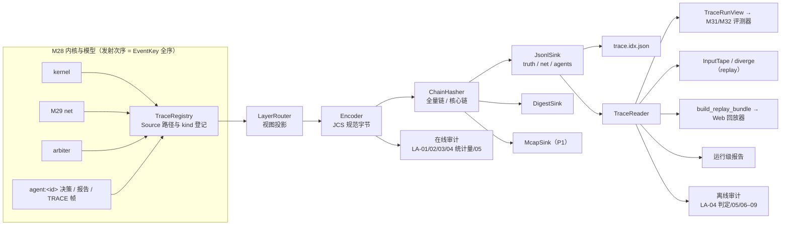

# M33 Trace 与复现 PRD（Trace & Reproducibility）

## 文档信息

| 项 | 内容 |
|---|---|
| 文档编号 | AWR-M33 |
| 标题 | Trace 与复现（Trace & Reproducibility）PRD：`drone4d.coord.trace.v1` 记录格式与分层、Trace Source/Sink 机制、JSONL 与 MCAP 承载、D3 旧运行目录的读时兼容视图、泄露审计、动作重放与 trace 回放、运行级报告与 Web 回放器数据接口、确定性摘要链 |
| 版本 | v0.2.1（2026-10-18 文档集集成同步：按 AWR-06 v0.3 §0.5 统一裁定 XR-05 修订术语表与 §6.5.3 中 `events_digest` 的口径，并把 §2.4、§3、UC-06、R-M33-49 至 R-M33-65、AC-M33-05、AC-M33-21 中与 `trace_events_digest` 并列的判据改为 M28 内核摘要 `digests{pose, decisions{}}`，按 CT §9.2 第 10、21 项修订 R-M33-10 的对象引用与 `producer` 模式；按 XR-11 把 AWR-06 调度规则 R-S1 至 R-S8 的引用改称 SR-1 至 SR-8；按 XR-02 把接口草案标注改为 Python 3.12） |
| 日期 | 2026-10-18（UTC） |
| 状态 | D4 设计评审稿。D4 处于深入调研与概念设计阶段，实现于 D3 封板（G0）之后启动；本文全部周次以"D3 封板后第 N 周"表述，不构成实现承诺。v0.2 按第一轮评审意见修订，处理结论见 §14 |
| 上游 | [AWR-06](../06-D4-协同实验平台概念设计.md) v0.2：§3.3（M33 职责与首批符号）、§3.4（B-01、B-02、B-05、B-10）、§3.8、§4.1（对象模型与不变量 I-01 至 I-06）、§4.5（Trace 格式）、§4.6、§4.7（`trace.v1` 契约草案）、§5.2（SR-1、SR-2）、§5.6、§5.9（检查点、重放与复现）、§5.10、§5.11、§8.5（`Δ_perm` 供体）、§8.7（`seed_tag` 与 `truth_digest`）、§8.8（A-01）、§8.9（黄金 trace 回归）、§8.10（R-4 离线重算）、§10（WP-D4-07、20、24、29、43、48）；ADR-D4-05、09、18、25、31、33。调研：[r03](../research/d4/r03-NS-2经验与排行榜规则.md) §3.5（R16–R20）、§3.6（R21–R24）、§3.7（R25–R28）；[n01](../research/d4/notes/n01-现有代码映射.md) §2.6（G-TR-1 至 G-TR-6）、§2.3（G-MO-7）；[n03](../research/d4/notes/n03-外部模型讨论纪要.md)（可见性标签不是安全机制、Trace 最小记录集）；负责人前期稿 design-r2（Ground Truth Trace 与 Agent-visible Trace、Event / Decision / State Trace、网页回放） |
| 同批文档 | [M28 实验内核](M28-实验内核PRD.md)、[M29 交互网络](M29-交互网络PRD.md)、[M30 协同接口与基线](M30-协同接口与基线PRD.md)、[M31 基准套件](M31-基准套件PRD.md)、[M32 评测与统计](M32-评测与统计PRD.md)、[M34 研究者 SDK 与命令行](M34-研究者SDK与命令行PRD.md)、[S1](../d4/suites/S1-TaskAlloc规格.md)、[S2](../d4/suites/S2-CoopSearch-Handoff规格.md)、[S3](../d4/suites/S3-InfoShare规格.md)、[X1](../d4/suites/X1-RobustCoord协议.md)、[协作智能排行榜规格](../d4/协作智能排行榜规格.md)（下称 LB）、[契约草案](../d4/契约草案.md)（下称 CT）、[r04 首篇论文实验设计](../research/d4/r04-首篇论文实验设计.md)。同批文档并行撰写，本文对其引用以章节职责为准 |
| 体例 | 沿用 [M27](M27-基准运行时与数据集PRD.md) 的模块 PRD 结构与 [AWR-05](../05-D3-设计增补与决策记录.md) 的编号与表格风格：需求 R-M33-yy、验收 AC-M33-yy、风险 RK-M33-yy、待决 Q-M33-yy；工作包引用 AWR-06 的 WP-D4-xx，决策引用 ADR-D4-xx，D4 级验收引用 AC-D4-xx |
| 引用约定 | 代码路径相对仓库根 `/data/projs/anet-drone`；前缀 `py:` = `python/awr/`，`sdk:` = `tools/sdk/drone4d/src/drone4d/`，`ct:` = `packages/contracts/`，`web:` = `apps/web/src/`。对现有代码的陈述均已打开文件核对（2026-10-18 工作区），以"文件 + 符号"为准，行号可能漂移 |
| 数值约定 | 标注"初值""目标值""缺省"的数值为设计默认值或待实测校准的目标，不是对现有代码性能的断言 |
| 写作规范 | 中文、技术名词英文；企业级、工业级行文；不使用 emoji 与状态字形 |

---

## 0. 摘要

1. **定位**。M33 是 D4 运行记录的唯一权威格式与读写实现（`py:trace/`）。内核、交互网络、仲裁器与观测管线在稳定命名路径上暴露 Trace Source，Sink 负责承载；评测、复核、回放器与报告只读 trace，不读仿真器内部状态（r03 R16、R19）。M33 不定义实验语义，只定义"实验语义发生了什么"如何被记录、分层、摘要、审计与回放。
2. **记录格式**。`drone4d.coord.trace.v1` 记录沿用 AWR-06 §4.5 的字段（`t_ns`、`phase`、`producer`、`seq`、`id`、`cause`、`kind`、`subject`、`object`、`payload`、`wall`），保留其 21 个 `kind`，增补 6 个（`run.begin`、`run.end`、`tape.env_op`、`sensor.capture`、`safety`、`agent.log`），并登记 M29 的 2 个 `full` 级网络扩展 `kind`（`net.service`、`net.ge`），共 29 个；给出每个 `kind` 的生产者、阶段、载荷、所属层、Agent 视图投影与最低级别（§6.3）。规范字节为 RFC 8785 JCS（`py:sim/events/jcs.py`），墙钟字段不写入记录行，单列于 sidecar（R-M33-07）。记录的 `t_ns` 为其发射所处的内核处理时刻，每层按 `(t_ns, phase)` 非递减写出（R-M33-28）。
3. **分层**。真值层 `truth/`、网络层 `net/`、Agent 可见层 `agents/<agent_id>/`、公开层 `public/` 物理分文件（DP-05）。同一事实可按 `kind` 的投影规则进入多个层；Agent 可见层只含该 Agent 当时可得的信息，网络丢弃、拓扑变化与干预记录永不进入 Agent 层；Agent 层记录使用层内重编号的 `id`，不暴露任何生产者的全局序号（§6.3、§6.4、R-M33-92）。
4. **Source/Sink**。Source 以路径登记（如 `/agent/{id}/decision`、`/net/link/{src}/{dst}`、`/task/{id}/state`），未挂接 Sink 时只做计数；Sink 只能追加、不可丢弃、背压只阻塞宿主墙钟而不改变结果。P0 交付 `JsonlSink`（分块 gzip，安装 `zstandard` 时可选 zstd）、`DigestSink`、`MemorySink` 与 Sink 快照恢复；P1 交付 MCAP Sink，与 JSONL 逐字节同源可互转（§4.3–§4.5）。
5. **级别**。`minimal`（评测与动作重放所需最小集，排名运行下限）、`standard`（缺省，增加消息载荷对象、链路与分区、决策边界处的实体状态）、`full`（逐物理步状态与观测正文对象）；级别只决定记录是否写出与对象文件是否写出，不改变任何已写出记录的内容（R-M33-91）；训练期只允许"整 Episode 抽样或关闭"，不允许记录级抽样（§4.6）。
6. **确定性摘要链**。每层维护两条以长度前缀分帧的流式 SHA-256 摘要：全量链覆盖该层全部记录，核心链只覆盖核心记录（`minimal` 级及 Suite 增补集）。`seq` 在级别过滤之前按全量发射流分配（R-M33-02），消息正文不进入网络层记录（R-M33-91），因此核心链与 trace 级别、承载格式、压缩参数无关。`truth_digest` 为真值层核心链头，是 ADR-D4-25 逐 Episode 绑定的摘要对象；`trace_events_digest` 为真值层与网络层核心链头的组合，是 AC-D4-05"trace 事件哈希"的度量对象，与 M28 的内核摘要 `digests{pose, decisions{}}`（R-M28-73）并列判定；`trace_sha256` 汇总全部层并写入运行清单（§4.7、§6.5）。墙钟量与实测资源量（cgroup CPU 时间）只写入 sidecar，不进入任何链。
7. **旧运行兼容**。`py:trace/compat/env_run_v1.py` 把 D3 `EnvRecorder` 运行目录（`py:agentsdk/env/recorder.py`）读时转换为 trace 视图，不改写旧目录；逐项列出可还原字段、近似字段（如 `lat_ms` 两位小数导致的 ≤ 5 µs 投递时刻误差）与缺失字段（如预算丢弃无逐条记录），视图以 `compat` 标记，不参与 D4 摘要链（§6.7）。
8. **泄露审计**。10 项检查 LA-01 至 LA-10：观测白名单、交付摘要一致性、秘密值扫描、噪声旁路统计检验、消息载荷完整性、层路由（含 Agent 层 `id` 不泄露他层计数）、Belief 不回传、公开层白名单、清单与日志、变异自检。审计级别矩阵（§6.8.1）规定每项在排名最低级别下的执行方式：依赖观测正文或真值状态的检查在线执行并把统计量持久化到 `leak_audit.v1`。确定性检出判 `failure.infra`（`leak_detected`）并冻结该 Board Version 的新评测；LA-04 的统计显著结果只进入调查队列（§4.9、§6.8）。
9. **复现与回放**。M33 为 AWR-06 §5.9 的三种模式提供数据面：动作重放的输入磁带（`InputTape`，由真值层 `decision`、`interaction.op` 与 `intervention` 记录构成，P0，与 M28 R-M28-83 同步）、发散定位（P0 为线性扫描，P1 以按累计记录数对齐的前缀摘要标记二分加速）、trace 回放（只读 trace）；`drone4d bench replay` 与 `drone4d bench verify`（P1，WP-D4-24，命令行属 M34）以本模块库实现（§4.10）。
10. **报告与 Web 回放器**。运行级报告（运行概况、任务时间线、通信统计、交互与违规、任务未完成的因果解释）由本模块生成，实验级统计表属 M32。Web 回放器只读"回放包"`drone4d.coord.replay_bundle.v1`（清单、分时状态瓦片、事件瓦片、网络瓦片、Agent 视图瓦片），同一回放包由 bench-api 或任意静态文件服务承载，前端回放与榜单可复核回放共用同一播放器（r03 R19；§4.12、§7.4）。
11. **规模**。功能需求 82 条（R-M33-01 至 R-M33-76，v0.2 增补 R-M33-91 至 R-M33-96），非功能需求 14 条（R-M33-77 至 R-M33-90），验收 35 条（AC-M33-01 至 AC-M33-35）；与同批模块的口径对齐 11 项（§2.4）；对 AWR-06 的反馈 24 条（§13），其中影响实现启动的有：运行清单 `run_manifest.v1` 不能原位承载 D4 字段、MCAP Sink 的位置与 B-10 白名单冲突、`validation` 划分可下载完整 trace 与"仅聚合反馈"相矛盾、MCAP Sink 无承载工作包且 WP-D4-07 估算偏低、`events_digest` 在 AWR-06 与 M28、M33 中口径未统一、§5.10 的 trace 分项预算缺少逐记录依据。

---

## 1. 背景与目标

### 1.1 约束本模块的事实

| # | 事实 | 对设计的含义 | 依据（已核对） |
|---|---|---|---|
| F1 | D3 `EnvRecorder` 已实现 Agent 层与真值层物理分目录：`agents/<uav>/{config.json, acts.jsonl, obs.sha256}`、`reports.jsonl`、`net/records.jsonl`、`truth/{fleet.npz, l1.jsonl, l2.jsonl, contacts.jsonl, run_seed.json}`；`run_seed` 只在真值层 | D4 沿用"分层即分文件"原则与 `run_seed` 仅真值层的不变量；兼容视图以该布局为输入 | `py:agentsdk/env/recorder.py` 模块头注释与 `EnvRecorder` |
| F2 | D3 的规范 JSON 为 `json.dumps(sort_keys=True, separators=(",", ":"), ensure_ascii=False)`（`canonical_json`），不是 RFC 8785 JCS：浮点按 Python `repr` 输出，与 ECMAScript 数字格式在 `≥ 1e16` 与 `< 1e-4` 等区间不同 | D4 trace 规范字节改用 JCS；D3 的 `obs.sha256` 摘要不可按 JCS 复算，兼容视图须保留原摘要并标注算法 `d3-canonical-json` | `py:agentsdk/env/recorder.py` `canonical_json`；`py:sim/events/jcs.py` 模块头注释 |
| F3 | `py:sim/events/jcs.py` `jcs_number` 对绝对值 ≥ 2^53 的整数抛出 `ValueError`，对 NaN 与无穷抛出 `ValueError` | trace 中可能超出 2^53 的整数（63 位 `agent_seed`、64 位键、哈希截断值）须以十进制字符串编码；非有限浮点须以 `null` 加原因字段表达 | `py:sim/events/jcs.py` `jcs_number` |
| F4 | D3 链路记录字段为 `{t_ns, src, dst, ok, lat_ms, los, bytes, why}`；`lat_ms` 取两位小数；`why` 仅有 `"loss"` 与 `null`；预算不足的丢弃只计入 `stats[src]["dropped_budget"]`，不写逐条记录；记录在 `BenchEnv.close` 时一次性写出 | 兼容视图的投递时刻为近似值（误差 ≤ 5 µs）；预算丢弃只能由清单统计还原为汇总；中途中止的 D3 运行无网络记录 | `py:agentsdk/env/link.py` `LinkModel.transmit`、`__post_init__`；`py:agentsdk/env/core.py` `BenchEnv.close` |
| F5 | D3 链路的逐对序号 `self.seq[(src, dst)]` 在丢包判定之前递增，因此 `net/records.jsonl` 中同一 `(src, dst)` 的出现序号等于该对的链路序号 | 兼容视图可为每条记录合成稳定的消息标识 `compat:<src>:<dst>:<n>` | `py:agentsdk/env/link.py` `LinkModel.transmit` |
| F6 | D3 运行清单为 `drone4d.bench.env_run.v1`（写入 `manifest.json`），`ct:bench/run_manifest.v1` 无写出者 | D4 运行清单由 M28 写出；M33 提供其中 trace 相关字段的取值 | `py:agentsdk/env/core.py` `BenchEnv.close`；n01 G-TR-1 |
| F7 | `ct:bench/run_manifest.v1` 为 `additionalProperties: false`；`files` 子对象同样封闭且必填 `raw_mcap_sha256`、`truth_mcap_sha256`、`frames_idx_sha256`；`spec` 引用 `run_spec.v1`；`split` 枚举为 `{dev, test}` | D4 运行（无 MCAP 帧、规格为 `experiment.v1`、划分为四值）不能以该 schema 原位表达；trace 摘要字段须进入新契约（§13 第 1 条） | `ct:bench/run_manifest.v1.schema.json` |
| F8 | `ct:bench/evaluation.v1` 的 `inputs` 封闭且必填 `raw_mcap_sha256`、`truth_sha256`、`tape_sha256`、`event_truth_sha256` | D4 评测结果对 trace 的溯源字段只能进入 `ct:suite/evaluation.v1`（AWR-06 §4.7 已新开） | `ct:bench/evaluation.v1.schema.json` |
| F9 | import lint 规则：`mcap` 只允许在 `recorder/` 与 `bench/recorder/` 下导入；`zstandard` 只在 `api/` 下禁止；`D3_PACKAGES` 含 `awr.bench`，D3 路径之外的代码不得 import D3 包 | MCAP Sink 若放在 `py:bench/recorder/`，则 D4 包按 B-10 不能 import 它；须调整位置或 lint 允许路径（§13 第 2 条） | `tools/lint/check_py_imports.py` `RULES`、`D3_PACKAGES`、`PKG_RULES` |
| F10 | 现有 Run 级 MCAP 写入器 `RunWriter` 采用 zstd 分块（`CHUNK_BYTES = 4 << 20`）、`log_time = publish_time = t_ns`、`IndexType.ALL` | MCAP Sink 沿用同一分块、时间戳与索引约定，便于工具链一致 | `py:bench/recorder/writer.py` `RunWriter` |
| F11 | 物理档逐 tick 位姿摘要为 `sha256(t_ns <i8 ‖ state <f8)` 的流式摘要，`pose_sha256` 写入清单 | 物理档摘要是 trace 摘要链的独立旁证；内核–`BenchEnv` 对拍（AC-D4-22）沿用该摘要，M33 不重复定义 | `py:phys/kinematic.py` `KinematicTier`（`self.digest`） |
| F12 | 栈 A 的输入日志 `awr.inputlog.v1` 以 `apply_tick` 记录全部外部输入，`resim.py` 以其逐位重仿真 | D4 动作重放沿用"以生效时刻记录外部输入"的思想，输入磁带由真值层记录构成，不另起日志格式 | `py:sim/runtime/inputlog.py` `InputLog`；`py:sim/runtime/resim.py` |
| F13 | bench-api 现有帧与真值接口按角色分级：帧索引与单帧为 `researcher`，真值帧与事件磁带为 `evaluator` 及以上；角色为 `invited`、`researcher`、`evaluator`、`admin` | Web 回放器数据接口沿用同一角色体系，按层授权 | `py:bench/api/frames.py`（BN-49 至 BN-52）；`web:net/bench.ts` `BenchSession`、`ROLE_RANK` |
| F14 | 工作区回放的时间权威为 `web:stores/lab/playhead.ts` `usePlayhead`（秒，浮点），各视图只读该状态 | D4 回放器复用该时间权威，trace 内时间恒为整数纳秒，秒值只用于显示 | `web:stores/lab/playhead.ts` |
| F15 | 项目约定：UNIX 时刻字段以 `_unix_ns` 结尾并在 JSON 中以十进制字符串传输；错误为 problem+json，原因码须先登记 | M33 的 REST 与清单字段沿用；仿真时间 `t_ns` 在 2^53 以内以整数传输（§6.6） | M27 §1.1 F16；17 §1.3、§4.4、§8 |
| F16 | 依赖锁定 `mcap==1.5.0`、`zstandard==0.25.0`，无 `pyarrow`；SDK `tools/sdk/drone4d/pyproject.toml` 当前运行时依赖不含二者 | P0 核心承载只能依赖标准库（gzip、hashlib、json）与 numpy；zstd 与 MCAP 为可选能力 | `pyproject.toml`；`tools/sdk/drone4d/pyproject.toml` |
| F17 | D3 链路统计 `stats[src]` 含 `sent`、`dropped_budget`、`rejected`、`lost`、`delivered`、`bytes`：`sent` 与 `bytes` 按消息计（广播只计一次），`lost` 与 `delivered` 按副本计；投递时刻 `t_recv = t_ns + round(lat_s·1e9)`，而记录只存 `round(lat_s·1000, 2)`；时延下限 10 ms | 兼容视图可精确核对 `delivered`、`lost`；`sent`、`bytes` 只能由副本记录给出区间；`approx` 投递时刻无原值可对照，误差上界只能由舍入规则推出 | `py:agentsdk/env/link.py` `LinkModel.__post_init__`、`transmit`；`py:agentsdk/env/core.py` 清单 `agents.<uav>.comm` |
| F18 | 同批 M28 v0.1 曾定义内核事件摘要 `events_digest`（逐已处理事件 `JCS({key, event_id, type, payload_sha256, parents})` 的滚动 SHA-256；M28 v0.2 已取消，内核自有摘要只保留 `digests.pose`、`digests.decisions{}` 与可选诊断 `order_digest`，AWR-06 v0.3 XR-05），并把 `truth_digest`、`net_digest`、`agents_digest[agent]` 定为"M33 各层规范记录流（压缩前）"、由 M33 在 `finalize` 回填；其 `HandlerContext.trace(kind, subject, payload, cause: int \| None)` 的 `cause` 为整数；检查点（R-M28-79，含"trace Sink 偏移"）与动作重放（R-M28-83）为 P0；终止时待生效决策记 `cmd.discard` 记录 | M33 的运行级摘要须与 M28 的命名与口径对齐（§2.4、§6.5.3）；`cause` 统一为字符串 `id`；Sink 快照与输入磁带须为 P0 | `M28-实验内核PRD.md` R-M28-73、R-M28-79、R-M28-83、§6.5.7、§6.3.7 `HandlerContext`、§6.2 要点第 2 条（终止） |
| F19 | 同批 M29 规定 `message_id = "<sender_id>#<tx_seq>"`（发送方序号）；网络层另记 `full` 级 `net.service`、`net.ge`；`msg.drop` 为 `minimal`；丢弃原因含 `phy`、`burst`、`partition`、`ttl`、`queue_full`、`endpoint_down`、`inbox_overflow`、`intervention` | M33 的 `kind` 登记表、`msg.drop` 级别与原因枚举以 M29 为准（§6.3） | `M29-交互网络PRD.md` R-M29-10、R-M29-83、§6.2.2、§7.4 |
| F20 | 同批 M31 把评测通道词表增补为 `reports`、`interaction`、`ledger`（共 9 个）；M32 规定 `Δ_perm` 供体为同条目主评测 Episode | `TraceRunView` 须实现 9 个通道；供体数据须在排名主评测的最低级别下可得 | `M31-基准套件PRD.md` R-M31-41；`M32-评测与统计PRD.md` 术语表"供体 Episode"、R-M32-48 |
| F21 | bench-api 不兼容变更才走 `/api/bench/v2`，分页为 `?cursor=&limit=`（缺省 50，≤ 200）、响应 `{items[], next_cursor}`；会话记录含 `projects`；LB 规定 D4 新增只读接口族沿用 `/api/bench/v1` | TR 端点沿用 `/api/bench/v1` 与同一分页契约；项目可见性以会话 `projects` 判定（§7.4） | 17 §18.3.1 第 2 条、§18.4 第 1、4 条；LB §13.5 |

### 1.2 目标

| # | 目标 | 度量 |
|---|---|---|
| G1 | 单一规范 trace 格式：全部 D4 模块的运行记录使用 `trace.v1`，不另设私有日志格式（r03 R17） | 新模块的运行产物中无 `trace.v1` 之外的事件流文件（报告与索引等派生物除外） |
| G2 | 真值与 Agent 可见信息物理分离，并以自动化审计证明 Agent 未获得白名单外信息（DP-05、A-01） | LA-01 至 LA-10 在排名运行中全部执行；变异自检检出率 100%（AC-M33-15） |
| G3 | 可复现可核验：固定制品与同一硬件等级下 trace 摘要逐字节一致；任一分数可由 trace 离线重算 | AC-D4-05、AC-D4-08 与 R-4 离线重算以 M33 的摘要与读取接口执行 |
| G4 | 低开销：`minimal` 级 trace 不成为北极星瓶颈 | 北极星配置下每次团队决策 trace 循环内分项 ≤ 0.3 ms（AWR-06 §5.10），以 §8.1 的逐记录开销模型核定 |
| G5 | 可追溯：每条记录可沿因果前驱回溯，回答"为什么该任务未完成"（r03 R18） | 运行级报告对每个未完成任务给出因果子图 |
| G6 | 旧运行可读：D3 运行目录无需改写即可被 D4 读取工具、报告与回放器使用 | 兼容视图覆盖 D3 黄金运行的全部记录文件（AC-M33-12） |
| G7 | 一个回放器：本地报告、工作区运行页与榜单条目复核回放共用同一回放包格式与播放器 | 回放器以同一代码路径加载本地与服务端回放包（AC-M33-25） |

### 1.3 非目标

- 不定义实验语义（时间模型、阶段、随机域、网络模型、评测指标）；这些由 M28、M29、M31、M32 定义，M33 只记录其结果。
- 不替代相机、深度与 LiDAR 帧的权威存储。`L2` 帧继续以 MCAP 帧存储与 `frames.idx` 承载（M27 §7.5），trace 只记录帧引用 `FrameRef`（`content_sha256`）。
- 不提供列式分析格式（Arrow IPC、Parquet）。仓库无 `pyarrow`（F16），P0–P2 不引入；分析导出属研究者自选工具（ADR-D4-18 备选 a 的否决理由）。
- 不实现 Web 回放器的界面与交互设计；界面属 WP-D4-48 的界面部分，遵循项目前端设计体系。本文只规定其数据接口与消费规则。
- 不承担实验级统计表、置信区间与榜单生成（M32、LB）；不承担命令行参数解析（M34）。
- 不改写 D3 运行目录，不修改 `EnvRecorder`、`RunWriter` 与栈 A 录制器（B-07、B-08）。

### 1.4 术语（本文新增，其余见 AWR-06 术语表）

| 术语 | 定义 |
|---|---|
| 记录（Record） | 一条 `trace.v1` 记录，为纯数据，规范字节为其 JCS 编码（不含 `wall`） |
| 层（Layer） | 物理分离的记录流：`truth`、`net`、`agent:<agent_id>`、`public`。层是访问控制与审计的单位 |
| 视图投影（View Projection） | 由 `kind` 登记表规定的函数：把一条源记录映射为某层可见的记录（可能为空）。投影只删减或改写字段，不新增源记录之外的信息 |
| Trace Source | 内核或模型在稳定命名路径上暴露的记录发射点，声明其 `kind`、级别与投影 |
| Trace Sink | 记录的承载者，接收已编码的层记录流并持久化或计算摘要 |
| 分块（Chunk） | 承载文件中可独立解压与校验的最小单位：JSONL 为一个 gzip member 或 zstd frame，MCAP 为一个 chunk |
| 全量链 / 核心链 | 同一层上的两条以长度前缀分帧的流式 SHA-256 摘要：全量链覆盖该层全部记录；核心链只覆盖核心记录（`minimal` 级及 Suite 增补集）。"链头"指流的当前摘要值，任一前缀的摘要可独立复算 |
| 全量发射流 | 一个生产者在 `full` 级别下会发射的全部记录的序列。`seq` 按全量发射流分配；低级别下未写出的记录只占用序号（R-M33-02） |
| 已过滤引用 | `cause` 指向本级别下因级别过滤而未写出的记录；完整性检查承认这类引用（R-M33-05） |
| 层内 id | Agent 层记录的 `id`，形如 `a:<n>`，`n` 在该 Agent 层内连续分配，不暴露任何生产者的全局序号（R-M33-92） |
| 载荷摘要 | 消息正文在网络层与 Agent 层记录中只以 `payload_sha256` 与 `payload_size` 表示，正文对象按级别写出（R-M33-91） |
| `truth_digest` | 真值层核心链头（64 位十六进制），见 §6.5 |
| `trace_events_digest` | `SHA-256(truth.core ‖ net.core)`，AC-D4-05"trace 事件哈希"的度量对象，见 §6.5。v0.1 称 `events_digest`，因与 M28 的内核事件摘要同名而改名 |
| `events_digest` | 不再使用（AWR-06 v0.3 XR-05）：运行清单与验收中的组合摘要一律称 `trace_events_digest = SHA-256(truth.core ‖ net.core)`；内核侧并列判据为 `digests.pose` 与 `digests.decisions{}`（M28 R-M28-73） |
| `trace_sha256` | 汇总全部层链头的运行级摘要，见 §6.5 |
| 输入磁带（InputTape） | 一次 Episode 全部外部输入（Agent 决策、交互请求、干预）按生效时刻排列的序列，由真值层记录构成，供动作重放 |
| 回放包（Replay Bundle） | 由 trace 派生、供 Web 回放器读取的静态文件集合，可再生、非权威 |
| 兼容视图（Compat View） | 把 D3 运行目录读时转换为 `trace.v1` 记录序列的只读视图 |

---

## 2. 范围

### 2.1 分阶段范围

| 阶段 | M33 交付 | 工作包 | D4 验收 |
|---|---|---|---|
| P0（D3 封板后第 3–8 周；最小 Sink 于第 4 周） | `trace.v1` 记录模型与 `kind` 登记表；Source 注册表与层路由（含 Agent 层重编号）；`JsonlSink`（gzip，zstd 可选）、`DigestSink`、`MemorySink`、`TeeSink`；Sink 快照与恢复（与 M28 R-M28-79 同步）；分块索引；墙钟 sidecar；摘要链与 `truth_digest`、`trace_events_digest`、`trace_sha256`；完整性检查；`TraceReader` 与 `TraceRunView`；输入磁带 `InputTape.from_trace`（与 M28 R-M28-83 同步）；发散定位的线性扫描实现；D3 兼容视图；泄露审计 LA-01 至 LA-06、LA-08 至 LA-10（含 LA-04 在线统计量）；`full` 级别；运行级报告（Markdown 与静态 HTML）的 trace 部分与因果解释；黄金 trace 摘要回归 | WP-D4-07（主体）、WP-D4-43（最小 Sink 与竖切）、WP-D4-04（清单字段对接）、WP-D4-08（`bench report` 的库部分） | AC-D4-05、AC-D4-08 |
| P1（第 12–21 周） | MCAP Sink 与 JSONL/MCAP 互转；发散定位的前缀标记二分加速；离线复核（`bench verify` 的库部分）；`bench replay` 的库侧编排；`Δ_perm` 供体消息索引；`belief` 通道审计 LA-07；`wire.v2` `TRACE` 帧的 `agent.log` 落盘；派生便利文件（R-M33-22）；回放包构建与 Web 回放器数据接口；运行级报告接入回放器链接；保留与访问审计 | WP-D4-24（replay、verify）、WP-D4-20（供体索引）、WP-D4-29（LA-07）、WP-D4-48（读取与索引，K 线部分）、WP-D4-28（`wake_on_rx` 记录）；MCAP Sink 无承载工作包（§13 第 4 条） | AC-D4-32、AC-D4-49；P1 门"全部得分可由私有 trace 离线重算" |
| P2（第 22–31 周） | `ns3@1` 桥接的边界记录（`link.change` 来源标注与 `ADVANCE_DONE` 摘要对照）；B-LLM 响应缓存回放所需的请求摘要记录；只读公开快照的 trace 排除规则；赛季末 `truth_digest` 公开验证的第三方脚本支持 | WP-D4-32、WP-D4-38、WP-D4-40、WP-D4-42 | AC-D4-39、AC-D4-40、AC-D4-42 |

### 2.2 与其他模块的边界

| 模块 | M33 向其提供 | M33 从其获取 | 边界规则 |
|---|---|---|---|
| M28 实验内核 | `TraceWriter`（Source 注册、层路由、Sink 编排）；摘要链头与完整性结论（写入运行清单，回填 M28 §6.5.7 的 `truth_digest`、`net_digest`、`agents_digest[agent]`）；输入磁带读取（P0）；检查点所需的 Sink 快照与恢复（P0） | 记录发射（内核生产者 `kernel` 的全部 `kind`）；`EventKey` 全序下的发射次序；内核摘要 `digests{pose, decisions{}}`（M28 计算）；运行清单写出者；检查点时机（决策屏障） | 记录的发射次序由内核按 SR-1 保证，M33 不重排；运行清单由 M28 写出，M33 只提供字段值；`digests{}` 由 M28 定义与计算，`truth_digest` 与 `trace_events_digest` 由 M33 定义与计算（§6.5.3）；`HandlerContext.trace` 为 `TraceSource.emit` 的门面，`cause` 为字符串 `id`（§2.4 第 3 项） |
| M29 交互网络 | `msg.*`、`link.change`、`topo.partition`、`net.service`、`net.ge` 的 Source 与投影 | 网络记录载荷（字段名、丢弃原因枚举与 `visible_tick` 以 M29 §7.4、§6.2.2 为准） | 网络层记录不进入任何 Agent 层（§6.3）；消息正文不进入网络层记录，只存载荷摘要（R-M33-91）；`Δ_perm` 置换在网络层同时记录原载荷摘要与供体引用 |
| M30 协同接口与基线 | `agent.log` 的 SDK 写入入口（`ctx.log`）规格 | `Decision` 序列化规则、`BeliefSnapshot` 载荷 | Agent 自报记录非权威，不参与评测（R-M33-24） |
| M31 基准套件 | `TraceRunView`（实现 `Evaluator.evaluate(run: RunView, ...)` 所需通道）；Suite 声明的 `minimal` 增补集的执行 | Suite 清单中的评测通道 `channels`、`minimal` 增补集、排名运行最低级别 | 评测器只经 `RunView` 读 trace（r03 R19）；通道词表以 M31 R-M31-41 的 9 个通道为准，到 `kind` 的映射见 §6.9 |
| M32 评测与统计 | 离线重算的读取接口；`Δ_perm` 供体消息索引（排名主评测的 `minimal` 级 trace 即可供体，R-M33-76）；`truth_digest` 供 `seed_tag` 绑定 | 评测结果的 trace 溯源字段需求；`Δ_perm` 匹配键与 `L_perm` 回退规则（R-M32-48） | 实验级统计表与榜单属 M32；运行级报告属 M33；回退与 `r_fb` 的计数口径属 M32，M33 只提供检索 |
| M34 研究者 SDK 与命令行 | `drone4d bench report`、`bench replay`、`bench verify` 的库实现（`py:trace/report/`、`py:trace/replay/`、`py:trace/verify.py`）；`--trace-level` 等参数的取值域 | 命令行参数解析、退出码约定、wheel 打包 | 命令行属 M34；M33 不读 `sys.argv` |
| LB 排行榜 | 条目复核回放所需回放包；`truth_digest`；公开快照的 trace 排除规则 | 划分与角色的可见性规则 | `holdout` trace 不出平台（R-M33-70） |
| CT 契约草案 | `ct:coord/trace.v1`、`trace_index.v1`、`trace_digest.v1`、`replay_bundle.v1`、`leak_audit.v1` 的字段语义（§7.2–§7.3） | 契约文件与 golden 实例的最终形式 | 字段名与枚举以 CT 为准；与本文冲突时以 CT 为准并回改本文 |
| D3 运行时（栈 B，冻结） | 兼容视图（只读） | `EnvRecorder` 运行目录 | 不改写 D3 目录；不 import `awr.agentsdk`、`awr.bench` 的运行时模块（B-10）；兼容视图只读文件，不 import D3 代码 |
| M27（D3） | — | `frames.idx` 与 `raw.mcap` 帧引用约定 | `L2` 帧的权威存储仍属 M27 体系；trace 只存 `FrameRef` |

### 2.3 路径所有权（M33）

`python/awr/trace/**`；`packages/contracts/coord/{trace,trace_index,trace_digest,replay_bundle,leak_audit}.v1.schema.json`（起草，经 CT 合入）；`tests/d4/trace/**`；`tests/golden/d4/trace/**`（黄金 trace 摘要）。MCAP Sink 的源码位置待 §13 第 2 条裁决：AWR-06 §3.3 与 ADR-D4-18 定为 `py:bench/recorder/trace_mcap.py`，本文建议 `py:trace/sinks/mcap.py`。回放器界面代码（`web:ui/lab/replay/**`）属 WP-D4-48 的界面部分。

### 2.4 与同批文档的口径对齐（v0.2）

下表列出评审核实的跨文档不一致及其处理。"M33 处理"已在本文落实；"需对方回改"一列为本文对同批文档的回改建议，在对方文档修订前，实现以本表"统一口径"为准。

| # | 对象 | 不一致 | 统一口径 | M33 处理 | 需对方回改 |
|---|---|---|---|---|---|
| 1 | `events_digest` | M28 R-M28-73、§6.5.7 定义为内核逐已处理事件的滚动摘要；v0.1 本文定义为 `SHA-256(truth.core ‖ net.core)`；二者同名，且同时出现在 AC-D4-05、AC-M28-04/27、M34 R-M34-44/76 | `events_digest` 专指 M28 内核事件摘要；本文的组合摘要改名 `trace_events_digest`；AC-D4-05 的度量对象为 `trace_events_digest`，M28 `events_digest` 为同一验收的并列判据，二者须同时一致 | 全文改名（§6.5） | M28 不改名；M34 R-M34-44、R-M34-76 在 `events_digest` 旁并列 `trace_events_digest`；AWR-06 定义"trace 事件哈希"（§13 第 20 条） |
| 2 | `truth_digest`、`net_digest`、`agents_digest` | M28 R-M28-73 把 `truth_digest` 写作"真值层规范记录流在压缩前的 SHA-256"（全量流，随级别变化）；本文为真值层核心链头 | 以本文 §6.5 为准：`truth_digest = truth.core`、`net_digest = net.core`、`agents_digest[a] = agent:a.core`，均由 M33 在 `finalize` 回填 | §6.5.3 | M28 R-M28-73 与 §6.5.7 改为引用本文 §6.5 |
| 3 | `TraceSink` 门面 | M28 `HandlerContext.trace(kind, subject, payload, cause: int \| None) -> None`；本文 `TraceSource.emit(...) -> str`，`cause` 为字符串 `id` | 门面签名为 `trace(kind, subject, payload, *, object=None, cause: str \| None = None) -> str`，返回记录 `id`；`phase` 与 `t_ns` 由内核上下文提供；级别过滤后的调用返回占位 `id`（R-M33-02） | §7.1 | M28 §6.3.7 `HandlerContext.trace` 签名 |
| 4 | 检查点与动作重放的阶段 | M28 R-M28-79、R-M28-81、R-M28-83 为 P0；v0.1 本文 R-M33-30、R-M33-64 为 P1 | 二者均为 P0；`bench replay`、`bench verify` 的命令行与离线复核编排仍为 P1 | R-M33-30、R-M33-64、AC-M33-14、AC-M33-21 提前至 P0 | 无 |
| 5 | `cmd.discard` | M28 §6.2 要点第 2 条写"`t_apply > T` 的待生效决策记 `cmd.discard` 记录"，本文登记表无此 `kind` | 以 `cmd.commit`（`result = discarded`、`reason = after_end`）表达，不新增 `kind` | §6.3 `cmd.commit` 行 | M28 改用 `cmd.commit` 的该结果值 |
| 6 | `net.service`、`net.ge` | M29 R-M29-83、§7.4 登记两种 `full` 级 `kind`；v0.1 本文 R-M33-04 拒绝未登记 `kind` | 登记为网络层 `full` 级非核心 `kind`（共 29 值）；另规定扩展 `kind` 的登记流程（R-M33-04） | §6.2、§6.3 | 无 |
| 7 | `msg.drop` | M29 为 `minimal`，原因含 `endpoint_down`、`inbox_overflow`、`intervention`；v0.1 本文为 `standard`，原因含 `cut` | 以 M29 为准：`minimal`；原因枚举取 M29 §6.2.2 全集，干预阻断为 `intervention` | §6.3、R-M33-42、R-M33-43 | 无 |
| 8 | 消息正文 | M29 §7.4 的 `msg.submit` 载荷不含正文；v0.1 本文 `msg.submit` 含 `payload` 且"载荷 standard 起" | 网络层与 Agent 层的 `msg.*` 记录恒只含 `payload_sha256` 与 `payload_size`；正文的权威副本在真值层 `decision` 中（R-M33-91） | R-M33-91、§6.3 | M29 §7.4 的 `msg.submit`、`msg.deliver` 增 `payload_sha256`、`payload_size` |
| 9 | 评测通道 | M31 R-M31-41 增补 `reports`、`interaction`、`ledger`；v0.1 本文 §6.9 与 R-M33-69 只有 6 个 | 9 个通道 | §6.9、R-M33-69 | 无 |
| 10 | 兼容视图路径 | M31 §2.2 写作 `py:trace/compat.py`；本文为 `py:trace/compat/env_run_v1.py` | 以本文为准 | 无 | M31 §2.2 M33 行 |
| 11 | REST 前缀与分页 | v0.1 本文暂定 `/api/bench/v2`、`limit ≤ 1000`；LB §13.5 定 D4 只读接口族沿用 `/api/bench/v1`；17 §18.4 规定分页 ≤ 200 | 前缀 `/api/bench/v1`（新增端点属兼容变更）；分页沿用 17 §18.4 | §7.4 | M34 如登记远程命令所用端点，沿用同一前缀 |

---

## 3. 用户与用例

| 编号 | 用户 | 用例 | 涉及需求 |
|---|---|---|---|
| UC-01 | 研究者（本地） | `drone4d bench run` 后在 `runs/<dir>/` 得到分层 trace 与运行级报告，打开静态 HTML 查看任务时间线、通信统计与未完成任务的因果解释 | R-M33-01–R-M33-35、R-M33-70–R-M33-72 |
| UC-02 | 研究者（本地） | 修改算法后以 `drone4d bench replay <run_dir>` 动作重放旧运行，定位首个发散记录 | R-M33-64–R-M33-66 |
| UC-03 | 研究者（本地） | 以 `drone4d bench verify <dir>` 由 trace 离线重算指标并与在线结果逐字节比对 | R-M33-68、R-M33-69 |
| UC-04 | 研究者（工作区） | 在工作区运行页打开回放器，切换"真值视图"与"Agent i 视图"，查看消息流、链路与分区变化 | R-M33-73–R-M33-75 |
| UC-05 | 平台评测宿主 | 排名运行在线执行泄露审计，检出即判基础设施失败并冻结新评测 | R-M33-58–R-M33-63 |
| UC-06 | 评测员 | 条目由 `provisional` 升为 `verified` 时执行 R-4 离线重算与 R-2a 同等级复跑的 `trace_events_digest` 与 M28 内核摘要 `digests{pose, decisions{}}` 比对 | R-M33-48–R-M33-51、R-M33-68 |
| UC-07 | 第三方（赛季末） | 公开 salt 与种子后，在同一硬件等级上复跑抽样 Episode，比对 `truth_digest` 与逐行 `seed_tag` | R-M33-49、R-M33-50 |
| UC-08 | 内核开发者 | 黄金 trace 摘要回归失败时，查看首个发散记录与字段差异，决定是否升级 `kernel_version` | R-M33-52、R-M33-66 |
| UC-09 | D3 用户 | 用 D4 的读取工具、报告与回放器打开 D3 crop-handoff 运行 | R-M33-53–R-M33-57 |
| UC-10 | `Δ_perm` 管线（M32） | 在供体 Episode（排名主评测，`minimal` 级即可）的网络层与真值层 trace 中按 `channel`、`schema`、发送角色、相对时刻与大小档检索供体消息 | R-M33-76 |

---

## 4. 功能需求

表头沿用 M27：优先级取 P0、P1、P2（阻塞、应交付、可延期）；阶段取 P0、P1、P2（首次交付阶段）。v0.2 起各需求的优先级与阶段一致，并与 §2.1 的分阶段范围一致；需求内含分阶段交付时在需求描述中写明各部分的阶段。"依据"列中的 §x 指 AWR-06，指本文时写"本文 §x"。v0.2 增补的需求 R-M33-91 至 R-M33-96 列于 §4.14。

### 4.1 记录格式

| 编号 | 需求描述 | 优先级 | 阶段 | 验收要点 | 依据 |
|---|---|---|---|---|---|
| R-M33-01 | 记录 schema 为 `drone4d.coord.trace.v1`（契约 `ct:coord/trace.v1.schema.json`）；记录字段为 `t_ns`、`phase`、`producer`、`seq`、`id`、`cause`、`kind`、`subject`、`object`、`payload`，类型与约束见本文 §7.2；`additionalProperties: false`；`payload` 按 `kind` 以 `oneOf` 分派到各 `kind` 的载荷 schema | P0 | P0 | AC-M33-01 | §4.5、§4.7 |
| R-M33-02 | 真值层与网络层：`id = producer + ":" + seq`；`seq` 为该生产者在本 Episode 内从 0 起递增的整数，由 `TraceWriter` 按生产者在**级别过滤之前**按全量发射流分配：每个发射点无论当前级别是否写出都占用一个序号（未启用的 Source 以 `skip()` 只递增计数并返回占位 `id`）；因此同一记录的 `id` 与其他记录的 `cause` 与 trace 级别无关。低级别下被过滤的序号形成预期内的缺口，其数量按生产者写入 `trace_digest.v1`（`producers{p: {n_emitted, n_filtered}}`）。Agent 层 `id` 规则见 R-M33-92。同一层内 `id` 唯一 | P0 | P0 | AC-M33-01、AC-M33-05 | §4.5；r03 R17；本文 §14 第 2 条 |
| R-M33-03 | 生产者 id 取值：`kernel`、`tape`、`net`、`arbiter`、`entity:<entity_id>`、`agent:<agent_id>`；`evaluator` 保留给派生标注流（§6.4 `derived/`），不出现在权威层；生产者 id 为稳定规范 id，不得使用对象哈希、进程号或线程完成顺序 | P0 | P0 | AC-M33-01 | §4.5、SR-1 |
| R-M33-04 | `kind` 取 §6.3 登记表的 29 个值：AWR-06 §4.5 的 21 个值原样保留，本文增补 `run.begin`、`run.end`、`tape.env_op`、`sensor.capture`、`safety`、`agent.log`，登记 M29 的 `net.service`、`net.ge`；未登记的 `kind` 在发射时拒绝（`TraceKindError`）。扩展登记流程：模块或 Suite 只可登记 `full` 级、非核心、只进入真值层或网络层的扩展 `kind`，以 `kinds.v1` 登记表的次版本增补（R-M33-89），须给出生产者、阶段、层、载荷 schema 与 `cause` 约定；进入 `minimal`、核心链或 Agent 层的 `kind` 只能经本文修订登记 | P0 | P0 | AC-M33-02 | §4.5；本文 §13 第 5 条、§2.4 第 6 项 |
| R-M33-05 | `cause` 为同一 Episode 内已发射记录的 `id` 或 `null`；必须先于本记录发射（无前向引用）；各 `kind` 的因果约定见 §6.3（如 `msg.deliver.cause` 为对应 `msg.submit`，`decision.cause` 为对应 `obs.seal`）。`cause` 的取值与级别无关：被引用记录在当前级别下未写出时，`cause` 仍为其 `id`（已过滤引用），不改写、不上溯。判定：`full` 级下全部 `cause` 必须解析到真值层或网络层的已写出记录；低级别下 `cause` 须解析到已写出记录，或为已过滤引用（该生产者的 `seq < n_emitted` 且记录不存在）；Agent 层 `cause` 规则见 R-M33-17 | P0 | P0 | AC-M33-03 | §4.5；r03 R18；本文 §14 第 2 条 |
| R-M33-06 | `phase` 取 AWR-06 §5.2 `Phase` 的数值；`run.begin` 使用保留值 0（`LIFECYCLE_BEGIN`），`run.end` 使用保留值 99（`LIFECYCLE_END`，位于终止边界的 `TRACE_FLUSH = 90` 之后）；二者只在 trace 中使用，不进入内核事件队列。由此 `run.begin` 为各层首条记录、`run.end` 为各层末条记录，且与 `(t_ns, phase)` 全序一致 | P0 | P0 | AC-M33-01、AC-M33-05 | §5.2；本文 §13 第 6 条 |
| R-M33-07 | 墙钟字段 `wall` 与实测资源量 `measured`（cgroup 实测 CPU 时间、GPU 时间及由其判定的违规）只存在于内存记录对象；Sink 写出时分别写入同层 sidecar `<layer>/wall.jsonl.gz` 与 `<layer>/measured.jsonl.gz`（行格式 `{id, wall}`、`{id, measured}`），记录行不含二者；记录中任何其他字段不得含墙钟或实测资源派生量（B-05、DP-06）。`measured` 可经 `TraceRunView` 读取以计算资源指标，但不进入摘要链 | P0 | P0 | AC-M33-06 | §3.4 B-05、§4.5 |
| R-M33-08 | 规范字节：记录（不含 `wall`）的 RFC 8785 JCS 编码，UTF-8；承载文件中的记录行即规范字节加换行符 `\n`；参考实现为 `py:sim/events/jcs.py` `jcs` | P0 | P0 | AC-M33-04 | §4.4（规范形式为 JCS）、F2 |
| R-M33-09 | 数值规则：仿真时间与时长为整数纳秒；绝对值 ≥ 2^53 的整数（如 `agent_seed`、64 位键）以十进制字符串编码，字段名不变、schema 标注 `x-awr-int-string`；浮点非有限值以 `null` 编码并在同一载荷的 `nonfinite[]` 中列出字段路径；numpy 标量与 float32 先转换为 Python `int` 或 `float`（float32 到 float64 的转换是精确的） | P0 | P0 | AC-M33-04 | F3 |
| R-M33-10 | 载荷大小：单条记录规范字节 > `inline_max_B` 的载荷字段改存内容寻址对象，记录中只存引用 `{"$obj": "<hex>", "size": <int>, "media": "<type>"}`（不带 `sha256:` 前缀，CT §9.2 第 10 项、M31 PK-03）；`$obj` 对象为必备对象，在任何级别下都写出；对象存于同层 `objects/<hex[0:2]>/<hex>`，不跨层引用；二进制小载荷以 `{"$b64": "<base64>"}` 内联。`inline_max_B = 16384` 为 `trace.v1` 的规范参数（不是可调初值），与 JCS 版本、分帧规则一起写入层头 `canon_params` 并进入链初值（§6.5）；修改任一规范参数即为主版本变更（R-M33-89） | P0 | P0 | AC-M33-07 | §4.5（大数组存内容寻址对象）；本文 §14 第 13 条 |
| R-M33-11 | 记录中不得出现 `run_id`、主机名、文件路径、进程号与 UNIX 时刻；这些量只出现在层头 sidecar（`<layer>/header.json`）与运行清单中，以保证同一配置重跑的摘要一致 | P0 | P0 | AC-M33-05 | §5.6（等级 1b 判定） |
| R-M33-12 | 每个承载文件的首条记录之前有层头 `header.json`（独立文件，不进入链）：`schema`、`layer`、`agent_id`（Agent 层）、`trace_level`、`minimal_extra[]`、`kernel_version`、`suite_digest`、`run_id`、`episode_id`、`chain_alg`（`sha256-stream-u32len@1`）、`canon_params{inline_max_B, jcs, frame}`、`created_unix_ns`（字符串） | P0 | P0 | AC-M33-01 | §4.5 |

### 4.2 分层与视图投影

| 编号 | 需求描述 | 优先级 | 阶段 | 验收要点 | 依据 |
|---|---|---|---|---|---|
| R-M33-13 | 层与目录：`truth/`（真值层）、`net/`（网络层）、`agents/<agent_id>/`（Agent 可见层，每 Agent 一个）、`public/`（公开层，只有 `summary.json`）；各层物理分文件，访问控制以层为单位 | P0 | P0 | AC-M33-08 | §4.5、DP-05 |
| R-M33-14 | 路由：记录发射时由 `kind` 登记表决定其进入的层与各层的视图投影（§6.3）；生产者不得自选层；同一源记录投影到真值层与网络层时，两层记录的 `id` 与源记录相同；投影到 Agent 层时使用层内 `id`（R-M33-92），源 `id` 到层内 `id` 的映射只存于真值层 | P0 | P0 | AC-M33-08 | §4.5；本文 §14 第 3 条 |
| R-M33-15 | Agent 层只含该 Agent 在相应时刻真正能够获得的信息：本 Agent 的观测密封、决策、提交回执、收到的消息（`DeliveredMessage` 视图）、本 Agent 参与的交互事件、本 Agent 的 Assignment 变化、本 Agent 的报告、Belief、账本与违规、自报日志；不含其他 Agent 的任何记录 | P0 | P0 | AC-M33-08、AC-M33-15 | §4.1 I-01、design-r2 §四 |
| R-M33-16 | `msg.drop`、`link.change`、`topo.partition`、`intervention`、`fault`、`membership`、`task.arrive`、`task.state`、`state`、`tape.env_op`、`sensor.capture`、`safety` 永不进入 Agent 层；网络层无重传与确认（ADR-D4-14），发送方不得经 trace 得知丢弃；Agent 层记录的 `id`、`seq`、`cause` 不得携带可推断上述记录或他人记录数量的信息（R-M33-92） | P0 | P0 | AC-M33-08 | §6、ADR-D4-14、§8.5（干预不可检测） |
| R-M33-17 | Agent 层记录的 `cause` 改写为层内 `id`：被引用记录在 `full` 级下会投影到同一 Agent 层时，取其层内 `id`（当前级别下未写出时为已过滤引用）；否则置为 `null`。Agent 层不含指向真值层或网络层的引用，也不含源 `id` | P0 | P0 | AC-M33-08 | DP-05 |
| R-M33-18 | `msg.deliver` 的 Agent 视图载荷与该 Agent 实际收到的 `DeliveredMessage` 字段一致（正文以 `payload_sha256`、`payload_size` 表示，R-M33-91），另含 `visible_tick`（Agent 实际可读的决策 tick）；`Δ_perm` 干预下 Agent 视图为替换后载荷的摘要，网络层同时记录原载荷摘要与供体引用 | P0 | P0（P1 起含 `Δ_perm`） | AC-M33-09 | §5.2 SR-2、§8.5 |
| R-M33-19 | 真值层含全部世界状态与外部输入：`state`、`task.*`、`fault`、`membership`、`assignment`、`intervention`、`tape.env_op`、`sensor.capture`（真值映射）、`safety`，以及全部 Agent 的 `obs.seal`（摘要）、`decision`、`cmd.commit`、`interaction.*`、`report`、`belief`、`ledger`、`violation` | P0 | P0 | AC-M33-08 | §4.5、§5.9（输入以 apply 时刻写入真值层） |
| R-M33-20 | `truth/run_seed.json` 沿用 D3 不变量，只在真值层；排名运行的 `experiment.resolved.json` 与运行清单在种子位置只含承诺；Agent 层与公开层不得含 `run_seed` | P0 | P0 | AC-M33-15 | §4.5、RN-6；F1 |
| R-M33-21 | 公开层 `public/summary.json` 只含白名单字段：`U`、Suite 声明的公开分量、资源消耗汇总、失败码、`determinism_level`、`trace_level`、`trace_events_digest`；`holdout` 运行的公开层只含指标 | P0 | P0 | AC-M33-16 | §4.5、§8.13 |
| R-M33-22 | `agents/<agent_id>/decisions.jsonl.gz` 与 `obs.sha256`（AWR-06 §4.5 目录所列）为派生便利文件，由 `trace index` 从 Agent 层 trace 生成，不进入摘要链，可删除后再生；P0 期间同一信息直接由 Agent 层 `decision` 与 `obs.seal` 记录读取 | P1 | P1 | AC-M33-07 | §4.5；本文 §13 第 9 条 |

### 4.3 Source/Sink 机制

| 编号 | 需求描述 | 优先级 | 阶段 | 验收要点 | 依据 |
|---|---|---|---|---|---|
| R-M33-23 | Source 登记：`TraceRegistry.source(path, kind, producer, level)` 返回 `TraceSource`；`path` 为稳定命名路径（§6.2 登记表，如 `/agent/{id}/decision`、`/net/link/{src}/{dst}`、`/task/{id}/state`）；未登记路径或路径与 `kind` 不符时拒绝 | P0 | P0 | AC-M33-10 | §4.5；r03 R16 |
| R-M33-24 | `agent.log` 为 Agent 自报记录：来源为 `wire.v2` `TRACE` 帧或 SDK `ctx.log`；时间由内核以该 Agent 当前决策的 `sealed_at_ns` 盖戳，Agent 不得自设 `t_ns`；只进入该 Agent 层；非权威，评测器不得读取；配额（初值，Suite 可下调）：每次决策 ≤ 64 KiB；每 Agent 每 Episode ≤ `min(16 MiB, 0.1 × V_tier / n)`，全部 Agent 合计 ≤ `0.1 × V_tier`，其中 `V_tier` 为 AWR-06 §5.11 该规模档的单 Episode 体积上限、n 为 Agent 数（按规范字节计；n8 至 n64 各档均折合每 Agent 2.5 MB）；超限截断并记 `violation`（`agent_log_quota`） | P1 | P1 | AC-M33-11 | §4.7（`TRACE` 帧）；n01 §2.6 |
| R-M33-25 | `TraceSource.enabled` 在无 Sink 订阅该路径或记录级别高于当前 trace 级别时为假；调用方以 `rid = src.emit(...) if src.enabled else src.skip()` 跳过载荷构造，`skip()` 只递增该生产者的序号并返回占位 `id`（R-M33-02）；发射点的执行与否不得依赖 trace 级别；未启用时检查与 `skip()` 合计开销 ≤ 150 ns（目标值） | P0 | P0 | AC-M33-26 | §5.10（trace 缺省最小集）；r03 R20 |
| R-M33-26 | Sink 协议：`open(layer_header)`、`write(batch)`、`flush()`、`snapshot()`、`restore(state)`、`close() -> SinkSummary`；Sink 只追加，不得丢弃、重排或改写记录；写入失败抛出 `TraceSinkError`，由宿主判基础设施失败 | P0 | P0 | AC-M33-10 | §4.5 |
| R-M33-27 | 背压：Sink 写入慢时阻塞宿主（墙钟），不改变记录内容与次序；阻塞时长记入 `trace_overhead.block_s`（墙钟，只进运行清单的墙钟命名空间） | P0 | P0 | AC-M33-06 | §5.7、§4.5（trace 开销写入运行清单） |
| R-M33-28 | 发射次序与时间语义：记录的 `t_ns` 为其发射所处 `EventKey` 的处理时刻（物理边界时刻），事件的精确时刻进入载荷（如 `delivered_at_ns`、`capture_time_ns`、`sampled_at_ns`）；`decision.t_ns = t_sealed`，`t_apply_ns` 在载荷中；一层内记录的写出次序即内核发射次序，且按 `(t_ns, phase)` 非递减（`run.begin`、`run.end` 见 R-M33-06）；违反时 `TraceWriter` 抛出 `TraceOrderError`，判内核故障（`TRACE_KERNEL_FAULT`）；`AGENT_DISPATCH` 并行返回的结果在屏障后按稳定 `agent_id` 顺序发射（SR-1）；`TraceWriter` 为单消费者，后台压缩线程不得改变次序；兼容视图的排序规则见 §6.7 | P0 | P0 | AC-M33-05 | §5.2 SR-1、§5.4；本文 §14 第 8 条 |
| R-M33-29 | P0 提供 `JsonlSink`、`DigestSink`（只计算摘要链，不持久化，供训练与百次重跑测试）、`MemorySink`（测试与进程内宿主）、`TeeSink`（一源多宿）；P1 提供 MCAP Sink | P0 | P0、P1 | AC-M33-10 | §4.5 |
| R-M33-30 | 检查点：只在决策边界 `TRACE_FLUSH` 之后执行（与 M28 R-M28-79 一致）；`snapshot()` 返回各层最后一个已封分块的文件偏移、未完成分块缓冲、各层两条链在该决策边界的链值与计数（链在决策边界处闭合，状态为定长字节，§6.5）、各生产者 `seq` 与 Agent 层层内序号；恢复时各层文件截断到快照偏移，再以快照缓冲与链状态续写，续写后的 trace 文件与无中断运行逐字节一致；检查点本身不产生 trace 记录，其时刻与位置写入运维 sidecar `ops.jsonl`（不进入链）；快照由 M28 检查点（R-M28-79 的"trace Sink 偏移"）携带 | P0 | P0 | AC-M33-14 | §5.9；M28 R-M28-79、R-M28-81 |

### 4.4 JSONL Sink

| 编号 | 需求描述 | 优先级 | 阶段 | 验收要点 | 依据 |
|---|---|---|---|---|---|
| R-M33-31 | 文件：每层一个 `trace.jsonl.gz`（或 `trace.jsonl.zst`）；内容为分块序列，每块为一个独立 gzip member（或 zstd frame），解压后为若干完整记录行；整文件可被标准 `gzip -dc` 或 `zstd -dc` 顺序解压 | P0 | P0 | AC-M33-07 | §4.5、ADR-D4-18 |
| R-M33-32 | 分块边界：只在决策边界 `TRACE_FLUSH` 之后封块，条件为解压后累计 ≥ 4 MiB（`chunk_max_B`，初值）或距上次封块 ≥ 1 s 仿真时间；记录与链段（§6.5）均不跨块。分块边界随级别与载荷体积而异，因此发散定位不按分块号对齐（R-M33-66） | P0 | P0 | AC-M33-07 | §5.2（`TRACE_FLUSH`） |
| R-M33-33 | 分块索引 `trace.idx.json`（契约 `trace_index.v1`）：每块的序号、文件偏移、压缩长度、解压长度、记录数、首末 `t_ns`、首末决策边界序号、块末全量链值与核心链值、块内 `kind` 计数；另含按决策边界序号对齐的链值标记 `marks[]`（每 `mark_every = 100` 个决策边界一项，含该边界处的全量与核心链值及累计记录数）；按时间定位以首末 `t_ns` 二分（各层 `t_ns` 非递减，R-M33-28）；索引不进入链，可由 trace 文件与层头重建 | P0 | P0 | AC-M33-07 | 本文 §6.5 |
| R-M33-34 | 压缩：缺省 gzip（标准库，压缩级别 3，初值）；安装 `zstandard` 时可选 zstd（级别 3，初值）；平台评测宿主恒用 zstd；读取端两者都支持；压缩格式与级别不影响任何摘要 | P0 | P0 | AC-M33-04 | §4.5 |
| R-M33-35 | 崩溃安全：文件尾部不完整的分块在读取时识别为截断并报告其偏移；`run.end` 缺失、链头与索引不符、任一分块 CRC 失败时，该 trace 判为不完整（§4.6 R-M33-45） | P0 | P0 | AC-M33-13 | §8.6（基础设施失败） |

### 4.5 MCAP Sink

| 编号 | 需求描述 | 优先级 | 阶段 | 验收要点 | 依据 |
|---|---|---|---|---|---|
| R-M33-36 | 每层一个 MCAP 文件（`truth/trace.mcap`、`net/trace.mcap`、`agents/<id>/trace.mcap`），保持层的物理分离；profile `drone4d-d4-trace`；zstd 分块 4 MiB、`IndexType.ALL`，与 `RunWriter` 一致（F10） | P1 | P1 | AC-M33-17 | ADR-D4-18、F10 |
| R-M33-37 | 通道：每个 `kind` 一个通道，topic 为 `/trace/<kind>`，`message_encoding = "json"`，schema 名 `drone4d.coord.trace.v1#<kind>`；消息数据为记录规范字节（不含换行符）；`log_time = publish_time = t_ns`；MCAP `sequence` 为通道内序号 | P1 | P1 | AC-M33-17 | F10 |
| R-M33-38 | MCAP 与 JSONL 互转无损：`trace convert` 在两种承载之间转换后，逐记录规范字节与全部链头一致；MCAP 读取的记录次序以文件内消息写入次序为准，不按 `log_time` 重排 | P1 | P1 | AC-M33-17 | ADR-D4-18 |
| R-M33-39 | 切换触发：`L1` + 8 实体 + 300 s 标准 Episode 中 trace 写入占单步耗时 > 15%，或单 Episode trace > 200 MB 时，平台评测侧缺省承载切换为 MCAP；切换不改变摘要 | P1 | P1 | AC-M33-17 | §4.5 |
| R-M33-40 | 依赖边界：`mcap` 只在 MCAP Sink 与读取适配模块中延迟导入；`py:trace` 核心模块不导入 `mcap`；未安装 `mcap` 时读取 MCAP trace 报 `TraceFormatUnavailable` 并提示安装可选附加包 | P1 | P1 | AC-M33-27 | B-02、F9 |

### 4.6 trace 级别与完整性

| 编号 | 需求描述 | 优先级 | 阶段 | 验收要点 | 依据 |
|---|---|---|---|---|---|
| R-M33-41 | 级别：`minimal` ⊂ `standard` ⊂ `full`；每个 `kind` 在登记表中有静态最低级别（§6.3）；Suite 可声明 `minimal` 增补集（如 S2 的覆盖评测需要决策边界处的 `state`），增补后的集合计入该运行的核心链 | P0 | P0 | AC-M33-02 | §4.5；本文 §6.3 |
| R-M33-42 | `minimal` 至少含：`run.begin`、`run.end`、全部 `decision`（含消息正文，R-M33-91）、`cmd.commit`、`interaction.op`、`interaction.event`、`intervention`、`assignment`、`task.arrive`、`task.state`、`fault`、`membership`、`report`、`ledger`（决策边界汇总与终值）、`violation`、`safety`，以及 `msg.submit`、`msg.deliver`、`msg.drop`（以载荷摘要表示正文），使动作重放、全部 Suite 主指标、资源指标、通信守恒与 `Δ_perm` 供体检索可由 trace 计算；排名运行另含 `obs.seal`（供泄露审计）与在线审计统计量（`leak_audit.v1`，不入链） | P0 | P0 | AC-M33-18 | §4.5（评测所需最小集）、§5.9 |
| R-M33-43 | `standard` 在 `minimal` 之上增加：网络层与接收方 Agent 层的消息正文对象（键为 `payload_sha256`，R-M33-91）、`link.change`、`topo.partition`、`obs.seal`、`belief`、`tape.env_op`、`agent.log`，以及每个决策边界处的批量 `state`（`at = boundary`），使回放器可仅凭 trace 回放（AC-D4-49） | P0 | P0 | AC-M33-25 | §4.5；本文 §13 第 7 条 |
| R-M33-44 | `full` 在 `standard` 之上增加：每个非决策边界物理步的批量 `state`（`at = step`）、全部 `sensor.capture` 真值映射、`net.service`、`net.ge`、Agent 层观测正文对象（键为 `obs_sha256`，记录本体不变）；`full` 是离线复核 LA-02、LA-04 的抽样复跑级别（§6.8.1） | P0 | P0 | AC-M33-02 | §4.5；本文 §14 第 5 条 |
| R-M33-45 | 完整性判定（运行结束时执行，结果写入运行清单 `trace.complete`）：(1) 各层首条为 `run.begin`、末条为 `run.end`，各层 `run.end` 的 `t_end_ns` 与终止原因一致（R-M33-94）；(2) 真值层与网络层每个生产者的已写出记录 `seq` 严格递增、均小于 `run.end` 给出的 `n_emitted`，且文件内写出数 = `n_emitted − n_filtered`（`n_filtered` 取写出端记录于 `trace_digest.v1` 的值，R-M33-02）；Agent 层层内 `seq` 同样满足（R-M33-92）；(3) 各 Sink 报告丢弃数为 0；(4) 链头与索引一致，链可由文件复算；(5) 全部分块校验通过；(6) 对象完整性：每个 `$obj` 对象存在且 sha256 一致；级别 ≥ `standard` 时网络层与接收方 Agent 层每个 `payload_sha256` 均有对象、`full` 时 Agent 层每个 `obs_sha256` 均有对象；对象不跨层引用；(7) `cause` 满足 R-M33-05、R-M33-17。排名运行要求级别 ≥ `minimal` 且完整，否则判 `failure.infra`（`trace_incomplete`），按 §8.6 重跑一次并计数 | P0 | P0 | AC-M33-13 | §4.4（排名运行下限为 minimal 且必须完整）、§8.6 |
| R-M33-46 | 训练与非排名运行可设 `trace_level: off` 或 Episode 级抽样 `trace_sample: {episode_rate: r}`；抽样以 `(experiment_id, episode_id)` 的确定性哈希决定，被抽中的 Episode 记录完整 trace，不做记录级抽样；排名运行配置 `off` 或抽样时规格校验拒绝 | P0 | P0 | AC-M33-18 | §4.3（训练期可采样或关闭，官方评测必须完整） |
| R-M33-47 | trace 开销写入运行清单墙钟命名空间：`trace_overhead{encode_s, compress_s, block_s, project_s, audit_s, bytes_by_layer, records_by_layer, skipped_by_layer, frac_of_step}`（u-ns2 R20） | P0 | P0 | AC-M33-26 | §4.5、r03 R20 |

### 4.7 确定性摘要链

| 编号 | 需求描述 | 优先级 | 阶段 | 验收要点 | 依据 |
|---|---|---|---|---|---|
| R-M33-48 | 每层维护全量链与核心链，算法见 §6.5：链初值只由域分隔串、层名、Agent id 与规范参数决定；链以决策边界为段，段内记录以"长度前缀 + 规范字节"分帧并整段摘要，段摘要在 `TRACE_FLUSH` 批量吸收（结果与逐记录吸收相同，因为段摘要只依赖帧序列）；核心链只吸收核心记录（`minimal` 级及 Suite 增补集）；内容依赖宿主的 `obs.seal`（摘要算法随宿主而异）登记为非核心，不进入核心链 | P0 | P0 | AC-M33-05 | ADR-D4-09、§5.6 |
| R-M33-49 | 运行级摘要：`truth_digest = truth.core`；`trace_events_digest = SHA-256(truth.core ‖ net.core)`（32 字节原始值拼接）；`trace_sha256 = SHA-256(JCS(trace_digest.v1 文档))`，文档含各层的全量链头、核心链头、记录数与各生产者的 `n_emitted`、`n_filtered`；三者写入运行清单 `trace{}`，`truth_digest` 另交 M32 写入 `rows.jsonl`；`net_digest`、`agents_digest[agent]` 按 §6.5.3 回填 M28。M28 的内核摘要 `digests{}` 不由本模块计算 | P0 | P0 | AC-M33-05、AC-M33-19 | §8.7、ADR-D4-25、AC-D4-05；§2.4 第 1、2 项 |
| R-M33-50 | 摘要独立性：同一 Episode 以不同 trace 级别（≥ `minimal`）、不同承载（JSONL、MCAP）、不同压缩参数运行时，`truth_digest`、`trace_events_digest` 与各 Agent 层核心链头相同；同一级别下 `trace_sha256` 相同。成立条件：`id` 与 `cause` 与级别无关（R-M33-02、R-M33-05、R-M33-92），记录本体不含级别相关内容（R-M33-91） | P0 | P0 | AC-M33-19 | 本文 §6.5 |
| R-M33-51 | 等级 1b 验收：固定制品与同一硬件等级下，同一配置 100 次重跑的 `trace_events_digest` 与 M28 内核摘要 `digests{pose, decisions{}}` 全部相同（AC-D4-05）；判定只在同一 `hw_class` 内有意义，跨等级以统计一致为准（R-2b） | P0 | P0 | AC-M33-05 | §5.6、AC-D4-05 |
| R-M33-52 | 黄金 trace 回归：对每个 Suite 的 `d0` 锚点实例与 2 个 `d2` 场景、全部官方基线保存 `trace_events_digest`、M28 内核摘要 `digests{pose, decisions{}}`、`trace_sha256`（`standard`）与链值标记；CI 比对，不一致时输出首个发散记录（R-M33-66）并要求变更说明与 `kernel_version` 升级 | P0 | P0 | AC-M33-20 | §5.9、§8.9、r03 R26 |

### 4.8 旧运行目录兼容视图

| 编号 | 需求描述 | 优先级 | 阶段 | 验收要点 | 依据 |
|---|---|---|---|---|---|
| R-M33-53 | `compat.env_run_v1.open(run_dir) -> TraceReader`：识别 `manifest.json` 的 `schema = drone4d.bench.env_run.v1`，按 §6.7 映射表把 D3 记录文件读时转换为 `trace.v1` 记录序列；不写入、不重命名、不新增 D3 目录内任何文件；派生缓存写入调用方指定的缓存目录，以 `manifest.json` 与各记录文件的 sha256 为键 | P0 | P0 | AC-M33-12 | §4.5（旧运行兼容）；n01 §2.6 |
| R-M33-54 | 兼容记录一律 `producer = "compat"` 前缀（如 `compat:net`、`compat:agent:<uav>`），载荷含 `compat{source_file, line, fidelity}`，`fidelity ∈ {exact, approx, derived}`；兼容视图不计算 D4 摘要链，`TraceReader.digests()` 对兼容视图返回 `None` | P0 | P0 | AC-M33-12 | DP-07（诚实标注） |
| R-M33-55 | 兼容视图的覆盖声明 `coverage{}` 列出每个 D3 文件的读取状态（`present`、`absent`、`partial`）与已知缺失项（预算丢弃无逐条记录、链路记录无消息 id 与 topic、中止运行无网络记录、投递时刻无原值），以及通信统计一致性核对的结果（§6.7 末段），随视图返回并写入报告 | P0 | P0 | AC-M33-12 | F4、F17 |
| R-M33-56 | D3 观测摘要 `obs.sha256` 按原值读入 `obs.seal.obs_sha256`，标注 `obs_digest_alg = "d3-canonical-json"`，不按 JCS 复算 | P0 | P0 | AC-M33-12 | F2 |
| R-M33-57 | 兼容视图只读文件格式，不 import `awr.agentsdk`、`awr.bench` 等 D3 包（B-10）；`truth/fleet.npz` 以 numpy 读取 | P0 | P0 | AC-M33-27 | §3.4 B-10 |

### 4.9 泄露审计

| 编号 | 需求描述 | 优先级 | 阶段 | 验收要点 | 依据 |
|---|---|---|---|---|---|
| R-M33-58 | 审计项 LA-01 至 LA-10 按 §6.8 执行，各项在各级别下的执行方式按审计级别矩阵（§6.8.1）；P0 交付 LA-01 至 LA-06、LA-08 至 LA-10，P1 交付 LA-07（Belief 通道）；审计报告契约为 `leak_audit.v1`（§7.3），写入 `truth/leak_audit.json` | P0 | P0 | AC-M33-15 | §8.8 A-01；n01 G-MO-7 |
| R-M33-59 | 在线审计：排名运行中，评测宿主对每次下发给 Agent 的 `CONFIG`、`OBS` 帧体字节在发送前执行 LA-01、LA-02、LA-03，并以宿主持有的真值量累计 LA-04 的残差统计量；对每次投递执行 LA-05；P1 起对 `OBS` 帧体执行 LA-07 的在线部分；在线审计不改变下发内容与时刻（检出即记录，Episode 照常结束后判定）；统计量与检出写入 `leak_audit.v1`，不入链。在线审计只在评测宿主执行，其开销单列，不计入北极星分项（R-M33-77） | P0 | P0 | AC-M33-15、AC-M33-35 | §8.8 A-01（运行末自动检查）；本文 §14 第 5 条 |
| R-M33-60 | 离线审计：运行结束后对已持久化的各层 trace、公开层、清单与日志执行 LA-05（摘要一致部分）、LA-06 至 LA-09，并对 LA-04 的在线统计量做判定；LA-02 的正文复算与 LA-04 的逐样本复核只在 `full` 级 trace 上执行，排名运行以抽样 `full` 复跑提供（§6.8.1）；本地运行由 `drone4d bench verify` 调用 | P0 | P0 | AC-M33-15 | §8.10 |
| R-M33-61 | 处置：排名运行中，LA-01 至 LA-03、LA-05 至 LA-09 任一项检出，以及 LA-04 的确定性检出（§6.8.2 第 1 类），该 Episode 判 `failure.infra`，原因码 `leak_detected`，不重跑；冻结该 Board Version 的新评测并触发调查（与 `drone4d suite audit` 的冻结机制一致）。LA-04 的统计显著结果（§6.8.2 第 2 类）判 `suspect`（`TRACE_LEAK_SUSPECT`），进入调查队列，不改变 Episode 结论、不自动冻结；调查确认后按确定性检出处置。本地运行审计失败时 `bench verify` 以非零退出码返回并列出失败项，`suspect` 以警告列出 | P0 | P0 | AC-M33-15 | §8.10（`suite audit` 冻结）、§8.6；本文 §14 第 6 条 |
| R-M33-62 | 审计不依赖 jsonschema：观测白名单校验使用与 M28 `DecisionValidator` 同源的自含校验器，schema 以 `importlib.resources` 从包数据读取（AC-D4-43） | P0 | P0 | AC-M33-27 | §3.3、§3.5、AC-D4-43 |
| R-M33-63 | 审计有效性以变异测试证明（LA-10）：在测试构建中向观测构造、消息投递、Agent 层投影、公开层与清单分别注入真值字段或秘密值，审计必须全部检出；变异用例集随 Suite 与观测档扩展 | P0 | P0 | AC-M33-15 | AC-D4-08 |

### 4.10 复现与回放

| 编号 | 需求描述 | 优先级 | 阶段 | 验收要点 | 依据 |
|---|---|---|---|---|---|
| R-M33-64 | 输入磁带：`InputTape.from_trace(reader)` 从真值层按发射次序取出 `decision`（含 `agent_id`、`tick_id`、`t_sealed`、`t_apply_ns` 与 `ct:coord/decision.v1` 规范字节）、`interaction.op`、`intervention` 记录，按决策 tick 分组，即 M28 R-M28-83 所需的"记录的 Decision 序列"，供 M28 以重放策略替换 Agent 执行动作重放；输入磁带缺失任一 `minimal` 输入记录时拒绝重放（`replay_input_incomplete`）；`minimal` 级 trace 即可构建 | P0 | P0 | AC-M33-21 | §5.9（动作重放）、F12；M28 R-M28-83 |
| R-M33-65 | 动作重放结果比对：重放产生的新 trace 与原 trace 的 `trace_events_digest`、M28 内核摘要 `digests{pose, decisions{}}` 均一致即判"重放一致"；不一致时执行发散定位（R-M33-66）；`L2` 与 `realistic` 档按等级 2 判定，比对指标的数值容差由 M32 定义 | P0 | P0 | AC-M33-21 | §5.6、§5.9 |
| R-M33-66 | 发散定位：`diverge(a, b, *, mode) -> Divergence \| None`，返回首个发散记录的层、层内位置、`t_ns`、`kind`、`id` 与字段级差异（JSON 指针 + 两侧值）。对齐与链的选择：两条 trace 级别相同时（`mode = "full"`）比较全量链；级别不同时（`mode = "core"`）只比较核心记录与核心链；对齐以决策边界序号为准，不以分块号或文件偏移为准（R-M33-32）。P0 交付线性扫描：两侧同步解压、按决策边界逐段比较段摘要，首个不同段内逐记录比较。P1 交付二分加速：以 `marks[]`（R-M33-33）在决策边界序号上二分定位首个不同的标记区间，再在区间内线性扫描。性能目标（RM-8 单核、JSONL gzip、两侧各 200 MB 压缩后、发散点位于末尾 10% 的最坏情形）：P0 线性扫描 ≤ 10 s（以 R-M33-84 的 ≥ 50 MB/s 顺序吞吐为前提），P1 二分 ≤ 2 s | P0 | P0（二分 P1） | AC-M33-20 | §5.9、§8.9；本文 §14 第 11 条 |
| R-M33-67 | trace 回放：Web 回放器、报告与离线重算只读 trace 与其派生物，不启动仿真器（r03 R19）；`TraceReader` 支持按层、`kind`、主体、时间区间迭代与按 `id` 随机访问 | P0 | P0 | AC-M33-22 | §5.9（trace 回放） |
| R-M33-68 | 离线复核：`verify_run(run_dir)` 依次执行完整性检查、链头复算与清单比对、离线审计，并经 `TraceRunView` 调用 M32/M31 的评测器重算全部分量，与已存 `evaluation.json` 逐字节比对；任一不一致返回结构化结果（项、期望、实际） | P1 | P1 | AC-M33-22 | §4.4（`bench verify`）、§8.10 R-4 |
| R-M33-69 | `TraceRunView` 实现 `Evaluator` 所需的 9 个通道：`tasks`、`tape`、`ident`、`net`、`agent_state`、`belief`、`reports`、`interaction`、`ledger`（M31 R-M31-41），映射见 §6.9；评测器请求的通道在该运行的 trace 级别下不可得时报 `channel_unavailable`，不得静默返回空集 | P0 | P0 | AC-M33-22 | §4.2 `Evaluator.channels`；M31 R-M31-41 |

### 4.11 报告

| 编号 | 需求描述 | 优先级 | 阶段 | 验收要点 | 依据 |
|---|---|---|---|---|---|
| R-M33-70 | 运行级报告（Markdown 与静态 HTML）章节：运行概况（Suite、赛道、确定性等级、trace 级别、三个摘要、完整性）；任务时间线（到达、承诺、完成、过期）；通信统计（每链路投递率、时延 P50/P95、按 `info_class` 与 `flow_id` 的字节分摊）；交互与仲裁记录；违规与失败；泄露审计结论；未完成任务的因果解释 | P0 | P0 | AC-M33-23 | design-r2 §七（统计报告与网页回放）；§4.4 |
| R-M33-71 | 因果解释：`explain(task_id)` 自该任务末状态记录沿 `cause` 回溯并合并其承诺、仲裁与相关决策，输出深度受限（缺省 8 层、200 节点，初值）的因果子图；遇已过滤引用时以 `filtered` 节点标注并停止该分支，不静默截断；报告以表格列出关键路径 | P0 | P0 | AC-M33-23 | r03 R18 |
| R-M33-72 | 静态 HTML 自包含：不加载外部网络资源，脚本与样式内联；文案遵循项目企业级文案规范；P1 起含指向回放包的链接（本地以相对路径） | P0 | P0 | AC-M33-23 | §1.5 DP-08 之外的对外文案约束；R-D4-19 |

### 4.12 Web 回放器数据接口

| 编号 | 需求描述 | 优先级 | 阶段 | 验收要点 | 依据 |
|---|---|---|---|---|---|
| R-M33-73 | 回放包：`build_replay_bundle(run_dir, out_dir, views)` 由 trace 生成 `drone4d.coord.replay_bundle.v1`（§7.3）：`bundle.json` 清单、分时状态瓦片、事件瓦片、网络瓦片、Agent 视图瓦片与世界几何引用；回放包是派生物，可由 trace 再生，清单记录源 `trace_sha256` | P1 | P1 | AC-M33-24 | §10.3 WP-D4-48；r03 R19 |
| R-M33-74 | 一种格式两种承载：回放包可由 bench-api 端点（§7.4 TR-01 至 TR-10）或任意静态文件服务承载；回放器只依赖回放包相对路径，不依赖服务端查询能力；本地报告与榜单条目复核使用同一回放器代码路径 | P1 | P1 | AC-M33-25 | r03 R19 |
| R-M33-75 | 视图分层授权：回放包按层分目录（`truth/`、`net/`、`agents/<id>/`）；服务端按调用者角色与运行所属划分只返回授权层（§7.4.2）；Agent 视图模式只加载该 Agent 层瓦片 | P1 | P1 | AC-M33-24 | DP-05、F13 |
| R-M33-76 | `Δ_perm` 供体消息索引：`MessageIndex.build(reader, roles)` 以网络层 `msg.submit`（`accepted` 的副本）建立索引，键为 `(channel, schema, sender_role, size_class)`、序为相对时刻 `t_rel = submitted_at_ns − t_episode_start`；正文经 `msg.submit.cause` 指向的真值层 `decision` 取得（R-M33-91），因此排名主评测的 `minimal` 级 trace 即可供体，无须提高级别，也不另增体积。`nearest(key, t_rel_ns)` 返回 `\|t_rel − t_donor\|` 最小的供体；平局依次取较早的 `t_donor`、`message_id` 的 UTF-16 码元序较小者；该键无任何供体消息时返回 `None`。`latest_before(key, t_rel_ns, l_perm_ns)` 返回 `[t_rel − L_perm, t_rel]` 内最近的供体消息，供 M32 的 `L_perm` 回退（R-M32-48）；是否回退及 `r_fb` 的计数由 M29、M32 判定。返回值 `DonorMatch{donor_episode_id, donor_message_id, payload_sha256, payload_size, t_donor_ns, dt_ns}` 与正文读取句柄 | P1 | P1 | AC-M33-30 | §8.5；本文 §13 第 8 条；M32 R-M32-48 |

### 4.13 非功能需求

| 编号 | 需求描述 | 优先级 | 阶段 | 验收要点 | 依据 |
|---|---|---|---|---|---|
| R-M33-77 | 北极星分项：S1 `d1/n20`、`d4_quick`、`minimal`、`JsonlSink`（gzip）下，每次团队决策的 trace 循环内宿主开销（编码、路由、摘要、入队、`skip()`）≤ 0.3 ms；压缩在后台线程完成时其 CPU 时间另计并报告；Agent 层若延后物化（R-M33-96），其开销以 `trace_overhead.project_s` 另计并报告；在线审计不在北极星路径上，评测宿主上的审计开销单列为 `trace_overhead.audit_s`，目标见 §8.1；逐 `kind` 记录数估算与单条记录开销预算见 §8.1；CP-2 前以微基准给出结论，CP-2（第 5 周末）首次端到端实测，不达标时按 §8.1 的降级次序处理 | P0 | P0 | AC-M33-26 | §5.10；本文 §14 第 9 条 |
| R-M33-78 | 规模预算：`standard` 级压缩后 trace 体积满足 AWR-06 §5.11 各规模档上限（n8 ≤ 200 MB、n16 ≤ 400 MB、n32 ≤ 800 MB、n64 ≤ 1.6 GB）；超出时先启用高频 `kind` 的批量载荷（R-M33-83），仍超出则按 §5.11 规则登记 | P0 | P0 | AC-M33-26 | §5.11、PA-6 |
| R-M33-79 | 内存：`TraceWriter` 每层缓冲 ≤ `chunk_max_B` 的 2 倍加一个链段（一个决策边界内的记录）；全部 Sink 合计常驻内存与 Episode 时长无关 | P0 | P0 | AC-M33-26 | §5.11（宿主内存峰值） |
| R-M33-80 | 规范编码快速路径：允许以 `json.dumps(sort_keys=True, ...)` 加数值预规范化实现快速编码，但须以差分测试证明在记录域上与 `py:sim/events/jcs.py` 逐字节一致（覆盖 `≥ 1e16`、`< 1e-4`、负零、非 BMP 字符键等边界）；不一致的输入回退到参考实现 | P0 | P0 | AC-M33-04 | F2 |
| R-M33-81 | 依赖：`py:trace` 核心模块第三方依赖只有 numpy；`zstandard` 与 `mcap` 只在可选路径中延迟导入；只装 numpy 的环境中 import 全部核心模块后 `sys.modules` 不含 `zstandard`、`mcap`、`jsonschema`、`scipy`、`open3d`、`numba` | P0 | P0 | AC-M33-27 | B-02、AC-D4-43 |
| R-M33-82 | import 边界：`awr.trace` 不 import `awr.runtime.bus`（B-01）、`awr.runtime`、`awr.sim.runtime`、`awr.api`、`awr.sandbox`（B-02）；不 import B-10 白名单外的 D3 包；`awr.trace` 中的墙钟调用只允许出现在 `py:trace/wall.py` | P0 | P0 | AC-M33-27 | §3.4 B-01、B-02、B-05、B-10 |
| R-M33-83 | 批量载荷：`state`、`cmd.commit`、`ledger` 以"每个边界一条记录、载荷为按 `entity_id` 或 `agent_id` 排序的列式数组"表达；Agent 层投影取其中本 Agent 的切片 | P0 | P0 | AC-M33-26 | §5.10（trace 写出批量化） |
| R-M33-84 | 读取性能：200 MB（压缩后）trace 上按时间定位到任一时刻 ≤ 200 ms；顺序全量读取吞吐 ≥ 50 MB/s（压缩后，RM-8 单核，目标值） | P1 | P1 | AC-M33-28 | §5.11 |
| R-M33-85 | 回放包体积：清单 ≤ 1 MiB；单个瓦片压缩后 ≤ 2 MiB（缺省瓦片时长 10 s，初值）；n8、300 s、`standard` 运行的回放包首屏所需数据 ≤ 4 MiB | P1 | P1 | AC-M33-24 | §5.11 |
| R-M33-86 | 访问审计：服务端每次读取真值层、网络层或 `holdout` 相关 trace 均写入审计日志（主体、角色、运行、层、时间）；沿用 bench-api 审计机制 | P1 | P1 | AC-M33-29 | M27（隐藏集访问一律审计） |
| R-M33-87 | 保留：排名运行的 trace（全部层）至少保留至所属赛季结束后 90 天（缺省，Q-M33-03），以支撑 R-4 离线重算与赛季末公开验证；`dev` 本地运行无保留约束 | P1 | P1 | AC-M33-29 | §8.7、§8.10、AC-D4-42 |
| R-M33-88 | 可移植性：trace 文件与回放包与操作系统、字节序无关（文本为 UTF-8，二进制瓦片为小端序并在清单中声明） | P0 | P0 | AC-M33-07 | 支持矩阵（ADR-D4-28） |
| R-M33-89 | 契约演进：`trace.v1` 新增可选 `kind` 或可选载荷字段为次版本；改变已有字段语义、必填性或规范字节规则为主版本 `trace.v2`；读取端对未知次版本 `kind` 跳过并计数，不报错 | P0 | P0 | AC-M33-01 | ADR-D4-31 |
| R-M33-90 | 文案：报告、回放器数据接口错误信息与原因码文案遵循企业级、工业级行文规范，不使用口语化表述 | P0 | P0 | AC-M33-23 | R-D4-19 |

### 4.14 v0.2 增补需求

| 编号 | 需求描述 | 优先级 | 阶段 | 验收要点 | 依据 |
|---|---|---|---|---|---|
| R-M33-91 | 记录本体与级别无关：级别只决定一条记录是否写出、以及可选对象文件是否写出，不改变任何已写出记录的字段。据此：(1) 网络层与 Agent 层的 `msg.submit`、`msg.deliver` 在任何级别下都只以 `payload_sha256`（SHA-256，十六进制）与 `payload_size`（字节）表示消息正文，不内联正文；(2) 消息正文的权威副本在真值层 `decision` 记录中（`ct:coord/decision.v1` 规范字节的一部分，按 R-M33-10 内联或以必备对象引用），该记录属 `minimal`；(3) 级别 ≥ `standard` 时，网络层与接收方 Agent 层另写出键为 `payload_sha256` 的正文对象（可选对象），同一层内同一正文只存一份；(4) `obs.seal` 不含随级别出现的字段，`full` 级在 Agent 层写出键为 `obs_sha256` 的观测正文对象；(5) `state` 以 `at ∈ {boundary, step}` 区分决策边界与非边界物理步，决策边界上的物理步只发射一条 `at = boundary` 记录；(6) `run.end` 载荷中的计数取全量发射计数 `n_emitted`，不取写出数 | P0 | P0 | AC-M33-19 | 本文 §14 第 1 条 |
| R-M33-92 | Agent 层 `id` 不泄露他层计数：Agent 层记录的 `seq` 为该 Agent 层的层内序号，按 `full` 级下该层的投影流从 0 起分配（低级别下被过滤的本层记录同样占号，其数量只反映本 Agent 在 `full` 级下本应可见的记录数；为此会投影到 Agent 层的 `kind` 在 `skip()` 时须给出目标 Agent，R-M33-25），`id = "a:" + seq`；`producer` 保留源生产者以表明记录来源，但不携带源 `seq`；源 `id` 到层内 `id` 的映射写入真值层派生文件 `truth/agent_idmap/<agent_id>.jsonl.gz`（行 `{a, src}`，不入链，可由路由器自真值层、网络层与 Agent 层重建）；Agent 层记录的任何字段不得含源 `id`、源 `seq` 或可由其推出的值。消息载荷中的 `message_id` 为 Agent 运行时实际收到的值（M29 R-M29-10），其侧信道属 §13 第 13 条，不在本条范围 | P0 | P0 | AC-M33-08、AC-M33-33 | ADR-D4-14；本文 §14 第 3 条 |
| R-M33-93 | 审计级别矩阵：每项审计在 `minimal`、`standard`、`full` 与排名运行下的执行方式、所需数据与持久化的统计量按 §6.8.1；排名运行在其最低级别下必须能执行 LA-01 至 LA-09 的全部判定（离线复核部分以抽样 `full` 复跑补足）；某项因数据缺失而无法判定时报告为 `skipped` 并写明原因，不得报告为 `pass` | P0 | P0 | AC-M33-35 | §8.8 A-01；本文 §14 第 5 条 |
| R-M33-94 | 中断、恢复与多层一致性：(1) 无检查点的中断运行判不完整（`trace_incomplete`），不可续写，只能重跑；(2) 自检查点恢复按 R-M33-30 截断并续写；(3) 权威次序为 trace 文件与检查点，`trace.idx.json` 为派生物，恢复或校验失败时由 trace 文件重建，`ops.jsonl` 只作运维参考，与 trace 文件不一致时以 trace 文件为准；(4) 结束时的写出次序固定为：向各层发射 `run.end`（Agent 层按 `agent_id` 序、网络层、真值层）→ 各 Sink 刷写并同步到存储 → 写分块索引 → 写 `trace_digest.v1` → M28 写运行清单；运行清单中的 `trace.complete = true` 是唯一的提交点，读取端对缺少该提交点的运行目录一律按不完整处理；(5) 任一 Sink 写出失败即抛出 `TraceSinkError`，已部分写出的层不删除，完整性判定为不完整 | P0 | P0 | AC-M33-13、AC-M33-34 | §8.6；本文 §14 第 13 条 |
| R-M33-95 | 时间值域：`t_ns` 超出 `[0, 2^53)` 或违反 R-M33-28 的层内次序时，`TraceWriter` 拒绝写出并抛出 `TraceOrderError`，判内核故障（`failure.infra`，原因码 `TRACE_KERNEL_FAULT`） | P0 | P0 | AC-M33-34 | §6.6；本文 §14 第 13 条 |
| R-M33-96 | Agent 层物化方式：`agent_layers ∈ {inline, deferred, on_demand}`。`inline` 在运行中随真值层与网络层同步投影写出；`deferred` 在 Episode 结束后由路由器自真值层与网络层（加运行中缓存的 `agent.log` 条目）确定性投影写出，结果与 `inline` 逐字节一致；`on_demand` 不写出 Agent 层，读取工具与回放包构建按需投影，`trace_digest.v1` 只列已物化的层。排名运行恒为 `inline` 或 `deferred`（LA-06 需要 Agent 层）；本地缺省 `deferred`；北极星配置按 §8.1 的测量结论选定 | P0 | P0 | AC-M33-26 | §5.10；本文 §14 第 9 条 |

---

## 5. 设计原则（本模块）

| 编号 | 原则 | 判据 |
|---|---|---|
| TP-01 | 规范字节即存储字节：记录行就是被摘要的字节，摘要不依赖任何"读出后再规范化"的步骤 | 摘要复算只需解压与逐行哈希 |
| TP-02 | 层是安全边界，投影是唯一通路：任何进入 Agent 层的信息都必须来自登记表中声明的投影函数 | LA-06 层路由检查 |
| TP-03 | 摘要与承载解耦：链覆盖记录，不覆盖文件；格式、压缩与分块参数不影响结论 | R-M33-50 |
| TP-04 | 记录只记录确定量：一切墙钟量、主机量与运行标识进入 sidecar 或清单 | R-M33-07、R-M33-11 |
| TP-05 | 回放器只读派生物：回放包可删可再生，权威始终是 trace | 回放包清单记录源 `trace_sha256` |
| TP-06 | 诚实标注：兼容视图、近似字段、自报记录与派生字段均有显式标记 | `compat.fidelity`、`agent.log` 非权威 |

---

## 6. 设计方案

### 6.1 组件与数据流



| 组件 | 文件 | 职责 |
|---|---|---|
| `TraceRegistry` | `py:trace/registry.py` | Source 路径与 `kind` 登记、级别判定、`enabled` 计算 |
| `kinds` | `py:trace/kinds.py` | §6.3 登记表的代码形式：每个 `kind` 的生产者、阶段、层、投影函数、最低级别、载荷 schema 名 |
| `LayerRouter` | `py:trace/router.py` | 按登记表把源记录投影到各层；Agent 层层内 `id` 分配与 `cause` 改写（R-M33-17、R-M33-92）；`deferred`、`on_demand` 物化（R-M33-96） |
| `Encoder` | `py:trace/encode.py` | 规范字节、数值规则、大载荷对象化；快速路径与参考实现差分 |
| `ChainHasher` | `py:trace/digest.py` | 两条分段链、链值标记、运行级摘要、`trace_digest.v1` 文档 |
| `TraceWriter` | `py:trace/writer.py` | 每 Episode 一个；全量发射流 `seq` 分配与过滤计数、层内次序检查、批量化、后台压缩线程、Sink 编排、完整性判定、检查点快照 |
| Sinks | `py:trace/sinks/{jsonl,digest,memory,tee}.py`；MCAP 见 §2.3 | 承载 |
| `TraceReader` | `py:trace/reader.py` | 打开运行目录（自动识别 `trace.v1`、`env_run.v1`）、迭代、随机访问、链复算 |
| `compat` | `py:trace/compat/env_run_v1.py` | D3 兼容视图 |
| `audit` | `py:trace/audit/{online,offline,mutate}.py` | LA-01 至 LA-10 |
| `replay` | `py:trace/replay/{tape,diverge}.py` | 输入磁带与发散定位 |
| `runview` | `py:trace/runview.py` | `TraceRunView` |
| `report` | `py:trace/report/{md,html,explain}.py` | 运行级报告与因果解释 |
| `bundle` | `py:trace/bundle/{build,tiles}.py` | 回放包构建 |
| `msgindex` | `py:trace/msgindex.py` | `Δ_perm` 供体消息索引 |
| `wall` | `py:trace/wall.py` | 唯一允许调用墙钟的模块：开销计量与 sidecar 时间戳 |

### 6.2 Trace Source 路径登记

| 路径模板 | `kind` | 生产者 | 说明 |
|---|---|---|---|
| `/run` | `run.begin`、`run.end` | `kernel` | 生命周期 |
| `/world/state` | `state` | `kernel` | 批量实体状态（R-M33-83） |
| `/world/tape` | `tape.env_op` | `tape` | 磁带环境操作 |
| `/world/fault/{entity_id}` | `fault` | `kernel` | 故障注入 |
| `/world/membership` | `membership` | `kernel` | 实体加入与退出 |
| `/world/safety/{entity_id}` | `safety` | `kernel` | 接触、间距违规 |
| `/assignment/{entity_id}` | `assignment` | `kernel` | 租约授予、到期、抢占 |
| `/task/{task_id}/state` | `task.arrive`、`task.state` | `kernel` | 任务到达与状态 |
| `/sensor/{sensor_id}` | `sensor.capture` | `entity:<id>` | 采样真值映射 |
| `/agent/{agent_id}/obs` | `obs.seal` | `kernel` | 观测密封 |
| `/agent/{agent_id}/decision` | `decision` | `agent:<id>` | 决策（内核代为盖戳） |
| `/agent/{agent_id}/commit` | `cmd.commit` | `kernel` | 指令生效与校验结果（批量） |
| `/agent/{agent_id}/report` | `report` | `agent:<id>` | 报告 |
| `/agent/{agent_id}/belief` | `belief` | `agent:<id>` | 自愿信念快照 |
| `/agent/{agent_id}/log` | `agent.log` | `agent:<id>` | 自报日志 |
| `/agent/{agent_id}/ledger` | `ledger`、`violation` | `kernel` | 账本与违规 |
| `/net/msg` | `msg.submit`、`msg.deliver`、`msg.drop` | `net` | 消息生命周期 |
| `/net/link/{src}/{dst}` | `link.change` | `net` | 链路可用性阈值穿越 |
| `/net/topology` | `topo.partition` | `net` | 分区与合并 |
| `/net/service` | `net.service` | `net` | 分片服务开始与完成（`full`，M29 §7.4） |
| `/net/ge/{src}/{dst}` | `net.ge` | `net` | GE 信道状态切换（`full`，M29 §7.4） |
| `/interaction/{target_id}` | `interaction.op`、`interaction.event` | `arbiter` | 非网络交互 |
| `/intervention` | `intervention` | `kernel` | 干预（`cut`、`perm`、`ind`、`central`） |

### 6.3 `kind` 登记表

"层"列：T = 真值层，N = 网络层，A(s) = 发送方或行为方的 Agent 层，A(r) = 接收方的 Agent 层，A(o) = 受影响 Agent 的 Agent 层，— = 不进入。"级别"为静态最低级别；Suite 可将 `standard` 级 `kind` 提升进 `minimal` 增补集；`full` 级扩展 `kind` 不可提升。"增补"指本文新增的 `kind`，"M29 扩展"指按 R-M33-04 登记的扩展 `kind`。全部记录的 `t_ns` 为发射所处的内核处理时刻（R-M33-28）；网络层 `msg.*` 的字段名以 M29 §7.4 为准，本表只列 trace 侧的增补与约束。

| `kind` | 生产者 | 阶段 | 层与投影 | 级别 | 载荷要点 | `cause` |
|---|---|---|---|---|---|---|
| `run.begin`（增补） | `kernel` | 0（`LIFECYCLE_BEGIN`） | T（完整）；N（网络档、参数集摘要、标签）；A(o)（`init.v1` 中该 Agent 可见部分：`agent_id`、Suite、赛道、实体规格、同伴身份、预算、决策周期、建模时延；`agent_seed` 以字符串编码） | minimal | `suite_digest`、`instance_sha256`、`attrs_digest`、`kernel_version`、`clock_profile`、`network_profile`；不含 `run_id`、`run_seed`（种子只在 `truth/run_seed.json`）与级别相关字段（`trace_level`、`minimal_extra[]` 只在层头） | null |
| `run.end`（增补） | `kernel` | 99（`LIFECYCLE_END`，终止边界 `TRACE_FLUSH` 之后） | T（完整）；N（`t_end_ns`、终止原因、`net` 的 `n_emitted`）；A(o)（`t_end_ns`、终止原因、本 Agent 层的层内 `n_emitted`） | minimal | `t_end_ns`、终止原因、各生产者的全量发射计数 `n_emitted`（与级别无关，R-M33-91）；各层末条记录；Agent 层投影不含其他生产者或他层的计数 | null |
| `state` | `kernel` | 10 | T | `at = boundary`：standard（Suite 可列入 minimal 增补集）；`at = step`：full | `at ∈ {boundary, step}`；列式：`entity_ids[]`、`pos[][3]`、`vel[][3]`、`yaw[]`、`status[]`、`energy[]`；决策边界上的物理步只发射 `at = boundary` 一条 | null |
| `tape.env_op`（增补） | `tape` | 20 | T | standard | 磁带操作、原始时刻与边界量化误差（§5.1） | null |
| `fault` | `kernel` | 20 | T | minimal | `entity_id`、类型、参数、来源（随机域、实例脚本、X1 协议） | `intervention` 或 null |
| `membership` | `kernel` | 20 | T | minimal | 加入或退出的实体与原因 | null |
| `assignment` | `kernel` | 20 | T；A(o)（该 Agent 观测中可见的 `Assignment` 对象） | minimal | `Assignment` 全字段、变更类型（授予、到期、抢占、移交） | `interaction.event` 或 null |
| `task.arrive` | `kernel` | 20 | T | minimal | `task_id`、位置、需求、窗口、价值、`public` 标志 | null |
| `task.state` | `kernel` | 20、25、70 | T | minimal | `task_id`、新状态（含 `expired`）、执行者 | 触发记录 |
| `interaction.op` | `arbiter` | 25 | T；A(s) | minimal | `InteractionOp` 全字段、`op_id` | `decision` |
| `interaction.event` | `arbiter` | 25 | T；A(o)（行为方与相关方各自收到的 `InteractionEvent`） | minimal | `InteractionEvent` 全字段、仲裁依据（距离、容量、能力） | `interaction.op` |
| `sensor.capture`（增补） | `entity:<id>` | 30 | T | full（Suite 声明 `ident` 通道时为 minimal 增补） | `sensor_id`、`capture_time_ns`、检测 id 与真值对象映射（承接 D3 `truth/l1.jsonl` 语义） | null |
| `msg.submit` | `net` | 70 | N（完整）；A(s)（`TxReceipt` 视图） | minimal | M29 §7.4 字段（`message_id`、`channel`、`schema`、`info_class`、`flow_id`、`priority`、`A`、`F`、`W`、`copies_total`、`copies_accepted`、`charged_bytes`、`reason`、`ttl_ns`）；trace 增补 `source_sample_time_ns`、`payload_sha256`、`payload_size`；不含正文（R-M33-91）；正文对象 standard 起写入 N | `decision` |
| `msg.deliver` | `net` | 40 | N；A(r)（`DeliveredMessage` 视图 + `visible_tick`） | minimal | M29 §7.4 字段（`message_id`、`submitted_at_ns`、`delivered_at_ns`、`visible_tick`、`wire_bytes`、`rssi_dbm`、`intervention`）；trace 增补 `payload_sha256`、`payload_size`（`Δ_perm` 下为替换后正文的摘要）、`perm{donor_episode_id, donor_message_id, original_sha256}`（仅 N）；正文对象 standard 起写入 N 与 A(r) | `msg.submit` |
| `msg.drop` | `net` | 40 | N | minimal（M29 R-M29-83） | M29 §7.4 字段（`message_id`、`frag`、`reason`、`detail`、`at_ns`）；`reason` 取 M29 §6.2.2 `NetworkAdvance.drops` 全集：`phy`、`burst`、`partition`、`ttl`、`queue_full`、`endpoint_down`、`inbox_overflow`、`intervention` | `msg.submit` |
| `link.change` | `net` | 40 | N | standard（Suite 声明 `net` 通道时为 minimal 增补） | 链路、新状态、阈值、几何年龄；`t = 0` 时对全部初始可用链路各发一条 | null |
| `topo.partition` | `net` | 40 | N | standard | 分区成员表、分裂或合并 | `link.change` |
| `net.service`（M29 扩展） | `net` | 40 | N | full；非核心 | M29 §7.4 字段（`message_id`、`frag`、`t_s`、`t_d`、`C_bps`、`P_r_dbm`、`ge_state`） | `msg.submit` |
| `net.ge`（M29 扩展） | `net` | 40 | N | full；非核心 | M29 §7.4 字段（`m`、`state`、`S_m`） | null |
| `obs.seal` | `kernel` | 50 | T（摘要）；A(o)（摘要；只投影已下发的密封，终止时的末次密封不下发、不投影） | standard（排名运行为 minimal）；非核心 | `agent_id`、`tick_id`、`sampled_at_ns`、`sealed_at_ns`、`obs_sha256`、`obs_digest_alg`、`trigger ∈ {tick, rx}`（`wake_on_rx`）；不含随级别出现的字段；full 级在 A(o) 写出键为 `obs_sha256` 的正文对象（评测宿主为帧体字节，进程内宿主为 JCS 字节） | null |
| `decision` | `agent:<id>` | 60（`t_ns = t_sealed`；屏障后按 `agent_id` 序发射） | T；A(s) | minimal | `ct:coord/decision.v1` 规范字节所表达的 `Decision` 全字段（`commands`、`messages` 含正文、`interactions`、`reports`、`beliefs`；正文按 R-M33-10 内联或以必备对象引用），与 M28 `decisions_digest` 同源字节；`compute_units` 自报值；`tick_id`、`t_apply_ns` | `obs.seal`（未写出时为已过滤引用） |
| `cmd.commit` | `kernel` | 70 | T（批量）；A(s)（本 Agent 切片） | minimal | 每条指令的 `entity_id`、`assignment_epoch`、校验结果（`result`）与回执码；终止时 `t_apply > T` 的待生效决策以 `result = discarded`、`reason = after_end` 表达（M28 所称 `cmd.discard`，§2.4 第 5 项） | `decision` |
| `report` | `agent:<id>` | 70 | T；A(s) | minimal | 报告 schema、正文、`evidence_ids[]`、守卫结论 | `decision` |
| `belief` | `agent:<id>` | 70 | T；A(s) | standard（Suite 声明 `belief` 通道时为 minimal 增补） | `BeliefSnapshot` 全字段 | `decision` |
| `agent.log`（增补） | `agent:<id>` | 70 | A(s) | standard | 自报内容（≤ 配额）、来源（`TRACE` 帧或 `ctx.log`） | `decision` |
| `ledger` | `kernel` | 90 | T（批量）；A(o)（本 Agent 切片） | minimal | 每 Agent `tx_bytes`、`rx_bytes`、`tokens_in/out`、`energy_wh`（确定量）；决策边界汇总与终值；`cpu_ms`、`gpu_ms` 为实测量，只写入 `measured` sidecar（R-M33-07） | null |
| `violation` | `kernel` | 任意 | T；A(o) | minimal | 维度、额度、实测、处置（`budget.policy`）；由实测资源量判定的违规只写入 `measured` sidecar，运行结束后判定，不改变仿真进程 | 触发记录 |
| `safety`（增补） | `kernel` | 10 | T | minimal | 接触或间距违规、实体、位置、速度、检测器（承接 D3 `truth/contacts.jsonl`） | null |
| `intervention` | `kernel` | 20 | T | minimal | 干预类型、作用对象、参数、供体 Episode 引用 | null |

AWR-06 §5.3 的事件类型与本表的对应：`net.deliver`/`net.drop` → `msg.deliver`/`msg.drop`；`net.link_change` → `link.change`；`fault.inject` → `fault`；`membership.change` → `membership`；`assignment.change` → `assignment`；`task.expire` → `task.state`（`state = expired`）；`agent.wake_rx` → `obs.seal`（`trigger = rx`）；内部事件 `net.service` 在 `full` 级产生同名记录（M29 §7.4），`timer` 不产生记录。命名差异见 §13 第 5 条。

核心记录集合：登记表中级别为 `minimal`（不含标"非核心"者）的 `kind`，加 Suite 声明的 `minimal_extra[]`；排名运行增补的 `obs.seal` 仍为非核心。核心记录集合只由登记表与 Suite 声明决定，与本次运行的 trace 级别及是否排名无关。

### 6.4 运行目录布局

在 AWR-06 §4.5 布局上增补索引、sidecar、对象目录与派生目录。标"派生"者不进入摘要链，可删除后再生。

```
run_<id>/
  manifest.json                       # 运行清单（M28 写出；trace 字段由 M33 提供，§7.5）
  experiment.resolved.json            # 规范化实验规格（排名运行种子位置只含承诺）
  truth/
    header.json                       # 层头（不入链）
    trace.jsonl.gz | trace.jsonl.zst | trace.mcap
    trace.idx.json                    # 分块索引（不入链）
    wall.jsonl.gz                     # 墙钟 sidecar（不入链）
    measured.jsonl.gz                 # 实测资源量 sidecar（不入链）
    objects/<aa>/<sha256>             # 本层内容寻址对象（$ref 必备对象；正文对象按级别写出，R-M33-91）
    run_seed.json                     # 仅真值层
    leak_audit.json                   # 审计报告（leak_audit.v1，含在线统计量）
    trace_digest.json                 # trace_digest.v1（含各生产者 n_emitted、n_filtered）
    agent_idmap/<agent_id>.jsonl.gz   # 源 id 到 Agent 层层内 id 的映射（派生，仅真值层，R-M33-92）
    tape.ref  instance.ref
  net/
    header.json  trace.jsonl.gz  trace.idx.json  wall.jsonl.gz  objects/
  agents/<agent_id>/
    header.json  trace.jsonl.gz  trace.idx.json  wall.jsonl.gz  objects/
    config.json                       # 下发的 init.v1（Agent 可见）
    decisions.jsonl.gz  obs.sha256    # 派生便利文件（R-M33-22）
  public/
    summary.json
  ops.jsonl                           # 运维 sidecar：检查点、重启、Sink 统计（不入链）
  derived/                            # 派生：报告、回放包、evaluator 标注流
    report.md  report.html  replay/
```

### 6.5 摘要链算法

#### 6.5.1 分段链

链以决策边界为段：第 k 段为第 k − 1 个决策边界的 `TRACE_FLUSH` 之后、至第 k 个决策边界的 `TRACE_FLUSH`（含）之间该层写出的记录；`run.begin` 属第 0 段；`run.end` 在最后一个决策边界 K 的 `TRACE_FLUSH` 之后发射，单独构成第 K + 1 段并随即闭合。决策边界序号 k 由内核时钟决定，与 trace 级别、承载与载荷体积无关。

```python
# py:trace/digest.py（算法规格；实现以此为准）
DOMAIN = b"drone4d.coord.trace.v1/chain\x00"
CANON_PARAMS = {"frame": "u32be-len", "inline_max_B": 16384, "jcs": "rfc8785"}   # 规范参数（R-M33-10）

def h0(layer: str, agent_id: str = "") -> bytes:          # 链初值只依赖层身份与规范参数
    return sha256(DOMAIN + layer.encode() + b"\x00" + agent_id.encode() + b"\x00"
                  + jcs(CANON_PARAMS)).digest()

def frame(canon: bytes) -> bytes:                        # canon = JCS(record − wall − measured)，不含换行
    return len(canon).to_bytes(4, "big") + canon

class Stream:                                            # 一条链（全量或核心）
    def __init__(self, init: bytes):
        self.head, self.n, self._seg, self._seg_n = init, 0, sha256(), 0
    def add(self, canon: bytes) -> None:                 # 段内逐帧吸收，或在 TRACE_FLUSH 一次性吸收拼接后的帧序列，结果相同
        self._seg.update(frame(canon)); self._seg_n += 1
    def close_segment(self, k: int) -> None:             # 决策边界 k 的 TRACE_FLUSH 之后调用
        if self._seg_n:                                  # 空段不推进链
            self.head = sha256(self.head + k.to_bytes(8, "big") + self._seg_n.to_bytes(8, "big")
                               + self._seg.digest()).digest()
            self.n += self._seg_n
        self._seg, self._seg_n = sha256(), 0             # 闭合后链状态为定长字节 (head, n)，可写入检查点

class LayerChain:
    def __init__(self, layer: str, agent_id: str = ""):
        init = h0(layer, agent_id); self.full, self.core = Stream(init), Stream(init)
    def absorb(self, canon: bytes, is_core: bool) -> None:
        self.full.add(canon)
        if is_core: self.core.add(canon)                 # 核心记录集合见 §6.3 末段
    def close_segment(self, k: int) -> None:
        self.full.close_segment(k); self.core.close_segment(k)

def run_digests(chains: dict[str, LayerChain], producers: dict[str, dict]) -> dict:
    truth_digest        = chains["truth"].core.head.hex()
    trace_events_digest = sha256(chains["truth"].core.head + chains["net"].core.head).hexdigest()
    doc = {"schema": "drone4d.coord.trace_digest.v1",
           "layers": {name: {"full": c.full.head.hex(), "core": c.core.head.hex(),
                             "n_full": c.full.n, "n_core": c.core.n,
                             "producers": producers.get(name, {})}       # {p: {n_emitted, n_filtered}}
                      for name, c in sorted(chains.items())}}            # 层名：truth、net、agent:<id>
    return {"truth_digest": truth_digest, "trace_events_digest": trace_events_digest,
            "trace_sha256": sha256(jcs(doc)).hexdigest(), "trace_digest_doc": doc}
```

链值标记：每 `mark_every = 100` 个决策边界（k 为其整数倍）在 `trace_index.v1.marks[]` 记录 `{k, full, core, n_full, n_core}`，供发散定位按决策边界序号对齐（R-M33-66）。

#### 6.5.2 性质

| 性质 | 保证方式 |
|---|---|
| 与 trace 级别无关（`truth_digest`、`trace_events_digest`、各 Agent 层核心链） | 核心链只吸收核心记录，核心记录集合与级别无关（§6.3 末段）；核心记录的 `id` 与 `cause` 在级别过滤之前分配（R-M33-02、R-M33-05、R-M33-92）；记录本体不含级别相关内容：消息正文不进入网络层与 Agent 层记录（R-M33-91）、`trace_level` 与 `minimal_extra[]` 只在层头（R-M33-12）、`run.end` 计数取全量发射计数；段边界为决策边界序号，与级别无关 |
| 与承载、压缩无关 | 链吸收规范字节，不吸收文件字节；分块边界不参与链计算 |
| 规范参数显式化 | `inline_max_B` 等规范参数进入链初值，参数变化必然改变链值，不会静默改变摘要而不被识别；修改即主版本（R-M33-10、R-M33-89） |
| 可定位发散 | 按决策边界序号对齐的链值标记与段摘要（R-M33-66） |
| 前缀可验证 | 任一决策边界处的链值可由该层前缀记录独立复算 |
| 可批量计算 | 段摘要只依赖段内帧序列，逐帧吸收与 `TRACE_FLUSH` 批量吸收结果相同（与 M28 PB-K11 的批量更新同一思路） |
| 可检查点 | 段在决策边界闭合，链状态为定长 `(head, n)`，不依赖哈希对象内部状态（R-M33-30） |
| 跨重跑一致 | 记录不含 `run_id`、墙钟、实测资源量与主机量（R-M33-07、R-M33-11）；初值不含运行标识 |
| 跨宿主一致（核心链） | 摘要算法随宿主而异的 `obs.seal` 登记为非核心；其余核心记录与宿主无关 |

`run.begin` 的载荷不含 `trace_level` 与 `minimal_extra[]`，二者只写入层头 `header.json`；`run.begin` 载荷只含与级别无关的字段（§6.3 表中列出的其余字段）。

#### 6.5.3 运行级摘要的命名与归属

| 摘要 | 定义 | 计算者 | 级别无关 | 用途 |
|---|---|---|---|---|
| `digests.pose`、`digests.decisions{}` | 内核自有链式摘要：位姿帧与各 Agent 的 `decision` 规范字节（M28 R-M28-73 第 (2) 项）；v0.1 的内核事件摘要 `events_digest` 已取消（XR-05） | M28 | 是（内核不感知 trace 级别） | 内核确定性、检查点与重放比对（AC-M28-04、AC-M28-27）；AC-D4-05 的并列判据 |
| `truth_digest` | `truth.core` 链头（本节） | M33，`finalize` 回填 M28 | 是 | ADR-D4-25 逐 Episode 绑定、AC-D4-42 赛季末复跑 |
| `net_digest` | `net.core` 链头 | M33，回填 M28 | 是 | M28 §6.5.7 |
| `agents_digest[a]` | `agent:a.core` 链头 | M33，回填 M28 | 是 | M28 §6.5.7 |
| `trace_events_digest` | `SHA-256(truth.core ‖ net.core)` | M33 | 是 | AC-D4-05"trace 事件哈希"的度量对象；R-2a 同等级复跑；动作重放比对 |
| `trace_sha256` | `SHA-256(JCS(trace_digest.v1))` | M33 | 否（同一级别下一致） | 运行清单与回放包溯源 |
| `decisions_digest[a]` | 各决策 `ct:coord/decision.v1` JCS 的滚动摘要 | M28 | 是 | M28 §6.5.7 |

AC-D4-05 的判定为：100 次重跑的 `trace_events_digest` 与 M28 内核摘要 `digests{pose, decisions{}}` 均逐字节一致（§2.4 第 1 项、§13 第 20 条）。

### 6.6 规范编码细则

| 项 | 规则 |
|---|---|
| 字符集 | UTF-8；JCS 只转义 `"`、`\`、U+0000–U+001F |
| 键序 | JCS：按 UTF-16 码元排序；快速路径以 `sort_keys` 实现时，须保证记录域内不存在 U+E000–U+FFFF 与非 BMP 字符混排的键（登记表中的键均为 ASCII，载荷中 Agent 提供的映射键一律以 `$b64` 或数组表达） |
| 整数 | `\|x\| < 2^53` 以 JSON 整数；否则十进制字符串（R-M33-09）；`t_ns` 的值域限定为 `[0, 2^53)`（约 104 天），超出判内核故障（`TRACE_KERNEL_FAULT`，R-M33-95） |
| 时间与次序 | `t_ns` 为发射所处的内核处理时刻；每层 `(t_ns, phase)` 非递减；`run.begin` 为 `(0, 0)`，`run.end` 为 `(t_end, 99)`；兼容视图按 §6.7 排序后同样满足 |
| 规范参数 | `canon_params{frame, inline_max_B, jcs}` 写入层头并进入链初值（§6.5.1）；修改即主版本 |
| 浮点 | JCS 数字格式（ECMAScript `Number.prototype.toString`）；`-0.0` 编码为 `0`；非有限值见 R-M33-09 |
| 字节串 | 小载荷 `{"$b64": ...}`（标准 base64，含填充）；大载荷对象引用（R-M33-10） |
| 空值 | 可选字段缺省时省略，不写 `null`；`cause` 恒写出（无前驱为 `null`） |
| 枚举 | 字符串，取登记值 |
| 数组次序 | 批量载荷按 `entity_id` 或 `agent_id` 的 UTF-16 码元序；目的地展开按接收方 id 序 |

### 6.7 D3 兼容视图映射

D3 运行的时间基为 100 ms 控制步：`t_ns = k × 100_000_000`（`py:agentsdk/env/core.py` `TICK_NS`）。兼容记录的 `phase` 取同类 D4 记录的阶段值（§6.3）；兼容视图按 `(t_ns, phase, 源文件序, 行号)` 稳定排序后输出，因此每层满足 R-M33-28 的非递减次序，也支持 R-M33-67 的按时间区间迭代。

| D3 文件（`EnvRecorder`） | D3 字段 | `trace.v1` 视图 | 层 | `fidelity` | 说明 |
|---|---|---|---|---|---|
| `manifest.json`（`env_run.v1`） | 规格摘要、`pose_sha256`、`agents.<uav>.comm` 统计、`n_ticks`、`duration_s` | `run.begin`、`run.end`；`ledger`（终值，含 `dropped_budget`、`lost`、`delivered`、`bytes`） | T、N、A | exact / derived | `wall_s`、`agent_wall_s` 进入视图的 `wall`，不进入记录 |
| `task.json` | `bench/task.v1` | `run.begin.instance_ref` | T | exact | — |
| `agents/<uav>/config.json` | `agent_config.v1` | Agent 层 `run.begin` | A | exact | — |
| `agents/<uav>/obs.sha256` | `k sha256` 行 | `obs.seal{tick_id = k, sealed_at_ns = k·TICK_NS, obs_sha256, obs_digest_alg = "d3-canonical-json"}` | T、A | exact | 摘要算法见 F2 |
| `agents/<uav>/acts.jsonl` | `{k, apply_tick, act, acks}` | `decision{t_ns = k·TICK_NS, t_apply_ns = apply_tick·TICK_NS}`；`cmd.commit{t_ns = apply_tick·TICK_NS}`（由 `acks` 还原校验结果） | T、A | exact | `EnvRecorder.on_act` 的 `apply_tick` 类型允许 `null`（现有唯一调用点 `BenchEnv` 恒传整数）；为 `null` 时 `cmd.commit` 的 `t_ns = k·TICK_NS`、`result = not_applied`；`$b64` 载荷原样保留 |
| `reports.jsonl` | `{uav, k_obs, apply_tick, t_apply_ns, report}` | `report{t_ns = t_apply_ns}` | T、A | exact | `cause` 指向同 `k_obs` 的兼容 `decision` |
| `net/records.jsonl`（`ok = true`） | `{t_ns, src, dst, lat_ms, los, bytes}` | `msg.submit{t_ns}` + `msg.deliver{t_ns = ⌈delivered_at_ns / TICK_NS⌉·TICK_NS, delivered_at_ns = t_ns + round(lat_ms·10^6)}` | N；A(r)（投递） | approx | 同一行产生的两条记录分属不同时刻，排序后提交在前、投递在后；`delivered_at_ns` 由 `lat_ms`（两位小数）重建，D3 未记录原值，按舍入规则推出的误差上界为 5,000 ns（理论界，不可对照真值验证）；重建值距 tick 边界不足 5,000 ns 时，`visible_tick` 可能相差一个 tick，记 `fidelity = approx` 并在 `coverage` 中计数；`message_id = compat:<src>:<dst>:<n>`（F5）；无 `topic`，`channel = null`；无正文，`payload_sha256` 缺省 |
| `net/records.jsonl`（`ok = false`） | `why = "loss"` | `msg.submit` + `msg.drop{reason = "phy"}` | N | exact | — |
| （无逐条记录） | `dropped_budget` 计数 | 只在 `ledger` 终值中体现 | N | derived | `coverage.net.budget_drops = "aggregate_only"` |
| `truth/fleet.npz` | `t_ns`、`pos`、`vel`、`yaw`、`nav`、`status` | 批量 `state`（每 tick） | T | exact | `nav` 为带噪导航解，作为 `state.nav` 附列 |
| `truth/l1.jsonl` | 检测真值映射 | `sensor.capture` | T | exact | — |
| `truth/l2.jsonl` | 帧可见度归约 | `sensor.capture`（`bbox_xywh`） | T | exact | 帧本体经 `frames.idx` 以 `FrameRef` 引用 |
| `truth/contacts.jsonl` | 接触事件 | `safety` | T | exact | — |
| `truth/run_seed.json` | 运行种子 | 不转换，原文件仍仅真值层 | T | — | — |
| `raw.mcap`、`truth/run_<id>.mcap`、`frames.idx` | 帧与帧真值 | 不转换；`obs.seal.frames[]` 中以 `FrameRef{content_sha256}` 引用 | T、A | exact | 帧读取沿用 M27 接口 |

通信统计一致性核对（随视图执行，结果写入 `coverage.consistency`）：对每个发送方 `src`，由兼容视图汇总的投递副本数与丢失副本数必须分别等于 `manifest.json` 中 `agents.<src>.comm.delivered` 与 `lost`（二者均按副本计，F17）；`sent` 与 `bytes` 按消息计，而 D3 记录按副本写出且不标消息边界，视图给出区间 `[⌈c / (n − 1)⌉, c]`（c 为该发送方的副本总数、n 为 Agent 数；`bytes` 同理按每副本字节数折算）并核对清单值落在区间内；预算丢弃与拒绝只核对清单自身的计数非负。对 `approx` 投递时刻执行自洽检验：重建的 `delivered_at_ns − t_ns` 等于 `round(lat_ms·10^6)` 且不小于 10 ms（D3 时延下限）。任一核对失败时视图仍可读取，但报告标注"兼容视图与原运行清单不一致"，且该视图不得用于任何指标重算。

### 6.8 泄露审计检查项

| 编号 | 检查 | 方法 | 执行 | 阶段 |
|---|---|---|---|---|
| LA-01 | 观测白名单 | 每个下发的 `OBS` 帧体按 `observation.v1` 与其 `body_schema` 的白名单逐字段校验，未登记字段、`additionalProperties` 违规即失败；排名运行出现 `obs_privileged.v1` 或 `L0` 特权字段即失败 | 在线 | P0 |
| LA-02 | 交付摘要一致 | 宿主在发送时计算帧体 sha256 并写入 `obs.seal.obs_sha256`（在线，摘要与发送字节同源）；离线时对 `full` 级观测正文对象复算比对；评测宿主以帧体字节为摘要对象，进程内宿主以 JCS 为摘要对象并以 `obs_digest_alg` 区分 | 在线 + 离线（`full`） | P0 |
| LA-03 | 秘密值扫描 | 对平台生成的 Agent 可见字节（`CONFIG`、`OBS` 帧体中平台填写的字段；不含 Agent 自己写的消息载荷）检索秘密值集合：`run_seed` 的十进制、十六进制与 8 字节小端表示，隐藏任务与隐藏目标 id，实例 `hidden` 子树中的字符串值，内部对象 id，随机域键；命中即失败 | 在线 | P0 |
| LA-04 | 噪声旁路检验 | 观测档声明噪声的字段与真值对应量的残差检验，方法与判定见 §6.8.2；用于发现观测构造绕过噪声模型 | 在线累计统计量 + 离线判定；逐样本复核用 `full` | P0 |
| LA-05 | 消息完整性 | 在线：每次投递的正文字节的 SHA-256 等于该 `message_id` 提交时的 `payload_sha256`（`Δ_perm` 下等于登记的供体摘要）；`DeliveredMessage` 只含契约字段；`rssi_dbm` 只描述本消息。离线（任何级别）：网络层 `msg.deliver.payload_sha256` 与对应 `msg.submit.payload_sha256`、真值层 `decision` 中正文的 SHA-256 三者一致（`Δ_perm` 下与供体一致） | 在线 + 离线 | P0 |
| LA-06 | 层路由 | Agent 层不含 §6.3 中未投影到 A 的 `kind`；不含其他 Agent 的记录；`intervention` 与 `msg.drop` 在任何 Agent 层的计数为 0；Agent 层 `id` 均为层内 `id`（`a:<n>`，`n` 严格递增）、`cause` 只指向本层 `id` 或为 `null`；Agent 层任何字段不含源 `id` 或源 `seq`：以 `truth/agent_idmap/` 映射逐条核对，并检索全部源 `id` 字符串在 Agent 层字节中的出现 | 离线 | P0 |
| LA-07 | Belief 不回传 | 任一 `belief` 载荷摘要与其序列化字节不出现在其他 Agent 收到的任何平台生成字节中；`belief` 不进入任何 `msg.deliver` 视图 | 在线（`OBS` 帧体）+ 离线（Agent 层 trace） | P1（AC-D4-32） |
| LA-08 | 公开层白名单 | `public/summary.json` 只含 R-M33-21 的字段；`holdout` 运行的公开层只含指标 | 离线 | P0 |
| LA-09 | 清单与日志 | 运行清单、`experiment.resolved.json`、Agent 层、宿主日志中检索 LA-03 的秘密值集合（承诺值除外） | 离线 | P0 |
| LA-10 | 变异自检 | 测试构建中按变异清单注入（观测多一个真值字段、噪声被旁路、噪声被缩小、消息被篡改、`msg.drop` 进入 Agent 层、Agent 层写入网络层原始 `seq` 或源 `id`、种子写入清单等），审计须全部检出；变异清单每新增一个观测档或 Suite 至少增加一例 | CI | P0 |

审计的定位是"风险控制与证据链"（§1.6）：LA-01 至 LA-10 检查平台侧是否泄露，不检测 Agent 的内存扫描或旁路通信（后者属 WP-D4-22 沙箱）。依 n03 的结论，不向正式传感器注入金丝雀伪目标；秘密值扫描只针对平台生成的字节。

#### 6.8.1 审计级别矩阵

"可判定"指在该级别的 trace 与 `leak_audit.v1` 上可完成该项判定；"统计量"指在线累计、写入 `leak_audit.v1` 的数据（只在真值层，不入链）。排名运行恒有在线审计；本地运行无在线审计，由 `bench verify` 离线执行。

| 编号 | 所需数据 | `minimal`（排名） | `minimal`（本地） | `standard` | `full` | 排名运行的落实方式 |
|---|---|---|---|---|---|---|
| LA-01 | 帧体字节 | 在线可判定；统计量：校验帧数、违规数 | 不执行（无在线审计；本地宿主不经评测宿主下发） | 同左列 | 离线可复核（观测正文对象） | 在线全量 |
| LA-02 | 帧体字节；离线复核需观测正文 | 在线可判定（摘要与发送同源）；离线复算 `skipped` | 离线复算 `skipped` | 离线复算 `skipped` | 离线可复算 | 在线全量 + 抽样 `full` 复跑离线复算 |
| LA-03 | 帧体字节 | 在线可判定；统计量：扫描字节数、命中数 | 不执行 | 同左列 | 离线可复核 | 在线全量 |
| LA-04 | 观测噪声字段与对应真值 | 在线累计统计量，离线判定 | `skipped` | `skipped`（无观测正文） | 离线可逐样本复核（观测正文对象 + 每步 `state`） | 在线全量累计 + 抽样 `full` 复跑逐样本复核 |
| LA-05 | 投递正文字节；离线需摘要 | 在线 + 离线（摘要一致）可判定 | 离线（摘要一致）可判定 | 离线可判定，另可核对正文对象 | 同左 | 在线全量 + 离线全量 |
| LA-06 | 各层 trace | 离线可判定 | 离线可判定 | 离线可判定 | 离线可判定 | 离线全量 |
| LA-07 | `OBS` 帧体与 `belief` | 在线可判定（`belief` 为增补集时） | 离线（Agent 层，`belief` 为增补集时） | 离线可判定 | 离线可判定 | 在线全量（P1） |
| LA-08 | 公开层 | 离线可判定 | 离线可判定 | 离线可判定 | 离线可判定 | 离线全量 |
| LA-09 | 清单、日志、Agent 层 | 离线可判定 | 离线可判定 | 离线可判定 | 离线可判定 | 离线全量 |

抽样 `full` 复跑：每个 Board Version 的每个（Suite，赛道）在主评测 Episode 中按确定性哈希抽取 2%（初值，至少 3 个）在评测宿主上以 `full` 级复跑；等级 1b 下复跑与原运行的 `trace_events_digest` 必须一致（否则判 `failure.infra` 并按复现失败处理），一致后对复跑 trace 执行 LA-02 离线复算与 LA-04 逐样本复核。复跑结果只用于审计，不替换原运行的评测行。

#### 6.8.2 LA-04 检验方法

适用字段：观测档对其声明了噪声过程且标准差 σ > 0 的字段分量（如 `self_state` 位置的 x、y 分量，平面 `L1` 检测的位置分量，M28 R-M28-59）。观测档须为每个适用字段声明噪声过程类型与参数：`white(σ)`、`ar1(σ, ρ)`、`random_walk(q)`、`bias_white(σ_b, σ)`，以及量化步长 δ（无量化时 δ = 0）。未声明噪声过程的字段不做 LA-04 检验（报告 `skipped`，并由观测档评审补齐）。

检验对象为去相关后的新息 e_t（按声明的过程白化）：`white` 取 e_t = r_t；`ar1` 取 e_t = r_t − ρ·r_{t−1}，方差 σ²(1 − ρ²)；`random_walk` 取差分 e_t = r_t − r_{t−1}，方差 q·Δt；`bias_white` 取差分 e_t = r_t − r_{t−1}，方差 2σ²（消去常值偏置）。其中 r_t = 观测值 − 真值，t 为该 Agent 的决策 tick 序号；检验单元为（Agent，字段分量，Episode）。在线审计累计每个单元的 n、Σe、Σe²、`|r_t| ≤ δ/2` 的个数 z，以及 r_t 恒等于 0 的标志，写入 `leak_audit.v1` 的 `la04[]`。

| 类别 | 判据 | 结论 | 处置 |
|---|---|---|---|
| 1. 确定性检出 | 单元样本数 n ≥ 50，σ ≥ 4δ，且 z / n ≥ 0.5（残差在量化半步之内的比例过高，含残差恒为零） | `fail` | 按 R-M33-61 判 `leak_detected` |
| 2. 统计显著 | n_eff = n − 1 ≥ 200；统计量 T = Σ(e_t − ē)² / σ_e² 在白化假设下近似服从 χ²(n_eff)；单侧下尾 p 值 < α_family / m，其中 m 为本次判定批次（同一 Board Version 的同一评测阶段）的检验单元总数（Bonferroni 校正），α_family = 10⁻³（初值） | `suspect` | 进入调查队列，不判失败、不自动冻结 |
| 3. 样本不足 | n_eff < 200 的单元在同一（条目，字段分量）内跨 Episode 合并后仍不足 | `skipped` | 报告样本数 |

假设与局限：白化后的新息近似独立同分布且服从正态；若观测档声明的噪声过程与实际实现不一致（例如实现含未声明的时间相关），类别 2 会产生系统性假阳性，这类结果本身是观测档声明缺陷，经调查后修正声明而不是判 Agent 或条目违规。α_family 与类别 1 的阈值由 P0 pilot 在无变异的参考运行上校准：要求参考运行集上类别 1 检出为 0、类别 2 检出率不超过 α_family 的 2 倍，否则调整阈值或修正噪声声明后重新校准。

#### 6.8.3 处置分级

| 结论 | 来源 | 处置 |
|---|---|---|
| `fail` | LA-01 至 LA-03、LA-05 至 LA-09 任一检出；LA-04 类别 1 | 排名运行判 `failure.infra`（`leak_detected`），不重跑；冻结该 Board Version 的新评测并触发调查（R-M33-61） |
| `suspect` | LA-04 类别 2 | 进入调查队列（`TRACE_LEAK_SUSPECT`）；Episode 结论不变；调查确认平台泄露后按 `fail` 处置，确认为声明缺陷后修正观测档声明 |
| `skipped` | 数据不足或不适用 | 写明原因；排名运行中 LA-01 至 LA-03、LA-05、LA-06、LA-08、LA-09 出现 `skipped` 视为审计配置缺陷，判 `failure.infra`（`trace_incomplete`） |
| `pass` | 判定通过 | — |

### 6.9 评测通道到 `kind` 的映射

通道词表以 M31 R-M31-41 为准（9 个）。评测器读取未声明的通道时由 `TraceRunView` 抛出错误（M31 R-M31-41）；同一 `kind` 可属于多个通道，评测器只要声明其中之一即可读取。

| 通道（`Evaluator.channels`） | `kind` | 最低级别 |
|---|---|---|
| `tasks` | `task.arrive`、`task.state` | minimal |
| `interaction` | `interaction.op`、`interaction.event`、`assignment` | minimal |
| `reports` | `report`（含 `evidence_ids` 与守卫结论） | minimal |
| `ledger` | `ledger`、`violation`；实测资源量经 `measured` sidecar（R-M33-07） | minimal（sidecar 不入链） |
| `tape` | `tape.env_op`；外生磁带本体经 `truth/tape.ref` | standard（Suite 声明后进入 minimal 增补集） |
| `ident` | `sensor.capture`、`report.evidence_ids` | Suite 声明后进入 minimal 增补集 |
| `net` | `msg.submit`、`msg.deliver`、`msg.drop`、`link.change`、`topo.partition` | `msg.*` 为 minimal；`link.change`、`topo.partition` 由 Suite 声明后进入增补集；`net.service`、`net.ge` 为 `full` 级诊断记录，不得作为评测输入 |
| `agent_state` | `state`、`safety`、`fault`、`membership` | `state` 按 Suite 声明的采样（缺省 `at = boundary`）进入增补集；其余为 minimal |
| `belief` | `belief` | Suite 声明后进入增补集 |

资源指标 `b_tx_ratio` 由 `ledger` 与 `msg.submit` 计算，属 minimal；`cpu_ratio` 由 `measured` sidecar 计算，sidecar 在任何级别下均写出。

### 6.10 回放包结构

| 文件 | 内容 | 格式 |
|---|---|---|
| `bundle.json` | `schema = drone4d.coord.replay_bundle.v1`；源 `trace_sha256`、`trace_events_digest`；时间范围 `[t0_ns, t1_ns]`；瓦片时长；实体表（id、kind、显示名）；Agent 表与初始 Assignment；世界几何（`planar` 内联多边形；`mesh` 为世界包引用）；可用视图与层；各瓦片的路径、时间范围、字节数、sha256 | JSON |
| `truth/state/<i>.bin` | 第 i 个瓦片的批量状态：头（魔数 `D4RS`、版本、`n_t`、`n_e`、字段掩码）+ `t_ns i64[n_t]` + `pos f32[n_t][n_e][3]` + `yaw f32[n_t][n_e]` + `status u8[n_t][n_e]`；小端序 | 二进制 |
| `truth/events/<i>.json` | 任务、交互、故障、成员、Assignment、违规、安全事件（区间化：任务以 `[arrive, end]` 区间给出） | JSON |
| `net/links/<i>.json` | 链路可用区间、分区区间；消息箭头（`message_id`、发送方、接收方、`submitted_at_ns`、`delivered_at_ns` 或丢弃原因、字节数、`info_class`）；按链路与秒的聚合计数（缩放时的细节层级） | JSON |
| `agents/<id>/<i>.json` | 该 Agent 的观测密封时刻与摘要、收件箱、发出消息与回执、Belief 快照、`agent.log` | JSON |

瓦片 JSON 由 HTTP 层压缩传输（`Content-Encoding: gzip`）；本地静态承载时以 `.json.gz` 存储并由回放器以 `DecompressionStream` 解压。回放器以 `web:stores/lab/playhead.ts` 为时间权威，内部以 `t_ns`（整数）索引瓦片，秒值只用于显示。

---

## 7. 接口

### 7.1 Python 接口（草案，Python 3.12）

```python
# py:trace/record.py
from dataclasses import dataclass
from enum import Enum
from typing import Any, Mapping, Optional, Sequence

class Level(int, Enum):
    OFF = 0; MINIMAL = 1; STANDARD = 2; FULL = 3

@dataclass(frozen=True, slots=True)
class TraceRecord:
    t_ns: int; phase: int; producer: str; seq: int; kind: str
    subject: Optional[str]; object: Optional[str]
    payload: Mapping[str, Any]
    id: str                                         # 真值层、网络层 = producer:seq；Agent 层 = a:<层内 seq>（R-M33-92）
    cause: Optional[str] = None
    wall: Optional[Mapping[str, Any]] = None        # 只在内存；写出到 wall sidecar
    measured: Optional[Mapping[str, Any]] = None    # 只在内存；写出到 measured sidecar

@dataclass(frozen=True, slots=True)
class LayerRecord:                                  # 已投影、已编码的层记录
    layer: str                                      # "truth" | "net" | "agent:<id>"
    record_id: str; t_ns: int; phase: int; kind: str
    boundary: int                                   # 所属链段的决策边界序号（§6.5.1）
    canon: bytes                                    # JCS 规范字节（不含换行）；载荷部分可复用已编码字节拼接（§8.1）
    is_core: bool
    objects: Optional[Mapping[str, bytes]] = None   # 本记录引用的对象：必备对象恒写出，可选正文对象按级别写出
    wall: Optional[Mapping[str, Any]] = None

# py:trace/registry.py
class TraceSource:
    enabled: bool
    def emit(self, t_ns: int, phase: int, *, subject: str | None = None, object: str | None = None,
             payload: Mapping[str, Any], cause: str | None = None,
             payload_canon: bytes | None = None,                     # 已有规范字节时直接复用（如 decision.v1 JCS）
             wall: Mapping[str, Any] | None = None) -> str: ...      # 返回记录 id
    def skip(self, *, subject: str | None = None) -> str: ...        # 未启用时只占用序号，返回占位 id（R-M33-02）；
                                                                     # 会投影到 Agent 层的 kind 须给出 subject，以推进层内序号（R-M33-92）

class TraceRegistry:
    def source(self, path: str, kind: str, producer: str) -> TraceSource: ...

# M28 HandlerContext.trace 门面（§2.4 第 3 项；M28 §6.3.7 待按此回改）
#   def trace(self, kind, subject, payload, *, object=None, cause: str | None = None) -> str
#   t_ns 与 phase 取自当前 EventKey；内部调用对应 TraceSource 的 emit 或 skip

# py:trace/sinks/base.py
@dataclass(frozen=True)
class SinkSummary:
    layer_digests: Mapping[str, Mapping[str, Any]]   # {layer: {full, core, n_full, n_core, producers}}
    files: Mapping[str, str]                         # 相对路径 -> 文件 sha256（文件字节）
    bytes_by_layer: Mapping[str, int]; dropped: int

class TraceSink(Protocol):
    def open(self, header: Mapping[str, Any]) -> None: ...
    def write(self, batch: Sequence[LayerRecord]) -> None: ...
    def flush(self) -> None: ...
    def snapshot(self) -> bytes: ...
    def restore(self, state: bytes) -> None: ...
    def close(self) -> SinkSummary: ...

class JsonlSink(TraceSink):
    def __init__(self, run_dir, *, codec: str = "gzip", level: int = 3, chunk_max_B: int = 4 << 20): ...
class DigestSink(TraceSink): ...
class MemorySink(TraceSink):
    records: list[LayerRecord]
class TeeSink(TraceSink):
    def __init__(self, *sinks: TraceSink): ...

# py:trace/writer.py
class TraceWriter:
    def __init__(self, registry: TraceRegistry, sinks: Sequence[TraceSink], *, level: Level,
                 minimal_extra: frozenset[str] = frozenset(), header: Mapping[str, Any],
                 agent_layers: str = "deferred"): ...         # inline | deferred | on_demand（R-M33-96）
    def at_trace_flush(self, t_ns: int, *, decision_boundary: int | None) -> None: ...  # 决策边界时闭合链段
    def finish(self) -> "TraceResult": ...                   # 发射 run.end、完整性判定、摘要（R-M33-94 次序）
    def snapshot(self) -> bytes: ...; def restore(self, blob: bytes) -> None: ...      # 只在决策边界之后

@dataclass(frozen=True)
class TraceResult:
    complete: bool; problems: tuple[str, ...]
    truth_digest: str; trace_events_digest: str; trace_sha256: str
    backfill: Mapping[str, Any]                              # 回填 M28：truth_digest、net_digest、agents_digest
    digest_doc: Mapping[str, Any]; summary: SinkSummary; overhead: Mapping[str, float]

# py:trace/reader.py
class TraceReader:
    @classmethod
    def open(cls, run_dir, *, cache_dir=None) -> "TraceReader": ...   # 识别 trace.v1 / env_run.v1
    layers: tuple[str, ...]; is_compat: bool; level: Level
    def iter(self, layer: str, *, kinds: frozenset[str] | None = None, subject: str | None = None,
             t_from_ns: int | None = None, t_to_ns: int | None = None) -> Iterator[TraceRecord]: ...
    def get(self, record_id: str, layer: str = "truth") -> TraceRecord | None: ...
    def causes(self, record_id: str, *, depth: int = 8, layer: str = "truth") -> "CauseGraph": ...
    def index(self, layer: str) -> "ChunkIndex": ...
    def digests(self) -> Mapping[str, Any] | None: ...       # 兼容视图返回 None
    def verify_chain(self) -> "ChainCheck": ...

# py:trace/runview.py
class TraceRunView:                                          # 实现 py:benchmarks/evaluator.py 的 RunView
    def __init__(self, reader: TraceReader, channels: Sequence[str]): ...

# py:trace/replay/tape.py、diverge.py
class InputTape:
    @classmethod
    def from_trace(cls, reader: TraceReader) -> "InputTape": ...
    def at_tick(self, tick_id: int) -> Mapping[str, "ReplayInputs"]: ...   # agent_id -> 决策与交互
def diverge(a: TraceReader, b: TraceReader, *, layers=("truth", "net"),
            mode: str = "auto") -> "Divergence | None": ...  # full（同级别）| core（跨级别）| auto；P0 线性扫描

@dataclass(frozen=True)
class Divergence:
    layer: str; boundary: int; index: int; t_ns: int; kind: str; record_id: str   # boundary 为决策边界序号
    diffs: tuple[tuple[str, Any, Any], ...]                  # (JSON 指针, a 侧值, b 侧值)

# py:trace/audit/
def leak_audit(run_dir, policy: "AuditPolicy") -> "AuditReport": ...       # 离线
class OnlineAuditor:                                                        # 评测宿主在线
    def on_config(self, agent_id: str, body: bytes) -> None: ...
    def on_obs(self, agent_id: str, tick_id: int, body: bytes,
               truth: Mapping[str, float]) -> str: ...      # 返回 obs_sha256；truth 为 LA-04 适用字段的真值
    def on_deliver(self, msg_id: str, receiver: str, payload: bytes, expected_sha256: str) -> None: ...
    def report(self) -> "AuditReport": ...

# py:trace/verify.py、report/、bundle/、msgindex.py
def verify_run(run_dir, *, evaluators: "EvaluatorResolver") -> "VerifyResult": ...
def render_report(run_dir, out_dir, formats=("md", "html")) -> list[str]: ...
def explain(reader: TraceReader, task_id: str, *, depth: int = 8, max_nodes: int = 200) -> "CauseGraph": ...
def build_replay_bundle(run_dir, out_dir, *, views=("truth", "net", "agents"),
                        tile_ns: int = 10_000_000_000) -> str: ...          # 返回 bundle.json 路径
class MessageIndex:                                          # R-M33-76；minimal 级供体即可
    @classmethod
    def build(cls, reader: TraceReader, roles: Mapping[str, str]) -> "MessageIndex": ...  # 读网络层与真值层
    def nearest(self, key: "DonorKey", t_rel_ns: int) -> "DonorMatch | None": ...
    def latest_before(self, key: "DonorKey", t_rel_ns: int, l_perm_ns: int) -> "DonorMatch | None": ...
    def payload(self, match: "DonorMatch") -> bytes: ...     # 自真值层 decision 取正文并校验 payload_sha256

@dataclass(frozen=True)
class DonorKey:
    channel: str; schema: str; sender_role: str; size_class: int

@dataclass(frozen=True)
class DonorMatch:
    donor_episode_id: str; donor_message_id: str; payload_sha256: str; payload_size: int
    t_donor_ns: int; dt_ns: int
```

### 7.2 契约 `drone4d.coord.trace.v1`（记录字段）

字段名与类型以 CT 为准；本表为本模块对 CT 的输入。

| 字段 | 类型 | 必填 | 约束 |
|---|---|---|---|
| `t_ns` | integer | 是 | `0 ≤ t_ns < 2^53` |
| `phase` | integer | 是 | `{0, 10, 20, 25, 30, 40, 50, 60, 70, 90, 99}`；0 与 99 只用于 `run.begin`、`run.end` |
| `producer` | string | 是 | 正则 `^(kernel\|tape\|net\|arbiter\|evaluator\|(entity\|agent):[A-Za-z0-9][A-Za-z0-9._-]{0,63}\|compat(:[a-z0-9_.-]{1,32})?)$`（与 CT §4.4 一致，CT §9.2 第 21 项） |
| `seq` | integer | 是 | `≥ 0`，`< 2^53`；真值层、网络层为生产者的全量发射流序号（R-M33-02），Agent 层为层内序号（R-M33-92） |
| `id` | string | 是 | 真值层、网络层 `= producer ":" seq`；Agent 层 `= "a:" seq` |
| `cause` | string \| null | 是 | 已发射记录的 `id`（可为已过滤引用，R-M33-05）；Agent 层只取本层 `id` 或 `null` |
| `kind` | string | 是 | §6.3 的 29 个值及按 R-M33-04 登记的扩展值 |
| `subject` | string | 否 | 主体 id（`agent:<id>`、`entity:<id>`、`task:<id>`、`link:<src>><dst>`） |
| `object` | string | 否 | 客体 id，同上 |
| `payload` | object | 是 | 按 `kind` 分派的载荷 schema；必备对象引用 `{"$obj", "size", "media"}`；字节串 `{"$b64"}`；消息正文只以 `payload_sha256`、`payload_size` 表示（R-M33-91） |

记录行不含 `wall`。`wall` sidecar 行为 `{"id": <string>, "wall": {"t_unix_ns": "<string>", ...}}`。

### 7.3 派生契约

| 契约（`schema` 常量） | 路径 | 关键字段 | 说明 |
|---|---|---|---|
| `drone4d.coord.trace_index.v1` | `ct:coord/trace_index.v1.schema.json` | `layer`、`codec`、`chunks[]{no, offset, length, raw_length, n, t_first_ns, t_last_ns, k_first, k_last, chain_full, chain_core, kinds{}}`、`marks[]{k, full, core, n_full, n_core}`、`file_sha256` | 分块索引，不入链，可重建 |
| `drone4d.coord.trace_digest.v1` | `ct:coord/trace_digest.v1.schema.json` | `layers{<layer>: {full, core, n_full, n_core, producers{<p>: {n_emitted, n_filtered}}}}` | `trace_sha256` 的摘要对象（§6.5）；`producers` 由写出端记录，读取端以 `run.end` 中的 `n_emitted` 与文件内写出数复核（R-M33-45） |
| `drone4d.coord.replay_bundle.v1` | `ct:coord/replay_bundle.v1.schema.json` | §6.10 `bundle.json` | 回放包清单 |
| `drone4d.coord.leak_audit.v1` | `ct:coord/leak_audit.v1.schema.json` | `checks[]{id, status ∈ {pass, fail, suspect, skipped}, mode ∈ {online, offline, full_rerun}, n_checked, skipped_reason, findings[]{layer, record_id, field, detail}}`、`la04[]{agent_id, field, n, sum_e, sum_e2, n_within_quantum, noise_model, sigma_e, p_value}`、`online{n_frames, n_bytes, n_deliveries}`、`policy_version`、`mutation_suite_version` | 审计报告，只在真值层，不入链；`findings` 中的秘密值只记录类别与位置，不记录明文 |

### 7.4 REST 端点（bench-api，D4 只读接口族）

#### 7.4.1 端点表

路径前缀为 `/api/bench/v1`：新增端点属兼容变更（17 §18.4 第 1 条），与 LB §13.5 的 D4 只读接口族同一前缀（§2.4 第 11 项）；端点编号 TR-xx 为本文暂定，实施时登记到 17 号说明书 D4 增补节。全部 GET 端点只读；错误为 problem+json（`type`、`title`、`status`、`code`、`detail`、`instance`），原因码见 §7.7。

| 编号 | 方法 | 路径 | 说明 | 最低角色 | 主要错误 | 阶段 |
|---|---|---|---|---|---|---|
| TR-01 | GET | `/runs/{rid}/trace` | trace 描述：调用者可访问的层、级别、完整性、三个摘要、各层体积与记录数 | researcher | 403 `TRACE_LAYER_FORBIDDEN`、404 运行不存在 | P1 |
| TR-02 | GET | `/runs/{rid}/trace/{layer}/index` | 分块索引（`trace_index.v1`）；`layer ∈ {truth, net, agent:<id>}` | 按 §7.4.2 | 403、404 | P1 |
| TR-03 | GET | `/runs/{rid}/trace/{layer}/chunks/{no}` | 单个分块原始字节（gzip member 或 zstd frame）；`ETag` 为分块 sha256，`immutable` | 按 §7.4.2 | 403、404 | P1 |
| TR-04 | GET | `/runs/{rid}/trace/{layer}/records?t_from_ns=&t_to_ns=&kinds=&subject=&cursor=&limit=` | 服务端过滤的记录分页，分页契约见 §7.4.3；`t_*_ns` 为十进制字符串 | 按 §7.4.2 | 400 `TRACE_CURSOR_INVALID`、422 `TRACE_QUERY_INVALID`、429 | P1 |
| TR-05 | GET | `/runs/{rid}/trace/records/{record_id}/causes?layer=&depth=` | 因果子图；跨层遍历规则见 §7.4.4 | 按 §7.4.2 | 404 `TRACE_RECORD_NOT_FOUND`、422、429 | P1 |
| TR-06 | GET | `/runs/{rid}/replay/bundle.json` | 回放包清单；未构建时 404 并在 problem 体中给出 TR-08 路径 | researcher | 404 `REPLAY_BUNDLE_NOT_BUILT` | P1 |
| TR-07 | GET | `/runs/{rid}/replay/{path}` | 回放包文件；按层授权；`immutable` | 按 §7.4.2 | 403、404 | P1 |
| TR-08 | POST | `/runs/{rid}/replay:build` | 异步构建回放包；请求头 `Idempotency-Key`（必填，24 h 内同键同体返回同一作业，同键异体 409 `REPLAY_BUILD_CONFLICT`）；202 `{job_id, status_url}` | researcher | 409、429 | P1 |
| TR-09 | GET | `/runs/{rid}/audit` | 泄露审计报告；researcher 只得各项 `status` 汇总，evaluator 及以上得完整 `findings` 与 `la04[]` | researcher | 403、404 | P1 |
| TR-10 | GET | `/runs/{rid}/replay:jobs/{job_id}` | 构建作业状态 `{job_id, status ∈ {queued, running, done, failed}, bundle_url?, error?}` | researcher | 404 `REPLAY_JOB_NOT_FOUND` | P1 |

速率限制：沿用 bench-api 的 principal 级限制；TR-04、TR-05 另设每 principal ≤ 10 次/s、突发 30（初值），TR-08 每 principal 每运行 ≤ 1 个进行中的作业；超限返回 429，原因码沿用 17 §3.4 已登记的限流码 `111`。

#### 7.4.2 层访问矩阵

项目可见性以会话记录中的 `projects`（17 §18.3.1 第 2 条）判定：运行属于创建它的项目；"同项目成员"指会话 `projects` 含该项目的主体。与条目（`entry_id`）关联的运行另以 LB 的团队归属判定。

| 划分 / 运行类型 | 提交者本人（researcher） | 同项目或同团队其他 researcher | 其他 researcher | evaluator | admin |
|---|---|---|---|---|---|
| 本地或工作区开发运行（`dev`），无条目关联 | 全部层 | 全部层 | 无 | 全部层 | 全部层 |
| `dev` 划分上的条目运行 | 全部层 | 同团队：全部层；同项目非同团队：无 | 无 | 全部层 | 全部层 |
| `validation` 排名运行 | 无 trace，只有聚合指标（§13 第 3 条） | 无 | 无 | 全部层 | 全部层 |
| `holdout` 排名运行 | 无 trace，只有指标 | 无 | 无 | 全部层（审计记录） | 全部层（审计记录） |
| `stress` 运行 | 与其基础划分相同 | 同左 | 同左 | 全部层 | 全部层 |
| 只读公开快照（P2） | 不含 trace | 不含 trace | 不含 trace | — | — |

Agent 层的 `agent.log` 与 `belief` 属提交方算法内部信息，只对"全部层"授权的主体可见；回放包的 Agent 视图瓦片同此。

#### 7.4.3 分页契约

分页沿用 17 §18.4 第 4 条：`limit` 缺省 50、上限 200；响应 `{items[], next_cursor}`，`next_cursor` 为空表示结束。记录按层内文件次序返回，该次序即 `(t_ns, phase)` 非递减的发射次序（R-M33-28）。`cursor` 为不透明令牌，服务端以 HMAC 绑定 `{rid, layer, 过滤参数摘要, trace_sha256, 分块号, 块内序号}`；过滤参数变化、运行或层不符时返回 400 `TRACE_CURSOR_INVALID`。trace 写出后不可变，因此 `cursor` 不因时间失效；服务端轮换 HMAC 密钥后旧 `cursor` 失效，同样返回 400，客户端从头重新分页。

#### 7.4.4 因果子图的跨层遍历

TR-05 以 `layer` 指定起点所在层（缺省 `truth`），沿 `cause` 遍历；遍历到调用者无权访问的层或已过滤引用时，不静默截断，返回占位节点：无权访问为 `{"redacted": true, "depth": d}`，不含 `id`、`kind`、`t_ns`；已过滤引用为 `{"filtered": true, "id": "<id>", "depth": d}`。占位节点不再向下展开。响应同时给出 `truncated{depth_limit, node_limit}` 标志，表示是否触及深度或节点上限（R-M33-71）。

### 7.5 运行清单中的 trace 字段（由 M28 写出）

| 字段 | 内容 | 是否入 `run_hash` |
|---|---|---|
| `trace.level`、`trace.minimal_extra[]`、`trace.codec` | 级别、Suite 增补集、承载格式 | `level` 与 `minimal_extra` 入；`codec` 不入 |
| `trace.complete`、`trace.problems[]` | 完整性判定 | 否 |
| `trace.truth_digest`、`trace.trace_events_digest`、`trace.trace_sha256` | §6.5 | 否（产物摘要） |
| `trace.digest_doc` | `trace_digest.v1` 文档（含各生产者 `n_emitted`、`n_filtered`） | 否 |
| `trace.agent_layers` | `inline`、`deferred`、`on_demand`（R-M33-96） | 否 |
| `trace.files{<path>: sha256}` | 各承载文件的文件字节 sha256 | 否 |
| `trace.leak_audit{status, report_sha256}` | 审计结论 | 否 |
| `wall.trace_overhead{...}` | R-M33-47；另含 `project_s`（Agent 层延后物化）与 `audit_s`（在线审计） | 否 |

上述字段所在的契约须为新契约（§13 第 1 条）；`ct:bench/run_manifest.v1` 不能原位承载（F7）。

### 7.6 `wire.v2` `TRACE` 帧体（输入 CT）

`TRACE` 帧方向为 Agent → 宿主，单向、不应答、不影响 lockstep。帧体为 msgpack 对象 `{tick_id: u32, entries: [{level: "info"|"debug", topic: str ≤ 64 B, data: bin | map}]}`；`tick_id` 须等于当前在途决策的 `tick_id`，否则丢弃并记 `violation`（`trace_frame_tick`）；`max_body_B` 不超过 R-M33-24 的单次决策配额。宿主把每个 `entry` 转为一条 `agent.log` 记录。

### 7.7 原因码（建议，编号由 CT 统一分配）

| 名称 | HTTP | 含义 | 处置 |
|---|---|---|---|
| `TRACE_INCOMPLETE` | null | trace 完整性判定失败（R-M33-45） | 基础设施失败，重跑一次 |
| `TRACE_LEAK_DETECTED` | null | 泄露审计失败（R-M33-61） | 基础设施失败，冻结新评测 |
| `TRACE_CHANNEL_UNAVAILABLE` | null | 评测通道在当前级别下不可得（R-M33-69） | 提高级别或修正 Suite 声明 |
| `TRACE_REPLAY_INPUT_INCOMPLETE` | null | 输入磁带不完整（R-M33-64） | 不可动作重放 |
| `TRACE_FORMAT_UNAVAILABLE` | 422 | 读取所需的可选依赖未安装（R-M33-40） | 安装可选附加包 |
| `TRACE_LAYER_FORBIDDEN` | 403 | 无权访问该层（§7.4.2） | — |
| `REPLAY_BUNDLE_NOT_BUILT` | 404 | 回放包未构建（TR-06） | 调用 TR-08 |
| `TRACE_KERNEL_FAULT` | null | `t_ns` 超出 `[0, 2^53)` 或违反层内次序（R-M33-28、R-M33-95） | 基础设施失败（内核缺陷），不重跑，提交内核缺陷 |
| `TRACE_LEAK_SUSPECT` | null | LA-04 统计显著（§6.8.2 类别 2） | 进入调查队列，不改变 Episode 结论 |
| `TRACE_CURSOR_INVALID` | 400 | 分页令牌与运行、层或过滤参数不符，或密钥已轮换（§7.4.3） | 从头重新分页 |
| `TRACE_QUERY_INVALID` | 422 | 查询参数不合法（时间区间颠倒、未知 `kind`、`limit` 越界、`depth` 越界） | 修正参数 |
| `TRACE_RECORD_NOT_FOUND` | 404 | 记录 `id` 在该层不存在（TR-05） | — |
| `REPLAY_BUILD_CONFLICT` | 409 | 同一 `Idempotency-Key` 对应不同请求体（TR-08） | 更换幂等键 |
| `REPLAY_JOB_NOT_FOUND` | 404 | 构建作业不存在或已过期（TR-10） | 重新提交 TR-08 |

运行不存在（404）与限流（429 `111`）沿用 bench-api 已登记的原因码，不另设。

---

## 8. 默认参数

| 参数 | 缺省 | 说明 |
|---|---|---|
| `inline_max_B` | 16 KiB | 规范参数，不可调；修改即 `trace.v2`（R-M33-10） |
| `chunk_max_B` | 4 MiB（解压后） | 与 `RunWriter.CHUNK_BYTES` 一致；只在决策边界封块（R-M33-32） |
| 封块最小仿真间隔 | 1 s | R-M33-32 |
| `mark_every` | 100 个决策边界 | 链值标记间隔（R-M33-33），初值 |
| gzip 压缩级别 | 3 | 初值，CP-2 实测后冻结 |
| zstd 压缩级别 | 3 | 初值 |
| `agent.log` 配额 | 64 KiB/决策；每 Agent 每 Episode `min(16 MiB, 0.1 × V_tier / n)`；合计 `0.1 × V_tier` | R-M33-24；Suite 可下调 |
| 因果解释深度 | 8 层、200 节点 | R-M33-71 |
| 回放包瓦片时长 | 10 s | R-M33-85 |
| LA-04 族错误率 | α_family = 10⁻³，按检验单元数 Bonferroni 校正；最小有效样本 200；确定性检出阈值 n ≥ 50、σ ≥ 4δ、z/n ≥ 0.5 | §6.8.2；初值，P0 pilot 校准 |
| 抽样 `full` 复跑比例 | 每（Suite，赛道）主评测 Episode 的 2%，至少 3 个 | §6.8.1；初值 |
| `agent_layers` | 本地 `deferred`；排名 `inline` 或 `deferred`；北极星按 §8.1 结论（建议 `on_demand`） | R-M33-96 |
| 排名 trace 保留 | 赛季结束后 90 天 | Q-M33-03 |
| 缺省 trace 级别 | `standard`（本地）；Suite 声明（排名，不低于 `minimal`） | §4.4 |

### 8.1 trace 开销模型（北极星分项的依据）

**记录数估算**。北极星配置为 S1 `d1/n20`、`d4_quick`（Δp = 100 ms、Δd = 500 ms，每次团队决策含 5 个物理步，AWR-06 §5.1）、`nearest_greedy@1`（每 Agent 每 `refresh_s = 5 s` 广播一次已承诺集，S1 §8.1），trace `minimal`、非排名（无 `obs.seal`、无在线审计）。每次团队决策的层记录数估算如下（任务、Assignment 与交互事件按每决策约 2 条计，为估计值）：

| `kind` | 真值层 | 网络层 | Agent 层（合计 20 层） | 说明 |
|---|---|---|---|---|
| `decision` | 20 | — | 20 | 载荷为 M28 已算出的 `decision.v1` 规范字节，复用不重编码 |
| `cmd.commit` | 1（批量） | — | 20（切片） | — |
| `ledger` | 1（批量） | — | 20（切片） | 决策边界汇总 |
| `msg.submit` | — | 2 | 2（`TxReceipt` 视图） | 20 个 Agent × 每 10 个决策周期 1 次广播 |
| `msg.deliver` | — | 38 | 38 | 每次广播展开为 19 个副本 |
| `task.*`、`assignment`、`interaction.*` | 约 2 | — | 约 2 | 估计值 |
| 合计写出 | 约 24 | 约 40 | 约 102 | 共约 166 条 |
| `skip()`（被级别过滤） | 25 | — | — | 非边界物理步 `state` 4 条、边界 `state` 1 条、`obs.seal` 20 条 |

**单条记录开销**。2026-10-18 在本工作站（Intel Xeon E5-2603 v4 1.7 GHz，CPython 3.12.3，非 RM-8）上的粗测，仅用于判断数量级，不是对 RM-8 或现有代码性能的断言：`json.dumps(sort_keys=True)` 编码约 100 B 的记录约 10 µs、434 B 的 `decision` 记录约 22 µs；参考实现 `py:sim/events/jcs.py` `jcs` 编码同一 434 B 记录约 134 µs；以已编码载荷字节拼接信封约 0.4 µs；逐记录链式 `sha256(prev ‖ frame)` 约 4.4 µs。据此，若每条层记录各自完整编码并逐条链式摘要，166 条记录在本工作站上约需 1.8 ms，即使按 RM-8 单核快 2.5–3 倍折算仍约 0.6–0.7 ms，超出 AWR-06 §5.10 的 0.3 ms。0.3 ms 只有在下列措施同时成立时才可达：

| 编号 | 措施 | 需求 | RM-8 单条预算（目标值） |
|---|---|---|---|
| PM-1 | 载荷只编码一次：`decision` 复用 M28 的 `decision.v1` 规范字节；同一源记录投影到多层时共享载荷字节，只重组信封 | R-M33-80、§7.1 `payload_canon` | 信封 ≤ 0.3 µs |
| PM-2 | 高频固定结构 `kind`（`msg.submit`、`msg.deliver`、`cmd.commit` 与 `ledger` 切片）使用按 schema 生成的模板编码器，与参考实现做差分测试 | R-M33-80 | 载荷编码 ≤ 1.5 µs |
| PM-3 | 分段链：段内只做帧拼接，决策边界一次性吸收（每层每链每段 2 次 SHA-256 调用） | R-M33-48、§6.5.1 | 摘要 ≤ 0.3 µs（摊销） |
| PM-4 | Agent 层延后物化（`deferred`）或按需物化（`on_demand`），循环内只写真值层与网络层 | R-M33-96 | — |
| PM-5 | 压缩在后台线程完成，不计入循环内分项 | R-M33-77 | — |

按上表目标值，循环内（真值层与网络层，约 64 条写出、25 次 `skip()`）约 0.2 ms，满足 0.3 ms；Agent 层约 102 条若在循环内物化（`inline`）另需约 0.3 ms，合计约 0.5 ms，不满足。因此北极星配置建议 `agent_layers = on_demand`（Agent 视图由真值层与网络层按需投影，回放器的真值视图不受影响），本地缺省 `deferred` 并以 `trace_overhead.project_s` 报告延后物化的开销。上述估算须在 CP-2 之前以 `tests/perf/trace_micro` 微基准（逐 `kind` 的编码、信封、摘要、路由耗时）在 RM-8 上替换，CP-2 以端到端北极星实测为准。

**在线审计预算**（只在评测宿主，不在北极星路径上，记入 `trace_overhead.audit_s`）：LA-01 + LA-03 每个 `OBS` 帧 ≤ 100 µs，LA-04 统计量累计每帧 ≤ 5 µs，LA-05 每次投递 ≤ 3 µs（一次 SHA-256，`payload_sha256` 本须计算）。以 `L1`、n8、300 s、`d4_std` 的排名 Episode 计（3,000 个决策边界 × 8 帧），在线审计约 2.5 s，占 PA-6 单 Episode 宿主墙钟上限 45 s 的约 6%（目标值）。

**降级次序**（CP-2 不达标时按序执行，前一步不足再进入下一步）：(1) 扩大 PM-2 的模板编码覆盖面；(2) 北极星与训练配置采用 `on_demand`；(3) LA-04 的在线累计按确定性 tick 抽样（只限 LA-04，LA-01、LA-03、LA-05 不抽样）；(4) 仍不达标时，提请修订 AWR-06 §5.10 的分项分配，或把 `ledger` 的 Agent 层切片改为每 k 个决策边界一次（改变 `minimal` 语义，须经 AWR-06 修订，不在本文内自行决定）。

## 9. 实现指引

### 9.1 目录与文件（M33 所有）

```
python/awr/trace/
  __init__.py  record.py  kinds.py  registry.py  router.py  encode.py  digest.py  writer.py  reader.py
  wall.py  runview.py  verify.py  msgindex.py
  sinks/  base.py  jsonl.py  digest.py  memory.py  tee.py  [mcap.py（建议位置，§13 第 2 条）]
  compat/ env_run_v1.py
  audit/  online.py  offline.py  la04.py  mutate.py  policy.py
  replay/ tape.py  diverge.py
  report/ md.py  html.py  explain.py  templates/
  bundle/ build.py  tiles.py
packages/contracts/coord/{trace,trace_index,trace_digest,replay_bundle,leak_audit}.v1.schema.json（经 CT）
tests/d4/trace/  test_record.py  test_jcs_fastpath.py  test_router.py  test_chain.py  test_jsonl.py
                 test_compat_env_run.py  test_audit_mutation.py  test_la04.py  test_replay.py  test_bundle.py
                 test_levels.py  test_agent_ids.py  test_recovery.py  test_perf.py
tests/perf/trace_micro/                         # 逐 kind 编码、信封、摘要、路由微基准（§8.1）
tests/golden/d4/trace/<suite>/<scenario>/<baseline>.digest.json
```

### 9.2 复用的现有代码（以库调用或仅参照，不修改文件）

| 现有代码 | 复用方式 | 说明 |
|---|---|---|
| `py:sim/events/jcs.py` `jcs`、`jcs_number` | 库调用（B-10 白名单内） | 规范字节参考实现与快速路径差分基准 |
| `py:agentsdk/env/recorder.py` `EnvRecorder` | 仅参照 | 分层目录原则；兼容视图只读其产物文件 |
| `py:bench/recorder/writer.py` `RunWriter` | 仅参照 | MCAP 分块、时间戳与索引约定 |
| `py:recorder/mcap_index.py`、`chunk_cache.py` | 仅参照（P1 评估复用） | MCAP 随机读取；`awr.recorder` 只依赖 `awr.runtime` 与 `awr.contracts`，D4 是否可 import 须按 B-02 审计 |
| `py:sim/runtime/inputlog.py`、`resim.py` | 仅参照 | 输入以生效时刻记录、头不一致即拒绝的重放思想 |
| `py:phys/kinematic.py` `KinematicTier.digest` | 旁证 | 物理档位姿摘要与 trace 摘要并列写入清单 |
| `web:stores/lab/playhead.ts` | 复用（前端） | 回放时间权威 |

### 9.3 lint 规则增补（输入 WP-D4-01 的 B-10 落地）

| 规则 | 内容 |
|---|---|
| L-M33-1 | `trace/` 登记为 `D4_PACKAGES` 路径；`awr.trace` 只可 import B-10 白名单中的 `awr.sim.events.jcs` |
| L-M33-2 | 墙钟调用规则扩展到 `trace/`，例外 `trace/wall.py` |
| L-M33-3 | `mcap` 允许路径按 §13 第 2 条裁决结果调整；`zstandard` 在 `trace/` 下只允许出现在 `sinks/jsonl.py` 与 `reader.py` 的延迟导入中 |

### 9.4 实施顺序（D3 封板后周次）

| 周 | 内容 | 工作包 |
|---|---|---|
| 第 3 周 | `record`、`kinds`（§6.3 登记表）、`encode`（参考实现 + 快速路径与模板编码器差分测试）、`digest`（分段链）；`tests/perf/trace_micro` 微基准（§8.1） | WP-D4-07 |
| 第 4 周 | `registry`（含 `skip()`）、`router`（含 Agent 层重编号与 `deferred` 物化）、`writer`、`JsonlSink`（gzip）、`DigestSink`、`MemorySink`；交付竖切所需最小 Sink | WP-D4-07、WP-D4-43 |
| 第 5 周 | 分块索引与链值标记、完整性判定、`TraceReader`、`TraceRunView`（9 个通道）；Sink 快照与恢复（与 M28 检查点联测）；CP-2 trace 分项实测 | WP-D4-07、WP-D4-43 |
| 第 6 周 | `InputTape.from_trace`（与 M28 动作重放联测）、`diverge` 线性扫描、兼容视图、在线与离线审计（LA-01 至 LA-06、LA-08 至 LA-10，含 LA-04 在线统计量）、变异自检、黄金摘要回归；内核门 | WP-D4-07 |
| 第 7–8 周 | 运行清单字段对接、运行级报告与因果解释（`bench report` 库部分） | WP-D4-04、WP-D4-08 |
| 第 12–14 周 | `MessageIndex`（`Δ_perm` 供体） | WP-D4-20 |
| 第 15–17 周 | `diverge` 二分加速、`verify_run`、`bench replay` 库侧编排 | WP-D4-24 |
| 第 17–20 周 | 回放包构建、TR-01 至 TR-10、访问审计 | WP-D4-48（K 线） |
| 第 19 周 | LA-07 | WP-D4-29 |
| 待定 | MCAP Sink 与互转 | 无承载工作包（§13 第 4 条） |

---

## 10. 测试与验收

| 编号 | 度量与阈值 | 方法 | 环境 | 映射 |
|---|---|---|---|---|
| AC-M33-01 | 全部 `kind` 的 golden 记录通过 `trace.v1` schema 校验；`id = producer:seq`；层头字段齐全；未知次版本 `kind` 被读取端跳过并计数 | `tests/d4/trace/test_record.py` | 本机 | AC-D4-02 |
| AC-M33-02 | 未登记 `kind` 发射被拒绝；每个 `kind` 在三个级别下的出现与否与 §6.3 一致；Suite 增补集生效 | `test_record.py`、`test_router.py` | 本机 | — |
| AC-M33-03 | 随机生成的 1,000 个运行中，`cause` 无前向引用；`full` 级下无悬空引用；`standard` 与 `minimal` 级下每个 `cause` 解析到已写出记录或为已过滤引用（R-M33-05），且同一运行三个级别下每条已写出记录的 `id` 与 `cause` 逐字节相同；Agent 层 `cause` 只指向本层 `id` 或为 `null`；§6.3 列出的因果约定 100% 满足 | `test_router.py`、`test_levels.py`（性质测试，三个级别分别执行） | 本机 | — |
| AC-M33-04 | 快速路径与 `py:sim/events/jcs.py` 在 10⁶ 条随机记录与边界用例集（`1e16`、`1e-7`、`-0.0`、`2^53 − 1`、`2^53`、控制字符、非 BMP 字符）上逐字节一致；gzip 与 zstd 承载的规范字节相同 | `test_jcs_fastpath.py` | 本机 | — |
| AC-M33-05 | 同一配置 100 次重跑（`inproc` 与 `batch` 宿主各 100 次）`trace_events_digest`、M28 内核摘要 `digests{pose, decisions{}}` 与 `trace_sha256` 全部相同；各生产者 `seq` 与 `n_filtered` 满足 R-M33-45 第 (2) 项；每层 `(t_ns, phase)` 非递减，`run.begin` 为首条、`run.end` 为末条；记录中检索不到 `run_id`、主机名与 UNIX 时刻 | `test_chain.py` + CI 重跑作业 | 本机、RM-8 | AC-D4-05 |
| AC-M33-06 | 记录行不含 `wall`；sidecar 记录数等于带 `wall` 的记录数；人为把墙钟量写入载荷的变异被 lint 或测试拒绝；Sink 限速 1 MB/s 时摘要与不限速相同，`block_s > 0` | `test_jsonl.py` | 本机 | — |
| AC-M33-07 | 整文件可被 `gzip -dc`、`zstd -dc` 解压；索引可由 trace 重建且与写出时一致；对象引用的 sha256 与对象文件一致；派生便利文件删除后可再生 | `test_jsonl.py` | 本机 | — |
| AC-M33-08 | 层路由：每个 Agent 层只含 §6.3 投影到该 Agent 的记录；其他 Agent 的记录数为 0；Agent 层 `id` 为层内 `id`，`cause` 改写规则满足 R-M33-17；`truth/agent_idmap/` 映射可由路由器重建且与写出一致；真值层含全部外部输入；`inline` 与 `deferred` 物化的 Agent 层逐字节一致 | `test_router.py`、`test_agent_ids.py` | 本机 | AC-D4-08 |
| AC-M33-09 | `msg.deliver` 的 Agent 视图与 Agent 实际收到的 `DeliveredMessage` 逐字段相同，`visible_tick` 正确；`Δ_perm` 下 Agent 视图为替换载荷且网络层同时记录原载荷与供体引用 | `test_router.py`、M29 联测 | 本机 | AC-D4-26 |
| AC-M33-10 | 未登记路径与路径–`kind` 不符被拒绝；`TeeSink` 下各 Sink 的链头相同；Sink 写入异常转为基础设施失败 | `test_record.py` | 本机 | — |
| AC-M33-11 | `agent.log` 只出现在发送方 Agent 层；超配额截断并记 `violation`；`tick_id` 不匹配的 `TRACE` 帧被丢弃并记 `violation`；评测器经 `TraceRunView` 请求 `agent.log` 被拒绝 | `test_router.py`、M28 `wire.v2` 联测 | 本机 | — |
| AC-M33-12 | D3 黄金运行（crop-handoff 全部封板基线）经兼容视图读出：§6.7 每个文件均有映射结果；每层按 `(t_ns, phase, 源文件序, 行号)` 稳定排序且 `t_ns` 非递减；每个发送方的投递副本数与丢失副本数分别等于 `manifest.json` 的 `agents.<uav>.comm.delivered` 与 `lost`，`sent` 与 `bytes` 落在视图给出的区间内；`approx` 投递时刻通过自洽检验（重建差值等于 `round(lat_ms·10^6)` 且 ≥ 10 ms），误差上界 5,000 ns 作为理论界写入 `coverage`，不作为对照真值的测量项；`apply_tick = null` 的合成用例按 §6.7 规则映射；`coverage` 正确报告预算丢弃为聚合；D3 目录在读取前后逐字节不变（目录树 sha256 一致） | `test_compat_env_run.py` | 本机 | AC-D4-13（B-07 旁证） |
| AC-M33-13 | 截断最后一个分块、删除 `run.end`、删除一条已写出记录（制造写出数与 `n_emitted − n_filtered` 不符）、篡改一个分块字节、删除一个 `$obj` 对象、`standard` 级下删除一个正文对象、篡改对象字节，七种情形均被完整性判定检出；排名运行中检出时判 `trace_incomplete` | `test_jsonl.py`、`test_recovery.py` | 本机 | — |
| AC-M33-14 | 在任一决策边界检查点恢复后继续运行，各层 trace 文件、`trace_sha256`、`trace_events_digest` 与无中断运行逐字节一致；检查点不产生 trace 记录；作为 M28 AC-M28-27 的联测项执行 | `test_chain.py`、M28 `test_checkpoint.py` 联测 | 本机 | AC-M28-27 |
| AC-M33-15 | 变异清单（≥ 14 例，覆盖 LA-01 至 LA-09 各至少一例，含"Agent 层写入网络层原始 `seq`""噪声被旁路""噪声标准差被缩小一半"）全部检出，检出结论分级符合 §6.8.3（LA-04 噪声被旁路为 `fail`，标准差缩小为 `suspect` 或 `fail`）；无变异的 S1、S2、S3 参考运行审计全部通过（`fail` 与 `suspect` 均为 0）；`run_seed` 的三种表示在 Agent 层、公开层、清单与日志中命中 0；排名运行审计在其最低级别下执行的验收见 AC-M33-35 | `test_audit_mutation.py`、`test_la04.py` | 本机 | AC-D4-08 |
| AC-M33-16 | 公开层只含白名单字段；`holdout` 运行公开层只含指标 | `test_audit_mutation.py` | 本机 | AC-D4-40（P2） |
| AC-M33-17 | 同一运行以 JSONL 与 MCAP 承载，逐记录规范字节与全部链头一致；双向转换后一致；MCAP 文件可被 `mcap` 库与 Foxglove 读取 | `test_mcap.py`（P1） | 本机 | — |
| AC-M33-18 | `minimal` 级 trace 上：S1、S2、S3 全部主指标与资源指标可经 `TraceRunView` 计算，与在线评测逐位一致；排名规格配置 `off` 或抽样被拒绝；Episode 级抽样确定 | `test_runview.py` + M31 联测 | 本机 | AC-D4-08 |
| AC-M33-19 | 同一 Episode 以 `minimal`、`standard`、`full` 与 JSONL/MCAP 运行，`truth_digest`、`trace_events_digest` 与各 Agent 层核心链头全部相同；用例必须含带消息正文的 Suite（S1 `nearest_greedy@1` 广播、S3 必交报告与消息共享）与含 Suite `minimal` 增补集的 Suite（S2 `state` 增补）；同时校验 `standard` 级的正文对象与真值层 `decision` 正文的 SHA-256 一致；CI 对每个 Suite 执行三级别对拍 | `test_chain.py`、`test_levels.py` | 本机 | AC-D4-42（前置） |
| AC-M33-20 | 黄金摘要回归在 CI 中运行；人为改变内核一个浮点常量后，回归失败并给出首个发散记录与字段差异；同级别（全量链）与跨级别（核心链）两种比较各一例，对齐以决策边界序号为准；P0 线性扫描在 RM-8 单核、两侧各 200 MB（压缩后）、发散点位于末尾 10% 的条件下 ≤ 10 s，P1 二分 ≤ 2 s | `tests/golden/d4/trace` + `test_replay.py` | CI、RM-8 | §8.9 |
| AC-M33-21 | 动作重放：由 `minimal` 级 trace 构建的输入磁带在 S1、S3 各 2 个场景上重放后 `trace_events_digest` 与 M28 内核摘要 `digests{pose, decisions{}}` 均与原运行一致；删除一条 `decision` 后重放被拒绝；作为 M28 AC-M28-29 的联测项执行 | `test_replay.py`、M28 联测 | 本机 | §5.9、AC-M28-29 |
| AC-M33-22 | `verify_run` 在未篡改运行上全部通过；分别篡改 trace 一条记录、`evaluation.json` 一个分量、清单摘要，三者均被检出并给出期望与实际 | `test_verify.py`（P1） | 本机 | R-4、P1 门 |
| AC-M33-23 | 运行级报告含 R-M33-70 的全部章节；HTML 不引用外部资源（静态扫描）；对 S1 未完成任务给出因果子图；文案核对清单通过 | `test_report.py` | 本机 | — |
| AC-M33-24 | 回放包清单与瓦片通过 `replay_bundle.v1` 校验；n8、300 s、`standard` 运行的单瓦片 ≤ 2 MiB、首屏数据 ≤ 4 MiB；按角色只返回授权层 | `test_bundle.py`（P1） | 本机、工作区 | AC-D4-49 |
| AC-M33-25 | 回放器以同一代码路径加载服务端回放包与本地静态回放包，S1、S3 `standard` trace 可回放（AC-D4-49 的数据部分） | 前端集成测试（WP-D4-48） | 工作区 | AC-D4-49 |
| AC-M33-26 | CP-2 前：`tests/perf/trace_micro` 在 RM-8 上给出 §8.1 各措施的单条记录实测值并入档；CP-2：北极星配置下 trace 循环内分项 ≤ 0.3 ms/团队决策（记录所用 `agent_layers` 取值，`project_s` 另报）；未启用 Source 的检查与 `skip()` 合计 ≤ 150 ns；评测宿主上在线审计的 `audit_s` 满足 §8.1 目标；内存与 Episode 时长无关；`standard` 体积满足 §5.11（n4–n16 于 P0，n32 于 P1） | `test_perf.py`、`tests/perf/trace_micro`、`tests/perf/northstar` | RM-8 | AC-D4-11、AC-D4-50 |
| AC-M33-27 | 只装 numpy 的环境中 import 全部 `awr.trace` 核心模块后 `sys.modules` 不含 `zstandard`、`mcap`、`jsonschema`、`scipy`、`open3d`、`numba`；import lint 对 `awr.trace` 通过 B-01、B-02、B-10 与墙钟规则 | `tests/d4/deps`、`tools/lint/check_py_imports.py` | CI | AC-D4-43、AC-D4-44 |
| AC-M33-28 | 200 MB trace 时间定位 ≤ 200 ms；顺序读取 ≥ 50 MB/s | `test_perf.py`（P1） | RM-8 | — |
| AC-M33-29 | 对真值层、网络层的每次服务端读取均有审计日志；保留策略对排名运行生效 | bench-api 集成测试（P1） | 工作区 | — |
| AC-M33-30 | `MessageIndex.nearest` 在合成供体集上返回构造的期望消息，平局规则（较早 `t_donor`、`message_id` 码元序）与无供体返回 `None` 各有用例；`latest_before` 在 `L_perm` 窗口边界上正确；联测：以 `minimal` 级排名主评测 Episode 为供体，`payload()` 取回的正文与供体 `decision` 一致且 `payload_sha256` 校验通过 | `test_msgindex.py`、M32 `Δ_perm` 联测（P1） | 本机 | AC-D4-26 |
| AC-M33-31 | LA-07：在合成"Belief 回传"变异下检出；正常运行无检出 | `test_audit_mutation.py`（P1） | 本机 | AC-D4-32 |
| AC-M33-32 | 第三方脚本在不 import `awr` 的情况下（只用标准库 gzip、hashlib、json 与独立 JCS 实现）复算 `truth_digest` 并与运行清单一致 | `tools/verify/truth_digest_standalone.py`（P2） | 本机 | AC-D4-42 |
| AC-M33-33 | Agent 层 `id` 不泄露：同一 Episode 在不同丢包率、不同他人发送量与有无 `cut` 干预下，某 Agent 层的层内 `seq` 序列只随本 Agent 可见记录变化；LA-06 对"Agent 层写入网络层原始 `seq`""`cause` 保留源 `id`""Agent 层出现他层计数"三种变异全部检出 | `test_agent_ids.py`、`test_audit_mutation.py` | 本机 | ADR-D4-14 |
| AC-M33-34 | 中断与恢复：无检查点的中断运行判不完整且拒绝续写；自检查点恢复后 `ops.jsonl` 被人为篡改不影响判定结论；删除 `trace.idx.json` 后可由 trace 文件重建并与原索引一致；结束写出次序中任一步失败（以注入故障模拟）时运行清单不出现 `trace.complete = true`；`t_ns ≥ 2^53` 与层内次序倒退分别触发 `TRACE_KERNEL_FAULT` | `test_recovery.py` | 本机 | — |
| AC-M33-35 | 排名最低级别下的审计：以排名规格、`minimal` 级运行 AC-M33-15 的全部变异，LA-01 至 LA-09 各项检出结论与 `standard`、`full` 级一致；LA-04 仅凭 `leak_audit.v1` 在线统计量即可判定；LA-02、LA-04 的抽样 `full` 复跑与原运行 `trace_events_digest` 一致并完成离线复核；任一项不可判定时报告 `skipped` 而非 `pass` | `test_audit_mutation.py`（排名级别矩阵） | 本机 | AC-D4-08 |

---

## 11. 风险与待决

### 11.1 风险

| 编号 | 风险 | 触发指标 | 缓解 |
|---|---|---|---|
| RK-M33-01 | 纯 Python 规范编码成为北极星瓶颈（§8.1 粗估：逐条完整编码时约 0.6–0.7 ms/团队决策） | CP-2 前微基准或 CP-2 实测的循环内分项 > 0.3 ms | 按 §8.1 的 PM-1 至 PM-5 与降级次序执行；仍不达标时提请修订 AWR-06 §5.10 的分项分配（§13 第 21 条），不改门禁配置 |
| RK-M33-02 | `standard` 体积超出 §5.11 上限 | n16 实测 > 400 MB | 批量载荷、消息载荷对象去重（同载荷多接收方共用对象）、`state` 列式 float32；超限档按 §5.11 规则登记 |
| RK-M33-03 | 审计假阳性导致排名运行被误判失败或 Board Version 被误冻结 | 无变异参考运行出现 `fail` 或 `suspect` | 变异自检与无变异基线同时作为 CI 门；LA-04 统计显著结果只判 `suspect` 并入调查队列，不自动冻结（R-M33-61、§6.8.3）；LA-04 的阈值经 pilot 校准（§6.8.2）；确定性检出项（LA-01 至 LA-03、LA-05 至 LA-09、LA-04 类别 1）不存在统计误报，其误报只可能来自审计实现缺陷，以变异自检与参考运行双门控制 |
| RK-M33-04 | 兼容视图与 D3 实际语义偏差 | 通信统计一致性核对失败（§6.7 末段），或 D3 运行经兼容视图重算的指标与 `evaluation.json` 不一致 | 兼容视图随视图执行一致性核对并在报告中标注；核对失败的视图不得用于指标重算；兼容视图不用于 D3 排名重算（D3 榜单仍经 `py:bench/eval/`），只用于读取、报告与回放 |
| RK-M33-05 | 记录内容、`id` 或 `cause` 意外依赖 trace 级别或宿主，破坏摘要独立性 | AC-M33-19 或 AC-M33-03 失败 | 规则层面：级别相关字段只在层头（R-M33-12）、消息正文不入网络层与 Agent 层记录（R-M33-91）、`seq` 在过滤之前分配（R-M33-02）；测试层面：CI 对每个 Suite 做三级别对拍，用例含带正文的消息与 Suite 增补集 |
| RK-M33-06 | WP-D4-07 估算 1.5 人周不足（n01 对同等范围的估计约 5.5 人周）；v0.2 把 Sink 快照恢复、输入磁带与发散定位线性扫描提前到 P0，范围进一步增加 | 第 6 周内核门时 WP-D4-07 验收未全绿 | 第 4 周先交付最小 Sink 保竖切；报告顺延至第 7–8 周；见 §13 第 4 条（重估为 3.5–4.0 人周） |
| RK-M33-07 | 发射点未按 R-M33-25 在低级别下调用 `skip()`（例如以 `if level >= STANDARD:` 跳过整个发射点），使 `seq` 随级别变化 | AC-M33-03 的三级别 `id` 对拍失败 | `TraceSource` 不对调用方暴露 trace 级别；lint 规则禁止在 `awr.kernel`、`awr.interaction` 的发射点所在模块中读取 trace 级别（构造 `TraceWriter` 的入口除外）；三级别对拍为 CI 门 |

### 11.2 待决问题（未答复时按建议执行）

| 编号 | 问题 | 建议 |
|---|---|---|
| Q-M33-01 | MCAP Sink 的源码位置（§13 第 2 条） | `py:trace/sinks/mcap.py`，lint 的 `mcap` 允许路径增加 `trace/sinks/mcap.py` |
| Q-M33-02 | D4 bench-api 路径前缀与端点编号 | 前缀 `/api/bench/v1`（与 LB §13.5 一致，新增端点属兼容变更）；端点编号由 17 号说明书 D4 增补节统一登记 |
| Q-M33-03 | 排名运行 trace 保留期 | 赛季结束后 90 天；`holdout` trace 在留出集退役转入 `dev` 后按 `dev` 规则处理 |
| Q-M33-04 | `L2` 审计榜（WP-D4-39）帧的存储写入者 | D4 宿主不能 import `awr.bench.recorder.RunWriter`（B-10）；建议在 WP-D4-27 内裁决：为 `hosts/hifi` 增加白名单项或由平台侧进程写帧 |
| Q-M33-05 | trace 的许可（Q-D4-14 的一部分） | 平台生成的 `dev` trace 与数据同许可；提交方条目的 trace 归提交方所有，平台保有评测与复核用途的使用权 |
| Q-M33-06 | 北极星配置的 `agent_layers` 取值 | 建议 `on_demand`（§8.1）；若 AWR-06 要求北极星产物含物化的 Agent 层，则 `deferred` 并把 `project_s` 计入北极星墙钟预算 |
| Q-M33-07 | LA-04 所需噪声过程声明（类型、参数、量化步长）的归属 | 由观测档的定义者（M28 观测构造与各 Suite 的观测档登记）在观测档中声明；M33 只读取声明并执行检验 |

---

## 12. 追溯

| AWR-06 需求或条款 | 本文需求 | 本文验收 | D4 验收 / 工作包 / 决策 |
|---|---|---|---|
| R-D4-02（trace 与后处理分离） | R-M33-01、R-M33-23–R-M33-29、R-M33-67 | AC-M33-01、AC-M33-10、AC-M33-22 | ADR-D4-18；r03 R16、R17、R19 |
| R-D4-07（真值 trace 与 Agent 可见 trace 并存） | R-M33-13–R-M33-22、R-M33-92、R-M33-96 | AC-M33-08、AC-M33-09、AC-M33-15、AC-M33-33 | §4.5、DP-05、A-01；WP-D4-07 |
| R-D4-11（一条命令运行与报告） | R-M33-70–R-M33-72 | AC-M33-23 | WP-D4-08（`bench report`） |
| R-D4-16（北极星） | R-M33-25、R-M33-77、R-M33-83、R-M33-96；本文 §8.1 | AC-M33-26 | AC-D4-11、CP-2；WP-D4-43 |
| R-D4-17（D3 可读可跑） | R-M33-53–R-M33-57 | AC-M33-12 | B-07、B-10 |
| R-D4-12（方向 C：Belief） | R-M33-19、R-M33-58（LA-07） | AC-M33-31 | AC-D4-32；WP-D4-29 |
| §5.6 确定性等级、ADR-D4-09 | R-M33-02、R-M33-05、R-M33-48–R-M33-51、R-M33-91 | AC-M33-03、AC-M33-05、AC-M33-19 | AC-D4-05、AC-D4-30；M28 R-M28-73 |
| §5.9 检查点、重放与复现 | R-M33-30、R-M33-64–R-M33-66、R-M33-94 | AC-M33-14、AC-M33-20、AC-M33-21、AC-M33-34 | WP-D4-07（P0 部分）、WP-D4-24；M28 R-M28-79、R-M28-83 |
| §8.5 `Δ_perm` | R-M33-18、R-M33-76 | AC-M33-09、AC-M33-30 | AC-D4-26；WP-D4-20 |
| §8.7、ADR-D4-25（`seed_tag` 与 `truth_digest`） | R-M33-49、R-M33-50 | AC-M33-19、AC-M33-32 | AC-D4-23、AC-D4-42；WP-D4-21、42 |
| §8.8 A-01（泄露审计） | R-M33-58–R-M33-63、R-M33-93 | AC-M33-15、AC-M33-16、AC-M33-35 | AC-D4-08 |
| §8.9 黄金 trace 回归 | R-M33-52、R-M33-66 | AC-M33-20 | r03 R26、R28 |
| §8.10 R-4 离线重算 | R-M33-68、R-M33-69 | AC-M33-18、AC-M33-22 | P1 门 |
| §10.3 WP-D4-48 回放器 | R-M33-73–R-M33-75、R-M33-85 | AC-M33-24、AC-M33-25 | AC-D4-49 |
| §3.4 B-01、B-02、B-05、B-10 | R-M33-07、R-M33-40、R-M33-57、R-M33-81、R-M33-82 | AC-M33-06、AC-M33-27 | AC-D4-43、AC-D4-44；ADR-D4-33 |
| §4.7 `wire.v2` `TRACE` 帧 | R-M33-24 | AC-M33-11 | AC-D4-45；WP-D4-04 |
| §5.11 规模预算 | R-M33-24、R-M33-78、R-M33-79 | AC-M33-11、AC-M33-26 | AC-D4-50、AC-D4-51；WP-D4-51、52 |
| §5.2 SR-1（全序）与时间语义 | R-M33-06、R-M33-28、R-M33-95 | AC-M33-05、AC-M33-34 | M28 §6.2 |

本文条款引用：AWR-06 §1.2、§1.5、§1.6、§3.3–§3.5、§3.8、§4.1–§4.7、§5.1–§5.11、§8.5–§8.10、§8.13、§10.2–§10.6；ADR-D4-05、09、14、18、25、28、31、33。调研依据：r03 §3.5–§3.7、§5；n01 §2.3、§2.6、§5；n03（Trace 讨论与金丝雀否决）。

---

## 13. 对 AWR-06 的反馈

| # | 问题 | 建议 | 理由 |
|---|---|---|---|
| 1 | **影响实现启动**。§4.6 称 Run Manifest "沿用 `ct:bench/run_manifest.v1`，经次版本增补 `suite_digest`、`instance_sha256`、`attrs_digest`、`trace_sha256`、`ledger_summary`、`trace_overhead`"；WP-D4-04 验收为"产出通过 `run_manifest.v1` 校验"。但该 schema 为 `additionalProperties: false`，`files` 封闭且必填三个 MCAP 摘要，`spec` 引用 `run_spec.v1`，`split` 枚举为 `{dev, test}`（F7）。按 B-06 不得原位增字段 | 新开 `ct:coord/run_manifest.v1`（或 `ct:suite/run_manifest.v1`），沿用 `run_hash`、`seed_commit`、`config_sha256`、`spec_sha256`、`determinism_level`、`versions` 的语义，增 `trace{}`（本文 §7.5）、`hw_class`、`suite_digest` 等；`run_manifest.v1` 只用于 `drone4d-event@1`；同步修改 §4.6、§4.7 表与 WP-D4-04、AC-D4-06 的措辞 | 现行契约无法表达 D4 运行；"次版本增补"与 B-06 自相矛盾 |
| 2 | **影响实现启动**。§3.3、§4.5、ADR-D4-18 把 MCAP Sink 放在 `py:bench/recorder/trace_mcap.py` 以遵守 mcap 导入规则；但 `awr.bench` 属 `D3_PACKAGES`，B-10 只允许 `awr.benchmarks.suites.drone4d_event` 与 `awr.evaluation` 的 D3 兼容入口 import `awr.bench`，因此 `awr.trace` 与内核宿主均不能合法导入该 Sink；放在 D3 包内也使 D4 wheel 依赖 D3 包 | 改为 `py:trace/sinks/mcap.py`，在 `tools/lint/check_py_imports.py` 的 `mcap` 规则 `allowed` 中增加该路径（新增允许路径不改变 D1–D3 代码的检查结果，满足 B-07 对 lint 改动的约束）；MCAP 能力进入可选附加包 | 现方案与 B-10 冲突，且以导入字符串绕过 lint 不符合 B-10 的意图 |
| 3 | **影响治理**。§8.10 末条写"公开划分（`dev`、`validation`）上提交者可下载自己条目的完整 trace 与 Run Manifest"；但术语表与 §8.7 定义 `validation` 为"输入公开、仅聚合反馈"，并以 Ladder 式反馈与分数取整控制自适应过拟合。下载逐 Episode trace 等于提供逐 Episode 反馈 | 只有 `dev` 可下载完整 trace；`validation` 只返回聚合指标（本文 §7.4.2 按此执行） | 否则 Ladder 机制与查询计数失去意义 |
| 4 | **影响排期**。MCAP Sink（P1）无承载工作包；WP-D4-07 以 1.5 人周覆盖 `trace.v1`、JSONL Sink、兼容视图与泄露审计，而 n01 对同等范围的估计约为 3 + 1 + 1.5 = 5.5 人周（统一 trace 格式约 3 人周、兼容层约 1 人周、泄露审计约 1.5 人周） | WP-D4-07 重估为 3.5–4.0 人周（v0.2 另含与 M28 P0 对齐的 Sink 快照恢复、输入磁带与发散定位线性扫描约 0.5 人周；报告可顺延到第 7–8 周，利用 N 线余量 1.85 人周）；MCAP Sink 与互转（约 1.0 人周）并入 WP-D4-24 或单列 P1 工作包 | 估算偏差集中在内核门（第 6 周）的验收路径上 |
| 5 | §4.5 的 `kind` 枚举与 §5.3 的事件类型命名不一致（`net.deliver` 对 `msg.deliver`、`net.link_change` 对 `link.change`、`fault.inject` 对 `fault` 等），且缺少 `tape.env_op`、`sensor.capture`、生命周期记录、安全事件（D3 `contacts.jsonl` 与各 Suite 的 `fail_rate` 依赖）与 Agent 自报记录（`TRACE` 帧的落点） | 采纳本文 §6.3 的 29 值登记表（含 M29 的两个 `full` 级扩展 `kind`）、R-M33-04 的扩展登记流程与 §6.3 末段的对应关系；在 §4.5 注明事件类型与 trace `kind` 是两套命名空间并给出映射 | 评测器与回放器需要稳定的记录类型；`TRACE` 帧需要明确的落盘语义 |
| 6 | `Phase` 枚举无生命周期值，`run.begin`、`run.end` 无合法 `phase` | 在 trace 中保留 `phase = 0`（`LIFECYCLE_BEGIN`，`run.begin`）与 `phase = 99`（`LIFECYCLE_END`，`run.end`，位于终止边界 `TRACE_FLUSH = 90` 之后），均不进入内核事件队列；v0.1 曾建议 `run.end` 也用 0，会使其在 `(t_ns, phase)` 全序下排在终止时刻同刻记录之前，已更正 | 记录字段 `phase` 为必填；`run.end` 须为各层末条且与全序一致 |
| 7 | §4.5 未说明 `standard` 是否含实体状态；AC-D4-49 要求回放器加载 `standard` 级 trace 回放，而 §4.5 只写 `full` 含"逐 tick 状态" | 明确 `standard` 含"每个决策边界处的批量实体状态"，`full` 含"每个物理步状态" | 否则 `standard` trace 无法仅凭 trace 回放（r03 R19） |
| 8 | `Δ_perm` 需要供体 Episode 的消息载荷（§8.5），供体为同条目主评测 Episode（M32 R-M32-48），其 trace 下限为 `minimal`；§4.5 未说明 `minimal` 是否含载荷 | 在 §4.5 写明：消息正文的权威副本在真值层 `decision` 记录中（属 `minimal`），网络层只存载荷摘要；`Δ_perm` 供体检索经网络层元数据定位、经真值层取正文，排名主评测无须提高级别（本文 R-M33-76、R-M33-91）。v0.1 曾建议供体网络层不低于 `standard` 或把载荷列入增补集，前者使排名主评测体积增大，后者改变核心链，均已撤回 | 否则 WP-D4-20 无数据来源；且不得以提高级别或改变核心链为代价 |
| 9 | §4.5 目录中 `agents/<id>/decisions.jsonl.gz` 与 `trace.jsonl.gz` 内容重复（`decision` 记录已在 Agent 层 trace 中），`obs.sha256` 与 `obs.seal` 重复 | 二者定为派生便利文件，不进入摘要链（本文 R-M33-22） | 避免双份权威与额外写出开销 |
| 10 | §4.5 规定"`wall` 字段单列，不参与任何计算"，但又把 `wall` 列为记录字段；若 `wall` 在记录行内，记录行不再是规范字节，摘要须先剔除再规范化 | `wall` 写入同层 sidecar，记录行不含 `wall`（本文 R-M33-07） | 规范字节即存储字节，摘要复算无须重新规范化 |
| 11 | §8.7 与 ADR-D4-25 使用 `truth_digest`，AC-D4-05 使用"trace 事件哈希"，均未定义算法；若摘要依赖 trace 级别或承载格式，赛季末第三方复跑（AC-D4-42）可能因级别不同而无法比对 | 采纳本文 §6.5：`truth_digest` 为真值层核心链头，`trace_events_digest`（v0.1 称 `events_digest`，因与 M28 内核事件摘要同名而改名，见第 20 条）为 AC-D4-05 的度量对象，二者与级别、承载、压缩无关 | 证据链需要可独立复算的确定算法 |
| 12 | §4.4 命令为 `drone4d bench replay <run_dir>`，§8.10 写作 `drone4d bench run --replay` | 统一为 `drone4d bench replay` | 命令行一致性 |
| 13 | I-02 规定 `message_id` 由内核签发，但未规定格式。同批 M29 R-M29-10 定为 `"<sender_id>#<tx_seq>"`（发送方序号，被拒请求同样占号），避免了全局计数，但接收方仍可由同一发送方相邻 `tx_seq` 的间隔推断该发送方发给他人的消息数、被拒数与发给自己而被丢弃的消息数，与 ADR-D4-14"发送方与接收方均不得得知丢弃"的意图不一致 | 规定 `message_id` 不得暴露全局、他人或发送方对他人的计数：建议 `HMAC-SHA256(run_key, sender_id ‖ tx_seq)` 截断为 128 位十六进制（`run_key` 只在真值层），`packet` 随机域仍按内核内部的 `(sender_id, tx_seq)` 派生；trace 记录 `id` 的同类问题已由本文 R-M33-92 处理 | A-02、A-08 的同类风险控制 |
| 14 | `agent_seed` 为 63 位整数（§4.2、RN-3），超出 JCS 与 JSON 整数安全范围（`py:sim/events/jcs.py` 对 ≥ 2^53 的整数抛错）；同类问题存在于 64 位键与哈希截断值 | 在 `init.v1` 与 trace 中以十进制字符串编码（沿用 F15 的 `_unix_ns` 字符串约定） | 否则规范化与摘要在实现时直接失败 |
| 15 | SR-2 要求 trace 同时记录 `delivered_at_ns` 与 `visible_tick`，但 §4.5 字段表与载荷说明未体现 | 在 `msg.deliver` 载荷中列出 `visible_tick`（本文 §6.3） | 规则与格式一致 |
| 16 | §5.9 称"全部外部输入以 apply 时刻写入真值层 trace"，而 §4.5 的真值层内容列表只有 `state`、`task.state`、`fault`、`membership`、`assignment`、`intervention`，未含 `decision`、`cmd.commit`、`interaction.*`、`report`、`ledger` | 采纳本文 R-M33-19 的真值层完整列表 | 动作重放与离线重算依赖这些记录 |
| 17 | `L2` 审计榜（WP-D4-39）与 `hosts/hifi` 的帧写入沿用 `py:bench/recorder/RunWriter`，同样受 B-10 约束，目前白名单未覆盖 | 在 WP-D4-27 内裁决：为 `hosts/hifi` 增加 `awr.bench.recorder` 的白名单项，或由平台侧进程负责帧写入（本文 Q-M33-04） | 与第 2 条同源，提前暴露 |
| 18 | §8.8 A-01 的泄露审计只描述"交付观测字节 ⊆ 白名单 schema"，未覆盖噪声旁路、消息篡改、层路由、Belief 回传、公开层与清单；也未规定检出后的处置 | 采纳本文 §6.8 的 LA-01 至 LA-10、§6.8.1 的审计级别矩阵与 §6.8.3 的分级处置（确定性检出判 `failure.infra` 并冻结新评测，统计显著结果入调查队列，见第 23 条） | AC-D4-08、AC-D4-32 需要可执行的检查清单与处置规则 |
| 19 | §4.2 `ResourceLedger.cpu_ms` 为容器 cgroup 实测 CPU 时间（W-4），逐次运行不同；若该量进入 trace 的确定性记录，AC-D4-05 的 100 次重跑一致无法成立。§5.7 也未说明 CPU 预算违规是在运行中改变仿真（如终止 Agent）还是运行后判定 | 规定实测资源量（`cpu_ms`、`gpu_ms`）不进入确定性摘要，写入独立 sidecar（本文 R-M33-07）；由实测量判定的违规在运行结束后判定，不改变仿真进程；`timing = measured` 赛道除外 | 资源计量与确定性等级 1b 须同时成立 |
| 20 | AC-D4-05、PA-5、NV-6、R-2a 与 H1 均以"事件哈希"或"trace 事件哈希"为判据，但 AWR-06 未定义其算法与对象；同批 M28 把 `events_digest` 定义为内核逐已处理事件的滚动摘要，本文 v0.1 又把同名量定义为真值层与网络层核心链的组合，两套口径共用一个名字，且同时写入 AC-D4-05、M28 AC-M28-04/27 与 M34 R-M34-44/76 | 在 §5.6 与 AC-D4-05 中定义两个量并区分命名：`events_digest`（内核事件摘要，M28 R-M28-73）与 `trace_events_digest`（`SHA-256(truth.core ‖ net.core)`，本文 §6.5）；AC-D4-05、R-2a 的判据为二者均逐字节一致；`truth_digest` 以本文 §6.5 为准（真值层核心链头），M28 R-M28-73 中"真值层规范记录流在压缩前的 SHA-256"的写法随之修订（本文 §2.4 第 1、2 项） | 同名异义会使复现判据在不同模块中度量不同对象；全量流摘要随 trace 级别变化，不能作为 AC-D4-42 赛季末复跑的比对对象 |
| 21 | §5.10 把 trace（`minimal`）分项定为 ≤ 0.3 ms/团队决策，但未给出记录数与单条记录开销依据。按本文 §8.1 的估算，北极星配置每次团队决策约写出 166 条层记录（其中 Agent 层约 102 条），逐条完整编码在纯 Python 下约 0.6–0.7 ms（RM-8 折算），只有在载荷一次编码、模板编码器、分段链批量摘要与 Agent 层延后或按需物化同时成立时，循环内分项才约 0.2 ms | 在 §5.10 注明 trace 分项的计量口径为"循环内（真值层与网络层）"，Agent 层物化开销另计；允许北极星配置以按需物化的 Agent 层满足"可回放 trace"；分项是否成立以 CP-2 前的 RM-8 微基准为准，不达标时按本文 §8.1 的降级次序处理并在 CP-2 复核分项分配 | 预算缺少数量级依据时，CP-2 不达标将直接阻塞北极星门禁，而原因与可选措施没有事先约定 |
| 22 | §4.5 写"`minimal` 含消息元数据、`standard` 含消息载荷"，按字面理解同一条 `msg.submit` 记录在两个级别下内容不同；任何把该记录纳入摘要的定义都会使摘要随级别变化，与 ADR-D4-25 逐 Episode 绑定 `truth_digest`、AC-D4-42 同硬件等级复跑比对的前提相冲突 | 在 §4.5 写明"级别只决定记录与可选对象是否写出，不改变已写出记录的内容"；消息正文的权威副本在真值层 `decision`，网络层与 Agent 层记录只存 `payload_sha256` 与 `payload_size`，正文对象自 `standard` 起写出（本文 R-M33-91）；同时写明 `seq` 在级别过滤之前分配（本文 R-M33-02） | 摘要与级别无关是复现与证据链的前提 |
| 23 | §8.8 A-01 与 §8.10 要求排名运行执行泄露审计，但排名运行的 trace 下限为 `minimal`，噪声旁路检验所需的观测正文与真值状态、交付摘要的离线复算所需的观测正文都不在 `minimal` 中；§8.10 的"检出即冻结"对统计检验也不适用（单次误报即冻结整个 Board Version） | 在 §8.8 增加审计级别矩阵（本文 §6.8.1）：依赖正文的检查在线执行并持久化统计量，离线复核以抽样 `full` 复跑补足；处置分级（本文 §6.8.3）：确定性检出冻结新评测，统计显著结果只入调查队列 | 否则排名运行中最关键的审计项不可执行，或以不受控的误报率冻结榜单 |
| 24 | §4.5 规定记录 `id = producer:seq`，未区分层。若 Agent 可见层沿用源记录的 `id`，接收方可由 `net:<seq>`、`kernel:<seq>` 的间隔推断被丢弃的消息、链路变化、他人消息与干预事件的数量，与 ADR-D4-14 及 §8.5"干预不可检测"相抵触 | 在 §4.5 写明 Agent 可见层使用层内重编号的 `id`，源 `id` 到层内 `id` 的映射只存于真值层（本文 R-M33-92），并把"Agent 层 `id` 不泄露他层计数"列入 A-01 的审计项 | 与第 13 条同类的计数侧信道，且存在于 trace 本身 |

---

## 14. 评审处理记录（v0.1 → v0.2）

逐条核实第一轮评审意见：打开本文 v0.1 与评审所引的同批文档、代码逐项核对；属实者修改，不属实者不改并说明。"附带发现"为核实过程中发现的同类问题，一并修正。

| # | 评审意见（章节） | 严重度 | 核实结论 | 处理 | 修改位置 |
|---|---|---|---|---|---|
| 1 | §6.5 / R-M33-50：`msg.submit`、`msg.deliver` 登记为 `minimal（元数据）` 而载荷含 `payload`（standard 起），核心记录内容随级别变化 | 高 | 属实。v0.1 §6.3 `msg.submit` 行级别为"minimal（元数据）"、载荷要点含 `payload`、层列写"载荷 standard 起"；§6.5 只以 R-M33-11 论证，不成立。M29 §7.4 同样登记为 `minimal`（其载荷表不含正文） | 采纳第一种修法并加强：网络层与 Agent 层 `msg.*` 恒只存 `payload_sha256`、`payload_size`，正文的权威副本在真值层 `decision`（属 `minimal`），正文对象自 `standard` 起写出；把"级别只决定写出与否、不改变记录内容"定为一般规则，同时清理同类级别相关字段（`obs.seal.body_ref`、`state` 的边界与物理步、`run.end` 的记录数）；AC-M33-19 增加带正文消息的 Suite 三级别实测 | R-M33-18、R-M33-42、R-M33-43、R-M33-44、R-M33-91、§6.3、§6.5.2、AC-M33-19；§2.4 第 8 项；§13 第 22 条 |
| 2 | R-M33-02、R-M33-45、R-M33-05、AC-M33-03：`seq` 分配时机未定义；`decision.cause` 指向非排名 `minimal` 下不发射的 `obs.seal` | 高 | 属实。v0.1 R-M33-02、R-M33-45 只写"连续递增"；`obs.seal` 非排名为 `standard`，`decision.cause = obs.seal` 在非排名 `minimal` 下悬空；R-M33-17 只处理 Agent 层 | 采纳第一种修法：`seq` 在级别过滤之前按全量发射流分配（未启用 Source 以 `skip()` 占号）；`cause` 取值与级别无关，承认"已过滤引用"；各生产者 `n_emitted`（入 `run.end`）与 `n_filtered`（入 `trace_digest.v1`）供完整性复核；AC-M33-03 分三个级别测试并对拍 `id` 与 `cause`；新增风险 RK-M33-07 | R-M33-02、R-M33-05、R-M33-25、R-M33-45、§1.4、§7.2、§7.3、AC-M33-03、AC-M33-05、RK-M33-07 |
| 3 | R-M33-14、R-M33-16、R-M33-17、LA-06：Agent 层沿用源记录 `id`，泄露全局生产者序号 | 高 | 属实。v0.1 R-M33-14 规定各层 `id` 与源记录相同，LA-06 未检查 `id` | 采纳：Agent 层使用层内 `id`（`a:<n>`，按 `full` 级投影流分配），`cause` 改写为层内 `id` 或 `null`，源到层内映射只存真值层；LA-06 增加 `id`、`seq` 不泄露检查与三种变异用例；`run.end` 的 Agent 层投影只含本层计数（附带发现 A2） | R-M33-14、R-M33-16、R-M33-17、R-M33-92、§6.4、§6.8 LA-06、LA-10、AC-M33-08、AC-M33-33；§13 第 13、24 条 |
| 4 | §6.5、R-M33-49 与 M28 R-M28-73、§6.5.7 的 `events_digest` 口径冲突；`TraceSink` 接口与 `cause` 类型不一致 | 高 | 属实。M28 R-M28-73 定义 `events_digest` 为内核事件滚动摘要、`truth_digest` 为真值层全量记录流摘要，§6.5.7 由 M33 回填 `truth_digest`、`net_digest`、`agents_digest`；M28 §6.3.7 `HandlerContext.trace(..., cause: int \| None) -> None`；v0.1 §13 第 11 条未提及 M28 | 采纳修法 (a)：M28 保留 `events_digest`，本文组合摘要改名 `trace_events_digest`；`truth_digest` 等由本文定义并回填 M28；AC-D4-05 的度量对象为 `trace_events_digest`，M28 `events_digest` 为并列判据；门面签名对齐为字符串 `cause` 并返回 `id`；冲突与回改建议列入新增的 §2.4 | §0 第 6 项、§1.1 F18、§1.4、§2.2、§2.4 第 1–3 项、§6.5.3、§7.1、§7.5、R-M33-21、R-M33-49、R-M33-51、R-M33-52、R-M33-65；§13 第 11、20 条 |
| 5 | §6.8 LA-02、LA-04 与 R-M33-42 至 R-M33-44：审计所需数据在排名 `minimal` 下不存在 | 高 | 属实。LA-04 需观测正文与真值状态，v0.1 `obs.seal.body_ref` 为 `full` 起、`state` 为 `standard` 起；LA-02 离线复算需 `full`；AC-M33-15 未规定级别。另：LA-05 在 v0.1 只在线执行，v0.2 因载荷摘要化可在任何级别离线判定 | 采纳：新增审计级别矩阵（§6.8.1）；LA-04 在线累计统计量写入 `leak_audit.v1`，离线判定；LA-02、LA-04 的离线复核以抽样 `full` 复跑补足；不可判定项报告 `skipped`；新增 AC-M33-35（在排名最低级别下执行）；`full` 级别提前至 P0 | R-M33-44、R-M33-58、R-M33-59、R-M33-60、R-M33-93、§6.8、§6.8.1、§7.1 `OnlineAuditor`、§7.3、AC-M33-15、AC-M33-35；§13 第 23 条 |
| 6 | §6.8 LA-04 统计检验不严谨；R-M33-61 与 RK-M33-03 矛盾 | 中 | 属实。v0.1 只写单侧 χ²、α = 10⁻⁶，无独立性假设、自由度、样本数、多重比较；R-M33-61 检出即冻结，RK-M33-03 写"先入调查队列"，自相矛盾 | 采纳：按声明的噪声过程白化新息后检验，给出假设、自由度、最小样本数（200）与 Bonferroni 校正（α_family = 10⁻³）；确定性情形（残差在量化半步内比例过高）为硬失败，统计显著为 `suspect` 入调查队列；R-M33-61、RK-M33-03 统一为分级处置；新增 Q-M33-07（噪声声明归属） | R-M33-61、§6.8.2、§6.8.3、§7.7、§8、RK-M33-03、Q-M33-07 |
| 7 | §6.9 与 M31 R-M31-41、M29 §7.4 的通道与 `kind` 约定不一致 | 中 | 属实，四项均核实：M31 增补 `reports`、`interaction`、`ledger`；M29 登记 `net.service`、`net.ge`（`full`）；M29 `msg.drop` 为 `minimal` 且原因含 `endpoint_down`、`inbox_overflow`、`intervention`；M31 §2.2 写作 `py:trace/compat.py` | 采纳：登记两个 M29 扩展 `kind`（共 29 值）并规定扩展登记流程；`msg.drop` 级别与原因枚举以 M29 为准（`cut` 改为 `intervention`）；§6.9 与 R-M33-69 补全 9 个通道；M31 的路径列入 §2.4 回改建议（本文不改 M31） | R-M33-04、R-M33-42、R-M33-43、R-M33-69、§6.2、§6.3、§6.9、§2.4 第 6、7、9、10 项 |
| 8 | R-M33-06、§6.3 `run.end` 的 `phase = 0` 与全序冲突；`decision.t_ns` 未规定；兼容视图投递时刻乱序 | 中 | 属实。`run.end` 取 0 时按 `(t_ns, phase)` 应排在终止时刻同刻记录之前，与"末条"矛盾；`decision.t_ns` 未规定；兼容视图一行生成两条不同时刻的记录。另核实：v0.1 也未规定 `msg.deliver.t_ns` 取精确投递时刻还是边界时刻，取前者会破坏层内单调 | 采纳：`run.end` 用保留值 99（`TRACE_FLUSH` 之后）；规定 `t_ns` 为发射所处的内核处理时刻、精确时刻进入载荷、`decision.t_ns = t_sealed`；每层 `(t_ns, phase)` 非递减并由写出端检查；兼容视图按 `(t_ns, phase, 源文件序, 行号)` 稳定排序，投递记录取可见 tick 时刻；索引按首末 `t_ns` 二分的前提写明 | R-M33-06、R-M33-28、R-M33-33、R-M33-95、§6.3、§6.6、§6.7、§7.2；§13 第 6 条 |
| 9 | R-M33-77、R-M33-25、AC-M33-26：0.3 ms 预算无数量级依据 | 中 | 属实。v0.1 无记录数与单条开销模型，也未把在线审计与 Agent 层投影计入。本工作站粗测（非 RM-8）：约 100 B 记录 `json.dumps` 约 10 µs，逐记录链式摘要约 4.4 µs；北极星配置约 166 条层记录/团队决策，逐条完整编码不可能满足 0.3 ms | 采纳：新增 §8.1 开销模型（逐 `kind` 记录数、单条预算、措施 PM-1 至 PM-5、降级次序）；链改为以决策边界为段的分段链，使批量吸收与逐条吸收结果相同且检查点状态可序列化；新增 Agent 层物化方式（R-M33-96）；在线审计单列 `audit_s` 并给出目标；CP-2 前以 RM-8 微基准给出结论 | R-M33-25、R-M33-47、R-M33-48、R-M33-77、R-M33-96、§6.5.1、§8、§8.1、AC-M33-26、RK-M33-01、Q-M33-06；§13 第 21 条 |
| 10 | R-M33-76、R-M33-42、§13 第 8 条：`Δ_perm` 供体在排名主评测 `minimal` 下无载荷 | 中 | 属实。M32 术语表与 R-M32-48 规定供体为同条目主评测 Episode，v0.1 R-M33-76 要求供体为 `standard`，未说明由谁保证 | 采纳并以更低成本解决：正文的权威副本在真值层 `decision`（属 `minimal`），`MessageIndex` 由网络层元数据定位、经真值层取正文，排名主评测无须提高级别、不增体积、不改变核心链；定义平局规则、无供体返回值与 `latest_before`（供 M32 的 `L_perm` 回退）；AC-M33-30 增加以 `minimal` 级主评测为供体的联测 | R-M33-76、R-M33-91、§2.2、§7.1 `MessageIndex`、AC-M33-30、UC-10；§13 第 8 条 |
| 11 | R-M33-66、R-M33-52、R-M33-65：交叉引用错误、排期矛盾、分块对齐与链选择未定义 | 中 | 属实。R-M33-52 误引 R-M33-54；R-M33-66 为"P1 \| P0"而 §2.1 把发散定位列在 P1；分块边界随级别与体积变化，不能按块号对齐；未区分全量链与核心链 | 采纳：改引 R-M33-66；线性扫描提前到 P0、二分留在 P1；对齐改以决策边界序号为准（比评审建议的"累计记录数"更稳健：累计记录数在不同级别下不同，决策边界序号与级别无关），索引增加按决策边界对齐的链值标记；同级别比全量链、跨级别比核心链；写明 10 s 与 2 s 指标的测量条件（RM-8 单核、两侧各 200 MB、发散点位于末尾 10%） | R-M33-32、R-M33-33、R-M33-52、R-M33-66、§2.1、§6.5.1、§7.1、§7.3、AC-M33-20 |
| 12 | M28 R-M28-79、R-M28-83 与 R-M33-30、R-M33-64 的阶段不一致；部分需求优先级与阶段不对应 | 中 | 属实。M28 检查点（含"trace Sink 偏移"）与动作重放为 P0，v0.1 本文对应部分为 P1；R-M33-22、R-M33-44、R-M33-66、R-M33-71 的优先级与阶段不一致 | 采纳：Sink 快照恢复与 `InputTape.from_trace` 提前到 P0，AC-M33-14、AC-M33-21 作为 M28 AC-M28-27、AC-M28-29 的联测项；统一各需求的优先级与阶段并在 §4 表头说明；R-M33-22 改为 P1（§2.1 同步），R-M33-44、R-M33-71 改为 P0 | §2.1、§4 表头、R-M33-22、R-M33-30、R-M33-44、R-M33-64、R-M33-65、R-M33-66、R-M33-71、§9.4、AC-M33-14、AC-M33-21；§2.4 第 4 项 |
| 13 | R-M33-35、R-M33-45、R-M33-24：崩溃恢复、对象完整性、多层原子性、配额总量、内核故障原因码、`inline_max_B` 版本约束缺失 | 中 | 属实，六项均核实：v0.1 无续写与权威次序规定；完整性判定不含 `objects/`；无结束写出次序；`agent.log` 16 MiB × 64 = 1 GiB 超出 n64 的 1.6 GB 总预算的合理份额；`t_ns` 越界无原因码；`inline_max_B` 标为"初值"却影响规范字节 | 采纳：新增 R-M33-94（中断不可续写、只能自检查点恢复，trace 文件为权威，固定结束写出次序，运行清单 `trace.complete` 为唯一提交点）；完整性判定增加对象完整性与多层一致性；配额改为按规模档缩放并设合计上限；新增 R-M33-95 与原因码 `TRACE_KERNEL_FAULT`；`inline_max_B` 定为规范参数，写入层头 `canon_params` 并进入链初值，修改即主版本 | R-M33-10、R-M33-12、R-M33-24、R-M33-30、R-M33-35、R-M33-45、R-M33-94、R-M33-95、§6.5.1、§6.6、§7.7、§8、AC-M33-13、AC-M33-34 |
| 14 | §6.7 兼容视图与 R-M33-54、AC-M33-12：缺少可测的一致性标准 | 低 | 属实。`py:agentsdk/env/link.py` 中 `t_recv = t_ns + round(lat_s·1e9)`、记录只存 `round(lat_s·1000, 2)`，误差上界属实但无原值可对照；`apply_tick = null` 的 `t_ns` 未规定（核实：`EnvRecorder.on_act` 类型允许 `null`，现有唯一调用点恒传整数）；一行两条记录时间乱序；RK-M33-04 无一致性检验 | 采纳并按 F17 修正口径：清单统计中 `delivered`、`lost` 按副本计可精确核对，`sent`、`bytes` 按消息计只能区间核对（评审所述"sent/lost/delivered/bytes 必须相等"对 `sent`、`bytes` 不成立）；`approx` 改为自洽检验，5,000 ns 只作为理论界；规定 `apply_tick = null` 的映射与稳定排序；核对失败的视图不得用于指标重算 | §1.1 F17、R-M33-55、§6.7、AC-M33-12、RK-M33-04 |
| 15 | §7.4、R-M33-75：REST 与访问控制细节不足 | 低 | 属实。"按项目可见性"未定义；分页、跨层遍历、作业查询、错误码与限流缺失；另核实：LB §13.5 已定 D4 只读接口族沿用 `/api/bench/v1`，17 §18.4 规定分页上限 200，v0.1 的 `/api/bench/v2` 与 `limit ≤ 1000` 均与之不一致 | 采纳：前缀改为 `/api/bench/v1`；项目可见性以会话 `projects` 与团队归属定义；分页契约沿用 17 §18.4（`cursor` 绑定层、过滤参数与 `trace_sha256`）；跨层遍历返回 `redacted` 与 `filtered` 占位节点；新增 TR-10 作业查询、`Idempotency-Key` 语义、限流与各端点错误码 | §1.1 F21、§7.4、§7.7、R-M33-74、Q-M33-02；§2.4 第 11 项 |

附带发现（核实过程中发现，一并修正）：

| # | 问题 | 处理 | 修改位置 |
|---|---|---|---|
| A1 | `run.end` 载荷中的"各生产者记录数"随级别变化，而 `run.end` 属核心记录，与第 1 条同类 | 改为全量发射计数 `n_emitted` | §6.3、R-M33-91 |
| A2 | `run.end` 投影到 Agent 层时会携带其他生产者的计数，与第 3 条同类 | Agent 层投影只含 `t_end_ns`、终止原因与本层计数 | §6.3、R-M33-45 |
| A3 | M28 §6.2 的 `cmd.discard` 记录未在登记表中，按 R-M33-04 会被拒绝 | 以 `cmd.commit`（`result = discarded`）表达，列入 §2.4 回改建议 | §6.3、§2.4 第 5 项 |
| A4 | 检查点需要序列化链状态，而 v0.1 的逐记录链与标准库流式哈希均不便于序列化中间状态 | 链改为在决策边界闭合的分段链，状态为定长 `(head, n)` | §6.5.1、R-M33-30 |
| A5 | UC-10 误引 R-M33-72（应为 R-M33-76）；表格单元格内 `Divergence \| None` 等未转义的竖线会破坏表格 | 修正引用并转义 | §3、R-M33-66、§6.6 |
| A6 | `obs.seal` 的末次密封（终止时只供评测与 trace，M28 §6.2）不下发 Agent，v0.1 未说明是否投影到 Agent 层 | 规定只投影已下发的密封 | §6.3 |
