# r11 研究笔记：Skyfall-GS 研读与"网格 → 3DGS → 扩散逐级细化"高斯外观层实验（D3-SKY）

> 研究单元：D3 / r11-skyfall-gs　　日期：2026-10-12　　性质：只读研究，不修改产品代码（只写本文件、`docs/research/d3/r11-assets/`、`.cache/research/d3/r11-skyfall-gs/` 与 `refs/d3/skyfall-gs/`）
>
> 输入：用户决定 R-D3-51（`docs/inputs/D3-需求原文-2026-10-11.md` 末尾"用户确认的设计决定"之"高斯外观层"）；`docs/05` v1.3 §6.4 决策门 G-3DGS 与 ADR-141、ADR-186；r3 §5、§7（C3 合成、网格训练 3DGS 的上限）；r2（crop 米制标定，`T_world_source`）；M22-FR-073、M25 §6.12；用户设计讨论 `design-r1.md`。
>
> 研读对象：Skyfall-GS（Lee et al., *Skyfall-GS: Synthesizing Immersive 3D Urban Scenes from Satellite Imagery*, ECCV 2026, pp. 431–454, arXiv 2510.15869）；代码 `jayin92/skyfall-gs@7319484`（2026-09-27，浅克隆于 `refs/d3/skyfall-gs`），子模块 FlowEdit@e0f2e0a、MoGe@aca893a、diff-gaussian-rasterization-depth@edfff19、simple-knn@60f461f、fused-ssim@031f321。论文 PDF 与抽取文本存于 `.cache/research/d3/r11-skyfall-gs/paper/`。
>
> 数据：oryahovo crop GLB（Sketchfab，CC-BY-4.0；2.88M 三角形、16 张 4096² 烘焙光照贴图），经 r2 的 `T_world_source` 变换到世界 ENU（20.935 m/单位、真北 168.04°、调平 1.25°）。实验街区为 crop 小镇中心偏西北的 150 m × 150 m（中心 (−150, 140) m，见 §3.2）。
>
> 实验环境：dmax（A40 48 GB，驱动 580.95.05；只用 GPU 2、3；容器名 `d3-sky-*`，`--cpus 16`，全部 `--rm`）。镜像 `d3-sky:v1`（19.5 GB，基于 `d3-r3-camera-render:v1`）：torch 2.7.1+cu126、gsplat 1.5.3、nvdiffrast 0.4.0、diffusers 0.35.1（另以 `--target` 隔离安装 diffusers 0.30.1 供 Skyfall-GS FlowEdit 原样运行）、transformers 4.46.3、lpips 0.1.4、pyiqa 0.1.13。工作目录 `/data/anet-drone4d-d3/sky/`；模型权重经 ModelScope 下载到 `/data/anet-drone4d-d3/sky/models/`（§3.1）。
>
> 共享机说明：GPU 2、3 未被其他服务占用；本单元在两张卡上最多同时运行 3 个 IDU 变体（b1 与 b3 共用 GPU 2，b2、b4 先后使用 GPU 3），带"并发"标注的耗时为两作业共卡时测得；帧率与最终评估在作业全部结束后测得。

---

## 0. 结论速览

| 主题 | 结论（实测） | 对 D3 的含义 |
|---|---|---|
| Skyfall-GS 做了什么 | 卫星影像重建 3DGS（外观嵌入、熵不透明度正则、MoGe 伪深度）→ 5 级课程（仰角 85°→45°）× 每级 108 张 FLUX.1 [dev] + FlowEdit 文本编辑图回训；单 AOI 6 h 45 min、峰值 46 GB（RTX A6000）；以 FID_CLIP、CMMD 评价，不追求像素一致 | 价值在"补全卫星看不见的立面"；D3 网格的问题是"看得见但低空模糊"，场景性质不同 |
| 能否直接运行 | 不能直接用于 D3：数据读取只认卫星或 COLMAP；环绕半径、伪相机半径按卫星归一化单位硬编码；Difix3D、DreamScene 分支引用未导入；核心训练代码与光栅化器为 Inria 非商业许可 | 原样复用其 FlowEdit 模块（MIT），其余在 gsplat（Apache-2.0）上实现最小可行版本 |
| 许可（阻断项） | FLUX.1 [dev] 许可 §4.a 禁止将模型或其产生的数据用于商业、生产与"监视相关的研究或开发"；Drone4D 的跨遮挡身份保持、车辆追踪与目标搜索存在被认定为监视相关研发的风险 | 本单元未运行 FLUX.1 [dev]，已下载的部分权重删除；生成式路线只能用许可兼容的模型（SDXL OpenRAIL++-M、ControlNet-Union Apache-2.0、FLUX.1 [schnell] Apache-2.0） |
| 细化器 | FlowEdit + FLUX.1 [schnell]（Skyfall-GS 原参数与 3 组变参）几乎不改变输入，15.6 s/张；SDXL + ControlNet-Union（网格逆深度 + 边缘）4.6–8.1 s/张、14.2 GB：强度 ≤ 0.55 几乎不增细节，≥ 0.70 出现照片级瓦片与砌石，同时把多面体树团画成芭蕉叶或篷布、在立面上生成不存在的拱门与老虎窗 | 网格的粗几何是生成式幻觉的主要诱因；细节与幻觉不可分 |
| 基线 (a)：网格直接训练 3DGS | 150 m 街区 4M 高斯，30k 步 17.2 min、峰值 4.7 GB；留出视角对网格 PSNR 33.0（中空 64–115 m）/ 33.1 dB（低空 11–29 m）；720p 291 帧/s、1080p 225 帧/s；但锐度与 MUSIQ 在 29/29 个低空视角上都低于网格 | 与 r3 一致：网格训练的 3DGS 上限就是网格；可作为 3DGS 外观层基础设施的验证资产 |
| 课程式 IDU（Skyfall 式，b1/b2） | 每级回训后与网格的一致性单调下降（b1：33.0 → 26.1 → 23.8 → 22.2 → 21.6 dB）；低空锐度反而下降（Tenengrad 0.019 → 0.009）；期望深度残差中位数 0.2 → 3.4–3.7 m，低空 57% 像素出现前景浮点；保守变体 b2 在 18 m 级发散崩溃（13.4 dB） | 不加约束的 IDU 在网格派生 3DGS 上不可用 |
| 稳定化（b3 频带分离、b4 再加几何锁定） | b4 与网格一致性保持 32.1/32.3 dB、几何与基线相同（残差中位数 0.18/0.22 m）、720p 366 帧/s；但低空锐度与 MUSIQ 仍不高于基线（31.8 对 33.6），只有 5/29 个低空视角的 MUSIQ 超过基线 | 安全，但没有观感增益 |
| 为什么没有增益 | 同一视角的两个扩散样本之间只有 19–21 dB（与"输入对样本"同量级），细节在视角间不一致；细化图的锐度最多恢复到网格水平（18 m 级 0.023 对网格 0.023），回训后降到 0.011–0.012；基线高斯最大轴尺度中位数 10.6 cm，而 18 m 级像素足迹约 3–4 cm | 生成细节不具三维一致性，被 3DGS 平均掉；要承载厘米级细节，高斯数还需增加数倍至一个数量级 |
| 决策门 G-3DGS | G4（决定性，低空观感增益）不通过；G1、G2 在现门限下不通过（连基线也不通过，门限需修订）；G3 代理指标不可靠；G6、G7（算力）、G8（有条件）通过；G5 未测 | 按 ADR-186 为结论 C：**维持 P3，不在 P1 引入生成式高斯外观层** |
| 用户倾向 3DGS 的落点 | ① 把网格训练的 3DGS（产物 A）作为 P1 的基础设施验证资产，先打通 M22 高斯图层、M25 C3-G 合成、驻留与切换（不宣称更真实）；② 把"真实航拍参照集"（P600 小范围实拍）提前到 P1，供 G4 与模拟到真实评测；③ P3 的真实 3DGS 外观层照原计划；④ 生成式路线保留为研究工具，在出现许可兼容、多视一致的几何条件生成模型后再评估 | §7 |

---

## 1. Skyfall-GS 精读（论文 + 代码）

### 1.1 定位与输入输出

| 项 | 内容 | 依据 |
|---|---|---|
| 要解决的问题 | 只有多视角卫星影像（近天底、视差小、立面几乎不可见、多日期光照不一）时，生成可在低视角自由漫游的城市街区 3DGS | 论文 §1、§3 |
| 输入 | DFC2019 WorldView-3（2048²、35 cm/像素，每个 AOI 9–21 张，含 RPC）；GoogleEarth（NYC，Google Earth Studio 80° 仰角渲染 60 张） | 论文 §4、补充 Table 5–7 |
| 输出 | 单个 AOI（约 512 场景单位见方）或拼接 AOI（约 1 km × 512 m）的 3DGS，SH 1 阶，经"融合"后为标准 3DGS PLY | 论文 §4.3、README |
| 两阶段 | 阶段一：卫星影像重建 3DGS；阶段二：课程式迭代数据集更新（IDU），用文本引导的扩散编辑逐级细化低视角渲染并回训 | 论文 §3、Algorithm 1 |
| 评价口径 | 以分布指标 FID_CLIP、CMMD 为主（像素指标只作次要参考，因为被遮挡区域的生成内容不可能与真值逐像素对应）；用户研究 44 人 | 论文 §4 |

### 1.2 阶段一：卫星影像初始重建

| 环节 | 做法 | 参数（发布脚本 / 论文） |
|---|---|---|
| 相机 | SatelliteSfM 用 DLT 把 RPC 近似为透视相机，并生成稀疏点作为初始高斯 | 最大前向投影误差均值 0.126 px，三角化点差 < 5 cm（补充 B.2） |
| 基础代码 | Mip-Splatting（3D 滤波器，`kernel_size 0.1`） | SH 1 阶 |
| 外观建模 | WildGaussians 式：每图嵌入 32 维 + 每高斯嵌入 24 维 + MLP（2 × 128）输出颜色仿射 (β, γ)；推理时以固定嵌入融合为静态颜色 | 学习率 0.001 / 0.005 / 0.0005 |
| 不透明度正则 | 熵正则 L_op = −Σ[α log α + (1 − α) log(1 − α)]，促使不透明度二值化、利于剪除漂浮物 | λ_op = 10（GoogleEarth 关闭） |
| 伪相机深度 | 在更低的伪相机（每 10 步 24 个视角，仰角 80°→45°，半径 300→250）渲染 RGB，用 MoGe（ViT-L）估计尺度无关深度，以 1 − Pearson 相关约束 3DGS 深度 | λ_depth = 0.5 |
| 优化 | 30k 步，1k–21k 步增密（梯度阈值 1e-4），scaling 学习率 0.005 → 0.001，最大协方差 > 20 的高斯剪除 | 约 1 h（补充 B.1）；JAX_214 实测 1 h 35 min（论文 §4.3），RTX A6000 |
| 几何精度 | 以 DFC2019 LiDAR 评价 DSM：MAE 2.25 m、RMSE 3.48 m（含全部正则） | 论文 Table 3 |

### 1.3 阶段二：课程式迭代数据集更新（IDU）

| 环节 | 做法 | 参数 |
|---|---|---|
| 轮次 | N_e = 5 个 episode，每个 10k 步（9k 步前增密） | 论文 §4、补充 B.1 |
| 视角生成 | N_p 个注视点（DFC2019：512 单位宽的 3 × 3 网格；GoogleEarth：16 个）× N_v = 6 个环绕方位 × N_s = 2 个扩散样本 | 每 episode 108 张细化图（DFC2019） |
| 课程 | 仰角由高到低：85°、75°、65°、55°、45°；半径 300、275、275、250、250 单位；FOV 60°。GoogleEarth：半径 600、FOV 20°（代码中 `nyc_v1` 仰角表有 6 项含 25°，但与 5 项半径表 zip 后截断，实际只用到 45°） | `arguments/__init__.py` `IDUParams` |
| 每个 episode | 渲染当前 3DGS → FlowEdit 细化（N_s 个样本）→ MoGe 估计细化图深度 → 以 75% 细化视图 + 25% 原卫星视图训练 | `train.py` `training_idu_episode` |
| 训练细节 | 不透明度正则关闭；每 5k 步重置不透明度并冷却 500 步；伪相机深度继续（半径 150→75，代码注释为"For GES"的硬编码）；IDU 视图用固定外观嵌入渲染；发布脚本 `lambda_depth = 0`，即细化图的 MoGe 深度虽然计算但不参与损失 | `scripts/run_jax_idu.py` |
| 渲染分辨率 | 发布脚本 `idu_render_size 1024`；补充材料写 2048²（两处不一致，以代码为准） | — |
| 消融 | 课程（高→低）FID_CLIP 28.35；随机仰角 33.79；反向（低→高）53.03；把 FlowEdit 换成 SDEdit 64.74；单次（非迭代）细化 51.46；只阶段一 84.99 | 论文 Table 4、补充 Table 12 |
| 样本数 | N_s = 1/2/3/5：FID_CLIP 34.11/28.35/28.64/29.17，耗时 3.44/6.37/7.19/9.80 h | 论文 Table 4 |
| 规模变化 | 高斯数约 1.65M → 2.1M（+27%，主要补立面） | 补充 B.2 |

### 1.4 扩散模型：选择、条件、显存与步数

| 项 | Skyfall-GS 原版 | 说明 |
|---|---|---|
| 模型 | FLUX.1 [dev]（12B 整流流 Transformer，引导蒸馏），float16 | `submodules/FlowEdit/idu_refine.py` |
| 编辑算法 | FlowEdit（无反演的文本编辑：沿源/目标提示词速度场之差积分，MIT） | 论文 §3.2 |
| 步数 | T = 28；`n_max = 10`、`n_min = 4`：只在最后 10 个时间步（σ ≲ 0.36）编辑，其中 6 步为 FlowEdit（每步源、目标各 1 次前向）、4 步为普通采样，合计每张图 16 次 Transformer 前向 | 补充 B.1 |
| 引导 | 源 1.5、目标 5.5（FLUX dev 的引导嵌入） | `FlowEdit_utils.py` |
| 条件 | 只有文本：源提示词描述"模糊、扭曲的卫星图"，目标提示词描述"清晰的卫星图"；**没有深度、边缘、法线等几何条件**，几何保持完全依赖低噪声编辑窗口 | 论文 §3.2、补充 B.1 |
| 提示词敏感性 | 去掉场景描述的"无上下文"提示词只轻微劣化 | 论文 Table 4、补充 Table 11 |
| 显存 | 合成阶段峰值 46 GB（FLUX 常驻 + 增密），最终训练 28 GB | 补充 B.2 |
| 代码中的其他细化器 | Difix3D（`nvidia/difix`）、DreamScene（SD 2.1 / DiffusionSat）、DDIM；`train.py` 引用了 `Difix3DRefineIDU`、`DreamSceneRefineIDU` 但未导入，发布版中只有 FlowEdit 分支可运行 | `train.py` L462–L486 |
| 本单元实测（A40，1344 × 768，bfloat16，文本编码器卸载） | FLUX.1 [schnell] + 同一 FlowEdit 代码：15.6 s/张（16 次前向，约 0.97 s/次），峰值 24.7 GB；FLUX.1 [dev] 的 Transformer 规模相同，单张耗时应在同一量级 | §4.1 |

### 1.5 多视角一致性的处理方式

Skyfall-GS 没有使用跨视角注意力或视频扩散模型，跨视角一致性来自五个机制的叠加：

1. **3DGS 作为三维瓶颈**：各视角独立编辑后的图像被同一组高斯拟合，不一致的高频细节在多视角光度损失下被平均掉。
2. **多样本共识**（N_s = 2）：每个视角取多个扩散样本，训练时随机取一，相当于在样本分布上取均值；论文以 DINOv2 特征的相邻帧 1 − cos 衡量，N_s = 1 时 0.0340、N_s = 2 时 0.0264，GES 参照 0.0213（补充"Cross-view consistency"）。
3. **课程由高到低**：每一级的输入是上一级回训后的渲染，越往低处输入越干净（Table 12：迭代比单次细化 FID_CLIP 再降约 45%）。
4. **低噪声编辑窗口**：只改最后 10/28 步，保留布局。
5. **25% 原始视图锚定**：保证 3DGS 不偏离卫星观测（在卫星位姿上重投影 PSNR 29.67，与 Mip-Splatting 的 29.24 相当，补充 Table 10）。

代价是：不同随机种子会生成不同但同样"合理"的表面细节（补充 Fig. 23）。资产是生成分布中的一个样本，不是可复现的唯一结果。

### 1.6 外观与几何的关系

- 几何来自卫星多视角与 MoGe 的相对深度，米级精度（DSM MAE 2.25 m）；IDU 阶段没有度量深度约束，立面几何由扩散结果"诱导"出来（增密 +27%）。
- 外观由扩散模型重写：高频纹理、立面细节、阴影都可能是生成的，论文以分布指标而非像素指标评价，也明确不追求与不可见真值逐像素一致。
- 对 D3 而言这一关系必须反转：**几何真值是网格，外观层不得改变几何**。因此本单元的适配方案在 IDU 中始终施加网格深度约束，扩散条件中加入网格深度与边缘（§2）。

### 1.7 输出格式与渲染器

| 项 | 内容 |
|---|---|
| 训练产物 | Inria 格式 PLY + checkpoint（含外观 MLP、嵌入与 3D 滤波器） |
| 融合 | `create_fused_ply.py`：用固定的外观嵌入（代码硬编码取编号 `min(N − 1, 6)`）把外观 MLP 烘焙进颜色；把 3D 滤波器烘焙进尺度与不透明度；输出标准 3DGS PLY（SH 1 阶，每高斯 26 个 float32 = 104 B；2.1M 高斯约 218 MB） |
| 渲染器 | 训练用 `diff-gaussian-rasterization` 分叉（带深度输出，Inria 许可）；融合 PLY 可用任意标准 3DGS 渲染器（论文报告 MacBook Pro M4 Pro 1080p 60 帧/s、MacBook Air M2 40 帧/s）；README 推荐 Mip-Splatting 网页查看器与 SuperSplat |
| 坐标 | z 向上，场景单位由卫星归一化决定（非米制），原点在 AOI 中心 |

### 1.8 许可

| 组件 | 许可 | 对 Drone4D 的含义 |
|---|---|---|
| Skyfall-GS 仓库顶层 | Apache-2.0（`LICENSE`） | 只覆盖作者新增部分 |
| 由 Inria 3DGS 派生的文件（`train.py`、`arguments/`、`scene/`、`gaussian_renderer/` 等，文件头声明"free for non-commercial, research and evaluation use"）与 `LICENSE_inria.md` | Gaussian-Splatting License（非商业，研究与评估） | 不能进入产品；可作研究参考 |
| `diff-gaussian-rasterization-depth` | Inria Gaussian-Splatting License | 同上；产品用 gsplat（Apache-2.0） |
| `simple-knn` | 仓库无许可文件（源自 Inria 3DGS） | 按 Inria 许可对待 |
| FlowEdit | MIT | 可复用（本单元原样调用 `FlowEditFLUX`） |
| MoGe | MIT | 可复用（本方案不需要，网格提供度量深度） |
| fused-ssim | MIT | 可复用（镜像已含） |
| **FLUX.1 [dev] 权重** | FLUX.1 [dev] Non-Commercial License v1.1.1：§2.b 只允许非商业用途；§4.a 禁止将模型**或其产生的任何数据**用于商业或生产目的、军事目的、**监视目的（包括与监视相关的任何研究或开发）**与生物特征处理；§2.d 对输出的放宽受 §4 约束 | Drone4D 的事件观测基准包含跨遮挡身份保持、车辆追踪与目标搜索，存在被认定为"与监视相关的研发"的实质风险，且生成资产将进入内部基准与样例数据。**本单元未运行 FLUX.1 [dev]**：已下载的部分权重在确认条款后删除（`dl_schnell.sh` 记录），改用同架构的 FLUX.1 [schnell]（Apache-2.0）复现 Skyfall-GS 的 FlowEdit 算法 |

### 1.9 运行要求与可复用性评估

| 项 | 内容 |
|---|---|
| 环境 | Conda Python 3.10、CUDA 12.8 工具链；`requirements.txt` 固定 diffusers 0.30.1、transformers 4.46.3、accelerate 1.0.1、huggingface-hub 0.33.4；需编译 3 个 CUDA 扩展（rasterizer、simple-knn、fused-ssim） |
| 权重 | FLUX.1 [dev]（受限仓库，需接受许可）、MoGe ViT-L、LPIPS、CLIP（评估） |
| 硬件 | 单卡 48 GB（合成阶段峰值 46 GB）；单 AOI 约 6 h 45 min（RTX A6000） |
| 直接用于 D3 的障碍 | ① 数据读取只接受卫星或 COLMAP 格式（`transforms_*.json` + `points3D.txt`）；② 环绕半径、仰角、伪相机半径、注视点分布（σ = 64/128）均按卫星归一化单位硬编码；③ 模块导入时即在 `cuda:0` 实例化 MoGe；④ 多日期外观嵌入对单一烘焙网格无用，且融合时嵌入编号硬编码；⑤ 细化器只有 FlowEdit 分支可运行；⑥ 无度量深度与几何条件，生成内容可改变几何；⑦ 核心训练代码与光栅化器为 Inria 非商业许可；⑧ 原版扩散权重许可不适用于本项目（§1.8） |
| 结论 | 不直接运行 Skyfall-GS 训练脚本；**原样复用其 FlowEdit 细化模块**（MIT）作为"Skyfall-GS 算法"对照，其余在 gsplat（Apache-2.0）与 r3 已验证的网格渲染、面元初始化代码上实现最小可行版本，保留其三项核心机制：课程由高到低、多样本共识、原视图锚定 |

### 1.10 卫星场景与本项目网格场景的差异

| 维度 | Skyfall-GS（卫星） | D3（GLB 摄影测量网格） |
|---|---|---|
| 输入 | 9–21 张多日期卫星图，35 cm/像素，离天底 ±40° 以内 | 带烘焙光照的纹理网格，可在任意位姿渲染无限多视图；crop 纹素约 19 cm、边长中位数 1.9 m |
| 缺失 | 立面与低视角外观缺失、几何不完整 | 视野内几何与外观"都有"，但低空时纹理放大约 10 倍而模糊（AGL 20 m、720p、HFOV 60° 时地面采样约 1.8 cm/像素）；树木为多面体团块；立面纹理拉伸 |
| 几何真值 | 无（卫星 DSM 误差米级） | 网格即真值（米制、调平） |
| 光照 | 多日期变化，需外观嵌入 | 烘焙、单一时刻 |
| 相机 | RPC 近似透视 | 位姿与内参精确已知 |
| 目标视角 | 仰角 ≥ 45°（论文明确不覆盖 < 10° 与贴近立面） | AGL 8–150 m，俯角 15–90°（低空斜视是 Agent 的常态） |
| 标签 | 无 | 实例、语义、遮挡、可见度与 LiDAR 必须与网格逐字节一致（D3-AC-41） |

由此得出适配的方向：Skyfall-GS 的价值在于"补全看不见的部分"，而 D3 网格的问题是"看得见但不够清晰"。扩散模型在这里的角色从"补全"变为"超分与去伪影"，几何必须锁定在网格上。

---

## 2. 适配方案：网格 → 3DGS → 扩散逐级细化（D3-SKY）

### 2.1 总体流程

```text
 M22 世界包（米制、真北、调平；appearance.glb + raycast 网格）
   │ S1 外观瓦片划分（本实验 150 m 街区；产品按 512 m 求交瓦片对齐，相邻瓦片重叠 ≥ 30 m）
   ▼
 S2 网格多高度多倾角渲染（RGB + 平面深度 + 瓦片掩膜），覆盖 Agent 飞行包络
   │ 高中空 AGL 40–150 m、俯角 30–90°；低空 AGL 8–40 m、俯角 15–60°
   ▼
 S3 高斯初始化：网格表面按面积采样（颜色取纹理，沿法向压扁的面元）
   ▼
 S4 基线 3DGS（gsplat MCMC，SH 0 阶，scene_scale = 10，光度 + 网格深度一致性）──► 产物 A：网格等价外观层
   ▼
 S5 课程式 IDU（AGL 80 → 50 → 30 → 18 m；俯角 60° → 45° → 35° → 25°）
   │ 每级：3DGS 渲染（覆盖区外以网格兜底）→ 几何条件扩散细化（网格逆深度 + 网格边缘，N_s = 2）
   │       → 75% 细化视图 + 25% 原网格视图回训，全程施加网格深度一致性约束
   ▼
 S6 验收与发布：G-3DGS 指标（§4.5）、资产清单与出处（§7.3）──► 产物 B：生成式外观层（appearance_source = generative）
   ▼
 M25 C3-G 合成（§2.7）：颜色可取 3DGS，几何、遮挡、实例、语义、可见度、LiDAR 恒取网格
```

### 2.2 与 Skyfall-GS 的对应与改动

| Skyfall-GS 环节 | D3-SKY 对应 | 改动理由 |
|---|---|---|
| 卫星影像 + SatelliteSfM 位姿 | 网格在已知位姿下渲染，无限视图 | 网格可任意取景，无需 SfM |
| SfM 稀疏点初始化 | 网格表面面元初始化（带纹理颜色） | r3 实测只初始化即 23–25 dB，收敛快 |
| 外观嵌入（多日期） | 去掉；SH 0 阶 | 烘焙光照无视角相关性，SH 1 阶会把扩散样本间的不一致误学为视角相关颜色 |
| 熵不透明度正则、MoGe 伪深度 | 网格平面深度的相对 L1 约束（λ_d = 0.1），所有视图都施加 | 网格给出度量深度真值，直接锁定几何 |
| 课程：仰角 85°→45°、固定半径 | 课程：AGL 80/50/30/18 m、俯角 60/45/35/25°、3 × 3 注视点 × 6 方位 | 以 Agent 飞行包络（AGL、俯角）为课程变量 |
| FLUX.1 [dev] + FlowEdit，纯文本条件 | SDXL + ControlNet-Union（网格逆深度 + 网格 Canny 边缘），img2img；强度随高度下降 0.50→0.70 | 许可（§1.8）；以几何条件约束布局；FlowEdit + 许可兼容的 schnell 在本场景几乎不改变输入（§4.1） |
| 每级 10k 步、5 级 | 每级 5k 步、4 级 | 街区较小（150 m）；实验预算 |
| 75% 细化 + 25% 原视图 | 相同（原视图 = 网格渲染，含高中空与低空） | 防止整体颜色与布局漂移 |
| 增密：ADC，+27% | gsplat MCMC，上限 4M → 6M | 低空细节需要更多、更小的高斯 |
| 标签 | 不涉及 | 合成规则 C3-G（§2.7），标签恒取网格 |
| 回训目标即细化图 | 可选**频带分离回灌**：目标 = 细化图 − G_σ(细化图) + G_σ(网格渲染)，σ = 3 px | 实验中引入（§4.4）：细化图与输入在 σ = 4 px 低通后仍只有约 25 dB，布局与色调漂移是一致性下降的主因 |
| 高斯位置、形状随回训更新 | 可选**几何锁定**：只优化颜色与不透明度，不重定位、不增密 | 实验中引入（§4.4）：不锁定时低空级出现大面积前景浮点乃至崩溃 |

### 2.3 训练视图（S2）

- **坐标**：世界 ENU（m，z 上），由 r2 的 `T_world_source` 一次变换完成米制、真北与调平；相机约定与 M13 一致（FLU 机体系、RDF 光学系、像素中心 i + 0.5、平面深度）。
- **取景**：注视点在瓦片内均匀采样；给定 AGL（相对 DTM）与俯角，迭代求机位使机下 AGL 达标；机体 3 m 半径内净空 ≥ 3 m，否则重采样。
- **掩膜**：训练掩膜 = 表面点落在瓦片外扩 15 m 内；评估掩膜 = 表面点落在瓦片内。瓦片外像素不参与损失与指标。
- **规模**：每 150 m 瓦片 480 张 1280 × 720（高中空、低空各 240），nvdiffrast 渲染 6.9 s。

### 2.4 初始化与基线训练（S3、S4）

- 面元初始化：瓦片外扩 15 m 内按面积采样 2M 点，颜色取纹理（双线性），切向尺度 0.7 × 间距、法向 0.07 × 间距，不透明度 0.9。
- gsplat 1.5.3 `rasterization` + `MCMCStrategy(cap_max = 4M)`；位置学习率按 `scene_scale = 10`（r3 的教训：按相机分布半径缩放会让 MCMC 噪声过大）；30k 步。
- 损失：0.8 · L1 + 0.2 · (1 − SSIM)（掩膜内）+ 0.1 · |ED − D_mesh| / D_mesh（期望深度对网格平面深度的相对 L1）+ 0.01 · 不透明度正则 + 0.01 · 尺度正则。

### 2.5 课程式扩散细化（S5）

| 级 | AGL（m） | 俯角 | 视角数 | 细化强度（SDXL img2img strength） | 训练步数 |
|---|---|---|---|---|---|
| e0 | 80 | 60° | 54（3 × 3 注视点 × 6 方位） | 0.50 | 5k |
| e1 | 50 | 45° | 54 | 0.60 | 5k |
| e2 | 30 | 35° | 54 | 0.65 | 5k |
| e3 | 18（局部净空不足时升到 22） | 25° | 54 | 0.70 | 5k |

- **细化器输入**：当前 3DGS 在 1344 × 768 的渲染；不透明度 < 0.5 或瓦片外扩区以外的像素用网格渲染兜底，避免扩散模型面对黑色空洞。
- **条件**：网格平面深度换算的逆深度灰度图（近亮远暗，1%–99% 分位归一化）与网格渲染的 Canny 边缘（σ = 3 × 3 高斯后 40/120 阈值）；ControlNet-Union promax 的 depth 与 canny 模式，条件权重 0.5/0.5；采样 30 步、CFG 7.0（保守变体：强度固定 0.45、权重 0.6/0.4、CFG 5.0）。
- **提示词**：目标描述"高分辨率无人机航拍、小镇、陶瓦屋顶、抹灰立面、沥青街道、人行道、停放车辆、树木、清晰"；负向提示词含"模糊、景深、运动模糊、低分辨率、涂抹纹理、几何扭曲、卡通、绘画、文字、水印、人物"。§6.3 说明正向提示词中的"停放车辆"会诱发无标注车辆，产品配置应移除。
- **多样本**：每视角 N_s = 2 个样本（不同种子），训练时随机取一。
- **回训**：75% 细化视图、25% 原网格视图（480 张）；网格深度一致性 λ_d = 0.1 对细化视图同样施加；MCMC 上限 6M，最后 20% 步数停止重定位；每级重建优化器，位置学习率 8e-4 → 8e-6 指数衰减。
- **稳定化选项**（首轮结果暴露问题后加入，§4.4）：频带分离回灌（`IDU_LF_SIGMA = 3`，低频取网格渲染、高频取细化图）；几何锁定（`IDU_LOCK_GEOM = 1`，冻结位置、尺度、旋转，只优化颜色与不透明度，高斯数保持 4M）。

### 2.6 验收、发布与版本（S6）

见 §4.5（指标）与 §7.3（资产版本与许可）。生成式外观层只有在通过 G-3DGS 必须项后才能入世界包，入包时写入出处清单（扩散模型、版本、许可、提示词、种子、强度表、源网格 `contentVersion`）。

### 2.7 遮挡与标签：合成规则 C3-G

在 r3 的 C3（3DGS 只提供颜色、网格提供深度）与 M25 §6.12 的基础上，对生成式外观补充如下规则：

| 像素类别 | 颜色来源 | 深度 / 实例 / 语义 / 可见度 | 说明 |
|---|---|---|---|
| 动态实体（实例 ≠ 0） | 网格演员 | 网格 | 与 C1 相同 |
| 静态几何、3DGS 累计不透明度 ≥ 0.5、位于外观层覆盖多边形内 | 3DGS | 网格 | C3 |
| 静态几何、不透明度 < 0.5 或覆盖区外 | 网格 | 网格 | 回退并计数（`sensorsvc_gs_fallback_px_total`） |
| 天空或无几何 | 3DGS（不透明度 ≥ 0.5）否则背景色 | 无几何（语义 255） | 生成式外观层禁止在天空区引入不透明内容：入包验收时天空方向不透明度超过 0.5 的像素占比 ≤ 0.1% |
| 演员轮廓 1 px | 按 3DGS alpha 与网格覆盖率混合 | 网格 | M25 §6.12 |
| 动态实体阴影 | 3DGS 颜色上按网格深度做阴影衰减 | — | r3 实测 4.0–4.7 ms |
| LiDAR 反射率、热成像 | 由网格纹理与语义派生，不读 3DGS | — | 外观层切换不改变 LiDAR 与热像输出 |

附加规则：

1. 3DGS 期望深度只用于入包时的配准与诊断，从不参与遮挡、可见度与标签计算（r3：以 3DGS 深度判遮挡会产生 14.3% 假可见像素）。
2. 生成式外观在帧元数据写 `appearance_source = generative` 与外观层版本；数据集说明声明其为生成式增强、不是真实影像（ADR-186 不变量）。
3. 生成内容可能在静态表面上"画出"车辆、行人等目标而没有任何标签（§6.3），因此：(a) 正向提示词不得包含目标类别词，负向提示词包含人、车辆；(b) 入包前以参考检测器做"幻觉目标审计"，每帧新增检测数超过门限的瓦片不得发布；(c) 评测中的检测类指标只对网格实例计分，背景上的误检不计为漏标。

---

## 3. 实验设置

### 3.1 环境、模型与来源

| 项 | 版本 / 来源 | 许可 | 用途 |
|---|---|---|---|
| 镜像 `d3-sky:v1` | 基于 `d3-r3-camera-render:v1`；Dockerfile 存于 `.cache/research/d3/r11-skyfall-gs/docker/` | — | 全部实验 |
| SDXL base 1.0 | ModelScope `AI-ModelScope/stable-diffusion-xl-base-1.0`（fp16 变体，6.5 GB） | CreativeML Open RAIL++-M（附使用限制，允许商用） | 本方案细化器 |
| ControlNet-Union-SDXL promax | ModelScope `AI-ModelScope/controlnet-union-sdxl-1.0`（xinsir，2.5 GB） | Apache-2.0 | 几何条件 |
| FLUX.1 [schnell] | ModelScope `black-forest-labs/FLUX.1-schnell`（Transformer 23.8 GB；文本编码器与 VAE 与 dev 仓库逐字节相同，按 ModelScope 公布的 sha256 校验后移入） | Apache-2.0 | Skyfall-GS FlowEdit 算法对照 |
| FLUX.1 [dev] | 下载中止并删除，未加载、未运行 | 非商业，禁止监视相关研发（§1.8） | — |
| LPIPS（AlexNet）、pyiqa NIQE / MUSIQ-KonIQ、torchvision Faster R-CNN R50-FPN v2（COCO）、SegFormer-B2（ADE20K） | pip / torchvision / hf-mirror | BSD / 各自许可 | 评估 |

下载：ModelScope 单文件 9–16 MB/s，8 路并行；SDXL 345 s，ControlNet 178 s，FLUX.1 [schnell] 1320 s。CLIP-IQA 权重下载失败（远端断开），未纳入。

### 3.2 街区与相机集合

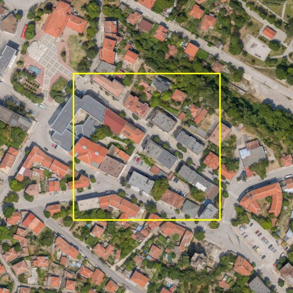

| 项 | 值 |
|---|---|
| 街区 | 世界 ENU 中心 (−150, 140) m，150 m × 150 m；DSM −18.3 至 22.0 m、DTM −15.7 至 10.4 m（坡地，约 26 m 高差）；含大型公共建筑、多层住宅、红瓦民居、街道、停车场与行道树；扫描覆盖 100% |
| 世界 | crop 2,879,110 个三角形，载入 7.4 s；纹理拼为 16384² 图集；nvdiffrast 场景初始化 1.5 s；渲染峰值显存 5.9 GB |

| 集合 | 数量 | 分辨率 | AGL（实测范围） | 俯角 | 用途 |
|---|---|---|---|---|---|
| train_hi | 240 | 1280 × 720 | 41–149 m | 30–90° | 基线训练、IDU 锚定 |
| train_lo | 240 | 1280 × 720 | 9–40 m | 15–60° | 基线训练、IDU 锚定 |
| test_mid（留出） | 30 | 1280 × 720 | 64–115 m | 30–90° | 中空评估 |
| test_low（留出） | 30 | 1280 × 720 | 11–29 m | 15–50° | 低空评估 |
| pair_low（留出） | 20 对 | 1280 × 720 | 14–30 m | 20–50° | 跨视角一致性（横移 1.5 m） |
| traj（留出） | 60 帧 | 1280 × 720 | 20 m | 35° | 低空直线轨迹，步长 0.5 m（相当于 5 m/s × 10 Hz） |
| idu_e0–e3 | 各 54 | 1344 × 768 | 80/50/30/18–22 m | 60/45/35/25° | IDU 课程视角 |

全部集合由固定种子生成，测试集与训练、IDU 视角不重叠。

### 3.3 变体

| 变体 | 内容 |
|---|---|
| mesh | 网格渲染（nvdiffrast，三线性 mip），作为一致性参照，也参与锐度与无参考画质比较 |
| (a) base | 网格直接训练 3DGS：§2.4，30k 步，MCMC 上限 4M |
| (b1) idu_cn | 从 (a) 出发的课程式 IDU，SDXL + ControlNet-Union（depth + canny），强度 0.50/0.60/0.65/0.70，CFG 7.0，N_s = 2，MCMC 上限 6M |
| (b2) idu_cnlo | 同 (b1)，保守细化：强度固定 0.45，条件权重 0.6/0.4，CFG 5.0 |
| (b3) idu_cnlf | 同 (b1)，加频带分离回灌（σ = 3 px） |
| (b4) idu_lock | 同 (b1)，加频带分离回灌（σ = 3 px）与几何锁定 |
| (b0) FlowEdit | Skyfall-GS 原版 FlowEdit 代码 + FLUX.1 [schnell]，只做细化器对照（§4.1），因几乎不改变输入而未做完整 IDU |

### 3.4 指标

| 类别 | 指标 | 计算 |
|---|---|---|
| 一致性参考（以网格渲染为参照） | PSNR、SSIM（评估掩膜内）；LPIPS-Alex（掩膜内覆盖率 ≥ 95% 的 448² 裁块） | 只表示"与网格差多少"，生成式细节必然拉低这些数值，不代表画质 |
| 锐度 | Tenengrad（Sobel 梯度平方均值）、拉普拉斯方差、高频能量占比（> 0.25 周/像素） | 同一裁块 |
| 无参考画质 | NIQE（越低越好）、MUSIQ-KonIQ（越高越好） | 同一裁块；均为自然图像统计，对渲染图只作参考 |
| 几何（G1） | ED 对网格平面深度的绝对残差中位数（m）与相对残差中位数；\|Δ\| > 0.5 m 占比；前景浮点（ED < 网格 − 1 m）占比；空洞（alpha < 0.5）占比；网格渲染与模型渲染的 Canny 边缘 2 px 容差 F 值 | 评估掩膜内 |
| 多视一致（G2） | pair_low：以网格深度把视角 2 重投影到视角 1 取色的 MAE（0–255）；traj：相邻帧重投影 MAE、相邻帧重叠区平均亮度跳变；均给出与网格渲染的比值 | 网格深度判可见（2% 深度容差） |
| 语义保持（G3） | SegFormer-B2（ADE20K）粗类别（建筑、植被、地面、车辆、人、其他）在模型渲染与网格渲染上的 mIoU | 输入降采样到 640 × 360；该模型在航拍渲染上本身不稳定（§4.5） |
| 标注影响 | 幻觉目标审计：Faster R-CNN（COCO）在评估掩膜内、置信度 ≥ 0.5 的人与车辆检测数（每帧） | 网格渲染的检测数为基线 |
| 资源 | 训练与细化耗时、峰值显存、高斯数、PLY 体积、gsplat 渲染帧率（B = 1，720p / 1080p，RGB 与 RGB+ED） | A40 |

---

## 4. 实测结果

### 4.1 细化器选型（冒烟扫参，idu_e3 网格渲染输入：AGL 18 m、俯角 25°、1344 × 768，4 个视角）

| 细化器 | 条件与参数 | s/张 | 峰值显存 | 观感（见下图） |
|---|---|---|---|---|
| SDXL + CN-Union | depth + canny（0.6/0.4），强度 0.45，CFG 5 | 4.6 | 14.2 GB | 去掉拉伸纹理与面片接缝，立面更规整；仍然模糊（扩散模型把模糊解读为景深） |
| SDXL + CN-Union | depth + canny（0.5/0.5），强度 0.55，CFG 5 | 5.5 | 14.2 GB | 介于两者之间 |
| SDXL + CN-Union | depth + canny（0.4/0.3），强度 0.60，CFG 5 | 6.0 | 14.2 GB | 表面更干净；门窗被重新生成 |
| SDXL + CN-Union | depth + canny（0.5/0.5），强度 0.70，CFG 7 | 7.0 | 14.2 GB | 出现清晰瓦片、砌石、铺地；同时出现语义幻觉：多面体树团变为芭蕉叶或"篷布"，立面生成原本不存在的拱门 |
| SDXL + CN-Union | depth + canny（0.7/0.6），强度 0.85，CFG 7 | 8.1 | 14.2 GB | 细节最多、幻觉最重（屋顶结构改变） |
| SDXL + CN-Union | depth + tile（0.5/0.6）强度 0.65；depth + tile（0.6/0.8）强度 0.75；depth + canny + tile，强度 0.60 | 6.2–7.3 | 14.2 GB | tile 条件把输入的模糊一并锁定，细节增益最小 |
| FlowEdit + FLUX.1 [schnell] | Skyfall-GS 原参数 T = 28、n_min = 4、n_max = 10 | 15.6 | 24.7 GB | 几乎不改变输入 |
| FlowEdit + FLUX.1 [schnell] | T = 28、n_min = 2、n_max = 16 | 29.2 | 24.7 GB | 几乎不改变输入 |
| FlowEdit + FLUX.1 [schnell] | T = 4、n 0–3；T = 8、n 1–6 | 6.0 / 10.8 | 24.7 GB | 几乎不改变输入 |

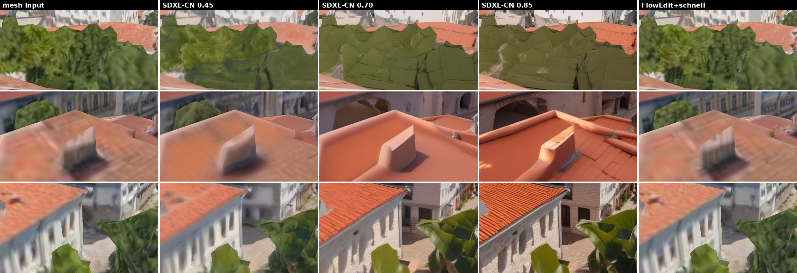

要点：

1. **细节与幻觉不可分**：强度 ≤ 0.55 时几乎不增加细节，≥ 0.70 时才出现真实感纹理，但网格的粗几何（多面体树团、平面化立面）会被扩散模型按字面理解为另一种物体。深度条件越强，这种"按错误几何作画"越确定。
2. **FlowEdit + schnell 无效**：schnell 是时间步蒸馏模型、没有引导嵌入，源与目标提示词的速度差很小，低噪声窗口内的编辑量接近零。Skyfall-GS 的效果依赖 FLUX.1 [dev] 的引导（目标 5.5），本单元因许可未复测原版（§1.8），因此**未能复现 Skyfall-GS 的原版细化强度**；这一缺口在 §6.4 列为局限。
3. 选定 IDU 配置：depth + canny（0.5/0.5），强度随高度 0.50 → 0.70，CFG 7（变体 b1）；另设保守变体 b2（强度 0.45）。

### 4.2 耗时、显存与规模

| 阶段 | 变体 | 耗时 | 峰值显存 | 规模 |
|---|---|---|---|---|
| 世界载入与渲染准备 | — | GLB 解析 7.4 s，nvdiffrast 场景 1.5 s，DSM/DTM（0.5 m）与 800 帧网格真值渲染合计约 10 s | 5.9 GB | 训练集 3.1 GB（RGB + fp16 深度 + 掩膜） |
| 面元初始化 | (a) | 1.8 s（区域内 38,187 个三角形、表面积 7.3 万 m²、间距 0.19 m） | — | 2M |
| 基线训练 | (a) | 30k 步 1,035 s（17.2 min） | 4.7 GB | 4M 高斯，SH0 PLY 259 MB |
| IDU 渲染 | (b) | 每级 54 视角 4.8–7.2 s | — | — |
| IDU 细化（SDXL + CN） | (b4)（基本独占） | 每张 5.1 / 6.0 / 6.3 / 6.8 s（强度 0.50/0.60/0.65/0.70），每级 108 张 10–13 min | 14.2 GB（独立进程） | 每级 108 张 1344 × 768 |
| IDU 回训 | (b2)（不锁定） | 每级 5k 步 253–267 s | 6.3–6.7 GB | 6M 高斯，PLY 389 MB |
| IDU 回训 | (b4)（几何锁定） | 每级 5k 步 77–90 s | 5.1 GB | 4M 高斯，PLY 259 MB |
| IDU 合计 | (b4) / (b2) | 3,224 s / 3,261 s | 细化与回训分进程，同卡合计约 20 GB | — |
| IDU 合计 | (b1) / (b3)（与另一作业同卡并发） | 5,608 s / 5,590 s | — | — |
| 单 150 m 瓦片总成本 | (a) + (b4) | 约 1.2 GPU·h（A40）；不锁定约 1.4 GPU·h | — | — |

### 4.3 留出视角对比

**中空 test_mid（30 个视角，AGL 64–115 m）**

| 模型 | PSNR / SSIM（对网格） | LPIPS | Tenengrad | 拉普拉斯方差 | 高频占比 | NIQE ↓ | MUSIQ ↑ | ED 相对残差中位数 | \|Δ\| > 0.5 m | 前景浮点 | 人 / 车检测（每帧） |
|---|---|---|---|---|---|---|---|---|---|---|---|
| mesh | — | — | 0.093 | 0.0063 | 1.44% | 5.12 | 56.8 | — | — | — | 0.10 / 1.43 |
| (a) base | 33.04 / 0.954 | 0.062 | 0.092 | 0.0027 | 0.74% | 4.31 | 53.5 | 0.22% | 15.5% | 1.5% | 0.17 / 1.50 |
| (b1) idu_cn | 21.56 / 0.673 | 0.348 | 0.055 | 0.0013 | 0.46% | 4.90 | 36.0 | 3.6% | 93.1% | 76.2% | 0.23 / 0.83 |
| (b2) idu_cnlo | 14.10 / 0.486 | 0.842 | 0.004 | 0.0001 | 0.20% | 12.46 | 21.8 | 51.0% | 99.9% | 99.4% | 0.10 / 0.00 |
| (b3) idu_cnlf | 26.34 / 0.821 | 0.176 | 0.078 | 0.0017 | 0.47% | 4.87 | 44.7 | 0.89% | 66.5% | 37.3% | 0.30 / 1.63 |
| (b4) idu_lock | 32.08 / 0.935 | 0.087 | 0.084 | 0.0022 | 0.62% | 4.57 | 52.2 | 0.19% | 13.5% | 1.5% | 0.13 / 1.23 |

**低空 test_low（30 个视角，AGL 11–29 m，俯角 15–50°）**

| 模型 | PSNR / SSIM（对网格） | LPIPS | Tenengrad | 拉普拉斯方差 | 高频占比 | NIQE ↓ | MUSIQ ↑ | ED 相对残差中位数 | \|Δ\| > 0.5 m | 前景浮点 | 人 / 车检测（每帧） |
|---|---|---|---|---|---|---|---|---|---|---|---|
| mesh | — | — | 0.026 | 0.0017 | 0.64% | 9.95 | 45.6 | — | — | — | 0.20 / 0.00 |
| (a) base | 33.13 / 0.958 | 0.119 | 0.019 | 0.0003 | 0.28% | 8.66 | 33.6 | 1.15% | 20.9% | 2.4% | 0.17 / 0.07 |
| (b1) idu_cn | 19.93 / 0.797 | 0.458 | 0.009 | 0.0001 | 0.27% | 9.15 | 22.9 | 14.4% | 88.8% | 57.0% | 0.20 / 0.03 |
| (b2) idu_cnlo | 13.43 / 0.692 | 0.736 | 0.001 | 0.0000 | 0.29% | 15.74 | 22.2 | 65.4% | 98.2% | 79.2% | 0.13 / 0.00 |
| (b3) idu_cnlf | 26.47 / 0.884 | 0.279 | 0.014 | 0.0002 | 0.24% | 9.34 | 27.1 | 3.95% | 60.7% | 29.7% | 0.07 / 0.07 |
| (b4) idu_lock | 32.26 / 0.944 | 0.156 | 0.017 | 0.0003 | 0.27% | 9.06 | 31.8 | 1.07% | 17.9% | 2.1% | 0.17 / 0.10 |

逐视角计：MUSIQ 高于基线的低空视角数，mesh 29/29、b1 3/29、b3 4/29、b4 5/29；Tenengrad 高于基线的低空视角数，mesh 29/29，三个 IDU 变体都只有 1/29。中空视角上 IDU 变体的 MUSIQ 与 Tenengrad 均未超过基线（b4 MUSIQ 2/30）。

读表要点：

1. **网格渲染始终是最锐利的**：网格训练的 3DGS（a）在低空 Tenengrad 只有网格的 72%、MUSIQ 低 12 分；r3"上限是网格"的结论在正确米制尺度下复现。NIQE 对模糊的渲染图给出更低（更好）分数，与目视不符，本文只作参考。
2. **课程式 IDU 没有把低空观感提高到基线以上**，不加约束时还显著劣化（b1、b2）；频带分离（b3）把一致性从 19.9 dB 拉回 26.5 dB，但几何仍漂移（ED 相对残差 3.95%、前景浮点 30%）；几何锁定（b4）保住了一致性与几何，代价是没有任何可测的细节增益。
3. **幻觉目标审计未见显著增加**：COCO 检测器在各模型上每帧 0.1–0.3 个"人"、0–1.6 辆车，与网格渲染同量级；但该检测器在航拍视角召回率很低（中空视角里可见车辆远多于检出数），审计的灵敏度不足，§7.5 建议改用航拍域检测器。

### 4.4 机理分析：为什么细节没有留下来

**逐级一致性（留出视角，对网格的 PSNR，中空 / 低空，dB）**

| 级 | AGL | (b1) idu_cn | (b2) idu_cnlo | (b3) idu_cnlf | (b4) idu_lock |
|---|---|---|---|---|---|
| 起点 | — | 33.04 / 33.13 | 33.04 / 33.13 | 33.04 / 33.13 | 33.04 / 33.13 |
| e0 | 80 m | 26.12 / 25.42 | 26.55 / 25.55 | 29.96 / 28.38 | 31.84 / 31.04 |
| e1 | 50 m | 23.76 / 22.81 | 24.95 / 23.78 | 29.21 / 28.12 | 32.00 / 31.38 |
| e2 | 30 m | 22.23 / 21.12 | 23.30 / 22.55 | 27.56 / 27.21 | 32.14 / 31.87 |
| e3 | 18 m | 21.56 / 19.93 | 14.10 / 13.43 | 26.34 / 26.47 | 32.08 / 32.26 |

**细化目标与回训结果（IDU 视角中心 448² 裁块，每级 18 个视角）**

| 级 | 变体 | 网格 Tenengrad | 3DGS 输入 | 细化样本 s0 / s1 | 回训后 | s0 对 s1 PSNR | 输入对 s0 PSNR |
|---|---|---|---|---|---|---|---|
| e0（80 m） | 三者共用同一输入 | 0.064 | 0.060 | 0.057 / 0.058 | b1 0.036、b3 0.048、b4 0.053 | 21.3 dB | 22.1 dB |
| e3（18 m） | b1 | 0.023 | 0.005 | 0.014 / 0.015 | 0.006 | 19.5 dB | 20.4 dB |
| e3（18 m） | b3 | 0.023 | 0.008 | 0.019 / 0.020 | 0.011 | 19.1 dB | 19.5 dB |
| e3（18 m） | b4 | 0.023 | 0.011 | 0.023 / 0.024 | 0.012 | 19.0 dB | 19.5 dB |

结论：

1. **细化器把锐度恢复到网格水平，但不超过网格**（b4 e3：输入 0.011 → 样本 0.023，网格 0.023）。在本实验的强度（0.50–0.70）上，"照片级细节"基本来自对网格高频的重建，而不是新增的真实细节。
2. **样本之间不一致**：同一视角两个样本之间只有 19–21 dB，和"输入对样本"一样远。3DGS 作为三维瓶颈把不一致的高频平均掉（回训后锐度降回约 0.011），这就是 Skyfall-GS 用 N_s 多样本"求共识"的代价——在卫星场景里被平均掉的是噪声，在网格场景里被平均掉的恰恰是想要的细节。
3. **不锁定几何时，平均不掉的部分变成浮点与大而透明的高斯**：e2、e3 回训中 ED 相对残差升到 0.2–0.9（基线 0.002），低空视角大量高斯被拉到相机前方去解释视角特有的内容；b2 在 e3 发散（L1 从 0.06 升到 0.26）。回训后高斯最大轴尺度中位数从 10.6 cm 增大到 22–25 cm（90% 分位 45 → 68–80 cm），平均不透明度从 0.075 降到 0.024–0.030，即用更大、更透明的高斯去"平均"不一致的目标，表现为模糊。网格深度一致性 λ_d = 0.1 不足以约束。
4. **容量不够**：基线高斯最大轴 σ 的 10%/50%/90% 分位为 1.3/10.6/45 cm，而 18 m 级画面中心像素足迹约 3.7 cm，低空测试集画面中心约 1.3–10 cm（中位约 3–4 cm）。要在 150 m 瓦片上承载厘米级细节，地面部分就需要约 2,500 万个 3 cm 级高斯（22,500 m² ÷ 0.03²），是现有 4M 的约 6 倍以上，参数与渲染开销同比上升。
5. **渲染帧率随浮点上升而下降**：b1、b3（6M、带浮点）720p 只有 166–172 帧/s；b4（4M、几何锁定）366 帧/s，高于基线的 291 帧/s：锁定回训使平均不透明度从 0.075 降到 0.064（不透明度 < 0.1 的高斯从 79% 增到 88%），更多高斯在光栅化时被提前跳过。

### 4.5 决策门 G-3DGS 对照（docs/05 §6.4）

| # | 指标 | 门限 | (a) base | (b1) idu_cn | (b4) idu_lock | 判定（以 b4 为候选） |
|---|---|---|---|---|---|---|
| G1 | ED 对网格平面深度绝对残差中位数（中空 / 低空） | ≤ 5 cm | 0.20 / 0.25 m | 3.66 / 3.38 m | 0.18 / 0.22 m | 不通过（基线同样不通过，§7.5） |
| G1 | Canny 边缘 2 px F 值（中空 / 低空） | ≥ 0.80 | 0.91 / 0.61 | 0.62 / 0.21 | 0.89 / 0.55 | 中空通过，低空不通过（基线同样） |
| G2 | pair_low 重投影 MAE 与网格之比 | ≤ 1.5 倍 | 2.06 倍（0.93 / 0.45） | 10.4 倍 | 2.11 倍 | 不通过（基线同样；网格本身误差仅 0.45 级，比值病态） |
| G2 | 低空轨迹相邻帧重投影 MAE 之比 / 亮度跳变之比 | ≤ 1.5 倍 | 2.21 / 0.97 倍 | 25.2 / 1.72 倍 | 2.31 / 1.01 倍 | MAE 不通过（基线同样），亮度跳变通过 |
| G3 | SegFormer 粗类别 mIoU（模型渲染对网格渲染，中空 / 低空） | 降幅 ≤ 5 个百分点 | 0.61 / 0.41 | 0.33 / 0.19 | 0.54 / 0.39 | 相对基线降 7 / 2 个百分点；代理不可靠：同一分割器把 9% 的网格低空像素判为"人"，基线与网格之间就差 39–59 个百分点 |
| G4 | 低空观感增益（真实航拍参照集 KID；无参考清晰度） | 30 m 档 KID 降 ≥ 30% | 无参照集；MUSIQ 33.6、Tenengrad 0.019 | 22.9、0.009 | 31.8、0.017 | **不通过（决定性）**：无参考指标与锐度均未超过基线，更未超过网格；KID 因缺真实参照集未测 |
| G5 | 参考检测器 AP 差 | ≤ 2 个百分点 | — | — | — | 未测（无 `ref_det_v1` 与演员合成流水线）；幻觉目标审计未见显著增加（§4.3） |
| G6 | 吞吐（gsplat 单视角，未含 C3 与 ISP） | 720p ≥ 150、1080p ≥ 60 帧/s | 291 / 225 | 166 / 124 | 366 / 292 | 通过（C3 另加一次网格深度渲染约 1.5–3 ms，r3） |
| G7 | 成本 | ≤ 48 GPU·h、参数 ≤ 4 GB（600 m 舞台） | — | 约 1.4 GPU·h/瓦片 | 约 1.2 GPU·h/瓦片 | 舞台按 20 个 150 m 瓦片（含重叠）约 24 GPU·h，通过；SH0 PLY 约 5.2 GB，不通过，按 SPZ 典型压缩比约 10 倍估算约 0.5 GB 可通过 |
| G8 | 许可 | 内部研究可用；公开须可再分发 | — | — | — | 有条件通过：SDXL（OpenRAIL++-M，生成内容的使用不得违反附件 A 限制）、ControlNet-Union 与 gsplat（Apache-2.0）可用；FLUX.1 [dev] 排除；源网格 CC-BY-4.0 署名延续到派生外观层 |

**裁决建议**：G4（决定性）不通过，G1、G2 在现门限下不通过 → ADR-186 结论 **C：维持 P3，P1 不引入生成式高斯外观层**，失败原因记为"生成细节不具三维一致性、被 3DGS 平均或转为浮点；网格粗几何诱发语义幻觉；缺少真实航拍参照集"。门限本身的修订建议见 §7.5。

---

## 5. 对比截图

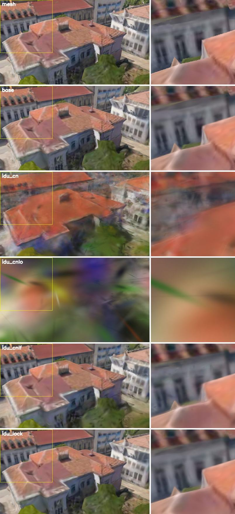

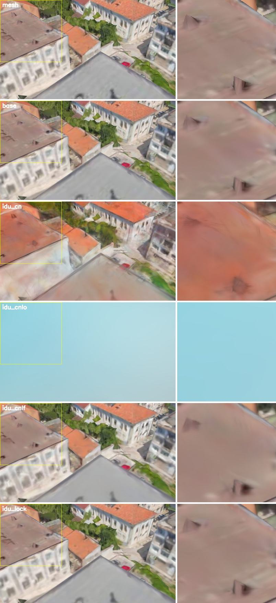

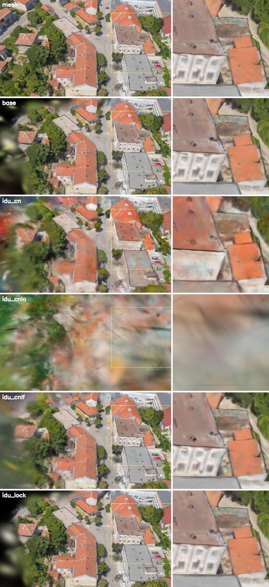

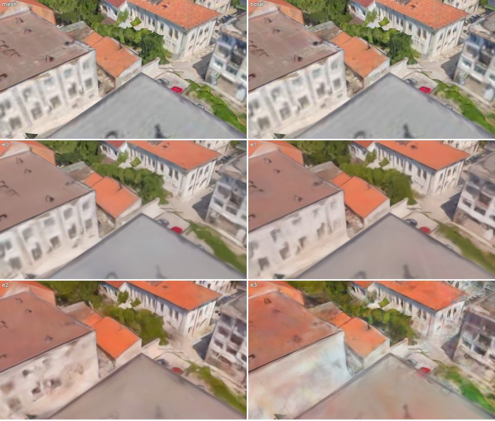

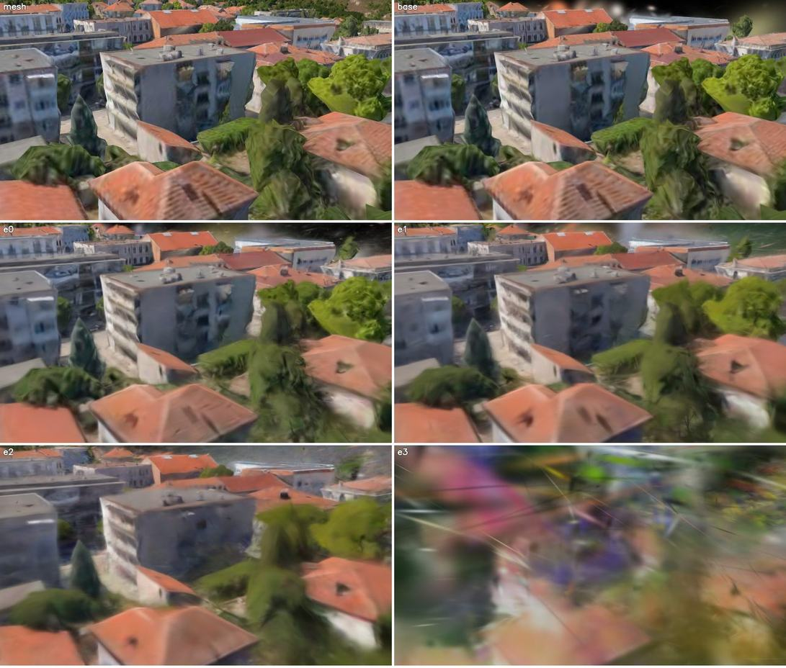

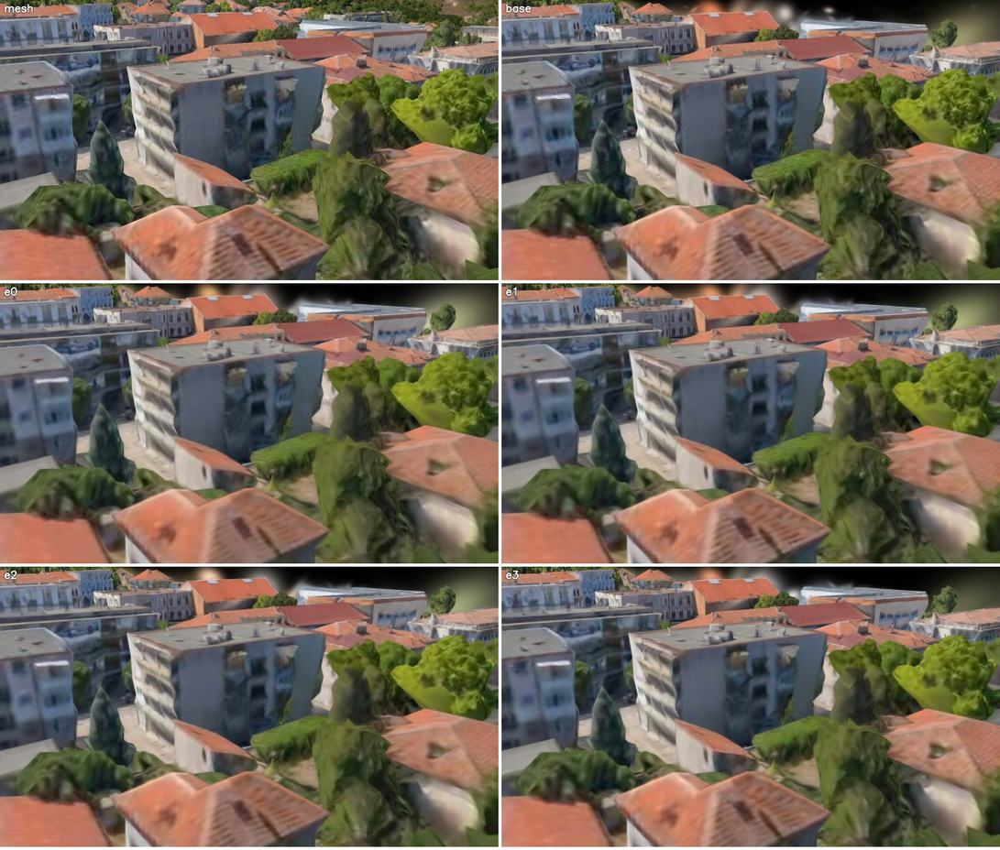

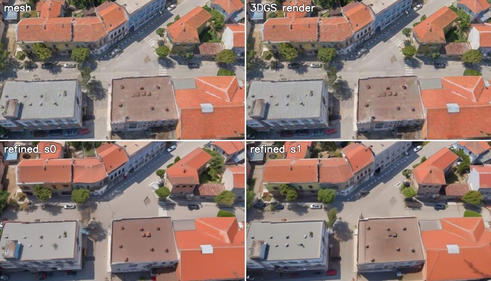

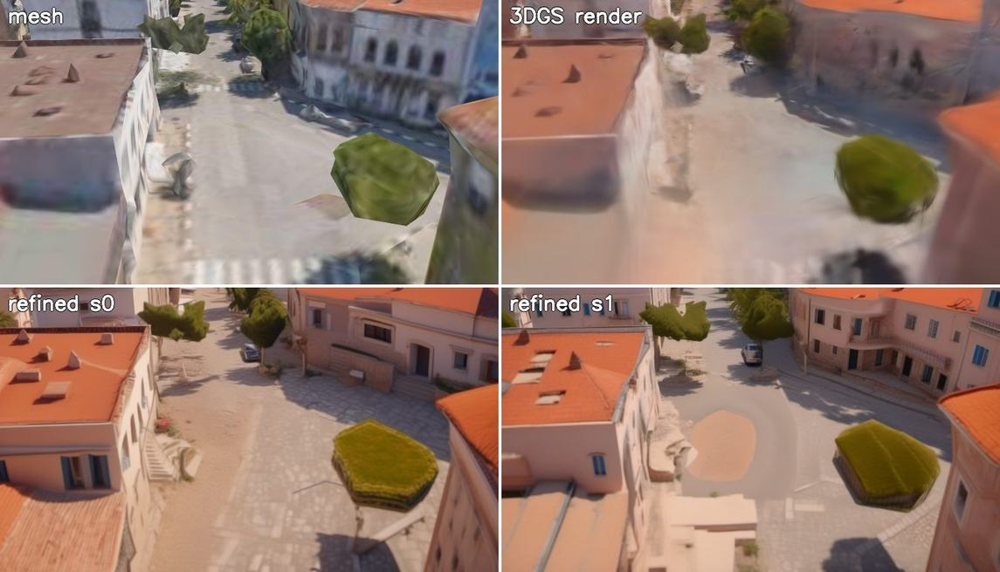

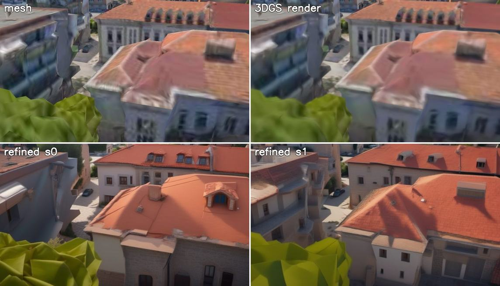

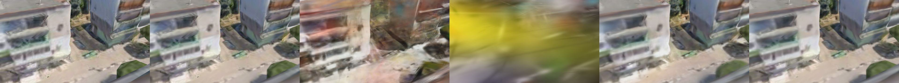

---

## 6. 局限

### 6.1 生成细节非真实

- 在能产生可见细节的强度（≥ 0.70）上，扩散模型以网格几何为"草图"作画：多面体树团被画成芭蕉叶、篷布或折纸叶片，平面化立面被补上拱门、老虎窗与额外门窗，平屋顶被改色，地面出现不存在的圆形铺装（§4.1、§5）。这些内容一旦被 3DGS 吸收，就成为世界外观的一部分，与真实小镇不符。
- 同一视角、不同随机种子的样本在细节上差异与"输入对样本"相当（19–21 dB），资产是生成分布中的一次抽样，无法通过复跑复现（只能按版本冻结）。
- 提示词与模型先验决定风格：本实验的提示词含"小镇、陶瓦屋顶"，换场景或换模型都会改变"生成出的城市"。

### 6.2 跨视角一致性

- 生成细节不具三维一致性。3DGS 作为三维瓶颈只能二选一：平均掉（几何锁定时，细节消失）或者用视角相关的浮点去解释（不锁定时，低空视角 57–79% 的像素出现前景浮点，重投影误差达到网格的 10–35 倍）。
- 课程由高到低会累积误差：每一级的输入是上一级的渲染，一旦出现色漂或模糊，下一级的扩散模型会把它当作"真实内容"进一步加工（b1 的灰顶变橙、b2 的发散）。Skyfall-GS 在卫星场景中依赖的"越往下输入越干净"在这里不成立，因为网格派生 3DGS 在高空本来就已经干净，细化只会引入偏差。
- 时序闪烁：几何锁定后相邻帧亮度跳变与网格相当（1.01 倍），未锁定的 b1 为 1.72 倍、b2 为 10.8 倍。

### 6.3 对标注的影响

- **几何类标签不受影响**：按 C3-G，深度、实例、语义、遮挡、可见度、LiDAR 恒取网格，切换外观层不改变任何标签字节（与 D3-AC-41 一致）。
- **外观与标签错位**：生成式外观改变物体的可见边界（b1 的 Canny 边缘 F 值从 0.91 降到 0.62，低空 0.61 降到 0.21），网格实例掩膜与"看到的物体"不再对齐，检测与分割训练会学到系统性偏移。
- **无标注目标**：生成内容可能在静态表面画出车辆、行人，它们没有实例标签；本实验的 COCO 检测器审计未见显著增加，但其航拍召回率低，结论只能视为"未发现"，不能视为"不存在"。正向提示词中的"停放车辆"在产品配置中应删除。
- **多模态不一致**：相机颜色来自生成外观，LiDAR 反射率与热成像来自网格纹理与语义；对依赖光度一致性的 VIO/LIVO（如 FAST-LIVO2 的光度地图）而言，未锁定变体的浮点与闪烁会直接劣化跟踪。
- **基准公平性**：同一事件在不同外观层版本下的观测不同，排行成绩必须绑定外观层版本；生成式外观不得进入正式成绩分轨（与 ADR-186 的"只在新分轨启用"一致）。

### 6.4 本实验的局限

- 单个 150 m 街区、单一随机种子、每个变体 1 次运行；IDU 为 4 级 × 5k 步（Skyfall-GS 为 5 级 × 10k 步）。
- **未复现 Skyfall-GS 原版细化强度**：FLUX.1 [dev] 因许可未运行，FLUX.1 [schnell] 替代后 FlowEdit 几乎不改变输入；本文对"Skyfall-GS 原版在网格场景上的效果"只能依据其算法与本单元同构实验推断，不能视为原版复现。
- 没有真实航拍参照集，G4 的 KID 未测；NIQE、MUSIQ 是自然图像统计，对渲染图只作参考；SegFormer（ADE20K）与 Faster R-CNN（COCO）是地面视角模型，用于航拍渲染的 G3 与幻觉审计灵敏度有限。
- 渲染帧率为 gsplat 单视角渲染（B = 1），未含 C3 的网格深度遍、动态实体与 ISP；b1、b3 两个变体与其他作业同卡并发，其总耗时偏大（已在 §4.2 标注）。
- 细化器只评估了图像扩散（SDXL + ControlNet、FLUX + FlowEdit）；多视角或视频扩散（带几何条件、具备跨帧一致性）与纹理空间（UV 图集）增强未评估，见 §7.1。

---

## 7. 对 D3 的建议

### 7.1 是否把高斯外观层提前到 P1

**建议：生成式高斯外观层不提前到 P1（ADR-186 结论 C），但把 3DGS 外观层的基础设施与真实参照集提前。**

| 项 | 建议 | 阶段 | 依据 |
|---|---|---|---|
| 生成式外观层（网格 → 3DGS → 扩散逐级细化） | 不进入 P1；保留 D3-SKY 脚本为研究工具；不进入任何正式分轨与公开数据集 | 维持 P3（研究） | §4.3–§4.5：无观感增益，不锁定时几何劣化；许可限制 |
| 网格训练的 3DGS（产物 A） | 作为"3DGS 外观层基础设施验证资产"在 P1 使用：打通 M22 `gaussian` 图层构建与入包验收、M25 `GsCameraBackend` 与 C3-G 合成、瓦片驻留与外观切换、`drone4d-camera` 的 3DGS 后端；**不宣称比网格更真实**，帧元数据 `appearance_source = mesh_distilled` | P1 | 每瓦片 17 min；与网格一致性 33 dB、期望深度残差中位数 0.20–0.25 m（与锁定变体同级）；720p 291 帧/s；让真实资产到位前的工程风险提前暴露 |
| 真实航拍参照集 | P600 在自有或授权场地采集一个 150–300 m 小区域（AGL 30/60/120 m，天底 + 倾斜，约 1–2 个架次日），作为 G4 的 KID 参照与模拟到真实评测集；同一批影像同时产出网格与 3DGS，作为 P3 资产管线的试点 | 提前到 P1 | §8：没有参照集，任何外观方案都只能证明"更锐利"而不能证明"更真实" |
| 真实 3DGS 外观层 | 照 ADR-141、WP-D3-22 在 P3 交付（P600 自采或采购、合作） | P3 | 不变 |
| 生成式路线的再评估触发条件 | 满足任一条件时用 D3-SKY 协议复测：① 出现许可兼容（Apache-2.0 / OpenRAIL 等，且无监视用途禁令）、带深度或边缘条件的多视角或视频扩散模型（例如 NVIDIA Cosmos-Transfer 一类多条件控制模型，许可需逐项审查）；② 网格植被改为程序化树木实例（多面体树团是主要幻觉诱因）；③ 改为在纹理空间（UV 图集）做超分或增强，使细节对所有视角天然一致（本单元未实测） | 按需 | §4.4、§6.1 |

### 7.2 若推进：产品化成本与流水线

适用于产物 A（P1 基础设施验证）与将来再评估的生成式变体（按 b4 配置）：

| 步骤 | 实现 | 单瓦片（150 m）成本 | crop 事件舞台（600 m，约 20 瓦片含重叠） | crop 全镇（扫描覆盖约 2.6 km²，约 115 瓦片） |
|---|---|---|---|---|
| 训练视图渲染 | M25 离线渲染（产品用 EGL 光栅，研究原型为 nvdiffrast） | < 10 s | < 4 min | < 20 min |
| 面元初始化 + 基线训练 | gsplat MCMC 30k 步，4M 上限 | 17 min、峰值 4.7 GB | 约 6 GPU·h | 约 33 GPU·h |
| 生成式 IDU（可选） | 4 级 × 108 张 SDXL + CN + 几何锁定回训 | 约 55 min、细化进程 14.2 GB | 约 18 GPU·h | 约 105 GPU·h |
| 验收 | G1–G3、G6 与天空不透明度检查（64 个位姿） | < 5 min | < 2 h | < 10 h |
| 存储 | SH0 PLY / SPZ（按约 10 倍压缩估算） | 259 MB / 约 26 MB | 5.2 GB / 约 0.5 GB | 30 GB / 约 3 GB |

- 调度：按 docs/05 §4.7 的训练窗口在独占 A40 上分批运行；细化与回训分进程，同卡显存合计约 20 GB，可与 M25 生产 Worker（≤ 24 GB）错峰共存。
- 自动化：世界包构建新增可选阶段 `appearance.gs`（产物 A）与 `appearance.gs-gen`（生成式，默认关闭），失败不阻断世界包其余图层发布。
- 人工审查：生成式外观逐瓦片做幻觉抽检（拱门、额外门窗、植被形态），抽检不合格的瓦片回退网格外观。

### 7.3 资产版本与许可

| 字段（外观层出处清单 `visual/gaussian/provenance.json`） | 内容 |
|---|---|
| `appearance_source` | `mesh`（缺省）、`mesh_distilled`（产物 A）、`generative`（生成式）、`recon`（真实航拍重建） |
| `source_mesh` | 世界包 `contentVersion`、`T_world_source`、源 GLB sha256 与 CC-BY-4.0 署名 |
| `trainer` | gsplat 版本、策略与超参、随机种子、训练视图集合哈希 |
| `generator`（仅 generative） | 模型名、版本与权重 sha256、许可标识、提示词、负向提示词、条件模式与权重、各级强度、N_s、种子表、频带分离 σ、几何锁定标志 |
| `metrics` | 入包时的 G1–G3、G6 指标快照与验收工具版本 |
| `tiles` | 瓦片编号、包围盒、重叠宽度、高斯数、编码（`spz@2` 或 `KHR_gaussian_splatting`） |

许可规则：

1. 扩散模型实行白名单：只允许许可明确允许本项目用途的模型（当前为 SDXL base 1.0 与 ControlNet-Union-SDXL，FLUX.1 [schnell] 可作研究对照）；FLUX.1 [dev] 及其他带"非商业"或"禁止监视相关用途"条款的模型禁止进入流水线，构建工具按权重 sha256 校验。
2. 生成式外观层的再分发须同时满足：源网格 CC-BY-4.0 署名；SDXL OpenRAIL++-M 对生成内容的使用限制（附件 A）随数据集条款向下游传递；数据集说明声明"生成式增强、非真实影像"。上线前由法务复核。
3. Skyfall-GS 仓库中由 Inria 3DGS 派生的代码与光栅化器不得进入产品镜像；可复用的只有 MIT 的 FlowEdit 与 fused-ssim。
4. 版本：生成式外观是随机样本，任何参数或种子变化都产生新版本；Run 规格与排行结果绑定外观层版本。

### 7.4 与 M22、M25 的接口

| 模块 | 现有条款 | 建议补充 |
|---|---|---|
| M22 | FR-072、FR-073（真实航拍资产；高斯图层 `type = gaussian`、`role = visual`，`spz@2` 或 `KHR_gaussian_splatting`；残差中位数 ≤ 5 cm） | ① 高斯图层增加 `appearance_source` 与 `provenance.json`（§7.3）；② 构建阶段增加可选 `appearance.gs`（网格蒸馏）与 `appearance.gs-gen`（生成式，默认关闭），输入为世界帧米制网格，输出已在世界帧，无需相似变换与球谐旋转（SH0）；③ 外观瓦片与 512 m 求交瓦片对齐、内部再分 128–256 m 子瓦片并带 ≥ 30 m 重叠；④ 入包验收按来源分档（§7.5） |
| M25 | FR-150 至 FR-153、M25 PRD §6.12（C3 合成、`appearance ∈ {mesh, 3dgs}`、驻留、配准工具） | ① 合成规则按 §2.7 的 C3-G 补齐（天空不透明度、阴影、LiDAR 与热像不读 3DGS）；② `FrameMeta` 增加 `appearance_source` 与外观层版本，回退像素计数沿用 `sensorsvc_gs_fallback_px_total`；③ 驻留预算：4M 高斯 / 150 m 瓦片，60 m AGL 斜视约需 9–16 个瓦片同时驻留，SH0 原始参数约 2.3–4.1 GB，在 M25 PRD §6.12 的 8 GB 缺省预算内；④ 吞吐以"C3-G 合成 + ISP"口径复测 D3-AC-41（单视角 gsplat 已达 291–366 帧/s） |
| M27 | 数据集导出与排行 | 数据集与 Run 记录写入 `appearance_source`；正式成绩分轨只接受 `mesh` 与 `recon`；`generative` 只用于标注为生成式增强的训练集与样例 |

### 7.5 决策门门限的修订建议（供 ADR-186 冻结时参考）

| 指标 | 问题（实测） | 建议 |
|---|---|---|
| G1 残差 ≤ 5 cm | 网格训练的 3DGS 在 64–115 m 与 11–29 m 视角上残差中位数为 0.20–0.25 m（相对 0.2–1.1%），任何网格派生外观层都无法通过；5 cm 只对厘米级 GSD 的实拍重建有意义 | 按来源分档：`recon` 保持 ≤ 5 cm；`mesh_distilled` 与 `generative` 采用相对残差中位数（中空 ≤ 0.5%、低空 ≤ 1.5% 深度，本实验基线为 0.22% 与 1.15%），且不劣于同瓦片产物 A 的 110% |
| G1 边缘 F ≥ 0.80 | 低空网格渲染本身模糊，边缘稀疏，基线只有 0.61 | 按高度分档，或改为"不劣于产物 A 的 90%" |
| G2 比值 ≤ 1.5 倍网格 | 网格渲染的重投影误差只有 0.12–0.45 级（0–255），比值病态，基线就有 2.1–2.2 倍 | 以产物 A 为参照（≤ 1.5 倍产物 A），并增加绝对门限（如低空轨迹相邻帧 MAE ≤ 1.0 级） |
| G3 mIoU 降幅 | ADE20K 分割器在航拍渲染上不稳定（把 9% 的网格低空像素判为"人"） | 改用航拍域分割模型（如 UAVid、LoveDA 训练的模型），或直接比较网格语义层投影与渲染分割 |
| G4 KID | 没有真实参照集无法计算 | 以 P1 的 P600 参照集计算；无参考指标只作辅助 |
| G5 与幻觉审计 | COCO 检测器航拍召回低 | 用航拍域检测器（如 VisDrone 训练的模型）做"每帧新增检测数"审计，并纳入 G5 |

---

## 8. 与"P600 实拍重建"路线的对比

### 8.1 P600 实拍的采集能力估算

P600 的 `eo_gx40`（docs/20 §6）：1/2.8"、3840 × 2160、像元 1.45 µm、焦距 4.8–48 mm。广角端 HFOV ≈ 2·atan(3840 × 1.45 µm / 2 / 4.8 mm) ≈ 60.2°，天底地面采样距离 GSD = AGL × 1.45 µm / 4.8 mm：

| AGL | GSD（广角端，天底） | 与 crop 网格纹素（约 19 cm）之比 | 单张覆盖（天底） |
|---|---|---|---|
| 30 m | 0.91 cm | 约 1/21 | 35 × 20 m |
| 60 m | 1.81 cm | 约 1/10 | 70 × 39 m |
| 100 m | 3.02 cm | 约 1/6 | 116 × 65 m |

按 G-3DGS 评估区（600 m × 600 m 事件舞台）估算一次完整采集（AGL 60 m，航向 80%、旁向 70% 重叠；天底 + 4 个 45° 倾斜方向；另加 30% 的低空立面环绕）：

| 项 | 估算 |
|---|---|
| 天底航线 | 旁向间距约 21 m，约 31 条航线；航向间距约 7.8 m，约 77 张/线，约 2,400 张 |
| 五向倾斜 + 低空环绕 | 约 12,000 + 3,600 ≈ 15,600 张（8.3 Mpx JPEG 约 1.7 MB/张，合计约 26 GB） |
| 飞行时间 | 5 m/s 时每方向约 62 min，合计约 5.2 h，加低空环绕约 6.8 h；按每架次可用约 22 min（悬停 29 min 留余量）约 19 个架次，2 人 2 个工作日 |
| 处理 | SfM（COLMAP 或 Metashape，约 1.6 万张 4K）约 0.5–1 天（64 核 + GPU）；按 150 m 瓦片切 16–20 块、每块约 1,000–1,500 张训练 3DGS，参照 r3 与本单元耗时约 1–2 GPU·h/块，合计约 20–40 GPU·h；网格由同一位姿生成（Metashape、RealityCapture 或 OpenMVS） |

### 8.2 两条路线的逐项对比

| 维度 | 生成式外观（D3-SKY：网格 → 3DGS → 扩散逐级细化） | P600 实拍重建（网格 + 3DGS 同源） |
|---|---|---|
| 低空观感 | 单张细化图可达照片级，但回训后的 3DGS 在本实验中没有超过网格蒸馏层（§4.3）；网格粗几何会被解释成错误物体（§6.1） | 真实细节，GSD 1–3 cm，比现有网格纹素细 6–21 倍 |
| 真实性 | 非真实，不能作为真实影像宣称（ADR-186） | 真实影像派生，可宣称 |
| 与网格几何一致 | 不锁定几何时残差中位数 0.9–3.7 m；几何锁定后与网格蒸馏层相同（0.18–0.22 m），见 §4.5 G1 | 共享相机位姿，配准残差可按 M22-FR-073 验收（≤ 5 cm） |
| 跨视角一致性 | 生成细节在视角间不一致，被平均掉或转为浮点（§4.4、§4.5 G2） | 来自同一真实场景，一致性由重建质量决定 |
| 对标注的影响 | 可能画出无标注目标（§6.3），需审计与提示词治理 | 采集时的真实行人、车辆被烘焙进外观层，同样无标注，需在重建前做瞬时物体去除或掩膜（另一类标注风险） |
| 对现有 crop 世界的适用性 | 直接适用于现有三份 GLB | 不适用：P600 无法采集保加利亚的 oryahovo；需自有或授权场地，即新世界、新事件与新锚点（WP-D3-22、Q-D3-04） |
| 成本 | 每 150 m 瓦片约 1.2–1.4 GPU·h（§4.2）；舞台区约 24–28 GPU·h；无外业 | 外业 2 人 × 2 天 + 约 19 个电池架次 + 空域与隐私合规；处理约 20–40 GPU·h + SfM；摄影测量软件许可 |
| 周期 | 1–2 天（生成 + 验收） | 2–4 周（选址、审批、采集、处理、世界包与事件重建） |
| 许可 | 扩散模型许可决定可用范围（SDXL 为 OpenRAIL++-M、ControlNet-Union 为 Apache-2.0、FLUX.1 [dev] 不可用）；源网格 CC-BY-4.0 署名义务延续 | 自有数据，权属清楚；需处理人脸与车牌等个人信息 |
| 可复现性 | 生成结果随种子变化，资产必须按版本冻结 | 采集一次即固定 |
| 适合的用途 | 训练数据外观多样化、公开样例的观感对照、研究消融 | 正式基准的真实感外观层、模拟到真实评测、G4 的真实参照集 |

### 8.3 判断

两条路线不是互相替代的关系：P600 实拍首先提供 G4 所需的**真实航拍参照集**（30–120 m AGL），没有它，任何生成式外观都无法证明"更真实"而只能证明"更锐利"；其次提供 P3 的真实 3DGS 外观层。生成式外观的合理定位是在已有 GLB 世界上做外观增强与数据多样化，其价值需要用实拍参照集来验证。

---

## 9. 复现、目录与清理

### 9.1 脚本（`.cache/research/d3/r11-skyfall-gs/scripts/`，dmax 上同步在 `/data/anet-drone4d-d3/sky/work/scripts/`）

| 脚本 | 作用 |
|---|---|
| `common.py`、`nvr.py` | 复制自 r3（GLB 解析、相机约定、nvdiffrast 网格渲染；nvdiffrast 许可限研究与评估） |
| `sky_world.py` | crop 世界米制变换（r2 `T_world_source`）、街区定义、DSM/DTM、按 AGL 与俯角取景、课程环绕视角、掩膜、面元采样 |
| `sky_gs.py` | gsplat 模型、光度 + 网格深度一致性损失、MCMC 训练循环、指标、PLY 导出、帧率测量 |
| `s1_prepare.py` | 地形与全部相机集合的网格真值渲染 |
| `s2_train_base.py` | 基线 (a) |
| `s3_idu.py` | 课程式 IDU（`cn` 细化器）；环境变量 `IDU_STRENGTHS`、`IDU_CFG`、`IDU_LF_SIGMA`、`IDU_LOCK_GEOM`、`CN_MODES`、`CN_SCALES` |
| `refine_cn.py` | SDXL + ControlNet-Union 几何条件细化器 |
| `refine_flowedit.py` | Skyfall-GS FlowEdit 子模块（原样调用）+ FLUX.1 [schnell]，需 `PYTHONPATH=/opt/flowedit030` |
| `t_refiner_smoke.py`、`sweep_cn*.sh`、`sweep_fe*.sh` | 细化器冒烟与扫参（§4.1） |
| `s4_eval.py`、`s5_gate.py`、`s6_figs.py`、`s7_targets.py` | 留出视角评估与帧率、决策门指标、文档用图、细化目标与回训结果对照 |
| `run.sh` | dmax 容器启动（GPU 绑定、只读挂载数据与模型、`--rm`） |

### 9.2 命令序列

```bash
# dmax，/data/anet-drone4d-d3/sky/work/scripts
./run.sh 2 s1 python3 s1_prepare.py
./run.sh 2 s2 python3 s2_train_base.py 30000 4000000 2000000 0.1 base
IDU_STRENGTHS=0.5,0.6,0.65,0.7 IDU_CFG=7.0 CN_MODES=depth,canny CN_SCALES=0.5,0.5 \
  ./run.sh 2 idu-cn python3 s3_idu.py cn idu_cn 5000 2 6000000 0.1 base
IDU_STRENGTHS=0.45,0.45,0.45,0.45 IDU_CFG=5.0 CN_MODES=depth,canny CN_SCALES=0.6,0.4 \
  ./run.sh 3 idu-cnlo python3 s3_idu.py cn idu_cnlo 5000 2 6000000 0.1 base
IDU_STRENGTHS=0.5,0.6,0.65,0.7 IDU_CFG=7.0 CN_MODES=depth,canny CN_SCALES=0.5,0.5 IDU_LF_SIGMA=3 \
  ./run.sh 2 idu-cnlf python3 s3_idu.py cn idu_cnlf 5000 2 6000000 0.1 base
IDU_STRENGTHS=0.5,0.6,0.65,0.7 IDU_CFG=7.0 CN_MODES=depth,canny CN_SCALES=0.5,0.5 IDU_LF_SIGMA=3 IDU_LOCK_GEOM=1 \
  ./run.sh 3 idu-lock python3 s3_idu.py cn idu_lock 5000 2 6000000 0.1 base
./run.sh 2 eval python3 s4_eval.py base idu_cn idu_cnlo idu_cnlf idu_lock
./run.sh 3 gate python3 s5_gate.py base idu_cn idu_cnlo idu_cnlf idu_lock
./run.sh 3 figs python3 s6_figs.py idu_cn            # 另对 idu_cnlo、idu_cnlf、idu_lock 各运行一次
./run.sh 2 targets python3 s7_targets.py idu_cn idu_cnlf idu_lock
```

### 9.3 目录与保留物

| 位置 | 内容 | 体积 | 处置 |
|---|---|---|---|
| dmax `/data/anet-drone4d-d3/sky/work/cache/sets/` | 全部相机集合的网格真值（RGB、深度、掩膜、相机） | 5.2 GB | 保留（复评与后续实验复用） |
| dmax `/data/anet-drone4d-d3/sky/work/cache/` | `gs_*.pt`（基线、各变体逐级与最终 checkpoint）、`gs_*.ply`、`idu_*/e*/`（每级渲染、条件图、细化样本）、`smoke_e3/`（细化器扫参） | 合计 17 GB | 保留 |
| dmax `/data/anet-drone4d-d3/sky/models/` | SDXL base 1.0（fp16，6.5 GB）、ControlNet-Union promax（2.4 GB）、FLUX.1 [schnell]（32 GB）；FLUX.1 [dev] 已删除 | 41 GB | 保留（许可兼容） |
| dmax `/data/anet-drone4d-d3/sky/cache_root/` | torch 扩展编译缓存、LPIPS、pyiqa、SegFormer、Faster R-CNN 权重 | 0.9 GB | 保留 |
| dmax 镜像 `d3-sky:v1` | 见 §3.1 | 19.5 GB | 保留 |
| dmax 容器 | 全部以 `--rm` 运行 | — | 实验结束时无 `d3-sky-*` 容器残留，GPU 2、3 显存回到 6 MiB |
| 本机 `.cache/research/d3/r11-skyfall-gs/` | `scripts/`、`docker/`、`paper/`（论文 PDF 与抽取文本）、`results/out/`（全部 JSON 与图）、`results/logs/` | 约 55 MB | 保留 |
| 本机 `refs/d3/skyfall-gs/` | Skyfall-GS 浅克隆（含 5 个子模块） | 79 MB | 保留 |
| 本机 `docs/research/d3/r11-assets/` | 本文插图（JPEG，已压缩） | 1.8 MB | 入库 |

主要结果文件：`results/out/base/train.json`、`results/out/idu_*/idu.json`（逐级耗时、显存、评估）、`results/out/eval/eval_base_idu_cn_idu_cnlo_idu_cnlf_idu_lock.json`（§4.3 全部指标与逐视角明细、帧率）、`results/out/eval/gate_base_idu_cn_idu_cnlo_idu_cnlf_idu_lock.json`（§4.5 G1–G3 与轨迹）、`results/out/eval/targets_idu_cn_idu_cnlf_idu_lock.json`（§4.4 细化目标分析）、`results/out/prep/prepare.json`（世界与相机集合）。

---

## 附录 A　Skyfall-GS 发布脚本关键参数（`scripts/run_jax*.py`、README）

| 阶段 | 参数 |
|---|---|
| 阶段一 | `--kernel_size 0.1 --resolution 1 --sh_degree 1 --appearance_enabled --lambda_depth 0 --lambda_opacity 10 --densify_until_iter 21000 --densify_grad_threshold 0.0001 --lambda_pseudo_depth 0.5 --start_sample_pseudo 1000 --end_sample_pseudo 21000 --size_threshold 20 --scaling_lr 0.001 --rotation_lr 0.001 --opacity_reset_interval 3000 --sample_pseudo_interval 10`；30k 步 |
| 阶段二 | `--iterative_datasets_update --idu_refine --idu_use_flow_edit --idu_render_size 1024 --idu_flow_edit_n_min 4 --idu_flow_edit_n_max 10 --idu_num_samples_per_view 2 --idu_num_cams 6 --idu_grid_size 3 --idu_grid_width 512 --idu_grid_height 512 --idu_episode_iterations 10000 --idu_densify_until_iter 9000 --idu_train_ratio 0.75 --idu_opacity_reset_interval 5000 --idu_opacity_cooling_iterations 500 --lambda_pseudo_depth 0.5 --lambda_opacity 0 --densify_grad_threshold 0.0002 --datasets_type jax_v1`；5 个 episode |
| FlowEdit | FLUX.1 [dev]、float16、T = 28、n_avg = 1、源引导 1.5、目标引导 5.5；源提示词"Satellite image of an urban area ... blurring and warping artifacts"，目标提示词"Clear satellite image ... well-defined textures" |
| 融合导出 | `create_fused_ply.py --load_from_checkpoints --iteration 80000` |

## 附录 B　来源与版本

| 项 | 版本 |
|---|---|
| Skyfall-GS | `jayin92/skyfall-gs@73194842a404910c5bbff006359eedfc56a98d60`（2026-09-27）；论文 arXiv 2510.15869（ECCV 2026） |
| 子模块 | FlowEdit `e0f2e0ade726`、MoGe `aca893a40faf`、diff-gaussian-rasterization-depth `edfff19f84a7`、simple-knn `60f461f4a56b`、fused-ssim `031f32134310` |
| FLUX.1 [schnell] 校验（与 ModelScope 公布值一致） | text_encoder `893d67a23f46…`、text_encoder_2 分片 `ec87bffd1923…`、`a5640855b301…`、vae `f5b59a268515…` |
| 镜像 | `d3-sky:v1`（`a45483b828b7`，基于 `d3-r3-camera-render:v1`） |
| 关键库 | torch 2.7.1+cu126、gsplat 1.5.3、nvdiffrast 0.4.0、diffusers 0.35.1 / 0.30.1（隔离）、transformers 4.46.3、lpips 0.1.4、pyiqa 0.1.13 |
| 数据 | oryahovo crop GLB（Sketchfab，CC-BY-4.0），`T_world_source` 取自 r2 `results/coordinate_v2_example_crop.json` |

