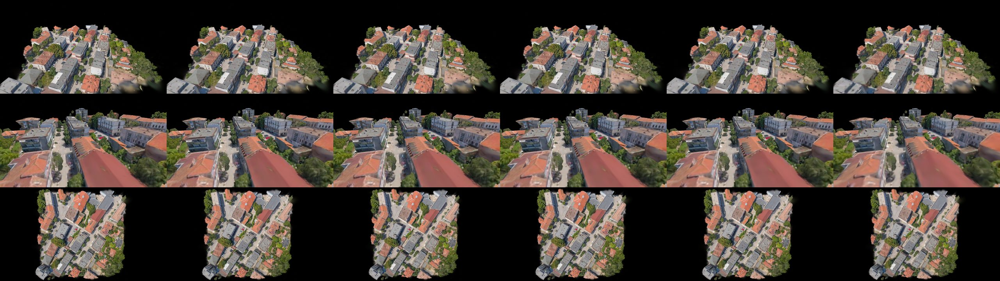
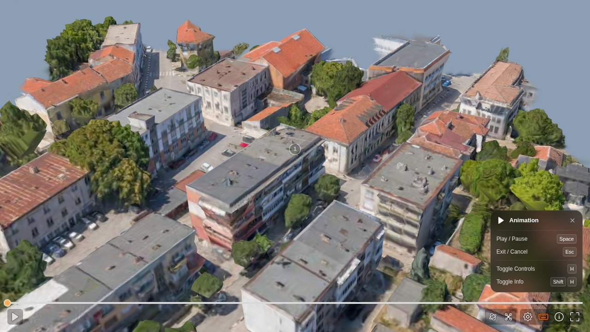
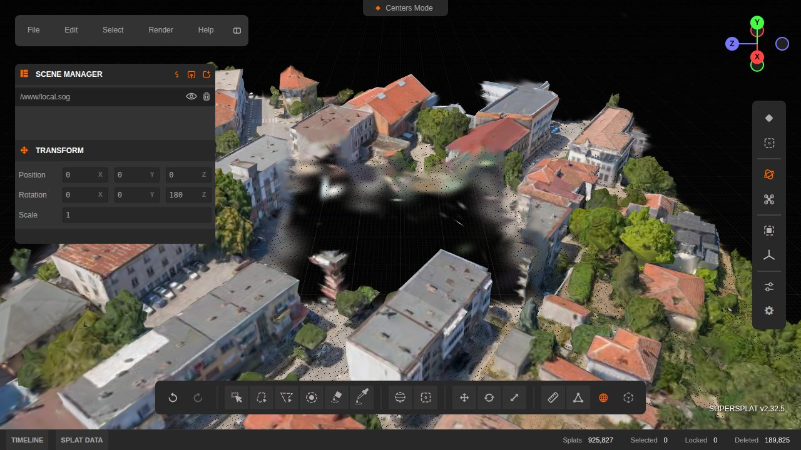
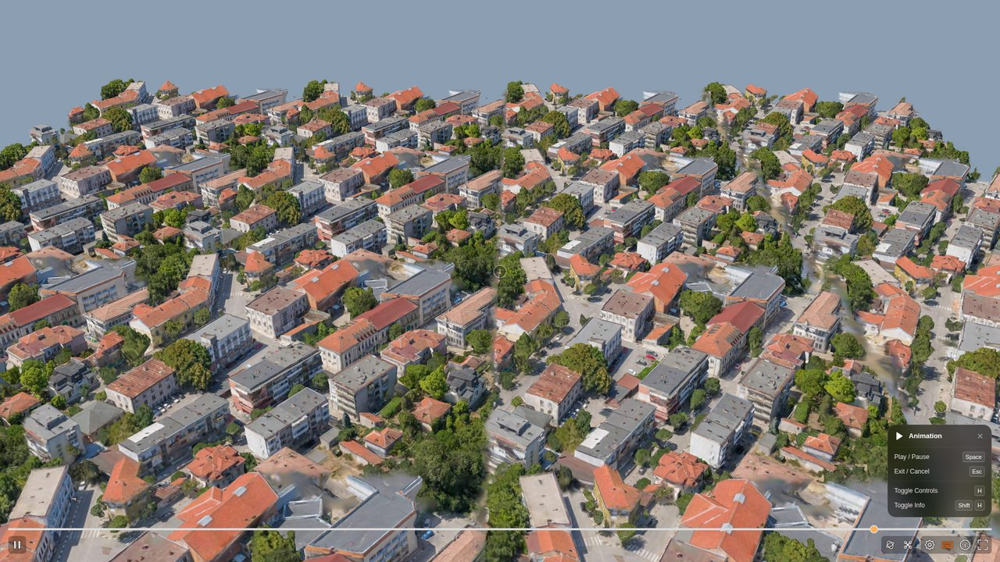
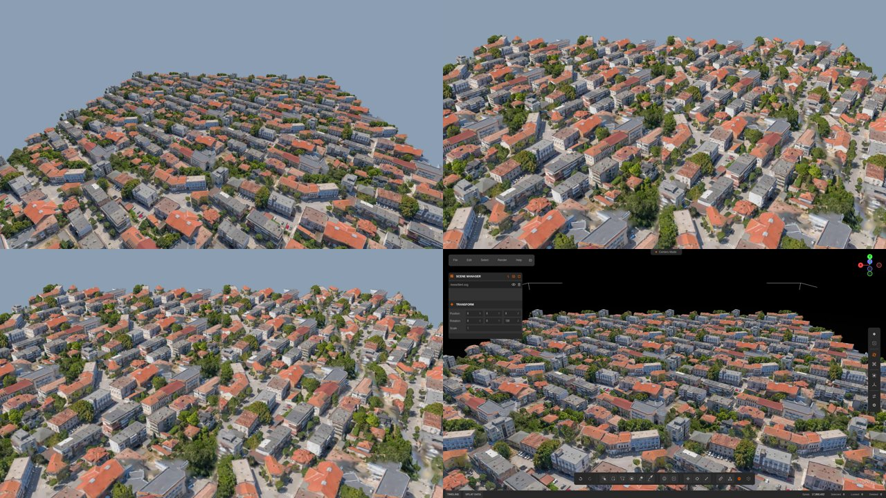
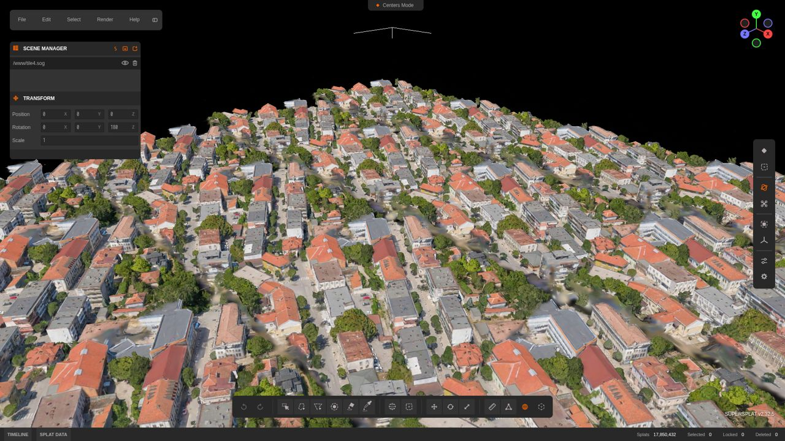

# r12 研究笔记：SuperSplat、SuperSplat Viewer 与 splat-transform——高斯资产编辑、发布与浏览器渲染在 D3 中的应用

> 研究单元：D3 / r12-supersplat　　日期：2026-10-12　　性质：只读研究，不修改产品代码（只写本文件、`docs/research/d3/r12-assets/`、`.cache/research/d3/r12-supersplat/`，参考仓库克隆于 `refs/d3/`）
>
> 输入：用户要求"clone 并学习 https://github.com/playcanvas/supersplat，应用到 D3"；用户需求与决定 `docs/inputs/D3-需求原文-2026-10-11.md`（基准排行优先、gz-sim P0 默认、四类事件、高斯外观层倾向尽量使用并参照 Skyfall-GS）；D3 基线 `docs/05-D3-设计增补与决策记录.md`（§5.1 M22、§5.4.4 3DGS 外观层与 ADR-187、§6.4 G-3DGS、§7 D3 工作区）；研究总览 `00-index.md` 与 r2、r3、r10、r11；D1 研究 `docs/research/r13-potree-next-splats.md`（SuperSplat Viewer 1.35.2 与 Spark 2.2 的早期评估）。
>
> 研读对象（版本以克隆时的提交为准）：
>
> | 仓库 | 本地路径 | 提交 / 版本 | 提交日期 | 许可 |
> |---|---|---|---|---|
> | playcanvas/supersplat（编辑器，main） | `refs/d3/supersplat` | `f2a1b49` / 3.5.2 | 2026-10-05 | MIT |
> | playcanvas/supersplat（v2 分支，WebGL2 版） | `refs/d3/supersplat-v2` | `e060989` / 2.32.5 | 2026-08-25 | MIT |
> | playcanvas/supersplat-viewer | `refs/web3d/supersplat-viewer`（由 `733ad57` / 1.35.2 快进更新） | `cd0e316` / 1.37.0 | 2026-10-02 | MIT |
> | playcanvas/splat-transform | `refs/d3/splat-transform` | `4593166` / 3.10.1 | 2026-10-09 | MIT |
> | playcanvas/engine（稀疏检出 `src/scene/gsplat*`、`src/scene/shader-lib`、`src/platform/graphics`、`src/framework/components/gsplat`） | `refs/d3/engine` | `bc37cd7` / 2.24.0-beta.9 | 2026-10-12 | MIT |
>
> 数据：r11 在 dmax 上训练的网格蒸馏 3DGS `gs_base.ply`（crop 世界 150 m × 150 m 街区，世界 ENU 中心 (−150, 140) m，米制、z 向上；4,000,000 个高斯，SH0，272 MB，sha256 前缀 `10d7b974a508de2a`，即 r11 的"产物 A"，`appearance_source = mesh_distilled`）。为测试数百万级规模，以 150 m 间距把清理后的街区平铺为 2×2、3×3、4×4（4.46M、10.04M、17.85M 个高斯，覆盖 300–600 m 见方），这是合成的规模测试资产，不代表真实世界内容。
>
> 实验环境：
> - 本机：8 核 Xeon E5-2603 v4、62 GB 内存、无 GPU；Node 22.12；Chrome for Testing 151.0.7922.34（Playwright 1.63 驱动），WebGL2 走 SwiftShader（与 `apps/web` 的 C1 参数相同），WebGPU 另用 SwiftShader Vulkan 适配器。
> - dmax：A40 48 GB，驱动 580.95.05；只用 GPU 2、3；容器名 `d3-r12-*`，`--cpus 16`，全部 `--rm`；镜像为已有的 `mcr.microsoft.com/playwright:v1.47.0-jammy`（Node 20.17），未构建新镜像；浏览器为宿主经 npmmirror 下载的同版本 Chrome for Testing 151；工作目录 `/data/anet-drone4d-d3/r12-supersplat/`。
>
> 约束：D2 验收与 D3 设计修订（含 r11 Skyfall-GS）在其他工作流进行，本单元不触碰其代码与文档。文中对 D3 的设计建议均为提案，采纳与否以 `docs/05` 的后续修订为准。
>
> 阅读顺序：§0（结论速览）→ §4（对 D3 各模块的采用建议与接口）→ §3（实验数据）→ §5、§6（工作量与风险）。§2 为源码研读，供实现时查阅。

---

## 0. 结论速览

| # | 主题 | 结论（实测或源码依据） | 对 D3 的建议 |
|---|---|---|---|
| 1 | SuperSplat 是什么 | 浏览器端 3DGS 编辑器（约 3.6 万行 TypeScript），基于 PlayCanvas 引擎：加载 PLY、压缩 PLY、SOG、SPZ、splat、ksplat、LCC；选择（矩形、笔刷、球形笔刷、泛洪、多边形、套索、球体、盒体、颜色吸取）、删除、锁定、分离、复制、变换、对齐（三点定平面）、测量、调色；撤销与重做；相机关键帧时间轴；图片与视频导出；`.ssproj` 工程文件 | 作为 M22 的**人工资产编辑工具**独立部署于内部工作区，不嵌入 Lab 主界面；自动化部分交给 splat-transform |
| 2 | 编辑器的版本分叉 | 3.0（2026-08-26，PR #1013）起为 **WebGPU 专用**：投影、排序、选择与直方图均为 WGSL compute；在只有 WebGL2 的浏览器中启动失败（实测：回退到 WebGL2 设备后 `createBufferImpl is not a function`）。WebGL2 版本在 `v2` 分支（2.32.5，2026-08-25），仍能在 WebGL2 规范最小上限下无错误运行 | 内部工作站以 v3 为主（桌面 Chrome/Edge 的 WebGPU）；保留 v2 构建作为无 WebGPU 机器的备用，二者都钉死版本 |
| 3 | 自动化处理 | splat-transform 3.10.1（CLI 与库，MIT）覆盖本次需要的全部批处理：统计与 `fillRatio` 门限、NaN 过滤、按值过滤、盒体与球体裁剪、浮点过滤（GPU 体素）、连通簇保留、平移旋转缩放（含球谐旋转）、合并、抽稀、LOD 流式分块、体素碰撞、图片与相机轨迹渲染；GPU 部分走 Dawn（node `webgpu`），在 dmax 容器内识别 A40 | 作为 M22 新增"高斯发布"子阶段的执行器，以 Python 封装调用，命令行与版本写入出处清单 |
| 4 | 资产体检与清理 | r11 的 4M 高斯中 58% 不透明度低于 1/255、36% 位于街区盒体外（含 ±500 km 的离群点）；盒体裁剪 + `opacity ≥ 0.004` 后剩 1.116M（−72%），与只做盒体裁剪的渲染相比 PSNR 61–85 dB（6 个视角），即视觉无损；`-F` 浮点过滤再去掉 34%，PSNR 47.8–52.0 dB | 训练产物进入世界包前一律执行"盒体裁剪 + 不透明度阈值 + NaN 过滤"；`-F` 需按资产评估后再开 |
| 5 | 格式、体积与精度 | 1.116M 高斯、SH0：浮点 PLY 62.5 MB（56 B/高斯）；SOG 14.1 MB（12.6 B），位置误差 p99 4.1 mm（世界坐标）/ 9.7 mm（瓦片居中），渲染 PSNR 49–54 dB；压缩 PLY 18.2 MB（16.3 B），p99 13 mm、最大 79 mm；SPZ v4 19.7 MB（17.6 B），p99 0.19 mm；GLB（KHR_gaussian_splatting）66.9 MB；单文件 HTML 查看器 22.3 MB。相对 r11 原始 PLY（272 MB）SOG 为 19.3 倍 | 服务端（M25）保存 SPZ 或浮点 PLY（毫米级以下精度）；浏览器分发用 SOG 流式 LOD；SOG 的对数位置编码在原点附近更精细，大场景必须分块（流式 SOG 每块自带包围盒） |
| 6 | 坐标约定陷阱 | splat-transform 与 PlayCanvas 把 PLY 数据视为"绕 Z 轴 180° 的存储空间"，所有 `-t/-r/-s` 与 `-B` 盒体都在引擎空间解释；世界 ENU（z 上）转换为瓦片局部、y 上的网页坐标需 `-r 0,0,180 -r -90,0,0 -t <Ec>,0,<−Nc>`，实测存储坐标为 (−(E−Ec), −U, −(N−Nc))，残差 0.0 | M22 封装统一计算并校验这一换算，禁止人工拼写参数；出处清单记录 `T_web_world` |
| 7 | 浏览器渲染规模（A40，1080p，WebGL2） | SuperSplat Viewer（PlayCanvas 2.23）：1.12M / 4.46M / 10.0M / 17.85M 高斯 GPU 帧时间 p50 2.1 / 3.5 / 5.4 / 8.5 ms，但 CPU 排序（Web Worker）23 / 107 / 212 / 474 ms，排序滞后随规模线性增长；流式 LOD（17.85M 场景，预算 2M / 4M / 8M）GPU 1.6 / 2.5 / 4.3 ms、排序 42 / 95 / 193 ms | WebGL2 浏览器上大场景必须用流式 LOD + 2–4M 预算；单文件 SOG 只用于 ≤ 2M 的街区 |
| 8 | 与现有 three.js 视口的关系 | Spark 2.2（three r186 `WebGLRenderer`，与 Drone4D 经典视口同类渲染器）可直接读取 PlayCanvas SOG：同一组资产 GPU 帧时间 1.7 / 4.4 / 9.0 / 15.6 ms（1080p）；PlayCanvas 与 three.js 不能共享深度缓冲 | 推荐两级方案：P1 在 Lab 以独立视图嵌入 SuperSplat Viewer（`createViewer`），P2 视需要在场景视图中以 Spark 同屏渲染；SOG 作为两者共用的分发格式；不统一到单一引擎 |
| 9 | WebGL2 最小上限 | Viewer 与 v2 编辑器在 WebGL2 规范最小统一块上限（24/12/12/24、块 16 KiB，沿用 `gpu-limits.spec.ts` 的模拟方法）下 0 个 WebGL 错误；程序最多引用 1 个顶点统一块、最大块 656 B | 浏览器高斯图层的最小上限风险低，仍需纳入 `m06.gpu-limits` 回归 |
| 10 | 无头 GPU 浏览器 | dmax 容器内 Chrome 151 的 WebGL2 可走 ANGLE GL-EGL 或 ANGLE Vulkan（需 `--disable-vulkan-surface`）；Dawn 只枚举到 ANGLE OpenGLES 兼容适配器，**WebGPU core 不可用**（PlayCanvas 自动回退 WebGL2；v3 编辑器回退到 SwiftShader WebGPU，只能在 CPU 上运行）；SwiftShader WebGPU 画布在无头截图中为空白，需走离屏读回 | 服务端批量渲染与 CI 不依赖浏览器 WebGPU；WebGPU 路径的验收放在带显示的工作站 |
| 11 | 相机时间轴与视频 | 编辑器 7 个关键帧（三次样条）→ 181 帧 H.264 MP4：1.12M 720p 15.6 s 导出（11.6 帧/s）、17.85M 1080p 107.5 s（1.7 帧/s，每帧同步排序）；Viewer 设置文件的 `animTracks` 可直接驱动航线预览 | 航线预览用 Viewer 的 `animTracks`（由运行轨迹生成）；演示视频以 M25 渲染为准，浏览器导出只作外观层预览 |
| 12 | M25 服务端相机 | splat-transform 自带的 WebGPU 瓦片光栅化器（投影、瓦片分箱、基数排序、逐瓦片合成，与 3DGS/gsplat 同一算法族）在 A40 上 1.12M：17 ms/帧（720p），17.85M：112 ms/帧；gsplat CUDA（r10/r11）4M 720p 2–3.4 ms | M25 运行期保持 gsplat；PlayCanvas 系只借用格式读写与发布门限（`fillRatio`），splat-transform 光栅化器可作无 CUDA 环境的缩略图与独立对拍渲染器 |
| 13 | 许可与活跃度 | 四个仓库均为 MIT；stars：engine 17,010、supersplat 10,347、splat-transform 1,371、viewer 586（2026-10-12 curl GitHub 页面核实）；近 3 个月提交 97 / 92 / 66（supersplat / splat-transform / viewer），约每周一个发布；依赖中 mediabunny 为 MPL-2.0（文件级） | 可采用；主要风险是迭代快、破坏性变更频繁（v3 切换 WebGPU 专用即为一例）与对引擎私有接口的依赖，必须锁版本并在升级时重跑本单元的回归脚本 |

---

## 1. 仓库概览与活跃度

| 项 | SuperSplat（编辑器） | SuperSplat Viewer | splat-transform | PlayCanvas engine |
|---|---|---|---|---|
| 定位 | 3DGS 检视、编辑、优化与发布 | superspl.at 官方查看器；可嵌入的 npm 包 | 格式转换与批处理（CLI + 库，Node 与浏览器通用） | WebGL2/WebGPU 引擎，含 GSplat 统一渲染器 |
| 语言与规模 | TypeScript，src 约 35.8K 行（v2 分支 29.6K 行） | TypeScript，约 20.5K 行 | TypeScript，约 50.0K 行 | JavaScript；gsplat 两个目录约 18.3K 行，gsplat 着色器约 5.3K 行 |
| 构建产物 | 静态站点 6.7 MB（gzip 1.6 MB） | 独立页 3.5 MB（gzip 0.78 MB，含引擎）；`dist/viewer.js` 0.71 MB（引擎为 peer 依赖） | `dist/` 约 46 MB（含 source map）；运行依赖 `webgpu`（Dawn）、`@adobe/spz`、`playcanvas` | — |
| stars / forks（2026-10-12） | 10,347 / 1,179 | 586 / 160 | 1,371 / 178 | 17,010 / 2,025 |
| 提交总数 / 近 3 个月 | 774 / 97 | 390 / 66 | 412 / 92 | —（2026-10-12 当日仍有合入） |
| 最近发布 | v3.5.2（2026-10-05） | v1.37.0（2026-10-02） | v3.10.1（2026-10-09） | 2.24.0-beta.9 |
| 贡献者 | 30（主要为 PlayCanvas 员工 slimbuck、willeastcott） | 11 | 14 | — |
| 界面语言 | 含 zh-CN 等 9 种 | 含 zh-CN 等 9 种 | — | — |

数据来源：`curl https://github.com/<repo>` 页面中的 `stargazerCount` 字段与 GitHub REST API（`/repos`、`/commits?since=2026-07-12`、`/releases`、`/contributors`）。三个 SuperSplat 系仓库的主要作者为同一人，项目由 PlayCanvas（Snap 旗下）维护，商业站点 superspl.at 依赖这些仓库，持续性较好；但单一核心作者也意味着方向由厂商单方面决定（见 §6）。

与 D1 研究 r13 的差异：r13（2026-09-26）评估的是 Viewer 1.35.2，关注点是可移植到 D1 点云视口的算法，结论为"移植算法、不整体嵌入"。`createViewer` 嵌入接口在 2026-09-16（#301）引入、1.35 已包含，r13 未评估；此后 1.36–1.37 又补充了共享控制与内置界面分离（`ui: false`）、状态事件、`captureFrame`、注释与动画控制等。D3 的需求（独立的外观层检视与资产发布）与 D1 主视口不同，因此本文对 Viewer 的结论改为"在 Lab 中以独立视图采用"（§4.2），对 D1 主视口仍维持 r13 的结论。

---

## 2. 源码结构与关键实现

### 2.1 编辑器总体架构（SuperSplat 3.5.2）

```text
main.ts ── Events（全局事件总线：on/fire 与 function/invoke 两种通道）
   ├─ CommandQueue（全局 FIFO：所有 GPU 读回与历史变更串行执行）
   ├─ EditHistory（EditOp 数组 + 游标；do/undo/redo 都经 CommandQueue）
   ├─ EditorUI（PCUI 组件；canvas、工具层、注释层）
   ├─ createGraphicsDevice(deviceTypes: ['webgpu'])   ← v2 分支为 ['webgl2']
   ├─ Scene（PlayCanvas AppBase；Element 树；Camera；DataProcessor；ProjectedSplatRenderer）
   │    └─ Splat（每个载入文件一个元素）= 静态资源（只读行数据）+ GaussianInstances（可编辑实例表）
   ├─ ToolManager：rect / brush / sphereBrush / flood / polygon / lasso / sphere / box / eyedropper
   │              move / rotate / scale / measure / orient
   ├─ 时间轴：timeline.ts（帧、帧率、平滑度、循环）+ CameraAnimTrack（三次样条）+ track-manager
   ├─ render.ts：图片（PNG/JPEG/WebP、等距柱状全景）与视频（WebCodecs + mediabunny）
   ├─ doc.ts：.ssproj 工程（zip：document.json + resource_i.ply + instances_i.bin）
   ├─ file-handler.ts / io/：读入（PLY、SOG、meta.json、splat、ksplat、spz、LCC）与导出（PLY、压缩 PLY、SOG、SPZ、HTML 查看器）
   ├─ publish.ts：发布到 superspl.at（`/api/id` 取用户，分片上传）
   └─ iframe-api.ts：只有 `supersplat:is-scene-dirty` 查询与 `supersplat:navigate-home` 两种消息
```

要点：

- **事件总线即内部 API**。几乎所有功能都注册为事件（例如 `select.byBox`、`select.mask`、`select.delete`、`edit.undo`、`camera.setPose`、`track.addKey`、`render.video`），`window.scene` 暴露了场景对象。本单元的无头实验就是通过这些事件驱动编辑器的（§3.8）。这为与 Lab 的集成提供了低成本入口，但它们不是对外承诺的接口，升级可能改变（实测 `select.rect` 的参数形状为 `{start:{x,y}, end:{x,y}}`，与直觉不同）。
- **CommandQueue 串行化**。选择要先在 GPU 上求交再读回，读回是异步的；编辑器用一个全局 FIFO 保证"求交 → 建立选择操作 → 写入历史"的次序。脚本直接触发 `select.byBox` 会与相机过渡等排队任务交错，实测返回空选择；按队列顺序等待求交结果后再提交 `select.mask` 即正确（§3.8）。
- **v3 的数据模型**（`gaussian-instances.ts`）：静态数据（位置、旋转、尺度、颜色、SH）只读，编辑态是"实例表"：实例 i 引用源数据的一行 `sourceRow[i]`，携带选择与锁定位、变换调色板索引与颜色分级调色板索引。删除不再是状态位，而是从实例表中移除（`RemoveInstancesOp` 保存被移除记录，撤销时精确恢复）；v2 仍是"每个高斯一个状态字节（selected/locked/deleted）+ 纹理"。v3 的这一改动为同一源数据的多次实例化（复制、分离）铺路。
- **撤销与重做**：`EditOp` 接口只有 `do/undo/destroy`；已实现的操作包括选择类（全选、反选、按掩码选择，均为位操作）、隐藏、删除与恢复、实体变换、逐高斯变换、颜色分级、放置轴心、设置局部坐标系、形状变换、动画轨编辑、重命名、组合操作 `MultiOp`。历史无上限，操作对象被删除时随之清理。
- **国际化**：`static/locales/` 有 zh-CN；界面字符串集中在 JSON，可按 D3 企业级文案规范（`docs/05` §7.10）替换。

### 2.2 选择工具与 GPU 求交

| 工具 | 交互 | 求交实现（v3：`data-processor/intersect.ts`，WGSL compute，256 线程工作组） |
|---|---|---|
| 矩形 | 屏幕矩形 | 中心点投影到 NDC 判断是否在矩形内 |
| 笔刷、多边形、套索、泛洪 | 在 2D 掩码画布上绘制 | 中心点投影后采样掩码纹理 |
| 球形笔刷 | 沿笔画的三维球体序列 | 点到路径上最近球的距离，可按高斯足迹扩展 |
| 球体、盒体 | 三维变换框（可平移、旋转、缩放） | 世界坐标变换到单位球/单位立方体局部空间判断包含 |
| 颜色吸取 | 点击取色，按阈值 | 颜色距离 |
| 选择方式 | 中心点 / 足迹 / 仅可见（深度拾取） | 足迹模式按高斯椭球在接近方向上的延伸判断；可见模式先做深度拾取再与中心求交 |

组合语义为 add、remove、set、intersect；被锁定的高斯不参与。v2 的同类功能用 WebGL2 片元着色器把结果写入 RGBA8 纹理再读回。实测（§3.8）两版对同一 60 m × 200 m × 60 m 盒体的命中数完全一致（189,825）。

### 2.3 变换、对齐、裁剪、合并

- 变换：实体级（整个文件）与逐高斯级（只变换选中高斯，`SplatsTransformOp` 改写实例的变换调色板）。
- 对齐：`orient-tool` 拾取平面上的点求法向，并在设定角度内吸附到坐标轴（源码注释："axis-aligned scans (e.g. z-up captures) produce exact quarter/half turns"），通过 `SetLocalFrameOp` 设定上方向，用于把扫描数据调平；`measure-tool` 测两点距离，可配合已知尺寸做尺度校正。没有基于控制点的相似变换求解。
- 裁剪与删除：编辑器内的"裁剪"即"盒体/球体选择 → 反选 → 删除"。
- 合并：多个文件同时载入后整体导出为一个文件（`splat-serialize.ts` 按资源分组写出）；需要批量、可复现的合并时用 splat-transform。
- 颜色：曝光、对比、饱和、色调等分级（`color-grade.ts`）与颜色匹配，作用于选中高斯。D3 不应在外观层上做与几何真值无关的人工调色（会破坏 C3-G 合成的一致性，见 §4.5）。

### 2.4 相机动画时间轴与导出

- `CameraAnimTrack`：关键帧为 `{frame, position, target, fov}`，按帧插值，`CubicSpline` 支持平滑度与首尾相接的循环；时间轴参数为总帧数、帧率、平滑度、循环。
- `render.video`：离屏渲染每一帧（等待排序完成）→ `VideoEncoder`（H.264 / H.265 / VP9 / AV1，按分辨率与帧率选择 level）→ mediabunny 封装 MP4、WebM、MOV、MKV；支持等距柱状 360° 视频（写入空间元数据）。`render.image` 输出 PNG/JPEG/WebP 与全景图。
- 工程文件导出的相机轨迹可被 splat-transform 的 `--camera-track` 直接读取（`.ssproj` 或其 `document.json`），在服务端逐帧渲染（§2.8）。

### 2.5 注释

编辑器内只有测量与尺寸标注（`DimensionLabels`、包围盒尺寸），**不编写注释**（导出设置里 `annotations: []`）。注释属于 Viewer 设置文件：`{position, title, text, extras, camera}`，Viewer 显示热点并可切换到注释的预设相机；运行期 `viewer.annotations` 只读，`selectAnnotation(i)` 控制选择。因此 D3 的锚点、事件位置等应由我们自己的数据生成 Viewer 设置，而不是在 SuperSplat 中手工标注（§4.3）。

### 2.6 文件格式

| 格式 | 读 / 写（splat-transform） | 编码要点 | 本次实测（1.116M 高斯、SH0） |
|---|---|---|---|
| PLY（浮点） | 读 / 写 | 每高斯 14 个 float32（SH0）至 62 个（SH3）；保留额外列（如 `nx,ny,nz`） | 62.5 MB（56 B/高斯；含法向列 68 B） |
| 压缩 PLY（`.compressed.ply`） | 读 / 写 | 每 256 个高斯一块，块内存位置、尺度、颜色的最小最大值；每高斯 4 个 u32：位置 11/10/11 位、旋转"最大分量省略 + 3×10 位"、尺度 11/10/11、颜色 RGBA8；SH 量化为 8 位 | 18.2 MB（16.3 B），位置误差 p99 13 mm、最大 79 mm |
| SOG（`.sog` 打包，或 `meta.json` + WebP） | 读 / 写 | 按 Morton 序排成纹理；位置先做 `sign(x)·ln(|x|+1)` 再以 16 位（两张 8 位 WebP）量化到包围盒；四元数"最大分量省略 + 3×8 位"；尺度与 DC 颜色各 256 项码本（一维量化）；不透明度 8 位；SH 高阶用 k-means 调色板（最多 64K 项，GPU 加速）+ 逐高斯标签；全部无损 WebP。单文件上限 16383² 纹素，官方建议超过 1–2M 时改用流式 SOG | 14.1 MB（12.6 B），位置 p99 4.1 mm（世界坐标）/ 9.7 mm（瓦片居中）、最大 13.8 mm；尺度相对误差 p99 3.7% |
| 流式 SOG（`lod-meta.json`） | 读 / 写 | 多级 LOD 的空间八叉树，每个叶块为独立 SOG 单元（默认每块约 512K 高斯、边长 16 m，稀疏区域不足 8K 不再细分）；各级由输入文件的 `-l n` 标签提供 | 4 级（1.116M / 558K / 279K / 112K）共 26.7 MB、7 个文件；17.85M 平铺场景 4 级共 407.6 MB、64 个文件 |
| SPZ（Niantic，v2–v4） | 读 / 写 | 位置为 24 位定点（小数位默认 12，步长 0.24 mm，量程 ±2048 m）；gzip | v4 19.7 MB（17.6 B），位置 p99 0.19 mm；v3 19.8 MB |
| splat（antimatter15）、ksplat | 只读 | 32 B/高斯，无 SH | — |
| GLB（`KHR_gaussian_splatting`） | 只写 | glTF 属性存高斯参数（浮点） | 66.9 MB（60 B） |
| HTML 查看器 | 只写 | 内嵌 Viewer 与 SOG，可单文件或拆分 | 22.3 MB |
| 体素（`.voxel.json` + `.voxel.bin`） | 只写 | 稀疏体素八叉树（叶为 4×4×4 位掩码），可附碰撞网格 `.collision.glb` | 0.25 m 体素：1.76 MB，223K 节点，GPU 6.0 s |
| 图片（`.webp`） | 只写 | GPU 光栅化渲染单帧或相机轨迹序列 | §3.10 |

精度结论：SOG 的对数位置编码在坐标绝对值小处更精细、在包围盒边缘更粗。块中心远离原点时（世界坐标 75–225 m）误差 p99 4 mm；把块居中到原点（−75 至 75 m）反而增大到 10 mm；同样的编码对一个居中的 600 m 舞台估算边缘误差约 5 cm。流式 SOG 的每个叶块有自己的包围盒，因此大场景应按块发布。各格式的颜色与不透明度量化误差都在 1/255 量级（§3.3）。

### 2.7 PlayCanvas GSplat 渲染（engine 2.23–2.24）

| 方面 | 实现 |
|---|---|
| 统一渲染器 | `gsplat-unified/`：场景内全部 GSplat 先汇入一个"工作缓冲"（work buffer），按区间压实与视锥剔除后统一排序与绘制，组件级只需 `unified: true` |
| WebGPU 路径 | `GSPLAT_RENDERER_RASTER_GPU_SORT`：compute 投影（屏幕空间剔除、排序键、工作组内原子压实，每组一次全局原子）→ GPU 基数排序（`ComputeRadixSort`）→ indirect 绘制，全程不回读 CPU；可选随机透明（stochastic）渲染：无排序、深度测试 + 抖动覆盖，配合时间累积 |
| WebGL2 路径 | `GSPLAT_RENDERER_RASTER_CPU_SORT`：Web Worker 计算排序键（相机相对的 32 个距离桶分配精度）后计数排序，结果上传为纹理；渲染不等排序，旋转时顺序滞后一到数帧 |
| 选择规则 | `GSPLAT_RENDERER_AUTO` 在 WebGPU 上用 GPU 排序，在 WebGL 上用 CPU 排序；WebGPU 专用模式在 WebGL 设备上自动回退 |
| LOD 与流式 | `lod-meta.json` 八叉树；按距离选择 LOD（`lodBehindPenalty` 降低相机后方精度，`lodUpdateAngle` 控制重算），预算模式 TARGET（把细节提升到填满预算）与 LIMIT（只在超预算时降低）；预算分配在 1024 个对数距离箱上拟合；未使用的流式资源经若干帧后卸载 |
| 预算 | `splatBudget` 默认 1M；Viewer 桌面 2M/4M、移动 1M/2M。**预算只作用于流式 LOD 资产**：实测单文件 17.85M SOG 在预算 4M 下仍渲染全部 17.85M（§3.9） |
| 其他 | `minPixelSize`（默认 2 px）、alpha 阈值、抗锯齿补偿、2DGS、鱼眼、阴影投射（compute 剔除）、拾取、XR；SH 由数据决定阶数（0–3） |
| 与网格同屏 | GSplat 与普通网格在同一 PlayCanvas 场景中按层渲染并做深度测试，因此在 PlayCanvas 内可以把三维演员与高斯背景合成；但不能与另一个 WebGL 上下文（如 three.js）共享深度 |

### 2.8 splat-transform

- 数据流：读取为惰性分块的 `ChunkSource`，常驻内存与块大小相关、与场景大小无关（官方称可处理上亿高斯）；动作按命令行顺序作用于其前一个输入，最后一个文件为输出。
- 动作：`-t/-r/-s`（变换会同时旋转 SH）、`-H`（截断 SH 阶）、`-N`、`-B`、`-S`、`-V name,cmp,value`（不透明度、尺度、颜色用线性值，`_raw` 用原始值）、`-d n|n%`（抽稀，逐对合并，必须是最后一个动作且输出 PLY；GPU 加速，有自适应版本）、`-F`（浮点过滤：评估每个高斯是否贡献于任何实心体素）、`-C`（以种子点保留连通簇，GPU 体素化）、`-l n`（LOD 标签）、`-m`（Morton 重排）、`--stats`（逐列统计与 `fillRatio`：总足迹面积 / 场景稳健截面积，约等于平均过度绘制层数，官方建议作为发布门限）。
- GPU：`--list-gpus`、`-g n|cpu`；SOG 的 SH k-means、抽稀、体素化、浮点过滤与图片渲染用 GPU。容器内需要挂载 NVIDIA 的 Vulkan ICD **以及** glvnd EGL vendor 文件，否则 Dawn 报 `vkCreateInstance: Found no drivers`（实测：只挂 ICD 时 `--list-gpus` 可见 A40，但抽稀失败）；Vulkan 加载器可借用 Chrome 自带的 `libvulkan.so.1`。
- 渲染：`.webp` 输出走自带的 WebGPU 瓦片光栅化器（投影、瓦片分箱、基数排序、逐瓦片累积），支持针孔与等距柱状投影、景深、运动模糊、`--camera-track` 序列渲染。
- 库用法：同一套 API 可在浏览器使用（SuperSplat 的读写即调用它）。

### 2.9 SuperSplat Viewer 的嵌入接口

- 独立页：URL 参数 `content`（ply、sog、compressed.ply、meta.json、lod-meta.json）、`settings`、`collision`、`budget`、`webgl`、`stochastic`、`noui`、`lang` 等；默认 WebGPU 优先，不可用时回退 WebGL。
- 组件：`createViewer({container, settings, contentUrl, ui:false, ...})` 返回 `state`（可写：相机模式、性能模式、注释显示、动画暂停、输入开关等）、`events`（`<key>:changed`）、`annotations`、`captureFrame()`（离屏超采样读回）、`seek()`、`frameScene()`、`selectAnnotation()`、`setMoveInput()`、`destroy()` 与底层 `app`。多个实例可同页，每个实例一个 WebGL/WebGPU 上下文，用后必须 `destroy()`。
- 设置文件 v2：`animTracks`（`position/target/fov` 关键帧、帧率、循环方式、样条或阶跃插值）、`cameras.initial`、`annotations`、后处理、背景、`startMode`；`/settings` 子路径导出校验与迁移函数及取值范围常量，便于生成器做校验。
- 碰撞：读取 `.voxel.json` 或 GLB 碰撞网格，用于行走模式与相机防穿模（只服务浏览体验，不是 D3 的几何真值）。

---

## 3. 实验

脚本、用例与原始结果在 `.cache/research/d3/r12-supersplat/`（`scripts/`、`out/`、`logs/`），汇总表与截图在 `docs/research/d3/r12-assets/`（`browser_results.json`、`bench.tsv`、`render.tsv`、`precision.json`、`eval_psnr.json`、`base_profile.json`、`f01`–`f07`）。复现命令见 §8。

### 3.1 资产体检（`analyze_base.py`、`splat-transform --stats`）

| 项 | 数值 |
|---|---|
| 高斯数 / SH / 列 | 4,000,000 / 0 阶 / 17 列（含无用的 `nx,ny,nz`，68 B/高斯） |
| 不透明度 < 1/255 | 2,307,073（57.7%） |
| 不透明度 < 0.05 / ≥ 0.1 | 2,992,572（74.8%）/ 830,227（20.8%） |
| 街区盒体（ENU x −225…−75，y 65…215，z −40…80）外 | 1,439,262（36.0%），最远离原点 508 km |
| 盒体内且不透明度 ≥ 1/255 | 1,125,752（28.1%） |
| 最大轴尺度 p50 / p99 | 0.106 m / 1.31 m；> 1 m 的 79,457 个 |
| `fillRatio` | 0.58（官方认为健康场景在个位到数百之间） |
| `--stats` 耗时 | 本机 6.0 s，峰值 164 MB |

说明：gsplat MCMC 训练保持固定的高斯预算，大量"死亡"高斯以极低不透明度留在文件中；离群点来自训练视角之外的约束缺失。这一现象在任何 3DGS 训练产物中都会出现，必须在入包前清理。

### 3.2 清理、格式转换、坐标变换与 LOD 的耗时（splat-transform 3.10.1）

| 步骤 | 命令要点 | 本机（8 核，无 GPU） | dmax（16 核 + A40） | 输出 |
|---|---|---|---|---|
| 清理 | `gs_base.ply -N -V opacity,gte,0.004 -B 75,-215,-40,225,-65,80` | 7.0 s，466 MB | 4.3 s，459 MB | 1,115,652 个高斯，75.9 MB |
| 只做盒体裁剪（对照） | `-B …` | — | 2.0 s | 2,560,738 个，174.1 MB |
| 压缩 PLY | — | 7.6 s | 3.9 s | 18.2 MB |
| SOG | `-g cpu` / `-g 0` | 6.8 s，552 MB | 3.3 s | 14.1 MB |
| SPZ v4 / v3 | — | 4.5 / 4.6 s | 2.2 / 2.3 s | 19.7 / 19.8 MB |
| GLB | — | 3.1 s | 1.6 s | 66.9 MB |
| HTML 查看器 | — | 9.0 s，983 MB | 4.0 s | 22.3 MB |
| 世界 → 瓦片局部（y 上） | `-r 0,0,180 -r -90,0,0 -t 150,0,140` | 1.6 s | 0.8 s | 与源逐点相差 0.0 |
| 抽稀 50% / 25% / 10% | `-d 50%` 等 | 51 / 71 / 96 s（llvmpipe） | 24 / 35 / 40 s（GPU） | 558K / 279K / 112K |
| 流式 SOG（4 级） | `local.ply -l 0 lod1.ply … -l 3 lod/lod-meta.json` | 52 s | 58 s | 26.7 MB，7 个文件 |
| 浮点过滤 | `-F`（默认 0.05 体素、不透明度 0.1） | — | 30 s（GPU） | 去掉 378K（33.9%），剩 738K |
| 体素碰撞 | `--voxel-size 0.25 --voxel-floor-fill` | — | 6.0 s | 1.76 MB |
| 平铺合并 2×2 / 3×3 / 4×4 → PLY | 每个输入后接 `-t` | — | 2.8 / 5.1 / 10.1 s | 4.46M / 10.04M / 17.85M |
| 平铺 → 单文件 SOG | — | — | 10.6 / 23.9 / 35.8 s，峰值 1.3 / 2.7 / 4.6 GB | 54.5 / 109.6 / 210.8 MB（12.2 / 10.9 / 11.8 B/高斯） |
| 平铺 → 流式 SOG（4 级） | 各级先平铺为 PLY 再打 `-l` | — | 201 / 781 / 749 s，峰值 1.0–1.4 GB | 102 / 236 / 408 MB |

实测陷阱：

1. **坐标空间**：`-B` 盒体与 `-t/-r` 都在引擎空间（PLY 存储坐标绕 Z 转 180°）解释。直接把 ENU 盒体写成 `-B -225,65,-40,-75,215,80` 会裁掉全部数据；正确写法为 x、y 取反后的 `-B 75,-215,-40,225,-65,80`。转换到网页坐标的变换链与验证见 §0 第 6 条与 `precision.py`。
2. **同级多源**：LOD 写出器要求同一级的所有输入处于同一变换空间，直接把多个带 `-t` 的输入标为同一级会报 `concatSource: transform mismatch`，须先合并成一个 PLY 再标级。
3. **流式 SOG 写出慢**：默认 16 m 叶块使 600 m 场景产生大量叶单元，每个单元单独做 WebP 编码，4×4 平铺约 12.5 min。可通过 `--lod-chunk-extent` 加大叶块（建议对航拍资产取 32–64 m 后复测）。
4. **容器 GPU**：见 §2.8，需要同时挂载 Vulkan ICD 与 EGL vendor 文件。

### 3.3 编码精度（`precision.py`；对源按最近邻匹配，属性误差只统计无歧义匹配）

| 编码 | 位置误差 p50 / p99 / 最大 | 不透明度 p99 | DC 颜色 p99（0–1） | 尺度相对误差 p99（> 1 cm） | 无歧义匹配比例 |
|---|---|---|---|---|---|
| SOG（世界坐标，块中心距原点约 200 m） | 2.1 / 4.1 / 10.5 mm | 0.0039 | 0.0021 | 3.7% | 90% |
| SOG（瓦片居中） | 3.6 / 9.7 / 13.8 mm | 0.0039 | 0.0022 | 3.7% | 86% |
| 压缩 PLY | 1.7 / 13.3 / 79.3 mm | 0.0019 | 0.0019 | 0.7% | 92% |
| SPZ v4 | 0.12 / 0.19 / 0.21 mm | 0.0019 | 0.0036 | 3.1% | 99% |

渲染误差（splat-transform GPU 光栅化器，6 个视角：中空斜视 2 个（R 110 m、H 70 m）、低空 25 m 2 个、12 m 1 个、近天底 150 m 1 个，1280×720；`eval_psnr.py`）：

| 变体 | 对照 | PSNR 均值（最小） |
|---|---|---|
| 盒体 + 不透明度阈值（清理后） | 只做盒体裁剪 | 74.3 dB（61.4） |
| 再加 `-F` 浮点过滤 | 只做盒体裁剪 | 49.3 dB（47.8） |
| SOG | 清理后 | 52.1 dB（49.1） |
| 压缩 PLY | 清理后 | 57.5 dB（55.9） |
| SPZ v4 | 清理后 | 55.9 dB（55.1） |
| LOD1（抽稀到 50%）/ LOD2（25%）/ LOD3（10%），同视角全画面 | 清理后 | 41.2 / 36.2 / 31.1 dB |

LOD 一行是"在近处也用粗级"的最坏情况；运行期按距离选级，粗级只用于远处。图示见 `r12-assets/f06-cleaning-codec-lod-views.jpg`（列依次为只裁剪、清理后、SOG、LOD1、LOD2、LOD3；行为中空斜视、低空 25 m、近天底）。



### 3.4 本机无头 Chromium（Chrome 151，SwiftShader）

| 用例 | 设备 | 结果 |
|---|---|---|
| Viewer，`?webgl`，WebGL2 规范最小统一块上限（24 绑定点、每阶段 12、合计 24、块 16 KiB） | WebGL2（SwiftShader） | 首帧 2.2 s（1.12M SOG）；WebGL 错误 0；4 个程序，最多引用 1 个顶点统一块，最大块 656 B |
| Viewer，同上，设备自身上限 | WebGL2 | 首帧 1.7 s；错误 0 |
| Viewer，自动选择（C1 参数，无 WebGPU 适配器） | 自动回退 WebGL2 | 首帧 2.5 s；错误 0 |
| Viewer，SwiftShader WebGPU | WebGPU | 首帧 2.2 s；页面截图为空白（无头合成器不显示 WebGPU 画布），`captureFrame` 离屏读回内容正确（18.5 s，960×540） |
| 编辑器 v2，最小上限 | WebGL2 | 5.4 s 载入 1,115,652 个；错误 0；6–7 个程序，最多 1 个顶点统一块，最大块 460 B |
| 编辑器 v3，C1 参数 | 无 WebGPU 适配器 → 回退 WebGL2 | 启动失败：`Unable to retrieve a WebGPU adapter`，随后 `TypeError: t.createBufferImpl is not a function` |
| 编辑器 v3，SwiftShader WebGPU | WebGPU | 4.3–7.0 s 载入；`render.offscreen` 读回正确；截图同样为空白 |

唯一的控制台错误是 `favicon.ico` 的 404，与渲染无关。截图：`f01`（Viewer，WebGL2 最小上限）、`f02`（v2 编辑器盒体选择并删除后）、`f03`（v3 编辑器 SwiftShader WebGPU 离屏读回）。



### 3.5 编辑操作的无头自动化（`editor_setup.js`）

步骤：设置相机 → GPU 盒体求交（60 m × 200 m × 60 m，穿过街区中心）→ `select.mask` 写入历史 → `select.delete` → `edit.undo` → `edit.redo`。计数取自 `Splat` 对象（状态栏刷新滞后一步，不作依据）。

| 步骤 | v2（WebGL2，最小上限，SwiftShader） | v3（WebGPU，SwiftShader） |
|---|---|---|
| GPU 求交（预热后） | 95–110 ms，命中 189,825 | 255 ms–7.7 s，命中 189,825 |
| 选择 → 删除 | 选中 189,825 → 删除 189,825，剩 925,827 | 同左（实例表 1,115,652 → 925,827） |
| 撤销 / 重做 | 恢复选中 189,825、删除 0 / 再次删除 189,825 | 同左 |
| WebGL 错误 | 0 | — |



### 3.6 dmax A40 无头 Chromium：后端可用性

| 参数组 | WebGL2 | WebGPU | 备注 |
|---|---|---|---|
| `--use-angle=vulkan`（无 `--disable-vulkan-surface`） | 不可用 | 不可用 | GPU 进程失败 |
| `--use-angle=vulkan --use-vulkan=native --enable-features=Vulkan --disable-vulkan-surface` | ANGLE Vulkan 1.4.312（A40） | `navigator.gpu` 存在，`requestAdapter()` 为 null | chrome://gpu 的 Dawn 信息只列出 ANGLE OpenGLES（兼容模式）适配器；挂载 GPU 3 的 DRM 节点、加 `allow_unsafe_apis` 均无改善 |
| `--use-gl=angle --use-angle=gl-egl` | ANGLE OpenGL ES 3.2（A40） | 只有 SwiftShader（CPU）适配器 | 本单元的性能数据以此为主 |

结论：在当前容器形态下无法测量 WebGPU 的 GPU 排序路径；PlayCanvas Viewer 在两种 WebGL2 后端上都能自动回退并正常工作；v3 编辑器在 GL-EGL 参数下回退到 SwiftShader WebGPU，可启动（1.12M 载入 2.4 s）但只在 CPU 上运行。ANGLE Vulkan 后端在本容器中计时查询偏高（同一流式场景 12.2 ms 对 GL-EGL 2.5 ms）、帧间隔约 28–35 ms，判断为无头呈现路径的开销，不代表桌面浏览器；编辑器 v2 在 ANGLE Vulkan 下载入 4.46M 时 WebGL 上下文丢失，在 GL-EGL 下正常。

### 3.7 dmax A40：Viewer 与 Spark 的渲染规模（1920×1080，WebGL2 / ANGLE GL-EGL）

相机沿设置文件中的 `animTracks` 绕场景飞行（半径 110–360 m、高 70–190 m，随场景放大），测 15 s。GPU 时间来自 `EXT_disjoint_timer_query_webgl2`（PlayCanvas 引擎自带 GPU 分析器；Spark 页面在 `renderer.render` 前后自行计时）；排序时间来自引擎的 `gsplat:sorted` 事件（Web Worker 内计时）。帧率在无头模式下受合成节拍影响，只作参考。

| 场景 | 高斯数 | 渲染器 | 首帧 | GPU p50 / p95 | CPU 排序 p50 / 最大 |
|---|---|---|---|---|---|
| 街区 SOG | 1.12M | Viewer | 0.78 s | 2.11 / 2.72 ms | 23 / 51 ms |
| 2×2 SOG | 4.46M | Viewer | 1.93 s | 3.46 / 3.82 ms | 107 / 135 ms |
| 3×3 SOG | 10.04M | Viewer | 3.80 s | 5.37 / 5.68 ms | 212 / 319 ms |
| 4×4 SOG | 17.85M | Viewer | 7.5 s | 8.48 / 8.82 ms | 474 / 501 ms |
| 4×4 流式，预算 2M | 1.99M 在渲染 | Viewer | 0.60 s | 1.60 / 2.22 ms | 42 / 106 ms |
| 4×4 流式，预算 4M（桌面默认） | 3.98M | Viewer | 1.03 s | 2.52 / 3.12 ms | 95 / 154 ms |
| 4×4 流式，预算 8M | 7.97M | Viewer | 0.85 s | 4.30 / 4.77 ms | 193 / 229 ms |
| 街区流式 | 1.12M（全部级在预算内） | Viewer | 0.25 s | 2.11 / 3.14 ms | 23 / 83 ms |
| 4×4 SOG，预算 4M | 17.85M（预算对单文件无效） | Viewer（ANGLE Vulkan） | 6.6 s | 10.4 / 14.5 ms | 399 / 581 ms |
| 街区 / 2×2 / 3×3 / 4×4 SOG | 1.12M / 4.46M / 10.04M / 17.85M | Spark 2.2 + three r186 | 0.62 / 2.62 / 6.01 / 11.24 s（载入） | 1.71 / 4.39 / 9.04 / 15.64 ms | 未测（Spark 的 Rust/WASM 排序在 Worker 中异步进行） |

补充：同一 4.46M 场景在 WebGL2 规范最小统一块上限下（ANGLE Vulkan）运行无错误，排序 101 ms、GPU 13.5 ms。

解读：

1. GPU 光栅化不是瓶颈：17.85M 高斯在 1080p 仍只需 8.5 ms（PlayCanvas）/ 15.6 ms（Spark）。像素覆盖相近时 GPU 时间主要由过度绘制决定，小于 2 px 的高斯在顶点阶段被剔除。
2. WebGL2 路径的瓶颈是 CPU 排序延迟：约 26 ms / 百万高斯（A40 宿主的单个 Worker）。超过约 4M 时，相机快速转向会出现可感知的"排序滞后"（远近顺序错误的半透明闪烁）。WebGPU 路径用 GPU 排序消除这一问题，但需要客户端支持 WebGPU。
3. 流式 LOD + 预算把渲染量限制在 2–8M，排序回到 42–193 ms，且首帧不随场景总量增长（0.6–1.0 s 对单文件 7.5 s）。这是 Lab 中浏览数百米以上外观层的必要条件。





### 3.8 dmax A40：编辑器（v2，WebGL2 / ANGLE GL-EGL）

| 场景 | 载入到可编辑（SOG） | 全场景 GPU 盒体求交（60 m × 400 m × 60 m） |
|---|---|---|
| 2×2，4.46M | 6.7 s | 28 ms，命中 145,493 |
| 3×3，10.04M | 11.3 s | 31 ms，命中 189,876 |
| 4×4，17.85M | 17.3 s | 81 ms，命中 145,474 |

v2 编辑器在 A40 上可交互地编辑 1,785 万个高斯（`f05`）。编辑器每帧强制渲染时的帧间隔在无头 GL-EGL 下不可靠（提交即返回），未作为结论。



### 3.9 相机时间轴与视频导出（`editor_video.js`）

脚本沿 270° 圆弧（高度逐级下降 6 m）写入 7 个关键帧（每 30 帧一个），再调用编辑器的 `render.video` 导出 181 帧、30 帧/s、8 Mb/s 的 H.264 MP4（文件经 `mp4info.py` 解析：`avc1`、181 个样本、6.03 s）。

| 场景 | 分辨率 | 导出耗时 | 速率 | 文件 |
|---|---|---|---|---|
| 街区，1.12M | 1280×720 | 15.6 s | 11.6 帧/s | 6.0 MB |
| 4×4，17.85M | 1920×1080 | 107.5 s | 1.7 帧/s | 5.9 MB |

17.85M 场景的导出速率受"每帧先同步完成 CPU 排序再渲染"限制（约 0.5 s/帧）。Chrome for Testing 可以编码 H.264，但不能解码（播放检查返回 `MEDIA_ERR_SRC_NOT_SUPPORTED`），因此视频验证采用容器解析而非播放。

### 3.10 splat-transform 的 WebGPU 光栅化器（Dawn / Vulkan，A40，node）

30 帧相机轨迹，WebP 编码在工作线程并行（`--webp-effort 0`），表中为纯渲染时间：

| 场景 | 720p | 1080p | 场景驻留显存 |
|---|---|---|---|
| 1.12M | 17.2 ms/帧 | 26.3 ms/帧 | 136 MB |
| 17.85M | 112 ms/帧 | 113 ms/帧 | 2.13 GB |

对照 r10/r11 的 gsplat CUDA：4M 高斯 720p 2.1–3.4 ms，16M 6.4–10.9 ms。该光栅化器慢约一个数量级，不适合 M25 运行期，但它不依赖 CUDA、许可为 MIT、输出与 PlayCanvas 读写同源，适合作缩略图、CI 金标准与跨实现对拍（本单元 §3.3 的画质评估即用它完成）。

### 3.11 传输与资源

本机与 dmax 之间 scp 速率约 1.2 MB/s（272 MB 用时 3 min 40 s），因此大规模资产在 dmax 上生成与测试，只回传小体积结果。dmax 工作目录合计 6.8 GB（其中平铺 PLY 与 LOD 中间件约 6.0 GB，可随时用脚本重建）。实验结束时无 `d3-r12-*` 容器残留，GPU 2、3 显存占用回到 6–7 MiB。

---

## 4. 对 D3 的采用建议与接口

### 4.1 M22 资产流水线：自动化（splat-transform）与人工编辑（SuperSplat）

**定位**：在 `docs/05` §5.1.3 的可选阶段 `gaussian` 中，把"高斯发布"拆为可单独重跑的子阶段，执行器为 splat-transform（锁定版本，随世界构建镜像分发）。适用于三类外观来源（`aerial`、`mesh_distilled`、`generative`）的入包，不改变 ADR-187 对各来源用途的限制。

| 子阶段 | 动作 | 门限与产物 | 依据 |
|---|---|---|---|
| gs.inspect | `--info json`、`--stats json` | 记录高斯数、SH 阶、模型标签（默认/抗锯齿/2DGS）、各列统计、`fillRatio`；NaN/Inf 计数 > 0 或 `fillRatio` 为空（无穷大尺度）即拒绝 | §2.8、§3.1 |
| gs.clean | `-N`；`-V opacity,gte,0.004`；按外观覆盖多边形的外包盒 `-B`（由封装自动换算到引擎空间）；可选 `-F`、`-C --seed-pos` | 清理前后数量与渲染对照写入 qa；清理后对"只裁剪"版本的渲染 PSNR ≥ 50 dB（暂定，本次实测 ≥ 61 dB） | §3.2、§3.3 |
| gs.align | 相似变换到世界 ENU：`aerial` 用资产包配准结果（尺度、旋转、平移，SH 一并旋转）；`mesh_distilled` 已在世界帧，跳过 | 与网格深度的残差门限沿用 G-3DGS v2（`aerial` ≤ 5 cm 中位数） | `docs/05` §5.4.4、§6.4.4 |
| gs.tile | 按 512 m 求交瓦片与 128–256 m 子瓦片切分，相邻重叠 ≥ 30 m（逐瓦片 `-B`） | 每瓦片 ≤ 4M（与训练瓦片一致） | `docs/05` §5.4.4 |
| gs.encode.server | 每瓦片写 SPZ v4（位置 0.24 mm 步长）或浮点 PLY，供 M25 | 读回位置误差 p99 ≤ 1 mm | §3.3 |
| gs.encode.web | 抽稀 50% / 25% / 10% 生成 LOD1–3，`lod-meta.json` 流式 SOG；坐标为瓦片局部 y 上（x = E−Ec，y = U，z = −(N−Nc)） | 对清理版的渲染 PSNR：LOD0 ≥ 48 dB；文件写入 `export/`，与 `contentVersion` 绑定 | §2.6、§3.2 |
| gs.voxel（可选） | `--voxel-size 0.25 --voxel-floor-fill` | 只供浏览器行走与相机防穿模，不进入几何真值 | §2.9 |
| gs.validate | 用 splat-transform 光栅化器对固定视角集渲染，与上一版本比较；出处清单完整性 | 结果写入 `qa/report.json` | §3.10 |

封装接口（建议，Python 侧，与 `docs/05` §5.1.7 的 CLI 风格一致）：

```text
python -m awr.world.glb gaussian inspect  <wid> --src <file.ply|spz|sog> [--json]
python -m awr.world.glb gaussian publish  <wid> --src <file> --source {aerial,mesh_distilled,generative}
                                          [--registration reg.json] [--floaters] [--cluster-seed x,y,z]
                                          [--lod 50,25,10] [--chunk-extent 32] [--voxel 0.25] [--gpu N|cpu]
python -m awr.world.glb gaussian validate <wid> [--views views.json]
```

封装负责三件事：把 ENU 盒体与平移换算到引擎空间并在输出上回读校验（本次 `precision.py` 的做法）；把每条命令行、splat-transform 版本与输入输出 sha256 写入 `visual/gaussian/provenance.json` 新增的 `pipeline` 段；把 `--stats` 的前后快照写入 `metrics`。

**人工编辑（SuperSplat）**：

- 用途：自动清理之后的人工质检与修补，包括删除天空与远景残留、删除生成式外观中的幻觉物体（r11 §G5 的幻觉目标审计发现项）、检查瓦片接缝；对 `aerial` 资产做三点调平的复核。
- 部署：作为内部工作区的独立工具页（例如 `/lab/tools/gs-editor/`，`lab-web` 同一鉴权反向代理之后），静态构建、版本锁定；以 `?load=<短期签名 URL>&filename=` 打开资产。
- 必要改动（小型分叉补丁，约 200 行）：隐藏"发布到 superspl.at"菜单并在构建期剔除 `publish.ts` 的网络调用（当前实现在同源 `/api/id` 返回 404 时不会发布，但应在构建上杜绝外传）；增加"保存到 Drone4D"菜单项，经 `postMessage` 把 `.ssproj` 与导出的 PLY 交给宿主页，由宿主页上传到 `POST /api/bench/v1/worlds/{wid}/gaussian/edits`；界面字符串按 §7.10 文案规范复核 zh-CN。
- 审计：`.ssproj` 保存了源数据与实例表（删除、变换、调色），可完整回放；每次人工编辑产生新的外观层版本，`provenance.json` 增加 `edits[]`（工程文件 sha256、编辑器版本、操作者、删除数量与包围盒）。
- 版本选择：v3（WebGPU）性能与选择工具更完整，作为默认；无 WebGPU 的机器使用 v2 构建。两者都不进入公开站。

### 4.2 浏览器高斯外观层的渲染选型

| 方案 | 做法 | 优点 | 代价与风险 | 结论 |
|---|---|---|---|---|
| A 独立视图（PlayCanvas Viewer） | Lab 新增"外观层检视"面板，用 `createViewer({ui:false})` 嵌入（或 iframe 加载独立页）；内容为 §4.1 的流式 SOG | 现成的流式 LOD、预算、WebGPU GPU 排序与 WebGL2 回退；注释、动画轨、离屏截帧、碰撞行走都可直接用；最小上限下无错误；与主视口完全隔离，不影响 D1/D2 的性能门 | 独立的引擎与上下文（独立页含引擎 3.5 MB，gzip 0.78 MB）；不能与 three.js 场景共享深度，演员、无人机与锚点要用 Viewer 的注释或在 PlayCanvas 内另行绘制；时间轴与 M12 的联动需要桥接 | **P1 采用**（内部工作区） |
| B 同屏（Spark + three.js） | 在 D1 经典视口（`WebGLRenderer` + `AnetNodesHandler`）中加入 `SparkRenderer` 与 `SplatMesh`，读取同一份 SOG | 与点云、网格演员、无人机、视锥同屏并共享深度；实测可直接读 PlayCanvas SOG，17.85M 在 A40 1080p GPU 15.6 ms | Spark 自带着色器与 Worker，需要通过 `m06.gpu-limits` 与 M06 编码规则（统一块、实例化几何等）审查；分页 LOD 需改用 Spark 的 RAD 格式或自建瓦片调度；Spark 中心坐标为 float16，必须用瓦片局部坐标 | **P2 视需要**（作为场景视图的可选图层） |
| C three r186 `GaussianSplat` | TSL 实现 | 与 three 同源 | 只支持 `WebGPURenderer`，与经典 WebGL 主路径不符；WebGL 回退为 CPU 排序；无流式 LOD | 不采用（维持 D1 r13 的排序：仅 Tier A 实验） |
| D 统一到 PlayCanvas | 主视口改用 PlayCanvas | 一套引擎 | 重写 D1/D2 视口与全部图层、测试与性能门，成本不可接受 | 不采用 |

推荐 A + B 的两级方案，理由：

1. **格式解耦**：PlayCanvas 与 Spark 都读取 SOG（Spark 的 `pcsogs`/`pcsogszip` 类型），M22 只需发布一份网页格式，渲染器可以替换。
2. **风险隔离**：A 不触碰 D1/D2 视口；B 只在 A 验证外观层价值、并通过 M06 门之后再做。
3. **符合用户"尽量使用 3DGS"的倾向**，同时守住 ADR-187：`mesh_distilled` 与 `generative` 外观只在内部工作区展示并标注来源，公开站在 `aerial` 资产（P3）到位且许可允许前不提供高斯视图；公开站的 Tier S（SwiftShader）设备档仍以预渲染视频为主。
4. **设备档**：WebGL2 客户端用流式 LOD、预算 2M（移动 1M）；WebGPU 客户端预算 4M。单文件 SOG 只用于 ≤ 2M 的小场景（§3.7）。

方案 A 的组件接口（建议）：

```ts
// ui/lab/gaussian/GaussianPreview.tsx（内部工作区）
interface GaussianPreviewProps {
  worldId: string
  contentUrl: string              // export/gaussian/<tileset>/lod-meta.json（短期签名 URL）
  settings: ExperienceSettings    // 由 bench-api 生成：cameras、annotations（锚点）、animTracks（航线）
  appearanceSource: 'aerial' | 'mesh_distilled' | 'generative'   // 面板角标必须显示
  timeS?: number                  // 与 M12 播放头同步：viewer.seek(timeS)
  onCapture?: (frame: { width: number; height: number; data: string }) => void
}
// bench-api：GET /api/bench/v1/worlds/{wid}/gaussian/viewer-settings?run={rid}&drone={k}
```

### 4.3 编辑器交互的复用

| D3 需求 | 可复用的 SuperSplat 能力 | 落点与做法 |
|---|---|---|
| 事件编辑器的区域（通信干扰区、搜索区、禁入区） | 多边形、套索、盒体、球体选择的交互与 NDC 掩码求交算法 | 区域在 DSL 中是 ENU 下的 2.5D 多边形，真值以网格为准；在 Lab 的 three.js 事件编辑器中实现多边形与套索绘制，拾取用网格或 DSM 求交，不在高斯上做。移植的是交互设计与"屏幕掩码 → 世界点集"的求交逻辑 |
| 锚点放置与测量 | 深度拾取、测量工具、尺寸标注 | 锚点仍吸附 NavMesh（`docs/05` §5.1.3 anchors）；外观层视图中把锚点作为 Viewer 注释显示（`annotations[].extras.anchorId`），点击回到事件编辑器 |
| "几何不完整"标注 | 笔刷、球形笔刷 | 质量层（`awr-quality@1`）由网格自动生成，人工补充在网格视图中进行；若在外观层上发现空洞或拉伸，在 SuperSplat 中框选后导出包围盒，转为质量层的人工条目 |
| 无人机航线预览 | `animTracks`（位置、目标、视场关键帧，样条插值） | 由运行轨迹（`tracks_obs.bin`）或任务航点生成：每架无人机一条轨，30 帧/s 采样，`target` 取云台视线与地面交点，`fov` 取相机内参；在外观层视图中回放每机视角 |
| 演示视频 | 编辑器 `render.video`、splat-transform `--camera-track` | 对外演示与数据集样例一律用 M25 渲染（含演员、天气与传感器效果）；外观层的浏览器导出只用于内部评审，片头标注外观来源 |

### 4.4 M25 服务端照片级相机

- **运行期**：继续采用 gsplat（CUDA，Apache-2.0）与 C3-G 合成；不引入 PlayCanvas 引擎。理由是吞吐（gsplat 4M 720p 2–3.4 ms 对 splat-transform 光栅化器 1.12M 17 ms、17.85M 112 ms）与 C3-G 需要的张量化合成、批量视角。
- **格式**：M25 从世界包读取 SPZ v4 或浮点 PLY（毫米级以下精度）；SOG 的 4–14 mm 位置误差对外观可以接受，但 M25 没有必要承担有损编码，且 SPZ 已是 `docs/05` 指定的 `spz@2` 路线。读写统一通过 splat-transform 的库或其格式说明实现，避免各自解析。
- **排序**：gsplat 的瓦片化排序与 splat-transform 光栅化器同属一族（投影 → 瓦片分箱 → 基数排序 → 逐瓦片合成），PlayCanvas 运行期的全局深度排序（GPU 基数排序或 Worker 计数排序）面向交互帧率，不适合多机批量渲染。可借鉴的是 PlayCanvas 的流式驻留策略（按距离与相机后方惩罚选择 LOD、预算分配），用于 M25 的瓦片驻留与 LRU（`docs/05` §5.4.4 的 8 GB 驻留预算）。
- **对拍与降级**：用 splat-transform 光栅化器在无 CUDA 的 CI 中产生外观层的金标准缩略图，监控外观层版本变化。

### 4.5 与 Skyfall-GS 逐级细化产物的衔接

Skyfall-GS 的融合输出为标准 3DGS PLY（SH 1 阶，场景单位非米制，z 向上，原点在 AOI 中心；r11 §1）；r11 的 b1–b4 变体为 gsplat 导出的 SH0 PLY（世界帧米制）。衔接流程：

```text
fused/gsplat PLY ─ gs.inspect（fillRatio、NaN、模型标签）
                 ─ gs.clean（-N，不透明度阈值，盒体；生成式产物另开 -F 与 -C）
                 ─ gs.align（Skyfall 原版：按配准结果做相似变换，SH1 随之旋转；r11 适配版已在世界帧）
                 ─ SuperSplat 人工质检：删除天空残留与幻觉物体，`.ssproj` 归档
                 ─ gs.validate（G-3DGS v2 的 G1–G3、G5、G6，r11 的 s4_eval / s5_gate 为参照实现）
                 ─ gs.tile → gs.encode.server（SPZ，供 M25 研究运行）＋ gs.encode.web（流式 SOG，供内部检视）
                 ─ provenance.json（generator、seeds、pipeline、edits）
```

约束：ADR-187 已裁定生成式外观为研究工具，不进入产品世界包发布、正式成绩与公开样例，因此上述流程对 `generative` 只产出研究目录下的版本；人工删除幻觉物体只能降低风险，不能把生成式外观变成"真实"外观，`appearance_source` 不因人工修补而改变。颜色分级等人工外观修改一律禁止（会造成外观层与网格烘焙光照不一致，影响 C3-G 的接缝与阴影）。

### 4.6 世界包与接口增补（建议）

| 项 | 内容 |
|---|---|
| 格式注册表 | `sog@1`（PlayCanvas SOG 打包）、`sog-lod@1`（`lod-meta.json` version 1）、`ssproj@1`（编辑记录，只作出处附件）、`svo-voxel@1.1`（可选）；`spz@2` 维持 |
| 目录 | 服务端：`visual/gaussian/tiles/<tile>.spz`、`visual/gaussian/provenance.json`（不变）；网页：`export/gaussian/<tileset>/lod-meta.json` 与块文件、`export/gaussian/viewer-settings.base.json`，由 `export.json.source_content_version` 绑定 |
| 坐标 | 网页制品为瓦片集局部 y 上坐标，`export.json` 记录 `T_web_world`（平移 Ec、Nc 与轴换算）；服务端制品保持世界 ENU |
| 出处清单新增 | `pipeline[]`（工具、版本、命令行、输入输出 sha256、耗时）、`stats.before/after`（数量、fillRatio）、`edits[]`（`.ssproj` sha256、编辑器版本、操作者、删除数与包围盒） |
| bench-api | `GET /worlds/{wid}/gaussian/viewer-settings`、`POST /worlds/{wid}/gaussian/edits`（研究者以上；产生新的外观层版本）、`POST /worlds/{wid}/gaussian/publish`（管理员；排入 `world_build` 作业） |
| 宿主与编辑器消息 | `drone4d:gs-load {url, filename}`、`drone4d:gs-saved {ssproj: ArrayBuffer, ply: ArrayBuffer}`、`drone4d:gs-dirty {dirty}`（在 SuperSplat 现有 `iframe-api.ts` 上扩展，来源校验同其 `hostOrigin()`） |

---

## 5. 工作量估计

| 工作包（建议编号） | 内容 | 模块 | 阶段 | 人周 |
|---|---|---|---|---|
| R12-1 高斯发布子阶段 | splat-transform 封装（坐标换算与回读校验、清理、瓦片、SPZ 与流式 SOG、体素）、门限、出处清单 `pipeline` 段、`world_build` 接入；其中 1.0 人周替代 WP-D3-22（P1）中"`spz@2` 编码"一项 | M22 | P1（随方案 C1） | 2.0（净增 1.0） |
| R12-2 内部资产编辑工具 | SuperSplat v3/v2 版本锁定构建、发布功能剔除、"保存到 Drone4D"补丁、鉴权部署、编辑上传接口、zh-CN 文案复核、操作手册 | M22、M15 | P1 | 1.0 |
| R12-3 外观层检视面板 | `createViewer` 组件、viewer-settings 生成（锚点注释、航线动画轨）、与 M12 播放头同步、来源角标、Playwright 用例（含 `gpu-limits` 最小上限） | M15、M22 | P1 | 2.0 |
| R12-4 航线预览与外观层视频 | 轨迹 → `animTracks` 转换、服务端 `--camera-track` 渲染作业、视频封装 | M27、M15 | P1 | 1.0 |
| R12-5 事件编辑器选择交互 | 多边形、套索、盒体区域绘制与网格拾取（移植交互与掩码求交） | M23 前端 | P1（事件编辑） | 1.5 |
| R12-6 场景视图同屏渲染 | Spark 接入经典视口、`m06.gpu-limits` 与 M06 规则审查、瓦片调度 | M06 | P2（视需要） | 3.0 |
| R12-7 外部高斯资产入库配方 | Skyfall-GS 与航拍资产的配方、质检清单、示例 | M22 | P1 研究 / P3 | 0.5 |
| 合计 | | | | 11.0（净增 10.0） |

可选的最小集合：只做 R12-1、R12-2、R12-4（净增 3.0 人周），即"可复现的发布 + 人工质检工具 + 航线预览"，检视面板与同屏渲染推迟到 P2。按 `docs/05` §6.4.3 的 4 人编制，最小集合可在 P1 开发窗口内容纳；完整的 P1 集合（R12-1 至 R12-5、R12-7，净增 7.0 人周）需要把 P1 开发窗口再延长约 2 周，或在 6 人编制下不延长。

---

## 6. 风险

| 风险 | 影响 | 缓解 |
|---|---|---|
| 上游迭代快、破坏性变更频繁（v3 改为 WebGPU 专用；3 个月 97 次提交；Viewer 依赖引擎私有接口） | 升级后编辑器或 Viewer 行为变化，脚本化操作失效 | 三个包与引擎精确锁版本；升级前重跑本单元脚本（`bshot.mjs`、`editor_setup.js`、`st_bench.sh`、`precision.py`）作为回归；只依赖 `createViewer` 与 CLI 这类公开接口，编辑器事件总线只用于内部工具 |
| 编辑器 v3 需要 WebGPU | 无 WebGPU 的工作站不能使用 v3；容器内无头测试无法覆盖 WebGPU 路径 | 保留 v2 构建；WebGPU 路径的验收在带显示的工作站人工执行；CI 只覆盖 WebGL2 |
| 坐标约定（存储空间绕 Z 180°、引擎空间 y 上） | 裁剪、平移写错导致数据被整体裁掉或错位 | 封装统一换算并回读校验（§4.1），禁止手写参数 |
| SOG 有损（位置 4–14 mm，尺度 3.7%） | 用于服务端渲染时引入不必要的误差 | SOG 只用于网页；M25 用 SPZ 或浮点 PLY |
| 资产外传 | 编辑器的发布功能会把资产上传到 superspl.at；CC-BY-4.0 原始网格的派生外观、生成式外观的许可约束 | 构建期剔除发布代码；工具只部署在内部网络；导出页显示署名与 `appearance_source` |
| 生成式或网格蒸馏外观被误当作真实外观展示 | 违反 ADR-187；对外表述失真 | Viewer 面板常驻来源角标；公开站不提供高斯视图（`aerial` 资产到位前）；视频片头标注 |
| WebGL2 客户端的排序滞后 | 大场景转向时闪烁，误判资产质量 | 流式 LOD + 预算 2–4M；在面板中显示当前渲染数量与预算 |
| 多 WebGL 上下文 | 外观层面板与主视口并存时显存与上下文数量增加（浏览器约 16 个上下文上限） | 面板卸载时 `destroy()`；同一页面只允许一个外观层实例 |
| mediabunny 为 MPL-2.0 | 修改其源文件须公开修改部分 | 不修改该依赖；如需修改，按文件级公开 |
| 浏览器视频导出受排序同步限制 | 大场景导出慢（17.85M 1080p 1.7 帧/s） | 内部评审视频改用服务端 `--camera-track` 或 M25 |

---

## 7. 需要确认的事项

1. 是否在 P1 采纳"可复现的高斯发布子阶段 + 内部资产编辑工具 + 航线预览"（最小集合，净增 3.0 人周），并以 splat-transform 替代 WP-D3-22 中自研的 `spz@2` 编码。
2. 是否在 P1 增加内部工作区的外观层检视面板（方案 A，2.0 人周）；场景视图同屏渲染（方案 B）是否推迟到 P2 并以外观层评审结论为前提。
3. SuperSplat 作为内部工具部署时采用 v3（WebGPU）为默认版本，是否接受"工作站需支持 WebGPU"这一前提。
4. 公开站在 `aerial` 资产（P3）到位之前不提供任何高斯视图，与 ADR-187 一致。

---

## 8. 复现

本机（`.cache/research/d3/r12-supersplat/`）：

```bash
# 依赖：refs/d3/{supersplat,supersplat-v2,splat-transform} 与 refs/web3d/supersplat-viewer 已 npm ci && npm run build
venv/bin/python scripts/analyze_base.py data/gs_base.ply out/base_profile.json data/gs_base_top1m.ply 1000000
STEPS=clean,fmt,local,lod scripts/st_bench.sh data/gs_base.ply out/st_local cpu
venv/bin/python scripts/precision.py out/st_local
venv/bin/python scripts/gen_settings.py www/settings.json
R=/data/projs/anet-drone/refs
MOUNTS="{\"/viewer/\":\"$R/web3d/supersplat-viewer/public\",\"/ss2/\":\"$R/d3/supersplat-v2/dist\",\"/ss3/\":\"$R/d3/supersplat/dist\",\"/www/\":\"$PWD/www\"}" \
  node scripts/bshot.mjs scripts/cases_local.json out/browser_local          # 另有 cases_local_edit.json、cases_local_capture.json
```

dmax（`/data/anet-drone4d-d3/r12-supersplat/`，只用 GPU 2、3）：

```bash
# 资产：data/gs_base.ply 指向 /data/anet-drone4d-d3/sky/work/cache/gs_base.ply（只读挂载）
# splat-transform 运行包在 st/，Chrome 151 在 bin/chrome-linux64/，playwright-core 在 bin/playwright-core/
docker run --rm --name d3-r12-prep --gpus '"device=2"' --cpus 16 -e NVIDIA_DRIVER_CAPABILITIES=all \
  -v /usr/share/vulkan/icd.d/nvidia_icd.json:/usr/share/vulkan/icd.d/nvidia_icd.json:ro \
  -v /usr/share/glvnd/egl_vendor.d/10_nvidia.json:/usr/share/glvnd/egl_vendor.d/10_nvidia.json:ro \
  -v /data/anet-drone4d-d3/sky/work/cache/gs_base.ply:/data/anet-drone4d-d3/sky/work/cache/gs_base.ply:ro \
  -v $PWD:/w -w /w mcr.microsoft.com/playwright:v1.47.0-jammy bash /w/scripts/dmax_prep.sh   # 平铺、SOG、LOD、-F、体素
# 同样的挂载方式运行 scripts/st_render.sh（光栅化器吞吐与画质对照）
bash scripts/run_gpu.sh 3 cases_gpu_a.json gpu_a      # Viewer（ANGLE Vulkan）；cases_gpu_a2/a3（GL-EGL、编辑器、视频）、cases_gpu_b（LOD、Spark）
```

主要脚本：`plyio.py`、`analyze_base.py`、`st_bench.sh`、`precision.py`、`gen_settings.py`、`bshot.mjs`（静态服务、WebGL2 上限模拟、截图、离屏截帧、基准、下载）、`editor_setup.js`、`editor_bench.js`、`editor_video.js`、`gpu_probe.mjs`、`gpu_info.mjs`、`dmax_prep.sh`、`st_render.sh`、`run_gpu.sh`、`eval_psnr.py`、`mp4info.py`；Spark 基准页 `www_dmax/spark.html`。
