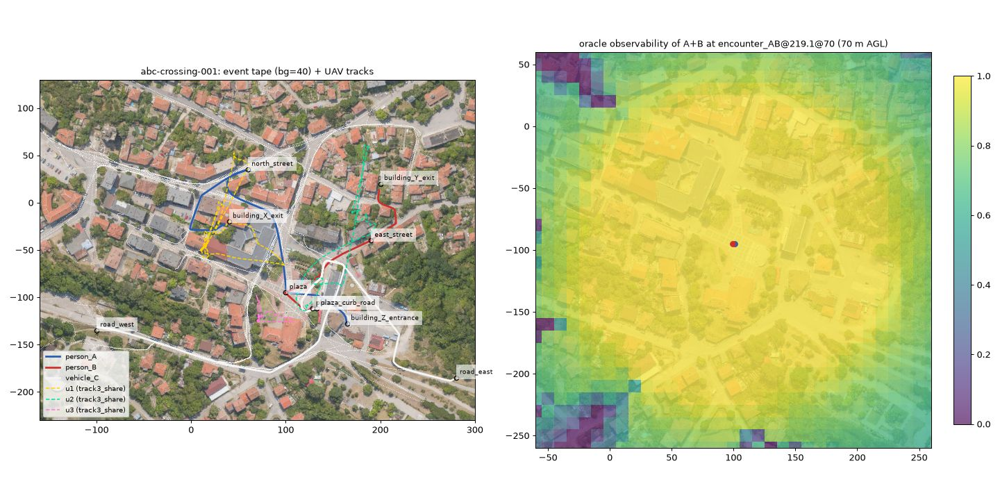

# r6 研究笔记：事件运行时与 Benchmark 设计（事件 DSL、NavMesh 行人与车辆、语义验证、Canonical Event Tape、观测隔离、通信模型、Agent SDK、数据集与指标）

> 研究单元：D3 / r6-event-benchmark　　日期：2026-10-11　　性质：只读研究，不修改项目代码与 `docs/research/d3/` 以外的文档
>
> 输入：用户设计讨论 `/data/projs/anet-drone-data/design-r1.md`（World/Event/Physics/Agent 权威分离、Canonical Event Tape、M22–M27、P0–P3）；D2 文档 `docs/04` §7（M18 识别物）、§11（沙盒 REST/WS、SDK、数据产品）；代码 `python/awr/sim/targets/{motion,runtime,model}.py`、`sim/sensors/{cbrng.py,backends/base.py,lidar/scan_rt.py}`、`sim/runtime/{inputlog,resim}.py`、`recorder/{writer,formats}.py`、`agent/{anet_mock,runtime}/`、`sandbox/batch.py`、`tools/sdk/awr_sandbox.py`、契约 `packages/contracts/{rt/rng_streams.json,rec/mcap_channels.json}`、`scenarios/s7-synthcity-relay.json`。交叉引用 D3 同期单元 r2（GLB 世界与 OSM 配准）、r3/r10（相机渲染）、r4（网格 LiDAR）、r5/r9（Gazebo）。
>
> 数据：`oryahovo_-_crop_1_-_metashape_texture_problems.glb`（2,879,110 三角形，CC-BY-4.0），从中裁出 600 m × 600 m 的事件舞台 `stage1`；`an_entire_small_town_scanned_by_a_drone.glb` 只用于比例尺核对。
>
> 实验环境：本机（Xeon E5-2603 v4，8 核，62 GB；Node 22.12、Python 3.12、numpy 2.5.4、trimesh 5.1 + embreex 4.4）；dmax（Xeon Gold 6326；容器 `d3-r6-event-benchmark`，`--cpus 16`，只用 CPU；镜像 `node:22-slim`（Node 22.23）与自建 `d3-r6-event-benchmark:py311`（Python 3.11、numpy 2.4.6、trimesh 5.1、embreex），工作目录 `/data/anet-drone4d-d3/r6-event-benchmark/`）。GLB 复用 `/data/anet-drone4d-d3/data/`（已存在，未重复传输）。
>
> 脚本与原始结果：`.cache/research/d3/r6-event-benchmark/`（`scripts/`、`node/`、`schema/event.v1.schema.json`、`events/`、`out/`、`web/github_repos.json`）。

---

## 0. 结论速览

| # | 主题 | 结论 | 关键实测 | 落点 |
|---|---|---|---|---|
| 1 | 事件舞台的比例尺 | 两个 Sketchfab 小镇 GLB **不是米制**。crop 文件 1 单位约 20.9 m，town 文件（根节点 ×2.5）1 单位约 8.4 m。事件速度（步行 1.4 m/s）、相机像素、通信距离都依赖比例尺，导入时必须标定 | 车长与车位间距测得 20.9 m/u；r2 用 OSM 配准得 20.935 m/u，两者相差 0.2% | M22（r2 已给出配准参数） |
| 2 | 行人与车辆的可走区域 | 用 Recast（recast-navigation-js 0.43.1，WASM）从摄影测量网格直接烘焙 NavMesh 可行，但需要两套 profile（人、车），并且要以种子锚点做连通性剪除，否则平屋顶和院落孤岛会被当成可走区域 | 600 m × 600 m、47.7 万三角形：人 NavMesh 本机 55.0 s、dmax 24.7 s；车 27.9 s / 11.3 s；两机 NavMesh 的 sha256 逐字节相同 | M22 产出 `walkable.navmesh`，M23 消费 |
| 3 | 事件 DSL `drone4d.event.v1` | 采用"角色 + 路线锚点（t = 到达时刻）+ 动作（spawn/wait/board/enter_building/despawn）+ 背景人群 + 环境关键帧 + 通信区 + 声明式注释 + 关系"的结构；编译分三级：静态校验、几何预检（路径长度、所需速度、自动排时建议）、生成后语义验证 | 首版手写的 8 段中 5 段不可行或不连通（所需速度最高 7.27 m/s），移近锚点后仍有 3 段不可行；静态校验对故意写错的脚本一次报出 5 类错误 | M23 |
| 4 | 脚本演员怎么动 | **脚本演员走运动学时间线（沿 NavMesh 路径按时刻参数化），背景人群走 DetourCrowd 并避让脚本演员**。不要把脚本演员也放进 crowd | crowd 模式下 200 名背景行人让 B 迟到 45 s，1000 名时 A、B 根本到不了广场，事件没有发生；运动学模式到达误差 0 s，背景 0/40/200/1000 人时脚本演员轨迹的 sha256 完全相同，背景与脚本演员最近距离 ≥ 0.51 m | M23 |
| 5 | 语义事件必须由世界状态验证 | 相遇、上车、进入建筑、区域经过、空中遮挡都能由事件带与网格射线计算出来；声明与计算不一致时要报错 | 5 条声明中 4 条验证通过；"A 在 0–300 s 内被遮挡 ≥ 3 s"未通过（A 的天空可见度最低到 0，但没有持续 3 s 的区间） | M23 验证器 + M27 真值 |
| 6 | Canonical Event Tape 的确定性 | 同一输入（事件、NavMesh、种子）下，WASM 生成的事件带在两台机器、两个 Node 版本上**逐字节相同**；内容哈希不能包含生成器版本等出处字段 | 本机重复 3 次整体 sha256 相同；本机与 dmax 的 body sha256 均为 `4b4cc78e…`，整体 sha256 因头中写了 Node 版本而不同 | M23/M27 |
| 7 | 事件带格式 | 20 B/演员/帧（mm 定点）的行式布局只能压到 1/2–1/3；改成"按演员分列 + 差分 + zstd"可压到 1/10 左右，约 17–21 B/演员/秒 | 43 名演员 360 s：3.1 MB → 0.27 MB | M27、M12 |
| 8 | 观测隔离与 Agent SDK | `reset(config)` / `step(obs, inbox) -> action` 足够；观测按 L0–L3 分级，Benchmark 只开放 L1 及以上；Env 内部日志带真值 id，交给 Agent 前剥离 | 原型中 Agent 拿不到 Env、事件带与真值；同一事件 6 种机队策略得到明显不同的观测与得分 | M26 |
| 9 | 通信模型 | 链路层（距离、遮挡、丢包、时延、带宽桶、事件干扰区）与应用层（M14 ANet 的委派与黑板）分开建模；全员广播的投递次数随机队规模平方增长，链路状态应按 1 s 缓存 | 3 机共享：12% 丢包（99.7% 发生在广场干扰区）、平均时延 20.6 ms、360 s 内 111 KB；60 机时 133 万次投递，L1 仍有 1.9 倍实时；30 机缓存链路后仿真耗时 −39% | M26 |
| 10 | 指标 | Event Capture、Understanding、Active Observation、Collaborative Efficiency 四类都能自动计算；Active Observation 不能只看机位，要看实际拿到的证据质量；协同收益要同时报告冗余度 | 覆盖式扫描（lawnmower）"机位得分"0.92，但实际证据得分 0；三机跟踪对 A 的平均同时观察机数 1.4–1.6，协同收益接近 0 | M27 |
| 11 | 跨机复现 | 事件真值（含射线计算）与 Benchmark 结果在两台不同 CPU、不同 numpy 版本的机器上除耗时外完全相同 | `event_truth.json`（去掉 perf）与 6 个策略的 `results.json` 逐项相等 | M27 |
| 12 | 定位 | 2025–2026 年的开源无人机基准多数是"固定场景 + 静态目标 + 单机导航/问答"（OpenFly、UAV-ON、TravelUAV、AerialVLN、CityNav、ESARBench、AirCopBench）；动态人群与事件脚本出现在 Isaac Sim IRA、MetaUrban、SimWorld、UnrealZoo、Habitat-GS，但它们不面向多无人机协同观测。Drone4D 的差异点是"同一事件带 + 可替换机队策略 + 由世界状态验证的事件真值 + 受限通信 + 自动评测" | 见 §13（36 个仓库的 star 与最近提交，2026-10-11 实测） | 定位与论文叙事 |

**实现者先看这 10 条：**

1. **先标定比例尺，再写事件。** GLB 的单位不一定是米（本次两个文件都不是）。比例尺错 20 倍时，"A 用 45 s 从 X 走到 Y"会变成 0.4 m/s 或 140 m/s 的无意义速度。M22 必须输出 `m_per_unit` 与配准参数（r2 已给出 town 8.374 m/u、yaw 168°），M23 只接受米制的世界包。
2. **事件编译是三道门。** 第一道静态校验（schema、引用、时间单调、上车目标是否为车且处于等待窗口）；第二道几何预检（每段 NavMesh 路径长度 / 可用时间 = 所需速度，超出步态上限即不可行，并给出"按步态中值排时"的建议时刻）；第三道生成后验证（由事件带重新计算相遇、上车等语义事件，与声明对比）。三道都过才发布事件带。
3. **脚本演员与背景人群分开推进。** 脚本演员（A、B、C）是事件的定义，必须按时刻精确到达，用运动学时间线；背景人群是环境，用 DetourCrowd，并在 crowd 中为每个脚本演员放一个"代理障碍"，让背景人群避让脚本演员。这样背景密度改变时，事件本身不变。
4. **共享锚点要分配站位。** 两人"在广场相遇"若都走到同一个锚点，会重叠在同一点（原型第一版最近距离为 0）。锚点类型为 zone 时按演员顺序分配环形站位（原型用 0.8 m 半径）。
5. **事件带存"状态"，语义事件另算。** 事件带每 0.1 s 记录每名演员的位置、朝向、速度、状态（缺席、移动、等待、在车内、在建筑内、离场）与容器（乘坐的车）；相遇、上车、进入建筑、遮挡都由验证器从事件带和网格计算，写入 `event_truth.json` 与 `event_graph.json`。
6. **内容哈希与出处分开。** 事件带的 `content_sha256` 只覆盖规范头（事件、NavMesh 哈希、记录布局）与帧数据；生成器名、Node 版本、耗时写在 `provenance`，不进哈希。否则同一事件在不同机器上"看起来不同"。
7. **Benchmark 跑 lockstep，不跑实时。** Env 每步把本机观测与收到的消息交给 Agent，等待动作（可设决策预算）；LLM 这类秒级决策用"决策时延模型"把动作推迟生效，而不是让仿真等它。D2 沙盒的 REST/WS 是实时会话接口，适合交互与演示，不适合公平评测。
8. **观测分级。** L0 真值（只用于调试与评测端）、L1 检测级（本原型：视锥 + 网格 LOS + 像素尺寸 + 天气透过率，Fast 档）、L2 渲染级（RGB/Depth/Seg 与 LiDAR 点云，r3/r4/r10）、L3 SITL/HIL。每个任务声明允许的最低档，排行榜按档分开。
9. **通信只在 Env 内发生。** Agent 之间不能有旁路；消息经 Env 的链路模型送达（或丢失），并全部写入 MCAP。M14 的 ANet（委派、黑板）是跑在这条链路上的一种"协同策略"，不是另一套通道。
10. **评测只读离线真值。** `truth/` 目录（事件真值、事件图、可观测性 oracle）在运行期对 Agent 不可见；正式测试集应采用"提交 Agent 容器、由服务端运行"的方式（CARLA Leaderboard、Habitat Challenge 的做法），才能保证观测隔离。

---

## 1. 需求拆解：本单元要回答什么

用户的诉求可以压缩为一句话：**固定沙盘里的固定事件，被数量、策略、协同方式都可变的无人机反复采集，每架机只有自己的视野，最后自动产出数据集与评分。** design-r1 已经给出总体架构（三种权威分离、GLB 派生多表达、Canonical Event Tape、M22–M27、P0–P3）。本单元负责其中"事件与评测"这一侧：

| design-r1 的建议 | 本单元细化的问题 | 本文位置 |
|---|---|---|
| M23 Event Runtime：事件 DSL、多实体关系、固定事件录制、事件图 | DSL 字段与语义；编译与预检；行人与车辆在 NavMesh 上怎么动（避障、速度分布、驻留、相遇、上下车）；语义事件怎么验证 | §3–§6 |
| §9 Canonical Event Tape | 格式、哈希、版本、跨机确定性、压缩 | §7 |
| §5.2 Exogenous 与 Interactive | 两种模式的推进方式、公平比较规则、反事实口径 | §8 |
| M26 Agent Observation SDK；§7 信息权限表 | 观测分级、动作与观测空间、隔离机制、与 D2 沙盒 REST/WS、M14 ANet、M20 Allocator 的关系 | §9 |
| §7 通信 `Message = f(sender, receiver, t, bandwidth, latency, loss)` | 链路模型、参数、复杂度、与 ANet 的分层 | §10 |
| §8 数据集目录、MCAP | 目录、通道、真值隔离、清单、体积 | §11 |
| §8 四类评价 | 公式、实现、实测、陷阱 | §12 |
| §12 与已有 Benchmark 对照 | 2025–2026 开源仿真器与基准的 star、活跃度、可借鉴点、差异化 | §13 |

### 1.1 D2 已有、可以直接复用的部分

| D2 资产 | 位置 | 在 D3 中的用途 |
|---|---|---|
| 识别物运动 `static / path / random_walk`、台阶绕行、OU 航向扰动、驻留 | `sim/targets/motion.py`（10 Hz，流 17 `targets_motion`） | Interactive 模式下的在线推进与反应；背景人群在没有 NavMesh 的旧世界里的退化方案 |
| 被发现状态机与反应（freeze、look_at、flee、hide、approach） | `sim/targets/runtime.py`、AWR-04 §7.4 | Interactive 模式的反应语义直接沿用 |
| 类别模板（尺寸、关键维度、反射率、热、声） | `packages/contracts/target/class_defaults.json` | 事件 DSL 的 `class` 缺省值来源；原型中人 0.5 × 0.35 × 1.75 m、车 4.5 × 1.8 × 1.5 m 取自该表 |
| 计数器式 RNG（SplitMix64 逐级派生，与调用顺序无关） | `sim/sensors/cbrng.py`、`rt/rng_streams.json`（流 1–18 已登记） | 事件运行时、通信、检测抽样新登记流号（§7.5） |
| 输入日志与重仿真（同一版本、同一输入序列下逐位一致） | `sim/runtime/{inputlog,resim}.py`（M08-AC-036） | Interactive 模式的复现；Benchmark 运行的审计 |
| MCAP 录制（zstd、分段、谱系、1 s flush） | `recorder/writer.py`、`rec/mcap_channels.json` | 每次运行的原始录制 `raw.mcap`（§11） |
| Mock ANet（键控时延 0.9–1.1 s、委派、回执、黑板） | `agent/anet_mock/`、`agent/runtime/blackboard.py` | 作为一种协同策略跑在 M26 链路模型之上 |
| 沙盒批处理（`--batch --until`，不占槽位） | `sandbox/batch.py`（M17-FR-048） | M27 批量运行的前身；需要改为 GPU Worker 队列 |
| 感知判据（Johnson/TTPF、照度、消光） | `sim/perception/` | L1 检测级观测的参数来源（像素阈值、透过率） |

D2 缺的是：基于网格的可走区域、脚本化的多实体事件与关系、事件真值与验证、按机隔离的观测与消息、可比较的批量运行与评分。

---

## 2. 实验总览

| 编号 | 内容 | 脚本 | 运行处 | 主要产物 |
|---|---|---|---|---|
| E1 | GLB → ENU 网格、正射与 DSM；比例尺核对；裁出米制舞台 | `scripts/prep_world.py`、`render_crop.py`、`prep_region.py` | 本机 | `out/{smalltown,oryahovo,stage1}/` |
| E2a | Recast 烘焙人、车两套 NavMesh；跨机哈希 | `node/build_navmesh.mjs` | 本机、dmax | `navmesh_{person,vehicle}.bin/json` |
| E2b | 事件 DSL 编译（静态校验 + 锚点解析）；错误样例 | `scripts/event_compile.py`、`schema/event.v1.schema.json`、`events/*.yaml` | 本机 | `plan_abc.json` |
| E2c | 事件带生成（运动学脚本演员 + DetourCrowd 背景）；crowd 对照；确定性；规模 | `node/tape_gen.mjs` | 本机、dmax | `tape_abc.{tape,json}`、`tapeK_bg{0,40,200,1000}` |
| E3 | 语义事件计算与声明验证；天空可见度；可观测性 oracle；事件图 | `scripts/semantics.py` | 本机、dmax | `event_truth.json`、`event_graph.json`、`observability.npz` |
| E4 | Benchmark 闭环原型：Env + Agent SDK + 链路模型 + 6 种机队策略 + 四类指标；12 个种子重复；机队规模 | `scripts/bench.py`、`sweep.sh` | 本机、dmax | `out/bench_local/`、`out/sweep_dmax_v3/`、`out/scale_v3/` |
| E5 | 数据集目录与 MCAP 导出 | `scripts/export_dataset.py` | 本机 | `out/dataset/abc-crossing-001/` |
| E6 | 2025–2026 仿真器与基准调研（GitHub API 实测 star 与最近提交） | `web/repos.txt`、`web/github_repos.json`、`web/last_commit.txt` | 本机、dmax | §13 |

复现命令（本机，`V` 为装有 numpy/scipy/trimesh/embreex/pyyaml/jsonschema/pillow/mcap 的虚拟环境）：

```bash
cd .cache/research/d3/r6-event-benchmark
$V/bin/python scripts/prep_world.py /data/projs/anet-drone-data/01-small-town/oryahovo_-_crop_1_-_metashape_texture_problems.glb oryahovo 0.1
$V/bin/python scripts/prep_region.py oryahovo 20.9 5.0 -5.0 300 0.5 stage1          # 比例尺 20.9 m/u，舞台 600 m × 600 m
(cd node && npm install recast-navigation@0.43.1 && node build_navmesh.mjs ../out/stage1 person && node build_navmesh.mjs ../out/stage1 vehicle)
$V/bin/python scripts/event_compile.py events/abc-crossing-001.yaml out/stage1/plan_abc.json
(cd node && node tape_gen.mjs ../out/stage1 ../out/stage1/plan_abc.json ../out/stage1/tape_abc)          # SCRIPTED=crowd 切换对照模式
(cd scripts && $V/bin/python semantics.py ../out/stage1 ../out/stage1/tape_abc ../out/stage1/plan_abc.json)
(cd scripts && $V/bin/python bench.py ../out/stage1 ../out/stage1/tape_abc ../out/stage1/plan_abc.json ../out/bench_local)
(cd scripts && $V/bin/python export_dataset.py ../out/stage1 ../out/stage1/tape_abc ../out/stage1/plan_abc.json ../events/abc-crossing-001.yaml ../out/bench_local track3_share ../out/dataset)
```

dmax 上的命令见附录 A。



---

## 3. 事件舞台：从 GLB 到可走区域（E1、E2a）

### 3.1 两个小镇 GLB 都不是米制

| 文件 | 三角形 | 网格 / 贴图 | 根节点变换 | 局部包围盒（单位） |
|---|---|---|---|---|
| `an_entire_small_town_scanned_by_a_drone.glb` | 1,996,759 | 49 / 16 张 JPEG（约 6.5 MB/张） | 轴交换 + 缩放 2.5 | x −108.6–19.3，y 1.16–12.4，z −96.5–117.7 |
| `oryahovo_-_crop_1_-_metashape_texture_problems.glb` | 2,879,110 | 80 / 16 张 JPEG | 轴交换，缩放 1 | x −108.6–−33.0，y 1.15–11.5，z −59.2–60.3 |

两个文件共用同一个局部坐标系（crop 是 town 的子集），只是根节点缩放不同。用 trimesh + embree 自上而下射线渲染正射图后，按 0.002 单位/像素放大停车场：一排车的车长约 0.22 单位、车位中心间距约 0.115 单位。按车长 4.6 m、车位 2.5 m 计，crop 文件约 **20.9 m/单位**，town 文件（×2.5）约 8.4 m/单位。r2 单元用 OSM 道路配准得到 town 8.374 m/单位、crop 20.935 m/单位（`.cache/research/d3/r2-glb-world/results/e04_crop_frame.json`），与本文估计相差 0.2%。按此比例，crop 覆盖约 2.5 km × 1.6 km、高差约 210 m，与真实 Oryahovo（多瑙河畔 25 m 到山顶约 200 m）一致。

**结论**：GLB 的单位不能默认为米。本文的事件舞台把 crop 网格按 20.9 m/单位缩放，以单位坐标 (5, −5) 为中心裁出 ±300 m（47.7 万三角形，高程 −14 至 99 m），坐标轴沿用模型轴（未做 r2 的 168° 偏航配准，事件内部不受影响）。

### 3.2 Recast NavMesh：两套 profile

| 参数 | 人 person | 车 vehicle |
|---|---|---|
| 体素 cs / ch | 0.3 m / 0.2 m | 0.3 m / 0.2 m |
| 半径 / 高度 / 爬升 / 坡度 | 0.4 m / 1.8 m / 0.4 m / 35° | 1.2 m / 2.0 m / 0.3 m / 20° |
| tile | 128 体素（38.4 m） | 128 体素 |
| 本机耗时（E5-2603 v4，单线程 WASM） | 55.0 s | 27.9 s |
| dmax 耗时（Gold 6326，node:22-slim） | 24.7 s | 11.3 s |
| NavMesh 大小 | 6.17 MB | 2.71 MB |
| 可走面积（剪除前） | 158,833 m²（舞台 36%） | 88,881 m² |
| sha256（两台机器相同） | `ef3a4492…41a86` | `03113309…71a204` |

观察（叠加图见 `out/stage1/navmesh_{person,vehicle}.png`）：

- 街道、广场、院落都被识别为可走；坡屋顶（> 35°）被排除；**平屋顶也被识别为可走**，与地面不连通。需要以种子锚点（本例为 `plaza`、`plaza_curb_road`）做 `floodFillPruneNavMesh`，剪除后再吸附锚点。第一次放置的 `building_X_exit`、`building_Y_exit` 落在孤岛上，剪除后吸附距离分别为 5.6 m、6.9 m，编译器据此告警。
- 停在路边的车是网格的一部分，会成为障碍；树冠下如果网格没有地面，那片区域就不可走。摄影测量网格缺失的建筑内部、背面需要在 M22 标注为"几何不完整"（design-r1 §4），否则"进入建筑"只能作为状态切换处理（本文就是这样做的）。
- 车辆 profile 只表达"能开过去"，不表达车道、方向、限速、路口规则。车辆路线在原型中会走捷径（例如穿过广场边缘的铺装区）。正式版应由 OSM 道路（r2 已下载 `osm/oryahovo_map.osm`）生成车道图，NavMesh 只用于停车、调头等自由区域。

recast-navigation-js 同时提供浏览器与 Node 两端：沙盘编辑器（M15/M06）可以加载同一份 `navmesh_*.bin` 显示可走区域、拖放锚点并实时预览路径，与服务端生成器使用同一份数据与同一个 WASM 实现。

---

## 4. 事件 DSL `drone4d.event.v1`

### 4.1 顶层结构

完整 JSON Schema 见 `.cache/research/d3/r6-event-benchmark/schema/event.v1.schema.json`，示例见 `events/abc-crossing-001.yaml`。

| 字段 | 含义 | 规则 |
|---|---|---|
| `schema`、`event_id`、`version` | 标识与版本 | `event_id` 小写短横线；修改任何影响事件带的字段必须加 `version` |
| `world{id, region, package_sha256}` | 世界包引用 | 必须引用 M22 产出的米制世界包；`package_sha256` 由编译器填写 |
| `anchors_ref` | 锚点文件（`drone4d.anchors.v1`） | 锚点 `{id, kind ∈ door/point/zone/curb, profile ∈ person/vehicle, xy 或 polygon, radius_m, seed?, building?, pair?}`；由沙盘编辑器标注，或从 OSM POI、建筑出入口自动生成后人工确认 |
| `seed`、`duration_s`、`tick_hz` | 种子、时长、事件推进频率 | 原型 10 Hz；种子只影响背景人群与外观抽样，不影响脚本演员 |
| `mode` | `exogenous` / `interactive` | §8 |
| `time_origin_utc` | 事件起点的仿真日历 | 供 M07 太阳位置、照度使用 |
| `actors[]` | 脚本演员 | 见 §4.2 |
| `background[]` | 背景人群与车流 | `{class, count, zone, speed_mps[lo,hi], pause_s[lo,hi], stream}` |
| `environment{interpolation, keyframes[]}` | 环境关键帧 | `{t, wind_mps, wind_dir_deg, gust_sigma_mps, rain_mm_h, visibility_m, fog?, cloud?}`；由 M07 解释，事件运行时只负责按时刻给值。原型中风进入无人机动力学（均值风 15% 残余漂移 + 阵风噪声），雨与能见度进入 L1 检测的透过率 `exp(−3.912 r / V)·(1 − 0.02·rain)`；L2 档由渲染器表现雨雾 |
| `comms.zones[]` | 通信干扰区 | `{id, polygon, t[from,to], extra_loss, extra_latency_ms?, bandwidth_scale?}`；由 M26 链路模型解释 |
| `annotations[]` | 声明式语义事件（作者的意图） | `{id, type, participants, window[from,to], params, salience?, label_zh?}`；编译后由验证器确认 |
| `relations[]` | 事件之间的关系 | `{src, rel ∈ before/after/during/overlaps/causes/enables, dst}`；时序关系由验证器检查，因果关系只作为标签 |
| `interactive{reactions, replan_on_block, max_deviation_m}` | Interactive 模式的附加规则 | Exogenous 模式忽略 |

### 4.2 演员与路线语义

```yaml
- id: person_B
  class: person                       # person / vehicle / dog / uav / machine / object（缺省值来自 M18 class_defaults）
  appearance: {preset: civilian, top_rgb: [190, 40, 40], bottom_rgb: [60, 60, 90], height_m: 1.68}
  gait: {speed_mps: [0.9, 1.8], accel_mps2: 1.0}
  route:
    - {t: 60,  at: building_Y_exit, do: spawn}      # 第一个路点必须是 spawn 或 exit_building
    - {t: 120, at: east_street}                      # t = 到达时刻；缺省 do = pass
    - {t: 210, at: plaza, dwell_s: 12, do: wait}     # 到达后停留 12 s
    - {t: 250, at: plaza_curb, do: board, target: vehicle_C}   # 上车：要求 vehicle_C 此刻在等待窗口内且距离 < 8 m
```

| 语义 | 规定 |
|---|---|
| `t` | **到达时刻**（不是出发时刻）。出发时刻 = max(上一路点实际到达, 上一路点 t) + 上一路点 `dwell_s`。可用时间 = 本路点 t − 出发时刻 |
| `tol_s` | 允许的到达误差（缺省 3 s）；运动学模式下误差为 0，crowd 与 Interactive 模式用它判定"事件仍然成立" |
| `do` | `spawn`、`pass`、`wait`、`enter_building`、`exit_building`、`board`、`alight`、`despawn`、`pickup`、`drop`；`board/alight` 需要 `target` 为 vehicle；`enter_building` 之后演员状态为 INSIDE，对所有传感器不可见 |
| `via` | 可选的中途锚点，只约束路径不约束时间（例如强制走某条小巷形成遮挡） |
| 速度 | 不写速度，只写时刻；编译器按 NavMesh 路径长度反算每段速度，并检查是否落在 `gait.speed_mps` 内 |

这种"锚点 + 时刻"的写法与 design-r1 的示例一致，优点是作者用事件语言思考（"A 在 215 s 到广场"），缺点是作者不知道路径有多长。因此编译器必须给出可行性检查与排时建议（§4.4）。

### 4.3 编译流水线

```text
event.yaml ──静态校验──> plan.json(event_sha256)
          （schema、锚点与演员引用、时间单调、profile 与类别、上车目标与等待窗口、relations 引用）
plan.json + anchors + NavMesh ──几何预检──> 每段路径长度、所需速度、可行性、建议时刻、锚点吸附距离
          ──生成──> tape.bin + tape.json（content_sha256）
tape + 世界网格 ──语义验证──> event_truth.json、event_graph.json、observability.npz；声明与计算对比（strict 模式下不通过即失败）
```

静态校验对故意写错的 `events/bad-001.yaml` 一次报出全部问题（退出码 2）：

```text
COMPILE FAILED
  - person_A: 未知锚点 north_streeet
  - person_B: route 时间必须严格递增 [60, 20, 210, 290]
  - person_B: 上车时刻 t=290 不在 vehicle_C 的任何 wait 窗口内
  - vehicle_C: 锚点 plaza 的 profile=person 与类别 vehicle 不符
  - annotation encounter_AB: 未知参与者 person_D
```

### 4.4 几何预检与自动排时（实测）

按 design-r1 示例的写法首次放置锚点与时刻，预检结果如下：

| 段 | NavMesh 路径 | 可用时间 | 所需速度 | 判定 |
|---|---|---|---|---|
| A：building_X_exit → north_street（锚点第一次放置） | 327.1 m | 45 s | 7.27 m/s | 不可行 |
| A：north_street → plaza（第一次放置） | 270.5 m | 65 s | 4.16 m/s | 不可行 |
| B：building_Y_exit → east_street → plaza（第一次放置） | — | — | — | 不连通（Y 在孤岛上，2 段） |
| B：plaza → plaza_curb（第一次的时刻） | 36.1 m | 15 s | 2.41 m/s | 不可行 |
| A：X → north_street（锚点移近后） | 133.7 m | 55 s | 2.43 m/s | 不可行 |
| A：north_street → plaza（移近后） | 174.1 m | 55 s | 3.17 m/s | 不可行 |
| B：east_street → plaza（移近后） | 110.5 m | 60 s | 1.84 m/s | 不可行（上限 1.8） |
| C：road_west → plaza_curb_road | 431.3 m | 60 s | 7.19 m/s | 可行（车辆按 0.7 × 上限判定） |

街道网络让路径比直线长 1.3–2 倍，凭直觉写的时刻多数不可行。编译器按步态中值（人 1.35 m/s、车 0.6 × 上限）给出建议时刻：A `[0, 99, 228, 307]`、B `[0, 59, 141, 180]`、C `[70, 135, 209]`。据此改写的最终事件（360 s）为：A 0 s 出门 → 95 s north_street → 215 s 广场（停 20 s）→ 300 s 进入建筑 Z；B 60 s 出门 → 120 s east_street → 210 s 广场（停 12 s）→ 250 s 在路边上 C 的车；C 150 s 出现 → 235 s 广场路边（等 30 s）→ 330 s 驶离；背景 40 人；180 s 起风 7 m/s、雨 4 mm/h；180–260 s 广场通信干扰（额外丢包 0.4）。

**建议**：编辑器在作者拖动锚点或修改时刻时实时调用预检（WASM 端单段路径查询为毫秒级），不可行段标红并给出"建议时刻"一键采纳。

### 4.5 与现有格式的关系

| 已有格式 | 关系 |
|---|---|
| D2 沙盒快照 `awr.sandbox.snapshot.v1` 的 `targets[]`（`motion.mode = path`、`path[]`、`dwell_s[]`、`loop`） | Interactive 模式下，编译器可把事件带的脚本演员降级为 M18 识别物（路径点取 NavMesh 折线，速度取每段反算值），沿用 M18 的反应状态机；Exogenous 模式不经过 M18 运动推进，只用其类别模板与签名 |
| ASAM OpenSCENARIO（XML 1.x / DSL 2.x）、esmini、CARLA ScenarioRunner | 面向道路交通，行为是"触发条件 → 动作"的状态机，适合车辆交互；Drone4D 的事件以"人在建筑与街道间按时刻移动"为主，用锚点 + 时刻更直接。可借鉴其触发器语法作为 Interactive 模式的扩展（例如"当 UAV 距 B < 30 m 时 B 改走 via 小巷"） |
| Scenic 3（概率场景语言） | 可借鉴"分布 + 约束 + 拒绝采样"生成同一事件模板的多个变体（锚点、时刻、背景密度的分布），作为 M27 的事件族生成器；单个 Benchmark 事件仍需固化为一条事件带 |
| Isaac Sim IRA（原 omni.anim.people）命令文件 | 每行"角色 + 命令 + 参数"（GoTo、Idle、LookAround、Sit、Queue），与本 DSL 的路线动作一一对应；若 P2/P3 引入 Isaac 渲染，可由事件带导出 IRA 命令文件或直接逐帧驱动角色骨骼 |
| ASAM OpenLABEL（objects、actions、events、contexts、relations，按帧区间标注） | `event_truth.json` 与 `event_graph.json` 应提供 OpenLABEL 导出，便于第三方工具读取（§6.4） |

---

## 5. NavMesh 上的行人与车辆运动（E2c）

### 5.1 两种推进方式的对照

| 方式 | 做法 | 优点 | 缺点 |
|---|---|---|---|
| crowd（对照） | 脚本演员与背景人群都是 DetourCrowd agent，每秒按"剩余路径 / 剩余时间"重设最大速度 | 自然的局部避让 | 到达时刻受背景密度影响，可能卡死 |
| kinematic（推荐） | 脚本演员沿 NavMesh 最短路径（Chaikin 平滑 2 次）按时刻参数化，梯形速度（加速度取步态值）；在 crowd 中放代理障碍（人 0.4 m、车 2.2 m）让背景人群避让 | 到达误差 0；事件与背景密度解耦 | 脚本演员之间不互相避让（需由作者或站位规则保证） |

实测（360 s、3600 帧，`out/stage1/tape_abc_bg*.json` 与 `tapeK_bg*.json`）：

| 背景人数 | crowd：脚本演员最大到达误差 | crowd：8 个计划到达中实际发生 | kinematic：最大到达误差 | kinematic：脚本演员轨迹 sha256 | kinematic：背景与脚本演员最近距离 |
|---|---|---|---|---|---|
| 0 | 6.1 s（车 C） | 8 | 0 s | `8dcc3190…`（4 种密度相同） | — |
| 40 | — | — | 0 s | 同上 | 0.76 m |
| 200 | 45 s（B 到 east_street） | 8（A 到广场迟 30 s，相遇窗口被破坏） | 0 s | 同上 | 0.67 m |
| 1000 | 6.1 s（只统计到达的 3 个） | **3**（A、B 没有到达广场，相遇、上车、进入建筑都没有发生） | 0 s | 同上 | 0.51 m |

**结论**：把脚本演员放进人群模拟，事件是否发生取决于背景密度，"同一事件"就不成立了。推荐 kinematic 方式；需要更真实的局部动作（侧身让路、短暂停顿）时，在路径参数化之外叠加一个不改变到达时刻的小幅横向偏移，而不是交给人群模拟。

### 5.2 行为要素的实现

| 要素 | 原型做法 | 正式版建议 |
|---|---|---|
| 避障 | 背景：DetourCrowd（RVO 类速度采样，`collisionQueryRange` 3 m，`separationWeight` 1.5）；脚本演员：路径本身在 NavMesh 内（已按半径腐蚀） | 同原型；车与人之间增加"人让车、车让人行横道"规则 |
| 速度分布 | 脚本演员：每段速度由时刻反算，夹在步态范围内；背景：每个目标点在 `speed_mps` 区间均匀抽样 | 背景按文献的步行速度分布（均值约 1.3–1.4 m/s，标准差约 0.2 m/s，按年龄与人群密度调整）截断正态抽样；车辆按道路等级限速与弯道限速 |
| 驻留 | 路点 `dwell_s`；背景到达目标后在 `pause_s` 区间抽样停留 | 增加"闲逛"（在 zone 内小范围随机游走）与"排队"动作 |
| 相遇 | 多名演员共用 zone 锚点时分配环形站位（0.8 m）；修复前两人重叠在同一点（最近距离 0） | 站位按"面对面 1.2 m"或"并排 0.8 m"模板；相遇时朝向对方 |
| 上下车 | 到达上车点时检查车辆处于 wait 且距离 < 8 m，状态转为 BOARDED，位姿跟随车辆；车辆离场时乘客一并离场 | 增加开门、走到车门的短段动画；下车反之 |
| 进入建筑 | 到达门锚点后状态转为 INSIDE（不可见） | 门锚点由 M22 从建筑轮廓与道路相交处生成；室内不建模 |
| 车辆 | 单独的车辆 NavMesh；运动学时间线；在行人 crowd 中放 2.2 m 代理 | 车道图（OSM）+ 纵向 IDM 跟驰 + 弯道限速；路口按先到先行 |
| 随机性 | 计数器式哈希 `u01(seed, stream, actor, goal_n, ch)`，与调用顺序无关 | 对齐 `cbrng.py` 的 SplitMix64 逐级派生，登记新流号（§7.5） |

### 5.3 生成性能

| 背景人数 | 本机耗时（Node 22.12） | dmax 耗时（Node 22.23） | 演员·步/秒（本机） | 常驻内存 |
|---|---|---|---|---|
| 0 | 1.2 s | — | 9.0 k | 181 MB |
| 40 | 4.2 s | 1.2 s | 36.5 k（dmax 129 k） | 203 MB |
| 200 | 13.4 s | — | 54.6 k | 214 MB |
| 1000 | 58.9 s | — | 61.3 k | 410 MB |

360 s 的事件在 40 名背景人时只需数秒；1000 人时约 1 分钟（单线程）。事件带离线生成一次、反复使用，这个开销可以忽略。注意：本机实验期间与其他单元共用（负载均值 20–28），本机耗时偏大，性能结论以 dmax 数字为准。

---

## 6. 语义事件由世界状态计算验证（E3）

### 6.1 检测器

| 类型 | 判据（原型参数） | 依赖 |
|---|---|---|
| `proximity_encounter` | 两名演员都在场，水平距离 < `dist_m`（3 m），持续 ≥ `min_dur_s`（5 s） | 事件带 |
| `board_vehicle` / `alight_vehicle` | 状态转移到 BOARDED，容器为目标车辆 | 事件带 |
| `enter_building` / `exit_building` | 状态转移到 INSIDE，发生点距门锚点 < 10 m | 事件带 + 锚点 |
| `zone_pass` / `zone_enter` / `zone_exit` | 进入 zone 半径 + 缓冲（25 m）的区间 | 事件带 + 锚点 |
| `aerial_occlusion` | 躯干点（离地 1.0 m）向上半球仰角 ≥ 25° 的 64 个等立体角方向射线，未被网格遮挡的比例（天空可见度）< `sky_vis_max`（0.35），持续 ≥ 3 s | 事件带 + 网格射线 |
| `mutual_occlusion`（规划中） | 演员 X 在某观察方向上被车辆或建筑遮挡 | 视点相关，放在观测侧评价而不是事件真值 |

### 6.2 验证结果

| 声明 | 类型 | 声明窗口 | 计算结果 | 验证 |
|---|---|---|---|---|
| `encounter_AB` | 相遇 | 195–250 s | 212.5–225.6 s | 通过 |
| `board_BC` | 上车 | 240–275 s | 250.0 s | 通过 |
| `enter_AZ` | 进入建筑 | 290–320 s | 300.0 s | 通过 |
| `cross_C` | 车辆经过广场 | 200–290 s | 222.5–279.1 s | 通过 |
| `hidden_A` | 空中遮挡 | 0–300 s | 无（A 的天空可见度中位数 0.72、最低 0，但没有持续 3 s 低于 0.35 的区间） | **不通过** |
| `encounter_AB before board_BC`、`board_BC before enter_AZ` | 关系 | — | 时序成立 | 通过 |

`hidden_A` 是本实验最有价值的结果：作者"以为" A 会在某处被遮挡，世界几何说没有。另外，验证器还发现了作者没有声明的事件：B 在 176–179 s 被遮挡（天空可见度 0）。正式版应把"未声明但发生的显著事件"也写入真值（标记 `declared: false`），这些是 Agent 意外可能发现的事件。

计算量：天空可见度 31,360 条射线（本机 2.5–5.8 s，dmax 0.85 s）；可观测性 oracle 446,520 条射线（本机 1.1–3.4 s，dmax 0.55 s，约 82 万条/s）。`event_truth.json`（去掉耗时字段）在两台机器上逐项相同。

### 6.3 可观测性 oracle

对每个已验证的关键事件取 3 个时刻（开始、中点、结束），在 10 m 网格 × {40, 70, 100} m AGL 的候选视点上计算"视点质量" = 参与者 5 个身体采样点的 LOS 比例 × 像素因子（参考相机 HFOV 40°、1920 px，人体有效尺寸 1.6 m 达到 30 px 记为 1）。它回答"在那一刻，哪里能看清这件事"，用于 Active Observation 指标的归一化（§12.3）。只看 LOS 不看距离时，广场在 70 m 高度几乎处处可见（第一版 oracle 全图接近 1），没有区分度；加入像素因子后最优区域收缩到参与者周围约 140 m（见上图右）。

### 6.4 事件图

`event_graph.json`（`drone4d.event_graph.v1`）：节点为实体（演员）与事件（类型、区间），边为 `participates_in` 与通过验证的时序关系。它对应 design-r1 的 G_E = (Entities, Events, Relations, Time)。建议：

- 节点 id 与注释 id 一致（未声明事件用 `e###`），便于 Understanding 指标按 id 对齐；
- 提供 OpenLABEL 导出：演员 → objects，相遇/上车/进入 → actions（frame_intervals），瞬时事件 → events，关系 → relations（subject、object 三元组）；
- 因果关系（`causes`、`enables`）只来自作者声明，验证器只检查其时序前提（原因不晚于结果）。

---

## 7. Canonical Event Tape：确定性与版本

### 7.1 内容

| 部分 | 内容 |
|---|---|
| 规范头 | `schema = drone4d.tape.v1`、`event_id`、`event_sha256`（编译后规范 JSON 的哈希）、`seed`、`mode`、`tick_hz`、`n_ticks`、记录布局、演员表（idx、id、class、scripted）、NavMesh 的 sha256（人、车）、环境关键帧、通信区 |
| 帧数据 | 每帧每演员 20 B：`x_mm, y_mm, z_mm`（i32）、`yaw_cdeg`（i16）、`speed_mmps`（u16）、`state`（u8：0 缺席、1 移动、2 等待、3 在车内、4 在建筑内、5 离场）、`container`（u8，乘坐的演员 idx，255 为无）、保留 2 B |
| 哈希 | `content_sha256 = sha256(规范头 JSON ‖ 帧数据)`；`body_sha256 = sha256(帧数据)` |
| 出处（不进哈希） | 生成器名与版本、recast-navigation 版本、Node 版本、耗时、内存、时序报告 |

### 7.2 确定性实测

| 检查 | 结果 |
|---|---|
| 本机同一输入连续生成 3 次 | 整体 sha256 相同（`9c1b3470…`，站位修复前的版本） |
| 本机（Node 22.12，E5-2603 v4）与 dmax（Node 22.23，Gold 6326）由同一 `recast.bin` 各自烘焙 NavMesh | NavMesh sha256 相同 |
| 两机各自生成事件带 | `body_sha256` 相同（`4b4cc78e…`）；整体哈希不同，原因是原型把 Node 版本写进了头部 |
| 背景人数 0/40/200/1000 时脚本演员列的哈希（kinematic） | 相同 |
| 语义真值与 6 个策略的评测结果 | 两机除耗时外逐项相同 |

原因分析：Recast/Detour 编译为 WASM 后只用单线程 IEEE-754 浮点，不依赖 CPU 的 FMA 或 SIMD 路径，因此跨机逐位一致；事件带对位置做毫米定点化，进一步屏蔽了末位差异。Python 侧（numpy、embree）的射线与统计在两机上也逐项一致，但这依赖于"同一份 wheel 的同一实现"，不应作为合同承诺。

### 7.3 版本与兼容规则

| 变化 | 处理 |
|---|---|
| 事件 DSL 中影响轨迹的字段（路线、时刻、背景、种子） | `event.version + 1`，新事件带，新 `content_sha256` |
| 世界包几何或 NavMesh 变化 | NavMesh 哈希变化 → 事件带失效，必须重生成；旧运行的评分不与新事件带混排 |
| 只改注释、关系、显示名 | 不改事件带；`event_truth.json` 重算并带新版本号 |
| 生成器、Node、recast 版本升级 | 重新生成并比较 `content_sha256`；相同则仅更新出处；不同则视为新版本并记录差异（最大位置偏差） |
| 渲染、传感器、GPU 驱动不同 | 不要求像素逐位一致（design-r1 §9）；要求同一仿真时刻、同一位姿、同一资产版本，并按观测档规定容差（例如 RGB PSNR、深度绝对误差、LiDAR 点距） |

### 7.4 体积与编码

| 事件带 | 行式原始 | 行式 + zstd | 按演员分列 + 差分 + zstd | 每演员每秒 |
|---|---|---|---|---|
| 43 名演员（3 脚本 + 40 背景），360 s | 3.10 MB | 1.38 MB（2.2×） | 0.27 MB（11.5×） | 17.4 B |
| 1003 名演员，360 s | 72.2 MB | 24.1 MB（3.0×） | 7.5 MB（9.6×） | 20.8 B |

建议正式格式采用"分列 + 差分 + zstd"的块（每 10 s 一个关键帧块），并在 MCAP 中以 `/event/actors` 通道存放（原型的 `truth.mcap` 用行式记录，3600 条消息、1.42 MB）。

### 7.5 随机流登记（建议）

现有 `rt/rng_streams.json` 已登记流 1–18。建议新增（实现时统一用 `cbrng.py` 的 SplitMix64 逐级派生）：

| 流号 | 名称 | 所有者 | 键 | 用途 |
|---|---|---|---|---|
| 19 | `event_runtime` | M23 | (seed, 19, actor_no, goal_n, ch) | 背景人群目标点、速度、停留、外观 |
| 20 | `comm_link` | M26 | (seed, 20, src_no, dst_no, msg_seq, ch) | 丢包、时延抖动 |
| 21 | `obs_fast` | M26 | (seed, 21, uav_no, actor_no, tick, ch) | L1 检测抽样、量测噪声、外观噪声 |

键里只用"谁、第几个、哪一帧"，不用"第几次调用"，这样策略不同（调用次数不同）时，同一架机对同一目标在同一帧的随机数仍然相同，策略之间的比较只反映策略差异。

---

## 8. Exogenous 与 Interactive 两种模式

| 项 | Exogenous（首个公开基准的主模式） | Interactive（扩展任务） |
|---|---|---|
| 事件推进 | 读取事件带，不在线计算 | M23 在线推进：脚本路线 + M18 反应状态机（被发现后 freeze、look_at、flee、hide、approach）；背景人群在线 crowd |
| 无人机能否改变事件 | 不能 | 能（目标逃离、躲进小巷、改走 via） |
| 事件真值 | 事件带 + 离线验证，一次计算，所有运行共用 | 每次运行产出"实现事件带"（realized tape），对其单独验证与评分 |
| 公平比较 | 同一事件带上直接比较不同策略 | 只比较"同一初始条件下的结果分布"（多个种子），不能声称两次运行的目标轨迹相同 |
| 复现 | 事件带哈希 + 运行种子 | 事件 DSL 哈希 + 种子 + 输入日志（M08 inputlog/resim）；同一版本下逐位一致 |
| 附加指标 | — | 被发现次数（沿用 M20 接力的硬指标）、事件偏离度（实现事件带与 Exogenous 事件带的逐演员平均位置偏差、事件集合差异） |

Interactive 模式实现上可以复用 D2 的 TargetRuntime：编译器把脚本演员的 NavMesh 折线转成 M18 的 `motion.path`（点数上限 64，必要时简化），反应参数取 DSL 的 `reaction`（缺省 M18 类别模板）。需要在 M18 增加两项能力：沿 NavMesh 而不是 DSM 绕行（`flee`、`hide` 的目标点要落在 NavMesh 上）；路线动作（board、enter_building）在反应结束后的恢复。

建议还提供一种"混合"设置：脚本演员 Exogenous、背景人群 Interactive（背景会躲避低空无人机）。它不改变事件定义，但让低空抵近观察有真实代价。

---

## 9. 观测隔离与 Agent SDK

### 9.1 观测分级

| 档 | 内容 | 计算 | 用途 |
|---|---|---|---|
| L0 Oracle | 演员真值位姿、事件真值 | 无 | 只用于调试与评测端；Benchmark 中禁止 |
| L1 检测级（Fast） | 每个成像传感器的检测列表：类别、像素尺寸、带噪地面位置、可识别时的外观描述（颜色等）、斜距；无真值 id | 视锥裁剪 + 身体 5 点网格 LOS + 车辆盒遮挡 + 像素阈值 + 雨雾透过率 + 键控抽样（本原型）；可与 M19 的 Johnson/TTPF 判据对齐 | 大规模策略搜索、协同算法比较 |
| L2 渲染级 | RGB/Depth/实例分割（r3/r10 的 Mesh 或 3DGS 渲染 + 动态前景合成）、LiDAR 点云（r4 网格射线）、IMU/GNSS 噪声 | GPU Worker | VLM、视觉检测与 Re-ID、建图 |
| L3 SITL/HIL | PX4 + Gazebo（r5/r9） | 少量机体 | 飞控与控制器验证 |

同一事件、同一机队可以分别在 L1 与 L2 运行；L1 的检测由 L2 的实例分割统计像素数验证其阈值（建议作为 M25 的标定测试）。

### 9.2 信息权限（在 design-r1 §7 的表上细化）

| 可以获取 | 默认不可获取 | 原型实现 |
|---|---|---|
| 本机传感器观测（按档） | 演员真值 id 与位置 | Env 日志中的 `_truth`、`_vis`、`_ident` 字段在交给 Agent 前剥离 |
| 本机带噪位姿（GNSS 0.5 m、1 s 相关）与速度 | 全局真实地图 | Agent 只拿到 `ground_hint`（DSM 查询，相当于公开地形），不拿网格 |
| 实际收到的消息 | 其他机未共享的观测 | 消息只经 Env 链路模型投递 |
| 任务简报（公开情报：目标外观描述、公开地图锚点如建筑门、任务区） | 事件带、未来轨迹、事件真值、oracle | `TARGETS` 颜色与 `anchors` 门位置作为简报；事件带与 truth 只在 Env/Evaluator |
| 仿真时钟 | 墙钟、其他 Agent 的内部状态 | — |

M20 当前使用的已知目标位置与禁入体属于"任务简报"的一种，Benchmark 任务需要声明简报内容，未知目标搜索任务不得下发。

### 9.3 接口

研究者实现：

```python
class DroneAgent:
    def reset(self, config: dict) -> None:
        """config：本机 id、机型与传感器（M21 目录）、起点或机巢、任务简报、通信参数（自身预算）、观测档。"""
    def step(self, obs: dict, inbox: list[dict]) -> dict:
        """obs：{t, pose(带噪), vel, battery, detections[] | images | lidar, ground_hint}
        inbox：[{src, payload}]（本步实际送达的消息）
        返回：{vel: [vx, vy, vz] | goto: [x, y, z], yaw_rate?, look_at?: [x, y, z] | gimbal?: {pitch, yaw}, zoom?,
               sensor?: {mode, active}, msgs: [{to: id | "*", payload, bytes}], report?: [claim...]}"""
```

Env（对齐 PettingZoo Parallel API，便于接入 MARL 框架）：

```python
env = drone4d.bench.make(world="oryahovo-crop1/stage1", event="abc-crossing-001@v1", fleet=fleet_cfg,
                         obs_level="L1", comm=CommCfg(...), mode="exogenous", seed=7)
obs, infos = env.reset()                       # infos[aid]["inbox"]
while env.agents:
    actions = {aid: agents[aid].step(obs[aid], infos[aid]["inbox"]) for aid in env.agents}
    obs, rewards, terms, truncs, infos = env.step(actions)
run = env.close()                              # run_manifest、raw.mcap、本机报告；评分由 Evaluator 离线计算
```

| 设计点 | 规定 |
|---|---|
| 步长 | 控制 10 Hz（与事件带同频）；传感器按各自频率产出，本原型检测 5 Hz |
| 动作空间 | 速度设定（与 D2 的 VelSetpoint16 一致）、航点、偏航速率、云台 look-at 或角度、变焦、传感器模式（M13/M19 的 `sensor/mode` 语义）、消息、报告；速度与加速度按 M21 机型限幅 |
| lockstep 与时延 | Benchmark 默认 lockstep：Env 等待全部 Agent 的动作（每步墙钟预算，超时沿用上一动作并计数）。LLM 等慢决策用"决策时延模型"：Agent 声明或由运行时测得决策耗时，动作在仿真时刻 t + 时延生效，期间机体执行上一指令。这样快速策略与慢速策略在仿真时间上可比 |
| 隔离 | 进程内运行只用于开发；正式评测把每个 Agent 放在独立容器（无网络），经本地 socket 与 Env 交换 `obs`/`act`；Agent 间只能经 Env 的链路模型通信 |
| 报告 | Agent 随时可提交 `report` 声明（事件类型、参与者的本机航迹 id 与外观、时间区间、位置、置信度、证据帧引用）；Understanding 指标只读这些声明（原型用统一的报告器代替，§12.2） |

### 9.4 与 D2 沙盒 REST/WS、M14 ANet、M20 的关系

| D2 组件 | D3 中的角色 |
|---|---|
| 沙盒 REST/WS（`/api/sandbox/v1`、`awr.rt.v1`）与 `tools/sdk/awr_sandbox.py` | 交互式会话：浏览器里摆放无人机、实时观看、手动控制。它是实时 pub/sub，频率与时钟受 sandbox100 档与治理器约束，适合演示与调试 Agent，不适合公平评测。建议在同一 SDK 中新增 `drone4d.bench` 子模块：本地 lockstep Env（原型即此形态）与远程 Benchmark Runtime 客户端（`/api/bench/v1/runs/{rid}/agents/{aid}`，消息为 `obs{k, t, ...}` → `act{k, ...}`） |
| 沙盒快照 `awr.sandbox.snapshot.v1` | 机队配置（`vehicles[]`、`nests[]`）沿用；新增 `event_ref` 与 `bench{obs_level, comm, mode}` 段 |
| 沙盒批处理 `POST /sessions/{sid}/batch` | M27 的前身；M27 需要任务队列、GPU Worker、并发、断点续跑与结果目录 |
| M14 Agent Runtime 与 ANet（Mock/真网）、黑板、合同网 | 作为"协同策略"的一类实现：每个 DroneAgent 内部可以持有 ANet 客户端；委派、报价、黑板单元的字节数与时延经 M26 链路模型（Mock ANet 的 0.9–1.1 s 是应用层时延，叠加在链路时延之上）。ANet 的能力发现与签名回执保留，用于研究"可信协作" |
| M20 Allocator 接口（预留模型、LLM、agent） | 作为集中式协同策略的插槽：地面站 Agent 收到各机消息后分配任务；同样只能使用简报与收到的消息 |
| M12 录制与回放 | 每次运行的 `raw.mcap` 沿用 M12 的写入器与通道约定（`RecPrefix8`、zstd、分段）；浏览器回放器可以加载运行与事件真值做对照显示 |
| M19 感知判据 | L1 检测级观测的像素阈值、透过率、照度参数来源；"明确捕获"事件可作为 L1 的 `ident` 判据 |

---

## 10. 通信模型（E4 的一部分）

### 10.1 模型

| 项 | 原型取值 | 说明 |
|---|---|---|
| 路径损耗 | 2.4 GHz 自由空间 `20 lg d + 20 lg f_MHz − 27.55`，非视距 +20 dB | 机间视距由网格射线判定 |
| 链路余量 | `M = 20 dBm − PL + 90 dBm`（发射功率 20 dBm、灵敏度 −90 dBm） | 1 km 视距余量约 10 dB |
| 丢包 | `PER = 1 / (1 + exp((M − 10) / 2))`；落在事件 `comms.zones` 内且时间在窗口内时，与 `extra_loss` 合成 `1 − (1 − PER)(1 − extra)` | 余量 10 dB 时 50% |
| 速率与时延 | 速率 `1 Mbps × clip(M / 30, 0.05, 1)`；时延 = 10 ms + 字节 × 8 / 速率 + U(0, 20) ms | — |
| 带宽 | 每机上行令牌桶 125 KB/s（1 Mbps），超出即丢弃并计数 | — |
| 随机数 | 键 (seed, src, dst, msg_seq) | 与发送顺序无关 |
| 记录 | 每次投递 `{t, src, dst, ok, lat_ms, los}` 写入 `/net/records` | 评测与回放 |

### 10.2 分层

```text
应用层：协同策略（共享目击、跟踪声明、分工、黑板、ANet 委派与回执）  ← Agent 实现
会话层：消息、广播、主题、可靠传输（重传、确认）                      ← SDK 提供可选库
链路层：距离、视距、干扰区、丢包、时延、带宽桶                        ← Env（M26）唯一实现
```

Agent 不能绕过链路层；可靠传输、压缩、摘要化都是策略的一部分，会体现在 Collaborative Efficiency 的成本里。高保真需要时可以用 ns-3 做离线联合仿真（同一 MCAP 链路记录回放），但不进入默认 Benchmark 路径。

### 10.3 实测（12 个种子，dmax）

| 策略 | 消息 | 投递 | 丢失 | 丢包率 | 平均时延 | 数据量 |
|---|---|---|---|---|---|---|
| track3_share（3 机广播目击与跟踪声明） | 1,703 条/运行 | 2,999 次 | 408 次 | 12.1% ± 2.6% | 20.6 ms | 111 KB ± 9 KB |
| track5_share（5 机） | 2,140 条 | 7,618 次 | 940 次 | 11.0% ± 1.0% | 20.6 ms | 141 KB ± 8 KB |

按默认种子运行的链路记录核对：丢失的投递 99.7% 以上发生在 180–260 s 的广场干扰区（`extra_loss` 0.4），窗口内丢包率 31–38%（只有一端在干扰区多边形内的链路才受影响）；60 m 左右高度的机间链路始终视距，未出现 NLOS。干扰窗口正好与相遇、上车时段重叠，这是事件脚本有意制造的困难。

### 10.4 复杂度：全员广播随机队规模平方增长

规模实验：N 架共享跟踪机均布在广场外 150 m 的圆上（`scaleN`），同一事件带，dmax 单进程（7 个配置并行，`out/scale_v3/`）。"链路记录"为每次（源、目的）投递尝试。

| N | 仿真耗时（360 s 事件） | 实时倍数 | 评测耗时 | 网格射线 | 链路记录 | 投递 | 数据量 | 航程 | EC | A 的同时观察机数 |
|---|---|---|---|---|---|---|---|---|---|---|
| 1 | 4.3 s | 84× | 0.1 s | 1.8 万 | 0 | 0 | 60 KB | 0.5 km | 0 | — |
| 3 | 9.1 s | 40× | 0.5 s | 15.8 万 | 4,244 | 3,722 | 140 KB | 2.8 km | 0.75 | 2.3 |
| 10 | 29.3 s（不缓存 31.8 s） | 12× | 3.0 s | 99 万 | 4.2 万 | 3.9 万 | 364 KB | 6.3 km | 1.0 | 5.8 |
| 30 | 78.4 s（不缓存 129.4 s） | 4.6× | 11.9 s | 317 万 | 37.5 万 | 35.2 万 | 1.0 MB | 28.7 km | 1.0 | 14.7 |
| 60 | 194.4 s | 1.9× | 34.1 s | 662 万 | 146 万 | 133 万 | 2.0 MB | 48.8 km | 1.0 | 27.3 |

（N = 1 只作计时：唯一一架机的起点离 A、B 的路线较远，EC 为 0。）

观察：

1. 投递次数约为 370–410 × N²，确实随机队规模平方增长；每条消息逐对做一次网格射线时，N = 30 的仿真耗时 129.4 s，按 1 s 缓存（对称）链路状态后降到 78.4 s（−39%）。N ≤ 10 时差别不大，主要开销是传感射线（每帧每机对视锥内全部演员各 5 条射线）。
2. N = 60 时仍有 1.9 倍实时，L1 档可以支撑"数十架、单核、离线"的实验；再往上需要按空间分块的链路计算、传感射线批量化（一次 embree 调用处理全部机体）以及评测端的时间分桶。
3. 玩具跟踪策略在机队变大时全部挤向同一目标：N = 60 时 A 平均同时被 27 架机观察，EC 在 N = 10 时已饱和。机队规模本身不是收益，协同策略才是；这也说明 CE 指标需要冗余度与边际收益曲线（EC 随 N 的变化）。
4. 原型第一版的统一报告器对目击做两两比较，转发的目击在每架机的日志中重复出现，N = 30 时评测耗时超过 25 分钟（被中止）；去重并按秒分桶后降到 11.9 s。评测器同样要按机队规模设计复杂度。

---

## 11. 数据集目录与格式（E5）

### 11.1 目录

在 design-r1 §8 的目录上，按"事件 → 真值（隐藏）→ 运行"三层细化。原型导出见 `.cache/research/d3/r6-event-benchmark/out/dataset/abc-crossing-001/`：

```text
dataset/
└── abc-crossing-001/                          # 一个事件（固定世界 + 固定事件带）
    ├── world_manifest.json                    # 世界包 id、区域、米制比例与坐标系、网格与 NavMesh 的 sha256、许可证与署名
    ├── event/
    │   ├── event.yaml                         # DSL 原文
    │   ├── plan.json                          # 编译结果（event_sha256、锚点吸附）
    │   ├── tape.bin                           # Canonical Event Tape 帧数据
    │   └── tape.json                          # 规范头 + content_sha256 + provenance
    ├── truth/                                 # 隐藏划分：评测端持有，运行期对 Agent 不可见；公开 dev 集可附带
    │   ├── event_truth.json                   # 语义事件（含未声明事件）、声明验证、天空可见度
    │   ├── event_graph.json                   # 实体 + 事件 + 关系（可导出 OpenLABEL）
    │   ├── observability.npz                  # 关键时刻视点质量 oracle
    │   └── truth.mcap                         # /event/actors（10 Hz）、/event/semantic
    └── runs/
        └── <run_id>/                          # 一次运行 = 事件带 + 机队配置 + 策略 + 运行种子 + 观测档
            ├── run_manifest.json              # tape content_sha256、策略、机队、种子、观测档、代码与镜像版本
            ├── raw.mcap                       # 原始录制：Agent 可见数据与运行时数据（下表）
            ├── uav-01/{state.jsonl, detections.jsonl, rgb/, depth/, seg/, lidar/}   # 从 raw.mcap 导出的便捷格式
            ├── messages.jsonl                 # 链路记录（含丢失）
            ├── actions.jsonl                  # 每机每步动作（L2 起必须）
            ├── reports.jsonl                  # Agent 提交的事件声明
            └── evaluation.json                # 评测结果（Evaluator 离线写入）
```

### 11.2 `raw.mcap` 通道

| 通道 | 编码 | 频率 | 说明 |
|---|---|---|---|
| `/uav/{id}/state` | json（正式版用 M12 的 `awr.DroneState64.v1` raw） | 10 Hz | 真实位姿、速度、云台指向；评测与回放用 |
| `/uav/{id}/obs/nav` | msgpack | 10 Hz | Agent 实际拿到的带噪位姿 |
| `/uav/{id}/obs/detections` | json | 传感器频率 | L1 检测（不含真值 id） |
| `/uav/{id}/camera/{name}/image`、`.../depth`、`.../seg` | `foxglove.CompressedImage` 等 | 传感器频率 | L2 |
| `/uav/{id}/lidar/{name}` | `awr.LidarScan8.v1` 或 `foxglove.PointCloud` | 10 Hz | L2（r4） |
| `/uav/{id}/action` | json | 10 Hz | Agent 动作 |
| `/uav/{id}/report` | json | 事件驱动 | Agent 声明 |
| `/net/records` | json | 每次投递 | src、dst、ok、时延、视距、字节 |
| `/env` | json（M07 `awr.env.keyframe.v1`） | 关键帧 + 1 Hz | 风、雨、能见度 |
| `/eval/hidden/obs_truth` | json | 传感器频率 | 每条检测对应的真值 id 与可见比例；**单独文件**（`truth/run_<id>.mcap`），不随运行数据发布 |

原型实测：3 机 360 s 的 L1 运行，`raw.mcap` 439 KB（11,637 条消息），`truth.mcap` 1.42 MB，导出耗时 0.38 s；MCAP 可用 `mcap` Python 库与 Foxglove 读取。

### 11.3 体积估算（L2，每机 360 s）

| 数据 | 假设 | 体积 |
|---|---|---|
| RGB | 1920×1080，H.265 约 8 Mbps（或 JPEG 5 Hz 约 0.4 MB/帧） | 约 360 MB（JPEG 约 720 MB） |
| Depth | 960×540，16 bit PNG，5 Hz | 约 0.9 GB |
| 实例分割 | 960×540 PNG，5 Hz | 约 90 MB |
| LiDAR（MID-360） | 20 万点/s × 16 B，zstd 约 2× | 约 0.6 GB |
| 状态、检测、动作、消息 | — | < 5 MB |

一次 3 机 L2 运行约 5–7 GB；100 次约 0.5–0.7 TB。dmax 的 49 TB 足够 P3 阶段的批量生成。建议 RGB 以视频分段存储、按需解码；对外发布时提供 LeRobot 格式（parquet + mp4 + 元数据）导出，便于具身学习社区直接加载。

### 11.4 划分与发布

- **dev**：事件带、真值、若干参考运行全部公开，用于方法开发；
- **test**：只公开世界包、事件简报与观测档，真值隐藏；参赛者提交 Agent 容器，由 M27 在服务端运行并评分（CARLA Leaderboard、Habitat Challenge 的方式）；
- 同一事件族（Scenic 式分布生成的变体）中，留出部分变体只在 test 中出现，检验泛化；
- 世界网格来自 CC-BY-4.0 的 Sketchfab 模型，数据集清单与页面必须保留原作者署名（写入 `world_manifest.json` 与 `THIRD_PARTY_NOTICES`）。

---

## 12. 评价指标（E4）

### 12.1 定义

记事件真值中经验证的关键事件集合为 E（本例 4 个：相遇、上车、进入建筑、车辆经过），事件 e 的区间为 [a_e, b_e]，参与者集合为 P_e；机队为 U；`ident(u, p, k)` 表示机 u 在帧 k 以识别级（L1：像素 ≥ 16 且可见比例 ≥ 0.5）观察到参与者 p。

| 指标 | 定义 | 说明 |
|---|---|---|
| **Event Capture**（EC） | `EC = |{e ∈ E : ∃u, ∀p ∈ P_e ∃k ∈ [a_e − 2, b_e + 2] ident(u, p, k)}| / |E|`；相遇这类多人区间事件另要求同一帧同时识别全部参与者 | 二值：事件是否被至少一架机完整看到 |
| EC 覆盖 | `[a_e, b_e]`（瞬时事件取事件前 2 s）内的感知帧中，在场参与者全部被同一架机识别的比例，对 E 取平均 | 看得多久 |
| **Event Understanding**（EU） | Agent 声明与真值按（类型、时间差 ≤ 15 s、参与者对应）一对一匹配，报告 precision、recall、F1 | 参与者对应：评测端用每条检测的隐藏真值 id 建立"Agent 航迹 → 真值演员"的映射 |
| **Active Observation**（AO_real） | 对每个关键时刻 τ：`q_real(τ) = max_u min_{p∈P} min(1, px/30)·vis`（τ ± 1 s 内），除以 oracle 在全部网格与高度档上的最大质量 `q*(τ)`，再取平均 | 实际拿到的证据相对"最好能拿到的"有多好 |
| AO_pos（参考） | 关键时刻各机所在格的 oracle 质量取最大，除以 q*(τ) | 只看机位不看相机指向；原型证明它会高估 |
| **Collaborative Efficiency**（CE） | 协同收益 `G = EC(fleet) − max_u EC(u)`（单机 EC 只用该机自己的观测）；冗余度 = 被识别时同时观察该目标的平均机数；成本 = 航程 km、通信 KB、丢包；CE 报告 `G`、`G / (|U| − 1)`、`ΔEC / km`、`ΔEC / KB` | 多机是否带来单机得不到的东西，以及代价 |
| 安全与合规（附加） | 近地告警次数、禁入体侵入、被发现次数（Interactive） | 沿用 M09、M20 |

### 12.2 统一报告器（原型的 Understanding 代理）

正式基准由 Agent 自己提交声明。原型为比较不同"观察策略"带来的理解差异，用同一个报告器读取各机日志（本机检测 + 收到的目击，相当于任务结束后回传）：按简报颜色判别蓝衣（A）与红衣（B）；同一时刻（±1 s）两人相距 < 4 m 记"相遇"；某目标最后一次被看到时 8 m 内有车、此后 20 s 以上再未出现记"上车"；最后一次被看到时距门锚点 < 10 m 记"进入建筑"。背景人群中约 10% 穿偏蓝、10% 穿偏红的衣服作为干扰，因此报告器会把干扰者当成目标，Understanding 明显低于 Capture。这正是事件理解需要 Re-ID 与时序推理的原因。

### 12.3 实测：同一事件、6 种机队策略、12 个运行种子（dmax）

全部机体使用 1080p、HFOV 40° 的相机（约相当于 2 倍变焦），检测 5 Hz，悬停与跟踪高度 45–60 m，覆盖扫描 70 m。运行种子只改变检测抽样、量测噪声、通信丢包与阵风，事件带固定。72 次运行（每次 360 s 仿真）在 dmax 上 10 进程并行共 60 s 完成，单次 4.2–7.7 s（47–86 倍实时）。汇总脚本 `scripts/aggregate.py`，原始结果 `out/sweep_dmax_v3/`。

| 策略 | 机数 | EC | EC 覆盖 | AO_real | AO_pos | U-F1 | 协同收益 | A 被观察 | B 被观察 | A 冗余 | 航程 km | 通信 KB | 丢包 |
|---|---|---|---|---|---|---|---|---|---|---|---|---|---|
| hover1_plaza：1 机悬停广场 | 1 | 0.50 | 0.31 | 0.63 ± 0.07 | 0.80 | 0.50 | 0 | 0.23 | 0.32 | 1.00 | 0.20 | 0 | — |
| hover3_anchors：3 机分守 X、广场、Z | 3 | 0.75 | 0.54 | 0.83 ± 0.07 | 1.00 | 0.80 | 0.25 | 0.42 | 0.32 | 1.00 | 0.60 | 0 | — |
| lawn3_cover：3 机覆盖扫描 | 3 | 0.25 | 0.04 | **0.00** | **0.92** | 0.00 | 0 | 0.04 | 0.07 | 1.00 | 8.44 | 0 | — |
| track3_nocomm：3 机各自跟踪 | 3 | 0.90 ± 0.12 | 0.79 ± 0.14 | 0.95 ± 0.09 | 0.97 | 0.53 ± 0.08 | 0 | 0.60 | 0.67 ± 0.30 | 1.48 | 1.77 | 0 | — |
| track3_share：3 机跟踪 + 共享目击与声明 | 3 | 0.88 ± 0.12 | 0.78 ± 0.13 | 0.88 ± 0.10 | 0.95 | 0.57 ± 0.13 | 0.02 | 0.59 | 0.84 ± 0.17 | 1.38 | 2.09 | 111 ± 9 | 12.1% |
| track5_share：5 机跟踪 + 共享 | 5 | **1.00** | 0.87 ± 0.08 | 1.00 | 1.00 | 0.65 ± 0.15 | 0.06 | 0.46 | 0.90 ± 0.11 | 1.62 | 2.89 | 141 ± 8 | 11.0% |

逐事件捕获率（12 个种子）：

| 策略 | 相遇 | 上车 | 进入建筑 | 车辆经过 |
|---|---|---|---|---|
| hover1_plaza | 1.00 | 0.00 | 0.00 | 1.00 |
| hover3_anchors | 1.00 | 0.00 | 1.00 | 1.00 |
| lawn3_cover | 0.00 | 0.00 | 0.00 | 1.00 |
| track3_nocomm | 1.00 | 0.58 | 1.00 | 1.00 |
| track3_share | 1.00 | 1.00 | 0.50 | 1.00 |
| track5_share | 1.00 | 1.00 | 1.00 | 1.00 |

结论（只是对玩具策略的观察，不是算法结论）：

1. **同一事件、不同策略，观测与得分确实不同**，这正是 design-r1 的核心命题（`Same World + Same Event + Different Policies ⇒ Different Observations`）。
2. **覆盖式扫描的"机位"很好，证据很差**：lawn3 的 AO_pos 0.92，AO_real 0。窄视场相机在移动中扫过事件现场，不等于看清了事件。AO 必须以实际证据质量为准。
3. **共享不总是更好**：track3_share 把 B 的观察率从 0.67 提到 0.84、上车捕获率从 0.58 提到 1.00，但因为"别人已声明就不抢"的简单规则，A 进入建筑的捕获率从 1.00 降到 0.50。这与用户提出的"保留认知分歧是否更有利"是同一类问题，需要在受控条件下用更好的策略系统研究。
4. **跟踪策略冗余高、协同收益低**：A 被观察时平均有 1.4–1.6 架机同时在看，最好的单机已经能捕获全部事件，协同收益只有 0–0.06。CE 必须和冗余度一起报告。
5. 跟踪类策略的事件理解（U-F1 0.53–0.65）明显低于其事件捕获（EC 0.88–1.00）。差距几乎全部来自漏报（除 lawn3 有 1 条时间错误的相遇声明外，precision 均为 1.0）：12 个种子中没有任何策略报出"上车"，因为偏红衣的背景行人在 B 上车之后仍被看到，报告器把它当成 B 的最后一次目击。这是典型的身份混淆，说明即使在 L1 档，事件理解也需要 Re-ID 与时序推理。

### 12.4 指标实现中的陷阱

| 陷阱 | 原型中的表现 | 规避 |
|---|---|---|
| 瞬时事件的参与者消失 | 上车后 B 不再在场，第一版把"只看到车"判为捕获 | 每个参与者在窗口内至少被同一架机识别一次；瞬时事件取事件前 2 s |
| oracle 只看 LOS | 广场在 70 m 高度几乎处处可见，oracle 无区分度 | 加入像素因子（参考相机）；AO 以实际证据为准 |
| 识别阈值脱离传感器 | 80° 广角 1080p 在 60 m 高度对人只有约 26 px，第一版所有人都"不可识别" | 观测档与相机型号绑定（M21 目录）；阈值与 M19 判据对齐并用 L2 分割像素数标定 |
| 统一报告器替代 Agent 声明 | 理解差异部分来自报告器本身 | 正式基准由 Agent 自己提交声明；报告器只作为基线 |
| 单一种子 | 跟踪策略标准差 0.12–0.30 | 每个配置至少 10 个运行种子，报告均值与标准差 |

---

## 13. 2025–2026 开源仿真器与基准调研

star 与"最近提交"于 2026-10-11 由 GitHub API 实测（`repos/{o}/{r}` 与 `commits?per_page=1`，原始数据 `web/github_repos.json`、`web/last_commit.txt`）。

### 13.1 事件与场景描述

| 项目 | star | 最近提交 | 定位 | 可借鉴 | 与 Drone4D 的差异 |
|---|---|---|---|---|---|
| carla-simulator/scenario_runner | 682 | 2025-09-29 | OpenSCENARIO 1.x/2.0 执行器，原子行为 + 触发器 + 判据 | "场景通过判据"即评测规则；触发器语法可用于 Interactive 模式 | 面向自车与道路交通 |
| esmini/esmini | 949 | 2026-10-06 | 轻量 OpenSCENARIO 播放器 | 无渲染、确定性的场景回放器形态，与本文的事件带生成器同类 | 只有车辆 |
| Scenic-Foundation/Scenic | 385 | 2026-10-05 | 概率场景语言（分布 + 约束 + 采样） | 事件族生成：同一模板抽样出多个变体用于训练与泛化测试 | 生成的是场景，不验证语义事件 |
| ASAM OpenLABEL（标准） | — | — | 对象、动作、事件、上下文、关系的按帧标注 | `event_graph.json` 的导出格式 | 只是格式 |
| Isaac Sim IRA（原 omni.anim.people），isaac-sim/IsaacSim | 4,243 | 2026-09-18（2025-05 开源） | 人与移动机器人的行为脚本（命令文件：GoTo、Idle、LookAround、Sit、Queue），Replicator 合成数据 | 动作语义与本文 DSL 对应；P3 若用 Isaac 渲染可由事件带导出命令 | GPU 重；不提供多无人机协同评测 |

### 13.2 具身与城市仿真（含动态人群）

| 项目 | star | 最近提交 | 定位 | 可借鉴 | 差异 |
|---|---|---|---|---|---|
| facebookresearch/habitat-sim / habitat-lab | 3,834 / 3,154 | 2026-05-07 | 室内具身仿真；Recast NavMesh；Habitat 3.0 人形；挑战赛容器提交 | NavMesh 用法、episode 数据集规范、容器化评测 | 室内、地面机器人 |
| zju3dv/habitat-gs | 315 | 2026-09-17（2026-04 新建） | Habitat + 3DGS 渲染 + 可驱动高斯人形（同时是视觉实体与导航障碍） | "3DGS 静态背景 + 动态人形"的合成方式，与 design-r1 的 `Composite(GS_static, Mesh_dynamic, Depth)` 一致 | 室内单机导航 |
| StanfordVL/BEHAVIOR-1K（OmniGibson） | 1,744 | 2026-10-10 | 家庭活动基准，BDDL 谓词定义目标条件 | "由世界状态谓词判定任务完成"与本文语义验证同理 | 操作任务 |
| metadriverse/metaurban | 257 | 2025-08-15 | 城市微出行；行人、轮椅、送货机器人；程序化街区 | 程序化城市与人群行为库 | 地面视角；不面向无人机 |
| SimWorld-AI/SimWorld | 795 | 2026-04-16 | UE5，LLM/VLM 智能体，程序化城市与交通，Gym 接口 | 语言驱动的环境生成；开放词汇动作 | 无多无人机观测评测 |
| UnrealZoo/unrealzoo-gym | 366 | 2026-09-29 | 100+ UE 场景，人、车、动物、机器人；主动跟踪；v3.0 异构多智能体 | 主动跟踪任务与动态目标；Gym 接口 | 场景不是真实摄影测量；目标运动无事件语义 |
| zfw1226/gym-unrealcv | 456 | 2026-01-15 | 主动目标跟踪环境（AD-VAT 等） | 跟踪奖励设计 | 单目标、单跟踪者为主 |
| louiszengCN/CarlaAir | 1,114 | 2026-08-14（2026-03 新建） | CARLA + AirSim 同进程，18 种传感器帧对齐，空地协同闭环 | 统一时钟与时间戳对齐；空地协同的闭环评测口径 | 道路交通场景；协同为 UAV–UGV |
| carla-simulator/carla | 14,475 | 2026-10-09 | 自动驾驶仿真 | 交通流、行人控制器 | 地面 |

### 13.3 无人机仿真后端

| 项目 | star | 最近提交 | 说明 |
|---|---|---|---|
| iamaisim/ProjectAirSim | 897 | 2026-10-07（2025-05 以 MIT 开源） | 可在无 UE 的轻量运行时中跑仿真核心，需要渲染时再接 UE5；与"Fast 档 + 渲染档"的分层思路相同 |
| Cosys-Lab/Cosys-AirSim | 436 | 2026-10-05 | UE5.5，LiDAR、回声、实例分割等传感器，维护活跃 |
| CodexLabsLLC/Colosseum | 668 | 2025-12-08 | AirSim 延续版，活跃度下降 |

### 13.4 无人机基准（导航、搜索、问答、协同感知）

| 项目 | star | 最近提交 | 任务 | 动态事件 | 多机 | 差异 |
|---|---|---|---|---|---|---|
| SHAILAB-IPEC/OpenFly-Platform | 370 | 2026-01-13 | 空中 VLN；UE、GTA V、Google Earth、3DGS 四种渲染；10 万条轨迹 | 否 | 否 | 可借鉴自动化数据工具链与 3DGS real-to-sim |
| AirVLN/AirVLN | 394 | 2026-03-25 | AerialVLN（ICCV 2023） | 否 | 否 | 固定指令导航 |
| iLearn-Lab/ACMMM25-UAV_ON | 100 | 2026-09-29 | UAV-ON：14 个 UE 环境、1270 个目标的开放世界目标导航 | 否 | 否 | 语义目标提示的写法可借鉴 |
| prince687028/TravelUAV | 285 | 2026-01-22 | OpenUAV 平台（UE4 + AirSim）、UAV-Need-Help、1.2 万条轨迹 | 否 | 否 | 连续 6 DoF 动作空间 |
| water-cookie/citynav | 142 | 2025-02-11 | CityNav：真实城市 3D 上的语言目标导航 | 否 | 否 | 真实城市点云 |
| tsinghua-fib-lab/EmbodiedCity | 301 | 2025-08-12 | 北京城市 UE 场景，无人机与地面机器人，5 类任务；UrbanVideo-Bench | 有限 | 否 | 城市级场景 |
| 4amGodvzx/ESAR（ESARBench） | 25 | 2026-05-06 | UE5 + AirSim，GIS 映射场景，天气、时段与线索随机放置，600 个搜救任务 | 线索静态 | 否 | 与本文"天气变化 + 线索发现"最接近，但单机且目标静止 |
| UnrealZoo/RescueBench | 8 | 2026-10-04 | 搜救基准 | — | — | — |
| Hub-Tian/UAVs_Meet_Embodied-Intelligence（含 AirCopBench，AAAI 2026） | 12 | 2026-10-05 | 多无人机协同感知问答：1.46 万题、14 类任务 | 否 | 是（离线多视角） | 问答基于已采集图像，无主动采集 |
| sijieaaa/UAVScenes（ICCV 2025） | 217 | 2025-11-17 | 多模态无人机数据集 | 否 | 否 | 固定航迹采集 |
| 论文：AGOS-Bench（2026-09）、UAV-Track VLA（2026-04，CARLA）、TrackVLA/EVT-Bench、UAV3D（NeurIPS 2024） | — | — | 空地协同搜索、空中跟踪、协同 3D 检测 | 部分有动态目标 | UAV3D 多机（离线） | 均无"固定事件 + 可替换机队 + 受限通信"的组合 |

### 13.5 基础组件

| 项目 | star | 最近提交 | 用途 |
|---|---|---|---|
| recastnavigation/recastnavigation | 7,953 | 2026-02-27 | NavMesh 与 DetourCrowd 的 C++ 实现 |
| isaac-mason/recast-navigation-js | 430 | 2026-02-04 | 本原型使用的 WASM 绑定（npm 0.43.1，2026-02-04 发布）；浏览器与 Node 同一实现 |
| PedestrianDynamics/jupedsim | 95 | 2026-10-09 | 经验证的行人动力学模型（无碰撞速度模型、社会力），可用于标定背景人群 |
| MengeCrowdSim/Menge | 154 | 2019-12-31 | 已停更 |
| Farama-Foundation/PettingZoo | 3,531 | 2026-10-09 | 多智能体 Parallel API，Env 接口对齐它 |
| foxglove/mcap | 1,112 | 2026-10-07 | 原始录制格式（D2 M12 已用） |
| huggingface/lerobot | 28,069 | 2026-10-08 | 具身数据集格式，可作为导出目标 |

### 13.6 差异化定位

已有工作分成三类：其一，固定场景中的单机导航与问答（OpenFly、UAV-ON、TravelUAV、AerialVLN、CityNav、EmbodiedCity、ESARBench），目标多为静态；其二，离线多机感知数据（AirCopBench、UAV3D），观测已经录好，不能主动改变；其三，有动态人群与脚本行为的通用具身平台（Isaac IRA、MetaUrban、SimWorld、UnrealZoo、Habitat-GS、CarlaAir），但不提供"事件真值 + 多无人机观测策略 + 受限通信"的评测协议。

Drone4D 可以占据的位置是：**在真实摄影测量城镇中，以经过世界状态验证的事件真值为核心，让数量、策略、协同与通信都可变的多无人机反复观测同一事件，并在 Capture、Understanding、Active Observation、Collaborative Efficiency 四个维度自动评分。** 与上述项目相比，下列组合目前没有看到公开实现：

1. 事件带（Canonical Event Tape）在跨机器上逐字节可复现，并与背景密度解耦；
2. 事件声明与世界几何的自动一致性验证（例如"作者以为会被遮挡"的声明会被拒绝）；
3. 机间通信作为可实验变量（链路层模型 + 事件内干扰区），并计入协同效率；
4. 同一事件可在 L1（检测级，数十倍实时，适合策略搜索）与 L2（渲染级）两档运行，结果可对照；
5. 浏览器沙盘（D2）与批量评测（M27）共用同一世界包、事件带与录制格式。

需要避免的说法：不能仅因"有时间属性"或"使用 3DGS"就声称首创（design-r1 §12）；投稿前应与 CarlaAir、UnrealZoo、ESARBench、AirCopBench 做系统对照实验。

---

## 14. 对 D3 架构的建议

### 14.1 模块职责（在 design-r1 §10 上细化）

| 模块 | 职责 | 输入 | 输出 | 本单元原型 |
|---|---|---|---|---|
| M22 World Asset Import | GLB → 米制世界包（比例尺、配准）、raycast BVH、人与车两套 NavMesh（剪除孤岛）、门与道路锚点草稿 | GLB、OSM | `world_package/`、`walkable_{person,vehicle}.navmesh`、`anchors.draft.json` | `prep_*.py`、`build_navmesh.mjs`（r2 有更完整的配准） |
| M23 Event Runtime | DSL 编译与预检；事件带生成（运动学脚本演员 + crowd 背景）；语义验证；事件图；Interactive 模式在线推进 | DSL、锚点、世界包 | `plan.json`、`tape.bin/json`、`event_truth.json`、`event_graph.json`、`observability.npz` | `event_compile.py`、`tape_gen.mjs`、`semantics.py` |
| M25 Sensor Generation | 按 tape 时刻与机体位姿生成 L1/L2 观测（同一时刻的 RGB、Depth、Seg、LiDAR 一致） | tape、位姿、传感器规格 | 观测帧 | L1 在 `bench.py`；L2 见 r3/r4/r10 |
| M26 Agent Observation SDK | Env（lockstep、观测隔离、动作限幅）、链路模型、Agent 接口、容器化隔离、远程协议 | 机队配置、Agent | 运行数据 | `bench.py` 的 `Env`、`DroneAgent`、`_link`/`_send` |
| M27 Benchmark Runtime | 批量运行队列（GPU Worker）、运行种子、MCAP 录制、评测、数据集导出、排行榜 | 事件、机队、策略矩阵 | `runs/`、`evaluation.json`、数据集 | `sweep.sh`、`evaluate()`、`export_dataset.py` |

### 14.2 推荐的实现路线

| 阶段 | 本单元相关的交付 | 退出标准（可测） |
|---|---|---|
| P0 | M22 输出米制世界包与两套 NavMesh；M23 的 DSL 编译、预检、kinematic 事件带、语义验证；M26 的 L1 Env 与 Agent SDK；M27 的单机批量运行与四类指标 | 同一事件带在两台机器上 `content_sha256` 相同；6 种参考策略的指标与本文 §12.3 同量级；声明不成立时编译失败 |
| P1 | 链路状态 1 s 缓存与空间分块、传感射线批量化；容器化 Agent；Interactive 模式（M18 反应沿 NavMesh）；车道图（OSM） | 60 架机的 360 s L1 运行单核不超过 2 分钟（原型 194 s）；Interactive 运行可经 inputlog 逐位重放 |
| P2 | L2 渲染档接入（r3/r10 相机、r4 LiDAR）；L1 阈值用 L2 分割像素数标定 | 同一运行 L1 与 L2 的识别判定一致率 ≥ 90%（阈值待定） |
| P3 | 事件族生成（Scenic 式分布）；test 集容器提交与排行榜；LeRobot/OpenLABEL 导出 | 无人值守生成 ≥ 100 次运行并自动评分 |

### 14.3 关键接口草案

```text
POST /api/bench/v1/events                {dsl, anchors_ref}           → 202 {event_id, compile_job}
GET  /api/bench/v1/events/{eid}          → {status, warnings[], segments[], retime{}, tape.content_sha256, checks[]}
POST /api/bench/v1/runs                  {event_id@version, fleet, policy_image | sdk_endpoint, obs_level, comm, mode, seeds[]}
GET  /api/bench/v1/runs/{rid}            → {status, progress, evaluation?}
WS   /api/bench/v1/runs/{rid}/agents/{aid}   lockstep：server→client obs{k, t, ...}；client→server act{k, ...}；超时沿用上一动作
```

事件编译与运行都是异步作业，沿用 D2 沙盒的 202 + 轮询模式与原因码风格（建议新码段 600–639 给 M23/M26/M27）。

---

## 15. 风险

| 风险 | 影响 | 缓解 |
|---|---|---|
| GLB 比例尺与配准错误 | 速度、像素、通信距离全部失真 | M22 强制 `m_per_unit` 与配准结果，事件编译拒绝无比例尺的世界包；用车长、车位、道路宽度做自检 |
| 摄影测量网格的缺陷（屋顶连片、树冠无地面、建筑内部缺失） | NavMesh 出现孤岛或不该有的通道；"进入建筑"无几何 | 种子剪除；锚点吸附距离告警（> 5 m）；建筑内部只做状态切换；M22 标注几何不完整区域 |
| crowd 与脚本演员耦合 | 事件在高密度背景下不发生 | 脚本演员走运动学时间线（已验证） |
| 车辆运动过于简化 | 车走捷径、穿越广场 | P1 引入 OSM 车道图与跟驰模型 |
| 观测档之间口径不一致 | L1 得分与 L2 得分不可比 | L1 阈值用 L2 分割像素标定；排行榜按档分开 |
| 通信与评测复杂度 | 全员广播 O(N²)，60 机时 133 万次投递；朴素评测器在 30 机时超过 25 分钟 | 链路状态 1 s 缓存、空间索引、按簇广播；评测端去重与时间分桶；见 §10.4 |
| 指标被策略"刷分" | 例如永远悬停在已知锚点 | 简报只给允许的情报；事件族变体与隐藏测试集；报告 AO_real 而不是 AO_pos |
| 浮点与库版本导致跨机不一致 | 复现失败 | 事件带用 WASM + 定点；内容哈希不含出处；渲染只要求容差内一致 |
| 统一报告器掩盖 Agent 能力差异 | Understanding 失真 | 正式基准由 Agent 提交声明 |
| 许可证 | 数据集再发布需署名 | 清单与页面保留 CC-BY-4.0 署名 |
| 共享机 dmax 资源 | 批量运行影响其他服务 | 只用 GPU 2、3 与 `--cpus 16` 以内；M27 队列限并发 |

---

## 16. 可复用实现清单

| 文件（`.cache/research/d3/r6-event-benchmark/`） | 内容 | 复用方式 |
|---|---|---|
| `schema/event.v1.schema.json` | `drone4d.event.v1` JSON Schema（draft 2020-12） | 作为契约草案提交到 `packages/contracts/event/` |
| `events/abc-crossing-001.yaml`、`events/anchors.stage1.json`、`events/bad-001.yaml` | 示例事件、锚点、错误样例 | 测试夹具 |
| `scripts/event_compile.py` | 静态校验（schema、引用、时间、profile、上车窗口、关系） | M23 编译器第一道门 |
| `node/build_navmesh.mjs` | Recast 人、车两套 NavMesh 烘焙与哈希 | M22 |
| `node/tape_gen.mjs` | 锚点剪除与吸附、几何预检、自动排时、kinematic 脚本演员、DetourCrowd 背景、代理障碍、zone 站位、上车与进入建筑、事件带写出 | M23 事件带生成器原型（`SCRIPTED=crowd` 为对照模式） |
| `scripts/tape.py` | 事件带读取 | M23/M27 |
| `scripts/semantics.py` | 相遇、上车、进入建筑、区域经过、空中遮挡的检测与声明验证；可观测性 oracle；事件图 | M23 验证器、M27 真值 |
| `scripts/bench.py` | Env（lockstep、观测隔离、L1 传感、链路模型、动力学与风）、`DroneAgent` 接口与 4 类参考策略、Evaluator（EC、EU、AO、CE） | M26/M27 原型与基线策略 |
| `scripts/sweep.sh` | 多种子并行运行 | M27 批处理 |
| `scripts/export_dataset.py` | 数据集目录、`raw.mcap`、`truth.mcap`、清单 | M27 导出 |
| `scripts/prep_world.py`、`render_crop.py`、`prep_region.py`、`plot_*.py` | GLB 正射、比例尺核对、舞台裁切、出图 | M22 工具 |

---

## 附录 A：dmax 命令与资源

```bash
# 工作目录 /data/anet-drone4d-d3/r6-event-benchmark/；GLB 已在 /data/anet-drone4d-d3/data/（未重复传输）
# rsync 本机 → dmax（ZeroTier）约 1.75 MB/s，46 MB 用时 27 s，无需 modelscope 中转
# 容器内 pip 需要 --network host 并挂载 systemd-resolved 的 resolv.conf，使用 bfsu 镜像
docker run --name d3-r6-event-benchmark-build --network host -v /run/systemd/resolve/resolv.conf:/etc/resolv.conf:ro python:3.11-slim \
  bash -c "pip install -i https://mirrors.bfsu.edu.cn/pypi/web/simple numpy scipy trimesh embreex pyyaml jsonschema pillow msgpack mcap"
docker commit d3-r6-event-benchmark-build d3-r6-event-benchmark:py311 && docker rm d3-r6-event-benchmark-build
# NavMesh 与事件带（node:22-slim，node_modules 从本机同步；容器内 npm 无法解析域名）
docker run --rm --name d3-r6-event-benchmark --cpus 4 -v $PWD:/w -w /w/node node:22-slim \
  bash -c "node build_navmesh.mjs ../dmax_check person; node build_navmesh.mjs ../dmax_check vehicle; node tape_gen.mjs ../dmax_check ../dmax_check/plan_abc.json ../dmax_check/tape_abc"
# 语义验证（跨机核对）
docker run --rm --name d3-r6-event-benchmark --cpus 16 -v $PWD:/w -w /w/scripts_v3 d3-r6-event-benchmark:py311 \
  python semantics.py ../stage1_v2 ../stage1_v2/tape_abc ../stage1_v2/plan_abc.json
# 12 种子 × 6 策略（10 进程并行，60 s），随后机队规模 1/3/10/30/60（链路缓存开/关）
docker run -d --name d3-r6-event-benchmark --cpus 16 -e P=10 -e PY=python -v $PWD:/w -w /w/scripts_v3 d3-r6-event-benchmark:py311 bash -c "
  ./sweep.sh ../stage1_v2 ../sweep_v3 1 2 3 4 5 6 7 8 9 10 11 12;
  (for n in 1 3 10 30 60; do echo \"LINK_CACHE=1 python bench.py ../stage1_v2 ../stage1_v2/tape_abc ../stage1_v2/plan_abc.json ../scale_v3/cache_\$n scale\$n\"; done;
   for n in 10 30; do echo \"LINK_CACHE=0 python bench.py ../stage1_v2 ../stage1_v2/tape_abc ../stage1_v2/plan_abc.json ../scale_v3/nocache_\$n scale\$n\"; done) | xargs -P 7 -I{} bash -c '{}'"
docker rm d3-r6-event-benchmark
```

注意：dmax 上的 `python:3.12-slim` 镜像是 arm64 架构（在 amd64 主机上经模拟运行，且没有 embreex 的 wheel），应使用 `python:3.11-slim`（amd64）。

实验结束后容器均已停止并删除；保留镜像 `d3-r6-event-benchmark:py311`（549 MB）。只使用 CPU，未占用 GPU。

## 附录 B：原始数据位置

| 数据 | 位置 |
|---|---|
| 正射与 NavMesh 叠加图 | `out/stage1/{ortho_grid,navmesh_person,navmesh_vehicle}.png` |
| NavMesh 统计 | `out/stage1/navmesh_{person,vehicle}.json`（本机）；dmax 为 `/data/anet-drone4d-d3/r6-event-benchmark/dmax_check/` |
| 事件带与时序报告 | `out/stage1/tape_abc.json`、`tapeK_bg{0,40,200,1000}.json`（kinematic）、`tape_abc_bg{0,200,1000}.json`（crowd 对照） |
| 语义真值 | `out/stage1/event_truth.json`、`event_graph.json`、`observability.npz` |
| 单种子 6 策略（本机与 dmax 一致） | `out/bench_local/results.json`、`out/bench_dmax_v3/results.json` |
| 12 种子 × 6 策略 | `out/sweep_dmax_v3/seed*/results.json`、`aggregate.json`（v2 为报告器去重前的版本，指标相同） |
| 规模实验 | `out/scale_v3/{cache,nocache}_N/results.json` |
| 数据集样例 | `out/dataset/abc-crossing-001/` |
| GitHub 调研 | `web/github_repos.json`、`web/last_commit.txt` |
| 早期迭代（指标定义变更前，仅供追溯） | `out/sweep_dmax/`（v1：AO 只看机位）、`out/sweep_dmax_v2/`（报告器去重前） |
| 评测器性能剖析 | `out/prof_scale10.txt`（cProfile：去重前的报告器占 10 机运行总耗时的 64%） |
