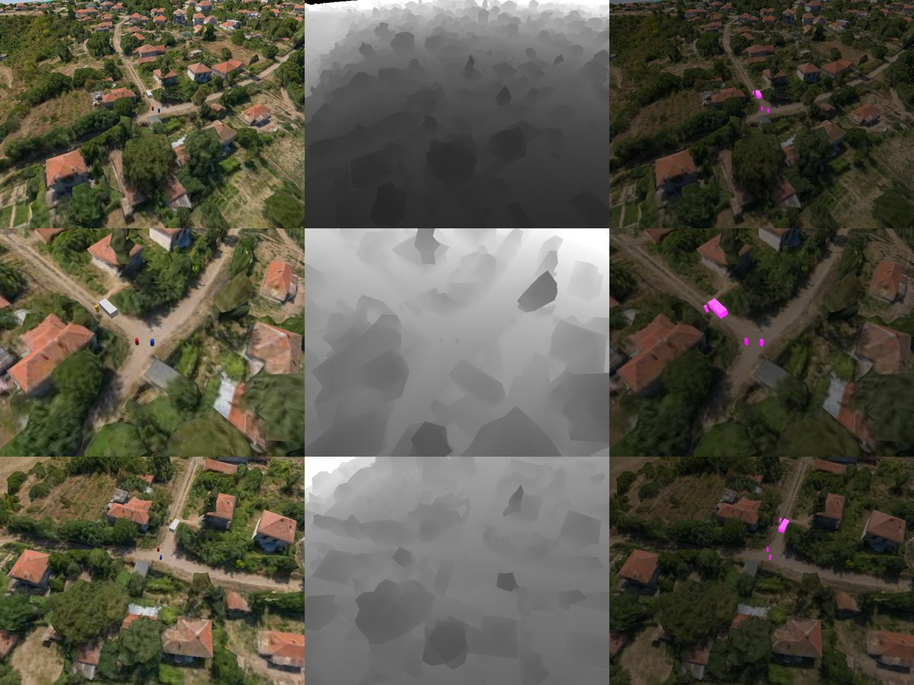
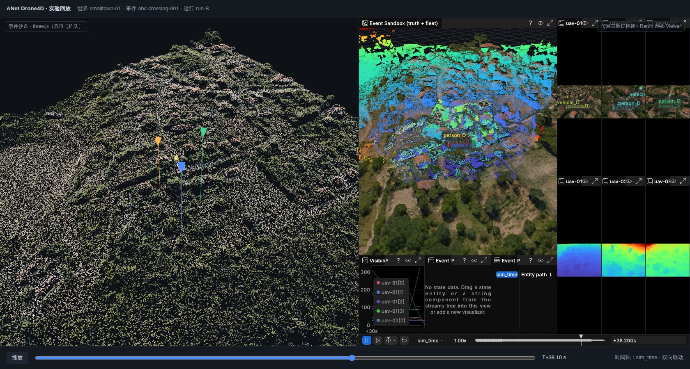

# R8 研究笔记：Rerun —— 多模态时空数据的记录、查询与可视化

> 研究单元：r8-rerun ｜ 日期：2026-10-11 ｜ 所属：D3 研究工作流（事件驱动的 4D 沙盘）
>
> 仓库快照：`refs/d3/rerun`（浅克隆，`--depth 1 --filter=blob:limit=2m`，86 MB），提交 `0c48413`（2026-10-10，main 为 `0.39.0-alpha.1+dev`）。GitHub 11,582 stars / 863 forks（2026-10-11 查询）。
>
> 实测版本：`rerun-sdk==0.38.1`（PyPI 最新稳定版，2026-09-16 发布；`0.39.0rc1` 于 2026-10-08 发布）、`@rerun-io/web-viewer@0.38.1`、Rerun CLI 0.38.1（含原生 Viewer、Web Viewer 与 OSS catalog 服务）。
>
> 实测环境：
> - 本机：8 核、62 GB、无 GPU。机器同时承载 D2 验收任务，部分测量期间系统负载为 15–18，相关数值偏保守。
> - dmax：容器 `d3-r8-rerun`（`python:3.11-slim`，`--cpus 16`，cpuset 32–47，不使用 GPU），工作目录 `/data/anet-drone4d-d3/r8-rerun/`。实验结束后容器已删除，大文件已清理。
>
> 产物：脚本与结果在 `.cache/research/d3/r8-rerun/`（`scripts/`、`results/`、`web/`）。统计完成后已删除体积较大的数据缓存与 `.rrd`，统计数据保留在 `results/*.json*`；另保留一份 12 s 时间窗演示录制 `out/rrd/web_win_video.rrd`（114 MB），可直接用 Rerun 0.38.1 打开。插图在 `docs/research/d3/r8-assets/`。
>
> 与既有笔记的关系：n04 §2.8、§3.6.4、§3.7 与 n01 把 Rerun 定为"仅开发期旁路"，PRD NG-09 规定不把 Rerun 查看器嵌入产品 UI。本文依据 D3 的新目标重新评估 Rerun 的定位。D3 的新目标包括批量事件数据集、跨策略回放和 Agent 观测调试。评估结论是：扩大 Rerun 的采用范围，但不改变产品 UI 的技术基线，详见 §10.1。r10 已按本单元的实体路径约定记录相机数据；本文 §10.4 对约定做了一处修订（`Pinhole` 下移一级），原因见 §9.7。

---

## 0. 结论速览

| 维度 | 结论 | D3 采用方式 | 推荐度 |
|---|---|---|---|
| 数据模型 | 由三部分组成：实体路径；组件（Archetype 是一组组件的约定集合）；多时间轴与静态数据。底层是 Arrow 列式 Chunk。变换树支持命名坐标系（`child_frame` / `parent_frame`）和 `Pinhole` 投影 | 直接映射 D3 的"世界 / 真值 / 机队 / 评测"四棵子树。时间轴统一为 `sim_time`（duration）与 `tick`（sequence） | 5/5 |
| 传感器与几何类型 | 覆盖 RGB（原始、JPEG/PNG、H.264/H.265/AV1 视频流）、深度（原始 f32/u16，PNG/TIFF/RVL 编码）、实例与语义分割（配合 AnnotationContext）、点云、网格、GLB 资产、体素栅格、3D 高斯（实验性）、标量与带方差的测量、状态泳道、文本日志 | 覆盖 D3 的全部观测与真值类型，不需要自定义组件 | 5/5 |
| 存储（`.rrd`） | 每个 Chunk 编码为 Arrow IPC 并做 LZ4 压缩。文件尾的 footer 带 Chunk 清单，可按实体或时间随机读取。`application_id` 与 `recording_id` 都相同的多个文件会被自动合并 | 作为每个 Run 的评审格式与分发格式；观测层与真值层分文件写出 | 4/5 |
| 查询 | 本地查询用 `RrdReader` / `LazyStore` / `ChunkStore` 加 DataFusion；`rr.server.Server`（开源 catalog）把多个 Run 组织为 dataset / segment / layer / asset，支持跨 Run 过滤、重采样和 latest-at 填充 | 一个事件对应一个 dataset，一次 Run 对应一个 segment，观测与真值各为一个 layer，世界底图作为 asset | 4/5 |
| 可视化 | 原生 Viewer（wgpu + egui）；Web Viewer（Wasm 49 MB，gzip 后 16 MB，优先 WebGPU，可回退 WebGL）；JS API 提供时间、播放、选择事件及时间设定；Blueprint 用代码定义版面 | 用作研究者工作台和网页"数据检视"面板。三维事件沙盘继续由现有 three.js 承担 | 4/5 |
| 远程流式 | SDK 侧 `serve_grpc` 缓存数据，供迟到的客户端补齐；`rerun+http://…/proxy` 可直接打开；catalog 提供带时间选区的深链接 | 实验运行中的实时旁路，以及可分享的回放链接。慢客户端会对写入端施加背压（§9.8），必须与仿真主循环解耦 | 3/5 |
| MCAP 互通 | 内置的 MCAP 导入器能按语义解码 Foxglove schema 与 ROS 2 消息；自研 awr 编码只能按原始消息导入 | MCAP 仍是原始权威录制，`.rrd` 由导出器派生。D3 新增的传感器通道采用 Foxglove schema | 4/5 |
| 许可与版本 | MIT OR Apache-2.0。`.rrd` 只保证能读上一个 minor 版本生成的文件。SDK、Viewer 和 npm 包的版本必须一致。原生 SDK 与 CLI 默认发送匿名使用统计，可关闭 | 锁定 0.38.x；归档时记录 Rerun 版本；升级时用 `rerun rrd migrate` | — |
| 不适用 | 不作为产品主沙盘 UI：Rerun 为 egui 体系，没有中文界面，也没有业务控件。不作为快速照片级相机传感器：3DGS 渲染靠 CPU 排序，只用于显示 | 不采用 | — |

**关键结论（实现前先读）**

1. **D3 的"同一事件、多次 Run"与 Rerun catalog 的 dataset / segment / layer 结构一一对应。** 一个事件（world + event + seed）对应一个 dataset。每次 Run 对应一个 segment，`recording_id` 取 `run_id`。观测层（`/fleet/**`）和真值层（`/truth/**`、`/eval/**`）作为同一 segment 的两个 layer 分别注册。评测端两层都注册；面向 Agent 和外部数据集用户的 catalog 只注册观测层，**"每机无全局视野"因此在存储层就得到保证**。已实测：在只含观测层的 dataset 上查询真值返回 0 行（§9.6）。

2. **写入吞吐满足在线记录，高频小消息必须列式写入。** 测试负载为 3 机 × 60 s：RGB、Depth、实例分割均为 640×480 @ 5 Hz，LiDAR 每帧 2 万条射线 @ 10 Hz，位姿 50 Hz，真值 4 个实体 @ 50 Hz。
   - dmax 16 核：JPEG 档用 `send_columns` 写完需 **5.0 s（12 倍实时）**，其中 SDK 本身 1.5 s，其余为编码；改用逐行 `log()` 需 7.9 s。10 机 × 60 s 需 15.1 s（4 倍实时）。按无人机分片、各用一个进程并行写入时，每片约 1.5 s，总时间近似线性缩短。
   - 本机 8 核（与验收任务共享）：列式 14.0 s，逐行 22.4 s；10 机 × 300 s（15,050 帧相机、9.8 GB）单进程 279 s，瓶颈在编码。
   - Python `log()` 每次调用约 0.4–0.6 ms，高频位姿与标量应缓冲约 1 s 后用 `send_columns` 写入（§9.2）。

3. **体积主要来自深度图，而不是 RGB。** JPEG 档约为每机每分钟 192 MB，其中深度（u16 厘米精度，LZ4 压缩）占 67%，LiDAR 占 18%，RGB 占 13%。
   - 深度改为 PNG 后降到每机每分钟约 120 MB。
   - RGB 改为 H.264 视频流后，RGB 部分再减 58%。
   - 推荐的数据集档位（H.264 + PNG/RVL 深度）约 **105 MB/机·分钟**。该数字对应的 LiDAR 量程为 70 m，平均每帧 4,758 个回波。若按每帧满 2 万点估算，约为 215 MB/机·分钟（§9.3）。

4. **查询必须走 footer 的惰性路径。** 在 576 MB 的录制中：
   - 只取三机位姿与遥测时，`RrdReader(path).store().stream().filter(...)` 用时 0.08 s；`RrdReader(path).stream().filter(...)` 要扫描全文件，用时 3.2 s，前者快约 40 倍。
   - 三机 10 Hz 重采样并做 latest-at 填充用时 9 ms。
   - 开源 catalog 对 3 个 Run 的评测层做跨 Run 查询用时 55 ms（§9.5）。

5. **嵌入式 Web Viewer 与 three.js 沙盘可以双向联动时间。** `WebViewer.on("time_update")` 驱动沙盘；沙盘时间轴通过 `set_current_time(recording_id, "sim_time", ns)` 驱动 Viewer。已在 headless Chromium（SwiftShader）中验证并截图；H.264 视频流可通过 WebCodecs 解码（§9.7）。

6. **Web Viewer 的数据摄入受每帧 10 ms 的预算限制。** `re_viewer/src/app/logic.rs` 中，每帧最多摄入 10 ms 的数据，以免阻塞主线程。在无 GPU 的 headless 环境中，摄入速度只有 0.5–0.7 MB/s。因此网页端必须遵守三条：按需取数（catalog）、按时间窗切分（`rerun rrd split`）、限制同屏视图数量。不能用 HTTP 直链整体下载数百 MB 的 `.rrd`（§9.7、§11）。

7. **MCAP 与 `.rrd` 互补，不互相替代。** 同等内容下，MCAP（zstd）为 449 MB，`.rrd`（LZ4）为 576 MB，MCAP 小 22%。Rerun 导入 Foxglove schema 的 MCAP 需 7.0 s，变换、相机标定、图像、点云都能映射为对应的 Archetype；但 `RawImage 16UC1` 会被映射成普通 `Image`，深度语义随之丢失。D1/D2 已冻结 awr 编码和 McapSource 的 seek 算法，MCAP 继续承担可逐字节重放的原始录制。`.rrd` 由 awr MCAP → `.rrd` 导出器派生，承担可查询、可视化与分发（§9.4、§10.2）。

8. **有三条实现约束会直接导致数据显示错误，必须写进规范：**
   - `application_id` 不得含点号。点号会被规范化为 `-`，并追加 4 位哈希后缀。
   - 同一实体上同时写 `Transform3D` 与 `Pinhole` 时，`Transform3D` 会接管该变换关系，3D 视图随即报告 "2D visualizers require a pinhole ancestor"。内参必须放在子实体 `/cam0/image` 上。
   - 实体路径过滤表达式只支持末尾的 `/**`，不支持中间通配符。跨机选择同一模态时，需按机队清单显式展开。

9. **在线旁路不能挂在仿真主循环上。** 实测中，`serve_grpc` 面对处理较慢的 Web 客户端时不会丢弃消息，而是阻塞发送端（`re_quota_channel` 的设计）。写入端在仿真时间 10.6 s 处被阻塞超过 5 s，flush 超时。D3 的实时可视化必须由独立中继进程读取总线并有损转发（§9.8、§10.2）。

10. **Rerun 不是照片级相机传感器。** `GaussianSplats3D`（0.36 起提供，实验性）采用 EWA splatting，每帧在 CPU 上做逆序排序，定位是显示与调试。D3 的快速照片级（3DGS/GLB）相机由 r3/r10 的服务端渲染器产出；Rerun 负责记录这些输出，并与快速近似相机、Gazebo 相机并排对照（§10.10）。

---

## 1. 版本、许可与仓库结构

| 项 | 内容 |
|---|---|
| 许可 | `MIT OR Apache-2.0`（`Cargo.toml` workspace、`LICENSE-MIT`、`LICENSE-APACHE`）；npm 包同为双许可 |
| 最新稳定版 | 0.38.1（2026-09-16）。近期大约每 2–3 周发布一个 minor 版本：0.36.0 于 08-10，0.37.0 于 08-31，0.38.0 与 0.38.1 于 09-16 |
| 预发布 | 0.39.0-alpha.1 至 alpha.3（10-06、10-07），0.39.0-rc.1（10-08）。0.39 起不再支持 Python 3.10（r10 §4.11） |
| Python | `requires_python >= 3.10`，0.38 起把 3.10 标为弃用。manylinux x86_64 wheel 168 MB，内含原生 Viewer 与 CLI |
| Rust | MSRV 1.96。workspace 共 119 个 crate，约 73 万行 Rust；Python SDK 约 11 万行，C++ SDK 约 7.9 万行 |
| 兼容策略 | `.rrd` 只保证能读取上一个 minor 版本生成的文件（`ARCHITECTURE.md`）。旧文件用 `rerun rrd migrate` 升级。npm 包 Viewer 的版本必须与 SDK 一致 |
| 遥测 | 原生 SDK 与 CLI 默认发送匿名使用事件（PostHog，EU 服务器），用 `rerun analytics disable` 关闭。Web Viewer 默认在启动时检查新版本，设置 `check_for_updates_on_startup: false` 即可关闭 |
| 商业边界 | "Rerun Hub"（托管 catalog 与数据平台）是商业服务。开源的 `re_server`（`rerun server`、`rr.server.Server`）实现了它的大部分 gRPC 端点：catalog 元数据只存在内存中，带 footer 的 `.rrd` 按需从磁盘读取 |

仓库按层组织：`crates/` 下每个目录为一层，只允许依赖下层，由 `scripts/check_crate_layers.py` 在 CI 中强制检查。

| 层 | 关键 crate | 与 D3 相关的职责 |
|---|---|---|
| `store` | `re_chunk`、`re_chunk_store`、`re_log_encoding`、`re_sorbet`、`re_sdk_types`、`re_uri` | Chunk 数据结构；内存存储与压实；`.rrd` 编解码与 footer；Arrow schema 元数据规范（Sorbet）；URI 规范 |
| `store_app` | `re_dataframe`、`re_datafusion`、`re_query`、`re_server`、`re_tf` | Dataframe 查询、DataFusion 集成、开源 catalog 服务、变换树求解 |
| `data_flow` | `re_mcap`、`re_importer`、`re_lenses`、`re_grpc_server`、`re_redap_client` | 导入 MCAP、ROS 2 与 Foxglove 数据，以及 URDF、LeRobot、Parquet；组件变换（lenses）；SDK 代理服务 |
| `viewer_support` | `re_renderer`（wgpu）、`re_viewport_blueprint` | 渲染器（点云、网格、深度云、高斯、体素）；蓝图数据模型 |
| `views` | `re_view_spatial`、`re_view_time_series`、`re_view_state_timeline`、`re_view_dataframe`、`re_view_map` 等 11 种 | 2D/3D 空间视图、时序曲线、状态泳道、表格、地图 |
| `top` | `re_sdk`、`re_viewer`、`re_web_viewer_server`、`re_viewer_mcp`、`rerun_py`、`rerun_c` | SDK 入口、Viewer 应用、Web Viewer 静态服务、Viewer 的 MCP 控制服务 |

---

## 2. 数据模型

### 2.1 实体、组件与 Archetype

- **实体（entity）** 用实体路径标识，例如 `/fleet/uav-01/cam0/image/rgb`。路径层级同时表达语义层级和默认的变换层级。
- **组件（component）** 是带类型的 Arrow 列，如 `Position3D`、`Color`、`ImageBuffer`、`Blob`，共 87 种类型定义。**Archetype** 是一组组件的约定集合，共 54 个，定义在 `crates/build/re_type_definitions/rerun/archetypes/*.def.rs`，由 `re_types_builder` 生成 Rust、Python、C++ 三端代码。每个 Archetype 都标注了稳定性（`state = "stable" | "unstable"`）和对应的可视化器。
- 列名约定为 `Archetype:field`（如 `Points3D:positions`、`EncodedImage:blob`），在 Dataframe 查询中也使用这个列名。
- 自定义数据可以用 `rr.AnyValues` / `DynamicArchetype` 写成任意 Arrow 列，Viewer 以表格形式展示。

### 2.2 时间轴、静态数据与查询语义

- 一个录制可以有任意多条**时间轴（timeline）**，类型为 sequence（整数序号）或 temporal（duration 或 timestamp，单位为纳秒）。SDK 默认自动附加墙钟时间 `log_time`，并可选附加 `log_tick`。D3 应关闭这两项，避免把非确定性的墙钟写进数据集：`set_log_time_enabled(False)`、`set_log_tick_enabled(False)`。
- `RecordingStream` 默认会写一条 `RecordingInfo:start_time`（墙钟）属性（§9.5 的 segment 表中可见）。需要逐字节可复现的归档应改写这条属性（`send_recording_start_time_nanos`），或关闭默认属性。
- **静态数据**属于所有时间轴，会遮蔽同一实体、同一组件上的时序数据。静态数据不会被 GC，但可以被覆盖。相机内参、坐标约定、类别表、世界底图都应写成静态数据。
- **latest-at 查询**：组件在时间 t 的值，取该时间轴上不晚于 t 的最后一次写入。**range 查询**：取一个时间区间内的全部写入。Viewer 的每一帧都由这两类查询驱动（`concepts/logging-and-ingestion/latest-at.md`）。
- `Transform3D` 是例外：每次写入都会整体重置该变换关系，不按组件逐个做 latest-at 合并。

### 2.3 Chunk：基本处理单元

`re_chunk::Chunk`（`crates/store/re_chunk/src/chunk.rs:242`）只属于一个实体，包含三部分：`RowId` 列（128 位、按时间有序的 TUID）、每条时间轴一列索引、每个组件一列稀疏的 `ListArray`。写入、传输、存储、查询的成本都与 **Chunk 数量**近似成线性关系，因此各环节都有合并机制：

| 环节 | 机制 | 默认阈值（源码） |
|---|---|---|
| SDK 微批（`ChunkBatcherConfig`） | 后台线程按时间或字节阈值，合并同一实体的多行 | 写文件时 200 ms 或 2 MiB；直连 Viewer 时 8 ms；在途数据超过 100 MiB 时施加背压（`re_chunk/src/batcher.rs:166`） |
| Viewer 与存储的压实（`ChunkStoreConfig`） | 插入时合并小 Chunk、拆分大 Chunk | 384 KiB 或 4096 行，时间未排序时为 1024 行（`re_chunk_store/src/store.rs:141`）；可用 `RERUN_CHUNK_MAX_BYTES` 等环境变量调整 |
| 离线优化 | `rerun rrd optimize`；`LazyChunkStream.collect(optimize=OptimizationProfile.OBJECT_STORE)` | 面向对象存储，目标为 2 MiB，并对视频按 GoP 重新分组 |

### 2.4 变换树与相机

- 从 0.32 起，每个实体都有隐式坐标系 `tf#/<entity path>`。`Transform3D` 可以显式指定 `child_frame` / `parent_frame`，`CoordinateFrame` 用来把实体挂到命名坐标系上。查询时由 `re_tf` 求解任意两个坐标系之间的变换（含随时间变化的变换）。
- `Pinhole` 给出 `image_from_camera`（3×3 内参）和分辨率；`camera_xyz` 默认为 **RDF**（x 右、y 下、z 前），与 D3 的光学帧约定完全一致（r3 `common.py`：机体与传感器帧为 FLU，光学帧为 RDF）。挂在 `Pinhole` 实体下的 `Image`、`DepthImage`、`SegmentationImage` 会在 3D 视图中自动投影；`DepthImage` 按 `meter` 反投影为点云，可以直接核验 RGB、Depth 与位姿在时间和空间上是否一致。
- **约束（实测，§9.7）**：同一实体上同时写 `Transform3D` 与 `Pinhole` 时，`Transform3D` 会接管该实体的变换关系，`Pinhole` 投影随之失效。推荐的层级如下：
  - `/fleet/<uav>`：world ← body
  - `/fleet/<uav>/cam0`：body ← optical，随云台变化
  - `/fleet/<uav>/cam0/image`：`Pinhole`，静态
  - `/fleet/<uav>/cam0/image/{rgb,depth,instance,det}`：图像与检测

---

## 3. SDK

| 能力 | Python | Rust | C++ |
|---|---|---|---|
| 行式写入 `log(entity, *archetypes, static=)` | 有 | 有 | 有 |
| 列式写入 `send_columns(entity, indexes, columns)` | 有（`Archetype.columns(...)`） | 有 | 有 |
| 按 DataFrame / RecordBatch 写入：`send_dataframe`、`send_record_batch` | 有 | — | — |
| 多个录制流（`RecordingStream` 对象） | 有 | 有 | 有 |
| 输出目标（sink）：文件 `save()`、`stdout()`、`connect_grpc()`、`serve_grpc()`、`spawn()`，以及多 sink 的 `set_sinks()` | 有 | 有 | 有 |
| 录制属性 `send_property`、`send_recording_name`（会进入 catalog 的 segment 表） | 有 | 有 | 有 |
| 读取：`rerun.chunk`（`RrdReader`、`McapReader`、`ChunkStore`、`LazyStore`、lenses）、`rerun.catalog`、`rerun.server` | 有 | `re_*` crate | — |

实现要点：

- Python 的 `log()` 每次调用都要在 Python 侧构造 Arrow 数组（`_baseclasses.py`、`*_ext.py`）。cProfile 实测每次调用约 0.4–0.6 ms。50 Hz × 多机 × 多组件的高频小消息应先缓冲，再用 `send_columns` 写入（§9.2）。
- C++ SDK 依赖 Arrow C++ 和预编译的 `rerun_c` 静态库，要求 C++17。它可以直接在 gz-sim 的 System 插件中调用（§10.10）。
- 写文件时默认带 footer。footer 要求进程在结束前一直把每个 Chunk 的元数据留在内存中。长时间流式会话可以设 `write_footer=False`，事后用 `rerun rrd optimize` 补写。

---

## 4. 存储：`.rrd` 与 CLI

- **格式**：`.rrd` 是一串按帧组织的消息，消息类型有三种：
  - `SetStoreInfo`：宣告一个 store；
  - `ArrowMsg`：一个 Chunk 的 Arrow IPC，逐条做 LZ4 压缩（`EncodingOptions::PROTOBUF_COMPRESSED`）；
  - `BlueprintActivationCommand`。

  文件尾可以带 footer（`End` 帧），以 Arrow 表的形式存放 **Chunk 清单**：每个 Chunk 的 id、偏移、压缩前后字节数、各时间轴范围、各组件统计和 schema 哈希（`docs/content/concepts/logging-and-ingestion/rrd-format.md`、`re_log_encoding/src/rrd/footer/`）。有 footer 时，读取方只需少量 seek 就能定位到任意实体或任意时间范围的 Chunk。
- **store**：一个文件可以包含多个 store（recording 或 blueprint）。`application_id` 与 `recording_id` 都相同的多个文件，在 Viewer 中合并为一个逻辑录制。"观测层与真值层分文件"和"按机分片并行写入"都依赖这一点。`.rbl` 就是只含 blueprint store 的 `.rrd`。
- **CLI**：`rerun rrd {stats, optimize, filter, merge, split, migrate, verify, compare, print, route}`。
  - `filter --drop-entity /truth/**` 可以从完整录制中去掉真值层。
  - `split --timeline sim_time -t <ns>` 按时间切片，每个切片都会带上全部静态数据（§9.7 实测：541.7 MB 切成三片共 589.6 MB）。注意：切片不保留 blueprint store；duration 时间轴的切点必须写成整数纳秒。
  - `stats` 给出 Chunk 数、大小分布和可优化空间分析。
  - `rerun mcap {convert, info, check}` 处理 MCAP 文件。

---

## 5. 查询：Chunk API、Dataframe 与 catalog

- **本地查询**：
  1. `rr.chunk.RrdReader(path)` 读 footer；
  2. `.store()` 得到 `LazyStore`（按需加载）；
  3. `.stream().filter(content=..., components=...)` 组合过滤条件；
  4. `.collect()` 得到 `ChunkStore`；
  5. `.reader(index="sim_time", contents=..., using_index_values=..., fill_latest_at=True)` 返回 DataFusion 的 `DataFrame`，之后可以继续 `.filter(col(...))`，或转成 Arrow、pandas、polars。

  `ChunkStore.reader` 的结果与经 catalog 查询"数据等价"（见 `_chunk_store.py:120` 的注释）。**性能要点**：`RrdReader.stream()` 会顺序扫描全文件，`RrdReader.store().stream()` 则利用 footer 只读取需要的 Chunk，两者相差约 40 倍（§9.5）。
- **catalog**（`rr.server.Server`，或 `rerun server -d name=dir`）：
  - **dataset**：一组 segment。
  - **segment**：一次录制，segment id 即 `recording_id`。一个 segment 可以挂多个 **layer**，即同一 segment 的多个 `.rrd`，默认 layer 名为 `base`。
  - **asset**：dataset 级共享的静态数据。限制为单个 ≤ 300 MiB、每个 dataset 最多 12 个；打开任一 segment 时一并加载并缓存。
  - **blueprint**：dataset 级的默认版面。
  - `dataset.segment_table()` 汇总每个 segment 的属性，即用 `send_property` 写入的 Run 元数据。`dataset.reader(index)` 对全部 segment 做查询，并把 `rerun_segment_id` 与时间轴过滤下推到服务端。`using_index_values` 按给定时间点重采样，配合 `fill_latest_at=True` 即可做对齐采样。latest-at 填充不会跨越 segment 边界。
  - dataset 名中的点号表示目录层级，例如 `smalltown-01.abc-crossing-001`。
- **MCAP**：`rr.chunk.McapReader(path, timeline_type="duration_ns", include_topic_regex=..., recover=True)` 直接输出 Chunk 流。`recover` 可以从没有 summary 的中断文件中恢复数据。
- **训练数据导出**：上游示例 `examples/python/rerun_export`（`rerun-lerobot` 包）演示了如何经开源 catalog 服务把 RRD 转成 LeRobot v3 数据集（parquet + mp4）。

---

## 6. 可视化

- **原生 Viewer**：Rust + wgpu（Vulkan/Metal/DX12/GL）+ egui，采用即时模式 UI。每帧先对内存中的 ChunkStore 执行 latest-at / range 查询，再渲染。内存上限由 `--memory-limit` 指定，超过上限时丢弃最旧的数据。
- **Web Viewer**：与原生 Viewer 是同一套代码，编译为 Wasm；优先使用 WebGPU，可回退到 WebGL。npm 包有两个：`@rerun-io/web-viewer`（与框架无关）和 `@rerun-io/web-viewer-react`（React 封装）。`WebViewer` 的关键接口如下（`rerun_js/web-viewer/index.ts`）：
  - `start(urls, parent, options)`：`options` 包括 `render_backend`、`memory_limit`（默认值和上限都是 2.5 GB，受 Wasm 4 GiB 地址空间约束）、`hide_welcome_screen`、`theme`、`check_for_updates_on_startup`、`video_decoder`。
  - 事件：`recording_open`、`time_update`（回调参数为事件对象，`time` 单位为纳秒）、`timeline_change`、`play`、`pause`、`selection_change`（含实体路径与实例号）。
  - 控制：`set_current_time(recording_id, timeline, t)`、`set_playing`、`set_active_timeline`、`get_time_range`、`override_panel_state(panel, state)`、`open/close(url)`。
  - 数据通道：`open_channel()` 返回 `LogChannel`，宿主页面可以用 `send_rrd(bytes)` 把 `.rrd` 字节流推入 Viewer，宿主自己的 WebSocket 即可供数。
- **Blueprint**：用 Python 的 `rerun.blueprint` 声明版面和视图内容。可用的版面与视图包括 `Horizontal`、`Vertical`、`Grid`、`Tabs`、`Spatial3DView`、`Spatial2DView`、`TimeSeriesView`、`StateTimelineView`、`TextLogView`、`DataframeView`、`MapView` 等；视图内容用实体路径过滤表达式指定，例如 `"/fleet/**"`、`"- /fleet/uav-01/cam0/image/depth"`。`Spatial3DView(eye_controls=EyeControls3D(...))` 可以固定初始视角。版面可以存为 `.rbl`，也可以注册为 dataset 的默认版面。
- **Viewer MCP 与 Agent 面板**（0.38 起，实验性）：`re_viewer_mcp` 允许 LLM Agent 通过 MCP 控制运行中的 Viewer。可作为后续"用自然语言检索回放片段"的参考，不进入 D3 首版。

---

## 7. 传感器与几何类型支持矩阵（对照 D3 需求）

| D3 数据 | Rerun Archetype | 稳定性 | 备注 |
|---|---|---|---|
| 机体位姿、云台、传感器安装位姿 | `Transform3D`（平移 + 四元数 / 轴角 / 3×3 矩阵）、`CoordinateFrame`、`TransformAxes3D` | stable | 列式写入用 `Transform3D.columns(...)` |
| 相机内参 | `Pinhole`（`image_from_camera`、`resolution`、`camera_xyz`） | stable | 默认 RDF，与 D3 光学帧一致；必须单独放在子实体上（§2.4） |
| RGB | `Image`（原始）、`EncodedImage`（JPEG/PNG）、`VideoStream`（H.264/H.265/AV1 样本流） | stable / stable / unstable | 视频流不支持 B 帧；Web 端靠 WebCodecs 解码，本次测试的 Chrome 构建支持 H.264 与 AV1，不支持 HEVC |
| 深度 | `DepthImage`（u16、f32 等，用 `meter` 指定单位）、`EncodedDepthImage`（PNG、TIFF、RVL） | stable / unstable | RVL 是 ROS 的深度压缩格式，由 `re_rvl` 解码 |
| 实例与语义分割 | `SegmentationImage` + `AnnotationContext`（id → 名称、颜色） | stable | u16 实例图经 LZ4 压缩后极小（§9.3） |
| 检测框、轨迹 | `Boxes2D`、`Boxes3D`、`Capsules3D`、`LineStrips3D`、`Points2D/3D`（`class_ids`、`labels`） | stable | |
| LiDAR | `Points3D`（f32 位置、颜色、半径、`class_ids`） | stable | 位置只支持 f32，不能量化压缩 |
| 世界网格 | `Asset3D`（GLB/glTF/OBJ/STL/PLY）、`Mesh3D` | stable | 多实例用 `InstancePoses3D` |
| 占据栅格与体素 | `VoxelGridMap`、`GridMap` | unstable | 可显示 Agent 的私有地图 |
| 3DGS 场景 | `GaussianSplats3D`（中心、尺度、四元数、颜色、0–3 阶 SH） | unstable（0.36 起） | 只用于显示 |
| 事件真值 | `StateChange`（状态泳道）、`TextLog` | stable | 用 `re_view_state_timeline` 状态泳道视图显示（§9.7 截图） |
| 环境与遥测 | `Scalars`、`SeriesLines`、`Measurements`（带方差和单位） | stable / unstable | |
| 通信消息与协作关系 | `TextLog`、`GraphNodes` / `GraphEdges` | stable | |
| 地理参考 | `GeoPoints`、`GeoLineStrings` + `MapView` | stable | V0.5 地理配准完成后可用 |

---

## 8. 远程流式与 URL

| 方式 | 入口 | 语义 | D3 用途 |
|---|---|---|---|
| SDK 直连 Viewer | `rr.connect_grpc("rerun+http://host:9876/proxy")` | SDK 主动推送，微批间隔 8 ms | 研发人员在本机调试 |
| SDK 内置服务 | `rr.serve_grpc(grpc_port, server_memory_limit="1GiB", newest_first=False, cors_allow_origin=[...])` | 服务端缓存全部消息，迟到的 Viewer 连上后先补齐历史；超过内存上限时丢弃最旧的时序数据，**静态数据永不丢弃**；**对慢客户端施加背压而不是丢消息**（§9.8）；默认只允许 localhost 与 rerun.io 跨域 | 只在独立中继进程中使用（§10.2） |
| 独立代理 | `rerun --serve-grpc` / `rerun --serve-web` | 语义同上；SDK 用 `connect_grpc` 推送到代理 | 多个实验进程汇聚到同一个查看端口 |
| HTTP 文件 | `https://…/run.rrd` | Viewer 整体流式下载并解码（`re_log_encoding/src/rrd/stream_from_http.rs`，不支持 Range 按需读取） | 小型录制或时间窗切片 |
| catalog | `rerun+http://host:51234/dataset/<id>?segment_id=<run>#time_selection=sim_time@35s..40s` | 依据 footer 清单按需取 Chunk；dataset 级的 asset 与 blueprint 自动生效 | 正式回放和数据集浏览的推荐路径 |

所有 gRPC 服务都支持 gRPC server reflection（`grpcurl -plaintext host:port list`），共有三类服务：
- `MessageProxyService`：SDK 与 Viewer 之间的数据通道；
- `ViewerControlService`：驱动运行中的 Viewer，只允许本机访问；
- `RerunCloudService`：catalog 与查询。

目前 `rerun --serve-grpc` 代理和 `rerun server` catalog 仍是两套实现（`re_server/README.md`），部署时需分别规划端口与反向代理。

---

## 9. 实测

### 9.1 模拟数据

数据由脚本 `scripts/gen_scene.py` 生成，借助 `d3scene.py`。为隔离 SDK 的开销，数据先生成并缓存，再单独计时写入。

| 项 | 设定 |
|---|---|
| 世界 | 用户提供的小镇 GLB（`an_entire_small_town_scanned_by_a_drone.glb`，约 200 万三角形，49 张 4096² 纹理），按 r2 的 OSM 配准结果每模型单位取 8.374 m，转换到 ENU 后范围为 4.48 km × 2.68 km × 235 m。射线求交用 Embree（embreex），纹理着色按最近纹素取色 |
| 地面与道路 | 1 m DSM；用形态学开运算近似 DTM（25 m 窗口），地面判据为 nDSM < 0.7 m 且坡度 < 0.45。广场取镇区内一块开阔地（9 m 窗口内地面占比 > 80%，61 m 窗口内建筑与树冠占比 30%–60%） |
| 事件 | 3 名行人 + 1 辆车，沿 8 邻接 Dijkstra 路径在地面掩膜上移动，速度分别为 1.4 m/s 和 7 m/s。真值 50 Hz。语义事件由世界状态计算得出：`encounter_AB` 为 35.08–38.98 s（两人距离 < 4 m），`crossing_C` 为 36.72–41.32 s（车与广场距离 < 15 m）。风雨按时间分段 |
| 机队 | uav-01：绕广场环绕，半径 60 m、离地 45 m、速度 6 m/s。uav-02：跟踪 person_A，位于其后方 22 m、上方 32 m。uav-03：在 180 m × 160 m 范围内弓字形扫描，离地 50 m、速度 8 m/s。位姿 50 Hz |
| 相机 | 640×480，水平视场角 80°，5 Hz，每机 301 帧，共 903 帧。输出 RGB、平面深度、u16 实例分割；另以 2D 框（由真值生成）模拟 Agent 的检测输出 |
| LiDAR | 近似 MID-360 的非重复扫描（方位 0–360°，俯仰 −7°–52°，倒装），每帧 2 万条射线，10 Hz，量程 70 m，测距噪声 2 cm。共 1,803 帧，平均每帧 4,758 个回波，合计 858 万点 |
| 生成耗时（本机 7 进程） | 加载世界 39.5 s；相机 903 帧 188 s（1.48 Mray/s）；LiDAR 1,803 帧 7.1 s。此数字只作 CPU 回退路径的参考，GPU 光栅化见 r3 |



图 1：t = 37 s（A 与 B 相遇、车辆驶过）时三机的 RGB、平面深度与实例分割叠加。三行依次为 uav-01 环绕、uav-02 跟踪、uav-03 扫描。

### 9.2 写入吞吐

脚本为 `scripts/write_rrd.py` + `scripts/d3rr.py`（导出器原型），dmax 上的执行脚本为 `scripts/dmax_bench.sh`。计时只包括编码、SDK 写入和 flush，数据已预先载入内存。

**dmax（16 核容器）**，3 机 × 60 s，903 帧相机 + 1,803 帧 LiDAR + 9,000 次位姿 + 12,000 次真值：

| 档位 | 写法 | 总耗时 | 其中编码 | 其中 SDK | 文件 | 实时倍率 | 相机帧/s |
|---|---|---|---|---|---|---|---|
| `enc`（JPEG q85 + u16 厘米深度） | 逐行 `log()` | 7.86 s | 3.25 s | 4.07 s | 575.4 MB | 7.6× | 115 |
| `enc` | 列式（位姿/真值/遥测每 1 s 一次 `send_columns`） | **5.00 s** | 3.09 s | **1.50 s** | 576.3 MB | **12.0×** | 181 |
| `raw`（原始 RGB + f32 深度） | 列式 | 5.55 s | 1.30 s | 3.99 s（其中 flush 2.86 s） | 1,820.6 MB | 10.8× | 163 |
| `enc-png`（JPEG + PNG16 深度） | 列式 | 14.98 s | 13.06 s | 1.51 s | 356.8 MB | 4.0× | 60 |
| `video`（H.264 crf 23、GOP 2 s + u16 深度） | 列式 | 19.27 s | 15.28 s | 3.31 s | 532.1 MB | 3.1× | 47 |
| `enc`，10 机 × 60 s | 列式 | 15.10 s | 9.66 s | 4.43 s | 1,932.2 MB | 4.0× | 199 |
| `enc`，3 机分片 + 真值，共 4 个进程并行 | 列式，同一 `recording_id`，各写一个文件 | 每片 1.47–1.66 s，真值片 0.20 s；含进程启动和数据加载在内共 4.96 s | — | — | 合计 576.6 MB | — | — |

**本机（8 核，与 D2 验收共享）**：

| 档位 | 写法 | 总耗时 | 编码 | SDK | 文件 | 实时倍率 |
|---|---|---|---|---|---|---|
| `enc` | 逐行 | 22.36 s | 8.46 s | 12.30 s | 575.5 MB | 2.7× |
| `enc` | 列式 | 14.03 s | 8.66 s | 3.94 s | 576.3 MB | 4.3× |
| `enc`，观测层与真值层分文件 | 列式 | 17.34 s | 10.72 s | 4.97 s | 575.5 MB + 1.18 MB | 3.5× |
| `enc`，不含相机 | 列式 | 2.14 s | — | 1.72 s | 106.1 MB | 28× |
| `enc`，10 机 × 60 s | 列式 | 56.19 s | 36.18 s | 14.23 s | 1,960.5 MB | 1.07× |
| `video`，10 机 × 60 s | 列式 | 89.66 s | 68.28 s | 17.96 s | 1,815.2 MB | 0.67× |
| `enc`，10 机 × 300 s | 列式 | 279.42 s | 180.11 s | 70.08 s | 9,799.9 MB | 1.07× |

解读：
- 逐行与列式的差别全部来自 SDK 侧：dmax 上 4.07 s 对 1.50 s，本机上 12.30 s 对 3.94 s。对 8 s 冒烟数据做 cProfile：6,254 次 `log()` 共耗时 2.6 s（约 0.42 ms 一次），主要花在 Python 侧构造 Arrow 数组；`Transform3D` 对象构造约 0.6 ms 一次。
- 列式写入后，主要耗时转到图像和深度编码，都在单线程中完成：JPEG 加深度量化约 3.4 ms/帧，PNG16 深度另需约 11 ms/帧，libx264 加 PyAV 色彩转换约 16 ms/帧。按机分片、各用一个进程写入时可近似线性扩展，各片写成独立的 `.rrd`，在 Viewer 与 catalog 中自动合并。
- `raw` 档的 flush 耗时较长（2.86 s），原因是 1.8 GB 数据都压在 LZ4 写盘上。
- 10 机 × 300 s 的进程最大 RSS 为 3.6 GB，其中 2.9 GB 是预载的数据缓存。SDK 的批处理在途数据有上限（100 MiB），内存不会随录制时长增长。

### 9.3 体积构成

脚本为 `scripts/analyze_rrd.py`：逐个 Chunk 序列化为 Arrow IPC 后做 LZ4 估算，与文件实际体积相差约 1%。3 机 × 60 s 各类数据的体积（单位 MB）：

| 类别 | `raw` | `enc` | `enc-png` | `video` |
|---|---|---|---|---|
| RGB | 600.2（原始） | 75.6（JPEG，84 KB/帧） | 76.2 | **31.7**（H.264，35 KB/帧） |
| 深度 | 1,108.0（f32，LZ4 基本无压缩效果） | 386.8（u16 厘米 + LZ4，428 KB/帧） | **172.5**（PNG16，191 KB/帧） | 387.1 |
| 实例分割（u16） | 2.7 | 2.7 | 3.2 | 3.0 |
| LiDAR（f32 xyz + u16 类别） | 103.6 | 103.6 | 104.4 | 104.1 |
| 位姿、遥测、真值、评测、检测框 | 约 2.1 | 约 2.1 | 约 4.4 | 约 3.7 |
| 合计 | 1,820.6 | 576.3 | 356.8–363.1 | 532.1–536.0 |
| 每机每分钟 | 607 | 192 | 119–121 | 177–179 |

由此推荐的**数据集档位**（H.264 + PNG 或 RVL 深度）约为 (31.7 + 172.5 + 103.6 + 3.0 + 3.7) / 3 ≈ **105 MB/机·分钟**。如果 LiDAR 按每帧满 2 万点输出（r4 的输入合同要求输出全部点，无回波点以零占位），LiDAR 部分约 145 MB/机·分钟，合计约 215 MB/机·分钟；10 机 × 5 分钟的一次 Run 约为 10.8 GB。深度的进一步压缩方案见 §10.5。

### 9.4 MCAP 互通

脚本为 `scripts/mcap_interop.py`，结果在 `results/mcap_interop.json`。

| 项 | 结果 |
|---|---|
| 写 MCAP | foxglove-sdk 0.29（Python），zstd 压缩，chunk 4 MiB；内容与 `enc` 档相同（JPEG 预先编码，深度为 u16 厘米）；15,321 条消息，用时 17.8 s（本机） |
| 体积 | MCAP **448.9 MB**；同等内容的 `.rrd`（LZ4）为 576 MB；MCAP 小 22%（推断主要来自 zstd 对深度图的压缩比更高） |
| MCAP → `.rrd` | `rr.chunk.McapReader(..., timeline_type="duration_ns").stream().write_rrd(...)`，用时 7.0 s，输出 574.9 MB |
| 语义映射 | `FrameTransforms` 映射为 `/tf` 上的 `Transform3D`（带 `child_frame` / `parent_frame` 命名坐标系）。`CameraCalibration` 映射为 `Pinhole`（带坐标系）。`CompressedImage` 映射为 `EncodedImage` + `CoordinateFrame`。`PointCloud` 映射为 `Points3D` + `InstancePoses3D` + `CoordinateFrame`。**`RawImage 16UC1` 映射为普通 `Image`，深度语义（`DepthImage.meter`）丢失**。每个 topic 另带 `McapChannel` / `McapSchema` 元数据 |
| 可用解码器 | `attachments, foxglove, metadata, protobuf, raw, recording_info, ros2_reflection, ros2msg, schema, stats, urdf`。awr 自研编码（msgpack/raw）只能走 `raw` 解码器 |

### 9.5 查询

脚本为 `scripts/query_bench.py`，结果在 `results/query_bench.json`（本机）。测试对象是 576 MB 的 3 机 × 60 s 录制，以及由 3 个 Run 组成的 catalog：run-A 为 1 机跟踪（195 MB），run-B 为 3 机（577 MB），run-C 为 2 机环绕加扫描（382 MB）。

| 操作 | 耗时 | 结果 |
|---|---|---|
| 读 footer（`RrdReader`） | 16 ms | — |
| 构建 `LazyStore` 并读取 schema | 31 ms | 83 个组件列 |
| 取三机位姿与遥测：`RrdReader.stream().filter().collect()`（全文件扫描） | 3.22 s | — |
| 同上，改用 `RrdReader.store().stream().filter().collect()`（footer 惰性读取） | **82 ms** | — |
| uav-02 位姿表（DataFusion） | 23 ms | 3,001 行 |
| 三机 10 Hz 重采样（`using_index_values` + `fill_latest_at`） | 9 ms | 600 行 |
| 取 uav-02 RGB：全文件扫描 / footer 惰性读取 | 3.44 s / **135 ms** | — |
| 35–40 s 时间窗过滤 | 232 ms | 25 帧，首帧 JPEG 70.5 KB |
| 真值层评测数据 | 55 ms | 301 行 |
| catalog 服务启动（3 个 Run） | 67 ms | — |
| segment 表（含 `policy`、`n_uav`、`seed`、`profile` 属性列与各时间轴范围） | 29 ms | 3 行 |
| 跨 Run 评测层查询 | **55 ms** | 903 行 |
| 指标示例：相遇时段（35–39 s）内 person_A 可见像素 > 50 的帧数 | — | run-A 21，run-B 21，run-C 0（run-C 没有跟踪机，未捕获相遇） |

### 9.6 分层隔离与 asset

脚本为 `scripts/layer_bench.py`，结果在 `results/layer_bench.json`。

- 评测端 dataset：同一 segment 注册 `obs` 与 `truth` 两层，用时 52 ms。segment 表的 `rerun_layer_names = ["obs", "truth"]`，顶层实体为 `fleet / world / truth / eval`。
- 分发端 dataset：只注册 `obs` 层，顶层实体只有 `fleet / world`。对 `/truth/**`、`/eval/**` 的查询**返回 0 行**。
- dataset 级 asset：底图为 64 万个彩色点、0.5 m 栅格，写成静态 `.rrd`（8.0 MB），注册用时 7 ms，打开任一 segment 时自动加载。asset 只接受静态数据，单个 ≤ 300 MiB；town GLB 原件为 230 MB，处于上限附近，网页端应使用降采样后的版本。

### 9.7 Web Viewer 嵌入（headless Chromium）

测试页面为 `web/index.html` + `web/app.js`，左侧是 three.js 事件沙盘，右侧是 `@rerun-io/web-viewer@0.38.1`，底部是统一时间轴。测试脚本为 `scripts/web_probe.py`，浏览器为 Chrome for Testing 151、SwiftShader WebGL。



图 2：12 s 时间窗录制（3 机，H.264，含底图与 blueprint）。右侧为 Rerun 视图：3D 视图中是底图、LiDAR 与真值实体标签，旁边为三机 RGB 视频、三机深度、可见度曲线、事件泳道和事件日志。底部统一时间轴读数为 T+38.10 s，Rerun 时间为 +38.20 s。

| 项 | 结果 |
|---|---|
| 资源 | `re_viewer_bg.wasm` 49 MB，gzip-9 压缩后 16.1 MB。页面加载到 `recording_open` 约 9 s，其中包含 Wasm 编译 |
| 打包 | `index.js` 以无扩展名方式动态导入 `./re_viewer`，必须经过打包器（Vite 需加 `vite-plugin-wasm`）或 import map 处理。`.rrd` 地址必须是绝对 URL，否则会被解析成 `http://./data/...`。`rerun+http://` 中的 `+` 放在查询串里时会被 `URLSearchParams` 解码为空格 |
| 时间联动 | 沙盘拖动到 37.0 s 后，调用 `set_current_time` 使 Rerun 跳转，回读为 37.2 s（Viewer 处于跟随最新数据状态）；Rerun 播放时，`time_update` 驱动沙盘，两侧读数一致（37.7577 s ↔ 37.76 s）；`selection_change` 事件可正常订阅，按接口定义载荷含实体路径与实例号 |
| 视频 | WebCodecs 下 `avc1` 与 `av01` 均可用，`hev1` 不可用。H.264 视频流解码与显示正常（图 2） |
| 摄入速度 | 106 MB 不含相机的录制，载入前 37 s 数据用时 137 s（全尺寸画布）或 94 s（240×160 画布），折合 0.5–0.7 MB/s。原因有两点：一是每帧最多摄入 10 ms（`re_viewer/src/app/logic.rs`："don't block the main thread for too long"）；二是 SwiftShader 下帧率很低。含 3 路视频与 64 万点底图的 114 MB 时间窗，载入到 38 s 约需 8 分钟。在有 GPU 的客户端上主要受 10 ms/帧预算约束，大录制仍需按需取数 |
| 发现的问题 | 内参与外参写在同一实体时，3D 视图报告 9 条 "2D visualizers require a pinhole ancestor to be shown in a 3D view"（已截图 `results/web_video_err_click_crop.png`）。改为 `Pinhole` 位于 `/cam0/image` 后，2D 投影与视锥显示正常 |

### 9.8 实时流式

脚本为 `scripts/stream_live.py`。SDK 侧调用 `serve_grpc(server_memory_limit="512MiB")`，按 1:1 实时节拍推送 3 机 JPEG 档数据；Web Viewer 通过 `rerun+http://127.0.0.1:19876/proxy` 连接。

- Viewer 在页面加载后 35.8 s 触发 `recording_open`，迟到的客户端补齐了已推送的历史数据。
- 客户端（SwiftShader）消费速度低于约 10 MB/s 的推送速率，服务端因此阻塞发送端：`re_grpc_server broadcast: Sender has been blocked for over 5 seconds waiting for space in channel`。写入端在仿真时间 10.6 s 处调用 `flush(timeout_sec=5)` 超时。
- 源码印证：`re_quota_channel/src/async_broadcast_channel.rs` 明确采用"背压而不是丢弃"（"instead of dropping messages like a standard broadcast channel does"）。
- 结论：权威仿真进程不得直接挂 `serve_grpc`（§10.2）。

---

## 10. 在 D3 中的采用方式与接口设计

### 10.1 定位与分工

| 层 | 载体 | 职责 | 权威性 |
|---|---|---|---|
| 原始录制 | MCAP（D1/D2 的 awr 编码通道，以及 D3 新增的 Foxglove schema 通道） | 逐字节回放、重仿真、审计。保留 McapSource 的 seek 与 backfill 算法 | **权威**（ADR-040） |
| 语义录制 | `.rrd`（每次 Run 一个 segment，按 obs / truth / eval / agent 分层） | 评审、可视化、跨 Run 查询、按权限分发 | 派生，可由 MCAP 和传感器帧库重建 |
| 数据集文件 | design-r1 §8 与 r6 §11 的目录（rgb / depth / lidar / json，可导出 LeRobot、OpenLABEL、bag） | 训练与外部工具 | 派生 |
| 实时指挥与事件编辑 | 现有 shadcn + three.js 沙盘 | 机队总览、事件编排、实验控制 | 产品主界面 |
| 数据检视 | Rerun Web Viewer（嵌入"实验回放 · 数据检视"工作区）与原生 Viewer（研究者工作台） | 多机传感器帧、深度与分割、LiDAR、Agent 私有信念、真值对照 | 专业面板，不承载业务控件 |

关于 PRD NG-09，建议在 D3 的决策记录中做如下修订：主沙盘与指挥界面仍为 shadcn + three.js；Rerun Web Viewer 作为"数据检视"专业面板，可以嵌入回放工作区，前提是按需加载、锁定版本、由我方提供外壳与中文标题，且不在其中实现业务操作。这与 00-index §6 第 12 项的推荐一致，最终是否嵌入由用户决策。Rerun 自身的界面只有英文，界面风格也自成体系；按产品文案要求，面板标题、空状态、加载与错误提示一律由宿主页面提供，统一使用规范的中文表述。

### 10.2 录制拓扑

```
Experiment Controller ──► Sim（FleetSim / Gazebo / RotorPy）──► Sensor Generation Service（r3/r4/r10）
        │                                         │
        ▼                                         ▼
 Benchmark Recorder（每个 Run 一个，独立进程组）
   ├─ ① MCAP 写入器（权威、无损；awr 通道 + Foxglove schema 新通道；真值另存 truth/run_<id>.mcap，r6 §11）
   ├─ ② RRD 分片写入器：每架无人机一个进程 → obs.<uav>.rrd；真值一个进程 → truth.rrd；评测器离线写 eval.rrd
   └─ ③ Agent 调试写入器：每个 Agent 沙箱内一个 → agent.<uav>.rrd（只能记录自己已知的信息）
        │
        ▼  Run 结束：可选 rerun rrd optimize → 注册到 catalog（评测 catalog：全部层；分发 catalog：obs + agent）
 实时旁路（可选）：总线（zenoh，LOSSY 读者）→ rerun-relay 进程（有界队列，满即丢弃最旧数据）→ serve_grpc（memory_limit）
```

要点：
- ② 与 ③ 的写入器都不在仿真主循环内，由 Recorder 从帧库或总线读取数据后写入，可以离线追赶。离线导出模式（`--from-mcap`）的输出必须与在线写入完全一致。
- 实时旁路由中继进程承担背压，权威进程不会被慢客户端阻塞（§9.8）。
- 按机分片写入与 catalog 分层天然契合，每个 Agent 的观测在物理上就是独立文件。

### 10.3 catalog 组织

| Rerun 概念 | D3 映射 | 命名 |
|---|---|---|
| dataset | 一个事件（world + event + seed） | `<world>.<event>`，例如 `smalltown-01.abc-crossing-001`。评测与分发分属两个 catalog，或用 `.eval` / `.dist` 后缀区分 |
| segment | 一次 Run（机队、策略、后端、噪声档、种子） | `recording_id = run_id`，例如 `run-0001`，与 r6 的 run manifest 一致 |
| layer | `obs.<uav>`、`truth`、`eval`、`agent.<uav>` | 分发 catalog 只注册 `obs.*` 与 `agent.*` |
| asset | 世界底图（降采样点云或简化 GLB）、标定、事件区域标注 | 仅静态数据，单个 ≤ 300 MiB，每个 dataset 最多 12 个 |
| blueprint | 评测版面（真值 + 观测 + 信念）、Agent 版面（单机观测与信念） | 注册为 dataset 的默认版面 |
| segment 属性 | `policy`、`n_uav`、`backend`（fast / gazebo / sitl）、`sensor_profile`、`seed`、`world_content_version`、`contracts_version`、`rerun_version`、`git_sha` | `send_property` 写入后进入 segment 表，可用于筛选与分组 |

### 10.4 实体路径与时间轴规范（修订版）

| 实体路径 | 内容 | 层 |
|---|---|---|
| `/world` | `ViewCoordinates.RIGHT_HAND_Z_UP`（静态） | obs |
| `/world/basemap` | 底图（静态；正式部署作为 asset） | asset |
| `/fleet/<uav>` | `Transform3D`（world ← body FLU），50 Hz，列式写入 | obs |
| `/fleet/<uav>/telemetry/<name>` | `Scalars` 或 `Measurements`（高度、速度、电量、链路质量） | obs |
| `/fleet/<uav>/cam<k>` | `Transform3D`（body ← 光学帧 RDF，随云台变化） | obs |
| `/fleet/<uav>/cam<k>/image` | `Pinhole`（静态）；`AnnotationContext`（实例表，静态） | obs |
| `/fleet/<uav>/cam<k>/image/{rgb,depth,instance}` | `EncodedImage` 或 `VideoStream`；`DepthImage` 或 `EncodedDepthImage`；`SegmentationImage` | obs |
| `/fleet/<uav>/lidar<k>` | `Transform3D`（body ← sensor，静态）+ `Points3D`（传感器帧，带 `class_ids`） | obs |
| `/agents/<uav>/{det,belief,plan,msg}` | `Boxes2D`（建议写在 `/fleet/<uav>/cam<k>/image/det`）、`VoxelGridMap`、`LineStrips3D`、`TextLog` | agent |
| `/truth/actors/<actor>` | `Transform3D` 50 Hz + 静态形体（`Capsules3D` / `Boxes3D`，带 `class_ids`） | truth |
| `/truth/events/<event_id>` | `StateChange`（`active` / 复位）；`/truth/events` 上记 `TextLog` | truth |
| `/truth/env/<field>` | `Scalars`（风速、雨强、通信质量） | truth |
| `/eval/visibility/<uav>` | `Scalars`（各实体可见像素数）；后续扩展 EC/EU/AO/CE 指标 | eval |

命名规则：
- `application_id = drone4d-d3-<world>-<event>`，不得含点号，长度受 entry name 字节上限约束。
- 路径各段只用 `[a-z0-9_-]`。
- 路径过滤表达式只支持末尾 `/**`。跨机选择同一模态时，由清单生成显式列表，例如 `[f"- /fleet/{u}/cam0/image/depth" for u in fleet]`。

时间轴：
- `sim_time`（duration，从事件起点起算，单位纳秒，为权威时间轴）；
- `tick`（sequence，物理步序号）；
- 关闭 `log_time` 与 `log_tick`；
- 传感器帧的时间戳取曝光中点或扫描起点，与 r3/r10 的帧合同一致。

对 r10 原型的影响：r10 写入 `/fleet/{uav}/cam0/*` 时，内参与外参在同一实体上，应按本表下移到 `/cam0/image/*`。r9 原型中的 `/world/uav0/camera/rgb` 应统一为 `/fleet/<uav>/cam0/image/rgb`。

### 10.5 坐标、单位与编码档位

- 世界坐标为 ENU（米）；机体与传感器帧为 FLU；相机光学帧为 RDF（`Pinhole` 默认值）。深度为平面深度：u16 厘米精度，配合 `meter=100`，最大 655 m，可覆盖航拍深度；需要更高精度时用 f32 米制，配合 `meter=1`。LiDAR 点坐标在传感器帧下表示，外参写成静态的 `Transform3D`。

| 档位 | RGB | 深度 | 分割 | LiDAR | 体积（机·分钟） | 用途 |
|---|---|---|---|---|---|---|
| `review` | JPEG q85 | u16 厘米 + LZ4 | u16 | f32 | 192 MB | 研发评审，每帧可独立随机访问 |
| `dataset`（推荐） | H.264 crf 23，GOP 2 s，无 B 帧 | PNG16（下一步改为 RVL，在 Rust/C++ 传感器服务中编码） | u16 | f32 | 约 105 MB（满点 LiDAR 约 215 MB） | 数据集发布与回放 |
| `archive-raw` | 原始 | f32 | u16 | f32 | 607 MB | 仅用于短片段的基准对照 |

深度的进一步压缩方案：降低深度帧率（如 RGB 5 Hz、深度 2.5 Hz）；ROI 裁剪；或像 00-index 第 13 项那样改用 f16 + zstd 存入 MCAP，而 `.rrd` 只保留评审档。

### 10.6 导出器接口（建议模块 `awr.d3.rerun`，原型见 `scripts/d3rr.py`）

```python
@dataclass(frozen=True)
class RerunExportSpec:
    world_id: str; event_id: str; run_id: str
    layer: Literal["obs", "truth", "eval", "agent"]
    shard: str | None                 # uav id；truth / eval 为 None
    profile: Literal["review", "dataset", "archive-raw"]
    batch_s: float = 1.0              # 列式批量窗口
    rerun_version: str = "0.38.1"     # 写入 segment 属性，读端校验

class RunRecorder:                    # 在线：Benchmark Recorder 内每个分片一个实例
    def __init__(self, spec: RerunExportSpec, out_dir: Path, properties: Mapping[str, str]): ...
    def static(self, world: WorldManifest, fleet: FleetManifest) -> None          # 坐标约定、Pinhole、安装外参、类别表
    def pose(self, uav: str, t_ns: int, tick: int, p_enu, q_xyzw) -> None         # 缓冲后 send_columns
    def camera(self, uav: str, cam: str, frame: CameraFrame) -> None               # rgb/depth/instance（+ 合同中的曝光时刻）
    def lidar(self, uav: str, lidar: str, frame: LidarFrame) -> None
    def actors(self, t_ns: int, tick: int, states: Mapping[str, ActorState]) -> None   # truth 层
    def event(self, ev: SemanticEvent, state: Literal["active", ""]) -> None           # truth 层
    def metric(self, name: str, t_ns: int, values: Sequence[float]) -> None             # eval 层
    def close(self) -> RrdArtifact                                                    # 路径、字节数、Chunk 数、sha256

# 离线：从权威 MCAP 与帧库派生，与在线写入的输出逐实体一致
python -m awr.d3.export_rrd --run runs/<run_id> --profile dataset --layers obs,truth,eval --out runs/<run_id>/rrd/
python -m awr.d3.register_rrd --catalog rerun+http://catalog:51234 --dataset smalltown-01.abc-crossing-001 \
       --run runs/<run_id> --target eval|dist
```

### 10.7 查询接口（封装 `rr.catalog`）

```python
cat = D3Catalog("rerun+https://catalog.internal:51234", token=...)
ev  = cat.event("smalltown-01.abc-crossing-001", target="eval")
ev.runs(policy="track*", backend="fast")              # → segment 表（pyarrow.Table）
ev.poses(runs, hz=10)                                 # → (segment, sim_time, uav, x, y, z, qx, qy, qz, qw)，latest-at 对齐
ev.frames(run, uav, cam="cam0", t=(35.0, 40.0))       # → EncodedImage / VideoStream 样本（按需取 Chunk）
ev.visibility(actor="person_A", window=(35.0, 39.0))  # → 各 Run、各机的可见帧数（truth/eval 层）
ev.viewer_url(run, t=(35.0, 40.0))                    # → rerun+https://…/dataset/<id>?segment_id=<run>#time_selection=sim_time@35s..40s
```

网关只提供 `viewer_url` 与鉴权，不转发数据流。浏览器直接连 catalog 服务；跨域白名单通过 `--cors-allow-origin` 配置。

### 10.8 Agent 观测与事件真值的可视化调试

- **观测隔离**：Agent 只能读取 `obs.<self>` 层与 Env 下发的消息（r6 §7 的 M26 Env）。Agent 调试写入器在 Agent 沙箱内运行，只记录 Agent 自身知道的内容：检测、信念地图、规划、收发的消息，写入 `agent.<uav>.rrd`。它不能读取真值，因此不会形成泄漏通道。
- **评测视图**（评测 blueprint）：三维视图叠加 `/truth/actors`、`/fleet/**`、`/agents/**`；二维视图为各机 RGB，叠加检测框与真值投影；下方为事件泳道（`/truth/events`）与可见度曲线（`/eval/visibility`）。研究者可以逐帧核对"事件发生时，哪架机在看、看到了什么、Agent 认为是什么"。
- **Agent 视图**（Agent blueprint）：只显示单机的 `obs.<uav>` 与 `agent.<uav>`，复现该 Agent 的局部视野。这个版面可以随数据集一起分发。
- **策略对比**：同一 dataset 下的多个 segment 在 Viewer 的 catalog 中可以并排打开；也可以先用 §10.7 的查询批量统计，再按指标排序后跳转到对应 Run 与时段。

### 10.9 网页嵌入方案（D3 Web）

- **位置**：新增"实验回放 · 数据检视"工作区，用 `react-resizable-panels` 分左右栏：左侧为现有 three.js 沙盘（M05/M06 引擎，显示真值与机队总览），右侧为 `@rerun-io/web-viewer-react`。Rerun 面板用 `React.lazy` 按需加载；Wasm 自托管，开启 Brotli 或 gzip 与长期缓存，文件名带版本号。
- **时间权威**：M12 的 Timeline 仍是唯一的时间权威。用户在沙盘或时间轴上拖动时，调用 `set_current_time(recording_id, "sim_time", ns)`；Rerun 中的拖动或播放通过 `time_update` 回写 Timeline store。回写须加防重入标记（原型中的 `fromRerun`），避免两侧来回触发。
- **选择联动**：`selection_change` 返回的实体路径映射到沙盘对象：`/fleet/<uav>` 对应机体，`/truth/actors/<id>` 对应真值实体；沙盘中的选择通过 Viewer 的 URL 片段或 blueprint 定位。
- **数据来源**：正式环境使用 catalog URL，按需取 Chunk；离线分享使用 `rerun rrd split` 切出的时间窗文件（每个切片自带静态数据）。不允许用 HTTP 直链整体下载完整 Run。
- **配置**：`hide_welcome_screen: true`；`check_for_updates_on_startup: false`；`memory_limit` 不超过 1.5 GB；通过 `override_panel_state` 隐藏 Rerun 顶栏与选择面板；主题跟随宿主。如果站点启用了 CSP，`script-src` 需要包含 `'wasm-unsafe-eval'`。
- **版本**：npm 包、Python SDK 与 catalog 服务锁定同一版本（0.38.x）；回放前比对 segment 属性中的 `rerun_version`，不一致时提示用户迁移。

### 10.10 与 Gazebo、RotorPy 和照片级相机的关系

- **Gazebo（r5/r9）**：gz-transport 的传感器话题经 r9 的 C++ Sensor Bridge 写入 MCAP，同时可直接调用 `rerun_cpp`，按本文 §10.4 的实体路径写入 `.rrd`。也可以先由 Python 中继订阅，再用同一个 `RunRecorder` 写入。Fast、Realistic 与 SITL 三档用同一套实体路径与 blueprint，并在 segment 属性 `backend` 上区分。这样，design-r1 P2 的退出标准"能够比较传感器及飞行模型差异"可以直接用 §10.7 的跨 Run 查询完成。
- **RotorPy（r10）**：RotorPy 的快速非照片级相机写到 `/fleet/<uav>/cam_fast/image/*`，照片级（3DGS/GLB）相机写到 `/fleet/<uav>/cam0/image/*`。两者共用同一机体位姿，可在 2D 视图中逐帧并排比较，量化"快速近似相机"与"照片级相机"在视觉算法上的差异。
- **3DGS 场景**：`GaussianSplats3D` 可以把 3DGS 外观层作为 asset 叠加到回放三维视图中，用来核对外观层与网格是否对齐。它不承担相机渲染。

---

## 11. 风险

| 风险 | 影响 | 应对 |
|---|---|---|
| 版本迭代快（约 2–3 周一个 minor），`.rrd` 只兼容上一个 minor | 长期归档的数据可能打不开；网页端 Viewer 与数据版本不一致 | MCAP 保持权威，`.rrd` 视为可再生产物；锁定 0.38.x，按季度统一升级；归档时附 `rerun_version`；升级流程固定为 `rerun rrd migrate` 加回归查询 |
| 在线旁路的背压会阻塞写入端（§9.8） | 慢客户端可能拖慢甚至阻塞仿真 | 权威进程不直接调用 `serve_grpc`；由独立的 relay 进程以有损方式读取总线；设置 `server_memory_limit`；对客户端数量限流 |
| Web Viewer 摄入受每帧 10 ms 预算限制；Wasm 内存上限 2.5 GB | 大录制在网页中加载缓慢甚至被截断 | 使用 catalog 按需取数；按时间窗切片；精简 blueprint；底图做降采样；网页端只开放检视，批量分析交给原生 Viewer 或查询 API |
| 深度数据量大 | 数据集体积主要来自深度 | 采用 `dataset` 档：PNG 或 RVL 深度、降低帧率、ROI 裁剪；体积预算按每机每分钟 105–215 MB 估算 |
| 实体路径与变换语义容易用错（同实体的 `Pinhole`、中间通配符、`application_id` 中的点号） | 显示失败，或数据集打开后不完整 | 把实体路径规范与校验器（`rerun rrd verify` 加自定义 lint）放进导出器的 CI；导出后自动截图回归 |
| `RecordingInfo:start_time` 等默认墙钟属性 | 同一 Run 两次导出的结果不逐字节一致 | 导出时固定或关闭默认属性；比对时用 `rerun rrd compare`（按数据比对） |
| Foxglove `RawImage` 深度映射为普通 `Image` | 从 MCAP 直接转换时丢失深度语义 | D3 的 `.rrd` 统一由自有导出器生成；如需直接转换，写一个 lens，把 `16UC1` 映射为 `DepthImage(meter)` |
| 遥测与外联 | 原生 SDK 与 CLI 默认发送匿名统计；Web Viewer 启动时检查新版本 | 镜像构建时执行 `rerun analytics disable`；Web 设置 `check_for_updates_on_startup: false`；内网部署时屏蔽外联 |
| 开源 catalog 服务的元数据只存在内存中；与 `--serve-grpc` 是两套实现 | 重启后需要重新注册；部署组件增多 | 注册清单从数据集目录生成，启动时自动重放；两类服务分别配置端口与反向代理；如需持久化与权限管理，再评估商业版 Rerun Hub 或自研注册层 |
| egui 界面只有英文，界面风格独立 | 与产品"企业级中文界面"的要求有差距 | 只在专业面板中使用；外壳、标题与提示由宿主统一提供；不在 Rerun 中实现业务流程 |

---

## 12. 产物清单

| 路径 | 内容 |
|---|---|
| `refs/d3/rerun` | 参考仓库浅克隆（`0c48413`） |
| `.cache/research/d3/r8-rerun/scripts/d3scene.py` | GLB 小镇加载、Embree 求交、纹理着色、解析动态实体、相机与近似 MID-360 扫描 |
| `scripts/gen_scene.py`、`make_basemap.py`、`export_sandbox_json.py` | 模拟数据缓存（事件、机队、传感器）、底图、three.js 演示数据 |
| `scripts/d3rr.py` | **D3 → Rerun 导出器原型**（实体路径、分层、编码档位、列式批量、blueprint） |
| `scripts/write_rrd.py`、`bench_matrix.sh`、`dmax_bench.sh`、`analyze_rrd.py` | 写入基准、体积构成统计 |
| `scripts/query_bench.py`、`layer_bench.py` | 本地与 catalog 查询、分层隔离与 asset |
| `scripts/mcap_interop.py` | Foxglove MCAP 写入与 MCAP → RRD 转换 |
| `scripts/web_probe.py`、`stream_live.py`、`web/index.html`、`web/app.js` | Web 嵌入与时间联动、实时流式与背压 |
| `results/write_bench.jsonl`、`write_bench_v2.jsonl`、`dmax/write_bench_dmax.jsonl`、`dmax/parallel.txt` | 写入吞吐（本机、dmax） |
| `results/size_breakdown.json`、`query_bench.json`、`layer_bench.json`、`mcap_interop.json` | 体积、查询、分层、MCAP |
| `results/web_probe_*.json`、`web_*.png`、`web_embed_video.jpg`、`stream_live.log`、`stream_status.jsonl` | Web 与流式测试记录及截图 |
| `docs/research/d3/r8-assets/` | 本文插图 |

复现顺序（本机，`V=.cache/research/d3/r8-rerun/venv/bin`）：

1. `$V/python scripts/gen_scene.py --dur 60 --workers 7`：生成数据缓存，约 5 分钟。
2. `$V/python scripts/make_basemap.py`：生成底图。
3. `scripts/bench_matrix.sh`：写入基准。也可在 dmax 上运行 `scripts/dmax_bench.sh`。
4. `$V/python scripts/write_rrd.py --profile enc --columnar --split --out out/rrd/enc_split.rrd`，并按 §9.5 写出 run-A/B/C：查询所需的录制。
5. 依次运行 `query_bench.py`、`layer_bench.py`、`mcap_interop.py`：查询、分层与 MCAP 实验。
6. 运行 `web_probe.py`：Web 嵌入验证，需要先执行 `cd web && npm install`。

